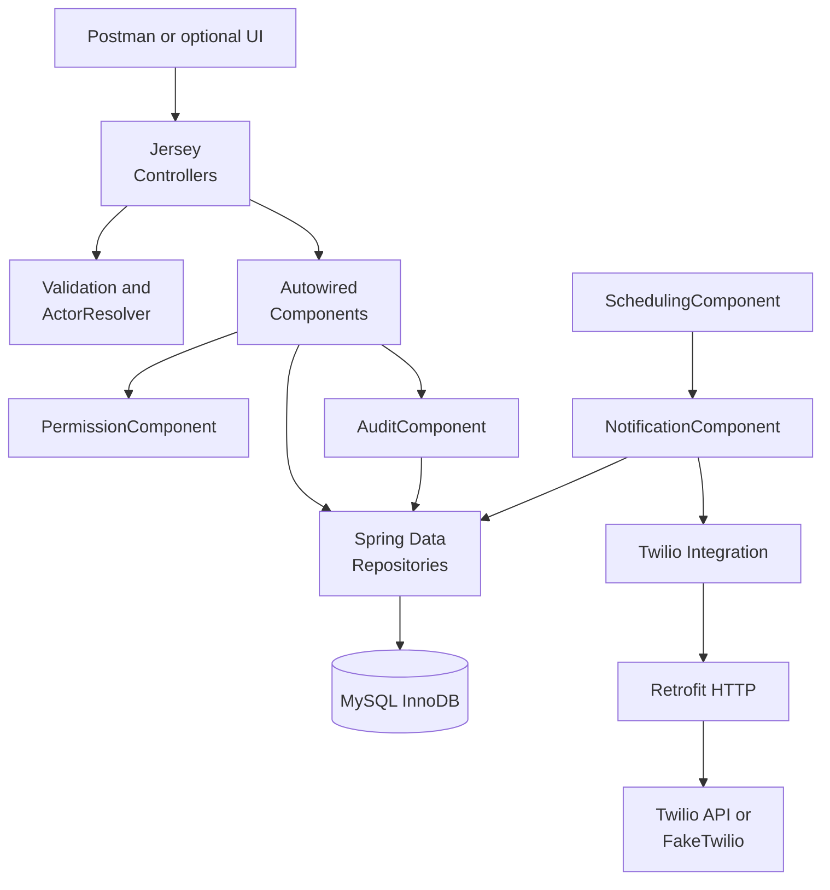
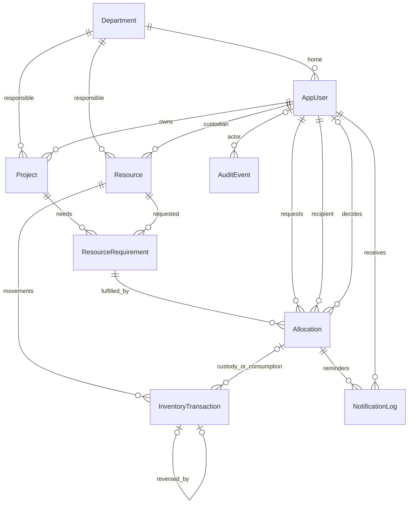
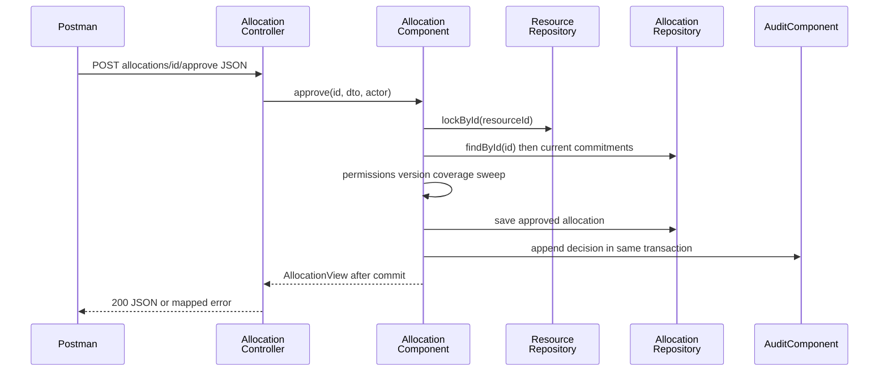
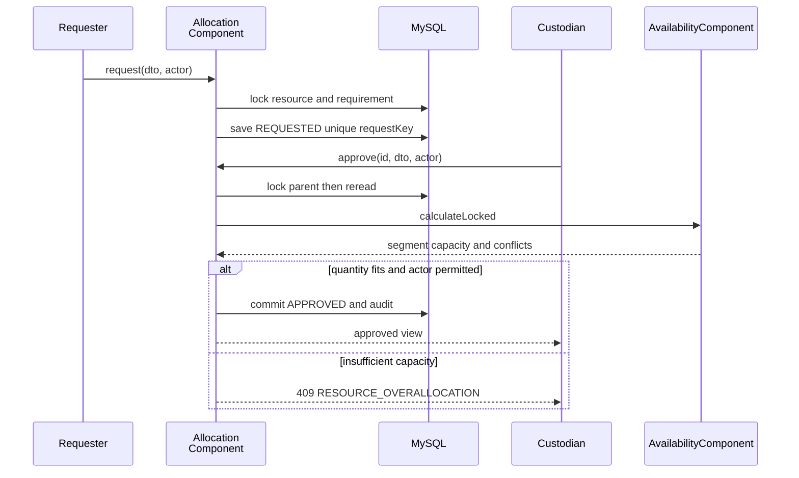
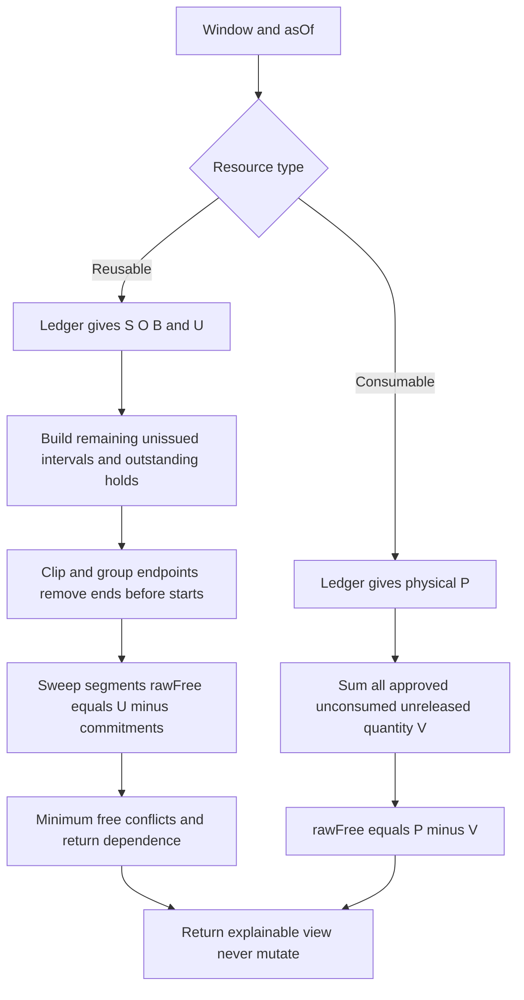
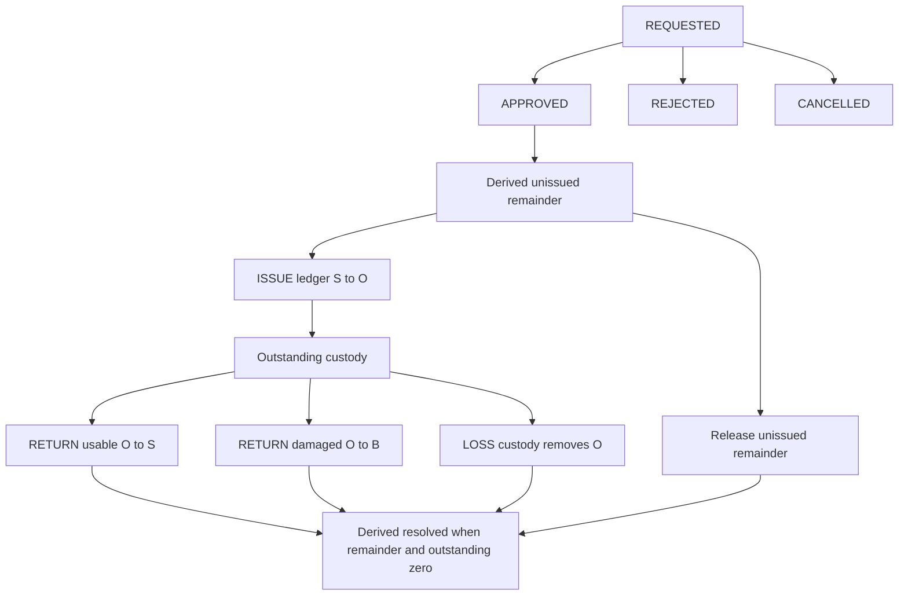
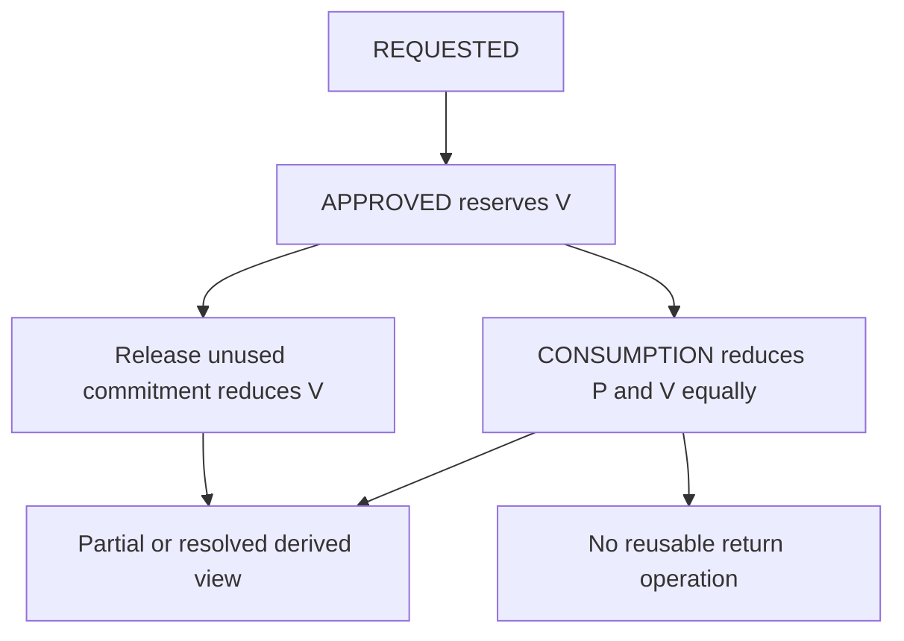
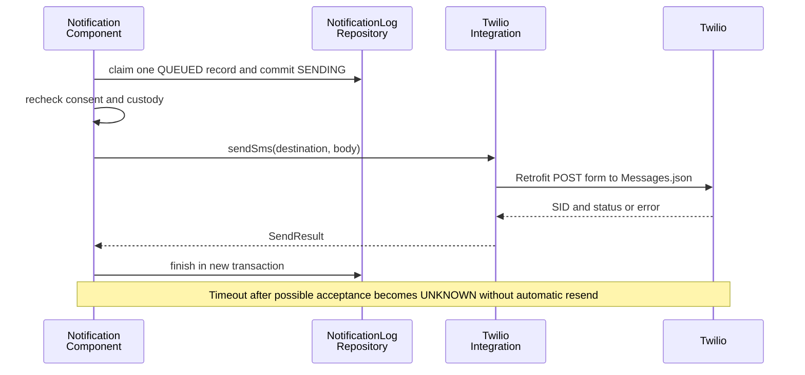
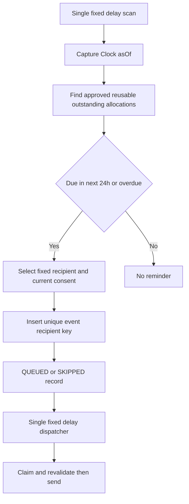

# OrgResource Technical Architecture

## Technology and package contract

Use the working javax-era course Spring Boot project as the starting dependency set. Supplied material includes Boot2.1.0.RELEASE, Jersey2.26, Hibernate5.3.7 and Spring Data2.1.2; these observations are compatibility anchors, not a newly compiled BOM. Use the class-supported JDK and MySQL connector after checking the actual project. Preserve Jetty if supplied by that baseline. Do not replace Jersey with Spring MVC controllers, javax.persistence/validation/ws.rs with jakarta packages, or Retrofit with a Twilio-only SDK. Verify the dependency tree and start a minimal database-connected route before implementing domain logic. Old course dependencies are for an isolated academic demonstration; this is not a claim they are suitable for an internet-facing production service.

org.ateneo.orgresource is the root package. config contains JerseyConfig, SchedulingConfig, ClockConfig and profile guards. rest contains DepartmentController, UserController, ProjectController, ResourceController, RequirementController, AllocationController, InventoryTransactionController, NotificationController, AuditController, PlanningController and ReportController. dto contains named request/response types in05. component contains the domain components in06. entity contains the nine JPA entities and enums in04. repository contains nine interfaces. integration contains the Retrofit Twilio interface and provider response DTO. validation contains request/cross-field validators and exception mappers. security contains Actor, ActorResolver and PermissionComponent. seed contains DemoSeedBootstrap and SeedComponent. No application source code is supplied by this specification task.

REST resources use javax.ws.rs.Path, GET, POST, Produces and Consumes with application/json; register their package, validation provider, Jackson JSON/JavaTime handling and ExceptionMapper classes in Jersey ResourceConfig. Each controller is a Spring-managed component and uses an explicit Autowired field or constructor for its named component. Each method binds/validates HTTP data, resolves Actor, forwards exactly once to the specified public component method, and maps DTO/status/headers. All calculations, lifecycle checks and transaction logic are in components. Return DTOs, never raw JPA graphs. Validate method/body constraints through Jersey Bean Validation and explicitly invoke a javax.validation.Validator at the component entry boundary so service callers cannot bypass validation. Validation errors map400.

Components use Spring Component/Service annotations. Public write methods are Spring Transactional with rollbackFor=Exception.class, except external send work which is intentionally outside a database transaction. Read methods are readOnly and use REPEATABLE_READ when combining balances and commitments. Real transaction entry calls cross a Spring proxy; do not rely on self-invocation of another annotated method. DemoSeedBootstrap.PostConstruct calls a separate SeedComponent proxy. Scheduling calls separate NotificationComponent transactional methods for enqueue, claim and completion. No transaction waits on Twilio.

Use MySQL InnoDB, utf8mb4, a case-stable code policy, UTC DATETIME(3), foreign keys and unique indexes. Application schema generation may use ddl-auto=update/create in the isolated skeleton profile as taught; final demo uses a reproducible schema and validate so an accidental restart does not erase data. No reliance on CHECK constraints being enforced by an unverified MySQL version; duplicate critical numeric checks in components. No open-in-view: map response DTOs while the read transaction is active. To avoid N+1, bound page sizes and load each report's needed rows in bulk; do not enable eager bidirectional graphs.

## Concurrency protocol

All operations that can affect inventory, approval capacity, requirements or project schedules follow this lock order: participating Resource rows in ascending id, then their ResourceRequirement rows in ascending id, then Allocation rows in ascending id, then Project rows in ascending id, then any other rows. Determine the tentative resource IDs with an initial read, acquire resource locks using explicit JPQL and PESSIMISTIC_WRITE, then re-read the target graph and verify the set has not changed. If it changed, roll back and return409 RETRY_REQUIRED, never acquire a newly discovered lower lock out of order. A singleton non-stock metadata edit may lock only its own row and must not call a stock command afterward.

After the resource lock, calculate balances from committed ledger rows and read current commitments. Every path uses this protocol, including direct transaction creation, cancellation, release, approval, resource archival, reversal, project cancellation/rescheduling, requirement changes, and seed writes. Increment the ordinary server-only Long Resource.revision exactly once per affected pool per successful command under that lock, including resource metadata edits and requested-allocation changes. InventoryTransaction.resourceRevisionAfter records that exact new revision. This is an audit dependency fence, not a quantity cache or manually assigned JPA version. The changed revision makes the Resource dirty and JPA separately manages its Version field for stale-edit checks. Flush before returning DTOs so the resulting JPA version is available; rollback also rolls back the revision increment. No reliance on provider-specific force-increment timing is needed.

Use transaction isolation READ_COMMITTED for write units of work, explicitly configured and integration-tested on MySQL; read the ledger and commitments only after the parent lock. This avoids a prior repeatable-read snapshot hiding the preceding winner's insert. Two approvals for the same pool serialize on its existing Resource row even if no allocation row existed beforehand. A unique requestKey or commandKey additionally prevents replayed inserts. The losing request returns409, not a second successful reservation. A unique index is not a substitute for checking the quantity under the lock.

Lock timeout/deadlock exceptions roll back the entire command and map409 RETRY_REQUIRED with retryable=true. Do not auto-retry arbitrary non-idempotent commands. Clients reuse keys for stock/allocation creation and re-read versions for metadata decisions. Database uniqueness and optimistic conflicts also roll back. DB failure500 uses a safe request ID. Reconciliation queries report corruption; they never silently insert repair movements.

Physical observations of damage/loss are different from approval. They can make earlier promises infeasible without making a balance negative. Save the actual observation and return impacted IDs; never reject an honest damaged return merely to preserve a fiction of sufficient stock. Approval and issue still enforce their own capacity predicates.

## Identity boundary

DEMO profile accepts X-Demo-User-Id for a seeded active user through ActorResolver, binds exclusively to127.0.0.1, displays DEMO IDENTITY in documentation and refuses LIVE Twilio mode by default unless separately enabled for one consented test recipient. This header is impersonable and is not authentication. Missing header401, malformed400, unknown/inactive user401; actor body parameters are rejected. Every component receives Actor and checks permissions and object ownership via PermissionComponent.

AUTHENTICATED profile must reject the demo header and requires a verified authenticated principal mapped to AppUser, TLS, secret handling and access tests. No specific SSO provider or unsupported Spring Security recipe is assumed. Without a configured real principal resolver this profile fails startup. The handoff must not publish the demo on a shared network or call it production secure. A working academic demonstration is feasible without inventing a login provider.

## Decision records

ADR01 model boundary. Problem: requirements, promises and physical movement are different. Options are one inventory table, eight domain tables with scattered metadata timestamps, or nine entities including AuditEvent. One table is fast but cannot represent overlapping/partial custody; eight covers stock but loses approval/edit history; nine adds one append-only component. Choose nine because each persists a distinct truth. An eight-entity version wins only if audited metadata history is explicitly dropped from scope. No additional category/location/organization/entity is needed for fixed strings and one deployment.

ADR02 reusable identity. Options are serialized assets, fungible pools, or a hybrid asset table. Serialization improves maintenance traceability but multiplies allocation logic; hybrid adds more entity/API work. Choose pools, with quantity-one resource for distinct devices. Per-unit serial tracking wins when physical identification or service history is a real requirement.

ADR03 quantity. Options are double, BigDecimal base units, or Long countable units. Double has rounding ambiguity; BigDecimal supports lengths/weights but adds conversions and precision rules. Choose Long whole base units for this academic scope. BigDecimal wins if verified fractional demand becomes essential, with a revised schema and arithmetic tests.

ADR04 stock authority. Options are editable Resource.quantity, ledger plus cache, or ledger only. Editable totals erase history; cache is faster but needs atomic reconciliation. Choose ledger-only for demo volume. Ledger plus guarded cache wins only after measured query cost warrants it.

ADR05 concurrency. Options are read-check-write, optimistic versions alone, or parent resource pessimistic lock plus versions. Plain checking races; optimistic versions are safe only if every child mutation forces the shared version update. Choose the parent lock with explicit current reads and versions for edits. Optimistic-only can win at high contention after a proven compare-and-swap implementation; distributed lock services do not fit this project.

ADR06 temporal availability. Options are sum all overlapping allocations, sweep peak simultaneous load, or external optimizer. The first overcounts sequential reservations; optimizer adds opaque complexity. Choose a deterministic endpoint sweep with half-open intervals. A solver wins only for optional automatic timetable optimization with a separate specification.

ADR07 consumables. Options are consume at handover, issue/return with a separate off-site pool, or no allocation. No allocation loses promises; the second needs custody/reconciliation of partial packages. Choose consumption at handover with global reservation of current units. A two-stage consumable issue model wins if an organization must return unopened stock from project sites.

ADR08 notifications. Options are inline sends inside inventory transaction, in-memory events, or database outbox NotificationLog. Inline sends couple stock to provider outages; memory loses events on restart. Choose durable outbox and short claim transactions. A message broker wins only with multiple processes/large volume, neither assumed.

ADR09 credentials and identity. Options are trusting user ID headers as authentication, building local passwords, or explicit local demo plus authenticated boundary. First is insecure; second adds credential lifecycle not taught or required. Choose explicit demo plus fail-closed live boundary. A reviewed password or institutional identity adapter wins when real shared use is approved and separately scoped.

ADR10 deletion. Options are delete every history row, refuse every deletion, or hard-delete unused setup/drafts with immutable posted history. First corrupts balances; second fails runtime deletion demonstration. Choose the third with explicit409 alternatives for history. A separate disposable test database reset is useful during development but is not exposed as a production purge endpoint.

ADR11 rescheduling. Options are silently change parent dates, reject all schedule edits after any request, or atomically revalidate a complete proposed schedule before any issue. First invalidates promises; second is safe but inconvenient. Choose atomic revalidation of unissued commitments. Full rejection wins if the team cannot finish/test the multi-resource path; that simplification must be explicitly reflected in proposal and API before coding, not silently stubbed.

ADR12 reports. Options are isolated per-request shortage sums, consolidated deterministic demand sweep, or ML forecasts. Isolated gaps double-count shared stock; ML has no verified training data. Choose explainable consolidation and operational counts. Forecasting becomes defensible only with suitable real, permitted history and independent validation.

## Rule implementation map

Implementation traceability: interval overlap and sweep belong to AvailabilityComponent (Q01,A01,P07;T09-T12). Ledger authority and custody vectors belong to InventoryTransactionComponent (07C,A05-A07,T01;T13-T22,T28-T29). Demand coverage and consolidated gaps belong to ShortageComponent (Q02-Q03;T12,T23). Project cancellation/completion/rescheduling belong to ProjectComponent (P05-P07;T24-T27). Safe deletion and archival belong to the owning components (01D-09D;T07-T08). Permissions belong to PermissionComponent at each public entry (all operations;T34-T35). Notifications belong to NotificationComponent and its integration/scheduling collaborators (08C,N01-N04,J01;T36-T44,T47,T51). Persistence, version/lock isolation and audit boundaries apply across components (T30-T33,T46,T50). This map locates each major invariant; exact ordered methods are in06.

Audit action values are fixed strings: CREATE, UPDATE, DELETE, NOTE, SEED, REMINDER_QUEUED, REMINDER_CLAIMED, REMINDER_RESULT, REMINDER_SKIPPED, REMINDER_CANCELLED, REMINDER_RECOVERY, and the defined operation IDs P01-P07, A01-A07, T01, N01-N04. Movement CREATE snapshots include type and the immutable transaction ID; no separate arbitrary action name is accepted. Action in PermissionComponent is the internal enum of the68 operation IDs in05. Derived fulfillment labels in02 are an allowlisted response enum, never persisted or accepted in a request.

## High level architecture

## Entity relationships

AuditEvent.targetType/targetId is a typed historical reference, not a JPA foreign key. Immutable targetSummary preserves meaning after permitted draft deletion. Common createdBy/updatedBy relationships are documented in04 but omitted from this diagram for legibility. A nullable AppUser.department is permitted only for the defined organization-wide roles; the diagram's home link represents assigned users.

## Request flow

## Allocation sequence

## Availability flow

## Reusable issue and return

## Consumable reservation and consumption

## Twilio flow

## Scheduled reminder flow

