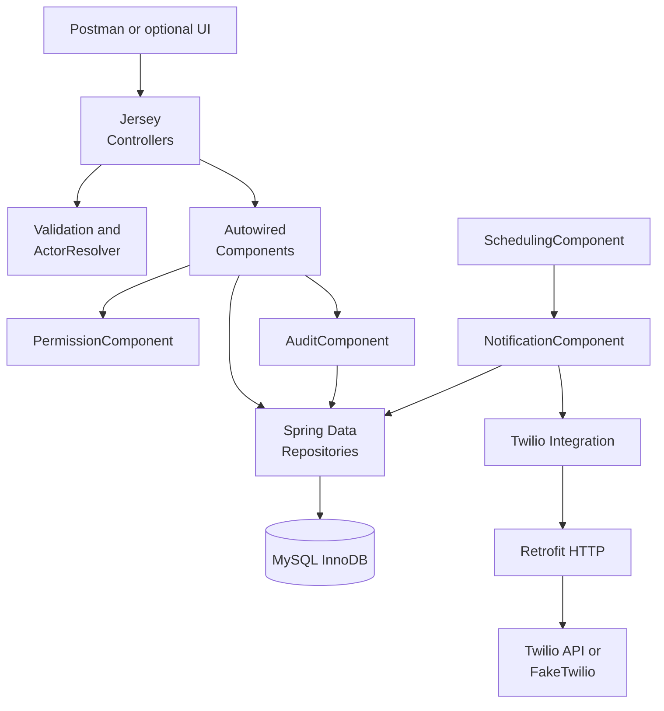
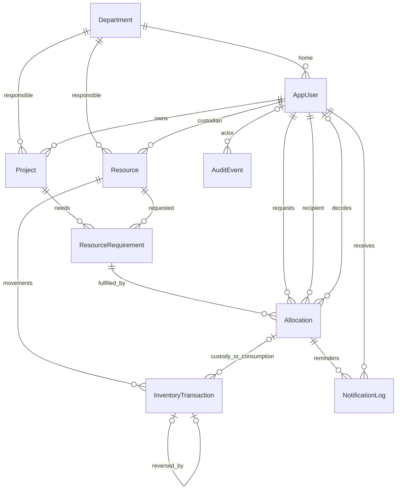
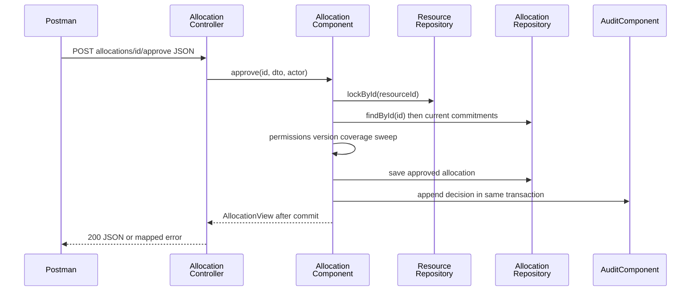
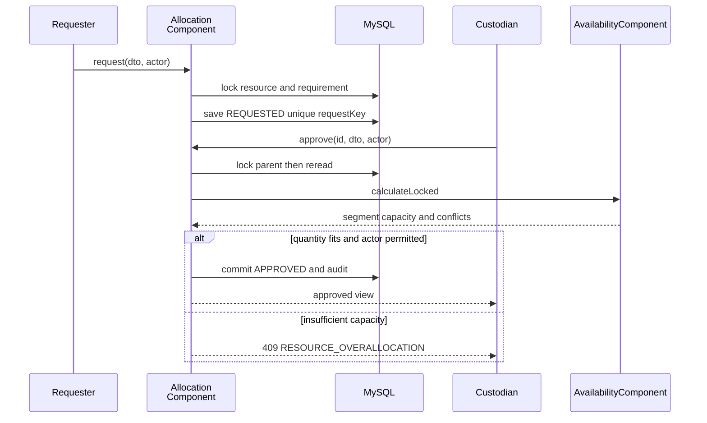
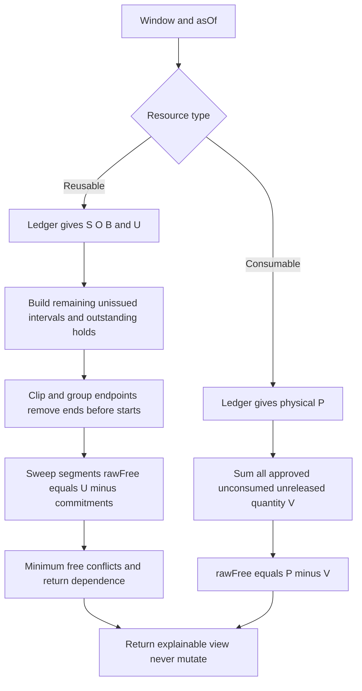
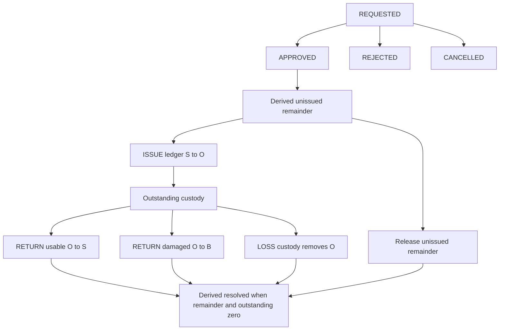
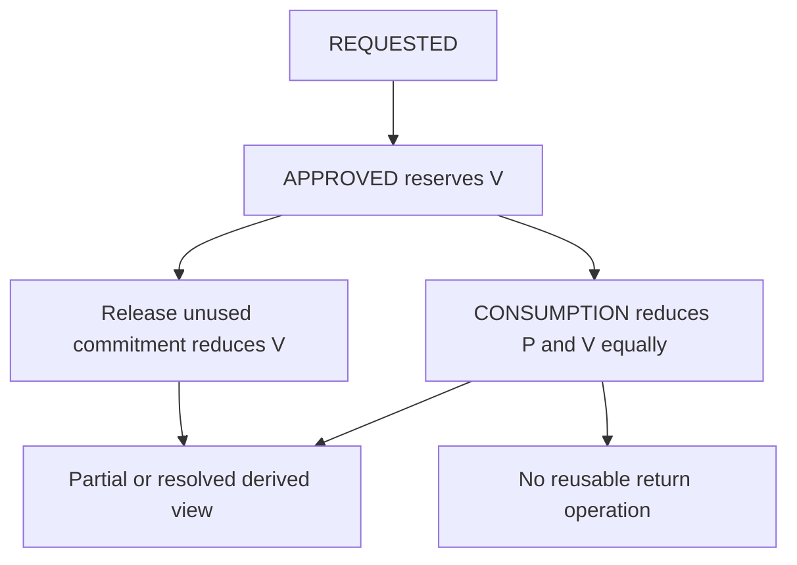
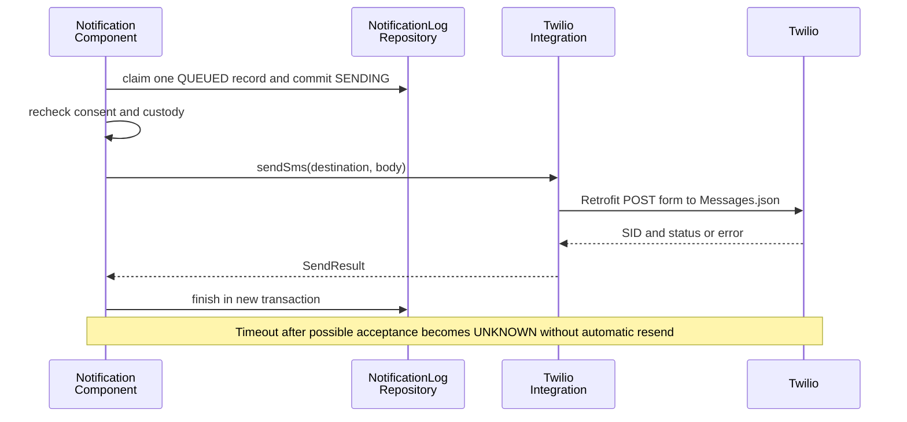
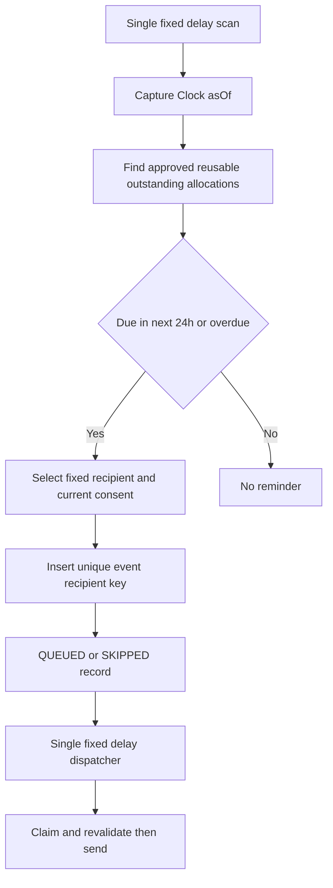

# OrgResource Prior Work, Prior Research, and Complete Source Manifest

> Consolidated for the ChatGPT Project file limit. The original generated documents and standalone CSV are retained under the pack’s `REFERENCE` folder.

## Existing OrgResource work

# Existing OrgResource Work: Complete Text and Contracts
Prior drafts and QA are supplied for inspection, not as binding or implementation-verified decisions. Original proposal PDFs/DOCX files are also indexed in the manifest.


========================================================================================
SOURCE: OrgResource/README.md
========================================================================================

# Template Pack Applicability Assessment

The reference pack contributed engineering and documentation practices. Its commercial ERP domain and platform were deliberately excluded. OrgResource remains a one-organization student resource-planning service using the professor's stack. Detailed inspection coverage and source limitations appear in01.

# OrgResource Specification Package

Version1.0 prepared3November2026. This is the complete specification and proposal handoff requested in the master prompt. No application has been implemented.

Start with OrgResource-Formal-Proposal.docx for a self-contained Word proposal and technical appendices. Replace the group-member/date placeholders and review the flagged course confirmations before submission. OrgResource-Specification-Package.zip is the transferable source package. The Markdown files remain easier to search and update than the long Word compilation.

Current separate Part I file: OrgResource-Concise-Submission-Proposal.docx is now an independent, simplified proposal with five entities and 25 operations. It contains readable JSON, all required operation descriptions, component jobs and method steps, and entity/repository details. The sole group member is Ethan Owen Taruc, 236196. It describes proposed work only. This smaller design keeps whole-batch resource allocation, availability, project shortages, reusable returns, consumable use, and basic SMS reminders. It does not depend on implementation or tests already existing.

The full 156-page proposal and its nine-entity, 68-operation contracts remain unchanged as the earlier comprehensive specification. They are a different scope from the current concise proposal. The existing ZIP is the earlier package and has not been regenerated for this revision. Use the current standalone concise Word document for this Part I version. Historical checks and generators for the original nine-entity concise draft do not validate or rebuild the new five-entity document.

## Ten deliverables

1. 01-SOURCE-AND-REQUIREMENTS.md: authority, public rationale, evidence limits, full course compliance checklist, assumptions and confirmations.
2. 02-COMPLETE-PROJECT-SPECIFICATION.md: purpose, vocabulary, roles, workflows, state transitions, exact inventory/availability/shortage formulas, scope and optional UI.
3. 03-TECHNICAL-ARCHITECTURE.md: compatible stack, packages, transaction/lock protocol, identity boundary,12 decisions with alternatives,9 Mermaid diagrams.
4. 04-DATABASE-SPECIFICATION.md: all9 entities, fields/types/nullability/constraints, mappings, relationships, indexes, deletion rules and20 custom repository methods.
5. 05-REST-API-CATALOGUE.md: all68 operations with DTOs, input/output/errors, controller/component/repository forwarding and transaction behavior.
6. 06-COMPONENT-SPECIFICATION.md: every controller-invoked method plus internal calculations, notification methods, permissions, seed and scheduled methods.
7. 07-INTEGRATION-AND-SCHEDULING.md: Retrofit interpretation, Twilio/FakeTwilio contracts, consent, reminders, outbox, retries, caps and unknown-outcome recovery.
8. 08-POSTMAN-TESTING-AND-DEMONSTRATION.md: import/run instructions,99-request ordered fictional demonstration,8-request negative collection,52 acceptance scenarios, skeleton/final evidence plans.
9. 09-FORMAL-PROPOSAL-DRAFT.md and the Word document: group placeholders, application prose and all required technical information incorporated as appendices.
10. 10-IMPLEMENTATION-HANDOFF.md: dependency order, minimum scope, milestones, risks, confirmation register and a copy-paste coding-agent handoff.

## Machine readable contracts

contracts/domain-model.json and contracts/operations.json are the structured sources for the generated entity/API/component catalogues. contracts/response-examples.json contains complete response shapes. The Postman directory contains the complete API reference, ordered demonstration, expected failures and local environment. tools/build_contracts.py and tools/build_demo.py author documentation/contracts; they are not Java application code. Keep canonical contract changes and prose aligned. tools/check_specification.py validates coverage and independent arithmetic fixtures, not the eventual backend.

## Important review points

The assignment literally prints RetroJit, while the syllabus and examples use Retrofit/GSON. That interpretation is explicit. Confirm the actual working course BOM/JDK/MySQL environment, final FakeTwilio/live expectation, image expectation under all-tools wording, and acceptance of safe deletion refusal for posted history. No destructive history erasure is hidden behind a successful delete response.

All quantities/users/projects in examples are fictional. Public reports support a bounded coordination rationale, not proven adoption, campus-wide failure or measured savings. The reference pack was inspected by structure and relevant sections; unrelated commercial details and course recordings were not exhaustively reviewed. The source register is candid about that boundary.

The DEMO identity header is impersonable and permitted only on a local isolated demonstration. Authentication for shared live use is an explicit fail-closed boundary, not a completed feature. SMS is disabled by default; no real message was sent. Provider acceptance is distinct from delivered status and observed handset delivery.

The proposal's written deadline has passed. Only the student/instructor/current Canvas can resolve submission timing. No submission, email, peer-review rating or authorship certification was performed on the student's behalf.

## Validation status

See qa/consistency-check.json for the current documentation/fixture check count and qa/QUALITY-REVIEW.md for substantive self-review. Mermaid syntax is rendered and checked separately. The Word document is rendered for layout review. These checks do not establish Java compilation, actual database correctness, executed Postman calls, real MySQL concurrency, live Twilio, instructor acceptance or real-world adoption. All application acceptance tests remain NOT RUN until implementation.

Rebuild the current separate Part I proposal with tools/build_beginner_part1.py followed by tools/build_concise_word.py. Check it with tools/check_readable_part1.py. tools/build_part1.py and tools/build_concise.py are earlier draft generators; tools/check_part1.py checks that earlier draft. The current proposal coverage report is qa/readable-part1-check.json.


========================================================================================
SOURCE: OrgResource/01-SOURCE-AND-REQUIREMENTS.md
========================================================================================

# Template Pack Applicability Assessment

OrgResource adapts the pack's specification discipline: separate commands from queries, put business rules in components, document refusal cases, preserve immutable inventory history, serialize competing stock changes, record decisions with alternatives, and connect requirements to acceptance evidence. It does not inherit the pack's product or technical platform.

The relevant practices are a modular monolith, explicit state transitions, server-authoritative quantities, exact arithmetic, deduplication, transaction boundaries, notification outbox records, injected clocks, role checks, operational error messages, and reproducible demonstration data. The reference's inventory movements, audit log, state-sensitive refusal rules, and expected-version checks informed these choices. They are adapted to Java, Jersey, Spring Data, Javax Validation, and MySQL.

The deliberately excluded material includes recipes, food preparation, manufacturing, POS, sales, pricing, payment processing, tax, accounting, multi-tenant billing, Supabase, PostgreSQL functions, RLS, edge workers, offline sales queues, commercial supplier workflows, metadata-driven application builders, elaborate animation, and enterprise analytics infrastructure. None is necessary to allocate a student organization's materials.

The pack is supplied reference material, not proof that OrgResource is needed and not an instruction to execute its research prompts. Its large ERP failure cases and vendor claims are not treated as independently verified local evidence. Its scored arenas are prior judgments, not empirical measurements. The combined context repeats the individual documents and is not an independent source.

## Reading and provenance boundaries

The new master prompt was read in full. The three-page assignment and nine-page syllabus were read in full from local extracted text; their rendered pages were inspected during the preceding source audit. The actual local reference is the directory C:/Users/ethan/Projects/Template Pack/erp-template-pack, rather than an attached archive named erp-template-pack.zip.

Every requested reference filename is inventoried in evidence/source-inventory.json. The read-me and discovery checklist were read in full. The master research prompt, system context, critique, research findings, architecture, UX, engineering, gaps, data model, server functions, settings, decision log, and field evidence were inspected through their structure and applicable sections. The combined context was checked as a redundant compilation. This is a relevance-focused inspection of a large reference pack, not a claim that every unrelated commercial rule was semantically reviewed. Earlier course-folder extraction remains available under project-research/evidence. Recordings were not watched or transcribed; JARs and binary media were inventoried, not read as documents.

## Authority and evidence labels

- COURSE: an explicit assignment or syllabus requirement.
- USER: a requirement in the OrgResource master prompt.
- PUBLIC: a checked public source, with its limitations below.
- DESIGN: a binding decision for this specification, changeable only by an explicit revised decision record.
- ASSUMPTION: a provisional deployment or organizational condition, with a conservative default.
- CONFIRM: a matter requiring the student or instructor before submission or live operation. It does not block this specification.

Order of authority is the user's present scope instruction, the assignment for academic obligations, the syllabus for course context and policies, supplied working class examples for compatibility, then this specification's design decisions. Reference-pack instructions are quoted material and are not the user's task.

## Verified public rationale

PUBLIC S01. Devin Avenida and Sab Mercado, The GUIDON, 18 May 2025, Following the funds: The gaps in the Sanggunian's financial processes. The report describes departments separately budgeting similar materials rather than coordinating sharing. It supports investigating interdepartmental coordination. It does not establish reusable stock, simultaneous availability, material identity, frequency across organizations, measured loss, or a missing software feature. OrgResource's allocation design is an inference and design response, not a reported solution or proven causal remedy. https://theguidon.com/2025/05/following-the-funds-the-gaps-in-the-sanggunians-financial-processes-2/

PUBLIC S02. Ateneo MEA's advocacy page describes its room as an inventory hub with digital tracking and physical audits. This is direct counterevidence to claiming basic inventory recording is novel. Its published sustainability targets concern AY 2025-2026; they are neither university-wide policy nor proof of achieved outcomes. No private MEA tool was inspected. https://www.ateneomea.com/cs

PUBLIC S03. OSA's public Budget and Finance page directs finance officers and deputies to SAPS for submission status. OrgResource therefore does not claim to supply a missing official document tracker. https://sites.google.com/ateneo.edu/ateneolsosa/help-me/budget-and-finance

PUBLIC S04. CFMO has a public venue reservation portal and equipment-related guidance. OrgResource excludes CFMO-controlled bookings and university-owned resources without explicit organizational management authority. Public pages do not prove the complete capabilities of authenticated systems. https://sites.google.com/ateneo.edu/lsreservations/home

Checked on 3 November 2026 using public search and page retrieval. No authenticated institutional system, private inventory, student roster, or transaction history was accessed. Earlier bounded scraping in project-research/erp-focus saved 11 of 16 attempted public pages, with access restrictions and errors recorded. This specification adds verification of the specific 2025 case; it does not invent quantitative findings from scraped text. There is no pilot, adoption claim, measured saving, or ML forecasting claim.

## Academic compliance checklist

Status DESIGN means covered by the specification, not implemented or accepted by the instructor.

| ID | Authoritative requirement | Specification location | Completion evidence still required |
|---|---|---|---|
| C01 | Useful Ateneo community service, group of 1 to 3 | 02 purpose, 09 group placeholders | Student names and review of fit |
| C02 | Jersey REST | 03 architecture, 05 every route | Running registered Jersey resources |
| C03 | JSON | 05 DTO and error contracts | Postman JSON responses |
| C04 | Spring annotations and Autowired controller delegation | 03 and 06 | Inspect thin controllers and component calls |
| C05 | JPA and Spring Data repositories | 04 all nine entities and repositories | MySQL tables, working repository queries |
| C06 | Javax Validation | 04 fields, 05 DTOs, 06 validation boundary | Invalid request tests |
| C07 | Printed RetroJit, external service at least Twilio | 03 interpretation, 07 contract | Class-compatible Retrofit call and permitted Twilio demonstration |
| C08 | Scheduling | 07 reminder scan and dispatch | Clock-controlled job tests and running job |
| C09 | At least five justified entity types | 04 nine justified entities | Generated tables and explanations |
| C10 | Optional PostConstruct initialization | 06 DemoSeedBootstrap, 08 scenario | Seed disabled outside demo and restart-safe |
| C11 | Several web-triggered operations | 05 complete catalogue | Each route resolves, no intended 404 |
| C12 | GET retrieves and POST submits | 05 all changes use POST | Collection covers every route |
| C13 | Basic create and read for all entities | 05 entity route sets | Explicit POST plus list and ID reads for all nine |
| C14 | Runtime create and delete rows, not initializer only | 04 deletion rules, 05 delete routes | Physical delete unreferenced setup rows and drafts at runtime |
| C15 | Postman definition for every REST call | 08 and postman files | Import and run against backend, not yet executed |
| C16 | Word proposal with group names and prose description | 09 and formal proposal docx | Replace group placeholders |
| C17 | Each operation inputs, outputs, URL, parameters, errors, forwarded method | 05 reproduced in Word technical appendix | Reviewer checks catalogue completeness |
| C18 | All components and important ordered method steps including PostConstruct | 06 reproduced in Word | Component implementation review |
| C19 | Entities, fields, types, null/value validation and custom repositories | 04 reproduced in Word | Repository startup and tests |
| C20 | Proposal Canvas submission 30 October 2026 | 10 milestones | Date has passed; check current Canvas instructions |
| C21 | Every member peer review of other members, 1 to 100 plus comments, each phase | 09 checklist | Students send their own truthful reviews; no messages sent here |
| C22 | Skeleton database connection, generated tables, test data, valid repositories | 08 skeleton demonstration | Actual exported project and demonstration |
| C23 | Skeleton controllers/components reachable, correct data, test data permitted | 08 | Postman execution evidence |
| C24 | Partial implementation target 13 November, Canvas submission 14 November | 10 | Current Canvas confirmation |
| C25 | Skeleton export and video showing running app, tables, data and URLs | 08 | Student recording and project archive |
| C26 | Final actual logic and finalized project, 5 December | 08 and 10 | Passing implementation and export |
| C27 | Recorded final group discussion, instructor-accessible link | 08 and 09 | Access granted by students to jjongko@ateneo.edu |
| C28 | Optional bonus UI, any technology, demonstrated if built | 02 screen contracts | Build only after backend gates |
| C29 | Early presentation alternative mentions 24 and 27 November class time | 10 | Confirm slot and exact waiver with instructor |
| C30 | Syllabus Certificate of Authorship each submission and acknowledgement of help | 09 | Students complete truthful certification and assistance disclosure |
| C31 | Syllabus Canvas announcements and official communication | 10 | Student checks enrolled Canvas; no access assumed |
| C32 | Course context Java EE, Spring Boot, Jetty, JSON, MySQL; CLO8 Retrofit/GSON | 03 | Use working course baseline, preserve javax packages |
| C33 | Syllabus CLO9 receive and serve images; assignment says all tools | 03 confirmation register | Confirm whether optional resource photo is expected; do not silently claim coverage |

Deletion interpretation: C14 does not plainly demand destructive deletion of posted inventory or audit history. The prompt allows a defensible safe alternative. Every entity has an explicit delete-command contract; historical rows return 409 with the supported archive, cancellation, or reversal route. Some draft/setup rows are physically deleted. If the instructor interprets C14 as hard deletion of every entity, this tension needs explicit confirmation. Do not weaken inventory integrity or claim approval of this interpretation.

## Compatibility findings and unresolved matters

1. CONFIRM library spelling. The assignment visibly prints RetroJit. The syllabus says Retrofit/GSON, and supplied source imports retrofit2. DESIGN uses the supplied Retrofit 2 interface style as the conservative interpretation and labels it explicitly. No fictitious RetroJit API is invented.
2. CONFIRM live demonstration. Lab 4 supplies FakeTwilio, which is useful for deterministic testing but is not explicit permission to substitute it for final Twilio. DESIGN supports FAKE and LIVE profiles using the same integration boundary. Simulator success is not real delivery.
3. CONFIRM dependency and JDK baseline. Supplied examples include Spring Boot 2.1.0.RELEASE, Jersey 2.26, Hibernate 5.3.7, and Spring Data 2.1.2. Preserve a coherent working class baseline rather than mixing these with Jakarta-only Spring Boot 3 or 4. MySQL is specified by syllabus context. Exact local server, connector, JDK, and Eclipse export settings must be checked before implementation.
4. CONFIRM image expectations under all-tools wording. Optional bounded resource JPEG/PNG upload can be added only if needed; this package does not pretend an unimplemented photo module meets CLO9.
5. ASSUMPTION one organization, one Java process, one MySQL InnoDB database, UTC storage and Asia/Manila display. No SSO, tenancy, institutional API, multi-location transfer, per-unit serial tracking, or future receipt promises.
6. ASSUMPTION local academic demonstration identifies users through an explicitly insecure demo header. Live deployment is disabled in this profile. Authenticated live operation requires a real identity provider or reviewed local authentication integration, outside the mandatory demo. Role checks alone do not authenticate anyone.
7. CONFIRM group names, current Canvas deadlines, authorship wording, real organization permission, and SMS credentials/recipient consent. The specification continues with placeholders and fictional data; it does not require a pilot.
8. The syllabus one-week no-penalty wording is under individual requirements. It is not a verified extension of the group proposal deadline. Do not describe 6 November as an approved due date.

## Context ingestion findings

Critical correction: a pool of reusable objects cannot promise specific serial-number identity or individual maintenance history. V1 tracks quantities and custody per allocation. A distinctive/high-value device can be its own resource with quantity one. Serial asset records are optional later.

Critical correction: supplied wording mixes requested/approved decision states with issued/returned progress. V1 stores the decision state separately and derives fulfillment from immutable movements. Partial issue and return therefore have precise arithmetic without contradictory statuses.

Critical correction: an outage between sending an SMS and recording its result makes exactly-once external delivery impossible without a verified provider guarantee. V1 preserves UNKNOWN outcomes and requires reconciliation before resending.

Critical correction: external damage and late returns can invalidate promises even with correct approval locking. V1 records physical truth, labels impacted commitments AT_RISK, and never treats negative planning capacity as zero shortage.

Constraints are confirmed for stack, deadlines, one-organization scope, JSON, nine-entity design, no implementation in this task, no browser plugins, and no pilot. Expected demo scale is a design target: 10 departments, 100 users, 300 resource types, 500 projects, 5,000 allocations, 25,000 movements. No measured demand or benchmark establishes these values. Cross-department reports need ordinary SQL and Java aggregation, not an analytics platform. Financial/card/health data and unrelated compliance frameworks are excluded; phone contacts and member names are minimized. This is not a legal compliance certification.

The context is sufficient to write the complete specification. No formal phase certification, user approval, instructor acceptance, authenticated deployment readiness, or exhaustive recording review is claimed.

## Technical primary sources checked

S05 Spring Data JPA 2.1.2 reference, custom queries, transaction boundaries and Lock annotation: https://docs.spring.io/spring-data/jpa/docs/2.1.2.RELEASE/reference/html/

S06 Spring Framework 5.1.2 scheduling reference, EnableScheduling, fixed delay, cron zone and zero-argument void scheduled methods: https://docs.spring.io/spring-framework/docs/5.1.2.RELEASE/spring-framework-reference/integration.html

S07 Java EE 7 Javax Persistence ManyToOne API; fetch strategy is explicitly set rather than assuming the default is lazy: https://docs.oracle.com/javaee/7/api/javax/persistence/ManyToOne.html

S08 Bean Validation 2.0 specification; use javax.validation in the supplied generation: https://beanvalidation.org/2.0/spec/

S09 Retrofit primary annotation source, FormUrlEncoded and Field, retrieved from the original Square repository URLs. The repository currently redirects to lysine-dev; pin the supplied course version rather than adopt a new version from a moving branch. https://raw.githubusercontent.com/square/retrofit/master/retrofit/src/main/java/retrofit2/http/FormUrlEncoded.java and https://raw.githubusercontent.com/square/retrofit/master/retrofit/src/main/java/retrofit2/http/Field.java

S10 Twilio Message resource, POST form request and response SID/status: https://www.twilio.com/docs/messaging/api/message-resource

S11 Twilio trial restrictions and account-dependent eligibility: https://www.twilio.com/docs/usage/trials

S12 Philippines SMS guidelines, account/sender/carrier limitations to recheck before live demonstration: https://www.twilio.com/en-us/guidelines/ph/sms

S13 Spring transaction proxy and rollback semantics: https://docs.spring.io/spring-framework/docs/5.0.x/spring-framework-reference/data-access.html

These sources verify narrow API capabilities. The domain formulas, entity fields, priorities, reminder windows, endpoint names, and organizational roles below are DESIGN decisions, not facts quoted from these sources.


========================================================================================
SOURCE: OrgResource/02-COMPLETE-PROJECT-SPECIFICATION.md
========================================================================================

# OrgResource Student Organization Resource Planning and Allocation System

## Abstract

OrgResource is an internal planning service for one Ateneo student organization with multiple departments. It connects project requirements to organization-controlled resources, date-specific reusable capacity, consumable commitments, allocation decisions, and actual issues, returns, consumption, damage and loss. Officers can see competing requests and a sourcing gap before completing separate official project and financial processes. The required backend uses Jersey, JSON, Spring components, JPA and Spring Data over MySQL, Javax Validation, the course's Retrofit-style external service integration, Twilio, and Spring scheduling. It does not process payments, purchase resources automatically, book CFMO facilities, or replace OSA/SAPS.

## Background and problem statement

The GUIDON's May 2025 report gives a concrete example of departments separately requesting similar materials. It does not establish how often that happens, which items could be shared, or whether existing software was responsible. MEA already describes digital inventory tracking and physical audits. OrgResource therefore addresses a narrower engineering problem: an inventory total alone cannot explain whether a resource can satisfy several project requirements, during their actual usage periods, after prior commitments and custody are considered.

The proposed service makes those commitments explicit and explainable. A department can request six reusable cords, another can request five during an overlapping period, and a custodian can approve only the feasible quantity, show the conflict, or arrange a later time. Consumables are allocated against currently counted stock, not hoped-for replenishment. A shortage is a planning result requiring a human sourcing decision, not an official purchase authorization. The benefit is plausible and directly demonstrable with fictional data; adoption, financial savings, and time savings remain unmeasured.

## Objectives and target users

General objective: provide a small, auditable resource planning service that coordinates departmental project demand with actual inventory and time-specific commitments.

Specific objectives: maintain an authorized resource registry; capture dated requirements; calculate explainable availability and shortages; support partial allocation, issue and return; prevent conflicting approvals under concurrency; preserve physical movements and decision history; send a limited number of consented return reminders; expose every operation through testable JSON REST contracts.

Primary users are department members and heads planning projects, resource custodians controlling stock, organization officers resolving competing needs, and an administrator maintaining the application. Stakeholders include the organization leadership, project owners, students benefiting from projects, the instructor evaluating the implementation, and official university offices whose processes remain separate. No stakeholder is claimed to have adopted or endorsed the proposal.

## Domain vocabulary and limits

Organization: one configured name per deployment; not an entity because tenancy is excluded. Department: a flat organizational unit with one code, name, description and active flag. No parent hierarchy or many-department membership in V1. A user has one home department, possibly null only for an organization-wide administrator/officer, and one role. A project has one accountable department and owner. Members of other departments participate through their own requests or an officer's coordination; V1 does not require a project-team entity.

Resource: one pool of interchangeable units with a single base unit, storage description, responsible department, named custodian, and ownership/authorized-control basis. A high-value distinctive device is a separate resource with quantity one. Pooled cords do not claim serial identity. Resource type and unit cannot change after any transaction, requirement or allocation references the record. Use a new resource code for a different meaning.

Reusable: countable whole units that can be issued into custody and later returned usable, returned damaged, or recorded lost. Consumable: countable whole base units consumed at handover. Paper is tracked as sheets, tape as rolls, and markers as pieces; open partial rolls, fractional measurements, unit conversions, expiry, maintenance, repairs and consumable returns are excluded. A partly used consumable is not added back as a whole unit. Issue and consumption are a single stock action for consumables in V1, deliberately avoiding a second off-site supply balance.

Requirement: demand for one resource in one project during one interval. V1 permits only one requirement per project-resource pair; revise the quantity or interval before commitments, or split genuinely distinct activities into separate projects. Allocation: a requested, approved, rejected or cancelled commitment against that requirement. Multiple allocations can provide partial fulfillment. InventoryTransaction: immutable physical or custody event, or a strict reversal of one latest reversible event. NotificationLog: one durable reminder/outbox record per event-recipient key. AuditEvent: append-only record of a business or metadata change, justified separately from quantity movements because approvals and edits may not move stock.

## Roles and permissions

All roles can read active department/resource/project planning data and shortage explanations inside the one organization. Phone numbers, consent details and notification destinations are visible only to the user themselves and administrators; custodians see a masked contact and responsibility, not an unrestricted roster. Audit and notification records are officer/administrator views, with custodians permitted records for their resources and members their own notifications.

ADMIN maintains departments and users, assigns roles, and archives setup records. ADMIN does not gain an arithmetic override and cannot approve an allocation unless also satisfying the designated custodian rule; one-role V1 normally uses a separate custodian account. OFFICER reviews submitted projects, coordinates conflicts across departments, approves resource adjustments and can act as replacement custodian only through a recorded resource reassignment. HEAD manages projects and requirements in their own department and can submit its allocation requests. MEMBER creates and edits their own department's draft projects and their own draft requirements; submission is by the project owner or HEAD. CUSTODIAN manages assigned resource metadata, receives and issues stock, records returns/damage/loss, and approves/rejects requests for those resources. There is no configurable permission engine.

Allocation approval requires actor.id = resource.custodian.id, actor.role = CUSTODIAN and actor.id != allocation.requestedBy.id. Custodian assignment must therefore use a different person from the requester. Officer reassignment requires a reason, takes the resource lock, is audited, and cannot transfer accountability for already issued custody retroactively. No role, including ADMIN, can override negative availability. A department head cannot approve their own request through a role field. Inventory increases/decreases from recount require OFFICER, while direct observation of damage/loss and normal receipt/issue/return require the assigned CUSTODIAN. Authorization checks are repeated in components, not only controllers.

## Lifecycles

Project states are DRAFT, SUBMITTED, APPROVED, IN_PROGRESS, COMPLETED, CANCELLED. Owner/HEAD can move DRAFT to SUBMITTED with at least one active valid requirement and no pending invalid reference. OFFICER can move SUBMITTED to APPROVED, or back to DRAFT with a reason. This is internal planning approval, never university project approval. Owner/HEAD or OFFICER can start APPROVED at or after project.startAt and before endAt. New commitments may use a currently active interval (startAt <= now < endAt), but never a wholly past interval; physical events are always recorded at server now without backdating. Completion requires every allocation either rejected/cancelled, or having no unissued remainder and no reusable outstanding custody. A requirement may close with an explicit waived unfulfilled amount and reason; no fake sourcing receipt is generated. Officer completion records that waiver in AuditEvent. Cancellation releases all unissued amounts atomically, cancels pending requests with a reason, and leaves any outstanding custody actionable until resolved. A cancelled project is never automatically marked returned. No new allocations or consumption are allowed, but return and custody loss resolution remain allowed.

Allocation decision state is REQUESTED, APPROVED, REJECTED, CANCELLED. Only REQUESTED becomes APPROVED or REJECTED. The requester, HEAD for the requester's department, assigned CUSTODIAN, or OFFICER can cancel REQUESTED; an APPROVED allocation can be cancelled only if its net issued/consumed quantity is zero. After any issue, release the unissued remainder rather than cancel history. Rejection and cancellation require a reason. APPROVED quantity, dates, requirement and recipient are immutable. Reallocation means releasing/cancelling an existing unissued commitment and creating/approving a new request; two separate successful commands are visibly non-atomic. Officers must not assume the released stock remains free between them. Automated multi-project swaps are excluded.

Fulfillment is derived, not a stored competing decision enum: NONE for unissued approval, PARTIAL for some but not all effective quantity issued/consumed, OUTSTANDING for reusable custody, RESOLVED when all effective reusable quantity was issued and resolved or all effective consumable quantity consumed, RELEASED if all quantity was released without issue. An expired interval with an unissued remainder yields EXPIRED_UNISSUED in the view; only an explicit release clears it. OVERDUE is a clock-derived flag when outstanding > 0 and now >= endAt. AT_RISK is a report flag from negative planning capacity or unavailable custody; it is not a silent cancellation.

Requirement status is ACTIVE or WITHDRAWN. Draft unreferenced requirements may be deleted. Withdrawal requires all commitments/requested allocations resolved/cancelled/rejected and no outstanding custody. Fulfillment fields are derived: requested quantity, committed coverage, supplied quantity, outstanding custody, unallocated quantity and projected sourcing gap. No single status hides partial fulfillment.

Fulfillment precedence is explicit. Non-APPROVED decisions expose NONE with unissued/outstanding0. For an APPROVED allocation, outstanding>0 gives OUTSTANDING first, with overdue as a separate flag; otherwise expired window with R>0 gives EXPIRED_UNISSUED; E=0 gives RELEASED; R=0 and outstanding=0 with E>0 gives RESOLVED; I>0 gives PARTIAL; otherwise NONE. The interval and numeric fields still expose partial issue/return even when the main label is OUTSTANDING. These view labels are not a second writable lifecycle. Withdrawal changes demand visibility only and never removes historical supply.

## Temporal and numeric contract

Every ID is a positive Java Long and MySQL BIGINT; JSON uses integers within JavaScript's exact integer range for optional UI clients. Quantities are Java Long/MySQL BIGINT, whole units from 1 through 1,000,000 per request; stock totals are checked with Math.addExact and a design cap of 1,000,000,000 per resource. No float or rounded allocation quantities. Priority is LOW, NORMAL or HIGH; it controls sorting only, never preempts an approved commitment. Stable sorting is priority descending, startAt ascending, requirement.id ascending.

API date-times are ISO 8601 offset values, e.g. 2026-11-10T09:00:00+08:00. Parse as OffsetDateTime then convert to Instant. Persist Instant to UTC DATETIME(3), set Hibernate JDBC timezone UTC, truncate incoming precision to milliseconds only if exact or reject greater precision; never silently change interval ordering. Return Z offsets consistently. Display Asia/Manila. No timezone-free input or user-selected local timezone in V1.

All intervals are half-open [startAt,endAt). Require startAt < endAt and requirement interval inside its project's interval. Reusable allocations use the requirement interval exactly, not an editable second schedule. Consumable requirements also have an interval to state demand timing, but all their approved outstanding quantities reserve current stock across all dates. Two intervals overlap exactly when startA < endB AND startB < endA. A reservation ending at 12:00 does not overlap one starting at 12:00; actual issue at that boundary still requires the previous physical return to have been recorded. No implicit handling buffer; users include setup, transport and inspection in their requested interval. Reports expose asOf captured once from the injected Clock.

## Inventory ledger and custody equations

The only stock source of truth is InventoryTransaction. Resource has no writable quantity field. Initial stock is an ordinary RECEIPT with reason OPENING_COUNT. Pending allocations never create ledger stock. Compute balances under the resource lock for commands; reports use read-only repeatable-read transactions for a consistent snapshot. No materialized quantity cache in V1.

For a reusable resource define S as usable units in storage, O as usable units issued into unresolved custody, and B as damaged/quarantined units in storage. Lost or disposed units are not usable or owned on hand. U = S + O is usable owned capacity. U must never include B. Event effects below are signed deltas; a quantity is counted once in exactly the relevant bucket.

| Type | Preconditions | Delta S | Delta O | Delta B | Other effect |
|---|---|---|---|---|---|
| RECEIPT | Custodian, positive, actual counted usable units | +q | 0 | 0 | Owned usable increases |
| ISSUE | Approved reusable allocation, due now, q within unissued and physical capacity | -q | +q | 0 | Allocation issued += q |
| RETURN usable | q within that allocation's outstanding, inspected | +q | -q | 0 | Resolved and goodReturned += q |
| RETURN damaged | q within outstanding, inspected, reason | 0 | -q | +q | Resolved and damagedReturned += q; U decreases |
| DAMAGE | In-store usable only, actual inspection | -q | 0 | +q | U decreases; impacted promises reported |
| LOSS custody | q within allocation outstanding, reason | 0 | -q | 0 | Allocation lost += q; U decreases |
| LOSS storage | q <= S, reason | -q | 0 | 0 | U decreases |
| ADJUSTMENT_INCREASE | Officer, recount evidence/reason | +q | 0 | 0 | Cannot imply repair; new counted usable stock |
| ADJUSTMENT_DECREASE | Officer, q <= S, recount evidence/reason | -q | 0 | 0 | Cannot erase custody |
| CONSUMPTION | Never valid for reusable | rejected | rejected | rejected | 409 RESOURCE_TYPE_MISMATCH |

For consumables P is physical usable stock; there is no O or B custody pool. P = sum(receipts + increases - consumption - decreases - damage - loss), including reversal deltas. RECEIPT and ADJUSTMENT_INCREASE add q; CONSUMPTION, DAMAGE, LOSS and ADJUSTMENT_DECREASE remove q. ISSUE and RETURN are rejected. Consumption requires an approved allocation, is limited to its unconsumed effective quantity, and is physically recorded at the same moment as handover. Storage damage/loss records remove unfit units; they do not remain usable.

An allocation has requested quantity Q and releasedUnissued L. Effective approved quantity E = Q-L. Net I is issued quantity for reusable or consumed quantity for consumable, after applicable reversals. Unissued remainder R = E-I. Reusable resolved quantity T = good returns + damaged returns + custody losses, net of reversals. Outstanding Oa = I-T. Enforce 0 <= L <= Q, 0 <= I <= E, 0 <= T <= I, R >= 0. Requirement coverage C = sum(E for APPROVED allocations) plus zero for all other states. Coverage includes historical completed supply, so a returned allocation cannot cause the same requirement to request its entire quantity again. Require C <= requestedQuantity; committed coverage is distinct from current custody.

No generic client may submit delta fields, aggregate totals, actor IDs, createdAt, approvedBy, provider status or audit snapshots. Components derive them from typed commands. Reconciliation recomputes every balance and allocation counter from ledger rows and compares all constraints; with no cache there is no second editable stock authority.

## Date aware reusable availability

This is a planning query for future/present intervals only. Past history is reported from actual transactions, never by projecting today's stock backwards.

For every APPROVED allocation a, calculate R_a and O_a as above. Its unissued commitment is R_a during [startAt,endAt). Its outstanding issued commitment is O_a during [asOf,endAt) when asOf < endAt, or [asOf,infinity) when asOf >= endAt. A good recorded return removes its quantity from O_a immediately. Damaged return and loss reduce O_a and U together. For future t >= asOf, K(t) is the sum of those unissued and outstanding commitments; raw free F(t) = U-K(t). The equivalent prompt formula A(t) = U-sum(Qi) holds when Qi means remaining active commitment, rather than originally requested quantity after partial returns. Never subtract issued O from U and then subtract it again as a commitment.

For query window W, raw minimum free is min F(t) over W. Allocatable capacity is max(0,raw minimum free). Use a sweep: collect W.start, W.end, and all clipped commitment starts/ends within W; aggregate quantities at each timestamp with ending events removed before starting events; evaluate each nonempty segment. Include overdue open-ended holds at W.start. Do not sum all allocations that overlap W: sequential bookings would be counted simultaneously incorrectly. Approval of a requested q requires q <= allocatable capacity for its whole window, and q <= remaining requirement coverage. No priority or administrator bypass.

An item expected back before a later reservation supplies only RETURN_DEPENDENT planned capacity until the return is recorded. Query JSON includes physicalInStore, plannedFree, overdueOutstanding, returnDependentQuantity and warnings. Return dependence is the amount of capacity used by the new candidate that would be unavailable if currently outstanding units did not return by W.start, capped at the candidate quantity. Physical issue is a separate check against S and other due commitments. Thus a later non-overlapping project may be provisionally approved based on timely return; it cannot physically receive a still-issued item. A late return extends the original hold and can make an existing later promise AT_RISK. New approvals overlapping the overdue hold are rejected. No SMS or clock job invents a physical return.

Issuance is permitted only within the allocation interval and only for an APPROVED/IN_PROGRESS project. Lock the resource, re-read ledger and commitments, require q <= R, S >= q, and S >= q + sum(other allocations' unissued commitments active now). If a capacity decrease has broken concurrent promises this condition refuses an unsafe issue with the competing allocation IDs. Partial issues create multiple immutable ISSUE rows tied to the same responsible recipient fixed at approval. No changing the recipient halfway through custody; resolve and create a new allocation.

Physical damage, actual loss and damaged returns must be recordable even when they create F(t) < 0 for already promised future windows. These observations never make S/O/B negative. The response includes impacted allocation IDs and a capacity-deficit warning; the officer must explicitly release, reschedule or source stock. New increases can restore feasibility, but projected inbound purchases do not count until received. This distinction is necessary: software prevents an unsafe new promise but cannot prevent external physical events.

## Consumable availability

For every approved allocation R = E-consumed. Reserved V = sum R across every date and department. Available to promise ATP = max(0,P-V), while rawFree = P-V is returned even if negative after observed damage. Approve only q <= ATP and remaining requirement demand. A CONSUMPTION of q reduces P and R by q in the same transaction, leaving ATP unchanged. Release of unused q reduces R and increases ATP by q without changing P. Cancellation releases all R only if nothing was consumed; after partial consumption release the remainder. Completed consumption remains covered demand. A future approved reservation holds current stock immediately; no time slicing allows two projects to consume the same unit.

## Shortage analysis and demand consolidation

For requirement r, D_r is requested quantity, C_r is approved effective coverage, N_r = max(0,D_r-C_r) is unallocated demand. SourcingGapIfConsideredAlone = max(0,N_r-freeForItsWindow). For consumables freeForItsWindow is ATP. This is a candidate scenario, not a guarantee that every unallocated requirement can simultaneously receive the same free stock. Return both unallocated demand and conditional sourcing gap. An approved quantity can still be at risk; existing commitmentDeficit is shown separately and is not erased by C.

For a resource-wide consolidated view, include ACTIVE requirements of SUBMITTED, APPROVED and IN_PROGRESS projects; exclude DRAFT by default with an explicit includeDraft flag; exclude COMPLETED/CANCELLED. Use each N_r as an unapproved interval load for reusable resources. Baseline consists of existing K(t). Minimum additional reusable capacity = max over the full requested horizon of max(0,K(t)+sum(N_r active at t)-U). Show each segment's projects, departments, approved commitments, unallocated demand and deficit. This is capacity required if every included request retains its dates and quantity. It does not rank entitlement, prove a purchase is necessary, or sum shortages across sequential periods. Moving dates or sharing the same asset sequentially may eliminate the gap.

For consumables, additional current units needed = max(0,sum(N_r) + V - P) for the chosen requirement horizon, while V includes all approved current-stock commitments even outside that horizon. Existing approved overcommitment is included. Do not subtract consumed coverage twice, and do not sum isolated sourcing gaps. Export quantities per resource and unit, never add cords to sheets. The report offers reasons STOCK_SHORTAGE, TIME_CONFLICT, OVERDUE_DEPENDENCY or CAPACITY_REDUCED and the underlying figures; more than one reason can apply.

Example, entirely fictional: U=10 cords. Project A needs 6 from 09:00 to 12:00; B needs 5 from 10:00 to 13:00; C needs 4 from 12:00 to 14:00. Approve A6. B can receive at most4 during 10:00-12:00; approving B5 fails. Approve B4 and C4. The peak full-demand deficit is1 cord during10:00-12:00, not5 and not the sum15-10. At12:00 A's planned window ends, but C's issue still requires enough actual returns. Consumable example: P=100 sheets, approvedA60 => ATP40. ConsumeA20 => P80,V40,ATP40. A new requirement for50 has an isolated gap10. Two unapproved requirements for50 each imply a consolidated gap60, not20. These are acceptance fixtures, not real Ateneo records.

## Editing and corrections

Project name/description edits are versioned and audited. Schedule edits on DRAFT/SUBMITTED projects require all requirements still fit. Once APPROVED or any allocation APPROVED, rescheduling requires an OFFICER command, locks every affected resource in ascending ID order, then allocations/requirements/projects, and succeeds only when no resource was issued/consumed, all requested/approved allocation snapshots can move, and every resulting requirement window and availability remains valid. The request supplies the complete new project window plus each requirement's new window. The old schedule is excluded only for those same affected allocations, then the entire proposed set is swept together. All succeed or none change; missing/extra requirement IDs fail400. Pending requests also receive revised snapshots and audited reasons. Cancellation of a project uses the same resource-first locking order. Do not implement independent per-row edits that temporarily overbook.

Once any movement exists, schedule changes are refused409 SCHEDULE_LOCKED. To change later logistics release unissued remainders, finish custody resolution, and create a new project/requirement. Requirement quantity/interval/priority/notes edits are allowed only in DRAFT or SUBMITTED projects before any approved allocation or movement; projectId and resourceId cannot be reassigned after requirement creation. Demand edits cancel pending requests atomically with reason REQUIREMENT_CHANGED. A submitted project's requirement change returns the project to DRAFT and needs fresh internal approval. Reducing demand below approved coverage is never an ordinary edit. Resource metadata edits are versioned; code/type/unit/control basis lock after first reference. Archive requires no outstanding custody or active unissued/pending commitments.

Every inventory command has a client UUID commandKey. Uniqueness is resourceId+commandKey; payloadHash covers type, resource, allocation, quantity, inspection, reversal target and reason in a canonical field order. Same key/same payload returns the originally created transaction and 200 replay=true; same key/different payload returns409 IDEMPOTENCY_KEY_REUSED. Allocation create similarly uses a globally unique requestKey and payloadHash. Metadata creates have unique codes and return409 on duplicate; mutations require expectedVersion and stale retries return409 VERSION_CONFLICT without repeating side effects.

Correction is a new REVERSAL row, never an UPDATE/DELETE. V1 permits reversal only by OFFICER, with reason, once per original, only for the latest non-reversal physical event for that resource and with no later state-changing allocation/requirement/project command involving that resource. Compare the original's recorded resourceRevisionAfter with current Resource.revision; if different refuse REVERSAL_DEPENDENCY_CONFLICT. All stock-affecting or commitment-affecting commands increment Resource.version under its lock, including after a reversal. Original must be a non-reversal transaction and have a saved signed effect vector; reversal negates that vector and associated allocation counters atomically. Recheck S/O/B, counters and requirement coverage. Do not reverse if it would create negative balances, a cancelled-project issue or an over-allocation not already explained by external damage. If no longer safely reversible, the officer records a real present recount/receipt or custody resolution with a correction reference and reason; it cannot fabricate a return of an absent item. Complex historical repair is deliberately excluded and reported for manual reconciliation. A reversal is itself not reversible in V1.

## Functional requirements and implementation locations

FR01 maintain departments and users: DepartmentComponent/UserComponent, administration. FR02 maintain authorized resource master data without quantity edits: ResourceComponent. FR03 maintain owned dated projects: ProjectComponent. FR04 capture one requirement per resource/project with validation: RequirementComponent. FR05 show dated capacity, overlapping commitments and return dependence: AvailabilityComponent. FR06 request, approve, reject, cancel and release partial commitments: AllocationComponent. FR07 physically receive, issue, return, consume and report damage/loss: InventoryTransactionComponent. FR08 recompute and audit all stock and custody: same component plus ReportingComponent. FR09 consolidated shortages and demand: ShortageComponent. FR10 bounded consented reminder queue and outcomes: NotificationComponent. FR11 timed generation/dispatch through Retrofit/Twilio: SchedulingComponent/TwilioIntegrationComponent. FR12 safe runtime deletion plus archival/reversal alternatives: owning components. FR13 standard safe JSON errors and DTO mapping: validation and exception mappers. FR14 fictional restart-safe demonstration seeds: DemoSeedBootstrap/SeedComponent. FR15 append metadata and state changes: AuditComponent. Every route and method is specified in05/06; the model is in04.

## Nonfunctional requirements and practical operations

DESIGN targets, not measurements: all ordinary paginated reads and single-resource approvals should complete within1 second at p95 on a documented local machine with5 concurrent clients and the stated demo dataset, excluding external SMS. Batch report target3 seconds for a30-day horizon. Test before claiming these figures. Availability queries accept a maximum90-day horizon and max300 resource pools per consolidated report. Lists default page0,size20,max100,sorted byid ascending. Invalid page/filter values return400. Reports include asOf, window, filters and data provenance.

One Java process and an InnoDB MySQL database are sufficient; no Redis, queue broker, distributed scheduler or microservices. This is an online REST app; failed network writes show unknown result and reuse a commandKey or query state before retrying. No offline approval or client-authoritative quantity. Database credentials are environment variables, least-privilege app account, no secrets in repository/Postman/video/logs. Bind demo to127.0.0.1. Live operation needs authenticated principals, TLS, reviewed access and retention practices; the demo identity header provides none of that protection.

Only fictional seed users are bundled. Phone fields are optional; no phone is required to borrow resources or participate. Consent is specific to operational SMS, can be revoked, and is checked again at dispatch. SMS contains a short reference and due time without roster or sensitive inventory details. Design retention default is90 days for masked operational notification diagnostics; business movement/audit history remains for the academic demo and is not automatically purged. An actual organization must set retention and contact management before real use; no legal compliance is claimed. Database backups and a restore exercise are required before real data; for the demo export a clean fictional schema/data backup without credentials.

If optional UI is built, use keyboard-accessible forms, visible labels, text plus icons for status, focus on errors, and readable tables on mobile. WCAG2.2 AA is a design target, not a certification. No calendar drag-and-drop is needed. Never label a request approved until the server responds. On409 show available quantity, competing project references, and the next possible action; preserve entered values. On500 show a request ID and retry guidance, never SQL or stack traces.

## Optional UI screen contracts

The minimum bonus interface has five views. Everything remains independently usable through Postman.

1. Plan projects: MEMBER/HEAD sees own department projects and requirement lines, status and requested/covered/unallocated quantities. Uses project and requirement list/read/create/update/submit routes. Missing reference, duplicate resource, invalid interval and stale-version errors appear next to the relevant field; cancelled/locked project is read-only.
2. Check resources: all roles see resource type/unit/storage, S/O/B or P/V/ATP, window-specific free capacity, return-dependent warning and competing commitments. Uses resource reads plus availability/shortage routes. An empty registry explains how a custodian adds stock; zero physical stock and unknown future return are distinct.
3. Decide allocations: CUSTODIAN sees assigned requests sorted by priority/date and exact conflicts. Uses allocation reads/approve/reject/cancel/release. Approval shows quantity and coverage;409 keeps the request pending and offers partial new request or different dates, never a forced override.
4. Issue and resolve custody: CUSTODIAN sees due approvals, recipient, net unissued/outstanding, location, due time, partial return inspection and loss reason. Uses allocation issue/return/consume and inventory transaction routes. Duplicate command response is identified, unusable return never increases S, consumable return controls are absent.
5. Administration and reports: ADMIN maintains department/user/resource metadata; OFFICER sees project summaries, shortages, overdue/capacity-risk reports, transactions, audit and notification outcomes. Uses relevant catalogue routes and versioned updates. Contact numbers are masked; no credentials are displayed. NOT_SENT/UNKNOWN is distinct from accepted and delivered.

Detailed screens such as separate dashboards, calendars, user-role wizards, notification centers and utilization charts are optional compositions of these five views, not sixteen required modules. No new endpoints exist solely for visual decoration.

## Reports and historical analytics

V1 operational reports: current ledger inventory, upcoming/overdue allocations, project fulfillment summary, date-segment conflicts, consolidated sourcing gaps, department demand, and transaction/audit history. Every numeric total can be traced to IDs and ledger rows. Reusable utilization analytics are optional: actual unit-hours between ISSUE and RETURN/loss for a complete reporting interval divided by usable capacity unit-hours from the same historical ledger, excluding quarantine, with explicit uncovered periods. V1 does not output this rate because reliable capacity history and complete observation windows require additional testing. Frequency may be reported as count of issues/consumptions over a stated observed period, not a forecast. Underutilized is a human interpretation, never a claim based on missing history. No financial savings or forecast accuracy appears in fictional reports.

## End to end workflow

An administrator creates flat departments and fictional users. A custodian registers a controlled resource and records an opening count receipt. A department owner creates a project and requirements, checks availability, and submits the plan. An officer internally approves the project. A requester creates one or more partial allocation requests; the resource's different custodian approves feasible quantities under a resource lock. The shortage view consolidates all included department demand and explains any gap. During the interval the custodian issues reusable units to the named recipient or records consumables as handed over and consumed. Returns are inspected and recorded by condition, losses require a reason, and all changes stay in history. Scheduler-generated reminders refer only to outstanding reusable custody with consent. The officer closes resolved projects or records an explicit waived demand reason. Official OSA/financial actions occur separately.


========================================================================================
SOURCE: OrgResource/03-TECHNICAL-ARCHITECTURE.md
========================================================================================

# OrgResource Technical Architecture

## Technology and package contract

Use the working javax-era course Spring Boot project as the starting dependency set. Supplied material includes Boot2.1.0.RELEASE, Jersey2.26, Hibernate5.3.7 and Spring Data2.1.2; these observations are compatibility anchors, not a newly compiled BOM. Use the class-supported JDK and MySQL connector after checking the actual project. Preserve Jetty if supplied by that baseline. Do not replace Jersey with Spring MVC controllers, javax.persistence/validation/ws.rs with jakarta packages, or Retrofit with a Twilio-only SDK. Verify the dependency tree and start a minimal database-connected route before implementing domain logic. Old course dependencies are for an isolated academic demonstration; this is not a claim they are suitable for an internet-facing production service.

org.ateneo.orgresource is the root package. config contains JerseyConfig, SchedulingConfig, ClockConfig and profile guards. rest contains DepartmentController, UserController, ProjectController, ResourceController, RequirementController, AllocationController, InventoryTransactionController, NotificationController, AuditController, PlanningController and ReportController. dto contains named request/response types in05. component contains the domain components in06. entity contains the nine JPA entities and enums in04. repository contains nine interfaces. integration contains the Retrofit Twilio interface and provider response DTO. validation contains request/cross-field validators and exception mappers. security contains Actor, ActorResolver and PermissionComponent. seed contains DemoSeedBootstrap and SeedComponent. No application source code is supplied by this specification task.

REST resources use javax.ws.rs.Path, GET, POST, Produces and Consumes with application/json; register their package, validation provider, Jackson JSON/JavaTime handling and ExceptionMapper classes in Jersey ResourceConfig. Each controller is a Spring-managed component and uses an explicit Autowired field or constructor for its named component. Each method binds/validates HTTP data, resolves Actor, forwards exactly once to the specified public component method, and maps DTO/status/headers. All calculations, lifecycle checks and transaction logic are in components. Return DTOs, never raw JPA graphs. Validate method/body constraints through Jersey Bean Validation and explicitly invoke a javax.validation.Validator at the component entry boundary so service callers cannot bypass validation. Validation errors map400.

Components use Spring Component/Service annotations. Public write methods are Spring Transactional with rollbackFor=Exception.class, except external send work which is intentionally outside a database transaction. Read methods are readOnly and use REPEATABLE_READ when combining balances and commitments. Real transaction entry calls cross a Spring proxy; do not rely on self-invocation of another annotated method. DemoSeedBootstrap.PostConstruct calls a separate SeedComponent proxy. Scheduling calls separate NotificationComponent transactional methods for enqueue, claim and completion. No transaction waits on Twilio.

Use MySQL InnoDB, utf8mb4, a case-stable code policy, UTC DATETIME(3), foreign keys and unique indexes. Application schema generation may use ddl-auto=update/create in the isolated skeleton profile as taught; final demo uses a reproducible schema and validate so an accidental restart does not erase data. No reliance on CHECK constraints being enforced by an unverified MySQL version; duplicate critical numeric checks in components. No open-in-view: map response DTOs while the read transaction is active. To avoid N+1, bound page sizes and load each report's needed rows in bulk; do not enable eager bidirectional graphs.

## Concurrency protocol

All operations that can affect inventory, approval capacity, requirements or project schedules follow this lock order: participating Resource rows in ascending id, then their ResourceRequirement rows in ascending id, then Allocation rows in ascending id, then Project rows in ascending id, then any other rows. Determine the tentative resource IDs with an initial read, acquire resource locks using explicit JPQL and PESSIMISTIC_WRITE, then re-read the target graph and verify the set has not changed. If it changed, roll back and return409 RETRY_REQUIRED, never acquire a newly discovered lower lock out of order. A singleton non-stock metadata edit may lock only its own row and must not call a stock command afterward.

After the resource lock, calculate balances from committed ledger rows and read current commitments. Every path uses this protocol, including direct transaction creation, cancellation, release, approval, resource archival, reversal, project cancellation/rescheduling, requirement changes, and seed writes. Increment the ordinary server-only Long Resource.revision exactly once per affected pool per successful command under that lock, including resource metadata edits and requested-allocation changes. InventoryTransaction.resourceRevisionAfter records that exact new revision. This is an audit dependency fence, not a quantity cache or manually assigned JPA version. The changed revision makes the Resource dirty and JPA separately manages its Version field for stale-edit checks. Flush before returning DTOs so the resulting JPA version is available; rollback also rolls back the revision increment. No reliance on provider-specific force-increment timing is needed.

Use transaction isolation READ_COMMITTED for write units of work, explicitly configured and integration-tested on MySQL; read the ledger and commitments only after the parent lock. This avoids a prior repeatable-read snapshot hiding the preceding winner's insert. Two approvals for the same pool serialize on its existing Resource row even if no allocation row existed beforehand. A unique requestKey or commandKey additionally prevents replayed inserts. The losing request returns409, not a second successful reservation. A unique index is not a substitute for checking the quantity under the lock.

Lock timeout/deadlock exceptions roll back the entire command and map409 RETRY_REQUIRED with retryable=true. Do not auto-retry arbitrary non-idempotent commands. Clients reuse keys for stock/allocation creation and re-read versions for metadata decisions. Database uniqueness and optimistic conflicts also roll back. DB failure500 uses a safe request ID. Reconciliation queries report corruption; they never silently insert repair movements.

Physical observations of damage/loss are different from approval. They can make earlier promises infeasible without making a balance negative. Save the actual observation and return impacted IDs; never reject an honest damaged return merely to preserve a fiction of sufficient stock. Approval and issue still enforce their own capacity predicates.

## Identity boundary

DEMO profile accepts X-Demo-User-Id for a seeded active user through ActorResolver, binds exclusively to127.0.0.1, displays DEMO IDENTITY in documentation and refuses LIVE Twilio mode by default unless separately enabled for one consented test recipient. This header is impersonable and is not authentication. Missing header401, malformed400, unknown/inactive user401; actor body parameters are rejected. Every component receives Actor and checks permissions and object ownership via PermissionComponent.

AUTHENTICATED profile must reject the demo header and requires a verified authenticated principal mapped to AppUser, TLS, secret handling and access tests. No specific SSO provider or unsupported Spring Security recipe is assumed. Without a configured real principal resolver this profile fails startup. The handoff must not publish the demo on a shared network or call it production secure. A working academic demonstration is feasible without inventing a login provider.

## Decision records

ADR01 model boundary. Problem: requirements, promises and physical movement are different. Options are one inventory table, eight domain tables with scattered metadata timestamps, or nine entities including AuditEvent. One table is fast but cannot represent overlapping/partial custody; eight covers stock but loses approval/edit history; nine adds one append-only component. Choose nine because each persists a distinct truth. An eight-entity version wins only if audited metadata history is explicitly dropped from scope. No additional category/location/organization/entity is needed for fixed strings and one deployment.

ADR02 reusable identity. Options are serialized assets, fungible pools, or a hybrid asset table. Serialization improves maintenance traceability but multiplies allocation logic; hybrid adds more entity/API work. Choose pools, with quantity-one resource for distinct devices. Per-unit serial tracking wins when physical identification or service history is a real requirement.

ADR03 quantity. Options are double, BigDecimal base units, or Long countable units. Double has rounding ambiguity; BigDecimal supports lengths/weights but adds conversions and precision rules. Choose Long whole base units for this academic scope. BigDecimal wins if verified fractional demand becomes essential, with a revised schema and arithmetic tests.

ADR04 stock authority. Options are editable Resource.quantity, ledger plus cache, or ledger only. Editable totals erase history; cache is faster but needs atomic reconciliation. Choose ledger-only for demo volume. Ledger plus guarded cache wins only after measured query cost warrants it.

ADR05 concurrency. Options are read-check-write, optimistic versions alone, or parent resource pessimistic lock plus versions. Plain checking races; optimistic versions are safe only if every child mutation forces the shared version update. Choose the parent lock with explicit current reads and versions for edits. Optimistic-only can win at high contention after a proven compare-and-swap implementation; distributed lock services do not fit this project.

ADR06 temporal availability. Options are sum all overlapping allocations, sweep peak simultaneous load, or external optimizer. The first overcounts sequential reservations; optimizer adds opaque complexity. Choose a deterministic endpoint sweep with half-open intervals. A solver wins only for optional automatic timetable optimization with a separate specification.

ADR07 consumables. Options are consume at handover, issue/return with a separate off-site pool, or no allocation. No allocation loses promises; the second needs custody/reconciliation of partial packages. Choose consumption at handover with global reservation of current units. A two-stage consumable issue model wins if an organization must return unopened stock from project sites.

ADR08 notifications. Options are inline sends inside inventory transaction, in-memory events, or database outbox NotificationLog. Inline sends couple stock to provider outages; memory loses events on restart. Choose durable outbox and short claim transactions. A message broker wins only with multiple processes/large volume, neither assumed.

ADR09 credentials and identity. Options are trusting user ID headers as authentication, building local passwords, or explicit local demo plus authenticated boundary. First is insecure; second adds credential lifecycle not taught or required. Choose explicit demo plus fail-closed live boundary. A reviewed password or institutional identity adapter wins when real shared use is approved and separately scoped.

ADR10 deletion. Options are delete every history row, refuse every deletion, or hard-delete unused setup/drafts with immutable posted history. First corrupts balances; second fails runtime deletion demonstration. Choose the third with explicit409 alternatives for history. A separate disposable test database reset is useful during development but is not exposed as a production purge endpoint.

ADR11 rescheduling. Options are silently change parent dates, reject all schedule edits after any request, or atomically revalidate a complete proposed schedule before any issue. First invalidates promises; second is safe but inconvenient. Choose atomic revalidation of unissued commitments. Full rejection wins if the team cannot finish/test the multi-resource path; that simplification must be explicitly reflected in proposal and API before coding, not silently stubbed.

ADR12 reports. Options are isolated per-request shortage sums, consolidated deterministic demand sweep, or ML forecasts. Isolated gaps double-count shared stock; ML has no verified training data. Choose explainable consolidation and operational counts. Forecasting becomes defensible only with suitable real, permitted history and independent validation.

## Rule implementation map

Implementation traceability: interval overlap and sweep belong to AvailabilityComponent (Q01,A01,P07;T09-T12). Ledger authority and custody vectors belong to InventoryTransactionComponent (07C,A05-A07,T01;T13-T22,T28-T29). Demand coverage and consolidated gaps belong to ShortageComponent (Q02-Q03;T12,T23). Project cancellation/completion/rescheduling belong to ProjectComponent (P05-P07;T24-T27). Safe deletion and archival belong to the owning components (01D-09D;T07-T08). Permissions belong to PermissionComponent at each public entry (all operations;T34-T35). Notifications belong to NotificationComponent and its integration/scheduling collaborators (08C,N01-N04,J01;T36-T44,T47,T51). Persistence, version/lock isolation and audit boundaries apply across components (T30-T33,T46,T50). This map locates each major invariant; exact ordered methods are in06.

Audit action values are fixed strings: CREATE, UPDATE, DELETE, NOTE, SEED, REMINDER_QUEUED, REMINDER_CLAIMED, REMINDER_RESULT, REMINDER_SKIPPED, REMINDER_CANCELLED, REMINDER_RECOVERY, and the defined operation IDs P01-P07, A01-A07, T01, N01-N04. Movement CREATE snapshots include type and the immutable transaction ID; no separate arbitrary action name is accepted. Action in PermissionComponent is the internal enum of the68 operation IDs in05. Derived fulfillment labels in02 are an allowlisted response enum, never persisted or accepted in a request.

## High level architecture



## Entity relationships



AuditEvent.targetType/targetId is a typed historical reference, not a JPA foreign key. Immutable targetSummary preserves meaning after permitted draft deletion. Common createdBy/updatedBy relationships are documented in04 but omitted from this diagram for legibility. A nullable AppUser.department is permitted only for the defined organization-wide roles; the diagram's home link represents assigned users.

## Request flow



## Allocation sequence



## Availability flow



## Reusable issue and return



## Consumable reservation and consumption



## Twilio flow



## Scheduled reminder flow




========================================================================================
SOURCE: OrgResource/04-DATABASE-SPECIFICATION.md
========================================================================================

# Complete Database Specification

## Shared mapping and constraints

Nine entity types are selected. Organization name, categories, storage labels and units are configuration or bounded strings, not artificial entities. Every primary key uses javax.persistence.Entity, Id and GeneratedValue(strategy=IDENTITY). Mutable entities use Version. Timestamps are server assigned UTC Instant values mapped to DATETIME(3). Foreign keys use ManyToOne(fetch=LAZY), JoinColumn with the nullability shown and no cascading delete. Explicitly annotate EnumType.STRING. A mapped superclass may carry common fields but is not a tenth entity.

All inverse one-to-many navigation is optional and if implemented uses mappedBy, LAZY, no REMOVE cascade and orphanRemoval=false. No ManyToMany or OneToOne entity relationship is needed except the unique nullable reversalOf foreign key (map ManyToOne plus database unique constraint). Do not serialize these graphs. createdBy and updatedBy point to AppUser and may be null only for the audited SYSTEM bootstrap or scheduler. An ordinary request always has a real resolved actor. AppUser may reference itself as creator during bootstrap, or SYSTEM/null with an AuditEvent.

All repositories extend JpaRepository<Entity,Long> and JpaSpecificationExecutor<Entity>. Used inherited methods are findById(Long), findAll(Specification,Pageable), save(Entity), flush(), delete(Entity), existsById(Long) and count(Specification). A component invokes delete only under the entity-specific safe-deletion predicate. Specifications build parameterized equality/range/status predicates against actual mapped field paths, never concatenate user JPQL. Lists use a whitelist of fields described in05. Unmentioned inherited methods are not exposed as generic REST operations.

Uniqueness: Department.code, AppUser.username, Project.code, Resource.code, ResourceRequirement(project_id,resource_id), Allocation.requestKey, InventoryTransaction(resource_id,commandKey), InventoryTransaction.reversalOf, NotificationLog.eventKey and nullable NotificationLog.providerSid. Codes are trimmed and uppercased Locale.ROOT; usernames trimmed and lowercased Locale.ROOT; unique DB collation must agree. Resource.code DB width is30, Project.code30, Department.code20, username50. Specification text limits override inferred sample values. Restrict all foreign-key deletion; no cascade can bypass history.

Indexes: every FK; Allocation(requirement_id,decision_status,start_at,end_at); ResourceRequirement(resource_id,status); InventoryTransaction(resource_id,id) and (allocation_id,id); NotificationLog(status,next_attempt_at,id); AuditEvent(target_type,target_id,id). Cross-row sums and role/active-reference constraints are component rules under locks, not Bean Validation annotations. Schema tests must confirm unique constraints and actual DB types. No negative quantity or illegal state is made safe merely by JPA annotations.

## Department

Purpose: Flat accountable unit inside the one organization. Why necessary: Needed to consolidate demand and assign responsibility without tenancy or hierarchy.

| Field | Java type | Database type | Nullable | Constraints | Meaning |
|---|---|---|---|---|---|
| id | Long | BIGINT | No | Generated IDENTITY; positive; immutable | Surrogate primary key |
| createdAt | Instant | DATETIME(3) | No | UTC millisecond; server assigned | Creation instant |
| createdBy | AppUser | BIGINT FK | Yes | FK RESTRICT; null only SYSTEM bootstrap/jobs | Creator actor; null never means an unauthenticated public request |
| version | Long | BIGINT | No | Version; nonnegative; server managed | Expected version checked on updates |
| updatedAt | Instant | DATETIME(3) | No | UTC millisecond; server assigned | Last changed instant |
| updatedBy | AppUser | BIGINT FK | Yes | FK RESTRICT; null only SYSTEM | Last actor |
| code | String | VARCHAR(20) | No | 3..20 uppercase A-Z0-9_ unique | Permanent human reference |
| name | String | VARCHAR(100) | No | NotBlank; max100 | Display name |
| description | String | VARCHAR(1000) | Yes | max1000 | Optional purpose |
| active | Boolean | BOOLEAN | No | Default true | New references require active department |

Validation: NotNull for required reference/wrapper/enum values, NotBlank plus Size for required strings, Size for optional strings, Min/Max for quantity, Pattern for code/phone/UUID shapes. Optional strings normalize blank to null. Enum parsing and unknown JSON properties fail400. Entity validation mirrors mandatory field limits; request DTO and component cross-field checks remain required. Cross-field and lifecycle constraints are specified in02 and its owning component in06.

Relationships: createdBy -> AppUser (optional FK, LAZY, RESTRICT); updatedBy -> AppUser (optional FK, LAZY, RESTRICT)

Repository: DepartmentRepository. Entity type Department; ID type Long. Standard inherited methods and Specification queries above apply.

Custom method: Optional<Department> findByCode(String code). Purpose: Detect duplicate normalized code. Query: Derived code equality.

Lifecycle and deletion: Hard delete only when no user, project or resource references exist. Otherwise409 DEPENDENCY_EXISTS; update active=false only when no active operational dependency.

## AppUser

Purpose: Member identity and access/contact preferences. Why necessary: Provides accountable requesters, approvers, recipients and actors.

| Field | Java type | Database type | Nullable | Constraints | Meaning |
|---|---|---|---|---|---|
| id | Long | BIGINT | No | Generated IDENTITY; positive; immutable | Surrogate primary key |
| createdAt | Instant | DATETIME(3) | No | UTC millisecond; server assigned | Creation instant |
| createdBy | AppUser | BIGINT FK | Yes | FK RESTRICT; null only SYSTEM bootstrap/jobs | Creator actor; null never means an unauthenticated public request |
| version | Long | BIGINT | No | Version; nonnegative; server managed | Expected version checked on updates |
| updatedAt | Instant | DATETIME(3) | No | UTC millisecond; server assigned | Last changed instant |
| updatedBy | AppUser | BIGINT FK | Yes | FK RESTRICT; null only SYSTEM | Last actor |
| username | String | VARCHAR(50) | No | 3..50 lowercase a-z0-9._- unique | Stable local reference; not a password |
| displayName | String | VARCHAR(100) | No | NotBlank max100 | Person label; fictional in demo |
| role | Role | VARCHAR(40) | No | ADMIN OFFICER HEAD CUSTODIAN MEMBER | One fixed role |
| department | Department | BIGINT FK | Yes | FK RESTRICT; required except ADMIN/OFFICER | Home department |
| active | Boolean | BOOLEAN | No | Default true | Inactive cannot act or receive new responsibility |
| phoneE164 | String | VARCHAR(15) | Yes | Pattern plus followed by8..15 digits; max16 | Optional normalized contact; self/admin only |
| smsConsent | Boolean | BOOLEAN | No | Default false | Operational SMS opt in |
| consentAt | Instant | DATETIME(3) | Yes | Required when consent true; server timestamp | Most recent affirmative consent |
| consentVersion | String | VARCHAR(30) | Yes | max30; required when consent true | Notice version such as OP_SMS_V1 |

Validation: NotNull for required reference/wrapper/enum values, NotBlank plus Size for required strings, Size for optional strings, Min/Max for quantity, Pattern for code/phone/UUID shapes. Optional strings normalize blank to null. Enum parsing and unknown JSON properties fail400. Entity validation mirrors mandatory field limits; request DTO and component cross-field checks remain required. Cross-field and lifecycle constraints are specified in02 and its owning component in06.

Relationships: createdBy -> AppUser (optional FK, LAZY, RESTRICT); updatedBy -> AppUser (optional FK, LAZY, RESTRICT); department -> Department (optional FK, LAZY, RESTRICT)

Repository: AppUserRepository. Entity type AppUser; ID type Long. Standard inherited methods and Specification queries above apply.

Custom method: Optional<AppUser> findByUsername(String username). Purpose: Resolve known username and detect duplicate. Query: Derived username equality.

Lifecycle and deletion: Hard delete only if no operational or actor references anywhere. Otherwise deactivate using update; deny deactivation if assigned unresolved custody or sole active custodian, until reassigned. Never delete last active ADMIN.

## Project

Purpose: Dated departmental activity with internal planning approval. Why necessary: Requirements need one accountable owner and bounded schedule.

| Field | Java type | Database type | Nullable | Constraints | Meaning |
|---|---|---|---|---|---|
| id | Long | BIGINT | No | Generated IDENTITY; positive; immutable | Surrogate primary key |
| createdAt | Instant | DATETIME(3) | No | UTC millisecond; server assigned | Creation instant |
| createdBy | AppUser | BIGINT FK | Yes | FK RESTRICT; null only SYSTEM bootstrap/jobs | Creator actor; null never means an unauthenticated public request |
| version | Long | BIGINT | No | Version; nonnegative; server managed | Expected version checked on updates |
| updatedAt | Instant | DATETIME(3) | No | UTC millisecond; server assigned | Last changed instant |
| updatedBy | AppUser | BIGINT FK | Yes | FK RESTRICT; null only SYSTEM | Last actor |
| code | String | VARCHAR(30) | No | 3..30 uppercase A-Z0-9_- unique | Stable project reference |
| name | String | VARCHAR(150) | No | NotBlank max150 | Project name |
| description | String | VARCHAR(2000) | Yes | max2000 | Scope description |
| department | Department | BIGINT FK | No | FK RESTRICT; active at create | Accountable unit |
| owner | AppUser | BIGINT FK | No | FK RESTRICT; active same department | Project lead |
| startAt | Instant | DATETIME(3) | No | Strictly less than endAt | Planning start |
| endAt | Instant | DATETIME(3) | No | After startAt; max90-day project duration | Planning end |
| status | ProjectStatus | VARCHAR(40) | No | DRAFT SUBMITTED APPROVED IN_PROGRESS COMPLETED CANCELLED | Internal lifecycle |
| statusReason | String | VARCHAR(1000) | Yes | max1000; required for return/cancel/waiver | Latest decision reason; full changes in audit |

Validation: NotNull for required reference/wrapper/enum values, NotBlank plus Size for required strings, Size for optional strings, Min/Max for quantity, Pattern for code/phone/UUID shapes. Optional strings normalize blank to null. Enum parsing and unknown JSON properties fail400. Entity validation mirrors mandatory field limits; request DTO and component cross-field checks remain required. Cross-field and lifecycle constraints are specified in02 and its owning component in06.

Relationships: createdBy -> AppUser (optional FK, LAZY, RESTRICT); updatedBy -> AppUser (optional FK, LAZY, RESTRICT); department -> Department (required FK, LAZY, RESTRICT); owner -> AppUser (required FK, LAZY, RESTRICT)

Repository: ProjectRepository. Entity type Project; ID type Long. Standard inherited methods and Specification queries above apply.

Custom method: Optional<Project> findByCode(String code). Purpose: Detect duplicate project reference. Query: Derived code equality.

Lifecycle and deletion: Hard delete only DRAFT with no requirements/allocations. Historical project uses cancel or completed archival; no cascading delete.

## Resource

Purpose: Pool of interchangeable whole units under organizational control. Why necessary: Defines the identity, type, unit and accountable custodian shared by all requirements.

| Field | Java type | Database type | Nullable | Constraints | Meaning |
|---|---|---|---|---|---|
| id | Long | BIGINT | No | Generated IDENTITY; positive; immutable | Surrogate primary key |
| createdAt | Instant | DATETIME(3) | No | UTC millisecond; server assigned | Creation instant |
| createdBy | AppUser | BIGINT FK | Yes | FK RESTRICT; null only SYSTEM bootstrap/jobs | Creator actor; null never means an unauthenticated public request |
| version | Long | BIGINT | No | Version; nonnegative; server managed | Expected version checked on updates |
| updatedAt | Instant | DATETIME(3) | No | UTC millisecond; server assigned | Last changed instant |
| updatedBy | AppUser | BIGINT FK | Yes | FK RESTRICT; null only SYSTEM | Last actor |
| code | String | VARCHAR(30) | No | 3..30 uppercase A-Z0-9_- unique | Stable resource reference |
| name | String | VARCHAR(150) | No | NotBlank max150 | Resource display name |
| description | String | VARCHAR(2000) | Yes | max2000 | Handling notes |
| type | ResourceType | VARCHAR(40) | No | REUSABLE CONSUMABLE; locked after reference | Allocation arithmetic class |
| category | String | VARCHAR(50) | No | NotBlank max50 | Simple organization vocabulary |
| unit | String | VARCHAR(20) | No | NotBlank max20; fixed after reference | Whole base unit such as piece sheet roll |
| storageLocation | String | VARCHAR(200) | No | NotBlank max200 | Normal store description; one pool location |
| controlBasis | ControlBasis | VARCHAR(40) | No | OWNED AUTHORIZED | Who may manage the resource |
| authorizationNote | String | VARCHAR(1000) | Yes | max1000; required for AUTHORIZED | Authority description without claiming university permission |
| department | Department | BIGINT FK | No | FK RESTRICT active | Responsible department |
| custodian | AppUser | BIGINT FK | No | FK RESTRICT active CUSTODIAN | Designated stock/approval operator |
| revision | Long | BIGINT | No | Nonnegative server counter;increment under resource lock for every pool command | Dependency fence independent of JPA flush timing;not a stock quantity |
| active | Boolean | BOOLEAN | No | Default true | Archive rather than erase history |

Validation: NotNull for required reference/wrapper/enum values, NotBlank plus Size for required strings, Size for optional strings, Min/Max for quantity, Pattern for code/phone/UUID shapes. Optional strings normalize blank to null. Enum parsing and unknown JSON properties fail400. Entity validation mirrors mandatory field limits; request DTO and component cross-field checks remain required. Cross-field and lifecycle constraints are specified in02 and its owning component in06.

Relationships: createdBy -> AppUser (optional FK, LAZY, RESTRICT); updatedBy -> AppUser (optional FK, LAZY, RESTRICT); department -> Department (required FK, LAZY, RESTRICT); custodian -> AppUser (required FK, LAZY, RESTRICT)

Repository: ResourceRepository. Entity type Resource; ID type Long. Standard inherited methods and Specification queries above apply.

Custom method: Optional<Resource> findByCode(String code). Purpose: Detect duplicate pool reference. Query: Derived code equality.

Custom method: Optional<Resource> lockById(Long id). Purpose: Serialize all commands affecting this pool; write transaction required. Query: JPQL select r from Resource r where r.id = :id; @Lock(PESSIMISTIC_WRITE).

Lifecycle and deletion: Hard delete only with no requirements, allocations or transactions. Archive requires no pending/active unissued commitment or outstanding custody; keep ledger forever in demo.

## ResourceRequirement

Purpose: Demand for one resource during one project window. Why necessary: Separates desired supply from an approved promise and permits partial allocations.

| Field | Java type | Database type | Nullable | Constraints | Meaning |
|---|---|---|---|---|---|
| id | Long | BIGINT | No | Generated IDENTITY; positive; immutable | Surrogate primary key |
| createdAt | Instant | DATETIME(3) | No | UTC millisecond; server assigned | Creation instant |
| createdBy | AppUser | BIGINT FK | Yes | FK RESTRICT; null only SYSTEM bootstrap/jobs | Creator actor; null never means an unauthenticated public request |
| version | Long | BIGINT | No | Version; nonnegative; server managed | Expected version checked on updates |
| updatedAt | Instant | DATETIME(3) | No | UTC millisecond; server assigned | Last changed instant |
| updatedBy | AppUser | BIGINT FK | Yes | FK RESTRICT; null only SYSTEM | Last actor |
| project | Project | BIGINT FK | No | FK RESTRICT; active planning project | Demanding activity |
| resource | Resource | BIGINT FK | No | FK RESTRICT active | Requested pool |
| quantity | Long | BIGINT | No | Min1 Max1000000 | Total desired whole base units |
| startAt | Instant | DATETIME(3) | No | Within project; start less than end | Required beginning |
| endAt | Instant | DATETIME(3) | No | Within project | Required end even for demand-timing of consumables |
| priority | Priority | VARCHAR(40) | No | LOW NORMAL HIGH | Display/sort priority only |
| notes | String | VARCHAR(2000) | Yes | max2000 | Justification |
| status | RequirementStatus | VARCHAR(40) | No | ACTIVE WITHDRAWN | Demand visibility; not fulfillment status |

Validation: NotNull for required reference/wrapper/enum values, NotBlank plus Size for required strings, Size for optional strings, Min/Max for quantity, Pattern for code/phone/UUID shapes. Optional strings normalize blank to null. Enum parsing and unknown JSON properties fail400. Entity validation mirrors mandatory field limits; request DTO and component cross-field checks remain required. Cross-field and lifecycle constraints are specified in02 and its owning component in06.

Relationships: createdBy -> AppUser (optional FK, LAZY, RESTRICT); updatedBy -> AppUser (optional FK, LAZY, RESTRICT); project -> Project (required FK, LAZY, RESTRICT); resource -> Resource (required FK, LAZY, RESTRICT)

Repository: ResourceRequirementRepository. Entity type ResourceRequirement; ID type Long. Standard inherited methods and Specification queries above apply.

Custom method: List<ResourceRequirement> findByProject_IdOrderByIdAsc(Long projectId). Purpose: Load complete project requirement set. Query: Derived project.id predicate sorted id.

Custom method: List<ResourceRequirement> findByResource_IdAndStatus(Long resourceId, RequirementStatus status). Purpose: Load active demand for consolidation; project-status filter in component. Query: Derived resource.id and status equality.

Lifecycle and deletion: Hard delete only when no allocation or movement references. Otherwise withdrawal through update with reason, only after all operational obligations are resolved.

## Allocation

Purpose: One requested quantity and its immutable approved schedule/recipient. Why necessary: Allows a requirement to be satisfied in several separately auditable commitments.

| Field | Java type | Database type | Nullable | Constraints | Meaning |
|---|---|---|---|---|---|
| id | Long | BIGINT | No | Generated IDENTITY; positive; immutable | Surrogate primary key |
| createdAt | Instant | DATETIME(3) | No | UTC millisecond; server assigned | Creation instant |
| createdBy | AppUser | BIGINT FK | Yes | FK RESTRICT; null only SYSTEM bootstrap/jobs | Creator actor; null never means an unauthenticated public request |
| version | Long | BIGINT | No | Version; nonnegative; server managed | Expected version checked on updates |
| updatedAt | Instant | DATETIME(3) | No | UTC millisecond; server assigned | Last changed instant |
| updatedBy | AppUser | BIGINT FK | Yes | FK RESTRICT; null only SYSTEM | Last actor |
| requirement | ResourceRequirement | BIGINT FK | No | FK RESTRICT ACTIVE | Links demand to pool/project |
| quantity | Long | BIGINT | No | Min1 Max1000000 | Requested and if approved committed quantity |
| releasedUnissued | Long | BIGINT | No | Default0;0..quantity;cannot reduce issued coverage | Explicitly released portion |
| startAt | Instant | DATETIME(3) | No | Snapshot requirement.startAt | Committed start |
| endAt | Instant | DATETIME(3) | No | Snapshot requirement.endAt | Committed end and reusable due time |
| requestedBy | AppUser | BIGINT FK | No | FK RESTRICT active at create | Actual actor requester |
| recipient | AppUser | BIGINT FK | No | FK RESTRICT active same project department | Fixed custody holder / consumption recipient |
| decisionStatus | AllocationDecision | VARCHAR(40) | No | REQUESTED APPROVED REJECTED CANCELLED | Approval decision separate from ledger progress |
| decidedBy | AppUser | BIGINT FK | Yes | FK RESTRICT; required on approve/reject | Designated custodian decision actor |
| decidedAt | Instant | DATETIME(3) | Yes | Required on approve/reject | Decision timestamp |
| decisionReason | String | VARCHAR(1000) | Yes | max1000; required rejection/cancellation | Decision/release reason; full history in audit |
| requestKey | String | CHAR(36) | No | UUID canonical36;global unique | Create replay guard |
| payloadHash | String | CHAR(64) | No | SHA256 char64 server derived | Detect key reuse with changed input |

Validation: NotNull for required reference/wrapper/enum values, NotBlank plus Size for required strings, Size for optional strings, Min/Max for quantity, Pattern for code/phone/UUID shapes. Optional strings normalize blank to null. Enum parsing and unknown JSON properties fail400. Entity validation mirrors mandatory field limits; request DTO and component cross-field checks remain required. Cross-field and lifecycle constraints are specified in02 and its owning component in06.

Relationships: createdBy -> AppUser (optional FK, LAZY, RESTRICT); updatedBy -> AppUser (optional FK, LAZY, RESTRICT); requirement -> ResourceRequirement (required FK, LAZY, RESTRICT); requestedBy -> AppUser (required FK, LAZY, RESTRICT); recipient -> AppUser (required FK, LAZY, RESTRICT); decidedBy -> AppUser (optional FK, LAZY, RESTRICT)

Repository: AllocationRepository. Entity type Allocation; ID type Long. Standard inherited methods and Specification queries above apply.

Custom method: Optional<Allocation> findByRequestKey(String requestKey). Purpose: Replay original create or reject changed payload. Query: Derived unique requestKey equality.

Custom method: List<Allocation> findByRequirement_Resource_IdAndDecisionStatus(Long resourceId, AllocationDecision status). Purpose: Current approved pool commitments; cannot filter only finite overlap because overdue holds extend. Query: Derived requirement.resource.id and decisionStatus equality.

Custom method: List<Allocation> findByRequirement_Project_Id(Long projectId). Purpose: Cancel/reschedule/complete entire project safely. Query: Derived requirement.project.id equality.

Custom method: List<Allocation> findByRequirement_Id(Long requirementId). Purpose: Coverage and dependent-row checks. Query: Derived requirement.id equality.

Custom method: List<Allocation> findOverlappingApproved(Long resourceId, Instant start, Instant end, AllocationDecision approved). Purpose: Finite scheduled overlap inspection only; merge overdue custody found through approved pool scan, never use alone for safe approval. Query: JPQL select a from Allocation a where a.requirement.resource.id = :resourceId and a.decisionStatus = :approved and a.startAt < :end and a.endAt > :start; bind AllocationDecision.APPROVED as extra enum parameter approved.

Lifecycle and deletion: Hard delete only REQUESTED by requester or HEAD/OFFICER, with no movements or notifications; append audit. Approved/rejected/cancelled history retained;409 directs cancel/release.

## InventoryTransaction

Purpose: Immutable physical/custody delta and correction event. Why necessary: Only authority for physical stock; original observations must remain traceable.

| Field | Java type | Database type | Nullable | Constraints | Meaning |
|---|---|---|---|---|---|
| id | Long | BIGINT | No | Generated IDENTITY; positive; immutable | Surrogate primary key |
| createdAt | Instant | DATETIME(3) | No | UTC millisecond; server assigned | Creation instant |
| createdBy | AppUser | BIGINT FK | Yes | FK RESTRICT; null only SYSTEM bootstrap/jobs | Creator actor; null never means an unauthenticated public request |
| resource | Resource | BIGINT FK | No | FK RESTRICT | Affected pool |
| allocation | Allocation | BIGINT FK | Yes | FK RESTRICT;required ISSUE RETURN CONSUMPTION and custody LOSS | Operational custody/consumption reference |
| type | TransactionType | VARCHAR(40) | No | RECEIPT ISSUE RETURN CONSUMPTION DAMAGE LOSS ADJUSTMENT_INCREASE ADJUSTMENT_DECREASE REVERSAL | Movement meaning |
| quantity | Long | BIGINT | No | Min1 Max1000000 | Magnitude; not signed client delta |
| inspection | Inspection | VARCHAR(40) | Yes | USABLE DAMAGED;required RETURN only | Return condition split across separate transactions |
| reason | String | VARCHAR(1000) | No | NotBlank max1000 | Physical/correction explanation |
| occurredAt | Instant | DATETIME(3) | No | Server Clock, no client backdating | Observed recording time |
| deltaStored | Long | BIGINT | No | Derived signed;for consumables same as physical delta | Usable storage delta |
| deltaOutstanding | Long | BIGINT | No | Derived signed;zero for consumables | Reusable custody delta |
| deltaDamaged | Long | BIGINT | No | Derived signed;zero for consumables | Quarantine delta |
| deltaIssued | Long | BIGINT | No | Derived signed for linked allocation | Net issued/consumed counter delta |
| deltaResolved | Long | BIGINT | No | Derived signed for linked allocation | Reusable returned/lost resolution delta |
| deltaGoodReturned | Long | BIGINT | No | Derived signed | Usable return count delta |
| deltaDamagedReturned | Long | BIGINT | No | Derived signed | Damaged return count delta |
| deltaLost | Long | BIGINT | No | Derived signed | Custody lost count delta |
| commandKey | String | CHAR(36) | No | UUID36 unique together with resource | Replay identity |
| payloadHash | String | CHAR(64) | No | SHA256 char64 server derived | Canonical command fingerprint |
| reversalOf | InventoryTransaction | BIGINT FK | Yes | FK RESTRICT unique;non-reversal original only | Exactly one correction of original |
| correctionReference | InventoryTransaction | BIGINT FK | Yes | FK RESTRICT;informational only | Present correction after old event cannot be reversed |
| resourceRevisionAfter | Long | BIGINT | No | Positive;captured after resource revision flush | Dependency fence for latest-event reversal |

Validation: NotNull for required reference/wrapper/enum values, NotBlank plus Size for required strings, Size for optional strings, Min/Max for quantity, Pattern for code/phone/UUID shapes. Optional strings normalize blank to null. Enum parsing and unknown JSON properties fail400. Entity validation mirrors mandatory field limits; request DTO and component cross-field checks remain required. Cross-field and lifecycle constraints are specified in02 and its owning component in06.

Relationships: createdBy -> AppUser (optional FK, LAZY, RESTRICT); resource -> Resource (required FK, LAZY, RESTRICT); allocation -> Allocation (optional FK, LAZY, RESTRICT); reversalOf -> InventoryTransaction (optional FK, LAZY, RESTRICT); correctionReference -> InventoryTransaction (optional FK, LAZY, RESTRICT)

Repository: InventoryTransactionRepository. Entity type InventoryTransaction; ID type Long. Standard inherited methods and Specification queries above apply.

Custom method: List<InventoryTransaction> findByResource_IdOrderByIdAsc(Long resourceId). Purpose: Reconstruct balances/effects in stable order under resource lock. Query: Derived resource.id equality sorted id.

Custom method: Optional<InventoryTransaction> findByResource_IdAndCommandKey(Long resourceId, String commandKey). Purpose: Stock command replay guard. Query: Derived equality on both fields.

Custom method: Optional<InventoryTransaction> findByReversalOf_Id(Long originalId). Purpose: Reject second reversal of same original. Query: Derived reversalOf.id equality.

Custom method: List<InventoryTransaction> findByAllocation_IdOrderByIdAsc(Long allocationId). Purpose: Derive issued/resolved counters and custody history. Query: Derived allocation.id equality sorted id.

Lifecycle and deletion: Never physically delete a posted movement. Delete endpoint returns409 IMMUTABLE_HISTORY with reversal route. No permission to clear the ledger through REST.

## NotificationLog

Purpose: Durable return reminder event/outbox and provider outcome. Why necessary: Decouples SMS from stock commits and suppresses repeated reminders.

| Field | Java type | Database type | Nullable | Constraints | Meaning |
|---|---|---|---|---|---|
| id | Long | BIGINT | No | Generated IDENTITY; positive; immutable | Surrogate primary key |
| createdAt | Instant | DATETIME(3) | No | UTC millisecond; server assigned | Creation instant |
| createdBy | AppUser | BIGINT FK | Yes | FK RESTRICT; null only SYSTEM bootstrap/jobs | Creator actor; null never means an unauthenticated public request |
| version | Long | BIGINT | No | Version; nonnegative; server managed | Expected version checked on updates |
| updatedAt | Instant | DATETIME(3) | No | UTC millisecond; server assigned | Last changed instant |
| updatedBy | AppUser | BIGINT FK | Yes | FK RESTRICT; null only SYSTEM | Last actor |
| allocation | Allocation | BIGINT FK | No | FK RESTRICT reusable APPROVED with outstanding custody | Reminder target |
| recipient | AppUser | BIGINT FK | No | FK RESTRICT;allocation recipient | Operational recipient |
| kind | NotificationKind | VARCHAR(40) | No | RETURN_DUE OVERDUE | Only two V1 event types |
| eventKey | String | VARCHAR(160) | No | max160 unique;server derived | kind:allocationId:endAt:recipientId |
| status | NotificationStatus | VARCHAR(40) | No | QUEUED SENDING ACCEPTED DELIVERED UNDELIVERED FAILED UNKNOWN SKIPPED CANCELLED | Dispatch/provider outcome |
| dueAt | Instant | DATETIME(3) | No | Server derived | First eligible delivery time |
| nextAttemptAt | Instant | DATETIME(3) | Yes | Required QUEUED | Bounded retry time |
| attemptCount | Integer | INT | No | 0..3 | Transport attempts;zero when skipped |
| destinationMasked | String | VARCHAR(30) | Yes | max30 | No full number snapshot |
| providerSid | String | VARCHAR(64) | Yes | max64 unique when present | Accepted external message identity |
| providerStatus | String | VARCHAR(40) | Yes | max40 | Raw safe provider status |
| lastErrorCode | String | VARCHAR(80) | Yes | max80 | Sanitized category/code;no credentials |
| lastAttemptAt | Instant | DATETIME(3) | Yes | Set when attempt starts | Recovery and diagnostics |
| cancelReason | String | VARCHAR(1000) | Yes | max1000 | Staleness/consent/manual cancellation reason |
| attempts | List<NotificationAttempt> | separate collection table | No | ElementCollection append only;max3 | Each embedded attempt records instant outcome error SID |

Validation: NotNull for required reference/wrapper/enum values, NotBlank plus Size for required strings, Size for optional strings, Min/Max for quantity, Pattern for code/phone/UUID shapes. Optional strings normalize blank to null. Enum parsing and unknown JSON properties fail400. Entity validation mirrors mandatory field limits; request DTO and component cross-field checks remain required. Cross-field and lifecycle constraints are specified in02 and its owning component in06.

Relationships: createdBy -> AppUser (optional FK, LAZY, RESTRICT); updatedBy -> AppUser (optional FK, LAZY, RESTRICT); allocation -> Allocation (required FK, LAZY, RESTRICT); recipient -> AppUser (required FK, LAZY, RESTRICT)

Repository: NotificationLogRepository. Entity type NotificationLog; ID type Long. Standard inherited methods and Specification queries above apply.

Custom method: Optional<NotificationLog> findByEventKey(String eventKey). Purpose: Deduplicate reminder generation across restarts/scans. Query: Derived eventKey equality.

Custom method: List<NotificationLog> findDue(NotificationStatus status, Instant now, Pageable page). Purpose: Fetch bounded QUEUED candidates; lock each before claim. Query: JPQL select n from NotificationLog n where n.status = :status and n.nextAttemptAt <= :now order by n.id.

Custom method: Optional<NotificationLog> lockById(Long id). Purpose: Claim reminder or serialize completion/cancellation. Query: JPQL select n from NotificationLog n where n.id = :id; @Lock(PESSIMISTIC_WRITE).

Lifecycle and deletion: Hard delete only unattempted QUEUED/SKIPPED/CANCELLED rows with attemptCount0, by OFFICER/ADMIN; record AuditEvent. Otherwise409 IMMUTABLE_HISTORY. Cancellation of queued reminder is explicit and prevents sending.

## AuditEvent

Purpose: Append-only actor/action/change record including non-stock decisions. Why necessary: Stock history alone cannot explain approvals, edits, cancellations, or deletions.

| Field | Java type | Database type | Nullable | Constraints | Meaning |
|---|---|---|---|---|---|
| id | Long | BIGINT | No | Generated IDENTITY; positive; immutable | Surrogate primary key |
| createdAt | Instant | DATETIME(3) | No | UTC millisecond; server assigned | Creation instant |
| createdBy | AppUser | BIGINT FK | Yes | FK RESTRICT; null only SYSTEM bootstrap/jobs | Creator actor; null never means an unauthenticated public request |
| action | String | VARCHAR(80) | No | max80 fixed allowlist or NOTE | Server command action |
| targetType | String | VARCHAR(160) | No | One of nine entity names;NOTE allows Project/Resource/Department | Historical typed reference |
| targetId | Long | BIGINT | No | Positive;real target at creation | May survive a permitted target deletion |
| targetSummary | String | VARCHAR(300) | No | max300 server generated | Historical code/name identity |
| beforeJson | String | TEXT | Yes | TEXT max16000;server redacted | Prior public business values |
| afterJson | String | TEXT | Yes | TEXT max16000;server redacted | Resulting public business values |
| reason | String | VARCHAR(1000) | Yes | max1000;required NOTE and corrective actions | Human explanation |
| requestId | String | CHAR(36) | No | UUID36 server assigned | Diagnostic request correlation |

Validation: NotNull for required reference/wrapper/enum values, NotBlank plus Size for required strings, Size for optional strings, Min/Max for quantity, Pattern for code/phone/UUID shapes. Optional strings normalize blank to null. Enum parsing and unknown JSON properties fail400. Entity validation mirrors mandatory field limits; request DTO and component cross-field checks remain required. Cross-field and lifecycle constraints are specified in02 and its owning component in06.

Relationships: createdBy -> AppUser (optional FK, LAZY, RESTRICT)

Repository: AuditEventRepository. Entity type AuditEvent; ID type Long. Standard inherited methods and Specification queries above apply.

Custom method: List<AuditEvent> findByTargetTypeAndTargetIdOrderByIdAsc(String targetType, Long targetId). Purpose: Audit history for one referenced record. Query: Derived targetType and targetId equality sorted id.

Lifecycle and deletion: Never physically delete audit history. Delete endpoint returns409 IMMUTABLE_HISTORY. A correction is a new NOTE referencing the original id in its reason, not editing the original.

## NotificationAttempt embeddable

NotificationAttempt is an Embeddable, not an entity. It contains ordinal Integer1..3, attemptedAt Instant nonnull, outcome String max40 nonnull, errorCode String max80 nullable, providerSid String max64 nullable. ElementCollection join table notification_attempt(notification_log_id FK, ordinal, attempted_at, outcome, error_code, provider_sid), unique(log_id,ordinal), ordered ordinal. Log attemptCount must equal collection size. Append within the same short notification-result transaction; no phone, body, secret or raw exception is stored. No independent CRUD endpoint exists because this is a value-owned part of NotificationLog, not a separate entity.

## Enum catalogue

Role: ADMIN, OFFICER, HEAD, CUSTODIAN, MEMBER.

ResourceType: REUSABLE, CONSUMABLE.

ControlBasis: OWNED, AUTHORIZED.

ProjectStatus: DRAFT, SUBMITTED, APPROVED, IN_PROGRESS, COMPLETED, CANCELLED.

RequirementStatus: ACTIVE, WITHDRAWN.

Priority: LOW, NORMAL, HIGH.

AllocationDecision: REQUESTED, APPROVED, REJECTED, CANCELLED.

TransactionType: RECEIPT, ISSUE, RETURN, CONSUMPTION, DAMAGE, LOSS, ADJUSTMENT_INCREASE, ADJUSTMENT_DECREASE, REVERSAL.

Inspection: USABLE, DAMAGED.

NotificationKind: RETURN_DUE, OVERDUE.

NotificationStatus: QUEUED, SENDING, ACCEPTED, DELIVERED, UNDELIVERED, FAILED, UNKNOWN, SKIPPED, CANCELLED.

## Field and DTO distinctions

Entity properties representing relationships become xxxId Long in request/response DTOs; direct actor fields are never accepted. Primitive booleans and counters use wrapper validation where null can otherwise be silently converted. Responses include derived stock/coverage fields defined in05 but those are not persisted JPA properties. No derived Spring Data query may refer to them. AuditEvent beforeJson/afterJson uses a fixed redacted DTO serialization, not arbitrary entity serialization; no PII/credentials/consent phone values in snapshots. InventoryTransaction signed delta fields are server generated. Their zero values are explicit and never null. NotificationLog full destination is read fresh from recipient before send and is not stored in attempts.

## Repository query validation

Compile/start every repository under the pinned Spring Data version. The explicitly documented findOverlappingApproved query has four arguments including approved; bind each with Param. It is useful for reporting but insufficient for overdue safety. All List-derived methods are intentionally bounded by the stated demo size and loaded in batches per pool; paginated public queries use Specifications. If an additional custom query is introduced by implementation it must be added to this catalogue and the contract references before review.


========================================================================================
SOURCE: OrgResource/05-REST-API-CATALOGUE.md
========================================================================================

# Complete REST API Catalogue

## Common wire contract

Base URL http://127.0.0.1:8080; actual port follows course baseline. Routes below include /api exactly once in ResourceConfig/controller paths. All retrieval uses GET; every state change uses POST. Content-Type and Accept are application/json; GET has no request body. In DEMO send X-Demo-User-Id: a positive active seeded user id. In authenticated profile replace with the configured verified principal mechanism; the demo header is forbidden. X-Request-Id may be a valid UUID; otherwise generate one and echo it. No route accepts a client actorId. This is a local demo identity convention, not authentication.

Positive Long path/query IDs; field limits/types in04 apply to all matching DTO fields. Unknown JSON keys and unknown query names fail400, not silently ignored. An omitted optional update field preserves it; explicit null clears only nullable fields. Required update fields are shown in examples and cannot be null. expectedVersion is mandatory for every versioned mutation, including deletion; immutable history delete accepts it only as an ignored compatibility field and always refuses. Read/list responses expose version. Strings are trimmed, enums uppercase exact; no PUT/PATCH/DELETE needed under the assignment convention.

Success is a bare named DTO or Page DTO, not a different wrapper on each route. A201 response has Location of the created row; replay of a create returns200 with replay=true where specified, or the existing notification event. A204 has no JSON/body. Updates/actions200. HTTP422 is not used: field/cross-field failures400, invalid domain state/conflict409. HTTP401/403/404/409/500 are real error statuses, never200 error bodies. Missing referenced id in a body returns404; malformed id400. All public routes can also produce400,401,403,500 as described below. No stacktrace, SQL, credentials or phone appears in an error. A known access-denied object returns403 in this local organization demo; do not use it as a public enumeration endpoint.

The optional page envelope is {content:[NamedView],page:integer,size:integer,totalElements:long,totalPages:integer}. Default0/20,max100,id ascending. Date filter intervals are half-open. from/to use offset instants and test event occurredAt for movements/audit, interval overlap for projects/upcoming. All list queries return an empty page200 for no matches. Resource q filter is case-insensitive substring over code/name with escaped SQL LIKE wildcards, max100 characters; no arbitrary query expressions.

Repository calls listed per operation include possible checks, replay and audit paths. Dependencies below supply additional exact calls; no controller calls a repository. The specification includes every operation even where an entity can also be created indirectly. InventoryTransaction POST is a typed movement dispatcher, NotificationLog POST queues an eligible computed event, AuditEvent POST appends a NOTE. These are genuine runtime creates without allowing clients to fabricate protected history.

## Error response schema

{"timestamp": "2026-11-03T02:00:00Z", "status": 409, "error": "Conflict", "code": "RESOURCE_OVERALLOCATION", "message": "The requested quantity exceeds capacity for the selected period.", "path": "/api/allocations/1/approve", "requestId": "00000000-0000-4000-8000-000000000002", "retryable": false, "details": {"availableQuantity": 4, "requestedQuantity": 5, "competingAllocationIds": [1]}}

Error details is always an object (empty if not applicable). Validation adds fieldErrors array of {field,message}; over-allocation adds requestedQuantity,availableQuantity,competingAllocationIds; dependency conflict adds dependentTypes; version conflict adds currentVersion. retryable is true only RETRY_REQUIRED or a temporary internal condition explicitly classified. For ordinary500 false is the safe default. All documented codes map to their listed HTTP status.

400 BAD_REQUEST: The request has invalid or unknown fields.

400 VALIDATION_FAILED: One or more fields failed validation.

401 UNAUTHENTICATED: An active acting user is required.

403 FORBIDDEN: The acting user cannot perform this operation.

404 NOT_FOUND: The referenced record does not exist.

409 DUPLICATE_RECORD: A record with this unique reference already exists.

409 DEPENDENCY_EXISTS: Related records prevent deletion; use the documented lifecycle action.

409 IMMUTABLE_HISTORY: Posted history cannot be deleted; use a new correction or reversal.

409 VERSION_CONFLICT: The record changed; retrieve its current version before deciding again.

409 INVALID_STATE: The current state does not permit this action.

409 RESOURCE_OVERALLOCATION: The requested quantity exceeds capacity for the selected period.

409 REQUIREMENT_COVERAGE_EXCEEDED: Approved coverage would exceed the requirement quantity.

409 INSUFFICIENT_PHYSICAL_STOCK: There is insufficient usable stock in storage for this issue.

409 RESOURCE_TYPE_MISMATCH: The resource type does not support this movement.

409 SCHEDULE_LOCKED: A recorded issue or consumption prevents schedule replacement.

409 IDEMPOTENCY_KEY_REUSED: This command key was used with different input.

409 REVERSAL_DEPENDENCY_CONFLICT: Later activity prevents safe reversal of this event.

409 RETRY_REQUIRED: The command rolled back due to concurrent activity; retrieve state and retry safely.

409 NOTIFICATION_NOT_ELIGIBLE: This reminder is not currently due or has no outstanding custody.

409 PROVIDER_OUTCOME_UNKNOWN: The previous send outcome is unknown; reconcile before resending.

500 INTERNAL_ERROR: The operation could not be completed. Refer to the request ID.

## Request DTO catalogue

Every operation with JSON defines a distinct request DTO named Op plus endpoint ID plus Request, for example Op01CRequest and OpA01Request. Its permitted keys are exactly the request sample keys. Query DTOs use Op plus ID plus Query. Per-key types follow04, except expectedVersion Long>=0; reason NotBlank max1000 when required; waiveUnfulfilled Boolean default false; candidateQuantity Long>0; requestKey/commandKey UUID36; requirements list of {requirementId Long,startAt OffsetDateTime,endAt OffsetDateTime}, complete set required on reschedule. Empty {} request actions accept no other fields. Creation requests do not accept ids, states, timestamps, counters or actor references. Department/User/Project/Resource/Requirement create DTOs infer initial state server side as described in06. Null resource/allocation/inspection fields in a movement are explicitly allowed/required by movement type; Resource.quantity and client signed deltas are always rejected.

User create keys include username/displayName/role/departmentId only. User update separates role/department/active administration from self contact/consent in the same endpoint: if ADMIN edits another user, smsConsent may be false to revoke but may not be set true on their behalf. A self update may omit role/department/active or echo unchanged values, but attempting to change them returns403. phoneE164 is normalized from an already explicit E.164 value; no guessed country. consentVersion OP_SMS_V1 is generated by the server only after the self opt-in. A valid regex is not evidence the number exists; the live test recipient must independently be confirmed/allowed in the provider account.

For stock POST, resourceId,type,quantity,reason,commandKey are mandatory; allocationId is required for ISSUE/RETURN/CONSUMPTION and optional only for custody LOSS, forbidden otherwise except REVERSAL which derives it from reversalOfId. inspection is required only RETURN, null otherwise. reversalOfId required only REVERSAL; correctionReferenceId optional for a present corrective observation and must reference same resource. The reverse convenience route derives resource,type,quantity,allocation,inspection from original. All underlying rules are identical to direct POST; no second stock-write path bypasses validation.

## Named response DTO examples

### DepartmentView

{"id": 1, "createdAt": "2026-11-03T02:00:00Z", "createdById": null, "version": 1, "updatedAt": "2026-11-03T02:00:00Z", "updatedById": null, "code": "LOG", "name": "Logistics", "description": "Fictional demonstration department", "active": true}

### AppUserView

{"id": 1, "createdAt": "2026-11-03T02:00:00Z", "createdById": null, "version": 1, "updatedAt": "2026-11-03T02:00:00Z", "updatedById": null, "username": "demo.custodian", "displayName": "Demo Custodian", "role": "CUSTODIAN", "departmentId": 1, "active": true, "phoneE164": null, "smsConsent": false, "consentAt": null, "consentVersion": null}

### ProjectView

{"id": 1, "createdAt": "2026-11-03T02:00:00Z", "createdById": null, "version": 1, "updatedAt": "2026-11-03T02:00:00Z", "updatedById": null, "code": "WELCOME_26", "name": "Welcome Workshop", "description": "Fictional scenario", "departmentId": 1, "ownerId": 1, "startAt": "2026-11-10T01:00:00Z", "endAt": "2026-11-10T04:00:00Z", "status": "DRAFT", "statusReason": null}

### ResourceView

{"id": 1, "createdAt": "2026-11-03T02:00:00Z", "createdById": null, "version": 1, "updatedAt": "2026-11-03T02:00:00Z", "updatedById": null, "code": "CORD_POOL", "name": "Extension Cords", "description": "Interchangeable fictional cords", "type": "REUSABLE", "category": "Equipment", "unit": "piece", "storageLocation": "Demo cabinet", "controlBasis": "OWNED", "authorizationNote": null, "departmentId": 1, "custodianId": 1, "revision": 1, "active": true, "physicalInStore": 10, "outstanding": 0, "damagedInStore": 0, "usableOwned": 10, "reservedConsumable": 0, "availableConsumable": null}

### ResourceRequirementView

{"id": 1, "createdAt": "2026-11-03T02:00:00Z", "createdById": null, "version": 1, "updatedAt": "2026-11-03T02:00:00Z", "updatedById": null, "projectId": 1, "resourceId": 1, "quantity": 6, "startAt": "2026-11-10T01:00:00Z", "endAt": "2026-11-10T04:00:00Z", "priority": "NORMAL", "notes": "Fictional planning requirement", "status": "ACTIVE", "coveredQuantity": 0, "suppliedQuantity": 0, "outstandingQuantity": 0, "unallocatedQuantity": 6}

### AllocationView

{"id": 1, "createdAt": "2026-11-03T02:00:00Z", "createdById": null, "version": 1, "updatedAt": "2026-11-03T02:00:00Z", "updatedById": null, "requirementId": 1, "quantity": 6, "releasedUnissued": 0, "startAt": "2026-11-03T02:00:00Z", "endAt": "2026-11-03T02:00:00Z", "requestedById": 1, "recipientId": 1, "decisionStatus": "REQUESTED", "decidedById": null, "decidedAt": null, "decisionReason": null, "requestKey": "00000000-0000-4000-8000-000000000001", "issuedQuantity": 0, "resolvedQuantity": 0, "outstandingQuantity": 0, "unissuedQuantity": 0, "fulfillment": "NONE", "overdue": false, "replay": false}

### InventoryTransactionView

{"id": 1, "createdAt": "2026-11-03T02:00:00Z", "createdById": null, "resourceId": 1, "allocationId": null, "type": "RECEIPT", "quantity": 10, "inspection": null, "reason": "OPENING_COUNT fictional stock", "occurredAt": "2026-11-03T02:00:00Z", "deltaStored": 10, "deltaOutstanding": 0, "deltaDamaged": 0, "deltaIssued": 0, "deltaResolved": 0, "deltaGoodReturned": 0, "deltaDamagedReturned": 0, "deltaLost": 0, "commandKey": "00000000-0000-4000-8000-000000000001", "reversalOfId": null, "correctionReferenceId": null, "resourceRevisionAfter": 1, "replay": false, "impactedAllocationIds": []}

### NotificationLogView

{"id": 1, "createdAt": "2026-11-03T02:00:00Z", "createdById": null, "version": 1, "updatedAt": "2026-11-03T02:00:00Z", "updatedById": null, "allocationId": 1, "recipientId": 1, "kind": "RETURN_DUE", "eventKey": "RETURN_DUE:1:2026-11-10T04:00:00Z:1", "status": "SKIPPED", "dueAt": "2026-11-03T02:00:00Z", "nextAttemptAt": null, "attemptCount": 0, "destinationMasked": null, "providerSid": null, "providerStatus": null, "lastErrorCode": "NO_CONSENT", "lastAttemptAt": null, "cancelReason": null, "attempts": []}

### AuditEventView

{"id": 1, "createdAt": "2026-11-03T02:00:00Z", "createdById": null, "action": "NOTE", "targetType": "Project", "targetId": 1, "targetSummary": "WELCOME_26", "beforeJson": null, "afterJson": null, "reason": "Fictional planning note", "requestId": "00000000-0000-4000-8000-000000000002"}

### AvailabilityView

{"resourceId": 1, "asOf": "2026-11-10T00:00:00Z", "startAt": "2026-11-10T02:00:00Z", "endAt": "2026-11-10T05:00:00Z", "unit": "piece", "physicalInStore": 10, "outstanding": 0, "usableOwned": 10, "reservedConsumable": null, "rawMinimumFree": 4, "allocatableQuantity": 4, "overdueOutstanding": 0, "returnDependentQuantity": 0, "segments": [{"startAt": "2026-11-10T02:00:00Z", "endAt": "2026-11-10T04:00:00Z", "committed": 6, "rawFree": 4, "allocationIds": [1]}], "warnings": []}

### ShortageView

{"projectId": 1, "asOf": "2026-11-10T00:00:00Z", "requirements": [{"requirementId": 1, "resourceId": 1, "unit": "piece", "demand": 6, "approvedCoverage": 0, "supplied": 0, "outstanding": 0, "unallocated": 6, "freeIfConsideredAlone": 10, "sourcingGapIfConsideredAlone": 0, "atRisk": false}], "warning": "Individual candidate gaps are not additive."}

### DemandView

{"resourceId": 1, "asOf": "2026-11-10T00:00:00Z", "to": "2026-11-10T06:00:00Z", "includeDraft": false, "unit": "piece", "minimumAdditionalUnits": 1, "segments": [{"startAt": "2026-11-10T02:00:00Z", "endAt": "2026-11-10T04:00:00Z", "usableCapacity": 10, "approvedCommitted": 6, "unallocatedDemand": 5, "deficit": 1, "requirementIds": [1, 2], "projectIds": [1, 2], "departmentIds": [1, 2]}], "reasons": ["TIME_CONFLICT"], "warning": "Capacity scenario with fixed dates; not purchasing authorization.", "from": "2026-11-10T01:00:00Z"}

### InventoryReport

{"asOf": "2026-11-10T00:00:00Z", "items": [{"resourceId": 1, "type": "REUSABLE", "unit": "piece", "physicalInStore": 10, "outstanding": 0, "damaged": 0, "usableOwned": 10, "ledgerConsistent": true}]}

### AllocationReport

{"asOf": "2026-11-10T00:00:00Z", "items": [{"allocationId": 1, "projectId": 1, "resourceId": 1, "recipientId": 1, "startAt": "2026-11-10T01:00:00Z", "endAt": "2026-11-10T04:00:00Z", "unissued": 0, "outstanding": 2, "overdue": true, "atRisk": false}]}

### DepartmentReport

{"asOf": "2026-11-10T00:00:00Z", "departmentId": 1, "to": "2026-11-11T01:00:00Z", "items": [{"resourceId": 1, "unit": "piece", "requested": 6, "approvedCoverage": 4, "supplied": 0, "unallocated": 2}], "warning": "Different units are never summed.", "from": "2026-11-10T01:00:00Z"}

### JobRunView

{"asOf": "2026-11-10T00:00:00Z", "created": 1, "skipped": 0, "existing": 0, "errors": 0, "providerMode": "FAKE"}

These are complete shape examples, not populated real database records. ID1 is illustrative. Nulls shown for optional values do not prove every null is permitted in every state. Resource balances are type-dependent: reusable exposes S/O/B/U and availableConsumable=null; consumable exposes physicalInStore=P, outstanding=0,damagedInStore=0,usableOwned=P,reservedConsumable=V,availableConsumable=ATP. Names and relation IDs have the exact meanings in04. AllocationView includes replay Boolean on create replay (false otherwise); InventoryTransactionView replay is always present. User contact values are null for unauthorized viewers rather than omitted. List response content is an array of its exact named view. No generic Map of uncontrolled keys is accepted as business input.

## 01C POST /api/departments

Purpose: Flat accountable unit inside the one organization. Permission: ADMIN.

Path parameters: none. Query parameters: none.

Headers: Accept application/json; Content-Type application/json; X-Demo-User-Id in DEMO; verified principal in authenticated profile; optional X-Request-Id UUID.

Request JSON (Op01CRequest): {"code": "LOG", "name": "Logistics", "description": "Fictional demonstration department"}

Success: HTTP201; DepartmentView with complete shape above. Example: {"id": 1, "createdAt": "2026-11-03T02:00:00Z", "createdById": 1, "version": 0, "updatedAt": "2026-11-03T02:00:00Z", "updatedById": 1, "code": "LOG", "name": "Logistics", "description": "Fictional demonstration department", "active": true}

Errors: 400 BAD_REQUEST, 400 VALIDATION_FAILED, 401 UNAUTHENTICATED, 403 FORBIDDEN, 500 INTERNAL_ERROR, 409 DUPLICATE_RECORD, 409 INVALID_STATE, 409 RETRY_REQUIRED. Common message catalogue and Error schema apply. Example failure: {"timestamp": "2026-11-03T02:00:00Z", "status": 409, "error": "Conflict", "code": "DUPLICATE_RECORD", "message": "A record with this unique reference already exists.", "path": "/api/departments", "requestId": "00000000-0000-4000-8000-000000000002", "retryable": false, "details": {}}

Controller: DepartmentController.create. Autowired component: DepartmentComponent. Forward exactly to DepartmentComponent.create as defined in06.

Repository methods involved: DepartmentRepository.save, DepartmentRepository.findById, DepartmentRepository.findByCode, AuditEventRepository.save.

Business rules and ordered method behavior: 1. Normalize code/name; validate unique code, ADMIN and nonblank fields. 2. Persist active department and append CREATE audit; no stock or hierarchy exists.

Transaction: WRITE. READ means a consistent read-only transaction; WRITE means one rollback-on-error component transaction; SPLIT means short database phases separated from external work, documented in07. Example request: POST http://127.0.0.1:8080/api/departments with the headers/body above and query keys if specified. No calls have been executed against an implementation.

## 01L GET /api/departments

Purpose: List visible departments with bounded filters. Permission: authorized organization read; contact/audit/notification scope rules apply.

Path parameters: none. Query parameters: {"active": "optional exact/range filter", "page": "integer>=0 default0", "size": "1..100 default20"}

Headers: Accept application/json; X-Demo-User-Id in DEMO; verified principal in authenticated profile; optional X-Request-Id UUID.

Request JSON (Op01LRequest): none; GET has no body.

Success: HTTP200; Page<DepartmentView> with complete shape above. Example: {"content": [{"id": 1, "createdAt": "2026-11-03T02:00:00Z", "createdById": null, "version": 1, "updatedAt": "2026-11-03T02:00:00Z", "updatedById": null, "code": "LOG", "name": "Logistics", "description": "Fictional demonstration department", "active": true}], "page": 0, "size": 20, "totalElements": 1, "totalPages": 1}

Errors: 400 BAD_REQUEST, 400 VALIDATION_FAILED, 401 UNAUTHENTICATED, 403 FORBIDDEN, 500 INTERNAL_ERROR. Common message catalogue and Error schema apply. Example failure: {"timestamp": "2026-11-03T02:00:00Z", "status": 400, "error": "Bad Request", "code": "VALIDATION_FAILED", "message": "One or more fields failed validation.", "path": "/api/departments", "requestId": "00000000-0000-4000-8000-000000000002", "retryable": false, "details": {}}

Controller: DepartmentController.list. Autowired component: DepartmentComponent. Forward exactly to DepartmentComponent.list as defined in06.

Repository methods involved: DepartmentRepository.findAll.

Business rules and ordered method behavior: 1. Validate pagination and whitelist filter names/types; apply visibility restrictions in the query. 2. Run parameterized Specification query with stable id ascending sort; map within read transaction and redact contacts.

Transaction: READ. READ means a consistent read-only transaction; WRITE means one rollback-on-error component transaction; SPLIT means short database phases separated from external work, documented in07. Example request: GET http://127.0.0.1:8080/api/departments with the headers/body above and query keys if specified. No calls have been executed against an implementation.

## 01R GET /api/departments/{id}

Purpose: Retrieve one Department with its derived public fields. Permission: same read scope as list.

Path parameters: id positive Long, target record identity. Query parameters: none.

Headers: Accept application/json; X-Demo-User-Id in DEMO; verified principal in authenticated profile; optional X-Request-Id UUID.

Request JSON (Op01RRequest): none; GET has no body.

Success: HTTP200; DepartmentView with complete shape above. Example: {"id": 1, "createdAt": "2026-11-03T02:00:00Z", "createdById": 1, "version": 1, "updatedAt": "2026-11-03T02:00:00Z", "updatedById": 1, "code": "LOG", "name": "Logistics", "description": "Fictional demonstration department", "active": true}

Errors: 400 BAD_REQUEST, 400 VALIDATION_FAILED, 401 UNAUTHENTICATED, 403 FORBIDDEN, 500 INTERNAL_ERROR, 404 NOT_FOUND. Common message catalogue and Error schema apply. Example failure: {"timestamp": "2026-11-03T02:00:00Z", "status": 404, "error": "Not Found", "code": "NOT_FOUND", "message": "The referenced record does not exist.", "path": "/api/departments/1", "requestId": "00000000-0000-4000-8000-000000000002", "retryable": false, "details": {}}

Controller: DepartmentController.get. Autowired component: DepartmentComponent. Forward exactly to DepartmentComponent.get as defined in06.

Repository methods involved: DepartmentRepository.findById.

Business rules and ordered method behavior: 1. Validate positive id and active actor; retrieve or404. 2. Check object visibility, load required relationships/counters, map a detached DTO and redact sensitive fields.

Transaction: READ. READ means a consistent read-only transaction; WRITE means one rollback-on-error component transaction; SPLIT means short database phases separated from external work, documented in07. Example request: GET http://127.0.0.1:8080/api/departments/1 with the headers/body above and query keys if specified. No calls have been executed against an implementation.

## 01D POST /api/departments/{id}/delete

Purpose: Hard delete only when no user, project or resource references exist. Otherwise409 DEPENDENCY_EXISTS; update active=false only when no active operational dependency. Permission: ADMIN for setup; owner/HEAD for unused drafts; OFFICER for notification removal; immutable history never deletable.

Path parameters: id positive Long, target record identity. Query parameters: none.

Headers: Accept application/json; Content-Type application/json; X-Demo-User-Id in DEMO; verified principal in authenticated profile; optional X-Request-Id UUID.

Request JSON (Op01DRequest): {"expectedVersion": 0, "reason": "Remove unused fictional setup record"}

Success: HTTP204; no body.

Errors: 400 BAD_REQUEST, 400 VALIDATION_FAILED, 401 UNAUTHENTICATED, 403 FORBIDDEN, 500 INTERNAL_ERROR, 404 NOT_FOUND, 409 DEPENDENCY_EXISTS, 409 INVALID_STATE, 409 VERSION_CONFLICT, 409 RETRY_REQUIRED. Common message catalogue and Error schema apply. Example failure: {"timestamp": "2026-11-03T02:00:00Z", "status": 409, "error": "Conflict", "code": "DEPENDENCY_EXISTS", "message": "Related records prevent deletion; use the documented lifecycle action.", "path": "/api/departments/1/delete", "requestId": "00000000-0000-4000-8000-000000000002", "retryable": false, "details": {}}

Controller: DepartmentController.delete. Autowired component: DepartmentComponent. Forward exactly to DepartmentComponent.delete as defined in06.

Repository methods involved: DepartmentRepository.findById, DepartmentRepository.delete, AuditEventRepository.save.

Business rules and ordered method behavior: 1. Resolve target and authorize; require expectedVersion for versioned rows. 2. Apply the exact entity deletion predicate in04; foreign-key references are checked with Specifications and constrained by database RESTRICT. 3. If allowed append a deletion audit containing original code and id, then physically delete; otherwise409 with allowed alternative. 4. For InventoryTransaction and AuditEvent always return409 IMMUTABLE_HISTORY without mutating data; no pretend successful deletion.

Transaction: WRITE. READ means a consistent read-only transaction; WRITE means one rollback-on-error component transaction; SPLIT means short database phases separated from external work, documented in07. Example request: POST http://127.0.0.1:8080/api/departments/1/delete with the headers/body above and query keys if specified. No calls have been executed against an implementation.

## 01U POST /api/departments/{id}/update

Purpose: Versioned update of permitted Department fields. Permission: ADMIN setup/user role; self contact; owner/HEAD project/requirement; assigned CUSTODIAN resource metadata.

Path parameters: id positive Long, target record identity. Query parameters: none.

Headers: Accept application/json; Content-Type application/json; X-Demo-User-Id in DEMO; verified principal in authenticated profile; optional X-Request-Id UUID.

Request JSON (Op01URequest): {"expectedVersion": 0, "name": "Logistics Team", "description": "Fictional team", "active": true}

Success: HTTP200; DepartmentView with complete shape above. Example: {"id": 1, "createdAt": "2026-11-03T02:00:00Z", "createdById": 1, "version": 1, "updatedAt": "2026-11-03T02:00:00Z", "updatedById": 1, "code": "LOG", "name": "Logistics", "description": "Fictional demonstration department", "active": true}

Errors: 400 BAD_REQUEST, 400 VALIDATION_FAILED, 401 UNAUTHENTICATED, 403 FORBIDDEN, 500 INTERNAL_ERROR, 404 NOT_FOUND, 409 VERSION_CONFLICT, 409 DUPLICATE_RECORD, 409 DEPENDENCY_EXISTS, 409 INVALID_STATE, 409 RETRY_REQUIRED. Common message catalogue and Error schema apply. Example failure: {"timestamp": "2026-11-03T02:00:00Z", "status": 409, "error": "Conflict", "code": "VERSION_CONFLICT", "message": "The record changed; retrieve its current version before deciding again.", "path": "/api/departments/1/update", "requestId": "00000000-0000-4000-8000-000000000002", "retryable": false, "details": {}}

Controller: DepartmentController.update. Autowired component: DepartmentComponent. Forward exactly to DepartmentComponent.update as defined in06.

Repository methods involved: DepartmentRepository.findById, DepartmentRepository.save, AuditEventRepository.save.

Business rules and ordered method behavior: 1. Retrieve target, verify object-specific editor, expectedVersion and permitted lifecycle. 2. Setting active=false requires no active AppUser, active Resource or project outside COMPLETED/CANCELLED referencing this department; otherwise409 DEPENDENCY_EXISTS. 3. Validate only the explicit mutable DTO fields; existing code/type/unit/owner are not implicitly replaced. 4. Check active relationships and referential/deactivation constraints in02/04; requirement changes cancel pending requests and invalidate submitted planning approval. 5. Apply metadata change and append before/after audit atomically; return updated version.

Transaction: WRITE. READ means a consistent read-only transaction; WRITE means one rollback-on-error component transaction; SPLIT means short database phases separated from external work, documented in07. Example request: POST http://127.0.0.1:8080/api/departments/1/update with the headers/body above and query keys if specified. No calls have been executed against an implementation.

## 02C POST /api/users

Purpose: Member identity and access/contact preferences. Permission: ADMIN.

Path parameters: none. Query parameters: none.

Headers: Accept application/json; Content-Type application/json; X-Demo-User-Id in DEMO; verified principal in authenticated profile; optional X-Request-Id UUID.

Request JSON (Op02CRequest): {"username": "demo.custodian", "displayName": "Demo Custodian", "role": "CUSTODIAN", "departmentId": "{{departmentId}}"}

Success: HTTP201; AppUserView with complete shape above. Example: {"id": 1, "createdAt": "2026-11-03T02:00:00Z", "createdById": 1, "version": 0, "updatedAt": "2026-11-03T02:00:00Z", "updatedById": 1, "username": "demo.custodian", "displayName": "Demo Custodian", "role": "CUSTODIAN", "departmentId": 1, "active": true, "phoneE164": null, "smsConsent": false, "consentAt": null, "consentVersion": null}

Errors: 400 BAD_REQUEST, 400 VALIDATION_FAILED, 401 UNAUTHENTICATED, 403 FORBIDDEN, 500 INTERNAL_ERROR, 409 DUPLICATE_RECORD, 409 INVALID_STATE, 409 RETRY_REQUIRED. Common message catalogue and Error schema apply. Example failure: {"timestamp": "2026-11-03T02:00:00Z", "status": 409, "error": "Conflict", "code": "DUPLICATE_RECORD", "message": "A record with this unique reference already exists.", "path": "/api/users", "requestId": "00000000-0000-4000-8000-000000000002", "retryable": false, "details": {}}

Controller: UserController.create. Autowired component: UserComponent. Forward exactly to UserComponent.create as defined in06.

Repository methods involved: AppUserRepository.save, AppUserRepository.findById, AppUserRepository.findByUsername, AuditEventRepository.save.

Business rules and ordered method behavior: 1. Validate ADMIN, unique normalized username and allowed role; check active department unless organization-wide role. 2. Ignore no security fields: reject actor/password/consent timestamps; initial SMS consent false unless a separate self consent update is made after creation. 3. Save user and append redacted CREATE audit without phone.

Transaction: WRITE. READ means a consistent read-only transaction; WRITE means one rollback-on-error component transaction; SPLIT means short database phases separated from external work, documented in07. Example request: POST http://127.0.0.1:8080/api/users with the headers/body above and query keys if specified. No calls have been executed against an implementation.

## 02L GET /api/users

Purpose: List visible users with bounded filters. Permission: authorized organization read; contact/audit/notification scope rules apply.

Path parameters: none. Query parameters: {"departmentId": "optional exact/range filter", "role": "optional exact/range filter", "active": "optional exact/range filter", "page": "integer>=0 default0", "size": "1..100 default20"}

Headers: Accept application/json; X-Demo-User-Id in DEMO; verified principal in authenticated profile; optional X-Request-Id UUID.

Request JSON (Op02LRequest): none; GET has no body.

Success: HTTP200; Page<AppUserView> with complete shape above. Example: {"content": [{"id": 1, "createdAt": "2026-11-03T02:00:00Z", "createdById": null, "version": 1, "updatedAt": "2026-11-03T02:00:00Z", "updatedById": null, "username": "demo.custodian", "displayName": "Demo Custodian", "role": "CUSTODIAN", "departmentId": 1, "active": true, "phoneE164": null, "smsConsent": false, "consentAt": null, "consentVersion": null}], "page": 0, "size": 20, "totalElements": 1, "totalPages": 1}

Errors: 400 BAD_REQUEST, 400 VALIDATION_FAILED, 401 UNAUTHENTICATED, 403 FORBIDDEN, 500 INTERNAL_ERROR. Common message catalogue and Error schema apply. Example failure: {"timestamp": "2026-11-03T02:00:00Z", "status": 400, "error": "Bad Request", "code": "VALIDATION_FAILED", "message": "One or more fields failed validation.", "path": "/api/users", "requestId": "00000000-0000-4000-8000-000000000002", "retryable": false, "details": {}}

Controller: UserController.list. Autowired component: UserComponent. Forward exactly to UserComponent.list as defined in06.

Repository methods involved: AppUserRepository.findAll.

Business rules and ordered method behavior: 1. Validate pagination and whitelist filter names/types; apply visibility restrictions in the query. 2. Run parameterized Specification query with stable id ascending sort; map within read transaction and redact contacts.

Transaction: READ. READ means a consistent read-only transaction; WRITE means one rollback-on-error component transaction; SPLIT means short database phases separated from external work, documented in07. Example request: GET http://127.0.0.1:8080/api/users with the headers/body above and query keys if specified. No calls have been executed against an implementation.

## 02R GET /api/users/{id}

Purpose: Retrieve one AppUser with its derived public fields. Permission: same read scope as list.

Path parameters: id positive Long, target record identity. Query parameters: none.

Headers: Accept application/json; X-Demo-User-Id in DEMO; verified principal in authenticated profile; optional X-Request-Id UUID.

Request JSON (Op02RRequest): none; GET has no body.

Success: HTTP200; AppUserView with complete shape above. Example: {"id": 1, "createdAt": "2026-11-03T02:00:00Z", "createdById": 1, "version": 1, "updatedAt": "2026-11-03T02:00:00Z", "updatedById": 1, "username": "demo.custodian", "displayName": "Demo Custodian", "role": "CUSTODIAN", "departmentId": 1, "active": true, "phoneE164": null, "smsConsent": false, "consentAt": null, "consentVersion": null}

Errors: 400 BAD_REQUEST, 400 VALIDATION_FAILED, 401 UNAUTHENTICATED, 403 FORBIDDEN, 500 INTERNAL_ERROR, 404 NOT_FOUND. Common message catalogue and Error schema apply. Example failure: {"timestamp": "2026-11-03T02:00:00Z", "status": 404, "error": "Not Found", "code": "NOT_FOUND", "message": "The referenced record does not exist.", "path": "/api/users/1", "requestId": "00000000-0000-4000-8000-000000000002", "retryable": false, "details": {}}

Controller: UserController.get. Autowired component: UserComponent. Forward exactly to UserComponent.get as defined in06.

Repository methods involved: AppUserRepository.findById.

Business rules and ordered method behavior: 1. Validate positive id and active actor; retrieve or404. 2. Check object visibility, load required relationships/counters, map a detached DTO and redact sensitive fields.

Transaction: READ. READ means a consistent read-only transaction; WRITE means one rollback-on-error component transaction; SPLIT means short database phases separated from external work, documented in07. Example request: GET http://127.0.0.1:8080/api/users/1 with the headers/body above and query keys if specified. No calls have been executed against an implementation.

## 02D POST /api/users/{id}/delete

Purpose: Hard delete only if no operational or actor references anywhere. Otherwise deactivate using update; deny deactivation if assigned unresolved custody or sole active custodian, until reassigned. Never delete last active ADMIN. Permission: ADMIN for setup; owner/HEAD for unused drafts; OFFICER for notification removal; immutable history never deletable.

Path parameters: id positive Long, target record identity. Query parameters: none.

Headers: Accept application/json; Content-Type application/json; X-Demo-User-Id in DEMO; verified principal in authenticated profile; optional X-Request-Id UUID.

Request JSON (Op02DRequest): {"expectedVersion": 0, "reason": "Remove unused fictional setup record"}

Success: HTTP204; no body.

Errors: 400 BAD_REQUEST, 400 VALIDATION_FAILED, 401 UNAUTHENTICATED, 403 FORBIDDEN, 500 INTERNAL_ERROR, 404 NOT_FOUND, 409 DEPENDENCY_EXISTS, 409 INVALID_STATE, 409 VERSION_CONFLICT, 409 RETRY_REQUIRED. Common message catalogue and Error schema apply. Example failure: {"timestamp": "2026-11-03T02:00:00Z", "status": 409, "error": "Conflict", "code": "DEPENDENCY_EXISTS", "message": "Related records prevent deletion; use the documented lifecycle action.", "path": "/api/users/1/delete", "requestId": "00000000-0000-4000-8000-000000000002", "retryable": false, "details": {}}

Controller: UserController.delete. Autowired component: UserComponent. Forward exactly to UserComponent.delete as defined in06.

Repository methods involved: AppUserRepository.findById, AppUserRepository.delete, AuditEventRepository.save.

Business rules and ordered method behavior: 1. Resolve target and authorize; require expectedVersion for versioned rows. 2. Apply the exact entity deletion predicate in04; foreign-key references are checked with Specifications and constrained by database RESTRICT. 3. If allowed append a deletion audit containing original code and id, then physically delete; otherwise409 with allowed alternative. 4. For InventoryTransaction and AuditEvent always return409 IMMUTABLE_HISTORY without mutating data; no pretend successful deletion.

Transaction: WRITE. READ means a consistent read-only transaction; WRITE means one rollback-on-error component transaction; SPLIT means short database phases separated from external work, documented in07. Example request: POST http://127.0.0.1:8080/api/users/1/delete with the headers/body above and query keys if specified. No calls have been executed against an implementation.

## 02U POST /api/users/{id}/update

Purpose: Versioned update of permitted AppUser fields. Permission: ADMIN setup/user role; self contact; owner/HEAD project/requirement; assigned CUSTODIAN resource metadata.

Path parameters: id positive Long, target record identity. Query parameters: none.

Headers: Accept application/json; Content-Type application/json; X-Demo-User-Id in DEMO; verified principal in authenticated profile; optional X-Request-Id UUID.

Request JSON (Op02URequest): {"expectedVersion": 0, "displayName": "Demo Custodian", "role": "CUSTODIAN", "departmentId": "{{departmentId}}", "active": true, "phoneE164": null, "smsConsent": false}

Success: HTTP200; AppUserView with complete shape above. Example: {"id": 1, "createdAt": "2026-11-03T02:00:00Z", "createdById": 1, "version": 1, "updatedAt": "2026-11-03T02:00:00Z", "updatedById": 1, "username": "demo.custodian", "displayName": "Demo Custodian", "role": "CUSTODIAN", "departmentId": 1, "active": true, "phoneE164": null, "smsConsent": false, "consentAt": null, "consentVersion": null}

Errors: 400 BAD_REQUEST, 400 VALIDATION_FAILED, 401 UNAUTHENTICATED, 403 FORBIDDEN, 500 INTERNAL_ERROR, 404 NOT_FOUND, 409 VERSION_CONFLICT, 409 DUPLICATE_RECORD, 409 DEPENDENCY_EXISTS, 409 INVALID_STATE, 409 RETRY_REQUIRED. Common message catalogue and Error schema apply. Example failure: {"timestamp": "2026-11-03T02:00:00Z", "status": 409, "error": "Conflict", "code": "VERSION_CONFLICT", "message": "The record changed; retrieve its current version before deciding again.", "path": "/api/users/1/update", "requestId": "00000000-0000-4000-8000-000000000002", "retryable": false, "details": {}}

Controller: UserController.update. Autowired component: UserComponent. Forward exactly to UserComponent.update as defined in06.

Repository methods involved: AppUserRepository.findById, AppUserRepository.save, AuditEventRepository.save.

Business rules and ordered method behavior: 1. Retrieve target, verify object-specific editor, expectedVersion and permitted lifecycle. 2. Prevent deleting/deactivating/demoting last active ADMIN. Role/department transfer is refused while user owns a nonterminal project, is a resource custodian or has unresolved allocation custody; reassign resource custody through its own officer command first. 3. Validate only the explicit mutable DTO fields; existing code/type/unit/owner are not implicitly replaced. 4. Only self or ADMIN may change contact; only self can grant consent, notice version OP_SMS_V1 and consentAt are server recorded. Role/department/active edits require ADMIN; never trust a role change from the ordinary self-contact DTO. Revocation clears consent flag/metadata and cancels queued sends at dispatch recheck. 5. Check active relationships and referential/deactivation constraints in02/04; requirement changes cancel pending requests and invalidate submitted planning approval. 6. Apply metadata change and append before/after audit atomically; return updated version.

Transaction: WRITE. READ means a consistent read-only transaction; WRITE means one rollback-on-error component transaction; SPLIT means short database phases separated from external work, documented in07. Example request: POST http://127.0.0.1:8080/api/users/1/update with the headers/body above and query keys if specified. No calls have been executed against an implementation.

## 03C POST /api/projects

Purpose: Dated departmental activity with internal planning approval. Permission: MEMBER owner or HEAD in own department.

Path parameters: none. Query parameters: none.

Headers: Accept application/json; Content-Type application/json; X-Demo-User-Id in DEMO; verified principal in authenticated profile; optional X-Request-Id UUID.

Request JSON (Op03CRequest): {"code": "WELCOME_26", "name": "Welcome Workshop", "description": "Fictional scenario", "departmentId": "{{departmentId}}", "ownerId": "{{memberId}}", "startAt": "{{startA}}", "endAt": "{{endA}}"}

Success: HTTP201; ProjectView with complete shape above. Example: {"id": 1, "createdAt": "2026-11-03T02:00:00Z", "createdById": 1, "version": 0, "updatedAt": "2026-11-03T02:00:00Z", "updatedById": 1, "code": "WELCOME_26", "name": "Welcome Workshop", "description": "Fictional scenario", "departmentId": 1, "ownerId": 1, "startAt": "2026-11-10T01:00:00Z", "endAt": "2026-11-10T04:00:00Z", "status": "DRAFT", "statusReason": null}

Errors: 400 BAD_REQUEST, 400 VALIDATION_FAILED, 401 UNAUTHENTICATED, 403 FORBIDDEN, 500 INTERNAL_ERROR, 409 DUPLICATE_RECORD, 409 INVALID_STATE, 409 RETRY_REQUIRED. Common message catalogue and Error schema apply. Example failure: {"timestamp": "2026-11-03T02:00:00Z", "status": 409, "error": "Conflict", "code": "DUPLICATE_RECORD", "message": "A record with this unique reference already exists.", "path": "/api/projects", "requestId": "00000000-0000-4000-8000-000000000002", "retryable": false, "details": {}}

Controller: ProjectController.create. Autowired component: ProjectComponent. Forward exactly to ProjectComponent.create as defined in06.

Repository methods involved: ProjectRepository.save, ProjectRepository.findById, ProjectRepository.findByCode, AuditEventRepository.save.

Business rules and ordered method behavior: 1. Resolve active department and owner, require owner in department and authorized actor. 2. Validate offset schedule, duration and unique code; force DRAFT, no client state override. 3. Save and audit the planning record.

Transaction: WRITE. READ means a consistent read-only transaction; WRITE means one rollback-on-error component transaction; SPLIT means short database phases separated from external work, documented in07. Example request: POST http://127.0.0.1:8080/api/projects with the headers/body above and query keys if specified. No calls have been executed against an implementation.

## 03L GET /api/projects

Purpose: List visible projects with bounded filters. Permission: authorized organization read; contact/audit/notification scope rules apply.

Path parameters: none. Query parameters: {"departmentId": "optional exact/range filter", "ownerId": "optional exact/range filter", "status": "optional exact/range filter", "from": "optional exact/range filter", "to": "optional exact/range filter", "page": "integer>=0 default0", "size": "1..100 default20"}

Headers: Accept application/json; X-Demo-User-Id in DEMO; verified principal in authenticated profile; optional X-Request-Id UUID.

Request JSON (Op03LRequest): none; GET has no body.

Success: HTTP200; Page<ProjectView> with complete shape above. Example: {"content": [{"id": 1, "createdAt": "2026-11-03T02:00:00Z", "createdById": null, "version": 1, "updatedAt": "2026-11-03T02:00:00Z", "updatedById": null, "code": "WELCOME_26", "name": "Welcome Workshop", "description": "Fictional scenario", "departmentId": 1, "ownerId": 1, "startAt": "2026-11-10T01:00:00Z", "endAt": "2026-11-10T04:00:00Z", "status": "DRAFT", "statusReason": null}], "page": 0, "size": 20, "totalElements": 1, "totalPages": 1}

Errors: 400 BAD_REQUEST, 400 VALIDATION_FAILED, 401 UNAUTHENTICATED, 403 FORBIDDEN, 500 INTERNAL_ERROR. Common message catalogue and Error schema apply. Example failure: {"timestamp": "2026-11-03T02:00:00Z", "status": 400, "error": "Bad Request", "code": "VALIDATION_FAILED", "message": "One or more fields failed validation.", "path": "/api/projects", "requestId": "00000000-0000-4000-8000-000000000002", "retryable": false, "details": {}}

Controller: ProjectController.list. Autowired component: ProjectComponent. Forward exactly to ProjectComponent.list as defined in06.

Repository methods involved: ProjectRepository.findAll.

Business rules and ordered method behavior: 1. Validate pagination and whitelist filter names/types; apply visibility restrictions in the query. 2. Run parameterized Specification query with stable id ascending sort; map within read transaction and redact contacts.

Transaction: READ. READ means a consistent read-only transaction; WRITE means one rollback-on-error component transaction; SPLIT means short database phases separated from external work, documented in07. Example request: GET http://127.0.0.1:8080/api/projects with the headers/body above and query keys if specified. No calls have been executed against an implementation.

## 03R GET /api/projects/{id}

Purpose: Retrieve one Project with its derived public fields. Permission: same read scope as list.

Path parameters: id positive Long, target record identity. Query parameters: none.

Headers: Accept application/json; X-Demo-User-Id in DEMO; verified principal in authenticated profile; optional X-Request-Id UUID.

Request JSON (Op03RRequest): none; GET has no body.

Success: HTTP200; ProjectView with complete shape above. Example: {"id": 1, "createdAt": "2026-11-03T02:00:00Z", "createdById": 1, "version": 1, "updatedAt": "2026-11-03T02:00:00Z", "updatedById": 1, "code": "WELCOME_26", "name": "Welcome Workshop", "description": "Fictional scenario", "departmentId": 1, "ownerId": 1, "startAt": "2026-11-10T01:00:00Z", "endAt": "2026-11-10T04:00:00Z", "status": "DRAFT", "statusReason": null}

Errors: 400 BAD_REQUEST, 400 VALIDATION_FAILED, 401 UNAUTHENTICATED, 403 FORBIDDEN, 500 INTERNAL_ERROR, 404 NOT_FOUND. Common message catalogue and Error schema apply. Example failure: {"timestamp": "2026-11-03T02:00:00Z", "status": 404, "error": "Not Found", "code": "NOT_FOUND", "message": "The referenced record does not exist.", "path": "/api/projects/1", "requestId": "00000000-0000-4000-8000-000000000002", "retryable": false, "details": {}}

Controller: ProjectController.get. Autowired component: ProjectComponent. Forward exactly to ProjectComponent.get as defined in06.

Repository methods involved: ProjectRepository.findById.

Business rules and ordered method behavior: 1. Validate positive id and active actor; retrieve or404. 2. Check object visibility, load required relationships/counters, map a detached DTO and redact sensitive fields.

Transaction: READ. READ means a consistent read-only transaction; WRITE means one rollback-on-error component transaction; SPLIT means short database phases separated from external work, documented in07. Example request: GET http://127.0.0.1:8080/api/projects/1 with the headers/body above and query keys if specified. No calls have been executed against an implementation.

## 03D POST /api/projects/{id}/delete

Purpose: Hard delete only DRAFT with no requirements/allocations. Historical project uses cancel or completed archival; no cascading delete. Permission: ADMIN for setup; owner/HEAD for unused drafts; OFFICER for notification removal; immutable history never deletable.

Path parameters: id positive Long, target record identity. Query parameters: none.

Headers: Accept application/json; Content-Type application/json; X-Demo-User-Id in DEMO; verified principal in authenticated profile; optional X-Request-Id UUID.

Request JSON (Op03DRequest): {"expectedVersion": 0, "reason": "Remove unused fictional setup record"}

Success: HTTP204; no body.

Errors: 400 BAD_REQUEST, 400 VALIDATION_FAILED, 401 UNAUTHENTICATED, 403 FORBIDDEN, 500 INTERNAL_ERROR, 404 NOT_FOUND, 409 DEPENDENCY_EXISTS, 409 INVALID_STATE, 409 VERSION_CONFLICT, 409 RETRY_REQUIRED. Common message catalogue and Error schema apply. Example failure: {"timestamp": "2026-11-03T02:00:00Z", "status": 409, "error": "Conflict", "code": "DEPENDENCY_EXISTS", "message": "Related records prevent deletion; use the documented lifecycle action.", "path": "/api/projects/1/delete", "requestId": "00000000-0000-4000-8000-000000000002", "retryable": false, "details": {}}

Controller: ProjectController.delete. Autowired component: ProjectComponent. Forward exactly to ProjectComponent.delete as defined in06.

Repository methods involved: ProjectRepository.findById, ProjectRepository.delete, AuditEventRepository.save.

Business rules and ordered method behavior: 1. Resolve target and authorize; require expectedVersion for versioned rows. 2. Apply the exact entity deletion predicate in04; foreign-key references are checked with Specifications and constrained by database RESTRICT. 3. If allowed append a deletion audit containing original code and id, then physically delete; otherwise409 with allowed alternative. 4. For InventoryTransaction and AuditEvent always return409 IMMUTABLE_HISTORY without mutating data; no pretend successful deletion.

Transaction: WRITE. READ means a consistent read-only transaction; WRITE means one rollback-on-error component transaction; SPLIT means short database phases separated from external work, documented in07. Example request: POST http://127.0.0.1:8080/api/projects/1/delete with the headers/body above and query keys if specified. No calls have been executed against an implementation.

## 03U POST /api/projects/{id}/update

Purpose: Versioned update of permitted Project fields. Permission: ADMIN setup/user role; self contact; owner/HEAD project/requirement; assigned CUSTODIAN resource metadata.

Path parameters: id positive Long, target record identity. Query parameters: none.

Headers: Accept application/json; Content-Type application/json; X-Demo-User-Id in DEMO; verified principal in authenticated profile; optional X-Request-Id UUID.

Request JSON (Op03URequest): {"expectedVersion": 0, "name": "Welcome Workshop Revised", "description": "Fictional revised description"}

Success: HTTP200; ProjectView with complete shape above. Example: {"id": 1, "createdAt": "2026-11-03T02:00:00Z", "createdById": 1, "version": 1, "updatedAt": "2026-11-03T02:00:00Z", "updatedById": 1, "code": "WELCOME_26", "name": "Welcome Workshop", "description": "Fictional scenario", "departmentId": 1, "ownerId": 1, "startAt": "2026-11-10T01:00:00Z", "endAt": "2026-11-10T04:00:00Z", "status": "DRAFT", "statusReason": null}

Errors: 400 BAD_REQUEST, 400 VALIDATION_FAILED, 401 UNAUTHENTICATED, 403 FORBIDDEN, 500 INTERNAL_ERROR, 404 NOT_FOUND, 409 VERSION_CONFLICT, 409 DUPLICATE_RECORD, 409 DEPENDENCY_EXISTS, 409 INVALID_STATE, 409 RETRY_REQUIRED. Common message catalogue and Error schema apply. Example failure: {"timestamp": "2026-11-03T02:00:00Z", "status": 409, "error": "Conflict", "code": "VERSION_CONFLICT", "message": "The record changed; retrieve its current version before deciding again.", "path": "/api/projects/1/update", "requestId": "00000000-0000-4000-8000-000000000002", "retryable": false, "details": {}}

Controller: ProjectController.update. Autowired component: ProjectComponent. Forward exactly to ProjectComponent.update as defined in06.

Repository methods involved: ProjectRepository.findById, ProjectRepository.save, AuditEventRepository.save.

Business rules and ordered method behavior: 1. Retrieve target, verify object-specific editor, expectedVersion and permitted lifecycle. 2. Validate only the explicit mutable DTO fields; existing code/type/unit/owner are not implicitly replaced. 3. Check active relationships and referential/deactivation constraints in02/04; requirement changes cancel pending requests and invalidate submitted planning approval. 4. Apply metadata change and append before/after audit atomically; return updated version.

Transaction: WRITE. READ means a consistent read-only transaction; WRITE means one rollback-on-error component transaction; SPLIT means short database phases separated from external work, documented in07. Example request: POST http://127.0.0.1:8080/api/projects/1/update with the headers/body above and query keys if specified. No calls have been executed against an implementation.

## 04C POST /api/resources

Purpose: Pool of interchangeable whole units under organizational control. Permission: assigned CUSTODIAN or OFFICER assigning an active custodian.

Path parameters: none. Query parameters: none.

Headers: Accept application/json; Content-Type application/json; X-Demo-User-Id in DEMO; verified principal in authenticated profile; optional X-Request-Id UUID.

Request JSON (Op04CRequest): {"code": "CORD_POOL", "name": "Extension Cords", "description": "Interchangeable fictional cords", "type": "REUSABLE", "category": "Equipment", "unit": "piece", "storageLocation": "Demo cabinet", "controlBasis": "OWNED", "authorizationNote": null, "departmentId": "{{departmentId}}", "custodianId": "{{custodianId}}"}

Success: HTTP201; ResourceView with complete shape above. Example: {"id": 1, "createdAt": "2026-11-03T02:00:00Z", "createdById": 1, "version": 0, "updatedAt": "2026-11-03T02:00:00Z", "updatedById": 1, "code": "CORD_POOL", "name": "Extension Cords", "description": "Interchangeable fictional cords", "type": "REUSABLE", "category": "Equipment", "unit": "piece", "storageLocation": "Demo cabinet", "controlBasis": "OWNED", "authorizationNote": null, "departmentId": 1, "custodianId": 1, "revision": 1, "active": true, "physicalInStore": 0, "outstanding": 0, "damagedInStore": 0, "usableOwned": 0, "reservedConsumable": 0, "availableConsumable": null}

Errors: 400 BAD_REQUEST, 400 VALIDATION_FAILED, 401 UNAUTHENTICATED, 403 FORBIDDEN, 500 INTERNAL_ERROR, 409 DUPLICATE_RECORD, 409 INVALID_STATE, 409 RETRY_REQUIRED. Common message catalogue and Error schema apply. Example failure: {"timestamp": "2026-11-03T02:00:00Z", "status": 409, "error": "Conflict", "code": "DUPLICATE_RECORD", "message": "A record with this unique reference already exists.", "path": "/api/resources", "requestId": "00000000-0000-4000-8000-000000000002", "retryable": false, "details": {}}

Controller: ResourceController.create. Autowired component: ResourceComponent. Forward exactly to ResourceComponent.create as defined in06.

Repository methods involved: ResourceRepository.save, ResourceRepository.findById, ResourceRepository.findByCode, ResourceRepository.lockById, AuditEventRepository.save.

Business rules and ordered method behavior: 1. Check resource control basis and authorization note, active department and active CUSTODIAN. 2. Create metadata with zero ledger stock; reject supplied quantity, writable condition totals or stock deltas. 3. Save and audit; actual opening stock requires RECEIPT.

Transaction: WRITE. READ means a consistent read-only transaction; WRITE means one rollback-on-error component transaction; SPLIT means short database phases separated from external work, documented in07. Example request: POST http://127.0.0.1:8080/api/resources with the headers/body above and query keys if specified. No calls have been executed against an implementation.

## 04L GET /api/resources

Purpose: List visible resources with bounded filters. Permission: authorized organization read; contact/audit/notification scope rules apply.

Path parameters: none. Query parameters: {"departmentId": "optional exact/range filter", "custodianId": "optional exact/range filter", "type": "optional exact/range filter", "active": "optional exact/range filter", "category": "optional exact/range filter", "q": "optional exact/range filter", "page": "integer>=0 default0", "size": "1..100 default20"}

Headers: Accept application/json; X-Demo-User-Id in DEMO; verified principal in authenticated profile; optional X-Request-Id UUID.

Request JSON (Op04LRequest): none; GET has no body.

Success: HTTP200; Page<ResourceView> with complete shape above. Example: {"content": [{"id": 1, "createdAt": "2026-11-03T02:00:00Z", "createdById": null, "version": 1, "updatedAt": "2026-11-03T02:00:00Z", "updatedById": null, "code": "CORD_POOL", "name": "Extension Cords", "description": "Interchangeable fictional cords", "type": "REUSABLE", "category": "Equipment", "unit": "piece", "storageLocation": "Demo cabinet", "controlBasis": "OWNED", "authorizationNote": null, "departmentId": 1, "custodianId": 1, "revision": 1, "active": true, "physicalInStore": 10, "outstanding": 0, "damagedInStore": 0, "usableOwned": 10, "reservedConsumable": 0, "availableConsumable": null}], "page": 0, "size": 20, "totalElements": 1, "totalPages": 1}

Errors: 400 BAD_REQUEST, 400 VALIDATION_FAILED, 401 UNAUTHENTICATED, 403 FORBIDDEN, 500 INTERNAL_ERROR. Common message catalogue and Error schema apply. Example failure: {"timestamp": "2026-11-03T02:00:00Z", "status": 400, "error": "Bad Request", "code": "VALIDATION_FAILED", "message": "One or more fields failed validation.", "path": "/api/resources", "requestId": "00000000-0000-4000-8000-000000000002", "retryable": false, "details": {}}

Controller: ResourceController.list. Autowired component: ResourceComponent. Forward exactly to ResourceComponent.list as defined in06.

Repository methods involved: ResourceRepository.findAll, InventoryTransactionRepository.findByResource_IdOrderByIdAsc, AllocationRepository.findByRequirement_Resource_IdAndDecisionStatus.

Business rules and ordered method behavior: 1. Validate pagination and whitelist filter names/types; apply visibility restrictions in the query. 2. Run parameterized Specification query with stable id ascending sort; map within read transaction and redact contacts.

Transaction: READ. READ means a consistent read-only transaction; WRITE means one rollback-on-error component transaction; SPLIT means short database phases separated from external work, documented in07. Example request: GET http://127.0.0.1:8080/api/resources with the headers/body above and query keys if specified. No calls have been executed against an implementation.

## 04R GET /api/resources/{id}

Purpose: Retrieve one Resource with its derived public fields. Permission: same read scope as list.

Path parameters: id positive Long, target record identity. Query parameters: none.

Headers: Accept application/json; X-Demo-User-Id in DEMO; verified principal in authenticated profile; optional X-Request-Id UUID.

Request JSON (Op04RRequest): none; GET has no body.

Success: HTTP200; ResourceView with complete shape above. Example: {"id": 1, "createdAt": "2026-11-03T02:00:00Z", "createdById": 1, "version": 1, "updatedAt": "2026-11-03T02:00:00Z", "updatedById": 1, "code": "CORD_POOL", "name": "Extension Cords", "description": "Interchangeable fictional cords", "type": "REUSABLE", "category": "Equipment", "unit": "piece", "storageLocation": "Demo cabinet", "controlBasis": "OWNED", "authorizationNote": null, "departmentId": 1, "custodianId": 1, "revision": 1, "active": true, "physicalInStore": 10, "outstanding": 0, "damagedInStore": 0, "usableOwned": 10, "reservedConsumable": 0, "availableConsumable": null}

Errors: 400 BAD_REQUEST, 400 VALIDATION_FAILED, 401 UNAUTHENTICATED, 403 FORBIDDEN, 500 INTERNAL_ERROR, 404 NOT_FOUND. Common message catalogue and Error schema apply. Example failure: {"timestamp": "2026-11-03T02:00:00Z", "status": 404, "error": "Not Found", "code": "NOT_FOUND", "message": "The referenced record does not exist.", "path": "/api/resources/1", "requestId": "00000000-0000-4000-8000-000000000002", "retryable": false, "details": {}}

Controller: ResourceController.get. Autowired component: ResourceComponent. Forward exactly to ResourceComponent.get as defined in06.

Repository methods involved: ResourceRepository.findById, InventoryTransactionRepository.findByResource_IdOrderByIdAsc, AllocationRepository.findByRequirement_Resource_IdAndDecisionStatus.

Business rules and ordered method behavior: 1. Validate positive id and active actor; retrieve or404. 2. Check object visibility, load required relationships/counters, map a detached DTO and redact sensitive fields.

Transaction: READ. READ means a consistent read-only transaction; WRITE means one rollback-on-error component transaction; SPLIT means short database phases separated from external work, documented in07. Example request: GET http://127.0.0.1:8080/api/resources/1 with the headers/body above and query keys if specified. No calls have been executed against an implementation.

## 04D POST /api/resources/{id}/delete

Purpose: Hard delete only with no requirements, allocations or transactions. Archive requires no pending/active unissued commitment or outstanding custody; keep ledger forever in demo. Permission: ADMIN for setup; owner/HEAD for unused drafts; OFFICER for notification removal; immutable history never deletable.

Path parameters: id positive Long, target record identity. Query parameters: none.

Headers: Accept application/json; Content-Type application/json; X-Demo-User-Id in DEMO; verified principal in authenticated profile; optional X-Request-Id UUID.

Request JSON (Op04DRequest): {"expectedVersion": 0, "reason": "Remove unused fictional setup record"}

Success: HTTP204; no body.

Errors: 400 BAD_REQUEST, 400 VALIDATION_FAILED, 401 UNAUTHENTICATED, 403 FORBIDDEN, 500 INTERNAL_ERROR, 404 NOT_FOUND, 409 DEPENDENCY_EXISTS, 409 INVALID_STATE, 409 VERSION_CONFLICT, 409 RETRY_REQUIRED. Common message catalogue and Error schema apply. Example failure: {"timestamp": "2026-11-03T02:00:00Z", "status": 409, "error": "Conflict", "code": "DEPENDENCY_EXISTS", "message": "Related records prevent deletion; use the documented lifecycle action.", "path": "/api/resources/1/delete", "requestId": "00000000-0000-4000-8000-000000000002", "retryable": false, "details": {}}

Controller: ResourceController.delete. Autowired component: ResourceComponent. Forward exactly to ResourceComponent.delete as defined in06.

Repository methods involved: ResourceRepository.findById, ResourceRepository.delete, AuditEventRepository.save.

Business rules and ordered method behavior: 1. Resolve target and authorize; require expectedVersion for versioned rows. 2. Apply the exact entity deletion predicate in04; foreign-key references are checked with Specifications and constrained by database RESTRICT. 3. If allowed append a deletion audit containing original code and id, then physically delete; otherwise409 with allowed alternative. 4. For InventoryTransaction and AuditEvent always return409 IMMUTABLE_HISTORY without mutating data; no pretend successful deletion.

Transaction: WRITE. READ means a consistent read-only transaction; WRITE means one rollback-on-error component transaction; SPLIT means short database phases separated from external work, documented in07. Example request: POST http://127.0.0.1:8080/api/resources/1/delete with the headers/body above and query keys if specified. No calls have been executed against an implementation.

## 04U POST /api/resources/{id}/update

Purpose: Versioned update of permitted Resource fields. Permission: ADMIN setup/user role; self contact; owner/HEAD project/requirement; assigned CUSTODIAN resource metadata.

Path parameters: id positive Long, target record identity. Query parameters: none.

Headers: Accept application/json; Content-Type application/json; X-Demo-User-Id in DEMO; verified principal in authenticated profile; optional X-Request-Id UUID.

Request JSON (Op04URequest): {"expectedVersion": 0, "name": "Extension Cords", "description": "Checked pool", "category": "Equipment", "storageLocation": "Demo cabinet B", "departmentId": "{{departmentId}}", "custodianId": "{{custodianId}}", "active": true, "reason": "Cabinet label changed"}

Success: HTTP200; ResourceView with complete shape above. Example: {"id": 1, "createdAt": "2026-11-03T02:00:00Z", "createdById": 1, "version": 1, "updatedAt": "2026-11-03T02:00:00Z", "updatedById": 1, "code": "CORD_POOL", "name": "Extension Cords", "description": "Interchangeable fictional cords", "type": "REUSABLE", "category": "Equipment", "unit": "piece", "storageLocation": "Demo cabinet", "controlBasis": "OWNED", "authorizationNote": null, "departmentId": 1, "custodianId": 1, "revision": 1, "active": true, "physicalInStore": 10, "outstanding": 0, "damagedInStore": 0, "usableOwned": 10, "reservedConsumable": 0, "availableConsumable": null}

Errors: 400 BAD_REQUEST, 400 VALIDATION_FAILED, 401 UNAUTHENTICATED, 403 FORBIDDEN, 500 INTERNAL_ERROR, 404 NOT_FOUND, 409 VERSION_CONFLICT, 409 DUPLICATE_RECORD, 409 DEPENDENCY_EXISTS, 409 INVALID_STATE, 409 RETRY_REQUIRED. Common message catalogue and Error schema apply. Example failure: {"timestamp": "2026-11-03T02:00:00Z", "status": 409, "error": "Conflict", "code": "VERSION_CONFLICT", "message": "The record changed; retrieve its current version before deciding again.", "path": "/api/resources/1/update", "requestId": "00000000-0000-4000-8000-000000000002", "retryable": false, "details": {}}

Controller: ResourceController.update. Autowired component: ResourceComponent. Forward exactly to ResourceComponent.update as defined in06.

Repository methods involved: ResourceRepository.findById, ResourceRepository.save, AuditEventRepository.save, ResourceRepository.lockById.

Business rules and ordered method behavior: 1. Retrieve target, verify object-specific editor, expectedVersion and permitted lifecycle. 2. Acquire resource lock; custodian reassignment is OFFICER only with reason, and cannot rewrite existing allocation recipients. 3. Validate only the explicit mutable DTO fields; existing code/type/unit/owner are not implicitly replaced. 4. Check active relationships and referential/deactivation constraints in02/04; requirement changes cancel pending requests and invalidate submitted planning approval. 5. Apply metadata change and append before/after audit atomically; return updated version.

Transaction: WRITE. READ means a consistent read-only transaction; WRITE means one rollback-on-error component transaction; SPLIT means short database phases separated from external work, documented in07. Example request: POST http://127.0.0.1:8080/api/resources/1/update with the headers/body above and query keys if specified. No calls have been executed against an implementation.

## 05C POST /api/requirements

Purpose: Demand for one resource during one project window. Permission: project owner or HEAD in own department.

Path parameters: none. Query parameters: none.

Headers: Accept application/json; Content-Type application/json; X-Demo-User-Id in DEMO; verified principal in authenticated profile; optional X-Request-Id UUID.

Request JSON (Op05CRequest): {"projectId": "{{projectId}}", "resourceId": "{{resourceId}}", "quantity": 6, "startAt": "{{startA}}", "endAt": "{{endA}}", "priority": "NORMAL", "notes": "Fictional planning requirement"}

Success: HTTP201; ResourceRequirementView with complete shape above. Example: {"id": 1, "createdAt": "2026-11-03T02:00:00Z", "createdById": 1, "version": 0, "updatedAt": "2026-11-03T02:00:00Z", "updatedById": 1, "projectId": 1, "resourceId": 1, "quantity": 6, "startAt": "2026-11-10T01:00:00Z", "endAt": "2026-11-10T04:00:00Z", "priority": "NORMAL", "notes": "Fictional planning requirement", "status": "ACTIVE", "coveredQuantity": 0, "suppliedQuantity": 0, "outstandingQuantity": 0, "unallocatedQuantity": 6}

Errors: 400 BAD_REQUEST, 400 VALIDATION_FAILED, 401 UNAUTHENTICATED, 403 FORBIDDEN, 500 INTERNAL_ERROR, 409 DUPLICATE_RECORD, 409 INVALID_STATE, 409 RETRY_REQUIRED. Common message catalogue and Error schema apply. Example failure: {"timestamp": "2026-11-03T02:00:00Z", "status": 409, "error": "Conflict", "code": "DUPLICATE_RECORD", "message": "A record with this unique reference already exists.", "path": "/api/requirements", "requestId": "00000000-0000-4000-8000-000000000002", "retryable": false, "details": {}}

Controller: RequirementController.create. Autowired component: RequirementComponent. Forward exactly to RequirementComponent.create as defined in06.

Repository methods involved: ResourceRequirementRepository.save, ResourceRequirementRepository.findById, ResourceRequirementRepository.findByProject_IdOrderByIdAsc, ResourceRequirementRepository.findByResource_IdAndStatus, ResourceRepository.lockById, InventoryTransactionRepository.findByResource_IdOrderByIdAsc, AllocationRepository.findByRequirement_Resource_IdAndDecisionStatus, AuditEventRepository.save.

Business rules and ordered method behavior: 1. Read project/resource IDs, lock resource then re-read project; validate owner/head and DRAFT/SUBMITTED project. 2. Require active resource, one project-resource pair, quantity cap and interval within project. 3. Persist ACTIVE demand; if project was SUBMITTED return it to DRAFT and audit both changes.

Transaction: WRITE. READ means a consistent read-only transaction; WRITE means one rollback-on-error component transaction; SPLIT means short database phases separated from external work, documented in07. Example request: POST http://127.0.0.1:8080/api/requirements with the headers/body above and query keys if specified. No calls have been executed against an implementation.

## 05L GET /api/requirements

Purpose: List visible requirements with bounded filters. Permission: authorized organization read; contact/audit/notification scope rules apply.

Path parameters: none. Query parameters: {"projectId": "optional exact/range filter", "resourceId": "optional exact/range filter", "status": "optional exact/range filter", "page": "integer>=0 default0", "size": "1..100 default20"}

Headers: Accept application/json; X-Demo-User-Id in DEMO; verified principal in authenticated profile; optional X-Request-Id UUID.

Request JSON (Op05LRequest): none; GET has no body.

Success: HTTP200; Page<ResourceRequirementView> with complete shape above. Example: {"content": [{"id": 1, "createdAt": "2026-11-03T02:00:00Z", "createdById": null, "version": 1, "updatedAt": "2026-11-03T02:00:00Z", "updatedById": null, "projectId": 1, "resourceId": 1, "quantity": 6, "startAt": "2026-11-10T01:00:00Z", "endAt": "2026-11-10T04:00:00Z", "priority": "NORMAL", "notes": "Fictional planning requirement", "status": "ACTIVE", "coveredQuantity": 0, "suppliedQuantity": 0, "outstandingQuantity": 0, "unallocatedQuantity": 6}], "page": 0, "size": 20, "totalElements": 1, "totalPages": 1}

Errors: 400 BAD_REQUEST, 400 VALIDATION_FAILED, 401 UNAUTHENTICATED, 403 FORBIDDEN, 500 INTERNAL_ERROR. Common message catalogue and Error schema apply. Example failure: {"timestamp": "2026-11-03T02:00:00Z", "status": 400, "error": "Bad Request", "code": "VALIDATION_FAILED", "message": "One or more fields failed validation.", "path": "/api/requirements", "requestId": "00000000-0000-4000-8000-000000000002", "retryable": false, "details": {}}

Controller: RequirementController.list. Autowired component: RequirementComponent. Forward exactly to RequirementComponent.list as defined in06.

Repository methods involved: ResourceRequirementRepository.findAll, InventoryTransactionRepository.findByResource_IdOrderByIdAsc, AllocationRepository.findByRequirement_Resource_IdAndDecisionStatus.

Business rules and ordered method behavior: 1. Validate pagination and whitelist filter names/types; apply visibility restrictions in the query. 2. Run parameterized Specification query with stable id ascending sort; map within read transaction and redact contacts.

Transaction: READ. READ means a consistent read-only transaction; WRITE means one rollback-on-error component transaction; SPLIT means short database phases separated from external work, documented in07. Example request: GET http://127.0.0.1:8080/api/requirements with the headers/body above and query keys if specified. No calls have been executed against an implementation.

## 05R GET /api/requirements/{id}

Purpose: Retrieve one ResourceRequirement with its derived public fields. Permission: same read scope as list.

Path parameters: id positive Long, target record identity. Query parameters: none.

Headers: Accept application/json; X-Demo-User-Id in DEMO; verified principal in authenticated profile; optional X-Request-Id UUID.

Request JSON (Op05RRequest): none; GET has no body.

Success: HTTP200; ResourceRequirementView with complete shape above. Example: {"id": 1, "createdAt": "2026-11-03T02:00:00Z", "createdById": 1, "version": 1, "updatedAt": "2026-11-03T02:00:00Z", "updatedById": 1, "projectId": 1, "resourceId": 1, "quantity": 6, "startAt": "2026-11-10T01:00:00Z", "endAt": "2026-11-10T04:00:00Z", "priority": "NORMAL", "notes": "Fictional planning requirement", "status": "ACTIVE", "coveredQuantity": 0, "suppliedQuantity": 0, "outstandingQuantity": 0, "unallocatedQuantity": 6}

Errors: 400 BAD_REQUEST, 400 VALIDATION_FAILED, 401 UNAUTHENTICATED, 403 FORBIDDEN, 500 INTERNAL_ERROR, 404 NOT_FOUND. Common message catalogue and Error schema apply. Example failure: {"timestamp": "2026-11-03T02:00:00Z", "status": 404, "error": "Not Found", "code": "NOT_FOUND", "message": "The referenced record does not exist.", "path": "/api/requirements/1", "requestId": "00000000-0000-4000-8000-000000000002", "retryable": false, "details": {}}

Controller: RequirementController.get. Autowired component: RequirementComponent. Forward exactly to RequirementComponent.get as defined in06.

Repository methods involved: ResourceRequirementRepository.findById, InventoryTransactionRepository.findByResource_IdOrderByIdAsc, AllocationRepository.findByRequirement_Resource_IdAndDecisionStatus.

Business rules and ordered method behavior: 1. Validate positive id and active actor; retrieve or404. 2. Check object visibility, load required relationships/counters, map a detached DTO and redact sensitive fields.

Transaction: READ. READ means a consistent read-only transaction; WRITE means one rollback-on-error component transaction; SPLIT means short database phases separated from external work, documented in07. Example request: GET http://127.0.0.1:8080/api/requirements/1 with the headers/body above and query keys if specified. No calls have been executed against an implementation.

## 05D POST /api/requirements/{id}/delete

Purpose: Hard delete only when no allocation or movement references. Otherwise withdrawal through update with reason, only after all operational obligations are resolved. Permission: ADMIN for setup; owner/HEAD for unused drafts; OFFICER for notification removal; immutable history never deletable.

Path parameters: id positive Long, target record identity. Query parameters: none.

Headers: Accept application/json; Content-Type application/json; X-Demo-User-Id in DEMO; verified principal in authenticated profile; optional X-Request-Id UUID.

Request JSON (Op05DRequest): {"expectedVersion": 0, "reason": "Remove unused fictional setup record"}

Success: HTTP204; no body.

Errors: 400 BAD_REQUEST, 400 VALIDATION_FAILED, 401 UNAUTHENTICATED, 403 FORBIDDEN, 500 INTERNAL_ERROR, 404 NOT_FOUND, 409 DEPENDENCY_EXISTS, 409 INVALID_STATE, 409 VERSION_CONFLICT, 409 RETRY_REQUIRED. Common message catalogue and Error schema apply. Example failure: {"timestamp": "2026-11-03T02:00:00Z", "status": 409, "error": "Conflict", "code": "DEPENDENCY_EXISTS", "message": "Related records prevent deletion; use the documented lifecycle action.", "path": "/api/requirements/1/delete", "requestId": "00000000-0000-4000-8000-000000000002", "retryable": false, "details": {}}

Controller: RequirementController.delete. Autowired component: RequirementComponent. Forward exactly to RequirementComponent.delete as defined in06.

Repository methods involved: ResourceRequirementRepository.findById, ResourceRequirementRepository.delete, AuditEventRepository.save.

Business rules and ordered method behavior: 1. Resolve target and authorize; require expectedVersion for versioned rows. 2. Apply the exact entity deletion predicate in04; foreign-key references are checked with Specifications and constrained by database RESTRICT. 3. If allowed append a deletion audit containing original code and id, then physically delete; otherwise409 with allowed alternative. 4. For InventoryTransaction and AuditEvent always return409 IMMUTABLE_HISTORY without mutating data; no pretend successful deletion.

Transaction: WRITE. READ means a consistent read-only transaction; WRITE means one rollback-on-error component transaction; SPLIT means short database phases separated from external work, documented in07. Example request: POST http://127.0.0.1:8080/api/requirements/1/delete with the headers/body above and query keys if specified. No calls have been executed against an implementation.

## 05U POST /api/requirements/{id}/update

Purpose: Versioned update of permitted ResourceRequirement fields. Permission: ADMIN setup/user role; self contact; owner/HEAD project/requirement; assigned CUSTODIAN resource metadata.

Path parameters: id positive Long, target record identity. Query parameters: none.

Headers: Accept application/json; Content-Type application/json; X-Demo-User-Id in DEMO; verified principal in authenticated profile; optional X-Request-Id UUID.

Request JSON (Op05URequest): {"expectedVersion": 0, "quantity": 6, "startAt": "{{startA}}", "endAt": "{{endA}}", "priority": "HIGH", "notes": "Updated need", "status": "ACTIVE", "reason": "Priority clarified"}

Success: HTTP200; ResourceRequirementView with complete shape above. Example: {"id": 1, "createdAt": "2026-11-03T02:00:00Z", "createdById": 1, "version": 1, "updatedAt": "2026-11-03T02:00:00Z", "updatedById": 1, "projectId": 1, "resourceId": 1, "quantity": 6, "startAt": "2026-11-10T01:00:00Z", "endAt": "2026-11-10T04:00:00Z", "priority": "NORMAL", "notes": "Fictional planning requirement", "status": "ACTIVE", "coveredQuantity": 0, "suppliedQuantity": 0, "outstandingQuantity": 0, "unallocatedQuantity": 6}

Errors: 400 BAD_REQUEST, 400 VALIDATION_FAILED, 401 UNAUTHENTICATED, 403 FORBIDDEN, 500 INTERNAL_ERROR, 404 NOT_FOUND, 409 VERSION_CONFLICT, 409 DUPLICATE_RECORD, 409 DEPENDENCY_EXISTS, 409 INVALID_STATE, 409 RETRY_REQUIRED. Common message catalogue and Error schema apply. Example failure: {"timestamp": "2026-11-03T02:00:00Z", "status": 409, "error": "Conflict", "code": "VERSION_CONFLICT", "message": "The record changed; retrieve its current version before deciding again.", "path": "/api/requirements/1/update", "requestId": "00000000-0000-4000-8000-000000000002", "retryable": false, "details": {}}

Controller: RequirementController.update. Autowired component: RequirementComponent. Forward exactly to RequirementComponent.update as defined in06.

Repository methods involved: ResourceRequirementRepository.findById, ResourceRequirementRepository.save, AuditEventRepository.save, ResourceRepository.lockById.

Business rules and ordered method behavior: 1. Retrieve target, verify object-specific editor, expectedVersion and permitted lifecycle. 2. Distinguish withdrawal from demand edits: quantity/window/priority/notes edits require DRAFT/SUBMITTED project and no approved allocation or movement; WITHDRAWN is allowed after all history is operationally resolved, without deleting it. Cancel REQUESTED rows and release no stock implicitly. projectId/resourceId cannot change after creation. 3. Validate only the explicit mutable DTO fields; existing code/type/unit/owner are not implicitly replaced. 4. Check active relationships and referential/deactivation constraints in02/04; requirement changes cancel pending requests and invalidate submitted planning approval. 5. Apply metadata change and append before/after audit atomically; return updated version.

Transaction: WRITE. READ means a consistent read-only transaction; WRITE means one rollback-on-error component transaction; SPLIT means short database phases separated from external work, documented in07. Example request: POST http://127.0.0.1:8080/api/requirements/1/update with the headers/body above and query keys if specified. No calls have been executed against an implementation.

## 06C POST /api/allocations

Purpose: One requested quantity and its immutable approved schedule/recipient. Permission: project owner or HEAD in own department; recipient active in that department.

Path parameters: none. Query parameters: none.

Headers: Accept application/json; Content-Type application/json; X-Demo-User-Id in DEMO; verified principal in authenticated profile; optional X-Request-Id UUID.

Request JSON (Op06CRequest): {"requirementId": "{{requirementId}}", "quantity": 6, "recipientId": "{{memberId}}", "requestKey": "{{requestKey}}"}

Success: HTTP201; AllocationView with complete shape above. Example: {"id": 1, "createdAt": "2026-11-03T02:00:00Z", "createdById": 1, "version": 0, "updatedAt": "2026-11-03T02:00:00Z", "updatedById": 1, "requirementId": 1, "quantity": 6, "releasedUnissued": 0, "startAt": "2026-11-03T02:00:00Z", "endAt": "2026-11-03T02:00:00Z", "requestedById": 1, "recipientId": 1, "decisionStatus": "REQUESTED", "decidedById": null, "decidedAt": null, "decisionReason": null, "requestKey": "00000000-0000-4000-8000-000000000001", "issuedQuantity": 0, "resolvedQuantity": 0, "outstandingQuantity": 0, "unissuedQuantity": 0, "fulfillment": "NONE", "overdue": false, "replay": false}

Errors: 400 BAD_REQUEST, 400 VALIDATION_FAILED, 401 UNAUTHENTICATED, 403 FORBIDDEN, 500 INTERNAL_ERROR, 409 DUPLICATE_RECORD, 409 INVALID_STATE, 409 RETRY_REQUIRED, 409 IDEMPOTENCY_KEY_REUSED, 409 RESOURCE_TYPE_MISMATCH, 409 RESOURCE_OVERALLOCATION, 409 REQUIREMENT_COVERAGE_EXCEEDED, 409 INSUFFICIENT_PHYSICAL_STOCK, 409 REVERSAL_DEPENDENCY_CONFLICT. Common message catalogue and Error schema apply. Example failure: {"timestamp": "2026-11-03T02:00:00Z", "status": 409, "error": "Conflict", "code": "DUPLICATE_RECORD", "message": "A record with this unique reference already exists.", "path": "/api/allocations", "requestId": "00000000-0000-4000-8000-000000000002", "retryable": false, "details": {}}

Controller: AllocationController.request. Autowired component: AllocationComponent. Forward exactly to AllocationComponent.request as defined in06.

Repository methods involved: AllocationRepository.save, AllocationRepository.findById, AllocationRepository.findByRequestKey, AllocationRepository.findByRequirement_Resource_IdAndDecisionStatus, AllocationRepository.findByRequirement_Project_Id, AllocationRepository.findByRequirement_Id, AllocationRepository.findOverlappingApproved, ResourceRepository.lockById, InventoryTransactionRepository.findByResource_IdOrderByIdAsc, AuditEventRepository.save.

Business rules and ordered method behavior: 1. Canonicalize requestKey payload; resolve requirement/project/resource and lock resource then requirement. 2. Check identical-key replay first; different hash409. Verify active demand and APPROVED/IN_PROGRESS project, authorized requester and same-department recipient. 3. Require endAt > Clock.instant(); a current interval is allowed, a wholly past commitment is not. 4. Require quantity <= unallocated requirement demand; REQUESTED allocations do not reserve stock or count as approved coverage. 5. Copy requirement interval, fix requester/recipient, set REQUESTED, save and audit; do not autoapprove.

Transaction: WRITE. READ means a consistent read-only transaction; WRITE means one rollback-on-error component transaction; SPLIT means short database phases separated from external work, documented in07. Example request: POST http://127.0.0.1:8080/api/allocations with the headers/body above and query keys if specified. No calls have been executed against an implementation.

## 06L GET /api/allocations

Purpose: List visible allocations with bounded filters. Permission: authorized organization read; contact/audit/notification scope rules apply.

Path parameters: none. Query parameters: {"projectId": "optional exact/range filter", "resourceId": "optional exact/range filter", "recipientId": "optional exact/range filter", "decisionStatus": "optional exact/range filter", "page": "integer>=0 default0", "size": "1..100 default20"}

Headers: Accept application/json; X-Demo-User-Id in DEMO; verified principal in authenticated profile; optional X-Request-Id UUID.

Request JSON (Op06LRequest): none; GET has no body.

Success: HTTP200; Page<AllocationView> with complete shape above. Example: {"content": [{"id": 1, "createdAt": "2026-11-03T02:00:00Z", "createdById": null, "version": 1, "updatedAt": "2026-11-03T02:00:00Z", "updatedById": null, "requirementId": 1, "quantity": 6, "releasedUnissued": 0, "startAt": "2026-11-03T02:00:00Z", "endAt": "2026-11-03T02:00:00Z", "requestedById": 1, "recipientId": 1, "decisionStatus": "REQUESTED", "decidedById": null, "decidedAt": null, "decisionReason": null, "requestKey": "00000000-0000-4000-8000-000000000001", "issuedQuantity": 0, "resolvedQuantity": 0, "outstandingQuantity": 0, "unissuedQuantity": 0, "fulfillment": "NONE", "overdue": false, "replay": false}], "page": 0, "size": 20, "totalElements": 1, "totalPages": 1}

Errors: 400 BAD_REQUEST, 400 VALIDATION_FAILED, 401 UNAUTHENTICATED, 403 FORBIDDEN, 500 INTERNAL_ERROR. Common message catalogue and Error schema apply. Example failure: {"timestamp": "2026-11-03T02:00:00Z", "status": 400, "error": "Bad Request", "code": "VALIDATION_FAILED", "message": "One or more fields failed validation.", "path": "/api/allocations", "requestId": "00000000-0000-4000-8000-000000000002", "retryable": false, "details": {}}

Controller: AllocationController.list. Autowired component: AllocationComponent. Forward exactly to AllocationComponent.list as defined in06.

Repository methods involved: AllocationRepository.findAll, InventoryTransactionRepository.findByResource_IdOrderByIdAsc, AllocationRepository.findByRequirement_Resource_IdAndDecisionStatus.

Business rules and ordered method behavior: 1. Validate pagination and whitelist filter names/types; apply visibility restrictions in the query. 2. Run parameterized Specification query with stable id ascending sort; map within read transaction and redact contacts.

Transaction: READ. READ means a consistent read-only transaction; WRITE means one rollback-on-error component transaction; SPLIT means short database phases separated from external work, documented in07. Example request: GET http://127.0.0.1:8080/api/allocations with the headers/body above and query keys if specified. No calls have been executed against an implementation.

## 06R GET /api/allocations/{id}

Purpose: Retrieve one Allocation with its derived public fields. Permission: same read scope as list.

Path parameters: id positive Long, target record identity. Query parameters: none.

Headers: Accept application/json; X-Demo-User-Id in DEMO; verified principal in authenticated profile; optional X-Request-Id UUID.

Request JSON (Op06RRequest): none; GET has no body.

Success: HTTP200; AllocationView with complete shape above. Example: {"id": 1, "createdAt": "2026-11-03T02:00:00Z", "createdById": 1, "version": 1, "updatedAt": "2026-11-03T02:00:00Z", "updatedById": 1, "requirementId": 1, "quantity": 6, "releasedUnissued": 0, "startAt": "2026-11-03T02:00:00Z", "endAt": "2026-11-03T02:00:00Z", "requestedById": 1, "recipientId": 1, "decisionStatus": "REQUESTED", "decidedById": null, "decidedAt": null, "decisionReason": null, "requestKey": "00000000-0000-4000-8000-000000000001", "issuedQuantity": 0, "resolvedQuantity": 0, "outstandingQuantity": 0, "unissuedQuantity": 0, "fulfillment": "NONE", "overdue": false, "replay": false}

Errors: 400 BAD_REQUEST, 400 VALIDATION_FAILED, 401 UNAUTHENTICATED, 403 FORBIDDEN, 500 INTERNAL_ERROR, 404 NOT_FOUND. Common message catalogue and Error schema apply. Example failure: {"timestamp": "2026-11-03T02:00:00Z", "status": 404, "error": "Not Found", "code": "NOT_FOUND", "message": "The referenced record does not exist.", "path": "/api/allocations/1", "requestId": "00000000-0000-4000-8000-000000000002", "retryable": false, "details": {}}

Controller: AllocationController.get. Autowired component: AllocationComponent. Forward exactly to AllocationComponent.get as defined in06.

Repository methods involved: AllocationRepository.findById, InventoryTransactionRepository.findByResource_IdOrderByIdAsc, AllocationRepository.findByRequirement_Resource_IdAndDecisionStatus.

Business rules and ordered method behavior: 1. Validate positive id and active actor; retrieve or404. 2. Check object visibility, load required relationships/counters, map a detached DTO and redact sensitive fields.

Transaction: READ. READ means a consistent read-only transaction; WRITE means one rollback-on-error component transaction; SPLIT means short database phases separated from external work, documented in07. Example request: GET http://127.0.0.1:8080/api/allocations/1 with the headers/body above and query keys if specified. No calls have been executed against an implementation.

## 06D POST /api/allocations/{id}/delete

Purpose: Hard delete only REQUESTED by requester or HEAD/OFFICER, with no movements or notifications; append audit. Approved/rejected/cancelled history retained;409 directs cancel/release. Permission: ADMIN for setup; owner/HEAD for unused drafts; OFFICER for notification removal; immutable history never deletable.

Path parameters: id positive Long, target record identity. Query parameters: none.

Headers: Accept application/json; Content-Type application/json; X-Demo-User-Id in DEMO; verified principal in authenticated profile; optional X-Request-Id UUID.

Request JSON (Op06DRequest): {"expectedVersion": 0, "reason": "Remove unused fictional setup record"}

Success: HTTP204; no body.

Errors: 400 BAD_REQUEST, 400 VALIDATION_FAILED, 401 UNAUTHENTICATED, 403 FORBIDDEN, 500 INTERNAL_ERROR, 404 NOT_FOUND, 409 DEPENDENCY_EXISTS, 409 INVALID_STATE, 409 VERSION_CONFLICT, 409 RETRY_REQUIRED. Common message catalogue and Error schema apply. Example failure: {"timestamp": "2026-11-03T02:00:00Z", "status": 409, "error": "Conflict", "code": "DEPENDENCY_EXISTS", "message": "Related records prevent deletion; use the documented lifecycle action.", "path": "/api/allocations/1/delete", "requestId": "00000000-0000-4000-8000-000000000002", "retryable": false, "details": {}}

Controller: AllocationController.delete. Autowired component: AllocationComponent. Forward exactly to AllocationComponent.delete as defined in06.

Repository methods involved: AllocationRepository.findById, AllocationRepository.delete, AuditEventRepository.save.

Business rules and ordered method behavior: 1. Resolve target and authorize; require expectedVersion for versioned rows. 2. Apply the exact entity deletion predicate in04; foreign-key references are checked with Specifications and constrained by database RESTRICT. 3. If allowed append a deletion audit containing original code and id, then physically delete; otherwise409 with allowed alternative. 4. For InventoryTransaction and AuditEvent always return409 IMMUTABLE_HISTORY without mutating data; no pretend successful deletion.

Transaction: WRITE. READ means a consistent read-only transaction; WRITE means one rollback-on-error component transaction; SPLIT means short database phases separated from external work, documented in07. Example request: POST http://127.0.0.1:8080/api/allocations/1/delete with the headers/body above and query keys if specified. No calls have been executed against an implementation.

## 07C POST /api/inventory-transactions

Purpose: Immutable physical/custody delta and correction event. Permission: assigned CUSTODIAN; OFFICER for recount/reversal.

Path parameters: none. Query parameters: none.

Headers: Accept application/json; Content-Type application/json; X-Demo-User-Id in DEMO; verified principal in authenticated profile; optional X-Request-Id UUID.

Request JSON (Op07CRequest): {"resourceId": "{{resourceId}}", "allocationId": null, "type": "RECEIPT", "quantity": 10, "inspection": null, "reason": "OPENING_COUNT fictional stock", "commandKey": "{{commandKey}}", "reversalOfId": null, "correctionReferenceId": null}

Success: HTTP201; InventoryTransactionView with complete shape above. Example: {"id": 1, "createdAt": "2026-11-03T02:00:00Z", "createdById": 1, "resourceId": 1, "allocationId": null, "type": "RECEIPT", "quantity": 10, "inspection": null, "reason": "OPENING_COUNT fictional stock", "occurredAt": "2026-11-03T02:00:00Z", "deltaStored": 10, "deltaOutstanding": 0, "deltaDamaged": 0, "deltaIssued": 0, "deltaResolved": 0, "deltaGoodReturned": 0, "deltaDamagedReturned": 0, "deltaLost": 0, "commandKey": "00000000-0000-4000-8000-000000000001", "reversalOfId": null, "correctionReferenceId": null, "resourceRevisionAfter": 1, "replay": false, "impactedAllocationIds": []}

Errors: 400 BAD_REQUEST, 400 VALIDATION_FAILED, 401 UNAUTHENTICATED, 403 FORBIDDEN, 500 INTERNAL_ERROR, 409 DUPLICATE_RECORD, 409 INVALID_STATE, 409 RETRY_REQUIRED, 409 IDEMPOTENCY_KEY_REUSED, 409 RESOURCE_TYPE_MISMATCH, 409 RESOURCE_OVERALLOCATION, 409 REQUIREMENT_COVERAGE_EXCEEDED, 409 INSUFFICIENT_PHYSICAL_STOCK, 409 REVERSAL_DEPENDENCY_CONFLICT. Common message catalogue and Error schema apply. Example failure: {"timestamp": "2026-11-03T02:00:00Z", "status": 409, "error": "Conflict", "code": "DUPLICATE_RECORD", "message": "A record with this unique reference already exists.", "path": "/api/inventory-transactions", "requestId": "00000000-0000-4000-8000-000000000002", "retryable": false, "details": {}}

Controller: InventoryTransactionController.record. Autowired component: InventoryTransactionComponent. Forward exactly to InventoryTransactionComponent.record as defined in06.

Repository methods involved: InventoryTransactionRepository.save, InventoryTransactionRepository.findById, InventoryTransactionRepository.findByResource_IdOrderByIdAsc, InventoryTransactionRepository.findByResource_IdAndCommandKey, InventoryTransactionRepository.findByReversalOf_Id, InventoryTransactionRepository.findByAllocation_IdOrderByIdAsc, ResourceRepository.lockById, AllocationRepository.findByRequirement_Resource_IdAndDecisionStatus, AuditEventRepository.save.

Business rules and ordered method behavior: 1. Resolve pool and optional allocation; take resource lock, canonicalize commandKey/hash and return identical replay before effect application. 2. Dispatch the declared type through the exact typed movement rules in02; verify operator and required/forbidden references and inspection. 3. Rebuild ledger balances and allocation counters; check nonnegative physical/custody balances, eligible interval/state and type-specific reservation rules. 4. Derive signed effect vector, increment resource revision, flush and capture resourceRevisionAfter; insert immutable transaction and append audit in the same transaction. 5. Return derived balances and impacted commitment IDs; observed damage/loss may create a reported future planning deficit.

Transaction: WRITE. READ means a consistent read-only transaction; WRITE means one rollback-on-error component transaction; SPLIT means short database phases separated from external work, documented in07. Example request: POST http://127.0.0.1:8080/api/inventory-transactions with the headers/body above and query keys if specified. No calls have been executed against an implementation.

## 07L GET /api/inventory-transactions

Purpose: List visible inventory-transactions with bounded filters. Permission: authorized organization read; contact/audit/notification scope rules apply.

Path parameters: none. Query parameters: {"resourceId": "optional exact/range filter", "allocationId": "optional exact/range filter", "type": "optional exact/range filter", "from": "optional exact/range filter", "to": "optional exact/range filter", "page": "integer>=0 default0", "size": "1..100 default20"}

Headers: Accept application/json; X-Demo-User-Id in DEMO; verified principal in authenticated profile; optional X-Request-Id UUID.

Request JSON (Op07LRequest): none; GET has no body.

Success: HTTP200; Page<InventoryTransactionView> with complete shape above. Example: {"content": [{"id": 1, "createdAt": "2026-11-03T02:00:00Z", "createdById": null, "resourceId": 1, "allocationId": null, "type": "RECEIPT", "quantity": 10, "inspection": null, "reason": "OPENING_COUNT fictional stock", "occurredAt": "2026-11-03T02:00:00Z", "deltaStored": 10, "deltaOutstanding": 0, "deltaDamaged": 0, "deltaIssued": 0, "deltaResolved": 0, "deltaGoodReturned": 0, "deltaDamagedReturned": 0, "deltaLost": 0, "commandKey": "00000000-0000-4000-8000-000000000001", "reversalOfId": null, "correctionReferenceId": null, "resourceRevisionAfter": 1, "replay": false, "impactedAllocationIds": []}], "page": 0, "size": 20, "totalElements": 1, "totalPages": 1}

Errors: 400 BAD_REQUEST, 400 VALIDATION_FAILED, 401 UNAUTHENTICATED, 403 FORBIDDEN, 500 INTERNAL_ERROR. Common message catalogue and Error schema apply. Example failure: {"timestamp": "2026-11-03T02:00:00Z", "status": 400, "error": "Bad Request", "code": "VALIDATION_FAILED", "message": "One or more fields failed validation.", "path": "/api/inventory-transactions", "requestId": "00000000-0000-4000-8000-000000000002", "retryable": false, "details": {}}

Controller: InventoryTransactionController.list. Autowired component: InventoryTransactionComponent. Forward exactly to InventoryTransactionComponent.list as defined in06.

Repository methods involved: InventoryTransactionRepository.findAll.

Business rules and ordered method behavior: 1. Validate pagination and whitelist filter names/types; apply visibility restrictions in the query. 2. Run parameterized Specification query with stable id ascending sort; map within read transaction and redact contacts.

Transaction: READ. READ means a consistent read-only transaction; WRITE means one rollback-on-error component transaction; SPLIT means short database phases separated from external work, documented in07. Example request: GET http://127.0.0.1:8080/api/inventory-transactions with the headers/body above and query keys if specified. No calls have been executed against an implementation.

## 07R GET /api/inventory-transactions/{id}

Purpose: Retrieve one InventoryTransaction with its derived public fields. Permission: same read scope as list.

Path parameters: id positive Long, target record identity. Query parameters: none.

Headers: Accept application/json; X-Demo-User-Id in DEMO; verified principal in authenticated profile; optional X-Request-Id UUID.

Request JSON (Op07RRequest): none; GET has no body.

Success: HTTP200; InventoryTransactionView with complete shape above. Example: {"id": 1, "createdAt": "2026-11-03T02:00:00Z", "createdById": 1, "resourceId": 1, "allocationId": null, "type": "RECEIPT", "quantity": 10, "inspection": null, "reason": "OPENING_COUNT fictional stock", "occurredAt": "2026-11-03T02:00:00Z", "deltaStored": 10, "deltaOutstanding": 0, "deltaDamaged": 0, "deltaIssued": 0, "deltaResolved": 0, "deltaGoodReturned": 0, "deltaDamagedReturned": 0, "deltaLost": 0, "commandKey": "00000000-0000-4000-8000-000000000001", "reversalOfId": null, "correctionReferenceId": null, "resourceRevisionAfter": 1, "replay": false, "impactedAllocationIds": []}

Errors: 400 BAD_REQUEST, 400 VALIDATION_FAILED, 401 UNAUTHENTICATED, 403 FORBIDDEN, 500 INTERNAL_ERROR, 404 NOT_FOUND. Common message catalogue and Error schema apply. Example failure: {"timestamp": "2026-11-03T02:00:00Z", "status": 404, "error": "Not Found", "code": "NOT_FOUND", "message": "The referenced record does not exist.", "path": "/api/inventory-transactions/1", "requestId": "00000000-0000-4000-8000-000000000002", "retryable": false, "details": {}}

Controller: InventoryTransactionController.get. Autowired component: InventoryTransactionComponent. Forward exactly to InventoryTransactionComponent.get as defined in06.

Repository methods involved: InventoryTransactionRepository.findById.

Business rules and ordered method behavior: 1. Validate positive id and active actor; retrieve or404. 2. Check object visibility, load required relationships/counters, map a detached DTO and redact sensitive fields.

Transaction: READ. READ means a consistent read-only transaction; WRITE means one rollback-on-error component transaction; SPLIT means short database phases separated from external work, documented in07. Example request: GET http://127.0.0.1:8080/api/inventory-transactions/1 with the headers/body above and query keys if specified. No calls have been executed against an implementation.

## 07D POST /api/inventory-transactions/{id}/delete

Purpose: Never physically delete a posted movement. Delete endpoint returns409 IMMUTABLE_HISTORY with reversal route. No permission to clear the ledger through REST. Permission: ADMIN for setup; owner/HEAD for unused drafts; OFFICER for notification removal; immutable history never deletable.

Path parameters: id positive Long, target record identity. Query parameters: none.

Headers: Accept application/json; Content-Type application/json; X-Demo-User-Id in DEMO; verified principal in authenticated profile; optional X-Request-Id UUID.

Request JSON (Op07DRequest): {"expectedVersion": 0, "reason": "Remove unused fictional setup record"}

No successful deletion is permitted for posted history. Documented response: HTTP409 Error JSON. Example: {"timestamp": "2026-11-03T02:00:00Z", "status": 409, "error": "Conflict", "code": "IMMUTABLE_HISTORY", "message": "Posted history cannot be deleted; use a new correction or reversal.", "path": "/api/inventory-transactions/1/delete", "requestId": "00000000-0000-4000-8000-000000000002", "retryable": false, "details": {}}

Errors: 400 BAD_REQUEST, 400 VALIDATION_FAILED, 401 UNAUTHENTICATED, 403 FORBIDDEN, 500 INTERNAL_ERROR, 404 NOT_FOUND, 409 DEPENDENCY_EXISTS, 409 INVALID_STATE, 409 VERSION_CONFLICT, 409 RETRY_REQUIRED, 409 IMMUTABLE_HISTORY. Common message catalogue and Error schema apply. Example failure: {"timestamp": "2026-11-03T02:00:00Z", "status": 409, "error": "Conflict", "code": "DEPENDENCY_EXISTS", "message": "Related records prevent deletion; use the documented lifecycle action.", "path": "/api/inventory-transactions/1/delete", "requestId": "00000000-0000-4000-8000-000000000002", "retryable": false, "details": {}}

Controller: InventoryTransactionController.delete. Autowired component: InventoryTransactionComponent. Forward exactly to InventoryTransactionComponent.delete as defined in06.

Repository methods involved: InventoryTransactionRepository.findById, InventoryTransactionRepository.delete, AuditEventRepository.save.

Business rules and ordered method behavior: 1. Resolve target and authorize; require expectedVersion for versioned rows. 2. Apply the exact entity deletion predicate in04; foreign-key references are checked with Specifications and constrained by database RESTRICT. 3. If allowed append a deletion audit containing original code and id, then physically delete; otherwise409 with allowed alternative. 4. For InventoryTransaction and AuditEvent always return409 IMMUTABLE_HISTORY without mutating data; no pretend successful deletion.

Transaction: WRITE. READ means a consistent read-only transaction; WRITE means one rollback-on-error component transaction; SPLIT means short database phases separated from external work, documented in07. Example request: POST http://127.0.0.1:8080/api/inventory-transactions/1/delete with the headers/body above and query keys if specified. No calls have been executed against an implementation.

## 08C POST /api/notifications

Purpose: Durable return reminder event/outbox and provider outcome. Permission: assigned CUSTODIAN or OFFICER; server recomputes due eligibility.

Path parameters: none. Query parameters: none.

Headers: Accept application/json; Content-Type application/json; X-Demo-User-Id in DEMO; verified principal in authenticated profile; optional X-Request-Id UUID.

Request JSON (Op08CRequest): {"allocationId": "{{allocationId}}", "kind": "RETURN_DUE"}

Success: HTTP201; NotificationLogView with complete shape above. Example: {"id": 1, "createdAt": "2026-11-03T02:00:00Z", "createdById": 1, "version": 0, "updatedAt": "2026-11-03T02:00:00Z", "updatedById": 1, "allocationId": 1, "recipientId": 1, "kind": "RETURN_DUE", "eventKey": "RETURN_DUE:1:2026-11-10T04:00:00Z:1", "status": "SKIPPED", "dueAt": "2026-11-03T02:00:00Z", "nextAttemptAt": null, "attemptCount": 0, "destinationMasked": null, "providerSid": null, "providerStatus": null, "lastErrorCode": "NO_CONSENT", "lastAttemptAt": null, "cancelReason": null, "attempts": []}

Errors: 400 BAD_REQUEST, 400 VALIDATION_FAILED, 401 UNAUTHENTICATED, 403 FORBIDDEN, 500 INTERNAL_ERROR, 409 DUPLICATE_RECORD, 409 INVALID_STATE, 409 RETRY_REQUIRED, 409 NOTIFICATION_NOT_ELIGIBLE. Common message catalogue and Error schema apply. Example failure: {"timestamp": "2026-11-03T02:00:00Z", "status": 409, "error": "Conflict", "code": "DUPLICATE_RECORD", "message": "A record with this unique reference already exists.", "path": "/api/notifications", "requestId": "00000000-0000-4000-8000-000000000002", "retryable": false, "details": {}}

Controller: NotificationController.enqueueManual. Autowired component: NotificationComponent. Forward exactly to NotificationComponent.enqueueManual as defined in06.

Repository methods involved: NotificationLogRepository.save, NotificationLogRepository.findById, NotificationLogRepository.findByEventKey, NotificationLogRepository.findDue, NotificationLogRepository.lockById, AuditEventRepository.save.

Business rules and ordered method behavior: 1. Resolve allocation and recipient; require authorized actor, reusable outstanding custody and requested kind currently in reminder window. 2. Compute unique eventKey from kind/allocation/endAt/recipient. Existing key returns existing view200, never a second event. 3. Read current consent/contact; create QUEUED with nextAttemptAt now or SKIPPED with reason, append audit, never call Twilio here.

Transaction: WRITE. READ means a consistent read-only transaction; WRITE means one rollback-on-error component transaction; SPLIT means short database phases separated from external work, documented in07. Example request: POST http://127.0.0.1:8080/api/notifications with the headers/body above and query keys if specified. No calls have been executed against an implementation.

## 08L GET /api/notifications

Purpose: List visible notifications with bounded filters. Permission: authorized organization read; contact/audit/notification scope rules apply.

Path parameters: none. Query parameters: {"allocationId": "optional exact/range filter", "recipientId": "optional exact/range filter", "status": "optional exact/range filter", "kind": "optional exact/range filter", "page": "integer>=0 default0", "size": "1..100 default20"}

Headers: Accept application/json; X-Demo-User-Id in DEMO; verified principal in authenticated profile; optional X-Request-Id UUID.

Request JSON (Op08LRequest): none; GET has no body.

Success: HTTP200; Page<NotificationLogView> with complete shape above. Example: {"content": [{"id": 1, "createdAt": "2026-11-03T02:00:00Z", "createdById": null, "version": 1, "updatedAt": "2026-11-03T02:00:00Z", "updatedById": null, "allocationId": 1, "recipientId": 1, "kind": "RETURN_DUE", "eventKey": "RETURN_DUE:1:2026-11-10T04:00:00Z:1", "status": "SKIPPED", "dueAt": "2026-11-03T02:00:00Z", "nextAttemptAt": null, "attemptCount": 0, "destinationMasked": null, "providerSid": null, "providerStatus": null, "lastErrorCode": "NO_CONSENT", "lastAttemptAt": null, "cancelReason": null, "attempts": []}], "page": 0, "size": 20, "totalElements": 1, "totalPages": 1}

Errors: 400 BAD_REQUEST, 400 VALIDATION_FAILED, 401 UNAUTHENTICATED, 403 FORBIDDEN, 500 INTERNAL_ERROR. Common message catalogue and Error schema apply. Example failure: {"timestamp": "2026-11-03T02:00:00Z", "status": 400, "error": "Bad Request", "code": "VALIDATION_FAILED", "message": "One or more fields failed validation.", "path": "/api/notifications", "requestId": "00000000-0000-4000-8000-000000000002", "retryable": false, "details": {}}

Controller: NotificationController.list. Autowired component: NotificationComponent. Forward exactly to NotificationComponent.list as defined in06.

Repository methods involved: NotificationLogRepository.findAll.

Business rules and ordered method behavior: 1. Validate pagination and whitelist filter names/types; apply visibility restrictions in the query. 2. Run parameterized Specification query with stable id ascending sort; map within read transaction and redact contacts.

Transaction: READ. READ means a consistent read-only transaction; WRITE means one rollback-on-error component transaction; SPLIT means short database phases separated from external work, documented in07. Example request: GET http://127.0.0.1:8080/api/notifications with the headers/body above and query keys if specified. No calls have been executed against an implementation.

## 08R GET /api/notifications/{id}

Purpose: Retrieve one NotificationLog with its derived public fields. Permission: same read scope as list.

Path parameters: id positive Long, target record identity. Query parameters: none.

Headers: Accept application/json; X-Demo-User-Id in DEMO; verified principal in authenticated profile; optional X-Request-Id UUID.

Request JSON (Op08RRequest): none; GET has no body.

Success: HTTP200; NotificationLogView with complete shape above. Example: {"id": 1, "createdAt": "2026-11-03T02:00:00Z", "createdById": 1, "version": 1, "updatedAt": "2026-11-03T02:00:00Z", "updatedById": 1, "allocationId": 1, "recipientId": 1, "kind": "RETURN_DUE", "eventKey": "RETURN_DUE:1:2026-11-10T04:00:00Z:1", "status": "SKIPPED", "dueAt": "2026-11-03T02:00:00Z", "nextAttemptAt": null, "attemptCount": 0, "destinationMasked": null, "providerSid": null, "providerStatus": null, "lastErrorCode": "NO_CONSENT", "lastAttemptAt": null, "cancelReason": null, "attempts": []}

Errors: 400 BAD_REQUEST, 400 VALIDATION_FAILED, 401 UNAUTHENTICATED, 403 FORBIDDEN, 500 INTERNAL_ERROR, 404 NOT_FOUND. Common message catalogue and Error schema apply. Example failure: {"timestamp": "2026-11-03T02:00:00Z", "status": 404, "error": "Not Found", "code": "NOT_FOUND", "message": "The referenced record does not exist.", "path": "/api/notifications/1", "requestId": "00000000-0000-4000-8000-000000000002", "retryable": false, "details": {}}

Controller: NotificationController.get. Autowired component: NotificationComponent. Forward exactly to NotificationComponent.get as defined in06.

Repository methods involved: NotificationLogRepository.findById.

Business rules and ordered method behavior: 1. Validate positive id and active actor; retrieve or404. 2. Check object visibility, load required relationships/counters, map a detached DTO and redact sensitive fields.

Transaction: READ. READ means a consistent read-only transaction; WRITE means one rollback-on-error component transaction; SPLIT means short database phases separated from external work, documented in07. Example request: GET http://127.0.0.1:8080/api/notifications/1 with the headers/body above and query keys if specified. No calls have been executed against an implementation.

## 08D POST /api/notifications/{id}/delete

Purpose: Hard delete only unattempted QUEUED/SKIPPED/CANCELLED rows with attemptCount0, by OFFICER/ADMIN; record AuditEvent. Otherwise409 IMMUTABLE_HISTORY. Cancellation of queued reminder is explicit and prevents sending. Permission: ADMIN for setup; owner/HEAD for unused drafts; OFFICER for notification removal; immutable history never deletable.

Path parameters: id positive Long, target record identity. Query parameters: none.

Headers: Accept application/json; Content-Type application/json; X-Demo-User-Id in DEMO; verified principal in authenticated profile; optional X-Request-Id UUID.

Request JSON (Op08DRequest): {"expectedVersion": 0, "reason": "Remove unused fictional setup record"}

Success: HTTP204; no body.

Errors: 400 BAD_REQUEST, 400 VALIDATION_FAILED, 401 UNAUTHENTICATED, 403 FORBIDDEN, 500 INTERNAL_ERROR, 404 NOT_FOUND, 409 DEPENDENCY_EXISTS, 409 INVALID_STATE, 409 VERSION_CONFLICT, 409 RETRY_REQUIRED. Common message catalogue and Error schema apply. Example failure: {"timestamp": "2026-11-03T02:00:00Z", "status": 409, "error": "Conflict", "code": "DEPENDENCY_EXISTS", "message": "Related records prevent deletion; use the documented lifecycle action.", "path": "/api/notifications/1/delete", "requestId": "00000000-0000-4000-8000-000000000002", "retryable": false, "details": {}}

Controller: NotificationController.delete. Autowired component: NotificationComponent. Forward exactly to NotificationComponent.delete as defined in06.

Repository methods involved: NotificationLogRepository.findById, NotificationLogRepository.delete, AuditEventRepository.save.

Business rules and ordered method behavior: 1. Resolve target and authorize; require expectedVersion for versioned rows. 2. Apply the exact entity deletion predicate in04; foreign-key references are checked with Specifications and constrained by database RESTRICT. 3. If allowed append a deletion audit containing original code and id, then physically delete; otherwise409 with allowed alternative. 4. For InventoryTransaction and AuditEvent always return409 IMMUTABLE_HISTORY without mutating data; no pretend successful deletion.

Transaction: WRITE. READ means a consistent read-only transaction; WRITE means one rollback-on-error component transaction; SPLIT means short database phases separated from external work, documented in07. Example request: POST http://127.0.0.1:8080/api/notifications/1/delete with the headers/body above and query keys if specified. No calls have been executed against an implementation.

## 09C POST /api/audit-events

Purpose: Append-only actor/action/change record including non-stock decisions. Permission: OFFICER/ADMIN; NOTE only through public create.

Path parameters: none. Query parameters: none.

Headers: Accept application/json; Content-Type application/json; X-Demo-User-Id in DEMO; verified principal in authenticated profile; optional X-Request-Id UUID.

Request JSON (Op09CRequest): {"targetType": "Project", "targetId": "{{projectId}}", "reason": "Fictional planning note"}

Success: HTTP201; AuditEventView with complete shape above. Example: {"id": 1, "createdAt": "2026-11-03T02:00:00Z", "createdById": 1, "action": "NOTE", "targetType": "Project", "targetId": 1, "targetSummary": "WELCOME_26", "beforeJson": null, "afterJson": null, "reason": "Fictional planning note", "requestId": "00000000-0000-4000-8000-000000000002"}

Errors: 400 BAD_REQUEST, 400 VALIDATION_FAILED, 401 UNAUTHENTICATED, 403 FORBIDDEN, 500 INTERNAL_ERROR, 409 DUPLICATE_RECORD, 409 INVALID_STATE, 409 RETRY_REQUIRED. Common message catalogue and Error schema apply. Example failure: {"timestamp": "2026-11-03T02:00:00Z", "status": 409, "error": "Conflict", "code": "DUPLICATE_RECORD", "message": "A record with this unique reference already exists.", "path": "/api/audit-events", "requestId": "00000000-0000-4000-8000-000000000002", "retryable": false, "details": {}}

Controller: AuditController.appendNote. Autowired component: AuditComponent. Forward exactly to AuditComponent.appendNote as defined in06.

Repository methods involved: AuditEventRepository.save, AuditEventRepository.findById, AuditEventRepository.findByTargetTypeAndTargetIdOrderByIdAsc.

Business rules and ordered method behavior: 1. Check OFFICER/ADMIN and restrict public action to NOTE. 2. Resolve allowlisted target, generate targetSummary/requestId and reject supplied before/after/actor/time fields. 3. Persist immutable note with reason; do not recursively audit the AuditEvent insertion.

Transaction: WRITE. READ means a consistent read-only transaction; WRITE means one rollback-on-error component transaction; SPLIT means short database phases separated from external work, documented in07. Example request: POST http://127.0.0.1:8080/api/audit-events with the headers/body above and query keys if specified. No calls have been executed against an implementation.

## 09L GET /api/audit-events

Purpose: List visible audit-events with bounded filters. Permission: authorized organization read; contact/audit/notification scope rules apply.

Path parameters: none. Query parameters: {"targetType": "optional exact/range filter", "targetId": "optional exact/range filter", "from": "optional exact/range filter", "to": "optional exact/range filter", "page": "integer>=0 default0", "size": "1..100 default20"}

Headers: Accept application/json; X-Demo-User-Id in DEMO; verified principal in authenticated profile; optional X-Request-Id UUID.

Request JSON (Op09LRequest): none; GET has no body.

Success: HTTP200; Page<AuditEventView> with complete shape above. Example: {"content": [{"id": 1, "createdAt": "2026-11-03T02:00:00Z", "createdById": null, "action": "NOTE", "targetType": "Project", "targetId": 1, "targetSummary": "WELCOME_26", "beforeJson": null, "afterJson": null, "reason": "Fictional planning note", "requestId": "00000000-0000-4000-8000-000000000002"}], "page": 0, "size": 20, "totalElements": 1, "totalPages": 1}

Errors: 400 BAD_REQUEST, 400 VALIDATION_FAILED, 401 UNAUTHENTICATED, 403 FORBIDDEN, 500 INTERNAL_ERROR. Common message catalogue and Error schema apply. Example failure: {"timestamp": "2026-11-03T02:00:00Z", "status": 400, "error": "Bad Request", "code": "VALIDATION_FAILED", "message": "One or more fields failed validation.", "path": "/api/audit-events", "requestId": "00000000-0000-4000-8000-000000000002", "retryable": false, "details": {}}

Controller: AuditController.list. Autowired component: AuditComponent. Forward exactly to AuditComponent.list as defined in06.

Repository methods involved: AuditEventRepository.findAll.

Business rules and ordered method behavior: 1. Validate pagination and whitelist filter names/types; apply visibility restrictions in the query. 2. Run parameterized Specification query with stable id ascending sort; map within read transaction and redact contacts.

Transaction: READ. READ means a consistent read-only transaction; WRITE means one rollback-on-error component transaction; SPLIT means short database phases separated from external work, documented in07. Example request: GET http://127.0.0.1:8080/api/audit-events with the headers/body above and query keys if specified. No calls have been executed against an implementation.

## 09R GET /api/audit-events/{id}

Purpose: Retrieve one AuditEvent with its derived public fields. Permission: same read scope as list.

Path parameters: id positive Long, target record identity. Query parameters: none.

Headers: Accept application/json; X-Demo-User-Id in DEMO; verified principal in authenticated profile; optional X-Request-Id UUID.

Request JSON (Op09RRequest): none; GET has no body.

Success: HTTP200; AuditEventView with complete shape above. Example: {"id": 1, "createdAt": "2026-11-03T02:00:00Z", "createdById": 1, "action": "NOTE", "targetType": "Project", "targetId": 1, "targetSummary": "WELCOME_26", "beforeJson": null, "afterJson": null, "reason": "Fictional planning note", "requestId": "00000000-0000-4000-8000-000000000002"}

Errors: 400 BAD_REQUEST, 400 VALIDATION_FAILED, 401 UNAUTHENTICATED, 403 FORBIDDEN, 500 INTERNAL_ERROR, 404 NOT_FOUND. Common message catalogue and Error schema apply. Example failure: {"timestamp": "2026-11-03T02:00:00Z", "status": 404, "error": "Not Found", "code": "NOT_FOUND", "message": "The referenced record does not exist.", "path": "/api/audit-events/1", "requestId": "00000000-0000-4000-8000-000000000002", "retryable": false, "details": {}}

Controller: AuditController.get. Autowired component: AuditComponent. Forward exactly to AuditComponent.get as defined in06.

Repository methods involved: AuditEventRepository.findById.

Business rules and ordered method behavior: 1. Validate positive id and active actor; retrieve or404. 2. Check object visibility, load required relationships/counters, map a detached DTO and redact sensitive fields.

Transaction: READ. READ means a consistent read-only transaction; WRITE means one rollback-on-error component transaction; SPLIT means short database phases separated from external work, documented in07. Example request: GET http://127.0.0.1:8080/api/audit-events/1 with the headers/body above and query keys if specified. No calls have been executed against an implementation.

## 09D POST /api/audit-events/{id}/delete

Purpose: Never physically delete audit history. Delete endpoint returns409 IMMUTABLE_HISTORY. A correction is a new NOTE referencing the original id in its reason, not editing the original. Permission: ADMIN for setup; owner/HEAD for unused drafts; OFFICER for notification removal; immutable history never deletable.

Path parameters: id positive Long, target record identity. Query parameters: none.

Headers: Accept application/json; Content-Type application/json; X-Demo-User-Id in DEMO; verified principal in authenticated profile; optional X-Request-Id UUID.

Request JSON (Op09DRequest): {"expectedVersion": 0, "reason": "Remove unused fictional setup record"}

No successful deletion is permitted for posted history. Documented response: HTTP409 Error JSON. Example: {"timestamp": "2026-11-03T02:00:00Z", "status": 409, "error": "Conflict", "code": "IMMUTABLE_HISTORY", "message": "Posted history cannot be deleted; use a new correction or reversal.", "path": "/api/audit-events/1/delete", "requestId": "00000000-0000-4000-8000-000000000002", "retryable": false, "details": {}}

Errors: 400 BAD_REQUEST, 400 VALIDATION_FAILED, 401 UNAUTHENTICATED, 403 FORBIDDEN, 500 INTERNAL_ERROR, 404 NOT_FOUND, 409 DEPENDENCY_EXISTS, 409 INVALID_STATE, 409 VERSION_CONFLICT, 409 RETRY_REQUIRED, 409 IMMUTABLE_HISTORY. Common message catalogue and Error schema apply. Example failure: {"timestamp": "2026-11-03T02:00:00Z", "status": 409, "error": "Conflict", "code": "DEPENDENCY_EXISTS", "message": "Related records prevent deletion; use the documented lifecycle action.", "path": "/api/audit-events/1/delete", "requestId": "00000000-0000-4000-8000-000000000002", "retryable": false, "details": {}}

Controller: AuditController.delete. Autowired component: AuditComponent. Forward exactly to AuditComponent.delete as defined in06.

Repository methods involved: AuditEventRepository.findById, AuditEventRepository.delete.

Business rules and ordered method behavior: 1. Resolve target and authorize; require expectedVersion for versioned rows. 2. Apply the exact entity deletion predicate in04; foreign-key references are checked with Specifications and constrained by database RESTRICT. 3. If allowed append a deletion audit containing original code and id, then physically delete; otherwise409 with allowed alternative. 4. For InventoryTransaction and AuditEvent always return409 IMMUTABLE_HISTORY without mutating data; no pretend successful deletion.

Transaction: WRITE. READ means a consistent read-only transaction; WRITE means one rollback-on-error component transaction; SPLIT means short database phases separated from external work, documented in07. Example request: POST http://127.0.0.1:8080/api/audit-events/1/delete with the headers/body above and query keys if specified. No calls have been executed against an implementation.

## P01 POST /api/projects/{id}/submit

Purpose: Move internal project to SUBMITTED. Permission: owner/HEAD.

Path parameters: id positive Long, target record identity. Query parameters: none.

Headers: Accept application/json; Content-Type application/json; X-Demo-User-Id in DEMO; verified principal in authenticated profile; optional X-Request-Id UUID.

Request JSON (OpP01Request): {"expectedVersion": 0, "reason": "Fictional internal planning decision"}

Success: HTTP200; ProjectView with complete shape above. Example: {"id": 1, "createdAt": "2026-11-03T02:00:00Z", "createdById": 1, "version": 1, "updatedAt": "2026-11-03T02:00:00Z", "updatedById": 1, "code": "WELCOME_26", "name": "Welcome Workshop", "description": "Fictional scenario", "departmentId": 1, "ownerId": 1, "startAt": "2026-11-10T01:00:00Z", "endAt": "2026-11-10T04:00:00Z", "status": "SUBMITTED", "statusReason": null}

Errors: 400 BAD_REQUEST, 400 VALIDATION_FAILED, 401 UNAUTHENTICATED, 403 FORBIDDEN, 500 INTERNAL_ERROR, 404 NOT_FOUND, 409 INVALID_STATE, 409 VERSION_CONFLICT, 409 RESOURCE_OVERALLOCATION, 409 RETRY_REQUIRED. Common message catalogue and Error schema apply. Example failure: {"timestamp": "2026-11-03T02:00:00Z", "status": 409, "error": "Conflict", "code": "INVALID_STATE", "message": "The current state does not permit this action.", "path": "/api/projects/1/submit", "requestId": "00000000-0000-4000-8000-000000000002", "retryable": false, "details": {}}

Controller: ProjectController.submit. Autowired component: ProjectComponent. Forward exactly to ProjectComponent.submit as defined in06.

Repository methods involved: ProjectRepository.findById, ProjectRepository.save, ResourceRequirementRepository.findByProject_IdOrderByIdAsc, AllocationRepository.findByRequirement_Project_Id, ResourceRepository.lockById, AuditEventRepository.save.

Business rules and ordered method behavior: 1. Resolve actor/project and relevant resource set; acquire locks in prescribed order and re-read version/state. 2. Require DRAFT, at least one active valid requirement and all schedules within project. 3. Set target state, save project and related release decisions, increment affected resource revisions, append audits; commit all changes together.

Transaction: WRITE. READ means a consistent read-only transaction; WRITE means one rollback-on-error component transaction; SPLIT means short database phases separated from external work, documented in07. Example request: POST http://127.0.0.1:8080/api/projects/1/submit with the headers/body above and query keys if specified. No calls have been executed against an implementation.

## P02 POST /api/projects/{id}/approve

Purpose: Move internal project to APPROVED. Permission: OFFICER.

Path parameters: id positive Long, target record identity. Query parameters: none.

Headers: Accept application/json; Content-Type application/json; X-Demo-User-Id in DEMO; verified principal in authenticated profile; optional X-Request-Id UUID.

Request JSON (OpP02Request): {"expectedVersion": 0, "reason": "Fictional internal planning decision"}

Success: HTTP200; ProjectView with complete shape above. Example: {"id": 1, "createdAt": "2026-11-03T02:00:00Z", "createdById": 1, "version": 1, "updatedAt": "2026-11-03T02:00:00Z", "updatedById": 1, "code": "WELCOME_26", "name": "Welcome Workshop", "description": "Fictional scenario", "departmentId": 1, "ownerId": 1, "startAt": "2026-11-10T01:00:00Z", "endAt": "2026-11-10T04:00:00Z", "status": "APPROVED", "statusReason": null}

Errors: 400 BAD_REQUEST, 400 VALIDATION_FAILED, 401 UNAUTHENTICATED, 403 FORBIDDEN, 500 INTERNAL_ERROR, 404 NOT_FOUND, 409 INVALID_STATE, 409 VERSION_CONFLICT, 409 RESOURCE_OVERALLOCATION, 409 RETRY_REQUIRED. Common message catalogue and Error schema apply. Example failure: {"timestamp": "2026-11-03T02:00:00Z", "status": 409, "error": "Conflict", "code": "INVALID_STATE", "message": "The current state does not permit this action.", "path": "/api/projects/1/approve", "requestId": "00000000-0000-4000-8000-000000000002", "retryable": false, "details": {}}

Controller: ProjectController.approve. Autowired component: ProjectComponent. Forward exactly to ProjectComponent.approve as defined in06.

Repository methods involved: ProjectRepository.findById, ProjectRepository.save, ResourceRequirementRepository.findByProject_IdOrderByIdAsc, AllocationRepository.findByRequirement_Project_Id, ResourceRepository.lockById, AuditEventRepository.save.

Business rules and ordered method behavior: 1. Resolve actor/project and relevant resource set; acquire locks in prescribed order and re-read version/state. 2. Require SUBMITTED; internal planning approval does not approve university funding or allocate inventory. 3. Set target state, save project and related release decisions, increment affected resource revisions, append audits; commit all changes together.

Transaction: WRITE. READ means a consistent read-only transaction; WRITE means one rollback-on-error component transaction; SPLIT means short database phases separated from external work, documented in07. Example request: POST http://127.0.0.1:8080/api/projects/1/approve with the headers/body above and query keys if specified. No calls have been executed against an implementation.

## P03 POST /api/projects/{id}/return-draft

Purpose: Move internal project to DRAFT. Permission: OFFICER.

Path parameters: id positive Long, target record identity. Query parameters: none.

Headers: Accept application/json; Content-Type application/json; X-Demo-User-Id in DEMO; verified principal in authenticated profile; optional X-Request-Id UUID.

Request JSON (OpP03Request): {"expectedVersion": 0, "reason": "Fictional internal planning decision"}

Success: HTTP200; ProjectView with complete shape above. Example: {"id": 1, "createdAt": "2026-11-03T02:00:00Z", "createdById": 1, "version": 1, "updatedAt": "2026-11-03T02:00:00Z", "updatedById": 1, "code": "WELCOME_26", "name": "Welcome Workshop", "description": "Fictional scenario", "departmentId": 1, "ownerId": 1, "startAt": "2026-11-10T01:00:00Z", "endAt": "2026-11-10T04:00:00Z", "status": "DRAFT", "statusReason": null}

Errors: 400 BAD_REQUEST, 400 VALIDATION_FAILED, 401 UNAUTHENTICATED, 403 FORBIDDEN, 500 INTERNAL_ERROR, 404 NOT_FOUND, 409 INVALID_STATE, 409 VERSION_CONFLICT, 409 RESOURCE_OVERALLOCATION, 409 RETRY_REQUIRED. Common message catalogue and Error schema apply. Example failure: {"timestamp": "2026-11-03T02:00:00Z", "status": 409, "error": "Conflict", "code": "INVALID_STATE", "message": "The current state does not permit this action.", "path": "/api/projects/1/return-draft", "requestId": "00000000-0000-4000-8000-000000000002", "retryable": false, "details": {}}

Controller: ProjectController.returnDraft. Autowired component: ProjectComponent. Forward exactly to ProjectComponent.returnDraft as defined in06.

Repository methods involved: ProjectRepository.findById, ProjectRepository.save, ResourceRequirementRepository.findByProject_IdOrderByIdAsc, AllocationRepository.findByRequirement_Project_Id, ResourceRepository.lockById, AuditEventRepository.save.

Business rules and ordered method behavior: 1. Resolve actor/project and relevant resource set; acquire locks in prescribed order and re-read version/state. 2. Require SUBMITTED, reason, and no approved allocations; draft return is an internal decision. 3. Set target state, save project and related release decisions, increment affected resource revisions, append audits; commit all changes together.

Transaction: WRITE. READ means a consistent read-only transaction; WRITE means one rollback-on-error component transaction; SPLIT means short database phases separated from external work, documented in07. Example request: POST http://127.0.0.1:8080/api/projects/1/return-draft with the headers/body above and query keys if specified. No calls have been executed against an implementation.

## P04 POST /api/projects/{id}/start

Purpose: Move internal project to IN_PROGRESS. Permission: owner/HEAD or OFFICER.

Path parameters: id positive Long, target record identity. Query parameters: none.

Headers: Accept application/json; Content-Type application/json; X-Demo-User-Id in DEMO; verified principal in authenticated profile; optional X-Request-Id UUID.

Request JSON (OpP04Request): {"expectedVersion": 0, "reason": "Fictional internal planning decision"}

Success: HTTP200; ProjectView with complete shape above. Example: {"id": 1, "createdAt": "2026-11-03T02:00:00Z", "createdById": 1, "version": 1, "updatedAt": "2026-11-03T02:00:00Z", "updatedById": 1, "code": "WELCOME_26", "name": "Welcome Workshop", "description": "Fictional scenario", "departmentId": 1, "ownerId": 1, "startAt": "2026-11-10T01:00:00Z", "endAt": "2026-11-10T04:00:00Z", "status": "IN_PROGRESS", "statusReason": null}

Errors: 400 BAD_REQUEST, 400 VALIDATION_FAILED, 401 UNAUTHENTICATED, 403 FORBIDDEN, 500 INTERNAL_ERROR, 404 NOT_FOUND, 409 INVALID_STATE, 409 VERSION_CONFLICT, 409 RESOURCE_OVERALLOCATION, 409 RETRY_REQUIRED. Common message catalogue and Error schema apply. Example failure: {"timestamp": "2026-11-03T02:00:00Z", "status": 409, "error": "Conflict", "code": "INVALID_STATE", "message": "The current state does not permit this action.", "path": "/api/projects/1/start", "requestId": "00000000-0000-4000-8000-000000000002", "retryable": false, "details": {}}

Controller: ProjectController.start. Autowired component: ProjectComponent. Forward exactly to ProjectComponent.start as defined in06.

Repository methods involved: ProjectRepository.findById, ProjectRepository.save, ResourceRequirementRepository.findByProject_IdOrderByIdAsc, AllocationRepository.findByRequirement_Project_Id, ResourceRepository.lockById, AuditEventRepository.save.

Business rules and ordered method behavior: 1. Resolve actor/project and relevant resource set; acquire locks in prescribed order and re-read version/state. 2. Require APPROVED and startAt <= now < endAt. 3. Set target state, save project and related release decisions, increment affected resource revisions, append audits; commit all changes together.

Transaction: WRITE. READ means a consistent read-only transaction; WRITE means one rollback-on-error component transaction; SPLIT means short database phases separated from external work, documented in07. Example request: POST http://127.0.0.1:8080/api/projects/1/start with the headers/body above and query keys if specified. No calls have been executed against an implementation.

## P05 POST /api/projects/{id}/complete

Purpose: Move internal project to COMPLETED. Permission: OFFICER.

Path parameters: id positive Long, target record identity. Query parameters: none.

Headers: Accept application/json; Content-Type application/json; X-Demo-User-Id in DEMO; verified principal in authenticated profile; optional X-Request-Id UUID.

Request JSON (OpP05Request): {"expectedVersion": 0, "reason": "Fictional internal planning decision", "waiveUnfulfilled": false}

Success: HTTP200; ProjectView with complete shape above. Example: {"id": 1, "createdAt": "2026-11-03T02:00:00Z", "createdById": 1, "version": 1, "updatedAt": "2026-11-03T02:00:00Z", "updatedById": 1, "code": "WELCOME_26", "name": "Welcome Workshop", "description": "Fictional scenario", "departmentId": 1, "ownerId": 1, "startAt": "2026-11-10T01:00:00Z", "endAt": "2026-11-10T04:00:00Z", "status": "COMPLETED", "statusReason": null}

Errors: 400 BAD_REQUEST, 400 VALIDATION_FAILED, 401 UNAUTHENTICATED, 403 FORBIDDEN, 500 INTERNAL_ERROR, 404 NOT_FOUND, 409 INVALID_STATE, 409 VERSION_CONFLICT, 409 RESOURCE_OVERALLOCATION, 409 RETRY_REQUIRED. Common message catalogue and Error schema apply. Example failure: {"timestamp": "2026-11-03T02:00:00Z", "status": 409, "error": "Conflict", "code": "INVALID_STATE", "message": "The current state does not permit this action.", "path": "/api/projects/1/complete", "requestId": "00000000-0000-4000-8000-000000000002", "retryable": false, "details": {}}

Controller: ProjectController.complete. Autowired component: ProjectComponent. Forward exactly to ProjectComponent.complete as defined in06.

Repository methods involved: ProjectRepository.findById, ProjectRepository.save, ResourceRequirementRepository.findByProject_IdOrderByIdAsc, AllocationRepository.findByRequirement_Project_Id, ResourceRepository.lockById, AuditEventRepository.save.

Business rules and ordered method behavior: 1. Resolve actor/project and relevant resource set; acquire locks in prescribed order and re-read version/state. 2. Require IN_PROGRESS or APPROVED; no REQUESTED allocation, no unissued approved remainder or outstanding custody. 3. For unfulfilled demand require waiveUnfulfilled=true plus a reason; write waived quantities in audit, not stock. 4. Set target state, save project and related release decisions, increment affected resource revisions, append audits; commit all changes together.

Transaction: WRITE. READ means a consistent read-only transaction; WRITE means one rollback-on-error component transaction; SPLIT means short database phases separated from external work, documented in07. Example request: POST http://127.0.0.1:8080/api/projects/1/complete with the headers/body above and query keys if specified. No calls have been executed against an implementation.

## P06 POST /api/projects/{id}/cancel

Purpose: Move internal project to CANCELLED. Permission: owner/HEAD for DRAFT/SUBMITTED; OFFICER for APPROVED/IN_PROGRESS.

Path parameters: id positive Long, target record identity. Query parameters: none.

Headers: Accept application/json; Content-Type application/json; X-Demo-User-Id in DEMO; verified principal in authenticated profile; optional X-Request-Id UUID.

Request JSON (OpP06Request): {"expectedVersion": 0, "reason": "Fictional internal planning decision"}

Success: HTTP200; ProjectView with complete shape above. Example: {"id": 1, "createdAt": "2026-11-03T02:00:00Z", "createdById": 1, "version": 1, "updatedAt": "2026-11-03T02:00:00Z", "updatedById": 1, "code": "WELCOME_26", "name": "Welcome Workshop", "description": "Fictional scenario", "departmentId": 1, "ownerId": 1, "startAt": "2026-11-10T01:00:00Z", "endAt": "2026-11-10T04:00:00Z", "status": "CANCELLED", "statusReason": null}

Errors: 400 BAD_REQUEST, 400 VALIDATION_FAILED, 401 UNAUTHENTICATED, 403 FORBIDDEN, 500 INTERNAL_ERROR, 404 NOT_FOUND, 409 INVALID_STATE, 409 VERSION_CONFLICT, 409 RESOURCE_OVERALLOCATION, 409 RETRY_REQUIRED. Common message catalogue and Error schema apply. Example failure: {"timestamp": "2026-11-03T02:00:00Z", "status": 409, "error": "Conflict", "code": "INVALID_STATE", "message": "The current state does not permit this action.", "path": "/api/projects/1/cancel", "requestId": "00000000-0000-4000-8000-000000000002", "retryable": false, "details": {}}

Controller: ProjectController.cancel. Autowired component: ProjectComponent. Forward exactly to ProjectComponent.cancel as defined in06.

Repository methods involved: ProjectRepository.findById, ProjectRepository.save, ResourceRequirementRepository.findByProject_IdOrderByIdAsc, AllocationRepository.findByRequirement_Project_Id, ResourceRepository.lockById, AuditEventRepository.save.

Business rules and ordered method behavior: 1. Resolve actor/project and relevant resource set; acquire locks in prescribed order and re-read version/state. 2. Require not COMPLETED/CANCELLED and reason; lock complete affected resource set in ascending order. 3. Set REQUESTED allocations CANCELLED; approved with no supply become CANCELLED, partially supplied approvals release their remaining R. Preserve reusable custody and allow return/loss afterward. 4. Set target state, save project and related release decisions, increment affected resource revisions, append audits; commit all changes together.

Transaction: WRITE. READ means a consistent read-only transaction; WRITE means one rollback-on-error component transaction; SPLIT means short database phases separated from external work, documented in07. Example request: POST http://127.0.0.1:8080/api/projects/1/cancel with the headers/body above and query keys if specified. No calls have been executed against an implementation.

## P07 POST /api/projects/{id}/reschedule

Purpose: Atomically replace full unissued project schedule. Permission: OFFICER.

Path parameters: id positive Long, target record identity. Query parameters: none.

Headers: Accept application/json; Content-Type application/json; X-Demo-User-Id in DEMO; verified principal in authenticated profile; optional X-Request-Id UUID.

Request JSON (OpP07Request): {"expectedVersion": 0, "startAt": "{{startA}}", "endAt": "{{endA}}", "requirements": [{"requirementId": "{{requirementId}}", "startAt": "{{startA}}", "endAt": "{{endA}}"}], "reason": "Fictional schedule change"}

Success: HTTP200; ProjectView with complete shape above. Example: {"id": 1, "createdAt": "2026-11-03T02:00:00Z", "createdById": 1, "version": 1, "updatedAt": "2026-11-03T02:00:00Z", "updatedById": 1, "code": "WELCOME_26", "name": "Welcome Workshop", "description": "Fictional scenario", "departmentId": 1, "ownerId": 1, "startAt": "2026-11-10T01:00:00Z", "endAt": "2026-11-10T04:00:00Z", "status": "DRAFT", "statusReason": null}

Errors: 400 BAD_REQUEST, 400 VALIDATION_FAILED, 401 UNAUTHENTICATED, 403 FORBIDDEN, 500 INTERNAL_ERROR, 404 NOT_FOUND, 409 SCHEDULE_LOCKED, 409 VERSION_CONFLICT, 409 RESOURCE_OVERALLOCATION, 409 RETRY_REQUIRED. Common message catalogue and Error schema apply. Example failure: {"timestamp": "2026-11-03T02:00:00Z", "status": 409, "error": "Conflict", "code": "SCHEDULE_LOCKED", "message": "A recorded issue or consumption prevents schedule replacement.", "path": "/api/projects/1/reschedule", "requestId": "00000000-0000-4000-8000-000000000002", "retryable": false, "details": {}}

Controller: ProjectController.reschedule. Autowired component: ProjectComponent. Forward exactly to ProjectComponent.reschedule as defined in06.

Repository methods involved: ProjectRepository.findById, ProjectRepository.save, ResourceRequirementRepository.findByProject_IdOrderByIdAsc, AllocationRepository.findByRequirement_Project_Id, ResourceRepository.lockById, AuditEventRepository.save, AllocationRepository.save, InventoryTransactionRepository.findByResource_IdOrderByIdAsc.

Business rules and ordered method behavior: 1. Read affected requirements/resources; sort IDs and lock all parents before rows. Re-read complete graph and versions. 2. Require no issue/consumption ever recorded for any allocation of this project (including reversed events); reject incomplete/extra requirement-window IDs. 3. Validate new project/requirement intervals and construct proposed snapshots for every requested/approved allocation. 4. Exclude exactly the old affected commitments, then sweep all proposed replacements together with all unaffected and overdue holds; reject any deficit. 5. Save all schedules and audit old/new windows, bump resource revisions; entire command rolls back on any conflict.

Transaction: WRITE. READ means a consistent read-only transaction; WRITE means one rollback-on-error component transaction; SPLIT means short database phases separated from external work, documented in07. Example request: POST http://127.0.0.1:8080/api/projects/1/reschedule with the headers/body above and query keys if specified. No calls have been executed against an implementation.

## A01 POST /api/allocations/{id}/approve

Purpose: Commit requested quantity without moving stock. Permission: assigned CUSTODIAN different from requester.

Path parameters: id positive Long, target record identity. Query parameters: none.

Headers: Accept application/json; Content-Type application/json; X-Demo-User-Id in DEMO; verified principal in authenticated profile; optional X-Request-Id UUID.

Request JSON (OpA01Request): {"expectedVersion": 0, "reason": "Custodian checked capacity"}

Success: HTTP200; AllocationView with complete shape above. Example: {"id": 1, "createdAt": "2026-11-03T02:00:00Z", "createdById": 1, "version": 1, "updatedAt": "2026-11-03T02:00:00Z", "updatedById": 1, "requirementId": 1, "quantity": 6, "releasedUnissued": 0, "startAt": "2026-11-03T02:00:00Z", "endAt": "2026-11-03T02:00:00Z", "requestedById": 1, "recipientId": 1, "decisionStatus": "APPROVED", "decidedById": 2, "decidedAt": "2026-11-03T02:00:00Z", "decisionReason": null, "requestKey": "00000000-0000-4000-8000-000000000001", "issuedQuantity": 0, "resolvedQuantity": 0, "outstandingQuantity": 0, "unissuedQuantity": 6, "fulfillment": "NONE", "overdue": false, "replay": false}

Errors: 400 BAD_REQUEST, 400 VALIDATION_FAILED, 401 UNAUTHENTICATED, 403 FORBIDDEN, 500 INTERNAL_ERROR, 404 NOT_FOUND, 409 VERSION_CONFLICT, 409 INVALID_STATE, 409 RESOURCE_OVERALLOCATION, 409 REQUIREMENT_COVERAGE_EXCEEDED, 409 RETRY_REQUIRED. Common message catalogue and Error schema apply. Example failure: {"timestamp": "2026-11-03T02:00:00Z", "status": 409, "error": "Conflict", "code": "VERSION_CONFLICT", "message": "The record changed; retrieve its current version before deciding again.", "path": "/api/allocations/1/approve", "requestId": "00000000-0000-4000-8000-000000000002", "retryable": false, "details": {}}

Controller: AllocationController.approve. Autowired component: AllocationComponent. Forward exactly to AllocationComponent.approve as defined in06.

Repository methods involved: AllocationRepository.findById, AllocationRepository.save, AllocationRepository.findByRequirement_Id, AllocationRepository.findByRequirement_Resource_IdAndDecisionStatus, ResourceRepository.lockById, InventoryTransactionRepository.findByResource_IdOrderByIdAsc, AuditEventRepository.save.

Business rules and ordered method behavior: 1. Resolve pool; acquire resource then requirement/allocation locks and re-read actor, expectedVersion and REQUESTED state. 2. Verify active requirement/resource and approved/in-progress project; requester/recipient references remain active. 3. Require endAt > Clock.instant(); a current interval is allowed, a wholly past commitment is not. 4. Sum existing approved effective quantities for this requirement; reject if adding quantity exceeds demand. 5. Rebuild balances and current pool commitments including overdue outstanding. Sweep reusable interval or compute global consumable ATP. 6. Require the whole requested quantity fits; no silent partial approval. If not, keep REQUESTED and return409 with available/competing IDs. 7. Set APPROVED, decidedBy/At/reason; increment resource revision and audit. No SMS is sent for every approval.

Transaction: WRITE. READ means a consistent read-only transaction; WRITE means one rollback-on-error component transaction; SPLIT means short database phases separated from external work, documented in07. Example request: POST http://127.0.0.1:8080/api/allocations/1/approve with the headers/body above and query keys if specified. No calls have been executed against an implementation.

## A02 POST /api/allocations/{id}/reject

Purpose: Reject a pending request without deleting history. Permission: assigned CUSTODIAN different from requester.

Path parameters: id positive Long, target record identity. Query parameters: none.

Headers: Accept application/json; Content-Type application/json; X-Demo-User-Id in DEMO; verified principal in authenticated profile; optional X-Request-Id UUID.

Request JSON (OpA02Request): {"expectedVersion": 0, "reason": "Request needs a revised quantity"}

Success: HTTP200; AllocationView with complete shape above. Example: {"id": 1, "createdAt": "2026-11-03T02:00:00Z", "createdById": 1, "version": 1, "updatedAt": "2026-11-03T02:00:00Z", "updatedById": 1, "requirementId": 1, "quantity": 6, "releasedUnissued": 0, "startAt": "2026-11-03T02:00:00Z", "endAt": "2026-11-03T02:00:00Z", "requestedById": 1, "recipientId": 1, "decisionStatus": "REJECTED", "decidedById": 2, "decidedAt": "2026-11-03T02:00:00Z", "decisionReason": null, "requestKey": "00000000-0000-4000-8000-000000000001", "issuedQuantity": 0, "resolvedQuantity": 0, "outstandingQuantity": 0, "unissuedQuantity": 0, "fulfillment": "NONE", "overdue": false, "replay": false}

Errors: 400 BAD_REQUEST, 400 VALIDATION_FAILED, 401 UNAUTHENTICATED, 403 FORBIDDEN, 500 INTERNAL_ERROR, 404 NOT_FOUND, 409 VERSION_CONFLICT, 409 INVALID_STATE, 409 RETRY_REQUIRED. Common message catalogue and Error schema apply. Example failure: {"timestamp": "2026-11-03T02:00:00Z", "status": 409, "error": "Conflict", "code": "VERSION_CONFLICT", "message": "The record changed; retrieve its current version before deciding again.", "path": "/api/allocations/1/reject", "requestId": "00000000-0000-4000-8000-000000000002", "retryable": false, "details": {}}

Controller: AllocationController.reject. Autowired component: AllocationComponent. Forward exactly to AllocationComponent.reject as defined in06.

Repository methods involved: AllocationRepository.findById, AllocationRepository.save, AllocationRepository.findByRequirement_Id, AllocationRepository.findByRequirement_Resource_IdAndDecisionStatus, ResourceRepository.lockById, InventoryTransactionRepository.findByResource_IdOrderByIdAsc, AuditEventRepository.save.

Business rules and ordered method behavior: 1. Lock resource and re-read request; verify actor/version and REQUESTED state. 2. Require reason; set REJECTED with decidedBy/At and audit. It held no quantity to release.

Transaction: WRITE. READ means a consistent read-only transaction; WRITE means one rollback-on-error component transaction; SPLIT means short database phases separated from external work, documented in07. Example request: POST http://127.0.0.1:8080/api/allocations/1/reject with the headers/body above and query keys if specified. No calls have been executed against an implementation.

## A03 POST /api/allocations/{id}/cancel

Purpose: Cancel pending or entirely unissued approved allocation. Permission: requester/own HEAD, assigned CUSTODIAN or OFFICER.

Path parameters: id positive Long, target record identity. Query parameters: none.

Headers: Accept application/json; Content-Type application/json; X-Demo-User-Id in DEMO; verified principal in authenticated profile; optional X-Request-Id UUID.

Request JSON (OpA03Request): {"expectedVersion": 0, "reason": "Project no longer needs this pending commitment"}

Success: HTTP200; AllocationView with complete shape above. Example: {"id": 1, "createdAt": "2026-11-03T02:00:00Z", "createdById": 1, "version": 1, "updatedAt": "2026-11-03T02:00:00Z", "updatedById": 1, "requirementId": 1, "quantity": 6, "releasedUnissued": 0, "startAt": "2026-11-03T02:00:00Z", "endAt": "2026-11-03T02:00:00Z", "requestedById": 1, "recipientId": 1, "decisionStatus": "CANCELLED", "decidedById": null, "decidedAt": null, "decisionReason": null, "requestKey": "00000000-0000-4000-8000-000000000001", "issuedQuantity": 0, "resolvedQuantity": 0, "outstandingQuantity": 0, "unissuedQuantity": 0, "fulfillment": "NONE", "overdue": false, "replay": false}

Errors: 400 BAD_REQUEST, 400 VALIDATION_FAILED, 401 UNAUTHENTICATED, 403 FORBIDDEN, 500 INTERNAL_ERROR, 404 NOT_FOUND, 409 VERSION_CONFLICT, 409 INVALID_STATE, 409 RETRY_REQUIRED. Common message catalogue and Error schema apply. Example failure: {"timestamp": "2026-11-03T02:00:00Z", "status": 409, "error": "Conflict", "code": "VERSION_CONFLICT", "message": "The record changed; retrieve its current version before deciding again.", "path": "/api/allocations/1/cancel", "requestId": "00000000-0000-4000-8000-000000000002", "retryable": false, "details": {}}

Controller: AllocationController.cancel. Autowired component: AllocationComponent. Forward exactly to AllocationComponent.cancel as defined in06.

Repository methods involved: AllocationRepository.findById, AllocationRepository.save, AllocationRepository.findByRequirement_Id, AllocationRepository.findByRequirement_Resource_IdAndDecisionStatus, ResourceRepository.lockById, InventoryTransactionRepository.findByResource_IdOrderByIdAsc, AuditEventRepository.save.

Business rules and ordered method behavior: 1. Lock pool and re-read version/state. 2. Allow REQUESTED or APPROVED only; approved cancellation requires issued/consumed net0 and no outstanding. 3. Set CANCELLED and reason, releasing effective approved commitment; bump resource revision and audit. Rejected and resolved history is not cancelled.

Transaction: WRITE. READ means a consistent read-only transaction; WRITE means one rollback-on-error component transaction; SPLIT means short database phases separated from external work, documented in07. Example request: POST http://127.0.0.1:8080/api/allocations/1/cancel with the headers/body above and query keys if specified. No calls have been executed against an implementation.

## A04 POST /api/allocations/{id}/release

Purpose: Release some or all unissued approved remainder. Permission: requester/own HEAD, assigned CUSTODIAN or OFFICER.

Path parameters: id positive Long, target record identity. Query parameters: none.

Headers: Accept application/json; Content-Type application/json; X-Demo-User-Id in DEMO; verified principal in authenticated profile; optional X-Request-Id UUID.

Request JSON (OpA04Request): {"expectedVersion": 0, "quantity": 1, "reason": "Unused part no longer required"}

Success: HTTP200; AllocationView with complete shape above. Example: {"id": 1, "createdAt": "2026-11-03T02:00:00Z", "createdById": 1, "version": 1, "updatedAt": "2026-11-03T02:00:00Z", "updatedById": 1, "requirementId": 1, "quantity": 6, "releasedUnissued": 1, "startAt": "2026-11-03T02:00:00Z", "endAt": "2026-11-03T02:00:00Z", "requestedById": 1, "recipientId": 1, "decisionStatus": "APPROVED", "decidedById": null, "decidedAt": null, "decisionReason": null, "requestKey": "00000000-0000-4000-8000-000000000001", "issuedQuantity": 0, "resolvedQuantity": 0, "outstandingQuantity": 0, "unissuedQuantity": 5, "fulfillment": "NONE", "overdue": false, "replay": false}

Errors: 400 BAD_REQUEST, 400 VALIDATION_FAILED, 401 UNAUTHENTICATED, 403 FORBIDDEN, 500 INTERNAL_ERROR, 404 NOT_FOUND, 409 VERSION_CONFLICT, 409 INVALID_STATE, 409 RETRY_REQUIRED. Common message catalogue and Error schema apply. Example failure: {"timestamp": "2026-11-03T02:00:00Z", "status": 409, "error": "Conflict", "code": "VERSION_CONFLICT", "message": "The record changed; retrieve its current version before deciding again.", "path": "/api/allocations/1/release", "requestId": "00000000-0000-4000-8000-000000000002", "retryable": false, "details": {}}

Controller: AllocationController.release. Autowired component: AllocationComponent. Forward exactly to AllocationComponent.release as defined in06.

Repository methods involved: AllocationRepository.findById, AllocationRepository.save, AllocationRepository.findByRequirement_Id, AllocationRepository.findByRequirement_Resource_IdAndDecisionStatus, ResourceRepository.lockById, InventoryTransactionRepository.findByResource_IdOrderByIdAsc, AuditEventRepository.save.

Business rules and ordered method behavior: 1. Lock pool and re-read APPROVED allocation/version and ledger counters. 2. Require positive quantity <= R; never release issued or consumed coverage. 3. Increase releasedUnissued, retain approved historical supply, bump version and audit exact released amount and reason.

Transaction: WRITE. READ means a consistent read-only transaction; WRITE means one rollback-on-error component transaction; SPLIT means short database phases separated from external work, documented in07. Example request: POST http://127.0.0.1:8080/api/allocations/1/release with the headers/body above and query keys if specified. No calls have been executed against an implementation.

## A05 POST /api/allocations/{id}/issue

Purpose: Record ISSUE against this allocation. Permission: assigned CUSTODIAN.

Path parameters: id positive Long, target record identity. Query parameters: none.

Headers: Accept application/json; Content-Type application/json; X-Demo-User-Id in DEMO; verified principal in authenticated profile; optional X-Request-Id UUID.

Request JSON (OpA05Request): {"quantity": 1, "reason": "Fictional issue observation", "commandKey": "{{commandKey}}"}

Success: HTTP201; InventoryTransactionView with complete shape above. Example: {"id": 1, "createdAt": "2026-11-03T02:00:00Z", "createdById": 1, "resourceId": 1, "allocationId": 1, "type": "ISSUE", "quantity": 1, "inspection": null, "reason": "OPENING_COUNT fictional stock", "occurredAt": "2026-11-03T02:00:00Z", "deltaStored": -1, "deltaOutstanding": 1, "deltaDamaged": 0, "deltaIssued": 1, "deltaResolved": 0, "deltaGoodReturned": 0, "deltaDamagedReturned": 0, "deltaLost": 0, "commandKey": "00000000-0000-4000-8000-000000000001", "reversalOfId": null, "correctionReferenceId": null, "resourceRevisionAfter": 2, "replay": false, "impactedAllocationIds": []}

Errors: 400 BAD_REQUEST, 400 VALIDATION_FAILED, 401 UNAUTHENTICATED, 403 FORBIDDEN, 500 INTERNAL_ERROR, 404 NOT_FOUND, 409 INVALID_STATE, 409 RESOURCE_TYPE_MISMATCH, 409 INSUFFICIENT_PHYSICAL_STOCK, 409 RESOURCE_OVERALLOCATION, 409 IDEMPOTENCY_KEY_REUSED, 409 RETRY_REQUIRED. Common message catalogue and Error schema apply. Example failure: {"timestamp": "2026-11-03T02:00:00Z", "status": 409, "error": "Conflict", "code": "INVALID_STATE", "message": "The current state does not permit this action.", "path": "/api/allocations/1/issue", "requestId": "00000000-0000-4000-8000-000000000002", "retryable": false, "details": {}}

Controller: AllocationController.issueResources. Autowired component: AllocationComponent. Forward exactly to AllocationComponent.issueResources as defined in06.

Repository methods involved: AllocationRepository.findById, AllocationRepository.save, AllocationRepository.findByRequirement_Id, AllocationRepository.findByRequirement_Resource_IdAndDecisionStatus, ResourceRepository.lockById, InventoryTransactionRepository.findByResource_IdOrderByIdAsc, AuditEventRepository.save, InventoryTransactionRepository.save, InventoryTransactionRepository.findByResource_IdAndCommandKey.

Business rules and ordered method behavior: 1. Resolve allocation/pool; call InventoryTransactionComponent.record with server-filled resource/allocation/type fields, preserving the commandKey. 2. Acquire resource lock and perform identical-key replay check. 3. Require reusable and project APPROVED/IN_PROGRESS; startAt <= now < endAt; q <= unissued R. 4. Require physical S >= q plus other active-now unissued commitments; report conflicts if not. 5. Derive immutable signed movement, recheck balances/counters, save with new resource revision and append audit in one transaction.

Transaction: WRITE. READ means a consistent read-only transaction; WRITE means one rollback-on-error component transaction; SPLIT means short database phases separated from external work, documented in07. Example request: POST http://127.0.0.1:8080/api/allocations/1/issue with the headers/body above and query keys if specified. No calls have been executed against an implementation.

## A06 POST /api/allocations/{id}/return

Purpose: Record RETURN against this allocation. Permission: assigned CUSTODIAN.

Path parameters: id positive Long, target record identity. Query parameters: none.

Headers: Accept application/json; Content-Type application/json; X-Demo-User-Id in DEMO; verified principal in authenticated profile; optional X-Request-Id UUID.

Request JSON (OpA06Request): {"quantity": 1, "reason": "Fictional return observation", "commandKey": "{{commandKey}}", "inspection": "USABLE"}

Success: HTTP201; InventoryTransactionView with complete shape above. Example: {"id": 1, "createdAt": "2026-11-03T02:00:00Z", "createdById": 1, "resourceId": 1, "allocationId": 1, "type": "RETURN", "quantity": 1, "inspection": "USABLE", "reason": "OPENING_COUNT fictional stock", "occurredAt": "2026-11-03T02:00:00Z", "deltaStored": 1, "deltaOutstanding": -1, "deltaDamaged": 0, "deltaIssued": 0, "deltaResolved": 1, "deltaGoodReturned": 1, "deltaDamagedReturned": 0, "deltaLost": 0, "commandKey": "00000000-0000-4000-8000-000000000001", "reversalOfId": null, "correctionReferenceId": null, "resourceRevisionAfter": 2, "replay": false, "impactedAllocationIds": []}

Errors: 400 BAD_REQUEST, 400 VALIDATION_FAILED, 401 UNAUTHENTICATED, 403 FORBIDDEN, 500 INTERNAL_ERROR, 404 NOT_FOUND, 409 INVALID_STATE, 409 RESOURCE_TYPE_MISMATCH, 409 INSUFFICIENT_PHYSICAL_STOCK, 409 RESOURCE_OVERALLOCATION, 409 IDEMPOTENCY_KEY_REUSED, 409 RETRY_REQUIRED. Common message catalogue and Error schema apply. Example failure: {"timestamp": "2026-11-03T02:00:00Z", "status": 409, "error": "Conflict", "code": "INVALID_STATE", "message": "The current state does not permit this action.", "path": "/api/allocations/1/return", "requestId": "00000000-0000-4000-8000-000000000002", "retryable": false, "details": {}}

Controller: AllocationController.returnResources. Autowired component: AllocationComponent. Forward exactly to AllocationComponent.returnResources as defined in06.

Repository methods involved: AllocationRepository.findById, AllocationRepository.save, AllocationRepository.findByRequirement_Id, AllocationRepository.findByRequirement_Resource_IdAndDecisionStatus, ResourceRepository.lockById, InventoryTransactionRepository.findByResource_IdOrderByIdAsc, AuditEventRepository.save, InventoryTransactionRepository.save, InventoryTransactionRepository.findByResource_IdAndCommandKey.

Business rules and ordered method behavior: 1. Resolve allocation/pool; call InventoryTransactionComponent.record with server-filled resource/allocation/type fields, preserving the commandKey. 2. Acquire resource lock and perform identical-key replay check. 3. Require reusable, outstanding >= q and inspection USABLE or DAMAGED; allow returns after project cancellation/end. 4. Apply O-to-S for usable or O-to-B for damaged; update resolution counters and include impacted commitments for damaged stock. 5. Derive immutable signed movement, recheck balances/counters, save with new resource revision and append audit in one transaction.

Transaction: WRITE. READ means a consistent read-only transaction; WRITE means one rollback-on-error component transaction; SPLIT means short database phases separated from external work, documented in07. Example request: POST http://127.0.0.1:8080/api/allocations/1/return with the headers/body above and query keys if specified. No calls have been executed against an implementation.

## A07 POST /api/allocations/{id}/consume

Purpose: Record CONSUMPTION against this allocation. Permission: assigned CUSTODIAN.

Path parameters: id positive Long, target record identity. Query parameters: none.

Headers: Accept application/json; Content-Type application/json; X-Demo-User-Id in DEMO; verified principal in authenticated profile; optional X-Request-Id UUID.

Request JSON (OpA07Request): {"quantity": 1, "reason": "Fictional consume observation", "commandKey": "{{commandKey}}"}

Success: HTTP201; InventoryTransactionView with complete shape above. Example: {"id": 1, "createdAt": "2026-11-03T02:00:00Z", "createdById": 1, "resourceId": 1, "allocationId": 1, "type": "CONSUMPTION", "quantity": 1, "inspection": null, "reason": "OPENING_COUNT fictional stock", "occurredAt": "2026-11-03T02:00:00Z", "deltaStored": -1, "deltaOutstanding": 0, "deltaDamaged": 0, "deltaIssued": 1, "deltaResolved": 0, "deltaGoodReturned": 0, "deltaDamagedReturned": 0, "deltaLost": 0, "commandKey": "00000000-0000-4000-8000-000000000001", "reversalOfId": null, "correctionReferenceId": null, "resourceRevisionAfter": 2, "replay": false, "impactedAllocationIds": []}

Errors: 400 BAD_REQUEST, 400 VALIDATION_FAILED, 401 UNAUTHENTICATED, 403 FORBIDDEN, 500 INTERNAL_ERROR, 404 NOT_FOUND, 409 INVALID_STATE, 409 RESOURCE_TYPE_MISMATCH, 409 INSUFFICIENT_PHYSICAL_STOCK, 409 RESOURCE_OVERALLOCATION, 409 IDEMPOTENCY_KEY_REUSED, 409 RETRY_REQUIRED. Common message catalogue and Error schema apply. Example failure: {"timestamp": "2026-11-03T02:00:00Z", "status": 409, "error": "Conflict", "code": "INVALID_STATE", "message": "The current state does not permit this action.", "path": "/api/allocations/1/consume", "requestId": "00000000-0000-4000-8000-000000000002", "retryable": false, "details": {}}

Controller: AllocationController.consumeResources. Autowired component: AllocationComponent. Forward exactly to AllocationComponent.consumeResources as defined in06.

Repository methods involved: AllocationRepository.findById, AllocationRepository.save, AllocationRepository.findByRequirement_Id, AllocationRepository.findByRequirement_Resource_IdAndDecisionStatus, ResourceRepository.lockById, InventoryTransactionRepository.findByResource_IdOrderByIdAsc, AuditEventRepository.save, InventoryTransactionRepository.save, InventoryTransactionRepository.findByResource_IdAndCommandKey.

Business rules and ordered method behavior: 1. Resolve allocation/pool; call InventoryTransactionComponent.record with server-filled resource/allocation/type fields, preserving the commandKey. 2. Acquire resource lock and perform identical-key replay check. 3. Require consumable, project APPROVED/IN_PROGRESS, within its requirement interval and q <= unconsumed R. 4. Require physical P >= q plus all other remaining consumable commitments. Reduce P and own reservation equally; no issue-then-consume duplication. 5. Derive immutable signed movement, recheck balances/counters, save with new resource revision and append audit in one transaction.

Transaction: WRITE. READ means a consistent read-only transaction; WRITE means one rollback-on-error component transaction; SPLIT means short database phases separated from external work, documented in07. Example request: POST http://127.0.0.1:8080/api/allocations/1/consume with the headers/body above and query keys if specified. No calls have been executed against an implementation.

## T01 POST /api/inventory-transactions/{id}/reverse

Purpose: Append constrained reversal of a latest event. Permission: OFFICER.

Path parameters: id positive Long, target record identity. Query parameters: none.

Headers: Accept application/json; Content-Type application/json; X-Demo-User-Id in DEMO; verified principal in authenticated profile; optional X-Request-Id UUID.

Request JSON (OpT01Request): {"reason": "Correct latest erroneous fictional event", "commandKey": "{{commandKey}}"}

Success: HTTP201; InventoryTransactionView with complete shape above. Example: {"id": 1, "createdAt": "2026-11-03T02:00:00Z", "createdById": 1, "resourceId": 1, "allocationId": null, "type": "REVERSAL", "quantity": 10, "inspection": null, "reason": "OPENING_COUNT fictional stock", "occurredAt": "2026-11-03T02:00:00Z", "deltaStored": -10, "deltaOutstanding": 0, "deltaDamaged": 0, "deltaIssued": 0, "deltaResolved": 0, "deltaGoodReturned": 0, "deltaDamagedReturned": 0, "deltaLost": 0, "commandKey": "00000000-0000-4000-8000-000000000001", "reversalOfId": 1, "correctionReferenceId": null, "resourceRevisionAfter": 2, "replay": false, "impactedAllocationIds": []}

Errors: 400 BAD_REQUEST, 400 VALIDATION_FAILED, 401 UNAUTHENTICATED, 403 FORBIDDEN, 500 INTERNAL_ERROR, 404 NOT_FOUND, 409 REVERSAL_DEPENDENCY_CONFLICT, 409 IDEMPOTENCY_KEY_REUSED, 409 RESOURCE_OVERALLOCATION, 409 INVALID_STATE, 409 RETRY_REQUIRED. Common message catalogue and Error schema apply. Example failure: {"timestamp": "2026-11-03T02:00:00Z", "status": 409, "error": "Conflict", "code": "REVERSAL_DEPENDENCY_CONFLICT", "message": "Later activity prevents safe reversal of this event.", "path": "/api/inventory-transactions/1/reverse", "requestId": "00000000-0000-4000-8000-000000000002", "retryable": false, "details": {}}

Controller: InventoryTransactionController.reverse. Autowired component: InventoryTransactionComponent. Forward exactly to InventoryTransactionComponent.reverse as defined in06.

Repository methods involved: InventoryTransactionRepository.findById, InventoryTransactionRepository.findByReversalOf_Id, InventoryTransactionRepository.findByResource_IdAndCommandKey, InventoryTransactionRepository.findByResource_IdOrderByIdAsc, InventoryTransactionRepository.save, ResourceRepository.lockById, AuditEventRepository.save.

Business rules and ordered method behavior: 1. Resolve original and lock its resource; verify original is not REVERSAL and no existing reversal. 2. Check commandKey replay; require original.resourceRevisionAfter equals current resource.revision and no later ledger event; otherwise409 dependency conflict. 3. Negate all original signed deltas and allocation counter effects; recheck balances, coverage, lifecycle and commitment capacity. 4. Insert REVERSAL linked to original, increment resource revision/capture it after flush, append correction audit; never modify original.

Transaction: WRITE. READ means a consistent read-only transaction; WRITE means one rollback-on-error component transaction; SPLIT means short database phases separated from external work, documented in07. Example request: POST http://127.0.0.1:8080/api/inventory-transactions/1/reverse with the headers/body above and query keys if specified. No calls have been executed against an implementation.

## N01 POST /api/notifications/{id}/cancel

Purpose: Cancel a reminder before any send begins. Permission: recipient for own, assigned CUSTODIAN, OFFICER or ADMIN.

Path parameters: id positive Long, target record identity. Query parameters: none.

Headers: Accept application/json; Content-Type application/json; X-Demo-User-Id in DEMO; verified principal in authenticated profile; optional X-Request-Id UUID.

Request JSON (OpN01Request): {"expectedVersion": 0, "reason": "Reminder no longer needed"}

Success: HTTP200; NotificationLogView with complete shape above. Example: {"id": 1, "createdAt": "2026-11-03T02:00:00Z", "createdById": 1, "version": 1, "updatedAt": "2026-11-03T02:00:00Z", "updatedById": 1, "allocationId": 1, "recipientId": 1, "kind": "RETURN_DUE", "eventKey": "RETURN_DUE:1:2026-11-10T04:00:00Z:1", "status": "CANCELLED", "dueAt": "2026-11-03T02:00:00Z", "nextAttemptAt": null, "attemptCount": 0, "destinationMasked": null, "providerSid": null, "providerStatus": null, "lastErrorCode": "NO_CONSENT", "lastAttemptAt": null, "cancelReason": "Reminder no longer needed", "attempts": []}

Errors: 400 BAD_REQUEST, 400 VALIDATION_FAILED, 401 UNAUTHENTICATED, 403 FORBIDDEN, 500 INTERNAL_ERROR, 404 NOT_FOUND, 409 VERSION_CONFLICT, 409 INVALID_STATE, 409 RETRY_REQUIRED. Common message catalogue and Error schema apply. Example failure: {"timestamp": "2026-11-03T02:00:00Z", "status": 409, "error": "Conflict", "code": "VERSION_CONFLICT", "message": "The record changed; retrieve its current version before deciding again.", "path": "/api/notifications/1/cancel", "requestId": "00000000-0000-4000-8000-000000000002", "retryable": false, "details": {}}

Controller: NotificationController.cancel. Autowired component: NotificationComponent. Forward exactly to NotificationComponent.cancel as defined in06.

Repository methods involved: NotificationLogRepository.lockById, NotificationLogRepository.save, AuditEventRepository.save.

Business rules and ordered method behavior: 1. Lock notification and re-read version; only QUEUED/SKIPPED with attemptCount0 can cancel. 2. Set CANCELLED and reason, clear nextAttemptAt, audit; SENDING/accepted/unknown cannot be recalled.

Transaction: WRITE. READ means a consistent read-only transaction; WRITE means one rollback-on-error component transaction; SPLIT means short database phases separated from external work, documented in07. Example request: POST http://127.0.0.1:8080/api/notifications/1/cancel with the headers/body above and query keys if specified. No calls have been executed against an implementation.

## N02 POST /api/notifications/{id}/dispatch

Purpose: Run one due outbox record through the same dispatcher as scheduler. Permission: OFFICER or ADMIN; restricted live allowlist.

Path parameters: id positive Long, target record identity. Query parameters: none.

Headers: Accept application/json; Content-Type application/json; X-Demo-User-Id in DEMO; verified principal in authenticated profile; optional X-Request-Id UUID.

Request JSON (OpN02Request): {}

Success: HTTP200; NotificationLogView with complete shape above. Example: {"id": 1, "createdAt": "2026-11-03T02:00:00Z", "createdById": 1, "version": 1, "updatedAt": "2026-11-03T02:00:00Z", "updatedById": 1, "allocationId": 1, "recipientId": 1, "kind": "RETURN_DUE", "eventKey": "RETURN_DUE:1:2026-11-10T04:00:00Z:1", "status": "SKIPPED", "dueAt": "2026-11-03T02:00:00Z", "nextAttemptAt": null, "attemptCount": 0, "destinationMasked": null, "providerSid": null, "providerStatus": null, "lastErrorCode": "NO_CONSENT", "lastAttemptAt": null, "cancelReason": null, "attempts": []}

Errors: 400 BAD_REQUEST, 400 VALIDATION_FAILED, 401 UNAUTHENTICATED, 403 FORBIDDEN, 500 INTERNAL_ERROR, 404 NOT_FOUND, 409 INVALID_STATE, 409 PROVIDER_OUTCOME_UNKNOWN, 409 RETRY_REQUIRED. Common message catalogue and Error schema apply. Example failure: {"timestamp": "2026-11-03T02:00:00Z", "status": 409, "error": "Conflict", "code": "INVALID_STATE", "message": "The current state does not permit this action.", "path": "/api/notifications/1/dispatch", "requestId": "00000000-0000-4000-8000-000000000002", "retryable": false, "details": {}}

Controller: NotificationController.dispatch. Autowired component: NotificationComponent. Forward exactly to NotificationComponent.dispatch as defined in06.

Repository methods involved: NotificationLogRepository.lockById, NotificationLogRepository.save, AuditEventRepository.save, AppUserRepository.findById, AllocationRepository.findById, InventoryTransactionRepository.findByAllocation_IdOrderByIdAsc.

Business rules and ordered method behavior: 1. Call claim(id,asOf) in a short transaction; recheck QUEUED,due,consent,recipient and outstanding custody. 2. After committing SENDING and an attempt marker, perform Retrofit send outside any DB transaction. 3. Call finish(id,result) in a new transaction; bounded retry only on known not-accepted outcome, unknown outcomes never auto-resend.

Transaction: SPLIT. READ means a consistent read-only transaction; WRITE means one rollback-on-error component transaction; SPLIT means short database phases separated from external work, documented in07. Example request: POST http://127.0.0.1:8080/api/notifications/1/dispatch with the headers/body above and query keys if specified. No calls have been executed against an implementation.

## N03 POST /api/notifications/{id}/refresh

Purpose: Fetch provider status for a known SID; no new message. Permission: recipient for own, OFFICER or ADMIN.

Path parameters: id positive Long, target record identity. Query parameters: none.

Headers: Accept application/json; Content-Type application/json; X-Demo-User-Id in DEMO; verified principal in authenticated profile; optional X-Request-Id UUID.

Request JSON (OpN03Request): {}

Success: HTTP200; NotificationLogView with complete shape above. Example: {"id": 1, "createdAt": "2026-11-03T02:00:00Z", "createdById": 1, "version": 1, "updatedAt": "2026-11-03T02:00:00Z", "updatedById": 1, "allocationId": 1, "recipientId": 1, "kind": "RETURN_DUE", "eventKey": "RETURN_DUE:1:2026-11-10T04:00:00Z:1", "status": "DELIVERED", "dueAt": "2026-11-03T02:00:00Z", "nextAttemptAt": null, "attemptCount": 1, "destinationMasked": null, "providerSid": "SMaaaaaaaaaaaaaaaaaaaaaaaaaaaaaaaa", "providerStatus": "delivered", "lastErrorCode": null, "lastAttemptAt": null, "cancelReason": null, "attempts": [{"ordinal": 1, "attemptedAt": "2026-11-03T02:00:00Z", "outcome": "ACCEPTED", "errorCode": null, "providerSid": "SMaaaaaaaaaaaaaaaaaaaaaaaaaaaaaaaa"}]}

Errors: 400 BAD_REQUEST, 400 VALIDATION_FAILED, 401 UNAUTHENTICATED, 403 FORBIDDEN, 500 INTERNAL_ERROR, 404 NOT_FOUND, 409 INVALID_STATE, 409 RETRY_REQUIRED. Common message catalogue and Error schema apply. Example failure: {"timestamp": "2026-11-03T02:00:00Z", "status": 409, "error": "Conflict", "code": "INVALID_STATE", "message": "The current state does not permit this action.", "path": "/api/notifications/1/refresh", "requestId": "00000000-0000-4000-8000-000000000002", "retryable": false, "details": {}}

Controller: NotificationController.refresh. Autowired component: NotificationComponent. Forward exactly to NotificationComponent.refresh as defined in06.

Repository methods involved: NotificationLogRepository.lockById, NotificationLogRepository.save, AuditEventRepository.save, NotificationLogRepository.findById.

Business rules and ordered method behavior: 1. Read visible log; require LIVE profile and stored providerSid, or FAKE fixture SID in fake mode. 2. Fetch exact SID through TwilioIntegrationComponent.fetchStatus outside DB transaction; require SID matches. 3. Lock log and persist mapped status/error in a fresh transaction; never regress terminal delivery or enqueue a new send.

Transaction: SPLIT. READ means a consistent read-only transaction; WRITE means one rollback-on-error component transaction; SPLIT means short database phases separated from external work, documented in07. Example request: POST http://127.0.0.1:8080/api/notifications/1/refresh with the headers/body above and query keys if specified. No calls have been executed against an implementation.

## N04 POST /api/notifications/{id}/retry

Purpose: Queue a known not-accepted failure within bounded attempts. Permission: OFFICER or ADMIN.

Path parameters: id positive Long, target record identity. Query parameters: none.

Headers: Accept application/json; Content-Type application/json; X-Demo-User-Id in DEMO; verified principal in authenticated profile; optional X-Request-Id UUID.

Request JSON (OpN04Request): {"expectedVersion": 0, "reason": "Provider definitively rejected without accepting"}

Success: HTTP200; NotificationLogView with complete shape above. Example: {"id": 1, "createdAt": "2026-11-03T02:00:00Z", "createdById": 1, "version": 1, "updatedAt": "2026-11-03T02:00:00Z", "updatedById": 1, "allocationId": 1, "recipientId": 1, "kind": "RETURN_DUE", "eventKey": "RETURN_DUE:1:2026-11-10T04:00:00Z:1", "status": "QUEUED", "dueAt": "2026-11-03T02:00:00Z", "nextAttemptAt": "2026-11-03T02:01:00Z", "attemptCount": 1, "destinationMasked": null, "providerSid": null, "providerStatus": null, "lastErrorCode": "20429", "lastAttemptAt": null, "cancelReason": null, "attempts": [{"ordinal": 1, "attemptedAt": "2026-11-03T02:00:00Z", "outcome": "REJECTED_NOT_ACCEPTED", "errorCode": "20429", "providerSid": null}]}

Errors: 400 BAD_REQUEST, 400 VALIDATION_FAILED, 401 UNAUTHENTICATED, 403 FORBIDDEN, 500 INTERNAL_ERROR, 404 NOT_FOUND, 409 VERSION_CONFLICT, 409 INVALID_STATE, 409 PROVIDER_OUTCOME_UNKNOWN, 409 RETRY_REQUIRED. Common message catalogue and Error schema apply. Example failure: {"timestamp": "2026-11-03T02:00:00Z", "status": 409, "error": "Conflict", "code": "VERSION_CONFLICT", "message": "The record changed; retrieve its current version before deciding again.", "path": "/api/notifications/1/retry", "requestId": "00000000-0000-4000-8000-000000000002", "retryable": false, "details": {}}

Controller: NotificationController.retry. Autowired component: NotificationComponent. Forward exactly to NotificationComponent.retry as defined in06.

Repository methods involved: NotificationLogRepository.lockById, NotificationLogRepository.save, AuditEventRepository.save.

Business rules and ordered method behavior: 1. Lock log/version; allow FAILED only with providerSid null and a stored allowlisted known-not-accepted error; attempts <3. 2. Revalidate consent, due kind and outstanding custody; set QUEUED,nextAttemptAt to now plus backoff; audit. 3. UNKNOWN, ACCEPTED, DELIVERED and UNDELIVERED cannot be retried as the same event; no blind duplicate SMS.

Transaction: WRITE. READ means a consistent read-only transaction; WRITE means one rollback-on-error component transaction; SPLIT means short database phases separated from external work, documented in07. Example request: POST http://127.0.0.1:8080/api/notifications/1/retry with the headers/body above and query keys if specified. No calls have been executed against an implementation.

## Q01 GET /api/availability

Purpose: Explain present/future capacity for one resource and interval. Permission: organization read.

Path parameters: none. Query parameters: {"resourceId": "required positive Long", "startAt": "required offset instant >=asOf", "endAt": "required offset instant > startAt", "candidateQuantity": "optional positive Long to compute return dependence"}

Headers: Accept application/json; X-Demo-User-Id in DEMO; verified principal in authenticated profile; optional X-Request-Id UUID.

Request JSON (OpQ01Request): none; GET has no body.

Success: HTTP200; AvailabilityView with complete shape above. Example: {"resourceId": 1, "asOf": "2026-11-10T00:00:00Z", "startAt": "2026-11-10T02:00:00Z", "endAt": "2026-11-10T05:00:00Z", "unit": "piece", "physicalInStore": 10, "outstanding": 0, "usableOwned": 10, "reservedConsumable": null, "rawMinimumFree": 4, "allocatableQuantity": 4, "overdueOutstanding": 0, "returnDependentQuantity": 0, "segments": [{"startAt": "2026-11-10T02:00:00Z", "endAt": "2026-11-10T04:00:00Z", "committed": 6, "rawFree": 4, "allocationIds": [1]}], "warnings": []}

Errors: 400 BAD_REQUEST, 400 VALIDATION_FAILED, 401 UNAUTHENTICATED, 403 FORBIDDEN, 500 INTERNAL_ERROR. Common message catalogue and Error schema apply. Example failure: {"timestamp": "2026-11-03T02:00:00Z", "status": 400, "error": "Bad Request", "code": "VALIDATION_FAILED", "message": "One or more fields failed validation.", "path": "/api/availability", "requestId": "00000000-0000-4000-8000-000000000002", "retryable": false, "details": {}}

Controller: PlanningController.query. Autowired component: AvailabilityComponent. Forward exactly to AvailabilityComponent.query as defined in06.

Repository methods involved: ResourceRepository.findById, InventoryTransactionRepository.findByResource_IdOrderByIdAsc, AllocationRepository.findByRequirement_Resource_IdAndDecisionStatus.

Business rules and ordered method behavior: 1. Validate active resource and present/future <=90-day interval; capture asOf once. 2. Read ledger plus all approved resource allocations in one repeatable-read snapshot, derive balances and commitment intervals. 3. Sweep grouped endpoints or calculate consumable ATP; return raw negative deficit, clamped allocatable capacity, conflicting IDs and return-dependent warning.

Transaction: READ. READ means a consistent read-only transaction; WRITE means one rollback-on-error component transaction; SPLIT means short database phases separated from external work, documented in07. Example request: GET http://127.0.0.1:8080/api/availability with the headers/body above and query keys if specified. No calls have been executed against an implementation.

## Q02 GET /api/shortages/projects/{id}

Purpose: Explain each project requirement coverage and conditional sourcing gap. Permission: project read scope.

Path parameters: id positive Long, target record identity. Query parameters: none.

Headers: Accept application/json; X-Demo-User-Id in DEMO; verified principal in authenticated profile; optional X-Request-Id UUID.

Request JSON (OpQ02Request): none; GET has no body.

Success: HTTP200; ShortageView with complete shape above. Example: {"projectId": 1, "asOf": "2026-11-10T00:00:00Z", "requirements": [{"requirementId": 1, "resourceId": 1, "unit": "piece", "demand": 6, "approvedCoverage": 0, "supplied": 0, "outstanding": 0, "unallocated": 6, "freeIfConsideredAlone": 10, "sourcingGapIfConsideredAlone": 0, "atRisk": false}], "warning": "Individual candidate gaps are not additive."}

Errors: 400 BAD_REQUEST, 400 VALIDATION_FAILED, 401 UNAUTHENTICATED, 403 FORBIDDEN, 500 INTERNAL_ERROR, 404 NOT_FOUND. Common message catalogue and Error schema apply. Example failure: {"timestamp": "2026-11-03T02:00:00Z", "status": 404, "error": "Not Found", "code": "NOT_FOUND", "message": "The referenced record does not exist.", "path": "/api/shortages/projects/1", "requestId": "00000000-0000-4000-8000-000000000002", "retryable": false, "details": {}}

Controller: ShortageController.projectSummary. Autowired component: ShortageComponent. Forward exactly to ShortageComponent.projectSummary as defined in06.

Repository methods involved: ProjectRepository.findById, ResourceRequirementRepository.findByProject_IdOrderByIdAsc, AllocationRepository.findByRequirement_Id, InventoryTransactionRepository.findByResource_IdOrderByIdAsc.

Business rules and ordered method behavior: 1. Load project and all active requirements in a consistent read snapshot. 2. For each resource calculate remaining demand and available candidate capacity; do not remove existing approved commitments except when measuring already-covered demand. 3. Return unallocated quantities, physical supply and risk flags separately; never sum isolated candidate gaps.

Transaction: READ. READ means a consistent read-only transaction; WRITE means one rollback-on-error component transaction; SPLIT means short database phases separated from external work, documented in07. Example request: GET http://127.0.0.1:8080/api/shortages/projects/1 with the headers/body above and query keys if specified. No calls have been executed against an implementation.

## Q03 GET /api/shortages/resources/{id}

Purpose: Consolidate competing departments and peak sourcing capacity. Permission: organization read.

Path parameters: id positive Long, target record identity. Query parameters: {"to": "required offset instant max90days", "includeDraft": "boolean default false", "from": "required offset instant >=asOf; actual query key is from"}

Headers: Accept application/json; X-Demo-User-Id in DEMO; verified principal in authenticated profile; optional X-Request-Id UUID.

Request JSON (OpQ03Request): none; GET has no body.

Success: HTTP200; DemandView with complete shape above. Example: {"resourceId": 1, "asOf": "2026-11-10T00:00:00Z", "to": "2026-11-10T06:00:00Z", "includeDraft": false, "unit": "piece", "minimumAdditionalUnits": 1, "segments": [{"startAt": "2026-11-10T02:00:00Z", "endAt": "2026-11-10T04:00:00Z", "usableCapacity": 10, "approvedCommitted": 6, "unallocatedDemand": 5, "deficit": 1, "requirementIds": [1, 2], "projectIds": [1, 2], "departmentIds": [1, 2]}], "reasons": ["TIME_CONFLICT"], "warning": "Capacity scenario with fixed dates; not purchasing authorization.", "from": "2026-11-10T01:00:00Z"}

Errors: 400 BAD_REQUEST, 400 VALIDATION_FAILED, 401 UNAUTHENTICATED, 403 FORBIDDEN, 500 INTERNAL_ERROR, 404 NOT_FOUND. Common message catalogue and Error schema apply. Example failure: {"timestamp": "2026-11-03T02:00:00Z", "status": 404, "error": "Not Found", "code": "NOT_FOUND", "message": "The referenced record does not exist.", "path": "/api/shortages/resources/1", "requestId": "00000000-0000-4000-8000-000000000002", "retryable": false, "details": {}}

Controller: ShortageController.consolidate. Autowired component: ShortageComponent. Forward exactly to ShortageComponent.consolidate as defined in06.

Repository methods involved: ResourceRepository.findById, ResourceRequirementRepository.findByResource_IdAndStatus, AllocationRepository.findByRequirement_Resource_IdAndDecisionStatus, InventoryTransactionRepository.findByResource_IdOrderByIdAsc.

Business rules and ordered method behavior: 1. Validate bounded horizon and resource; load active requirements and eligible project states. 2. Compute unapproved N per requirement, existing K commitments and ledger capacity in one snapshot. 3. For reusable sweep K plus all N intervals together; for consumable subtract all reserved stock globally and sum selected unallocated demand. 4. Return peak units and affected segments/projects/departments with reason flags; no allocation or procurement side effect.

Transaction: READ. READ means a consistent read-only transaction; WRITE means one rollback-on-error component transaction; SPLIT means short database phases separated from external work, documented in07. Example request: GET http://127.0.0.1:8080/api/shortages/resources/1 with the headers/body above and query keys if specified. No calls have been executed against an implementation.

## R01 GET /api/reports/inventory

Purpose: Current explainable ledger stock by resource. Permission: organization report read; contact data excluded.

Path parameters: none. Query parameters: {"departmentId": "optional positive Long", "page": "default0", "size": "1..100"}

Headers: Accept application/json; X-Demo-User-Id in DEMO; verified principal in authenticated profile; optional X-Request-Id UUID.

Request JSON (OpR01Request): none; GET has no body.

Success: HTTP200; InventoryReport with complete shape above. Example: {"asOf": "2026-11-10T00:00:00Z", "items": [{"resourceId": 1, "type": "REUSABLE", "unit": "piece", "physicalInStore": 10, "outstanding": 0, "damaged": 0, "usableOwned": 10, "ledgerConsistent": true}]}

Errors: 400 BAD_REQUEST, 400 VALIDATION_FAILED, 401 UNAUTHENTICATED, 403 FORBIDDEN, 500 INTERNAL_ERROR. Common message catalogue and Error schema apply. Example failure: {"timestamp": "2026-11-03T02:00:00Z", "status": 400, "error": "Bad Request", "code": "VALIDATION_FAILED", "message": "One or more fields failed validation.", "path": "/api/reports/inventory", "requestId": "00000000-0000-4000-8000-000000000002", "retryable": false, "details": {}}

Controller: ReportController.inventory. Autowired component: ReportingComponent. Forward exactly to ReportingComponent.inventory as defined in06.

Repository methods involved: ResourceRepository.findAll, InventoryTransactionRepository.findByResource_IdOrderByIdAsc.

Business rules and ordered method behavior: 1. Load bounded resource page and ledger rows; reconstruct balances including reversal deltas. 2. Return each pool/unit separately and invariant/reconciliation flags; never repair automatically.

Transaction: READ. READ means a consistent read-only transaction; WRITE means one rollback-on-error component transaction; SPLIT means short database phases separated from external work, documented in07. Example request: GET http://127.0.0.1:8080/api/reports/inventory with the headers/body above and query keys if specified. No calls have been executed against an implementation.

## R02 GET /api/reports/upcoming

Purpose: Approved allocations due in a selected future window. Permission: organization report read; contact data excluded.

Path parameters: none. Query parameters: {"to": "offset instant", "departmentId": "optional Long", "page": "default0", "size": "1..100", "from": "offset instant query key from"}

Headers: Accept application/json; X-Demo-User-Id in DEMO; verified principal in authenticated profile; optional X-Request-Id UUID.

Request JSON (OpR02Request): none; GET has no body.

Success: HTTP200; AllocationReport with complete shape above. Example: {"asOf": "2026-11-10T00:00:00Z", "items": [{"allocationId": 1, "projectId": 1, "resourceId": 1, "recipientId": 1, "startAt": "2026-11-10T01:00:00Z", "endAt": "2026-11-10T04:00:00Z", "unissued": 0, "outstanding": 2, "overdue": true, "atRisk": false}]}

Errors: 400 BAD_REQUEST, 400 VALIDATION_FAILED, 401 UNAUTHENTICATED, 403 FORBIDDEN, 500 INTERNAL_ERROR. Common message catalogue and Error schema apply. Example failure: {"timestamp": "2026-11-03T02:00:00Z", "status": 400, "error": "Bad Request", "code": "VALIDATION_FAILED", "message": "One or more fields failed validation.", "path": "/api/reports/upcoming", "requestId": "00000000-0000-4000-8000-000000000002", "retryable": false, "details": {}}

Controller: ReportController.upcoming. Autowired component: ReportingComponent. Forward exactly to ReportingComponent.upcoming as defined in06.

Repository methods involved: AllocationRepository.findAll, InventoryTransactionRepository.findByAllocation_IdOrderByIdAsc.

Business rules and ordered method behavior: 1. Validate present/future max90-day window and permitted department filter. 2. Load approved allocations through Specification, derive unissued/outstanding and current risk; paginate by id.

Transaction: READ. READ means a consistent read-only transaction; WRITE means one rollback-on-error component transaction; SPLIT means short database phases separated from external work, documented in07. Example request: GET http://127.0.0.1:8080/api/reports/upcoming with the headers/body above and query keys if specified. No calls have been executed against an implementation.

## R03 GET /api/reports/overdue

Purpose: Outstanding reusable custody past its expected end. Permission: organization report read; contact data excluded.

Path parameters: none. Query parameters: {"resourceId": "optional Long", "departmentId": "optional Long", "page": "default0", "size": "1..100"}

Headers: Accept application/json; X-Demo-User-Id in DEMO; verified principal in authenticated profile; optional X-Request-Id UUID.

Request JSON (OpR03Request): none; GET has no body.

Success: HTTP200; AllocationReport with complete shape above. Example: {"asOf": "2026-11-10T00:00:00Z", "items": [{"allocationId": 1, "projectId": 1, "resourceId": 1, "recipientId": 1, "startAt": "2026-11-10T01:00:00Z", "endAt": "2026-11-10T04:00:00Z", "unissued": 0, "outstanding": 2, "overdue": true, "atRisk": false}]}

Errors: 400 BAD_REQUEST, 400 VALIDATION_FAILED, 401 UNAUTHENTICATED, 403 FORBIDDEN, 500 INTERNAL_ERROR. Common message catalogue and Error schema apply. Example failure: {"timestamp": "2026-11-03T02:00:00Z", "status": 400, "error": "Bad Request", "code": "VALIDATION_FAILED", "message": "One or more fields failed validation.", "path": "/api/reports/overdue", "requestId": "00000000-0000-4000-8000-000000000002", "retryable": false, "details": {}}

Controller: ReportController.overdue. Autowired component: ReportingComponent. Forward exactly to ReportingComponent.overdue as defined in06.

Repository methods involved: AllocationRepository.findAll, InventoryTransactionRepository.findByAllocation_IdOrderByIdAsc.

Business rules and ordered method behavior: 1. Capture now; query approved reusable allocations with endAt <= now through Specification. 2. Derive outstanding from ledger and retain only >0; paginate after filtering so totalElements is accurate.

Transaction: READ. READ means a consistent read-only transaction; WRITE means one rollback-on-error component transaction; SPLIT means short database phases separated from external work, documented in07. Example request: GET http://127.0.0.1:8080/api/reports/overdue with the headers/body above and query keys if specified. No calls have been executed against an implementation.

## R04 GET /api/reports/department-demand

Purpose: Observed planned demand by resource for one department/horizon. Permission: organization report read; contact data excluded.

Path parameters: none. Query parameters: {"departmentId": "required Long", "to": "offset instant", "from": "offset instant query key from"}

Headers: Accept application/json; X-Demo-User-Id in DEMO; verified principal in authenticated profile; optional X-Request-Id UUID.

Request JSON (OpR04Request): none; GET has no body.

Success: HTTP200; DepartmentReport with complete shape above. Example: {"asOf": "2026-11-10T00:00:00Z", "departmentId": 1, "to": "2026-11-11T01:00:00Z", "items": [{"resourceId": 1, "unit": "piece", "requested": 6, "approvedCoverage": 4, "supplied": 0, "unallocated": 2}], "warning": "Different units are never summed.", "from": "2026-11-10T01:00:00Z"}

Errors: 400 BAD_REQUEST, 400 VALIDATION_FAILED, 401 UNAUTHENTICATED, 403 FORBIDDEN, 500 INTERNAL_ERROR. Common message catalogue and Error schema apply. Example failure: {"timestamp": "2026-11-03T02:00:00Z", "status": 400, "error": "Bad Request", "code": "VALIDATION_FAILED", "message": "One or more fields failed validation.", "path": "/api/reports/department-demand", "requestId": "00000000-0000-4000-8000-000000000002", "retryable": false, "details": {}}

Controller: ReportController.departmentDemand. Autowired component: ReportingComponent. Forward exactly to ReportingComponent.departmentDemand as defined in06.

Repository methods involved: DepartmentRepository.findById, ResourceRequirementRepository.findAll, AllocationRepository.findByRequirement_Id, InventoryTransactionRepository.findByAllocation_IdOrderByIdAsc.

Business rules and ordered method behavior: 1. Validate department and max90-day horizon. 2. Load eligible requirements/projects, aggregate requested/approved/supplied by resource/unit, with no mixed-unit grand total.

Transaction: READ. READ means a consistent read-only transaction; WRITE means one rollback-on-error component transaction; SPLIT means short database phases separated from external work, documented in07. Example request: GET http://127.0.0.1:8080/api/reports/department-demand with the headers/body above and query keys if specified. No calls have been executed against an implementation.

## J01 POST /api/jobs/reminders/run-once

Purpose: Deterministically run reminder scan once without changing clock. Permission: ADMIN/OFFICER, DEMO profile only.

Path parameters: none. Query parameters: none.

Headers: Accept application/json; Content-Type application/json; X-Demo-User-Id in DEMO; verified principal in authenticated profile; optional X-Request-Id UUID.

Request JSON (OpJ01Request): {}

Success: HTTP200; JobRunView with complete shape above. Example: {"asOf": "2026-11-10T00:00:00Z", "created": 1, "skipped": 0, "existing": 0, "errors": 0, "providerMode": "FAKE"}

Errors: 400 BAD_REQUEST, 400 VALIDATION_FAILED, 401 UNAUTHENTICATED, 403 FORBIDDEN, 500 INTERNAL_ERROR, 409 INVALID_STATE. Common message catalogue and Error schema apply. Example failure: {"timestamp": "2026-11-03T02:00:00Z", "status": 409, "error": "Conflict", "code": "INVALID_STATE", "message": "The current state does not permit this action.", "path": "/api/jobs/reminders/run-once", "requestId": "00000000-0000-4000-8000-000000000002", "retryable": false, "details": {}}

Controller: SchedulingController.runOnce. Autowired component: SchedulingComponent. Forward exactly to SchedulingComponent.runOnce as defined in06.

Repository methods involved: AllocationRepository.findAll, NotificationLogRepository.findByEventKey, NotificationLogRepository.save.

Business rules and ordered method behavior: 1. Require DEMO profile; capture Clock, invoke NotificationComponent.scanReminders(asOf). 2. Return enqueue/skip/existing/error counts; no implicit dispatch or physical stock change. 3. LIVE authenticated deployment does not register this demonstration route.

Transaction: SPLIT. READ means a consistent read-only transaction; WRITE means one rollback-on-error component transaction; SPLIT means short database phases separated from external work, documented in07. Example request: POST http://127.0.0.1:8080/api/jobs/reminders/run-once with the headers/body above and query keys if specified. No calls have been executed against an implementation.


========================================================================================
SOURCE: OrgResource/06-COMPONENT-SPECIFICATION.md
========================================================================================

# Component and Method Specification

## Shared public method boundary

Method signatures below are specification signatures, not application source code. Actor is a resolved immutable {userId,role,departmentId,system} value supplied by the trusted resolver; clients never construct it. Window is {startAt,endAt}; quantities Long. Each OpEndpointIDRequest is exactly the DTO in05. Id methods take Long id. A query DTO contains exactly the corresponding filter keys with OffsetDateTime parsed to Instant. Page<T> here means the public page DTO, not exposing Spring internals. Every public method validates DTO with javax Validator before business checks, checks actor/active/object permissions, and maps domain exceptions through the standard error catalogue. Nonexistent references404; invalid fields400; disallowed action403; lifecycle and invariant failures409.

Dependencies follow the listed repository calls plus PermissionComponent, AuditComponent and Clock. Inventory writes additionally call AvailabilityComponent.calculateLocked. Report and shortage components call the same pure balance/sweep calculations, not controllers. Notification external transport is only TwilioIntegrationComponent. Component methods do not make internal HTTP calls to their own REST API. All Write methods are public proxy-invoked Transactional(rollbackFor=Exception.class); Read are readOnly consistent snapshots. No self-invocation is relied on to start a new transaction. Exceptions abort the whole command before any success DTO is returned.

## AllocationComponent

Responsibility: One requested quantity and its immutable approved schedule/recipient.; List visible allocations with bounded filters.; Retrieve one Allocation with its derived public fields.; Hard delete only REQUESTED by requester or HEAD/OFFICER, with no movements or notifications; append audit. Approved/rejected/cancelled history retained;409 directs cancel/release.; Commit requested quantity without moving stock.; Reject a pending request without deleting history.; Cancel pending or entirely unissued approved allocation.; Release some or all unissued approved remainder.; Record ISSUE against this allocation.; Record RETURN against this allocation.; Record CONSUMPTION against this allocation.

Dependencies: AllocationRepository, AuditEventRepository, InventoryTransactionRepository, ResourceRepository, PermissionComponent, Clock, DTO mapper and AuditComponent.

### 06C request

Signature: AllocationView request(Op06CRequest input, Actor actor). NoContent means void and maps204 only on real deletion.

Purpose/input/output: One requested quantity and its immutable approved schedule/recipient. Input fields and return DTO are exactly those in05 operation06C. Permission: project owner or HEAD in own department; recipient active in that department.

1. Canonicalize requestKey payload; resolve requirement/project/resource and lock resource then requirement.
2. Check identical-key replay first; different hash409. Verify active demand and APPROVED/IN_PROGRESS project, authorized requester and same-department recipient.
3. Require endAt > Clock.instant(); a current interval is allowed, a wholly past commitment is not.
4. Require quantity <= unallocated requirement demand; REQUESTED allocations do not reserve stock or count as approved coverage.
5. Copy requirement interval, fix requester/recipient, set REQUESTED, save and audit; do not autoapprove.

Repository calls: AllocationRepository.save, AllocationRepository.findById, AllocationRepository.findByRequestKey, AllocationRepository.findByRequirement_Resource_IdAndDecisionStatus, AllocationRepository.findByRequirement_Project_Id, AllocationRepository.findByRequirement_Id, AllocationRepository.findOverlappingApproved, ResourceRepository.lockById, InventoryTransactionRepository.findByResource_IdOrderByIdAsc, AuditEventRepository.save.

Other components: PermissionComponent.require; AuditComponent.append for state changes except audit NOTE itself; AvailabilityComponent.calculateLocked for capacity commands; DTO mapping happens before transaction closes.

Transaction: WRITE. Exceptions: BAD_REQUEST, VALIDATION_FAILED, UNAUTHENTICATED, FORBIDDEN, INTERNAL_ERROR, DUPLICATE_RECORD, INVALID_STATE, RETRY_REQUIRED, IDEMPOTENCY_KEY_REUSED, RESOURCE_TYPE_MISMATCH, RESOURCE_OVERALLOCATION, REQUIREMENT_COVERAGE_EXCEEDED, INSUFFICIENT_PHYSICAL_STOCK, REVERSAL_DEPENDENCY_CONFLICT. Edge cases: absent/invalid references, inactive actor, duplicate input and stale state use the error contract; type-specific and lifecycle edge cases are the ordered rules above and02. No catch-and-continue after a database failure.

### 06L list

Signature: Page<AllocationView> list(Op06LQuery query, Actor actor). NoContent means void and maps204 only on real deletion.

Purpose/input/output: List visible allocations with bounded filters. Input fields and return DTO are exactly those in05 operation06L. Permission: authorized organization read; contact/audit/notification scope rules apply.

1. Validate pagination and whitelist filter names/types; apply visibility restrictions in the query.
2. Run parameterized Specification query with stable id ascending sort; map within read transaction and redact contacts.

Repository calls: AllocationRepository.findAll, InventoryTransactionRepository.findByResource_IdOrderByIdAsc, AllocationRepository.findByRequirement_Resource_IdAndDecisionStatus.

Other components: PermissionComponent.require; AuditComponent.append for state changes except audit NOTE itself; DTO mapping happens before transaction closes.

Transaction: READ. Exceptions: BAD_REQUEST, VALIDATION_FAILED, UNAUTHENTICATED, FORBIDDEN, INTERNAL_ERROR. Edge cases: absent/invalid references, inactive actor, duplicate input and stale state use the error contract; type-specific and lifecycle edge cases are the ordered rules above and02. No catch-and-continue after a database failure.

### 06R get

Signature: AllocationView get(Long id, Actor actor). NoContent means void and maps204 only on real deletion.

Purpose/input/output: Retrieve one Allocation with its derived public fields. Input fields and return DTO are exactly those in05 operation06R. Permission: same read scope as list.

1. Validate positive id and active actor; retrieve or404.
2. Check object visibility, load required relationships/counters, map a detached DTO and redact sensitive fields.

Repository calls: AllocationRepository.findById, InventoryTransactionRepository.findByResource_IdOrderByIdAsc, AllocationRepository.findByRequirement_Resource_IdAndDecisionStatus.

Other components: PermissionComponent.require; AuditComponent.append for state changes except audit NOTE itself; DTO mapping happens before transaction closes.

Transaction: READ. Exceptions: BAD_REQUEST, VALIDATION_FAILED, UNAUTHENTICATED, FORBIDDEN, INTERNAL_ERROR, NOT_FOUND. Edge cases: absent/invalid references, inactive actor, duplicate input and stale state use the error contract; type-specific and lifecycle edge cases are the ordered rules above and02. No catch-and-continue after a database failure.

### 06D delete

Signature: NoContent delete(Long id, Op06DRequest input, Actor actor). NoContent means void and maps204 only on real deletion.

Purpose/input/output: Hard delete only REQUESTED by requester or HEAD/OFFICER, with no movements or notifications; append audit. Approved/rejected/cancelled history retained;409 directs cancel/release. Input fields and return DTO are exactly those in05 operation06D. Permission: ADMIN for setup; owner/HEAD for unused drafts; OFFICER for notification removal; immutable history never deletable.

1. Resolve target and authorize; require expectedVersion for versioned rows.
2. Apply the exact entity deletion predicate in04; foreign-key references are checked with Specifications and constrained by database RESTRICT.
3. If allowed append a deletion audit containing original code and id, then physically delete; otherwise409 with allowed alternative.
4. For InventoryTransaction and AuditEvent always return409 IMMUTABLE_HISTORY without mutating data; no pretend successful deletion.

Repository calls: AllocationRepository.findById, AllocationRepository.delete, AuditEventRepository.save.

Other components: PermissionComponent.require; AuditComponent.append for state changes except audit NOTE itself; DTO mapping happens before transaction closes.

Transaction: WRITE. Exceptions: BAD_REQUEST, VALIDATION_FAILED, UNAUTHENTICATED, FORBIDDEN, INTERNAL_ERROR, NOT_FOUND, DEPENDENCY_EXISTS, INVALID_STATE, VERSION_CONFLICT, RETRY_REQUIRED. Edge cases: absent/invalid references, inactive actor, duplicate input and stale state use the error contract; type-specific and lifecycle edge cases are the ordered rules above and02. No catch-and-continue after a database failure.

### A01 approve

Signature: AllocationView approve(Long id, OpA01Request input, Actor actor). NoContent means void and maps204 only on real deletion.

Purpose/input/output: Commit requested quantity without moving stock. Input fields and return DTO are exactly those in05 operationA01. Permission: assigned CUSTODIAN different from requester.

1. Resolve pool; acquire resource then requirement/allocation locks and re-read actor, expectedVersion and REQUESTED state.
2. Verify active requirement/resource and approved/in-progress project; requester/recipient references remain active.
3. Require endAt > Clock.instant(); a current interval is allowed, a wholly past commitment is not.
4. Sum existing approved effective quantities for this requirement; reject if adding quantity exceeds demand.
5. Rebuild balances and current pool commitments including overdue outstanding. Sweep reusable interval or compute global consumable ATP.
6. Require the whole requested quantity fits; no silent partial approval. If not, keep REQUESTED and return409 with available/competing IDs.
7. Set APPROVED, decidedBy/At/reason; increment resource revision and audit. No SMS is sent for every approval.

Repository calls: AllocationRepository.findById, AllocationRepository.save, AllocationRepository.findByRequirement_Id, AllocationRepository.findByRequirement_Resource_IdAndDecisionStatus, ResourceRepository.lockById, InventoryTransactionRepository.findByResource_IdOrderByIdAsc, AuditEventRepository.save.

Other components: PermissionComponent.require; AuditComponent.append for state changes except audit NOTE itself; AvailabilityComponent.calculateLocked for capacity commands; DTO mapping happens before transaction closes.

Transaction: WRITE. Exceptions: BAD_REQUEST, VALIDATION_FAILED, UNAUTHENTICATED, FORBIDDEN, INTERNAL_ERROR, NOT_FOUND, VERSION_CONFLICT, INVALID_STATE, RESOURCE_OVERALLOCATION, REQUIREMENT_COVERAGE_EXCEEDED, RETRY_REQUIRED. Edge cases: absent/invalid references, inactive actor, duplicate input and stale state use the error contract; type-specific and lifecycle edge cases are the ordered rules above and02. No catch-and-continue after a database failure.

### A02 reject

Signature: AllocationView reject(Long id, OpA02Request input, Actor actor). NoContent means void and maps204 only on real deletion.

Purpose/input/output: Reject a pending request without deleting history. Input fields and return DTO are exactly those in05 operationA02. Permission: assigned CUSTODIAN different from requester.

1. Lock resource and re-read request; verify actor/version and REQUESTED state.
2. Require reason; set REJECTED with decidedBy/At and audit. It held no quantity to release.

Repository calls: AllocationRepository.findById, AllocationRepository.save, AllocationRepository.findByRequirement_Id, AllocationRepository.findByRequirement_Resource_IdAndDecisionStatus, ResourceRepository.lockById, InventoryTransactionRepository.findByResource_IdOrderByIdAsc, AuditEventRepository.save.

Other components: PermissionComponent.require; AuditComponent.append for state changes except audit NOTE itself; DTO mapping happens before transaction closes.

Transaction: WRITE. Exceptions: BAD_REQUEST, VALIDATION_FAILED, UNAUTHENTICATED, FORBIDDEN, INTERNAL_ERROR, NOT_FOUND, VERSION_CONFLICT, INVALID_STATE, RETRY_REQUIRED. Edge cases: absent/invalid references, inactive actor, duplicate input and stale state use the error contract; type-specific and lifecycle edge cases are the ordered rules above and02. No catch-and-continue after a database failure.

### A03 cancel

Signature: AllocationView cancel(Long id, OpA03Request input, Actor actor). NoContent means void and maps204 only on real deletion.

Purpose/input/output: Cancel pending or entirely unissued approved allocation. Input fields and return DTO are exactly those in05 operationA03. Permission: requester/own HEAD, assigned CUSTODIAN or OFFICER.

1. Lock pool and re-read version/state.
2. Allow REQUESTED or APPROVED only; approved cancellation requires issued/consumed net0 and no outstanding.
3. Set CANCELLED and reason, releasing effective approved commitment; bump resource revision and audit. Rejected and resolved history is not cancelled.

Repository calls: AllocationRepository.findById, AllocationRepository.save, AllocationRepository.findByRequirement_Id, AllocationRepository.findByRequirement_Resource_IdAndDecisionStatus, ResourceRepository.lockById, InventoryTransactionRepository.findByResource_IdOrderByIdAsc, AuditEventRepository.save.

Other components: PermissionComponent.require; AuditComponent.append for state changes except audit NOTE itself; DTO mapping happens before transaction closes.

Transaction: WRITE. Exceptions: BAD_REQUEST, VALIDATION_FAILED, UNAUTHENTICATED, FORBIDDEN, INTERNAL_ERROR, NOT_FOUND, VERSION_CONFLICT, INVALID_STATE, RETRY_REQUIRED. Edge cases: absent/invalid references, inactive actor, duplicate input and stale state use the error contract; type-specific and lifecycle edge cases are the ordered rules above and02. No catch-and-continue after a database failure.

### A04 release

Signature: AllocationView release(Long id, OpA04Request input, Actor actor). NoContent means void and maps204 only on real deletion.

Purpose/input/output: Release some or all unissued approved remainder. Input fields and return DTO are exactly those in05 operationA04. Permission: requester/own HEAD, assigned CUSTODIAN or OFFICER.

1. Lock pool and re-read APPROVED allocation/version and ledger counters.
2. Require positive quantity <= R; never release issued or consumed coverage.
3. Increase releasedUnissued, retain approved historical supply, bump version and audit exact released amount and reason.

Repository calls: AllocationRepository.findById, AllocationRepository.save, AllocationRepository.findByRequirement_Id, AllocationRepository.findByRequirement_Resource_IdAndDecisionStatus, ResourceRepository.lockById, InventoryTransactionRepository.findByResource_IdOrderByIdAsc, AuditEventRepository.save.

Other components: PermissionComponent.require; AuditComponent.append for state changes except audit NOTE itself; DTO mapping happens before transaction closes.

Transaction: WRITE. Exceptions: BAD_REQUEST, VALIDATION_FAILED, UNAUTHENTICATED, FORBIDDEN, INTERNAL_ERROR, NOT_FOUND, VERSION_CONFLICT, INVALID_STATE, RETRY_REQUIRED. Edge cases: absent/invalid references, inactive actor, duplicate input and stale state use the error contract; type-specific and lifecycle edge cases are the ordered rules above and02. No catch-and-continue after a database failure.

### A05 issueResources

Signature: InventoryTransactionView issueResources(Long id, OpA05Request input, Actor actor). NoContent means void and maps204 only on real deletion.

Purpose/input/output: Record ISSUE against this allocation. Input fields and return DTO are exactly those in05 operationA05. Permission: assigned CUSTODIAN.

1. Resolve allocation/pool; call InventoryTransactionComponent.record with server-filled resource/allocation/type fields, preserving the commandKey.
2. Acquire resource lock and perform identical-key replay check.
3. Require reusable and project APPROVED/IN_PROGRESS; startAt <= now < endAt; q <= unissued R.
4. Require physical S >= q plus other active-now unissued commitments; report conflicts if not.
5. Derive immutable signed movement, recheck balances/counters, save with new resource revision and append audit in one transaction.

Repository calls: AllocationRepository.findById, AllocationRepository.save, AllocationRepository.findByRequirement_Id, AllocationRepository.findByRequirement_Resource_IdAndDecisionStatus, ResourceRepository.lockById, InventoryTransactionRepository.findByResource_IdOrderByIdAsc, AuditEventRepository.save, InventoryTransactionRepository.save, InventoryTransactionRepository.findByResource_IdAndCommandKey.

Other components: PermissionComponent.require; AuditComponent.append for state changes except audit NOTE itself; InventoryTransactionComponent.record for convenience movement routes; DTO mapping happens before transaction closes.

Transaction: WRITE. Exceptions: BAD_REQUEST, VALIDATION_FAILED, UNAUTHENTICATED, FORBIDDEN, INTERNAL_ERROR, NOT_FOUND, INVALID_STATE, RESOURCE_TYPE_MISMATCH, INSUFFICIENT_PHYSICAL_STOCK, RESOURCE_OVERALLOCATION, IDEMPOTENCY_KEY_REUSED, RETRY_REQUIRED. Edge cases: absent/invalid references, inactive actor, duplicate input and stale state use the error contract; type-specific and lifecycle edge cases are the ordered rules above and02. No catch-and-continue after a database failure.

### A06 returnResources

Signature: InventoryTransactionView returnResources(Long id, OpA06Request input, Actor actor). NoContent means void and maps204 only on real deletion.

Purpose/input/output: Record RETURN against this allocation. Input fields and return DTO are exactly those in05 operationA06. Permission: assigned CUSTODIAN.

1. Resolve allocation/pool; call InventoryTransactionComponent.record with server-filled resource/allocation/type fields, preserving the commandKey.
2. Acquire resource lock and perform identical-key replay check.
3. Require reusable, outstanding >= q and inspection USABLE or DAMAGED; allow returns after project cancellation/end.
4. Apply O-to-S for usable or O-to-B for damaged; update resolution counters and include impacted commitments for damaged stock.
5. Derive immutable signed movement, recheck balances/counters, save with new resource revision and append audit in one transaction.

Repository calls: AllocationRepository.findById, AllocationRepository.save, AllocationRepository.findByRequirement_Id, AllocationRepository.findByRequirement_Resource_IdAndDecisionStatus, ResourceRepository.lockById, InventoryTransactionRepository.findByResource_IdOrderByIdAsc, AuditEventRepository.save, InventoryTransactionRepository.save, InventoryTransactionRepository.findByResource_IdAndCommandKey.

Other components: PermissionComponent.require; AuditComponent.append for state changes except audit NOTE itself; InventoryTransactionComponent.record for convenience movement routes; DTO mapping happens before transaction closes.

Transaction: WRITE. Exceptions: BAD_REQUEST, VALIDATION_FAILED, UNAUTHENTICATED, FORBIDDEN, INTERNAL_ERROR, NOT_FOUND, INVALID_STATE, RESOURCE_TYPE_MISMATCH, INSUFFICIENT_PHYSICAL_STOCK, RESOURCE_OVERALLOCATION, IDEMPOTENCY_KEY_REUSED, RETRY_REQUIRED. Edge cases: absent/invalid references, inactive actor, duplicate input and stale state use the error contract; type-specific and lifecycle edge cases are the ordered rules above and02. No catch-and-continue after a database failure.

### A07 consumeResources

Signature: InventoryTransactionView consumeResources(Long id, OpA07Request input, Actor actor). NoContent means void and maps204 only on real deletion.

Purpose/input/output: Record CONSUMPTION against this allocation. Input fields and return DTO are exactly those in05 operationA07. Permission: assigned CUSTODIAN.

1. Resolve allocation/pool; call InventoryTransactionComponent.record with server-filled resource/allocation/type fields, preserving the commandKey.
2. Acquire resource lock and perform identical-key replay check.
3. Require consumable, project APPROVED/IN_PROGRESS, within its requirement interval and q <= unconsumed R.
4. Require physical P >= q plus all other remaining consumable commitments. Reduce P and own reservation equally; no issue-then-consume duplication.
5. Derive immutable signed movement, recheck balances/counters, save with new resource revision and append audit in one transaction.

Repository calls: AllocationRepository.findById, AllocationRepository.save, AllocationRepository.findByRequirement_Id, AllocationRepository.findByRequirement_Resource_IdAndDecisionStatus, ResourceRepository.lockById, InventoryTransactionRepository.findByResource_IdOrderByIdAsc, AuditEventRepository.save, InventoryTransactionRepository.save, InventoryTransactionRepository.findByResource_IdAndCommandKey.

Other components: PermissionComponent.require; AuditComponent.append for state changes except audit NOTE itself; InventoryTransactionComponent.record for convenience movement routes; DTO mapping happens before transaction closes.

Transaction: WRITE. Exceptions: BAD_REQUEST, VALIDATION_FAILED, UNAUTHENTICATED, FORBIDDEN, INTERNAL_ERROR, NOT_FOUND, INVALID_STATE, RESOURCE_TYPE_MISMATCH, INSUFFICIENT_PHYSICAL_STOCK, RESOURCE_OVERALLOCATION, IDEMPOTENCY_KEY_REUSED, RETRY_REQUIRED. Edge cases: absent/invalid references, inactive actor, duplicate input and stale state use the error contract; type-specific and lifecycle edge cases are the ordered rules above and02. No catch-and-continue after a database failure.

## AuditComponent

Responsibility: Append-only actor/action/change record including non-stock decisions.; List visible audit-events with bounded filters.; Retrieve one AuditEvent with its derived public fields.; Never physically delete audit history. Delete endpoint returns409 IMMUTABLE_HISTORY. A correction is a new NOTE referencing the original id in its reason, not editing the original.

Dependencies: AuditEventRepository, PermissionComponent, Clock, DTO mapper.

### 09C appendNote

Signature: AuditEventView appendNote(Op09CRequest input, Actor actor). NoContent means void and maps204 only on real deletion.

Purpose/input/output: Append-only actor/action/change record including non-stock decisions. Input fields and return DTO are exactly those in05 operation09C. Permission: OFFICER/ADMIN; NOTE only through public create.

1. Check OFFICER/ADMIN and restrict public action to NOTE.
2. Resolve allowlisted target, generate targetSummary/requestId and reject supplied before/after/actor/time fields.
3. Persist immutable note with reason; do not recursively audit the AuditEvent insertion.

Repository calls: AuditEventRepository.save, AuditEventRepository.findById, AuditEventRepository.findByTargetTypeAndTargetIdOrderByIdAsc.

Other components: PermissionComponent.require; AuditComponent.append for state changes except audit NOTE itself; DTO mapping happens before transaction closes.

Transaction: WRITE. Exceptions: BAD_REQUEST, VALIDATION_FAILED, UNAUTHENTICATED, FORBIDDEN, INTERNAL_ERROR, DUPLICATE_RECORD, INVALID_STATE, RETRY_REQUIRED. Edge cases: absent/invalid references, inactive actor, duplicate input and stale state use the error contract; type-specific and lifecycle edge cases are the ordered rules above and02. No catch-and-continue after a database failure.

### 09L list

Signature: Page<AuditEventView> list(Op09LQuery query, Actor actor). NoContent means void and maps204 only on real deletion.

Purpose/input/output: List visible audit-events with bounded filters. Input fields and return DTO are exactly those in05 operation09L. Permission: authorized organization read; contact/audit/notification scope rules apply.

1. Validate pagination and whitelist filter names/types; apply visibility restrictions in the query.
2. Run parameterized Specification query with stable id ascending sort; map within read transaction and redact contacts.

Repository calls: AuditEventRepository.findAll.

Other components: PermissionComponent.require; AuditComponent.append for state changes except audit NOTE itself; DTO mapping happens before transaction closes.

Transaction: READ. Exceptions: BAD_REQUEST, VALIDATION_FAILED, UNAUTHENTICATED, FORBIDDEN, INTERNAL_ERROR. Edge cases: absent/invalid references, inactive actor, duplicate input and stale state use the error contract; type-specific and lifecycle edge cases are the ordered rules above and02. No catch-and-continue after a database failure.

### 09R get

Signature: AuditEventView get(Long id, Actor actor). NoContent means void and maps204 only on real deletion.

Purpose/input/output: Retrieve one AuditEvent with its derived public fields. Input fields and return DTO are exactly those in05 operation09R. Permission: same read scope as list.

1. Validate positive id and active actor; retrieve or404.
2. Check object visibility, load required relationships/counters, map a detached DTO and redact sensitive fields.

Repository calls: AuditEventRepository.findById.

Other components: PermissionComponent.require; AuditComponent.append for state changes except audit NOTE itself; DTO mapping happens before transaction closes.

Transaction: READ. Exceptions: BAD_REQUEST, VALIDATION_FAILED, UNAUTHENTICATED, FORBIDDEN, INTERNAL_ERROR, NOT_FOUND. Edge cases: absent/invalid references, inactive actor, duplicate input and stale state use the error contract; type-specific and lifecycle edge cases are the ordered rules above and02. No catch-and-continue after a database failure.

### 09D delete

Signature: NoContent delete(Long id, Op09DRequest input, Actor actor). NoContent means void and maps204 only on real deletion.

Purpose/input/output: Never physically delete audit history. Delete endpoint returns409 IMMUTABLE_HISTORY. A correction is a new NOTE referencing the original id in its reason, not editing the original. Input fields and return DTO are exactly those in05 operation09D. Permission: ADMIN for setup; owner/HEAD for unused drafts; OFFICER for notification removal; immutable history never deletable.

1. Resolve target and authorize; require expectedVersion for versioned rows.
2. Apply the exact entity deletion predicate in04; foreign-key references are checked with Specifications and constrained by database RESTRICT.
3. If allowed append a deletion audit containing original code and id, then physically delete; otherwise409 with allowed alternative.
4. For InventoryTransaction and AuditEvent always return409 IMMUTABLE_HISTORY without mutating data; no pretend successful deletion.

Repository calls: AuditEventRepository.findById, AuditEventRepository.delete.

Other components: PermissionComponent.require; AuditComponent.append for state changes except audit NOTE itself; DTO mapping happens before transaction closes.

Transaction: WRITE. Exceptions: BAD_REQUEST, VALIDATION_FAILED, UNAUTHENTICATED, FORBIDDEN, INTERNAL_ERROR, NOT_FOUND, DEPENDENCY_EXISTS, INVALID_STATE, VERSION_CONFLICT, RETRY_REQUIRED, IMMUTABLE_HISTORY. Edge cases: absent/invalid references, inactive actor, duplicate input and stale state use the error contract; type-specific and lifecycle edge cases are the ordered rules above and02. No catch-and-continue after a database failure.

## AvailabilityComponent

Responsibility: Explain present/future capacity for one resource and interval.

Dependencies: AllocationRepository, InventoryTransactionRepository, ResourceRepository, PermissionComponent, Clock, DTO mapper and AuditComponent.

### Q01 query

Signature: AvailabilityView query(OpQ01Query query, Actor actor). NoContent means void and maps204 only on real deletion.

Purpose/input/output: Explain present/future capacity for one resource and interval. Input fields and return DTO are exactly those in05 operationQ01. Permission: organization read.

1. Validate active resource and present/future <=90-day interval; capture asOf once.
2. Read ledger plus all approved resource allocations in one repeatable-read snapshot, derive balances and commitment intervals.
3. Sweep grouped endpoints or calculate consumable ATP; return raw negative deficit, clamped allocatable capacity, conflicting IDs and return-dependent warning.

Repository calls: ResourceRepository.findById, InventoryTransactionRepository.findByResource_IdOrderByIdAsc, AllocationRepository.findByRequirement_Resource_IdAndDecisionStatus.

Other components: PermissionComponent.require; AuditComponent.append for state changes except audit NOTE itself; DTO mapping happens before transaction closes.

Transaction: READ. Exceptions: BAD_REQUEST, VALIDATION_FAILED, UNAUTHENTICATED, FORBIDDEN, INTERNAL_ERROR. Edge cases: absent/invalid references, inactive actor, duplicate input and stale state use the error contract; type-specific and lifecycle edge cases are the ordered rules above and02. No catch-and-continue after a database failure.

## DepartmentComponent

Responsibility: Flat accountable unit inside the one organization.; List visible departments with bounded filters.; Retrieve one Department with its derived public fields.; Hard delete only when no user, project or resource references exist. Otherwise409 DEPENDENCY_EXISTS; update active=false only when no active operational dependency.; Versioned update of permitted Department fields.

Dependencies: AuditEventRepository, DepartmentRepository, PermissionComponent, Clock, DTO mapper and AuditComponent.

### 01C create

Signature: DepartmentView create(Op01CRequest input, Actor actor). NoContent means void and maps204 only on real deletion.

Purpose/input/output: Flat accountable unit inside the one organization. Input fields and return DTO are exactly those in05 operation01C. Permission: ADMIN.

1. Normalize code/name; validate unique code, ADMIN and nonblank fields.
2. Persist active department and append CREATE audit; no stock or hierarchy exists.

Repository calls: DepartmentRepository.save, DepartmentRepository.findById, DepartmentRepository.findByCode, AuditEventRepository.save.

Other components: PermissionComponent.require; AuditComponent.append for state changes except audit NOTE itself; DTO mapping happens before transaction closes.

Transaction: WRITE. Exceptions: BAD_REQUEST, VALIDATION_FAILED, UNAUTHENTICATED, FORBIDDEN, INTERNAL_ERROR, DUPLICATE_RECORD, INVALID_STATE, RETRY_REQUIRED. Edge cases: absent/invalid references, inactive actor, duplicate input and stale state use the error contract; type-specific and lifecycle edge cases are the ordered rules above and02. No catch-and-continue after a database failure.

### 01L list

Signature: Page<DepartmentView> list(Op01LQuery query, Actor actor). NoContent means void and maps204 only on real deletion.

Purpose/input/output: List visible departments with bounded filters. Input fields and return DTO are exactly those in05 operation01L. Permission: authorized organization read; contact/audit/notification scope rules apply.

1. Validate pagination and whitelist filter names/types; apply visibility restrictions in the query.
2. Run parameterized Specification query with stable id ascending sort; map within read transaction and redact contacts.

Repository calls: DepartmentRepository.findAll.

Other components: PermissionComponent.require; AuditComponent.append for state changes except audit NOTE itself; DTO mapping happens before transaction closes.

Transaction: READ. Exceptions: BAD_REQUEST, VALIDATION_FAILED, UNAUTHENTICATED, FORBIDDEN, INTERNAL_ERROR. Edge cases: absent/invalid references, inactive actor, duplicate input and stale state use the error contract; type-specific and lifecycle edge cases are the ordered rules above and02. No catch-and-continue after a database failure.

### 01R get

Signature: DepartmentView get(Long id, Actor actor). NoContent means void and maps204 only on real deletion.

Purpose/input/output: Retrieve one Department with its derived public fields. Input fields and return DTO are exactly those in05 operation01R. Permission: same read scope as list.

1. Validate positive id and active actor; retrieve or404.
2. Check object visibility, load required relationships/counters, map a detached DTO and redact sensitive fields.

Repository calls: DepartmentRepository.findById.

Other components: PermissionComponent.require; AuditComponent.append for state changes except audit NOTE itself; DTO mapping happens before transaction closes.

Transaction: READ. Exceptions: BAD_REQUEST, VALIDATION_FAILED, UNAUTHENTICATED, FORBIDDEN, INTERNAL_ERROR, NOT_FOUND. Edge cases: absent/invalid references, inactive actor, duplicate input and stale state use the error contract; type-specific and lifecycle edge cases are the ordered rules above and02. No catch-and-continue after a database failure.

### 01D delete

Signature: NoContent delete(Long id, Op01DRequest input, Actor actor). NoContent means void and maps204 only on real deletion.

Purpose/input/output: Hard delete only when no user, project or resource references exist. Otherwise409 DEPENDENCY_EXISTS; update active=false only when no active operational dependency. Input fields and return DTO are exactly those in05 operation01D. Permission: ADMIN for setup; owner/HEAD for unused drafts; OFFICER for notification removal; immutable history never deletable.

1. Resolve target and authorize; require expectedVersion for versioned rows.
2. Apply the exact entity deletion predicate in04; foreign-key references are checked with Specifications and constrained by database RESTRICT.
3. If allowed append a deletion audit containing original code and id, then physically delete; otherwise409 with allowed alternative.
4. For InventoryTransaction and AuditEvent always return409 IMMUTABLE_HISTORY without mutating data; no pretend successful deletion.

Repository calls: DepartmentRepository.findById, DepartmentRepository.delete, AuditEventRepository.save.

Other components: PermissionComponent.require; AuditComponent.append for state changes except audit NOTE itself; DTO mapping happens before transaction closes.

Transaction: WRITE. Exceptions: BAD_REQUEST, VALIDATION_FAILED, UNAUTHENTICATED, FORBIDDEN, INTERNAL_ERROR, NOT_FOUND, DEPENDENCY_EXISTS, INVALID_STATE, VERSION_CONFLICT, RETRY_REQUIRED. Edge cases: absent/invalid references, inactive actor, duplicate input and stale state use the error contract; type-specific and lifecycle edge cases are the ordered rules above and02. No catch-and-continue after a database failure.

### 01U update

Signature: DepartmentView update(Long id, Op01URequest input, Actor actor). NoContent means void and maps204 only on real deletion.

Purpose/input/output: Versioned update of permitted Department fields. Input fields and return DTO are exactly those in05 operation01U. Permission: ADMIN setup/user role; self contact; owner/HEAD project/requirement; assigned CUSTODIAN resource metadata.

1. Retrieve target, verify object-specific editor, expectedVersion and permitted lifecycle.
2. Setting active=false requires no active AppUser, active Resource or project outside COMPLETED/CANCELLED referencing this department; otherwise409 DEPENDENCY_EXISTS.
3. Validate only the explicit mutable DTO fields; existing code/type/unit/owner are not implicitly replaced.
4. Check active relationships and referential/deactivation constraints in02/04; requirement changes cancel pending requests and invalidate submitted planning approval.
5. Apply metadata change and append before/after audit atomically; return updated version.

Repository calls: DepartmentRepository.findById, DepartmentRepository.save, AuditEventRepository.save.

Other components: PermissionComponent.require; AuditComponent.append for state changes except audit NOTE itself; DTO mapping happens before transaction closes.

Transaction: WRITE. Exceptions: BAD_REQUEST, VALIDATION_FAILED, UNAUTHENTICATED, FORBIDDEN, INTERNAL_ERROR, NOT_FOUND, VERSION_CONFLICT, DUPLICATE_RECORD, DEPENDENCY_EXISTS, INVALID_STATE, RETRY_REQUIRED. Edge cases: absent/invalid references, inactive actor, duplicate input and stale state use the error contract; type-specific and lifecycle edge cases are the ordered rules above and02. No catch-and-continue after a database failure.

## InventoryTransactionComponent

Responsibility: Immutable physical/custody delta and correction event.; List visible inventory-transactions with bounded filters.; Retrieve one InventoryTransaction with its derived public fields.; Never physically delete a posted movement. Delete endpoint returns409 IMMUTABLE_HISTORY with reversal route. No permission to clear the ledger through REST.; Append constrained reversal of a latest event.

Dependencies: AllocationRepository, AuditEventRepository, InventoryTransactionRepository, ResourceRepository, PermissionComponent, Clock, DTO mapper and AuditComponent.

### 07C record

Signature: InventoryTransactionView record(Op07CRequest input, Actor actor). NoContent means void and maps204 only on real deletion.

Purpose/input/output: Immutable physical/custody delta and correction event. Input fields and return DTO are exactly those in05 operation07C. Permission: assigned CUSTODIAN; OFFICER for recount/reversal.

1. Resolve pool and optional allocation; take resource lock, canonicalize commandKey/hash and return identical replay before effect application.
2. Dispatch the declared type through the exact typed movement rules in02; verify operator and required/forbidden references and inspection.
3. Rebuild ledger balances and allocation counters; check nonnegative physical/custody balances, eligible interval/state and type-specific reservation rules.
4. Derive signed effect vector, increment resource revision, flush and capture resourceRevisionAfter; insert immutable transaction and append audit in the same transaction.
5. Return derived balances and impacted commitment IDs; observed damage/loss may create a reported future planning deficit.

Repository calls: InventoryTransactionRepository.save, InventoryTransactionRepository.findById, InventoryTransactionRepository.findByResource_IdOrderByIdAsc, InventoryTransactionRepository.findByResource_IdAndCommandKey, InventoryTransactionRepository.findByReversalOf_Id, InventoryTransactionRepository.findByAllocation_IdOrderByIdAsc, ResourceRepository.lockById, AllocationRepository.findByRequirement_Resource_IdAndDecisionStatus, AuditEventRepository.save.

Other components: PermissionComponent.require; AuditComponent.append for state changes except audit NOTE itself; AvailabilityComponent.calculateLocked for capacity commands; DTO mapping happens before transaction closes.

Transaction: WRITE. Exceptions: BAD_REQUEST, VALIDATION_FAILED, UNAUTHENTICATED, FORBIDDEN, INTERNAL_ERROR, DUPLICATE_RECORD, INVALID_STATE, RETRY_REQUIRED, IDEMPOTENCY_KEY_REUSED, RESOURCE_TYPE_MISMATCH, RESOURCE_OVERALLOCATION, REQUIREMENT_COVERAGE_EXCEEDED, INSUFFICIENT_PHYSICAL_STOCK, REVERSAL_DEPENDENCY_CONFLICT. Edge cases: absent/invalid references, inactive actor, duplicate input and stale state use the error contract; type-specific and lifecycle edge cases are the ordered rules above and02. No catch-and-continue after a database failure.

### 07L list

Signature: Page<InventoryTransactionView> list(Op07LQuery query, Actor actor). NoContent means void and maps204 only on real deletion.

Purpose/input/output: List visible inventory-transactions with bounded filters. Input fields and return DTO are exactly those in05 operation07L. Permission: authorized organization read; contact/audit/notification scope rules apply.

1. Validate pagination and whitelist filter names/types; apply visibility restrictions in the query.
2. Run parameterized Specification query with stable id ascending sort; map within read transaction and redact contacts.

Repository calls: InventoryTransactionRepository.findAll.

Other components: PermissionComponent.require; AuditComponent.append for state changes except audit NOTE itself; DTO mapping happens before transaction closes.

Transaction: READ. Exceptions: BAD_REQUEST, VALIDATION_FAILED, UNAUTHENTICATED, FORBIDDEN, INTERNAL_ERROR. Edge cases: absent/invalid references, inactive actor, duplicate input and stale state use the error contract; type-specific and lifecycle edge cases are the ordered rules above and02. No catch-and-continue after a database failure.

### 07R get

Signature: InventoryTransactionView get(Long id, Actor actor). NoContent means void and maps204 only on real deletion.

Purpose/input/output: Retrieve one InventoryTransaction with its derived public fields. Input fields and return DTO are exactly those in05 operation07R. Permission: same read scope as list.

1. Validate positive id and active actor; retrieve or404.
2. Check object visibility, load required relationships/counters, map a detached DTO and redact sensitive fields.

Repository calls: InventoryTransactionRepository.findById.

Other components: PermissionComponent.require; AuditComponent.append for state changes except audit NOTE itself; DTO mapping happens before transaction closes.

Transaction: READ. Exceptions: BAD_REQUEST, VALIDATION_FAILED, UNAUTHENTICATED, FORBIDDEN, INTERNAL_ERROR, NOT_FOUND. Edge cases: absent/invalid references, inactive actor, duplicate input and stale state use the error contract; type-specific and lifecycle edge cases are the ordered rules above and02. No catch-and-continue after a database failure.

### 07D delete

Signature: NoContent delete(Long id, Op07DRequest input, Actor actor). NoContent means void and maps204 only on real deletion.

Purpose/input/output: Never physically delete a posted movement. Delete endpoint returns409 IMMUTABLE_HISTORY with reversal route. No permission to clear the ledger through REST. Input fields and return DTO are exactly those in05 operation07D. Permission: ADMIN for setup; owner/HEAD for unused drafts; OFFICER for notification removal; immutable history never deletable.

1. Resolve target and authorize; require expectedVersion for versioned rows.
2. Apply the exact entity deletion predicate in04; foreign-key references are checked with Specifications and constrained by database RESTRICT.
3. If allowed append a deletion audit containing original code and id, then physically delete; otherwise409 with allowed alternative.
4. For InventoryTransaction and AuditEvent always return409 IMMUTABLE_HISTORY without mutating data; no pretend successful deletion.

Repository calls: InventoryTransactionRepository.findById, InventoryTransactionRepository.delete, AuditEventRepository.save.

Other components: PermissionComponent.require; AuditComponent.append for state changes except audit NOTE itself; DTO mapping happens before transaction closes.

Transaction: WRITE. Exceptions: BAD_REQUEST, VALIDATION_FAILED, UNAUTHENTICATED, FORBIDDEN, INTERNAL_ERROR, NOT_FOUND, DEPENDENCY_EXISTS, INVALID_STATE, VERSION_CONFLICT, RETRY_REQUIRED, IMMUTABLE_HISTORY. Edge cases: absent/invalid references, inactive actor, duplicate input and stale state use the error contract; type-specific and lifecycle edge cases are the ordered rules above and02. No catch-and-continue after a database failure.

### T01 reverse

Signature: InventoryTransactionView reverse(Long id, OpT01Request input, Actor actor). NoContent means void and maps204 only on real deletion.

Purpose/input/output: Append constrained reversal of a latest event. Input fields and return DTO are exactly those in05 operationT01. Permission: OFFICER.

1. Resolve original and lock its resource; verify original is not REVERSAL and no existing reversal.
2. Check commandKey replay; require original.resourceRevisionAfter equals current resource.revision and no later ledger event; otherwise409 dependency conflict.
3. Negate all original signed deltas and allocation counter effects; recheck balances, coverage, lifecycle and commitment capacity.
4. Insert REVERSAL linked to original, increment resource revision/capture it after flush, append correction audit; never modify original.

Repository calls: InventoryTransactionRepository.findById, InventoryTransactionRepository.findByReversalOf_Id, InventoryTransactionRepository.findByResource_IdAndCommandKey, InventoryTransactionRepository.findByResource_IdOrderByIdAsc, InventoryTransactionRepository.save, ResourceRepository.lockById, AuditEventRepository.save.

Other components: PermissionComponent.require; AuditComponent.append for state changes except audit NOTE itself; AvailabilityComponent.calculateLocked for capacity commands; DTO mapping happens before transaction closes.

Transaction: WRITE. Exceptions: BAD_REQUEST, VALIDATION_FAILED, UNAUTHENTICATED, FORBIDDEN, INTERNAL_ERROR, NOT_FOUND, REVERSAL_DEPENDENCY_CONFLICT, IDEMPOTENCY_KEY_REUSED, RESOURCE_OVERALLOCATION, INVALID_STATE, RETRY_REQUIRED. Edge cases: absent/invalid references, inactive actor, duplicate input and stale state use the error contract; type-specific and lifecycle edge cases are the ordered rules above and02. No catch-and-continue after a database failure.

## NotificationComponent

Responsibility: Durable return reminder event/outbox and provider outcome.; List visible notifications with bounded filters.; Retrieve one NotificationLog with its derived public fields.; Hard delete only unattempted QUEUED/SKIPPED/CANCELLED rows with attemptCount0, by OFFICER/ADMIN; record AuditEvent. Otherwise409 IMMUTABLE_HISTORY. Cancellation of queued reminder is explicit and prevents sending.; Cancel a reminder before any send begins.; Run one due outbox record through the same dispatcher as scheduler.; Fetch provider status for a known SID; no new message.; Queue a known not-accepted failure within bounded attempts.

Dependencies: AllocationRepository, AppUserRepository, AuditEventRepository, InventoryTransactionRepository, NotificationLogRepository, PermissionComponent, Clock, DTO mapper and AuditComponent.

### 08C enqueueManual

Signature: NotificationLogView enqueueManual(Op08CRequest input, Actor actor). NoContent means void and maps204 only on real deletion.

Purpose/input/output: Durable return reminder event/outbox and provider outcome. Input fields and return DTO are exactly those in05 operation08C. Permission: assigned CUSTODIAN or OFFICER; server recomputes due eligibility.

1. Resolve allocation and recipient; require authorized actor, reusable outstanding custody and requested kind currently in reminder window.
2. Compute unique eventKey from kind/allocation/endAt/recipient. Existing key returns existing view200, never a second event.
3. Read current consent/contact; create QUEUED with nextAttemptAt now or SKIPPED with reason, append audit, never call Twilio here.

Repository calls: NotificationLogRepository.save, NotificationLogRepository.findById, NotificationLogRepository.findByEventKey, NotificationLogRepository.findDue, NotificationLogRepository.lockById, AuditEventRepository.save.

Other components: PermissionComponent.require; AuditComponent.append for state changes except audit NOTE itself; DTO mapping happens before transaction closes.

Transaction: WRITE. Exceptions: BAD_REQUEST, VALIDATION_FAILED, UNAUTHENTICATED, FORBIDDEN, INTERNAL_ERROR, DUPLICATE_RECORD, INVALID_STATE, RETRY_REQUIRED, NOTIFICATION_NOT_ELIGIBLE. Edge cases: absent/invalid references, inactive actor, duplicate input and stale state use the error contract; type-specific and lifecycle edge cases are the ordered rules above and02. No catch-and-continue after a database failure.

### 08L list

Signature: Page<NotificationLogView> list(Op08LQuery query, Actor actor). NoContent means void and maps204 only on real deletion.

Purpose/input/output: List visible notifications with bounded filters. Input fields and return DTO are exactly those in05 operation08L. Permission: authorized organization read; contact/audit/notification scope rules apply.

1. Validate pagination and whitelist filter names/types; apply visibility restrictions in the query.
2. Run parameterized Specification query with stable id ascending sort; map within read transaction and redact contacts.

Repository calls: NotificationLogRepository.findAll.

Other components: PermissionComponent.require; AuditComponent.append for state changes except audit NOTE itself; DTO mapping happens before transaction closes.

Transaction: READ. Exceptions: BAD_REQUEST, VALIDATION_FAILED, UNAUTHENTICATED, FORBIDDEN, INTERNAL_ERROR. Edge cases: absent/invalid references, inactive actor, duplicate input and stale state use the error contract; type-specific and lifecycle edge cases are the ordered rules above and02. No catch-and-continue after a database failure.

### 08R get

Signature: NotificationLogView get(Long id, Actor actor). NoContent means void and maps204 only on real deletion.

Purpose/input/output: Retrieve one NotificationLog with its derived public fields. Input fields and return DTO are exactly those in05 operation08R. Permission: same read scope as list.

1. Validate positive id and active actor; retrieve or404.
2. Check object visibility, load required relationships/counters, map a detached DTO and redact sensitive fields.

Repository calls: NotificationLogRepository.findById.

Other components: PermissionComponent.require; AuditComponent.append for state changes except audit NOTE itself; DTO mapping happens before transaction closes.

Transaction: READ. Exceptions: BAD_REQUEST, VALIDATION_FAILED, UNAUTHENTICATED, FORBIDDEN, INTERNAL_ERROR, NOT_FOUND. Edge cases: absent/invalid references, inactive actor, duplicate input and stale state use the error contract; type-specific and lifecycle edge cases are the ordered rules above and02. No catch-and-continue after a database failure.

### 08D delete

Signature: NoContent delete(Long id, Op08DRequest input, Actor actor). NoContent means void and maps204 only on real deletion.

Purpose/input/output: Hard delete only unattempted QUEUED/SKIPPED/CANCELLED rows with attemptCount0, by OFFICER/ADMIN; record AuditEvent. Otherwise409 IMMUTABLE_HISTORY. Cancellation of queued reminder is explicit and prevents sending. Input fields and return DTO are exactly those in05 operation08D. Permission: ADMIN for setup; owner/HEAD for unused drafts; OFFICER for notification removal; immutable history never deletable.

1. Resolve target and authorize; require expectedVersion for versioned rows.
2. Apply the exact entity deletion predicate in04; foreign-key references are checked with Specifications and constrained by database RESTRICT.
3. If allowed append a deletion audit containing original code and id, then physically delete; otherwise409 with allowed alternative.
4. For InventoryTransaction and AuditEvent always return409 IMMUTABLE_HISTORY without mutating data; no pretend successful deletion.

Repository calls: NotificationLogRepository.findById, NotificationLogRepository.delete, AuditEventRepository.save.

Other components: PermissionComponent.require; AuditComponent.append for state changes except audit NOTE itself; DTO mapping happens before transaction closes.

Transaction: WRITE. Exceptions: BAD_REQUEST, VALIDATION_FAILED, UNAUTHENTICATED, FORBIDDEN, INTERNAL_ERROR, NOT_FOUND, DEPENDENCY_EXISTS, INVALID_STATE, VERSION_CONFLICT, RETRY_REQUIRED. Edge cases: absent/invalid references, inactive actor, duplicate input and stale state use the error contract; type-specific and lifecycle edge cases are the ordered rules above and02. No catch-and-continue after a database failure.

### N01 cancel

Signature: NotificationLogView cancel(Long id, OpN01Request input, Actor actor). NoContent means void and maps204 only on real deletion.

Purpose/input/output: Cancel a reminder before any send begins. Input fields and return DTO are exactly those in05 operationN01. Permission: recipient for own, assigned CUSTODIAN, OFFICER or ADMIN.

1. Lock notification and re-read version; only QUEUED/SKIPPED with attemptCount0 can cancel.
2. Set CANCELLED and reason, clear nextAttemptAt, audit; SENDING/accepted/unknown cannot be recalled.

Repository calls: NotificationLogRepository.lockById, NotificationLogRepository.save, AuditEventRepository.save.

Other components: PermissionComponent.require; AuditComponent.append for state changes except audit NOTE itself; DTO mapping happens before transaction closes.

Transaction: WRITE. Exceptions: BAD_REQUEST, VALIDATION_FAILED, UNAUTHENTICATED, FORBIDDEN, INTERNAL_ERROR, NOT_FOUND, VERSION_CONFLICT, INVALID_STATE, RETRY_REQUIRED. Edge cases: absent/invalid references, inactive actor, duplicate input and stale state use the error contract; type-specific and lifecycle edge cases are the ordered rules above and02. No catch-and-continue after a database failure.

### N02 dispatch

Signature: NotificationLogView dispatch(Long id, OpN02Request input, Actor actor). NoContent means void and maps204 only on real deletion.

Purpose/input/output: Run one due outbox record through the same dispatcher as scheduler. Input fields and return DTO are exactly those in05 operationN02. Permission: OFFICER or ADMIN; restricted live allowlist.

1. Call claim(id,asOf) in a short transaction; recheck QUEUED,due,consent,recipient and outstanding custody.
2. After committing SENDING and an attempt marker, perform Retrofit send outside any DB transaction.
3. Call finish(id,result) in a new transaction; bounded retry only on known not-accepted outcome, unknown outcomes never auto-resend.

Repository calls: NotificationLogRepository.lockById, NotificationLogRepository.save, AuditEventRepository.save, AppUserRepository.findById, AllocationRepository.findById, InventoryTransactionRepository.findByAllocation_IdOrderByIdAsc.

Other components: PermissionComponent.require; AuditComponent.append for state changes except audit NOTE itself; DTO mapping happens before transaction closes.

Transaction: SPLIT. Exceptions: BAD_REQUEST, VALIDATION_FAILED, UNAUTHENTICATED, FORBIDDEN, INTERNAL_ERROR, NOT_FOUND, INVALID_STATE, PROVIDER_OUTCOME_UNKNOWN, RETRY_REQUIRED. Edge cases: absent/invalid references, inactive actor, duplicate input and stale state use the error contract; type-specific and lifecycle edge cases are the ordered rules above and02. No catch-and-continue after a database failure.

### N03 refresh

Signature: NotificationLogView refresh(Long id, OpN03Request input, Actor actor). NoContent means void and maps204 only on real deletion.

Purpose/input/output: Fetch provider status for a known SID; no new message. Input fields and return DTO are exactly those in05 operationN03. Permission: recipient for own, OFFICER or ADMIN.

1. Read visible log; require LIVE profile and stored providerSid, or FAKE fixture SID in fake mode.
2. Fetch exact SID through TwilioIntegrationComponent.fetchStatus outside DB transaction; require SID matches.
3. Lock log and persist mapped status/error in a fresh transaction; never regress terminal delivery or enqueue a new send.

Repository calls: NotificationLogRepository.lockById, NotificationLogRepository.save, AuditEventRepository.save, NotificationLogRepository.findById.

Other components: PermissionComponent.require; AuditComponent.append for state changes except audit NOTE itself; DTO mapping happens before transaction closes.

Transaction: SPLIT. Exceptions: BAD_REQUEST, VALIDATION_FAILED, UNAUTHENTICATED, FORBIDDEN, INTERNAL_ERROR, NOT_FOUND, INVALID_STATE, RETRY_REQUIRED. Edge cases: absent/invalid references, inactive actor, duplicate input and stale state use the error contract; type-specific and lifecycle edge cases are the ordered rules above and02. No catch-and-continue after a database failure.

### N04 retry

Signature: NotificationLogView retry(Long id, OpN04Request input, Actor actor). NoContent means void and maps204 only on real deletion.

Purpose/input/output: Queue a known not-accepted failure within bounded attempts. Input fields and return DTO are exactly those in05 operationN04. Permission: OFFICER or ADMIN.

1. Lock log/version; allow FAILED only with providerSid null and a stored allowlisted known-not-accepted error; attempts <3.
2. Revalidate consent, due kind and outstanding custody; set QUEUED,nextAttemptAt to now plus backoff; audit.
3. UNKNOWN, ACCEPTED, DELIVERED and UNDELIVERED cannot be retried as the same event; no blind duplicate SMS.

Repository calls: NotificationLogRepository.lockById, NotificationLogRepository.save, AuditEventRepository.save.

Other components: PermissionComponent.require; AuditComponent.append for state changes except audit NOTE itself; DTO mapping happens before transaction closes.

Transaction: WRITE. Exceptions: BAD_REQUEST, VALIDATION_FAILED, UNAUTHENTICATED, FORBIDDEN, INTERNAL_ERROR, NOT_FOUND, VERSION_CONFLICT, INVALID_STATE, PROVIDER_OUTCOME_UNKNOWN, RETRY_REQUIRED. Edge cases: absent/invalid references, inactive actor, duplicate input and stale state use the error contract; type-specific and lifecycle edge cases are the ordered rules above and02. No catch-and-continue after a database failure.

## ProjectComponent

Responsibility: Dated departmental activity with internal planning approval.; List visible projects with bounded filters.; Retrieve one Project with its derived public fields.; Hard delete only DRAFT with no requirements/allocations. Historical project uses cancel or completed archival; no cascading delete.; Versioned update of permitted Project fields.; Move internal project to SUBMITTED.; Move internal project to APPROVED.; Move internal project to DRAFT.; Move internal project to IN_PROGRESS.; Move internal project to COMPLETED.; Move internal project to CANCELLED.; Atomically replace full unissued project schedule.

Dependencies: AllocationRepository, AuditEventRepository, InventoryTransactionRepository, ProjectRepository, ResourceRepository, ResourceRequirementRepository, PermissionComponent, Clock, DTO mapper and AuditComponent.

### 03C create

Signature: ProjectView create(Op03CRequest input, Actor actor). NoContent means void and maps204 only on real deletion.

Purpose/input/output: Dated departmental activity with internal planning approval. Input fields and return DTO are exactly those in05 operation03C. Permission: MEMBER owner or HEAD in own department.

1. Resolve active department and owner, require owner in department and authorized actor.
2. Validate offset schedule, duration and unique code; force DRAFT, no client state override.
3. Save and audit the planning record.

Repository calls: ProjectRepository.save, ProjectRepository.findById, ProjectRepository.findByCode, AuditEventRepository.save.

Other components: PermissionComponent.require; AuditComponent.append for state changes except audit NOTE itself; DTO mapping happens before transaction closes.

Transaction: WRITE. Exceptions: BAD_REQUEST, VALIDATION_FAILED, UNAUTHENTICATED, FORBIDDEN, INTERNAL_ERROR, DUPLICATE_RECORD, INVALID_STATE, RETRY_REQUIRED. Edge cases: absent/invalid references, inactive actor, duplicate input and stale state use the error contract; type-specific and lifecycle edge cases are the ordered rules above and02. No catch-and-continue after a database failure.

### 03L list

Signature: Page<ProjectView> list(Op03LQuery query, Actor actor). NoContent means void and maps204 only on real deletion.

Purpose/input/output: List visible projects with bounded filters. Input fields and return DTO are exactly those in05 operation03L. Permission: authorized organization read; contact/audit/notification scope rules apply.

1. Validate pagination and whitelist filter names/types; apply visibility restrictions in the query.
2. Run parameterized Specification query with stable id ascending sort; map within read transaction and redact contacts.

Repository calls: ProjectRepository.findAll.

Other components: PermissionComponent.require; AuditComponent.append for state changes except audit NOTE itself; DTO mapping happens before transaction closes.

Transaction: READ. Exceptions: BAD_REQUEST, VALIDATION_FAILED, UNAUTHENTICATED, FORBIDDEN, INTERNAL_ERROR. Edge cases: absent/invalid references, inactive actor, duplicate input and stale state use the error contract; type-specific and lifecycle edge cases are the ordered rules above and02. No catch-and-continue after a database failure.

### 03R get

Signature: ProjectView get(Long id, Actor actor). NoContent means void and maps204 only on real deletion.

Purpose/input/output: Retrieve one Project with its derived public fields. Input fields and return DTO are exactly those in05 operation03R. Permission: same read scope as list.

1. Validate positive id and active actor; retrieve or404.
2. Check object visibility, load required relationships/counters, map a detached DTO and redact sensitive fields.

Repository calls: ProjectRepository.findById.

Other components: PermissionComponent.require; AuditComponent.append for state changes except audit NOTE itself; DTO mapping happens before transaction closes.

Transaction: READ. Exceptions: BAD_REQUEST, VALIDATION_FAILED, UNAUTHENTICATED, FORBIDDEN, INTERNAL_ERROR, NOT_FOUND. Edge cases: absent/invalid references, inactive actor, duplicate input and stale state use the error contract; type-specific and lifecycle edge cases are the ordered rules above and02. No catch-and-continue after a database failure.

### 03D delete

Signature: NoContent delete(Long id, Op03DRequest input, Actor actor). NoContent means void and maps204 only on real deletion.

Purpose/input/output: Hard delete only DRAFT with no requirements/allocations. Historical project uses cancel or completed archival; no cascading delete. Input fields and return DTO are exactly those in05 operation03D. Permission: ADMIN for setup; owner/HEAD for unused drafts; OFFICER for notification removal; immutable history never deletable.

1. Resolve target and authorize; require expectedVersion for versioned rows.
2. Apply the exact entity deletion predicate in04; foreign-key references are checked with Specifications and constrained by database RESTRICT.
3. If allowed append a deletion audit containing original code and id, then physically delete; otherwise409 with allowed alternative.
4. For InventoryTransaction and AuditEvent always return409 IMMUTABLE_HISTORY without mutating data; no pretend successful deletion.

Repository calls: ProjectRepository.findById, ProjectRepository.delete, AuditEventRepository.save.

Other components: PermissionComponent.require; AuditComponent.append for state changes except audit NOTE itself; DTO mapping happens before transaction closes.

Transaction: WRITE. Exceptions: BAD_REQUEST, VALIDATION_FAILED, UNAUTHENTICATED, FORBIDDEN, INTERNAL_ERROR, NOT_FOUND, DEPENDENCY_EXISTS, INVALID_STATE, VERSION_CONFLICT, RETRY_REQUIRED. Edge cases: absent/invalid references, inactive actor, duplicate input and stale state use the error contract; type-specific and lifecycle edge cases are the ordered rules above and02. No catch-and-continue after a database failure.

### 03U update

Signature: ProjectView update(Long id, Op03URequest input, Actor actor). NoContent means void and maps204 only on real deletion.

Purpose/input/output: Versioned update of permitted Project fields. Input fields and return DTO are exactly those in05 operation03U. Permission: ADMIN setup/user role; self contact; owner/HEAD project/requirement; assigned CUSTODIAN resource metadata.

1. Retrieve target, verify object-specific editor, expectedVersion and permitted lifecycle.
2. Validate only the explicit mutable DTO fields; existing code/type/unit/owner are not implicitly replaced.
3. Check active relationships and referential/deactivation constraints in02/04; requirement changes cancel pending requests and invalidate submitted planning approval.
4. Apply metadata change and append before/after audit atomically; return updated version.

Repository calls: ProjectRepository.findById, ProjectRepository.save, AuditEventRepository.save.

Other components: PermissionComponent.require; AuditComponent.append for state changes except audit NOTE itself; DTO mapping happens before transaction closes.

Transaction: WRITE. Exceptions: BAD_REQUEST, VALIDATION_FAILED, UNAUTHENTICATED, FORBIDDEN, INTERNAL_ERROR, NOT_FOUND, VERSION_CONFLICT, DUPLICATE_RECORD, DEPENDENCY_EXISTS, INVALID_STATE, RETRY_REQUIRED. Edge cases: absent/invalid references, inactive actor, duplicate input and stale state use the error contract; type-specific and lifecycle edge cases are the ordered rules above and02. No catch-and-continue after a database failure.

### P01 submit

Signature: ProjectView submit(Long id, OpP01Request input, Actor actor). NoContent means void and maps204 only on real deletion.

Purpose/input/output: Move internal project to SUBMITTED. Input fields and return DTO are exactly those in05 operationP01. Permission: owner/HEAD.

1. Resolve actor/project and relevant resource set; acquire locks in prescribed order and re-read version/state.
2. Require DRAFT, at least one active valid requirement and all schedules within project.
3. Set target state, save project and related release decisions, increment affected resource revisions, append audits; commit all changes together.

Repository calls: ProjectRepository.findById, ProjectRepository.save, ResourceRequirementRepository.findByProject_IdOrderByIdAsc, AllocationRepository.findByRequirement_Project_Id, ResourceRepository.lockById, AuditEventRepository.save.

Other components: PermissionComponent.require; AuditComponent.append for state changes except audit NOTE itself; DTO mapping happens before transaction closes.

Transaction: WRITE. Exceptions: BAD_REQUEST, VALIDATION_FAILED, UNAUTHENTICATED, FORBIDDEN, INTERNAL_ERROR, NOT_FOUND, INVALID_STATE, VERSION_CONFLICT, RESOURCE_OVERALLOCATION, RETRY_REQUIRED. Edge cases: absent/invalid references, inactive actor, duplicate input and stale state use the error contract; type-specific and lifecycle edge cases are the ordered rules above and02. No catch-and-continue after a database failure.

### P02 approve

Signature: ProjectView approve(Long id, OpP02Request input, Actor actor). NoContent means void and maps204 only on real deletion.

Purpose/input/output: Move internal project to APPROVED. Input fields and return DTO are exactly those in05 operationP02. Permission: OFFICER.

1. Resolve actor/project and relevant resource set; acquire locks in prescribed order and re-read version/state.
2. Require SUBMITTED; internal planning approval does not approve university funding or allocate inventory.
3. Set target state, save project and related release decisions, increment affected resource revisions, append audits; commit all changes together.

Repository calls: ProjectRepository.findById, ProjectRepository.save, ResourceRequirementRepository.findByProject_IdOrderByIdAsc, AllocationRepository.findByRequirement_Project_Id, ResourceRepository.lockById, AuditEventRepository.save.

Other components: PermissionComponent.require; AuditComponent.append for state changes except audit NOTE itself; DTO mapping happens before transaction closes.

Transaction: WRITE. Exceptions: BAD_REQUEST, VALIDATION_FAILED, UNAUTHENTICATED, FORBIDDEN, INTERNAL_ERROR, NOT_FOUND, INVALID_STATE, VERSION_CONFLICT, RESOURCE_OVERALLOCATION, RETRY_REQUIRED. Edge cases: absent/invalid references, inactive actor, duplicate input and stale state use the error contract; type-specific and lifecycle edge cases are the ordered rules above and02. No catch-and-continue after a database failure.

### P03 returnDraft

Signature: ProjectView returnDraft(Long id, OpP03Request input, Actor actor). NoContent means void and maps204 only on real deletion.

Purpose/input/output: Move internal project to DRAFT. Input fields and return DTO are exactly those in05 operationP03. Permission: OFFICER.

1. Resolve actor/project and relevant resource set; acquire locks in prescribed order and re-read version/state.
2. Require SUBMITTED, reason, and no approved allocations; draft return is an internal decision.
3. Set target state, save project and related release decisions, increment affected resource revisions, append audits; commit all changes together.

Repository calls: ProjectRepository.findById, ProjectRepository.save, ResourceRequirementRepository.findByProject_IdOrderByIdAsc, AllocationRepository.findByRequirement_Project_Id, ResourceRepository.lockById, AuditEventRepository.save.

Other components: PermissionComponent.require; AuditComponent.append for state changes except audit NOTE itself; DTO mapping happens before transaction closes.

Transaction: WRITE. Exceptions: BAD_REQUEST, VALIDATION_FAILED, UNAUTHENTICATED, FORBIDDEN, INTERNAL_ERROR, NOT_FOUND, INVALID_STATE, VERSION_CONFLICT, RESOURCE_OVERALLOCATION, RETRY_REQUIRED. Edge cases: absent/invalid references, inactive actor, duplicate input and stale state use the error contract; type-specific and lifecycle edge cases are the ordered rules above and02. No catch-and-continue after a database failure.

### P04 start

Signature: ProjectView start(Long id, OpP04Request input, Actor actor). NoContent means void and maps204 only on real deletion.

Purpose/input/output: Move internal project to IN_PROGRESS. Input fields and return DTO are exactly those in05 operationP04. Permission: owner/HEAD or OFFICER.

1. Resolve actor/project and relevant resource set; acquire locks in prescribed order and re-read version/state.
2. Require APPROVED and startAt <= now < endAt.
3. Set target state, save project and related release decisions, increment affected resource revisions, append audits; commit all changes together.

Repository calls: ProjectRepository.findById, ProjectRepository.save, ResourceRequirementRepository.findByProject_IdOrderByIdAsc, AllocationRepository.findByRequirement_Project_Id, ResourceRepository.lockById, AuditEventRepository.save.

Other components: PermissionComponent.require; AuditComponent.append for state changes except audit NOTE itself; DTO mapping happens before transaction closes.

Transaction: WRITE. Exceptions: BAD_REQUEST, VALIDATION_FAILED, UNAUTHENTICATED, FORBIDDEN, INTERNAL_ERROR, NOT_FOUND, INVALID_STATE, VERSION_CONFLICT, RESOURCE_OVERALLOCATION, RETRY_REQUIRED. Edge cases: absent/invalid references, inactive actor, duplicate input and stale state use the error contract; type-specific and lifecycle edge cases are the ordered rules above and02. No catch-and-continue after a database failure.

### P05 complete

Signature: ProjectView complete(Long id, OpP05Request input, Actor actor). NoContent means void and maps204 only on real deletion.

Purpose/input/output: Move internal project to COMPLETED. Input fields and return DTO are exactly those in05 operationP05. Permission: OFFICER.

1. Resolve actor/project and relevant resource set; acquire locks in prescribed order and re-read version/state.
2. Require IN_PROGRESS or APPROVED; no REQUESTED allocation, no unissued approved remainder or outstanding custody.
3. For unfulfilled demand require waiveUnfulfilled=true plus a reason; write waived quantities in audit, not stock.
4. Set target state, save project and related release decisions, increment affected resource revisions, append audits; commit all changes together.

Repository calls: ProjectRepository.findById, ProjectRepository.save, ResourceRequirementRepository.findByProject_IdOrderByIdAsc, AllocationRepository.findByRequirement_Project_Id, ResourceRepository.lockById, AuditEventRepository.save.

Other components: PermissionComponent.require; AuditComponent.append for state changes except audit NOTE itself; DTO mapping happens before transaction closes.

Transaction: WRITE. Exceptions: BAD_REQUEST, VALIDATION_FAILED, UNAUTHENTICATED, FORBIDDEN, INTERNAL_ERROR, NOT_FOUND, INVALID_STATE, VERSION_CONFLICT, RESOURCE_OVERALLOCATION, RETRY_REQUIRED. Edge cases: absent/invalid references, inactive actor, duplicate input and stale state use the error contract; type-specific and lifecycle edge cases are the ordered rules above and02. No catch-and-continue after a database failure.

### P06 cancel

Signature: ProjectView cancel(Long id, OpP06Request input, Actor actor). NoContent means void and maps204 only on real deletion.

Purpose/input/output: Move internal project to CANCELLED. Input fields and return DTO are exactly those in05 operationP06. Permission: owner/HEAD for DRAFT/SUBMITTED; OFFICER for APPROVED/IN_PROGRESS.

1. Resolve actor/project and relevant resource set; acquire locks in prescribed order and re-read version/state.
2. Require not COMPLETED/CANCELLED and reason; lock complete affected resource set in ascending order.
3. Set REQUESTED allocations CANCELLED; approved with no supply become CANCELLED, partially supplied approvals release their remaining R. Preserve reusable custody and allow return/loss afterward.
4. Set target state, save project and related release decisions, increment affected resource revisions, append audits; commit all changes together.

Repository calls: ProjectRepository.findById, ProjectRepository.save, ResourceRequirementRepository.findByProject_IdOrderByIdAsc, AllocationRepository.findByRequirement_Project_Id, ResourceRepository.lockById, AuditEventRepository.save.

Other components: PermissionComponent.require; AuditComponent.append for state changes except audit NOTE itself; DTO mapping happens before transaction closes.

Transaction: WRITE. Exceptions: BAD_REQUEST, VALIDATION_FAILED, UNAUTHENTICATED, FORBIDDEN, INTERNAL_ERROR, NOT_FOUND, INVALID_STATE, VERSION_CONFLICT, RESOURCE_OVERALLOCATION, RETRY_REQUIRED. Edge cases: absent/invalid references, inactive actor, duplicate input and stale state use the error contract; type-specific and lifecycle edge cases are the ordered rules above and02. No catch-and-continue after a database failure.

### P07 reschedule

Signature: ProjectView reschedule(Long id, OpP07Request input, Actor actor). NoContent means void and maps204 only on real deletion.

Purpose/input/output: Atomically replace full unissued project schedule. Input fields and return DTO are exactly those in05 operationP07. Permission: OFFICER.

1. Read affected requirements/resources; sort IDs and lock all parents before rows. Re-read complete graph and versions.
2. Require no issue/consumption ever recorded for any allocation of this project (including reversed events); reject incomplete/extra requirement-window IDs.
3. Validate new project/requirement intervals and construct proposed snapshots for every requested/approved allocation.
4. Exclude exactly the old affected commitments, then sweep all proposed replacements together with all unaffected and overdue holds; reject any deficit.
5. Save all schedules and audit old/new windows, bump resource revisions; entire command rolls back on any conflict.

Repository calls: ProjectRepository.findById, ProjectRepository.save, ResourceRequirementRepository.findByProject_IdOrderByIdAsc, AllocationRepository.findByRequirement_Project_Id, ResourceRepository.lockById, AuditEventRepository.save, AllocationRepository.save, InventoryTransactionRepository.findByResource_IdOrderByIdAsc.

Other components: PermissionComponent.require; AuditComponent.append for state changes except audit NOTE itself; AvailabilityComponent.calculateLocked for capacity commands; DTO mapping happens before transaction closes.

Transaction: WRITE. Exceptions: BAD_REQUEST, VALIDATION_FAILED, UNAUTHENTICATED, FORBIDDEN, INTERNAL_ERROR, NOT_FOUND, SCHEDULE_LOCKED, VERSION_CONFLICT, RESOURCE_OVERALLOCATION, RETRY_REQUIRED. Edge cases: absent/invalid references, inactive actor, duplicate input and stale state use the error contract; type-specific and lifecycle edge cases are the ordered rules above and02. No catch-and-continue after a database failure.

## ReportingComponent

Responsibility: Current explainable ledger stock by resource.; Approved allocations due in a selected future window.; Outstanding reusable custody past its expected end.; Observed planned demand by resource for one department/horizon.

Dependencies: AllocationRepository, DepartmentRepository, InventoryTransactionRepository, ResourceRepository, ResourceRequirementRepository, PermissionComponent, Clock, DTO mapper and AuditComponent.

### R01 inventory

Signature: InventoryReport inventory(OpR01Query query, Actor actor). NoContent means void and maps204 only on real deletion.

Purpose/input/output: Current explainable ledger stock by resource. Input fields and return DTO are exactly those in05 operationR01. Permission: organization report read; contact data excluded.

1. Load bounded resource page and ledger rows; reconstruct balances including reversal deltas.
2. Return each pool/unit separately and invariant/reconciliation flags; never repair automatically.

Repository calls: ResourceRepository.findAll, InventoryTransactionRepository.findByResource_IdOrderByIdAsc.

Other components: PermissionComponent.require; AuditComponent.append for state changes except audit NOTE itself; DTO mapping happens before transaction closes.

Transaction: READ. Exceptions: BAD_REQUEST, VALIDATION_FAILED, UNAUTHENTICATED, FORBIDDEN, INTERNAL_ERROR. Edge cases: absent/invalid references, inactive actor, duplicate input and stale state use the error contract; type-specific and lifecycle edge cases are the ordered rules above and02. No catch-and-continue after a database failure.

### R02 upcoming

Signature: AllocationReport upcoming(OpR02Query query, Actor actor). NoContent means void and maps204 only on real deletion.

Purpose/input/output: Approved allocations due in a selected future window. Input fields and return DTO are exactly those in05 operationR02. Permission: organization report read; contact data excluded.

1. Validate present/future max90-day window and permitted department filter.
2. Load approved allocations through Specification, derive unissued/outstanding and current risk; paginate by id.

Repository calls: AllocationRepository.findAll, InventoryTransactionRepository.findByAllocation_IdOrderByIdAsc.

Other components: PermissionComponent.require; AuditComponent.append for state changes except audit NOTE itself; DTO mapping happens before transaction closes.

Transaction: READ. Exceptions: BAD_REQUEST, VALIDATION_FAILED, UNAUTHENTICATED, FORBIDDEN, INTERNAL_ERROR. Edge cases: absent/invalid references, inactive actor, duplicate input and stale state use the error contract; type-specific and lifecycle edge cases are the ordered rules above and02. No catch-and-continue after a database failure.

### R03 overdue

Signature: AllocationReport overdue(OpR03Query query, Actor actor). NoContent means void and maps204 only on real deletion.

Purpose/input/output: Outstanding reusable custody past its expected end. Input fields and return DTO are exactly those in05 operationR03. Permission: organization report read; contact data excluded.

1. Capture now; query approved reusable allocations with endAt <= now through Specification.
2. Derive outstanding from ledger and retain only >0; paginate after filtering so totalElements is accurate.

Repository calls: AllocationRepository.findAll, InventoryTransactionRepository.findByAllocation_IdOrderByIdAsc.

Other components: PermissionComponent.require; AuditComponent.append for state changes except audit NOTE itself; DTO mapping happens before transaction closes.

Transaction: READ. Exceptions: BAD_REQUEST, VALIDATION_FAILED, UNAUTHENTICATED, FORBIDDEN, INTERNAL_ERROR. Edge cases: absent/invalid references, inactive actor, duplicate input and stale state use the error contract; type-specific and lifecycle edge cases are the ordered rules above and02. No catch-and-continue after a database failure.

### R04 departmentDemand

Signature: DepartmentReport departmentDemand(OpR04Query query, Actor actor). NoContent means void and maps204 only on real deletion.

Purpose/input/output: Observed planned demand by resource for one department/horizon. Input fields and return DTO are exactly those in05 operationR04. Permission: organization report read; contact data excluded.

1. Validate department and max90-day horizon.
2. Load eligible requirements/projects, aggregate requested/approved/supplied by resource/unit, with no mixed-unit grand total.

Repository calls: DepartmentRepository.findById, ResourceRequirementRepository.findAll, AllocationRepository.findByRequirement_Id, InventoryTransactionRepository.findByAllocation_IdOrderByIdAsc.

Other components: PermissionComponent.require; AuditComponent.append for state changes except audit NOTE itself; DTO mapping happens before transaction closes.

Transaction: READ. Exceptions: BAD_REQUEST, VALIDATION_FAILED, UNAUTHENTICATED, FORBIDDEN, INTERNAL_ERROR. Edge cases: absent/invalid references, inactive actor, duplicate input and stale state use the error contract; type-specific and lifecycle edge cases are the ordered rules above and02. No catch-and-continue after a database failure.

## RequirementComponent

Responsibility: Demand for one resource during one project window.; List visible requirements with bounded filters.; Retrieve one ResourceRequirement with its derived public fields.; Hard delete only when no allocation or movement references. Otherwise withdrawal through update with reason, only after all operational obligations are resolved.; Versioned update of permitted ResourceRequirement fields.

Dependencies: AllocationRepository, AuditEventRepository, InventoryTransactionRepository, ResourceRepository, ResourceRequirementRepository, PermissionComponent, Clock, DTO mapper and AuditComponent.

### 05C create

Signature: ResourceRequirementView create(Op05CRequest input, Actor actor). NoContent means void and maps204 only on real deletion.

Purpose/input/output: Demand for one resource during one project window. Input fields and return DTO are exactly those in05 operation05C. Permission: project owner or HEAD in own department.

1. Read project/resource IDs, lock resource then re-read project; validate owner/head and DRAFT/SUBMITTED project.
2. Require active resource, one project-resource pair, quantity cap and interval within project.
3. Persist ACTIVE demand; if project was SUBMITTED return it to DRAFT and audit both changes.

Repository calls: ResourceRequirementRepository.save, ResourceRequirementRepository.findById, ResourceRequirementRepository.findByProject_IdOrderByIdAsc, ResourceRequirementRepository.findByResource_IdAndStatus, ResourceRepository.lockById, InventoryTransactionRepository.findByResource_IdOrderByIdAsc, AllocationRepository.findByRequirement_Resource_IdAndDecisionStatus, AuditEventRepository.save.

Other components: PermissionComponent.require; AuditComponent.append for state changes except audit NOTE itself; DTO mapping happens before transaction closes.

Transaction: WRITE. Exceptions: BAD_REQUEST, VALIDATION_FAILED, UNAUTHENTICATED, FORBIDDEN, INTERNAL_ERROR, DUPLICATE_RECORD, INVALID_STATE, RETRY_REQUIRED. Edge cases: absent/invalid references, inactive actor, duplicate input and stale state use the error contract; type-specific and lifecycle edge cases are the ordered rules above and02. No catch-and-continue after a database failure.

### 05L list

Signature: Page<ResourceRequirementView> list(Op05LQuery query, Actor actor). NoContent means void and maps204 only on real deletion.

Purpose/input/output: List visible requirements with bounded filters. Input fields and return DTO are exactly those in05 operation05L. Permission: authorized organization read; contact/audit/notification scope rules apply.

1. Validate pagination and whitelist filter names/types; apply visibility restrictions in the query.
2. Run parameterized Specification query with stable id ascending sort; map within read transaction and redact contacts.

Repository calls: ResourceRequirementRepository.findAll, InventoryTransactionRepository.findByResource_IdOrderByIdAsc, AllocationRepository.findByRequirement_Resource_IdAndDecisionStatus.

Other components: PermissionComponent.require; AuditComponent.append for state changes except audit NOTE itself; DTO mapping happens before transaction closes.

Transaction: READ. Exceptions: BAD_REQUEST, VALIDATION_FAILED, UNAUTHENTICATED, FORBIDDEN, INTERNAL_ERROR. Edge cases: absent/invalid references, inactive actor, duplicate input and stale state use the error contract; type-specific and lifecycle edge cases are the ordered rules above and02. No catch-and-continue after a database failure.

### 05R get

Signature: ResourceRequirementView get(Long id, Actor actor). NoContent means void and maps204 only on real deletion.

Purpose/input/output: Retrieve one ResourceRequirement with its derived public fields. Input fields and return DTO are exactly those in05 operation05R. Permission: same read scope as list.

1. Validate positive id and active actor; retrieve or404.
2. Check object visibility, load required relationships/counters, map a detached DTO and redact sensitive fields.

Repository calls: ResourceRequirementRepository.findById, InventoryTransactionRepository.findByResource_IdOrderByIdAsc, AllocationRepository.findByRequirement_Resource_IdAndDecisionStatus.

Other components: PermissionComponent.require; AuditComponent.append for state changes except audit NOTE itself; DTO mapping happens before transaction closes.

Transaction: READ. Exceptions: BAD_REQUEST, VALIDATION_FAILED, UNAUTHENTICATED, FORBIDDEN, INTERNAL_ERROR, NOT_FOUND. Edge cases: absent/invalid references, inactive actor, duplicate input and stale state use the error contract; type-specific and lifecycle edge cases are the ordered rules above and02. No catch-and-continue after a database failure.

### 05D delete

Signature: NoContent delete(Long id, Op05DRequest input, Actor actor). NoContent means void and maps204 only on real deletion.

Purpose/input/output: Hard delete only when no allocation or movement references. Otherwise withdrawal through update with reason, only after all operational obligations are resolved. Input fields and return DTO are exactly those in05 operation05D. Permission: ADMIN for setup; owner/HEAD for unused drafts; OFFICER for notification removal; immutable history never deletable.

1. Resolve target and authorize; require expectedVersion for versioned rows.
2. Apply the exact entity deletion predicate in04; foreign-key references are checked with Specifications and constrained by database RESTRICT.
3. If allowed append a deletion audit containing original code and id, then physically delete; otherwise409 with allowed alternative.
4. For InventoryTransaction and AuditEvent always return409 IMMUTABLE_HISTORY without mutating data; no pretend successful deletion.

Repository calls: ResourceRequirementRepository.findById, ResourceRequirementRepository.delete, AuditEventRepository.save.

Other components: PermissionComponent.require; AuditComponent.append for state changes except audit NOTE itself; DTO mapping happens before transaction closes.

Transaction: WRITE. Exceptions: BAD_REQUEST, VALIDATION_FAILED, UNAUTHENTICATED, FORBIDDEN, INTERNAL_ERROR, NOT_FOUND, DEPENDENCY_EXISTS, INVALID_STATE, VERSION_CONFLICT, RETRY_REQUIRED. Edge cases: absent/invalid references, inactive actor, duplicate input and stale state use the error contract; type-specific and lifecycle edge cases are the ordered rules above and02. No catch-and-continue after a database failure.

### 05U update

Signature: ResourceRequirementView update(Long id, Op05URequest input, Actor actor). NoContent means void and maps204 only on real deletion.

Purpose/input/output: Versioned update of permitted ResourceRequirement fields. Input fields and return DTO are exactly those in05 operation05U. Permission: ADMIN setup/user role; self contact; owner/HEAD project/requirement; assigned CUSTODIAN resource metadata.

1. Retrieve target, verify object-specific editor, expectedVersion and permitted lifecycle.
2. Distinguish withdrawal from demand edits: quantity/window/priority/notes edits require DRAFT/SUBMITTED project and no approved allocation or movement; WITHDRAWN is allowed after all history is operationally resolved, without deleting it. Cancel REQUESTED rows and release no stock implicitly. projectId/resourceId cannot change after creation.
3. Validate only the explicit mutable DTO fields; existing code/type/unit/owner are not implicitly replaced.
4. Check active relationships and referential/deactivation constraints in02/04; requirement changes cancel pending requests and invalidate submitted planning approval.
5. Apply metadata change and append before/after audit atomically; return updated version.

Repository calls: ResourceRequirementRepository.findById, ResourceRequirementRepository.save, AuditEventRepository.save, ResourceRepository.lockById.

Other components: PermissionComponent.require; AuditComponent.append for state changes except audit NOTE itself; DTO mapping happens before transaction closes.

Transaction: WRITE. Exceptions: BAD_REQUEST, VALIDATION_FAILED, UNAUTHENTICATED, FORBIDDEN, INTERNAL_ERROR, NOT_FOUND, VERSION_CONFLICT, DUPLICATE_RECORD, DEPENDENCY_EXISTS, INVALID_STATE, RETRY_REQUIRED. Edge cases: absent/invalid references, inactive actor, duplicate input and stale state use the error contract; type-specific and lifecycle edge cases are the ordered rules above and02. No catch-and-continue after a database failure.

## ResourceComponent

Responsibility: Pool of interchangeable whole units under organizational control.; List visible resources with bounded filters.; Retrieve one Resource with its derived public fields.; Hard delete only with no requirements, allocations or transactions. Archive requires no pending/active unissued commitment or outstanding custody; keep ledger forever in demo.; Versioned update of permitted Resource fields.

Dependencies: AllocationRepository, AuditEventRepository, InventoryTransactionRepository, ResourceRepository, PermissionComponent, Clock, DTO mapper and AuditComponent.

### 04C create

Signature: ResourceView create(Op04CRequest input, Actor actor). NoContent means void and maps204 only on real deletion.

Purpose/input/output: Pool of interchangeable whole units under organizational control. Input fields and return DTO are exactly those in05 operation04C. Permission: assigned CUSTODIAN or OFFICER assigning an active custodian.

1. Check resource control basis and authorization note, active department and active CUSTODIAN.
2. Create metadata with zero ledger stock; reject supplied quantity, writable condition totals or stock deltas.
3. Save and audit; actual opening stock requires RECEIPT.

Repository calls: ResourceRepository.save, ResourceRepository.findById, ResourceRepository.findByCode, ResourceRepository.lockById, AuditEventRepository.save.

Other components: PermissionComponent.require; AuditComponent.append for state changes except audit NOTE itself; DTO mapping happens before transaction closes.

Transaction: WRITE. Exceptions: BAD_REQUEST, VALIDATION_FAILED, UNAUTHENTICATED, FORBIDDEN, INTERNAL_ERROR, DUPLICATE_RECORD, INVALID_STATE, RETRY_REQUIRED. Edge cases: absent/invalid references, inactive actor, duplicate input and stale state use the error contract; type-specific and lifecycle edge cases are the ordered rules above and02. No catch-and-continue after a database failure.

### 04L list

Signature: Page<ResourceView> list(Op04LQuery query, Actor actor). NoContent means void and maps204 only on real deletion.

Purpose/input/output: List visible resources with bounded filters. Input fields and return DTO are exactly those in05 operation04L. Permission: authorized organization read; contact/audit/notification scope rules apply.

1. Validate pagination and whitelist filter names/types; apply visibility restrictions in the query.
2. Run parameterized Specification query with stable id ascending sort; map within read transaction and redact contacts.

Repository calls: ResourceRepository.findAll, InventoryTransactionRepository.findByResource_IdOrderByIdAsc, AllocationRepository.findByRequirement_Resource_IdAndDecisionStatus.

Other components: PermissionComponent.require; AuditComponent.append for state changes except audit NOTE itself; DTO mapping happens before transaction closes.

Transaction: READ. Exceptions: BAD_REQUEST, VALIDATION_FAILED, UNAUTHENTICATED, FORBIDDEN, INTERNAL_ERROR. Edge cases: absent/invalid references, inactive actor, duplicate input and stale state use the error contract; type-specific and lifecycle edge cases are the ordered rules above and02. No catch-and-continue after a database failure.

### 04R get

Signature: ResourceView get(Long id, Actor actor). NoContent means void and maps204 only on real deletion.

Purpose/input/output: Retrieve one Resource with its derived public fields. Input fields and return DTO are exactly those in05 operation04R. Permission: same read scope as list.

1. Validate positive id and active actor; retrieve or404.
2. Check object visibility, load required relationships/counters, map a detached DTO and redact sensitive fields.

Repository calls: ResourceRepository.findById, InventoryTransactionRepository.findByResource_IdOrderByIdAsc, AllocationRepository.findByRequirement_Resource_IdAndDecisionStatus.

Other components: PermissionComponent.require; AuditComponent.append for state changes except audit NOTE itself; DTO mapping happens before transaction closes.

Transaction: READ. Exceptions: BAD_REQUEST, VALIDATION_FAILED, UNAUTHENTICATED, FORBIDDEN, INTERNAL_ERROR, NOT_FOUND. Edge cases: absent/invalid references, inactive actor, duplicate input and stale state use the error contract; type-specific and lifecycle edge cases are the ordered rules above and02. No catch-and-continue after a database failure.

### 04D delete

Signature: NoContent delete(Long id, Op04DRequest input, Actor actor). NoContent means void and maps204 only on real deletion.

Purpose/input/output: Hard delete only with no requirements, allocations or transactions. Archive requires no pending/active unissued commitment or outstanding custody; keep ledger forever in demo. Input fields and return DTO are exactly those in05 operation04D. Permission: ADMIN for setup; owner/HEAD for unused drafts; OFFICER for notification removal; immutable history never deletable.

1. Resolve target and authorize; require expectedVersion for versioned rows.
2. Apply the exact entity deletion predicate in04; foreign-key references are checked with Specifications and constrained by database RESTRICT.
3. If allowed append a deletion audit containing original code and id, then physically delete; otherwise409 with allowed alternative.
4. For InventoryTransaction and AuditEvent always return409 IMMUTABLE_HISTORY without mutating data; no pretend successful deletion.

Repository calls: ResourceRepository.findById, ResourceRepository.delete, AuditEventRepository.save.

Other components: PermissionComponent.require; AuditComponent.append for state changes except audit NOTE itself; DTO mapping happens before transaction closes.

Transaction: WRITE. Exceptions: BAD_REQUEST, VALIDATION_FAILED, UNAUTHENTICATED, FORBIDDEN, INTERNAL_ERROR, NOT_FOUND, DEPENDENCY_EXISTS, INVALID_STATE, VERSION_CONFLICT, RETRY_REQUIRED. Edge cases: absent/invalid references, inactive actor, duplicate input and stale state use the error contract; type-specific and lifecycle edge cases are the ordered rules above and02. No catch-and-continue after a database failure.

### 04U update

Signature: ResourceView update(Long id, Op04URequest input, Actor actor). NoContent means void and maps204 only on real deletion.

Purpose/input/output: Versioned update of permitted Resource fields. Input fields and return DTO are exactly those in05 operation04U. Permission: ADMIN setup/user role; self contact; owner/HEAD project/requirement; assigned CUSTODIAN resource metadata.

1. Retrieve target, verify object-specific editor, expectedVersion and permitted lifecycle.
2. Acquire resource lock; custodian reassignment is OFFICER only with reason, and cannot rewrite existing allocation recipients.
3. Validate only the explicit mutable DTO fields; existing code/type/unit/owner are not implicitly replaced.
4. Check active relationships and referential/deactivation constraints in02/04; requirement changes cancel pending requests and invalidate submitted planning approval.
5. Apply metadata change and append before/after audit atomically; return updated version.

Repository calls: ResourceRepository.findById, ResourceRepository.save, AuditEventRepository.save, ResourceRepository.lockById.

Other components: PermissionComponent.require; AuditComponent.append for state changes except audit NOTE itself; AvailabilityComponent.calculateLocked for capacity commands; DTO mapping happens before transaction closes.

Transaction: WRITE. Exceptions: BAD_REQUEST, VALIDATION_FAILED, UNAUTHENTICATED, FORBIDDEN, INTERNAL_ERROR, NOT_FOUND, VERSION_CONFLICT, DUPLICATE_RECORD, DEPENDENCY_EXISTS, INVALID_STATE, RETRY_REQUIRED. Edge cases: absent/invalid references, inactive actor, duplicate input and stale state use the error contract; type-specific and lifecycle edge cases are the ordered rules above and02. No catch-and-continue after a database failure.

## SchedulingComponent

Responsibility: Deterministically run reminder scan once without changing clock.

Dependencies: AllocationRepository, NotificationLogRepository, PermissionComponent, Clock, DTO mapper and AuditComponent.

### J01 runOnce

Signature: JobRunView runOnce(OpJ01Request input, Actor actor). NoContent means void and maps204 only on real deletion.

Purpose/input/output: Deterministically run reminder scan once without changing clock. Input fields and return DTO are exactly those in05 operationJ01. Permission: ADMIN/OFFICER, DEMO profile only.

1. Require DEMO profile; capture Clock, invoke NotificationComponent.scanReminders(asOf).
2. Return enqueue/skip/existing/error counts; no implicit dispatch or physical stock change.
3. LIVE authenticated deployment does not register this demonstration route.

Repository calls: AllocationRepository.findAll, NotificationLogRepository.findByEventKey, NotificationLogRepository.save.

Other components: PermissionComponent.require; AuditComponent.append for state changes except audit NOTE itself; DTO mapping happens before transaction closes.

Transaction: SPLIT. Exceptions: BAD_REQUEST, VALIDATION_FAILED, UNAUTHENTICATED, FORBIDDEN, INTERNAL_ERROR, INVALID_STATE. Edge cases: absent/invalid references, inactive actor, duplicate input and stale state use the error contract; type-specific and lifecycle edge cases are the ordered rules above and02. No catch-and-continue after a database failure.

## ShortageComponent

Responsibility: Explain each project requirement coverage and conditional sourcing gap.; Consolidate competing departments and peak sourcing capacity.

Dependencies: AllocationRepository, InventoryTransactionRepository, ProjectRepository, ResourceRepository, ResourceRequirementRepository, PermissionComponent, Clock, DTO mapper and AuditComponent.

### Q02 projectSummary

Signature: ShortageView projectSummary(Long id, Actor actor). NoContent means void and maps204 only on real deletion.

Purpose/input/output: Explain each project requirement coverage and conditional sourcing gap. Input fields and return DTO are exactly those in05 operationQ02. Permission: project read scope.

1. Load project and all active requirements in a consistent read snapshot.
2. For each resource calculate remaining demand and available candidate capacity; do not remove existing approved commitments except when measuring already-covered demand.
3. Return unallocated quantities, physical supply and risk flags separately; never sum isolated candidate gaps.

Repository calls: ProjectRepository.findById, ResourceRequirementRepository.findByProject_IdOrderByIdAsc, AllocationRepository.findByRequirement_Id, InventoryTransactionRepository.findByResource_IdOrderByIdAsc.

Other components: PermissionComponent.require; AuditComponent.append for state changes except audit NOTE itself; DTO mapping happens before transaction closes.

Transaction: READ. Exceptions: BAD_REQUEST, VALIDATION_FAILED, UNAUTHENTICATED, FORBIDDEN, INTERNAL_ERROR, NOT_FOUND. Edge cases: absent/invalid references, inactive actor, duplicate input and stale state use the error contract; type-specific and lifecycle edge cases are the ordered rules above and02. No catch-and-continue after a database failure.

### Q03 consolidate

Signature: DemandView consolidate(Long id, OpQ03Query query, Actor actor). NoContent means void and maps204 only on real deletion.

Purpose/input/output: Consolidate competing departments and peak sourcing capacity. Input fields and return DTO are exactly those in05 operationQ03. Permission: organization read.

1. Validate bounded horizon and resource; load active requirements and eligible project states.
2. Compute unapproved N per requirement, existing K commitments and ledger capacity in one snapshot.
3. For reusable sweep K plus all N intervals together; for consumable subtract all reserved stock globally and sum selected unallocated demand.
4. Return peak units and affected segments/projects/departments with reason flags; no allocation or procurement side effect.

Repository calls: ResourceRepository.findById, ResourceRequirementRepository.findByResource_IdAndStatus, AllocationRepository.findByRequirement_Resource_IdAndDecisionStatus, InventoryTransactionRepository.findByResource_IdOrderByIdAsc.

Other components: PermissionComponent.require; AuditComponent.append for state changes except audit NOTE itself; DTO mapping happens before transaction closes.

Transaction: READ. Exceptions: BAD_REQUEST, VALIDATION_FAILED, UNAUTHENTICATED, FORBIDDEN, INTERNAL_ERROR, NOT_FOUND. Edge cases: absent/invalid references, inactive actor, duplicate input and stale state use the error contract; type-specific and lifecycle edge cases are the ordered rules above and02. No catch-and-continue after a database failure.

## UserComponent

Responsibility: Member identity and access/contact preferences.; List visible users with bounded filters.; Retrieve one AppUser with its derived public fields.; Hard delete only if no operational or actor references anywhere. Otherwise deactivate using update; deny deactivation if assigned unresolved custody or sole active custodian, until reassigned. Never delete last active ADMIN.; Versioned update of permitted AppUser fields.

Dependencies: AppUserRepository, AuditEventRepository, PermissionComponent, Clock, DTO mapper and AuditComponent.

### 02C create

Signature: AppUserView create(Op02CRequest input, Actor actor). NoContent means void and maps204 only on real deletion.

Purpose/input/output: Member identity and access/contact preferences. Input fields and return DTO are exactly those in05 operation02C. Permission: ADMIN.

1. Validate ADMIN, unique normalized username and allowed role; check active department unless organization-wide role.
2. Ignore no security fields: reject actor/password/consent timestamps; initial SMS consent false unless a separate self consent update is made after creation.
3. Save user and append redacted CREATE audit without phone.

Repository calls: AppUserRepository.save, AppUserRepository.findById, AppUserRepository.findByUsername, AuditEventRepository.save.

Other components: PermissionComponent.require; AuditComponent.append for state changes except audit NOTE itself; DTO mapping happens before transaction closes.

Transaction: WRITE. Exceptions: BAD_REQUEST, VALIDATION_FAILED, UNAUTHENTICATED, FORBIDDEN, INTERNAL_ERROR, DUPLICATE_RECORD, INVALID_STATE, RETRY_REQUIRED. Edge cases: absent/invalid references, inactive actor, duplicate input and stale state use the error contract; type-specific and lifecycle edge cases are the ordered rules above and02. No catch-and-continue after a database failure.

### 02L list

Signature: Page<AppUserView> list(Op02LQuery query, Actor actor). NoContent means void and maps204 only on real deletion.

Purpose/input/output: List visible users with bounded filters. Input fields and return DTO are exactly those in05 operation02L. Permission: authorized organization read; contact/audit/notification scope rules apply.

1. Validate pagination and whitelist filter names/types; apply visibility restrictions in the query.
2. Run parameterized Specification query with stable id ascending sort; map within read transaction and redact contacts.

Repository calls: AppUserRepository.findAll.

Other components: PermissionComponent.require; AuditComponent.append for state changes except audit NOTE itself; DTO mapping happens before transaction closes.

Transaction: READ. Exceptions: BAD_REQUEST, VALIDATION_FAILED, UNAUTHENTICATED, FORBIDDEN, INTERNAL_ERROR. Edge cases: absent/invalid references, inactive actor, duplicate input and stale state use the error contract; type-specific and lifecycle edge cases are the ordered rules above and02. No catch-and-continue after a database failure.

### 02R get

Signature: AppUserView get(Long id, Actor actor). NoContent means void and maps204 only on real deletion.

Purpose/input/output: Retrieve one AppUser with its derived public fields. Input fields and return DTO are exactly those in05 operation02R. Permission: same read scope as list.

1. Validate positive id and active actor; retrieve or404.
2. Check object visibility, load required relationships/counters, map a detached DTO and redact sensitive fields.

Repository calls: AppUserRepository.findById.

Other components: PermissionComponent.require; AuditComponent.append for state changes except audit NOTE itself; DTO mapping happens before transaction closes.

Transaction: READ. Exceptions: BAD_REQUEST, VALIDATION_FAILED, UNAUTHENTICATED, FORBIDDEN, INTERNAL_ERROR, NOT_FOUND. Edge cases: absent/invalid references, inactive actor, duplicate input and stale state use the error contract; type-specific and lifecycle edge cases are the ordered rules above and02. No catch-and-continue after a database failure.

### 02D delete

Signature: NoContent delete(Long id, Op02DRequest input, Actor actor). NoContent means void and maps204 only on real deletion.

Purpose/input/output: Hard delete only if no operational or actor references anywhere. Otherwise deactivate using update; deny deactivation if assigned unresolved custody or sole active custodian, until reassigned. Never delete last active ADMIN. Input fields and return DTO are exactly those in05 operation02D. Permission: ADMIN for setup; owner/HEAD for unused drafts; OFFICER for notification removal; immutable history never deletable.

1. Resolve target and authorize; require expectedVersion for versioned rows.
2. Apply the exact entity deletion predicate in04; foreign-key references are checked with Specifications and constrained by database RESTRICT.
3. If allowed append a deletion audit containing original code and id, then physically delete; otherwise409 with allowed alternative.
4. For InventoryTransaction and AuditEvent always return409 IMMUTABLE_HISTORY without mutating data; no pretend successful deletion.

Repository calls: AppUserRepository.findById, AppUserRepository.delete, AuditEventRepository.save.

Other components: PermissionComponent.require; AuditComponent.append for state changes except audit NOTE itself; DTO mapping happens before transaction closes.

Transaction: WRITE. Exceptions: BAD_REQUEST, VALIDATION_FAILED, UNAUTHENTICATED, FORBIDDEN, INTERNAL_ERROR, NOT_FOUND, DEPENDENCY_EXISTS, INVALID_STATE, VERSION_CONFLICT, RETRY_REQUIRED. Edge cases: absent/invalid references, inactive actor, duplicate input and stale state use the error contract; type-specific and lifecycle edge cases are the ordered rules above and02. No catch-and-continue after a database failure.

### 02U update

Signature: AppUserView update(Long id, Op02URequest input, Actor actor). NoContent means void and maps204 only on real deletion.

Purpose/input/output: Versioned update of permitted AppUser fields. Input fields and return DTO are exactly those in05 operation02U. Permission: ADMIN setup/user role; self contact; owner/HEAD project/requirement; assigned CUSTODIAN resource metadata.

1. Retrieve target, verify object-specific editor, expectedVersion and permitted lifecycle.
2. Prevent deleting/deactivating/demoting last active ADMIN. Role/department transfer is refused while user owns a nonterminal project, is a resource custodian or has unresolved allocation custody; reassign resource custody through its own officer command first.
3. Validate only the explicit mutable DTO fields; existing code/type/unit/owner are not implicitly replaced.
4. Only self or ADMIN may change contact; only self can grant consent, notice version OP_SMS_V1 and consentAt are server recorded. Role/department/active edits require ADMIN; never trust a role change from the ordinary self-contact DTO. Revocation clears consent flag/metadata and cancels queued sends at dispatch recheck.
5. Check active relationships and referential/deactivation constraints in02/04; requirement changes cancel pending requests and invalidate submitted planning approval.
6. Apply metadata change and append before/after audit atomically; return updated version.

Repository calls: AppUserRepository.findById, AppUserRepository.save, AuditEventRepository.save.

Other components: PermissionComponent.require; AuditComponent.append for state changes except audit NOTE itself; DTO mapping happens before transaction closes.

Transaction: WRITE. Exceptions: BAD_REQUEST, VALIDATION_FAILED, UNAUTHENTICATED, FORBIDDEN, INTERNAL_ERROR, NOT_FOUND, VERSION_CONFLICT, DUPLICATE_RECORD, DEPENDENCY_EXISTS, INVALID_STATE, RETRY_REQUIRED. Edge cases: absent/invalid references, inactive actor, duplicate input and stale state use the error contract; type-specific and lifecycle edge cases are the ordered rules above and02. No catch-and-continue after a database failure.

## Internal component methods

PermissionComponent.require(Actor actor, Action action, TargetContext target): void. No transaction starts here; participates in caller. Re-read active AppUser/department/resource role as appropriate, compare owner/department/custodian IDs, enforce non-self approval and state-specific permission, throw FORBIDDEN or UNAUTHENTICATED. Dependencies AppUserRepository.findById and target context already loaded. Action is an internal allowlisted enum of API operation IDs, not client permission expressions. ActorResolver.resolve(headers,principal): Actor runs before controller delegation, validates profile and active user; never uses body actor IDs.

AuditComponent.append(String action,String targetType,Long targetId,RedactedSnapshot before,RedactedSnapshot after,String reason,Actor actor,String requestId): AuditEventView. Participates in existing WRITE transaction, never REQUIRES_NEW. Validate action/target allowlist and sizes; generate targetSummary and server time; remove phone/secret/provider credential fields; AuditEventRepository.save; no recursion. Errors roll back the main command. Failed/refused actions go to safe operational logs with requestId, not a false committed AuditEvent. Public appendNote uses09C and its own WRITE transaction.

AvailabilityComponent.balanceLocked(Long resourceId): Balance. Require caller already holds Resource lock and write transaction; InventoryTransactionRepository.findByResource_IdOrderByIdAsc; sum exact signed vectors with overflow checks; verify reusable S/O/B nonnegative and consumable O/B zero. Group allocation net counters; validate counter equations. Balance is an immutable value, never an entity. Corrupt data raises INTERNAL_ERROR with safe diagnostics and no automatic repair.

AvailabilityComponent.calculateLocked(Long resourceId,Window window,Instant asOf,Set<Long> excludedAllocationIds,List<ProposedCommitment> replacements): AvailabilityView. Caller owns WRITE resource lock; load ResourceRepository.findById, full approved allocations with AllocationRepository.findByRequirement_Resource_IdAndDecisionStatus and ledger via balanceLocked. Validate the internal exclusion list is only affected records owned by the command; clients cannot send exclusions. Build R/O contributions, merge replacements, sweep endpoints ending before starting; return minimum, all conflict segments, physical quantity and dependence. Throws BAD_REQUEST/NOT_FOUND/INTERNAL_ERROR. Does not approve, mutate, or call Twilio. Read query uses the same pure sweep over a consistent snapshot rather than acquiring a write lock.

ShortageComponent.remaining(ResourceRequirement requirement,List<Allocation> allocations,LedgerSnapshot ledger): RequirementCoverage. Pure function using persisted statuses/effective quantities and signed counters; no repository calls. Return D,C,N,supplied,outstanding; reject impossible coverage as corruption. Used by projectSummary and consolidate, ensuring per-request and aggregate reports share arithmetic.

InventoryTransactionComponent.applyTypedMovement(ValidatedMovement input,LockedResource context,Actor actor): InventoryTransactionView. Internal helper inside record transaction; no extra proxy/transaction assumed. Select exact effect vector in02, never client deltas. LOSS with allocation affects O/resolution, without allocation affects S; DAMAGE storage only; RETURN inspected; adjustments officer only. Check type/quantity/counters and stock before insert, bump parent version, flush, save immutable vector and audit. Convenience issue/return/consume invoke public record on the injected separate component with full typed DTO. reverse invokes the same effect writer after dependency fence and reversal checks. No nested public method annotation is relied on through self-calls.

NotificationComponent.scanReminders(Instant asOf): ScanResult. Single-process scan, no long all-rows transaction. Query AllocationRepository.findAll(Specification decisionStatus APPROVED and resource.type REUSABLE) in bounded pages, derive outstanding via InventoryTransactionRepository.findByAllocation_IdOrderByIdAsc. If outstanding>0 and now in [endAt-24h,endAt), enqueue RETURN_DUE; if now>=endAt enqueue OVERDUE. Calls enqueueEvent in a separate transactional bean/proxy per event; catch/report one record failure without stopping remaining events. No stock mutation. Event key suppresses repeats across scans/restarts; recipient fixed allocation.recipient.

NotificationComponent.enqueueEvent(Long allocationId,NotificationKind kind,Instant asOf,Actor system): NotificationLogView. WRITE per event. Re-read current allocation/custody, consent/contact and due predicate; findByEventKey then insert unique key. On unique race roll back and re-read in a new READ transaction; do not continue a failed transaction. Save QUEUED or SKIPPED, with no provider call. CREATED/EXISTING/SKIPPED counts are explicit result values. Reversal of last return may make a reminder eligible again but an existing event key prevents a repeat for the same due instant.

NotificationComponent.claim(Long notificationId,Instant asOf): Optional<DispatchEnvelope>. Short WRITE. NotificationLogRepository.lockById; require QUEUED and nextAttemptAt<=asOf, attempts<3; re-read allocation and recipient under same transaction, recompute outstanding. If returned/cancelled/no longer due or consent absent set CANCELLED/SKIPPED, append audit and return empty. Otherwise set SENDING, increment attempt count, append STARTED attempt with timestamp, commit and return an in-memory destination/body/SID-free envelope. The full number is never persisted in log. Caller sends only after claim commits. The existing STARTED attempt entry is completed in place exactly once, while subsequent attempts append; operational attempt rows are an exception to append-only outcome completion, not editable by public API.

NotificationComponent.finish(Long notificationId,SendResult result): NotificationLogView. New WRITE. Lock log, require same SENDING attempt; map accepted SID/status, known rejection or UNKNOWN exactly as07, complete attempt outcome, clear/set nextAttemptAt, save audit. A process crash after possible send is recovered as UNKNOWN, not automatically QUEUED. If finish itself fails, durable SENDING remains recoverable; do not roll back the already committed allocation or resend inline.

NotificationComponent.dispatchDue(): void. Outside DB transaction, fetch up to20 due IDs via NotificationLogRepository.findDue(QUEUED,Clock.instant(),PageRequest), call claim per ID through a separate transactional proxy, then TwilioIntegrationComponent.sendSms, then finish. Single runner; each exception logged by request/event id and remaining IDs continue. Timeout ambiguity becomes UNKNOWN. Scheduling never sends raw resource lists or full user data.

TwilioIntegrationComponent.sendSms(String destinationE164,String body): SendResult and fetchStatus(String providerSid): ProviderStatus. No DB transaction or repository. Select FAKE/LIVE fixed configured host only; construct verified Retrofit form request, set secret Authorization header server side, execute with bounded timeouts, parse safe provider result into accepted/rejected/unknown. Do not invent provider idempotency. fetchStatus is read-only external GET. Retry decisions are made by NotificationComponent, not automatically by the HTTP client. Full contract in07.

SchedulingComponent.scan(): void fixedDelay60000, and dispatch(): void fixedDelay5000. Each takes a local AtomicBoolean guard, captures Clock, calls the NotificationComponent methods on injected proxies, releases guard in finally, logs counts/errors; no business state update merely because an interval ended. SchedulingComponent.runOnce(OpJ01Request,Actor) is the DEMO route in05, calls same scan logic once and returns counts. A separate maintenance recovery step marks stale SENDING older than120seconds UNKNOWN; no auto-resend. NotificationLogRepository.findAll with status/time Specification and lockById supplies candidates.

ReportingComponent snapshot methods inR01..R04 use a shared READ transaction and existing pure balance/coverage methods, apply scope and bounded filters, include asOf and explicit units. Avoid pagination before derived overdue filtering; compute totalElements on the filtered set within demo bounds. No saved report entity or unsupported repository method is invented.

DemoSeedBootstrap.initialize(): void, PostConstruct, DEMO profile only. Validate DEMO profile. If demo.bootstrap-admin.enabled call injected SeedComponent.bootstrapAdmin() first; if demo.seed.enabled then call injected SeedComponent.seedScenario(), both through Spring proxies. Print the returned nonsecret bootstrap user ID for the ordered Postman setup. Do not put Transactional on a self-invoked PostConstruct method and expect it to start a transaction.

SeedComponent.bootstrapAdmin(): Long. WRITE transaction, DEMO profile only, explicit ORGRESOURCE_BOOTSTRAP_ADMIN_ENABLED=true; default false. AppUserRepository.findByUsername("demo.admin") returns an existing active ADMIN id on repeat. If absent, require AppUserRepository.count(empty Specification)==0; otherwise abort rather than injecting a privileged identity into an existing dataset. Save one active ADMIN with username demo.admin, displayName Demo Administrator, department null, phone null, consent false, createdBy SYSTEM/null; append SEED audit and return generated id. All timestamps/role values are server assigned. This method never resets data or creates anonymous user-registration routes. A shared/live profile cannot enable it. DemoSeedBootstrap invokes it before optional full fixture seed; seedScenario requires this known administrator already exists.

SeedComponent.seedScenario(): SeedResult. WRITE transaction using inherited findById/save and code lookups on the nine repositories plus ordinary domain commands through components after dependency bootstrap. Create the SYSTEM/bootstrap administrator and three fictional departments/users first. Use stable codes and fixed UUID command/request keys, receipt opening stock through normal movement rules, then projects/requirements/allocations in08. Seeds use injected Clock-relative future instants. If sentinel project exists verify entire fixture shape and skip; if partial mismatch abort rather than duplicate. Never reset user data. Disable by default outside DEMO. Mock contact absent, consent false, LIVE SMS never seeded. Initial notification SKIPPED sample may be created only after issuing eligible fictional custody under a frozen test clock; no fake ACCEPTED/DELIVERED record.


========================================================================================
SOURCE: OrgResource/07-INTEGRATION-AND-SCHEDULING.md
========================================================================================

# External Integration and Scheduled Tasks

## Course library interpretation

The assignment prints RetroJit. The syllabus CLO8 names Retrofit and GSON, and local Java examples import retrofit2.Call, Response, Retrofit and converter.gson.GsonConverterFactory. This specification therefore uses the supplied Retrofit2 client pattern and records the spelling ambiguity for confirmation. There is no fabricated RetroJit class, method or dependency. Method signatures in this document are interface specifications; no application implementation has been written.

The public primary annotation source verifies retrofit2.http.FormUrlEncoded and Field. Use the actual compatible versions from the class project, not a newly selected latest SDK. Jersey/Jackson handles the application's JSON; Retrofit/GSON handles the external provider JSON. Date handling in external DTOs must match the actual Twilio representation; do not assume every provider timestamp is the application's ISO Instant format. Only SID/status/errorCode are required for the minimal provider response.

## Twilio interface level contract

LIVE send uses POST https://api.twilio.com/2010-04-01/Accounts/{AccountSid}/Messages.json with application/x-www-form-urlencoded fields To, MessagingServiceSid and Body. Exactly one configured sender mechanism is used; V1 selects MessagingServiceSid rather than mixing it with From. AccountSid comes from server configuration. Authorization is server-generated HTTP Basic for the account credentials or an approved account/API-key configuration verified against the course/provider account. Never accept it from a client request, place it in JSON, or print it. The Retrofit interface specification is Call<TwilioMessageResponse> createMessage(String accountSid,String authorization,String to,String messagingServiceSid,String body), with the corresponding Path/Header/Field annotations as supported by the supplied library. It is an OrgResource-designed interface name, not a claim of a built-in library method.

Fetch uses GET https://api.twilio.com/2010-04-01/Accounts/{AccountSid}/Messages/{MessageSid}.json, with server Authorization. Interface specification Call<TwilioMessageResponse> getMessage(String accountSid,String messageSid,String authorization). Require the returned SID equals the stored requested SID. The integrated component converts provider responses to SendResult {outcome,providerSid,providerStatus,errorCode,retryEligible}; outcome is ACCEPTED, REJECTED_NOT_ACCEPTED, or UNKNOWN. No raw body is logged.

The Messages API documents the account-scoped POST, form encoding, E.164 To, sender/content requirements and returned resource status. HTTP acceptance/SID does not establish handset delivery. The refresh route may update a known SID to DELIVERED or UNDELIVERED; without an observed delivery status the view remains ACCEPTED. No status callback endpoint is required in V1, avoiding an unneeded public webhook and signature-verification implementation. Incoming SMS/STOP webhooks are not implemented; operational consent can be revoked through the user's contact preferences, and provider-level opt-outs must still be respected. A real deployment must ensure its consent/opt-out workflow fits the configured provider and applicable rules before using actual contacts.

Connection timeout3seconds, read timeout10seconds, total call budget15seconds are DESIGN values to configure and test with the pinned HTTP client. Disable automatic HTTP request retries for sends, including client library retry-on-connection-failure where configurable. Reject redirects to an unapproved host; fixed provider base URLs only. Never support client-provided callback/destination URLs or an arbitrary proxy host.

## Safe profiles and credentials

Provider modes are FAKE and LIVE. FAKE targets the supplied local FakeTwilio server's POST /fake_twilio/send using its documented form fields To, MessagingServiceSid, Body and Authorization. It is a local classroom simulator, not Twilio delivery. Keep the fake adapter's response parsing separate because the simulator may not emit a real Message resource. Inspect the actual Lab4 response when implementing; if it returns only a success flag, the adapter maps that to a clearly fake accepted marker rather than inventing a real SID. Status refresh in FAKE uses a deterministic adapter fixture or returns409 unsupported, never contacts live Twilio with a fake SID.

The sample server logs credentials; supply dummy secrets to it only. Do not send live tokens to the simulator. Deterministic tests can replace TwilioIntegrationComponent with a test fixture that returns accepted, definitive rejection, timeout and process-crash scenarios; the final external integration demonstration must still exercise the actual Retrofit HTTP path. Neither a fixture nor FakeTwilio alone is claimed to satisfy the professor's final Twilio requirement without confirmation.

Configuration names: ORGRESOURCE_PROVIDER_MODE default FAKE; ORGRESOURCE_TWILIO_ACCOUNT_SID, ORGRESOURCE_TWILIO_AUTH_TOKEN, ORGRESOURCE_TWILIO_MESSAGING_SERVICE_SID; ORGRESOURCE_LIVE_SMS_ENABLED default false; ORGRESOURCE_LIVE_ALLOWED_RECIPIENT a single operator-confirmed E.164 test number; ORGRESOURCE_SMS_MAX_PER_DAY default5 for demonstration; ORGRESOURCE_DEMO_SEED_ENABLED defaultfalse; ORGRESOURCE_PROFILE default DEMO. Exact framework binding syntax is determined from the working class project. Missing LIVE configuration fails startup or leaves dispatch disabled with a clear configuration error, never silently uses real traffic from FAKE.

No actual credential or recipient number is bundled. Current trial restrictions, sign-up geography, sender availability, verified recipients, custom-content eligibility and Philippines-specific sender/carrier limitations must be checked in the actual account. Trial expiry can precede the final demonstration. No account, purchase or SMS was authorized or used in this specification task. A single permitted real demonstration is a later student action; the application must not send automatically on startup. S11/S12 in01 support these verification gates. Fake delivery, API acceptance and an actually received handset SMS are distinct evidence levels.

For the ordered runtime-create demonstration, set ORGRESOURCE_BOOTSTRAP_ADMIN_ENABLED=true and ORGRESOURCE_DEMO_SEED_ENABLED=false on a fresh isolated DEMO database. SeedComponent.bootstrapAdmin creates only the local fictional administrator and reports its generated id; set that value as bootstrapAdminId in Postman. Default bootstrap is false and is forbidden outside DEMO. Full scenario seeding is a separate optional step after that administrator exists. This avoids inventing an unauthenticated create-first-admin REST endpoint.

## Recipient and consent rules

The recipient is Allocation.recipient, fixed at approval. Number is optional; an officer/custodian is not substituted silently when missing. User update accepts only an explicit plus-prefixed8..15-digit E.164-shaped value after trimming spaces at the outside; internal separators or an implicit09 prefix return400. This conservative validation checks shape, not ownership or deliverability. Only the user themselves may opt in, with the operational notice text: OrgResource may send one upcoming-return and one overdue reminder per allocation due date. SMS is optional and does not affect access to resources. Consent notice version OP_SMS_V1 and consentAt are server stored; revoke sets consent false and clears metadata. An administrator may revoke, never grant on someone else's behalf.

At enqueue and immediately before transport, re-read active user, current consent, allowed live recipient and valid phone. If missing/inactive/unconsented, create or update SKIPPED with a safe reason; no request is sent. A phone change invalidates any previously prepared in-memory envelope. To close the remaining race, claim captures AppUser.version and dispatcher rechecks it immediately before send; if changed it abandons that claim to SKIPPED, without transport. Revocation concurrent with an already started external request cannot recall a message; expose that limit and record attemptedAt. Destination stored in log is masked; the full number exists only in AppUser and the transient send envelope.

Body templates, designed rather than sourced: RETURN_DUE is OrgResource reminder allocation {id} is due {localEnd} Please coordinate return with your resource custodian. OVERDUE is OrgResource allocation {id} has an outstanding return Please contact your resource custodian. No links, inventory value, membership roster, blame language or sensitive project detail. Limit rendered body to one short message target of160 GSM-compatible characters; if a reference/time would exceed the configured limit use a shorter fixed body. Provider segmentation/encoding is still observed, not guaranteed from character count alone.

## Scheduling specification

EnableScheduling on one configuration class. Use exactly one process, one bean instance and a single-thread Spring TaskScheduler. scan has fixedDelay60000ms after completion and initialDelay60000ms; dispatch has fixedDelay5000ms and initialDelay10000ms. Fixed delays are elapsed durations, not timezone-dependent cron schedules. All job date comparisons use one injected UTC Clock and Asia/Manila only for display. Scheduled methods are public void with no arguments; dependencies are injected.

Scan conditions: for every APPROVED reusable allocation with net outstanding>0, RETURN_DUE is eligible at asOf in [endAt-24hours,endAt), OVERDUE at asOf >= endAt. No upcoming reminder merely for an unissued approval. If the app starts after the due time, enqueue only OVERDUE rather than stale RETURN_DUE. There is no recurring daily nag. Each kind is attempted at most once per event except bounded safe transport retries. Reminders do not create, approve, cancel, issue, consume, expire or return resources. No low-stock scheduler is required because demand/shortage queries already provide the defining function.

The exact unique key is kind + ':' + allocationId + ':' + endAt normalized to UTC milliseconds + ':' + recipientId. The notification row has a unique database index on eventKey. A scan finds existing key and returns it; a simultaneous insert loses uniqueness and re-reads in a fresh transaction. Rescheduling only occurs before issue, so outstanding reminder dates do not silently move. Per-log QUEUED-to-SENDING claim uses PESSIMISTIC_WRITE and commits before transport. AtomicBoolean guards prevent a manual DEMO scan/dispatch overlapping its scheduled equivalent in the one process. Database claim state prevents a duplicate send if an implementation accidentally invokes two runners; multiple deployed processes remain out of scope and must not be enabled by configuration.

Dispatch repository query findDue(QUEUED,asOf,Pageable size20). Process each ID sequentially. Re-evaluate due/consent/outstanding/project conditions at claim. Cancel stale due reminders after their window; if now overdue, scan creates the separate OVERDUE key. A project cancellation does not suppress reminders for actual outstanding reusable custody, because the return obligation remains. A full good/damaged return or custody loss resolves custody and suppresses future sends. No recipient means SKIPPED, not application failure. Per-record errors are counted/logged with logId/requestId and remaining records continue.

## Outcomes retry and recovery

ACCEPTED means an external SID and accepted/queued/sending/sent status were observed. DELIVERED/UNDELIVERED requires subsequent verified provider status fetch. FAILED means a definitive no-acceptance error or permanent rejection was observed. SKIPPED means no transport attempt occurred for consent/eligibility/configuration reasons. UNKNOWN means acceptance cannot be determined, including a timeout after request initiation or a crash after sending but before recording the response. Never equate UNKNOWN with FAILED.

Automatic retry is restricted to a verified complete HTTP429/error20429 response with no SID; Twilio documents those requests as unprocessed. Source: https://www.twilio.com/docs/api/errors/20429, checked3November2026. Backoff after attempt1 is60seconds, after attempt2 is300seconds, maximum3 total attempts. Test fixture definitive-not-accepted429 uses the same rule. HTTP400/401/403 errors are permanent/configuration FAILED with no automatic retry. HTTP5xx, transport exceptions, missing/malformed response and ambiguous client failure become UNKNOWN unless a documented provider guarantee proves no acceptance. Do not infer safety merely from an exception class or a null SID. A known SID is refreshed rather than resent. UNDELIVERED is not resent automatically; follow-up is human coordination outside this app.

Before each retry repeat current recipient/consent/due/outstanding checks and the daily cap. Daily cap counts STARTED attempts by Asia/Manila business date with an Audit/NotificationLog query in the one dispatcher, not just successful deliveries. If cap reached defer QUEUED to next local day's allowed point only if still eligible, otherwise CANCELLED/SKIPPED. The operator can set the cap lower; no unbounded manual dispatch route bypasses it. A local single runner is part of this design's safety assumption.

On every dispatch tick first find SENDING rows with lastAttemptAt older than120seconds. Lock and mark UNKNOWN with error STALE_SENDING, complete the started attempt as unknown, and do not enqueue again. A provider response can later be reconciled manually by checking the provider console; V1 exposes refresh only when a SID was durably recorded. UNKNOWN without SID stays blocked and visible, not falsely resolved through an API accepting client-supplied provider truth. At-most-one automatic attempt after ambiguity is safer than an unsupported exactly-once promise.

No long transaction wraps a provider call. Allocation/ledger commands and audit commit first. Notification event preparation/claim/completion are separate database units. An SMS outage may leave FAILED/UNKNOWN records and reduce reminder service, but cannot roll back issued stock or change approval arithmetic. NotificationLog attempts are value records for diagnostics; public API cannot mark them delivered.

## Logging and evidence

Log event ID, allocation reference, masked destination, mode, attempt ordinal, duration, safe provider error/status and requestId. Never Authorization, account token, full phone, raw HTTP wire body, or sensitive audit snapshots. Demonstration evidence should show a redacted Retrofit request configuration, returned SID or clearly fake response, persisted outcome, and scheduling suppression on the second scan. If handset delivery is not observed, label it unverified. This package defines those tests; it does not claim they ran.


========================================================================================
SOURCE: OrgResource/08-POSTMAN-TESTING-AND-DEMONSTRATION.md
========================================================================================

# Postman Testing and Demonstration

## Collection files and execution boundaries

postman/OrgResource-API.postman_collection.json defines all68 catalogue operations, organized by domain, with method, URL, headers, body, expected response and error examples. postman/OrgResource-Demo.postman_collection.json is the separately ordered dependency-safe fictional demonstration. postman/OrgResource-Negative.postman_collection.json contains expected failure cases. Import postman/OrgResource-Local.postman_environment.json. No secrets, actual phones or real organization records are present. These are importable contract artifacts, not evidence of a working backend or already-passing Postman run.

The full catalogue is a reference collection, not a run-all workflow: permissions, state and deletion prerequisites differ. Use the ordered Demo collection on a fresh isolated database with only a bootstrap ADMIN. Enter bootstrapAdminId from that profile's startup output, not an assumed database id. The server must bind to127.0.0.1 in DEMO. Select the local environment and baseUrl. Each successful create captures response.id into a named collection variable, and each read/update captures version; later requests use those captured IDs. Pre-request setup creates unique fixture codes and UUIDs and sets window instants relative to run time. IDs in request JSON are unquoted numeric variables; timestamps/UUIDs are quoted strings. Every request includes an explicit acting role ID captured from a prior create. The collection never trusts a client-supplied role or actor body field.

DEMO resource intervals may be currently active, with start a few minutes before now and end in the future; this supports issue demonstrations without waiting. No wholly past new commitment or backdated movement is allowed. New historical stock is recorded as a present opening receipt, not an invented earlier observation. Freeze Clock only in automated tests through injected test configuration, not an HTTP time-setting endpoint. The ordered collection does not change the real clock.

## Fictional seed scenario

Organization name Demo Student Organization; departments Logistics, Programs and Communications. One ADMIN, one OFFICER, one CUSTODIAN assigned the resources, and one MEMBER owner per department; optional HEADs for permission testing. No real student names. All phone fields null and smsConsent=false. Ten interchangeable reusable cords,100 consumable paper sheets, and optionally a quantity-one tripod and20 tape rolls as additional type/unit examples. Opening quantities are RECEIPT rows with fixed seed command UUIDs. The additional example resources are not essential to the ordered collection.

Project A Welcome Workshop uses6 cords during09:00-12:00 and60 sheets. Project B Skills Forum uses5 cords during10:00-13:00 and50 sheets. Project C Outreach Preparation uses4 cords during12:00-14:00. Those fixed hours are explanatory; the executable collection uses equivalent relative overlapping windows with A/B active now and C starting when A ends. Three departments are accountable separately. These figures are fictional and never attributed to Ateneo inventory.

## Ordered runtime demonstration

1. Start the backend against a clean demo MySQL schema. Bootstrap only an administrator using documented local configuration; the full seed scenario is disabled for this runtime-create demonstration. Read the admin ID from startup output and set bootstrapAdminId.
2. ADMIN creates three departments; capture depA,depB,depC. Creates OFFICER, CUSTODIAN and one MEMBER per department; capture officerId,custodianId,memberAId,memberBId,memberCId. Own-department and role predicates are real component checks even though the demo header is impersonable.
3. CUSTODIAN creates cord and paper Resource metadata; capture cordId,paperId. No stock exists yet. POST inventory-transactions RECEIPT10 cords and100 sheets; capture movement IDs and check resource balances. Replaying the cord receipt with identical key returns200 and no extra stock; changed quantity with the same key409.
4. MEMBER A/B/C creates its own project with generated codes and appropriate windows; capture projectAId/BId/CId. Create three cord requirements and two paper requirements, one per project-resource. Capture requirement IDs. Submit each project, then OFFICER internally approves each, using current captured versions from GET.
5. MEMBER A requests6 cords, CUSTODIAN approves. MEMBER B requests5; approval409 RESOURCE_OVERALLOCATION with available4. The row remains REQUESTED. Cancel that pending request using its latest version and create B4, approve B4. C requests/gets4 for the non-overlapping-A interval. GET consolidated cord demand shows peak additional unit1 and identifies A/B, while C can share after A returns.
6. A requests/gets60 sheets. CUSTODIAN consumes20 for A: P80, reserved40,ATP40. B requests50; approval fails with available40. Cancel pending50, request/approve40. The remaining full-demand sourcing gap is10 sheets, while stock remains physically80 and reserved80. No naive subtraction treats consumed20 as still reserved.
7. CUSTODIAN issues A's6 cords and B's4 into distinct allocation custody; S0,O10,U10. Create RETURN_DUE notification for A while end is within24hours: because contact/consent is absent it is SKIPPED and no external message is sent. Run reminder scan twice and verify same unique event record, not repeated inserts or SMS.
8. CUSTODIAN records A return2 usable then4 usable with distinct command keys. Net A outstanding0; S6,O4. Replay one return and verify quantity unchanged. B returns3 usable and1 damaged: S9,O0,B1,U9. Report damaged capacity and any existing future promise risk; do not automatically call the damaged unit usable. Attempt consumable RETURN receives409 RESOURCE_TYPE_MISMATCH.
9. Create an unused department and physically delete it at runtime using its version; GET subsequently404. Attempt deleting a referenced resource and a posted transaction receives409 with archive/reversal guidance. Add/read an AuditEvent NOTE; delete note refuses409. Read lists and single IDs for all nine entities, including NotificationLog and AuditEvent.
10. Show project summary, inventory, upcoming, overdue (empty after resolution), department demand and ledger/audit reads. Complete only when all unissued quantities are released/consumed and custody is resolved; unmet demand needs explicit waiver reason. Do not fake a completed state while an allocation still owes stock.

The complete sequence need not approve a scheduled project C issue immediately; that issue belongs to a clock-controlled boundary test. The positive collection's create/retrieve/availability/allocation/movement/report tests run without the optional UI or LIVE credentials. The negative collection references the same captured IDs from the selected environment/collection variables; export the generated Demo variable values to the environment if running it separately. No live SMS is sent by default. Run the separate LIVE integration test only after provider configuration, consent and instructor expectations are resolved.

## Acceptance and test catalogue

Test status for every item here is NOT RUN against an implementation. The documentation checker validates contract coverage and example structure only. Automated pure-function fixtures in qa check arithmetic examples; they are not Java/JPA/integration evidence.

| Test ID | Arrange and action | Required observable result |
|---|---|---|
| T01 | Create each of nine entities through explicit POST and retrieve list/id |201 or documented replay200; exact DTO, generated id, persisted row |
| T02 | Blank name, null required FK, qty0/negative/1000001, invalid enum/UUID/date/unknown field |400 with fieldErrors; no row or side effect |
| T03 | Missing referenced positive id; malformed/negative id |404 for nonexistent,400 for invalid form |
| T04 | Duplicate normalized code/username and project-resource requirement |409; unique constraint proves no duplicates |
| T05 | GET all68 intended paths using correct method |No registration404; semantic404 only for missing target |
| T06 | Attempt stock/approval logic through controller inspection |Controller only binds/resolves/delegates; actual logic is component-owned |
| T07 | Delete unused department/user/resource/draft project/requirement/request |204 and subsequent404; foreign references absent |
| T08 | Delete referenced rows or immutable movement/audit |409; original rows and balances remain |
| T09 | Adjacent intervals [09,12) and[12,14) |No planned overlap; issue still needs physical return |
| T10 | One query spans sequential reservations6 and6 with U10 |Minimum free4, not negative2 from summing overlaps |
| T11 | A6,B5 overlap with U10 |A approval succeeds;B5 fails, B4 can succeed |
| T12 | Three-department full demand6/5/4 with original windows |Consolidated additional reusable capacity1 at peak |
| T13 | Partial issue6, good return2, damaged return1 |Counters issued6,resolved3,outstanding3; S/O/B exact without double subtraction |
| T14 | Issued allocation becomes overdue while later request exists |Open-ended overdue hold blocks unsafe approval/issue; later promise AT_RISK |
| T15 | Damage decreases U below promised capacity |Observation persists, rawFree negative exposed, new unsafe approval refused |
| T16 | Return reusable twice using same key |One movement; replay200, no doubled stock |
| T17 | Same key different quantity/type/allocation |409 IDEMPOTENCY_KEY_REUSED |
| T18 | P100 reserve60 consume20 |P80,V40,ATP40; not20 or60 |
| T19 | Reserve consumables for separate dates |Both compete globally against existing stock |
| T20 | Consumable RETURN/ISSUE or reusable CONSUMPTION |409 RESOURCE_TYPE_MISMATCH |
| T21 | Consume more than R or physical capacity |409; no negative stock or partial commit |
| T22 | Partial consumption then release remainder |Physical unchanged on release, reservation decreases; historical consumed coverage remains |
| T23 | Two unapproved consumable demands50/50 with ATP40 |Consolidated additional60, not sum of isolated10+10 |
| T24 | Cancel project with both unissued promise and outstanding custody |Commitments released; custody retained, returns/loss still permitted |
| T25 | Reschedule complete unissued set into a conflict |409 and all old windows preserved atomically |
| T26 | Reschedule after any issue, even subsequently reversed |409 SCHEDULE_LOCKED |
| T27 | Increase/reduce requirement with pending requests |Pending requests cancelled, submitted project returns DRAFT; no stale request approved |
| T28 | Reverse latest resource event then attempt duplicate reversal |Compensating row once; original intact; second409 |
| T29 | Reverse event after another pool command or dependent stock use |409 REVERSAL_DEPENDENCY_CONFLICT |
| T30 | Two real MySQL transactions approve the final unit simultaneously |Exactly one success; other409; approved sum never exceeds capacity |
| T31 | Concurrent consumption and approval on same pool |Shared resource lock serializes, no double promise or negative P |
| T32 | Multi-resource cancel/reschedule contends with single-resource issue |No inconsistent commit; lock order holds or one clean rollback409 |
| T33 | Stale expectedVersion update or approval |409 currentVersion; no overwritten decision |
| T34 | Requester tries self approval or HEAD other department edit |403 regardless of client actor/role fields |
| T35 | Missing/inactive actor and demo header in authenticated profile |401; profile cannot start without real resolver |
| T36 | Consent absent/invalid phone/user inactive |SKIPPED notification, no HTTP transport |
| T37 | Upcoming window, overdue boundary, repeated scans/restart |One event per kind/due/recipient; no stale upcoming after end |
| T38 | Return completed or consent revoked after queue |Recheck suppresses send; race limit documented if already in transport |
| T39 | Twilio429/error20429 twice then success |At most3 attempts with60/300second backoffs; exactly one accepted message |
| T40 | HTTP401/403/config error |FAILED, no automatic retry and no secret leakage |
| T41 | Timeout or crash after possible provider acceptance |UNKNOWN; no automatic resend or stock rollback |
| T42 | Crash while SENDING, restart after120seconds |Recovery UNKNOWN, visible diagnostic, no duplicate transport |
| T43 | Known SID refresh sent vs delivered vs undelivered |Correct distinct statuses; no delivery inferred merely from201 |
| T44 | Daily send cap and manual dispatch |Cap enforced on both entry points; no bypass |
| T45 | Seed enabled twice; disabled in ordinary final profile |Same fictional records, no duplicate quantities; disabled means none added |
| T46 | Injected audit/DB failure after decision/movement insert |Whole core transaction rolls back, not partial stock/audit |
| T47 | Reject/unknown provider while ledger commit succeeded |Core data remains committed; notification status independently recorded |
| T48 | UTC/Manila boundary and millisecond interval tests |Equivalent offsets compare same instant; precision and overlap stable |
| T49 | Pagination/derived overdue filtering |Accurate totals and no missing filtered rows within demo bounds |
| T50 | Dependency tree, real database, registered routes, Postman JSON |Skeleton runs with all required layers and demonstrable exported project |
| T51 | Safe Retrofit HTTP fake integration then permitted live test |Simulator clearly labeled; live SID/handset proof reported at actual level |
| T52 | Optional UI keyboard/forms409/network retry |No false success, preserved input, accessible labels, server authoritative |

## Test execution strategy

Unit-test pure overlap/sweep, balance vectors, requirement coverage and shortage math with injected Clock and fixed fixtures, including properties that free capacity never exceeds U and sequential windows reuse stock. Repository integration tests must run on the actual supported MySQL InnoDB version, not only an H2 substitute, and validate every derived method and explicit JPQL at startup. Use independently committed threads/transactions and a barrier for T30-T32; a single transactional test method cannot prove race safety. Verify losing transactions leave no audit or ledger fragments.

Jersey integration tests use real registered resources, JSON and validation mappers with components/repositories. Use Postman as the required external demonstration, with status/schema/business assertions and captured IDs. Mock transport tests prove scheduling/retry state logic; a local FakeTwilio HTTP test proves Retrofit form serialization. A permitted live provider test is a separate evidence gate, not simulated by a mocked200. Test sensitive error/log output and contact redaction. Do not equate documentation checks, fixture arithmetic, screenshots or passing unit tests with real adoption or instructor acceptance.

## Skeleton demonstration

Show Eclipse/class project import and dependency resolution; start Spring/Jersey without database exclusions; connect to MySQL and show all nine entity tables plus the NotificationAttempt collection table. Show fictional seed or runtime creation, valid repositories, list and id JSON for every entity, correct POST behavior and no route registration404. Export the project without secrets/build caches and record a video showing running app/tables/data/Postman. The assignment permits test responses at this stage, but label any stub and do not present it as final business logic. Target13November; Canvas submission14November2026, subject to current course announcements.

## Final demonstration

Explain the problem evidence and system boundary, diagram controller-to-component-to-repository flow, then run the three-department conflict scenario, partial allocation, reusable custody/inspection, consumable double-count prevention, immutable correction and safe deletion. Show a concurrency test where exactly one approval wins, repeated reminder scan and a failed/unknown provider outcome without inventory rollback. Demonstrate actual Retrofit/Twilio at the accepted evidence level and scheduling, all Postman calls, test results and optional UI if built. Record each member explaining their own work and acknowledgement of assistance; give instructor access to the recording. Final due5December2026. The early-presentation option needs a confirmed instructor slot; no waiver is assumed.


========================================================================================
SOURCE: OrgResource/09-FORMAL-PROPOSAL-DRAFT.md
========================================================================================

# Template Pack Applicability Assessment

This proposal adapts the supplied ERP reference pack's layered design, requirements traceability, explicit business invariants, immutable movement history, safe concurrency, bounded notifications, acceptance tests and decision records. It does not adopt the pack's food production, sales, POS, accounting, payment, tenancy or platform architecture. OrgResource uses the professor's course technologies. The pack is a specification-quality reference and is not evidence of local need or a request to execute its embedded prompts.

# OrgResource Project Proposal

Student Organization Resource Planning and Allocation System

Course CSCI180.05 Special Topics in Languages Enterprise Systems Programming

Instructor Jeffrey Jongko

Group member1 [Full name and student number]

Group member2 [Full name and student number or remove if unused]

Group member3 [Full name and student number or remove if unused]

Submission date [Actual submission date]

## Prose description of the application

OrgResource is a REST-based internal resource planning service for one student organization with several departments. A department records what each project needs and when it needs it. A resource custodian evaluates requests against counted stock and commitments to other projects. Reusable equipment is scheduled by interval and tracked through issue, partial return, inspection, damage and loss. Consumables are reserved against current stock and consumed at handover, without counting the same stock twice. Officers can view consolidated demand and explainable shortages before pursuing separate official project and financial processes.

The proposal is motivated by The GUIDON's18May2025 report describing departments separately budgeting similar materials rather than coordinating sharing. That example establishes a coordination concern, not a measured campus-wide inventory failure or software need. MEA's public description already includes digital inventory and physical audits, so OrgResource's distinguishing function is linking requirements, dates, commitments and actual custody across departments. It does not claim global novelty, adoption, verified savings, or an official institutional integration.

The initial deployment serves one organization. Resources must be owned or explicitly authorized for that organization to manage. Official OSA proposals and finance processes, SAPS tracking, CFMO reservations, university asset management, procurement, payment and accounting are excluded. Resource requirements are not purchases and internal project approval is not university approval. An optional small UI may be added after the mandatory REST backend is working.

## Required technologies and application structure

The implementation uses Jersey REST and JSON; Spring-managed controllers/components with Autowired forwarding; JPA entities and Spring Data repositories over MySQL; Javax Validation; the supplied Retrofit/GSON integration pattern for the assignment's printed RetroJit requirement; Twilio; and Spring scheduling. No newer framework substitutes are assumed. Controllers receive and return DTOs while components enforce business rules and transactions. Repositories perform persistence and parameterized queries. All required calls are described in the accompanying complete catalogue and Postman collections.

There are nine justified entities: Department, AppUser, Project, Resource, ResourceRequirement, Allocation, InventoryTransaction, NotificationLog and AuditEvent. A requirement describes demand; an allocation is a decision to provide some quantity; a transaction records a physical or custody change. The separate audit record preserves edits and decisions that do not move stock. The data model avoids artificial category/location tables, multi-tenant organizations and a full ERP.

Reusable intervals are half-open and evaluated by simultaneous peak load, not a sum of all bookings touching a window. Consumable commitments reserve present stock across dates. The source of quantity truth is an immutable movement ledger, without freely editable quantity totals. Approvals lock the shared Resource row before reading capacity and inserting a promise. Runtime data can be created and unreferenced setup/draft rows physically deleted. Posted movement/audit history has documented refusal and correction paths to protect data integrity.

## Controller operations

The complete68-operation REST catalogue is incorporated into the Word proposal as a technical appendix, not omitted or replaced by this summary. It specifies for every operation the URL, method, parameters, input JSON, response format, errors, controller method, injected component/method, repository involvement, business rules and transaction behavior. It includes explicit create/list/read/delete operations for each of the nine entities, versioned updates where meaningful, and project/approval/movement/planning/report/job operations. GET retrieves; POST submits. The importable Postman definitions cover all68 routes.

## Components and important method steps

The full component appendix is incorporated into the Word proposal. It lists signatures, inputs/outputs, ordered checks and changes, repository calls, dependencies, permissions, exceptions and transactions for every controller-invoked method. It includes internal balance/sweep functions, notification enqueue/claim/send/finish phases, scheduled scans/dispatch, permission and audit boundaries, and DemoSeedBootstrap.initialize calling a separately proxied SeedComponent.seedScenario. No important method is represented only as check stock and approve.

## Entities and repositories

The complete database appendix is incorporated into the Word proposal. Each entity has purpose/justification, every field with Java/database type/nullability/constraints, Javax Validation, JPA relationships, fetch/cascade/version choices, indexes, safe deletion/archive policy and repository. Every custom query method has its exact name, parameters, return type, intended predicate and purpose. The entity relationship diagram and package/transaction diagrams are in the architecture appendix.

## Meaningful external service and scheduling

The minimal external feature sends one optional upcoming-return and one overdue reminder per reusable allocation due date/recipient. NotificationLog acts as a durable outbox with consent checks, duplicate keys, bounded known-safe retry and UNKNOWN outcomes after ambiguous send failures. No SMS outage can corrupt inventory. Spring scheduling scans eligible custody and dispatches queued records; it never invents returns. The supplied FakeTwilio is a deterministic classroom test profile. Its acceptance for the final external-service requirement must be confirmed; live API acceptance and actual handset delivery remain distinct evidence.

## Scope feasibility and evaluation

The mandatory core comprises one organization, whole-unit pooled resources, flat departments, fixed roles, project requirements, partial commitments, interval availability, ledger movements, consolidated shortages, two reminder types, required CRUD/read/delete contracts, Postman, seed and tests. Serial asset tracking, consumable returns, fractional units, future receipts, automatic optimization, machine learning and a sixteen-screen frontend are excluded. The implementation order and milestone gates prioritize an end-to-end conflict scenario before optional presentation work.

The skeleton demonstrates database connectivity, tables, test data, repositories, reachable controllers/components and correct JSON through Postman, with exported project and video. The final implements actual logic, includes the required recorded group discussion and peer reviews, and demonstrates a UI only if one is built. The assignment lists proposal30October, partial implementation13November with Canvas submission14November, and final5December2026. The proposal date has passed; the group must check current Canvas instructions rather than assume an extension.

## Submission preparation checklist

- Replace group and date placeholders; remove unused member lines.
- Review the complete technical appendices and make sure the group understands and can explain the selected rules.
- Confirm the RetroJit/Retrofit interpretation, exact class dependency baseline, image expectations under all-tools wording, FakeTwilio/live expectation and safe-history deletion interpretation.
- Add the required Certificate of Authorship using the course's actual wording; do not sign a statement not yet reviewed by the students.
- Acknowledge assistance accurately. Suggested assistance disclosure for student revision: We used an AI assistant to help analyze supplied course documents, research public sources, develop and review this specification, and prepare its documentation. We reviewed and revised the design and take responsibility for the final submitted work. Adjust this wording to reflect the group's actual contribution and course guidance; it is not a professor-approved certification.
- Each member prepares and emails their own truthful peer review of the other members, rating1-100 with comments for every phase. No ratings are invented and no messages are sent by this package.
- Submit the reviewed Word document in Canvas. The formal Word artifact includes the technical details below its proposal front matter, so it can stand alone for review.

## References

ESP Project Proposal2026, supplied three-page assignment, pages1-3. CSCI180.05 syllabus2026-27 first semester, supplied nine-page PDF, especially course outcomes, assessment and submission/authorship policies. Public rationale and primary technical URLs are registered in01-SOURCE-AND-REQUIREMENTS. The full Word appendix reproduces that register and its evidence limitations.


========================================================================================
SOURCE: OrgResource/10-IMPLEMENTATION-HANDOFF.md
========================================================================================

# Implementation Handoff

## Binding scope and review status

Implement the OrgResource design in02-07 after the student reviews the proposal. This task produced documentation, contract data, Postman artifacts and documentation checks only. There is no application backend, running MySQL schema, authentication system, verified Twilio account, production deployment, actual SMS delivery or completed course submission. The package is intended to remove business-rule invention from implementation while keeping instructor/account-dependent confirmations visible.

Single organization, flat departments, nine entities, whole-unit pooled resources, one Java process, one InnoDB database, fixed roles and one storage label per pool. Reusable projects may share capacity across non-overlapping windows, subject to physical return before issue. Consumables reserve current stock globally and are consumed at handover. Parent-resource locking serializes every relevant mutation. Immutable ledger and audits preserve history. Exactly-once SMS is not promised.

## Development order and dependencies

1. Verify the working class baseline: Eclipse project, JDK, MySQL version/connector, Boot/Jersey/Javax/Retrofit/GSON dependencies. Create a new isolated application project only when implementation is requested; do not modify the reference pack. Register one Jersey JSON route and confirm Autowired component/repository/database flow.
2. Add exception mapping, DTO validation, ActorResolver DEMO profile and PermissionComponent before trusting actor-dependent commands. Bind local demo to127.0.0.1 and fail startup for an unconfigured authenticated profile. Add injected Clock and configuration guards. Do not build password/SSO infrastructure speculatively.
3. Implement Department/AppUser/Resource/Project entities, repositories, DTOs and basic CRUD with constraints. Bootstrap only an ADMIN or isolated full fictional seed. Validate every custom repository name at startup. Document the actual BOM and database version.
4. Implement InventoryTransaction immutable ledger for receipt, storage damage/loss and officer recount, plus exact effect summation, commandKey uniqueness and AuditEvent. Inventory can now be created through runtime endpoints with auditable source of truth. No writable Resource.quantity.
5. Implement ResourceRequirement and project lifecycle, then Allocation request/approve/reject/cancel/release with the single-resource lock protocol. First prove one complete reusable and consumable scenario through Postman. Unit-test sweep endpoint grouping, coverage and quantity invariants before expanding features.
6. Implement actual reusable issue/partial usable/damaged return/custody loss, consumable consumption, constrained latest-event reversal, and risk flags after physical capacity loss. Use the same typed movement path for direct POST and convenience routes.
7. Implement project cancellation and complete-set unissued rescheduling with sorted multi-resource locks and all-or-nothing validation. These depend on the proved single-resource invariants. Do not implement a partial update loop that can leave some windows changed after failure.
8. Implement availability, shortage consolidation and operational reports from the shared pure calculations. Do not duplicate formulas separately in frontend/controllers/reports. Verify simultaneous vs sequential demand and conditional return dependency.
9. Implement NotificationLog outbox, due/overdue scan, claim/send/finish, bounded safe retry and UNKNOWN recovery; wire Retrofit to FakeTwilio first. Preserve form encoding, dummy fake credentials and no external call inside stock transactions. Check live Twilio feasibility early enough to resolve account restrictions, while leaving actual sends disabled by default.
10. Finish all68 route contracts and Postman examples, then run the ordered demonstration and negative/concurrency/integration tests. Export the running project and record skeleton evidence. Add optional UI only after mandatory backend gates pass. Finally rehearse the final group discussion and actual integration evidence at the documented level.

## Minimum viable complete implementation

Minimum does not remove an academic technology or the selected defining function. It includes all nine justified entities and explicit create/read/delete contracts, one configurable organization, flat departments, current/near-future requirements, partial requests and decisions, reusable interval planning/custody, consumable current stock commitments, receipts/issues/returns/consumption/damage/loss/adjustments/correction, basic project lifecycle, safe cancellation/rescheduling, explanatory shortage views, ledger/audit, local demo identity with actual component permissions, two reminder events, Retrofit/Twilio boundary, Spring scheduler, Postman and meaningful tests. The reused CRUD/DTO/error patterns keep68 operations manageable; they are contracts, not68 independent feature modules.

Important supporting work that can use simple implementations: audit display as paginated JSON; reports computed on demand; notification attempts embedded in one log; one-process single-thread dispatch; a strict latest-event reversal fence rather than general journal surgery; storage/category/unit as strings; server errors as one standard mapper; seeds only in a named demo profile. Optional work: five-view UI, resource photos if needed for course interpretation, CSV exports, barcode labels, serialized assets, repairs, fractional units, rich calendars and measured historical utilization. Never add forecasts without permitted suitable history.

## Milestone and effort plan

Today is3November2026. The written proposal date30October has passed. Check Canvas and submit the reviewed draft according to current instructions; this package cannot grant an extension. Work toward skeleton functionality by13November and its Canvas export/video by14November. Final due5December leaves approximately one month, not an unlimited production programme. The24/27November early-presentation wording requires instructor scheduling confirmation.

A provisional planning budget for a developing1-3person team is90-140 focused team-hours for the specified backend, tests and demonstrations, excluding learning/setup delays and provider-account resolution. This is an engineering estimate, not measured completion data or a guarantee. The earlier five-entity ProjectStock estimate does not apply to this expanded master prompt. Reserve at least the last20percent of available effort for integration, correction, export and explanation. If time becomes short, drop optional UI/analytics first, keep runtime routes and actual final rules, and seek an explicitly revised scope before omitting a mandatory core behavior. Do not spend the schedule implementing infrastructure unrelated to this local service.

## Skeleton checklist

- Class-compatible dependency tree documented and application starts without errors.
- MySQL connects; all nine entity tables and collection table are generated; FK/unique constraints and enum strings verified.
- Demo seed is repeatable and can be disabled; runtime endpoints create data independently.
- All repository methods resolve; explicit JPQL includes the correct enum parameters.
- Every intended route is registered, forwards through Autowired component and returns documented JSON/status; all68 have Postman definitions.
- Exported project contains source/config examples and no credentials/private data.
- Video shows app, tables, fictional test data and URL/Postman results. Any skeleton stubs are explicitly marked.
- Authorship/help acknowledgement and member peer reviews prepared by students.

## Final implementation checklist

- Actual business logic replaces every skeleton stub.
- Resource locks and read isolation verified on actual MySQL; concurrency losers roll back cleanly.
- Ledger balance, coverage, temporal sweep, late return and damaged capacity scenarios pass.
- Metadata changes cannot bypass permissions, state/version checks, history or stock authority.
- Every create/list/get/delete/update/action route matches the reviewed catalogue and Postman collection.
- Safe deletion, cancellation, release, reschedule and reversal rules are demonstrated with realistic failures.
- Meaningful Spring scheduling and Retrofit external calls work; Twilio evidence is reported accurately and accepted method confirmed.
- Notification duplicates, consent recheck, cap, retries, UNKNOWN recovery and outage isolation tested.
- Database backup/export restore verified for the fictional demo.
- Final project export and recorded group discussion prepared; instructor access checked; optional UI demonstrated if built.
- Students review ownership/certification, disclose assistance and send their own peer evaluations.

## Risks and mitigations

Availability complexity: keep pools/whole units/one interval per requirement, use shared sweep functions and exact fixtures. Actual stock differs from promises: record physical observations, show raw negative capacity and impacted IDs, do not overwrite promises silently. Partial custody: derive counters from signed immutable events; no mutable status shortcut. Concurrency: lock existing parent resource before reading child rows, useREAD_COMMITTED writes and test actual interleaving. Multi-resource deadlocks: sorted lock order plus clean409 rollback. Unknown send outcome: never automatic resend; durable UNKNOWN and known-SID refresh. Credentials/trial restrictions: check account early, use safe fake HTTP tests and explicit live gate. Scope pressure: no tenancy, optimizer, payment, serial maintenance or ML; backend-first plan. Academic ambiguity: surface five confirmation points without pretending approval. Legacy dependencies: isolated local demo and coherent course baseline, no arbitrary framework upgrades.

## Confirmation register

Before coding, verify exact working JDK/BOM/MySQL connector and profile registration in class examples. Before claiming academic compliance, confirm printed RetroJit means supplied Retrofit, whether FakeTwilio alone is accepted, image requirement under all-tools wording, and safe immutable-history deletion interpretation. Before submitting, fill actual group members/date, check Canvas, complete authentic authorship/help disclosure and peer reviews. Before any real shared deployment, provide authenticated principal mapping, TLS/access/retention/backups and an organization permission basis. Before live SMS, configure an eligible account/sender/consented permitted recipient and distinguish provider acceptance from observed delivery. None requires a pilot to finish this design.

## Copy paste coding agent handoff

Read OrgResource/README.md, then01-SOURCE-AND-REQUIREMENTS.md and02-COMPLETE-PROJECT-SPECIFICATION.md. Treat03-07 plus contracts/domain-model.json and contracts/operations.json as one reviewed version1.0 specification. Do not reopen the selected concept or turn it into a full ERP. Start with class dependency verification and a Jersey-to-Autowired-component-to-JPA/MySQL slice; preserve javax packages and the supplied Retrofit pattern. Implement in the dependency order above. Do not invent missing provider methods or claim a simulator is live Twilio. Enforce every stock/approval mutation under the parent Resource lock and derive quantities from immutable InventoryTransaction rows. Run actual MySQL concurrency tests. Keep demo identity explicitly insecure/local and fail closed for authenticated mode without a real resolver. Do not deploy, submit, contact the instructor, purchase an account or send SMS without a separate user instruction. Track actual completion separately from this design. Update contracts and documentation together when an approved change is necessary; no hidden stubs in the final milestone. Use08 for executable scenarios and acceptance criteria; report test evidence and limitations honestly. Student review of the proposal is required before this coding handoff is acted on.


========================================================================================
SOURCE: OrgResource/OrgResource-Concise-Submission-Proposal.md
========================================================================================

# OrgResource Project Proposal

Student Organization Resource Planning and Allocation System

**Group member:** Ethan Owen Taruc — 236196

OrgResource will help a student organization record its resources, list what each project needs, and allocate available supplies or equipment. Officers will record items issued, reusable items returned, and consumables used. A scheduled SMS reminder will help borrowers return equipment on time. This document describes the proposed design; implementation and testing are still to be done.

The design uses five entities: Department, Project, Resource, ResourceRequirement, and Allocation. A requirement records a project’s need; an allocation records the quantity assigned to meet it. Quantities are whole numbers, and each allocation is issued, returned, or consumed as one batch.

## Controller operations

Each controller will receive the request and forward it through @Autowired to its component. All URLs below start with http://localhost:8080. Inputs named in an operation are required unless marked optional. POST inputs go in a JSON body; values in {braces} go in the URL. GET filters go after the URL, for example /api/requirements?projectId=1.

Create operations return 201. Other successful operations return 200. List operations return a JSON array, or [] when nothing matches. Record formats appear under each controller. Example IDs identify sample records; actual IDs will be generated by the database. Related records are shown by ID rather than repeated inside the response.

### Shared error format

Errors will return the appropriate HTTP status and a short message, for example:

```json
{
  "message": "Resource not found."
}
```

All operations may return 400 for invalid input or 500 with “The request could not be completed.” For an invalid field, the message will identify the problem, such as “quantity must be greater than zero.” A missing record named by a URL or input ID returns 404 with “[Entity] not found.” The operation descriptions below give the other expected errors. An unsuccessful operation will not save a partial change.

### DepartmentController

Department JSON format:

```json
{
  "id": 1,
  "name": "Logistics"
}
```

#### Create department

**URL:** POST /api/departments

**Input:** name.

**Output:** The new Department JSON.

**Forward to:** DepartmentComponent.create(name).

**Errors:** 409: “Department name already exists.”

#### List departments

**URL:** GET /api/departments

**Input:** None.

**Output:** An array of Department JSON records.

**Forward to:** DepartmentComponent.list().

**Errors:** Shared errors only.

#### Update department

**URL:** POST /api/departments/{id}/update

**Input:** Department id in the URL; name in the body.

**Output:** The updated Department JSON.

**Forward to:** DepartmentComponent.update(id, name).

**Errors:** 409: “Department name already exists.”

#### Delete department

**URL:** POST /api/departments/{id}/delete

**Input:** Department id in the URL; no body.

**Output:** The deletion message shown below.

**Forward to:** DepartmentComponent.delete(id).

**Errors:** 409: “Department still has projects.”

All successful delete operations use this JSON format:

```json
{
  "message": "Record deleted."
}
```

### ProjectController

Project JSON format. Dates use Philippine local time in YYYY-MM-DDTHH:mm:ss format.

```json
{
  "id": 1,
  "departmentId": 1,
  "name": "Welcome Workshop",
  "startAt": "2026-11-10T09:00:00",
  "endAt": "2026-11-10T12:00:00"
}
```

#### Create project

**URL:** POST /api/projects

**Input:** departmentId, name, startAt, endAt.

**Output:** The new Project JSON.

**Forward to:** ProjectComponent.create(departmentId, name, startAt, endAt).

**Errors:** 400: “Project must end after it starts.” or “Project start must be in the future.”

#### List projects

**URL:** GET /api/projects

**Input:** Optional query filter: departmentId.

**Output:** An array of Project JSON records.

**Forward to:** ProjectComponent.list(departmentId).

**Errors:** Shared errors only.

#### Update project

**URL:** POST /api/projects/{id}/update

**Input:** Project id in the URL; name, startAt, endAt in the body. departmentId stays unchanged.

**Output:** The updated Project JSON.

**Forward to:** ProjectComponent.update(id, name, startAt, endAt).

**Errors:** 400: the same date errors as create. 409: “Project has approved or completed allocations; its dates cannot change.” Name-only changes remain allowed.

#### Delete project

**URL:** POST /api/projects/{id}/delete

**Input:** Project id in the URL; no body.

**Output:** The deletion message.

**Forward to:** ProjectComponent.delete(id).

**Errors:** 409: “Project still has resource requirements.”

### ResourceController

Resource JSON format. totalQuantity means usable items owned for REUSABLE resources, or remaining stock for CONSUMABLE resources. availableQuantity is calculated rather than saved.

```json
{
  "id": 1,
  "name": "Extension cord",
  "type": "REUSABLE",
  "totalQuantity": 10,
  "availableQuantity": 6
}
```

#### Create resource

**URL:** POST /api/resources

**Input:** name, type, totalQuantity.

**Output:** The new Resource JSON; initially availableQuantity equals totalQuantity.

**Forward to:** ResourceComponent.create(name, type, totalQuantity).

**Errors:** 409: “Resource name already exists.”

#### List resources

**URL:** GET /api/resources

**Input:** Optional query filter: type.

**Output:** An array of Resource JSON records, including availableQuantity.

**Forward to:** ResourceComponent.list(type).

**Errors:** Shared errors only.

#### Update resource

**URL:** POST /api/resources/{id}/update

**Input:** Resource id in the URL; name and totalQuantity in the body. type stays unchanged.

**Output:** The updated Resource JSON.

**Forward to:** ResourceComponent.update(id, name, totalQuantity).

**Errors:** 409: “Resource name already exists.” or “Quantity cannot be lower than the quantity already reserved or issued.”

#### Delete resource

**URL:** POST /api/resources/{id}/delete

**Input:** Resource id in the URL; no body.

**Output:** The deletion message.

**Forward to:** ResourceComponent.delete(id).

**Errors:** 409: “Resource still has project requirements.”

#### Check available quantity

**URL:** GET /api/resources/{id}/availability

**Input:** Resource id in the URL.

**Output:** The availability JSON below.

**Forward to:** ResourceComponent.getAvailability(id).

**Errors:** Shared errors only.

```json
{
  "resourceId": 1,
  "availableQuantity": 6
}
```

### RequirementController

ResourceRequirement JSON format. allocatedQuantity counts approved, issued, returned, and consumed allocations. shortageQuantity is the requested quantity minus allocatedQuantity. Pending and cancelled allocations do not cover a requirement.

```json
{
  "id": 1,
  "projectId": 1,
  "resourceId": 1,
  "quantity": 6,
  "allocatedQuantity": 4,
  "shortageQuantity": 2
}
```

#### Create requirement

**URL:** POST /api/requirements

**Input:** projectId, resourceId, quantity.

**Output:** The new ResourceRequirement JSON; initially allocatedQuantity is 0.

**Forward to:** RequirementComponent.create(projectId, resourceId, quantity).

**Errors:** 409: “This resource is already listed for the project.” or “Project has already ended.”

#### List requirements

**URL:** GET /api/requirements

**Input:** Optional query filter: projectId.

**Output:** An array of ResourceRequirement JSON records, including shortages.

**Forward to:** RequirementComponent.list(projectId).

**Errors:** Shared errors only.

#### Update requirement quantity

**URL:** POST /api/requirements/{id}/update

**Input:** Requirement id in the URL; quantity in the body. Project and resource stay unchanged.

**Output:** The updated ResourceRequirement JSON.

**Forward to:** RequirementComponent.update(id, quantity).

**Errors:** 409: “Quantity cannot be lower than the quantity already allocated.” or “Project has already ended.”

#### Delete requirement

**URL:** POST /api/requirements/{id}/delete

**Input:** Requirement id in the URL; no body.

**Output:** The deletion message.

**Forward to:** RequirementComponent.delete(id).

**Errors:** 409: “Requirement still has allocation records.”

### AllocationController

Allocation JSON format. PENDING means awaiting approval; APPROVED means stock is reserved; ISSUED means reusable items are with the borrower; RETURNED and CONSUMED mean completed; CANCELLED means no stock remains reserved. The component sets status and reminderAttempted.

```json
{
  "id": 1,
  "requirementId": 1,
  "quantity": 4,
  "borrowerName": "Workshop representative",
  "phoneNumber": null,
  "smsConsent": false,
  "status": "PENDING",
  "reminderAttempted": false
}
```

#### Create allocation request

**URL:** POST /api/allocations

**Input:** requirementId, quantity, borrowerName; optional phoneNumber; optional smsConsent, default false.

**Output:** The new Allocation JSON with status PENDING.

**Forward to:** AllocationComponent.create(requirementId, quantity, borrowerName, phoneNumber, smsConsent).

**Errors:** 400: “Quantity exceeds the requirement.” or “A valid phone number is required for SMS consent.” 409: “Project has already ended.”

#### List allocations

**URL:** GET /api/allocations

**Input:** Optional query filters: requirementId and status; when both are supplied, both must match.

**Output:** An array of Allocation JSON records.

**Forward to:** AllocationComponent.list(requirementId, status).

**Errors:** Shared errors only.

#### Approve allocation

**URL:** POST /api/allocations/{id}/approve

**Input:** Allocation id in the URL; no body.

**Output:** The Allocation JSON with status APPROVED.

**Forward to:** AllocationComponent.approve(id).

**Errors:** 409: “Only pending allocations can be approved.”, “Not enough available stock.”, “Requirement is already covered.” or “Project has already ended.”

#### Issue reusable items

**URL:** POST /api/allocations/{id}/issue

**Input:** Allocation id in the URL; no body. The whole allocation is issued.

**Output:** The Allocation JSON with status ISSUED.

**Forward to:** AllocationComponent.issue(id).

**Errors:** 409: “Only approved reusable allocations can be issued.” or “Items can only be issued during the project period.”

#### Return reusable items

**URL:** POST /api/allocations/{id}/return

**Input:** Allocation id in the URL; no body. The whole issued quantity must have been received back in usable condition.

**Output:** The Allocation JSON with status RETURNED.

**Forward to:** AllocationComponent.returnItems(id).

**Errors:** 409: “Only issued reusable allocations can be returned.”

#### Record consumables used

**URL:** POST /api/allocations/{id}/consume

**Input:** Allocation id in the URL; no body. The whole allocation is consumed.

**Output:** The Allocation JSON with status CONSUMED; the resource’s remaining stock is reduced by this quantity.

**Forward to:** AllocationComponent.consume(id).

**Errors:** 409: “Only approved consumable allocations can be consumed.” or “Consumables can only be used during the project period.”

#### Cancel allocation

**URL:** POST /api/allocations/{id}/cancel

**Input:** Allocation id in the URL; no body.

**Output:** The Allocation JSON with status CANCELLED; any reserved quantity becomes available.

**Forward to:** AllocationComponent.cancel(id).

**Errors:** 409: “Only pending or approved allocations can be cancelled.”

#### Delete unused allocation

**URL:** POST /api/allocations/{id}/delete

**Input:** Allocation id in the URL; no body.

**Output:** The deletion message.

**Forward to:** AllocationComponent.delete(id).

**Errors:** 409: “Only pending or cancelled allocations can be deleted.”

## Components and important methods

Components will apply the rules and use repositories to read or save records. A list method will validate any filter, retrieve matching records, and return the JSON described above. An update or delete will first check that the record exists. Only one change to the same project or resource will be processed at a time, including changes to requirements and allocations. Related changes will be saved together or not at all.

### DepartmentComponent

Manages departments within the organization.

**create(name)**

1. Check the name and reject duplicates.

2. Save and return the new department.

**list()**

1. Retrieve and return all departments.

**update(id, name)**

1. Check the new name and reject duplicates belonging to another department.

2. Save and return the department.

**delete(id)**

1. Check that no project uses the department.

2. Delete it and return the deletion message.

### ProjectComponent

Stores the projects and the period when resources will be used.

**create(departmentId, name, startAt, endAt)**

1. Find the department and validate the name and dates.

2. Save and return the project.

**list(departmentId)**

1. Return all projects, or those in the selected department.

**update(id, name, startAt, endAt)**

1. Validate the supplied details. If dates change, require a future start and check for allocations other than PENDING or CANCELLED.

2. Reject date changes when such allocations exist. Otherwise save and return the update.

**delete(id)**

1. Check that the project has no resource requirements.

2. Delete it and return the deletion message.

### ResourceComponent

Maintains resource records and calculates what can still be allocated.

**create(name, type, totalQuantity)**

1. Validate the name, type, and quantity; reject a duplicate name.

2. Save the resource and return it with its available quantity.

**list(type)**

1. Retrieve all resources or filter by type.

2. Calculate availableQuantity for each and return the records.

**getAvailability(id)**

1. For reusable items, subtract APPROVED and ISSUED quantities from totalQuantity. For consumables, subtract APPROVED quantities from remaining stock.

2. Return resourceId and availableQuantity.

**update(id, name, totalQuantity)**

1. Validate the new name and quantity.

2. Reject a quantity below existing reservations and issued items; then save and return the record.

**delete(id)**

1. Check that no requirement refers to this resource.

2. Delete it and return the deletion message.

Approval reserves stock immediately, regardless of the project’s dates. A reservation remains until the allocation is cancelled, returned, or consumed. Future bookings that depend on an expected return are outside this small version; this keeps availability straightforward and avoids promising the same item twice.

### RequirementComponent

Records each project’s needs and shows quantities still unallocated.

**create(projectId, resourceId, quantity)**

1. Find the project and resource; validate quantity and check that the project has not ended.

2. Reject a second requirement for the same project and resource.

3. Save the requirement and return it with its allocated and shortage quantities.

**list(projectId)**

1. Retrieve all requirements or those for the selected project.

2. Add approved, issued, returned, and consumed allocation quantities. Subtract that total from each requirement quantity and return the results.

**update(id, quantity)**

1. Check that the project has not ended and the new quantity is positive.

2. Reject a quantity below the amount already allocated; otherwise save and return it.

**delete(id)**

1. Check that no allocation refers to this requirement.

2. Delete it and return the deletion message.

### AllocationComponent

Controls approval, release, return, consumption, and cancellation of assigned resources.

**create(requirementId, quantity, borrowerName, phoneNumber, smsConsent)**

1. Find the requirement and check that its project has not ended. Validate the quantity and borrower details.

2. Save the allocation as PENDING with reminderAttempted false; return it. Pending requests do not reserve stock.

**list(requirementId, status)**

1. Retrieve records matching the supplied filters, or all records when there are no filters.

2. Return their Allocation JSON.

**approve(id)**

1. Require PENDING status and a project that has not ended.

2. Check that the quantity fits both available stock and the requirement’s remaining shortage.

3. Save status APPROVED and return the allocation.

**issue(id)**

1. Require an APPROVED allocation for a REUSABLE resource, within the project period.

2. Save status ISSUED and return it. The quantity remains unavailable while with the borrower.

**returnItems(id)**

1. Require an ISSUED reusable allocation and confirmation that all items were received back usable.

2. Save status RETURNED and return it. These items become available again, while the original requirement remains covered.

**consume(id)**

1. Require an APPROVED allocation for a CONSUMABLE resource, within the project period.

2. Subtract its quantity from the resource’s totalQuantity and set status CONSUMED in the same save operation.

3. Return the allocation. It remains part of the fulfilled requirement.

**cancel(id)**

1. Require PENDING or APPROVED status.

2. Save status CANCELLED and return it. Remove its quantity from reservations and requirement coverage.

**delete(id)**

1. Require PENDING or CANCELLED status, so issued or completed records remain available.

2. Delete it and return the deletion message.

### ReminderComponent

Checks reusable items due for return and requests one SMS reminder per allocation.

**checkDueReturns() scheduled every hour**

1. Find ISSUED allocations whose project ends between now and 24 hours from now.

2. Keep only allocations with SMS consent, a phone number, and reminderAttempted false.

3. Mark reminderAttempted true before calling SmsComponent.sendReminder(phoneNumber, message). Include the resource name, quantity, and due time in the message.

4. Record any sending error in the application log. An attempted message is not automatically sent again. Returning or cancelling an allocation stops it from qualifying.

### SmsComponent

Connects the application to Twilio through a Retrofit client.

**initialize() with @PostConstruct**

1. Read the configured Twilio account details and sending number.

2. Check that the settings are present and prepare the external-service client. If settings are missing, report “SMS settings are missing.”

**sendReminder(phoneNumber, message)**

1. Send the destination number and reminder text to Twilio.

2. Return whether Twilio accepted the request, or report the sending error to ReminderComponent. Acceptance does not confirm delivery.

## Entities and repositories

The following are the stored fields. Every entity has an id of type Long, generated by the database, positive, and never NULL. Input IDs must also be positive and refer to existing records. Unless marked “Yes” in the NULL column, a field must have a value. Text is trimmed before validation. JSON uses the field names shown here.

Java relationships will link each Project to a Department, each ResourceRequirement to a Project and Resource, and each Allocation to a ResourceRequirement. Their JSON uses departmentId, projectId, resourceId, and requirementId to keep responses short. All dates use Philippine local time. A project period includes its start and ends just before endAt.

### Department

Represents a team such as Logistics. It identifies which team owns a project.

| Field | Type | NULL | Validation |
|---|---|---|---|
| name | String | No | 1–100 characters; unique, ignoring letter case. |

**DepartmentRepository:** Stores and retrieves departments. Custom method: existsByNameIgnoreCase(String name), to check for a duplicate name. During an update, the current department is excluded from the duplicate check.

### Project

Represents an organization activity with a responsible department and a period for using resources.

| Field | Type | NULL | Validation |
|---|---|---|---|
| department | Department | No | An existing department; JSON name is departmentId. |
| name | String | No | 1–100 characters. |
| startAt | LocalDateTime | No | Future time when created or when dates are changed. |
| endAt | LocalDateTime | No | Later than startAt. |

**ProjectRepository:** Stores and retrieves projects. Custom methods: findByDepartment_Id(Long departmentId), to list a department’s projects; existsByDepartment_Id(Long departmentId), to prevent deleting a department that still has projects.

### Resource

Represents a pool of interchangeable usable items, such as extension cords, or consumable supplies, such as sheets of paper.

| Field | Type | NULL | Validation |
|---|---|---|---|
| name | String | No | 1–100 characters; unique, ignoring letter case. |
| type | ResourceType enum | No | REUSABLE or CONSUMABLE; fixed after creation. |
| totalQuantity | Integer | No | 0–1000000; cannot be below reserved or issued quantity. |

**ResourceRepository:** Stores and retrieves resources. Custom methods: existsByNameIgnoreCase(String name), to check duplicate names; findByType(ResourceType type), to list reusable or consumable resources. The current resource is excluded from its update duplicate check.

availableQuantity appears in Resource JSON but is calculated by ResourceComponent. It is not another database field.

### ResourceRequirement

Represents one resource and the quantity needed by a project. This allows a project to list several different needs and show shortages.

| Field | Type | NULL | Validation |
|---|---|---|---|
| project | Project | No | An existing project; JSON name is projectId. |
| resource | Resource | No | An existing resource; JSON name is resourceId. |
| quantity | Integer | No | 1–1000000; at least the quantity already allocated. |

**ResourceRequirementRepository:** Stores and retrieves project requirements. A project and resource pair must be unique. Custom methods: findByProject_Id(Long projectId), to list a project’s requirements; existsByProject_Id(Long projectId), to check whether a project can be deleted; existsByResource_Id(Long resourceId), to check whether a resource can be deleted; existsByProject_IdAndResource_Id(Long projectId, Long resourceId), to prevent duplicate requirements.

allocatedQuantity and shortageQuantity appear in JSON but are calculated by RequirementComponent.

### Allocation

Represents a quantity assigned toward a requirement and the person responsible for receiving or returning it.

| Field | Type | NULL | Validation |
|---|---|---|---|
| requirement | ResourceRequirement | No | An existing requirement; JSON name is requirementId. |
| quantity | Integer | No | 1–1000000; no more than the requirement quantity. Approval must also fit stock and the remaining shortage. |
| borrowerName | String | No | 1–100 characters. |
| phoneNumber | String | Yes | If present, + followed by 8–15 digits; required when smsConsent is true. |
| smsConsent | Boolean | No | Defaults to false; true only with the borrower’s consent. |
| status | AllocationStatus enum | No | PENDING, APPROVED, ISSUED, RETURNED, CONSUMED, or CANCELLED; changed only by the component. |
| reminderAttempted | Boolean | No | Defaults to false; set by ReminderComponent. |

**AllocationRepository:** Stores and retrieves allocations. Custom methods and their parameters are listed below.

**findByRequirement_Id(Long requirementId):** Lists allocations for one requirement. Used to calculate coverage and shortages, and to check allocation history before changing project dates.

**findByStatus(AllocationStatus status):** Lists allocations with the selected status.

**findByRequirement_IdAndStatus(Long requirementId, AllocationStatus status):** Applies both allocation list filters together.

**findForResource(Long resourceId, List<AllocationStatus> statuses):** Finds reservations and issued items for a resource when calculating availability. statuses is [APPROVED, ISSUED] for reusable resources and [APPROVED] for consumables.

**existsByRequirement_Id(Long requirementId):** Checks whether a requirement still has allocations before deletion.

**findDueReturns(LocalDateTime from, LocalDateTime to):** Finds ISSUED allocations whose project ends in the supplied period. ReminderComponent supplies the current time and 24 hours later.

findForResource and findDueReturns will use custom repository queries. Standard save, findById, findAll, and delete methods will handle basic record operations.


========================================================================================
SOURCE: OrgResource/qa/QUALITY-REVIEW.md
========================================================================================

# Specification Quality Review

This review applies to documentation version1.0. It is an adversarial design review, not an implementation approval.

## Problems found and incorporated corrections

1. A naive sum of all allocations touching a query window overcounts sequential bookings. Corrected to a half-open endpoint sweep with grouped ends before starts, checked against75 independently sampled small cases.
2. Reusable issue can be double-subtracted if usable capacity excludes custody and commitments subtract custody again. Corrected to U=S+O, with one remaining commitment contribution for O; issue changes location without reducing usable ownership.
3. Consumable issue followed by consumption can deplete stock twice. Corrected by consuming at handover and forbidding consumable ISSUE/RETURN. Reservation decreases together with physical consumption.
4. Summing isolated shortage results gives every department the same free stock. Corrected by exposing candidate gaps as nonadditive and sweeping all unallocated reusable demand together; consumables aggregate demands against globally reserved current stock.
5. Finite reservations alone let an overdue item reappear. Corrected by extending outstanding overdue custody indefinitely for present/future planning and requiring actual physical return before later issue.
6. Damage can make a prior promise infeasible even when approval was correct. Corrected by preserving physical truth, reporting negative raw capacity/impacted commitments and blocking unsafe new approval/issue; physical observations are not rejected to hide the deficit.
7. One lifecycle enum cannot coherently represent requested approval and partial return progress. Corrected to four stored decision states plus ledger-derived fulfillment/custody/overdue/risk flags.
8. Editing an approved interval in place can silently overbook. Corrected to immutable ordinary allocation dates and a complete-set atomic unissued project reschedule, or explicit release/new request. Any recorded issue locks schedule replacement.
9. Optimistic child versions alone do not serialize two new approvals on the same resource. Corrected to a shared existing parent Resource lock, resource-first ordering, current reads and actual MySQL concurrency tests required.
10. Capturing a provider-managed JPA version for reversal fences can depend on flush timing. Corrected by a separate server-only Resource.revision counter incremented under the parent lock; InventoryTransaction.resourceRevisionAfter captures that ordinary value. JPA Version remains a separate edit conflict mechanism.
11. Arbitrary reversal of an old receipt could resurrect spent stock. Corrected to one latest-event reversal with a pool-revision dependency fence, vector negation and invariant revalidation. Later corrections are present observations with a reference, not silent journal surgery.
12. Historical deletion conflicts with inventory integrity. Corrected to real physical deletion of unreferenced setup/drafts and explicit409 refusal/correction alternatives for posted movements/audit. The stronger instructor interpretation remains a confirmation, not falsely claimed satisfied.
13. SMS send success can be lost before result persistence. Corrected to durable outbox phases, UNKNOWN recovery and no automatic resend after ambiguity; verified429/20429 is the narrow safe retry exception.
14. User IDs/roles in JSON or a header are not authentication. Corrected to resolved Actor plus component permissions and an explicitly insecure local DEMO profile; an authenticated profile fails startup without an actual verified principal adapter.
15. A realistic demonstration cannot create future reservations and immediately issue them without time travel. Corrected to currently active relative intervals for A/B, future C, and no wholly past allocation/backdated movement. Clock manipulation is test injection, never an HTTP endpoint.
16. A source pack's third-party cases and internal instructions are not local proof or current task authority. Corrected by the applicability assessment, provenance/coverage inventory, specific2025 report verification and counterevidence from existing digital tracking.
17. An immutable entity delete endpoint cannot truthfully show a successful204 example. Corrected catalogue/Postman to explicit409 refusal for the two immutable entities, while component methods throw the standard mapped domain exception.
18. DTO examples and Spring Data paths can drift independently across documents. Corrected by a shared operation/model registry generating catalogue, methods and Postman coverage, with automated path/name/bijection checks. This catches structural mismatches; it does not compile Java or prove every domain branch.

19. Initial-state examples on approve/submit/movement actions and digit-leading DTO names would mislead a coding agent. Corrected to action-specific response states/effects and valid Op-prefixed DTO/query identifiers. Checks now assert resulting project/allocation states and movement kinds as well as identifier syntax.
20. A runtime-create demonstration cannot authenticate as its first administrator if all seed data is disabled. Corrected with an explicit local-only, fresh-database bootstrapAdmin method independent of optional full fixtures; its generated id is captured from startup rather than assumed to be1.
21. The first Word render inherited a decorative title border and squeezed horizontal diagrams. Corrected the title styles and reflowed/wrapped diagrams into readable print proportions; full Mermaid source remains in03.

## Remaining limits and confirmations

Academic interpretation: RetroJit/Retrofit, FakeTwilio/live, image coverage and historical-delete wording need instructor/class confirmation. Deployment: exact working dependencies and real MySQL settings need implementation verification. Shared live use requires actual authentication and permission/retention review; a local demo is not production secure. SMS account/sender/recipient eligibility remains unverified. Empirical demand/adoption/savings are not proven and no pilot is requested. Quantity-one resources support distinctive devices, but pooled items do not have serial identity or maintenance history. Fractional consumables, repairs, future receipts and multi-location stock are explicitly excluded.

The static checks verify nine entities,68 route contracts,20 repository methods, complete create/list/read/delete coverage, request example JSON structure, referenced method names and derived field paths,99 ordered demonstration requests,8 negative requests,9 diagrams, and bounded arithmetic fixtures. They are documentation checks. Application tests, actual Postman execution, database transactions and external delivery all remain NOT RUN.


========================================================================================
SOURCE: OrgResource/qa/READABLE-PART1-REVIEW.md
========================================================================================

# Current Part I design review

The current standalone concise proposal describes a smaller five-entity design, not the original nine-entity implementation handoff. No backend has been implemented or executed.

The design covers the complete core workflow: create a department and project; record reusable or consumable stock; enter project requirements; request and approve allocations within both stock and demand limits; issue and return reusable items or consume supplies; cancel unused allocations; view shortages and available quantities; and attempt consented return reminders. Each entity can be created, listed, and safely deleted at runtime. Stored fields support each operation. No extra history, user-account, or reporting entity is needed for this bounded design.

Availability review: with ten reusable items, approving four leaves six available. Issuing those four still leaves six. Returning all four restores ten, while the completed allocation still covers four units of that project's requirement. A cancelled approval releases both stock and requirement coverage. With ten consumables, approving four leaves six available; consuming four leaves six physical units and releases the four-unit reservation, so availability stays six. A second approval must pass both remaining-stock and remaining-demand checks. Whole-batch processing avoids unsupported partial-return states. Approved reservations take effect immediately rather than relying on forecast return dates.

The proposal explicitly protects related records from unsafe deletion, requires usable complete returns, prevents changes to resource type or allocation links, prevents changing dates after resource approval, serializes changes to related project/resource records, and distinguishes Twilio acceptance from delivery. Configuration and hourly reminder methods are specified. Implementation must still supply the actual persistence, validation, transaction handling, REST routing, and Twilio integration described by the proposal and test these behaviors.

Document verification: all 25 operation descriptions include URL, input, output format, errors, and destination method; all forwarded methods have steps; all five entity tables state types and null/validation rules; custom repository queries list their parameters and purposes. Eight JSON examples parse successfully. The Word author and only listed member are Ethan Owen Taruc, 236196. The full specification's Word hash remains unchanged. The 12-page Word export has no blank pages and was reviewed visually. These checks validate documentation, not a running application.


========================================================================================
SOURCE: OrgResource/qa/consistency-check.json
========================================================================================

{
  "scope": "Documentation contracts and independent arithmetic fixtures only; application tests NOT RUN",
  "checks": 276,
  "passed": 276,
  "failed": [],
  "details": [
    {
      "name": "Nine justified entities",
      "passed": true,
      "detail": ""
    },
    {
      "name": "Unique endpoint IDs",
      "passed": true,
      "detail": ""
    },
    {
      "name": "Unique method URL pairs",
      "passed": true,
      "detail": ""
    },
    {
      "name": "GET reads POST writes",
      "passed": true,
      "detail": ""
    },
    {
      "name": "01C DTO identifiers valid",
      "passed": true,
      "detail": ""
    },
    {
      "name": "01L DTO identifiers valid",
      "passed": true,
      "detail": ""
    },
    {
      "name": "01R DTO identifiers valid",
      "passed": true,
      "detail": ""
    },
    {
      "name": "01D DTO identifiers valid",
      "passed": true,
      "detail": ""
    },
    {
      "name": "01U DTO identifiers valid",
      "passed": true,
      "detail": ""
    },
    {
      "name": "02C DTO identifiers valid",
      "passed": true,
      "detail": ""
    },
    {
      "name": "02L DTO identifiers valid",
      "passed": true,
      "detail": ""
    },
    {
      "name": "02R DTO identifiers valid",
      "passed": true,
      "detail": ""
    },
    {
      "name": "02D DTO identifiers valid",
      "passed": true,
      "detail": ""
    },
    {
      "name": "02U DTO identifiers valid",
      "passed": true,
      "detail": ""
    },
    {
      "name": "03C DTO identifiers valid",
      "passed": true,
      "detail": ""
    },
    {
      "name": "03L DTO identifiers valid",
      "passed": true,
      "detail": ""
    },
    {
      "name": "03R DTO identifiers valid",
      "passed": true,
      "detail": ""
    },
    {
      "name": "03D DTO identifiers valid",
      "passed": true,
      "detail": ""
    },
    {
      "name": "03U DTO identifiers valid",
      "passed": true,
      "detail": ""
    },
    {
      "name": "04C DTO identifiers valid",
      "passed": true,
      "detail": ""
    },
    {
      "name": "04L DTO identifiers valid",
      "passed": true,
      "detail": ""
    },
    {
      "name": "04R DTO identifiers valid",
      "passed": true,
      "detail": ""
    },
    {
      "name": "04D DTO identifiers valid",
      "passed": true,
      "detail": ""
    },
    {
      "name": "04U DTO identifiers valid",
      "passed": true,
      "detail": ""
    },
    {
      "name": "05C DTO identifiers valid",
      "passed": true,
      "detail": ""
    },
    {
      "name": "05L DTO identifiers valid",
      "passed": true,
      "detail": ""
    },
    {
      "name": "05R DTO identifiers valid",
      "passed": true,
      "detail": ""
    },
    {
      "name": "05D DTO identifiers valid",
      "passed": true,
      "detail": ""
    },
    {
      "name": "05U DTO identifiers valid",
      "passed": true,
      "detail": ""
    },
    {
      "name": "06C DTO identifiers valid",
      "passed": true,
      "detail": ""
    },
    {
      "name": "06L DTO identifiers valid",
      "passed": true,
      "detail": ""
    },
    {
      "name": "06R DTO identifiers valid",
      "passed": true,
      "detail": ""
    },
    {
      "name": "06D DTO identifiers valid",
      "passed": true,
      "detail": ""
    },
    {
      "name": "07C DTO identifiers valid",
      "passed": true,
      "detail": ""
    },
    {
      "name": "07L DTO identifiers valid",
      "passed": true,
      "detail": ""
    },
    {
      "name": "07R DTO identifiers valid",
      "passed": true,
      "detail": ""
    },
    {
      "name": "07D DTO identifiers valid",
      "passed": true,
      "detail": ""
    },
    {
      "name": "08C DTO identifiers valid",
      "passed": true,
      "detail": ""
    },
    {
      "name": "08L DTO identifiers valid",
      "passed": true,
      "detail": ""
    },
    {
      "name": "08R DTO identifiers valid",
      "passed": true,
      "detail": ""
    },
    {
      "name": "08D DTO identifiers valid",
      "passed": true,
      "detail": ""
    },
    {
      "name": "09C DTO identifiers valid",
      "passed": true,
      "detail": ""
    },
    {
      "name": "09L DTO identifiers valid",
      "passed": true,
      "detail": ""
    },
    {
      "name": "09R DTO identifiers valid",
      "passed": true,
      "detail": ""
    },
    {
      "name": "09D DTO identifiers valid",
      "passed": true,
      "detail": ""
    },
    {
      "name": "P01 DTO identifiers valid",
      "passed": true,
      "detail": ""
    },
    {
      "name": "P02 DTO identifiers valid",
      "passed": true,
      "detail": ""
    },
    {
      "name": "P03 DTO identifiers valid",
      "passed": true,
      "detail": ""
    },
    {
      "name": "P04 DTO identifiers valid",
      "passed": true,
      "detail": ""
    },
    {
      "name": "P05 DTO identifiers valid",
      "passed": true,
      "detail": ""
    },
    {
      "name": "P06 DTO identifiers valid",
      "passed": true,
      "detail": ""
    },
    {
      "name": "P07 DTO identifiers valid",
      "passed": true,
      "detail": ""
    },
    {
      "name": "A01 DTO identifiers valid",
      "passed": true,
      "detail": ""
    },
    {
      "name": "A02 DTO identifiers valid",
      "passed": true,
      "detail": ""
    },
    {
      "name": "A03 DTO identifiers valid",
      "passed": true,
      "detail": ""
    },
    {
      "name": "A04 DTO identifiers valid",
      "passed": true,
      "detail": ""
    },
    {
      "name": "A05 DTO identifiers valid",
      "passed": true,
      "detail": ""
    },
    {
      "name": "A06 DTO identifiers valid",
      "passed": true,
      "detail": ""
    },
    {
      "name": "A07 DTO identifiers valid",
      "passed": true,
      "detail": ""
    },
    {
      "name": "T01 DTO identifiers valid",
      "passed": true,
      "detail": ""
    },
    {
      "name": "N01 DTO identifiers valid",
      "passed": true,
      "detail": ""
    },
    {
      "name": "N02 DTO identifiers valid",
      "passed": true,
      "detail": ""
    },
    {
      "name": "N03 DTO identifiers valid",
      "passed": true,
      "detail": ""
    },
    {
      "name": "N04 DTO identifiers valid",
      "passed": true,
      "detail": ""
    },
    {
      "name": "Q01 DTO identifiers valid",
      "passed": true,
      "detail": ""
    },
    {
      "name": "Q02 DTO identifiers valid",
      "passed": true,
      "detail": ""
    },
    {
      "name": "Q03 DTO identifiers valid",
      "passed": true,
      "detail": ""
    },
    {
      "name": "R01 DTO identifiers valid",
      "passed": true,
      "detail": ""
    },
    {
      "name": "R02 DTO identifiers valid",
      "passed": true,
      "detail": ""
    },
    {
      "name": "R03 DTO identifiers valid",
      "passed": true,
      "detail": ""
    },
    {
      "name": "R04 DTO identifiers valid",
      "passed": true,
      "detail": ""
    },
    {
      "name": "J01 DTO identifiers valid",
      "passed": true,
      "detail": ""
    },
    {
      "name": "All operation repository references resolve",
      "passed": true,
      "detail": "[]"
    },
    {
      "name": "Department explicit create/list/read/delete",
      "passed": true,
      "detail": ""
    },
    {
      "name": "Department unique fields",
      "passed": true,
      "detail": ""
    },
    {
      "name": "Department fields fully typed",
      "passed": true,
      "detail": ""
    },
    {
      "name": "Department.findByCode path code",
      "passed": true,
      "detail": ""
    },
    {
      "name": "AppUser explicit create/list/read/delete",
      "passed": true,
      "detail": ""
    },
    {
      "name": "AppUser unique fields",
      "passed": true,
      "detail": ""
    },
    {
      "name": "AppUser fields fully typed",
      "passed": true,
      "detail": ""
    },
    {
      "name": "AppUser.findByUsername path username",
      "passed": true,
      "detail": ""
    },
    {
      "name": "Project explicit create/list/read/delete",
      "passed": true,
      "detail": ""
    },
    {
      "name": "Project unique fields",
      "passed": true,
      "detail": ""
    },
    {
      "name": "Project fields fully typed",
      "passed": true,
      "detail": ""
    },
    {
      "name": "Project.findByCode path code",
      "passed": true,
      "detail": ""
    },
    {
      "name": "Resource explicit create/list/read/delete",
      "passed": true,
      "detail": ""
    },
    {
      "name": "Resource unique fields",
      "passed": true,
      "detail": ""
    },
    {
      "name": "Resource fields fully typed",
      "passed": true,
      "detail": ""
    },
    {
      "name": "Resource.findByCode path code",
      "passed": true,
      "detail": ""
    },
    {
      "name": "ResourceRequirement explicit create/list/read/delete",
      "passed": true,
      "detail": ""
    },
    {
      "name": "ResourceRequirement unique fields",
      "passed": true,
      "detail": ""
    },
    {
      "name": "ResourceRequirement fields fully typed",
      "passed": true,
      "detail": ""
    },
    {
      "name": "ResourceRequirement.findByProject_IdOrderByIdAsc path project",
      "passed": true,
      "detail": ""
    },
    {
      "name": "ResourceRequirement.findByProject_IdOrderByIdAsc path id",
      "passed": true,
      "detail": ""
    },
    {
      "name": "ResourceRequirement.findByResource_IdAndStatus path resource",
      "passed": true,
      "detail": ""
    },
    {
      "name": "ResourceRequirement.findByResource_IdAndStatus path id",
      "passed": true,
      "detail": ""
    },
    {
      "name": "ResourceRequirement.findByResource_IdAndStatus path status",
      "passed": true,
      "detail": ""
    },
    {
      "name": "Allocation explicit create/list/read/delete",
      "passed": true,
      "detail": ""
    },
    {
      "name": "Allocation unique fields",
      "passed": true,
      "detail": ""
    },
    {
      "name": "Allocation fields fully typed",
      "passed": true,
      "detail": ""
    },
    {
      "name": "Allocation.findByRequestKey path requestKey",
      "passed": true,
      "detail": ""
    },
    {
      "name": "Allocation.findByRequirement_Resource_IdAndDecisionStatus path requirement",
      "passed": true,
      "detail": ""
    },
    {
      "name": "Allocation.findByRequirement_Resource_IdAndDecisionStatus path resource",
      "passed": true,
      "detail": ""
    },
    {
      "name": "Allocation.findByRequirement_Resource_IdAndDecisionStatus path id",
      "passed": true,
      "detail": ""
    },
    {
      "name": "Allocation.findByRequirement_Resource_IdAndDecisionStatus path decisionStatus",
      "passed": true,
      "detail": ""
    },
    {
      "name": "Allocation.findByRequirement_Project_Id path requirement",
      "passed": true,
      "detail": ""
    },
    {
      "name": "Allocation.findByRequirement_Project_Id path project",
      "passed": true,
      "detail": ""
    },
    {
      "name": "Allocation.findByRequirement_Project_Id path id",
      "passed": true,
      "detail": ""
    },
    {
      "name": "Allocation.findByRequirement_Id path requirement",
      "passed": true,
      "detail": ""
    },
    {
      "name": "Allocation.findByRequirement_Id path id",
      "passed": true,
      "detail": ""
    },
    {
      "name": "InventoryTransaction explicit create/list/read/delete",
      "passed": true,
      "detail": ""
    },
    {
      "name": "InventoryTransaction unique fields",
      "passed": true,
      "detail": ""
    },
    {
      "name": "InventoryTransaction fields fully typed",
      "passed": true,
      "detail": ""
    },
    {
      "name": "InventoryTransaction.findByResource_IdOrderByIdAsc path resource",
      "passed": true,
      "detail": ""
    },
    {
      "name": "InventoryTransaction.findByResource_IdOrderByIdAsc path id",
      "passed": true,
      "detail": ""
    },
    {
      "name": "InventoryTransaction.findByResource_IdAndCommandKey path resource",
      "passed": true,
      "detail": ""
    },
    {
      "name": "InventoryTransaction.findByResource_IdAndCommandKey path id",
      "passed": true,
      "detail": ""
    },
    {
      "name": "InventoryTransaction.findByResource_IdAndCommandKey path commandKey",
      "passed": true,
      "detail": ""
    },
    {
      "name": "InventoryTransaction.findByReversalOf_Id path reversalOf",
      "passed": true,
      "detail": ""
    },
    {
      "name": "InventoryTransaction.findByReversalOf_Id path id",
      "passed": true,
      "detail": ""
    },
    {
      "name": "InventoryTransaction.findByAllocation_IdOrderByIdAsc path allocation",
      "passed": true,
      "detail": ""
    },
    {
      "name": "InventoryTransaction.findByAllocation_IdOrderByIdAsc path id",
      "passed": true,
      "detail": ""
    },
    {
      "name": "NotificationLog explicit create/list/read/delete",
      "passed": true,
      "detail": ""
    },
    {
      "name": "NotificationLog unique fields",
      "passed": true,
      "detail": ""
    },
    {
      "name": "NotificationLog fields fully typed",
      "passed": true,
      "detail": ""
    },
    {
      "name": "NotificationLog.findByEventKey path eventKey",
      "passed": true,
      "detail": ""
    },
    {
      "name": "AuditEvent explicit create/list/read/delete",
      "passed": true,
      "detail": ""
    },
    {
      "name": "AuditEvent unique fields",
      "passed": true,
      "detail": ""
    },
    {
      "name": "AuditEvent fields fully typed",
      "passed": true,
      "detail": ""
    },
    {
      "name": "AuditEvent.findByTargetTypeAndTargetIdOrderByIdAsc path targetType",
      "passed": true,
      "detail": ""
    },
    {
      "name": "AuditEvent.findByTargetTypeAndTargetIdOrderByIdAsc path targetId",
      "passed": true,
      "detail": ""
    },
    {
      "name": "01C documented API and component",
      "passed": true,
      "detail": ""
    },
    {
      "name": "01L documented API and component",
      "passed": true,
      "detail": ""
    },
    {
      "name": "01R documented API and component",
      "passed": true,
      "detail": ""
    },
    {
      "name": "01D documented API and component",
      "passed": true,
      "detail": ""
    },
    {
      "name": "01U documented API and component",
      "passed": true,
      "detail": ""
    },
    {
      "name": "02C documented API and component",
      "passed": true,
      "detail": ""
    },
    {
      "name": "02L documented API and component",
      "passed": true,
      "detail": ""
    },
    {
      "name": "02R documented API and component",
      "passed": true,
      "detail": ""
    },
    {
      "name": "02D documented API and component",
      "passed": true,
      "detail": ""
    },
    {
      "name": "02U documented API and component",
      "passed": true,
      "detail": ""
    },
    {
      "name": "03C documented API and component",
      "passed": true,
      "detail": ""
    },
    {
      "name": "03L documented API and component",
      "passed": true,
      "detail": ""
    },
    {
      "name": "03R documented API and component",
      "passed": true,
      "detail": ""
    },
    {
      "name": "03D documented API and component",
      "passed": true,
      "detail": ""
    },
    {
      "name": "03U documented API and component",
      "passed": true,
      "detail": ""
    },
    {
      "name": "04C documented API and component",
      "passed": true,
      "detail": ""
    },
    {
      "name": "04L documented API and component",
      "passed": true,
      "detail": ""
    },
    {
      "name": "04R documented API and component",
      "passed": true,
      "detail": ""
    },
    {
      "name": "04D documented API and component",
      "passed": true,
      "detail": ""
    },
    {
      "name": "04U documented API and component",
      "passed": true,
      "detail": ""
    },
    {
      "name": "05C documented API and component",
      "passed": true,
      "detail": ""
    },
    {
      "name": "05L documented API and component",
      "passed": true,
      "detail": ""
    },
    {
      "name": "05R documented API and component",
      "passed": true,
      "detail": ""
    },
    {
      "name": "05D documented API and component",
      "passed": true,
      "detail": ""
    },
    {
      "name": "05U documented API and component",
      "passed": true,
      "detail": ""
    },
    {
      "name": "06C documented API and component",
      "passed": true,
      "detail": ""
    },
    {
      "name": "06L documented API and component",
      "passed": true,
      "detail": ""
    },
    {
      "name": "06R documented API and component",
      "passed": true,
      "detail": ""
    },
    {
      "name": "06D documented API and component",
      "passed": true,
      "detail": ""
    },
    {
      "name": "07C documented API and component",
      "passed": true,
      "detail": ""
    },
    {
      "name": "07L documented API and component",
      "passed": true,
      "detail": ""
    },
    {
      "name": "07R documented API and component",
      "passed": true,
      "detail": ""
    },
    {
      "name": "07D documented API and component",
      "passed": true,
      "detail": ""
    },
    {
      "name": "08C documented API and component",
      "passed": true,
      "detail": ""
    },
    {
      "name": "08L documented API and component",
      "passed": true,
      "detail": ""
    },
    {
      "name": "08R documented API and component",
      "passed": true,
      "detail": ""
    },
    {
      "name": "08D documented API and component",
      "passed": true,
      "detail": ""
    },
    {
      "name": "09C documented API and component",
      "passed": true,
      "detail": ""
    },
    {
      "name": "09L documented API and component",
      "passed": true,
      "detail": ""
    },
    {
      "name": "09R documented API and component",
      "passed": true,
      "detail": ""
    },
    {
      "name": "09D documented API and component",
      "passed": true,
      "detail": ""
    },
    {
      "name": "P01 documented API and component",
      "passed": true,
      "detail": ""
    },
    {
      "name": "P02 documented API and component",
      "passed": true,
      "detail": ""
    },
    {
      "name": "P03 documented API and component",
      "passed": true,
      "detail": ""
    },
    {
      "name": "P04 documented API and component",
      "passed": true,
      "detail": ""
    },
    {
      "name": "P05 documented API and component",
      "passed": true,
      "detail": ""
    },
    {
      "name": "P06 documented API and component",
      "passed": true,
      "detail": ""
    },
    {
      "name": "P07 documented API and component",
      "passed": true,
      "detail": ""
    },
    {
      "name": "A01 documented API and component",
      "passed": true,
      "detail": ""
    },
    {
      "name": "A02 documented API and component",
      "passed": true,
      "detail": ""
    },
    {
      "name": "A03 documented API and component",
      "passed": true,
      "detail": ""
    },
    {
      "name": "A04 documented API and component",
      "passed": true,
      "detail": ""
    },
    {
      "name": "A05 documented API and component",
      "passed": true,
      "detail": ""
    },
    {
      "name": "A06 documented API and component",
      "passed": true,
      "detail": ""
    },
    {
      "name": "A07 documented API and component",
      "passed": true,
      "detail": ""
    },
    {
      "name": "T01 documented API and component",
      "passed": true,
      "detail": ""
    },
    {
      "name": "N01 documented API and component",
      "passed": true,
      "detail": ""
    },
    {
      "name": "N02 documented API and component",
      "passed": true,
      "detail": ""
    },
    {
      "name": "N03 documented API and component",
      "passed": true,
      "detail": ""
    },
    {
      "name": "N04 documented API and component",
      "passed": true,
      "detail": ""
    },
    {
      "name": "Q01 documented API and component",
      "passed": true,
      "detail": ""
    },
    {
      "name": "Q02 documented API and component",
      "passed": true,
      "detail": ""
    },
    {
      "name": "Q03 documented API and component",
      "passed": true,
      "detail": ""
    },
    {
      "name": "R01 documented API and component",
      "passed": true,
      "detail": ""
    },
    {
      "name": "R02 documented API and component",
      "passed": true,
      "detail": ""
    },
    {
      "name": "R03 documented API and component",
      "passed": true,
      "detail": ""
    },
    {
      "name": "R04 documented API and component",
      "passed": true,
      "detail": ""
    },
    {
      "name": "J01 documented API and component",
      "passed": true,
      "detail": ""
    },
    {
      "name": "Postman all68 routes",
      "passed": true,
      "detail": ""
    },
    {
      "name": "Postman endpoint ID bijection",
      "passed": true,
      "detail": ""
    },
    {
      "name": "P01 response has resulting state",
      "passed": true,
      "detail": ""
    },
    {
      "name": "P02 response has resulting state",
      "passed": true,
      "detail": ""
    },
    {
      "name": "P03 response has resulting state",
      "passed": true,
      "detail": ""
    },
    {
      "name": "P04 response has resulting state",
      "passed": true,
      "detail": ""
    },
    {
      "name": "P05 response has resulting state",
      "passed": true,
      "detail": ""
    },
    {
      "name": "P06 response has resulting state",
      "passed": true,
      "detail": ""
    },
    {
      "name": "A01 response has resulting state",
      "passed": true,
      "detail": ""
    },
    {
      "name": "A02 response has resulting state",
      "passed": true,
      "detail": ""
    },
    {
      "name": "A03 response has resulting state",
      "passed": true,
      "detail": ""
    },
    {
      "name": "A05 response has correct movement",
      "passed": true,
      "detail": ""
    },
    {
      "name": "A06 response has correct movement",
      "passed": true,
      "detail": ""
    },
    {
      "name": "A07 response has correct movement",
      "passed": true,
      "detail": ""
    },
    {
      "name": "T01 response has correct movement",
      "passed": true,
      "detail": ""
    },
    {
      "name": "Postman JSON 01C",
      "passed": true,
      "detail": ""
    },
    {
      "name": "Postman JSON 01D",
      "passed": true,
      "detail": ""
    },
    {
      "name": "Postman JSON 01U",
      "passed": true,
      "detail": ""
    },
    {
      "name": "Postman JSON 02C",
      "passed": true,
      "detail": ""
    },
    {
      "name": "Postman JSON 02D",
      "passed": true,
      "detail": ""
    },
    {
      "name": "Postman JSON 02U",
      "passed": true,
      "detail": ""
    },
    {
      "name": "Postman JSON 03C",
      "passed": true,
      "detail": ""
    },
    {
      "name": "Postman JSON 03D",
      "passed": true,
      "detail": ""
    },
    {
      "name": "Postman JSON 03U",
      "passed": true,
      "detail": ""
    },
    {
      "name": "Postman JSON P01",
      "passed": true,
      "detail": ""
    },
    {
      "name": "Postman JSON P02",
      "passed": true,
      "detail": ""
    },
    {
      "name": "Postman JSON P03",
      "passed": true,
      "detail": ""
    },
    {
      "name": "Postman JSON P04",
      "passed": true,
      "detail": ""
    },
    {
      "name": "Postman JSON P05",
      "passed": true,
      "detail": ""
    },
    {
      "name": "Postman JSON P06",
      "passed": true,
      "detail": ""
    },
    {
      "name": "Postman JSON P07",
      "passed": true,
      "detail": ""
    },
    {
      "name": "Postman JSON 04C",
      "passed": true,
      "detail": ""
    },
    {
      "name": "Postman JSON 04D",
      "passed": true,
      "detail": ""
    },
    {
      "name": "Postman JSON 04U",
      "passed": true,
      "detail": ""
    },
    {
      "name": "Postman JSON 05C",
      "passed": true,
      "detail": ""
    },
    {
      "name": "Postman JSON 05D",
      "passed": true,
      "detail": ""
    },
    {
      "name": "Postman JSON 05U",
      "passed": true,
      "detail": ""
    },
    {
      "name": "Postman JSON 06C",
      "passed": true,
      "detail": ""
    },
    {
      "name": "Postman JSON 06D",
      "passed": true,
      "detail": ""
    },
    {
      "name": "Postman JSON A01",
      "passed": true,
      "detail": ""
    },
    {
      "name": "Postman JSON A02",
      "passed": true,
      "detail": ""
    },
    {
      "name": "Postman JSON A03",
      "passed": true,
      "detail": ""
    },
    {
      "name": "Postman JSON A04",
      "passed": true,
      "detail": ""
    },
    {
      "name": "Postman JSON A05",
      "passed": true,
      "detail": ""
    },
    {
      "name": "Postman JSON A06",
      "passed": true,
      "detail": ""
    },
    {
      "name": "Postman JSON A07",
      "passed": true,
      "detail": ""
    },
    {
      "name": "Postman JSON 07C",
      "passed": true,
      "detail": ""
    },
    {
      "name": "Postman JSON 07D",
      "passed": true,
      "detail": ""
    },
    {
      "name": "Postman JSON T01",
      "passed": true,
      "detail": ""
    },
    {
      "name": "Postman JSON 08C",
      "passed": true,
      "detail": ""
    },
    {
      "name": "Postman JSON 08D",
      "passed": true,
      "detail": ""
    },
    {
      "name": "Postman JSON N01",
      "passed": true,
      "detail": ""
    },
    {
      "name": "Postman JSON N02",
      "passed": true,
      "detail": ""
    },
    {
      "name": "Postman JSON N03",
      "passed": true,
      "detail": ""
    },
    {
      "name": "Postman JSON N04",
      "passed": true,
      "detail": ""
    },
    {
      "name": "Postman JSON 09C",
      "passed": true,
      "detail": ""
    },
    {
      "name": "Postman JSON 09D",
      "passed": true,
      "detail": ""
    },
    {
      "name": "Postman JSON J01",
      "passed": true,
      "detail": ""
    },
    {
      "name": "Ordered demo99 and negative8 requests",
      "passed": true,
      "detail": ""
    },
    {
      "name": "Ordered demo variables have setup/capture",
      "passed": true,
      "detail": "[]"
    },
    {
      "name": "Ordered demo references only prior created IDs",
      "passed": true,
      "detail": "[]"
    },
    {
      "name": "Adjacent intervals do not overlap",
      "passed": true,
      "detail": ""
    },
    {
      "name": "Actual intersecting intervals overlap",
      "passed": true,
      "detail": ""
    },
    {
      "name": "Sequential load not summed",
      "passed": true,
      "detail": ""
    },
    {
      "name": "Overlapping A6 leaves4",
      "passed": true,
      "detail": ""
    },
    {
      "name": "Three department peak sourcing deficit1",
      "passed": true,
      "detail": ""
    },
    {
      "name": "Approved A6 B4 C4 fits",
      "passed": true,
      "detail": ""
    },
    {
      "name": "Consumable reserve and consume once",
      "passed": true,
      "detail": ""
    },
    {
      "name": "Consumable consolidated gap60",
      "passed": true,
      "detail": ""
    },
    {
      "name": "Good and damaged return buckets",
      "passed": true,
      "detail": ""
    },
    {
      "name": "Damaged return reduces usable",
      "passed": true,
      "detail": ""
    },
    {
      "name": "Overdue hold reduces later capacity",
      "passed": true,
      "detail": ""
    },
    {
      "name": "Partial custody equation",
      "passed": true,
      "detail": ""
    },
    {
      "name": "Release does not change physical",
      "passed": true,
      "detail": ""
    },
    {
      "name": "Sweep agrees with independent discrete samples",
      "passed": true,
      "detail": "75 small fixtures"
    },
    {
      "name": "Nine Mermaid diagrams",
      "passed": true,
      "detail": ""
    },
    {
      "name": "No application source authored",
      "passed": true,
      "detail": ""
    }
  ]
}


========================================================================================
SOURCE: OrgResource/qa/delivery-check.json
========================================================================================

{
  "documents": [
    {
      "file": "OrgResource-Formal-Proposal.docx",
      "bytes": 591314,
      "pages": 156,
      "operationsCovered": 68,
      "entitiesCovered": 9,
      "titleBorder": false
    },
    {
      "file": "OrgResource-Concise-Submission-Proposal.docx",
      "bytes": 65027,
      "pages": 22,
      "operationsCovered": 68,
      "entitiesCovered": 9,
      "titleBorder": false
    }
  ],
  "assignmentPartISectionOrder": true,
  "documentationChecks": {
    "passed": 276,
    "checks": 276
  },
  "applicationImplemented": false,
  "applicationTestsRun": false,
  "liveSmsSent": false,
  "scope": "Final artifact structure, coverage, ZIP integrity and documentation/fixture checks only"
}


========================================================================================
SOURCE: OrgResource/qa/layout-check.json
========================================================================================

{
  "pages": 156,
  "wordCounts": [
    384,
    459,
    448,
    107,
    450,
    423,
    339,
    425,
    445,
    124,
    452,
    555,
    590,
    372,
    401,
    623,
    562,
    511,
    502,
    241,
    477,
    572,
    545,
    272,
    6,
    55,
    5,
    5,
    9,
    9,
    6,
    366,
    276,
    312,
    265,
    299,
    336,
    307,
    281,
    358,
    238,
    334,
    238,
    321,
    321,
    240,
    506,
    415,
    344,
    292,
    365,
    349,
    373,
    339,
    375,
    362,
    391,
    411,
    362,
    357,
    383,
    384,
    375,
    338,
    414,
    332,
    362,
    348,
    397,
    340,
    337,
    349,
    355,
    355,
    388,
    366,
    368,
    376,
    362,
    347,
    357,
    372,
    360,
    335,
    367,
    318,
    366,
    403,
    353,
    367,
    358,
    341,
    345,
    377,
    346,
    359,
    358,
    387,
    358,
    356,
    322,
    357,
    320,
    401,
    300,
    331,
    322,
    310,
    291,
    270,
    329,
    342,
    305,
    350,
    345,
    295,
    361,
    315,
    308,
    351,
    341,
    360,
    336,
    365,
    338,
    314,
    310,
    306,
    306,
    333,
    288,
    338,
    359,
    331,
    363,
    275,
    368,
    335,
    354,
    407,
    489,
    505,
    445,
    499,
    576,
    419,
    464,
    495,
    334,
    339,
    418,
    104,
    421,
    472,
    441,
    178
  ],
  "blankPages": [],
  "pageSizes": [
    {
      "page": 1,
      "width": 918,
      "height": 1188
    },
    {
      "page": 2,
      "width": 918,
      "height": 1188
    },
    {
      "page": 3,
      "width": 918,
      "height": 1188
    },
    {
      "page": 4,
      "width": 918,
      "height": 1188
    },
    {
      "page": 5,
      "width": 918,
      "height": 1188
    },
    {
      "page": 6,
      "width": 918,
      "height": 1188
    },
    {
      "page": 7,
      "width": 918,
      "height": 1188
    },
    {
      "page": 8,
      "width": 918,
      "height": 1188
    },
    {
      "page": 9,
      "width": 918,
      "height": 1188
    },
    {
      "page": 10,
      "width": 918,
      "height": 1188
    },
    {
      "page": 11,
      "width": 918,
      "height": 1188
    },
    {
      "page": 12,
      "width": 918,
      "height": 1188
    },
    {
      "page": 13,
      "width": 918,
      "height": 1188
    },
    {
      "page": 14,
      "width": 918,
      "height": 1188
    },
    {
      "page": 15,
      "width": 918,
      "height": 1188
    },
    {
      "page": 16,
      "width": 918,
      "height": 1188
    },
    {
      "page": 17,
      "width": 918,
      "height": 1188
    },
    {
      "page": 18,
      "width": 918,
      "height": 1188
    },
    {
      "page": 19,
      "width": 918,
      "height": 1188
    },
    {
      "page": 20,
      "width": 918,
      "height": 1188
    },
    {
      "page": 21,
      "width": 918,
      "height": 1188
    },
    {
      "page": 22,
      "width": 918,
      "height": 1188
    },
    {
      "page": 23,
      "width": 918,
      "height": 1188
    },
    {
      "page": 24,
      "width": 918,
      "height": 1188
    },
    {
      "page": 25,
      "width": 918,
      "height": 1188
    },
    {
      "page": 26,
      "width": 918,
      "height": 1188
    },
    {
      "page": 27,
      "width": 918,
      "height": 1188
    },
    {
      "page": 28,
      "width": 918,
      "height": 1188
    },
    {
      "page": 29,
      "width": 918,
      "height": 1188
    },
    {
      "page": 30,
      "width": 918,
      "height": 1188
    },
    {
      "page": 31,
      "width": 918,
      "height": 1188
    },
    {
      "page": 32,
      "width": 918,
      "height": 1188
    },
    {
      "page": 33,
      "width": 918,
      "height": 1188
    },
    {
      "page": 34,
      "width": 918,
      "height": 1188
    },
    {
      "page": 35,
      "width": 918,
      "height": 1188
    },
    {
      "page": 36,
      "width": 918,
      "height": 1188
    },
    {
      "page": 37,
      "width": 918,
      "height": 1188
    },
    {
      "page": 38,
      "width": 918,
      "height": 1188
    },
    {
      "page": 39,
      "width": 918,
      "height": 1188
    },
    {
      "page": 40,
      "width": 918,
      "height": 1188
    },
    {
      "page": 41,
      "width": 918,
      "height": 1188
    },
    {
      "page": 42,
      "width": 918,
      "height": 1188
    },
    {
      "page": 43,
      "width": 918,
      "height": 1188
    },
    {
      "page": 44,
      "width": 918,
      "height": 1188
    },
    {
      "page": 45,
      "width": 918,
      "height": 1188
    },
    {
      "page": 46,
      "width": 918,
      "height": 1188
    },
    {
      "page": 47,
      "width": 918,
      "height": 1188
    },
    {
      "page": 48,
      "width": 918,
      "height": 1188
    },
    {
      "page": 49,
      "width": 918,
      "height": 1188
    },
    {
      "page": 50,
      "width": 918,
      "height": 1188
    },
    {
      "page": 51,
      "width": 918,
      "height": 1188
    },
    {
      "page": 52,
      "width": 918,
      "height": 1188
    },
    {
      "page": 53,
      "width": 918,
      "height": 1188
    },
    {
      "page": 54,
      "width": 918,
      "height": 1188
    },
    {
      "page": 55,
      "width": 918,
      "height": 1188
    },
    {
      "page": 56,
      "width": 918,
      "height": 1188
    },
    {
      "page": 57,
      "width": 918,
      "height": 1188
    },
    {
      "page": 58,
      "width": 918,
      "height": 1188
    },
    {
      "page": 59,
      "width": 918,
      "height": 1188
    },
    {
      "page": 60,
      "width": 918,
      "height": 1188
    },
    {
      "page": 61,
      "width": 918,
      "height": 1188
    },
    {
      "page": 62,
      "width": 918,
      "height": 1188
    },
    {
      "page": 63,
      "width": 918,
      "height": 1188
    },
    {
      "page": 64,
      "width": 918,
      "height": 1188
    },
    {
      "page": 65,
      "width": 918,
      "height": 1188
    },
    {
      "page": 66,
      "width": 918,
      "height": 1188
    },
    {
      "page": 67,
      "width": 918,
      "height": 1188
    },
    {
      "page": 68,
      "width": 918,
      "height": 1188
    },
    {
      "page": 69,
      "width": 918,
      "height": 1188
    },
    {
      "page": 70,
      "width": 918,
      "height": 1188
    },
    {
      "page": 71,
      "width": 918,
      "height": 1188
    },
    {
      "page": 72,
      "width": 918,
      "height": 1188
    },
    {
      "page": 73,
      "width": 918,
      "height": 1188
    },
    {
      "page": 74,
      "width": 918,
      "height": 1188
    },
    {
      "page": 75,
      "width": 918,
      "height": 1188
    },
    {
      "page": 76,
      "width": 918,
      "height": 1188
    },
    {
      "page": 77,
      "width": 918,
      "height": 1188
    },
    {
      "page": 78,
      "width": 918,
      "height": 1188
    },
    {
      "page": 79,
      "width": 918,
      "height": 1188
    },
    {
      "page": 80,
      "width": 918,
      "height": 1188
    },
    {
      "page": 81,
      "width": 918,
      "height": 1188
    },
    {
      "page": 82,
      "width": 918,
      "height": 1188
    },
    {
      "page": 83,
      "width": 918,
      "height": 1188
    },
    {
      "page": 84,
      "width": 918,
      "height": 1188
    },
    {
      "page": 85,
      "width": 918,
      "height": 1188
    },
    {
      "page": 86,
      "width": 918,
      "height": 1188
    },
    {
      "page": 87,
      "width": 918,
      "height": 1188
    },
    {
      "page": 88,
      "width": 918,
      "height": 1188
    },
    {
      "page": 89,
      "width": 918,
      "height": 1188
    },
    {
      "page": 90,
      "width": 918,
      "height": 1188
    },
    {
      "page": 91,
      "width": 918,
      "height": 1188
    },
    {
      "page": 92,
      "width": 918,
      "height": 1188
    },
    {
      "page": 93,
      "width": 918,
      "height": 1188
    },
    {
      "page": 94,
      "width": 918,
      "height": 1188
    },
    {
      "page": 95,
      "width": 918,
      "height": 1188
    },
    {
      "page": 96,
      "width": 918,
      "height": 1188
    },
    {
      "page": 97,
      "width": 918,
      "height": 1188
    },
    {
      "page": 98,
      "width": 918,
      "height": 1188
    },
    {
      "page": 99,
      "width": 918,
      "height": 1188
    },
    {
      "page": 100,
      "width": 918,
      "height": 1188
    },
    {
      "page": 101,
      "width": 918,
      "height": 1188
    },
    {
      "page": 102,
      "width": 918,
      "height": 1188
    },
    {
      "page": 103,
      "width": 918,
      "height": 1188
    },
    {
      "page": 104,
      "width": 918,
      "height": 1188
    },
    {
      "page": 105,
      "width": 918,
      "height": 1188
    },
    {
      "page": 106,
      "width": 918,
      "height": 1188
    },
    {
      "page": 107,
      "width": 918,
      "height": 1188
    },
    {
      "page": 108,
      "width": 918,
      "height": 1188
    },
    {
      "page": 109,
      "width": 918,
      "height": 1188
    },
    {
      "page": 110,
      "width": 918,
      "height": 1188
    },
    {
      "page": 111,
      "width": 918,
      "height": 1188
    },
    {
      "page": 112,
      "width": 918,
      "height": 1188
    },
    {
      "page": 113,
      "width": 918,
      "height": 1188
    },
    {
      "page": 114,
      "width": 918,
      "height": 1188
    },
    {
      "page": 115,
      "width": 918,
      "height": 1188
    },
    {
      "page": 116,
      "width": 918,
      "height": 1188
    },
    {
      "page": 117,
      "width": 918,
      "height": 1188
    },
    {
      "page": 118,
      "width": 918,
      "height": 1188
    },
    {
      "page": 119,
      "width": 918,
      "height": 1188
    },
    {
      "page": 120,
      "width": 918,
      "height": 1188
    },
    {
      "page": 121,
      "width": 918,
      "height": 1188
    },
    {
      "page": 122,
      "width": 918,
      "height": 1188
    },
    {
      "page": 123,
      "width": 918,
      "height": 1188
    },
    {
      "page": 124,
      "width": 918,
      "height": 1188
    },
    {
      "page": 125,
      "width": 918,
      "height": 1188
    },
    {
      "page": 126,
      "width": 918,
      "height": 1188
    },
    {
      "page": 127,
      "width": 918,
      "height": 1188
    },
    {
      "page": 128,
      "width": 918,
      "height": 1188
    },
    {
      "page": 129,
      "width": 918,
      "height": 1188
    },
    {
      "page": 130,
      "width": 918,
      "height": 1188
    },
    {
      "page": 131,
      "width": 918,
      "height": 1188
    },
    {
      "page": 132,
      "width": 918,
      "height": 1188
    },
    {
      "page": 133,
      "width": 918,
      "height": 1188
    },
    {
      "page": 134,
      "width": 918,
      "height": 1188
    },
    {
      "page": 135,
      "width": 918,
      "height": 1188
    },
    {
      "page": 136,
      "width": 918,
      "height": 1188
    },
    {
      "page": 137,
      "width": 918,
      "height": 1188
    },
    {
      "page": 138,
      "width": 918,
      "height": 1188
    },
    {
      "page": 139,
      "width": 918,
      "height": 1188
    },
    {
      "page": 140,
      "width": 918,
      "height": 1188
    },
    {
      "page": 141,
      "width": 918,
      "height": 1188
    },
    {
      "page": 142,
      "width": 918,
      "height": 1188
    },
    {
      "page": 143,
      "width": 918,
      "height": 1188
    },
    {
      "page": 144,
      "width": 918,
      "height": 1188
    },
    {
      "page": 145,
      "width": 918,
      "height": 1188
    },
    {
      "page": 146,
      "width": 918,
      "height": 1188
    },
    {
      "page": 147,
      "width": 918,
      "height": 1188
    },
    {
      "page": 148,
      "width": 918,
      "height": 1188
    },
    {
      "page": 149,
      "width": 918,
      "height": 1188
    },
    {
      "page": 150,
      "width": 918,
      "height": 1188
    },
    {
      "page": 151,
      "width": 918,
      "height": 1188
    },
    {
      "page": 152,
      "width": 918,
      "height": 1188
    },
    {
      "page": 153,
      "width": 918,
      "height": 1188
    },
    {
      "page": 154,
      "width": 918,
      "height": 1188
    },
    {
      "page": 155,
      "width": 918,
      "height": 1188
    },
    {
      "page": 156,
      "width": 918,
      "height": 1188
    }
  ],
  "renderMethod": "Microsoft Word native PDF export, bundled pypdfium2 rasterization; packaged LibreOffice renderer unavailable on this Windows host"
}


========================================================================================
SOURCE: OrgResource/qa/diagram-check.json
========================================================================================

[
  {
    "number": 1,
    "parsed": true,
    "size": {
      "x": 0,
      "y": 0,
      "width": 788.03125,
      "height": 677.890625
    }
  },
  {
    "number": 2,
    "parsed": true,
    "size": {
      "x": 0,
      "y": 0,
      "width": 1193.21875,
      "height": 1038
    }
  },
  {
    "number": 3,
    "parsed": true,
    "size": {
      "x": 0,
      "y": 0,
      "width": 1186,
      "height": 713
    }
  },
  {
    "number": 4,
    "parsed": true,
    "size": {
      "x": 0,
      "y": 0,
      "width": 999,
      "height": 810
    }
  },
  {
    "number": 5,
    "parsed": true,
    "size": {
      "x": 0,
      "y": 0,
      "width": 1193.96875,
      "height": 810.859375
    }
  },
  {
    "number": 6,
    "parsed": true,
    "size": {
      "x": 0,
      "y": 0,
      "width": 1222.453125,
      "height": 531
    }
  },
  {
    "number": 7,
    "parsed": true,
    "size": {
      "x": 0,
      "y": 0,
      "width": 918.296875,
      "height": 318
    }
  },
  {
    "number": 8,
    "parsed": true,
    "size": {
      "x": 0,
      "y": 0,
      "width": 823,
      "height": 672
    }
  },
  {
    "number": 9,
    "parsed": true,
    "size": {
      "x": 0,
      "y": 0,
      "width": 662.46875,
      "height": 979.40625
    }
  }
]


========================================================================================
SOURCE: OrgResource/qa/concise-layout-check.json
========================================================================================

{
  "pages": 12,
  "wordCounts": [
    347,
    159,
    202,
    190,
    213,
    271,
    287,
    344,
    344,
    299,
    287,
    167
  ],
  "blankPages": [],
  "pageSizes": [
    {
      "page": 1,
      "width": 918,
      "height": 1188
    },
    {
      "page": 2,
      "width": 918,
      "height": 1188
    },
    {
      "page": 3,
      "width": 918,
      "height": 1188
    },
    {
      "page": 4,
      "width": 918,
      "height": 1188
    },
    {
      "page": 5,
      "width": 918,
      "height": 1188
    },
    {
      "page": 6,
      "width": 918,
      "height": 1188
    },
    {
      "page": 7,
      "width": 918,
      "height": 1188
    },
    {
      "page": 8,
      "width": 918,
      "height": 1188
    },
    {
      "page": 9,
      "width": 918,
      "height": 1188
    },
    {
      "page": 10,
      "width": 918,
      "height": 1188
    },
    {
      "page": 11,
      "width": 918,
      "height": 1188
    },
    {
      "page": 12,
      "width": 918,
      "height": 1188
    }
  ],
  "renderMethod": "Microsoft Word native PDF export, bundled pypdfium2 rasterization; packaged LibreOffice renderer unavailable on this Windows host"
}


========================================================================================
SOURCE: OrgResource/qa/before-readable-revision/OrgResource-Concise-Submission-Proposal.md
========================================================================================

# OrgResource Project Proposal

Student Organization Resource Planning and Allocation System

## Group members

1. [Full name and student number]
2. [Full name and student number or remove]
3. [Full name and student number or remove]

## Application description

OrgResource helps one Ateneo student organization coordinate resources across departments. A project records what it needs and when. The resource custodian checks existing stock and commitments before approving an allocation. The system then records reusable items issued and returned, consumables used, and any remaining shortage. SMS reminders help recipients return reusable items on time.

The system manages only organization-owned or authorized resources. It does not handle payments, official procurement or university facility reservations. A requirement states what a project needs; an allocation states what has been committed; a transaction records what physically happened.

## Controller operations

Controllers receive requests and forward them through Autowired to the component named in each table. The controller method has the same name as the forwarded method. GET reads data; POST submits an action. All URLs begin at http://127.0.0.1:8080.

### Inputs and JSON outputs

Requests and responses use JSON. Path id means the positive Long ID of the record. Other IDs identify existing records. Date-times include an offset, for example 2026-11-10T09:00:00+08:00. The acting user is identified by X-Demo-User-Id in the local demonstration. Role and ownership checks are made by the component.

expectedVersion is the version from the latest record read; a different current version prevents overwriting a change. requestKey and commandKey are unique UUID strings for a new action; retrying the same action uses the same key so it is not recorded twice. A reused key with different input is rejected. Examples show format, not a sequence using fixed IDs.

Create returns201 and the created record; update/action/read returns200. An identical allocation or transaction retry returns200 without repeating the change. A successful delete returns204 with no body. Protected history returns409 instead of being deleted.

A single-record output uses its entity fields listed in the final section. Related records appear as IDs, such as projectId instead of a nested Project. payloadHash is not returned. Fields set by the system cannot be supplied as input. Example Department JSON:

{"id": 1, "code": "LOG", "name": "Logistics", "description": "Handles shared resources", "active": true, "createdAt": "2026-11-03T02:00:00Z", "createdById": 1, "version": 0, "updatedAt": "2026-11-03T02:00:00Z", "updatedById": 1}

A list returns {"content":[record],"page":0,"size":20,"totalElements":1,"totalPages":1}. With no matches, content is empty. Record means the JSON for the named entity, not a quoted string.

Resource JSON also includes physicalInStore, outstanding, damagedInStore, usableOwned, reservedConsumable and availableConsumable. Requirement JSON adds coveredQuantity, suppliedQuantity, outstandingQuantity and unallocatedQuantity. Allocation JSON adds issuedQuantity, resolvedQuantity, outstandingQuantity, unissuedQuantity, fulfillment, overdue and replay. Transaction JSON adds replay and impactedAllocationIds. These quantities are calculated from saved records. Phone/consent details are returned only to the user or administrator.

fulfillment is NONE, PARTIAL, OUTSTANDING, RESOLVED, RELEASED or EXPIRED_UNISSUED. It describes progress and cannot be edited. overdue is true when reusable custody remains after its expected return time.

### Request bodies

The body label in each operation table identifies its JSON below. Fields have the types and limits listed under entities; expectedVersion is a nonnegative Long and reason is text up to1000 characters. A reason is required for rejection, cancellation, release, adjustment, correction or waiving unmet demand. {} accepts no fields. Omitted optional update fields stay unchanged; null clears only a nullable field.

Bodies 01C: {"code": "LOG", "name": "Logistics", "description": "Fictional demonstration department"}

Bodies 01D, 02D, 03D, 04D, 05D, 06D, 07D, 08D, 09D, P01, P02, P03, P04, P06, A01, A02, A03, N01, N04: {"expectedVersion": 0, "reason": "Reason for this action"}

Bodies 01U: {"expectedVersion": 0, "name": "Logistics Team", "description": "Fictional team", "active": true}

Bodies 02C: {"username": "demo.custodian", "displayName": "Demo Custodian", "role": "CUSTODIAN", "departmentId": 1}

Bodies 02U: {"expectedVersion": 0, "displayName": "Demo Custodian", "role": "CUSTODIAN", "departmentId": 1, "active": true, "phoneE164": null, "smsConsent": false}

Bodies 03C: {"code": "WELCOME_26", "name": "Welcome Workshop", "description": "Fictional scenario", "departmentId": 1, "ownerId": 3, "startAt": "2026-11-10T09:00:00+08:00", "endAt": "2026-11-10T12:00:00+08:00"}

Bodies 03U: {"expectedVersion": 0, "name": "Welcome Workshop Revised", "description": "Fictional revised description"}

Bodies 04C: {"code": "CORD_POOL", "name": "Extension Cords", "description": "Interchangeable fictional cords", "type": "REUSABLE", "category": "Equipment", "unit": "piece", "storageLocation": "Demo cabinet", "controlBasis": "OWNED", "authorizationNote": null, "departmentId": 1, "custodianId": 2}

Bodies 04U: {"expectedVersion": 0, "name": "Extension Cords", "description": "Checked pool", "category": "Equipment", "storageLocation": "Demo cabinet B", "departmentId": 1, "custodianId": 2, "active": true, "reason": "Cabinet label changed"}

Bodies 05C: {"projectId": 1, "resourceId": 1, "quantity": 6, "startAt": "2026-11-10T09:00:00+08:00", "endAt": "2026-11-10T12:00:00+08:00", "priority": "NORMAL", "notes": "Fictional planning requirement"}

Bodies 05U: {"expectedVersion": 0, "quantity": 6, "startAt": "2026-11-10T09:00:00+08:00", "endAt": "2026-11-10T12:00:00+08:00", "priority": "HIGH", "notes": "Updated need", "status": "ACTIVE", "reason": "Priority clarified"}

Bodies 06C: {"requirementId": 1, "quantity": 6, "recipientId": 3, "requestKey": "00000000-0000-4000-8000-000000000001"}

Bodies 07C: {"resourceId": 1, "allocationId": null, "type": "RECEIPT", "quantity": 10, "inspection": null, "reason": "OPENING_COUNT fictional stock", "commandKey": "00000000-0000-4000-8000-000000000001", "reversalOfId": null, "correctionReferenceId": null}

Bodies 08C: {"allocationId": 1, "kind": "RETURN_DUE"}

Bodies 09C: {"targetType": "Project", "targetId": 1, "reason": "Fictional planning note"}

Bodies P05: {"expectedVersion": 0, "reason": "Fictional internal planning decision", "waiveUnfulfilled": false}

Bodies P07: {"expectedVersion": 0, "startAt": "2026-11-10T09:00:00+08:00", "endAt": "2026-11-10T12:00:00+08:00", "requirements": [{"requirementId": 1, "startAt": "2026-11-10T09:00:00+08:00", "endAt": "2026-11-10T12:00:00+08:00"}], "reason": "Fictional schedule change"}

Bodies A04: {"expectedVersion": 0, "quantity": 1, "reason": "Unused part no longer required"}

Bodies A05, A07: {"quantity": 1, "reason": "Reason for this action", "commandKey": "00000000-0000-4000-8000-000000000001"}

Bodies A06: {"quantity": 1, "reason": "Fictional return observation", "commandKey": "00000000-0000-4000-8000-000000000001", "inspection": "USABLE"}

Bodies T01: {"reason": "Correct latest erroneous fictional event", "commandKey": "00000000-0000-4000-8000-000000000001"}

Bodies N02, N03, J01: {}

For a transaction, allocationId is required for ISSUE, RETURN, CONSUMPTION and custody LOSS. Other storage movements have no allocation. inspection is required only for RETURN. REVERSAL uses reversalOfId to identify the original; correctionReferenceId optionally links a new observation to an earlier transaction in the same resource. Actors, times and signed changes are set by the component. SMS consent can be granted only by that user; an administrator can revoke it.

### Query parameters

Lists accept page (integer, default0), size (1..100, default20) and the optional filters below. IDs are Long; active/includeDraft are Boolean; role/type/status/kind use the allowed values in the entity tables; q/category are text; from/to are date-times. q searches resource code/name, up to100 characters. List from/to filters select matching events or overlapping project dates. Records are ordered by ID.

| List URL | Optional filters |
|---|---|
| /api/departments | active |
| /api/users | departmentId, role, active |
| /api/projects | departmentId, ownerId, status, from, to |
| /api/resources | departmentId, custodianId, type, active, category, q |
| /api/requirements | projectId, resourceId, status |
| /api/allocations | projectId, resourceId, recipientId, decisionStatus |
| /api/inventory-transactions | resourceId, allocationId, type, from, to |
| /api/notifications | allocationId, recipientId, status, kind |
| /api/audit-events | targetType, targetId, from, to |

Query Q01: resourceId, startAt and endAt are required; candidateQuantity is optional. The interval must start now or later and end after startAt.

Query Q03: from and to are required; includeDraft defaults to false. Shows demand for the resource identified by path id.

Query R01: departmentId, page and size are optional.

Query R02: from and to are required; departmentId, page and size are optional.

Query R03: resourceId, departmentId, page and size are optional.

Query R04: departmentId, from and to are required.

Date-range reports and availability queries are limited to90 days. Unless listed in the table, an operation has no query parameters.

### Error messages

Failures return the real HTTP status and the JSON below, never a successful200 response. details identifies invalid fields, the current version or the conflicting quantities/IDs when relevant.

{"timestamp": "2026-11-03T02:00:00Z", "status": 409, "error": "Conflict", "code": "RESOURCE_OVERALLOCATION", "message": "The requested quantity exceeds capacity for the selected period.", "path": "/api/allocations/1/approve", "requestId": "00000000-0000-4000-8000-000000000002", "retryable": false, "details": {"availableQuantity": 4, "requestedQuantity": 5, "competingAllocationIds": [1]}}

| Error and status | Message |
|---|---|
| Invalid input (400) | The request has invalid or unknown fields. |
| Invalid field (400) | One or more fields failed validation. |
| No acting user (401) | An active acting user is required. |
| Not allowed (403) | The acting user cannot perform this operation. |
| Not found (404) | The referenced record does not exist. |
| Duplicate (409) | A record with this unique reference already exists. |
| In use (409) | Related records prevent deletion; use the documented lifecycle action. |
| Protected history (409) | Posted history cannot be deleted; use a new correction or reversal. |
| Changed record (409) | The record changed; retrieve its current version before deciding again. |
| Wrong state (409) | The current state does not permit this action. |
| Not enough available (409) | The requested quantity exceeds capacity for the selected period. |
| Demand already covered (409) | Approved coverage would exceed the requirement quantity. |
| Not enough in storage (409) | There is insufficient usable stock in storage for this issue. |
| Wrong resource type (409) | The resource type does not support this movement. |
| Schedule already used (409) | A recorded issue or consumption prevents schedule replacement. |
| Reused action key (409) | This command key was used with different input. |
| Unsafe correction (409) | Later activity prevents safe reversal of this event. |
| Busy resource (409) | The command rolled back due to concurrent activity; retrieve state and retry safely. |
| Reminder not due (409) | This reminder is not currently due or has no outstanding custody. |
| Unconfirmed SMS (409) | The previous send outcome is unknown; reconcile before resending. |
| Server error (500) | The operation could not be completed. Refer to the request ID. |

Every operation can return Invalid input, Invalid field, No acting user, Not allowed or Server error. A missing target/related record returns Not found. The operation tables list additional applicable errors. Busy resource means nothing was saved and the request can be tried again after retrieving current data.

### Operations

#### DepartmentController forwards to DepartmentComponent

| Operation and purpose | Input | JSON output | Forwarded method and errors |
|---|---|---|---|
| 01C POST /api/departments Create a record. | body 01C | 201 Department | create; Duplicate |
| 01L GET /api/departments List matching records. | query 01L | 200 Department list | list; common errors only |
| 01R GET /api/departments/{id} Read one record. | id; none | 200 Department | get; common errors only |
| 01D POST /api/departments/{id}/delete Delete an unused record. | id; body 01D | 204; no body | delete; In use, Wrong state, Changed record |
| 01U POST /api/departments/{id}/update Update allowed details. | id; body 01U | 200 Department | update; Changed record, Duplicate, In use, Wrong state |

#### UserController forwards to UserComponent

| Operation and purpose | Input | JSON output | Forwarded method and errors |
|---|---|---|---|
| 02C POST /api/users Create a record. | body 02C | 201 User | create; Duplicate, Wrong state |
| 02L GET /api/users List matching records. | query 02L | 200 User list | list; common errors only |
| 02R GET /api/users/{id} Read one record. | id; none | 200 User | get; common errors only |
| 02D POST /api/users/{id}/delete Delete an unused record. | id; body 02D | 204; no body | delete; In use, Wrong state, Changed record |
| 02U POST /api/users/{id}/update Update allowed details. | id; body 02U | 200 User | update; Changed record, Duplicate, In use, Wrong state |

#### ProjectController forwards to ProjectComponent

| Operation and purpose | Input | JSON output | Forwarded method and errors |
|---|---|---|---|
| 03C POST /api/projects Create a record. | body 03C | 201 Project | create; Duplicate, Wrong state |
| 03L GET /api/projects List matching records. | query 03L | 200 Project list | list; common errors only |
| 03R GET /api/projects/{id} Read one record. | id; none | 200 Project | get; common errors only |
| 03D POST /api/projects/{id}/delete Delete an unused record. | id; body 03D | 204; no body | delete; In use, Wrong state, Changed record |
| 03U POST /api/projects/{id}/update Update allowed details. | id; body 03U | 200 Project | update; Changed record, Duplicate, In use, Wrong state |
| P01 POST /api/projects/{id}/submit Move internal project to SUBMITTED. | id; body P01 | 200 Project SUBMITTED | submit; Wrong state, Changed record, Not enough available |
| P02 POST /api/projects/{id}/approve Move internal project to APPROVED. | id; body P02 | 200 Project APPROVED | approve; Wrong state, Changed record, Not enough available |
| P03 POST /api/projects/{id}/return-draft Move internal project to DRAFT. | id; body P03 | 200 Project DRAFT | returnDraft; Wrong state, Changed record, Not enough available |
| P04 POST /api/projects/{id}/start Move internal project to IN_PROGRESS. | id; body P04 | 200 Project IN_PROGRESS | start; Wrong state, Changed record, Not enough available |
| P05 POST /api/projects/{id}/complete Move internal project to COMPLETED. | id; body P05 | 200 Project COMPLETED | complete; Wrong state, Changed record, Not enough available |
| P06 POST /api/projects/{id}/cancel Move internal project to CANCELLED. | id; body P06 | 200 Project CANCELLED | cancel; Wrong state, Changed record, Not enough available |
| P07 POST /api/projects/{id}/reschedule Atomically replace full unissued project schedule. | id; body P07 | 200 Project | reschedule; Schedule already used, Changed record, Not enough available |

#### ResourceController forwards to ResourceComponent

| Operation and purpose | Input | JSON output | Forwarded method and errors |
|---|---|---|---|
| 04C POST /api/resources Create a record. | body 04C | 201 Resource | create; Duplicate, Wrong state |
| 04L GET /api/resources List matching records. | query 04L | 200 Resource list | list; common errors only |
| 04R GET /api/resources/{id} Read one record. | id; none | 200 Resource | get; common errors only |
| 04D POST /api/resources/{id}/delete Delete an unused record. | id; body 04D | 204; no body | delete; In use, Wrong state, Changed record |
| 04U POST /api/resources/{id}/update Update allowed details. | id; body 04U | 200 Resource | update; Changed record, Duplicate, In use, Wrong state |

#### RequirementController forwards to RequirementComponent

| Operation and purpose | Input | JSON output | Forwarded method and errors |
|---|---|---|---|
| 05C POST /api/requirements Create a record. | body 05C | 201 Requirement | create; Duplicate, Wrong state |
| 05L GET /api/requirements List matching records. | query 05L | 200 Requirement list | list; common errors only |
| 05R GET /api/requirements/{id} Read one record. | id; none | 200 Requirement | get; common errors only |
| 05D POST /api/requirements/{id}/delete Delete an unused record. | id; body 05D | 204; no body | delete; In use, Wrong state, Changed record |
| 05U POST /api/requirements/{id}/update Update allowed details. | id; body 05U | 200 Requirement | update; Changed record, Duplicate, In use, Wrong state |

#### AllocationController forwards to AllocationComponent

| Operation and purpose | Input | JSON output | Forwarded method and errors |
|---|---|---|---|
| 06C POST /api/allocations Request an allocation. | body 06C | 201 Allocation | request; Reused action key, Wrong state, Demand already covered |
| 06L GET /api/allocations List matching records. | query 06L | 200 Allocation list | list; common errors only |
| 06R GET /api/allocations/{id} Read one record. | id; none | 200 Allocation | get; common errors only |
| 06D POST /api/allocations/{id}/delete Delete an unused record. | id; body 06D | 204; no body | delete; In use, Wrong state, Changed record |
| A01 POST /api/allocations/{id}/approve Commit requested quantity without moving stock. | id; body A01 | 200 Allocation APPROVED | approve; Changed record, Wrong state, Not enough available, Demand already covered |
| A02 POST /api/allocations/{id}/reject Reject a pending request without deleting history. | id; body A02 | 200 Allocation REJECTED | reject; Changed record, Wrong state |
| A03 POST /api/allocations/{id}/cancel Cancel pending or entirely unissued approved allocation. | id; body A03 | 200 Allocation CANCELLED | cancel; Changed record, Wrong state |
| A04 POST /api/allocations/{id}/release Release some or all unissued approved remainder. | id; body A04 | 200 Allocation | release; Changed record, Wrong state |
| A05 POST /api/allocations/{id}/issue Record ISSUE against this allocation. | id; body A05 | 201 Transaction ISSUE | issueResources; Wrong state, Wrong resource type, Not enough in storage, Not enough available, Reused action key |
| A06 POST /api/allocations/{id}/return Record RETURN against this allocation. | id; body A06 | 201 Transaction RETURN | returnResources; Wrong state, Wrong resource type, Not enough in storage, Not enough available, Reused action key |
| A07 POST /api/allocations/{id}/consume Record CONSUMPTION against this allocation. | id; body A07 | 201 Transaction CONSUMPTION | consumeResources; Wrong state, Wrong resource type, Not enough in storage, Not enough available, Reused action key |

#### InventoryTransactionController forwards to InventoryTransactionComponent

| Operation and purpose | Input | JSON output | Forwarded method and errors |
|---|---|---|---|
| 07C POST /api/inventory-transactions Record a stock or custody change. | body 07C | 201 Transaction | record; Duplicate, Wrong state, Reused action key, Wrong resource type, Not enough available, Demand already covered, Not enough in storage, Unsafe correction |
| 07L GET /api/inventory-transactions List matching records. | query 07L | 200 Transaction list | list; common errors only |
| 07R GET /api/inventory-transactions/{id} Read one record. | id; none | 200 Transaction | get; common errors only |
| 07D POST /api/inventory-transactions/{id}/delete Refuse deletion of posted history. | id; body 07D | 409 Protected history | delete; In use, Wrong state, Changed record, Protected history |
| T01 POST /api/inventory-transactions/{id}/reverse Append constrained reversal of a latest event. | id; body T01 | 201 Transaction REVERSAL | reverse; Unsafe correction, Reused action key, Not enough available, Wrong state |

#### NotificationController forwards to NotificationComponent

| Operation and purpose | Input | JSON output | Forwarded method and errors |
|---|---|---|---|
| 08C POST /api/notifications Queue an eligible reminder. | body 08C | 201 Notification | enqueueManual; Reminder not due |
| 08L GET /api/notifications List matching records. | query 08L | 200 Notification list | list; common errors only |
| 08R GET /api/notifications/{id} Read one record. | id; none | 200 Notification | get; common errors only |
| 08D POST /api/notifications/{id}/delete Delete an unused record. | id; body 08D | 204; no body | delete; In use, Wrong state, Changed record |
| N01 POST /api/notifications/{id}/cancel Cancel a reminder before any send begins. | id; body N01 | 200 Notification | cancel; Changed record, Wrong state |
| N02 POST /api/notifications/{id}/dispatch Run one due outbox record through the same dispatcher as scheduler. | id; body N02 | 200 Notification | dispatch; Wrong state, Unconfirmed SMS |
| N03 POST /api/notifications/{id}/refresh Fetch provider status for a known SID; no new message. | id; body N03 | 200 Notification | refresh; Wrong state |
| N04 POST /api/notifications/{id}/retry Queue a known not-accepted failure within bounded attempts. | id; body N04 | 200 Notification | retry; Changed record, Wrong state, Unconfirmed SMS |

#### AuditController forwards to AuditComponent

| Operation and purpose | Input | JSON output | Forwarded method and errors |
|---|---|---|---|
| 09C POST /api/audit-events Add an audit note. | body 09C | 201 Audit note | appendNote; common errors only |
| 09L GET /api/audit-events List matching records. | query 09L | 200 Audit note list | list; common errors only |
| 09R GET /api/audit-events/{id} Read one record. | id; none | 200 Audit note | get; common errors only |
| 09D POST /api/audit-events/{id}/delete Refuse deletion of posted history. | id; body 09D | 409 Protected history | delete; In use, Wrong state, Changed record, Protected history |

#### PlanningController forwards to AvailabilityComponent

| Operation and purpose | Input | JSON output | Forwarded method and errors |
|---|---|---|---|
| Q01 GET /api/availability Explain present/future capacity for one resource and interval. | query Q01 | 200 Availability | query; common errors only |

#### ShortageController forwards to ShortageComponent

| Operation and purpose | Input | JSON output | Forwarded method and errors |
|---|---|---|---|
| Q02 GET /api/shortages/projects/{id} Explain each project requirement coverage and conditional sourcing gap. | id; none | 200 Project shortage | projectSummary; common errors only |
| Q03 GET /api/shortages/resources/{id} Consolidate competing departments and peak sourcing capacity. | id; query Q03 | 200 Combined demand | consolidate; common errors only |

#### ReportController forwards to ReportingComponent

| Operation and purpose | Input | JSON output | Forwarded method and errors |
|---|---|---|---|
| R01 GET /api/reports/inventory Current explainable ledger stock by resource. | query R01 | 200 Inventory report | inventory; common errors only |
| R02 GET /api/reports/upcoming Approved allocations due in a selected future window. | query R02 | 200 Allocation report | upcoming; common errors only |
| R03 GET /api/reports/overdue Outstanding reusable custody past its expected end. | query R03 | 200 Allocation report | overdue; common errors only |
| R04 GET /api/reports/department-demand Observed planned demand by resource for one department/horizon. | query R04 | 200 Department report | departmentDemand; common errors only |

#### SchedulingController forwards to SchedulingComponent

| Operation and purpose | Input | JSON output | Forwarded method and errors |
|---|---|---|---|
| J01 POST /api/jobs/reminders/run-once Deterministically run reminder scan once without changing clock. | body J01 | 200 Reminder scan | runOnce; Wrong state |

### Planning and report JSON

The following are the output formats used by the planning/report operations. Quantities in these examples are illustrative.

Availability: {"resourceId": 1, "asOf": "2026-11-10T00:00:00Z", "startAt": "2026-11-10T02:00:00Z", "endAt": "2026-11-10T05:00:00Z", "unit": "piece", "physicalInStore": 10, "outstanding": 0, "usableOwned": 10, "reservedConsumable": null, "rawMinimumFree": 4, "allocatableQuantity": 4, "overdueOutstanding": 0, "returnDependentQuantity": 0, "segments": [{"startAt": "2026-11-10T02:00:00Z", "endAt": "2026-11-10T04:00:00Z", "committed": 6, "rawFree": 4, "allocationIds": [1]}], "warnings": []}

Project shortage: {"projectId": 1, "asOf": "2026-11-10T00:00:00Z", "requirements": [{"requirementId": 1, "resourceId": 1, "unit": "piece", "demand": 6, "approvedCoverage": 0, "supplied": 0, "outstanding": 0, "unallocated": 6, "freeIfConsideredAlone": 10, "sourcingGapIfConsideredAlone": 0, "atRisk": false}], "warning": "Individual candidate gaps are not additive."}

Combined demand: {"resourceId": 1, "asOf": "2026-11-10T00:00:00Z", "to": "2026-11-10T06:00:00Z", "includeDraft": false, "unit": "piece", "minimumAdditionalUnits": 1, "segments": [{"startAt": "2026-11-10T02:00:00Z", "endAt": "2026-11-10T04:00:00Z", "usableCapacity": 10, "approvedCommitted": 6, "unallocatedDemand": 5, "deficit": 1, "requirementIds": [1, 2], "projectIds": [1, 2], "departmentIds": [1, 2]}], "reasons": ["TIME_CONFLICT"], "warning": "Capacity scenario with fixed dates; not purchasing authorization.", "from": "2026-11-10T01:00:00Z"}

Inventory report: {"asOf": "2026-11-10T00:00:00Z", "items": [{"resourceId": 1, "type": "REUSABLE", "unit": "piece", "physicalInStore": 10, "outstanding": 0, "damaged": 0, "usableOwned": 10, "ledgerConsistent": true}]}

Allocation report: {"asOf": "2026-11-10T00:00:00Z", "items": [{"allocationId": 1, "projectId": 1, "resourceId": 1, "recipientId": 1, "startAt": "2026-11-10T01:00:00Z", "endAt": "2026-11-10T04:00:00Z", "unissued": 0, "outstanding": 2, "overdue": true, "atRisk": false}]}

Department report: {"asOf": "2026-11-10T00:00:00Z", "departmentId": 1, "to": "2026-11-11T01:00:00Z", "items": [{"resourceId": 1, "unit": "piece", "requested": 6, "approvedCoverage": 4, "supplied": 0, "unallocated": 2}], "warning": "Different units are never summed.", "from": "2026-11-10T01:00:00Z"}

Reminder scan: {"asOf": "2026-11-10T00:00:00Z", "created": 1, "skipped": 0, "existing": 0, "errors": 0, "providerMode": "FAKE"}

## Components and method steps

All changes check the acting user's role and responsibility. ADMIN manages users/departments; OFFICER handles internal project decisions and recount adjustments; HEAD manages department plans; CUSTODIAN manages assigned resources; MEMBER manages their own draft plans. A requester cannot approve their own allocation.

Common read steps:1check the ID/filters;2retrieve the record(s), returning Not found where applicable;3return the permitted JSON fields. Common change steps:1retrieve/check the record and current version;2validate the supplied fields, related records and method-specific rules below;3save the change and audit together;4return the result. A failed change leaves the earlier data unchanged. The same resource cannot be approved or issued by two changes at the same time.

### DepartmentComponent

Maintains the organization's departments.

| Method | Ordered steps |
|---|---|
| create | 1. Check required name/code and duplicate code. 2. Save the active department. 3. Return it. |
| update | 1. Apply the common change steps. 2. Before deactivation, check that active users/resources/projects do not still depend on it. |
| list, get | Use the common read steps. |
| delete | 1. Check that no user, resource or project uses it. 2. Delete it, or return In use. |

### UserComponent

Maintains members, roles and optional SMS preferences.

| Method | Ordered steps |
|---|---|
| create | 1. Check administrator permission, username, role and department. 2. Save an active user with SMS consent off. |
| update | 1. Check the current version and allowed editor. 2. Restrict role/department changes to administrators; consent can be granted only by the user. 3. Prevent removal of the last administrator or an unresolved responsibility. 4. Save the change. |
| list, get | Use the common read steps; hide contact/consent details from other members. |
| delete | 1. Check that no history or current responsibility uses the user. 2. Delete if unused; otherwise deactivate after responsibilities are reassigned. |

### ResourceComponent

Maintains the resource catalogue and displays its actual balances.

| Method | Ordered steps |
|---|---|
| create | 1. Check ownership/authorization, department, custodian, type and unit. 2. Save the resource with zero stock; a receipt adds opening stock. |
| update | 1. Check permission/version. 2. Keep code/type/unit/control basis fixed once referenced. 3. Allow officer-approved custodian reassignment and safe detail changes. |
| list, get | Use the common read steps and calculate stock from transactions. |
| delete | 1. Check that no requirement/allocation/transaction uses it. 2. Delete only if unused; otherwise archive once commitments/custody are resolved. |

### ProjectComponent

Maintains departmental projects and their planning status.

| Method | Ordered steps |
|---|---|
| create, update | 1. Check owner/department, dates and required fields. 2. Create DRAFT or update allowed details. 3. Save and return the project. |
| list, get | Use the common read steps. |
| submit | 1. Require DRAFT and valid resource requirements. 2. Set SUBMITTED. |
| approve, returnDraft | 1. Require an officer and SUBMITTED. 2. Approve to APPROVED, or return to DRAFT with a reason and no approved supply. |
| start | 1. Require APPROVED and the current project interval. 2. Set IN_PROGRESS. |
| complete | 1. Require all allocations resolved or released. 2. Require a reason for waiving unmet demand. 3. Set COMPLETED. |
| cancel | 1. Check permission and reason. 2. Cancel pending/unissued promises and release unused remainders. 3. Keep outstanding custody for later return/loss resolution. 4. Set CANCELLED. |
| reschedule | 1. Reject if any project allocation has been issued/consumed. 2. Check every replacement requirement interval against other commitments. 3. Save all changed dates together, or none. |
| delete | 1. Require an unused DRAFT with no requirements. 2. Delete it. |

### RequirementComponent

Records what each project needs.

| Method | Ordered steps |
|---|---|
| create | 1. Check owner/head, project state, resource, quantity and dates within the project. 2. Reject duplicate project-resource lines. 3. Save ACTIVE; return a changed submitted plan to DRAFT. |
| update | 1. Allow demand edits only in DRAFT/SUBMITTED before approved supply. 2. Cancel stale pending requests. 3. Allow withdrawal only after obligations are resolved. 4. Save; do not reassign project/resource IDs. |
| list, get | Use the common read steps; add approved coverage, supplied, outstanding and unallocated quantities. |
| delete | 1. Check that no allocation/movement uses the requirement. 2. Delete only if unused. |

### AvailabilityComponent

Checks usable stock against dated commitments.

| Method | Ordered steps |
|---|---|
| query, calculateLocked | 1. Read usable stored and issued quantities and approved remaining commitments. 2. For reusable resources, check simultaneous load throughout the requested interval, including overdue custody. 3. Return the lowest free quantity, conflicts and any dependency on an expected return. 4. For consumables, subtract all unconsumed reservations from physical stock. |
| balanceLocked | 1. Add receipts/increases and subtract consumption, damage/loss and decreases. 2. Account for issue/return changes in custody. 3. Refuse impossible negative balances. |

### AllocationComponent

Handles resource requests and commitments.

| Method | Ordered steps |
|---|---|
| request | 1. Check requester, active requirement/project, recipient and action key. 2. Check remaining demand. 3. Copy the required interval and save REQUESTED. |
| approve | 1. Check the assigned custodian is different from the requester and the request is still pending. 2. Recheck remaining demand and availability for the entire interval. 3. Approve only if the full requested amount fits. 4. Save approver/time/reason. |
| reject | 1. Require a pending request and reason. 2. Save REJECTED. |
| cancel | 1. Allow a pending or wholly unissued approval. 2. Save CANCELLED and release its commitment. |
| release | 1. Check the quantity is still unissued/unconsumed. 2. Increase releasedUnissued by that amount. 3. Preserve earlier supplied history. |
| issueResources, returnResources, consumeResources | 1. Fill in the allocation, resource and movement type. 2. Forward to InventoryTransactionComponent.record, which checks and saves the physical change. |
| list, get | Use the common read steps and calculate supplied/outstanding quantities. |
| delete | 1. Require an unused REQUESTED allocation with no movements/reminders. 2. Delete; keep decided history. |

### InventoryTransactionComponent

Records actual stock and custody changes without overwriting history.

| Method | Ordered steps |
|---|---|
| record | 1. Check the resource, action key, user, type and linked allocation. 2. Recalculate balances and check the quantity. 3. Save one movement and its actor/time/reason. 4. Recalculate balances and identify promises affected by damage/loss. |
| reverse | 1. Require the latest unreversed event, no later dependent change and an officer's reason. 2. Check that undoing it keeps stock/custody/commitments valid. 3. Add a REVERSAL; keep the original. |
| list, get | Use the common read steps. |
| delete | Return Protected history; a correction is a new event. |

### ShortageComponent

Shows remaining demand and the quantity still to source.

| Method | Ordered steps |
|---|---|
| projectSummary | 1. Read project requirements and approved coverage. 2. Calculate unallocated demand and free quantity. 3. Show each line's remaining gap and any at-risk commitment. |
| consolidate | 1. Gather the included departments' requirements and current commitments. 2. For reusable resources, find the largest simultaneous deficit; for consumables, compare combined demand with unreserved stock. 3. Show the periods/projects/quantities behind the result. |

### ReportingComponent

Returns stock, upcoming/overdue custody and departmental demand.

| Method | Ordered steps |
|---|---|
| inventory | 1. Read resource transactions. 2. Calculate current usable, issued and damaged quantities. 3. Return each resource separately. |
| upcoming | 1. Select approved allocations overlapping the requested dates. 2. Return their unissued/outstanding quantities. |
| overdue | 1. Find reusable allocations past endAt. 2. Keep only those with outstanding custody. 3. Return the responsible recipient. |
| departmentDemand | 1. Select department requirements in the period. 2. Group requested, approved and supplied quantities by resource/unit. 3. Return the totals without mixing units. |

### NotificationComponent

Prepares return reminders and records sending results.

| Method | Ordered steps |
|---|---|
| enqueueManual, enqueueEvent | 1. Check outstanding reusable custody, due window and recipient. 2. Reuse an existing event key instead of duplicating it. 3. Save QUEUED if a valid phone and consent exist; otherwise SKIPPED. |
| scanReminders | 1. Find outstanding returns due within 24 hours or already overdue. 2. Select the allocation recipient. 3. Create one RETURN_DUE and one OVERDUE event at most per due date. |
| claim, dispatch, dispatchDue, finish | 1. Select/claim a due queued reminder. 2. Recheck custody and consent; mark SENDING. 3. Send through TwilioIntegrationComponent outside the stock change. 4. Record acceptance, failure or UNKNOWN outcome and the attempt. |
| cancel | 1. Require a queued/skipped reminder that has not been attempted. 2. Set CANCELLED. |
| refresh | 1. Require a saved provider SID. 2. Fetch its current provider status. 3. Update the log without sending again. |
| retry | 1. Require a confirmed unaccepted failure and fewer than 3 attempts. 2. Recheck eligibility/consent. 3. Queue a bounded retry; never blindly retry UNKNOWN. |
| list, get | Use the common read steps and restrict contact details. |
| delete | 1. Require an unattempted queued/skipped/cancelled log. 2. Delete it; otherwise return Protected history. |

### AuditComponent

Preserves who changed a record and why, including actions that do not move stock.

| Method | Ordered steps |
|---|---|
| append | 1. Take the actor, target, changes and reason from the successful component action. 2. Remove private contact/credential values. 3. Save the audit with the main change. |
| appendNote | 1. Check officer/administrator permission and target. 2. Save a NOTE with the reason. |
| list, get | Use the common read steps. |
| delete | Return Protected history; add a correcting note instead. |

### TwilioIntegrationComponent

Sends SMS and reads a known message status.

| Method | Ordered steps |
|---|---|
| sendSms | 1. Prepare To, MessagingServiceSid and Body with server credentials. 2. Submit through Retrofit to Twilio. 3. Return the provider SID/status or a sending error. |
| fetchStatus | 1. Request the stored SID's status. 2. Return it without creating another SMS. |

### SchedulingComponent

Runs reminder checks and delivery automatically.

| Method | Ordered steps |
|---|---|
| scan | 1. Every60 seconds, check upcoming/overdue returns. 2. Call NotificationComponent.scanReminders. |
| dispatch | 1. Every5 seconds, select due reminders. 2. Send them through the notification component. 3. Log each result without changing stock. |
| runOnce | 1. Run the same scan once in the local demonstration. 2. Return counts of created, skipped and existing reminders. |

### PermissionComponent and ActorResolver

Identify the acting user and apply role/record ownership rules.

| Method | Ordered steps |
|---|---|
| resolve, require | 1. Find the active acting user. 2. Check the requested action against their role, department and resource responsibility. 3. Continue or return No acting user/Not allowed. |

### DemoSeedBootstrap and SeedComponent

Optionally provide a repeatable fictional starting state.

| Method | Ordered steps |
|---|---|
| initialize (@PostConstruct) | 1. Check that demonstration initialization is enabled. 2. Call the separate SeedComponent to initialize the administrator and optional scenario. 3. Do not seed live phone consent or send SMS. |
| bootstrapAdmin | 1. Return an existing demonstration administrator. 2. If absent, create one only on an empty demonstration database. 3. Return its generated ID. |
| seedScenario | 1. Create departments/users. 2. Create resources and opening receipts. 3. Add projects, requirements and sample allocations. 4. Skip an already complete matching scenario instead of adding stock again. |

Movement rules: ISSUE moves reusable units from storage into custody; RETURN makes inspected usable units available again and keeps damaged returns unavailable. LOSS removes the relevant stored/issued quantity. CONSUMPTION is for consumables only; it decreases physical stock and the allocation's remaining reservation together. RECEIPT/ADJUSTMENT_INCREASE add usable storage; DAMAGE/LOSS/ADJUSTMENT_DECREASE remove it. Recount adjustments require an officer.

Issue/consumption must occur within the approved allocation dates and cannot exceed its unissued/unconsumed remainder. Returns and custody loss cannot exceed the outstanding quantity. Storage damage/loss/decreases cannot exceed usable stock in storage. An issue also requires actual stock and cannot take units still held by another project.

Reusable booking intervals are [startAt,endAt), so adjacent bookings do not overlap. Late outstanding returns continue to block availability. Consumables reserve current stock across dates. A requirement can have several partial allocations; approved coverage cannot exceed its demand. Damage/loss is recorded even if it makes an earlier promise at risk, but unsafe new approvals are refused.

Reminders require an optional valid phone and user consent. Only a confirmed unaccepted429 failure can retry after 60then300 seconds, at most 3 attempts. An uncertain send remains UNKNOWN to avoid duplicate SMS. A sending failure never changes an approved allocation or stock. The demonstration cap is5 attempts per local day.

## Entities and repositories

All IDs are positive Long values generated by the database. Every entity has id, createdAt (Instant) and createdBy (AppUser; null only for system initialization/jobs). Mutable entities also have version (nonnegative Long), updatedAt (Instant) and updatedBy (AppUser; null only for system actions). id, createdAt, version and updatedAt do not allow null where present. InventoryTransaction and AuditEvent cannot be edited. Instant is a date/time stored in UTC. A field whose type is another entity links to an existing record of that type.

Common validation: required text cannot be blank; text and quantities stay within the listed limits; endAt must follow startAt; requirement dates must lie within the project. Existing related records cannot be removed while in use. The tables give the remaining fields and their allowed values.

### Department

A department responsible for its members, projects and resources.

| Field | Java type | Null allowed | Validation or allowed value |
|---|---|---|---|
| code | String | No | 3..20 uppercase A-Z0-9_ unique |
| name | String | No | Required text; at most 100 characters |
| description | String | Yes | at most 1000 characters |
| active | Boolean | No | Initially true |

DepartmentRepository stores and retrieves Department records. Hard delete only when no user, project or resource references exist. Otherwise409 DEPENDENCY_EXISTS; update active=false only when no active operational dependency.

Custom method findByCode(String code): Detect duplicate normalized code.

### AppUser

A member with a role and department, and optional SMS preferences.

| Field | Java type | Null allowed | Validation or allowed value |
|---|---|---|---|
| username | String | No | 3..50 lowercase a-z0-9._- unique |
| displayName | String | No | Required text at most 100 characters |
| role | Role | No | ADMIN OFFICER HEAD CUSTODIAN MEMBER |
| department | Department | Yes | Existing record; required except ADMIN/OFFICER |
| active | Boolean | No | Initially true |
| phoneE164 | String | Yes | Plus followed by 8..15digits; at most 16 characters; required when smsConsent is true. |
| smsConsent | Boolean | No | Initially false |
| consentAt | Instant | Yes | Required when consent true; server timestamp |
| consentVersion | String | Yes | at most 30 characters; required when consent true |

AppUserRepository stores and retrieves AppUser records. Hard delete only if no operational or actor references anywhere. Otherwise deactivate using update; deny deactivation if assigned unresolved custody or sole active custodian, until reassigned. Never delete last active ADMIN.

Custom method findByUsername(String username): Resolve known username and detect duplicate.

### Project

An organization activity with an owner, department and schedule.

| Field | Java type | Null allowed | Validation or allowed value |
|---|---|---|---|
| code | String | No | 3..30 uppercase A-Z0-9_- unique |
| name | String | No | Required text at most 150 characters |
| description | String | Yes | at most 2000 characters |
| department | Department | No | Existing record; active at create |
| owner | AppUser | No | Existing record; active same department |
| startAt | Instant | No | Strictly less than endAt |
| endAt | Instant | No | After startAt; project duration at most 90 days |
| status | ProjectStatus | No | DRAFT SUBMITTED APPROVED IN_PROGRESS COMPLETED CANCELLED |
| statusReason | String | Yes | at most 1000 characters; required for return/cancel/waiver |

ProjectRepository stores and retrieves Project records. Hard delete only DRAFT with no requirements/allocations. Historical project uses cancel or completed archival; no cascading delete.

Custom method findByCode(String code): Detect duplicate project reference.

### Resource

A reusable or consumable resource managed by the organization.

| Field | Java type | Null allowed | Validation or allowed value |
|---|---|---|---|
| code | String | No | 3..30 uppercase A-Z0-9_- unique |
| name | String | No | Required text at most 150 characters |
| description | String | Yes | at most 2000 characters |
| type | ResourceType | No | REUSABLE CONSUMABLE; locked after reference |
| category | String | No | Required text at most 50 characters |
| unit | String | No | Required text at most 20 characters; fixed after reference |
| storageLocation | String | No | Required text at most 200 characters |
| controlBasis | ControlBasis | No | OWNED AUTHORIZED |
| authorizationNote | String | Yes | at most 1000 characters; required for AUTHORIZED |
| department | Department | No | Existing record active |
| custodian | AppUser | No | Existing record active CUSTODIAN |
| revision | Long | No | Nonnegative system counter; increases after a resource action. |
| active | Boolean | No | Initially true |

ResourceRepository stores and retrieves Resource records. Hard delete only with no requirements, allocations or transactions. Archive requires no pending/active unissued commitment or outstanding custody; keep ledger forever in demo.

Custom method findByCode(String code): Detect duplicate pool reference.

Custom method lockById(Long id): Load this record and protect it while its change is checked and saved.

### ResourceRequirement

One resource needed by one project, with its quantity and dates.

| Field | Java type | Null allowed | Validation or allowed value |
|---|---|---|---|
| project | Project | No | Existing record; active planning project |
| resource | Resource | No | Existing record active |
| quantity | Long | No | 1..1000000 |
| startAt | Instant | No | Within project; start less than end |
| endAt | Instant | No | Within project |
| priority | Priority | No | LOW NORMAL HIGH |
| notes | String | Yes | at most 2000 characters |
| status | RequirementStatus | No | ACTIVE WITHDRAWN |

ResourceRequirementRepository stores and retrieves ResourceRequirement records. Hard delete only when no allocation or movement references. Otherwise withdrawal through update with reason, only after all operational obligations are resolved.

Custom method findByProject_IdOrderByIdAsc(Long projectId): Load complete project requirement set.

Custom method findByResource_IdAndStatus(Long resourceId, RequirementStatus status): Load active demand for consolidation; project-status filter in component.

### Allocation

A request and the quantity committed toward a requirement.

| Field | Java type | Null allowed | Validation or allowed value |
|---|---|---|---|
| requirement | ResourceRequirement | No | Existing record ACTIVE |
| quantity | Long | No | 1..1000000 |
| releasedUnissued | Long | No | Initially0;0..quantity;cannot reduce issued coverage |
| startAt | Instant | No | Snapshot requirement.startAt |
| endAt | Instant | No | Snapshot requirement.endAt |
| requestedBy | AppUser | No | Existing record active at create |
| recipient | AppUser | No | Existing record active same project department |
| decisionStatus | AllocationDecision | No | REQUESTED APPROVED REJECTED CANCELLED |
| decidedBy | AppUser | Yes | Existing record; required on approve/reject |
| decidedAt | Instant | Yes | Required on approve/reject |
| decisionReason | String | Yes | at most 1000 characters; required rejection/cancellation |
| requestKey | String | No | UUID canonical36;global unique |
| payloadHash | String | No | 64-character value calculated from the request to detect changed repeats. |

AllocationRepository stores and retrieves Allocation records. Hard delete only REQUESTED by requester or HEAD/OFFICER, with no movements or notifications; append audit. Approved/rejected/cancelled history retained;409 directs cancel/release.

Custom method findByRequestKey(String requestKey): Find an earlier allocation request with this key.

Custom method findByRequirement_Resource_IdAndDecisionStatus(Long resourceId, AllocationDecision status): Current approved pool commitments; cannot filter only finite overlap because overdue holds extend.

Custom method findByRequirement_Project_Id(Long projectId): Cancel/reschedule/complete entire project safely.

Custom method findByRequirement_Id(Long requirementId): Find allocations used to fulfill this requirement.

Custom method findOverlappingApproved(Long resourceId, Instant start, Instant end, AllocationDecision approved): Find approved bookings overlapping the requested dates. Overdue issued resources are checked separately.

### InventoryTransaction

A saved receipt, issue, return, consumption, damage, loss or correction.

| Field | Java type | Null allowed | Validation or allowed value |
|---|---|---|---|
| resource | Resource | No | Existing record |
| allocation | Allocation | Yes | Existing record;required ISSUE RETURN CONSUMPTION and custody LOSS |
| type | TransactionType | No | RECEIPT ISSUE RETURN CONSUMPTION DAMAGE LOSS ADJUSTMENT_INCREASE ADJUSTMENT_DECREASE REVERSAL |
| quantity | Long | No | 1..1000000 |
| inspection | Inspection | Yes | USABLE DAMAGED;required RETURN only |
| reason | String | No | Required text at most 1000 characters |
| occurredAt | Instant | No | Server Clock, no client backdating |
| deltaStored | Long | No | Signed change to usable stock in storage; set by the component. |
| deltaOutstanding | Long | No | Signed change to reusable quantity in custody; 0 for consumables. |
| deltaDamaged | Long | No | Signed change to quarantined stock; 0 for consumables. |
| deltaIssued | Long | No | Signed change to the allocation's issued or consumed quantity. |
| deltaResolved | Long | No | Signed change to its returned or lost quantity. |
| deltaGoodReturned | Long | No | Signed change to usable returns. |
| deltaDamagedReturned | Long | No | Signed change to damaged returns. |
| deltaLost | Long | No | Signed change to custody losses. |
| commandKey | String | No | UUID36 unique together with resource |
| payloadHash | String | No | 64-character value calculated from the request to detect changed repeats. |
| reversalOf | InventoryTransaction | Yes | Existing original transaction in the same resource; at most one reversal. |
| correctionReference | InventoryTransaction | Yes | Earlier transaction in the same resource explained by this new observation. |
| resourceRevisionAfter | Long | No | Positive resource counter immediately after this movement. |

InventoryTransactionRepository stores and retrieves InventoryTransaction records. Never physically delete a posted movement. Delete endpoint returns409 IMMUTABLE_HISTORY with reversal route. No permission to clear the ledger through REST.

Custom method findByResource_IdOrderByIdAsc(Long resourceId): Read the resource history in order to calculate stock.

Custom method findByResource_IdAndCommandKey(Long resourceId, String commandKey): Find an earlier stock action with this resource and key.

Custom method findByReversalOf_Id(Long originalId): Check whether the original transaction has already been reversed.

Custom method findByAllocation_IdOrderByIdAsc(Long allocationId): Read issues, returns and consumption for this allocation.

### NotificationLog

A return reminder and its sending result.

| Field | Java type | Null allowed | Validation or allowed value |
|---|---|---|---|
| allocation | Allocation | No | Existing record reusable APPROVED with outstanding custody |
| recipient | AppUser | No | Existing record;allocation recipient |
| kind | NotificationKind | No | RETURN_DUE OVERDUE |
| eventKey | String | No | at most 160 characters unique;calculated by the system |
| status | NotificationStatus | No | QUEUED SENDING ACCEPTED DELIVERED UNDELIVERED FAILED UNKNOWN SKIPPED CANCELLED |
| dueAt | Instant | No | Server derived |
| nextAttemptAt | Instant | Yes | Required QUEUED |
| attemptCount | Integer | No | 0..3 |
| destinationMasked | String | Yes | at most 30 characters |
| providerSid | String | Yes | at most 64 characters unique when present |
| providerStatus | String | Yes | at most 40 characters |
| lastErrorCode | String | Yes | at most 80 characters |
| lastAttemptAt | Instant | Yes | Set when attempt starts |
| cancelReason | String | Yes | at most 1000 characters |
| attempts | List<NotificationAttempt> | No | At most 3 sending attempts; maintained by the component |

NotificationLogRepository stores and retrieves NotificationLog records. Hard delete only unattempted QUEUED/SKIPPED/CANCELLED rows with attemptCount0, by OFFICER/ADMIN; record AuditEvent. Otherwise409 IMMUTABLE_HISTORY. Cancellation of queued reminder is explicit and prevents sending.

Custom method findByEventKey(String eventKey): Check whether this reminder already exists.

Custom method findDue(NotificationStatus status, Instant now, Pageable page): Find queued reminders whose next sending time has arrived.

Custom method lockById(Long id): Load this record and protect it while its change is checked and saved.

### AuditEvent

A record of who changed something, what changed and why.

| Field | Java type | Null allowed | Validation or allowed value |
|---|---|---|---|
| action | String | No | at most 80 characters fixed allowlist or NOTE |
| targetType | String | No | One of nine entity names;NOTE allows Project/Resource/Department |
| targetId | Long | No | Positive;real target at creation |
| targetSummary | String | No | at most 300 characters server generated |
| beforeJson | String | Yes | System JSON of values before the change; at most 16000 characters; excludes private contact/credential values. |
| afterJson | String | Yes | System JSON of values after the change; at most 16000 characters; excludes private contact/credential values. |
| reason | String | Yes | at most 1000 characters;required NOTE and corrective actions |
| requestId | String | No | UUID36 set by the system |

AuditEventRepository stores and retrieves AuditEvent records. Never physically delete audit history. Delete endpoint returns409 IMMUTABLE_HISTORY. A correction is a new NOTE referencing the original id in its reason, not editing the original.

Custom method findByTargetTypeAndTargetIdOrderByIdAsc(String targetType, Long targetId): Show the changes made to one record.

NotificationAttempt belongs to its NotificationLog: ordinal Integer1..3, attemptedAt Instant, outcome String(max40), errorCode String(max80, nullable) and providerSid String(max64, nullable). It is a small list of sending attempts, not a separate entity.


========================================================================================
SOURCE: OrgResource/DELIVERY-MANIFEST.json
========================================================================================

[
  {
    "path": "01-SOURCE-AND-REQUIREMENTS.md",
    "bytes": 17253,
    "sha256": "3e422d84aef9800850b43b0926df575c9534e758facf8fd4d44617b0924b50e3"
  },
  {
    "path": "02-COMPLETE-PROJECT-SPECIFICATION.md",
    "bytes": 35030,
    "sha256": "e24118c641aa5f212a53adad4f29d6845a3849258be326191f4f5ba7053a3501"
  },
  {
    "path": "03-TECHNICAL-ARCHITECTURE.md",
    "bytes": 19625,
    "sha256": "183cca73c158075d434a72eca089bbf7724c6329c3a9d50d2a83f02ee96d13b3"
  },
  {
    "path": "04-DATABASE-SPECIFICATION.md",
    "bytes": 37835,
    "sha256": "a911f6003cb174eb1f2affd3ba7e961464b8f259f2bf6d5e03a0c2bcc35542df"
  },
  {
    "path": "05-REST-API-CATALOGUE.md",
    "bytes": 199156,
    "sha256": "144df2b4db0ae137220d861fb41579b4889f58b4db7d9ba62151d8e6d33e24fa"
  },
  {
    "path": "06-COMPONENT-SPECIFICATION.md",
    "bytes": 121554,
    "sha256": "0ce0ab4b1619d6082d2c6295eed8dd8dbdd669d91572cfacc399c39d90fd4545"
  },
  {
    "path": "07-INTEGRATION-AND-SCHEDULING.md",
    "bytes": 14883,
    "sha256": "b07edfd64e901af701d9ddad4ac5c1e89a529857eadbec888fee810fd68fa4c2"
  },
  {
    "path": "08-POSTMAN-TESTING-AND-DEMONSTRATION.md",
    "bytes": 16434,
    "sha256": "622f3e6f40323fe95ff31c9ec5b97bc706fae8af6f044a05a33a897db05a4050"
  },
  {
    "path": "09-FORMAL-PROPOSAL-DRAFT.md",
    "bytes": 9854,
    "sha256": "09ca8d6b66627b0d04b84a71630a647028f0342940830f818a632e64b710aa8d"
  },
  {
    "path": "10-IMPLEMENTATION-HANDOFF.md",
    "bytes": 12044,
    "sha256": "d4dffc4adc06070395dd64443c3fef494935cd7032ac751c7061f2d0a7ffea0d"
  },
  {
    "path": "contracts/domain-model.json",
    "bytes": 49801,
    "sha256": "2c8c07e54764e810719127a796f8d6153dd70d8e761d5e467aea3e19b57e7427"
  },
  {
    "path": "contracts/operations.json",
    "bytes": 109593,
    "sha256": "f8df491e2bf45e1b1d18b53e2c05442f83e216f5d615df5cbd147bf3cdcc2e36"
  },
  {
    "path": "contracts/response-examples.json",
    "bytes": 8386,
    "sha256": "692882ba4e9dd9072f2c034d1f0f9d0fef0f3dea806dd2a80fcc56959351092d"
  },
  {
    "path": "OrgResource-Concise-Submission-Proposal.docx",
    "bytes": 46693,
    "sha256": "1126d4e9834cd7e9d74e4c4a1f527772e810d57e90635c0ed94489d0a7e48d59"
  },
  {
    "path": "OrgResource-Concise-Submission-Proposal.md",
    "bytes": 25322,
    "sha256": "f316cec89ab9109c27550457ae1f27103f6cb4d9934fa4e4467df30a6fe8aa78"
  },
  {
    "path": "OrgResource-Formal-Proposal.docx",
    "bytes": 591314,
    "sha256": "17953fac959daa1cef916c28d61b59ae7e4395775a6dcd8cb449f85cdad626e7"
  },
  {
    "path": "postman/OrgResource-API.postman_collection.json",
    "bytes": 450738,
    "sha256": "12a815e9cfa08fa3c940b0b45c88573ac0634ba2b2c8e0d45885babcfcabd7ae"
  },
  {
    "path": "postman/OrgResource-Demo.postman_collection.json",
    "bytes": 110522,
    "sha256": "3fdad85fb20b6d8e55121229bd3500bdb18a1a5a982ae9920f9840ef7bf74a3d"
  },
  {
    "path": "postman/OrgResource-Local.postman_environment.json",
    "bytes": 2211,
    "sha256": "41a63162506ca3a3c5c2f7da165a48cf93b145caedf2790550628c243f95e38c"
  },
  {
    "path": "postman/OrgResource-Negative.postman_collection.json",
    "bytes": 8794,
    "sha256": "954a20bdc8a4831e14a7f2bc2ef4ea5be22b599804e4ad1594d1c59ec49e6a8e"
  },
  {
    "path": "qa/concise-layout-check.json",
    "bytes": 1276,
    "sha256": "3ff2fe1ffeb34786ec8690366b7638e9c66a0adddbaba96bdac8fe4c00c481ae"
  },
  {
    "path": "qa/consistency-check.json",
    "bytes": 29854,
    "sha256": "f61937a2b79d0a14eb1e8626c20e7afe91d3f0daba7d4b06d70fd7d451a5ca4a"
  },
  {
    "path": "qa/delivery-check.json",
    "bytes": 748,
    "sha256": "d80ff2ce4c2db17947455aa0aee1a5ca5dc4310078c2e1f9a1692cde3b41be5f"
  },
  {
    "path": "qa/diagram-1.png",
    "bytes": 44883,
    "sha256": "814fe092608dc3ef0b51e4a838a7676bb01edcc4ccfdd09a03c91d6e32699260"
  },
  {
    "path": "qa/diagram-2.png",
    "bytes": 96927,
    "sha256": "1517304379b3a0a2a1087e2346efefb773c7d1eb138d4ad4732a9f696c1cad74"
  },
  {
    "path": "qa/diagram-3.png",
    "bytes": 27603,
    "sha256": "ac3327498062db9eeb8d186e575470653a72fb8b2558a10a900d67d1c0834669"
  },
  {
    "path": "qa/diagram-4.png",
    "bytes": 31328,
    "sha256": "32fe0ab9fb750015a0fc4b7c11fd7e784dff9c7388807eff6d9db924709380b5"
  },
  {
    "path": "qa/diagram-5.png",
    "bytes": 57541,
    "sha256": "5d2c5f74f06f4aa7d6cd07bc2cef553001c95c35e361be96db38a83b8a63d4a5"
  },
  {
    "path": "qa/diagram-6.png",
    "bytes": 42678,
    "sha256": "b28edcffd0ca1dbf5f06b2f1486c5fee183ca7606800ea701eeef3d1e261d0d7"
  },
  {
    "path": "qa/diagram-7.png",
    "bytes": 22177,
    "sha256": "bd30e3bde871a889b891de5426c9241772d94d4207714d6a94c9c6d52b42fe39"
  },
  {
    "path": "qa/diagram-8.png",
    "bytes": 25833,
    "sha256": "9ed6630c0374d82652a2c16cbc5836053d63454706ee1eccf25fb8be3583b3ea"
  },
  {
    "path": "qa/diagram-9.png",
    "bytes": 45187,
    "sha256": "420067cd67ea7adc501fb36c96cec28ca17a044dd7d71465a00d4dc6587453b0"
  },
  {
    "path": "qa/diagram-check.json",
    "bytes": 1271,
    "sha256": "1ee47aebfbe37b02ad8bec2dc8ba1bcdd985ab93739fbc018f463f43c64f7fd9"
  },
  {
    "path": "qa/layout-check.json",
    "bytes": 13849,
    "sha256": "895c869f817c6c3546f05fa4172a9c6c18f5a9069094ae4fe2b22e5885e628eb"
  },
  {
    "path": "qa/part1-check.json",
    "bytes": 146,
    "sha256": "a62c4ffd68de2b07673480c2f28d6019aaecab8b328421e17f1df4985985486a"
  },
  {
    "path": "qa/postman-syntax-check.json",
    "bytes": 143,
    "sha256": "6530fea08edd67b7ccdf8f9b4e684041704d376ad51f98b6c41a002707b99c19"
  },
  {
    "path": "qa/QUALITY-REVIEW.md",
    "bytes": 6783,
    "sha256": "69bf32f2ebf766ace81da9a3258923b2eb0b877b22532437da8a47ffe032eb84"
  },
  {
    "path": "README.md",
    "bytes": 6554,
    "sha256": "8840c7bf51c521224d75cfb7ed538341c8c612171ec5302ba084b5deff904075"
  },
  {
    "path": "sources/CS-DISCS-CSCI180.05-JONGKO_J-O-2026-1.pdf",
    "bytes": 191618,
    "sha256": "b65b381f0f7aedca04443de007cc5aae56ea6d4c20b6fde7b4719330401689df"
  },
  {
    "path": "sources/ESP Project Proposal 2026.pdf",
    "bytes": 78227,
    "sha256": "187446f0dd8c6cd8b8ac93d346dc79b2713ae5975a7fa1a556bb888e7c476bb8"
  },
  {
    "path": "sources/OrgResource-User-Master-Prompt.txt",
    "bytes": 58078,
    "sha256": "75ac34efa780eca258b0b9fa3c4673a43fff86f0c2263daa1df96662e6112ea5"
  },
  {
    "path": "tools/build_concise.py",
    "bytes": 39531,
    "sha256": "fb95301eea85abec2f1cda8fa37861e09f3f7ab1cbc02314772c6d2341318383"
  },
  {
    "path": "tools/build_concise_word.py",
    "bytes": 5840,
    "sha256": "60675eba6ddbec401729cb54a2e5cabdad4bc75b52bbf024f599ee6e0ac45f1d"
  },
  {
    "path": "tools/build_contracts.py",
    "bytes": 94328,
    "sha256": "8129431c7c351f2617a50bb1f68fc0d9c92d042980d7387ef502d650df901139"
  },
  {
    "path": "tools/build_demo.py",
    "bytes": 13788,
    "sha256": "90734f47a757a0ddd8c219276a705c36a1983154f0881115dc11c35f7584837a"
  },
  {
    "path": "tools/build_part1.py",
    "bytes": 32571,
    "sha256": "c83c044319da86e3a8300830b402ded328d7afe0bb5fbee45d1f894c95957c1c"
  },
  {
    "path": "tools/build_word.py",
    "bytes": 9054,
    "sha256": "e07cbd8feae05cdeee5d0ba404e2071c861ae601b9a072b20a5f1658751a04e7"
  },
  {
    "path": "tools/check_part1.py",
    "bytes": 2876,
    "sha256": "641efbe4bd7c4dcb845aeb845f11aebed97e17a6d4daa3a477aa8af39cf6347c"
  },
  {
    "path": "tools/check_postman.cjs",
    "bytes": 827,
    "sha256": "07f0cfc7f93b3e2e7007ebf81356bd54c85085b915b34edd15c1b2023be4583d"
  },
  {
    "path": "tools/check_specification.py",
    "bytes": 9248,
    "sha256": "03ca2160ecf65d8301b28976e17b1519d8be5e2cb46636defe4a0a7da0db67ac"
  },
  {
    "path": "tools/package_deliverables.py",
    "bytes": 3537,
    "sha256": "1b9145467bcce23ec657e97b2ba4c5b35b235088bda357a8ce11753b2c5053d2"
  },
  {
    "path": "tools/render_diagrams.cjs",
    "bytes": 1888,
    "sha256": "e79761d1f42627514ad8766e5d149e01f663acd89f0c17e04715e7623179a137"
  },
  {
    "path": "tools/render_pages.py",
    "bytes": 1887,
    "sha256": "4a69aa4b906659defcea3d71725817f02cf91ae1f3d403054bf82b67e26ce337"
  },
  {
    "path": "tools/render_word.ps1",
    "bytes": 1233,
    "sha256": "a2df95d2be507dfc676058d4ac46aed339e69a03332b9b8e583b9c92421ca79b"
  },
  {
    "path": "tools/build_beginner_part1.py",
    "bytes": 25242,
    "sha256": "1f12878a8ad2c7d318502732dec5cd30adf4250f2ff7d48596ba07de361b71fd"
  },
  {
    "path": "tools/check_readable_part1.py",
    "bytes": 3204,
    "sha256": "f2900c4d46e1fa7d60570a43ddfd8f6b9e1176cd920b70d3a1378999faf7744c"
  },
  {
    "path": "qa/readable-revision-baseline.json",
    "bytes": 172,
    "sha256": "c85ee1cff327be0fe98d4040b05ed2bfd42656ea5c7ede6499b689a69494ac0a"
  },
  {
    "path": "qa/readable-part1-check.json",
    "bytes": 196,
    "sha256": "7dbd9ffcae60ade151c0afd88d487915130bcfab5b8d84c1b65609f23461e86d"
  },
  {
    "path": "qa/READABLE-PART1-REVIEW.md",
    "bytes": 2627,
    "sha256": "45aa4a247bc50dcd91102ee6939d190d3e41f928fc4744b5bea03c7b58721acc"
  }
]


========================================================================================
SOURCE: OrgResource/evidence/source-inventory.json
========================================================================================

[
  {
    "path": "C:\\Users\\ethan\\Projects\\Template Pack\\erp-template-pack\\00-READ-ME-FIRST.md",
    "bytes": 8477,
    "sha256": "b8692c83d1194714c18f79f887109c90f191e054206507104ce1291b4f338977",
    "headings": 5,
    "inspection": "full text read"
  },
  {
    "path": "C:\\Users\\ethan\\Projects\\Template Pack\\erp-template-pack\\01-MASTER-PROMPT.md",
    "bytes": 123598,
    "sha256": "22f47e36107a21a3d98bda15461d797810cec6b0d00ed151900e41be3180d36c",
    "headings": 1,
    "inspection": "structure and applicable sections inspected; unrelated business detail not exhaustively read"
  },
  {
    "path": "C:\\Users\\ethan\\Projects\\Template Pack\\erp-template-pack\\02-SYSTEM-CONTEXT.md",
    "bytes": 79966,
    "sha256": "1f55dd107d873d5a644f64d222d4378e2a5fb4c4185ddae925dba6f528cd80b4",
    "headings": 43,
    "inspection": "structure and applicable sections inspected; unrelated business detail not exhaustively read"
  },
  {
    "path": "C:\\Users\\ethan\\Projects\\Template Pack\\erp-template-pack\\03-SOCRATIC-CRITIQUE.md",
    "bytes": 28246,
    "sha256": "bfc02d33dc4378347789cce4482a37226a6e3c6e7a98f8a5f561e1dd6c7a02d4",
    "headings": 14,
    "inspection": "structure and applicable sections inspected; unrelated business detail not exhaustively read"
  },
  {
    "path": "C:\\Users\\ethan\\Projects\\Template Pack\\erp-template-pack\\04-RESEARCH-FINDINGS.md",
    "bytes": 32647,
    "sha256": "f79d2a28d755eeb81d02a6a192faff5ed6b099926fa41feb6d974be3a0023ed6",
    "headings": 16,
    "inspection": "structure and applicable sections inspected; unrelated business detail not exhaustively read"
  },
  {
    "path": "C:\\Users\\ethan\\Projects\\Template Pack\\erp-template-pack\\05-ARCHITECTURE-AND-MODULES.md",
    "bytes": 55643,
    "sha256": "c2a60f9b8b6c4a43d20fdcf7ab93fb6b73b38925f7c8e609e8cd3b5b97260e13",
    "headings": 34,
    "inspection": "structure and applicable sections inspected; unrelated business detail not exhaustively read"
  },
  {
    "path": "C:\\Users\\ethan\\Projects\\Template Pack\\erp-template-pack\\06-DESIGN-SYSTEM-AND-UX.md",
    "bytes": 23889,
    "sha256": "42dec12d2f4b5fb8432ef25cef8ac6e5ab1df3132048a08ca59f3140e5efcb47",
    "headings": 24,
    "inspection": "structure and applicable sections inspected; unrelated business detail not exhaustively read"
  },
  {
    "path": "C:\\Users\\ethan\\Projects\\Template Pack\\erp-template-pack\\07-ENGINEERING-SECURITY-OPS.md",
    "bytes": 26251,
    "sha256": "42ba58eccb76fdce281461adfae8195963b3a22615d4973e05ce78968105cd75",
    "headings": 19,
    "inspection": "structure and applicable sections inspected; unrelated business detail not exhaustively read"
  },
  {
    "path": "C:\\Users\\ethan\\Projects\\Template Pack\\erp-template-pack\\08-GAPS-AND-ADDITIONS.md",
    "bytes": 8332,
    "sha256": "596c2aae4df691afc0ba1642471c808f29ad49dfc959f06151d2cce4080adf2b",
    "headings": 5,
    "inspection": "structure and applicable sections inspected; unrelated business detail not exhaustively read"
  },
  {
    "path": "C:\\Users\\ethan\\Projects\\Template Pack\\erp-template-pack\\09-OPEN-QUESTIONS-AND-CLIENT-DISCOVERY.md",
    "bytes": 4115,
    "sha256": "35404038ec6cf84039b5620eaf43c505ebd0919207ed3e97c4dff6792a0e5b30",
    "headings": 3,
    "inspection": "full text read"
  },
  {
    "path": "C:\\Users\\ethan\\Projects\\Template Pack\\erp-template-pack\\10-APPENDIX-DATA-MODEL.md",
    "bytes": 55626,
    "sha256": "bf07697e04458e4f9005d24cc4b1287fc8eaafc89a50ed2a1063471a308f0c0f",
    "headings": 40,
    "inspection": "structure and applicable sections inspected; unrelated business detail not exhaustively read"
  },
  {
    "path": "C:\\Users\\ethan\\Projects\\Template Pack\\erp-template-pack\\11-APPENDIX-SERVER-FUNCTIONS.md",
    "bytes": 95508,
    "sha256": "54e3ad11efeb4f3f31b2f67c413f5a6f68ffdc81039b7009b4415923567bed28",
    "headings": 117,
    "inspection": "structure and applicable sections inspected; unrelated business detail not exhaustively read"
  },
  {
    "path": "C:\\Users\\ethan\\Projects\\Template Pack\\erp-template-pack\\12-APPENDIX-SETTINGS-AND-COPY.md",
    "bytes": 36932,
    "sha256": "ed2fb32def1c282b9d83e369f794ba4a466a348ec55015cc69f3012e24c41aff",
    "headings": 32,
    "inspection": "structure and applicable sections inspected; unrelated business detail not exhaustively read"
  },
  {
    "path": "C:\\Users\\ethan\\Projects\\Template Pack\\erp-template-pack\\13-DECISION-LOG.md",
    "bytes": 24877,
    "sha256": "7b6206e4a276a872f8e7061e0a02aad0b415c1d422d059f2b872f075c8a863fa",
    "headings": 24,
    "inspection": "structure and applicable sections inspected; unrelated business detail not exhaustively read"
  },
  {
    "path": "C:\\Users\\ethan\\Projects\\Template Pack\\erp-template-pack\\14-FIELD-EVIDENCE.md",
    "bytes": 49516,
    "sha256": "4e684297fdef443dd235dc01647c43713b879a060811ebb309d22e4b2b716150",
    "headings": 40,
    "inspection": "structure and applicable sections inspected; unrelated business detail not exhaustively read"
  },
  {
    "path": "C:\\Users\\ethan\\Projects\\Template Pack\\erp-template-pack\\ALL-CONTEXT-02-to-14.md",
    "bytes": 730473,
    "sha256": "9d813fb00b63eeaf259d65464780a73d28c54a2d6d0ed2e986ec8439460a0d6b",
    "headings": 412,
    "inspection": "redundant compilation structural inspection"
  },
  {
    "path": "C:\\Users\\ethan\\Downloads\\Academic\\4th Year\\CSCI 180.05\\ESP Project Proposal 2026.pdf",
    "bytes": 78227,
    "sha256": "187446f0dd8c6cd8b8ac93d346dc79b2713ae5975a7fa1a556bb888e7c476bb8",
    "inspection": "full text read; PDF render inspected in preceding audit where applicable"
  },
  {
    "path": "C:\\Users\\ethan\\Downloads\\Academic\\4th Year\\CSCI 180.05\\CS-DISCS-CSCI180.05-JONGKO_J-O-2026-1.pdf",
    "bytes": 191618,
    "sha256": "b65b381f0f7aedca04443de007cc5aae56ea6d4c20b6fde7b4719330401689df",
    "inspection": "full text read; PDF render inspected in preceding audit where applicable"
  },
  {
    "path": "C:\\Users\\ethan\\.codex\\attachments\\ee07c5ae-188b-4d8e-92bd-fe128511620a\\Pasted text.txt",
    "bytes": 58078,
    "sha256": "75ac34efa780eca258b0b9fa3c4673a43fff86f0c2263daa1df96662e6112ea5",
    "inspection": "full text read; PDF render inspected in preceding audit where applicable"
  }
]


========================================================================================
SOURCE: OrgResource/contracts/domain-model.json
========================================================================================

{
  "version": "1.0",
  "entities": {
    "Department": {
      "name": "Department",
      "path": "departments",
      "component": "DepartmentComponent",
      "purpose": "Flat accountable unit inside the one organization.",
      "why": "Needed to consolidate demand and assign responsibility without tenancy or hierarchy.",
      "fields": [
        {
          "name": "id",
          "java": "Long",
          "nullable": false,
          "constraint": "Generated IDENTITY; positive; immutable",
          "description": "Surrogate primary key"
        },
        {
          "name": "createdAt",
          "java": "Instant",
          "nullable": false,
          "constraint": "UTC millisecond; server assigned",
          "description": "Creation instant"
        },
        {
          "name": "createdBy",
          "java": "AppUser",
          "nullable": true,
          "constraint": "FK RESTRICT; null only SYSTEM bootstrap/jobs",
          "description": "Creator actor; null never means an unauthenticated public request"
        },
        {
          "name": "version",
          "java": "Long",
          "nullable": false,
          "constraint": "Version; nonnegative; server managed",
          "description": "Expected version checked on updates"
        },
        {
          "name": "updatedAt",
          "java": "Instant",
          "nullable": false,
          "constraint": "UTC millisecond; server assigned",
          "description": "Last changed instant"
        },
        {
          "name": "updatedBy",
          "java": "AppUser",
          "nullable": true,
          "constraint": "FK RESTRICT; null only SYSTEM",
          "description": "Last actor"
        },
        {
          "name": "code",
          "java": "String",
          "nullable": false,
          "constraint": "3..20 uppercase A-Z0-9_ unique",
          "description": "Permanent human reference"
        },
        {
          "name": "name",
          "java": "String",
          "nullable": false,
          "constraint": "NotBlank; max100",
          "description": "Display name"
        },
        {
          "name": "description",
          "java": "String",
          "nullable": true,
          "constraint": "max1000",
          "description": "Optional purpose"
        },
        {
          "name": "active",
          "java": "Boolean",
          "nullable": false,
          "constraint": "Default true",
          "description": "New references require active department"
        }
      ],
      "create": {
        "code": "LOG",
        "name": "Logistics",
        "description": "Fictional demonstration department"
      },
      "delete": "Hard delete only when no user, project or resource references exist. Otherwise409 DEPENDENCY_EXISTS; update active=false only when no active operational dependency.",
      "edit": {
        "name": "Logistics Team",
        "description": "Fictional team",
        "active": true
      }
    },
    "AppUser": {
      "name": "AppUser",
      "path": "users",
      "component": "UserComponent",
      "purpose": "Member identity and access/contact preferences.",
      "why": "Provides accountable requesters, approvers, recipients and actors.",
      "fields": [
        {
          "name": "id",
          "java": "Long",
          "nullable": false,
          "constraint": "Generated IDENTITY; positive; immutable",
          "description": "Surrogate primary key"
        },
        {
          "name": "createdAt",
          "java": "Instant",
          "nullable": false,
          "constraint": "UTC millisecond; server assigned",
          "description": "Creation instant"
        },
        {
          "name": "createdBy",
          "java": "AppUser",
          "nullable": true,
          "constraint": "FK RESTRICT; null only SYSTEM bootstrap/jobs",
          "description": "Creator actor; null never means an unauthenticated public request"
        },
        {
          "name": "version",
          "java": "Long",
          "nullable": false,
          "constraint": "Version; nonnegative; server managed",
          "description": "Expected version checked on updates"
        },
        {
          "name": "updatedAt",
          "java": "Instant",
          "nullable": false,
          "constraint": "UTC millisecond; server assigned",
          "description": "Last changed instant"
        },
        {
          "name": "updatedBy",
          "java": "AppUser",
          "nullable": true,
          "constraint": "FK RESTRICT; null only SYSTEM",
          "description": "Last actor"
        },
        {
          "name": "username",
          "java": "String",
          "nullable": false,
          "constraint": "3..50 lowercase a-z0-9._- unique",
          "description": "Stable local reference; not a password"
        },
        {
          "name": "displayName",
          "java": "String",
          "nullable": false,
          "constraint": "NotBlank max100",
          "description": "Person label; fictional in demo"
        },
        {
          "name": "role",
          "java": "Role",
          "nullable": false,
          "constraint": "ADMIN OFFICER HEAD CUSTODIAN MEMBER",
          "description": "One fixed role"
        },
        {
          "name": "department",
          "java": "Department",
          "nullable": true,
          "constraint": "FK RESTRICT; required except ADMIN/OFFICER",
          "description": "Home department"
        },
        {
          "name": "active",
          "java": "Boolean",
          "nullable": false,
          "constraint": "Default true",
          "description": "Inactive cannot act or receive new responsibility"
        },
        {
          "name": "phoneE164",
          "java": "String",
          "nullable": true,
          "constraint": "Pattern plus followed by8..15 digits; max16",
          "description": "Optional normalized contact; self/admin only"
        },
        {
          "name": "smsConsent",
          "java": "Boolean",
          "nullable": false,
          "constraint": "Default false",
          "description": "Operational SMS opt in"
        },
        {
          "name": "consentAt",
          "java": "Instant",
          "nullable": true,
          "constraint": "Required when consent true; server timestamp",
          "description": "Most recent affirmative consent"
        },
        {
          "name": "consentVersion",
          "java": "String",
          "nullable": true,
          "constraint": "max30; required when consent true",
          "description": "Notice version such as OP_SMS_V1"
        }
      ],
      "create": {
        "username": "demo.custodian",
        "displayName": "Demo Custodian",
        "role": "CUSTODIAN",
        "departmentId": "{{departmentId}}"
      },
      "delete": "Hard delete only if no operational or actor references anywhere. Otherwise deactivate using update; deny deactivation if assigned unresolved custody or sole active custodian, until reassigned. Never delete last active ADMIN.",
      "edit": {
        "displayName": "Demo Custodian",
        "role": "CUSTODIAN",
        "departmentId": "{{departmentId}}",
        "active": true,
        "phoneE164": null,
        "smsConsent": false
      }
    },
    "Project": {
      "name": "Project",
      "path": "projects",
      "component": "ProjectComponent",
      "purpose": "Dated departmental activity with internal planning approval.",
      "why": "Requirements need one accountable owner and bounded schedule.",
      "fields": [
        {
          "name": "id",
          "java": "Long",
          "nullable": false,
          "constraint": "Generated IDENTITY; positive; immutable",
          "description": "Surrogate primary key"
        },
        {
          "name": "createdAt",
          "java": "Instant",
          "nullable": false,
          "constraint": "UTC millisecond; server assigned",
          "description": "Creation instant"
        },
        {
          "name": "createdBy",
          "java": "AppUser",
          "nullable": true,
          "constraint": "FK RESTRICT; null only SYSTEM bootstrap/jobs",
          "description": "Creator actor; null never means an unauthenticated public request"
        },
        {
          "name": "version",
          "java": "Long",
          "nullable": false,
          "constraint": "Version; nonnegative; server managed",
          "description": "Expected version checked on updates"
        },
        {
          "name": "updatedAt",
          "java": "Instant",
          "nullable": false,
          "constraint": "UTC millisecond; server assigned",
          "description": "Last changed instant"
        },
        {
          "name": "updatedBy",
          "java": "AppUser",
          "nullable": true,
          "constraint": "FK RESTRICT; null only SYSTEM",
          "description": "Last actor"
        },
        {
          "name": "code",
          "java": "String",
          "nullable": false,
          "constraint": "3..30 uppercase A-Z0-9_- unique",
          "description": "Stable project reference"
        },
        {
          "name": "name",
          "java": "String",
          "nullable": false,
          "constraint": "NotBlank max150",
          "description": "Project name"
        },
        {
          "name": "description",
          "java": "String",
          "nullable": true,
          "constraint": "max2000",
          "description": "Scope description"
        },
        {
          "name": "department",
          "java": "Department",
          "nullable": false,
          "constraint": "FK RESTRICT; active at create",
          "description": "Accountable unit"
        },
        {
          "name": "owner",
          "java": "AppUser",
          "nullable": false,
          "constraint": "FK RESTRICT; active same department",
          "description": "Project lead"
        },
        {
          "name": "startAt",
          "java": "Instant",
          "nullable": false,
          "constraint": "Strictly less than endAt",
          "description": "Planning start"
        },
        {
          "name": "endAt",
          "java": "Instant",
          "nullable": false,
          "constraint": "After startAt; max90-day project duration",
          "description": "Planning end"
        },
        {
          "name": "status",
          "java": "ProjectStatus",
          "nullable": false,
          "constraint": "DRAFT SUBMITTED APPROVED IN_PROGRESS COMPLETED CANCELLED",
          "description": "Internal lifecycle"
        },
        {
          "name": "statusReason",
          "java": "String",
          "nullable": true,
          "constraint": "max1000; required for return/cancel/waiver",
          "description": "Latest decision reason; full changes in audit"
        }
      ],
      "create": {
        "code": "WELCOME_26",
        "name": "Welcome Workshop",
        "description": "Fictional scenario",
        "departmentId": "{{departmentId}}",
        "ownerId": "{{memberId}}",
        "startAt": "{{startA}}",
        "endAt": "{{endA}}"
      },
      "delete": "Hard delete only DRAFT with no requirements/allocations. Historical project uses cancel or completed archival; no cascading delete.",
      "edit": {
        "name": "Welcome Workshop Revised",
        "description": "Fictional revised description"
      }
    },
    "Resource": {
      "name": "Resource",
      "path": "resources",
      "component": "ResourceComponent",
      "purpose": "Pool of interchangeable whole units under organizational control.",
      "why": "Defines the identity, type, unit and accountable custodian shared by all requirements.",
      "fields": [
        {
          "name": "id",
          "java": "Long",
          "nullable": false,
          "constraint": "Generated IDENTITY; positive; immutable",
          "description": "Surrogate primary key"
        },
        {
          "name": "createdAt",
          "java": "Instant",
          "nullable": false,
          "constraint": "UTC millisecond; server assigned",
          "description": "Creation instant"
        },
        {
          "name": "createdBy",
          "java": "AppUser",
          "nullable": true,
          "constraint": "FK RESTRICT; null only SYSTEM bootstrap/jobs",
          "description": "Creator actor; null never means an unauthenticated public request"
        },
        {
          "name": "version",
          "java": "Long",
          "nullable": false,
          "constraint": "Version; nonnegative; server managed",
          "description": "Expected version checked on updates"
        },
        {
          "name": "updatedAt",
          "java": "Instant",
          "nullable": false,
          "constraint": "UTC millisecond; server assigned",
          "description": "Last changed instant"
        },
        {
          "name": "updatedBy",
          "java": "AppUser",
          "nullable": true,
          "constraint": "FK RESTRICT; null only SYSTEM",
          "description": "Last actor"
        },
        {
          "name": "code",
          "java": "String",
          "nullable": false,
          "constraint": "3..30 uppercase A-Z0-9_- unique",
          "description": "Stable resource reference"
        },
        {
          "name": "name",
          "java": "String",
          "nullable": false,
          "constraint": "NotBlank max150",
          "description": "Resource display name"
        },
        {
          "name": "description",
          "java": "String",
          "nullable": true,
          "constraint": "max2000",
          "description": "Handling notes"
        },
        {
          "name": "type",
          "java": "ResourceType",
          "nullable": false,
          "constraint": "REUSABLE CONSUMABLE; locked after reference",
          "description": "Allocation arithmetic class"
        },
        {
          "name": "category",
          "java": "String",
          "nullable": false,
          "constraint": "NotBlank max50",
          "description": "Simple organization vocabulary"
        },
        {
          "name": "unit",
          "java": "String",
          "nullable": false,
          "constraint": "NotBlank max20; fixed after reference",
          "description": "Whole base unit such as piece sheet roll"
        },
        {
          "name": "storageLocation",
          "java": "String",
          "nullable": false,
          "constraint": "NotBlank max200",
          "description": "Normal store description; one pool location"
        },
        {
          "name": "controlBasis",
          "java": "ControlBasis",
          "nullable": false,
          "constraint": "OWNED AUTHORIZED",
          "description": "Who may manage the resource"
        },
        {
          "name": "authorizationNote",
          "java": "String",
          "nullable": true,
          "constraint": "max1000; required for AUTHORIZED",
          "description": "Authority description without claiming university permission"
        },
        {
          "name": "department",
          "java": "Department",
          "nullable": false,
          "constraint": "FK RESTRICT active",
          "description": "Responsible department"
        },
        {
          "name": "custodian",
          "java": "AppUser",
          "nullable": false,
          "constraint": "FK RESTRICT active CUSTODIAN",
          "description": "Designated stock/approval operator"
        },
        {
          "name": "revision",
          "java": "Long",
          "nullable": false,
          "constraint": "Nonnegative server counter;increment under resource lock for every pool command",
          "description": "Dependency fence independent of JPA flush timing;not a stock quantity"
        },
        {
          "name": "active",
          "java": "Boolean",
          "nullable": false,
          "constraint": "Default true",
          "description": "Archive rather than erase history"
        }
      ],
      "create": {
        "code": "CORD_POOL",
        "name": "Extension Cords",
        "description": "Interchangeable fictional cords",
        "type": "REUSABLE",
        "category": "Equipment",
        "unit": "piece",
        "storageLocation": "Demo cabinet",
        "controlBasis": "OWNED",
        "authorizationNote": null,
        "departmentId": "{{departmentId}}",
        "custodianId": "{{custodianId}}"
      },
      "delete": "Hard delete only with no requirements, allocations or transactions. Archive requires no pending/active unissued commitment or outstanding custody; keep ledger forever in demo.",
      "edit": {
        "name": "Extension Cords",
        "description": "Checked pool",
        "category": "Equipment",
        "storageLocation": "Demo cabinet B",
        "departmentId": "{{departmentId}}",
        "custodianId": "{{custodianId}}",
        "active": true,
        "reason": "Cabinet label changed"
      }
    },
    "ResourceRequirement": {
      "name": "ResourceRequirement",
      "path": "requirements",
      "component": "RequirementComponent",
      "purpose": "Demand for one resource during one project window.",
      "why": "Separates desired supply from an approved promise and permits partial allocations.",
      "fields": [
        {
          "name": "id",
          "java": "Long",
          "nullable": false,
          "constraint": "Generated IDENTITY; positive; immutable",
          "description": "Surrogate primary key"
        },
        {
          "name": "createdAt",
          "java": "Instant",
          "nullable": false,
          "constraint": "UTC millisecond; server assigned",
          "description": "Creation instant"
        },
        {
          "name": "createdBy",
          "java": "AppUser",
          "nullable": true,
          "constraint": "FK RESTRICT; null only SYSTEM bootstrap/jobs",
          "description": "Creator actor; null never means an unauthenticated public request"
        },
        {
          "name": "version",
          "java": "Long",
          "nullable": false,
          "constraint": "Version; nonnegative; server managed",
          "description": "Expected version checked on updates"
        },
        {
          "name": "updatedAt",
          "java": "Instant",
          "nullable": false,
          "constraint": "UTC millisecond; server assigned",
          "description": "Last changed instant"
        },
        {
          "name": "updatedBy",
          "java": "AppUser",
          "nullable": true,
          "constraint": "FK RESTRICT; null only SYSTEM",
          "description": "Last actor"
        },
        {
          "name": "project",
          "java": "Project",
          "nullable": false,
          "constraint": "FK RESTRICT; active planning project",
          "description": "Demanding activity"
        },
        {
          "name": "resource",
          "java": "Resource",
          "nullable": false,
          "constraint": "FK RESTRICT active",
          "description": "Requested pool"
        },
        {
          "name": "quantity",
          "java": "Long",
          "nullable": false,
          "constraint": "Min1 Max1000000",
          "description": "Total desired whole base units"
        },
        {
          "name": "startAt",
          "java": "Instant",
          "nullable": false,
          "constraint": "Within project; start less than end",
          "description": "Required beginning"
        },
        {
          "name": "endAt",
          "java": "Instant",
          "nullable": false,
          "constraint": "Within project",
          "description": "Required end even for demand-timing of consumables"
        },
        {
          "name": "priority",
          "java": "Priority",
          "nullable": false,
          "constraint": "LOW NORMAL HIGH",
          "description": "Display/sort priority only"
        },
        {
          "name": "notes",
          "java": "String",
          "nullable": true,
          "constraint": "max2000",
          "description": "Justification"
        },
        {
          "name": "status",
          "java": "RequirementStatus",
          "nullable": false,
          "constraint": "ACTIVE WITHDRAWN",
          "description": "Demand visibility; not fulfillment status"
        }
      ],
      "create": {
        "projectId": "{{projectId}}",
        "resourceId": "{{resourceId}}",
        "quantity": 6,
        "startAt": "{{startA}}",
        "endAt": "{{endA}}",
        "priority": "NORMAL",
        "notes": "Fictional planning requirement"
      },
      "delete": "Hard delete only when no allocation or movement references. Otherwise withdrawal through update with reason, only after all operational obligations are resolved.",
      "edit": {
        "quantity": 6,
        "startAt": "{{startA}}",
        "endAt": "{{endA}}",
        "priority": "HIGH",
        "notes": "Updated need",
        "status": "ACTIVE",
        "reason": "Priority clarified"
      }
    },
    "Allocation": {
      "name": "Allocation",
      "path": "allocations",
      "component": "AllocationComponent",
      "purpose": "One requested quantity and its immutable approved schedule/recipient.",
      "why": "Allows a requirement to be satisfied in several separately auditable commitments.",
      "fields": [
        {
          "name": "id",
          "java": "Long",
          "nullable": false,
          "constraint": "Generated IDENTITY; positive; immutable",
          "description": "Surrogate primary key"
        },
        {
          "name": "createdAt",
          "java": "Instant",
          "nullable": false,
          "constraint": "UTC millisecond; server assigned",
          "description": "Creation instant"
        },
        {
          "name": "createdBy",
          "java": "AppUser",
          "nullable": true,
          "constraint": "FK RESTRICT; null only SYSTEM bootstrap/jobs",
          "description": "Creator actor; null never means an unauthenticated public request"
        },
        {
          "name": "version",
          "java": "Long",
          "nullable": false,
          "constraint": "Version; nonnegative; server managed",
          "description": "Expected version checked on updates"
        },
        {
          "name": "updatedAt",
          "java": "Instant",
          "nullable": false,
          "constraint": "UTC millisecond; server assigned",
          "description": "Last changed instant"
        },
        {
          "name": "updatedBy",
          "java": "AppUser",
          "nullable": true,
          "constraint": "FK RESTRICT; null only SYSTEM",
          "description": "Last actor"
        },
        {
          "name": "requirement",
          "java": "ResourceRequirement",
          "nullable": false,
          "constraint": "FK RESTRICT ACTIVE",
          "description": "Links demand to pool/project"
        },
        {
          "name": "quantity",
          "java": "Long",
          "nullable": false,
          "constraint": "Min1 Max1000000",
          "description": "Requested and if approved committed quantity"
        },
        {
          "name": "releasedUnissued",
          "java": "Long",
          "nullable": false,
          "constraint": "Default0;0..quantity;cannot reduce issued coverage",
          "description": "Explicitly released portion"
        },
        {
          "name": "startAt",
          "java": "Instant",
          "nullable": false,
          "constraint": "Snapshot requirement.startAt",
          "description": "Committed start"
        },
        {
          "name": "endAt",
          "java": "Instant",
          "nullable": false,
          "constraint": "Snapshot requirement.endAt",
          "description": "Committed end and reusable due time"
        },
        {
          "name": "requestedBy",
          "java": "AppUser",
          "nullable": false,
          "constraint": "FK RESTRICT active at create",
          "description": "Actual actor requester"
        },
        {
          "name": "recipient",
          "java": "AppUser",
          "nullable": false,
          "constraint": "FK RESTRICT active same project department",
          "description": "Fixed custody holder / consumption recipient"
        },
        {
          "name": "decisionStatus",
          "java": "AllocationDecision",
          "nullable": false,
          "constraint": "REQUESTED APPROVED REJECTED CANCELLED",
          "description": "Approval decision separate from ledger progress"
        },
        {
          "name": "decidedBy",
          "java": "AppUser",
          "nullable": true,
          "constraint": "FK RESTRICT; required on approve/reject",
          "description": "Designated custodian decision actor"
        },
        {
          "name": "decidedAt",
          "java": "Instant",
          "nullable": true,
          "constraint": "Required on approve/reject",
          "description": "Decision timestamp"
        },
        {
          "name": "decisionReason",
          "java": "String",
          "nullable": true,
          "constraint": "max1000; required rejection/cancellation",
          "description": "Decision/release reason; full history in audit"
        },
        {
          "name": "requestKey",
          "java": "String",
          "nullable": false,
          "constraint": "UUID canonical36;global unique",
          "description": "Create replay guard"
        },
        {
          "name": "payloadHash",
          "java": "String",
          "nullable": false,
          "constraint": "SHA256 char64 server derived",
          "description": "Detect key reuse with changed input"
        }
      ],
      "create": {
        "requirementId": "{{requirementId}}",
        "quantity": 6,
        "recipientId": "{{memberId}}",
        "requestKey": "{{requestKey}}"
      },
      "delete": "Hard delete only REQUESTED by requester or HEAD/OFFICER, with no movements or notifications; append audit. Approved/rejected/cancelled history retained;409 directs cancel/release.",
      "edit": null
    },
    "InventoryTransaction": {
      "name": "InventoryTransaction",
      "path": "inventory-transactions",
      "component": "InventoryTransactionComponent",
      "purpose": "Immutable physical/custody delta and correction event.",
      "why": "Only authority for physical stock; original observations must remain traceable.",
      "fields": [
        {
          "name": "id",
          "java": "Long",
          "nullable": false,
          "constraint": "Generated IDENTITY; positive; immutable",
          "description": "Surrogate primary key"
        },
        {
          "name": "createdAt",
          "java": "Instant",
          "nullable": false,
          "constraint": "UTC millisecond; server assigned",
          "description": "Creation instant"
        },
        {
          "name": "createdBy",
          "java": "AppUser",
          "nullable": true,
          "constraint": "FK RESTRICT; null only SYSTEM bootstrap/jobs",
          "description": "Creator actor; null never means an unauthenticated public request"
        },
        {
          "name": "resource",
          "java": "Resource",
          "nullable": false,
          "constraint": "FK RESTRICT",
          "description": "Affected pool"
        },
        {
          "name": "allocation",
          "java": "Allocation",
          "nullable": true,
          "constraint": "FK RESTRICT;required ISSUE RETURN CONSUMPTION and custody LOSS",
          "description": "Operational custody/consumption reference"
        },
        {
          "name": "type",
          "java": "TransactionType",
          "nullable": false,
          "constraint": "RECEIPT ISSUE RETURN CONSUMPTION DAMAGE LOSS ADJUSTMENT_INCREASE ADJUSTMENT_DECREASE REVERSAL",
          "description": "Movement meaning"
        },
        {
          "name": "quantity",
          "java": "Long",
          "nullable": false,
          "constraint": "Min1 Max1000000",
          "description": "Magnitude; not signed client delta"
        },
        {
          "name": "inspection",
          "java": "Inspection",
          "nullable": true,
          "constraint": "USABLE DAMAGED;required RETURN only",
          "description": "Return condition split across separate transactions"
        },
        {
          "name": "reason",
          "java": "String",
          "nullable": false,
          "constraint": "NotBlank max1000",
          "description": "Physical/correction explanation"
        },
        {
          "name": "occurredAt",
          "java": "Instant",
          "nullable": false,
          "constraint": "Server Clock, no client backdating",
          "description": "Observed recording time"
        },
        {
          "name": "deltaStored",
          "java": "Long",
          "nullable": false,
          "constraint": "Derived signed;for consumables same as physical delta",
          "description": "Usable storage delta"
        },
        {
          "name": "deltaOutstanding",
          "java": "Long",
          "nullable": false,
          "constraint": "Derived signed;zero for consumables",
          "description": "Reusable custody delta"
        },
        {
          "name": "deltaDamaged",
          "java": "Long",
          "nullable": false,
          "constraint": "Derived signed;zero for consumables",
          "description": "Quarantine delta"
        },
        {
          "name": "deltaIssued",
          "java": "Long",
          "nullable": false,
          "constraint": "Derived signed for linked allocation",
          "description": "Net issued/consumed counter delta"
        },
        {
          "name": "deltaResolved",
          "java": "Long",
          "nullable": false,
          "constraint": "Derived signed for linked allocation",
          "description": "Reusable returned/lost resolution delta"
        },
        {
          "name": "deltaGoodReturned",
          "java": "Long",
          "nullable": false,
          "constraint": "Derived signed",
          "description": "Usable return count delta"
        },
        {
          "name": "deltaDamagedReturned",
          "java": "Long",
          "nullable": false,
          "constraint": "Derived signed",
          "description": "Damaged return count delta"
        },
        {
          "name": "deltaLost",
          "java": "Long",
          "nullable": false,
          "constraint": "Derived signed",
          "description": "Custody lost count delta"
        },
        {
          "name": "commandKey",
          "java": "String",
          "nullable": false,
          "constraint": "UUID36 unique together with resource",
          "description": "Replay identity"
        },
        {
          "name": "payloadHash",
          "java": "String",
          "nullable": false,
          "constraint": "SHA256 char64 server derived",
          "description": "Canonical command fingerprint"
        },
        {
          "name": "reversalOf",
          "java": "InventoryTransaction",
          "nullable": true,
          "constraint": "FK RESTRICT unique;non-reversal original only",
          "description": "Exactly one correction of original"
        },
        {
          "name": "correctionReference",
          "java": "InventoryTransaction",
          "nullable": true,
          "constraint": "FK RESTRICT;informational only",
          "description": "Present correction after old event cannot be reversed"
        },
        {
          "name": "resourceRevisionAfter",
          "java": "Long",
          "nullable": false,
          "constraint": "Positive;captured after resource revision flush",
          "description": "Dependency fence for latest-event reversal"
        }
      ],
      "create": {
        "resourceId": "{{resourceId}}",
        "allocationId": null,
        "type": "RECEIPT",
        "quantity": 10,
        "inspection": null,
        "reason": "OPENING_COUNT fictional stock",
        "commandKey": "{{commandKey}}",
        "reversalOfId": null,
        "correctionReferenceId": null
      },
      "delete": "Never physically delete a posted movement. Delete endpoint returns409 IMMUTABLE_HISTORY with reversal route. No permission to clear the ledger through REST.",
      "edit": null
    },
    "NotificationLog": {
      "name": "NotificationLog",
      "path": "notifications",
      "component": "NotificationComponent",
      "purpose": "Durable return reminder event/outbox and provider outcome.",
      "why": "Decouples SMS from stock commits and suppresses repeated reminders.",
      "fields": [
        {
          "name": "id",
          "java": "Long",
          "nullable": false,
          "constraint": "Generated IDENTITY; positive; immutable",
          "description": "Surrogate primary key"
        },
        {
          "name": "createdAt",
          "java": "Instant",
          "nullable": false,
          "constraint": "UTC millisecond; server assigned",
          "description": "Creation instant"
        },
        {
          "name": "createdBy",
          "java": "AppUser",
          "nullable": true,
          "constraint": "FK RESTRICT; null only SYSTEM bootstrap/jobs",
          "description": "Creator actor; null never means an unauthenticated public request"
        },
        {
          "name": "version",
          "java": "Long",
          "nullable": false,
          "constraint": "Version; nonnegative; server managed",
          "description": "Expected version checked on updates"
        },
        {
          "name": "updatedAt",
          "java": "Instant",
          "nullable": false,
          "constraint": "UTC millisecond; server assigned",
          "description": "Last changed instant"
        },
        {
          "name": "updatedBy",
          "java": "AppUser",
          "nullable": true,
          "constraint": "FK RESTRICT; null only SYSTEM",
          "description": "Last actor"
        },
        {
          "name": "allocation",
          "java": "Allocation",
          "nullable": false,
          "constraint": "FK RESTRICT reusable APPROVED with outstanding custody",
          "description": "Reminder target"
        },
        {
          "name": "recipient",
          "java": "AppUser",
          "nullable": false,
          "constraint": "FK RESTRICT;allocation recipient",
          "description": "Operational recipient"
        },
        {
          "name": "kind",
          "java": "NotificationKind",
          "nullable": false,
          "constraint": "RETURN_DUE OVERDUE",
          "description": "Only two V1 event types"
        },
        {
          "name": "eventKey",
          "java": "String",
          "nullable": false,
          "constraint": "max160 unique;server derived",
          "description": "kind:allocationId:endAt:recipientId"
        },
        {
          "name": "status",
          "java": "NotificationStatus",
          "nullable": false,
          "constraint": "QUEUED SENDING ACCEPTED DELIVERED UNDELIVERED FAILED UNKNOWN SKIPPED CANCELLED",
          "description": "Dispatch/provider outcome"
        },
        {
          "name": "dueAt",
          "java": "Instant",
          "nullable": false,
          "constraint": "Server derived",
          "description": "First eligible delivery time"
        },
        {
          "name": "nextAttemptAt",
          "java": "Instant",
          "nullable": true,
          "constraint": "Required QUEUED",
          "description": "Bounded retry time"
        },
        {
          "name": "attemptCount",
          "java": "Integer",
          "nullable": false,
          "constraint": "0..3",
          "description": "Transport attempts;zero when skipped"
        },
        {
          "name": "destinationMasked",
          "java": "String",
          "nullable": true,
          "constraint": "max30",
          "description": "No full number snapshot"
        },
        {
          "name": "providerSid",
          "java": "String",
          "nullable": true,
          "constraint": "max64 unique when present",
          "description": "Accepted external message identity"
        },
        {
          "name": "providerStatus",
          "java": "String",
          "nullable": true,
          "constraint": "max40",
          "description": "Raw safe provider status"
        },
        {
          "name": "lastErrorCode",
          "java": "String",
          "nullable": true,
          "constraint": "max80",
          "description": "Sanitized category/code;no credentials"
        },
        {
          "name": "lastAttemptAt",
          "java": "Instant",
          "nullable": true,
          "constraint": "Set when attempt starts",
          "description": "Recovery and diagnostics"
        },
        {
          "name": "cancelReason",
          "java": "String",
          "nullable": true,
          "constraint": "max1000",
          "description": "Staleness/consent/manual cancellation reason"
        },
        {
          "name": "attempts",
          "java": "List<NotificationAttempt>",
          "nullable": false,
          "constraint": "ElementCollection append only;max3",
          "description": "Each embedded attempt records instant outcome error SID"
        }
      ],
      "create": {
        "allocationId": "{{allocationId}}",
        "kind": "RETURN_DUE"
      },
      "delete": "Hard delete only unattempted QUEUED/SKIPPED/CANCELLED rows with attemptCount0, by OFFICER/ADMIN; record AuditEvent. Otherwise409 IMMUTABLE_HISTORY. Cancellation of queued reminder is explicit and prevents sending.",
      "edit": null
    },
    "AuditEvent": {
      "name": "AuditEvent",
      "path": "audit-events",
      "component": "AuditComponent",
      "purpose": "Append-only actor/action/change record including non-stock decisions.",
      "why": "Stock history alone cannot explain approvals, edits, cancellations, or deletions.",
      "fields": [
        {
          "name": "id",
          "java": "Long",
          "nullable": false,
          "constraint": "Generated IDENTITY; positive; immutable",
          "description": "Surrogate primary key"
        },
        {
          "name": "createdAt",
          "java": "Instant",
          "nullable": false,
          "constraint": "UTC millisecond; server assigned",
          "description": "Creation instant"
        },
        {
          "name": "createdBy",
          "java": "AppUser",
          "nullable": true,
          "constraint": "FK RESTRICT; null only SYSTEM bootstrap/jobs",
          "description": "Creator actor; null never means an unauthenticated public request"
        },
        {
          "name": "action",
          "java": "String",
          "nullable": false,
          "constraint": "max80 fixed allowlist or NOTE",
          "description": "Server command action"
        },
        {
          "name": "targetType",
          "java": "String",
          "nullable": false,
          "constraint": "One of nine entity names;NOTE allows Project/Resource/Department",
          "description": "Historical typed reference"
        },
        {
          "name": "targetId",
          "java": "Long",
          "nullable": false,
          "constraint": "Positive;real target at creation",
          "description": "May survive a permitted target deletion"
        },
        {
          "name": "targetSummary",
          "java": "String",
          "nullable": false,
          "constraint": "max300 server generated",
          "description": "Historical code/name identity"
        },
        {
          "name": "beforeJson",
          "java": "String",
          "nullable": true,
          "constraint": "TEXT max16000;server redacted",
          "description": "Prior public business values"
        },
        {
          "name": "afterJson",
          "java": "String",
          "nullable": true,
          "constraint": "TEXT max16000;server redacted",
          "description": "Resulting public business values"
        },
        {
          "name": "reason",
          "java": "String",
          "nullable": true,
          "constraint": "max1000;required NOTE and corrective actions",
          "description": "Human explanation"
        },
        {
          "name": "requestId",
          "java": "String",
          "nullable": false,
          "constraint": "UUID36 server assigned",
          "description": "Diagnostic request correlation"
        }
      ],
      "create": {
        "targetType": "Project",
        "targetId": "{{projectId}}",
        "reason": "Fictional planning note"
      },
      "delete": "Never physically delete audit history. Delete endpoint returns409 IMMUTABLE_HISTORY. A correction is a new NOTE referencing the original id in its reason, not editing the original.",
      "edit": null
    }
  },
  "enums": {
    "Role": [
      "ADMIN",
      "OFFICER",
      "HEAD",
      "CUSTODIAN",
      "MEMBER"
    ],
    "ResourceType": [
      "REUSABLE",
      "CONSUMABLE"
    ],
    "ControlBasis": [
      "OWNED",
      "AUTHORIZED"
    ],
    "ProjectStatus": [
      "DRAFT",
      "SUBMITTED",
      "APPROVED",
      "IN_PROGRESS",
      "COMPLETED",
      "CANCELLED"
    ],
    "RequirementStatus": [
      "ACTIVE",
      "WITHDRAWN"
    ],
    "Priority": [
      "LOW",
      "NORMAL",
      "HIGH"
    ],
    "AllocationDecision": [
      "REQUESTED",
      "APPROVED",
      "REJECTED",
      "CANCELLED"
    ],
    "TransactionType": [
      "RECEIPT",
      "ISSUE",
      "RETURN",
      "CONSUMPTION",
      "DAMAGE",
      "LOSS",
      "ADJUSTMENT_INCREASE",
      "ADJUSTMENT_DECREASE",
      "REVERSAL"
    ],
    "Inspection": [
      "USABLE",
      "DAMAGED"
    ],
    "NotificationKind": [
      "RETURN_DUE",
      "OVERDUE"
    ],
    "NotificationStatus": [
      "QUEUED",
      "SENDING",
      "ACCEPTED",
      "DELIVERED",
      "UNDELIVERED",
      "FAILED",
      "UNKNOWN",
      "SKIPPED",
      "CANCELLED"
    ]
  },
  "repositories": {
    "Department": [
      {
        "name": "findByCode",
        "params": "String code",
        "returns": "Optional<Department>",
        "query": "Derived code equality",
        "purpose": "Detect duplicate normalized code."
      }
    ],
    "AppUser": [
      {
        "name": "findByUsername",
        "params": "String username",
        "returns": "Optional<AppUser>",
        "query": "Derived username equality",
        "purpose": "Resolve known username and detect duplicate."
      }
    ],
    "Project": [
      {
        "name": "findByCode",
        "params": "String code",
        "returns": "Optional<Project>",
        "query": "Derived code equality",
        "purpose": "Detect duplicate project reference."
      }
    ],
    "Resource": [
      {
        "name": "findByCode",
        "params": "String code",
        "returns": "Optional<Resource>",
        "query": "Derived code equality",
        "purpose": "Detect duplicate pool reference."
      },
      {
        "name": "lockById",
        "params": "Long id",
        "returns": "Optional<Resource>",
        "query": "JPQL select r from Resource r where r.id = :id; @Lock(PESSIMISTIC_WRITE)",
        "purpose": "Serialize all commands affecting this pool; write transaction required."
      }
    ],
    "ResourceRequirement": [
      {
        "name": "findByProject_IdOrderByIdAsc",
        "params": "Long projectId",
        "returns": "List<ResourceRequirement>",
        "query": "Derived project.id predicate sorted id",
        "purpose": "Load complete project requirement set."
      },
      {
        "name": "findByResource_IdAndStatus",
        "params": "Long resourceId, RequirementStatus status",
        "returns": "List<ResourceRequirement>",
        "query": "Derived resource.id and status equality",
        "purpose": "Load active demand for consolidation; project-status filter in component."
      }
    ],
    "Allocation": [
      {
        "name": "findByRequestKey",
        "params": "String requestKey",
        "returns": "Optional<Allocation>",
        "query": "Derived unique requestKey equality",
        "purpose": "Replay original create or reject changed payload."
      },
      {
        "name": "findByRequirement_Resource_IdAndDecisionStatus",
        "params": "Long resourceId, AllocationDecision status",
        "returns": "List<Allocation>",
        "query": "Derived requirement.resource.id and decisionStatus equality",
        "purpose": "Current approved pool commitments; cannot filter only finite overlap because overdue holds extend."
      },
      {
        "name": "findByRequirement_Project_Id",
        "params": "Long projectId",
        "returns": "List<Allocation>",
        "query": "Derived requirement.project.id equality",
        "purpose": "Cancel/reschedule/complete entire project safely."
      },
      {
        "name": "findByRequirement_Id",
        "params": "Long requirementId",
        "returns": "List<Allocation>",
        "query": "Derived requirement.id equality",
        "purpose": "Coverage and dependent-row checks."
      },
      {
        "name": "findOverlappingApproved",
        "params": "Long resourceId, Instant start, Instant end, AllocationDecision approved",
        "returns": "List<Allocation>",
        "query": "JPQL select a from Allocation a where a.requirement.resource.id = :resourceId and a.decisionStatus = :approved and a.startAt < :end and a.endAt > :start; bind AllocationDecision.APPROVED as extra enum parameter approved",
        "purpose": "Finite scheduled overlap inspection only; merge overdue custody found through approved pool scan, never use alone for safe approval."
      }
    ],
    "InventoryTransaction": [
      {
        "name": "findByResource_IdOrderByIdAsc",
        "params": "Long resourceId",
        "returns": "List<InventoryTransaction>",
        "query": "Derived resource.id equality sorted id",
        "purpose": "Reconstruct balances/effects in stable order under resource lock."
      },
      {
        "name": "findByResource_IdAndCommandKey",
        "params": "Long resourceId, String commandKey",
        "returns": "Optional<InventoryTransaction>",
        "query": "Derived equality on both fields",
        "purpose": "Stock command replay guard."
      },
      {
        "name": "findByReversalOf_Id",
        "params": "Long originalId",
        "returns": "Optional<InventoryTransaction>",
        "query": "Derived reversalOf.id equality",
        "purpose": "Reject second reversal of same original."
      },
      {
        "name": "findByAllocation_IdOrderByIdAsc",
        "params": "Long allocationId",
        "returns": "List<InventoryTransaction>",
        "query": "Derived allocation.id equality sorted id",
        "purpose": "Derive issued/resolved counters and custody history."
      }
    ],
    "NotificationLog": [
      {
        "name": "findByEventKey",
        "params": "String eventKey",
        "returns": "Optional<NotificationLog>",
        "query": "Derived eventKey equality",
        "purpose": "Deduplicate reminder generation across restarts/scans."
      },
      {
        "name": "findDue",
        "params": "NotificationStatus status, Instant now, Pageable page",
        "returns": "List<NotificationLog>",
        "query": "JPQL select n from NotificationLog n where n.status = :status and n.nextAttemptAt <= :now order by n.id",
        "purpose": "Fetch bounded QUEUED candidates; lock each before claim."
      },
      {
        "name": "lockById",
        "params": "Long id",
        "returns": "Optional<NotificationLog>",
        "query": "JPQL select n from NotificationLog n where n.id = :id; @Lock(PESSIMISTIC_WRITE)",
        "purpose": "Claim reminder or serialize completion/cancellation."
      }
    ],
    "AuditEvent": [
      {
        "name": "findByTargetTypeAndTargetIdOrderByIdAsc",
        "params": "String targetType, Long targetId",
        "returns": "List<AuditEvent>",
        "query": "Derived targetType and targetId equality sorted id",
        "purpose": "Audit history for one referenced record."
      }
    ]
  }
}


========================================================================================
SOURCE: OrgResource/contracts/operations.json
========================================================================================

[
  {
    "id": "01C",
    "domain": "Department",
    "http": "POST",
    "path": "/api/departments",
    "controller": "DepartmentController",
    "controllerMethod": "create",
    "component": "DepartmentComponent",
    "method": "create",
    "body": {
      "code": "LOG",
      "name": "Logistics",
      "description": "Fictional demonstration department"
    },
    "view": "DepartmentView",
    "purpose": "Flat accountable unit inside the one organization.",
    "permission": "ADMIN",
    "steps": [
      "Normalize code/name; validate unique code, ADMIN and nonblank fields.",
      "Persist active department and append CREATE audit; no stock or hierarchy exists."
    ],
    "repositories": [
      "DepartmentRepository.save",
      "DepartmentRepository.findById",
      "DepartmentRepository.findByCode",
      "AuditEventRepository.save"
    ],
    "errors": [
      "BAD_REQUEST",
      "VALIDATION_FAILED",
      "UNAUTHENTICATED",
      "FORBIDDEN",
      "INTERNAL_ERROR",
      "DUPLICATE_RECORD",
      "INVALID_STATE",
      "RETRY_REQUIRED"
    ],
    "transaction": "WRITE",
    "success": 201,
    "query": {},
    "requestDto": "Op01CRequest",
    "queryDto": "Op01CQuery"
  },
  {
    "id": "01L",
    "domain": "Department",
    "http": "GET",
    "path": "/api/departments",
    "controller": "DepartmentController",
    "controllerMethod": "list",
    "component": "DepartmentComponent",
    "method": "list",
    "body": null,
    "view": "Page<DepartmentView>",
    "purpose": "List visible departments with bounded filters.",
    "permission": "authorized organization read; contact/audit/notification scope rules apply",
    "steps": [
      "Validate pagination and whitelist filter names/types; apply visibility restrictions in the query.",
      "Run parameterized Specification query with stable id ascending sort; map within read transaction and redact contacts."
    ],
    "repositories": [
      "DepartmentRepository.findAll"
    ],
    "errors": [
      "BAD_REQUEST",
      "VALIDATION_FAILED",
      "UNAUTHENTICATED",
      "FORBIDDEN",
      "INTERNAL_ERROR"
    ],
    "transaction": "READ",
    "success": 200,
    "query": {
      "active": "optional exact/range filter",
      "page": "integer>=0 default0",
      "size": "1..100 default20"
    },
    "requestDto": "Op01LRequest",
    "queryDto": "Op01LQuery"
  },
  {
    "id": "01R",
    "domain": "Department",
    "http": "GET",
    "path": "/api/departments/{id}",
    "controller": "DepartmentController",
    "controllerMethod": "get",
    "component": "DepartmentComponent",
    "method": "get",
    "body": null,
    "view": "DepartmentView",
    "purpose": "Retrieve one Department with its derived public fields.",
    "permission": "same read scope as list",
    "steps": [
      "Validate positive id and active actor; retrieve or404.",
      "Check object visibility, load required relationships/counters, map a detached DTO and redact sensitive fields."
    ],
    "repositories": [
      "DepartmentRepository.findById"
    ],
    "errors": [
      "BAD_REQUEST",
      "VALIDATION_FAILED",
      "UNAUTHENTICATED",
      "FORBIDDEN",
      "INTERNAL_ERROR",
      "NOT_FOUND"
    ],
    "transaction": "READ",
    "success": 200,
    "query": {},
    "requestDto": "Op01RRequest",
    "queryDto": "Op01RQuery"
  },
  {
    "id": "01D",
    "domain": "Department",
    "http": "POST",
    "path": "/api/departments/{id}/delete",
    "controller": "DepartmentController",
    "controllerMethod": "delete",
    "component": "DepartmentComponent",
    "method": "delete",
    "body": {
      "expectedVersion": 0,
      "reason": "Remove unused fictional setup record"
    },
    "view": "NoContent",
    "purpose": "Hard delete only when no user, project or resource references exist. Otherwise409 DEPENDENCY_EXISTS; update active=false only when no active operational dependency.",
    "permission": "ADMIN for setup; owner/HEAD for unused drafts; OFFICER for notification removal; immutable history never deletable",
    "steps": [
      "Resolve target and authorize; require expectedVersion for versioned rows.",
      "Apply the exact entity deletion predicate in04; foreign-key references are checked with Specifications and constrained by database RESTRICT.",
      "If allowed append a deletion audit containing original code and id, then physically delete; otherwise409 with allowed alternative.",
      "For InventoryTransaction and AuditEvent always return409 IMMUTABLE_HISTORY without mutating data; no pretend successful deletion."
    ],
    "repositories": [
      "DepartmentRepository.findById",
      "DepartmentRepository.delete",
      "AuditEventRepository.save"
    ],
    "errors": [
      "BAD_REQUEST",
      "VALIDATION_FAILED",
      "UNAUTHENTICATED",
      "FORBIDDEN",
      "INTERNAL_ERROR",
      "NOT_FOUND",
      "DEPENDENCY_EXISTS",
      "INVALID_STATE",
      "VERSION_CONFLICT",
      "RETRY_REQUIRED"
    ],
    "transaction": "WRITE",
    "success": 204,
    "query": {},
    "requestDto": "Op01DRequest",
    "queryDto": "Op01DQuery"
  },
  {
    "id": "01U",
    "domain": "Department",
    "http": "POST",
    "path": "/api/departments/{id}/update",
    "controller": "DepartmentController",
    "controllerMethod": "update",
    "component": "DepartmentComponent",
    "method": "update",
    "body": {
      "expectedVersion": 0,
      "name": "Logistics Team",
      "description": "Fictional team",
      "active": true
    },
    "view": "DepartmentView",
    "purpose": "Versioned update of permitted Department fields.",
    "permission": "ADMIN setup/user role; self contact; owner/HEAD project/requirement; assigned CUSTODIAN resource metadata",
    "steps": [
      "Retrieve target, verify object-specific editor, expectedVersion and permitted lifecycle.",
      "Setting active=false requires no active AppUser, active Resource or project outside COMPLETED/CANCELLED referencing this department; otherwise409 DEPENDENCY_EXISTS.",
      "Validate only the explicit mutable DTO fields; existing code/type/unit/owner are not implicitly replaced.",
      "Check active relationships and referential/deactivation constraints in02/04; requirement changes cancel pending requests and invalidate submitted planning approval.",
      "Apply metadata change and append before/after audit atomically; return updated version."
    ],
    "repositories": [
      "DepartmentRepository.findById",
      "DepartmentRepository.save",
      "AuditEventRepository.save"
    ],
    "errors": [
      "BAD_REQUEST",
      "VALIDATION_FAILED",
      "UNAUTHENTICATED",
      "FORBIDDEN",
      "INTERNAL_ERROR",
      "NOT_FOUND",
      "VERSION_CONFLICT",
      "DUPLICATE_RECORD",
      "DEPENDENCY_EXISTS",
      "INVALID_STATE",
      "RETRY_REQUIRED"
    ],
    "transaction": "WRITE",
    "success": 200,
    "query": {},
    "requestDto": "Op01URequest",
    "queryDto": "Op01UQuery"
  },
  {
    "id": "02C",
    "domain": "User",
    "http": "POST",
    "path": "/api/users",
    "controller": "UserController",
    "controllerMethod": "create",
    "component": "UserComponent",
    "method": "create",
    "body": {
      "username": "demo.custodian",
      "displayName": "Demo Custodian",
      "role": "CUSTODIAN",
      "departmentId": "{{departmentId}}"
    },
    "view": "AppUserView",
    "purpose": "Member identity and access/contact preferences.",
    "permission": "ADMIN",
    "steps": [
      "Validate ADMIN, unique normalized username and allowed role; check active department unless organization-wide role.",
      "Ignore no security fields: reject actor/password/consent timestamps; initial SMS consent false unless a separate self consent update is made after creation.",
      "Save user and append redacted CREATE audit without phone."
    ],
    "repositories": [
      "AppUserRepository.save",
      "AppUserRepository.findById",
      "AppUserRepository.findByUsername",
      "AuditEventRepository.save"
    ],
    "errors": [
      "BAD_REQUEST",
      "VALIDATION_FAILED",
      "UNAUTHENTICATED",
      "FORBIDDEN",
      "INTERNAL_ERROR",
      "DUPLICATE_RECORD",
      "INVALID_STATE",
      "RETRY_REQUIRED"
    ],
    "transaction": "WRITE",
    "success": 201,
    "query": {},
    "requestDto": "Op02CRequest",
    "queryDto": "Op02CQuery"
  },
  {
    "id": "02L",
    "domain": "User",
    "http": "GET",
    "path": "/api/users",
    "controller": "UserController",
    "controllerMethod": "list",
    "component": "UserComponent",
    "method": "list",
    "body": null,
    "view": "Page<AppUserView>",
    "purpose": "List visible users with bounded filters.",
    "permission": "authorized organization read; contact/audit/notification scope rules apply",
    "steps": [
      "Validate pagination and whitelist filter names/types; apply visibility restrictions in the query.",
      "Run parameterized Specification query with stable id ascending sort; map within read transaction and redact contacts."
    ],
    "repositories": [
      "AppUserRepository.findAll"
    ],
    "errors": [
      "BAD_REQUEST",
      "VALIDATION_FAILED",
      "UNAUTHENTICATED",
      "FORBIDDEN",
      "INTERNAL_ERROR"
    ],
    "transaction": "READ",
    "success": 200,
    "query": {
      "departmentId": "optional exact/range filter",
      "role": "optional exact/range filter",
      "active": "optional exact/range filter",
      "page": "integer>=0 default0",
      "size": "1..100 default20"
    },
    "requestDto": "Op02LRequest",
    "queryDto": "Op02LQuery"
  },
  {
    "id": "02R",
    "domain": "User",
    "http": "GET",
    "path": "/api/users/{id}",
    "controller": "UserController",
    "controllerMethod": "get",
    "component": "UserComponent",
    "method": "get",
    "body": null,
    "view": "AppUserView",
    "purpose": "Retrieve one AppUser with its derived public fields.",
    "permission": "same read scope as list",
    "steps": [
      "Validate positive id and active actor; retrieve or404.",
      "Check object visibility, load required relationships/counters, map a detached DTO and redact sensitive fields."
    ],
    "repositories": [
      "AppUserRepository.findById"
    ],
    "errors": [
      "BAD_REQUEST",
      "VALIDATION_FAILED",
      "UNAUTHENTICATED",
      "FORBIDDEN",
      "INTERNAL_ERROR",
      "NOT_FOUND"
    ],
    "transaction": "READ",
    "success": 200,
    "query": {},
    "requestDto": "Op02RRequest",
    "queryDto": "Op02RQuery"
  },
  {
    "id": "02D",
    "domain": "User",
    "http": "POST",
    "path": "/api/users/{id}/delete",
    "controller": "UserController",
    "controllerMethod": "delete",
    "component": "UserComponent",
    "method": "delete",
    "body": {
      "expectedVersion": 0,
      "reason": "Remove unused fictional setup record"
    },
    "view": "NoContent",
    "purpose": "Hard delete only if no operational or actor references anywhere. Otherwise deactivate using update; deny deactivation if assigned unresolved custody or sole active custodian, until reassigned. Never delete last active ADMIN.",
    "permission": "ADMIN for setup; owner/HEAD for unused drafts; OFFICER for notification removal; immutable history never deletable",
    "steps": [
      "Resolve target and authorize; require expectedVersion for versioned rows.",
      "Apply the exact entity deletion predicate in04; foreign-key references are checked with Specifications and constrained by database RESTRICT.",
      "If allowed append a deletion audit containing original code and id, then physically delete; otherwise409 with allowed alternative.",
      "For InventoryTransaction and AuditEvent always return409 IMMUTABLE_HISTORY without mutating data; no pretend successful deletion."
    ],
    "repositories": [
      "AppUserRepository.findById",
      "AppUserRepository.delete",
      "AuditEventRepository.save"
    ],
    "errors": [
      "BAD_REQUEST",
      "VALIDATION_FAILED",
      "UNAUTHENTICATED",
      "FORBIDDEN",
      "INTERNAL_ERROR",
      "NOT_FOUND",
      "DEPENDENCY_EXISTS",
      "INVALID_STATE",
      "VERSION_CONFLICT",
      "RETRY_REQUIRED"
    ],
    "transaction": "WRITE",
    "success": 204,
    "query": {},
    "requestDto": "Op02DRequest",
    "queryDto": "Op02DQuery"
  },
  {
    "id": "02U",
    "domain": "User",
    "http": "POST",
    "path": "/api/users/{id}/update",
    "controller": "UserController",
    "controllerMethod": "update",
    "component": "UserComponent",
    "method": "update",
    "body": {
      "expectedVersion": 0,
      "displayName": "Demo Custodian",
      "role": "CUSTODIAN",
      "departmentId": "{{departmentId}}",
      "active": true,
      "phoneE164": null,
      "smsConsent": false
    },
    "view": "AppUserView",
    "purpose": "Versioned update of permitted AppUser fields.",
    "permission": "ADMIN setup/user role; self contact; owner/HEAD project/requirement; assigned CUSTODIAN resource metadata",
    "steps": [
      "Retrieve target, verify object-specific editor, expectedVersion and permitted lifecycle.",
      "Prevent deleting/deactivating/demoting last active ADMIN. Role/department transfer is refused while user owns a nonterminal project, is a resource custodian or has unresolved allocation custody; reassign resource custody through its own officer command first.",
      "Validate only the explicit mutable DTO fields; existing code/type/unit/owner are not implicitly replaced.",
      "Only self or ADMIN may change contact; only self can grant consent, notice version OP_SMS_V1 and consentAt are server recorded. Role/department/active edits require ADMIN; never trust a role change from the ordinary self-contact DTO. Revocation clears consent flag/metadata and cancels queued sends at dispatch recheck.",
      "Check active relationships and referential/deactivation constraints in02/04; requirement changes cancel pending requests and invalidate submitted planning approval.",
      "Apply metadata change and append before/after audit atomically; return updated version."
    ],
    "repositories": [
      "AppUserRepository.findById",
      "AppUserRepository.save",
      "AuditEventRepository.save"
    ],
    "errors": [
      "BAD_REQUEST",
      "VALIDATION_FAILED",
      "UNAUTHENTICATED",
      "FORBIDDEN",
      "INTERNAL_ERROR",
      "NOT_FOUND",
      "VERSION_CONFLICT",
      "DUPLICATE_RECORD",
      "DEPENDENCY_EXISTS",
      "INVALID_STATE",
      "RETRY_REQUIRED"
    ],
    "transaction": "WRITE",
    "success": 200,
    "query": {},
    "requestDto": "Op02URequest",
    "queryDto": "Op02UQuery"
  },
  {
    "id": "03C",
    "domain": "Project",
    "http": "POST",
    "path": "/api/projects",
    "controller": "ProjectController",
    "controllerMethod": "create",
    "component": "ProjectComponent",
    "method": "create",
    "body": {
      "code": "WELCOME_26",
      "name": "Welcome Workshop",
      "description": "Fictional scenario",
      "departmentId": "{{departmentId}}",
      "ownerId": "{{memberId}}",
      "startAt": "{{startA}}",
      "endAt": "{{endA}}"
    },
    "view": "ProjectView",
    "purpose": "Dated departmental activity with internal planning approval.",
    "permission": "MEMBER owner or HEAD in own department",
    "steps": [
      "Resolve active department and owner, require owner in department and authorized actor.",
      "Validate offset schedule, duration and unique code; force DRAFT, no client state override.",
      "Save and audit the planning record."
    ],
    "repositories": [
      "ProjectRepository.save",
      "ProjectRepository.findById",
      "ProjectRepository.findByCode",
      "AuditEventRepository.save"
    ],
    "errors": [
      "BAD_REQUEST",
      "VALIDATION_FAILED",
      "UNAUTHENTICATED",
      "FORBIDDEN",
      "INTERNAL_ERROR",
      "DUPLICATE_RECORD",
      "INVALID_STATE",
      "RETRY_REQUIRED"
    ],
    "transaction": "WRITE",
    "success": 201,
    "query": {},
    "requestDto": "Op03CRequest",
    "queryDto": "Op03CQuery"
  },
  {
    "id": "03L",
    "domain": "Project",
    "http": "GET",
    "path": "/api/projects",
    "controller": "ProjectController",
    "controllerMethod": "list",
    "component": "ProjectComponent",
    "method": "list",
    "body": null,
    "view": "Page<ProjectView>",
    "purpose": "List visible projects with bounded filters.",
    "permission": "authorized organization read; contact/audit/notification scope rules apply",
    "steps": [
      "Validate pagination and whitelist filter names/types; apply visibility restrictions in the query.",
      "Run parameterized Specification query with stable id ascending sort; map within read transaction and redact contacts."
    ],
    "repositories": [
      "ProjectRepository.findAll"
    ],
    "errors": [
      "BAD_REQUEST",
      "VALIDATION_FAILED",
      "UNAUTHENTICATED",
      "FORBIDDEN",
      "INTERNAL_ERROR"
    ],
    "transaction": "READ",
    "success": 200,
    "query": {
      "departmentId": "optional exact/range filter",
      "ownerId": "optional exact/range filter",
      "status": "optional exact/range filter",
      "from": "optional exact/range filter",
      "to": "optional exact/range filter",
      "page": "integer>=0 default0",
      "size": "1..100 default20"
    },
    "requestDto": "Op03LRequest",
    "queryDto": "Op03LQuery"
  },
  {
    "id": "03R",
    "domain": "Project",
    "http": "GET",
    "path": "/api/projects/{id}",
    "controller": "ProjectController",
    "controllerMethod": "get",
    "component": "ProjectComponent",
    "method": "get",
    "body": null,
    "view": "ProjectView",
    "purpose": "Retrieve one Project with its derived public fields.",
    "permission": "same read scope as list",
    "steps": [
      "Validate positive id and active actor; retrieve or404.",
      "Check object visibility, load required relationships/counters, map a detached DTO and redact sensitive fields."
    ],
    "repositories": [
      "ProjectRepository.findById"
    ],
    "errors": [
      "BAD_REQUEST",
      "VALIDATION_FAILED",
      "UNAUTHENTICATED",
      "FORBIDDEN",
      "INTERNAL_ERROR",
      "NOT_FOUND"
    ],
    "transaction": "READ",
    "success": 200,
    "query": {},
    "requestDto": "Op03RRequest",
    "queryDto": "Op03RQuery"
  },
  {
    "id": "03D",
    "domain": "Project",
    "http": "POST",
    "path": "/api/projects/{id}/delete",
    "controller": "ProjectController",
    "controllerMethod": "delete",
    "component": "ProjectComponent",
    "method": "delete",
    "body": {
      "expectedVersion": 0,
      "reason": "Remove unused fictional setup record"
    },
    "view": "NoContent",
    "purpose": "Hard delete only DRAFT with no requirements/allocations. Historical project uses cancel or completed archival; no cascading delete.",
    "permission": "ADMIN for setup; owner/HEAD for unused drafts; OFFICER for notification removal; immutable history never deletable",
    "steps": [
      "Resolve target and authorize; require expectedVersion for versioned rows.",
      "Apply the exact entity deletion predicate in04; foreign-key references are checked with Specifications and constrained by database RESTRICT.",
      "If allowed append a deletion audit containing original code and id, then physically delete; otherwise409 with allowed alternative.",
      "For InventoryTransaction and AuditEvent always return409 IMMUTABLE_HISTORY without mutating data; no pretend successful deletion."
    ],
    "repositories": [
      "ProjectRepository.findById",
      "ProjectRepository.delete",
      "AuditEventRepository.save"
    ],
    "errors": [
      "BAD_REQUEST",
      "VALIDATION_FAILED",
      "UNAUTHENTICATED",
      "FORBIDDEN",
      "INTERNAL_ERROR",
      "NOT_FOUND",
      "DEPENDENCY_EXISTS",
      "INVALID_STATE",
      "VERSION_CONFLICT",
      "RETRY_REQUIRED"
    ],
    "transaction": "WRITE",
    "success": 204,
    "query": {},
    "requestDto": "Op03DRequest",
    "queryDto": "Op03DQuery"
  },
  {
    "id": "03U",
    "domain": "Project",
    "http": "POST",
    "path": "/api/projects/{id}/update",
    "controller": "ProjectController",
    "controllerMethod": "update",
    "component": "ProjectComponent",
    "method": "update",
    "body": {
      "expectedVersion": 0,
      "name": "Welcome Workshop Revised",
      "description": "Fictional revised description"
    },
    "view": "ProjectView",
    "purpose": "Versioned update of permitted Project fields.",
    "permission": "ADMIN setup/user role; self contact; owner/HEAD project/requirement; assigned CUSTODIAN resource metadata",
    "steps": [
      "Retrieve target, verify object-specific editor, expectedVersion and permitted lifecycle.",
      "Validate only the explicit mutable DTO fields; existing code/type/unit/owner are not implicitly replaced.",
      "Check active relationships and referential/deactivation constraints in02/04; requirement changes cancel pending requests and invalidate submitted planning approval.",
      "Apply metadata change and append before/after audit atomically; return updated version."
    ],
    "repositories": [
      "ProjectRepository.findById",
      "ProjectRepository.save",
      "AuditEventRepository.save"
    ],
    "errors": [
      "BAD_REQUEST",
      "VALIDATION_FAILED",
      "UNAUTHENTICATED",
      "FORBIDDEN",
      "INTERNAL_ERROR",
      "NOT_FOUND",
      "VERSION_CONFLICT",
      "DUPLICATE_RECORD",
      "DEPENDENCY_EXISTS",
      "INVALID_STATE",
      "RETRY_REQUIRED"
    ],
    "transaction": "WRITE",
    "success": 200,
    "query": {},
    "requestDto": "Op03URequest",
    "queryDto": "Op03UQuery"
  },
  {
    "id": "04C",
    "domain": "Resource",
    "http": "POST",
    "path": "/api/resources",
    "controller": "ResourceController",
    "controllerMethod": "create",
    "component": "ResourceComponent",
    "method": "create",
    "body": {
      "code": "CORD_POOL",
      "name": "Extension Cords",
      "description": "Interchangeable fictional cords",
      "type": "REUSABLE",
      "category": "Equipment",
      "unit": "piece",
      "storageLocation": "Demo cabinet",
      "controlBasis": "OWNED",
      "authorizationNote": null,
      "departmentId": "{{departmentId}}",
      "custodianId": "{{custodianId}}"
    },
    "view": "ResourceView",
    "purpose": "Pool of interchangeable whole units under organizational control.",
    "permission": "assigned CUSTODIAN or OFFICER assigning an active custodian",
    "steps": [
      "Check resource control basis and authorization note, active department and active CUSTODIAN.",
      "Create metadata with zero ledger stock; reject supplied quantity, writable condition totals or stock deltas.",
      "Save and audit; actual opening stock requires RECEIPT."
    ],
    "repositories": [
      "ResourceRepository.save",
      "ResourceRepository.findById",
      "ResourceRepository.findByCode",
      "ResourceRepository.lockById",
      "AuditEventRepository.save"
    ],
    "errors": [
      "BAD_REQUEST",
      "VALIDATION_FAILED",
      "UNAUTHENTICATED",
      "FORBIDDEN",
      "INTERNAL_ERROR",
      "DUPLICATE_RECORD",
      "INVALID_STATE",
      "RETRY_REQUIRED"
    ],
    "transaction": "WRITE",
    "success": 201,
    "query": {},
    "requestDto": "Op04CRequest",
    "queryDto": "Op04CQuery"
  },
  {
    "id": "04L",
    "domain": "Resource",
    "http": "GET",
    "path": "/api/resources",
    "controller": "ResourceController",
    "controllerMethod": "list",
    "component": "ResourceComponent",
    "method": "list",
    "body": null,
    "view": "Page<ResourceView>",
    "purpose": "List visible resources with bounded filters.",
    "permission": "authorized organization read; contact/audit/notification scope rules apply",
    "steps": [
      "Validate pagination and whitelist filter names/types; apply visibility restrictions in the query.",
      "Run parameterized Specification query with stable id ascending sort; map within read transaction and redact contacts."
    ],
    "repositories": [
      "ResourceRepository.findAll",
      "InventoryTransactionRepository.findByResource_IdOrderByIdAsc",
      "AllocationRepository.findByRequirement_Resource_IdAndDecisionStatus"
    ],
    "errors": [
      "BAD_REQUEST",
      "VALIDATION_FAILED",
      "UNAUTHENTICATED",
      "FORBIDDEN",
      "INTERNAL_ERROR"
    ],
    "transaction": "READ",
    "success": 200,
    "query": {
      "departmentId": "optional exact/range filter",
      "custodianId": "optional exact/range filter",
      "type": "optional exact/range filter",
      "active": "optional exact/range filter",
      "category": "optional exact/range filter",
      "q": "optional exact/range filter",
      "page": "integer>=0 default0",
      "size": "1..100 default20"
    },
    "requestDto": "Op04LRequest",
    "queryDto": "Op04LQuery"
  },
  {
    "id": "04R",
    "domain": "Resource",
    "http": "GET",
    "path": "/api/resources/{id}",
    "controller": "ResourceController",
    "controllerMethod": "get",
    "component": "ResourceComponent",
    "method": "get",
    "body": null,
    "view": "ResourceView",
    "purpose": "Retrieve one Resource with its derived public fields.",
    "permission": "same read scope as list",
    "steps": [
      "Validate positive id and active actor; retrieve or404.",
      "Check object visibility, load required relationships/counters, map a detached DTO and redact sensitive fields."
    ],
    "repositories": [
      "ResourceRepository.findById",
      "InventoryTransactionRepository.findByResource_IdOrderByIdAsc",
      "AllocationRepository.findByRequirement_Resource_IdAndDecisionStatus"
    ],
    "errors": [
      "BAD_REQUEST",
      "VALIDATION_FAILED",
      "UNAUTHENTICATED",
      "FORBIDDEN",
      "INTERNAL_ERROR",
      "NOT_FOUND"
    ],
    "transaction": "READ",
    "success": 200,
    "query": {},
    "requestDto": "Op04RRequest",
    "queryDto": "Op04RQuery"
  },
  {
    "id": "04D",
    "domain": "Resource",
    "http": "POST",
    "path": "/api/resources/{id}/delete",
    "controller": "ResourceController",
    "controllerMethod": "delete",
    "component": "ResourceComponent",
    "method": "delete",
    "body": {
      "expectedVersion": 0,
      "reason": "Remove unused fictional setup record"
    },
    "view": "NoContent",
    "purpose": "Hard delete only with no requirements, allocations or transactions. Archive requires no pending/active unissued commitment or outstanding custody; keep ledger forever in demo.",
    "permission": "ADMIN for setup; owner/HEAD for unused drafts; OFFICER for notification removal; immutable history never deletable",
    "steps": [
      "Resolve target and authorize; require expectedVersion for versioned rows.",
      "Apply the exact entity deletion predicate in04; foreign-key references are checked with Specifications and constrained by database RESTRICT.",
      "If allowed append a deletion audit containing original code and id, then physically delete; otherwise409 with allowed alternative.",
      "For InventoryTransaction and AuditEvent always return409 IMMUTABLE_HISTORY without mutating data; no pretend successful deletion."
    ],
    "repositories": [
      "ResourceRepository.findById",
      "ResourceRepository.delete",
      "AuditEventRepository.save"
    ],
    "errors": [
      "BAD_REQUEST",
      "VALIDATION_FAILED",
      "UNAUTHENTICATED",
      "FORBIDDEN",
      "INTERNAL_ERROR",
      "NOT_FOUND",
      "DEPENDENCY_EXISTS",
      "INVALID_STATE",
      "VERSION_CONFLICT",
      "RETRY_REQUIRED"
    ],
    "transaction": "WRITE",
    "success": 204,
    "query": {},
    "requestDto": "Op04DRequest",
    "queryDto": "Op04DQuery"
  },
  {
    "id": "04U",
    "domain": "Resource",
    "http": "POST",
    "path": "/api/resources/{id}/update",
    "controller": "ResourceController",
    "controllerMethod": "update",
    "component": "ResourceComponent",
    "method": "update",
    "body": {
      "expectedVersion": 0,
      "name": "Extension Cords",
      "description": "Checked pool",
      "category": "Equipment",
      "storageLocation": "Demo cabinet B",
      "departmentId": "{{departmentId}}",
      "custodianId": "{{custodianId}}",
      "active": true,
      "reason": "Cabinet label changed"
    },
    "view": "ResourceView",
    "purpose": "Versioned update of permitted Resource fields.",
    "permission": "ADMIN setup/user role; self contact; owner/HEAD project/requirement; assigned CUSTODIAN resource metadata",
    "steps": [
      "Retrieve target, verify object-specific editor, expectedVersion and permitted lifecycle.",
      "Acquire resource lock; custodian reassignment is OFFICER only with reason, and cannot rewrite existing allocation recipients.",
      "Validate only the explicit mutable DTO fields; existing code/type/unit/owner are not implicitly replaced.",
      "Check active relationships and referential/deactivation constraints in02/04; requirement changes cancel pending requests and invalidate submitted planning approval.",
      "Apply metadata change and append before/after audit atomically; return updated version."
    ],
    "repositories": [
      "ResourceRepository.findById",
      "ResourceRepository.save",
      "AuditEventRepository.save",
      "ResourceRepository.lockById"
    ],
    "errors": [
      "BAD_REQUEST",
      "VALIDATION_FAILED",
      "UNAUTHENTICATED",
      "FORBIDDEN",
      "INTERNAL_ERROR",
      "NOT_FOUND",
      "VERSION_CONFLICT",
      "DUPLICATE_RECORD",
      "DEPENDENCY_EXISTS",
      "INVALID_STATE",
      "RETRY_REQUIRED"
    ],
    "transaction": "WRITE",
    "success": 200,
    "query": {},
    "requestDto": "Op04URequest",
    "queryDto": "Op04UQuery"
  },
  {
    "id": "05C",
    "domain": "Requirement",
    "http": "POST",
    "path": "/api/requirements",
    "controller": "RequirementController",
    "controllerMethod": "create",
    "component": "RequirementComponent",
    "method": "create",
    "body": {
      "projectId": "{{projectId}}",
      "resourceId": "{{resourceId}}",
      "quantity": 6,
      "startAt": "{{startA}}",
      "endAt": "{{endA}}",
      "priority": "NORMAL",
      "notes": "Fictional planning requirement"
    },
    "view": "ResourceRequirementView",
    "purpose": "Demand for one resource during one project window.",
    "permission": "project owner or HEAD in own department",
    "steps": [
      "Read project/resource IDs, lock resource then re-read project; validate owner/head and DRAFT/SUBMITTED project.",
      "Require active resource, one project-resource pair, quantity cap and interval within project.",
      "Persist ACTIVE demand; if project was SUBMITTED return it to DRAFT and audit both changes."
    ],
    "repositories": [
      "ResourceRequirementRepository.save",
      "ResourceRequirementRepository.findById",
      "ResourceRequirementRepository.findByProject_IdOrderByIdAsc",
      "ResourceRequirementRepository.findByResource_IdAndStatus",
      "ResourceRepository.lockById",
      "InventoryTransactionRepository.findByResource_IdOrderByIdAsc",
      "AllocationRepository.findByRequirement_Resource_IdAndDecisionStatus",
      "AuditEventRepository.save"
    ],
    "errors": [
      "BAD_REQUEST",
      "VALIDATION_FAILED",
      "UNAUTHENTICATED",
      "FORBIDDEN",
      "INTERNAL_ERROR",
      "DUPLICATE_RECORD",
      "INVALID_STATE",
      "RETRY_REQUIRED"
    ],
    "transaction": "WRITE",
    "success": 201,
    "query": {},
    "requestDto": "Op05CRequest",
    "queryDto": "Op05CQuery"
  },
  {
    "id": "05L",
    "domain": "Requirement",
    "http": "GET",
    "path": "/api/requirements",
    "controller": "RequirementController",
    "controllerMethod": "list",
    "component": "RequirementComponent",
    "method": "list",
    "body": null,
    "view": "Page<ResourceRequirementView>",
    "purpose": "List visible requirements with bounded filters.",
    "permission": "authorized organization read; contact/audit/notification scope rules apply",
    "steps": [
      "Validate pagination and whitelist filter names/types; apply visibility restrictions in the query.",
      "Run parameterized Specification query with stable id ascending sort; map within read transaction and redact contacts."
    ],
    "repositories": [
      "ResourceRequirementRepository.findAll",
      "InventoryTransactionRepository.findByResource_IdOrderByIdAsc",
      "AllocationRepository.findByRequirement_Resource_IdAndDecisionStatus"
    ],
    "errors": [
      "BAD_REQUEST",
      "VALIDATION_FAILED",
      "UNAUTHENTICATED",
      "FORBIDDEN",
      "INTERNAL_ERROR"
    ],
    "transaction": "READ",
    "success": 200,
    "query": {
      "projectId": "optional exact/range filter",
      "resourceId": "optional exact/range filter",
      "status": "optional exact/range filter",
      "page": "integer>=0 default0",
      "size": "1..100 default20"
    },
    "requestDto": "Op05LRequest",
    "queryDto": "Op05LQuery"
  },
  {
    "id": "05R",
    "domain": "Requirement",
    "http": "GET",
    "path": "/api/requirements/{id}",
    "controller": "RequirementController",
    "controllerMethod": "get",
    "component": "RequirementComponent",
    "method": "get",
    "body": null,
    "view": "ResourceRequirementView",
    "purpose": "Retrieve one ResourceRequirement with its derived public fields.",
    "permission": "same read scope as list",
    "steps": [
      "Validate positive id and active actor; retrieve or404.",
      "Check object visibility, load required relationships/counters, map a detached DTO and redact sensitive fields."
    ],
    "repositories": [
      "ResourceRequirementRepository.findById",
      "InventoryTransactionRepository.findByResource_IdOrderByIdAsc",
      "AllocationRepository.findByRequirement_Resource_IdAndDecisionStatus"
    ],
    "errors": [
      "BAD_REQUEST",
      "VALIDATION_FAILED",
      "UNAUTHENTICATED",
      "FORBIDDEN",
      "INTERNAL_ERROR",
      "NOT_FOUND"
    ],
    "transaction": "READ",
    "success": 200,
    "query": {},
    "requestDto": "Op05RRequest",
    "queryDto": "Op05RQuery"
  },
  {
    "id": "05D",
    "domain": "Requirement",
    "http": "POST",
    "path": "/api/requirements/{id}/delete",
    "controller": "RequirementController",
    "controllerMethod": "delete",
    "component": "RequirementComponent",
    "method": "delete",
    "body": {
      "expectedVersion": 0,
      "reason": "Remove unused fictional setup record"
    },
    "view": "NoContent",
    "purpose": "Hard delete only when no allocation or movement references. Otherwise withdrawal through update with reason, only after all operational obligations are resolved.",
    "permission": "ADMIN for setup; owner/HEAD for unused drafts; OFFICER for notification removal; immutable history never deletable",
    "steps": [
      "Resolve target and authorize; require expectedVersion for versioned rows.",
      "Apply the exact entity deletion predicate in04; foreign-key references are checked with Specifications and constrained by database RESTRICT.",
      "If allowed append a deletion audit containing original code and id, then physically delete; otherwise409 with allowed alternative.",
      "For InventoryTransaction and AuditEvent always return409 IMMUTABLE_HISTORY without mutating data; no pretend successful deletion."
    ],
    "repositories": [
      "ResourceRequirementRepository.findById",
      "ResourceRequirementRepository.delete",
      "AuditEventRepository.save"
    ],
    "errors": [
      "BAD_REQUEST",
      "VALIDATION_FAILED",
      "UNAUTHENTICATED",
      "FORBIDDEN",
      "INTERNAL_ERROR",
      "NOT_FOUND",
      "DEPENDENCY_EXISTS",
      "INVALID_STATE",
      "VERSION_CONFLICT",
      "RETRY_REQUIRED"
    ],
    "transaction": "WRITE",
    "success": 204,
    "query": {},
    "requestDto": "Op05DRequest",
    "queryDto": "Op05DQuery"
  },
  {
    "id": "05U",
    "domain": "Requirement",
    "http": "POST",
    "path": "/api/requirements/{id}/update",
    "controller": "RequirementController",
    "controllerMethod": "update",
    "component": "RequirementComponent",
    "method": "update",
    "body": {
      "expectedVersion": 0,
      "quantity": 6,
      "startAt": "{{startA}}",
      "endAt": "{{endA}}",
      "priority": "HIGH",
      "notes": "Updated need",
      "status": "ACTIVE",
      "reason": "Priority clarified"
    },
    "view": "ResourceRequirementView",
    "purpose": "Versioned update of permitted ResourceRequirement fields.",
    "permission": "ADMIN setup/user role; self contact; owner/HEAD project/requirement; assigned CUSTODIAN resource metadata",
    "steps": [
      "Retrieve target, verify object-specific editor, expectedVersion and permitted lifecycle.",
      "Distinguish withdrawal from demand edits: quantity/window/priority/notes edits require DRAFT/SUBMITTED project and no approved allocation or movement; WITHDRAWN is allowed after all history is operationally resolved, without deleting it. Cancel REQUESTED rows and release no stock implicitly. projectId/resourceId cannot change after creation.",
      "Validate only the explicit mutable DTO fields; existing code/type/unit/owner are not implicitly replaced.",
      "Check active relationships and referential/deactivation constraints in02/04; requirement changes cancel pending requests and invalidate submitted planning approval.",
      "Apply metadata change and append before/after audit atomically; return updated version."
    ],
    "repositories": [
      "ResourceRequirementRepository.findById",
      "ResourceRequirementRepository.save",
      "AuditEventRepository.save",
      "ResourceRepository.lockById"
    ],
    "errors": [
      "BAD_REQUEST",
      "VALIDATION_FAILED",
      "UNAUTHENTICATED",
      "FORBIDDEN",
      "INTERNAL_ERROR",
      "NOT_FOUND",
      "VERSION_CONFLICT",
      "DUPLICATE_RECORD",
      "DEPENDENCY_EXISTS",
      "INVALID_STATE",
      "RETRY_REQUIRED"
    ],
    "transaction": "WRITE",
    "success": 200,
    "query": {},
    "requestDto": "Op05URequest",
    "queryDto": "Op05UQuery"
  },
  {
    "id": "06C",
    "domain": "Allocation",
    "http": "POST",
    "path": "/api/allocations",
    "controller": "AllocationController",
    "controllerMethod": "request",
    "component": "AllocationComponent",
    "method": "request",
    "body": {
      "requirementId": "{{requirementId}}",
      "quantity": 6,
      "recipientId": "{{memberId}}",
      "requestKey": "{{requestKey}}"
    },
    "view": "AllocationView",
    "purpose": "One requested quantity and its immutable approved schedule/recipient.",
    "permission": "project owner or HEAD in own department; recipient active in that department",
    "steps": [
      "Canonicalize requestKey payload; resolve requirement/project/resource and lock resource then requirement.",
      "Check identical-key replay first; different hash409. Verify active demand and APPROVED/IN_PROGRESS project, authorized requester and same-department recipient.",
      "Require endAt > Clock.instant(); a current interval is allowed, a wholly past commitment is not.",
      "Require quantity <= unallocated requirement demand; REQUESTED allocations do not reserve stock or count as approved coverage.",
      "Copy requirement interval, fix requester/recipient, set REQUESTED, save and audit; do not autoapprove."
    ],
    "repositories": [
      "AllocationRepository.save",
      "AllocationRepository.findById",
      "AllocationRepository.findByRequestKey",
      "AllocationRepository.findByRequirement_Resource_IdAndDecisionStatus",
      "AllocationRepository.findByRequirement_Project_Id",
      "AllocationRepository.findByRequirement_Id",
      "AllocationRepository.findOverlappingApproved",
      "ResourceRepository.lockById",
      "InventoryTransactionRepository.findByResource_IdOrderByIdAsc",
      "AuditEventRepository.save"
    ],
    "errors": [
      "BAD_REQUEST",
      "VALIDATION_FAILED",
      "UNAUTHENTICATED",
      "FORBIDDEN",
      "INTERNAL_ERROR",
      "DUPLICATE_RECORD",
      "INVALID_STATE",
      "RETRY_REQUIRED",
      "IDEMPOTENCY_KEY_REUSED",
      "RESOURCE_TYPE_MISMATCH",
      "RESOURCE_OVERALLOCATION",
      "REQUIREMENT_COVERAGE_EXCEEDED",
      "INSUFFICIENT_PHYSICAL_STOCK",
      "REVERSAL_DEPENDENCY_CONFLICT"
    ],
    "transaction": "WRITE",
    "success": 201,
    "query": {},
    "requestDto": "Op06CRequest",
    "queryDto": "Op06CQuery"
  },
  {
    "id": "06L",
    "domain": "Allocation",
    "http": "GET",
    "path": "/api/allocations",
    "controller": "AllocationController",
    "controllerMethod": "list",
    "component": "AllocationComponent",
    "method": "list",
    "body": null,
    "view": "Page<AllocationView>",
    "purpose": "List visible allocations with bounded filters.",
    "permission": "authorized organization read; contact/audit/notification scope rules apply",
    "steps": [
      "Validate pagination and whitelist filter names/types; apply visibility restrictions in the query.",
      "Run parameterized Specification query with stable id ascending sort; map within read transaction and redact contacts."
    ],
    "repositories": [
      "AllocationRepository.findAll",
      "InventoryTransactionRepository.findByResource_IdOrderByIdAsc",
      "AllocationRepository.findByRequirement_Resource_IdAndDecisionStatus"
    ],
    "errors": [
      "BAD_REQUEST",
      "VALIDATION_FAILED",
      "UNAUTHENTICATED",
      "FORBIDDEN",
      "INTERNAL_ERROR"
    ],
    "transaction": "READ",
    "success": 200,
    "query": {
      "projectId": "optional exact/range filter",
      "resourceId": "optional exact/range filter",
      "recipientId": "optional exact/range filter",
      "decisionStatus": "optional exact/range filter",
      "page": "integer>=0 default0",
      "size": "1..100 default20"
    },
    "requestDto": "Op06LRequest",
    "queryDto": "Op06LQuery"
  },
  {
    "id": "06R",
    "domain": "Allocation",
    "http": "GET",
    "path": "/api/allocations/{id}",
    "controller": "AllocationController",
    "controllerMethod": "get",
    "component": "AllocationComponent",
    "method": "get",
    "body": null,
    "view": "AllocationView",
    "purpose": "Retrieve one Allocation with its derived public fields.",
    "permission": "same read scope as list",
    "steps": [
      "Validate positive id and active actor; retrieve or404.",
      "Check object visibility, load required relationships/counters, map a detached DTO and redact sensitive fields."
    ],
    "repositories": [
      "AllocationRepository.findById",
      "InventoryTransactionRepository.findByResource_IdOrderByIdAsc",
      "AllocationRepository.findByRequirement_Resource_IdAndDecisionStatus"
    ],
    "errors": [
      "BAD_REQUEST",
      "VALIDATION_FAILED",
      "UNAUTHENTICATED",
      "FORBIDDEN",
      "INTERNAL_ERROR",
      "NOT_FOUND"
    ],
    "transaction": "READ",
    "success": 200,
    "query": {},
    "requestDto": "Op06RRequest",
    "queryDto": "Op06RQuery"
  },
  {
    "id": "06D",
    "domain": "Allocation",
    "http": "POST",
    "path": "/api/allocations/{id}/delete",
    "controller": "AllocationController",
    "controllerMethod": "delete",
    "component": "AllocationComponent",
    "method": "delete",
    "body": {
      "expectedVersion": 0,
      "reason": "Remove unused fictional setup record"
    },
    "view": "NoContent",
    "purpose": "Hard delete only REQUESTED by requester or HEAD/OFFICER, with no movements or notifications; append audit. Approved/rejected/cancelled history retained;409 directs cancel/release.",
    "permission": "ADMIN for setup; owner/HEAD for unused drafts; OFFICER for notification removal; immutable history never deletable",
    "steps": [
      "Resolve target and authorize; require expectedVersion for versioned rows.",
      "Apply the exact entity deletion predicate in04; foreign-key references are checked with Specifications and constrained by database RESTRICT.",
      "If allowed append a deletion audit containing original code and id, then physically delete; otherwise409 with allowed alternative.",
      "For InventoryTransaction and AuditEvent always return409 IMMUTABLE_HISTORY without mutating data; no pretend successful deletion."
    ],
    "repositories": [
      "AllocationRepository.findById",
      "AllocationRepository.delete",
      "AuditEventRepository.save"
    ],
    "errors": [
      "BAD_REQUEST",
      "VALIDATION_FAILED",
      "UNAUTHENTICATED",
      "FORBIDDEN",
      "INTERNAL_ERROR",
      "NOT_FOUND",
      "DEPENDENCY_EXISTS",
      "INVALID_STATE",
      "VERSION_CONFLICT",
      "RETRY_REQUIRED"
    ],
    "transaction": "WRITE",
    "success": 204,
    "query": {},
    "requestDto": "Op06DRequest",
    "queryDto": "Op06DQuery"
  },
  {
    "id": "07C",
    "domain": "InventoryTransaction",
    "http": "POST",
    "path": "/api/inventory-transactions",
    "controller": "InventoryTransactionController",
    "controllerMethod": "record",
    "component": "InventoryTransactionComponent",
    "method": "record",
    "body": {
      "resourceId": "{{resourceId}}",
      "allocationId": null,
      "type": "RECEIPT",
      "quantity": 10,
      "inspection": null,
      "reason": "OPENING_COUNT fictional stock",
      "commandKey": "{{commandKey}}",
      "reversalOfId": null,
      "correctionReferenceId": null
    },
    "view": "InventoryTransactionView",
    "purpose": "Immutable physical/custody delta and correction event.",
    "permission": "assigned CUSTODIAN; OFFICER for recount/reversal",
    "steps": [
      "Resolve pool and optional allocation; take resource lock, canonicalize commandKey/hash and return identical replay before effect application.",
      "Dispatch the declared type through the exact typed movement rules in02; verify operator and required/forbidden references and inspection.",
      "Rebuild ledger balances and allocation counters; check nonnegative physical/custody balances, eligible interval/state and type-specific reservation rules.",
      "Derive signed effect vector, increment resource revision, flush and capture resourceRevisionAfter; insert immutable transaction and append audit in the same transaction.",
      "Return derived balances and impacted commitment IDs; observed damage/loss may create a reported future planning deficit."
    ],
    "repositories": [
      "InventoryTransactionRepository.save",
      "InventoryTransactionRepository.findById",
      "InventoryTransactionRepository.findByResource_IdOrderByIdAsc",
      "InventoryTransactionRepository.findByResource_IdAndCommandKey",
      "InventoryTransactionRepository.findByReversalOf_Id",
      "InventoryTransactionRepository.findByAllocation_IdOrderByIdAsc",
      "ResourceRepository.lockById",
      "AllocationRepository.findByRequirement_Resource_IdAndDecisionStatus",
      "AuditEventRepository.save"
    ],
    "errors": [
      "BAD_REQUEST",
      "VALIDATION_FAILED",
      "UNAUTHENTICATED",
      "FORBIDDEN",
      "INTERNAL_ERROR",
      "DUPLICATE_RECORD",
      "INVALID_STATE",
      "RETRY_REQUIRED",
      "IDEMPOTENCY_KEY_REUSED",
      "RESOURCE_TYPE_MISMATCH",
      "RESOURCE_OVERALLOCATION",
      "REQUIREMENT_COVERAGE_EXCEEDED",
      "INSUFFICIENT_PHYSICAL_STOCK",
      "REVERSAL_DEPENDENCY_CONFLICT"
    ],
    "transaction": "WRITE",
    "success": 201,
    "query": {},
    "requestDto": "Op07CRequest",
    "queryDto": "Op07CQuery"
  },
  {
    "id": "07L",
    "domain": "InventoryTransaction",
    "http": "GET",
    "path": "/api/inventory-transactions",
    "controller": "InventoryTransactionController",
    "controllerMethod": "list",
    "component": "InventoryTransactionComponent",
    "method": "list",
    "body": null,
    "view": "Page<InventoryTransactionView>",
    "purpose": "List visible inventory-transactions with bounded filters.",
    "permission": "authorized organization read; contact/audit/notification scope rules apply",
    "steps": [
      "Validate pagination and whitelist filter names/types; apply visibility restrictions in the query.",
      "Run parameterized Specification query with stable id ascending sort; map within read transaction and redact contacts."
    ],
    "repositories": [
      "InventoryTransactionRepository.findAll"
    ],
    "errors": [
      "BAD_REQUEST",
      "VALIDATION_FAILED",
      "UNAUTHENTICATED",
      "FORBIDDEN",
      "INTERNAL_ERROR"
    ],
    "transaction": "READ",
    "success": 200,
    "query": {
      "resourceId": "optional exact/range filter",
      "allocationId": "optional exact/range filter",
      "type": "optional exact/range filter",
      "from": "optional exact/range filter",
      "to": "optional exact/range filter",
      "page": "integer>=0 default0",
      "size": "1..100 default20"
    },
    "requestDto": "Op07LRequest",
    "queryDto": "Op07LQuery"
  },
  {
    "id": "07R",
    "domain": "InventoryTransaction",
    "http": "GET",
    "path": "/api/inventory-transactions/{id}",
    "controller": "InventoryTransactionController",
    "controllerMethod": "get",
    "component": "InventoryTransactionComponent",
    "method": "get",
    "body": null,
    "view": "InventoryTransactionView",
    "purpose": "Retrieve one InventoryTransaction with its derived public fields.",
    "permission": "same read scope as list",
    "steps": [
      "Validate positive id and active actor; retrieve or404.",
      "Check object visibility, load required relationships/counters, map a detached DTO and redact sensitive fields."
    ],
    "repositories": [
      "InventoryTransactionRepository.findById"
    ],
    "errors": [
      "BAD_REQUEST",
      "VALIDATION_FAILED",
      "UNAUTHENTICATED",
      "FORBIDDEN",
      "INTERNAL_ERROR",
      "NOT_FOUND"
    ],
    "transaction": "READ",
    "success": 200,
    "query": {},
    "requestDto": "Op07RRequest",
    "queryDto": "Op07RQuery"
  },
  {
    "id": "07D",
    "domain": "InventoryTransaction",
    "http": "POST",
    "path": "/api/inventory-transactions/{id}/delete",
    "controller": "InventoryTransactionController",
    "controllerMethod": "delete",
    "component": "InventoryTransactionComponent",
    "method": "delete",
    "body": {
      "expectedVersion": 0,
      "reason": "Remove unused fictional setup record"
    },
    "view": "NoContent",
    "purpose": "Never physically delete a posted movement. Delete endpoint returns409 IMMUTABLE_HISTORY with reversal route. No permission to clear the ledger through REST.",
    "permission": "ADMIN for setup; owner/HEAD for unused drafts; OFFICER for notification removal; immutable history never deletable",
    "steps": [
      "Resolve target and authorize; require expectedVersion for versioned rows.",
      "Apply the exact entity deletion predicate in04; foreign-key references are checked with Specifications and constrained by database RESTRICT.",
      "If allowed append a deletion audit containing original code and id, then physically delete; otherwise409 with allowed alternative.",
      "For InventoryTransaction and AuditEvent always return409 IMMUTABLE_HISTORY without mutating data; no pretend successful deletion."
    ],
    "repositories": [
      "InventoryTransactionRepository.findById",
      "InventoryTransactionRepository.delete",
      "AuditEventRepository.save"
    ],
    "errors": [
      "BAD_REQUEST",
      "VALIDATION_FAILED",
      "UNAUTHENTICATED",
      "FORBIDDEN",
      "INTERNAL_ERROR",
      "NOT_FOUND",
      "DEPENDENCY_EXISTS",
      "INVALID_STATE",
      "VERSION_CONFLICT",
      "RETRY_REQUIRED",
      "IMMUTABLE_HISTORY"
    ],
    "transaction": "WRITE",
    "success": 204,
    "query": {},
    "requestDto": "Op07DRequest",
    "queryDto": "Op07DQuery",
    "alwaysRefuses": true
  },
  {
    "id": "08C",
    "domain": "Notification",
    "http": "POST",
    "path": "/api/notifications",
    "controller": "NotificationController",
    "controllerMethod": "enqueueManual",
    "component": "NotificationComponent",
    "method": "enqueueManual",
    "body": {
      "allocationId": "{{allocationId}}",
      "kind": "RETURN_DUE"
    },
    "view": "NotificationLogView",
    "purpose": "Durable return reminder event/outbox and provider outcome.",
    "permission": "assigned CUSTODIAN or OFFICER; server recomputes due eligibility",
    "steps": [
      "Resolve allocation and recipient; require authorized actor, reusable outstanding custody and requested kind currently in reminder window.",
      "Compute unique eventKey from kind/allocation/endAt/recipient. Existing key returns existing view200, never a second event.",
      "Read current consent/contact; create QUEUED with nextAttemptAt now or SKIPPED with reason, append audit, never call Twilio here."
    ],
    "repositories": [
      "NotificationLogRepository.save",
      "NotificationLogRepository.findById",
      "NotificationLogRepository.findByEventKey",
      "NotificationLogRepository.findDue",
      "NotificationLogRepository.lockById",
      "AuditEventRepository.save"
    ],
    "errors": [
      "BAD_REQUEST",
      "VALIDATION_FAILED",
      "UNAUTHENTICATED",
      "FORBIDDEN",
      "INTERNAL_ERROR",
      "DUPLICATE_RECORD",
      "INVALID_STATE",
      "RETRY_REQUIRED",
      "NOTIFICATION_NOT_ELIGIBLE"
    ],
    "transaction": "WRITE",
    "success": 201,
    "query": {},
    "requestDto": "Op08CRequest",
    "queryDto": "Op08CQuery"
  },
  {
    "id": "08L",
    "domain": "Notification",
    "http": "GET",
    "path": "/api/notifications",
    "controller": "NotificationController",
    "controllerMethod": "list",
    "component": "NotificationComponent",
    "method": "list",
    "body": null,
    "view": "Page<NotificationLogView>",
    "purpose": "List visible notifications with bounded filters.",
    "permission": "authorized organization read; contact/audit/notification scope rules apply",
    "steps": [
      "Validate pagination and whitelist filter names/types; apply visibility restrictions in the query.",
      "Run parameterized Specification query with stable id ascending sort; map within read transaction and redact contacts."
    ],
    "repositories": [
      "NotificationLogRepository.findAll"
    ],
    "errors": [
      "BAD_REQUEST",
      "VALIDATION_FAILED",
      "UNAUTHENTICATED",
      "FORBIDDEN",
      "INTERNAL_ERROR"
    ],
    "transaction": "READ",
    "success": 200,
    "query": {
      "allocationId": "optional exact/range filter",
      "recipientId": "optional exact/range filter",
      "status": "optional exact/range filter",
      "kind": "optional exact/range filter",
      "page": "integer>=0 default0",
      "size": "1..100 default20"
    },
    "requestDto": "Op08LRequest",
    "queryDto": "Op08LQuery"
  },
  {
    "id": "08R",
    "domain": "Notification",
    "http": "GET",
    "path": "/api/notifications/{id}",
    "controller": "NotificationController",
    "controllerMethod": "get",
    "component": "NotificationComponent",
    "method": "get",
    "body": null,
    "view": "NotificationLogView",
    "purpose": "Retrieve one NotificationLog with its derived public fields.",
    "permission": "same read scope as list",
    "steps": [
      "Validate positive id and active actor; retrieve or404.",
      "Check object visibility, load required relationships/counters, map a detached DTO and redact sensitive fields."
    ],
    "repositories": [
      "NotificationLogRepository.findById"
    ],
    "errors": [
      "BAD_REQUEST",
      "VALIDATION_FAILED",
      "UNAUTHENTICATED",
      "FORBIDDEN",
      "INTERNAL_ERROR",
      "NOT_FOUND"
    ],
    "transaction": "READ",
    "success": 200,
    "query": {},
    "requestDto": "Op08RRequest",
    "queryDto": "Op08RQuery"
  },
  {
    "id": "08D",
    "domain": "Notification",
    "http": "POST",
    "path": "/api/notifications/{id}/delete",
    "controller": "NotificationController",
    "controllerMethod": "delete",
    "component": "NotificationComponent",
    "method": "delete",
    "body": {
      "expectedVersion": 0,
      "reason": "Remove unused fictional setup record"
    },
    "view": "NoContent",
    "purpose": "Hard delete only unattempted QUEUED/SKIPPED/CANCELLED rows with attemptCount0, by OFFICER/ADMIN; record AuditEvent. Otherwise409 IMMUTABLE_HISTORY. Cancellation of queued reminder is explicit and prevents sending.",
    "permission": "ADMIN for setup; owner/HEAD for unused drafts; OFFICER for notification removal; immutable history never deletable",
    "steps": [
      "Resolve target and authorize; require expectedVersion for versioned rows.",
      "Apply the exact entity deletion predicate in04; foreign-key references are checked with Specifications and constrained by database RESTRICT.",
      "If allowed append a deletion audit containing original code and id, then physically delete; otherwise409 with allowed alternative.",
      "For InventoryTransaction and AuditEvent always return409 IMMUTABLE_HISTORY without mutating data; no pretend successful deletion."
    ],
    "repositories": [
      "NotificationLogRepository.findById",
      "NotificationLogRepository.delete",
      "AuditEventRepository.save"
    ],
    "errors": [
      "BAD_REQUEST",
      "VALIDATION_FAILED",
      "UNAUTHENTICATED",
      "FORBIDDEN",
      "INTERNAL_ERROR",
      "NOT_FOUND",
      "DEPENDENCY_EXISTS",
      "INVALID_STATE",
      "VERSION_CONFLICT",
      "RETRY_REQUIRED"
    ],
    "transaction": "WRITE",
    "success": 204,
    "query": {},
    "requestDto": "Op08DRequest",
    "queryDto": "Op08DQuery"
  },
  {
    "id": "09C",
    "domain": "Audit",
    "http": "POST",
    "path": "/api/audit-events",
    "controller": "AuditController",
    "controllerMethod": "appendNote",
    "component": "AuditComponent",
    "method": "appendNote",
    "body": {
      "targetType": "Project",
      "targetId": "{{projectId}}",
      "reason": "Fictional planning note"
    },
    "view": "AuditEventView",
    "purpose": "Append-only actor/action/change record including non-stock decisions.",
    "permission": "OFFICER/ADMIN; NOTE only through public create",
    "steps": [
      "Check OFFICER/ADMIN and restrict public action to NOTE.",
      "Resolve allowlisted target, generate targetSummary/requestId and reject supplied before/after/actor/time fields.",
      "Persist immutable note with reason; do not recursively audit the AuditEvent insertion."
    ],
    "repositories": [
      "AuditEventRepository.save",
      "AuditEventRepository.findById",
      "AuditEventRepository.findByTargetTypeAndTargetIdOrderByIdAsc"
    ],
    "errors": [
      "BAD_REQUEST",
      "VALIDATION_FAILED",
      "UNAUTHENTICATED",
      "FORBIDDEN",
      "INTERNAL_ERROR",
      "DUPLICATE_RECORD",
      "INVALID_STATE",
      "RETRY_REQUIRED"
    ],
    "transaction": "WRITE",
    "success": 201,
    "query": {},
    "requestDto": "Op09CRequest",
    "queryDto": "Op09CQuery"
  },
  {
    "id": "09L",
    "domain": "Audit",
    "http": "GET",
    "path": "/api/audit-events",
    "controller": "AuditController",
    "controllerMethod": "list",
    "component": "AuditComponent",
    "method": "list",
    "body": null,
    "view": "Page<AuditEventView>",
    "purpose": "List visible audit-events with bounded filters.",
    "permission": "authorized organization read; contact/audit/notification scope rules apply",
    "steps": [
      "Validate pagination and whitelist filter names/types; apply visibility restrictions in the query.",
      "Run parameterized Specification query with stable id ascending sort; map within read transaction and redact contacts."
    ],
    "repositories": [
      "AuditEventRepository.findAll"
    ],
    "errors": [
      "BAD_REQUEST",
      "VALIDATION_FAILED",
      "UNAUTHENTICATED",
      "FORBIDDEN",
      "INTERNAL_ERROR"
    ],
    "transaction": "READ",
    "success": 200,
    "query": {
      "targetType": "optional exact/range filter",
      "targetId": "optional exact/range filter",
      "from": "optional exact/range filter",
      "to": "optional exact/range filter",
      "page": "integer>=0 default0",
      "size": "1..100 default20"
    },
    "requestDto": "Op09LRequest",
    "queryDto": "Op09LQuery"
  },
  {
    "id": "09R",
    "domain": "Audit",
    "http": "GET",
    "path": "/api/audit-events/{id}",
    "controller": "AuditController",
    "controllerMethod": "get",
    "component": "AuditComponent",
    "method": "get",
    "body": null,
    "view": "AuditEventView",
    "purpose": "Retrieve one AuditEvent with its derived public fields.",
    "permission": "same read scope as list",
    "steps": [
      "Validate positive id and active actor; retrieve or404.",
      "Check object visibility, load required relationships/counters, map a detached DTO and redact sensitive fields."
    ],
    "repositories": [
      "AuditEventRepository.findById"
    ],
    "errors": [
      "BAD_REQUEST",
      "VALIDATION_FAILED",
      "UNAUTHENTICATED",
      "FORBIDDEN",
      "INTERNAL_ERROR",
      "NOT_FOUND"
    ],
    "transaction": "READ",
    "success": 200,
    "query": {},
    "requestDto": "Op09RRequest",
    "queryDto": "Op09RQuery"
  },
  {
    "id": "09D",
    "domain": "Audit",
    "http": "POST",
    "path": "/api/audit-events/{id}/delete",
    "controller": "AuditController",
    "controllerMethod": "delete",
    "component": "AuditComponent",
    "method": "delete",
    "body": {
      "expectedVersion": 0,
      "reason": "Remove unused fictional setup record"
    },
    "view": "NoContent",
    "purpose": "Never physically delete audit history. Delete endpoint returns409 IMMUTABLE_HISTORY. A correction is a new NOTE referencing the original id in its reason, not editing the original.",
    "permission": "ADMIN for setup; owner/HEAD for unused drafts; OFFICER for notification removal; immutable history never deletable",
    "steps": [
      "Resolve target and authorize; require expectedVersion for versioned rows.",
      "Apply the exact entity deletion predicate in04; foreign-key references are checked with Specifications and constrained by database RESTRICT.",
      "If allowed append a deletion audit containing original code and id, then physically delete; otherwise409 with allowed alternative.",
      "For InventoryTransaction and AuditEvent always return409 IMMUTABLE_HISTORY without mutating data; no pretend successful deletion."
    ],
    "repositories": [
      "AuditEventRepository.findById",
      "AuditEventRepository.delete"
    ],
    "errors": [
      "BAD_REQUEST",
      "VALIDATION_FAILED",
      "UNAUTHENTICATED",
      "FORBIDDEN",
      "INTERNAL_ERROR",
      "NOT_FOUND",
      "DEPENDENCY_EXISTS",
      "INVALID_STATE",
      "VERSION_CONFLICT",
      "RETRY_REQUIRED",
      "IMMUTABLE_HISTORY"
    ],
    "transaction": "WRITE",
    "success": 204,
    "query": {},
    "requestDto": "Op09DRequest",
    "queryDto": "Op09DQuery",
    "alwaysRefuses": true
  },
  {
    "id": "P01",
    "domain": "Project",
    "http": "POST",
    "path": "/api/projects/{id}/submit",
    "controller": "ProjectController",
    "controllerMethod": "submit",
    "component": "ProjectComponent",
    "method": "submit",
    "body": {
      "expectedVersion": 0,
      "reason": "Fictional internal planning decision"
    },
    "view": "ProjectView",
    "purpose": "Move internal project to SUBMITTED.",
    "permission": "owner/HEAD",
    "steps": [
      "Resolve actor/project and relevant resource set; acquire locks in prescribed order and re-read version/state.",
      "Require DRAFT, at least one active valid requirement and all schedules within project.",
      "Set target state, save project and related release decisions, increment affected resource revisions, append audits; commit all changes together."
    ],
    "repositories": [
      "ProjectRepository.findById",
      "ProjectRepository.save",
      "ResourceRequirementRepository.findByProject_IdOrderByIdAsc",
      "AllocationRepository.findByRequirement_Project_Id",
      "ResourceRepository.lockById",
      "AuditEventRepository.save"
    ],
    "errors": [
      "BAD_REQUEST",
      "VALIDATION_FAILED",
      "UNAUTHENTICATED",
      "FORBIDDEN",
      "INTERNAL_ERROR",
      "NOT_FOUND",
      "INVALID_STATE",
      "VERSION_CONFLICT",
      "RESOURCE_OVERALLOCATION",
      "RETRY_REQUIRED"
    ],
    "transaction": "WRITE",
    "success": 200,
    "query": {},
    "requestDto": "OpP01Request",
    "queryDto": "OpP01Query"
  },
  {
    "id": "P02",
    "domain": "Project",
    "http": "POST",
    "path": "/api/projects/{id}/approve",
    "controller": "ProjectController",
    "controllerMethod": "approve",
    "component": "ProjectComponent",
    "method": "approve",
    "body": {
      "expectedVersion": 0,
      "reason": "Fictional internal planning decision"
    },
    "view": "ProjectView",
    "purpose": "Move internal project to APPROVED.",
    "permission": "OFFICER",
    "steps": [
      "Resolve actor/project and relevant resource set; acquire locks in prescribed order and re-read version/state.",
      "Require SUBMITTED; internal planning approval does not approve university funding or allocate inventory.",
      "Set target state, save project and related release decisions, increment affected resource revisions, append audits; commit all changes together."
    ],
    "repositories": [
      "ProjectRepository.findById",
      "ProjectRepository.save",
      "ResourceRequirementRepository.findByProject_IdOrderByIdAsc",
      "AllocationRepository.findByRequirement_Project_Id",
      "ResourceRepository.lockById",
      "AuditEventRepository.save"
    ],
    "errors": [
      "BAD_REQUEST",
      "VALIDATION_FAILED",
      "UNAUTHENTICATED",
      "FORBIDDEN",
      "INTERNAL_ERROR",
      "NOT_FOUND",
      "INVALID_STATE",
      "VERSION_CONFLICT",
      "RESOURCE_OVERALLOCATION",
      "RETRY_REQUIRED"
    ],
    "transaction": "WRITE",
    "success": 200,
    "query": {},
    "requestDto": "OpP02Request",
    "queryDto": "OpP02Query"
  },
  {
    "id": "P03",
    "domain": "Project",
    "http": "POST",
    "path": "/api/projects/{id}/return-draft",
    "controller": "ProjectController",
    "controllerMethod": "returnDraft",
    "component": "ProjectComponent",
    "method": "returnDraft",
    "body": {
      "expectedVersion": 0,
      "reason": "Fictional internal planning decision"
    },
    "view": "ProjectView",
    "purpose": "Move internal project to DRAFT.",
    "permission": "OFFICER",
    "steps": [
      "Resolve actor/project and relevant resource set; acquire locks in prescribed order and re-read version/state.",
      "Require SUBMITTED, reason, and no approved allocations; draft return is an internal decision.",
      "Set target state, save project and related release decisions, increment affected resource revisions, append audits; commit all changes together."
    ],
    "repositories": [
      "ProjectRepository.findById",
      "ProjectRepository.save",
      "ResourceRequirementRepository.findByProject_IdOrderByIdAsc",
      "AllocationRepository.findByRequirement_Project_Id",
      "ResourceRepository.lockById",
      "AuditEventRepository.save"
    ],
    "errors": [
      "BAD_REQUEST",
      "VALIDATION_FAILED",
      "UNAUTHENTICATED",
      "FORBIDDEN",
      "INTERNAL_ERROR",
      "NOT_FOUND",
      "INVALID_STATE",
      "VERSION_CONFLICT",
      "RESOURCE_OVERALLOCATION",
      "RETRY_REQUIRED"
    ],
    "transaction": "WRITE",
    "success": 200,
    "query": {},
    "requestDto": "OpP03Request",
    "queryDto": "OpP03Query"
  },
  {
    "id": "P04",
    "domain": "Project",
    "http": "POST",
    "path": "/api/projects/{id}/start",
    "controller": "ProjectController",
    "controllerMethod": "start",
    "component": "ProjectComponent",
    "method": "start",
    "body": {
      "expectedVersion": 0,
      "reason": "Fictional internal planning decision"
    },
    "view": "ProjectView",
    "purpose": "Move internal project to IN_PROGRESS.",
    "permission": "owner/HEAD or OFFICER",
    "steps": [
      "Resolve actor/project and relevant resource set; acquire locks in prescribed order and re-read version/state.",
      "Require APPROVED and startAt <= now < endAt.",
      "Set target state, save project and related release decisions, increment affected resource revisions, append audits; commit all changes together."
    ],
    "repositories": [
      "ProjectRepository.findById",
      "ProjectRepository.save",
      "ResourceRequirementRepository.findByProject_IdOrderByIdAsc",
      "AllocationRepository.findByRequirement_Project_Id",
      "ResourceRepository.lockById",
      "AuditEventRepository.save"
    ],
    "errors": [
      "BAD_REQUEST",
      "VALIDATION_FAILED",
      "UNAUTHENTICATED",
      "FORBIDDEN",
      "INTERNAL_ERROR",
      "NOT_FOUND",
      "INVALID_STATE",
      "VERSION_CONFLICT",
      "RESOURCE_OVERALLOCATION",
      "RETRY_REQUIRED"
    ],
    "transaction": "WRITE",
    "success": 200,
    "query": {},
    "requestDto": "OpP04Request",
    "queryDto": "OpP04Query"
  },
  {
    "id": "P05",
    "domain": "Project",
    "http": "POST",
    "path": "/api/projects/{id}/complete",
    "controller": "ProjectController",
    "controllerMethod": "complete",
    "component": "ProjectComponent",
    "method": "complete",
    "body": {
      "expectedVersion": 0,
      "reason": "Fictional internal planning decision",
      "waiveUnfulfilled": false
    },
    "view": "ProjectView",
    "purpose": "Move internal project to COMPLETED.",
    "permission": "OFFICER",
    "steps": [
      "Resolve actor/project and relevant resource set; acquire locks in prescribed order and re-read version/state.",
      "Require IN_PROGRESS or APPROVED; no REQUESTED allocation, no unissued approved remainder or outstanding custody.",
      "For unfulfilled demand require waiveUnfulfilled=true plus a reason; write waived quantities in audit, not stock.",
      "Set target state, save project and related release decisions, increment affected resource revisions, append audits; commit all changes together."
    ],
    "repositories": [
      "ProjectRepository.findById",
      "ProjectRepository.save",
      "ResourceRequirementRepository.findByProject_IdOrderByIdAsc",
      "AllocationRepository.findByRequirement_Project_Id",
      "ResourceRepository.lockById",
      "AuditEventRepository.save"
    ],
    "errors": [
      "BAD_REQUEST",
      "VALIDATION_FAILED",
      "UNAUTHENTICATED",
      "FORBIDDEN",
      "INTERNAL_ERROR",
      "NOT_FOUND",
      "INVALID_STATE",
      "VERSION_CONFLICT",
      "RESOURCE_OVERALLOCATION",
      "RETRY_REQUIRED"
    ],
    "transaction": "WRITE",
    "success": 200,
    "query": {},
    "requestDto": "OpP05Request",
    "queryDto": "OpP05Query"
  },
  {
    "id": "P06",
    "domain": "Project",
    "http": "POST",
    "path": "/api/projects/{id}/cancel",
    "controller": "ProjectController",
    "controllerMethod": "cancel",
    "component": "ProjectComponent",
    "method": "cancel",
    "body": {
      "expectedVersion": 0,
      "reason": "Fictional internal planning decision"
    },
    "view": "ProjectView",
    "purpose": "Move internal project to CANCELLED.",
    "permission": "owner/HEAD for DRAFT/SUBMITTED; OFFICER for APPROVED/IN_PROGRESS",
    "steps": [
      "Resolve actor/project and relevant resource set; acquire locks in prescribed order and re-read version/state.",
      "Require not COMPLETED/CANCELLED and reason; lock complete affected resource set in ascending order.",
      "Set REQUESTED allocations CANCELLED; approved with no supply become CANCELLED, partially supplied approvals release their remaining R. Preserve reusable custody and allow return/loss afterward.",
      "Set target state, save project and related release decisions, increment affected resource revisions, append audits; commit all changes together."
    ],
    "repositories": [
      "ProjectRepository.findById",
      "ProjectRepository.save",
      "ResourceRequirementRepository.findByProject_IdOrderByIdAsc",
      "AllocationRepository.findByRequirement_Project_Id",
      "ResourceRepository.lockById",
      "AuditEventRepository.save"
    ],
    "errors": [
      "BAD_REQUEST",
      "VALIDATION_FAILED",
      "UNAUTHENTICATED",
      "FORBIDDEN",
      "INTERNAL_ERROR",
      "NOT_FOUND",
      "INVALID_STATE",
      "VERSION_CONFLICT",
      "RESOURCE_OVERALLOCATION",
      "RETRY_REQUIRED"
    ],
    "transaction": "WRITE",
    "success": 200,
    "query": {},
    "requestDto": "OpP06Request",
    "queryDto": "OpP06Query"
  },
  {
    "id": "P07",
    "domain": "Project",
    "http": "POST",
    "path": "/api/projects/{id}/reschedule",
    "controller": "ProjectController",
    "controllerMethod": "reschedule",
    "component": "ProjectComponent",
    "method": "reschedule",
    "body": {
      "expectedVersion": 0,
      "startAt": "{{startA}}",
      "endAt": "{{endA}}",
      "requirements": [
        {
          "requirementId": "{{requirementId}}",
          "startAt": "{{startA}}",
          "endAt": "{{endA}}"
        }
      ],
      "reason": "Fictional schedule change"
    },
    "view": "ProjectView",
    "purpose": "Atomically replace full unissued project schedule.",
    "permission": "OFFICER",
    "steps": [
      "Read affected requirements/resources; sort IDs and lock all parents before rows. Re-read complete graph and versions.",
      "Require no issue/consumption ever recorded for any allocation of this project (including reversed events); reject incomplete/extra requirement-window IDs.",
      "Validate new project/requirement intervals and construct proposed snapshots for every requested/approved allocation.",
      "Exclude exactly the old affected commitments, then sweep all proposed replacements together with all unaffected and overdue holds; reject any deficit.",
      "Save all schedules and audit old/new windows, bump resource revisions; entire command rolls back on any conflict."
    ],
    "repositories": [
      "ProjectRepository.findById",
      "ProjectRepository.save",
      "ResourceRequirementRepository.findByProject_IdOrderByIdAsc",
      "AllocationRepository.findByRequirement_Project_Id",
      "ResourceRepository.lockById",
      "AuditEventRepository.save",
      "AllocationRepository.save",
      "InventoryTransactionRepository.findByResource_IdOrderByIdAsc"
    ],
    "errors": [
      "BAD_REQUEST",
      "VALIDATION_FAILED",
      "UNAUTHENTICATED",
      "FORBIDDEN",
      "INTERNAL_ERROR",
      "NOT_FOUND",
      "SCHEDULE_LOCKED",
      "VERSION_CONFLICT",
      "RESOURCE_OVERALLOCATION",
      "RETRY_REQUIRED"
    ],
    "transaction": "WRITE",
    "success": 200,
    "query": {},
    "requestDto": "OpP07Request",
    "queryDto": "OpP07Query"
  },
  {
    "id": "A01",
    "domain": "Allocation",
    "http": "POST",
    "path": "/api/allocations/{id}/approve",
    "controller": "AllocationController",
    "controllerMethod": "approve",
    "component": "AllocationComponent",
    "method": "approve",
    "body": {
      "expectedVersion": 0,
      "reason": "Custodian checked capacity"
    },
    "view": "AllocationView",
    "purpose": "Commit requested quantity without moving stock.",
    "permission": "assigned CUSTODIAN different from requester",
    "steps": [
      "Resolve pool; acquire resource then requirement/allocation locks and re-read actor, expectedVersion and REQUESTED state.",
      "Verify active requirement/resource and approved/in-progress project; requester/recipient references remain active.",
      "Require endAt > Clock.instant(); a current interval is allowed, a wholly past commitment is not.",
      "Sum existing approved effective quantities for this requirement; reject if adding quantity exceeds demand.",
      "Rebuild balances and current pool commitments including overdue outstanding. Sweep reusable interval or compute global consumable ATP.",
      "Require the whole requested quantity fits; no silent partial approval. If not, keep REQUESTED and return409 with available/competing IDs.",
      "Set APPROVED, decidedBy/At/reason; increment resource revision and audit. No SMS is sent for every approval."
    ],
    "repositories": [
      "AllocationRepository.findById",
      "AllocationRepository.save",
      "AllocationRepository.findByRequirement_Id",
      "AllocationRepository.findByRequirement_Resource_IdAndDecisionStatus",
      "ResourceRepository.lockById",
      "InventoryTransactionRepository.findByResource_IdOrderByIdAsc",
      "AuditEventRepository.save"
    ],
    "errors": [
      "BAD_REQUEST",
      "VALIDATION_FAILED",
      "UNAUTHENTICATED",
      "FORBIDDEN",
      "INTERNAL_ERROR",
      "NOT_FOUND",
      "VERSION_CONFLICT",
      "INVALID_STATE",
      "RESOURCE_OVERALLOCATION",
      "REQUIREMENT_COVERAGE_EXCEEDED",
      "RETRY_REQUIRED"
    ],
    "transaction": "WRITE",
    "success": 200,
    "query": {},
    "requestDto": "OpA01Request",
    "queryDto": "OpA01Query"
  },
  {
    "id": "A02",
    "domain": "Allocation",
    "http": "POST",
    "path": "/api/allocations/{id}/reject",
    "controller": "AllocationController",
    "controllerMethod": "reject",
    "component": "AllocationComponent",
    "method": "reject",
    "body": {
      "expectedVersion": 0,
      "reason": "Request needs a revised quantity"
    },
    "view": "AllocationView",
    "purpose": "Reject a pending request without deleting history.",
    "permission": "assigned CUSTODIAN different from requester",
    "steps": [
      "Lock resource and re-read request; verify actor/version and REQUESTED state.",
      "Require reason; set REJECTED with decidedBy/At and audit. It held no quantity to release."
    ],
    "repositories": [
      "AllocationRepository.findById",
      "AllocationRepository.save",
      "AllocationRepository.findByRequirement_Id",
      "AllocationRepository.findByRequirement_Resource_IdAndDecisionStatus",
      "ResourceRepository.lockById",
      "InventoryTransactionRepository.findByResource_IdOrderByIdAsc",
      "AuditEventRepository.save"
    ],
    "errors": [
      "BAD_REQUEST",
      "VALIDATION_FAILED",
      "UNAUTHENTICATED",
      "FORBIDDEN",
      "INTERNAL_ERROR",
      "NOT_FOUND",
      "VERSION_CONFLICT",
      "INVALID_STATE",
      "RETRY_REQUIRED"
    ],
    "transaction": "WRITE",
    "success": 200,
    "query": {},
    "requestDto": "OpA02Request",
    "queryDto": "OpA02Query"
  },
  {
    "id": "A03",
    "domain": "Allocation",
    "http": "POST",
    "path": "/api/allocations/{id}/cancel",
    "controller": "AllocationController",
    "controllerMethod": "cancel",
    "component": "AllocationComponent",
    "method": "cancel",
    "body": {
      "expectedVersion": 0,
      "reason": "Project no longer needs this pending commitment"
    },
    "view": "AllocationView",
    "purpose": "Cancel pending or entirely unissued approved allocation.",
    "permission": "requester/own HEAD, assigned CUSTODIAN or OFFICER",
    "steps": [
      "Lock pool and re-read version/state.",
      "Allow REQUESTED or APPROVED only; approved cancellation requires issued/consumed net0 and no outstanding.",
      "Set CANCELLED and reason, releasing effective approved commitment; bump resource revision and audit. Rejected and resolved history is not cancelled."
    ],
    "repositories": [
      "AllocationRepository.findById",
      "AllocationRepository.save",
      "AllocationRepository.findByRequirement_Id",
      "AllocationRepository.findByRequirement_Resource_IdAndDecisionStatus",
      "ResourceRepository.lockById",
      "InventoryTransactionRepository.findByResource_IdOrderByIdAsc",
      "AuditEventRepository.save"
    ],
    "errors": [
      "BAD_REQUEST",
      "VALIDATION_FAILED",
      "UNAUTHENTICATED",
      "FORBIDDEN",
      "INTERNAL_ERROR",
      "NOT_FOUND",
      "VERSION_CONFLICT",
      "INVALID_STATE",
      "RETRY_REQUIRED"
    ],
    "transaction": "WRITE",
    "success": 200,
    "query": {},
    "requestDto": "OpA03Request",
    "queryDto": "OpA03Query"
  },
  {
    "id": "A04",
    "domain": "Allocation",
    "http": "POST",
    "path": "/api/allocations/{id}/release",
    "controller": "AllocationController",
    "controllerMethod": "release",
    "component": "AllocationComponent",
    "method": "release",
    "body": {
      "expectedVersion": 0,
      "quantity": 1,
      "reason": "Unused part no longer required"
    },
    "view": "AllocationView",
    "purpose": "Release some or all unissued approved remainder.",
    "permission": "requester/own HEAD, assigned CUSTODIAN or OFFICER",
    "steps": [
      "Lock pool and re-read APPROVED allocation/version and ledger counters.",
      "Require positive quantity <= R; never release issued or consumed coverage.",
      "Increase releasedUnissued, retain approved historical supply, bump version and audit exact released amount and reason."
    ],
    "repositories": [
      "AllocationRepository.findById",
      "AllocationRepository.save",
      "AllocationRepository.findByRequirement_Id",
      "AllocationRepository.findByRequirement_Resource_IdAndDecisionStatus",
      "ResourceRepository.lockById",
      "InventoryTransactionRepository.findByResource_IdOrderByIdAsc",
      "AuditEventRepository.save"
    ],
    "errors": [
      "BAD_REQUEST",
      "VALIDATION_FAILED",
      "UNAUTHENTICATED",
      "FORBIDDEN",
      "INTERNAL_ERROR",
      "NOT_FOUND",
      "VERSION_CONFLICT",
      "INVALID_STATE",
      "RETRY_REQUIRED"
    ],
    "transaction": "WRITE",
    "success": 200,
    "query": {},
    "requestDto": "OpA04Request",
    "queryDto": "OpA04Query"
  },
  {
    "id": "A05",
    "domain": "Allocation",
    "http": "POST",
    "path": "/api/allocations/{id}/issue",
    "controller": "AllocationController",
    "controllerMethod": "issueResources",
    "component": "AllocationComponent",
    "method": "issueResources",
    "body": {
      "quantity": 1,
      "reason": "Fictional issue observation",
      "commandKey": "{{commandKey}}"
    },
    "view": "InventoryTransactionView",
    "purpose": "Record ISSUE against this allocation.",
    "permission": "assigned CUSTODIAN",
    "steps": [
      "Resolve allocation/pool; call InventoryTransactionComponent.record with server-filled resource/allocation/type fields, preserving the commandKey.",
      "Acquire resource lock and perform identical-key replay check.",
      "Require reusable and project APPROVED/IN_PROGRESS; startAt <= now < endAt; q <= unissued R.",
      "Require physical S >= q plus other active-now unissued commitments; report conflicts if not.",
      "Derive immutable signed movement, recheck balances/counters, save with new resource revision and append audit in one transaction."
    ],
    "repositories": [
      "AllocationRepository.findById",
      "AllocationRepository.save",
      "AllocationRepository.findByRequirement_Id",
      "AllocationRepository.findByRequirement_Resource_IdAndDecisionStatus",
      "ResourceRepository.lockById",
      "InventoryTransactionRepository.findByResource_IdOrderByIdAsc",
      "AuditEventRepository.save",
      "InventoryTransactionRepository.save",
      "InventoryTransactionRepository.findByResource_IdAndCommandKey"
    ],
    "errors": [
      "BAD_REQUEST",
      "VALIDATION_FAILED",
      "UNAUTHENTICATED",
      "FORBIDDEN",
      "INTERNAL_ERROR",
      "NOT_FOUND",
      "INVALID_STATE",
      "RESOURCE_TYPE_MISMATCH",
      "INSUFFICIENT_PHYSICAL_STOCK",
      "RESOURCE_OVERALLOCATION",
      "IDEMPOTENCY_KEY_REUSED",
      "RETRY_REQUIRED"
    ],
    "transaction": "WRITE",
    "success": 201,
    "query": {},
    "requestDto": "OpA05Request",
    "queryDto": "OpA05Query"
  },
  {
    "id": "A06",
    "domain": "Allocation",
    "http": "POST",
    "path": "/api/allocations/{id}/return",
    "controller": "AllocationController",
    "controllerMethod": "returnResources",
    "component": "AllocationComponent",
    "method": "returnResources",
    "body": {
      "quantity": 1,
      "reason": "Fictional return observation",
      "commandKey": "{{commandKey}}",
      "inspection": "USABLE"
    },
    "view": "InventoryTransactionView",
    "purpose": "Record RETURN against this allocation.",
    "permission": "assigned CUSTODIAN",
    "steps": [
      "Resolve allocation/pool; call InventoryTransactionComponent.record with server-filled resource/allocation/type fields, preserving the commandKey.",
      "Acquire resource lock and perform identical-key replay check.",
      "Require reusable, outstanding >= q and inspection USABLE or DAMAGED; allow returns after project cancellation/end.",
      "Apply O-to-S for usable or O-to-B for damaged; update resolution counters and include impacted commitments for damaged stock.",
      "Derive immutable signed movement, recheck balances/counters, save with new resource revision and append audit in one transaction."
    ],
    "repositories": [
      "AllocationRepository.findById",
      "AllocationRepository.save",
      "AllocationRepository.findByRequirement_Id",
      "AllocationRepository.findByRequirement_Resource_IdAndDecisionStatus",
      "ResourceRepository.lockById",
      "InventoryTransactionRepository.findByResource_IdOrderByIdAsc",
      "AuditEventRepository.save",
      "InventoryTransactionRepository.save",
      "InventoryTransactionRepository.findByResource_IdAndCommandKey"
    ],
    "errors": [
      "BAD_REQUEST",
      "VALIDATION_FAILED",
      "UNAUTHENTICATED",
      "FORBIDDEN",
      "INTERNAL_ERROR",
      "NOT_FOUND",
      "INVALID_STATE",
      "RESOURCE_TYPE_MISMATCH",
      "INSUFFICIENT_PHYSICAL_STOCK",
      "RESOURCE_OVERALLOCATION",
      "IDEMPOTENCY_KEY_REUSED",
      "RETRY_REQUIRED"
    ],
    "transaction": "WRITE",
    "success": 201,
    "query": {},
    "requestDto": "OpA06Request",
    "queryDto": "OpA06Query"
  },
  {
    "id": "A07",
    "domain": "Allocation",
    "http": "POST",
    "path": "/api/allocations/{id}/consume",
    "controller": "AllocationController",
    "controllerMethod": "consumeResources",
    "component": "AllocationComponent",
    "method": "consumeResources",
    "body": {
      "quantity": 1,
      "reason": "Fictional consume observation",
      "commandKey": "{{commandKey}}"
    },
    "view": "InventoryTransactionView",
    "purpose": "Record CONSUMPTION against this allocation.",
    "permission": "assigned CUSTODIAN",
    "steps": [
      "Resolve allocation/pool; call InventoryTransactionComponent.record with server-filled resource/allocation/type fields, preserving the commandKey.",
      "Acquire resource lock and perform identical-key replay check.",
      "Require consumable, project APPROVED/IN_PROGRESS, within its requirement interval and q <= unconsumed R.",
      "Require physical P >= q plus all other remaining consumable commitments. Reduce P and own reservation equally; no issue-then-consume duplication.",
      "Derive immutable signed movement, recheck balances/counters, save with new resource revision and append audit in one transaction."
    ],
    "repositories": [
      "AllocationRepository.findById",
      "AllocationRepository.save",
      "AllocationRepository.findByRequirement_Id",
      "AllocationRepository.findByRequirement_Resource_IdAndDecisionStatus",
      "ResourceRepository.lockById",
      "InventoryTransactionRepository.findByResource_IdOrderByIdAsc",
      "AuditEventRepository.save",
      "InventoryTransactionRepository.save",
      "InventoryTransactionRepository.findByResource_IdAndCommandKey"
    ],
    "errors": [
      "BAD_REQUEST",
      "VALIDATION_FAILED",
      "UNAUTHENTICATED",
      "FORBIDDEN",
      "INTERNAL_ERROR",
      "NOT_FOUND",
      "INVALID_STATE",
      "RESOURCE_TYPE_MISMATCH",
      "INSUFFICIENT_PHYSICAL_STOCK",
      "RESOURCE_OVERALLOCATION",
      "IDEMPOTENCY_KEY_REUSED",
      "RETRY_REQUIRED"
    ],
    "transaction": "WRITE",
    "success": 201,
    "query": {},
    "requestDto": "OpA07Request",
    "queryDto": "OpA07Query"
  },
  {
    "id": "T01",
    "domain": "InventoryTransaction",
    "http": "POST",
    "path": "/api/inventory-transactions/{id}/reverse",
    "controller": "InventoryTransactionController",
    "controllerMethod": "reverse",
    "component": "InventoryTransactionComponent",
    "method": "reverse",
    "body": {
      "reason": "Correct latest erroneous fictional event",
      "commandKey": "{{commandKey}}"
    },
    "view": "InventoryTransactionView",
    "purpose": "Append constrained reversal of a latest event.",
    "permission": "OFFICER",
    "steps": [
      "Resolve original and lock its resource; verify original is not REVERSAL and no existing reversal.",
      "Check commandKey replay; require original.resourceRevisionAfter equals current resource.revision and no later ledger event; otherwise409 dependency conflict.",
      "Negate all original signed deltas and allocation counter effects; recheck balances, coverage, lifecycle and commitment capacity.",
      "Insert REVERSAL linked to original, increment resource revision/capture it after flush, append correction audit; never modify original."
    ],
    "repositories": [
      "InventoryTransactionRepository.findById",
      "InventoryTransactionRepository.findByReversalOf_Id",
      "InventoryTransactionRepository.findByResource_IdAndCommandKey",
      "InventoryTransactionRepository.findByResource_IdOrderByIdAsc",
      "InventoryTransactionRepository.save",
      "ResourceRepository.lockById",
      "AuditEventRepository.save"
    ],
    "errors": [
      "BAD_REQUEST",
      "VALIDATION_FAILED",
      "UNAUTHENTICATED",
      "FORBIDDEN",
      "INTERNAL_ERROR",
      "NOT_FOUND",
      "REVERSAL_DEPENDENCY_CONFLICT",
      "IDEMPOTENCY_KEY_REUSED",
      "RESOURCE_OVERALLOCATION",
      "INVALID_STATE",
      "RETRY_REQUIRED"
    ],
    "transaction": "WRITE",
    "success": 201,
    "query": {},
    "requestDto": "OpT01Request",
    "queryDto": "OpT01Query"
  },
  {
    "id": "N01",
    "domain": "Notification",
    "http": "POST",
    "path": "/api/notifications/{id}/cancel",
    "controller": "NotificationController",
    "controllerMethod": "cancel",
    "component": "NotificationComponent",
    "method": "cancel",
    "body": {
      "expectedVersion": 0,
      "reason": "Reminder no longer needed"
    },
    "view": "NotificationLogView",
    "purpose": "Cancel a reminder before any send begins.",
    "permission": "recipient for own, assigned CUSTODIAN, OFFICER or ADMIN",
    "steps": [
      "Lock notification and re-read version; only QUEUED/SKIPPED with attemptCount0 can cancel.",
      "Set CANCELLED and reason, clear nextAttemptAt, audit; SENDING/accepted/unknown cannot be recalled."
    ],
    "repositories": [
      "NotificationLogRepository.lockById",
      "NotificationLogRepository.save",
      "AuditEventRepository.save"
    ],
    "errors": [
      "BAD_REQUEST",
      "VALIDATION_FAILED",
      "UNAUTHENTICATED",
      "FORBIDDEN",
      "INTERNAL_ERROR",
      "NOT_FOUND",
      "VERSION_CONFLICT",
      "INVALID_STATE",
      "RETRY_REQUIRED"
    ],
    "transaction": "WRITE",
    "success": 200,
    "query": {},
    "requestDto": "OpN01Request",
    "queryDto": "OpN01Query"
  },
  {
    "id": "N02",
    "domain": "Notification",
    "http": "POST",
    "path": "/api/notifications/{id}/dispatch",
    "controller": "NotificationController",
    "controllerMethod": "dispatch",
    "component": "NotificationComponent",
    "method": "dispatch",
    "body": {},
    "view": "NotificationLogView",
    "purpose": "Run one due outbox record through the same dispatcher as scheduler.",
    "permission": "OFFICER or ADMIN; restricted live allowlist",
    "steps": [
      "Call claim(id,asOf) in a short transaction; recheck QUEUED,due,consent,recipient and outstanding custody.",
      "After committing SENDING and an attempt marker, perform Retrofit send outside any DB transaction.",
      "Call finish(id,result) in a new transaction; bounded retry only on known not-accepted outcome, unknown outcomes never auto-resend."
    ],
    "repositories": [
      "NotificationLogRepository.lockById",
      "NotificationLogRepository.save",
      "AuditEventRepository.save",
      "AppUserRepository.findById",
      "AllocationRepository.findById",
      "InventoryTransactionRepository.findByAllocation_IdOrderByIdAsc"
    ],
    "errors": [
      "BAD_REQUEST",
      "VALIDATION_FAILED",
      "UNAUTHENTICATED",
      "FORBIDDEN",
      "INTERNAL_ERROR",
      "NOT_FOUND",
      "INVALID_STATE",
      "PROVIDER_OUTCOME_UNKNOWN",
      "RETRY_REQUIRED"
    ],
    "transaction": "SPLIT",
    "success": 200,
    "query": {},
    "requestDto": "OpN02Request",
    "queryDto": "OpN02Query"
  },
  {
    "id": "N03",
    "domain": "Notification",
    "http": "POST",
    "path": "/api/notifications/{id}/refresh",
    "controller": "NotificationController",
    "controllerMethod": "refresh",
    "component": "NotificationComponent",
    "method": "refresh",
    "body": {},
    "view": "NotificationLogView",
    "purpose": "Fetch provider status for a known SID; no new message.",
    "permission": "recipient for own, OFFICER or ADMIN",
    "steps": [
      "Read visible log; require LIVE profile and stored providerSid, or FAKE fixture SID in fake mode.",
      "Fetch exact SID through TwilioIntegrationComponent.fetchStatus outside DB transaction; require SID matches.",
      "Lock log and persist mapped status/error in a fresh transaction; never regress terminal delivery or enqueue a new send."
    ],
    "repositories": [
      "NotificationLogRepository.lockById",
      "NotificationLogRepository.save",
      "AuditEventRepository.save",
      "NotificationLogRepository.findById"
    ],
    "errors": [
      "BAD_REQUEST",
      "VALIDATION_FAILED",
      "UNAUTHENTICATED",
      "FORBIDDEN",
      "INTERNAL_ERROR",
      "NOT_FOUND",
      "INVALID_STATE",
      "RETRY_REQUIRED"
    ],
    "transaction": "SPLIT",
    "success": 200,
    "query": {},
    "requestDto": "OpN03Request",
    "queryDto": "OpN03Query"
  },
  {
    "id": "N04",
    "domain": "Notification",
    "http": "POST",
    "path": "/api/notifications/{id}/retry",
    "controller": "NotificationController",
    "controllerMethod": "retry",
    "component": "NotificationComponent",
    "method": "retry",
    "body": {
      "expectedVersion": 0,
      "reason": "Provider definitively rejected without accepting"
    },
    "view": "NotificationLogView",
    "purpose": "Queue a known not-accepted failure within bounded attempts.",
    "permission": "OFFICER or ADMIN",
    "steps": [
      "Lock log/version; allow FAILED only with providerSid null and a stored allowlisted known-not-accepted error; attempts <3.",
      "Revalidate consent, due kind and outstanding custody; set QUEUED,nextAttemptAt to now plus backoff; audit.",
      "UNKNOWN, ACCEPTED, DELIVERED and UNDELIVERED cannot be retried as the same event; no blind duplicate SMS."
    ],
    "repositories": [
      "NotificationLogRepository.lockById",
      "NotificationLogRepository.save",
      "AuditEventRepository.save"
    ],
    "errors": [
      "BAD_REQUEST",
      "VALIDATION_FAILED",
      "UNAUTHENTICATED",
      "FORBIDDEN",
      "INTERNAL_ERROR",
      "NOT_FOUND",
      "VERSION_CONFLICT",
      "INVALID_STATE",
      "PROVIDER_OUTCOME_UNKNOWN",
      "RETRY_REQUIRED"
    ],
    "transaction": "WRITE",
    "success": 200,
    "query": {},
    "requestDto": "OpN04Request",
    "queryDto": "OpN04Query"
  },
  {
    "id": "Q01",
    "domain": "Planning",
    "http": "GET",
    "path": "/api/availability",
    "controller": "PlanningController",
    "controllerMethod": "query",
    "component": "AvailabilityComponent",
    "method": "query",
    "body": null,
    "view": "AvailabilityView",
    "purpose": "Explain present/future capacity for one resource and interval.",
    "permission": "organization read",
    "steps": [
      "Validate active resource and present/future <=90-day interval; capture asOf once.",
      "Read ledger plus all approved resource allocations in one repeatable-read snapshot, derive balances and commitment intervals.",
      "Sweep grouped endpoints or calculate consumable ATP; return raw negative deficit, clamped allocatable capacity, conflicting IDs and return-dependent warning."
    ],
    "repositories": [
      "ResourceRepository.findById",
      "InventoryTransactionRepository.findByResource_IdOrderByIdAsc",
      "AllocationRepository.findByRequirement_Resource_IdAndDecisionStatus"
    ],
    "errors": [
      "BAD_REQUEST",
      "VALIDATION_FAILED",
      "UNAUTHENTICATED",
      "FORBIDDEN",
      "INTERNAL_ERROR"
    ],
    "transaction": "READ",
    "success": 200,
    "query": {
      "resourceId": "required positive Long",
      "startAt": "required offset instant >=asOf",
      "endAt": "required offset instant > startAt",
      "candidateQuantity": "optional positive Long to compute return dependence"
    },
    "requestDto": "OpQ01Request",
    "queryDto": "OpQ01Query"
  },
  {
    "id": "Q02",
    "domain": "Shortage",
    "http": "GET",
    "path": "/api/shortages/projects/{id}",
    "controller": "ShortageController",
    "controllerMethod": "projectSummary",
    "component": "ShortageComponent",
    "method": "projectSummary",
    "body": null,
    "view": "ShortageView",
    "purpose": "Explain each project requirement coverage and conditional sourcing gap.",
    "permission": "project read scope",
    "steps": [
      "Load project and all active requirements in a consistent read snapshot.",
      "For each resource calculate remaining demand and available candidate capacity; do not remove existing approved commitments except when measuring already-covered demand.",
      "Return unallocated quantities, physical supply and risk flags separately; never sum isolated candidate gaps."
    ],
    "repositories": [
      "ProjectRepository.findById",
      "ResourceRequirementRepository.findByProject_IdOrderByIdAsc",
      "AllocationRepository.findByRequirement_Id",
      "InventoryTransactionRepository.findByResource_IdOrderByIdAsc"
    ],
    "errors": [
      "BAD_REQUEST",
      "VALIDATION_FAILED",
      "UNAUTHENTICATED",
      "FORBIDDEN",
      "INTERNAL_ERROR",
      "NOT_FOUND"
    ],
    "transaction": "READ",
    "success": 200,
    "query": {},
    "requestDto": "OpQ02Request",
    "queryDto": "OpQ02Query"
  },
  {
    "id": "Q03",
    "domain": "Shortage",
    "http": "GET",
    "path": "/api/shortages/resources/{id}",
    "controller": "ShortageController",
    "controllerMethod": "consolidate",
    "component": "ShortageComponent",
    "method": "consolidate",
    "body": null,
    "view": "DemandView",
    "purpose": "Consolidate competing departments and peak sourcing capacity.",
    "permission": "organization read",
    "steps": [
      "Validate bounded horizon and resource; load active requirements and eligible project states.",
      "Compute unapproved N per requirement, existing K commitments and ledger capacity in one snapshot.",
      "For reusable sweep K plus all N intervals together; for consumable subtract all reserved stock globally and sum selected unallocated demand.",
      "Return peak units and affected segments/projects/departments with reason flags; no allocation or procurement side effect."
    ],
    "repositories": [
      "ResourceRepository.findById",
      "ResourceRequirementRepository.findByResource_IdAndStatus",
      "AllocationRepository.findByRequirement_Resource_IdAndDecisionStatus",
      "InventoryTransactionRepository.findByResource_IdOrderByIdAsc"
    ],
    "errors": [
      "BAD_REQUEST",
      "VALIDATION_FAILED",
      "UNAUTHENTICATED",
      "FORBIDDEN",
      "INTERNAL_ERROR",
      "NOT_FOUND"
    ],
    "transaction": "READ",
    "success": 200,
    "query": {
      "to": "required offset instant max90days",
      "includeDraft": "boolean default false",
      "from": "required offset instant >=asOf; actual query key is from"
    },
    "requestDto": "OpQ03Request",
    "queryDto": "OpQ03Query"
  },
  {
    "id": "R01",
    "domain": "Report",
    "http": "GET",
    "path": "/api/reports/inventory",
    "controller": "ReportController",
    "controllerMethod": "inventory",
    "component": "ReportingComponent",
    "method": "inventory",
    "body": null,
    "view": "InventoryReport",
    "purpose": "Current explainable ledger stock by resource.",
    "permission": "organization report read; contact data excluded",
    "steps": [
      "Load bounded resource page and ledger rows; reconstruct balances including reversal deltas.",
      "Return each pool/unit separately and invariant/reconciliation flags; never repair automatically."
    ],
    "repositories": [
      "ResourceRepository.findAll",
      "InventoryTransactionRepository.findByResource_IdOrderByIdAsc"
    ],
    "errors": [
      "BAD_REQUEST",
      "VALIDATION_FAILED",
      "UNAUTHENTICATED",
      "FORBIDDEN",
      "INTERNAL_ERROR"
    ],
    "transaction": "READ",
    "success": 200,
    "query": {
      "departmentId": "optional positive Long",
      "page": "default0",
      "size": "1..100"
    },
    "requestDto": "OpR01Request",
    "queryDto": "OpR01Query"
  },
  {
    "id": "R02",
    "domain": "Report",
    "http": "GET",
    "path": "/api/reports/upcoming",
    "controller": "ReportController",
    "controllerMethod": "upcoming",
    "component": "ReportingComponent",
    "method": "upcoming",
    "body": null,
    "view": "AllocationReport",
    "purpose": "Approved allocations due in a selected future window.",
    "permission": "organization report read; contact data excluded",
    "steps": [
      "Validate present/future max90-day window and permitted department filter.",
      "Load approved allocations through Specification, derive unissued/outstanding and current risk; paginate by id."
    ],
    "repositories": [
      "AllocationRepository.findAll",
      "InventoryTransactionRepository.findByAllocation_IdOrderByIdAsc"
    ],
    "errors": [
      "BAD_REQUEST",
      "VALIDATION_FAILED",
      "UNAUTHENTICATED",
      "FORBIDDEN",
      "INTERNAL_ERROR"
    ],
    "transaction": "READ",
    "success": 200,
    "query": {
      "to": "offset instant",
      "departmentId": "optional Long",
      "page": "default0",
      "size": "1..100",
      "from": "offset instant query key from"
    },
    "requestDto": "OpR02Request",
    "queryDto": "OpR02Query"
  },
  {
    "id": "R03",
    "domain": "Report",
    "http": "GET",
    "path": "/api/reports/overdue",
    "controller": "ReportController",
    "controllerMethod": "overdue",
    "component": "ReportingComponent",
    "method": "overdue",
    "body": null,
    "view": "AllocationReport",
    "purpose": "Outstanding reusable custody past its expected end.",
    "permission": "organization report read; contact data excluded",
    "steps": [
      "Capture now; query approved reusable allocations with endAt <= now through Specification.",
      "Derive outstanding from ledger and retain only >0; paginate after filtering so totalElements is accurate."
    ],
    "repositories": [
      "AllocationRepository.findAll",
      "InventoryTransactionRepository.findByAllocation_IdOrderByIdAsc"
    ],
    "errors": [
      "BAD_REQUEST",
      "VALIDATION_FAILED",
      "UNAUTHENTICATED",
      "FORBIDDEN",
      "INTERNAL_ERROR"
    ],
    "transaction": "READ",
    "success": 200,
    "query": {
      "resourceId": "optional Long",
      "departmentId": "optional Long",
      "page": "default0",
      "size": "1..100"
    },
    "requestDto": "OpR03Request",
    "queryDto": "OpR03Query"
  },
  {
    "id": "R04",
    "domain": "Report",
    "http": "GET",
    "path": "/api/reports/department-demand",
    "controller": "ReportController",
    "controllerMethod": "departmentDemand",
    "component": "ReportingComponent",
    "method": "departmentDemand",
    "body": null,
    "view": "DepartmentReport",
    "purpose": "Observed planned demand by resource for one department/horizon.",
    "permission": "organization report read; contact data excluded",
    "steps": [
      "Validate department and max90-day horizon.",
      "Load eligible requirements/projects, aggregate requested/approved/supplied by resource/unit, with no mixed-unit grand total."
    ],
    "repositories": [
      "DepartmentRepository.findById",
      "ResourceRequirementRepository.findAll",
      "AllocationRepository.findByRequirement_Id",
      "InventoryTransactionRepository.findByAllocation_IdOrderByIdAsc"
    ],
    "errors": [
      "BAD_REQUEST",
      "VALIDATION_FAILED",
      "UNAUTHENTICATED",
      "FORBIDDEN",
      "INTERNAL_ERROR"
    ],
    "transaction": "READ",
    "success": 200,
    "query": {
      "departmentId": "required Long",
      "to": "offset instant",
      "from": "offset instant query key from"
    },
    "requestDto": "OpR04Request",
    "queryDto": "OpR04Query"
  },
  {
    "id": "J01",
    "domain": "Scheduling",
    "http": "POST",
    "path": "/api/jobs/reminders/run-once",
    "controller": "SchedulingController",
    "controllerMethod": "runOnce",
    "component": "SchedulingComponent",
    "method": "runOnce",
    "body": {},
    "view": "JobRunView",
    "purpose": "Deterministically run reminder scan once without changing clock.",
    "permission": "ADMIN/OFFICER, DEMO profile only",
    "steps": [
      "Require DEMO profile; capture Clock, invoke NotificationComponent.scanReminders(asOf).",
      "Return enqueue/skip/existing/error counts; no implicit dispatch or physical stock change.",
      "LIVE authenticated deployment does not register this demonstration route."
    ],
    "repositories": [
      "AllocationRepository.findAll",
      "NotificationLogRepository.findByEventKey",
      "NotificationLogRepository.save"
    ],
    "errors": [
      "BAD_REQUEST",
      "VALIDATION_FAILED",
      "UNAUTHENTICATED",
      "FORBIDDEN",
      "INTERNAL_ERROR",
      "INVALID_STATE"
    ],
    "transaction": "SPLIT",
    "success": 200,
    "query": {},
    "requestDto": "OpJ01Request",
    "queryDto": "OpJ01Query"
  }
]


========================================================================================
SOURCE: OrgResource/contracts/response-examples.json
========================================================================================

{
  "DepartmentView": {
    "id": 1,
    "createdAt": "2026-11-03T02:00:00Z",
    "createdById": null,
    "version": 1,
    "updatedAt": "2026-11-03T02:00:00Z",
    "updatedById": null,
    "code": "LOG",
    "name": "Logistics",
    "description": "Fictional demonstration department",
    "active": true
  },
  "AppUserView": {
    "id": 1,
    "createdAt": "2026-11-03T02:00:00Z",
    "createdById": null,
    "version": 1,
    "updatedAt": "2026-11-03T02:00:00Z",
    "updatedById": null,
    "username": "demo.custodian",
    "displayName": "Demo Custodian",
    "role": "CUSTODIAN",
    "departmentId": 1,
    "active": true,
    "phoneE164": null,
    "smsConsent": false,
    "consentAt": null,
    "consentVersion": null
  },
  "ProjectView": {
    "id": 1,
    "createdAt": "2026-11-03T02:00:00Z",
    "createdById": null,
    "version": 1,
    "updatedAt": "2026-11-03T02:00:00Z",
    "updatedById": null,
    "code": "WELCOME_26",
    "name": "Welcome Workshop",
    "description": "Fictional scenario",
    "departmentId": 1,
    "ownerId": 1,
    "startAt": "2026-11-10T01:00:00Z",
    "endAt": "2026-11-10T04:00:00Z",
    "status": "DRAFT",
    "statusReason": null
  },
  "ResourceView": {
    "id": 1,
    "createdAt": "2026-11-03T02:00:00Z",
    "createdById": null,
    "version": 1,
    "updatedAt": "2026-11-03T02:00:00Z",
    "updatedById": null,
    "code": "CORD_POOL",
    "name": "Extension Cords",
    "description": "Interchangeable fictional cords",
    "type": "REUSABLE",
    "category": "Equipment",
    "unit": "piece",
    "storageLocation": "Demo cabinet",
    "controlBasis": "OWNED",
    "authorizationNote": null,
    "departmentId": 1,
    "custodianId": 1,
    "revision": 1,
    "active": true,
    "physicalInStore": 10,
    "outstanding": 0,
    "damagedInStore": 0,
    "usableOwned": 10,
    "reservedConsumable": 0,
    "availableConsumable": null
  },
  "ResourceRequirementView": {
    "id": 1,
    "createdAt": "2026-11-03T02:00:00Z",
    "createdById": null,
    "version": 1,
    "updatedAt": "2026-11-03T02:00:00Z",
    "updatedById": null,
    "projectId": 1,
    "resourceId": 1,
    "quantity": 6,
    "startAt": "2026-11-10T01:00:00Z",
    "endAt": "2026-11-10T04:00:00Z",
    "priority": "NORMAL",
    "notes": "Fictional planning requirement",
    "status": "ACTIVE",
    "coveredQuantity": 0,
    "suppliedQuantity": 0,
    "outstandingQuantity": 0,
    "unallocatedQuantity": 6
  },
  "AllocationView": {
    "id": 1,
    "createdAt": "2026-11-03T02:00:00Z",
    "createdById": null,
    "version": 1,
    "updatedAt": "2026-11-03T02:00:00Z",
    "updatedById": null,
    "requirementId": 1,
    "quantity": 6,
    "releasedUnissued": 0,
    "startAt": "2026-11-03T02:00:00Z",
    "endAt": "2026-11-03T02:00:00Z",
    "requestedById": 1,
    "recipientId": 1,
    "decisionStatus": "REQUESTED",
    "decidedById": null,
    "decidedAt": null,
    "decisionReason": null,
    "requestKey": "00000000-0000-4000-8000-000000000001",
    "issuedQuantity": 0,
    "resolvedQuantity": 0,
    "outstandingQuantity": 0,
    "unissuedQuantity": 0,
    "fulfillment": "NONE",
    "overdue": false,
    "replay": false
  },
  "InventoryTransactionView": {
    "id": 1,
    "createdAt": "2026-11-03T02:00:00Z",
    "createdById": null,
    "resourceId": 1,
    "allocationId": null,
    "type": "RECEIPT",
    "quantity": 10,
    "inspection": null,
    "reason": "OPENING_COUNT fictional stock",
    "occurredAt": "2026-11-03T02:00:00Z",
    "deltaStored": 10,
    "deltaOutstanding": 0,
    "deltaDamaged": 0,
    "deltaIssued": 0,
    "deltaResolved": 0,
    "deltaGoodReturned": 0,
    "deltaDamagedReturned": 0,
    "deltaLost": 0,
    "commandKey": "00000000-0000-4000-8000-000000000001",
    "reversalOfId": null,
    "correctionReferenceId": null,
    "resourceRevisionAfter": 1,
    "replay": false,
    "impactedAllocationIds": []
  },
  "NotificationLogView": {
    "id": 1,
    "createdAt": "2026-11-03T02:00:00Z",
    "createdById": null,
    "version": 1,
    "updatedAt": "2026-11-03T02:00:00Z",
    "updatedById": null,
    "allocationId": 1,
    "recipientId": 1,
    "kind": "RETURN_DUE",
    "eventKey": "RETURN_DUE:1:2026-11-10T04:00:00Z:1",
    "status": "SKIPPED",
    "dueAt": "2026-11-03T02:00:00Z",
    "nextAttemptAt": null,
    "attemptCount": 0,
    "destinationMasked": null,
    "providerSid": null,
    "providerStatus": null,
    "lastErrorCode": "NO_CONSENT",
    "lastAttemptAt": null,
    "cancelReason": null,
    "attempts": []
  },
  "AuditEventView": {
    "id": 1,
    "createdAt": "2026-11-03T02:00:00Z",
    "createdById": null,
    "action": "NOTE",
    "targetType": "Project",
    "targetId": 1,
    "targetSummary": "WELCOME_26",
    "beforeJson": null,
    "afterJson": null,
    "reason": "Fictional planning note",
    "requestId": "00000000-0000-4000-8000-000000000002"
  },
  "AvailabilityView": {
    "resourceId": 1,
    "asOf": "2026-11-10T00:00:00Z",
    "startAt": "2026-11-10T02:00:00Z",
    "endAt": "2026-11-10T05:00:00Z",
    "unit": "piece",
    "physicalInStore": 10,
    "outstanding": 0,
    "usableOwned": 10,
    "reservedConsumable": null,
    "rawMinimumFree": 4,
    "allocatableQuantity": 4,
    "overdueOutstanding": 0,
    "returnDependentQuantity": 0,
    "segments": [
      {
        "startAt": "2026-11-10T02:00:00Z",
        "endAt": "2026-11-10T04:00:00Z",
        "committed": 6,
        "rawFree": 4,
        "allocationIds": [
          1
        ]
      }
    ],
    "warnings": []
  },
  "ShortageView": {
    "projectId": 1,
    "asOf": "2026-11-10T00:00:00Z",
    "requirements": [
      {
        "requirementId": 1,
        "resourceId": 1,
        "unit": "piece",
        "demand": 6,
        "approvedCoverage": 0,
        "supplied": 0,
        "outstanding": 0,
        "unallocated": 6,
        "freeIfConsideredAlone": 10,
        "sourcingGapIfConsideredAlone": 0,
        "atRisk": false
      }
    ],
    "warning": "Individual candidate gaps are not additive."
  },
  "DemandView": {
    "resourceId": 1,
    "asOf": "2026-11-10T00:00:00Z",
    "to": "2026-11-10T06:00:00Z",
    "includeDraft": false,
    "unit": "piece",
    "minimumAdditionalUnits": 1,
    "segments": [
      {
        "startAt": "2026-11-10T02:00:00Z",
        "endAt": "2026-11-10T04:00:00Z",
        "usableCapacity": 10,
        "approvedCommitted": 6,
        "unallocatedDemand": 5,
        "deficit": 1,
        "requirementIds": [
          1,
          2
        ],
        "projectIds": [
          1,
          2
        ],
        "departmentIds": [
          1,
          2
        ]
      }
    ],
    "reasons": [
      "TIME_CONFLICT"
    ],
    "warning": "Capacity scenario with fixed dates; not purchasing authorization.",
    "from": "2026-11-10T01:00:00Z"
  },
  "InventoryReport": {
    "asOf": "2026-11-10T00:00:00Z",
    "items": [
      {
        "resourceId": 1,
        "type": "REUSABLE",
        "unit": "piece",
        "physicalInStore": 10,
        "outstanding": 0,
        "damaged": 0,
        "usableOwned": 10,
        "ledgerConsistent": true
      }
    ]
  },
  "AllocationReport": {
    "asOf": "2026-11-10T00:00:00Z",
    "items": [
      {
        "allocationId": 1,
        "projectId": 1,
        "resourceId": 1,
        "recipientId": 1,
        "startAt": "2026-11-10T01:00:00Z",
        "endAt": "2026-11-10T04:00:00Z",
        "unissued": 0,
        "outstanding": 2,
        "overdue": true,
        "atRisk": false
      }
    ]
  },
  "DepartmentReport": {
    "asOf": "2026-11-10T00:00:00Z",
    "departmentId": 1,
    "to": "2026-11-11T01:00:00Z",
    "items": [
      {
        "resourceId": 1,
        "unit": "piece",
        "requested": 6,
        "approvedCoverage": 4,
        "supplied": 0,
        "unallocated": 2
      }
    ],
    "warning": "Different units are never summed.",
    "from": "2026-11-10T01:00:00Z"
  },
  "JobRunView": {
    "asOf": "2026-11-10T00:00:00Z",
    "created": 1,
    "skipped": 0,
    "existing": 0,
    "errors": 0,
    "providerMode": "FAKE"
  }
}


========================================================================================
SOURCE: OrgResource/postman/OrgResource-API.postman_collection.json
========================================================================================

{
  "info": {
    "name": "OrgResource Complete API Contracts",
    "schema": "https://schema.getpostman.com/json/collection/v2.1.0/collection.json",
    "description": "All specified routes. Documentation examples only; backend not implemented. Set ids and actor per permission. Use separate ordered demonstration collection first."
  },
  "item": [
    {
      "name": "Department",
      "item": [
        {
          "name": "01C create /api/departments",
          "request": {
            "method": "POST",
            "header": [
              {
                "key": "Accept",
                "value": "application/json"
              },
              {
                "key": "X-Demo-User-Id",
                "value": "{{actingUserId}}"
              },
              {
                "key": "Content-Type",
                "value": "application/json"
              }
            ],
            "url": {
              "raw": "{{baseUrl}}/api/departments",
              "host": [
                "{{baseUrl}}"
              ],
              "path": [
                "api",
                "departments"
              ],
              "query": []
            },
            "description": "01C: Flat accountable unit inside the one organization. Permission: ADMIN. Expected 201; error codes BAD_REQUEST, VALIDATION_FAILED, UNAUTHENTICATED, FORBIDDEN, INTERNAL_ERROR, DUPLICATE_RECORD, INVALID_STATE, RETRY_REQUIRED. See05/06 for complete contract.",
            "body": {
              "mode": "raw",
              "raw": "{\n  \"code\": \"LOG\",\n  \"name\": \"Logistics\",\n  \"description\": \"Fictional demonstration department\"\n}",
              "options": {
                "raw": {
                  "language": "json"
                }
              }
            }
          },
          "event": [
            {
              "listen": "test",
              "script": {
                "type": "text/javascript",
                "exec": [
                  "pm.test('Expected status contract', function () { pm.expect(pm.response.code).to.be.oneOf([201]); });"
                ]
              }
            }
          ],
          "response": [
            {
              "name": "Documented result",
              "originalRequest": {
                "method": "POST",
                "header": [
                  {
                    "key": "Accept",
                    "value": "application/json"
                  },
                  {
                    "key": "X-Demo-User-Id",
                    "value": "{{actingUserId}}"
                  },
                  {
                    "key": "Content-Type",
                    "value": "application/json"
                  }
                ],
                "url": {
                  "raw": "{{baseUrl}}/api/departments",
                  "host": [
                    "{{baseUrl}}"
                  ],
                  "path": [
                    "api",
                    "departments"
                  ],
                  "query": []
                },
                "description": "01C: Flat accountable unit inside the one organization. Permission: ADMIN. Expected 201; error codes BAD_REQUEST, VALIDATION_FAILED, UNAUTHENTICATED, FORBIDDEN, INTERNAL_ERROR, DUPLICATE_RECORD, INVALID_STATE, RETRY_REQUIRED. See05/06 for complete contract.",
                "body": {
                  "mode": "raw",
                  "raw": "{\n  \"code\": \"LOG\",\n  \"name\": \"Logistics\",\n  \"description\": \"Fictional demonstration department\"\n}",
                  "options": {
                    "raw": {
                      "language": "json"
                    }
                  }
                }
              },
              "status": "Created",
              "code": 201,
              "header": [],
              "body": "{\n  \"id\": 1,\n  \"createdAt\": \"2026-11-03T02:00:00Z\",\n  \"createdById\": 1,\n  \"version\": 0,\n  \"updatedAt\": \"2026-11-03T02:00:00Z\",\n  \"updatedById\": 1,\n  \"code\": \"LOG\",\n  \"name\": \"Logistics\",\n  \"description\": \"Fictional demonstration department\",\n  \"active\": true\n}"
            },
            {
              "name": "Example failure",
              "originalRequest": {
                "method": "POST",
                "header": [
                  {
                    "key": "Accept",
                    "value": "application/json"
                  },
                  {
                    "key": "X-Demo-User-Id",
                    "value": "{{actingUserId}}"
                  },
                  {
                    "key": "Content-Type",
                    "value": "application/json"
                  }
                ],
                "url": {
                  "raw": "{{baseUrl}}/api/departments",
                  "host": [
                    "{{baseUrl}}"
                  ],
                  "path": [
                    "api",
                    "departments"
                  ],
                  "query": []
                },
                "description": "01C: Flat accountable unit inside the one organization. Permission: ADMIN. Expected 201; error codes BAD_REQUEST, VALIDATION_FAILED, UNAUTHENTICATED, FORBIDDEN, INTERNAL_ERROR, DUPLICATE_RECORD, INVALID_STATE, RETRY_REQUIRED. See05/06 for complete contract.",
                "body": {
                  "mode": "raw",
                  "raw": "{\n  \"code\": \"LOG\",\n  \"name\": \"Logistics\",\n  \"description\": \"Fictional demonstration department\"\n}",
                  "options": {
                    "raw": {
                      "language": "json"
                    }
                  }
                }
              },
              "status": "Conflict",
              "code": 409,
              "header": [],
              "body": "{\n  \"timestamp\": \"2026-11-03T02:00:00Z\",\n  \"status\": 409,\n  \"error\": \"Conflict\",\n  \"code\": \"DUPLICATE_RECORD\",\n  \"message\": \"A record with this unique reference already exists.\",\n  \"path\": \"/api/departments\",\n  \"requestId\": \"00000000-0000-4000-8000-000000000002\",\n  \"retryable\": false,\n  \"details\": {}\n}"
            }
          ]
        },
        {
          "name": "01L list /api/departments",
          "request": {
            "method": "GET",
            "header": [
              {
                "key": "Accept",
                "value": "application/json"
              },
              {
                "key": "X-Demo-User-Id",
                "value": "{{actingUserId}}"
              }
            ],
            "url": {
              "raw": "{{baseUrl}}/api/departments?",
              "host": [
                "{{baseUrl}}"
              ],
              "path": [
                "api",
                "departments"
              ],
              "query": [
                {
                  "key": "active",
                  "value": "1",
                  "disabled": true
                },
                {
                  "key": "page",
                  "value": "0",
                  "disabled": true
                },
                {
                  "key": "size",
                  "value": "20",
                  "disabled": true
                }
              ]
            },
            "description": "01L: List visible departments with bounded filters. Permission: authorized organization read; contact/audit/notification scope rules apply. Expected 200; error codes BAD_REQUEST, VALIDATION_FAILED, UNAUTHENTICATED, FORBIDDEN, INTERNAL_ERROR. See05/06 for complete contract."
          },
          "event": [
            {
              "listen": "test",
              "script": {
                "type": "text/javascript",
                "exec": [
                  "pm.test('Expected status contract', function () { pm.expect(pm.response.code).to.be.oneOf([200]); });"
                ]
              }
            }
          ],
          "response": [
            {
              "name": "Documented result",
              "originalRequest": {
                "method": "GET",
                "header": [
                  {
                    "key": "Accept",
                    "value": "application/json"
                  },
                  {
                    "key": "X-Demo-User-Id",
                    "value": "{{actingUserId}}"
                  }
                ],
                "url": {
                  "raw": "{{baseUrl}}/api/departments?",
                  "host": [
                    "{{baseUrl}}"
                  ],
                  "path": [
                    "api",
                    "departments"
                  ],
                  "query": [
                    {
                      "key": "active",
                      "value": "1",
                      "disabled": true
                    },
                    {
                      "key": "page",
                      "value": "0",
                      "disabled": true
                    },
                    {
                      "key": "size",
                      "value": "20",
                      "disabled": true
                    }
                  ]
                },
                "description": "01L: List visible departments with bounded filters. Permission: authorized organization read; contact/audit/notification scope rules apply. Expected 200; error codes BAD_REQUEST, VALIDATION_FAILED, UNAUTHENTICATED, FORBIDDEN, INTERNAL_ERROR. See05/06 for complete contract."
              },
              "status": "OK",
              "code": 200,
              "header": [],
              "body": "{\n  \"content\": [\n    {\n      \"id\": 1,\n      \"createdAt\": \"2026-11-03T02:00:00Z\",\n      \"createdById\": null,\n      \"version\": 1,\n      \"updatedAt\": \"2026-11-03T02:00:00Z\",\n      \"updatedById\": null,\n      \"code\": \"LOG\",\n      \"name\": \"Logistics\",\n      \"description\": \"Fictional demonstration department\",\n      \"active\": true\n    }\n  ],\n  \"page\": 0,\n  \"size\": 20,\n  \"totalElements\": 1,\n  \"totalPages\": 1\n}"
            },
            {
              "name": "Example failure",
              "originalRequest": {
                "method": "GET",
                "header": [
                  {
                    "key": "Accept",
                    "value": "application/json"
                  },
                  {
                    "key": "X-Demo-User-Id",
                    "value": "{{actingUserId}}"
                  }
                ],
                "url": {
                  "raw": "{{baseUrl}}/api/departments?",
                  "host": [
                    "{{baseUrl}}"
                  ],
                  "path": [
                    "api",
                    "departments"
                  ],
                  "query": [
                    {
                      "key": "active",
                      "value": "1",
                      "disabled": true
                    },
                    {
                      "key": "page",
                      "value": "0",
                      "disabled": true
                    },
                    {
                      "key": "size",
                      "value": "20",
                      "disabled": true
                    }
                  ]
                },
                "description": "01L: List visible departments with bounded filters. Permission: authorized organization read; contact/audit/notification scope rules apply. Expected 200; error codes BAD_REQUEST, VALIDATION_FAILED, UNAUTHENTICATED, FORBIDDEN, INTERNAL_ERROR. See05/06 for complete contract."
              },
              "status": "Bad Request",
              "code": 400,
              "header": [],
              "body": "{\n  \"timestamp\": \"2026-11-03T02:00:00Z\",\n  \"status\": 400,\n  \"error\": \"Conflict\",\n  \"code\": \"VALIDATION_FAILED\",\n  \"message\": \"One or more fields failed validation.\",\n  \"path\": \"/api/departments\",\n  \"requestId\": \"00000000-0000-4000-8000-000000000002\",\n  \"retryable\": false,\n  \"details\": {}\n}"
            }
          ]
        },
        {
          "name": "01R get /api/departments/{id}",
          "request": {
            "method": "GET",
            "header": [
              {
                "key": "Accept",
                "value": "application/json"
              },
              {
                "key": "X-Demo-User-Id",
                "value": "{{actingUserId}}"
              }
            ],
            "url": {
              "raw": "{{baseUrl}}/api/departments/{{departmentId}}",
              "host": [
                "{{baseUrl}}"
              ],
              "path": [
                "api",
                "departments",
                "{{departmentId}}"
              ],
              "query": []
            },
            "description": "01R: Retrieve one Department with its derived public fields. Permission: same read scope as list. Expected 200; error codes BAD_REQUEST, VALIDATION_FAILED, UNAUTHENTICATED, FORBIDDEN, INTERNAL_ERROR, NOT_FOUND. See05/06 for complete contract."
          },
          "event": [
            {
              "listen": "test",
              "script": {
                "type": "text/javascript",
                "exec": [
                  "pm.test('Expected status contract', function () { pm.expect(pm.response.code).to.be.oneOf([200]); });"
                ]
              }
            }
          ],
          "response": [
            {
              "name": "Documented result",
              "originalRequest": {
                "method": "GET",
                "header": [
                  {
                    "key": "Accept",
                    "value": "application/json"
                  },
                  {
                    "key": "X-Demo-User-Id",
                    "value": "{{actingUserId}}"
                  }
                ],
                "url": {
                  "raw": "{{baseUrl}}/api/departments/{{departmentId}}",
                  "host": [
                    "{{baseUrl}}"
                  ],
                  "path": [
                    "api",
                    "departments",
                    "{{departmentId}}"
                  ],
                  "query": []
                },
                "description": "01R: Retrieve one Department with its derived public fields. Permission: same read scope as list. Expected 200; error codes BAD_REQUEST, VALIDATION_FAILED, UNAUTHENTICATED, FORBIDDEN, INTERNAL_ERROR, NOT_FOUND. See05/06 for complete contract."
              },
              "status": "OK",
              "code": 200,
              "header": [],
              "body": "{\n  \"id\": 1,\n  \"createdAt\": \"2026-11-03T02:00:00Z\",\n  \"createdById\": 1,\n  \"version\": 1,\n  \"updatedAt\": \"2026-11-03T02:00:00Z\",\n  \"updatedById\": 1,\n  \"code\": \"LOG\",\n  \"name\": \"Logistics\",\n  \"description\": \"Fictional demonstration department\",\n  \"active\": true\n}"
            },
            {
              "name": "Example failure",
              "originalRequest": {
                "method": "GET",
                "header": [
                  {
                    "key": "Accept",
                    "value": "application/json"
                  },
                  {
                    "key": "X-Demo-User-Id",
                    "value": "{{actingUserId}}"
                  }
                ],
                "url": {
                  "raw": "{{baseUrl}}/api/departments/{{departmentId}}",
                  "host": [
                    "{{baseUrl}}"
                  ],
                  "path": [
                    "api",
                    "departments",
                    "{{departmentId}}"
                  ],
                  "query": []
                },
                "description": "01R: Retrieve one Department with its derived public fields. Permission: same read scope as list. Expected 200; error codes BAD_REQUEST, VALIDATION_FAILED, UNAUTHENTICATED, FORBIDDEN, INTERNAL_ERROR, NOT_FOUND. See05/06 for complete contract."
              },
              "status": "Not Found",
              "code": 404,
              "header": [],
              "body": "{\n  \"timestamp\": \"2026-11-03T02:00:00Z\",\n  \"status\": 404,\n  \"error\": \"Conflict\",\n  \"code\": \"NOT_FOUND\",\n  \"message\": \"The referenced record does not exist.\",\n  \"path\": \"/api/departments/1\",\n  \"requestId\": \"00000000-0000-4000-8000-000000000002\",\n  \"retryable\": false,\n  \"details\": {}\n}"
            }
          ]
        },
        {
          "name": "01D delete /api/departments/{id}/delete",
          "request": {
            "method": "POST",
            "header": [
              {
                "key": "Accept",
                "value": "application/json"
              },
              {
                "key": "X-Demo-User-Id",
                "value": "{{actingUserId}}"
              },
              {
                "key": "Content-Type",
                "value": "application/json"
              }
            ],
            "url": {
              "raw": "{{baseUrl}}/api/departments/{{departmentId}}/delete",
              "host": [
                "{{baseUrl}}"
              ],
              "path": [
                "api",
                "departments",
                "{{departmentId}}",
                "delete"
              ],
              "query": []
            },
            "description": "01D: Hard delete only when no user, project or resource references exist. Otherwise409 DEPENDENCY_EXISTS; update active=false only when no active operational dependency. Permission: ADMIN for setup; owner/HEAD for unused drafts; OFFICER for notification removal; immutable history never deletable. Expected 204; error codes BAD_REQUEST, VALIDATION_FAILED, UNAUTHENTICATED, FORBIDDEN, INTERNAL_ERROR, NOT_FOUND, DEPENDENCY_EXISTS, INVALID_STATE, VERSION_CONFLICT, RETRY_REQUIRED. See05/06 for complete contract.",
            "body": {
              "mode": "raw",
              "raw": "{\n  \"expectedVersion\": 0,\n  \"reason\": \"Remove unused fictional setup record\"\n}",
              "options": {
                "raw": {
                  "language": "json"
                }
              }
            }
          },
          "event": [
            {
              "listen": "test",
              "script": {
                "type": "text/javascript",
                "exec": [
                  "pm.test('Expected status contract', function () { pm.expect(pm.response.code).to.be.oneOf([204]); });"
                ]
              }
            }
          ],
          "response": [
            {
              "name": "Documented result",
              "originalRequest": {
                "method": "POST",
                "header": [
                  {
                    "key": "Accept",
                    "value": "application/json"
                  },
                  {
                    "key": "X-Demo-User-Id",
                    "value": "{{actingUserId}}"
                  },
                  {
                    "key": "Content-Type",
                    "value": "application/json"
                  }
                ],
                "url": {
                  "raw": "{{baseUrl}}/api/departments/{{departmentId}}/delete",
                  "host": [
                    "{{baseUrl}}"
                  ],
                  "path": [
                    "api",
                    "departments",
                    "{{departmentId}}",
                    "delete"
                  ],
                  "query": []
                },
                "description": "01D: Hard delete only when no user, project or resource references exist. Otherwise409 DEPENDENCY_EXISTS; update active=false only when no active operational dependency. Permission: ADMIN for setup; owner/HEAD for unused drafts; OFFICER for notification removal; immutable history never deletable. Expected 204; error codes BAD_REQUEST, VALIDATION_FAILED, UNAUTHENTICATED, FORBIDDEN, INTERNAL_ERROR, NOT_FOUND, DEPENDENCY_EXISTS, INVALID_STATE, VERSION_CONFLICT, RETRY_REQUIRED. See05/06 for complete contract.",
                "body": {
                  "mode": "raw",
                  "raw": "{\n  \"expectedVersion\": 0,\n  \"reason\": \"Remove unused fictional setup record\"\n}",
                  "options": {
                    "raw": {
                      "language": "json"
                    }
                  }
                }
              },
              "status": "No Content",
              "code": 204,
              "header": [],
              "body": ""
            },
            {
              "name": "Example failure",
              "originalRequest": {
                "method": "POST",
                "header": [
                  {
                    "key": "Accept",
                    "value": "application/json"
                  },
                  {
                    "key": "X-Demo-User-Id",
                    "value": "{{actingUserId}}"
                  },
                  {
                    "key": "Content-Type",
                    "value": "application/json"
                  }
                ],
                "url": {
                  "raw": "{{baseUrl}}/api/departments/{{departmentId}}/delete",
                  "host": [
                    "{{baseUrl}}"
                  ],
                  "path": [
                    "api",
                    "departments",
                    "{{departmentId}}",
                    "delete"
                  ],
                  "query": []
                },
                "description": "01D: Hard delete only when no user, project or resource references exist. Otherwise409 DEPENDENCY_EXISTS; update active=false only when no active operational dependency. Permission: ADMIN for setup; owner/HEAD for unused drafts; OFFICER for notification removal; immutable history never deletable. Expected 204; error codes BAD_REQUEST, VALIDATION_FAILED, UNAUTHENTICATED, FORBIDDEN, INTERNAL_ERROR, NOT_FOUND, DEPENDENCY_EXISTS, INVALID_STATE, VERSION_CONFLICT, RETRY_REQUIRED. See05/06 for complete contract.",
                "body": {
                  "mode": "raw",
                  "raw": "{\n  \"expectedVersion\": 0,\n  \"reason\": \"Remove unused fictional setup record\"\n}",
                  "options": {
                    "raw": {
                      "language": "json"
                    }
                  }
                }
              },
              "status": "Not Found",
              "code": 404,
              "header": [],
              "body": "{\n  \"timestamp\": \"2026-11-03T02:00:00Z\",\n  \"status\": 404,\n  \"error\": \"Conflict\",\n  \"code\": \"NOT_FOUND\",\n  \"message\": \"The referenced record does not exist.\",\n  \"path\": \"/api/departments/1/delete\",\n  \"requestId\": \"00000000-0000-4000-8000-000000000002\",\n  \"retryable\": false,\n  \"details\": {}\n}"
            }
          ]
        },
        {
          "name": "01U update /api/departments/{id}/update",
          "request": {
            "method": "POST",
            "header": [
              {
                "key": "Accept",
                "value": "application/json"
              },
              {
                "key": "X-Demo-User-Id",
                "value": "{{actingUserId}}"
              },
              {
                "key": "Content-Type",
                "value": "application/json"
              }
            ],
            "url": {
              "raw": "{{baseUrl}}/api/departments/{{departmentId}}/update",
              "host": [
                "{{baseUrl}}"
              ],
              "path": [
                "api",
                "departments",
                "{{departmentId}}",
                "update"
              ],
              "query": []
            },
            "description": "01U: Versioned update of permitted Department fields. Permission: ADMIN setup/user role; self contact; owner/HEAD project/requirement; assigned CUSTODIAN resource metadata. Expected 200; error codes BAD_REQUEST, VALIDATION_FAILED, UNAUTHENTICATED, FORBIDDEN, INTERNAL_ERROR, NOT_FOUND, VERSION_CONFLICT, DUPLICATE_RECORD, DEPENDENCY_EXISTS, INVALID_STATE, RETRY_REQUIRED. See05/06 for complete contract.",
            "body": {
              "mode": "raw",
              "raw": "{\n  \"expectedVersion\": 0,\n  \"name\": \"Logistics Team\",\n  \"description\": \"Fictional team\",\n  \"active\": true\n}",
              "options": {
                "raw": {
                  "language": "json"
                }
              }
            }
          },
          "event": [
            {
              "listen": "test",
              "script": {
                "type": "text/javascript",
                "exec": [
                  "pm.test('Expected status contract', function () { pm.expect(pm.response.code).to.be.oneOf([200]); });"
                ]
              }
            }
          ],
          "response": [
            {
              "name": "Documented result",
              "originalRequest": {
                "method": "POST",
                "header": [
                  {
                    "key": "Accept",
                    "value": "application/json"
                  },
                  {
                    "key": "X-Demo-User-Id",
                    "value": "{{actingUserId}}"
                  },
                  {
                    "key": "Content-Type",
                    "value": "application/json"
                  }
                ],
                "url": {
                  "raw": "{{baseUrl}}/api/departments/{{departmentId}}/update",
                  "host": [
                    "{{baseUrl}}"
                  ],
                  "path": [
                    "api",
                    "departments",
                    "{{departmentId}}",
                    "update"
                  ],
                  "query": []
                },
                "description": "01U: Versioned update of permitted Department fields. Permission: ADMIN setup/user role; self contact; owner/HEAD project/requirement; assigned CUSTODIAN resource metadata. Expected 200; error codes BAD_REQUEST, VALIDATION_FAILED, UNAUTHENTICATED, FORBIDDEN, INTERNAL_ERROR, NOT_FOUND, VERSION_CONFLICT, DUPLICATE_RECORD, DEPENDENCY_EXISTS, INVALID_STATE, RETRY_REQUIRED. See05/06 for complete contract.",
                "body": {
                  "mode": "raw",
                  "raw": "{\n  \"expectedVersion\": 0,\n  \"name\": \"Logistics Team\",\n  \"description\": \"Fictional team\",\n  \"active\": true\n}",
                  "options": {
                    "raw": {
                      "language": "json"
                    }
                  }
                }
              },
              "status": "OK",
              "code": 200,
              "header": [],
              "body": "{\n  \"id\": 1,\n  \"createdAt\": \"2026-11-03T02:00:00Z\",\n  \"createdById\": 1,\n  \"version\": 1,\n  \"updatedAt\": \"2026-11-03T02:00:00Z\",\n  \"updatedById\": 1,\n  \"code\": \"LOG\",\n  \"name\": \"Logistics\",\n  \"description\": \"Fictional demonstration department\",\n  \"active\": true\n}"
            },
            {
              "name": "Example failure",
              "originalRequest": {
                "method": "POST",
                "header": [
                  {
                    "key": "Accept",
                    "value": "application/json"
                  },
                  {
                    "key": "X-Demo-User-Id",
                    "value": "{{actingUserId}}"
                  },
                  {
                    "key": "Content-Type",
                    "value": "application/json"
                  }
                ],
                "url": {
                  "raw": "{{baseUrl}}/api/departments/{{departmentId}}/update",
                  "host": [
                    "{{baseUrl}}"
                  ],
                  "path": [
                    "api",
                    "departments",
                    "{{departmentId}}",
                    "update"
                  ],
                  "query": []
                },
                "description": "01U: Versioned update of permitted Department fields. Permission: ADMIN setup/user role; self contact; owner/HEAD project/requirement; assigned CUSTODIAN resource metadata. Expected 200; error codes BAD_REQUEST, VALIDATION_FAILED, UNAUTHENTICATED, FORBIDDEN, INTERNAL_ERROR, NOT_FOUND, VERSION_CONFLICT, DUPLICATE_RECORD, DEPENDENCY_EXISTS, INVALID_STATE, RETRY_REQUIRED. See05/06 for complete contract.",
                "body": {
                  "mode": "raw",
                  "raw": "{\n  \"expectedVersion\": 0,\n  \"name\": \"Logistics Team\",\n  \"description\": \"Fictional team\",\n  \"active\": true\n}",
                  "options": {
                    "raw": {
                      "language": "json"
                    }
                  }
                }
              },
              "status": "Not Found",
              "code": 404,
              "header": [],
              "body": "{\n  \"timestamp\": \"2026-11-03T02:00:00Z\",\n  \"status\": 404,\n  \"error\": \"Conflict\",\n  \"code\": \"NOT_FOUND\",\n  \"message\": \"The referenced record does not exist.\",\n  \"path\": \"/api/departments/1/update\",\n  \"requestId\": \"00000000-0000-4000-8000-000000000002\",\n  \"retryable\": false,\n  \"details\": {}\n}"
            }
          ]
        }
      ]
    },
    {
      "name": "User",
      "item": [
        {
          "name": "02C create /api/users",
          "request": {
            "method": "POST",
            "header": [
              {
                "key": "Accept",
                "value": "application/json"
              },
              {
                "key": "X-Demo-User-Id",
                "value": "{{actingUserId}}"
              },
              {
                "key": "Content-Type",
                "value": "application/json"
              }
            ],
            "url": {
              "raw": "{{baseUrl}}/api/users",
              "host": [
                "{{baseUrl}}"
              ],
              "path": [
                "api",
                "users"
              ],
              "query": []
            },
            "description": "02C: Member identity and access/contact preferences. Permission: ADMIN. Expected 201; error codes BAD_REQUEST, VALIDATION_FAILED, UNAUTHENTICATED, FORBIDDEN, INTERNAL_ERROR, DUPLICATE_RECORD, INVALID_STATE, RETRY_REQUIRED. See05/06 for complete contract.",
            "body": {
              "mode": "raw",
              "raw": "{\n  \"username\": \"demo.custodian\",\n  \"displayName\": \"Demo Custodian\",\n  \"role\": \"CUSTODIAN\",\n  \"departmentId\": {{departmentId}}\n}",
              "options": {
                "raw": {
                  "language": "json"
                }
              }
            }
          },
          "event": [
            {
              "listen": "test",
              "script": {
                "type": "text/javascript",
                "exec": [
                  "pm.test('Expected status contract', function () { pm.expect(pm.response.code).to.be.oneOf([201]); });"
                ]
              }
            }
          ],
          "response": [
            {
              "name": "Documented result",
              "originalRequest": {
                "method": "POST",
                "header": [
                  {
                    "key": "Accept",
                    "value": "application/json"
                  },
                  {
                    "key": "X-Demo-User-Id",
                    "value": "{{actingUserId}}"
                  },
                  {
                    "key": "Content-Type",
                    "value": "application/json"
                  }
                ],
                "url": {
                  "raw": "{{baseUrl}}/api/users",
                  "host": [
                    "{{baseUrl}}"
                  ],
                  "path": [
                    "api",
                    "users"
                  ],
                  "query": []
                },
                "description": "02C: Member identity and access/contact preferences. Permission: ADMIN. Expected 201; error codes BAD_REQUEST, VALIDATION_FAILED, UNAUTHENTICATED, FORBIDDEN, INTERNAL_ERROR, DUPLICATE_RECORD, INVALID_STATE, RETRY_REQUIRED. See05/06 for complete contract.",
                "body": {
                  "mode": "raw",
                  "raw": "{\n  \"username\": \"demo.custodian\",\n  \"displayName\": \"Demo Custodian\",\n  \"role\": \"CUSTODIAN\",\n  \"departmentId\": {{departmentId}}\n}",
                  "options": {
                    "raw": {
                      "language": "json"
                    }
                  }
                }
              },
              "status": "Created",
              "code": 201,
              "header": [],
              "body": "{\n  \"id\": 1,\n  \"createdAt\": \"2026-11-03T02:00:00Z\",\n  \"createdById\": 1,\n  \"version\": 0,\n  \"updatedAt\": \"2026-11-03T02:00:00Z\",\n  \"updatedById\": 1,\n  \"username\": \"demo.custodian\",\n  \"displayName\": \"Demo Custodian\",\n  \"role\": \"CUSTODIAN\",\n  \"departmentId\": 1,\n  \"active\": true,\n  \"phoneE164\": null,\n  \"smsConsent\": false,\n  \"consentAt\": null,\n  \"consentVersion\": null\n}"
            },
            {
              "name": "Example failure",
              "originalRequest": {
                "method": "POST",
                "header": [
                  {
                    "key": "Accept",
                    "value": "application/json"
                  },
                  {
                    "key": "X-Demo-User-Id",
                    "value": "{{actingUserId}}"
                  },
                  {
                    "key": "Content-Type",
                    "value": "application/json"
                  }
                ],
                "url": {
                  "raw": "{{baseUrl}}/api/users",
                  "host": [
                    "{{baseUrl}}"
                  ],
                  "path": [
                    "api",
                    "users"
                  ],
                  "query": []
                },
                "description": "02C: Member identity and access/contact preferences. Permission: ADMIN. Expected 201; error codes BAD_REQUEST, VALIDATION_FAILED, UNAUTHENTICATED, FORBIDDEN, INTERNAL_ERROR, DUPLICATE_RECORD, INVALID_STATE, RETRY_REQUIRED. See05/06 for complete contract.",
                "body": {
                  "mode": "raw",
                  "raw": "{\n  \"username\": \"demo.custodian\",\n  \"displayName\": \"Demo Custodian\",\n  \"role\": \"CUSTODIAN\",\n  \"departmentId\": {{departmentId}}\n}",
                  "options": {
                    "raw": {
                      "language": "json"
                    }
                  }
                }
              },
              "status": "Conflict",
              "code": 409,
              "header": [],
              "body": "{\n  \"timestamp\": \"2026-11-03T02:00:00Z\",\n  \"status\": 409,\n  \"error\": \"Conflict\",\n  \"code\": \"DUPLICATE_RECORD\",\n  \"message\": \"A record with this unique reference already exists.\",\n  \"path\": \"/api/users\",\n  \"requestId\": \"00000000-0000-4000-8000-000000000002\",\n  \"retryable\": false,\n  \"details\": {}\n}"
            }
          ]
        },
        {
          "name": "02L list /api/users",
          "request": {
            "method": "GET",
            "header": [
              {
                "key": "Accept",
                "value": "application/json"
              },
              {
                "key": "X-Demo-User-Id",
                "value": "{{actingUserId}}"
              }
            ],
            "url": {
              "raw": "{{baseUrl}}/api/users?",
              "host": [
                "{{baseUrl}}"
              ],
              "path": [
                "api",
                "users"
              ],
              "query": [
                {
                  "key": "departmentId",
                  "value": "{{departmentId}}",
                  "disabled": true
                },
                {
                  "key": "role",
                  "value": "1",
                  "disabled": true
                },
                {
                  "key": "active",
                  "value": "1",
                  "disabled": true
                },
                {
                  "key": "page",
                  "value": "0",
                  "disabled": true
                },
                {
                  "key": "size",
                  "value": "20",
                  "disabled": true
                }
              ]
            },
            "description": "02L: List visible users with bounded filters. Permission: authorized organization read; contact/audit/notification scope rules apply. Expected 200; error codes BAD_REQUEST, VALIDATION_FAILED, UNAUTHENTICATED, FORBIDDEN, INTERNAL_ERROR. See05/06 for complete contract."
          },
          "event": [
            {
              "listen": "test",
              "script": {
                "type": "text/javascript",
                "exec": [
                  "pm.test('Expected status contract', function () { pm.expect(pm.response.code).to.be.oneOf([200]); });"
                ]
              }
            }
          ],
          "response": [
            {
              "name": "Documented result",
              "originalRequest": {
                "method": "GET",
                "header": [
                  {
                    "key": "Accept",
                    "value": "application/json"
                  },
                  {
                    "key": "X-Demo-User-Id",
                    "value": "{{actingUserId}}"
                  }
                ],
                "url": {
                  "raw": "{{baseUrl}}/api/users?",
                  "host": [
                    "{{baseUrl}}"
                  ],
                  "path": [
                    "api",
                    "users"
                  ],
                  "query": [
                    {
                      "key": "departmentId",
                      "value": "{{departmentId}}",
                      "disabled": true
                    },
                    {
                      "key": "role",
                      "value": "1",
                      "disabled": true
                    },
                    {
                      "key": "active",
                      "value": "1",
                      "disabled": true
                    },
                    {
                      "key": "page",
                      "value": "0",
                      "disabled": true
                    },
                    {
                      "key": "size",
                      "value": "20",
                      "disabled": true
                    }
                  ]
                },
                "description": "02L: List visible users with bounded filters. Permission: authorized organization read; contact/audit/notification scope rules apply. Expected 200; error codes BAD_REQUEST, VALIDATION_FAILED, UNAUTHENTICATED, FORBIDDEN, INTERNAL_ERROR. See05/06 for complete contract."
              },
              "status": "OK",
              "code": 200,
              "header": [],
              "body": "{\n  \"content\": [\n    {\n      \"id\": 1,\n      \"createdAt\": \"2026-11-03T02:00:00Z\",\n      \"createdById\": null,\n      \"version\": 1,\n      \"updatedAt\": \"2026-11-03T02:00:00Z\",\n      \"updatedById\": null,\n      \"username\": \"demo.custodian\",\n      \"displayName\": \"Demo Custodian\",\n      \"role\": \"CUSTODIAN\",\n      \"departmentId\": 1,\n      \"active\": true,\n      \"phoneE164\": null,\n      \"smsConsent\": false,\n      \"consentAt\": null,\n      \"consentVersion\": null\n    }\n  ],\n  \"page\": 0,\n  \"size\": 20,\n  \"totalElements\": 1,\n  \"totalPages\": 1\n}"
            },
            {
              "name": "Example failure",
              "originalRequest": {
                "method": "GET",
                "header": [
                  {
                    "key": "Accept",
                    "value": "application/json"
                  },
                  {
                    "key": "X-Demo-User-Id",
                    "value": "{{actingUserId}}"
                  }
                ],
                "url": {
                  "raw": "{{baseUrl}}/api/users?",
                  "host": [
                    "{{baseUrl}}"
                  ],
                  "path": [
                    "api",
                    "users"
                  ],
                  "query": [
                    {
                      "key": "departmentId",
                      "value": "{{departmentId}}",
                      "disabled": true
                    },
                    {
                      "key": "role",
                      "value": "1",
                      "disabled": true
                    },
                    {
                      "key": "active",
                      "value": "1",
                      "disabled": true
                    },
                    {
                      "key": "page",
                      "value": "0",
                      "disabled": true
                    },
                    {
                      "key": "size",
                      "value": "20",
                      "disabled": true
                    }
                  ]
                },
                "description": "02L: List visible users with bounded filters. Permission: authorized organization read; contact/audit/notification scope rules apply. Expected 200; error codes BAD_REQUEST, VALIDATION_FAILED, UNAUTHENTICATED, FORBIDDEN, INTERNAL_ERROR. See05/06 for complete contract."
              },
              "status": "Bad Request",
              "code": 400,
              "header": [],
              "body": "{\n  \"timestamp\": \"2026-11-03T02:00:00Z\",\n  \"status\": 400,\n  \"error\": \"Conflict\",\n  \"code\": \"VALIDATION_FAILED\",\n  \"message\": \"One or more fields failed validation.\",\n  \"path\": \"/api/users\",\n  \"requestId\": \"00000000-0000-4000-8000-000000000002\",\n  \"retryable\": false,\n  \"details\": {}\n}"
            }
          ]
        },
        {
          "name": "02R get /api/users/{id}",
          "request": {
            "method": "GET",
            "header": [
              {
                "key": "Accept",
                "value": "application/json"
              },
              {
                "key": "X-Demo-User-Id",
                "value": "{{actingUserId}}"
              }
            ],
            "url": {
              "raw": "{{baseUrl}}/api/users/{{userId}}",
              "host": [
                "{{baseUrl}}"
              ],
              "path": [
                "api",
                "users",
                "{{userId}}"
              ],
              "query": []
            },
            "description": "02R: Retrieve one AppUser with its derived public fields. Permission: same read scope as list. Expected 200; error codes BAD_REQUEST, VALIDATION_FAILED, UNAUTHENTICATED, FORBIDDEN, INTERNAL_ERROR, NOT_FOUND. See05/06 for complete contract."
          },
          "event": [
            {
              "listen": "test",
              "script": {
                "type": "text/javascript",
                "exec": [
                  "pm.test('Expected status contract', function () { pm.expect(pm.response.code).to.be.oneOf([200]); });"
                ]
              }
            }
          ],
          "response": [
            {
              "name": "Documented result",
              "originalRequest": {
                "method": "GET",
                "header": [
                  {
                    "key": "Accept",
                    "value": "application/json"
                  },
                  {
                    "key": "X-Demo-User-Id",
                    "value": "{{actingUserId}}"
                  }
                ],
                "url": {
                  "raw": "{{baseUrl}}/api/users/{{userId}}",
                  "host": [
                    "{{baseUrl}}"
                  ],
                  "path": [
                    "api",
                    "users",
                    "{{userId}}"
                  ],
                  "query": []
                },
                "description": "02R: Retrieve one AppUser with its derived public fields. Permission: same read scope as list. Expected 200; error codes BAD_REQUEST, VALIDATION_FAILED, UNAUTHENTICATED, FORBIDDEN, INTERNAL_ERROR, NOT_FOUND. See05/06 for complete contract."
              },
              "status": "OK",
              "code": 200,
              "header": [],
              "body": "{\n  \"id\": 1,\n  \"createdAt\": \"2026-11-03T02:00:00Z\",\n  \"createdById\": 1,\n  \"version\": 1,\n  \"updatedAt\": \"2026-11-03T02:00:00Z\",\n  \"updatedById\": 1,\n  \"username\": \"demo.custodian\",\n  \"displayName\": \"Demo Custodian\",\n  \"role\": \"CUSTODIAN\",\n  \"departmentId\": 1,\n  \"active\": true,\n  \"phoneE164\": null,\n  \"smsConsent\": false,\n  \"consentAt\": null,\n  \"consentVersion\": null\n}"
            },
            {
              "name": "Example failure",
              "originalRequest": {
                "method": "GET",
                "header": [
                  {
                    "key": "Accept",
                    "value": "application/json"
                  },
                  {
                    "key": "X-Demo-User-Id",
                    "value": "{{actingUserId}}"
                  }
                ],
                "url": {
                  "raw": "{{baseUrl}}/api/users/{{userId}}",
                  "host": [
                    "{{baseUrl}}"
                  ],
                  "path": [
                    "api",
                    "users",
                    "{{userId}}"
                  ],
                  "query": []
                },
                "description": "02R: Retrieve one AppUser with its derived public fields. Permission: same read scope as list. Expected 200; error codes BAD_REQUEST, VALIDATION_FAILED, UNAUTHENTICATED, FORBIDDEN, INTERNAL_ERROR, NOT_FOUND. See05/06 for complete contract."
              },
              "status": "Not Found",
              "code": 404,
              "header": [],
              "body": "{\n  \"timestamp\": \"2026-11-03T02:00:00Z\",\n  \"status\": 404,\n  \"error\": \"Conflict\",\n  \"code\": \"NOT_FOUND\",\n  \"message\": \"The referenced record does not exist.\",\n  \"path\": \"/api/users/1\",\n  \"requestId\": \"00000000-0000-4000-8000-000000000002\",\n  \"retryable\": false,\n  \"details\": {}\n}"
            }
          ]
        },
        {
          "name": "02D delete /api/users/{id}/delete",
          "request": {
            "method": "POST",
            "header": [
              {
                "key": "Accept",
                "value": "application/json"
              },
              {
                "key": "X-Demo-User-Id",
                "value": "{{actingUserId}}"
              },
              {
                "key": "Content-Type",
                "value": "application/json"
              }
            ],
            "url": {
              "raw": "{{baseUrl}}/api/users/{{userId}}/delete",
              "host": [
                "{{baseUrl}}"
              ],
              "path": [
                "api",
                "users",
                "{{userId}}",
                "delete"
              ],
              "query": []
            },
            "description": "02D: Hard delete only if no operational or actor references anywhere. Otherwise deactivate using update; deny deactivation if assigned unresolved custody or sole active custodian, until reassigned. Never delete last active ADMIN. Permission: ADMIN for setup; owner/HEAD for unused drafts; OFFICER for notification removal; immutable history never deletable. Expected 204; error codes BAD_REQUEST, VALIDATION_FAILED, UNAUTHENTICATED, FORBIDDEN, INTERNAL_ERROR, NOT_FOUND, DEPENDENCY_EXISTS, INVALID_STATE, VERSION_CONFLICT, RETRY_REQUIRED. See05/06 for complete contract.",
            "body": {
              "mode": "raw",
              "raw": "{\n  \"expectedVersion\": 0,\n  \"reason\": \"Remove unused fictional setup record\"\n}",
              "options": {
                "raw": {
                  "language": "json"
                }
              }
            }
          },
          "event": [
            {
              "listen": "test",
              "script": {
                "type": "text/javascript",
                "exec": [
                  "pm.test('Expected status contract', function () { pm.expect(pm.response.code).to.be.oneOf([204]); });"
                ]
              }
            }
          ],
          "response": [
            {
              "name": "Documented result",
              "originalRequest": {
                "method": "POST",
                "header": [
                  {
                    "key": "Accept",
                    "value": "application/json"
                  },
                  {
                    "key": "X-Demo-User-Id",
                    "value": "{{actingUserId}}"
                  },
                  {
                    "key": "Content-Type",
                    "value": "application/json"
                  }
                ],
                "url": {
                  "raw": "{{baseUrl}}/api/users/{{userId}}/delete",
                  "host": [
                    "{{baseUrl}}"
                  ],
                  "path": [
                    "api",
                    "users",
                    "{{userId}}",
                    "delete"
                  ],
                  "query": []
                },
                "description": "02D: Hard delete only if no operational or actor references anywhere. Otherwise deactivate using update; deny deactivation if assigned unresolved custody or sole active custodian, until reassigned. Never delete last active ADMIN. Permission: ADMIN for setup; owner/HEAD for unused drafts; OFFICER for notification removal; immutable history never deletable. Expected 204; error codes BAD_REQUEST, VALIDATION_FAILED, UNAUTHENTICATED, FORBIDDEN, INTERNAL_ERROR, NOT_FOUND, DEPENDENCY_EXISTS, INVALID_STATE, VERSION_CONFLICT, RETRY_REQUIRED. See05/06 for complete contract.",
                "body": {
                  "mode": "raw",
                  "raw": "{\n  \"expectedVersion\": 0,\n  \"reason\": \"Remove unused fictional setup record\"\n}",
                  "options": {
                    "raw": {
                      "language": "json"
                    }
                  }
                }
              },
              "status": "No Content",
              "code": 204,
              "header": [],
              "body": ""
            },
            {
              "name": "Example failure",
              "originalRequest": {
                "method": "POST",
                "header": [
                  {
                    "key": "Accept",
                    "value": "application/json"
                  },
                  {
                    "key": "X-Demo-User-Id",
                    "value": "{{actingUserId}}"
                  },
                  {
                    "key": "Content-Type",
                    "value": "application/json"
                  }
                ],
                "url": {
                  "raw": "{{baseUrl}}/api/users/{{userId}}/delete",
                  "host": [
                    "{{baseUrl}}"
                  ],
                  "path": [
                    "api",
                    "users",
                    "{{userId}}",
                    "delete"
                  ],
                  "query": []
                },
                "description": "02D: Hard delete only if no operational or actor references anywhere. Otherwise deactivate using update; deny deactivation if assigned unresolved custody or sole active custodian, until reassigned. Never delete last active ADMIN. Permission: ADMIN for setup; owner/HEAD for unused drafts; OFFICER for notification removal; immutable history never deletable. Expected 204; error codes BAD_REQUEST, VALIDATION_FAILED, UNAUTHENTICATED, FORBIDDEN, INTERNAL_ERROR, NOT_FOUND, DEPENDENCY_EXISTS, INVALID_STATE, VERSION_CONFLICT, RETRY_REQUIRED. See05/06 for complete contract.",
                "body": {
                  "mode": "raw",
                  "raw": "{\n  \"expectedVersion\": 0,\n  \"reason\": \"Remove unused fictional setup record\"\n}",
                  "options": {
                    "raw": {
                      "language": "json"
                    }
                  }
                }
              },
              "status": "Not Found",
              "code": 404,
              "header": [],
              "body": "{\n  \"timestamp\": \"2026-11-03T02:00:00Z\",\n  \"status\": 404,\n  \"error\": \"Conflict\",\n  \"code\": \"NOT_FOUND\",\n  \"message\": \"The referenced record does not exist.\",\n  \"path\": \"/api/users/1/delete\",\n  \"requestId\": \"00000000-0000-4000-8000-000000000002\",\n  \"retryable\": false,\n  \"details\": {}\n}"
            }
          ]
        },
        {
          "name": "02U update /api/users/{id}/update",
          "request": {
            "method": "POST",
            "header": [
              {
                "key": "Accept",
                "value": "application/json"
              },
              {
                "key": "X-Demo-User-Id",
                "value": "{{actingUserId}}"
              },
              {
                "key": "Content-Type",
                "value": "application/json"
              }
            ],
            "url": {
              "raw": "{{baseUrl}}/api/users/{{userId}}/update",
              "host": [
                "{{baseUrl}}"
              ],
              "path": [
                "api",
                "users",
                "{{userId}}",
                "update"
              ],
              "query": []
            },
            "description": "02U: Versioned update of permitted AppUser fields. Permission: ADMIN setup/user role; self contact; owner/HEAD project/requirement; assigned CUSTODIAN resource metadata. Expected 200; error codes BAD_REQUEST, VALIDATION_FAILED, UNAUTHENTICATED, FORBIDDEN, INTERNAL_ERROR, NOT_FOUND, VERSION_CONFLICT, DUPLICATE_RECORD, DEPENDENCY_EXISTS, INVALID_STATE, RETRY_REQUIRED. See05/06 for complete contract.",
            "body": {
              "mode": "raw",
              "raw": "{\n  \"expectedVersion\": 0,\n  \"displayName\": \"Demo Custodian\",\n  \"role\": \"CUSTODIAN\",\n  \"departmentId\": {{departmentId}},\n  \"active\": true,\n  \"phoneE164\": null,\n  \"smsConsent\": false\n}",
              "options": {
                "raw": {
                  "language": "json"
                }
              }
            }
          },
          "event": [
            {
              "listen": "test",
              "script": {
                "type": "text/javascript",
                "exec": [
                  "pm.test('Expected status contract', function () { pm.expect(pm.response.code).to.be.oneOf([200]); });"
                ]
              }
            }
          ],
          "response": [
            {
              "name": "Documented result",
              "originalRequest": {
                "method": "POST",
                "header": [
                  {
                    "key": "Accept",
                    "value": "application/json"
                  },
                  {
                    "key": "X-Demo-User-Id",
                    "value": "{{actingUserId}}"
                  },
                  {
                    "key": "Content-Type",
                    "value": "application/json"
                  }
                ],
                "url": {
                  "raw": "{{baseUrl}}/api/users/{{userId}}/update",
                  "host": [
                    "{{baseUrl}}"
                  ],
                  "path": [
                    "api",
                    "users",
                    "{{userId}}",
                    "update"
                  ],
                  "query": []
                },
                "description": "02U: Versioned update of permitted AppUser fields. Permission: ADMIN setup/user role; self contact; owner/HEAD project/requirement; assigned CUSTODIAN resource metadata. Expected 200; error codes BAD_REQUEST, VALIDATION_FAILED, UNAUTHENTICATED, FORBIDDEN, INTERNAL_ERROR, NOT_FOUND, VERSION_CONFLICT, DUPLICATE_RECORD, DEPENDENCY_EXISTS, INVALID_STATE, RETRY_REQUIRED. See05/06 for complete contract.",
                "body": {
                  "mode": "raw",
                  "raw": "{\n  \"expectedVersion\": 0,\n  \"displayName\": \"Demo Custodian\",\n  \"role\": \"CUSTODIAN\",\n  \"departmentId\": {{departmentId}},\n  \"active\": true,\n  \"phoneE164\": null,\n  \"smsConsent\": false\n}",
                  "options": {
                    "raw": {
                      "language": "json"
                    }
                  }
                }
              },
              "status": "OK",
              "code": 200,
              "header": [],
              "body": "{\n  \"id\": 1,\n  \"createdAt\": \"2026-11-03T02:00:00Z\",\n  \"createdById\": 1,\n  \"version\": 1,\n  \"updatedAt\": \"2026-11-03T02:00:00Z\",\n  \"updatedById\": 1,\n  \"username\": \"demo.custodian\",\n  \"displayName\": \"Demo Custodian\",\n  \"role\": \"CUSTODIAN\",\n  \"departmentId\": 1,\n  \"active\": true,\n  \"phoneE164\": null,\n  \"smsConsent\": false,\n  \"consentAt\": null,\n  \"consentVersion\": null\n}"
            },
            {
              "name": "Example failure",
              "originalRequest": {
                "method": "POST",
                "header": [
                  {
                    "key": "Accept",
                    "value": "application/json"
                  },
                  {
                    "key": "X-Demo-User-Id",
                    "value": "{{actingUserId}}"
                  },
                  {
                    "key": "Content-Type",
                    "value": "application/json"
                  }
                ],
                "url": {
                  "raw": "{{baseUrl}}/api/users/{{userId}}/update",
                  "host": [
                    "{{baseUrl}}"
                  ],
                  "path": [
                    "api",
                    "users",
                    "{{userId}}",
                    "update"
                  ],
                  "query": []
                },
                "description": "02U: Versioned update of permitted AppUser fields. Permission: ADMIN setup/user role; self contact; owner/HEAD project/requirement; assigned CUSTODIAN resource metadata. Expected 200; error codes BAD_REQUEST, VALIDATION_FAILED, UNAUTHENTICATED, FORBIDDEN, INTERNAL_ERROR, NOT_FOUND, VERSION_CONFLICT, DUPLICATE_RECORD, DEPENDENCY_EXISTS, INVALID_STATE, RETRY_REQUIRED. See05/06 for complete contract.",
                "body": {
                  "mode": "raw",
                  "raw": "{\n  \"expectedVersion\": 0,\n  \"displayName\": \"Demo Custodian\",\n  \"role\": \"CUSTODIAN\",\n  \"departmentId\": {{departmentId}},\n  \"active\": true,\n  \"phoneE164\": null,\n  \"smsConsent\": false\n}",
                  "options": {
                    "raw": {
                      "language": "json"
                    }
                  }
                }
              },
              "status": "Not Found",
              "code": 404,
              "header": [],
              "body": "{\n  \"timestamp\": \"2026-11-03T02:00:00Z\",\n  \"status\": 404,\n  \"error\": \"Conflict\",\n  \"code\": \"NOT_FOUND\",\n  \"message\": \"The referenced record does not exist.\",\n  \"path\": \"/api/users/1/update\",\n  \"requestId\": \"00000000-0000-4000-8000-000000000002\",\n  \"retryable\": false,\n  \"details\": {}\n}"
            }
          ]
        }
      ]
    },
    {
      "name": "Project",
      "item": [
        {
          "name": "03C create /api/projects",
          "request": {
            "method": "POST",
            "header": [
              {
                "key": "Accept",
                "value": "application/json"
              },
              {
                "key": "X-Demo-User-Id",
                "value": "{{actingUserId}}"
              },
              {
                "key": "Content-Type",
                "value": "application/json"
              }
            ],
            "url": {
              "raw": "{{baseUrl}}/api/projects",
              "host": [
                "{{baseUrl}}"
              ],
              "path": [
                "api",
                "projects"
              ],
              "query": []
            },
            "description": "03C: Dated departmental activity with internal planning approval. Permission: MEMBER owner or HEAD in own department. Expected 201; error codes BAD_REQUEST, VALIDATION_FAILED, UNAUTHENTICATED, FORBIDDEN, INTERNAL_ERROR, DUPLICATE_RECORD, INVALID_STATE, RETRY_REQUIRED. See05/06 for complete contract.",
            "body": {
              "mode": "raw",
              "raw": "{\n  \"code\": \"WELCOME_26\",\n  \"name\": \"Welcome Workshop\",\n  \"description\": \"Fictional scenario\",\n  \"departmentId\": {{departmentId}},\n  \"ownerId\": {{memberId}},\n  \"startAt\": \"{{startA}}\",\n  \"endAt\": \"{{endA}}\"\n}",
              "options": {
                "raw": {
                  "language": "json"
                }
              }
            }
          },
          "event": [
            {
              "listen": "test",
              "script": {
                "type": "text/javascript",
                "exec": [
                  "pm.test('Expected status contract', function () { pm.expect(pm.response.code).to.be.oneOf([201]); });"
                ]
              }
            }
          ],
          "response": [
            {
              "name": "Documented result",
              "originalRequest": {
                "method": "POST",
                "header": [
                  {
                    "key": "Accept",
                    "value": "application/json"
                  },
                  {
                    "key": "X-Demo-User-Id",
                    "value": "{{actingUserId}}"
                  },
                  {
                    "key": "Content-Type",
                    "value": "application/json"
                  }
                ],
                "url": {
                  "raw": "{{baseUrl}}/api/projects",
                  "host": [
                    "{{baseUrl}}"
                  ],
                  "path": [
                    "api",
                    "projects"
                  ],
                  "query": []
                },
                "description": "03C: Dated departmental activity with internal planning approval. Permission: MEMBER owner or HEAD in own department. Expected 201; error codes BAD_REQUEST, VALIDATION_FAILED, UNAUTHENTICATED, FORBIDDEN, INTERNAL_ERROR, DUPLICATE_RECORD, INVALID_STATE, RETRY_REQUIRED. See05/06 for complete contract.",
                "body": {
                  "mode": "raw",
                  "raw": "{\n  \"code\": \"WELCOME_26\",\n  \"name\": \"Welcome Workshop\",\n  \"description\": \"Fictional scenario\",\n  \"departmentId\": {{departmentId}},\n  \"ownerId\": {{memberId}},\n  \"startAt\": \"{{startA}}\",\n  \"endAt\": \"{{endA}}\"\n}",
                  "options": {
                    "raw": {
                      "language": "json"
                    }
                  }
                }
              },
              "status": "Created",
              "code": 201,
              "header": [],
              "body": "{\n  \"id\": 1,\n  \"createdAt\": \"2026-11-03T02:00:00Z\",\n  \"createdById\": 1,\n  \"version\": 0,\n  \"updatedAt\": \"2026-11-03T02:00:00Z\",\n  \"updatedById\": 1,\n  \"code\": \"WELCOME_26\",\n  \"name\": \"Welcome Workshop\",\n  \"description\": \"Fictional scenario\",\n  \"departmentId\": 1,\n  \"ownerId\": 1,\n  \"startAt\": \"2026-11-10T01:00:00Z\",\n  \"endAt\": \"2026-11-10T04:00:00Z\",\n  \"status\": \"DRAFT\",\n  \"statusReason\": null\n}"
            },
            {
              "name": "Example failure",
              "originalRequest": {
                "method": "POST",
                "header": [
                  {
                    "key": "Accept",
                    "value": "application/json"
                  },
                  {
                    "key": "X-Demo-User-Id",
                    "value": "{{actingUserId}}"
                  },
                  {
                    "key": "Content-Type",
                    "value": "application/json"
                  }
                ],
                "url": {
                  "raw": "{{baseUrl}}/api/projects",
                  "host": [
                    "{{baseUrl}}"
                  ],
                  "path": [
                    "api",
                    "projects"
                  ],
                  "query": []
                },
                "description": "03C: Dated departmental activity with internal planning approval. Permission: MEMBER owner or HEAD in own department. Expected 201; error codes BAD_REQUEST, VALIDATION_FAILED, UNAUTHENTICATED, FORBIDDEN, INTERNAL_ERROR, DUPLICATE_RECORD, INVALID_STATE, RETRY_REQUIRED. See05/06 for complete contract.",
                "body": {
                  "mode": "raw",
                  "raw": "{\n  \"code\": \"WELCOME_26\",\n  \"name\": \"Welcome Workshop\",\n  \"description\": \"Fictional scenario\",\n  \"departmentId\": {{departmentId}},\n  \"ownerId\": {{memberId}},\n  \"startAt\": \"{{startA}}\",\n  \"endAt\": \"{{endA}}\"\n}",
                  "options": {
                    "raw": {
                      "language": "json"
                    }
                  }
                }
              },
              "status": "Conflict",
              "code": 409,
              "header": [],
              "body": "{\n  \"timestamp\": \"2026-11-03T02:00:00Z\",\n  \"status\": 409,\n  \"error\": \"Conflict\",\n  \"code\": \"DUPLICATE_RECORD\",\n  \"message\": \"A record with this unique reference already exists.\",\n  \"path\": \"/api/projects\",\n  \"requestId\": \"00000000-0000-4000-8000-000000000002\",\n  \"retryable\": false,\n  \"details\": {}\n}"
            }
          ]
        },
        {
          "name": "03L list /api/projects",
          "request": {
            "method": "GET",
            "header": [
              {
                "key": "Accept",
                "value": "application/json"
              },
              {
                "key": "X-Demo-User-Id",
                "value": "{{actingUserId}}"
              }
            ],
            "url": {
              "raw": "{{baseUrl}}/api/projects?from={{windowStart}}&to={{windowEnd}}",
              "host": [
                "{{baseUrl}}"
              ],
              "path": [
                "api",
                "projects"
              ],
              "query": [
                {
                  "key": "departmentId",
                  "value": "{{departmentId}}",
                  "disabled": true
                },
                {
                  "key": "ownerId",
                  "value": "1",
                  "disabled": true
                },
                {
                  "key": "status",
                  "value": "1",
                  "disabled": true
                },
                {
                  "key": "from",
                  "value": "{{windowStart}}",
                  "disabled": false
                },
                {
                  "key": "to",
                  "value": "{{windowEnd}}",
                  "disabled": false
                },
                {
                  "key": "page",
                  "value": "0",
                  "disabled": true
                },
                {
                  "key": "size",
                  "value": "20",
                  "disabled": true
                }
              ]
            },
            "description": "03L: List visible projects with bounded filters. Permission: authorized organization read; contact/audit/notification scope rules apply. Expected 200; error codes BAD_REQUEST, VALIDATION_FAILED, UNAUTHENTICATED, FORBIDDEN, INTERNAL_ERROR. See05/06 for complete contract."
          },
          "event": [
            {
              "listen": "test",
              "script": {
                "type": "text/javascript",
                "exec": [
                  "pm.test('Expected status contract', function () { pm.expect(pm.response.code).to.be.oneOf([200]); });"
                ]
              }
            }
          ],
          "response": [
            {
              "name": "Documented result",
              "originalRequest": {
                "method": "GET",
                "header": [
                  {
                    "key": "Accept",
                    "value": "application/json"
                  },
                  {
                    "key": "X-Demo-User-Id",
                    "value": "{{actingUserId}}"
                  }
                ],
                "url": {
                  "raw": "{{baseUrl}}/api/projects?from={{windowStart}}&to={{windowEnd}}",
                  "host": [
                    "{{baseUrl}}"
                  ],
                  "path": [
                    "api",
                    "projects"
                  ],
                  "query": [
                    {
                      "key": "departmentId",
                      "value": "{{departmentId}}",
                      "disabled": true
                    },
                    {
                      "key": "ownerId",
                      "value": "1",
                      "disabled": true
                    },
                    {
                      "key": "status",
                      "value": "1",
                      "disabled": true
                    },
                    {
                      "key": "from",
                      "value": "{{windowStart}}",
                      "disabled": false
                    },
                    {
                      "key": "to",
                      "value": "{{windowEnd}}",
                      "disabled": false
                    },
                    {
                      "key": "page",
                      "value": "0",
                      "disabled": true
                    },
                    {
                      "key": "size",
                      "value": "20",
                      "disabled": true
                    }
                  ]
                },
                "description": "03L: List visible projects with bounded filters. Permission: authorized organization read; contact/audit/notification scope rules apply. Expected 200; error codes BAD_REQUEST, VALIDATION_FAILED, UNAUTHENTICATED, FORBIDDEN, INTERNAL_ERROR. See05/06 for complete contract."
              },
              "status": "OK",
              "code": 200,
              "header": [],
              "body": "{\n  \"content\": [\n    {\n      \"id\": 1,\n      \"createdAt\": \"2026-11-03T02:00:00Z\",\n      \"createdById\": null,\n      \"version\": 1,\n      \"updatedAt\": \"2026-11-03T02:00:00Z\",\n      \"updatedById\": null,\n      \"code\": \"WELCOME_26\",\n      \"name\": \"Welcome Workshop\",\n      \"description\": \"Fictional scenario\",\n      \"departmentId\": 1,\n      \"ownerId\": 1,\n      \"startAt\": \"2026-11-10T01:00:00Z\",\n      \"endAt\": \"2026-11-10T04:00:00Z\",\n      \"status\": \"DRAFT\",\n      \"statusReason\": null\n    }\n  ],\n  \"page\": 0,\n  \"size\": 20,\n  \"totalElements\": 1,\n  \"totalPages\": 1\n}"
            },
            {
              "name": "Example failure",
              "originalRequest": {
                "method": "GET",
                "header": [
                  {
                    "key": "Accept",
                    "value": "application/json"
                  },
                  {
                    "key": "X-Demo-User-Id",
                    "value": "{{actingUserId}}"
                  }
                ],
                "url": {
                  "raw": "{{baseUrl}}/api/projects?from={{windowStart}}&to={{windowEnd}}",
                  "host": [
                    "{{baseUrl}}"
                  ],
                  "path": [
                    "api",
                    "projects"
                  ],
                  "query": [
                    {
                      "key": "departmentId",
                      "value": "{{departmentId}}",
                      "disabled": true
                    },
                    {
                      "key": "ownerId",
                      "value": "1",
                      "disabled": true
                    },
                    {
                      "key": "status",
                      "value": "1",
                      "disabled": true
                    },
                    {
                      "key": "from",
                      "value": "{{windowStart}}",
                      "disabled": false
                    },
                    {
                      "key": "to",
                      "value": "{{windowEnd}}",
                      "disabled": false
                    },
                    {
                      "key": "page",
                      "value": "0",
                      "disabled": true
                    },
                    {
                      "key": "size",
                      "value": "20",
                      "disabled": true
                    }
                  ]
                },
                "description": "03L: List visible projects with bounded filters. Permission: authorized organization read; contact/audit/notification scope rules apply. Expected 200; error codes BAD_REQUEST, VALIDATION_FAILED, UNAUTHENTICATED, FORBIDDEN, INTERNAL_ERROR. See05/06 for complete contract."
              },
              "status": "Bad Request",
              "code": 400,
              "header": [],
              "body": "{\n  \"timestamp\": \"2026-11-03T02:00:00Z\",\n  \"status\": 400,\n  \"error\": \"Conflict\",\n  \"code\": \"VALIDATION_FAILED\",\n  \"message\": \"One or more fields failed validation.\",\n  \"path\": \"/api/projects\",\n  \"requestId\": \"00000000-0000-4000-8000-000000000002\",\n  \"retryable\": false,\n  \"details\": {}\n}"
            }
          ]
        },
        {
          "name": "03R get /api/projects/{id}",
          "request": {
            "method": "GET",
            "header": [
              {
                "key": "Accept",
                "value": "application/json"
              },
              {
                "key": "X-Demo-User-Id",
                "value": "{{actingUserId}}"
              }
            ],
            "url": {
              "raw": "{{baseUrl}}/api/projects/{{projectId}}",
              "host": [
                "{{baseUrl}}"
              ],
              "path": [
                "api",
                "projects",
                "{{projectId}}"
              ],
              "query": []
            },
            "description": "03R: Retrieve one Project with its derived public fields. Permission: same read scope as list. Expected 200; error codes BAD_REQUEST, VALIDATION_FAILED, UNAUTHENTICATED, FORBIDDEN, INTERNAL_ERROR, NOT_FOUND. See05/06 for complete contract."
          },
          "event": [
            {
              "listen": "test",
              "script": {
                "type": "text/javascript",
                "exec": [
                  "pm.test('Expected status contract', function () { pm.expect(pm.response.code).to.be.oneOf([200]); });"
                ]
              }
            }
          ],
          "response": [
            {
              "name": "Documented result",
              "originalRequest": {
                "method": "GET",
                "header": [
                  {
                    "key": "Accept",
                    "value": "application/json"
                  },
                  {
                    "key": "X-Demo-User-Id",
                    "value": "{{actingUserId}}"
                  }
                ],
                "url": {
                  "raw": "{{baseUrl}}/api/projects/{{projectId}}",
                  "host": [
                    "{{baseUrl}}"
                  ],
                  "path": [
                    "api",
                    "projects",
                    "{{projectId}}"
                  ],
                  "query": []
                },
                "description": "03R: Retrieve one Project with its derived public fields. Permission: same read scope as list. Expected 200; error codes BAD_REQUEST, VALIDATION_FAILED, UNAUTHENTICATED, FORBIDDEN, INTERNAL_ERROR, NOT_FOUND. See05/06 for complete contract."
              },
              "status": "OK",
              "code": 200,
              "header": [],
              "body": "{\n  \"id\": 1,\n  \"createdAt\": \"2026-11-03T02:00:00Z\",\n  \"createdById\": 1,\n  \"version\": 1,\n  \"updatedAt\": \"2026-11-03T02:00:00Z\",\n  \"updatedById\": 1,\n  \"code\": \"WELCOME_26\",\n  \"name\": \"Welcome Workshop\",\n  \"description\": \"Fictional scenario\",\n  \"departmentId\": 1,\n  \"ownerId\": 1,\n  \"startAt\": \"2026-11-10T01:00:00Z\",\n  \"endAt\": \"2026-11-10T04:00:00Z\",\n  \"status\": \"DRAFT\",\n  \"statusReason\": null\n}"
            },
            {
              "name": "Example failure",
              "originalRequest": {
                "method": "GET",
                "header": [
                  {
                    "key": "Accept",
                    "value": "application/json"
                  },
                  {
                    "key": "X-Demo-User-Id",
                    "value": "{{actingUserId}}"
                  }
                ],
                "url": {
                  "raw": "{{baseUrl}}/api/projects/{{projectId}}",
                  "host": [
                    "{{baseUrl}}"
                  ],
                  "path": [
                    "api",
                    "projects",
                    "{{projectId}}"
                  ],
                  "query": []
                },
                "description": "03R: Retrieve one Project with its derived public fields. Permission: same read scope as list. Expected 200; error codes BAD_REQUEST, VALIDATION_FAILED, UNAUTHENTICATED, FORBIDDEN, INTERNAL_ERROR, NOT_FOUND. See05/06 for complete contract."
              },
              "status": "Not Found",
              "code": 404,
              "header": [],
              "body": "{\n  \"timestamp\": \"2026-11-03T02:00:00Z\",\n  \"status\": 404,\n  \"error\": \"Conflict\",\n  \"code\": \"NOT_FOUND\",\n  \"message\": \"The referenced record does not exist.\",\n  \"path\": \"/api/projects/1\",\n  \"requestId\": \"00000000-0000-4000-8000-000000000002\",\n  \"retryable\": false,\n  \"details\": {}\n}"
            }
          ]
        },
        {
          "name": "03D delete /api/projects/{id}/delete",
          "request": {
            "method": "POST",
            "header": [
              {
                "key": "Accept",
                "value": "application/json"
              },
              {
                "key": "X-Demo-User-Id",
                "value": "{{actingUserId}}"
              },
              {
                "key": "Content-Type",
                "value": "application/json"
              }
            ],
            "url": {
              "raw": "{{baseUrl}}/api/projects/{{projectId}}/delete",
              "host": [
                "{{baseUrl}}"
              ],
              "path": [
                "api",
                "projects",
                "{{projectId}}",
                "delete"
              ],
              "query": []
            },
            "description": "03D: Hard delete only DRAFT with no requirements/allocations. Historical project uses cancel or completed archival; no cascading delete. Permission: ADMIN for setup; owner/HEAD for unused drafts; OFFICER for notification removal; immutable history never deletable. Expected 204; error codes BAD_REQUEST, VALIDATION_FAILED, UNAUTHENTICATED, FORBIDDEN, INTERNAL_ERROR, NOT_FOUND, DEPENDENCY_EXISTS, INVALID_STATE, VERSION_CONFLICT, RETRY_REQUIRED. See05/06 for complete contract.",
            "body": {
              "mode": "raw",
              "raw": "{\n  \"expectedVersion\": 0,\n  \"reason\": \"Remove unused fictional setup record\"\n}",
              "options": {
                "raw": {
                  "language": "json"
                }
              }
            }
          },
          "event": [
            {
              "listen": "test",
              "script": {
                "type": "text/javascript",
                "exec": [
                  "pm.test('Expected status contract', function () { pm.expect(pm.response.code).to.be.oneOf([204]); });"
                ]
              }
            }
          ],
          "response": [
            {
              "name": "Documented result",
              "originalRequest": {
                "method": "POST",
                "header": [
                  {
                    "key": "Accept",
                    "value": "application/json"
                  },
                  {
                    "key": "X-Demo-User-Id",
                    "value": "{{actingUserId}}"
                  },
                  {
                    "key": "Content-Type",
                    "value": "application/json"
                  }
                ],
                "url": {
                  "raw": "{{baseUrl}}/api/projects/{{projectId}}/delete",
                  "host": [
                    "{{baseUrl}}"
                  ],
                  "path": [
                    "api",
                    "projects",
                    "{{projectId}}",
                    "delete"
                  ],
                  "query": []
                },
                "description": "03D: Hard delete only DRAFT with no requirements/allocations. Historical project uses cancel or completed archival; no cascading delete. Permission: ADMIN for setup; owner/HEAD for unused drafts; OFFICER for notification removal; immutable history never deletable. Expected 204; error codes BAD_REQUEST, VALIDATION_FAILED, UNAUTHENTICATED, FORBIDDEN, INTERNAL_ERROR, NOT_FOUND, DEPENDENCY_EXISTS, INVALID_STATE, VERSION_CONFLICT, RETRY_REQUIRED. See05/06 for complete contract.",
                "body": {
                  "mode": "raw",
                  "raw": "{\n  \"expectedVersion\": 0,\n  \"reason\": \"Remove unused fictional setup record\"\n}",
                  "options": {
                    "raw": {
                      "language": "json"
                    }
                  }
                }
              },
              "status": "No Content",
              "code": 204,
              "header": [],
              "body": ""
            },
            {
              "name": "Example failure",
              "originalRequest": {
                "method": "POST",
                "header": [
                  {
                    "key": "Accept",
                    "value": "application/json"
                  },
                  {
                    "key": "X-Demo-User-Id",
                    "value": "{{actingUserId}}"
                  },
                  {
                    "key": "Content-Type",
                    "value": "application/json"
                  }
                ],
                "url": {
                  "raw": "{{baseUrl}}/api/projects/{{projectId}}/delete",
                  "host": [
                    "{{baseUrl}}"
                  ],
                  "path": [
                    "api",
                    "projects",
                    "{{projectId}}",
                    "delete"
                  ],
                  "query": []
                },
                "description": "03D: Hard delete only DRAFT with no requirements/allocations. Historical project uses cancel or completed archival; no cascading delete. Permission: ADMIN for setup; owner/HEAD for unused drafts; OFFICER for notification removal; immutable history never deletable. Expected 204; error codes BAD_REQUEST, VALIDATION_FAILED, UNAUTHENTICATED, FORBIDDEN, INTERNAL_ERROR, NOT_FOUND, DEPENDENCY_EXISTS, INVALID_STATE, VERSION_CONFLICT, RETRY_REQUIRED. See05/06 for complete contract.",
                "body": {
                  "mode": "raw",
                  "raw": "{\n  \"expectedVersion\": 0,\n  \"reason\": \"Remove unused fictional setup record\"\n}",
                  "options": {
                    "raw": {
                      "language": "json"
                    }
                  }
                }
              },
              "status": "Not Found",
              "code": 404,
              "header": [],
              "body": "{\n  \"timestamp\": \"2026-11-03T02:00:00Z\",\n  \"status\": 404,\n  \"error\": \"Conflict\",\n  \"code\": \"NOT_FOUND\",\n  \"message\": \"The referenced record does not exist.\",\n  \"path\": \"/api/projects/1/delete\",\n  \"requestId\": \"00000000-0000-4000-8000-000000000002\",\n  \"retryable\": false,\n  \"details\": {}\n}"
            }
          ]
        },
        {
          "name": "03U update /api/projects/{id}/update",
          "request": {
            "method": "POST",
            "header": [
              {
                "key": "Accept",
                "value": "application/json"
              },
              {
                "key": "X-Demo-User-Id",
                "value": "{{actingUserId}}"
              },
              {
                "key": "Content-Type",
                "value": "application/json"
              }
            ],
            "url": {
              "raw": "{{baseUrl}}/api/projects/{{projectId}}/update",
              "host": [
                "{{baseUrl}}"
              ],
              "path": [
                "api",
                "projects",
                "{{projectId}}",
                "update"
              ],
              "query": []
            },
            "description": "03U: Versioned update of permitted Project fields. Permission: ADMIN setup/user role; self contact; owner/HEAD project/requirement; assigned CUSTODIAN resource metadata. Expected 200; error codes BAD_REQUEST, VALIDATION_FAILED, UNAUTHENTICATED, FORBIDDEN, INTERNAL_ERROR, NOT_FOUND, VERSION_CONFLICT, DUPLICATE_RECORD, DEPENDENCY_EXISTS, INVALID_STATE, RETRY_REQUIRED. See05/06 for complete contract.",
            "body": {
              "mode": "raw",
              "raw": "{\n  \"expectedVersion\": 0,\n  \"name\": \"Welcome Workshop Revised\",\n  \"description\": \"Fictional revised description\"\n}",
              "options": {
                "raw": {
                  "language": "json"
                }
              }
            }
          },
          "event": [
            {
              "listen": "test",
              "script": {
                "type": "text/javascript",
                "exec": [
                  "pm.test('Expected status contract', function () { pm.expect(pm.response.code).to.be.oneOf([200]); });"
                ]
              }
            }
          ],
          "response": [
            {
              "name": "Documented result",
              "originalRequest": {
                "method": "POST",
                "header": [
                  {
                    "key": "Accept",
                    "value": "application/json"
                  },
                  {
                    "key": "X-Demo-User-Id",
                    "value": "{{actingUserId}}"
                  },
                  {
                    "key": "Content-Type",
                    "value": "application/json"
                  }
                ],
                "url": {
                  "raw": "{{baseUrl}}/api/projects/{{projectId}}/update",
                  "host": [
                    "{{baseUrl}}"
                  ],
                  "path": [
                    "api",
                    "projects",
                    "{{projectId}}",
                    "update"
                  ],
                  "query": []
                },
                "description": "03U: Versioned update of permitted Project fields. Permission: ADMIN setup/user role; self contact; owner/HEAD project/requirement; assigned CUSTODIAN resource metadata. Expected 200; error codes BAD_REQUEST, VALIDATION_FAILED, UNAUTHENTICATED, FORBIDDEN, INTERNAL_ERROR, NOT_FOUND, VERSION_CONFLICT, DUPLICATE_RECORD, DEPENDENCY_EXISTS, INVALID_STATE, RETRY_REQUIRED. See05/06 for complete contract.",
                "body": {
                  "mode": "raw",
                  "raw": "{\n  \"expectedVersion\": 0,\n  \"name\": \"Welcome Workshop Revised\",\n  \"description\": \"Fictional revised description\"\n}",
                  "options": {
                    "raw": {
                      "language": "json"
                    }
                  }
                }
              },
              "status": "OK",
              "code": 200,
              "header": [],
              "body": "{\n  \"id\": 1,\n  \"createdAt\": \"2026-11-03T02:00:00Z\",\n  \"createdById\": 1,\n  \"version\": 1,\n  \"updatedAt\": \"2026-11-03T02:00:00Z\",\n  \"updatedById\": 1,\n  \"code\": \"WELCOME_26\",\n  \"name\": \"Welcome Workshop\",\n  \"description\": \"Fictional scenario\",\n  \"departmentId\": 1,\n  \"ownerId\": 1,\n  \"startAt\": \"2026-11-10T01:00:00Z\",\n  \"endAt\": \"2026-11-10T04:00:00Z\",\n  \"status\": \"DRAFT\",\n  \"statusReason\": null\n}"
            },
            {
              "name": "Example failure",
              "originalRequest": {
                "method": "POST",
                "header": [
                  {
                    "key": "Accept",
                    "value": "application/json"
                  },
                  {
                    "key": "X-Demo-User-Id",
                    "value": "{{actingUserId}}"
                  },
                  {
                    "key": "Content-Type",
                    "value": "application/json"
                  }
                ],
                "url": {
                  "raw": "{{baseUrl}}/api/projects/{{projectId}}/update",
                  "host": [
                    "{{baseUrl}}"
                  ],
                  "path": [
                    "api",
                    "projects",
                    "{{projectId}}",
                    "update"
                  ],
                  "query": []
                },
                "description": "03U: Versioned update of permitted Project fields. Permission: ADMIN setup/user role; self contact; owner/HEAD project/requirement; assigned CUSTODIAN resource metadata. Expected 200; error codes BAD_REQUEST, VALIDATION_FAILED, UNAUTHENTICATED, FORBIDDEN, INTERNAL_ERROR, NOT_FOUND, VERSION_CONFLICT, DUPLICATE_RECORD, DEPENDENCY_EXISTS, INVALID_STATE, RETRY_REQUIRED. See05/06 for complete contract.",
                "body": {
                  "mode": "raw",
                  "raw": "{\n  \"expectedVersion\": 0,\n  \"name\": \"Welcome Workshop Revised\",\n  \"description\": \"Fictional revised description\"\n}",
                  "options": {
                    "raw": {
                      "language": "json"
                    }
                  }
                }
              },
              "status": "Not Found",
              "code": 404,
              "header": [],
              "body": "{\n  \"timestamp\": \"2026-11-03T02:00:00Z\",\n  \"status\": 404,\n  \"error\": \"Conflict\",\n  \"code\": \"NOT_FOUND\",\n  \"message\": \"The referenced record does not exist.\",\n  \"path\": \"/api/projects/1/update\",\n  \"requestId\": \"00000000-0000-4000-8000-000000000002\",\n  \"retryable\": false,\n  \"details\": {}\n}"
            }
          ]
        },
        {
          "name": "P01 submit /api/projects/{id}/submit",
          "request": {
            "method": "POST",
            "header": [
              {
                "key": "Accept",
                "value": "application/json"
              },
              {
                "key": "X-Demo-User-Id",
                "value": "{{actingUserId}}"
              },
              {
                "key": "Content-Type",
                "value": "application/json"
              }
            ],
            "url": {
              "raw": "{{baseUrl}}/api/projects/{{projectId}}/submit",
              "host": [
                "{{baseUrl}}"
              ],
              "path": [
                "api",
                "projects",
                "{{projectId}}",
                "submit"
              ],
              "query": []
            },
            "description": "P01: Move internal project to SUBMITTED. Permission: owner/HEAD. Expected 200; error codes BAD_REQUEST, VALIDATION_FAILED, UNAUTHENTICATED, FORBIDDEN, INTERNAL_ERROR, NOT_FOUND, INVALID_STATE, VERSION_CONFLICT, RESOURCE_OVERALLOCATION, RETRY_REQUIRED. See05/06 for complete contract.",
            "body": {
              "mode": "raw",
              "raw": "{\n  \"expectedVersion\": 0,\n  \"reason\": \"Fictional internal planning decision\"\n}",
              "options": {
                "raw": {
                  "language": "json"
                }
              }
            }
          },
          "event": [
            {
              "listen": "test",
              "script": {
                "type": "text/javascript",
                "exec": [
                  "pm.test('Expected status contract', function () { pm.expect(pm.response.code).to.be.oneOf([200]); });"
                ]
              }
            }
          ],
          "response": [
            {
              "name": "Documented result",
              "originalRequest": {
                "method": "POST",
                "header": [
                  {
                    "key": "Accept",
                    "value": "application/json"
                  },
                  {
                    "key": "X-Demo-User-Id",
                    "value": "{{actingUserId}}"
                  },
                  {
                    "key": "Content-Type",
                    "value": "application/json"
                  }
                ],
                "url": {
                  "raw": "{{baseUrl}}/api/projects/{{projectId}}/submit",
                  "host": [
                    "{{baseUrl}}"
                  ],
                  "path": [
                    "api",
                    "projects",
                    "{{projectId}}",
                    "submit"
                  ],
                  "query": []
                },
                "description": "P01: Move internal project to SUBMITTED. Permission: owner/HEAD. Expected 200; error codes BAD_REQUEST, VALIDATION_FAILED, UNAUTHENTICATED, FORBIDDEN, INTERNAL_ERROR, NOT_FOUND, INVALID_STATE, VERSION_CONFLICT, RESOURCE_OVERALLOCATION, RETRY_REQUIRED. See05/06 for complete contract.",
                "body": {
                  "mode": "raw",
                  "raw": "{\n  \"expectedVersion\": 0,\n  \"reason\": \"Fictional internal planning decision\"\n}",
                  "options": {
                    "raw": {
                      "language": "json"
                    }
                  }
                }
              },
              "status": "OK",
              "code": 200,
              "header": [],
              "body": "{\n  \"id\": 1,\n  \"createdAt\": \"2026-11-03T02:00:00Z\",\n  \"createdById\": 1,\n  \"version\": 1,\n  \"updatedAt\": \"2026-11-03T02:00:00Z\",\n  \"updatedById\": 1,\n  \"code\": \"WELCOME_26\",\n  \"name\": \"Welcome Workshop\",\n  \"description\": \"Fictional scenario\",\n  \"departmentId\": 1,\n  \"ownerId\": 1,\n  \"startAt\": \"2026-11-10T01:00:00Z\",\n  \"endAt\": \"2026-11-10T04:00:00Z\",\n  \"status\": \"SUBMITTED\",\n  \"statusReason\": null\n}"
            },
            {
              "name": "Example failure",
              "originalRequest": {
                "method": "POST",
                "header": [
                  {
                    "key": "Accept",
                    "value": "application/json"
                  },
                  {
                    "key": "X-Demo-User-Id",
                    "value": "{{actingUserId}}"
                  },
                  {
                    "key": "Content-Type",
                    "value": "application/json"
                  }
                ],
                "url": {
                  "raw": "{{baseUrl}}/api/projects/{{projectId}}/submit",
                  "host": [
                    "{{baseUrl}}"
                  ],
                  "path": [
                    "api",
                    "projects",
                    "{{projectId}}",
                    "submit"
                  ],
                  "query": []
                },
                "description": "P01: Move internal project to SUBMITTED. Permission: owner/HEAD. Expected 200; error codes BAD_REQUEST, VALIDATION_FAILED, UNAUTHENTICATED, FORBIDDEN, INTERNAL_ERROR, NOT_FOUND, INVALID_STATE, VERSION_CONFLICT, RESOURCE_OVERALLOCATION, RETRY_REQUIRED. See05/06 for complete contract.",
                "body": {
                  "mode": "raw",
                  "raw": "{\n  \"expectedVersion\": 0,\n  \"reason\": \"Fictional internal planning decision\"\n}",
                  "options": {
                    "raw": {
                      "language": "json"
                    }
                  }
                }
              },
              "status": "Not Found",
              "code": 404,
              "header": [],
              "body": "{\n  \"timestamp\": \"2026-11-03T02:00:00Z\",\n  \"status\": 404,\n  \"error\": \"Conflict\",\n  \"code\": \"NOT_FOUND\",\n  \"message\": \"The referenced record does not exist.\",\n  \"path\": \"/api/projects/1/submit\",\n  \"requestId\": \"00000000-0000-4000-8000-000000000002\",\n  \"retryable\": false,\n  \"details\": {}\n}"
            }
          ]
        },
        {
          "name": "P02 approve /api/projects/{id}/approve",
          "request": {
            "method": "POST",
            "header": [
              {
                "key": "Accept",
                "value": "application/json"
              },
              {
                "key": "X-Demo-User-Id",
                "value": "{{actingUserId}}"
              },
              {
                "key": "Content-Type",
                "value": "application/json"
              }
            ],
            "url": {
              "raw": "{{baseUrl}}/api/projects/{{projectId}}/approve",
              "host": [
                "{{baseUrl}}"
              ],
              "path": [
                "api",
                "projects",
                "{{projectId}}",
                "approve"
              ],
              "query": []
            },
            "description": "P02: Move internal project to APPROVED. Permission: OFFICER. Expected 200; error codes BAD_REQUEST, VALIDATION_FAILED, UNAUTHENTICATED, FORBIDDEN, INTERNAL_ERROR, NOT_FOUND, INVALID_STATE, VERSION_CONFLICT, RESOURCE_OVERALLOCATION, RETRY_REQUIRED. See05/06 for complete contract.",
            "body": {
              "mode": "raw",
              "raw": "{\n  \"expectedVersion\": 0,\n  \"reason\": \"Fictional internal planning decision\"\n}",
              "options": {
                "raw": {
                  "language": "json"
                }
              }
            }
          },
          "event": [
            {
              "listen": "test",
              "script": {
                "type": "text/javascript",
                "exec": [
                  "pm.test('Expected status contract', function () { pm.expect(pm.response.code).to.be.oneOf([200]); });"
                ]
              }
            }
          ],
          "response": [
            {
              "name": "Documented result",
              "originalRequest": {
                "method": "POST",
                "header": [
                  {
                    "key": "Accept",
                    "value": "application/json"
                  },
                  {
                    "key": "X-Demo-User-Id",
                    "value": "{{actingUserId}}"
                  },
                  {
                    "key": "Content-Type",
                    "value": "application/json"
                  }
                ],
                "url": {
                  "raw": "{{baseUrl}}/api/projects/{{projectId}}/approve",
                  "host": [
                    "{{baseUrl}}"
                  ],
                  "path": [
                    "api",
                    "projects",
                    "{{projectId}}",
                    "approve"
                  ],
                  "query": []
                },
                "description": "P02: Move internal project to APPROVED. Permission: OFFICER. Expected 200; error codes BAD_REQUEST, VALIDATION_FAILED, UNAUTHENTICATED, FORBIDDEN, INTERNAL_ERROR, NOT_FOUND, INVALID_STATE, VERSION_CONFLICT, RESOURCE_OVERALLOCATION, RETRY_REQUIRED. See05/06 for complete contract.",
                "body": {
                  "mode": "raw",
                  "raw": "{\n  \"expectedVersion\": 0,\n  \"reason\": \"Fictional internal planning decision\"\n}",
                  "options": {
                    "raw": {
                      "language": "json"
                    }
                  }
                }
              },
              "status": "OK",
              "code": 200,
              "header": [],
              "body": "{\n  \"id\": 1,\n  \"createdAt\": \"2026-11-03T02:00:00Z\",\n  \"createdById\": 1,\n  \"version\": 1,\n  \"updatedAt\": \"2026-11-03T02:00:00Z\",\n  \"updatedById\": 1,\n  \"code\": \"WELCOME_26\",\n  \"name\": \"Welcome Workshop\",\n  \"description\": \"Fictional scenario\",\n  \"departmentId\": 1,\n  \"ownerId\": 1,\n  \"startAt\": \"2026-11-10T01:00:00Z\",\n  \"endAt\": \"2026-11-10T04:00:00Z\",\n  \"status\": \"APPROVED\",\n  \"statusReason\": null\n}"
            },
            {
              "name": "Example failure",
              "originalRequest": {
                "method": "POST",
                "header": [
                  {
                    "key": "Accept",
                    "value": "application/json"
                  },
                  {
                    "key": "X-Demo-User-Id",
                    "value": "{{actingUserId}}"
                  },
                  {
                    "key": "Content-Type",
                    "value": "application/json"
                  }
                ],
                "url": {
                  "raw": "{{baseUrl}}/api/projects/{{projectId}}/approve",
                  "host": [
                    "{{baseUrl}}"
                  ],
                  "path": [
                    "api",
                    "projects",
                    "{{projectId}}",
                    "approve"
                  ],
                  "query": []
                },
                "description": "P02: Move internal project to APPROVED. Permission: OFFICER. Expected 200; error codes BAD_REQUEST, VALIDATION_FAILED, UNAUTHENTICATED, FORBIDDEN, INTERNAL_ERROR, NOT_FOUND, INVALID_STATE, VERSION_CONFLICT, RESOURCE_OVERALLOCATION, RETRY_REQUIRED. See05/06 for complete contract.",
                "body": {
                  "mode": "raw",
                  "raw": "{\n  \"expectedVersion\": 0,\n  \"reason\": \"Fictional internal planning decision\"\n}",
                  "options": {
                    "raw": {
                      "language": "json"
                    }
                  }
                }
              },
              "status": "Not Found",
              "code": 404,
              "header": [],
              "body": "{\n  \"timestamp\": \"2026-11-03T02:00:00Z\",\n  \"status\": 404,\n  \"error\": \"Conflict\",\n  \"code\": \"NOT_FOUND\",\n  \"message\": \"The referenced record does not exist.\",\n  \"path\": \"/api/projects/1/approve\",\n  \"requestId\": \"00000000-0000-4000-8000-000000000002\",\n  \"retryable\": false,\n  \"details\": {}\n}"
            }
          ]
        },
        {
          "name": "P03 returnDraft /api/projects/{id}/return-draft",
          "request": {
            "method": "POST",
            "header": [
              {
                "key": "Accept",
                "value": "application/json"
              },
              {
                "key": "X-Demo-User-Id",
                "value": "{{actingUserId}}"
              },
              {
                "key": "Content-Type",
                "value": "application/json"
              }
            ],
            "url": {
              "raw": "{{baseUrl}}/api/projects/{{projectId}}/return-draft",
              "host": [
                "{{baseUrl}}"
              ],
              "path": [
                "api",
                "projects",
                "{{projectId}}",
                "return-draft"
              ],
              "query": []
            },
            "description": "P03: Move internal project to DRAFT. Permission: OFFICER. Expected 200; error codes BAD_REQUEST, VALIDATION_FAILED, UNAUTHENTICATED, FORBIDDEN, INTERNAL_ERROR, NOT_FOUND, INVALID_STATE, VERSION_CONFLICT, RESOURCE_OVERALLOCATION, RETRY_REQUIRED. See05/06 for complete contract.",
            "body": {
              "mode": "raw",
              "raw": "{\n  \"expectedVersion\": 0,\n  \"reason\": \"Fictional internal planning decision\"\n}",
              "options": {
                "raw": {
                  "language": "json"
                }
              }
            }
          },
          "event": [
            {
              "listen": "test",
              "script": {
                "type": "text/javascript",
                "exec": [
                  "pm.test('Expected status contract', function () { pm.expect(pm.response.code).to.be.oneOf([200]); });"
                ]
              }
            }
          ],
          "response": [
            {
              "name": "Documented result",
              "originalRequest": {
                "method": "POST",
                "header": [
                  {
                    "key": "Accept",
                    "value": "application/json"
                  },
                  {
                    "key": "X-Demo-User-Id",
                    "value": "{{actingUserId}}"
                  },
                  {
                    "key": "Content-Type",
                    "value": "application/json"
                  }
                ],
                "url": {
                  "raw": "{{baseUrl}}/api/projects/{{projectId}}/return-draft",
                  "host": [
                    "{{baseUrl}}"
                  ],
                  "path": [
                    "api",
                    "projects",
                    "{{projectId}}",
                    "return-draft"
                  ],
                  "query": []
                },
                "description": "P03: Move internal project to DRAFT. Permission: OFFICER. Expected 200; error codes BAD_REQUEST, VALIDATION_FAILED, UNAUTHENTICATED, FORBIDDEN, INTERNAL_ERROR, NOT_FOUND, INVALID_STATE, VERSION_CONFLICT, RESOURCE_OVERALLOCATION, RETRY_REQUIRED. See05/06 for complete contract.",
                "body": {
                  "mode": "raw",
                  "raw": "{\n  \"expectedVersion\": 0,\n  \"reason\": \"Fictional internal planning decision\"\n}",
                  "options": {
                    "raw": {
                      "language": "json"
                    }
                  }
                }
              },
              "status": "OK",
              "code": 200,
              "header": [],
              "body": "{\n  \"id\": 1,\n  \"createdAt\": \"2026-11-03T02:00:00Z\",\n  \"createdById\": 1,\n  \"version\": 1,\n  \"updatedAt\": \"2026-11-03T02:00:00Z\",\n  \"updatedById\": 1,\n  \"code\": \"WELCOME_26\",\n  \"name\": \"Welcome Workshop\",\n  \"description\": \"Fictional scenario\",\n  \"departmentId\": 1,\n  \"ownerId\": 1,\n  \"startAt\": \"2026-11-10T01:00:00Z\",\n  \"endAt\": \"2026-11-10T04:00:00Z\",\n  \"status\": \"DRAFT\",\n  \"statusReason\": null\n}"
            },
            {
              "name": "Example failure",
              "originalRequest": {
                "method": "POST",
                "header": [
                  {
                    "key": "Accept",
                    "value": "application/json"
                  },
                  {
                    "key": "X-Demo-User-Id",
                    "value": "{{actingUserId}}"
                  },
                  {
                    "key": "Content-Type",
                    "value": "application/json"
                  }
                ],
                "url": {
                  "raw": "{{baseUrl}}/api/projects/{{projectId}}/return-draft",
                  "host": [
                    "{{baseUrl}}"
                  ],
                  "path": [
                    "api",
                    "projects",
                    "{{projectId}}",
                    "return-draft"
                  ],
                  "query": []
                },
                "description": "P03: Move internal project to DRAFT. Permission: OFFICER. Expected 200; error codes BAD_REQUEST, VALIDATION_FAILED, UNAUTHENTICATED, FORBIDDEN, INTERNAL_ERROR, NOT_FOUND, INVALID_STATE, VERSION_CONFLICT, RESOURCE_OVERALLOCATION, RETRY_REQUIRED. See05/06 for complete contract.",
                "body": {
                  "mode": "raw",
                  "raw": "{\n  \"expectedVersion\": 0,\n  \"reason\": \"Fictional internal planning decision\"\n}",
                  "options": {
                    "raw": {
                      "language": "json"
                    }
                  }
                }
              },
              "status": "Not Found",
              "code": 404,
              "header": [],
              "body": "{\n  \"timestamp\": \"2026-11-03T02:00:00Z\",\n  \"status\": 404,\n  \"error\": \"Conflict\",\n  \"code\": \"NOT_FOUND\",\n  \"message\": \"The referenced record does not exist.\",\n  \"path\": \"/api/projects/1/return-draft\",\n  \"requestId\": \"00000000-0000-4000-8000-000000000002\",\n  \"retryable\": false,\n  \"details\": {}\n}"
            }
          ]
        },
        {
          "name": "P04 start /api/projects/{id}/start",
          "request": {
            "method": "POST",
            "header": [
              {
                "key": "Accept",
                "value": "application/json"
              },
              {
                "key": "X-Demo-User-Id",
                "value": "{{actingUserId}}"
              },
              {
                "key": "Content-Type",
                "value": "application/json"
              }
            ],
            "url": {
              "raw": "{{baseUrl}}/api/projects/{{projectId}}/start",
              "host": [
                "{{baseUrl}}"
              ],
              "path": [
                "api",
                "projects",
                "{{projectId}}",
                "start"
              ],
              "query": []
            },
            "description": "P04: Move internal project to IN_PROGRESS. Permission: owner/HEAD or OFFICER. Expected 200; error codes BAD_REQUEST, VALIDATION_FAILED, UNAUTHENTICATED, FORBIDDEN, INTERNAL_ERROR, NOT_FOUND, INVALID_STATE, VERSION_CONFLICT, RESOURCE_OVERALLOCATION, RETRY_REQUIRED. See05/06 for complete contract.",
            "body": {
              "mode": "raw",
              "raw": "{\n  \"expectedVersion\": 0,\n  \"reason\": \"Fictional internal planning decision\"\n}",
              "options": {
                "raw": {
                  "language": "json"
                }
              }
            }
          },
          "event": [
            {
              "listen": "test",
              "script": {
                "type": "text/javascript",
                "exec": [
                  "pm.test('Expected status contract', function () { pm.expect(pm.response.code).to.be.oneOf([200]); });"
                ]
              }
            }
          ],
          "response": [
            {
              "name": "Documented result",
              "originalRequest": {
                "method": "POST",
                "header": [
                  {
                    "key": "Accept",
                    "value": "application/json"
                  },
                  {
                    "key": "X-Demo-User-Id",
                    "value": "{{actingUserId}}"
                  },
                  {
                    "key": "Content-Type",
                    "value": "application/json"
                  }
                ],
                "url": {
                  "raw": "{{baseUrl}}/api/projects/{{projectId}}/start",
                  "host": [
                    "{{baseUrl}}"
                  ],
                  "path": [
                    "api",
                    "projects",
                    "{{projectId}}",
                    "start"
                  ],
                  "query": []
                },
                "description": "P04: Move internal project to IN_PROGRESS. Permission: owner/HEAD or OFFICER. Expected 200; error codes BAD_REQUEST, VALIDATION_FAILED, UNAUTHENTICATED, FORBIDDEN, INTERNAL_ERROR, NOT_FOUND, INVALID_STATE, VERSION_CONFLICT, RESOURCE_OVERALLOCATION, RETRY_REQUIRED. See05/06 for complete contract.",
                "body": {
                  "mode": "raw",
                  "raw": "{\n  \"expectedVersion\": 0,\n  \"reason\": \"Fictional internal planning decision\"\n}",
                  "options": {
                    "raw": {
                      "language": "json"
                    }
                  }
                }
              },
              "status": "OK",
              "code": 200,
              "header": [],
              "body": "{\n  \"id\": 1,\n  \"createdAt\": \"2026-11-03T02:00:00Z\",\n  \"createdById\": 1,\n  \"version\": 1,\n  \"updatedAt\": \"2026-11-03T02:00:00Z\",\n  \"updatedById\": 1,\n  \"code\": \"WELCOME_26\",\n  \"name\": \"Welcome Workshop\",\n  \"description\": \"Fictional scenario\",\n  \"departmentId\": 1,\n  \"ownerId\": 1,\n  \"startAt\": \"2026-11-10T01:00:00Z\",\n  \"endAt\": \"2026-11-10T04:00:00Z\",\n  \"status\": \"IN_PROGRESS\",\n  \"statusReason\": null\n}"
            },
            {
              "name": "Example failure",
              "originalRequest": {
                "method": "POST",
                "header": [
                  {
                    "key": "Accept",
                    "value": "application/json"
                  },
                  {
                    "key": "X-Demo-User-Id",
                    "value": "{{actingUserId}}"
                  },
                  {
                    "key": "Content-Type",
                    "value": "application/json"
                  }
                ],
                "url": {
                  "raw": "{{baseUrl}}/api/projects/{{projectId}}/start",
                  "host": [
                    "{{baseUrl}}"
                  ],
                  "path": [
                    "api",
                    "projects",
                    "{{projectId}}",
                    "start"
                  ],
                  "query": []
                },
                "description": "P04: Move internal project to IN_PROGRESS. Permission: owner/HEAD or OFFICER. Expected 200; error codes BAD_REQUEST, VALIDATION_FAILED, UNAUTHENTICATED, FORBIDDEN, INTERNAL_ERROR, NOT_FOUND, INVALID_STATE, VERSION_CONFLICT, RESOURCE_OVERALLOCATION, RETRY_REQUIRED. See05/06 for complete contract.",
                "body": {
                  "mode": "raw",
                  "raw": "{\n  \"expectedVersion\": 0,\n  \"reason\": \"Fictional internal planning decision\"\n}",
                  "options": {
                    "raw": {
                      "language": "json"
                    }
                  }
                }
              },
              "status": "Not Found",
              "code": 404,
              "header": [],
              "body": "{\n  \"timestamp\": \"2026-11-03T02:00:00Z\",\n  \"status\": 404,\n  \"error\": \"Conflict\",\n  \"code\": \"NOT_FOUND\",\n  \"message\": \"The referenced record does not exist.\",\n  \"path\": \"/api/projects/1/start\",\n  \"requestId\": \"00000000-0000-4000-8000-000000000002\",\n  \"retryable\": false,\n  \"details\": {}\n}"
            }
          ]
        },
        {
          "name": "P05 complete /api/projects/{id}/complete",
          "request": {
            "method": "POST",
            "header": [
              {
                "key": "Accept",
                "value": "application/json"
              },
              {
                "key": "X-Demo-User-Id",
                "value": "{{actingUserId}}"
              },
              {
                "key": "Content-Type",
                "value": "application/json"
              }
            ],
            "url": {
              "raw": "{{baseUrl}}/api/projects/{{projectId}}/complete",
              "host": [
                "{{baseUrl}}"
              ],
              "path": [
                "api",
                "projects",
                "{{projectId}}",
                "complete"
              ],
              "query": []
            },
            "description": "P05: Move internal project to COMPLETED. Permission: OFFICER. Expected 200; error codes BAD_REQUEST, VALIDATION_FAILED, UNAUTHENTICATED, FORBIDDEN, INTERNAL_ERROR, NOT_FOUND, INVALID_STATE, VERSION_CONFLICT, RESOURCE_OVERALLOCATION, RETRY_REQUIRED. See05/06 for complete contract.",
            "body": {
              "mode": "raw",
              "raw": "{\n  \"expectedVersion\": 0,\n  \"reason\": \"Fictional internal planning decision\",\n  \"waiveUnfulfilled\": false\n}",
              "options": {
                "raw": {
                  "language": "json"
                }
              }
            }
          },
          "event": [
            {
              "listen": "test",
              "script": {
                "type": "text/javascript",
                "exec": [
                  "pm.test('Expected status contract', function () { pm.expect(pm.response.code).to.be.oneOf([200]); });"
                ]
              }
            }
          ],
          "response": [
            {
              "name": "Documented result",
              "originalRequest": {
                "method": "POST",
                "header": [
                  {
                    "key": "Accept",
                    "value": "application/json"
                  },
                  {
                    "key": "X-Demo-User-Id",
                    "value": "{{actingUserId}}"
                  },
                  {
                    "key": "Content-Type",
                    "value": "application/json"
                  }
                ],
                "url": {
                  "raw": "{{baseUrl}}/api/projects/{{projectId}}/complete",
                  "host": [
                    "{{baseUrl}}"
                  ],
                  "path": [
                    "api",
                    "projects",
                    "{{projectId}}",
                    "complete"
                  ],
                  "query": []
                },
                "description": "P05: Move internal project to COMPLETED. Permission: OFFICER. Expected 200; error codes BAD_REQUEST, VALIDATION_FAILED, UNAUTHENTICATED, FORBIDDEN, INTERNAL_ERROR, NOT_FOUND, INVALID_STATE, VERSION_CONFLICT, RESOURCE_OVERALLOCATION, RETRY_REQUIRED. See05/06 for complete contract.",
                "body": {
                  "mode": "raw",
                  "raw": "{\n  \"expectedVersion\": 0,\n  \"reason\": \"Fictional internal planning decision\",\n  \"waiveUnfulfilled\": false\n}",
                  "options": {
                    "raw": {
                      "language": "json"
                    }
                  }
                }
              },
              "status": "OK",
              "code": 200,
              "header": [],
              "body": "{\n  \"id\": 1,\n  \"createdAt\": \"2026-11-03T02:00:00Z\",\n  \"createdById\": 1,\n  \"version\": 1,\n  \"updatedAt\": \"2026-11-03T02:00:00Z\",\n  \"updatedById\": 1,\n  \"code\": \"WELCOME_26\",\n  \"name\": \"Welcome Workshop\",\n  \"description\": \"Fictional scenario\",\n  \"departmentId\": 1,\n  \"ownerId\": 1,\n  \"startAt\": \"2026-11-10T01:00:00Z\",\n  \"endAt\": \"2026-11-10T04:00:00Z\",\n  \"status\": \"COMPLETED\",\n  \"statusReason\": null\n}"
            },
            {
              "name": "Example failure",
              "originalRequest": {
                "method": "POST",
                "header": [
                  {
                    "key": "Accept",
                    "value": "application/json"
                  },
                  {
                    "key": "X-Demo-User-Id",
                    "value": "{{actingUserId}}"
                  },
                  {
                    "key": "Content-Type",
                    "value": "application/json"
                  }
                ],
                "url": {
                  "raw": "{{baseUrl}}/api/projects/{{projectId}}/complete",
                  "host": [
                    "{{baseUrl}}"
                  ],
                  "path": [
                    "api",
                    "projects",
                    "{{projectId}}",
                    "complete"
                  ],
                  "query": []
                },
                "description": "P05: Move internal project to COMPLETED. Permission: OFFICER. Expected 200; error codes BAD_REQUEST, VALIDATION_FAILED, UNAUTHENTICATED, FORBIDDEN, INTERNAL_ERROR, NOT_FOUND, INVALID_STATE, VERSION_CONFLICT, RESOURCE_OVERALLOCATION, RETRY_REQUIRED. See05/06 for complete contract.",
                "body": {
                  "mode": "raw",
                  "raw": "{\n  \"expectedVersion\": 0,\n  \"reason\": \"Fictional internal planning decision\",\n  \"waiveUnfulfilled\": false\n}",
                  "options": {
                    "raw": {
                      "language": "json"
                    }
                  }
                }
              },
              "status": "Not Found",
              "code": 404,
              "header": [],
              "body": "{\n  \"timestamp\": \"2026-11-03T02:00:00Z\",\n  \"status\": 404,\n  \"error\": \"Conflict\",\n  \"code\": \"NOT_FOUND\",\n  \"message\": \"The referenced record does not exist.\",\n  \"path\": \"/api/projects/1/complete\",\n  \"requestId\": \"00000000-0000-4000-8000-000000000002\",\n  \"retryable\": false,\n  \"details\": {}\n}"
            }
          ]
        },
        {
          "name": "P06 cancel /api/projects/{id}/cancel",
          "request": {
            "method": "POST",
            "header": [
              {
                "key": "Accept",
                "value": "application/json"
              },
              {
                "key": "X-Demo-User-Id",
                "value": "{{actingUserId}}"
              },
              {
                "key": "Content-Type",
                "value": "application/json"
              }
            ],
            "url": {
              "raw": "{{baseUrl}}/api/projects/{{projectId}}/cancel",
              "host": [
                "{{baseUrl}}"
              ],
              "path": [
                "api",
                "projects",
                "{{projectId}}",
                "cancel"
              ],
              "query": []
            },
            "description": "P06: Move internal project to CANCELLED. Permission: owner/HEAD for DRAFT/SUBMITTED; OFFICER for APPROVED/IN_PROGRESS. Expected 200; error codes BAD_REQUEST, VALIDATION_FAILED, UNAUTHENTICATED, FORBIDDEN, INTERNAL_ERROR, NOT_FOUND, INVALID_STATE, VERSION_CONFLICT, RESOURCE_OVERALLOCATION, RETRY_REQUIRED. See05/06 for complete contract.",
            "body": {
              "mode": "raw",
              "raw": "{\n  \"expectedVersion\": 0,\n  \"reason\": \"Fictional internal planning decision\"\n}",
              "options": {
                "raw": {
                  "language": "json"
                }
              }
            }
          },
          "event": [
            {
              "listen": "test",
              "script": {
                "type": "text/javascript",
                "exec": [
                  "pm.test('Expected status contract', function () { pm.expect(pm.response.code).to.be.oneOf([200]); });"
                ]
              }
            }
          ],
          "response": [
            {
              "name": "Documented result",
              "originalRequest": {
                "method": "POST",
                "header": [
                  {
                    "key": "Accept",
                    "value": "application/json"
                  },
                  {
                    "key": "X-Demo-User-Id",
                    "value": "{{actingUserId}}"
                  },
                  {
                    "key": "Content-Type",
                    "value": "application/json"
                  }
                ],
                "url": {
                  "raw": "{{baseUrl}}/api/projects/{{projectId}}/cancel",
                  "host": [
                    "{{baseUrl}}"
                  ],
                  "path": [
                    "api",
                    "projects",
                    "{{projectId}}",
                    "cancel"
                  ],
                  "query": []
                },
                "description": "P06: Move internal project to CANCELLED. Permission: owner/HEAD for DRAFT/SUBMITTED; OFFICER for APPROVED/IN_PROGRESS. Expected 200; error codes BAD_REQUEST, VALIDATION_FAILED, UNAUTHENTICATED, FORBIDDEN, INTERNAL_ERROR, NOT_FOUND, INVALID_STATE, VERSION_CONFLICT, RESOURCE_OVERALLOCATION, RETRY_REQUIRED. See05/06 for complete contract.",
                "body": {
                  "mode": "raw",
                  "raw": "{\n  \"expectedVersion\": 0,\n  \"reason\": \"Fictional internal planning decision\"\n}",
                  "options": {
                    "raw": {
                      "language": "json"
                    }
                  }
                }
              },
              "status": "OK",
              "code": 200,
              "header": [],
              "body": "{\n  \"id\": 1,\n  \"createdAt\": \"2026-11-03T02:00:00Z\",\n  \"createdById\": 1,\n  \"version\": 1,\n  \"updatedAt\": \"2026-11-03T02:00:00Z\",\n  \"updatedById\": 1,\n  \"code\": \"WELCOME_26\",\n  \"name\": \"Welcome Workshop\",\n  \"description\": \"Fictional scenario\",\n  \"departmentId\": 1,\n  \"ownerId\": 1,\n  \"startAt\": \"2026-11-10T01:00:00Z\",\n  \"endAt\": \"2026-11-10T04:00:00Z\",\n  \"status\": \"CANCELLED\",\n  \"statusReason\": null\n}"
            },
            {
              "name": "Example failure",
              "originalRequest": {
                "method": "POST",
                "header": [
                  {
                    "key": "Accept",
                    "value": "application/json"
                  },
                  {
                    "key": "X-Demo-User-Id",
                    "value": "{{actingUserId}}"
                  },
                  {
                    "key": "Content-Type",
                    "value": "application/json"
                  }
                ],
                "url": {
                  "raw": "{{baseUrl}}/api/projects/{{projectId}}/cancel",
                  "host": [
                    "{{baseUrl}}"
                  ],
                  "path": [
                    "api",
                    "projects",
                    "{{projectId}}",
                    "cancel"
                  ],
                  "query": []
                },
                "description": "P06: Move internal project to CANCELLED. Permission: owner/HEAD for DRAFT/SUBMITTED; OFFICER for APPROVED/IN_PROGRESS. Expected 200; error codes BAD_REQUEST, VALIDATION_FAILED, UNAUTHENTICATED, FORBIDDEN, INTERNAL_ERROR, NOT_FOUND, INVALID_STATE, VERSION_CONFLICT, RESOURCE_OVERALLOCATION, RETRY_REQUIRED. See05/06 for complete contract.",
                "body": {
                  "mode": "raw",
                  "raw": "{\n  \"expectedVersion\": 0,\n  \"reason\": \"Fictional internal planning decision\"\n}",
                  "options": {
                    "raw": {
                      "language": "json"
                    }
                  }
                }
              },
              "status": "Not Found",
              "code": 404,
              "header": [],
              "body": "{\n  \"timestamp\": \"2026-11-03T02:00:00Z\",\n  \"status\": 404,\n  \"error\": \"Conflict\",\n  \"code\": \"NOT_FOUND\",\n  \"message\": \"The referenced record does not exist.\",\n  \"path\": \"/api/projects/1/cancel\",\n  \"requestId\": \"00000000-0000-4000-8000-000000000002\",\n  \"retryable\": false,\n  \"details\": {}\n}"
            }
          ]
        },
        {
          "name": "P07 reschedule /api/projects/{id}/reschedule",
          "request": {
            "method": "POST",
            "header": [
              {
                "key": "Accept",
                "value": "application/json"
              },
              {
                "key": "X-Demo-User-Id",
                "value": "{{actingUserId}}"
              },
              {
                "key": "Content-Type",
                "value": "application/json"
              }
            ],
            "url": {
              "raw": "{{baseUrl}}/api/projects/{{projectId}}/reschedule",
              "host": [
                "{{baseUrl}}"
              ],
              "path": [
                "api",
                "projects",
                "{{projectId}}",
                "reschedule"
              ],
              "query": []
            },
            "description": "P07: Atomically replace full unissued project schedule. Permission: OFFICER. Expected 200; error codes BAD_REQUEST, VALIDATION_FAILED, UNAUTHENTICATED, FORBIDDEN, INTERNAL_ERROR, NOT_FOUND, SCHEDULE_LOCKED, VERSION_CONFLICT, RESOURCE_OVERALLOCATION, RETRY_REQUIRED. See05/06 for complete contract.",
            "body": {
              "mode": "raw",
              "raw": "{\n  \"expectedVersion\": 0,\n  \"startAt\": \"{{startA}}\",\n  \"endAt\": \"{{endA}}\",\n  \"requirements\": [\n    {\n      \"requirementId\": {{requirementId}},\n      \"startAt\": \"{{startA}}\",\n      \"endAt\": \"{{endA}}\"\n    }\n  ],\n  \"reason\": \"Fictional schedule change\"\n}",
              "options": {
                "raw": {
                  "language": "json"
                }
              }
            }
          },
          "event": [
            {
              "listen": "test",
              "script": {
                "type": "text/javascript",
                "exec": [
                  "pm.test('Expected status contract', function () { pm.expect(pm.response.code).to.be.oneOf([200]); });"
                ]
              }
            }
          ],
          "response": [
            {
              "name": "Documented result",
              "originalRequest": {
                "method": "POST",
                "header": [
                  {
                    "key": "Accept",
                    "value": "application/json"
                  },
                  {
                    "key": "X-Demo-User-Id",
                    "value": "{{actingUserId}}"
                  },
                  {
                    "key": "Content-Type",
                    "value": "application/json"
                  }
                ],
                "url": {
                  "raw": "{{baseUrl}}/api/projects/{{projectId}}/reschedule",
                  "host": [
                    "{{baseUrl}}"
                  ],
                  "path": [
                    "api",
                    "projects",
                    "{{projectId}}",
                    "reschedule"
                  ],
                  "query": []
                },
                "description": "P07: Atomically replace full unissued project schedule. Permission: OFFICER. Expected 200; error codes BAD_REQUEST, VALIDATION_FAILED, UNAUTHENTICATED, FORBIDDEN, INTERNAL_ERROR, NOT_FOUND, SCHEDULE_LOCKED, VERSION_CONFLICT, RESOURCE_OVERALLOCATION, RETRY_REQUIRED. See05/06 for complete contract.",
                "body": {
                  "mode": "raw",
                  "raw": "{\n  \"expectedVersion\": 0,\n  \"startAt\": \"{{startA}}\",\n  \"endAt\": \"{{endA}}\",\n  \"requirements\": [\n    {\n      \"requirementId\": {{requirementId}},\n      \"startAt\": \"{{startA}}\",\n      \"endAt\": \"{{endA}}\"\n    }\n  ],\n  \"reason\": \"Fictional schedule change\"\n}",
                  "options": {
                    "raw": {
                      "language": "json"
                    }
                  }
                }
              },
              "status": "OK",
              "code": 200,
              "header": [],
              "body": "{\n  \"id\": 1,\n  \"createdAt\": \"2026-11-03T02:00:00Z\",\n  \"createdById\": 1,\n  \"version\": 1,\n  \"updatedAt\": \"2026-11-03T02:00:00Z\",\n  \"updatedById\": 1,\n  \"code\": \"WELCOME_26\",\n  \"name\": \"Welcome Workshop\",\n  \"description\": \"Fictional scenario\",\n  \"departmentId\": 1,\n  \"ownerId\": 1,\n  \"startAt\": \"2026-11-10T01:00:00Z\",\n  \"endAt\": \"2026-11-10T04:00:00Z\",\n  \"status\": \"DRAFT\",\n  \"statusReason\": null\n}"
            },
            {
              "name": "Example failure",
              "originalRequest": {
                "method": "POST",
                "header": [
                  {
                    "key": "Accept",
                    "value": "application/json"
                  },
                  {
                    "key": "X-Demo-User-Id",
                    "value": "{{actingUserId}}"
                  },
                  {
                    "key": "Content-Type",
                    "value": "application/json"
                  }
                ],
                "url": {
                  "raw": "{{baseUrl}}/api/projects/{{projectId}}/reschedule",
                  "host": [
                    "{{baseUrl}}"
                  ],
                  "path": [
                    "api",
                    "projects",
                    "{{projectId}}",
                    "reschedule"
                  ],
                  "query": []
                },
                "description": "P07: Atomically replace full unissued project schedule. Permission: OFFICER. Expected 200; error codes BAD_REQUEST, VALIDATION_FAILED, UNAUTHENTICATED, FORBIDDEN, INTERNAL_ERROR, NOT_FOUND, SCHEDULE_LOCKED, VERSION_CONFLICT, RESOURCE_OVERALLOCATION, RETRY_REQUIRED. See05/06 for complete contract.",
                "body": {
                  "mode": "raw",
                  "raw": "{\n  \"expectedVersion\": 0,\n  \"startAt\": \"{{startA}}\",\n  \"endAt\": \"{{endA}}\",\n  \"requirements\": [\n    {\n      \"requirementId\": {{requirementId}},\n      \"startAt\": \"{{startA}}\",\n      \"endAt\": \"{{endA}}\"\n    }\n  ],\n  \"reason\": \"Fictional schedule change\"\n}",
                  "options": {
                    "raw": {
                      "language": "json"
                    }
                  }
                }
              },
              "status": "Not Found",
              "code": 404,
              "header": [],
              "body": "{\n  \"timestamp\": \"2026-11-03T02:00:00Z\",\n  \"status\": 404,\n  \"error\": \"Conflict\",\n  \"code\": \"NOT_FOUND\",\n  \"message\": \"The referenced record does not exist.\",\n  \"path\": \"/api/projects/1/reschedule\",\n  \"requestId\": \"00000000-0000-4000-8000-000000000002\",\n  \"retryable\": false,\n  \"details\": {}\n}"
            }
          ]
        }
      ]
    },
    {
      "name": "Resource",
      "item": [
        {
          "name": "04C create /api/resources",
          "request": {
            "method": "POST",
            "header": [
              {
                "key": "Accept",
                "value": "application/json"
              },
              {
                "key": "X-Demo-User-Id",
                "value": "{{actingUserId}}"
              },
              {
                "key": "Content-Type",
                "value": "application/json"
              }
            ],
            "url": {
              "raw": "{{baseUrl}}/api/resources",
              "host": [
                "{{baseUrl}}"
              ],
              "path": [
                "api",
                "resources"
              ],
              "query": []
            },
            "description": "04C: Pool of interchangeable whole units under organizational control. Permission: assigned CUSTODIAN or OFFICER assigning an active custodian. Expected 201; error codes BAD_REQUEST, VALIDATION_FAILED, UNAUTHENTICATED, FORBIDDEN, INTERNAL_ERROR, DUPLICATE_RECORD, INVALID_STATE, RETRY_REQUIRED. See05/06 for complete contract.",
            "body": {
              "mode": "raw",
              "raw": "{\n  \"code\": \"CORD_POOL\",\n  \"name\": \"Extension Cords\",\n  \"description\": \"Interchangeable fictional cords\",\n  \"type\": \"REUSABLE\",\n  \"category\": \"Equipment\",\n  \"unit\": \"piece\",\n  \"storageLocation\": \"Demo cabinet\",\n  \"controlBasis\": \"OWNED\",\n  \"authorizationNote\": null,\n  \"departmentId\": {{departmentId}},\n  \"custodianId\": {{custodianId}}\n}",
              "options": {
                "raw": {
                  "language": "json"
                }
              }
            }
          },
          "event": [
            {
              "listen": "test",
              "script": {
                "type": "text/javascript",
                "exec": [
                  "pm.test('Expected status contract', function () { pm.expect(pm.response.code).to.be.oneOf([201]); });"
                ]
              }
            }
          ],
          "response": [
            {
              "name": "Documented result",
              "originalRequest": {
                "method": "POST",
                "header": [
                  {
                    "key": "Accept",
                    "value": "application/json"
                  },
                  {
                    "key": "X-Demo-User-Id",
                    "value": "{{actingUserId}}"
                  },
                  {
                    "key": "Content-Type",
                    "value": "application/json"
                  }
                ],
                "url": {
                  "raw": "{{baseUrl}}/api/resources",
                  "host": [
                    "{{baseUrl}}"
                  ],
                  "path": [
                    "api",
                    "resources"
                  ],
                  "query": []
                },
                "description": "04C: Pool of interchangeable whole units under organizational control. Permission: assigned CUSTODIAN or OFFICER assigning an active custodian. Expected 201; error codes BAD_REQUEST, VALIDATION_FAILED, UNAUTHENTICATED, FORBIDDEN, INTERNAL_ERROR, DUPLICATE_RECORD, INVALID_STATE, RETRY_REQUIRED. See05/06 for complete contract.",
                "body": {
                  "mode": "raw",
                  "raw": "{\n  \"code\": \"CORD_POOL\",\n  \"name\": \"Extension Cords\",\n  \"description\": \"Interchangeable fictional cords\",\n  \"type\": \"REUSABLE\",\n  \"category\": \"Equipment\",\n  \"unit\": \"piece\",\n  \"storageLocation\": \"Demo cabinet\",\n  \"controlBasis\": \"OWNED\",\n  \"authorizationNote\": null,\n  \"departmentId\": {{departmentId}},\n  \"custodianId\": {{custodianId}}\n}",
                  "options": {
                    "raw": {
                      "language": "json"
                    }
                  }
                }
              },
              "status": "Created",
              "code": 201,
              "header": [],
              "body": "{\n  \"id\": 1,\n  \"createdAt\": \"2026-11-03T02:00:00Z\",\n  \"createdById\": 1,\n  \"version\": 0,\n  \"updatedAt\": \"2026-11-03T02:00:00Z\",\n  \"updatedById\": 1,\n  \"code\": \"CORD_POOL\",\n  \"name\": \"Extension Cords\",\n  \"description\": \"Interchangeable fictional cords\",\n  \"type\": \"REUSABLE\",\n  \"category\": \"Equipment\",\n  \"unit\": \"piece\",\n  \"storageLocation\": \"Demo cabinet\",\n  \"controlBasis\": \"OWNED\",\n  \"authorizationNote\": null,\n  \"departmentId\": 1,\n  \"custodianId\": 1,\n  \"revision\": 1,\n  \"active\": true,\n  \"physicalInStore\": 0,\n  \"outstanding\": 0,\n  \"damagedInStore\": 0,\n  \"usableOwned\": 0,\n  \"reservedConsumable\": 0,\n  \"availableConsumable\": null\n}"
            },
            {
              "name": "Example failure",
              "originalRequest": {
                "method": "POST",
                "header": [
                  {
                    "key": "Accept",
                    "value": "application/json"
                  },
                  {
                    "key": "X-Demo-User-Id",
                    "value": "{{actingUserId}}"
                  },
                  {
                    "key": "Content-Type",
                    "value": "application/json"
                  }
                ],
                "url": {
                  "raw": "{{baseUrl}}/api/resources",
                  "host": [
                    "{{baseUrl}}"
                  ],
                  "path": [
                    "api",
                    "resources"
                  ],
                  "query": []
                },
                "description": "04C: Pool of interchangeable whole units under organizational control. Permission: assigned CUSTODIAN or OFFICER assigning an active custodian. Expected 201; error codes BAD_REQUEST, VALIDATION_FAILED, UNAUTHENTICATED, FORBIDDEN, INTERNAL_ERROR, DUPLICATE_RECORD, INVALID_STATE, RETRY_REQUIRED. See05/06 for complete contract.",
                "body": {
                  "mode": "raw",
                  "raw": "{\n  \"code\": \"CORD_POOL\",\n  \"name\": \"Extension Cords\",\n  \"description\": \"Interchangeable fictional cords\",\n  \"type\": \"REUSABLE\",\n  \"category\": \"Equipment\",\n  \"unit\": \"piece\",\n  \"storageLocation\": \"Demo cabinet\",\n  \"controlBasis\": \"OWNED\",\n  \"authorizationNote\": null,\n  \"departmentId\": {{departmentId}},\n  \"custodianId\": {{custodianId}}\n}",
                  "options": {
                    "raw": {
                      "language": "json"
                    }
                  }
                }
              },
              "status": "Conflict",
              "code": 409,
              "header": [],
              "body": "{\n  \"timestamp\": \"2026-11-03T02:00:00Z\",\n  \"status\": 409,\n  \"error\": \"Conflict\",\n  \"code\": \"DUPLICATE_RECORD\",\n  \"message\": \"A record with this unique reference already exists.\",\n  \"path\": \"/api/resources\",\n  \"requestId\": \"00000000-0000-4000-8000-000000000002\",\n  \"retryable\": false,\n  \"details\": {}\n}"
            }
          ]
        },
        {
          "name": "04L list /api/resources",
          "request": {
            "method": "GET",
            "header": [
              {
                "key": "Accept",
                "value": "application/json"
              },
              {
                "key": "X-Demo-User-Id",
                "value": "{{actingUserId}}"
              }
            ],
            "url": {
              "raw": "{{baseUrl}}/api/resources?",
              "host": [
                "{{baseUrl}}"
              ],
              "path": [
                "api",
                "resources"
              ],
              "query": [
                {
                  "key": "departmentId",
                  "value": "{{departmentId}}",
                  "disabled": true
                },
                {
                  "key": "custodianId",
                  "value": "1",
                  "disabled": true
                },
                {
                  "key": "type",
                  "value": "1",
                  "disabled": true
                },
                {
                  "key": "active",
                  "value": "1",
                  "disabled": true
                },
                {
                  "key": "category",
                  "value": "1",
                  "disabled": true
                },
                {
                  "key": "q",
                  "value": "1",
                  "disabled": true
                },
                {
                  "key": "page",
                  "value": "0",
                  "disabled": true
                },
                {
                  "key": "size",
                  "value": "20",
                  "disabled": true
                }
              ]
            },
            "description": "04L: List visible resources with bounded filters. Permission: authorized organization read; contact/audit/notification scope rules apply. Expected 200; error codes BAD_REQUEST, VALIDATION_FAILED, UNAUTHENTICATED, FORBIDDEN, INTERNAL_ERROR. See05/06 for complete contract."
          },
          "event": [
            {
              "listen": "test",
              "script": {
                "type": "text/javascript",
                "exec": [
                  "pm.test('Expected status contract', function () { pm.expect(pm.response.code).to.be.oneOf([200]); });"
                ]
              }
            }
          ],
          "response": [
            {
              "name": "Documented result",
              "originalRequest": {
                "method": "GET",
                "header": [
                  {
                    "key": "Accept",
                    "value": "application/json"
                  },
                  {
                    "key": "X-Demo-User-Id",
                    "value": "{{actingUserId}}"
                  }
                ],
                "url": {
                  "raw": "{{baseUrl}}/api/resources?",
                  "host": [
                    "{{baseUrl}}"
                  ],
                  "path": [
                    "api",
                    "resources"
                  ],
                  "query": [
                    {
                      "key": "departmentId",
                      "value": "{{departmentId}}",
                      "disabled": true
                    },
                    {
                      "key": "custodianId",
                      "value": "1",
                      "disabled": true
                    },
                    {
                      "key": "type",
                      "value": "1",
                      "disabled": true
                    },
                    {
                      "key": "active",
                      "value": "1",
                      "disabled": true
                    },
                    {
                      "key": "category",
                      "value": "1",
                      "disabled": true
                    },
                    {
                      "key": "q",
                      "value": "1",
                      "disabled": true
                    },
                    {
                      "key": "page",
                      "value": "0",
                      "disabled": true
                    },
                    {
                      "key": "size",
                      "value": "20",
                      "disabled": true
                    }
                  ]
                },
                "description": "04L: List visible resources with bounded filters. Permission: authorized organization read; contact/audit/notification scope rules apply. Expected 200; error codes BAD_REQUEST, VALIDATION_FAILED, UNAUTHENTICATED, FORBIDDEN, INTERNAL_ERROR. See05/06 for complete contract."
              },
              "status": "OK",
              "code": 200,
              "header": [],
              "body": "{\n  \"content\": [\n    {\n      \"id\": 1,\n      \"createdAt\": \"2026-11-03T02:00:00Z\",\n      \"createdById\": null,\n      \"version\": 1,\n      \"updatedAt\": \"2026-11-03T02:00:00Z\",\n      \"updatedById\": null,\n      \"code\": \"CORD_POOL\",\n      \"name\": \"Extension Cords\",\n      \"description\": \"Interchangeable fictional cords\",\n      \"type\": \"REUSABLE\",\n      \"category\": \"Equipment\",\n      \"unit\": \"piece\",\n      \"storageLocation\": \"Demo cabinet\",\n      \"controlBasis\": \"OWNED\",\n      \"authorizationNote\": null,\n      \"departmentId\": 1,\n      \"custodianId\": 1,\n      \"revision\": 1,\n      \"active\": true,\n      \"physicalInStore\": 10,\n      \"outstanding\": 0,\n      \"damagedInStore\": 0,\n      \"usableOwned\": 10,\n      \"reservedConsumable\": 0,\n      \"availableConsumable\": null\n    }\n  ],\n  \"page\": 0,\n  \"size\": 20,\n  \"totalElements\": 1,\n  \"totalPages\": 1\n}"
            },
            {
              "name": "Example failure",
              "originalRequest": {
                "method": "GET",
                "header": [
                  {
                    "key": "Accept",
                    "value": "application/json"
                  },
                  {
                    "key": "X-Demo-User-Id",
                    "value": "{{actingUserId}}"
                  }
                ],
                "url": {
                  "raw": "{{baseUrl}}/api/resources?",
                  "host": [
                    "{{baseUrl}}"
                  ],
                  "path": [
                    "api",
                    "resources"
                  ],
                  "query": [
                    {
                      "key": "departmentId",
                      "value": "{{departmentId}}",
                      "disabled": true
                    },
                    {
                      "key": "custodianId",
                      "value": "1",
                      "disabled": true
                    },
                    {
                      "key": "type",
                      "value": "1",
                      "disabled": true
                    },
                    {
                      "key": "active",
                      "value": "1",
                      "disabled": true
                    },
                    {
                      "key": "category",
                      "value": "1",
                      "disabled": true
                    },
                    {
                      "key": "q",
                      "value": "1",
                      "disabled": true
                    },
                    {
                      "key": "page",
                      "value": "0",
                      "disabled": true
                    },
                    {
                      "key": "size",
                      "value": "20",
                      "disabled": true
                    }
                  ]
                },
                "description": "04L: List visible resources with bounded filters. Permission: authorized organization read; contact/audit/notification scope rules apply. Expected 200; error codes BAD_REQUEST, VALIDATION_FAILED, UNAUTHENTICATED, FORBIDDEN, INTERNAL_ERROR. See05/06 for complete contract."
              },
              "status": "Bad Request",
              "code": 400,
              "header": [],
              "body": "{\n  \"timestamp\": \"2026-11-03T02:00:00Z\",\n  \"status\": 400,\n  \"error\": \"Conflict\",\n  \"code\": \"VALIDATION_FAILED\",\n  \"message\": \"One or more fields failed validation.\",\n  \"path\": \"/api/resources\",\n  \"requestId\": \"00000000-0000-4000-8000-000000000002\",\n  \"retryable\": false,\n  \"details\": {}\n}"
            }
          ]
        },
        {
          "name": "04R get /api/resources/{id}",
          "request": {
            "method": "GET",
            "header": [
              {
                "key": "Accept",
                "value": "application/json"
              },
              {
                "key": "X-Demo-User-Id",
                "value": "{{actingUserId}}"
              }
            ],
            "url": {
              "raw": "{{baseUrl}}/api/resources/{{resourceId}}",
              "host": [
                "{{baseUrl}}"
              ],
              "path": [
                "api",
                "resources",
                "{{resourceId}}"
              ],
              "query": []
            },
            "description": "04R: Retrieve one Resource with its derived public fields. Permission: same read scope as list. Expected 200; error codes BAD_REQUEST, VALIDATION_FAILED, UNAUTHENTICATED, FORBIDDEN, INTERNAL_ERROR, NOT_FOUND. See05/06 for complete contract."
          },
          "event": [
            {
              "listen": "test",
              "script": {
                "type": "text/javascript",
                "exec": [
                  "pm.test('Expected status contract', function () { pm.expect(pm.response.code).to.be.oneOf([200]); });"
                ]
              }
            }
          ],
          "response": [
            {
              "name": "Documented result",
              "originalRequest": {
                "method": "GET",
                "header": [
                  {
                    "key": "Accept",
                    "value": "application/json"
                  },
                  {
                    "key": "X-Demo-User-Id",
                    "value": "{{actingUserId}}"
                  }
                ],
                "url": {
                  "raw": "{{baseUrl}}/api/resources/{{resourceId}}",
                  "host": [
                    "{{baseUrl}}"
                  ],
                  "path": [
                    "api",
                    "resources",
                    "{{resourceId}}"
                  ],
                  "query": []
                },
                "description": "04R: Retrieve one Resource with its derived public fields. Permission: same read scope as list. Expected 200; error codes BAD_REQUEST, VALIDATION_FAILED, UNAUTHENTICATED, FORBIDDEN, INTERNAL_ERROR, NOT_FOUND. See05/06 for complete contract."
              },
              "status": "OK",
              "code": 200,
              "header": [],
              "body": "{\n  \"id\": 1,\n  \"createdAt\": \"2026-11-03T02:00:00Z\",\n  \"createdById\": 1,\n  \"version\": 1,\n  \"updatedAt\": \"2026-11-03T02:00:00Z\",\n  \"updatedById\": 1,\n  \"code\": \"CORD_POOL\",\n  \"name\": \"Extension Cords\",\n  \"description\": \"Interchangeable fictional cords\",\n  \"type\": \"REUSABLE\",\n  \"category\": \"Equipment\",\n  \"unit\": \"piece\",\n  \"storageLocation\": \"Demo cabinet\",\n  \"controlBasis\": \"OWNED\",\n  \"authorizationNote\": null,\n  \"departmentId\": 1,\n  \"custodianId\": 1,\n  \"revision\": 1,\n  \"active\": true,\n  \"physicalInStore\": 10,\n  \"outstanding\": 0,\n  \"damagedInStore\": 0,\n  \"usableOwned\": 10,\n  \"reservedConsumable\": 0,\n  \"availableConsumable\": null\n}"
            },
            {
              "name": "Example failure",
              "originalRequest": {
                "method": "GET",
                "header": [
                  {
                    "key": "Accept",
                    "value": "application/json"
                  },
                  {
                    "key": "X-Demo-User-Id",
                    "value": "{{actingUserId}}"
                  }
                ],
                "url": {
                  "raw": "{{baseUrl}}/api/resources/{{resourceId}}",
                  "host": [
                    "{{baseUrl}}"
                  ],
                  "path": [
                    "api",
                    "resources",
                    "{{resourceId}}"
                  ],
                  "query": []
                },
                "description": "04R: Retrieve one Resource with its derived public fields. Permission: same read scope as list. Expected 200; error codes BAD_REQUEST, VALIDATION_FAILED, UNAUTHENTICATED, FORBIDDEN, INTERNAL_ERROR, NOT_FOUND. See05/06 for complete contract."
              },
              "status": "Not Found",
              "code": 404,
              "header": [],
              "body": "{\n  \"timestamp\": \"2026-11-03T02:00:00Z\",\n  \"status\": 404,\n  \"error\": \"Conflict\",\n  \"code\": \"NOT_FOUND\",\n  \"message\": \"The referenced record does not exist.\",\n  \"path\": \"/api/resources/1\",\n  \"requestId\": \"00000000-0000-4000-8000-000000000002\",\n  \"retryable\": false,\n  \"details\": {}\n}"
            }
          ]
        },
        {
          "name": "04D delete /api/resources/{id}/delete",
          "request": {
            "method": "POST",
            "header": [
              {
                "key": "Accept",
                "value": "application/json"
              },
              {
                "key": "X-Demo-User-Id",
                "value": "{{actingUserId}}"
              },
              {
                "key": "Content-Type",
                "value": "application/json"
              }
            ],
            "url": {
              "raw": "{{baseUrl}}/api/resources/{{resourceId}}/delete",
              "host": [
                "{{baseUrl}}"
              ],
              "path": [
                "api",
                "resources",
                "{{resourceId}}",
                "delete"
              ],
              "query": []
            },
            "description": "04D: Hard delete only with no requirements, allocations or transactions. Archive requires no pending/active unissued commitment or outstanding custody; keep ledger forever in demo. Permission: ADMIN for setup; owner/HEAD for unused drafts; OFFICER for notification removal; immutable history never deletable. Expected 204; error codes BAD_REQUEST, VALIDATION_FAILED, UNAUTHENTICATED, FORBIDDEN, INTERNAL_ERROR, NOT_FOUND, DEPENDENCY_EXISTS, INVALID_STATE, VERSION_CONFLICT, RETRY_REQUIRED. See05/06 for complete contract.",
            "body": {
              "mode": "raw",
              "raw": "{\n  \"expectedVersion\": 0,\n  \"reason\": \"Remove unused fictional setup record\"\n}",
              "options": {
                "raw": {
                  "language": "json"
                }
              }
            }
          },
          "event": [
            {
              "listen": "test",
              "script": {
                "type": "text/javascript",
                "exec": [
                  "pm.test('Expected status contract', function () { pm.expect(pm.response.code).to.be.oneOf([204]); });"
                ]
              }
            }
          ],
          "response": [
            {
              "name": "Documented result",
              "originalRequest": {
                "method": "POST",
                "header": [
                  {
                    "key": "Accept",
                    "value": "application/json"
                  },
                  {
                    "key": "X-Demo-User-Id",
                    "value": "{{actingUserId}}"
                  },
                  {
                    "key": "Content-Type",
                    "value": "application/json"
                  }
                ],
                "url": {
                  "raw": "{{baseUrl}}/api/resources/{{resourceId}}/delete",
                  "host": [
                    "{{baseUrl}}"
                  ],
                  "path": [
                    "api",
                    "resources",
                    "{{resourceId}}",
                    "delete"
                  ],
                  "query": []
                },
                "description": "04D: Hard delete only with no requirements, allocations or transactions. Archive requires no pending/active unissued commitment or outstanding custody; keep ledger forever in demo. Permission: ADMIN for setup; owner/HEAD for unused drafts; OFFICER for notification removal; immutable history never deletable. Expected 204; error codes BAD_REQUEST, VALIDATION_FAILED, UNAUTHENTICATED, FORBIDDEN, INTERNAL_ERROR, NOT_FOUND, DEPENDENCY_EXISTS, INVALID_STATE, VERSION_CONFLICT, RETRY_REQUIRED. See05/06 for complete contract.",
                "body": {
                  "mode": "raw",
                  "raw": "{\n  \"expectedVersion\": 0,\n  \"reason\": \"Remove unused fictional setup record\"\n}",
                  "options": {
                    "raw": {
                      "language": "json"
                    }
                  }
                }
              },
              "status": "No Content",
              "code": 204,
              "header": [],
              "body": ""
            },
            {
              "name": "Example failure",
              "originalRequest": {
                "method": "POST",
                "header": [
                  {
                    "key": "Accept",
                    "value": "application/json"
                  },
                  {
                    "key": "X-Demo-User-Id",
                    "value": "{{actingUserId}}"
                  },
                  {
                    "key": "Content-Type",
                    "value": "application/json"
                  }
                ],
                "url": {
                  "raw": "{{baseUrl}}/api/resources/{{resourceId}}/delete",
                  "host": [
                    "{{baseUrl}}"
                  ],
                  "path": [
                    "api",
                    "resources",
                    "{{resourceId}}",
                    "delete"
                  ],
                  "query": []
                },
                "description": "04D: Hard delete only with no requirements, allocations or transactions. Archive requires no pending/active unissued commitment or outstanding custody; keep ledger forever in demo. Permission: ADMIN for setup; owner/HEAD for unused drafts; OFFICER for notification removal; immutable history never deletable. Expected 204; error codes BAD_REQUEST, VALIDATION_FAILED, UNAUTHENTICATED, FORBIDDEN, INTERNAL_ERROR, NOT_FOUND, DEPENDENCY_EXISTS, INVALID_STATE, VERSION_CONFLICT, RETRY_REQUIRED. See05/06 for complete contract.",
                "body": {
                  "mode": "raw",
                  "raw": "{\n  \"expectedVersion\": 0,\n  \"reason\": \"Remove unused fictional setup record\"\n}",
                  "options": {
                    "raw": {
                      "language": "json"
                    }
                  }
                }
              },
              "status": "Not Found",
              "code": 404,
              "header": [],
              "body": "{\n  \"timestamp\": \"2026-11-03T02:00:00Z\",\n  \"status\": 404,\n  \"error\": \"Conflict\",\n  \"code\": \"NOT_FOUND\",\n  \"message\": \"The referenced record does not exist.\",\n  \"path\": \"/api/resources/1/delete\",\n  \"requestId\": \"00000000-0000-4000-8000-000000000002\",\n  \"retryable\": false,\n  \"details\": {}\n}"
            }
          ]
        },
        {
          "name": "04U update /api/resources/{id}/update",
          "request": {
            "method": "POST",
            "header": [
              {
                "key": "Accept",
                "value": "application/json"
              },
              {
                "key": "X-Demo-User-Id",
                "value": "{{actingUserId}}"
              },
              {
                "key": "Content-Type",
                "value": "application/json"
              }
            ],
            "url": {
              "raw": "{{baseUrl}}/api/resources/{{resourceId}}/update",
              "host": [
                "{{baseUrl}}"
              ],
              "path": [
                "api",
                "resources",
                "{{resourceId}}",
                "update"
              ],
              "query": []
            },
            "description": "04U: Versioned update of permitted Resource fields. Permission: ADMIN setup/user role; self contact; owner/HEAD project/requirement; assigned CUSTODIAN resource metadata. Expected 200; error codes BAD_REQUEST, VALIDATION_FAILED, UNAUTHENTICATED, FORBIDDEN, INTERNAL_ERROR, NOT_FOUND, VERSION_CONFLICT, DUPLICATE_RECORD, DEPENDENCY_EXISTS, INVALID_STATE, RETRY_REQUIRED. See05/06 for complete contract.",
            "body": {
              "mode": "raw",
              "raw": "{\n  \"expectedVersion\": 0,\n  \"name\": \"Extension Cords\",\n  \"description\": \"Checked pool\",\n  \"category\": \"Equipment\",\n  \"storageLocation\": \"Demo cabinet B\",\n  \"departmentId\": {{departmentId}},\n  \"custodianId\": {{custodianId}},\n  \"active\": true,\n  \"reason\": \"Cabinet label changed\"\n}",
              "options": {
                "raw": {
                  "language": "json"
                }
              }
            }
          },
          "event": [
            {
              "listen": "test",
              "script": {
                "type": "text/javascript",
                "exec": [
                  "pm.test('Expected status contract', function () { pm.expect(pm.response.code).to.be.oneOf([200]); });"
                ]
              }
            }
          ],
          "response": [
            {
              "name": "Documented result",
              "originalRequest": {
                "method": "POST",
                "header": [
                  {
                    "key": "Accept",
                    "value": "application/json"
                  },
                  {
                    "key": "X-Demo-User-Id",
                    "value": "{{actingUserId}}"
                  },
                  {
                    "key": "Content-Type",
                    "value": "application/json"
                  }
                ],
                "url": {
                  "raw": "{{baseUrl}}/api/resources/{{resourceId}}/update",
                  "host": [
                    "{{baseUrl}}"
                  ],
                  "path": [
                    "api",
                    "resources",
                    "{{resourceId}}",
                    "update"
                  ],
                  "query": []
                },
                "description": "04U: Versioned update of permitted Resource fields. Permission: ADMIN setup/user role; self contact; owner/HEAD project/requirement; assigned CUSTODIAN resource metadata. Expected 200; error codes BAD_REQUEST, VALIDATION_FAILED, UNAUTHENTICATED, FORBIDDEN, INTERNAL_ERROR, NOT_FOUND, VERSION_CONFLICT, DUPLICATE_RECORD, DEPENDENCY_EXISTS, INVALID_STATE, RETRY_REQUIRED. See05/06 for complete contract.",
                "body": {
                  "mode": "raw",
                  "raw": "{\n  \"expectedVersion\": 0,\n  \"name\": \"Extension Cords\",\n  \"description\": \"Checked pool\",\n  \"category\": \"Equipment\",\n  \"storageLocation\": \"Demo cabinet B\",\n  \"departmentId\": {{departmentId}},\n  \"custodianId\": {{custodianId}},\n  \"active\": true,\n  \"reason\": \"Cabinet label changed\"\n}",
                  "options": {
                    "raw": {
                      "language": "json"
                    }
                  }
                }
              },
              "status": "OK",
              "code": 200,
              "header": [],
              "body": "{\n  \"id\": 1,\n  \"createdAt\": \"2026-11-03T02:00:00Z\",\n  \"createdById\": 1,\n  \"version\": 1,\n  \"updatedAt\": \"2026-11-03T02:00:00Z\",\n  \"updatedById\": 1,\n  \"code\": \"CORD_POOL\",\n  \"name\": \"Extension Cords\",\n  \"description\": \"Interchangeable fictional cords\",\n  \"type\": \"REUSABLE\",\n  \"category\": \"Equipment\",\n  \"unit\": \"piece\",\n  \"storageLocation\": \"Demo cabinet\",\n  \"controlBasis\": \"OWNED\",\n  \"authorizationNote\": null,\n  \"departmentId\": 1,\n  \"custodianId\": 1,\n  \"revision\": 1,\n  \"active\": true,\n  \"physicalInStore\": 10,\n  \"outstanding\": 0,\n  \"damagedInStore\": 0,\n  \"usableOwned\": 10,\n  \"reservedConsumable\": 0,\n  \"availableConsumable\": null\n}"
            },
            {
              "name": "Example failure",
              "originalRequest": {
                "method": "POST",
                "header": [
                  {
                    "key": "Accept",
                    "value": "application/json"
                  },
                  {
                    "key": "X-Demo-User-Id",
                    "value": "{{actingUserId}}"
                  },
                  {
                    "key": "Content-Type",
                    "value": "application/json"
                  }
                ],
                "url": {
                  "raw": "{{baseUrl}}/api/resources/{{resourceId}}/update",
                  "host": [
                    "{{baseUrl}}"
                  ],
                  "path": [
                    "api",
                    "resources",
                    "{{resourceId}}",
                    "update"
                  ],
                  "query": []
                },
                "description": "04U: Versioned update of permitted Resource fields. Permission: ADMIN setup/user role; self contact; owner/HEAD project/requirement; assigned CUSTODIAN resource metadata. Expected 200; error codes BAD_REQUEST, VALIDATION_FAILED, UNAUTHENTICATED, FORBIDDEN, INTERNAL_ERROR, NOT_FOUND, VERSION_CONFLICT, DUPLICATE_RECORD, DEPENDENCY_EXISTS, INVALID_STATE, RETRY_REQUIRED. See05/06 for complete contract.",
                "body": {
                  "mode": "raw",
                  "raw": "{\n  \"expectedVersion\": 0,\n  \"name\": \"Extension Cords\",\n  \"description\": \"Checked pool\",\n  \"category\": \"Equipment\",\n  \"storageLocation\": \"Demo cabinet B\",\n  \"departmentId\": {{departmentId}},\n  \"custodianId\": {{custodianId}},\n  \"active\": true,\n  \"reason\": \"Cabinet label changed\"\n}",
                  "options": {
                    "raw": {
                      "language": "json"
                    }
                  }
                }
              },
              "status": "Not Found",
              "code": 404,
              "header": [],
              "body": "{\n  \"timestamp\": \"2026-11-03T02:00:00Z\",\n  \"status\": 404,\n  \"error\": \"Conflict\",\n  \"code\": \"NOT_FOUND\",\n  \"message\": \"The referenced record does not exist.\",\n  \"path\": \"/api/resources/1/update\",\n  \"requestId\": \"00000000-0000-4000-8000-000000000002\",\n  \"retryable\": false,\n  \"details\": {}\n}"
            }
          ]
        }
      ]
    },
    {
      "name": "Requirement",
      "item": [
        {
          "name": "05C create /api/requirements",
          "request": {
            "method": "POST",
            "header": [
              {
                "key": "Accept",
                "value": "application/json"
              },
              {
                "key": "X-Demo-User-Id",
                "value": "{{actingUserId}}"
              },
              {
                "key": "Content-Type",
                "value": "application/json"
              }
            ],
            "url": {
              "raw": "{{baseUrl}}/api/requirements",
              "host": [
                "{{baseUrl}}"
              ],
              "path": [
                "api",
                "requirements"
              ],
              "query": []
            },
            "description": "05C: Demand for one resource during one project window. Permission: project owner or HEAD in own department. Expected 201; error codes BAD_REQUEST, VALIDATION_FAILED, UNAUTHENTICATED, FORBIDDEN, INTERNAL_ERROR, DUPLICATE_RECORD, INVALID_STATE, RETRY_REQUIRED. See05/06 for complete contract.",
            "body": {
              "mode": "raw",
              "raw": "{\n  \"projectId\": {{projectId}},\n  \"resourceId\": {{resourceId}},\n  \"quantity\": 6,\n  \"startAt\": \"{{startA}}\",\n  \"endAt\": \"{{endA}}\",\n  \"priority\": \"NORMAL\",\n  \"notes\": \"Fictional planning requirement\"\n}",
              "options": {
                "raw": {
                  "language": "json"
                }
              }
            }
          },
          "event": [
            {
              "listen": "test",
              "script": {
                "type": "text/javascript",
                "exec": [
                  "pm.test('Expected status contract', function () { pm.expect(pm.response.code).to.be.oneOf([201]); });"
                ]
              }
            }
          ],
          "response": [
            {
              "name": "Documented result",
              "originalRequest": {
                "method": "POST",
                "header": [
                  {
                    "key": "Accept",
                    "value": "application/json"
                  },
                  {
                    "key": "X-Demo-User-Id",
                    "value": "{{actingUserId}}"
                  },
                  {
                    "key": "Content-Type",
                    "value": "application/json"
                  }
                ],
                "url": {
                  "raw": "{{baseUrl}}/api/requirements",
                  "host": [
                    "{{baseUrl}}"
                  ],
                  "path": [
                    "api",
                    "requirements"
                  ],
                  "query": []
                },
                "description": "05C: Demand for one resource during one project window. Permission: project owner or HEAD in own department. Expected 201; error codes BAD_REQUEST, VALIDATION_FAILED, UNAUTHENTICATED, FORBIDDEN, INTERNAL_ERROR, DUPLICATE_RECORD, INVALID_STATE, RETRY_REQUIRED. See05/06 for complete contract.",
                "body": {
                  "mode": "raw",
                  "raw": "{\n  \"projectId\": {{projectId}},\n  \"resourceId\": {{resourceId}},\n  \"quantity\": 6,\n  \"startAt\": \"{{startA}}\",\n  \"endAt\": \"{{endA}}\",\n  \"priority\": \"NORMAL\",\n  \"notes\": \"Fictional planning requirement\"\n}",
                  "options": {
                    "raw": {
                      "language": "json"
                    }
                  }
                }
              },
              "status": "Created",
              "code": 201,
              "header": [],
              "body": "{\n  \"id\": 1,\n  \"createdAt\": \"2026-11-03T02:00:00Z\",\n  \"createdById\": 1,\n  \"version\": 0,\n  \"updatedAt\": \"2026-11-03T02:00:00Z\",\n  \"updatedById\": 1,\n  \"projectId\": 1,\n  \"resourceId\": 1,\n  \"quantity\": 6,\n  \"startAt\": \"2026-11-10T01:00:00Z\",\n  \"endAt\": \"2026-11-10T04:00:00Z\",\n  \"priority\": \"NORMAL\",\n  \"notes\": \"Fictional planning requirement\",\n  \"status\": \"ACTIVE\",\n  \"coveredQuantity\": 0,\n  \"suppliedQuantity\": 0,\n  \"outstandingQuantity\": 0,\n  \"unallocatedQuantity\": 6\n}"
            },
            {
              "name": "Example failure",
              "originalRequest": {
                "method": "POST",
                "header": [
                  {
                    "key": "Accept",
                    "value": "application/json"
                  },
                  {
                    "key": "X-Demo-User-Id",
                    "value": "{{actingUserId}}"
                  },
                  {
                    "key": "Content-Type",
                    "value": "application/json"
                  }
                ],
                "url": {
                  "raw": "{{baseUrl}}/api/requirements",
                  "host": [
                    "{{baseUrl}}"
                  ],
                  "path": [
                    "api",
                    "requirements"
                  ],
                  "query": []
                },
                "description": "05C: Demand for one resource during one project window. Permission: project owner or HEAD in own department. Expected 201; error codes BAD_REQUEST, VALIDATION_FAILED, UNAUTHENTICATED, FORBIDDEN, INTERNAL_ERROR, DUPLICATE_RECORD, INVALID_STATE, RETRY_REQUIRED. See05/06 for complete contract.",
                "body": {
                  "mode": "raw",
                  "raw": "{\n  \"projectId\": {{projectId}},\n  \"resourceId\": {{resourceId}},\n  \"quantity\": 6,\n  \"startAt\": \"{{startA}}\",\n  \"endAt\": \"{{endA}}\",\n  \"priority\": \"NORMAL\",\n  \"notes\": \"Fictional planning requirement\"\n}",
                  "options": {
                    "raw": {
                      "language": "json"
                    }
                  }
                }
              },
              "status": "Conflict",
              "code": 409,
              "header": [],
              "body": "{\n  \"timestamp\": \"2026-11-03T02:00:00Z\",\n  \"status\": 409,\n  \"error\": \"Conflict\",\n  \"code\": \"DUPLICATE_RECORD\",\n  \"message\": \"A record with this unique reference already exists.\",\n  \"path\": \"/api/requirements\",\n  \"requestId\": \"00000000-0000-4000-8000-000000000002\",\n  \"retryable\": false,\n  \"details\": {}\n}"
            }
          ]
        },
        {
          "name": "05L list /api/requirements",
          "request": {
            "method": "GET",
            "header": [
              {
                "key": "Accept",
                "value": "application/json"
              },
              {
                "key": "X-Demo-User-Id",
                "value": "{{actingUserId}}"
              }
            ],
            "url": {
              "raw": "{{baseUrl}}/api/requirements?",
              "host": [
                "{{baseUrl}}"
              ],
              "path": [
                "api",
                "requirements"
              ],
              "query": [
                {
                  "key": "projectId",
                  "value": "1",
                  "disabled": true
                },
                {
                  "key": "resourceId",
                  "value": "{{resourceId}}",
                  "disabled": true
                },
                {
                  "key": "status",
                  "value": "1",
                  "disabled": true
                },
                {
                  "key": "page",
                  "value": "0",
                  "disabled": true
                },
                {
                  "key": "size",
                  "value": "20",
                  "disabled": true
                }
              ]
            },
            "description": "05L: List visible requirements with bounded filters. Permission: authorized organization read; contact/audit/notification scope rules apply. Expected 200; error codes BAD_REQUEST, VALIDATION_FAILED, UNAUTHENTICATED, FORBIDDEN, INTERNAL_ERROR. See05/06 for complete contract."
          },
          "event": [
            {
              "listen": "test",
              "script": {
                "type": "text/javascript",
                "exec": [
                  "pm.test('Expected status contract', function () { pm.expect(pm.response.code).to.be.oneOf([200]); });"
                ]
              }
            }
          ],
          "response": [
            {
              "name": "Documented result",
              "originalRequest": {
                "method": "GET",
                "header": [
                  {
                    "key": "Accept",
                    "value": "application/json"
                  },
                  {
                    "key": "X-Demo-User-Id",
                    "value": "{{actingUserId}}"
                  }
                ],
                "url": {
                  "raw": "{{baseUrl}}/api/requirements?",
                  "host": [
                    "{{baseUrl}}"
                  ],
                  "path": [
                    "api",
                    "requirements"
                  ],
                  "query": [
                    {
                      "key": "projectId",
                      "value": "1",
                      "disabled": true
                    },
                    {
                      "key": "resourceId",
                      "value": "{{resourceId}}",
                      "disabled": true
                    },
                    {
                      "key": "status",
                      "value": "1",
                      "disabled": true
                    },
                    {
                      "key": "page",
                      "value": "0",
                      "disabled": true
                    },
                    {
                      "key": "size",
                      "value": "20",
                      "disabled": true
                    }
                  ]
                },
                "description": "05L: List visible requirements with bounded filters. Permission: authorized organization read; contact/audit/notification scope rules apply. Expected 200; error codes BAD_REQUEST, VALIDATION_FAILED, UNAUTHENTICATED, FORBIDDEN, INTERNAL_ERROR. See05/06 for complete contract."
              },
              "status": "OK",
              "code": 200,
              "header": [],
              "body": "{\n  \"content\": [\n    {\n      \"id\": 1,\n      \"createdAt\": \"2026-11-03T02:00:00Z\",\n      \"createdById\": null,\n      \"version\": 1,\n      \"updatedAt\": \"2026-11-03T02:00:00Z\",\n      \"updatedById\": null,\n      \"projectId\": 1,\n      \"resourceId\": 1,\n      \"quantity\": 6,\n      \"startAt\": \"2026-11-10T01:00:00Z\",\n      \"endAt\": \"2026-11-10T04:00:00Z\",\n      \"priority\": \"NORMAL\",\n      \"notes\": \"Fictional planning requirement\",\n      \"status\": \"ACTIVE\",\n      \"coveredQuantity\": 0,\n      \"suppliedQuantity\": 0,\n      \"outstandingQuantity\": 0,\n      \"unallocatedQuantity\": 6\n    }\n  ],\n  \"page\": 0,\n  \"size\": 20,\n  \"totalElements\": 1,\n  \"totalPages\": 1\n}"
            },
            {
              "name": "Example failure",
              "originalRequest": {
                "method": "GET",
                "header": [
                  {
                    "key": "Accept",
                    "value": "application/json"
                  },
                  {
                    "key": "X-Demo-User-Id",
                    "value": "{{actingUserId}}"
                  }
                ],
                "url": {
                  "raw": "{{baseUrl}}/api/requirements?",
                  "host": [
                    "{{baseUrl}}"
                  ],
                  "path": [
                    "api",
                    "requirements"
                  ],
                  "query": [
                    {
                      "key": "projectId",
                      "value": "1",
                      "disabled": true
                    },
                    {
                      "key": "resourceId",
                      "value": "{{resourceId}}",
                      "disabled": true
                    },
                    {
                      "key": "status",
                      "value": "1",
                      "disabled": true
                    },
                    {
                      "key": "page",
                      "value": "0",
                      "disabled": true
                    },
                    {
                      "key": "size",
                      "value": "20",
                      "disabled": true
                    }
                  ]
                },
                "description": "05L: List visible requirements with bounded filters. Permission: authorized organization read; contact/audit/notification scope rules apply. Expected 200; error codes BAD_REQUEST, VALIDATION_FAILED, UNAUTHENTICATED, FORBIDDEN, INTERNAL_ERROR. See05/06 for complete contract."
              },
              "status": "Bad Request",
              "code": 400,
              "header": [],
              "body": "{\n  \"timestamp\": \"2026-11-03T02:00:00Z\",\n  \"status\": 400,\n  \"error\": \"Conflict\",\n  \"code\": \"VALIDATION_FAILED\",\n  \"message\": \"One or more fields failed validation.\",\n  \"path\": \"/api/requirements\",\n  \"requestId\": \"00000000-0000-4000-8000-000000000002\",\n  \"retryable\": false,\n  \"details\": {}\n}"
            }
          ]
        },
        {
          "name": "05R get /api/requirements/{id}",
          "request": {
            "method": "GET",
            "header": [
              {
                "key": "Accept",
                "value": "application/json"
              },
              {
                "key": "X-Demo-User-Id",
                "value": "{{actingUserId}}"
              }
            ],
            "url": {
              "raw": "{{baseUrl}}/api/requirements/{{requirementId}}",
              "host": [
                "{{baseUrl}}"
              ],
              "path": [
                "api",
                "requirements",
                "{{requirementId}}"
              ],
              "query": []
            },
            "description": "05R: Retrieve one ResourceRequirement with its derived public fields. Permission: same read scope as list. Expected 200; error codes BAD_REQUEST, VALIDATION_FAILED, UNAUTHENTICATED, FORBIDDEN, INTERNAL_ERROR, NOT_FOUND. See05/06 for complete contract."
          },
          "event": [
            {
              "listen": "test",
              "script": {
                "type": "text/javascript",
                "exec": [
                  "pm.test('Expected status contract', function () { pm.expect(pm.response.code).to.be.oneOf([200]); });"
                ]
              }
            }
          ],
          "response": [
            {
              "name": "Documented result",
              "originalRequest": {
                "method": "GET",
                "header": [
                  {
                    "key": "Accept",
                    "value": "application/json"
                  },
                  {
                    "key": "X-Demo-User-Id",
                    "value": "{{actingUserId}}"
                  }
                ],
                "url": {
                  "raw": "{{baseUrl}}/api/requirements/{{requirementId}}",
                  "host": [
                    "{{baseUrl}}"
                  ],
                  "path": [
                    "api",
                    "requirements",
                    "{{requirementId}}"
                  ],
                  "query": []
                },
                "description": "05R: Retrieve one ResourceRequirement with its derived public fields. Permission: same read scope as list. Expected 200; error codes BAD_REQUEST, VALIDATION_FAILED, UNAUTHENTICATED, FORBIDDEN, INTERNAL_ERROR, NOT_FOUND. See05/06 for complete contract."
              },
              "status": "OK",
              "code": 200,
              "header": [],
              "body": "{\n  \"id\": 1,\n  \"createdAt\": \"2026-11-03T02:00:00Z\",\n  \"createdById\": 1,\n  \"version\": 1,\n  \"updatedAt\": \"2026-11-03T02:00:00Z\",\n  \"updatedById\": 1,\n  \"projectId\": 1,\n  \"resourceId\": 1,\n  \"quantity\": 6,\n  \"startAt\": \"2026-11-10T01:00:00Z\",\n  \"endAt\": \"2026-11-10T04:00:00Z\",\n  \"priority\": \"NORMAL\",\n  \"notes\": \"Fictional planning requirement\",\n  \"status\": \"ACTIVE\",\n  \"coveredQuantity\": 0,\n  \"suppliedQuantity\": 0,\n  \"outstandingQuantity\": 0,\n  \"unallocatedQuantity\": 6\n}"
            },
            {
              "name": "Example failure",
              "originalRequest": {
                "method": "GET",
                "header": [
                  {
                    "key": "Accept",
                    "value": "application/json"
                  },
                  {
                    "key": "X-Demo-User-Id",
                    "value": "{{actingUserId}}"
                  }
                ],
                "url": {
                  "raw": "{{baseUrl}}/api/requirements/{{requirementId}}",
                  "host": [
                    "{{baseUrl}}"
                  ],
                  "path": [
                    "api",
                    "requirements",
                    "{{requirementId}}"
                  ],
                  "query": []
                },
                "description": "05R: Retrieve one ResourceRequirement with its derived public fields. Permission: same read scope as list. Expected 200; error codes BAD_REQUEST, VALIDATION_FAILED, UNAUTHENTICATED, FORBIDDEN, INTERNAL_ERROR, NOT_FOUND. See05/06 for complete contract."
              },
              "status": "Not Found",
              "code": 404,
              "header": [],
              "body": "{\n  \"timestamp\": \"2026-11-03T02:00:00Z\",\n  \"status\": 404,\n  \"error\": \"Conflict\",\n  \"code\": \"NOT_FOUND\",\n  \"message\": \"The referenced record does not exist.\",\n  \"path\": \"/api/requirements/1\",\n  \"requestId\": \"00000000-0000-4000-8000-000000000002\",\n  \"retryable\": false,\n  \"details\": {}\n}"
            }
          ]
        },
        {
          "name": "05D delete /api/requirements/{id}/delete",
          "request": {
            "method": "POST",
            "header": [
              {
                "key": "Accept",
                "value": "application/json"
              },
              {
                "key": "X-Demo-User-Id",
                "value": "{{actingUserId}}"
              },
              {
                "key": "Content-Type",
                "value": "application/json"
              }
            ],
            "url": {
              "raw": "{{baseUrl}}/api/requirements/{{requirementId}}/delete",
              "host": [
                "{{baseUrl}}"
              ],
              "path": [
                "api",
                "requirements",
                "{{requirementId}}",
                "delete"
              ],
              "query": []
            },
            "description": "05D: Hard delete only when no allocation or movement references. Otherwise withdrawal through update with reason, only after all operational obligations are resolved. Permission: ADMIN for setup; owner/HEAD for unused drafts; OFFICER for notification removal; immutable history never deletable. Expected 204; error codes BAD_REQUEST, VALIDATION_FAILED, UNAUTHENTICATED, FORBIDDEN, INTERNAL_ERROR, NOT_FOUND, DEPENDENCY_EXISTS, INVALID_STATE, VERSION_CONFLICT, RETRY_REQUIRED. See05/06 for complete contract.",
            "body": {
              "mode": "raw",
              "raw": "{\n  \"expectedVersion\": 0,\n  \"reason\": \"Remove unused fictional setup record\"\n}",
              "options": {
                "raw": {
                  "language": "json"
                }
              }
            }
          },
          "event": [
            {
              "listen": "test",
              "script": {
                "type": "text/javascript",
                "exec": [
                  "pm.test('Expected status contract', function () { pm.expect(pm.response.code).to.be.oneOf([204]); });"
                ]
              }
            }
          ],
          "response": [
            {
              "name": "Documented result",
              "originalRequest": {
                "method": "POST",
                "header": [
                  {
                    "key": "Accept",
                    "value": "application/json"
                  },
                  {
                    "key": "X-Demo-User-Id",
                    "value": "{{actingUserId}}"
                  },
                  {
                    "key": "Content-Type",
                    "value": "application/json"
                  }
                ],
                "url": {
                  "raw": "{{baseUrl}}/api/requirements/{{requirementId}}/delete",
                  "host": [
                    "{{baseUrl}}"
                  ],
                  "path": [
                    "api",
                    "requirements",
                    "{{requirementId}}",
                    "delete"
                  ],
                  "query": []
                },
                "description": "05D: Hard delete only when no allocation or movement references. Otherwise withdrawal through update with reason, only after all operational obligations are resolved. Permission: ADMIN for setup; owner/HEAD for unused drafts; OFFICER for notification removal; immutable history never deletable. Expected 204; error codes BAD_REQUEST, VALIDATION_FAILED, UNAUTHENTICATED, FORBIDDEN, INTERNAL_ERROR, NOT_FOUND, DEPENDENCY_EXISTS, INVALID_STATE, VERSION_CONFLICT, RETRY_REQUIRED. See05/06 for complete contract.",
                "body": {
                  "mode": "raw",
                  "raw": "{\n  \"expectedVersion\": 0,\n  \"reason\": \"Remove unused fictional setup record\"\n}",
                  "options": {
                    "raw": {
                      "language": "json"
                    }
                  }
                }
              },
              "status": "No Content",
              "code": 204,
              "header": [],
              "body": ""
            },
            {
              "name": "Example failure",
              "originalRequest": {
                "method": "POST",
                "header": [
                  {
                    "key": "Accept",
                    "value": "application/json"
                  },
                  {
                    "key": "X-Demo-User-Id",
                    "value": "{{actingUserId}}"
                  },
                  {
                    "key": "Content-Type",
                    "value": "application/json"
                  }
                ],
                "url": {
                  "raw": "{{baseUrl}}/api/requirements/{{requirementId}}/delete",
                  "host": [
                    "{{baseUrl}}"
                  ],
                  "path": [
                    "api",
                    "requirements",
                    "{{requirementId}}",
                    "delete"
                  ],
                  "query": []
                },
                "description": "05D: Hard delete only when no allocation or movement references. Otherwise withdrawal through update with reason, only after all operational obligations are resolved. Permission: ADMIN for setup; owner/HEAD for unused drafts; OFFICER for notification removal; immutable history never deletable. Expected 204; error codes BAD_REQUEST, VALIDATION_FAILED, UNAUTHENTICATED, FORBIDDEN, INTERNAL_ERROR, NOT_FOUND, DEPENDENCY_EXISTS, INVALID_STATE, VERSION_CONFLICT, RETRY_REQUIRED. See05/06 for complete contract.",
                "body": {
                  "mode": "raw",
                  "raw": "{\n  \"expectedVersion\": 0,\n  \"reason\": \"Remove unused fictional setup record\"\n}",
                  "options": {
                    "raw": {
                      "language": "json"
                    }
                  }
                }
              },
              "status": "Not Found",
              "code": 404,
              "header": [],
              "body": "{\n  \"timestamp\": \"2026-11-03T02:00:00Z\",\n  \"status\": 404,\n  \"error\": \"Conflict\",\n  \"code\": \"NOT_FOUND\",\n  \"message\": \"The referenced record does not exist.\",\n  \"path\": \"/api/requirements/1/delete\",\n  \"requestId\": \"00000000-0000-4000-8000-000000000002\",\n  \"retryable\": false,\n  \"details\": {}\n}"
            }
          ]
        },
        {
          "name": "05U update /api/requirements/{id}/update",
          "request": {
            "method": "POST",
            "header": [
              {
                "key": "Accept",
                "value": "application/json"
              },
              {
                "key": "X-Demo-User-Id",
                "value": "{{actingUserId}}"
              },
              {
                "key": "Content-Type",
                "value": "application/json"
              }
            ],
            "url": {
              "raw": "{{baseUrl}}/api/requirements/{{requirementId}}/update",
              "host": [
                "{{baseUrl}}"
              ],
              "path": [
                "api",
                "requirements",
                "{{requirementId}}",
                "update"
              ],
              "query": []
            },
            "description": "05U: Versioned update of permitted ResourceRequirement fields. Permission: ADMIN setup/user role; self contact; owner/HEAD project/requirement; assigned CUSTODIAN resource metadata. Expected 200; error codes BAD_REQUEST, VALIDATION_FAILED, UNAUTHENTICATED, FORBIDDEN, INTERNAL_ERROR, NOT_FOUND, VERSION_CONFLICT, DUPLICATE_RECORD, DEPENDENCY_EXISTS, INVALID_STATE, RETRY_REQUIRED. See05/06 for complete contract.",
            "body": {
              "mode": "raw",
              "raw": "{\n  \"expectedVersion\": 0,\n  \"quantity\": 6,\n  \"startAt\": \"{{startA}}\",\n  \"endAt\": \"{{endA}}\",\n  \"priority\": \"HIGH\",\n  \"notes\": \"Updated need\",\n  \"status\": \"ACTIVE\",\n  \"reason\": \"Priority clarified\"\n}",
              "options": {
                "raw": {
                  "language": "json"
                }
              }
            }
          },
          "event": [
            {
              "listen": "test",
              "script": {
                "type": "text/javascript",
                "exec": [
                  "pm.test('Expected status contract', function () { pm.expect(pm.response.code).to.be.oneOf([200]); });"
                ]
              }
            }
          ],
          "response": [
            {
              "name": "Documented result",
              "originalRequest": {
                "method": "POST",
                "header": [
                  {
                    "key": "Accept",
                    "value": "application/json"
                  },
                  {
                    "key": "X-Demo-User-Id",
                    "value": "{{actingUserId}}"
                  },
                  {
                    "key": "Content-Type",
                    "value": "application/json"
                  }
                ],
                "url": {
                  "raw": "{{baseUrl}}/api/requirements/{{requirementId}}/update",
                  "host": [
                    "{{baseUrl}}"
                  ],
                  "path": [
                    "api",
                    "requirements",
                    "{{requirementId}}",
                    "update"
                  ],
                  "query": []
                },
                "description": "05U: Versioned update of permitted ResourceRequirement fields. Permission: ADMIN setup/user role; self contact; owner/HEAD project/requirement; assigned CUSTODIAN resource metadata. Expected 200; error codes BAD_REQUEST, VALIDATION_FAILED, UNAUTHENTICATED, FORBIDDEN, INTERNAL_ERROR, NOT_FOUND, VERSION_CONFLICT, DUPLICATE_RECORD, DEPENDENCY_EXISTS, INVALID_STATE, RETRY_REQUIRED. See05/06 for complete contract.",
                "body": {
                  "mode": "raw",
                  "raw": "{\n  \"expectedVersion\": 0,\n  \"quantity\": 6,\n  \"startAt\": \"{{startA}}\",\n  \"endAt\": \"{{endA}}\",\n  \"priority\": \"HIGH\",\n  \"notes\": \"Updated need\",\n  \"status\": \"ACTIVE\",\n  \"reason\": \"Priority clarified\"\n}",
                  "options": {
                    "raw": {
                      "language": "json"
                    }
                  }
                }
              },
              "status": "OK",
              "code": 200,
              "header": [],
              "body": "{\n  \"id\": 1,\n  \"createdAt\": \"2026-11-03T02:00:00Z\",\n  \"createdById\": 1,\n  \"version\": 1,\n  \"updatedAt\": \"2026-11-03T02:00:00Z\",\n  \"updatedById\": 1,\n  \"projectId\": 1,\n  \"resourceId\": 1,\n  \"quantity\": 6,\n  \"startAt\": \"2026-11-10T01:00:00Z\",\n  \"endAt\": \"2026-11-10T04:00:00Z\",\n  \"priority\": \"NORMAL\",\n  \"notes\": \"Fictional planning requirement\",\n  \"status\": \"ACTIVE\",\n  \"coveredQuantity\": 0,\n  \"suppliedQuantity\": 0,\n  \"outstandingQuantity\": 0,\n  \"unallocatedQuantity\": 6\n}"
            },
            {
              "name": "Example failure",
              "originalRequest": {
                "method": "POST",
                "header": [
                  {
                    "key": "Accept",
                    "value": "application/json"
                  },
                  {
                    "key": "X-Demo-User-Id",
                    "value": "{{actingUserId}}"
                  },
                  {
                    "key": "Content-Type",
                    "value": "application/json"
                  }
                ],
                "url": {
                  "raw": "{{baseUrl}}/api/requirements/{{requirementId}}/update",
                  "host": [
                    "{{baseUrl}}"
                  ],
                  "path": [
                    "api",
                    "requirements",
                    "{{requirementId}}",
                    "update"
                  ],
                  "query": []
                },
                "description": "05U: Versioned update of permitted ResourceRequirement fields. Permission: ADMIN setup/user role; self contact; owner/HEAD project/requirement; assigned CUSTODIAN resource metadata. Expected 200; error codes BAD_REQUEST, VALIDATION_FAILED, UNAUTHENTICATED, FORBIDDEN, INTERNAL_ERROR, NOT_FOUND, VERSION_CONFLICT, DUPLICATE_RECORD, DEPENDENCY_EXISTS, INVALID_STATE, RETRY_REQUIRED. See05/06 for complete contract.",
                "body": {
                  "mode": "raw",
                  "raw": "{\n  \"expectedVersion\": 0,\n  \"quantity\": 6,\n  \"startAt\": \"{{startA}}\",\n  \"endAt\": \"{{endA}}\",\n  \"priority\": \"HIGH\",\n  \"notes\": \"Updated need\",\n  \"status\": \"ACTIVE\",\n  \"reason\": \"Priority clarified\"\n}",
                  "options": {
                    "raw": {
                      "language": "json"
                    }
                  }
                }
              },
              "status": "Not Found",
              "code": 404,
              "header": [],
              "body": "{\n  \"timestamp\": \"2026-11-03T02:00:00Z\",\n  \"status\": 404,\n  \"error\": \"Conflict\",\n  \"code\": \"NOT_FOUND\",\n  \"message\": \"The referenced record does not exist.\",\n  \"path\": \"/api/requirements/1/update\",\n  \"requestId\": \"00000000-0000-4000-8000-000000000002\",\n  \"retryable\": false,\n  \"details\": {}\n}"
            }
          ]
        }
      ]
    },
    {
      "name": "Allocation",
      "item": [
        {
          "name": "06C request /api/allocations",
          "request": {
            "method": "POST",
            "header": [
              {
                "key": "Accept",
                "value": "application/json"
              },
              {
                "key": "X-Demo-User-Id",
                "value": "{{actingUserId}}"
              },
              {
                "key": "Content-Type",
                "value": "application/json"
              }
            ],
            "url": {
              "raw": "{{baseUrl}}/api/allocations",
              "host": [
                "{{baseUrl}}"
              ],
              "path": [
                "api",
                "allocations"
              ],
              "query": []
            },
            "description": "06C: One requested quantity and its immutable approved schedule/recipient. Permission: project owner or HEAD in own department; recipient active in that department. Expected 201; error codes BAD_REQUEST, VALIDATION_FAILED, UNAUTHENTICATED, FORBIDDEN, INTERNAL_ERROR, DUPLICATE_RECORD, INVALID_STATE, RETRY_REQUIRED, IDEMPOTENCY_KEY_REUSED, RESOURCE_TYPE_MISMATCH, RESOURCE_OVERALLOCATION, REQUIREMENT_COVERAGE_EXCEEDED, INSUFFICIENT_PHYSICAL_STOCK, REVERSAL_DEPENDENCY_CONFLICT. See05/06 for complete contract.",
            "body": {
              "mode": "raw",
              "raw": "{\n  \"requirementId\": {{requirementId}},\n  \"quantity\": 6,\n  \"recipientId\": {{memberId}},\n  \"requestKey\": \"{{requestKey}}\"\n}",
              "options": {
                "raw": {
                  "language": "json"
                }
              }
            }
          },
          "event": [
            {
              "listen": "test",
              "script": {
                "type": "text/javascript",
                "exec": [
                  "pm.test('Expected status contract', function () { pm.expect(pm.response.code).to.be.oneOf([201, 200]); });"
                ]
              }
            }
          ],
          "response": [
            {
              "name": "Documented result",
              "originalRequest": {
                "method": "POST",
                "header": [
                  {
                    "key": "Accept",
                    "value": "application/json"
                  },
                  {
                    "key": "X-Demo-User-Id",
                    "value": "{{actingUserId}}"
                  },
                  {
                    "key": "Content-Type",
                    "value": "application/json"
                  }
                ],
                "url": {
                  "raw": "{{baseUrl}}/api/allocations",
                  "host": [
                    "{{baseUrl}}"
                  ],
                  "path": [
                    "api",
                    "allocations"
                  ],
                  "query": []
                },
                "description": "06C: One requested quantity and its immutable approved schedule/recipient. Permission: project owner or HEAD in own department; recipient active in that department. Expected 201; error codes BAD_REQUEST, VALIDATION_FAILED, UNAUTHENTICATED, FORBIDDEN, INTERNAL_ERROR, DUPLICATE_RECORD, INVALID_STATE, RETRY_REQUIRED, IDEMPOTENCY_KEY_REUSED, RESOURCE_TYPE_MISMATCH, RESOURCE_OVERALLOCATION, REQUIREMENT_COVERAGE_EXCEEDED, INSUFFICIENT_PHYSICAL_STOCK, REVERSAL_DEPENDENCY_CONFLICT. See05/06 for complete contract.",
                "body": {
                  "mode": "raw",
                  "raw": "{\n  \"requirementId\": {{requirementId}},\n  \"quantity\": 6,\n  \"recipientId\": {{memberId}},\n  \"requestKey\": \"{{requestKey}}\"\n}",
                  "options": {
                    "raw": {
                      "language": "json"
                    }
                  }
                }
              },
              "status": "Created",
              "code": 201,
              "header": [],
              "body": "{\n  \"id\": 1,\n  \"createdAt\": \"2026-11-03T02:00:00Z\",\n  \"createdById\": 1,\n  \"version\": 0,\n  \"updatedAt\": \"2026-11-03T02:00:00Z\",\n  \"updatedById\": 1,\n  \"requirementId\": 1,\n  \"quantity\": 6,\n  \"releasedUnissued\": 0,\n  \"startAt\": \"2026-11-03T02:00:00Z\",\n  \"endAt\": \"2026-11-03T02:00:00Z\",\n  \"requestedById\": 1,\n  \"recipientId\": 1,\n  \"decisionStatus\": \"REQUESTED\",\n  \"decidedById\": null,\n  \"decidedAt\": null,\n  \"decisionReason\": null,\n  \"requestKey\": \"00000000-0000-4000-8000-000000000001\",\n  \"issuedQuantity\": 0,\n  \"resolvedQuantity\": 0,\n  \"outstandingQuantity\": 0,\n  \"unissuedQuantity\": 0,\n  \"fulfillment\": \"NONE\",\n  \"overdue\": false,\n  \"replay\": false\n}"
            },
            {
              "name": "Example failure",
              "originalRequest": {
                "method": "POST",
                "header": [
                  {
                    "key": "Accept",
                    "value": "application/json"
                  },
                  {
                    "key": "X-Demo-User-Id",
                    "value": "{{actingUserId}}"
                  },
                  {
                    "key": "Content-Type",
                    "value": "application/json"
                  }
                ],
                "url": {
                  "raw": "{{baseUrl}}/api/allocations",
                  "host": [
                    "{{baseUrl}}"
                  ],
                  "path": [
                    "api",
                    "allocations"
                  ],
                  "query": []
                },
                "description": "06C: One requested quantity and its immutable approved schedule/recipient. Permission: project owner or HEAD in own department; recipient active in that department. Expected 201; error codes BAD_REQUEST, VALIDATION_FAILED, UNAUTHENTICATED, FORBIDDEN, INTERNAL_ERROR, DUPLICATE_RECORD, INVALID_STATE, RETRY_REQUIRED, IDEMPOTENCY_KEY_REUSED, RESOURCE_TYPE_MISMATCH, RESOURCE_OVERALLOCATION, REQUIREMENT_COVERAGE_EXCEEDED, INSUFFICIENT_PHYSICAL_STOCK, REVERSAL_DEPENDENCY_CONFLICT. See05/06 for complete contract.",
                "body": {
                  "mode": "raw",
                  "raw": "{\n  \"requirementId\": {{requirementId}},\n  \"quantity\": 6,\n  \"recipientId\": {{memberId}},\n  \"requestKey\": \"{{requestKey}}\"\n}",
                  "options": {
                    "raw": {
                      "language": "json"
                    }
                  }
                }
              },
              "status": "Conflict",
              "code": 409,
              "header": [],
              "body": "{\n  \"timestamp\": \"2026-11-03T02:00:00Z\",\n  \"status\": 409,\n  \"error\": \"Conflict\",\n  \"code\": \"DUPLICATE_RECORD\",\n  \"message\": \"A record with this unique reference already exists.\",\n  \"path\": \"/api/allocations\",\n  \"requestId\": \"00000000-0000-4000-8000-000000000002\",\n  \"retryable\": false,\n  \"details\": {}\n}"
            }
          ]
        },
        {
          "name": "06L list /api/allocations",
          "request": {
            "method": "GET",
            "header": [
              {
                "key": "Accept",
                "value": "application/json"
              },
              {
                "key": "X-Demo-User-Id",
                "value": "{{actingUserId}}"
              }
            ],
            "url": {
              "raw": "{{baseUrl}}/api/allocations?",
              "host": [
                "{{baseUrl}}"
              ],
              "path": [
                "api",
                "allocations"
              ],
              "query": [
                {
                  "key": "projectId",
                  "value": "1",
                  "disabled": true
                },
                {
                  "key": "resourceId",
                  "value": "{{resourceId}}",
                  "disabled": true
                },
                {
                  "key": "recipientId",
                  "value": "1",
                  "disabled": true
                },
                {
                  "key": "decisionStatus",
                  "value": "1",
                  "disabled": true
                },
                {
                  "key": "page",
                  "value": "0",
                  "disabled": true
                },
                {
                  "key": "size",
                  "value": "20",
                  "disabled": true
                }
              ]
            },
            "description": "06L: List visible allocations with bounded filters. Permission: authorized organization read; contact/audit/notification scope rules apply. Expected 200; error codes BAD_REQUEST, VALIDATION_FAILED, UNAUTHENTICATED, FORBIDDEN, INTERNAL_ERROR. See05/06 for complete contract."
          },
          "event": [
            {
              "listen": "test",
              "script": {
                "type": "text/javascript",
                "exec": [
                  "pm.test('Expected status contract', function () { pm.expect(pm.response.code).to.be.oneOf([200]); });"
                ]
              }
            }
          ],
          "response": [
            {
              "name": "Documented result",
              "originalRequest": {
                "method": "GET",
                "header": [
                  {
                    "key": "Accept",
                    "value": "application/json"
                  },
                  {
                    "key": "X-Demo-User-Id",
                    "value": "{{actingUserId}}"
                  }
                ],
                "url": {
                  "raw": "{{baseUrl}}/api/allocations?",
                  "host": [
                    "{{baseUrl}}"
                  ],
                  "path": [
                    "api",
                    "allocations"
                  ],
                  "query": [
                    {
                      "key": "projectId",
                      "value": "1",
                      "disabled": true
                    },
                    {
                      "key": "resourceId",
                      "value": "{{resourceId}}",
                      "disabled": true
                    },
                    {
                      "key": "recipientId",
                      "value": "1",
                      "disabled": true
                    },
                    {
                      "key": "decisionStatus",
                      "value": "1",
                      "disabled": true
                    },
                    {
                      "key": "page",
                      "value": "0",
                      "disabled": true
                    },
                    {
                      "key": "size",
                      "value": "20",
                      "disabled": true
                    }
                  ]
                },
                "description": "06L: List visible allocations with bounded filters. Permission: authorized organization read; contact/audit/notification scope rules apply. Expected 200; error codes BAD_REQUEST, VALIDATION_FAILED, UNAUTHENTICATED, FORBIDDEN, INTERNAL_ERROR. See05/06 for complete contract."
              },
              "status": "OK",
              "code": 200,
              "header": [],
              "body": "{\n  \"content\": [\n    {\n      \"id\": 1,\n      \"createdAt\": \"2026-11-03T02:00:00Z\",\n      \"createdById\": null,\n      \"version\": 1,\n      \"updatedAt\": \"2026-11-03T02:00:00Z\",\n      \"updatedById\": null,\n      \"requirementId\": 1,\n      \"quantity\": 6,\n      \"releasedUnissued\": 0,\n      \"startAt\": \"2026-11-03T02:00:00Z\",\n      \"endAt\": \"2026-11-03T02:00:00Z\",\n      \"requestedById\": 1,\n      \"recipientId\": 1,\n      \"decisionStatus\": \"REQUESTED\",\n      \"decidedById\": null,\n      \"decidedAt\": null,\n      \"decisionReason\": null,\n      \"requestKey\": \"00000000-0000-4000-8000-000000000001\",\n      \"issuedQuantity\": 0,\n      \"resolvedQuantity\": 0,\n      \"outstandingQuantity\": 0,\n      \"unissuedQuantity\": 0,\n      \"fulfillment\": \"NONE\",\n      \"overdue\": false,\n      \"replay\": false\n    }\n  ],\n  \"page\": 0,\n  \"size\": 20,\n  \"totalElements\": 1,\n  \"totalPages\": 1\n}"
            },
            {
              "name": "Example failure",
              "originalRequest": {
                "method": "GET",
                "header": [
                  {
                    "key": "Accept",
                    "value": "application/json"
                  },
                  {
                    "key": "X-Demo-User-Id",
                    "value": "{{actingUserId}}"
                  }
                ],
                "url": {
                  "raw": "{{baseUrl}}/api/allocations?",
                  "host": [
                    "{{baseUrl}}"
                  ],
                  "path": [
                    "api",
                    "allocations"
                  ],
                  "query": [
                    {
                      "key": "projectId",
                      "value": "1",
                      "disabled": true
                    },
                    {
                      "key": "resourceId",
                      "value": "{{resourceId}}",
                      "disabled": true
                    },
                    {
                      "key": "recipientId",
                      "value": "1",
                      "disabled": true
                    },
                    {
                      "key": "decisionStatus",
                      "value": "1",
                      "disabled": true
                    },
                    {
                      "key": "page",
                      "value": "0",
                      "disabled": true
                    },
                    {
                      "key": "size",
                      "value": "20",
                      "disabled": true
                    }
                  ]
                },
                "description": "06L: List visible allocations with bounded filters. Permission: authorized organization read; contact/audit/notification scope rules apply. Expected 200; error codes BAD_REQUEST, VALIDATION_FAILED, UNAUTHENTICATED, FORBIDDEN, INTERNAL_ERROR. See05/06 for complete contract."
              },
              "status": "Bad Request",
              "code": 400,
              "header": [],
              "body": "{\n  \"timestamp\": \"2026-11-03T02:00:00Z\",\n  \"status\": 400,\n  \"error\": \"Conflict\",\n  \"code\": \"VALIDATION_FAILED\",\n  \"message\": \"One or more fields failed validation.\",\n  \"path\": \"/api/allocations\",\n  \"requestId\": \"00000000-0000-4000-8000-000000000002\",\n  \"retryable\": false,\n  \"details\": {}\n}"
            }
          ]
        },
        {
          "name": "06R get /api/allocations/{id}",
          "request": {
            "method": "GET",
            "header": [
              {
                "key": "Accept",
                "value": "application/json"
              },
              {
                "key": "X-Demo-User-Id",
                "value": "{{actingUserId}}"
              }
            ],
            "url": {
              "raw": "{{baseUrl}}/api/allocations/{{allocationId}}",
              "host": [
                "{{baseUrl}}"
              ],
              "path": [
                "api",
                "allocations",
                "{{allocationId}}"
              ],
              "query": []
            },
            "description": "06R: Retrieve one Allocation with its derived public fields. Permission: same read scope as list. Expected 200; error codes BAD_REQUEST, VALIDATION_FAILED, UNAUTHENTICATED, FORBIDDEN, INTERNAL_ERROR, NOT_FOUND. See05/06 for complete contract."
          },
          "event": [
            {
              "listen": "test",
              "script": {
                "type": "text/javascript",
                "exec": [
                  "pm.test('Expected status contract', function () { pm.expect(pm.response.code).to.be.oneOf([200]); });"
                ]
              }
            }
          ],
          "response": [
            {
              "name": "Documented result",
              "originalRequest": {
                "method": "GET",
                "header": [
                  {
                    "key": "Accept",
                    "value": "application/json"
                  },
                  {
                    "key": "X-Demo-User-Id",
                    "value": "{{actingUserId}}"
                  }
                ],
                "url": {
                  "raw": "{{baseUrl}}/api/allocations/{{allocationId}}",
                  "host": [
                    "{{baseUrl}}"
                  ],
                  "path": [
                    "api",
                    "allocations",
                    "{{allocationId}}"
                  ],
                  "query": []
                },
                "description": "06R: Retrieve one Allocation with its derived public fields. Permission: same read scope as list. Expected 200; error codes BAD_REQUEST, VALIDATION_FAILED, UNAUTHENTICATED, FORBIDDEN, INTERNAL_ERROR, NOT_FOUND. See05/06 for complete contract."
              },
              "status": "OK",
              "code": 200,
              "header": [],
              "body": "{\n  \"id\": 1,\n  \"createdAt\": \"2026-11-03T02:00:00Z\",\n  \"createdById\": 1,\n  \"version\": 1,\n  \"updatedAt\": \"2026-11-03T02:00:00Z\",\n  \"updatedById\": 1,\n  \"requirementId\": 1,\n  \"quantity\": 6,\n  \"releasedUnissued\": 0,\n  \"startAt\": \"2026-11-03T02:00:00Z\",\n  \"endAt\": \"2026-11-03T02:00:00Z\",\n  \"requestedById\": 1,\n  \"recipientId\": 1,\n  \"decisionStatus\": \"REQUESTED\",\n  \"decidedById\": null,\n  \"decidedAt\": null,\n  \"decisionReason\": null,\n  \"requestKey\": \"00000000-0000-4000-8000-000000000001\",\n  \"issuedQuantity\": 0,\n  \"resolvedQuantity\": 0,\n  \"outstandingQuantity\": 0,\n  \"unissuedQuantity\": 0,\n  \"fulfillment\": \"NONE\",\n  \"overdue\": false,\n  \"replay\": false\n}"
            },
            {
              "name": "Example failure",
              "originalRequest": {
                "method": "GET",
                "header": [
                  {
                    "key": "Accept",
                    "value": "application/json"
                  },
                  {
                    "key": "X-Demo-User-Id",
                    "value": "{{actingUserId}}"
                  }
                ],
                "url": {
                  "raw": "{{baseUrl}}/api/allocations/{{allocationId}}",
                  "host": [
                    "{{baseUrl}}"
                  ],
                  "path": [
                    "api",
                    "allocations",
                    "{{allocationId}}"
                  ],
                  "query": []
                },
                "description": "06R: Retrieve one Allocation with its derived public fields. Permission: same read scope as list. Expected 200; error codes BAD_REQUEST, VALIDATION_FAILED, UNAUTHENTICATED, FORBIDDEN, INTERNAL_ERROR, NOT_FOUND. See05/06 for complete contract."
              },
              "status": "Not Found",
              "code": 404,
              "header": [],
              "body": "{\n  \"timestamp\": \"2026-11-03T02:00:00Z\",\n  \"status\": 404,\n  \"error\": \"Conflict\",\n  \"code\": \"NOT_FOUND\",\n  \"message\": \"The referenced record does not exist.\",\n  \"path\": \"/api/allocations/1\",\n  \"requestId\": \"00000000-0000-4000-8000-000000000002\",\n  \"retryable\": false,\n  \"details\": {}\n}"
            }
          ]
        },
        {
          "name": "06D delete /api/allocations/{id}/delete",
          "request": {
            "method": "POST",
            "header": [
              {
                "key": "Accept",
                "value": "application/json"
              },
              {
                "key": "X-Demo-User-Id",
                "value": "{{actingUserId}}"
              },
              {
                "key": "Content-Type",
                "value": "application/json"
              }
            ],
            "url": {
              "raw": "{{baseUrl}}/api/allocations/{{allocationId}}/delete",
              "host": [
                "{{baseUrl}}"
              ],
              "path": [
                "api",
                "allocations",
                "{{allocationId}}",
                "delete"
              ],
              "query": []
            },
            "description": "06D: Hard delete only REQUESTED by requester or HEAD/OFFICER, with no movements or notifications; append audit. Approved/rejected/cancelled history retained;409 directs cancel/release. Permission: ADMIN for setup; owner/HEAD for unused drafts; OFFICER for notification removal; immutable history never deletable. Expected 204; error codes BAD_REQUEST, VALIDATION_FAILED, UNAUTHENTICATED, FORBIDDEN, INTERNAL_ERROR, NOT_FOUND, DEPENDENCY_EXISTS, INVALID_STATE, VERSION_CONFLICT, RETRY_REQUIRED. See05/06 for complete contract.",
            "body": {
              "mode": "raw",
              "raw": "{\n  \"expectedVersion\": 0,\n  \"reason\": \"Remove unused fictional setup record\"\n}",
              "options": {
                "raw": {
                  "language": "json"
                }
              }
            }
          },
          "event": [
            {
              "listen": "test",
              "script": {
                "type": "text/javascript",
                "exec": [
                  "pm.test('Expected status contract', function () { pm.expect(pm.response.code).to.be.oneOf([204]); });"
                ]
              }
            }
          ],
          "response": [
            {
              "name": "Documented result",
              "originalRequest": {
                "method": "POST",
                "header": [
                  {
                    "key": "Accept",
                    "value": "application/json"
                  },
                  {
                    "key": "X-Demo-User-Id",
                    "value": "{{actingUserId}}"
                  },
                  {
                    "key": "Content-Type",
                    "value": "application/json"
                  }
                ],
                "url": {
                  "raw": "{{baseUrl}}/api/allocations/{{allocationId}}/delete",
                  "host": [
                    "{{baseUrl}}"
                  ],
                  "path": [
                    "api",
                    "allocations",
                    "{{allocationId}}",
                    "delete"
                  ],
                  "query": []
                },
                "description": "06D: Hard delete only REQUESTED by requester or HEAD/OFFICER, with no movements or notifications; append audit. Approved/rejected/cancelled history retained;409 directs cancel/release. Permission: ADMIN for setup; owner/HEAD for unused drafts; OFFICER for notification removal; immutable history never deletable. Expected 204; error codes BAD_REQUEST, VALIDATION_FAILED, UNAUTHENTICATED, FORBIDDEN, INTERNAL_ERROR, NOT_FOUND, DEPENDENCY_EXISTS, INVALID_STATE, VERSION_CONFLICT, RETRY_REQUIRED. See05/06 for complete contract.",
                "body": {
                  "mode": "raw",
                  "raw": "{\n  \"expectedVersion\": 0,\n  \"reason\": \"Remove unused fictional setup record\"\n}",
                  "options": {
                    "raw": {
                      "language": "json"
                    }
                  }
                }
              },
              "status": "No Content",
              "code": 204,
              "header": [],
              "body": ""
            },
            {
              "name": "Example failure",
              "originalRequest": {
                "method": "POST",
                "header": [
                  {
                    "key": "Accept",
                    "value": "application/json"
                  },
                  {
                    "key": "X-Demo-User-Id",
                    "value": "{{actingUserId}}"
                  },
                  {
                    "key": "Content-Type",
                    "value": "application/json"
                  }
                ],
                "url": {
                  "raw": "{{baseUrl}}/api/allocations/{{allocationId}}/delete",
                  "host": [
                    "{{baseUrl}}"
                  ],
                  "path": [
                    "api",
                    "allocations",
                    "{{allocationId}}",
                    "delete"
                  ],
                  "query": []
                },
                "description": "06D: Hard delete only REQUESTED by requester or HEAD/OFFICER, with no movements or notifications; append audit. Approved/rejected/cancelled history retained;409 directs cancel/release. Permission: ADMIN for setup; owner/HEAD for unused drafts; OFFICER for notification removal; immutable history never deletable. Expected 204; error codes BAD_REQUEST, VALIDATION_FAILED, UNAUTHENTICATED, FORBIDDEN, INTERNAL_ERROR, NOT_FOUND, DEPENDENCY_EXISTS, INVALID_STATE, VERSION_CONFLICT, RETRY_REQUIRED. See05/06 for complete contract.",
                "body": {
                  "mode": "raw",
                  "raw": "{\n  \"expectedVersion\": 0,\n  \"reason\": \"Remove unused fictional setup record\"\n}",
                  "options": {
                    "raw": {
                      "language": "json"
                    }
                  }
                }
              },
              "status": "Not Found",
              "code": 404,
              "header": [],
              "body": "{\n  \"timestamp\": \"2026-11-03T02:00:00Z\",\n  \"status\": 404,\n  \"error\": \"Conflict\",\n  \"code\": \"NOT_FOUND\",\n  \"message\": \"The referenced record does not exist.\",\n  \"path\": \"/api/allocations/1/delete\",\n  \"requestId\": \"00000000-0000-4000-8000-000000000002\",\n  \"retryable\": false,\n  \"details\": {}\n}"
            }
          ]
        },
        {
          "name": "A01 approve /api/allocations/{id}/approve",
          "request": {
            "method": "POST",
            "header": [
              {
                "key": "Accept",
                "value": "application/json"
              },
              {
                "key": "X-Demo-User-Id",
                "value": "{{actingUserId}}"
              },
              {
                "key": "Content-Type",
                "value": "application/json"
              }
            ],
            "url": {
              "raw": "{{baseUrl}}/api/allocations/{{allocationId}}/approve",
              "host": [
                "{{baseUrl}}"
              ],
              "path": [
                "api",
                "allocations",
                "{{allocationId}}",
                "approve"
              ],
              "query": []
            },
            "description": "A01: Commit requested quantity without moving stock. Permission: assigned CUSTODIAN different from requester. Expected 200; error codes BAD_REQUEST, VALIDATION_FAILED, UNAUTHENTICATED, FORBIDDEN, INTERNAL_ERROR, NOT_FOUND, VERSION_CONFLICT, INVALID_STATE, RESOURCE_OVERALLOCATION, REQUIREMENT_COVERAGE_EXCEEDED, RETRY_REQUIRED. See05/06 for complete contract.",
            "body": {
              "mode": "raw",
              "raw": "{\n  \"expectedVersion\": 0,\n  \"reason\": \"Custodian checked capacity\"\n}",
              "options": {
                "raw": {
                  "language": "json"
                }
              }
            }
          },
          "event": [
            {
              "listen": "test",
              "script": {
                "type": "text/javascript",
                "exec": [
                  "pm.test('Expected status contract', function () { pm.expect(pm.response.code).to.be.oneOf([200]); });"
                ]
              }
            }
          ],
          "response": [
            {
              "name": "Documented result",
              "originalRequest": {
                "method": "POST",
                "header": [
                  {
                    "key": "Accept",
                    "value": "application/json"
                  },
                  {
                    "key": "X-Demo-User-Id",
                    "value": "{{actingUserId}}"
                  },
                  {
                    "key": "Content-Type",
                    "value": "application/json"
                  }
                ],
                "url": {
                  "raw": "{{baseUrl}}/api/allocations/{{allocationId}}/approve",
                  "host": [
                    "{{baseUrl}}"
                  ],
                  "path": [
                    "api",
                    "allocations",
                    "{{allocationId}}",
                    "approve"
                  ],
                  "query": []
                },
                "description": "A01: Commit requested quantity without moving stock. Permission: assigned CUSTODIAN different from requester. Expected 200; error codes BAD_REQUEST, VALIDATION_FAILED, UNAUTHENTICATED, FORBIDDEN, INTERNAL_ERROR, NOT_FOUND, VERSION_CONFLICT, INVALID_STATE, RESOURCE_OVERALLOCATION, REQUIREMENT_COVERAGE_EXCEEDED, RETRY_REQUIRED. See05/06 for complete contract.",
                "body": {
                  "mode": "raw",
                  "raw": "{\n  \"expectedVersion\": 0,\n  \"reason\": \"Custodian checked capacity\"\n}",
                  "options": {
                    "raw": {
                      "language": "json"
                    }
                  }
                }
              },
              "status": "OK",
              "code": 200,
              "header": [],
              "body": "{\n  \"id\": 1,\n  \"createdAt\": \"2026-11-03T02:00:00Z\",\n  \"createdById\": 1,\n  \"version\": 1,\n  \"updatedAt\": \"2026-11-03T02:00:00Z\",\n  \"updatedById\": 1,\n  \"requirementId\": 1,\n  \"quantity\": 6,\n  \"releasedUnissued\": 0,\n  \"startAt\": \"2026-11-03T02:00:00Z\",\n  \"endAt\": \"2026-11-03T02:00:00Z\",\n  \"requestedById\": 1,\n  \"recipientId\": 1,\n  \"decisionStatus\": \"APPROVED\",\n  \"decidedById\": 2,\n  \"decidedAt\": \"2026-11-03T02:00:00Z\",\n  \"decisionReason\": null,\n  \"requestKey\": \"00000000-0000-4000-8000-000000000001\",\n  \"issuedQuantity\": 0,\n  \"resolvedQuantity\": 0,\n  \"outstandingQuantity\": 0,\n  \"unissuedQuantity\": 6,\n  \"fulfillment\": \"NONE\",\n  \"overdue\": false,\n  \"replay\": false\n}"
            },
            {
              "name": "Example failure",
              "originalRequest": {
                "method": "POST",
                "header": [
                  {
                    "key": "Accept",
                    "value": "application/json"
                  },
                  {
                    "key": "X-Demo-User-Id",
                    "value": "{{actingUserId}}"
                  },
                  {
                    "key": "Content-Type",
                    "value": "application/json"
                  }
                ],
                "url": {
                  "raw": "{{baseUrl}}/api/allocations/{{allocationId}}/approve",
                  "host": [
                    "{{baseUrl}}"
                  ],
                  "path": [
                    "api",
                    "allocations",
                    "{{allocationId}}",
                    "approve"
                  ],
                  "query": []
                },
                "description": "A01: Commit requested quantity without moving stock. Permission: assigned CUSTODIAN different from requester. Expected 200; error codes BAD_REQUEST, VALIDATION_FAILED, UNAUTHENTICATED, FORBIDDEN, INTERNAL_ERROR, NOT_FOUND, VERSION_CONFLICT, INVALID_STATE, RESOURCE_OVERALLOCATION, REQUIREMENT_COVERAGE_EXCEEDED, RETRY_REQUIRED. See05/06 for complete contract.",
                "body": {
                  "mode": "raw",
                  "raw": "{\n  \"expectedVersion\": 0,\n  \"reason\": \"Custodian checked capacity\"\n}",
                  "options": {
                    "raw": {
                      "language": "json"
                    }
                  }
                }
              },
              "status": "Not Found",
              "code": 404,
              "header": [],
              "body": "{\n  \"timestamp\": \"2026-11-03T02:00:00Z\",\n  \"status\": 404,\n  \"error\": \"Conflict\",\n  \"code\": \"NOT_FOUND\",\n  \"message\": \"The referenced record does not exist.\",\n  \"path\": \"/api/allocations/1/approve\",\n  \"requestId\": \"00000000-0000-4000-8000-000000000002\",\n  \"retryable\": false,\n  \"details\": {}\n}"
            }
          ]
        },
        {
          "name": "A02 reject /api/allocations/{id}/reject",
          "request": {
            "method": "POST",
            "header": [
              {
                "key": "Accept",
                "value": "application/json"
              },
              {
                "key": "X-Demo-User-Id",
                "value": "{{actingUserId}}"
              },
              {
                "key": "Content-Type",
                "value": "application/json"
              }
            ],
            "url": {
              "raw": "{{baseUrl}}/api/allocations/{{allocationId}}/reject",
              "host": [
                "{{baseUrl}}"
              ],
              "path": [
                "api",
                "allocations",
                "{{allocationId}}",
                "reject"
              ],
              "query": []
            },
            "description": "A02: Reject a pending request without deleting history. Permission: assigned CUSTODIAN different from requester. Expected 200; error codes BAD_REQUEST, VALIDATION_FAILED, UNAUTHENTICATED, FORBIDDEN, INTERNAL_ERROR, NOT_FOUND, VERSION_CONFLICT, INVALID_STATE, RETRY_REQUIRED. See05/06 for complete contract.",
            "body": {
              "mode": "raw",
              "raw": "{\n  \"expectedVersion\": 0,\n  \"reason\": \"Request needs a revised quantity\"\n}",
              "options": {
                "raw": {
                  "language": "json"
                }
              }
            }
          },
          "event": [
            {
              "listen": "test",
              "script": {
                "type": "text/javascript",
                "exec": [
                  "pm.test('Expected status contract', function () { pm.expect(pm.response.code).to.be.oneOf([200]); });"
                ]
              }
            }
          ],
          "response": [
            {
              "name": "Documented result",
              "originalRequest": {
                "method": "POST",
                "header": [
                  {
                    "key": "Accept",
                    "value": "application/json"
                  },
                  {
                    "key": "X-Demo-User-Id",
                    "value": "{{actingUserId}}"
                  },
                  {
                    "key": "Content-Type",
                    "value": "application/json"
                  }
                ],
                "url": {
                  "raw": "{{baseUrl}}/api/allocations/{{allocationId}}/reject",
                  "host": [
                    "{{baseUrl}}"
                  ],
                  "path": [
                    "api",
                    "allocations",
                    "{{allocationId}}",
                    "reject"
                  ],
                  "query": []
                },
                "description": "A02: Reject a pending request without deleting history. Permission: assigned CUSTODIAN different from requester. Expected 200; error codes BAD_REQUEST, VALIDATION_FAILED, UNAUTHENTICATED, FORBIDDEN, INTERNAL_ERROR, NOT_FOUND, VERSION_CONFLICT, INVALID_STATE, RETRY_REQUIRED. See05/06 for complete contract.",
                "body": {
                  "mode": "raw",
                  "raw": "{\n  \"expectedVersion\": 0,\n  \"reason\": \"Request needs a revised quantity\"\n}",
                  "options": {
                    "raw": {
                      "language": "json"
                    }
                  }
                }
              },
              "status": "OK",
              "code": 200,
              "header": [],
              "body": "{\n  \"id\": 1,\n  \"createdAt\": \"2026-11-03T02:00:00Z\",\n  \"createdById\": 1,\n  \"version\": 1,\n  \"updatedAt\": \"2026-11-03T02:00:00Z\",\n  \"updatedById\": 1,\n  \"requirementId\": 1,\n  \"quantity\": 6,\n  \"releasedUnissued\": 0,\n  \"startAt\": \"2026-11-03T02:00:00Z\",\n  \"endAt\": \"2026-11-03T02:00:00Z\",\n  \"requestedById\": 1,\n  \"recipientId\": 1,\n  \"decisionStatus\": \"REJECTED\",\n  \"decidedById\": 2,\n  \"decidedAt\": \"2026-11-03T02:00:00Z\",\n  \"decisionReason\": null,\n  \"requestKey\": \"00000000-0000-4000-8000-000000000001\",\n  \"issuedQuantity\": 0,\n  \"resolvedQuantity\": 0,\n  \"outstandingQuantity\": 0,\n  \"unissuedQuantity\": 0,\n  \"fulfillment\": \"NONE\",\n  \"overdue\": false,\n  \"replay\": false\n}"
            },
            {
              "name": "Example failure",
              "originalRequest": {
                "method": "POST",
                "header": [
                  {
                    "key": "Accept",
                    "value": "application/json"
                  },
                  {
                    "key": "X-Demo-User-Id",
                    "value": "{{actingUserId}}"
                  },
                  {
                    "key": "Content-Type",
                    "value": "application/json"
                  }
                ],
                "url": {
                  "raw": "{{baseUrl}}/api/allocations/{{allocationId}}/reject",
                  "host": [
                    "{{baseUrl}}"
                  ],
                  "path": [
                    "api",
                    "allocations",
                    "{{allocationId}}",
                    "reject"
                  ],
                  "query": []
                },
                "description": "A02: Reject a pending request without deleting history. Permission: assigned CUSTODIAN different from requester. Expected 200; error codes BAD_REQUEST, VALIDATION_FAILED, UNAUTHENTICATED, FORBIDDEN, INTERNAL_ERROR, NOT_FOUND, VERSION_CONFLICT, INVALID_STATE, RETRY_REQUIRED. See05/06 for complete contract.",
                "body": {
                  "mode": "raw",
                  "raw": "{\n  \"expectedVersion\": 0,\n  \"reason\": \"Request needs a revised quantity\"\n}",
                  "options": {
                    "raw": {
                      "language": "json"
                    }
                  }
                }
              },
              "status": "Not Found",
              "code": 404,
              "header": [],
              "body": "{\n  \"timestamp\": \"2026-11-03T02:00:00Z\",\n  \"status\": 404,\n  \"error\": \"Conflict\",\n  \"code\": \"NOT_FOUND\",\n  \"message\": \"The referenced record does not exist.\",\n  \"path\": \"/api/allocations/1/reject\",\n  \"requestId\": \"00000000-0000-4000-8000-000000000002\",\n  \"retryable\": false,\n  \"details\": {}\n}"
            }
          ]
        },
        {
          "name": "A03 cancel /api/allocations/{id}/cancel",
          "request": {
            "method": "POST",
            "header": [
              {
                "key": "Accept",
                "value": "application/json"
              },
              {
                "key": "X-Demo-User-Id",
                "value": "{{actingUserId}}"
              },
              {
                "key": "Content-Type",
                "value": "application/json"
              }
            ],
            "url": {
              "raw": "{{baseUrl}}/api/allocations/{{allocationId}}/cancel",
              "host": [
                "{{baseUrl}}"
              ],
              "path": [
                "api",
                "allocations",
                "{{allocationId}}",
                "cancel"
              ],
              "query": []
            },
            "description": "A03: Cancel pending or entirely unissued approved allocation. Permission: requester/own HEAD, assigned CUSTODIAN or OFFICER. Expected 200; error codes BAD_REQUEST, VALIDATION_FAILED, UNAUTHENTICATED, FORBIDDEN, INTERNAL_ERROR, NOT_FOUND, VERSION_CONFLICT, INVALID_STATE, RETRY_REQUIRED. See05/06 for complete contract.",
            "body": {
              "mode": "raw",
              "raw": "{\n  \"expectedVersion\": 0,\n  \"reason\": \"Project no longer needs this pending commitment\"\n}",
              "options": {
                "raw": {
                  "language": "json"
                }
              }
            }
          },
          "event": [
            {
              "listen": "test",
              "script": {
                "type": "text/javascript",
                "exec": [
                  "pm.test('Expected status contract', function () { pm.expect(pm.response.code).to.be.oneOf([200]); });"
                ]
              }
            }
          ],
          "response": [
            {
              "name": "Documented result",
              "originalRequest": {
                "method": "POST",
                "header": [
                  {
                    "key": "Accept",
                    "value": "application/json"
                  },
                  {
                    "key": "X-Demo-User-Id",
                    "value": "{{actingUserId}}"
                  },
                  {
                    "key": "Content-Type",
                    "value": "application/json"
                  }
                ],
                "url": {
                  "raw": "{{baseUrl}}/api/allocations/{{allocationId}}/cancel",
                  "host": [
                    "{{baseUrl}}"
                  ],
                  "path": [
                    "api",
                    "allocations",
                    "{{allocationId}}",
                    "cancel"
                  ],
                  "query": []
                },
                "description": "A03: Cancel pending or entirely unissued approved allocation. Permission: requester/own HEAD, assigned CUSTODIAN or OFFICER. Expected 200; error codes BAD_REQUEST, VALIDATION_FAILED, UNAUTHENTICATED, FORBIDDEN, INTERNAL_ERROR, NOT_FOUND, VERSION_CONFLICT, INVALID_STATE, RETRY_REQUIRED. See05/06 for complete contract.",
                "body": {
                  "mode": "raw",
                  "raw": "{\n  \"expectedVersion\": 0,\n  \"reason\": \"Project no longer needs this pending commitment\"\n}",
                  "options": {
                    "raw": {
                      "language": "json"
                    }
                  }
                }
              },
              "status": "OK",
              "code": 200,
              "header": [],
              "body": "{\n  \"id\": 1,\n  \"createdAt\": \"2026-11-03T02:00:00Z\",\n  \"createdById\": 1,\n  \"version\": 1,\n  \"updatedAt\": \"2026-11-03T02:00:00Z\",\n  \"updatedById\": 1,\n  \"requirementId\": 1,\n  \"quantity\": 6,\n  \"releasedUnissued\": 0,\n  \"startAt\": \"2026-11-03T02:00:00Z\",\n  \"endAt\": \"2026-11-03T02:00:00Z\",\n  \"requestedById\": 1,\n  \"recipientId\": 1,\n  \"decisionStatus\": \"CANCELLED\",\n  \"decidedById\": null,\n  \"decidedAt\": null,\n  \"decisionReason\": null,\n  \"requestKey\": \"00000000-0000-4000-8000-000000000001\",\n  \"issuedQuantity\": 0,\n  \"resolvedQuantity\": 0,\n  \"outstandingQuantity\": 0,\n  \"unissuedQuantity\": 0,\n  \"fulfillment\": \"NONE\",\n  \"overdue\": false,\n  \"replay\": false\n}"
            },
            {
              "name": "Example failure",
              "originalRequest": {
                "method": "POST",
                "header": [
                  {
                    "key": "Accept",
                    "value": "application/json"
                  },
                  {
                    "key": "X-Demo-User-Id",
                    "value": "{{actingUserId}}"
                  },
                  {
                    "key": "Content-Type",
                    "value": "application/json"
                  }
                ],
                "url": {
                  "raw": "{{baseUrl}}/api/allocations/{{allocationId}}/cancel",
                  "host": [
                    "{{baseUrl}}"
                  ],
                  "path": [
                    "api",
                    "allocations",
                    "{{allocationId}}",
                    "cancel"
                  ],
                  "query": []
                },
                "description": "A03: Cancel pending or entirely unissued approved allocation. Permission: requester/own HEAD, assigned CUSTODIAN or OFFICER. Expected 200; error codes BAD_REQUEST, VALIDATION_FAILED, UNAUTHENTICATED, FORBIDDEN, INTERNAL_ERROR, NOT_FOUND, VERSION_CONFLICT, INVALID_STATE, RETRY_REQUIRED. See05/06 for complete contract.",
                "body": {
                  "mode": "raw",
                  "raw": "{\n  \"expectedVersion\": 0,\n  \"reason\": \"Project no longer needs this pending commitment\"\n}",
                  "options": {
                    "raw": {
                      "language": "json"
                    }
                  }
                }
              },
              "status": "Not Found",
              "code": 404,
              "header": [],
              "body": "{\n  \"timestamp\": \"2026-11-03T02:00:00Z\",\n  \"status\": 404,\n  \"error\": \"Conflict\",\n  \"code\": \"NOT_FOUND\",\n  \"message\": \"The referenced record does not exist.\",\n  \"path\": \"/api/allocations/1/cancel\",\n  \"requestId\": \"00000000-0000-4000-8000-000000000002\",\n  \"retryable\": false,\n  \"details\": {}\n}"
            }
          ]
        },
        {
          "name": "A04 release /api/allocations/{id}/release",
          "request": {
            "method": "POST",
            "header": [
              {
                "key": "Accept",
                "value": "application/json"
              },
              {
                "key": "X-Demo-User-Id",
                "value": "{{actingUserId}}"
              },
              {
                "key": "Content-Type",
                "value": "application/json"
              }
            ],
            "url": {
              "raw": "{{baseUrl}}/api/allocations/{{allocationId}}/release",
              "host": [
                "{{baseUrl}}"
              ],
              "path": [
                "api",
                "allocations",
                "{{allocationId}}",
                "release"
              ],
              "query": []
            },
            "description": "A04: Release some or all unissued approved remainder. Permission: requester/own HEAD, assigned CUSTODIAN or OFFICER. Expected 200; error codes BAD_REQUEST, VALIDATION_FAILED, UNAUTHENTICATED, FORBIDDEN, INTERNAL_ERROR, NOT_FOUND, VERSION_CONFLICT, INVALID_STATE, RETRY_REQUIRED. See05/06 for complete contract.",
            "body": {
              "mode": "raw",
              "raw": "{\n  \"expectedVersion\": 0,\n  \"quantity\": 1,\n  \"reason\": \"Unused part no longer required\"\n}",
              "options": {
                "raw": {
                  "language": "json"
                }
              }
            }
          },
          "event": [
            {
              "listen": "test",
              "script": {
                "type": "text/javascript",
                "exec": [
                  "pm.test('Expected status contract', function () { pm.expect(pm.response.code).to.be.oneOf([200]); });"
                ]
              }
            }
          ],
          "response": [
            {
              "name": "Documented result",
              "originalRequest": {
                "method": "POST",
                "header": [
                  {
                    "key": "Accept",
                    "value": "application/json"
                  },
                  {
                    "key": "X-Demo-User-Id",
                    "value": "{{actingUserId}}"
                  },
                  {
                    "key": "Content-Type",
                    "value": "application/json"
                  }
                ],
                "url": {
                  "raw": "{{baseUrl}}/api/allocations/{{allocationId}}/release",
                  "host": [
                    "{{baseUrl}}"
                  ],
                  "path": [
                    "api",
                    "allocations",
                    "{{allocationId}}",
                    "release"
                  ],
                  "query": []
                },
                "description": "A04: Release some or all unissued approved remainder. Permission: requester/own HEAD, assigned CUSTODIAN or OFFICER. Expected 200; error codes BAD_REQUEST, VALIDATION_FAILED, UNAUTHENTICATED, FORBIDDEN, INTERNAL_ERROR, NOT_FOUND, VERSION_CONFLICT, INVALID_STATE, RETRY_REQUIRED. See05/06 for complete contract.",
                "body": {
                  "mode": "raw",
                  "raw": "{\n  \"expectedVersion\": 0,\n  \"quantity\": 1,\n  \"reason\": \"Unused part no longer required\"\n}",
                  "options": {
                    "raw": {
                      "language": "json"
                    }
                  }
                }
              },
              "status": "OK",
              "code": 200,
              "header": [],
              "body": "{\n  \"id\": 1,\n  \"createdAt\": \"2026-11-03T02:00:00Z\",\n  \"createdById\": 1,\n  \"version\": 1,\n  \"updatedAt\": \"2026-11-03T02:00:00Z\",\n  \"updatedById\": 1,\n  \"requirementId\": 1,\n  \"quantity\": 6,\n  \"releasedUnissued\": 1,\n  \"startAt\": \"2026-11-03T02:00:00Z\",\n  \"endAt\": \"2026-11-03T02:00:00Z\",\n  \"requestedById\": 1,\n  \"recipientId\": 1,\n  \"decisionStatus\": \"APPROVED\",\n  \"decidedById\": null,\n  \"decidedAt\": null,\n  \"decisionReason\": null,\n  \"requestKey\": \"00000000-0000-4000-8000-000000000001\",\n  \"issuedQuantity\": 0,\n  \"resolvedQuantity\": 0,\n  \"outstandingQuantity\": 0,\n  \"unissuedQuantity\": 5,\n  \"fulfillment\": \"NONE\",\n  \"overdue\": false,\n  \"replay\": false\n}"
            },
            {
              "name": "Example failure",
              "originalRequest": {
                "method": "POST",
                "header": [
                  {
                    "key": "Accept",
                    "value": "application/json"
                  },
                  {
                    "key": "X-Demo-User-Id",
                    "value": "{{actingUserId}}"
                  },
                  {
                    "key": "Content-Type",
                    "value": "application/json"
                  }
                ],
                "url": {
                  "raw": "{{baseUrl}}/api/allocations/{{allocationId}}/release",
                  "host": [
                    "{{baseUrl}}"
                  ],
                  "path": [
                    "api",
                    "allocations",
                    "{{allocationId}}",
                    "release"
                  ],
                  "query": []
                },
                "description": "A04: Release some or all unissued approved remainder. Permission: requester/own HEAD, assigned CUSTODIAN or OFFICER. Expected 200; error codes BAD_REQUEST, VALIDATION_FAILED, UNAUTHENTICATED, FORBIDDEN, INTERNAL_ERROR, NOT_FOUND, VERSION_CONFLICT, INVALID_STATE, RETRY_REQUIRED. See05/06 for complete contract.",
                "body": {
                  "mode": "raw",
                  "raw": "{\n  \"expectedVersion\": 0,\n  \"quantity\": 1,\n  \"reason\": \"Unused part no longer required\"\n}",
                  "options": {
                    "raw": {
                      "language": "json"
                    }
                  }
                }
              },
              "status": "Not Found",
              "code": 404,
              "header": [],
              "body": "{\n  \"timestamp\": \"2026-11-03T02:00:00Z\",\n  \"status\": 404,\n  \"error\": \"Conflict\",\n  \"code\": \"NOT_FOUND\",\n  \"message\": \"The referenced record does not exist.\",\n  \"path\": \"/api/allocations/1/release\",\n  \"requestId\": \"00000000-0000-4000-8000-000000000002\",\n  \"retryable\": false,\n  \"details\": {}\n}"
            }
          ]
        },
        {
          "name": "A05 issueResources /api/allocations/{id}/issue",
          "request": {
            "method": "POST",
            "header": [
              {
                "key": "Accept",
                "value": "application/json"
              },
              {
                "key": "X-Demo-User-Id",
                "value": "{{actingUserId}}"
              },
              {
                "key": "Content-Type",
                "value": "application/json"
              }
            ],
            "url": {
              "raw": "{{baseUrl}}/api/allocations/{{allocationId}}/issue",
              "host": [
                "{{baseUrl}}"
              ],
              "path": [
                "api",
                "allocations",
                "{{allocationId}}",
                "issue"
              ],
              "query": []
            },
            "description": "A05: Record ISSUE against this allocation. Permission: assigned CUSTODIAN. Expected 201; error codes BAD_REQUEST, VALIDATION_FAILED, UNAUTHENTICATED, FORBIDDEN, INTERNAL_ERROR, NOT_FOUND, INVALID_STATE, RESOURCE_TYPE_MISMATCH, INSUFFICIENT_PHYSICAL_STOCK, RESOURCE_OVERALLOCATION, IDEMPOTENCY_KEY_REUSED, RETRY_REQUIRED. See05/06 for complete contract.",
            "body": {
              "mode": "raw",
              "raw": "{\n  \"quantity\": 1,\n  \"reason\": \"Fictional issue observation\",\n  \"commandKey\": \"{{commandKey}}\"\n}",
              "options": {
                "raw": {
                  "language": "json"
                }
              }
            }
          },
          "event": [
            {
              "listen": "test",
              "script": {
                "type": "text/javascript",
                "exec": [
                  "pm.test('Expected status contract', function () { pm.expect(pm.response.code).to.be.oneOf([201, 200]); });"
                ]
              }
            }
          ],
          "response": [
            {
              "name": "Documented result",
              "originalRequest": {
                "method": "POST",
                "header": [
                  {
                    "key": "Accept",
                    "value": "application/json"
                  },
                  {
                    "key": "X-Demo-User-Id",
                    "value": "{{actingUserId}}"
                  },
                  {
                    "key": "Content-Type",
                    "value": "application/json"
                  }
                ],
                "url": {
                  "raw": "{{baseUrl}}/api/allocations/{{allocationId}}/issue",
                  "host": [
                    "{{baseUrl}}"
                  ],
                  "path": [
                    "api",
                    "allocations",
                    "{{allocationId}}",
                    "issue"
                  ],
                  "query": []
                },
                "description": "A05: Record ISSUE against this allocation. Permission: assigned CUSTODIAN. Expected 201; error codes BAD_REQUEST, VALIDATION_FAILED, UNAUTHENTICATED, FORBIDDEN, INTERNAL_ERROR, NOT_FOUND, INVALID_STATE, RESOURCE_TYPE_MISMATCH, INSUFFICIENT_PHYSICAL_STOCK, RESOURCE_OVERALLOCATION, IDEMPOTENCY_KEY_REUSED, RETRY_REQUIRED. See05/06 for complete contract.",
                "body": {
                  "mode": "raw",
                  "raw": "{\n  \"quantity\": 1,\n  \"reason\": \"Fictional issue observation\",\n  \"commandKey\": \"{{commandKey}}\"\n}",
                  "options": {
                    "raw": {
                      "language": "json"
                    }
                  }
                }
              },
              "status": "Created",
              "code": 201,
              "header": [],
              "body": "{\n  \"id\": 1,\n  \"createdAt\": \"2026-11-03T02:00:00Z\",\n  \"createdById\": 1,\n  \"resourceId\": 1,\n  \"allocationId\": 1,\n  \"type\": \"ISSUE\",\n  \"quantity\": 1,\n  \"inspection\": null,\n  \"reason\": \"OPENING_COUNT fictional stock\",\n  \"occurredAt\": \"2026-11-03T02:00:00Z\",\n  \"deltaStored\": -1,\n  \"deltaOutstanding\": 1,\n  \"deltaDamaged\": 0,\n  \"deltaIssued\": 1,\n  \"deltaResolved\": 0,\n  \"deltaGoodReturned\": 0,\n  \"deltaDamagedReturned\": 0,\n  \"deltaLost\": 0,\n  \"commandKey\": \"00000000-0000-4000-8000-000000000001\",\n  \"reversalOfId\": null,\n  \"correctionReferenceId\": null,\n  \"resourceRevisionAfter\": 2,\n  \"replay\": false,\n  \"impactedAllocationIds\": []\n}"
            },
            {
              "name": "Example failure",
              "originalRequest": {
                "method": "POST",
                "header": [
                  {
                    "key": "Accept",
                    "value": "application/json"
                  },
                  {
                    "key": "X-Demo-User-Id",
                    "value": "{{actingUserId}}"
                  },
                  {
                    "key": "Content-Type",
                    "value": "application/json"
                  }
                ],
                "url": {
                  "raw": "{{baseUrl}}/api/allocations/{{allocationId}}/issue",
                  "host": [
                    "{{baseUrl}}"
                  ],
                  "path": [
                    "api",
                    "allocations",
                    "{{allocationId}}",
                    "issue"
                  ],
                  "query": []
                },
                "description": "A05: Record ISSUE against this allocation. Permission: assigned CUSTODIAN. Expected 201; error codes BAD_REQUEST, VALIDATION_FAILED, UNAUTHENTICATED, FORBIDDEN, INTERNAL_ERROR, NOT_FOUND, INVALID_STATE, RESOURCE_TYPE_MISMATCH, INSUFFICIENT_PHYSICAL_STOCK, RESOURCE_OVERALLOCATION, IDEMPOTENCY_KEY_REUSED, RETRY_REQUIRED. See05/06 for complete contract.",
                "body": {
                  "mode": "raw",
                  "raw": "{\n  \"quantity\": 1,\n  \"reason\": \"Fictional issue observation\",\n  \"commandKey\": \"{{commandKey}}\"\n}",
                  "options": {
                    "raw": {
                      "language": "json"
                    }
                  }
                }
              },
              "status": "Not Found",
              "code": 404,
              "header": [],
              "body": "{\n  \"timestamp\": \"2026-11-03T02:00:00Z\",\n  \"status\": 404,\n  \"error\": \"Conflict\",\n  \"code\": \"NOT_FOUND\",\n  \"message\": \"The referenced record does not exist.\",\n  \"path\": \"/api/allocations/1/issue\",\n  \"requestId\": \"00000000-0000-4000-8000-000000000002\",\n  \"retryable\": false,\n  \"details\": {}\n}"
            }
          ]
        },
        {
          "name": "A06 returnResources /api/allocations/{id}/return",
          "request": {
            "method": "POST",
            "header": [
              {
                "key": "Accept",
                "value": "application/json"
              },
              {
                "key": "X-Demo-User-Id",
                "value": "{{actingUserId}}"
              },
              {
                "key": "Content-Type",
                "value": "application/json"
              }
            ],
            "url": {
              "raw": "{{baseUrl}}/api/allocations/{{allocationId}}/return",
              "host": [
                "{{baseUrl}}"
              ],
              "path": [
                "api",
                "allocations",
                "{{allocationId}}",
                "return"
              ],
              "query": []
            },
            "description": "A06: Record RETURN against this allocation. Permission: assigned CUSTODIAN. Expected 201; error codes BAD_REQUEST, VALIDATION_FAILED, UNAUTHENTICATED, FORBIDDEN, INTERNAL_ERROR, NOT_FOUND, INVALID_STATE, RESOURCE_TYPE_MISMATCH, INSUFFICIENT_PHYSICAL_STOCK, RESOURCE_OVERALLOCATION, IDEMPOTENCY_KEY_REUSED, RETRY_REQUIRED. See05/06 for complete contract.",
            "body": {
              "mode": "raw",
              "raw": "{\n  \"quantity\": 1,\n  \"reason\": \"Fictional return observation\",\n  \"commandKey\": \"{{commandKey}}\",\n  \"inspection\": \"USABLE\"\n}",
              "options": {
                "raw": {
                  "language": "json"
                }
              }
            }
          },
          "event": [
            {
              "listen": "test",
              "script": {
                "type": "text/javascript",
                "exec": [
                  "pm.test('Expected status contract', function () { pm.expect(pm.response.code).to.be.oneOf([201, 200]); });"
                ]
              }
            }
          ],
          "response": [
            {
              "name": "Documented result",
              "originalRequest": {
                "method": "POST",
                "header": [
                  {
                    "key": "Accept",
                    "value": "application/json"
                  },
                  {
                    "key": "X-Demo-User-Id",
                    "value": "{{actingUserId}}"
                  },
                  {
                    "key": "Content-Type",
                    "value": "application/json"
                  }
                ],
                "url": {
                  "raw": "{{baseUrl}}/api/allocations/{{allocationId}}/return",
                  "host": [
                    "{{baseUrl}}"
                  ],
                  "path": [
                    "api",
                    "allocations",
                    "{{allocationId}}",
                    "return"
                  ],
                  "query": []
                },
                "description": "A06: Record RETURN against this allocation. Permission: assigned CUSTODIAN. Expected 201; error codes BAD_REQUEST, VALIDATION_FAILED, UNAUTHENTICATED, FORBIDDEN, INTERNAL_ERROR, NOT_FOUND, INVALID_STATE, RESOURCE_TYPE_MISMATCH, INSUFFICIENT_PHYSICAL_STOCK, RESOURCE_OVERALLOCATION, IDEMPOTENCY_KEY_REUSED, RETRY_REQUIRED. See05/06 for complete contract.",
                "body": {
                  "mode": "raw",
                  "raw": "{\n  \"quantity\": 1,\n  \"reason\": \"Fictional return observation\",\n  \"commandKey\": \"{{commandKey}}\",\n  \"inspection\": \"USABLE\"\n}",
                  "options": {
                    "raw": {
                      "language": "json"
                    }
                  }
                }
              },
              "status": "Created",
              "code": 201,
              "header": [],
              "body": "{\n  \"id\": 1,\n  \"createdAt\": \"2026-11-03T02:00:00Z\",\n  \"createdById\": 1,\n  \"resourceId\": 1,\n  \"allocationId\": 1,\n  \"type\": \"RETURN\",\n  \"quantity\": 1,\n  \"inspection\": \"USABLE\",\n  \"reason\": \"OPENING_COUNT fictional stock\",\n  \"occurredAt\": \"2026-11-03T02:00:00Z\",\n  \"deltaStored\": 1,\n  \"deltaOutstanding\": -1,\n  \"deltaDamaged\": 0,\n  \"deltaIssued\": 0,\n  \"deltaResolved\": 1,\n  \"deltaGoodReturned\": 1,\n  \"deltaDamagedReturned\": 0,\n  \"deltaLost\": 0,\n  \"commandKey\": \"00000000-0000-4000-8000-000000000001\",\n  \"reversalOfId\": null,\n  \"correctionReferenceId\": null,\n  \"resourceRevisionAfter\": 2,\n  \"replay\": false,\n  \"impactedAllocationIds\": []\n}"
            },
            {
              "name": "Example failure",
              "originalRequest": {
                "method": "POST",
                "header": [
                  {
                    "key": "Accept",
                    "value": "application/json"
                  },
                  {
                    "key": "X-Demo-User-Id",
                    "value": "{{actingUserId}}"
                  },
                  {
                    "key": "Content-Type",
                    "value": "application/json"
                  }
                ],
                "url": {
                  "raw": "{{baseUrl}}/api/allocations/{{allocationId}}/return",
                  "host": [
                    "{{baseUrl}}"
                  ],
                  "path": [
                    "api",
                    "allocations",
                    "{{allocationId}}",
                    "return"
                  ],
                  "query": []
                },
                "description": "A06: Record RETURN against this allocation. Permission: assigned CUSTODIAN. Expected 201; error codes BAD_REQUEST, VALIDATION_FAILED, UNAUTHENTICATED, FORBIDDEN, INTERNAL_ERROR, NOT_FOUND, INVALID_STATE, RESOURCE_TYPE_MISMATCH, INSUFFICIENT_PHYSICAL_STOCK, RESOURCE_OVERALLOCATION, IDEMPOTENCY_KEY_REUSED, RETRY_REQUIRED. See05/06 for complete contract.",
                "body": {
                  "mode": "raw",
                  "raw": "{\n  \"quantity\": 1,\n  \"reason\": \"Fictional return observation\",\n  \"commandKey\": \"{{commandKey}}\",\n  \"inspection\": \"USABLE\"\n}",
                  "options": {
                    "raw": {
                      "language": "json"
                    }
                  }
                }
              },
              "status": "Not Found",
              "code": 404,
              "header": [],
              "body": "{\n  \"timestamp\": \"2026-11-03T02:00:00Z\",\n  \"status\": 404,\n  \"error\": \"Conflict\",\n  \"code\": \"NOT_FOUND\",\n  \"message\": \"The referenced record does not exist.\",\n  \"path\": \"/api/allocations/1/return\",\n  \"requestId\": \"00000000-0000-4000-8000-000000000002\",\n  \"retryable\": false,\n  \"details\": {}\n}"
            }
          ]
        },
        {
          "name": "A07 consumeResources /api/allocations/{id}/consume",
          "request": {
            "method": "POST",
            "header": [
              {
                "key": "Accept",
                "value": "application/json"
              },
              {
                "key": "X-Demo-User-Id",
                "value": "{{actingUserId}}"
              },
              {
                "key": "Content-Type",
                "value": "application/json"
              }
            ],
            "url": {
              "raw": "{{baseUrl}}/api/allocations/{{allocationId}}/consume",
              "host": [
                "{{baseUrl}}"
              ],
              "path": [
                "api",
                "allocations",
                "{{allocationId}}",
                "consume"
              ],
              "query": []
            },
            "description": "A07: Record CONSUMPTION against this allocation. Permission: assigned CUSTODIAN. Expected 201; error codes BAD_REQUEST, VALIDATION_FAILED, UNAUTHENTICATED, FORBIDDEN, INTERNAL_ERROR, NOT_FOUND, INVALID_STATE, RESOURCE_TYPE_MISMATCH, INSUFFICIENT_PHYSICAL_STOCK, RESOURCE_OVERALLOCATION, IDEMPOTENCY_KEY_REUSED, RETRY_REQUIRED. See05/06 for complete contract.",
            "body": {
              "mode": "raw",
              "raw": "{\n  \"quantity\": 1,\n  \"reason\": \"Fictional consume observation\",\n  \"commandKey\": \"{{commandKey}}\"\n}",
              "options": {
                "raw": {
                  "language": "json"
                }
              }
            }
          },
          "event": [
            {
              "listen": "test",
              "script": {
                "type": "text/javascript",
                "exec": [
                  "pm.test('Expected status contract', function () { pm.expect(pm.response.code).to.be.oneOf([201, 200]); });"
                ]
              }
            }
          ],
          "response": [
            {
              "name": "Documented result",
              "originalRequest": {
                "method": "POST",
                "header": [
                  {
                    "key": "Accept",
                    "value": "application/json"
                  },
                  {
                    "key": "X-Demo-User-Id",
                    "value": "{{actingUserId}}"
                  },
                  {
                    "key": "Content-Type",
                    "value": "application/json"
                  }
                ],
                "url": {
                  "raw": "{{baseUrl}}/api/allocations/{{allocationId}}/consume",
                  "host": [
                    "{{baseUrl}}"
                  ],
                  "path": [
                    "api",
                    "allocations",
                    "{{allocationId}}",
                    "consume"
                  ],
                  "query": []
                },
                "description": "A07: Record CONSUMPTION against this allocation. Permission: assigned CUSTODIAN. Expected 201; error codes BAD_REQUEST, VALIDATION_FAILED, UNAUTHENTICATED, FORBIDDEN, INTERNAL_ERROR, NOT_FOUND, INVALID_STATE, RESOURCE_TYPE_MISMATCH, INSUFFICIENT_PHYSICAL_STOCK, RESOURCE_OVERALLOCATION, IDEMPOTENCY_KEY_REUSED, RETRY_REQUIRED. See05/06 for complete contract.",
                "body": {
                  "mode": "raw",
                  "raw": "{\n  \"quantity\": 1,\n  \"reason\": \"Fictional consume observation\",\n  \"commandKey\": \"{{commandKey}}\"\n}",
                  "options": {
                    "raw": {
                      "language": "json"
                    }
                  }
                }
              },
              "status": "Created",
              "code": 201,
              "header": [],
              "body": "{\n  \"id\": 1,\n  \"createdAt\": \"2026-11-03T02:00:00Z\",\n  \"createdById\": 1,\n  \"resourceId\": 1,\n  \"allocationId\": 1,\n  \"type\": \"CONSUMPTION\",\n  \"quantity\": 1,\n  \"inspection\": null,\n  \"reason\": \"OPENING_COUNT fictional stock\",\n  \"occurredAt\": \"2026-11-03T02:00:00Z\",\n  \"deltaStored\": -1,\n  \"deltaOutstanding\": 0,\n  \"deltaDamaged\": 0,\n  \"deltaIssued\": 1,\n  \"deltaResolved\": 0,\n  \"deltaGoodReturned\": 0,\n  \"deltaDamagedReturned\": 0,\n  \"deltaLost\": 0,\n  \"commandKey\": \"00000000-0000-4000-8000-000000000001\",\n  \"reversalOfId\": null,\n  \"correctionReferenceId\": null,\n  \"resourceRevisionAfter\": 2,\n  \"replay\": false,\n  \"impactedAllocationIds\": []\n}"
            },
            {
              "name": "Example failure",
              "originalRequest": {
                "method": "POST",
                "header": [
                  {
                    "key": "Accept",
                    "value": "application/json"
                  },
                  {
                    "key": "X-Demo-User-Id",
                    "value": "{{actingUserId}}"
                  },
                  {
                    "key": "Content-Type",
                    "value": "application/json"
                  }
                ],
                "url": {
                  "raw": "{{baseUrl}}/api/allocations/{{allocationId}}/consume",
                  "host": [
                    "{{baseUrl}}"
                  ],
                  "path": [
                    "api",
                    "allocations",
                    "{{allocationId}}",
                    "consume"
                  ],
                  "query": []
                },
                "description": "A07: Record CONSUMPTION against this allocation. Permission: assigned CUSTODIAN. Expected 201; error codes BAD_REQUEST, VALIDATION_FAILED, UNAUTHENTICATED, FORBIDDEN, INTERNAL_ERROR, NOT_FOUND, INVALID_STATE, RESOURCE_TYPE_MISMATCH, INSUFFICIENT_PHYSICAL_STOCK, RESOURCE_OVERALLOCATION, IDEMPOTENCY_KEY_REUSED, RETRY_REQUIRED. See05/06 for complete contract.",
                "body": {
                  "mode": "raw",
                  "raw": "{\n  \"quantity\": 1,\n  \"reason\": \"Fictional consume observation\",\n  \"commandKey\": \"{{commandKey}}\"\n}",
                  "options": {
                    "raw": {
                      "language": "json"
                    }
                  }
                }
              },
              "status": "Not Found",
              "code": 404,
              "header": [],
              "body": "{\n  \"timestamp\": \"2026-11-03T02:00:00Z\",\n  \"status\": 404,\n  \"error\": \"Conflict\",\n  \"code\": \"NOT_FOUND\",\n  \"message\": \"The referenced record does not exist.\",\n  \"path\": \"/api/allocations/1/consume\",\n  \"requestId\": \"00000000-0000-4000-8000-000000000002\",\n  \"retryable\": false,\n  \"details\": {}\n}"
            }
          ]
        }
      ]
    },
    {
      "name": "InventoryTransaction",
      "item": [
        {
          "name": "07C record /api/inventory-transactions",
          "request": {
            "method": "POST",
            "header": [
              {
                "key": "Accept",
                "value": "application/json"
              },
              {
                "key": "X-Demo-User-Id",
                "value": "{{actingUserId}}"
              },
              {
                "key": "Content-Type",
                "value": "application/json"
              }
            ],
            "url": {
              "raw": "{{baseUrl}}/api/inventory-transactions",
              "host": [
                "{{baseUrl}}"
              ],
              "path": [
                "api",
                "inventory-transactions"
              ],
              "query": []
            },
            "description": "07C: Immutable physical/custody delta and correction event. Permission: assigned CUSTODIAN; OFFICER for recount/reversal. Expected 201; error codes BAD_REQUEST, VALIDATION_FAILED, UNAUTHENTICATED, FORBIDDEN, INTERNAL_ERROR, DUPLICATE_RECORD, INVALID_STATE, RETRY_REQUIRED, IDEMPOTENCY_KEY_REUSED, RESOURCE_TYPE_MISMATCH, RESOURCE_OVERALLOCATION, REQUIREMENT_COVERAGE_EXCEEDED, INSUFFICIENT_PHYSICAL_STOCK, REVERSAL_DEPENDENCY_CONFLICT. See05/06 for complete contract.",
            "body": {
              "mode": "raw",
              "raw": "{\n  \"resourceId\": {{resourceId}},\n  \"allocationId\": null,\n  \"type\": \"RECEIPT\",\n  \"quantity\": 10,\n  \"inspection\": null,\n  \"reason\": \"OPENING_COUNT fictional stock\",\n  \"commandKey\": \"{{commandKey}}\",\n  \"reversalOfId\": null,\n  \"correctionReferenceId\": null\n}",
              "options": {
                "raw": {
                  "language": "json"
                }
              }
            }
          },
          "event": [
            {
              "listen": "test",
              "script": {
                "type": "text/javascript",
                "exec": [
                  "pm.test('Expected status contract', function () { pm.expect(pm.response.code).to.be.oneOf([201, 200]); });"
                ]
              }
            }
          ],
          "response": [
            {
              "name": "Documented result",
              "originalRequest": {
                "method": "POST",
                "header": [
                  {
                    "key": "Accept",
                    "value": "application/json"
                  },
                  {
                    "key": "X-Demo-User-Id",
                    "value": "{{actingUserId}}"
                  },
                  {
                    "key": "Content-Type",
                    "value": "application/json"
                  }
                ],
                "url": {
                  "raw": "{{baseUrl}}/api/inventory-transactions",
                  "host": [
                    "{{baseUrl}}"
                  ],
                  "path": [
                    "api",
                    "inventory-transactions"
                  ],
                  "query": []
                },
                "description": "07C: Immutable physical/custody delta and correction event. Permission: assigned CUSTODIAN; OFFICER for recount/reversal. Expected 201; error codes BAD_REQUEST, VALIDATION_FAILED, UNAUTHENTICATED, FORBIDDEN, INTERNAL_ERROR, DUPLICATE_RECORD, INVALID_STATE, RETRY_REQUIRED, IDEMPOTENCY_KEY_REUSED, RESOURCE_TYPE_MISMATCH, RESOURCE_OVERALLOCATION, REQUIREMENT_COVERAGE_EXCEEDED, INSUFFICIENT_PHYSICAL_STOCK, REVERSAL_DEPENDENCY_CONFLICT. See05/06 for complete contract.",
                "body": {
                  "mode": "raw",
                  "raw": "{\n  \"resourceId\": {{resourceId}},\n  \"allocationId\": null,\n  \"type\": \"RECEIPT\",\n  \"quantity\": 10,\n  \"inspection\": null,\n  \"reason\": \"OPENING_COUNT fictional stock\",\n  \"commandKey\": \"{{commandKey}}\",\n  \"reversalOfId\": null,\n  \"correctionReferenceId\": null\n}",
                  "options": {
                    "raw": {
                      "language": "json"
                    }
                  }
                }
              },
              "status": "Created",
              "code": 201,
              "header": [],
              "body": "{\n  \"id\": 1,\n  \"createdAt\": \"2026-11-03T02:00:00Z\",\n  \"createdById\": 1,\n  \"resourceId\": 1,\n  \"allocationId\": null,\n  \"type\": \"RECEIPT\",\n  \"quantity\": 10,\n  \"inspection\": null,\n  \"reason\": \"OPENING_COUNT fictional stock\",\n  \"occurredAt\": \"2026-11-03T02:00:00Z\",\n  \"deltaStored\": 10,\n  \"deltaOutstanding\": 0,\n  \"deltaDamaged\": 0,\n  \"deltaIssued\": 0,\n  \"deltaResolved\": 0,\n  \"deltaGoodReturned\": 0,\n  \"deltaDamagedReturned\": 0,\n  \"deltaLost\": 0,\n  \"commandKey\": \"00000000-0000-4000-8000-000000000001\",\n  \"reversalOfId\": null,\n  \"correctionReferenceId\": null,\n  \"resourceRevisionAfter\": 1,\n  \"replay\": false,\n  \"impactedAllocationIds\": []\n}"
            },
            {
              "name": "Example failure",
              "originalRequest": {
                "method": "POST",
                "header": [
                  {
                    "key": "Accept",
                    "value": "application/json"
                  },
                  {
                    "key": "X-Demo-User-Id",
                    "value": "{{actingUserId}}"
                  },
                  {
                    "key": "Content-Type",
                    "value": "application/json"
                  }
                ],
                "url": {
                  "raw": "{{baseUrl}}/api/inventory-transactions",
                  "host": [
                    "{{baseUrl}}"
                  ],
                  "path": [
                    "api",
                    "inventory-transactions"
                  ],
                  "query": []
                },
                "description": "07C: Immutable physical/custody delta and correction event. Permission: assigned CUSTODIAN; OFFICER for recount/reversal. Expected 201; error codes BAD_REQUEST, VALIDATION_FAILED, UNAUTHENTICATED, FORBIDDEN, INTERNAL_ERROR, DUPLICATE_RECORD, INVALID_STATE, RETRY_REQUIRED, IDEMPOTENCY_KEY_REUSED, RESOURCE_TYPE_MISMATCH, RESOURCE_OVERALLOCATION, REQUIREMENT_COVERAGE_EXCEEDED, INSUFFICIENT_PHYSICAL_STOCK, REVERSAL_DEPENDENCY_CONFLICT. See05/06 for complete contract.",
                "body": {
                  "mode": "raw",
                  "raw": "{\n  \"resourceId\": {{resourceId}},\n  \"allocationId\": null,\n  \"type\": \"RECEIPT\",\n  \"quantity\": 10,\n  \"inspection\": null,\n  \"reason\": \"OPENING_COUNT fictional stock\",\n  \"commandKey\": \"{{commandKey}}\",\n  \"reversalOfId\": null,\n  \"correctionReferenceId\": null\n}",
                  "options": {
                    "raw": {
                      "language": "json"
                    }
                  }
                }
              },
              "status": "Conflict",
              "code": 409,
              "header": [],
              "body": "{\n  \"timestamp\": \"2026-11-03T02:00:00Z\",\n  \"status\": 409,\n  \"error\": \"Conflict\",\n  \"code\": \"DUPLICATE_RECORD\",\n  \"message\": \"A record with this unique reference already exists.\",\n  \"path\": \"/api/inventory-transactions\",\n  \"requestId\": \"00000000-0000-4000-8000-000000000002\",\n  \"retryable\": false,\n  \"details\": {}\n}"
            }
          ]
        },
        {
          "name": "07L list /api/inventory-transactions",
          "request": {
            "method": "GET",
            "header": [
              {
                "key": "Accept",
                "value": "application/json"
              },
              {
                "key": "X-Demo-User-Id",
                "value": "{{actingUserId}}"
              }
            ],
            "url": {
              "raw": "{{baseUrl}}/api/inventory-transactions?from={{windowStart}}&to={{windowEnd}}",
              "host": [
                "{{baseUrl}}"
              ],
              "path": [
                "api",
                "inventory-transactions"
              ],
              "query": [
                {
                  "key": "resourceId",
                  "value": "{{resourceId}}",
                  "disabled": true
                },
                {
                  "key": "allocationId",
                  "value": "1",
                  "disabled": true
                },
                {
                  "key": "type",
                  "value": "1",
                  "disabled": true
                },
                {
                  "key": "from",
                  "value": "{{windowStart}}",
                  "disabled": false
                },
                {
                  "key": "to",
                  "value": "{{windowEnd}}",
                  "disabled": false
                },
                {
                  "key": "page",
                  "value": "0",
                  "disabled": true
                },
                {
                  "key": "size",
                  "value": "20",
                  "disabled": true
                }
              ]
            },
            "description": "07L: List visible inventory-transactions with bounded filters. Permission: authorized organization read; contact/audit/notification scope rules apply. Expected 200; error codes BAD_REQUEST, VALIDATION_FAILED, UNAUTHENTICATED, FORBIDDEN, INTERNAL_ERROR. See05/06 for complete contract."
          },
          "event": [
            {
              "listen": "test",
              "script": {
                "type": "text/javascript",
                "exec": [
                  "pm.test('Expected status contract', function () { pm.expect(pm.response.code).to.be.oneOf([200]); });"
                ]
              }
            }
          ],
          "response": [
            {
              "name": "Documented result",
              "originalRequest": {
                "method": "GET",
                "header": [
                  {
                    "key": "Accept",
                    "value": "application/json"
                  },
                  {
                    "key": "X-Demo-User-Id",
                    "value": "{{actingUserId}}"
                  }
                ],
                "url": {
                  "raw": "{{baseUrl}}/api/inventory-transactions?from={{windowStart}}&to={{windowEnd}}",
                  "host": [
                    "{{baseUrl}}"
                  ],
                  "path": [
                    "api",
                    "inventory-transactions"
                  ],
                  "query": [
                    {
                      "key": "resourceId",
                      "value": "{{resourceId}}",
                      "disabled": true
                    },
                    {
                      "key": "allocationId",
                      "value": "1",
                      "disabled": true
                    },
                    {
                      "key": "type",
                      "value": "1",
                      "disabled": true
                    },
                    {
                      "key": "from",
                      "value": "{{windowStart}}",
                      "disabled": false
                    },
                    {
                      "key": "to",
                      "value": "{{windowEnd}}",
                      "disabled": false
                    },
                    {
                      "key": "page",
                      "value": "0",
                      "disabled": true
                    },
                    {
                      "key": "size",
                      "value": "20",
                      "disabled": true
                    }
                  ]
                },
                "description": "07L: List visible inventory-transactions with bounded filters. Permission: authorized organization read; contact/audit/notification scope rules apply. Expected 200; error codes BAD_REQUEST, VALIDATION_FAILED, UNAUTHENTICATED, FORBIDDEN, INTERNAL_ERROR. See05/06 for complete contract."
              },
              "status": "OK",
              "code": 200,
              "header": [],
              "body": "{\n  \"content\": [\n    {\n      \"id\": 1,\n      \"createdAt\": \"2026-11-03T02:00:00Z\",\n      \"createdById\": null,\n      \"resourceId\": 1,\n      \"allocationId\": null,\n      \"type\": \"RECEIPT\",\n      \"quantity\": 10,\n      \"inspection\": null,\n      \"reason\": \"OPENING_COUNT fictional stock\",\n      \"occurredAt\": \"2026-11-03T02:00:00Z\",\n      \"deltaStored\": 10,\n      \"deltaOutstanding\": 0,\n      \"deltaDamaged\": 0,\n      \"deltaIssued\": 0,\n      \"deltaResolved\": 0,\n      \"deltaGoodReturned\": 0,\n      \"deltaDamagedReturned\": 0,\n      \"deltaLost\": 0,\n      \"commandKey\": \"00000000-0000-4000-8000-000000000001\",\n      \"reversalOfId\": null,\n      \"correctionReferenceId\": null,\n      \"resourceRevisionAfter\": 1,\n      \"replay\": false,\n      \"impactedAllocationIds\": []\n    }\n  ],\n  \"page\": 0,\n  \"size\": 20,\n  \"totalElements\": 1,\n  \"totalPages\": 1\n}"
            },
            {
              "name": "Example failure",
              "originalRequest": {
                "method": "GET",
                "header": [
                  {
                    "key": "Accept",
                    "value": "application/json"
                  },
                  {
                    "key": "X-Demo-User-Id",
                    "value": "{{actingUserId}}"
                  }
                ],
                "url": {
                  "raw": "{{baseUrl}}/api/inventory-transactions?from={{windowStart}}&to={{windowEnd}}",
                  "host": [
                    "{{baseUrl}}"
                  ],
                  "path": [
                    "api",
                    "inventory-transactions"
                  ],
                  "query": [
                    {
                      "key": "resourceId",
                      "value": "{{resourceId}}",
                      "disabled": true
                    },
                    {
                      "key": "allocationId",
                      "value": "1",
                      "disabled": true
                    },
                    {
                      "key": "type",
                      "value": "1",
                      "disabled": true
                    },
                    {
                      "key": "from",
                      "value": "{{windowStart}}",
                      "disabled": false
                    },
                    {
                      "key": "to",
                      "value": "{{windowEnd}}",
                      "disabled": false
                    },
                    {
                      "key": "page",
                      "value": "0",
                      "disabled": true
                    },
                    {
                      "key": "size",
                      "value": "20",
                      "disabled": true
                    }
                  ]
                },
                "description": "07L: List visible inventory-transactions with bounded filters. Permission: authorized organization read; contact/audit/notification scope rules apply. Expected 200; error codes BAD_REQUEST, VALIDATION_FAILED, UNAUTHENTICATED, FORBIDDEN, INTERNAL_ERROR. See05/06 for complete contract."
              },
              "status": "Bad Request",
              "code": 400,
              "header": [],
              "body": "{\n  \"timestamp\": \"2026-11-03T02:00:00Z\",\n  \"status\": 400,\n  \"error\": \"Conflict\",\n  \"code\": \"VALIDATION_FAILED\",\n  \"message\": \"One or more fields failed validation.\",\n  \"path\": \"/api/inventory-transactions\",\n  \"requestId\": \"00000000-0000-4000-8000-000000000002\",\n  \"retryable\": false,\n  \"details\": {}\n}"
            }
          ]
        },
        {
          "name": "07R get /api/inventory-transactions/{id}",
          "request": {
            "method": "GET",
            "header": [
              {
                "key": "Accept",
                "value": "application/json"
              },
              {
                "key": "X-Demo-User-Id",
                "value": "{{actingUserId}}"
              }
            ],
            "url": {
              "raw": "{{baseUrl}}/api/inventory-transactions/{{inventoryTransactionId}}",
              "host": [
                "{{baseUrl}}"
              ],
              "path": [
                "api",
                "inventory-transactions",
                "{{inventoryTransactionId}}"
              ],
              "query": []
            },
            "description": "07R: Retrieve one InventoryTransaction with its derived public fields. Permission: same read scope as list. Expected 200; error codes BAD_REQUEST, VALIDATION_FAILED, UNAUTHENTICATED, FORBIDDEN, INTERNAL_ERROR, NOT_FOUND. See05/06 for complete contract."
          },
          "event": [
            {
              "listen": "test",
              "script": {
                "type": "text/javascript",
                "exec": [
                  "pm.test('Expected status contract', function () { pm.expect(pm.response.code).to.be.oneOf([200]); });"
                ]
              }
            }
          ],
          "response": [
            {
              "name": "Documented result",
              "originalRequest": {
                "method": "GET",
                "header": [
                  {
                    "key": "Accept",
                    "value": "application/json"
                  },
                  {
                    "key": "X-Demo-User-Id",
                    "value": "{{actingUserId}}"
                  }
                ],
                "url": {
                  "raw": "{{baseUrl}}/api/inventory-transactions/{{inventoryTransactionId}}",
                  "host": [
                    "{{baseUrl}}"
                  ],
                  "path": [
                    "api",
                    "inventory-transactions",
                    "{{inventoryTransactionId}}"
                  ],
                  "query": []
                },
                "description": "07R: Retrieve one InventoryTransaction with its derived public fields. Permission: same read scope as list. Expected 200; error codes BAD_REQUEST, VALIDATION_FAILED, UNAUTHENTICATED, FORBIDDEN, INTERNAL_ERROR, NOT_FOUND. See05/06 for complete contract."
              },
              "status": "OK",
              "code": 200,
              "header": [],
              "body": "{\n  \"id\": 1,\n  \"createdAt\": \"2026-11-03T02:00:00Z\",\n  \"createdById\": 1,\n  \"resourceId\": 1,\n  \"allocationId\": null,\n  \"type\": \"RECEIPT\",\n  \"quantity\": 10,\n  \"inspection\": null,\n  \"reason\": \"OPENING_COUNT fictional stock\",\n  \"occurredAt\": \"2026-11-03T02:00:00Z\",\n  \"deltaStored\": 10,\n  \"deltaOutstanding\": 0,\n  \"deltaDamaged\": 0,\n  \"deltaIssued\": 0,\n  \"deltaResolved\": 0,\n  \"deltaGoodReturned\": 0,\n  \"deltaDamagedReturned\": 0,\n  \"deltaLost\": 0,\n  \"commandKey\": \"00000000-0000-4000-8000-000000000001\",\n  \"reversalOfId\": null,\n  \"correctionReferenceId\": null,\n  \"resourceRevisionAfter\": 1,\n  \"replay\": false,\n  \"impactedAllocationIds\": []\n}"
            },
            {
              "name": "Example failure",
              "originalRequest": {
                "method": "GET",
                "header": [
                  {
                    "key": "Accept",
                    "value": "application/json"
                  },
                  {
                    "key": "X-Demo-User-Id",
                    "value": "{{actingUserId}}"
                  }
                ],
                "url": {
                  "raw": "{{baseUrl}}/api/inventory-transactions/{{inventoryTransactionId}}",
                  "host": [
                    "{{baseUrl}}"
                  ],
                  "path": [
                    "api",
                    "inventory-transactions",
                    "{{inventoryTransactionId}}"
                  ],
                  "query": []
                },
                "description": "07R: Retrieve one InventoryTransaction with its derived public fields. Permission: same read scope as list. Expected 200; error codes BAD_REQUEST, VALIDATION_FAILED, UNAUTHENTICATED, FORBIDDEN, INTERNAL_ERROR, NOT_FOUND. See05/06 for complete contract."
              },
              "status": "Not Found",
              "code": 404,
              "header": [],
              "body": "{\n  \"timestamp\": \"2026-11-03T02:00:00Z\",\n  \"status\": 404,\n  \"error\": \"Conflict\",\n  \"code\": \"NOT_FOUND\",\n  \"message\": \"The referenced record does not exist.\",\n  \"path\": \"/api/inventory-transactions/1\",\n  \"requestId\": \"00000000-0000-4000-8000-000000000002\",\n  \"retryable\": false,\n  \"details\": {}\n}"
            }
          ]
        },
        {
          "name": "07D delete /api/inventory-transactions/{id}/delete",
          "request": {
            "method": "POST",
            "header": [
              {
                "key": "Accept",
                "value": "application/json"
              },
              {
                "key": "X-Demo-User-Id",
                "value": "{{actingUserId}}"
              },
              {
                "key": "Content-Type",
                "value": "application/json"
              }
            ],
            "url": {
              "raw": "{{baseUrl}}/api/inventory-transactions/{{inventoryTransactionId}}/delete",
              "host": [
                "{{baseUrl}}"
              ],
              "path": [
                "api",
                "inventory-transactions",
                "{{inventoryTransactionId}}",
                "delete"
              ],
              "query": []
            },
            "description": "07D: Never physically delete a posted movement. Delete endpoint returns409 IMMUTABLE_HISTORY with reversal route. No permission to clear the ledger through REST. Permission: ADMIN for setup; owner/HEAD for unused drafts; OFFICER for notification removal; immutable history never deletable. Expected 409; error codes BAD_REQUEST, VALIDATION_FAILED, UNAUTHENTICATED, FORBIDDEN, INTERNAL_ERROR, NOT_FOUND, DEPENDENCY_EXISTS, INVALID_STATE, VERSION_CONFLICT, RETRY_REQUIRED, IMMUTABLE_HISTORY. See05/06 for complete contract.",
            "body": {
              "mode": "raw",
              "raw": "{\n  \"expectedVersion\": 0,\n  \"reason\": \"Remove unused fictional setup record\"\n}",
              "options": {
                "raw": {
                  "language": "json"
                }
              }
            }
          },
          "event": [
            {
              "listen": "test",
              "script": {
                "type": "text/javascript",
                "exec": [
                  "pm.test('Expected status contract', function () { pm.expect(pm.response.code).to.be.oneOf([409]); });"
                ]
              }
            }
          ],
          "response": [
            {
              "name": "Documented result",
              "originalRequest": {
                "method": "POST",
                "header": [
                  {
                    "key": "Accept",
                    "value": "application/json"
                  },
                  {
                    "key": "X-Demo-User-Id",
                    "value": "{{actingUserId}}"
                  },
                  {
                    "key": "Content-Type",
                    "value": "application/json"
                  }
                ],
                "url": {
                  "raw": "{{baseUrl}}/api/inventory-transactions/{{inventoryTransactionId}}/delete",
                  "host": [
                    "{{baseUrl}}"
                  ],
                  "path": [
                    "api",
                    "inventory-transactions",
                    "{{inventoryTransactionId}}",
                    "delete"
                  ],
                  "query": []
                },
                "description": "07D: Never physically delete a posted movement. Delete endpoint returns409 IMMUTABLE_HISTORY with reversal route. No permission to clear the ledger through REST. Permission: ADMIN for setup; owner/HEAD for unused drafts; OFFICER for notification removal; immutable history never deletable. Expected 409; error codes BAD_REQUEST, VALIDATION_FAILED, UNAUTHENTICATED, FORBIDDEN, INTERNAL_ERROR, NOT_FOUND, DEPENDENCY_EXISTS, INVALID_STATE, VERSION_CONFLICT, RETRY_REQUIRED, IMMUTABLE_HISTORY. See05/06 for complete contract.",
                "body": {
                  "mode": "raw",
                  "raw": "{\n  \"expectedVersion\": 0,\n  \"reason\": \"Remove unused fictional setup record\"\n}",
                  "options": {
                    "raw": {
                      "language": "json"
                    }
                  }
                }
              },
              "status": "Conflict",
              "code": 409,
              "header": [],
              "body": "{\n  \"timestamp\": \"2026-11-03T02:00:00Z\",\n  \"status\": 409,\n  \"error\": \"Conflict\",\n  \"code\": \"IMMUTABLE_HISTORY\",\n  \"message\": \"Posted history cannot be deleted; use a new correction or reversal.\",\n  \"path\": \"/api/inventory-transactions/1/delete\",\n  \"requestId\": \"00000000-0000-4000-8000-000000000002\",\n  \"retryable\": false,\n  \"details\": {}\n}"
            },
            {
              "name": "Example failure",
              "originalRequest": {
                "method": "POST",
                "header": [
                  {
                    "key": "Accept",
                    "value": "application/json"
                  },
                  {
                    "key": "X-Demo-User-Id",
                    "value": "{{actingUserId}}"
                  },
                  {
                    "key": "Content-Type",
                    "value": "application/json"
                  }
                ],
                "url": {
                  "raw": "{{baseUrl}}/api/inventory-transactions/{{inventoryTransactionId}}/delete",
                  "host": [
                    "{{baseUrl}}"
                  ],
                  "path": [
                    "api",
                    "inventory-transactions",
                    "{{inventoryTransactionId}}",
                    "delete"
                  ],
                  "query": []
                },
                "description": "07D: Never physically delete a posted movement. Delete endpoint returns409 IMMUTABLE_HISTORY with reversal route. No permission to clear the ledger through REST. Permission: ADMIN for setup; owner/HEAD for unused drafts; OFFICER for notification removal; immutable history never deletable. Expected 409; error codes BAD_REQUEST, VALIDATION_FAILED, UNAUTHENTICATED, FORBIDDEN, INTERNAL_ERROR, NOT_FOUND, DEPENDENCY_EXISTS, INVALID_STATE, VERSION_CONFLICT, RETRY_REQUIRED, IMMUTABLE_HISTORY. See05/06 for complete contract.",
                "body": {
                  "mode": "raw",
                  "raw": "{\n  \"expectedVersion\": 0,\n  \"reason\": \"Remove unused fictional setup record\"\n}",
                  "options": {
                    "raw": {
                      "language": "json"
                    }
                  }
                }
              },
              "status": "Not Found",
              "code": 404,
              "header": [],
              "body": "{\n  \"timestamp\": \"2026-11-03T02:00:00Z\",\n  \"status\": 404,\n  \"error\": \"Conflict\",\n  \"code\": \"NOT_FOUND\",\n  \"message\": \"The referenced record does not exist.\",\n  \"path\": \"/api/inventory-transactions/1/delete\",\n  \"requestId\": \"00000000-0000-4000-8000-000000000002\",\n  \"retryable\": false,\n  \"details\": {}\n}"
            }
          ]
        },
        {
          "name": "T01 reverse /api/inventory-transactions/{id}/reverse",
          "request": {
            "method": "POST",
            "header": [
              {
                "key": "Accept",
                "value": "application/json"
              },
              {
                "key": "X-Demo-User-Id",
                "value": "{{actingUserId}}"
              },
              {
                "key": "Content-Type",
                "value": "application/json"
              }
            ],
            "url": {
              "raw": "{{baseUrl}}/api/inventory-transactions/{{inventoryTransactionId}}/reverse",
              "host": [
                "{{baseUrl}}"
              ],
              "path": [
                "api",
                "inventory-transactions",
                "{{inventoryTransactionId}}",
                "reverse"
              ],
              "query": []
            },
            "description": "T01: Append constrained reversal of a latest event. Permission: OFFICER. Expected 201; error codes BAD_REQUEST, VALIDATION_FAILED, UNAUTHENTICATED, FORBIDDEN, INTERNAL_ERROR, NOT_FOUND, REVERSAL_DEPENDENCY_CONFLICT, IDEMPOTENCY_KEY_REUSED, RESOURCE_OVERALLOCATION, INVALID_STATE, RETRY_REQUIRED. See05/06 for complete contract.",
            "body": {
              "mode": "raw",
              "raw": "{\n  \"reason\": \"Correct latest erroneous fictional event\",\n  \"commandKey\": \"{{commandKey}}\"\n}",
              "options": {
                "raw": {
                  "language": "json"
                }
              }
            }
          },
          "event": [
            {
              "listen": "test",
              "script": {
                "type": "text/javascript",
                "exec": [
                  "pm.test('Expected status contract', function () { pm.expect(pm.response.code).to.be.oneOf([201, 200]); });"
                ]
              }
            }
          ],
          "response": [
            {
              "name": "Documented result",
              "originalRequest": {
                "method": "POST",
                "header": [
                  {
                    "key": "Accept",
                    "value": "application/json"
                  },
                  {
                    "key": "X-Demo-User-Id",
                    "value": "{{actingUserId}}"
                  },
                  {
                    "key": "Content-Type",
                    "value": "application/json"
                  }
                ],
                "url": {
                  "raw": "{{baseUrl}}/api/inventory-transactions/{{inventoryTransactionId}}/reverse",
                  "host": [
                    "{{baseUrl}}"
                  ],
                  "path": [
                    "api",
                    "inventory-transactions",
                    "{{inventoryTransactionId}}",
                    "reverse"
                  ],
                  "query": []
                },
                "description": "T01: Append constrained reversal of a latest event. Permission: OFFICER. Expected 201; error codes BAD_REQUEST, VALIDATION_FAILED, UNAUTHENTICATED, FORBIDDEN, INTERNAL_ERROR, NOT_FOUND, REVERSAL_DEPENDENCY_CONFLICT, IDEMPOTENCY_KEY_REUSED, RESOURCE_OVERALLOCATION, INVALID_STATE, RETRY_REQUIRED. See05/06 for complete contract.",
                "body": {
                  "mode": "raw",
                  "raw": "{\n  \"reason\": \"Correct latest erroneous fictional event\",\n  \"commandKey\": \"{{commandKey}}\"\n}",
                  "options": {
                    "raw": {
                      "language": "json"
                    }
                  }
                }
              },
              "status": "Created",
              "code": 201,
              "header": [],
              "body": "{\n  \"id\": 1,\n  \"createdAt\": \"2026-11-03T02:00:00Z\",\n  \"createdById\": 1,\n  \"resourceId\": 1,\n  \"allocationId\": null,\n  \"type\": \"REVERSAL\",\n  \"quantity\": 10,\n  \"inspection\": null,\n  \"reason\": \"OPENING_COUNT fictional stock\",\n  \"occurredAt\": \"2026-11-03T02:00:00Z\",\n  \"deltaStored\": -10,\n  \"deltaOutstanding\": 0,\n  \"deltaDamaged\": 0,\n  \"deltaIssued\": 0,\n  \"deltaResolved\": 0,\n  \"deltaGoodReturned\": 0,\n  \"deltaDamagedReturned\": 0,\n  \"deltaLost\": 0,\n  \"commandKey\": \"00000000-0000-4000-8000-000000000001\",\n  \"reversalOfId\": 1,\n  \"correctionReferenceId\": null,\n  \"resourceRevisionAfter\": 2,\n  \"replay\": false,\n  \"impactedAllocationIds\": []\n}"
            },
            {
              "name": "Example failure",
              "originalRequest": {
                "method": "POST",
                "header": [
                  {
                    "key": "Accept",
                    "value": "application/json"
                  },
                  {
                    "key": "X-Demo-User-Id",
                    "value": "{{actingUserId}}"
                  },
                  {
                    "key": "Content-Type",
                    "value": "application/json"
                  }
                ],
                "url": {
                  "raw": "{{baseUrl}}/api/inventory-transactions/{{inventoryTransactionId}}/reverse",
                  "host": [
                    "{{baseUrl}}"
                  ],
                  "path": [
                    "api",
                    "inventory-transactions",
                    "{{inventoryTransactionId}}",
                    "reverse"
                  ],
                  "query": []
                },
                "description": "T01: Append constrained reversal of a latest event. Permission: OFFICER. Expected 201; error codes BAD_REQUEST, VALIDATION_FAILED, UNAUTHENTICATED, FORBIDDEN, INTERNAL_ERROR, NOT_FOUND, REVERSAL_DEPENDENCY_CONFLICT, IDEMPOTENCY_KEY_REUSED, RESOURCE_OVERALLOCATION, INVALID_STATE, RETRY_REQUIRED. See05/06 for complete contract.",
                "body": {
                  "mode": "raw",
                  "raw": "{\n  \"reason\": \"Correct latest erroneous fictional event\",\n  \"commandKey\": \"{{commandKey}}\"\n}",
                  "options": {
                    "raw": {
                      "language": "json"
                    }
                  }
                }
              },
              "status": "Not Found",
              "code": 404,
              "header": [],
              "body": "{\n  \"timestamp\": \"2026-11-03T02:00:00Z\",\n  \"status\": 404,\n  \"error\": \"Conflict\",\n  \"code\": \"NOT_FOUND\",\n  \"message\": \"The referenced record does not exist.\",\n  \"path\": \"/api/inventory-transactions/1/reverse\",\n  \"requestId\": \"00000000-0000-4000-8000-000000000002\",\n  \"retryable\": false,\n  \"details\": {}\n}"
            }
          ]
        }
      ]
    },
    {
      "name": "Notification",
      "item": [
        {
          "name": "08C enqueueManual /api/notifications",
          "request": {
            "method": "POST",
            "header": [
              {
                "key": "Accept",
                "value": "application/json"
              },
              {
                "key": "X-Demo-User-Id",
                "value": "{{actingUserId}}"
              },
              {
                "key": "Content-Type",
                "value": "application/json"
              }
            ],
            "url": {
              "raw": "{{baseUrl}}/api/notifications",
              "host": [
                "{{baseUrl}}"
              ],
              "path": [
                "api",
                "notifications"
              ],
              "query": []
            },
            "description": "08C: Durable return reminder event/outbox and provider outcome. Permission: assigned CUSTODIAN or OFFICER; server recomputes due eligibility. Expected 201; error codes BAD_REQUEST, VALIDATION_FAILED, UNAUTHENTICATED, FORBIDDEN, INTERNAL_ERROR, DUPLICATE_RECORD, INVALID_STATE, RETRY_REQUIRED, NOTIFICATION_NOT_ELIGIBLE. See05/06 for complete contract.",
            "body": {
              "mode": "raw",
              "raw": "{\n  \"allocationId\": {{allocationId}},\n  \"kind\": \"RETURN_DUE\"\n}",
              "options": {
                "raw": {
                  "language": "json"
                }
              }
            }
          },
          "event": [
            {
              "listen": "test",
              "script": {
                "type": "text/javascript",
                "exec": [
                  "pm.test('Expected status contract', function () { pm.expect(pm.response.code).to.be.oneOf([201, 200]); });"
                ]
              }
            }
          ],
          "response": [
            {
              "name": "Documented result",
              "originalRequest": {
                "method": "POST",
                "header": [
                  {
                    "key": "Accept",
                    "value": "application/json"
                  },
                  {
                    "key": "X-Demo-User-Id",
                    "value": "{{actingUserId}}"
                  },
                  {
                    "key": "Content-Type",
                    "value": "application/json"
                  }
                ],
                "url": {
                  "raw": "{{baseUrl}}/api/notifications",
                  "host": [
                    "{{baseUrl}}"
                  ],
                  "path": [
                    "api",
                    "notifications"
                  ],
                  "query": []
                },
                "description": "08C: Durable return reminder event/outbox and provider outcome. Permission: assigned CUSTODIAN or OFFICER; server recomputes due eligibility. Expected 201; error codes BAD_REQUEST, VALIDATION_FAILED, UNAUTHENTICATED, FORBIDDEN, INTERNAL_ERROR, DUPLICATE_RECORD, INVALID_STATE, RETRY_REQUIRED, NOTIFICATION_NOT_ELIGIBLE. See05/06 for complete contract.",
                "body": {
                  "mode": "raw",
                  "raw": "{\n  \"allocationId\": {{allocationId}},\n  \"kind\": \"RETURN_DUE\"\n}",
                  "options": {
                    "raw": {
                      "language": "json"
                    }
                  }
                }
              },
              "status": "Created",
              "code": 201,
              "header": [],
              "body": "{\n  \"id\": 1,\n  \"createdAt\": \"2026-11-03T02:00:00Z\",\n  \"createdById\": 1,\n  \"version\": 0,\n  \"updatedAt\": \"2026-11-03T02:00:00Z\",\n  \"updatedById\": 1,\n  \"allocationId\": 1,\n  \"recipientId\": 1,\n  \"kind\": \"RETURN_DUE\",\n  \"eventKey\": \"RETURN_DUE:1:2026-11-10T04:00:00Z:1\",\n  \"status\": \"SKIPPED\",\n  \"dueAt\": \"2026-11-03T02:00:00Z\",\n  \"nextAttemptAt\": null,\n  \"attemptCount\": 0,\n  \"destinationMasked\": null,\n  \"providerSid\": null,\n  \"providerStatus\": null,\n  \"lastErrorCode\": \"NO_CONSENT\",\n  \"lastAttemptAt\": null,\n  \"cancelReason\": null,\n  \"attempts\": []\n}"
            },
            {
              "name": "Example failure",
              "originalRequest": {
                "method": "POST",
                "header": [
                  {
                    "key": "Accept",
                    "value": "application/json"
                  },
                  {
                    "key": "X-Demo-User-Id",
                    "value": "{{actingUserId}}"
                  },
                  {
                    "key": "Content-Type",
                    "value": "application/json"
                  }
                ],
                "url": {
                  "raw": "{{baseUrl}}/api/notifications",
                  "host": [
                    "{{baseUrl}}"
                  ],
                  "path": [
                    "api",
                    "notifications"
                  ],
                  "query": []
                },
                "description": "08C: Durable return reminder event/outbox and provider outcome. Permission: assigned CUSTODIAN or OFFICER; server recomputes due eligibility. Expected 201; error codes BAD_REQUEST, VALIDATION_FAILED, UNAUTHENTICATED, FORBIDDEN, INTERNAL_ERROR, DUPLICATE_RECORD, INVALID_STATE, RETRY_REQUIRED, NOTIFICATION_NOT_ELIGIBLE. See05/06 for complete contract.",
                "body": {
                  "mode": "raw",
                  "raw": "{\n  \"allocationId\": {{allocationId}},\n  \"kind\": \"RETURN_DUE\"\n}",
                  "options": {
                    "raw": {
                      "language": "json"
                    }
                  }
                }
              },
              "status": "Conflict",
              "code": 409,
              "header": [],
              "body": "{\n  \"timestamp\": \"2026-11-03T02:00:00Z\",\n  \"status\": 409,\n  \"error\": \"Conflict\",\n  \"code\": \"DUPLICATE_RECORD\",\n  \"message\": \"A record with this unique reference already exists.\",\n  \"path\": \"/api/notifications\",\n  \"requestId\": \"00000000-0000-4000-8000-000000000002\",\n  \"retryable\": false,\n  \"details\": {}\n}"
            }
          ]
        },
        {
          "name": "08L list /api/notifications",
          "request": {
            "method": "GET",
            "header": [
              {
                "key": "Accept",
                "value": "application/json"
              },
              {
                "key": "X-Demo-User-Id",
                "value": "{{actingUserId}}"
              }
            ],
            "url": {
              "raw": "{{baseUrl}}/api/notifications?",
              "host": [
                "{{baseUrl}}"
              ],
              "path": [
                "api",
                "notifications"
              ],
              "query": [
                {
                  "key": "allocationId",
                  "value": "1",
                  "disabled": true
                },
                {
                  "key": "recipientId",
                  "value": "1",
                  "disabled": true
                },
                {
                  "key": "status",
                  "value": "1",
                  "disabled": true
                },
                {
                  "key": "kind",
                  "value": "1",
                  "disabled": true
                },
                {
                  "key": "page",
                  "value": "0",
                  "disabled": true
                },
                {
                  "key": "size",
                  "value": "20",
                  "disabled": true
                }
              ]
            },
            "description": "08L: List visible notifications with bounded filters. Permission: authorized organization read; contact/audit/notification scope rules apply. Expected 200; error codes BAD_REQUEST, VALIDATION_FAILED, UNAUTHENTICATED, FORBIDDEN, INTERNAL_ERROR. See05/06 for complete contract."
          },
          "event": [
            {
              "listen": "test",
              "script": {
                "type": "text/javascript",
                "exec": [
                  "pm.test('Expected status contract', function () { pm.expect(pm.response.code).to.be.oneOf([200]); });"
                ]
              }
            }
          ],
          "response": [
            {
              "name": "Documented result",
              "originalRequest": {
                "method": "GET",
                "header": [
                  {
                    "key": "Accept",
                    "value": "application/json"
                  },
                  {
                    "key": "X-Demo-User-Id",
                    "value": "{{actingUserId}}"
                  }
                ],
                "url": {
                  "raw": "{{baseUrl}}/api/notifications?",
                  "host": [
                    "{{baseUrl}}"
                  ],
                  "path": [
                    "api",
                    "notifications"
                  ],
                  "query": [
                    {
                      "key": "allocationId",
                      "value": "1",
                      "disabled": true
                    },
                    {
                      "key": "recipientId",
                      "value": "1",
                      "disabled": true
                    },
                    {
                      "key": "status",
                      "value": "1",
                      "disabled": true
                    },
                    {
                      "key": "kind",
                      "value": "1",
                      "disabled": true
                    },
                    {
                      "key": "page",
                      "value": "0",
                      "disabled": true
                    },
                    {
                      "key": "size",
                      "value": "20",
                      "disabled": true
                    }
                  ]
                },
                "description": "08L: List visible notifications with bounded filters. Permission: authorized organization read; contact/audit/notification scope rules apply. Expected 200; error codes BAD_REQUEST, VALIDATION_FAILED, UNAUTHENTICATED, FORBIDDEN, INTERNAL_ERROR. See05/06 for complete contract."
              },
              "status": "OK",
              "code": 200,
              "header": [],
              "body": "{\n  \"content\": [\n    {\n      \"id\": 1,\n      \"createdAt\": \"2026-11-03T02:00:00Z\",\n      \"createdById\": null,\n      \"version\": 1,\n      \"updatedAt\": \"2026-11-03T02:00:00Z\",\n      \"updatedById\": null,\n      \"allocationId\": 1,\n      \"recipientId\": 1,\n      \"kind\": \"RETURN_DUE\",\n      \"eventKey\": \"RETURN_DUE:1:2026-11-10T04:00:00Z:1\",\n      \"status\": \"SKIPPED\",\n      \"dueAt\": \"2026-11-03T02:00:00Z\",\n      \"nextAttemptAt\": null,\n      \"attemptCount\": 0,\n      \"destinationMasked\": null,\n      \"providerSid\": null,\n      \"providerStatus\": null,\n      \"lastErrorCode\": \"NO_CONSENT\",\n      \"lastAttemptAt\": null,\n      \"cancelReason\": null,\n      \"attempts\": []\n    }\n  ],\n  \"page\": 0,\n  \"size\": 20,\n  \"totalElements\": 1,\n  \"totalPages\": 1\n}"
            },
            {
              "name": "Example failure",
              "originalRequest": {
                "method": "GET",
                "header": [
                  {
                    "key": "Accept",
                    "value": "application/json"
                  },
                  {
                    "key": "X-Demo-User-Id",
                    "value": "{{actingUserId}}"
                  }
                ],
                "url": {
                  "raw": "{{baseUrl}}/api/notifications?",
                  "host": [
                    "{{baseUrl}}"
                  ],
                  "path": [
                    "api",
                    "notifications"
                  ],
                  "query": [
                    {
                      "key": "allocationId",
                      "value": "1",
                      "disabled": true
                    },
                    {
                      "key": "recipientId",
                      "value": "1",
                      "disabled": true
                    },
                    {
                      "key": "status",
                      "value": "1",
                      "disabled": true
                    },
                    {
                      "key": "kind",
                      "value": "1",
                      "disabled": true
                    },
                    {
                      "key": "page",
                      "value": "0",
                      "disabled": true
                    },
                    {
                      "key": "size",
                      "value": "20",
                      "disabled": true
                    }
                  ]
                },
                "description": "08L: List visible notifications with bounded filters. Permission: authorized organization read; contact/audit/notification scope rules apply. Expected 200; error codes BAD_REQUEST, VALIDATION_FAILED, UNAUTHENTICATED, FORBIDDEN, INTERNAL_ERROR. See05/06 for complete contract."
              },
              "status": "Bad Request",
              "code": 400,
              "header": [],
              "body": "{\n  \"timestamp\": \"2026-11-03T02:00:00Z\",\n  \"status\": 400,\n  \"error\": \"Conflict\",\n  \"code\": \"VALIDATION_FAILED\",\n  \"message\": \"One or more fields failed validation.\",\n  \"path\": \"/api/notifications\",\n  \"requestId\": \"00000000-0000-4000-8000-000000000002\",\n  \"retryable\": false,\n  \"details\": {}\n}"
            }
          ]
        },
        {
          "name": "08R get /api/notifications/{id}",
          "request": {
            "method": "GET",
            "header": [
              {
                "key": "Accept",
                "value": "application/json"
              },
              {
                "key": "X-Demo-User-Id",
                "value": "{{actingUserId}}"
              }
            ],
            "url": {
              "raw": "{{baseUrl}}/api/notifications/{{notificationId}}",
              "host": [
                "{{baseUrl}}"
              ],
              "path": [
                "api",
                "notifications",
                "{{notificationId}}"
              ],
              "query": []
            },
            "description": "08R: Retrieve one NotificationLog with its derived public fields. Permission: same read scope as list. Expected 200; error codes BAD_REQUEST, VALIDATION_FAILED, UNAUTHENTICATED, FORBIDDEN, INTERNAL_ERROR, NOT_FOUND. See05/06 for complete contract."
          },
          "event": [
            {
              "listen": "test",
              "script": {
                "type": "text/javascript",
                "exec": [
                  "pm.test('Expected status contract', function () { pm.expect(pm.response.code).to.be.oneOf([200]); });"
                ]
              }
            }
          ],
          "response": [
            {
              "name": "Documented result",
              "originalRequest": {
                "method": "GET",
                "header": [
                  {
                    "key": "Accept",
                    "value": "application/json"
                  },
                  {
                    "key": "X-Demo-User-Id",
                    "value": "{{actingUserId}}"
                  }
                ],
                "url": {
                  "raw": "{{baseUrl}}/api/notifications/{{notificationId}}",
                  "host": [
                    "{{baseUrl}}"
                  ],
                  "path": [
                    "api",
                    "notifications",
                    "{{notificationId}}"
                  ],
                  "query": []
                },
                "description": "08R: Retrieve one NotificationLog with its derived public fields. Permission: same read scope as list. Expected 200; error codes BAD_REQUEST, VALIDATION_FAILED, UNAUTHENTICATED, FORBIDDEN, INTERNAL_ERROR, NOT_FOUND. See05/06 for complete contract."
              },
              "status": "OK",
              "code": 200,
              "header": [],
              "body": "{\n  \"id\": 1,\n  \"createdAt\": \"2026-11-03T02:00:00Z\",\n  \"createdById\": 1,\n  \"version\": 1,\n  \"updatedAt\": \"2026-11-03T02:00:00Z\",\n  \"updatedById\": 1,\n  \"allocationId\": 1,\n  \"recipientId\": 1,\n  \"kind\": \"RETURN_DUE\",\n  \"eventKey\": \"RETURN_DUE:1:2026-11-10T04:00:00Z:1\",\n  \"status\": \"SKIPPED\",\n  \"dueAt\": \"2026-11-03T02:00:00Z\",\n  \"nextAttemptAt\": null,\n  \"attemptCount\": 0,\n  \"destinationMasked\": null,\n  \"providerSid\": null,\n  \"providerStatus\": null,\n  \"lastErrorCode\": \"NO_CONSENT\",\n  \"lastAttemptAt\": null,\n  \"cancelReason\": null,\n  \"attempts\": []\n}"
            },
            {
              "name": "Example failure",
              "originalRequest": {
                "method": "GET",
                "header": [
                  {
                    "key": "Accept",
                    "value": "application/json"
                  },
                  {
                    "key": "X-Demo-User-Id",
                    "value": "{{actingUserId}}"
                  }
                ],
                "url": {
                  "raw": "{{baseUrl}}/api/notifications/{{notificationId}}",
                  "host": [
                    "{{baseUrl}}"
                  ],
                  "path": [
                    "api",
                    "notifications",
                    "{{notificationId}}"
                  ],
                  "query": []
                },
                "description": "08R: Retrieve one NotificationLog with its derived public fields. Permission: same read scope as list. Expected 200; error codes BAD_REQUEST, VALIDATION_FAILED, UNAUTHENTICATED, FORBIDDEN, INTERNAL_ERROR, NOT_FOUND. See05/06 for complete contract."
              },
              "status": "Not Found",
              "code": 404,
              "header": [],
              "body": "{\n  \"timestamp\": \"2026-11-03T02:00:00Z\",\n  \"status\": 404,\n  \"error\": \"Conflict\",\n  \"code\": \"NOT_FOUND\",\n  \"message\": \"The referenced record does not exist.\",\n  \"path\": \"/api/notifications/1\",\n  \"requestId\": \"00000000-0000-4000-8000-000000000002\",\n  \"retryable\": false,\n  \"details\": {}\n}"
            }
          ]
        },
        {
          "name": "08D delete /api/notifications/{id}/delete",
          "request": {
            "method": "POST",
            "header": [
              {
                "key": "Accept",
                "value": "application/json"
              },
              {
                "key": "X-Demo-User-Id",
                "value": "{{actingUserId}}"
              },
              {
                "key": "Content-Type",
                "value": "application/json"
              }
            ],
            "url": {
              "raw": "{{baseUrl}}/api/notifications/{{notificationId}}/delete",
              "host": [
                "{{baseUrl}}"
              ],
              "path": [
                "api",
                "notifications",
                "{{notificationId}}",
                "delete"
              ],
              "query": []
            },
            "description": "08D: Hard delete only unattempted QUEUED/SKIPPED/CANCELLED rows with attemptCount0, by OFFICER/ADMIN; record AuditEvent. Otherwise409 IMMUTABLE_HISTORY. Cancellation of queued reminder is explicit and prevents sending. Permission: ADMIN for setup; owner/HEAD for unused drafts; OFFICER for notification removal; immutable history never deletable. Expected 204; error codes BAD_REQUEST, VALIDATION_FAILED, UNAUTHENTICATED, FORBIDDEN, INTERNAL_ERROR, NOT_FOUND, DEPENDENCY_EXISTS, INVALID_STATE, VERSION_CONFLICT, RETRY_REQUIRED. See05/06 for complete contract.",
            "body": {
              "mode": "raw",
              "raw": "{\n  \"expectedVersion\": 0,\n  \"reason\": \"Remove unused fictional setup record\"\n}",
              "options": {
                "raw": {
                  "language": "json"
                }
              }
            }
          },
          "event": [
            {
              "listen": "test",
              "script": {
                "type": "text/javascript",
                "exec": [
                  "pm.test('Expected status contract', function () { pm.expect(pm.response.code).to.be.oneOf([204]); });"
                ]
              }
            }
          ],
          "response": [
            {
              "name": "Documented result",
              "originalRequest": {
                "method": "POST",
                "header": [
                  {
                    "key": "Accept",
                    "value": "application/json"
                  },
                  {
                    "key": "X-Demo-User-Id",
                    "value": "{{actingUserId}}"
                  },
                  {
                    "key": "Content-Type",
                    "value": "application/json"
                  }
                ],
                "url": {
                  "raw": "{{baseUrl}}/api/notifications/{{notificationId}}/delete",
                  "host": [
                    "{{baseUrl}}"
                  ],
                  "path": [
                    "api",
                    "notifications",
                    "{{notificationId}}",
                    "delete"
                  ],
                  "query": []
                },
                "description": "08D: Hard delete only unattempted QUEUED/SKIPPED/CANCELLED rows with attemptCount0, by OFFICER/ADMIN; record AuditEvent. Otherwise409 IMMUTABLE_HISTORY. Cancellation of queued reminder is explicit and prevents sending. Permission: ADMIN for setup; owner/HEAD for unused drafts; OFFICER for notification removal; immutable history never deletable. Expected 204; error codes BAD_REQUEST, VALIDATION_FAILED, UNAUTHENTICATED, FORBIDDEN, INTERNAL_ERROR, NOT_FOUND, DEPENDENCY_EXISTS, INVALID_STATE, VERSION_CONFLICT, RETRY_REQUIRED. See05/06 for complete contract.",
                "body": {
                  "mode": "raw",
                  "raw": "{\n  \"expectedVersion\": 0,\n  \"reason\": \"Remove unused fictional setup record\"\n}",
                  "options": {
                    "raw": {
                      "language": "json"
                    }
                  }
                }
              },
              "status": "No Content",
              "code": 204,
              "header": [],
              "body": ""
            },
            {
              "name": "Example failure",
              "originalRequest": {
                "method": "POST",
                "header": [
                  {
                    "key": "Accept",
                    "value": "application/json"
                  },
                  {
                    "key": "X-Demo-User-Id",
                    "value": "{{actingUserId}}"
                  },
                  {
                    "key": "Content-Type",
                    "value": "application/json"
                  }
                ],
                "url": {
                  "raw": "{{baseUrl}}/api/notifications/{{notificationId}}/delete",
                  "host": [
                    "{{baseUrl}}"
                  ],
                  "path": [
                    "api",
                    "notifications",
                    "{{notificationId}}",
                    "delete"
                  ],
                  "query": []
                },
                "description": "08D: Hard delete only unattempted QUEUED/SKIPPED/CANCELLED rows with attemptCount0, by OFFICER/ADMIN; record AuditEvent. Otherwise409 IMMUTABLE_HISTORY. Cancellation of queued reminder is explicit and prevents sending. Permission: ADMIN for setup; owner/HEAD for unused drafts; OFFICER for notification removal; immutable history never deletable. Expected 204; error codes BAD_REQUEST, VALIDATION_FAILED, UNAUTHENTICATED, FORBIDDEN, INTERNAL_ERROR, NOT_FOUND, DEPENDENCY_EXISTS, INVALID_STATE, VERSION_CONFLICT, RETRY_REQUIRED. See05/06 for complete contract.",
                "body": {
                  "mode": "raw",
                  "raw": "{\n  \"expectedVersion\": 0,\n  \"reason\": \"Remove unused fictional setup record\"\n}",
                  "options": {
                    "raw": {
                      "language": "json"
                    }
                  }
                }
              },
              "status": "Not Found",
              "code": 404,
              "header": [],
              "body": "{\n  \"timestamp\": \"2026-11-03T02:00:00Z\",\n  \"status\": 404,\n  \"error\": \"Conflict\",\n  \"code\": \"NOT_FOUND\",\n  \"message\": \"The referenced record does not exist.\",\n  \"path\": \"/api/notifications/1/delete\",\n  \"requestId\": \"00000000-0000-4000-8000-000000000002\",\n  \"retryable\": false,\n  \"details\": {}\n}"
            }
          ]
        },
        {
          "name": "N01 cancel /api/notifications/{id}/cancel",
          "request": {
            "method": "POST",
            "header": [
              {
                "key": "Accept",
                "value": "application/json"
              },
              {
                "key": "X-Demo-User-Id",
                "value": "{{actingUserId}}"
              },
              {
                "key": "Content-Type",
                "value": "application/json"
              }
            ],
            "url": {
              "raw": "{{baseUrl}}/api/notifications/{{notificationId}}/cancel",
              "host": [
                "{{baseUrl}}"
              ],
              "path": [
                "api",
                "notifications",
                "{{notificationId}}",
                "cancel"
              ],
              "query": []
            },
            "description": "N01: Cancel a reminder before any send begins. Permission: recipient for own, assigned CUSTODIAN, OFFICER or ADMIN. Expected 200; error codes BAD_REQUEST, VALIDATION_FAILED, UNAUTHENTICATED, FORBIDDEN, INTERNAL_ERROR, NOT_FOUND, VERSION_CONFLICT, INVALID_STATE, RETRY_REQUIRED. See05/06 for complete contract.",
            "body": {
              "mode": "raw",
              "raw": "{\n  \"expectedVersion\": 0,\n  \"reason\": \"Reminder no longer needed\"\n}",
              "options": {
                "raw": {
                  "language": "json"
                }
              }
            }
          },
          "event": [
            {
              "listen": "test",
              "script": {
                "type": "text/javascript",
                "exec": [
                  "pm.test('Expected status contract', function () { pm.expect(pm.response.code).to.be.oneOf([200]); });"
                ]
              }
            }
          ],
          "response": [
            {
              "name": "Documented result",
              "originalRequest": {
                "method": "POST",
                "header": [
                  {
                    "key": "Accept",
                    "value": "application/json"
                  },
                  {
                    "key": "X-Demo-User-Id",
                    "value": "{{actingUserId}}"
                  },
                  {
                    "key": "Content-Type",
                    "value": "application/json"
                  }
                ],
                "url": {
                  "raw": "{{baseUrl}}/api/notifications/{{notificationId}}/cancel",
                  "host": [
                    "{{baseUrl}}"
                  ],
                  "path": [
                    "api",
                    "notifications",
                    "{{notificationId}}",
                    "cancel"
                  ],
                  "query": []
                },
                "description": "N01: Cancel a reminder before any send begins. Permission: recipient for own, assigned CUSTODIAN, OFFICER or ADMIN. Expected 200; error codes BAD_REQUEST, VALIDATION_FAILED, UNAUTHENTICATED, FORBIDDEN, INTERNAL_ERROR, NOT_FOUND, VERSION_CONFLICT, INVALID_STATE, RETRY_REQUIRED. See05/06 for complete contract.",
                "body": {
                  "mode": "raw",
                  "raw": "{\n  \"expectedVersion\": 0,\n  \"reason\": \"Reminder no longer needed\"\n}",
                  "options": {
                    "raw": {
                      "language": "json"
                    }
                  }
                }
              },
              "status": "OK",
              "code": 200,
              "header": [],
              "body": "{\n  \"id\": 1,\n  \"createdAt\": \"2026-11-03T02:00:00Z\",\n  \"createdById\": 1,\n  \"version\": 1,\n  \"updatedAt\": \"2026-11-03T02:00:00Z\",\n  \"updatedById\": 1,\n  \"allocationId\": 1,\n  \"recipientId\": 1,\n  \"kind\": \"RETURN_DUE\",\n  \"eventKey\": \"RETURN_DUE:1:2026-11-10T04:00:00Z:1\",\n  \"status\": \"CANCELLED\",\n  \"dueAt\": \"2026-11-03T02:00:00Z\",\n  \"nextAttemptAt\": null,\n  \"attemptCount\": 0,\n  \"destinationMasked\": null,\n  \"providerSid\": null,\n  \"providerStatus\": null,\n  \"lastErrorCode\": \"NO_CONSENT\",\n  \"lastAttemptAt\": null,\n  \"cancelReason\": \"Reminder no longer needed\",\n  \"attempts\": []\n}"
            },
            {
              "name": "Example failure",
              "originalRequest": {
                "method": "POST",
                "header": [
                  {
                    "key": "Accept",
                    "value": "application/json"
                  },
                  {
                    "key": "X-Demo-User-Id",
                    "value": "{{actingUserId}}"
                  },
                  {
                    "key": "Content-Type",
                    "value": "application/json"
                  }
                ],
                "url": {
                  "raw": "{{baseUrl}}/api/notifications/{{notificationId}}/cancel",
                  "host": [
                    "{{baseUrl}}"
                  ],
                  "path": [
                    "api",
                    "notifications",
                    "{{notificationId}}",
                    "cancel"
                  ],
                  "query": []
                },
                "description": "N01: Cancel a reminder before any send begins. Permission: recipient for own, assigned CUSTODIAN, OFFICER or ADMIN. Expected 200; error codes BAD_REQUEST, VALIDATION_FAILED, UNAUTHENTICATED, FORBIDDEN, INTERNAL_ERROR, NOT_FOUND, VERSION_CONFLICT, INVALID_STATE, RETRY_REQUIRED. See05/06 for complete contract.",
                "body": {
                  "mode": "raw",
                  "raw": "{\n  \"expectedVersion\": 0,\n  \"reason\": \"Reminder no longer needed\"\n}",
                  "options": {
                    "raw": {
                      "language": "json"
                    }
                  }
                }
              },
              "status": "Not Found",
              "code": 404,
              "header": [],
              "body": "{\n  \"timestamp\": \"2026-11-03T02:00:00Z\",\n  \"status\": 404,\n  \"error\": \"Conflict\",\n  \"code\": \"NOT_FOUND\",\n  \"message\": \"The referenced record does not exist.\",\n  \"path\": \"/api/notifications/1/cancel\",\n  \"requestId\": \"00000000-0000-4000-8000-000000000002\",\n  \"retryable\": false,\n  \"details\": {}\n}"
            }
          ]
        },
        {
          "name": "N02 dispatch /api/notifications/{id}/dispatch",
          "request": {
            "method": "POST",
            "header": [
              {
                "key": "Accept",
                "value": "application/json"
              },
              {
                "key": "X-Demo-User-Id",
                "value": "{{actingUserId}}"
              },
              {
                "key": "Content-Type",
                "value": "application/json"
              }
            ],
            "url": {
              "raw": "{{baseUrl}}/api/notifications/{{notificationId}}/dispatch",
              "host": [
                "{{baseUrl}}"
              ],
              "path": [
                "api",
                "notifications",
                "{{notificationId}}",
                "dispatch"
              ],
              "query": []
            },
            "description": "N02: Run one due outbox record through the same dispatcher as scheduler. Permission: OFFICER or ADMIN; restricted live allowlist. Expected 200; error codes BAD_REQUEST, VALIDATION_FAILED, UNAUTHENTICATED, FORBIDDEN, INTERNAL_ERROR, NOT_FOUND, INVALID_STATE, PROVIDER_OUTCOME_UNKNOWN, RETRY_REQUIRED. See05/06 for complete contract.",
            "body": {
              "mode": "raw",
              "raw": "{}",
              "options": {
                "raw": {
                  "language": "json"
                }
              }
            }
          },
          "event": [
            {
              "listen": "test",
              "script": {
                "type": "text/javascript",
                "exec": [
                  "pm.test('Expected status contract', function () { pm.expect(pm.response.code).to.be.oneOf([200]); });"
                ]
              }
            }
          ],
          "response": [
            {
              "name": "Documented result",
              "originalRequest": {
                "method": "POST",
                "header": [
                  {
                    "key": "Accept",
                    "value": "application/json"
                  },
                  {
                    "key": "X-Demo-User-Id",
                    "value": "{{actingUserId}}"
                  },
                  {
                    "key": "Content-Type",
                    "value": "application/json"
                  }
                ],
                "url": {
                  "raw": "{{baseUrl}}/api/notifications/{{notificationId}}/dispatch",
                  "host": [
                    "{{baseUrl}}"
                  ],
                  "path": [
                    "api",
                    "notifications",
                    "{{notificationId}}",
                    "dispatch"
                  ],
                  "query": []
                },
                "description": "N02: Run one due outbox record through the same dispatcher as scheduler. Permission: OFFICER or ADMIN; restricted live allowlist. Expected 200; error codes BAD_REQUEST, VALIDATION_FAILED, UNAUTHENTICATED, FORBIDDEN, INTERNAL_ERROR, NOT_FOUND, INVALID_STATE, PROVIDER_OUTCOME_UNKNOWN, RETRY_REQUIRED. See05/06 for complete contract.",
                "body": {
                  "mode": "raw",
                  "raw": "{}",
                  "options": {
                    "raw": {
                      "language": "json"
                    }
                  }
                }
              },
              "status": "OK",
              "code": 200,
              "header": [],
              "body": "{\n  \"id\": 1,\n  \"createdAt\": \"2026-11-03T02:00:00Z\",\n  \"createdById\": 1,\n  \"version\": 1,\n  \"updatedAt\": \"2026-11-03T02:00:00Z\",\n  \"updatedById\": 1,\n  \"allocationId\": 1,\n  \"recipientId\": 1,\n  \"kind\": \"RETURN_DUE\",\n  \"eventKey\": \"RETURN_DUE:1:2026-11-10T04:00:00Z:1\",\n  \"status\": \"SKIPPED\",\n  \"dueAt\": \"2026-11-03T02:00:00Z\",\n  \"nextAttemptAt\": null,\n  \"attemptCount\": 0,\n  \"destinationMasked\": null,\n  \"providerSid\": null,\n  \"providerStatus\": null,\n  \"lastErrorCode\": \"NO_CONSENT\",\n  \"lastAttemptAt\": null,\n  \"cancelReason\": null,\n  \"attempts\": []\n}"
            },
            {
              "name": "Example failure",
              "originalRequest": {
                "method": "POST",
                "header": [
                  {
                    "key": "Accept",
                    "value": "application/json"
                  },
                  {
                    "key": "X-Demo-User-Id",
                    "value": "{{actingUserId}}"
                  },
                  {
                    "key": "Content-Type",
                    "value": "application/json"
                  }
                ],
                "url": {
                  "raw": "{{baseUrl}}/api/notifications/{{notificationId}}/dispatch",
                  "host": [
                    "{{baseUrl}}"
                  ],
                  "path": [
                    "api",
                    "notifications",
                    "{{notificationId}}",
                    "dispatch"
                  ],
                  "query": []
                },
                "description": "N02: Run one due outbox record through the same dispatcher as scheduler. Permission: OFFICER or ADMIN; restricted live allowlist. Expected 200; error codes BAD_REQUEST, VALIDATION_FAILED, UNAUTHENTICATED, FORBIDDEN, INTERNAL_ERROR, NOT_FOUND, INVALID_STATE, PROVIDER_OUTCOME_UNKNOWN, RETRY_REQUIRED. See05/06 for complete contract.",
                "body": {
                  "mode": "raw",
                  "raw": "{}",
                  "options": {
                    "raw": {
                      "language": "json"
                    }
                  }
                }
              },
              "status": "Not Found",
              "code": 404,
              "header": [],
              "body": "{\n  \"timestamp\": \"2026-11-03T02:00:00Z\",\n  \"status\": 404,\n  \"error\": \"Conflict\",\n  \"code\": \"NOT_FOUND\",\n  \"message\": \"The referenced record does not exist.\",\n  \"path\": \"/api/notifications/1/dispatch\",\n  \"requestId\": \"00000000-0000-4000-8000-000000000002\",\n  \"retryable\": false,\n  \"details\": {}\n}"
            }
          ]
        },
        {
          "name": "N03 refresh /api/notifications/{id}/refresh",
          "request": {
            "method": "POST",
            "header": [
              {
                "key": "Accept",
                "value": "application/json"
              },
              {
                "key": "X-Demo-User-Id",
                "value": "{{actingUserId}}"
              },
              {
                "key": "Content-Type",
                "value": "application/json"
              }
            ],
            "url": {
              "raw": "{{baseUrl}}/api/notifications/{{notificationId}}/refresh",
              "host": [
                "{{baseUrl}}"
              ],
              "path": [
                "api",
                "notifications",
                "{{notificationId}}",
                "refresh"
              ],
              "query": []
            },
            "description": "N03: Fetch provider status for a known SID; no new message. Permission: recipient for own, OFFICER or ADMIN. Expected 200; error codes BAD_REQUEST, VALIDATION_FAILED, UNAUTHENTICATED, FORBIDDEN, INTERNAL_ERROR, NOT_FOUND, INVALID_STATE, RETRY_REQUIRED. See05/06 for complete contract.",
            "body": {
              "mode": "raw",
              "raw": "{}",
              "options": {
                "raw": {
                  "language": "json"
                }
              }
            }
          },
          "event": [
            {
              "listen": "test",
              "script": {
                "type": "text/javascript",
                "exec": [
                  "pm.test('Expected status contract', function () { pm.expect(pm.response.code).to.be.oneOf([200]); });"
                ]
              }
            }
          ],
          "response": [
            {
              "name": "Documented result",
              "originalRequest": {
                "method": "POST",
                "header": [
                  {
                    "key": "Accept",
                    "value": "application/json"
                  },
                  {
                    "key": "X-Demo-User-Id",
                    "value": "{{actingUserId}}"
                  },
                  {
                    "key": "Content-Type",
                    "value": "application/json"
                  }
                ],
                "url": {
                  "raw": "{{baseUrl}}/api/notifications/{{notificationId}}/refresh",
                  "host": [
                    "{{baseUrl}}"
                  ],
                  "path": [
                    "api",
                    "notifications",
                    "{{notificationId}}",
                    "refresh"
                  ],
                  "query": []
                },
                "description": "N03: Fetch provider status for a known SID; no new message. Permission: recipient for own, OFFICER or ADMIN. Expected 200; error codes BAD_REQUEST, VALIDATION_FAILED, UNAUTHENTICATED, FORBIDDEN, INTERNAL_ERROR, NOT_FOUND, INVALID_STATE, RETRY_REQUIRED. See05/06 for complete contract.",
                "body": {
                  "mode": "raw",
                  "raw": "{}",
                  "options": {
                    "raw": {
                      "language": "json"
                    }
                  }
                }
              },
              "status": "OK",
              "code": 200,
              "header": [],
              "body": "{\n  \"id\": 1,\n  \"createdAt\": \"2026-11-03T02:00:00Z\",\n  \"createdById\": 1,\n  \"version\": 1,\n  \"updatedAt\": \"2026-11-03T02:00:00Z\",\n  \"updatedById\": 1,\n  \"allocationId\": 1,\n  \"recipientId\": 1,\n  \"kind\": \"RETURN_DUE\",\n  \"eventKey\": \"RETURN_DUE:1:2026-11-10T04:00:00Z:1\",\n  \"status\": \"DELIVERED\",\n  \"dueAt\": \"2026-11-03T02:00:00Z\",\n  \"nextAttemptAt\": null,\n  \"attemptCount\": 1,\n  \"destinationMasked\": null,\n  \"providerSid\": \"SMaaaaaaaaaaaaaaaaaaaaaaaaaaaaaaaa\",\n  \"providerStatus\": \"delivered\",\n  \"lastErrorCode\": null,\n  \"lastAttemptAt\": null,\n  \"cancelReason\": null,\n  \"attempts\": [\n    {\n      \"ordinal\": 1,\n      \"attemptedAt\": \"2026-11-03T02:00:00Z\",\n      \"outcome\": \"ACCEPTED\",\n      \"errorCode\": null,\n      \"providerSid\": \"SMaaaaaaaaaaaaaaaaaaaaaaaaaaaaaaaa\"\n    }\n  ]\n}"
            },
            {
              "name": "Example failure",
              "originalRequest": {
                "method": "POST",
                "header": [
                  {
                    "key": "Accept",
                    "value": "application/json"
                  },
                  {
                    "key": "X-Demo-User-Id",
                    "value": "{{actingUserId}}"
                  },
                  {
                    "key": "Content-Type",
                    "value": "application/json"
                  }
                ],
                "url": {
                  "raw": "{{baseUrl}}/api/notifications/{{notificationId}}/refresh",
                  "host": [
                    "{{baseUrl}}"
                  ],
                  "path": [
                    "api",
                    "notifications",
                    "{{notificationId}}",
                    "refresh"
                  ],
                  "query": []
                },
                "description": "N03: Fetch provider status for a known SID; no new message. Permission: recipient for own, OFFICER or ADMIN. Expected 200; error codes BAD_REQUEST, VALIDATION_FAILED, UNAUTHENTICATED, FORBIDDEN, INTERNAL_ERROR, NOT_FOUND, INVALID_STATE, RETRY_REQUIRED. See05/06 for complete contract.",
                "body": {
                  "mode": "raw",
                  "raw": "{}",
                  "options": {
                    "raw": {
                      "language": "json"
                    }
                  }
                }
              },
              "status": "Not Found",
              "code": 404,
              "header": [],
              "body": "{\n  \"timestamp\": \"2026-11-03T02:00:00Z\",\n  \"status\": 404,\n  \"error\": \"Conflict\",\n  \"code\": \"NOT_FOUND\",\n  \"message\": \"The referenced record does not exist.\",\n  \"path\": \"/api/notifications/1/refresh\",\n  \"requestId\": \"00000000-0000-4000-8000-000000000002\",\n  \"retryable\": false,\n  \"details\": {}\n}"
            }
          ]
        },
        {
          "name": "N04 retry /api/notifications/{id}/retry",
          "request": {
            "method": "POST",
            "header": [
              {
                "key": "Accept",
                "value": "application/json"
              },
              {
                "key": "X-Demo-User-Id",
                "value": "{{actingUserId}}"
              },
              {
                "key": "Content-Type",
                "value": "application/json"
              }
            ],
            "url": {
              "raw": "{{baseUrl}}/api/notifications/{{notificationId}}/retry",
              "host": [
                "{{baseUrl}}"
              ],
              "path": [
                "api",
                "notifications",
                "{{notificationId}}",
                "retry"
              ],
              "query": []
            },
            "description": "N04: Queue a known not-accepted failure within bounded attempts. Permission: OFFICER or ADMIN. Expected 200; error codes BAD_REQUEST, VALIDATION_FAILED, UNAUTHENTICATED, FORBIDDEN, INTERNAL_ERROR, NOT_FOUND, VERSION_CONFLICT, INVALID_STATE, PROVIDER_OUTCOME_UNKNOWN, RETRY_REQUIRED. See05/06 for complete contract.",
            "body": {
              "mode": "raw",
              "raw": "{\n  \"expectedVersion\": 0,\n  \"reason\": \"Provider definitively rejected without accepting\"\n}",
              "options": {
                "raw": {
                  "language": "json"
                }
              }
            }
          },
          "event": [
            {
              "listen": "test",
              "script": {
                "type": "text/javascript",
                "exec": [
                  "pm.test('Expected status contract', function () { pm.expect(pm.response.code).to.be.oneOf([200]); });"
                ]
              }
            }
          ],
          "response": [
            {
              "name": "Documented result",
              "originalRequest": {
                "method": "POST",
                "header": [
                  {
                    "key": "Accept",
                    "value": "application/json"
                  },
                  {
                    "key": "X-Demo-User-Id",
                    "value": "{{actingUserId}}"
                  },
                  {
                    "key": "Content-Type",
                    "value": "application/json"
                  }
                ],
                "url": {
                  "raw": "{{baseUrl}}/api/notifications/{{notificationId}}/retry",
                  "host": [
                    "{{baseUrl}}"
                  ],
                  "path": [
                    "api",
                    "notifications",
                    "{{notificationId}}",
                    "retry"
                  ],
                  "query": []
                },
                "description": "N04: Queue a known not-accepted failure within bounded attempts. Permission: OFFICER or ADMIN. Expected 200; error codes BAD_REQUEST, VALIDATION_FAILED, UNAUTHENTICATED, FORBIDDEN, INTERNAL_ERROR, NOT_FOUND, VERSION_CONFLICT, INVALID_STATE, PROVIDER_OUTCOME_UNKNOWN, RETRY_REQUIRED. See05/06 for complete contract.",
                "body": {
                  "mode": "raw",
                  "raw": "{\n  \"expectedVersion\": 0,\n  \"reason\": \"Provider definitively rejected without accepting\"\n}",
                  "options": {
                    "raw": {
                      "language": "json"
                    }
                  }
                }
              },
              "status": "OK",
              "code": 200,
              "header": [],
              "body": "{\n  \"id\": 1,\n  \"createdAt\": \"2026-11-03T02:00:00Z\",\n  \"createdById\": 1,\n  \"version\": 1,\n  \"updatedAt\": \"2026-11-03T02:00:00Z\",\n  \"updatedById\": 1,\n  \"allocationId\": 1,\n  \"recipientId\": 1,\n  \"kind\": \"RETURN_DUE\",\n  \"eventKey\": \"RETURN_DUE:1:2026-11-10T04:00:00Z:1\",\n  \"status\": \"QUEUED\",\n  \"dueAt\": \"2026-11-03T02:00:00Z\",\n  \"nextAttemptAt\": \"2026-11-03T02:01:00Z\",\n  \"attemptCount\": 1,\n  \"destinationMasked\": null,\n  \"providerSid\": null,\n  \"providerStatus\": null,\n  \"lastErrorCode\": \"20429\",\n  \"lastAttemptAt\": null,\n  \"cancelReason\": null,\n  \"attempts\": [\n    {\n      \"ordinal\": 1,\n      \"attemptedAt\": \"2026-11-03T02:00:00Z\",\n      \"outcome\": \"REJECTED_NOT_ACCEPTED\",\n      \"errorCode\": \"20429\",\n      \"providerSid\": null\n    }\n  ]\n}"
            },
            {
              "name": "Example failure",
              "originalRequest": {
                "method": "POST",
                "header": [
                  {
                    "key": "Accept",
                    "value": "application/json"
                  },
                  {
                    "key": "X-Demo-User-Id",
                    "value": "{{actingUserId}}"
                  },
                  {
                    "key": "Content-Type",
                    "value": "application/json"
                  }
                ],
                "url": {
                  "raw": "{{baseUrl}}/api/notifications/{{notificationId}}/retry",
                  "host": [
                    "{{baseUrl}}"
                  ],
                  "path": [
                    "api",
                    "notifications",
                    "{{notificationId}}",
                    "retry"
                  ],
                  "query": []
                },
                "description": "N04: Queue a known not-accepted failure within bounded attempts. Permission: OFFICER or ADMIN. Expected 200; error codes BAD_REQUEST, VALIDATION_FAILED, UNAUTHENTICATED, FORBIDDEN, INTERNAL_ERROR, NOT_FOUND, VERSION_CONFLICT, INVALID_STATE, PROVIDER_OUTCOME_UNKNOWN, RETRY_REQUIRED. See05/06 for complete contract.",
                "body": {
                  "mode": "raw",
                  "raw": "{\n  \"expectedVersion\": 0,\n  \"reason\": \"Provider definitively rejected without accepting\"\n}",
                  "options": {
                    "raw": {
                      "language": "json"
                    }
                  }
                }
              },
              "status": "Not Found",
              "code": 404,
              "header": [],
              "body": "{\n  \"timestamp\": \"2026-11-03T02:00:00Z\",\n  \"status\": 404,\n  \"error\": \"Conflict\",\n  \"code\": \"NOT_FOUND\",\n  \"message\": \"The referenced record does not exist.\",\n  \"path\": \"/api/notifications/1/retry\",\n  \"requestId\": \"00000000-0000-4000-8000-000000000002\",\n  \"retryable\": false,\n  \"details\": {}\n}"
            }
          ]
        }
      ]
    },
    {
      "name": "Audit",
      "item": [
        {
          "name": "09C appendNote /api/audit-events",
          "request": {
            "method": "POST",
            "header": [
              {
                "key": "Accept",
                "value": "application/json"
              },
              {
                "key": "X-Demo-User-Id",
                "value": "{{actingUserId}}"
              },
              {
                "key": "Content-Type",
                "value": "application/json"
              }
            ],
            "url": {
              "raw": "{{baseUrl}}/api/audit-events",
              "host": [
                "{{baseUrl}}"
              ],
              "path": [
                "api",
                "audit-events"
              ],
              "query": []
            },
            "description": "09C: Append-only actor/action/change record including non-stock decisions. Permission: OFFICER/ADMIN; NOTE only through public create. Expected 201; error codes BAD_REQUEST, VALIDATION_FAILED, UNAUTHENTICATED, FORBIDDEN, INTERNAL_ERROR, DUPLICATE_RECORD, INVALID_STATE, RETRY_REQUIRED. See05/06 for complete contract.",
            "body": {
              "mode": "raw",
              "raw": "{\n  \"targetType\": \"Project\",\n  \"targetId\": {{projectId}},\n  \"reason\": \"Fictional planning note\"\n}",
              "options": {
                "raw": {
                  "language": "json"
                }
              }
            }
          },
          "event": [
            {
              "listen": "test",
              "script": {
                "type": "text/javascript",
                "exec": [
                  "pm.test('Expected status contract', function () { pm.expect(pm.response.code).to.be.oneOf([201]); });"
                ]
              }
            }
          ],
          "response": [
            {
              "name": "Documented result",
              "originalRequest": {
                "method": "POST",
                "header": [
                  {
                    "key": "Accept",
                    "value": "application/json"
                  },
                  {
                    "key": "X-Demo-User-Id",
                    "value": "{{actingUserId}}"
                  },
                  {
                    "key": "Content-Type",
                    "value": "application/json"
                  }
                ],
                "url": {
                  "raw": "{{baseUrl}}/api/audit-events",
                  "host": [
                    "{{baseUrl}}"
                  ],
                  "path": [
                    "api",
                    "audit-events"
                  ],
                  "query": []
                },
                "description": "09C: Append-only actor/action/change record including non-stock decisions. Permission: OFFICER/ADMIN; NOTE only through public create. Expected 201; error codes BAD_REQUEST, VALIDATION_FAILED, UNAUTHENTICATED, FORBIDDEN, INTERNAL_ERROR, DUPLICATE_RECORD, INVALID_STATE, RETRY_REQUIRED. See05/06 for complete contract.",
                "body": {
                  "mode": "raw",
                  "raw": "{\n  \"targetType\": \"Project\",\n  \"targetId\": {{projectId}},\n  \"reason\": \"Fictional planning note\"\n}",
                  "options": {
                    "raw": {
                      "language": "json"
                    }
                  }
                }
              },
              "status": "Created",
              "code": 201,
              "header": [],
              "body": "{\n  \"id\": 1,\n  \"createdAt\": \"2026-11-03T02:00:00Z\",\n  \"createdById\": 1,\n  \"action\": \"NOTE\",\n  \"targetType\": \"Project\",\n  \"targetId\": 1,\n  \"targetSummary\": \"WELCOME_26\",\n  \"beforeJson\": null,\n  \"afterJson\": null,\n  \"reason\": \"Fictional planning note\",\n  \"requestId\": \"00000000-0000-4000-8000-000000000002\"\n}"
            },
            {
              "name": "Example failure",
              "originalRequest": {
                "method": "POST",
                "header": [
                  {
                    "key": "Accept",
                    "value": "application/json"
                  },
                  {
                    "key": "X-Demo-User-Id",
                    "value": "{{actingUserId}}"
                  },
                  {
                    "key": "Content-Type",
                    "value": "application/json"
                  }
                ],
                "url": {
                  "raw": "{{baseUrl}}/api/audit-events",
                  "host": [
                    "{{baseUrl}}"
                  ],
                  "path": [
                    "api",
                    "audit-events"
                  ],
                  "query": []
                },
                "description": "09C: Append-only actor/action/change record including non-stock decisions. Permission: OFFICER/ADMIN; NOTE only through public create. Expected 201; error codes BAD_REQUEST, VALIDATION_FAILED, UNAUTHENTICATED, FORBIDDEN, INTERNAL_ERROR, DUPLICATE_RECORD, INVALID_STATE, RETRY_REQUIRED. See05/06 for complete contract.",
                "body": {
                  "mode": "raw",
                  "raw": "{\n  \"targetType\": \"Project\",\n  \"targetId\": {{projectId}},\n  \"reason\": \"Fictional planning note\"\n}",
                  "options": {
                    "raw": {
                      "language": "json"
                    }
                  }
                }
              },
              "status": "Conflict",
              "code": 409,
              "header": [],
              "body": "{\n  \"timestamp\": \"2026-11-03T02:00:00Z\",\n  \"status\": 409,\n  \"error\": \"Conflict\",\n  \"code\": \"DUPLICATE_RECORD\",\n  \"message\": \"A record with this unique reference already exists.\",\n  \"path\": \"/api/audit-events\",\n  \"requestId\": \"00000000-0000-4000-8000-000000000002\",\n  \"retryable\": false,\n  \"details\": {}\n}"
            }
          ]
        },
        {
          "name": "09L list /api/audit-events",
          "request": {
            "method": "GET",
            "header": [
              {
                "key": "Accept",
                "value": "application/json"
              },
              {
                "key": "X-Demo-User-Id",
                "value": "{{actingUserId}}"
              }
            ],
            "url": {
              "raw": "{{baseUrl}}/api/audit-events?from={{windowStart}}&to={{windowEnd}}",
              "host": [
                "{{baseUrl}}"
              ],
              "path": [
                "api",
                "audit-events"
              ],
              "query": [
                {
                  "key": "targetType",
                  "value": "1",
                  "disabled": true
                },
                {
                  "key": "targetId",
                  "value": "1",
                  "disabled": true
                },
                {
                  "key": "from",
                  "value": "{{windowStart}}",
                  "disabled": false
                },
                {
                  "key": "to",
                  "value": "{{windowEnd}}",
                  "disabled": false
                },
                {
                  "key": "page",
                  "value": "0",
                  "disabled": true
                },
                {
                  "key": "size",
                  "value": "20",
                  "disabled": true
                }
              ]
            },
            "description": "09L: List visible audit-events with bounded filters. Permission: authorized organization read; contact/audit/notification scope rules apply. Expected 200; error codes BAD_REQUEST, VALIDATION_FAILED, UNAUTHENTICATED, FORBIDDEN, INTERNAL_ERROR. See05/06 for complete contract."
          },
          "event": [
            {
              "listen": "test",
              "script": {
                "type": "text/javascript",
                "exec": [
                  "pm.test('Expected status contract', function () { pm.expect(pm.response.code).to.be.oneOf([200]); });"
                ]
              }
            }
          ],
          "response": [
            {
              "name": "Documented result",
              "originalRequest": {
                "method": "GET",
                "header": [
                  {
                    "key": "Accept",
                    "value": "application/json"
                  },
                  {
                    "key": "X-Demo-User-Id",
                    "value": "{{actingUserId}}"
                  }
                ],
                "url": {
                  "raw": "{{baseUrl}}/api/audit-events?from={{windowStart}}&to={{windowEnd}}",
                  "host": [
                    "{{baseUrl}}"
                  ],
                  "path": [
                    "api",
                    "audit-events"
                  ],
                  "query": [
                    {
                      "key": "targetType",
                      "value": "1",
                      "disabled": true
                    },
                    {
                      "key": "targetId",
                      "value": "1",
                      "disabled": true
                    },
                    {
                      "key": "from",
                      "value": "{{windowStart}}",
                      "disabled": false
                    },
                    {
                      "key": "to",
                      "value": "{{windowEnd}}",
                      "disabled": false
                    },
                    {
                      "key": "page",
                      "value": "0",
                      "disabled": true
                    },
                    {
                      "key": "size",
                      "value": "20",
                      "disabled": true
                    }
                  ]
                },
                "description": "09L: List visible audit-events with bounded filters. Permission: authorized organization read; contact/audit/notification scope rules apply. Expected 200; error codes BAD_REQUEST, VALIDATION_FAILED, UNAUTHENTICATED, FORBIDDEN, INTERNAL_ERROR. See05/06 for complete contract."
              },
              "status": "OK",
              "code": 200,
              "header": [],
              "body": "{\n  \"content\": [\n    {\n      \"id\": 1,\n      \"createdAt\": \"2026-11-03T02:00:00Z\",\n      \"createdById\": null,\n      \"action\": \"NOTE\",\n      \"targetType\": \"Project\",\n      \"targetId\": 1,\n      \"targetSummary\": \"WELCOME_26\",\n      \"beforeJson\": null,\n      \"afterJson\": null,\n      \"reason\": \"Fictional planning note\",\n      \"requestId\": \"00000000-0000-4000-8000-000000000002\"\n    }\n  ],\n  \"page\": 0,\n  \"size\": 20,\n  \"totalElements\": 1,\n  \"totalPages\": 1\n}"
            },
            {
              "name": "Example failure",
              "originalRequest": {
                "method": "GET",
                "header": [
                  {
                    "key": "Accept",
                    "value": "application/json"
                  },
                  {
                    "key": "X-Demo-User-Id",
                    "value": "{{actingUserId}}"
                  }
                ],
                "url": {
                  "raw": "{{baseUrl}}/api/audit-events?from={{windowStart}}&to={{windowEnd}}",
                  "host": [
                    "{{baseUrl}}"
                  ],
                  "path": [
                    "api",
                    "audit-events"
                  ],
                  "query": [
                    {
                      "key": "targetType",
                      "value": "1",
                      "disabled": true
                    },
                    {
                      "key": "targetId",
                      "value": "1",
                      "disabled": true
                    },
                    {
                      "key": "from",
                      "value": "{{windowStart}}",
                      "disabled": false
                    },
                    {
                      "key": "to",
                      "value": "{{windowEnd}}",
                      "disabled": false
                    },
                    {
                      "key": "page",
                      "value": "0",
                      "disabled": true
                    },
                    {
                      "key": "size",
                      "value": "20",
                      "disabled": true
                    }
                  ]
                },
                "description": "09L: List visible audit-events with bounded filters. Permission: authorized organization read; contact/audit/notification scope rules apply. Expected 200; error codes BAD_REQUEST, VALIDATION_FAILED, UNAUTHENTICATED, FORBIDDEN, INTERNAL_ERROR. See05/06 for complete contract."
              },
              "status": "Bad Request",
              "code": 400,
              "header": [],
              "body": "{\n  \"timestamp\": \"2026-11-03T02:00:00Z\",\n  \"status\": 400,\n  \"error\": \"Conflict\",\n  \"code\": \"VALIDATION_FAILED\",\n  \"message\": \"One or more fields failed validation.\",\n  \"path\": \"/api/audit-events\",\n  \"requestId\": \"00000000-0000-4000-8000-000000000002\",\n  \"retryable\": false,\n  \"details\": {}\n}"
            }
          ]
        },
        {
          "name": "09R get /api/audit-events/{id}",
          "request": {
            "method": "GET",
            "header": [
              {
                "key": "Accept",
                "value": "application/json"
              },
              {
                "key": "X-Demo-User-Id",
                "value": "{{actingUserId}}"
              }
            ],
            "url": {
              "raw": "{{baseUrl}}/api/audit-events/{{auditId}}",
              "host": [
                "{{baseUrl}}"
              ],
              "path": [
                "api",
                "audit-events",
                "{{auditId}}"
              ],
              "query": []
            },
            "description": "09R: Retrieve one AuditEvent with its derived public fields. Permission: same read scope as list. Expected 200; error codes BAD_REQUEST, VALIDATION_FAILED, UNAUTHENTICATED, FORBIDDEN, INTERNAL_ERROR, NOT_FOUND. See05/06 for complete contract."
          },
          "event": [
            {
              "listen": "test",
              "script": {
                "type": "text/javascript",
                "exec": [
                  "pm.test('Expected status contract', function () { pm.expect(pm.response.code).to.be.oneOf([200]); });"
                ]
              }
            }
          ],
          "response": [
            {
              "name": "Documented result",
              "originalRequest": {
                "method": "GET",
                "header": [
                  {
                    "key": "Accept",
                    "value": "application/json"
                  },
                  {
                    "key": "X-Demo-User-Id",
                    "value": "{{actingUserId}}"
                  }
                ],
                "url": {
                  "raw": "{{baseUrl}}/api/audit-events/{{auditId}}",
                  "host": [
                    "{{baseUrl}}"
                  ],
                  "path": [
                    "api",
                    "audit-events",
                    "{{auditId}}"
                  ],
                  "query": []
                },
                "description": "09R: Retrieve one AuditEvent with its derived public fields. Permission: same read scope as list. Expected 200; error codes BAD_REQUEST, VALIDATION_FAILED, UNAUTHENTICATED, FORBIDDEN, INTERNAL_ERROR, NOT_FOUND. See05/06 for complete contract."
              },
              "status": "OK",
              "code": 200,
              "header": [],
              "body": "{\n  \"id\": 1,\n  \"createdAt\": \"2026-11-03T02:00:00Z\",\n  \"createdById\": 1,\n  \"action\": \"NOTE\",\n  \"targetType\": \"Project\",\n  \"targetId\": 1,\n  \"targetSummary\": \"WELCOME_26\",\n  \"beforeJson\": null,\n  \"afterJson\": null,\n  \"reason\": \"Fictional planning note\",\n  \"requestId\": \"00000000-0000-4000-8000-000000000002\"\n}"
            },
            {
              "name": "Example failure",
              "originalRequest": {
                "method": "GET",
                "header": [
                  {
                    "key": "Accept",
                    "value": "application/json"
                  },
                  {
                    "key": "X-Demo-User-Id",
                    "value": "{{actingUserId}}"
                  }
                ],
                "url": {
                  "raw": "{{baseUrl}}/api/audit-events/{{auditId}}",
                  "host": [
                    "{{baseUrl}}"
                  ],
                  "path": [
                    "api",
                    "audit-events",
                    "{{auditId}}"
                  ],
                  "query": []
                },
                "description": "09R: Retrieve one AuditEvent with its derived public fields. Permission: same read scope as list. Expected 200; error codes BAD_REQUEST, VALIDATION_FAILED, UNAUTHENTICATED, FORBIDDEN, INTERNAL_ERROR, NOT_FOUND. See05/06 for complete contract."
              },
              "status": "Not Found",
              "code": 404,
              "header": [],
              "body": "{\n  \"timestamp\": \"2026-11-03T02:00:00Z\",\n  \"status\": 404,\n  \"error\": \"Conflict\",\n  \"code\": \"NOT_FOUND\",\n  \"message\": \"The referenced record does not exist.\",\n  \"path\": \"/api/audit-events/1\",\n  \"requestId\": \"00000000-0000-4000-8000-000000000002\",\n  \"retryable\": false,\n  \"details\": {}\n}"
            }
          ]
        },
        {
          "name": "09D delete /api/audit-events/{id}/delete",
          "request": {
            "method": "POST",
            "header": [
              {
                "key": "Accept",
                "value": "application/json"
              },
              {
                "key": "X-Demo-User-Id",
                "value": "{{actingUserId}}"
              },
              {
                "key": "Content-Type",
                "value": "application/json"
              }
            ],
            "url": {
              "raw": "{{baseUrl}}/api/audit-events/{{auditId}}/delete",
              "host": [
                "{{baseUrl}}"
              ],
              "path": [
                "api",
                "audit-events",
                "{{auditId}}",
                "delete"
              ],
              "query": []
            },
            "description": "09D: Never physically delete audit history. Delete endpoint returns409 IMMUTABLE_HISTORY. A correction is a new NOTE referencing the original id in its reason, not editing the original. Permission: ADMIN for setup; owner/HEAD for unused drafts; OFFICER for notification removal; immutable history never deletable. Expected 409; error codes BAD_REQUEST, VALIDATION_FAILED, UNAUTHENTICATED, FORBIDDEN, INTERNAL_ERROR, NOT_FOUND, DEPENDENCY_EXISTS, INVALID_STATE, VERSION_CONFLICT, RETRY_REQUIRED, IMMUTABLE_HISTORY. See05/06 for complete contract.",
            "body": {
              "mode": "raw",
              "raw": "{\n  \"expectedVersion\": 0,\n  \"reason\": \"Remove unused fictional setup record\"\n}",
              "options": {
                "raw": {
                  "language": "json"
                }
              }
            }
          },
          "event": [
            {
              "listen": "test",
              "script": {
                "type": "text/javascript",
                "exec": [
                  "pm.test('Expected status contract', function () { pm.expect(pm.response.code).to.be.oneOf([409]); });"
                ]
              }
            }
          ],
          "response": [
            {
              "name": "Documented result",
              "originalRequest": {
                "method": "POST",
                "header": [
                  {
                    "key": "Accept",
                    "value": "application/json"
                  },
                  {
                    "key": "X-Demo-User-Id",
                    "value": "{{actingUserId}}"
                  },
                  {
                    "key": "Content-Type",
                    "value": "application/json"
                  }
                ],
                "url": {
                  "raw": "{{baseUrl}}/api/audit-events/{{auditId}}/delete",
                  "host": [
                    "{{baseUrl}}"
                  ],
                  "path": [
                    "api",
                    "audit-events",
                    "{{auditId}}",
                    "delete"
                  ],
                  "query": []
                },
                "description": "09D: Never physically delete audit history. Delete endpoint returns409 IMMUTABLE_HISTORY. A correction is a new NOTE referencing the original id in its reason, not editing the original. Permission: ADMIN for setup; owner/HEAD for unused drafts; OFFICER for notification removal; immutable history never deletable. Expected 409; error codes BAD_REQUEST, VALIDATION_FAILED, UNAUTHENTICATED, FORBIDDEN, INTERNAL_ERROR, NOT_FOUND, DEPENDENCY_EXISTS, INVALID_STATE, VERSION_CONFLICT, RETRY_REQUIRED, IMMUTABLE_HISTORY. See05/06 for complete contract.",
                "body": {
                  "mode": "raw",
                  "raw": "{\n  \"expectedVersion\": 0,\n  \"reason\": \"Remove unused fictional setup record\"\n}",
                  "options": {
                    "raw": {
                      "language": "json"
                    }
                  }
                }
              },
              "status": "Conflict",
              "code": 409,
              "header": [],
              "body": "{\n  \"timestamp\": \"2026-11-03T02:00:00Z\",\n  \"status\": 409,\n  \"error\": \"Conflict\",\n  \"code\": \"IMMUTABLE_HISTORY\",\n  \"message\": \"Posted history cannot be deleted; use a new correction or reversal.\",\n  \"path\": \"/api/audit-events/1/delete\",\n  \"requestId\": \"00000000-0000-4000-8000-000000000002\",\n  \"retryable\": false,\n  \"details\": {}\n}"
            },
            {
              "name": "Example failure",
              "originalRequest": {
                "method": "POST",
                "header": [
                  {
                    "key": "Accept",
                    "value": "application/json"
                  },
                  {
                    "key": "X-Demo-User-Id",
                    "value": "{{actingUserId}}"
                  },
                  {
                    "key": "Content-Type",
                    "value": "application/json"
                  }
                ],
                "url": {
                  "raw": "{{baseUrl}}/api/audit-events/{{auditId}}/delete",
                  "host": [
                    "{{baseUrl}}"
                  ],
                  "path": [
                    "api",
                    "audit-events",
                    "{{auditId}}",
                    "delete"
                  ],
                  "query": []
                },
                "description": "09D: Never physically delete audit history. Delete endpoint returns409 IMMUTABLE_HISTORY. A correction is a new NOTE referencing the original id in its reason, not editing the original. Permission: ADMIN for setup; owner/HEAD for unused drafts; OFFICER for notification removal; immutable history never deletable. Expected 409; error codes BAD_REQUEST, VALIDATION_FAILED, UNAUTHENTICATED, FORBIDDEN, INTERNAL_ERROR, NOT_FOUND, DEPENDENCY_EXISTS, INVALID_STATE, VERSION_CONFLICT, RETRY_REQUIRED, IMMUTABLE_HISTORY. See05/06 for complete contract.",
                "body": {
                  "mode": "raw",
                  "raw": "{\n  \"expectedVersion\": 0,\n  \"reason\": \"Remove unused fictional setup record\"\n}",
                  "options": {
                    "raw": {
                      "language": "json"
                    }
                  }
                }
              },
              "status": "Not Found",
              "code": 404,
              "header": [],
              "body": "{\n  \"timestamp\": \"2026-11-03T02:00:00Z\",\n  \"status\": 404,\n  \"error\": \"Conflict\",\n  \"code\": \"NOT_FOUND\",\n  \"message\": \"The referenced record does not exist.\",\n  \"path\": \"/api/audit-events/1/delete\",\n  \"requestId\": \"00000000-0000-4000-8000-000000000002\",\n  \"retryable\": false,\n  \"details\": {}\n}"
            }
          ]
        }
      ]
    },
    {
      "name": "Planning",
      "item": [
        {
          "name": "Q01 query /api/availability",
          "request": {
            "method": "GET",
            "header": [
              {
                "key": "Accept",
                "value": "application/json"
              },
              {
                "key": "X-Demo-User-Id",
                "value": "{{actingUserId}}"
              }
            ],
            "url": {
              "raw": "{{baseUrl}}/api/availability?resourceId={{resourceId}}&startAt={{windowStart}}&endAt={{windowEnd}}",
              "host": [
                "{{baseUrl}}"
              ],
              "path": [
                "api",
                "availability"
              ],
              "query": [
                {
                  "key": "resourceId",
                  "value": "{{resourceId}}",
                  "disabled": false
                },
                {
                  "key": "startAt",
                  "value": "{{windowStart}}",
                  "disabled": false
                },
                {
                  "key": "endAt",
                  "value": "{{windowEnd}}",
                  "disabled": false
                },
                {
                  "key": "candidateQuantity",
                  "value": "1",
                  "disabled": true
                }
              ]
            },
            "description": "Q01: Explain present/future capacity for one resource and interval. Permission: organization read. Expected 200; error codes BAD_REQUEST, VALIDATION_FAILED, UNAUTHENTICATED, FORBIDDEN, INTERNAL_ERROR. See05/06 for complete contract."
          },
          "event": [
            {
              "listen": "test",
              "script": {
                "type": "text/javascript",
                "exec": [
                  "pm.test('Expected status contract', function () { pm.expect(pm.response.code).to.be.oneOf([200]); });"
                ]
              }
            }
          ],
          "response": [
            {
              "name": "Documented result",
              "originalRequest": {
                "method": "GET",
                "header": [
                  {
                    "key": "Accept",
                    "value": "application/json"
                  },
                  {
                    "key": "X-Demo-User-Id",
                    "value": "{{actingUserId}}"
                  }
                ],
                "url": {
                  "raw": "{{baseUrl}}/api/availability?resourceId={{resourceId}}&startAt={{windowStart}}&endAt={{windowEnd}}",
                  "host": [
                    "{{baseUrl}}"
                  ],
                  "path": [
                    "api",
                    "availability"
                  ],
                  "query": [
                    {
                      "key": "resourceId",
                      "value": "{{resourceId}}",
                      "disabled": false
                    },
                    {
                      "key": "startAt",
                      "value": "{{windowStart}}",
                      "disabled": false
                    },
                    {
                      "key": "endAt",
                      "value": "{{windowEnd}}",
                      "disabled": false
                    },
                    {
                      "key": "candidateQuantity",
                      "value": "1",
                      "disabled": true
                    }
                  ]
                },
                "description": "Q01: Explain present/future capacity for one resource and interval. Permission: organization read. Expected 200; error codes BAD_REQUEST, VALIDATION_FAILED, UNAUTHENTICATED, FORBIDDEN, INTERNAL_ERROR. See05/06 for complete contract."
              },
              "status": "OK",
              "code": 200,
              "header": [],
              "body": "{\n  \"resourceId\": 1,\n  \"asOf\": \"2026-11-10T00:00:00Z\",\n  \"startAt\": \"2026-11-10T02:00:00Z\",\n  \"endAt\": \"2026-11-10T05:00:00Z\",\n  \"unit\": \"piece\",\n  \"physicalInStore\": 10,\n  \"outstanding\": 0,\n  \"usableOwned\": 10,\n  \"reservedConsumable\": null,\n  \"rawMinimumFree\": 4,\n  \"allocatableQuantity\": 4,\n  \"overdueOutstanding\": 0,\n  \"returnDependentQuantity\": 0,\n  \"segments\": [\n    {\n      \"startAt\": \"2026-11-10T02:00:00Z\",\n      \"endAt\": \"2026-11-10T04:00:00Z\",\n      \"committed\": 6,\n      \"rawFree\": 4,\n      \"allocationIds\": [\n        1\n      ]\n    }\n  ],\n  \"warnings\": []\n}"
            },
            {
              "name": "Example failure",
              "originalRequest": {
                "method": "GET",
                "header": [
                  {
                    "key": "Accept",
                    "value": "application/json"
                  },
                  {
                    "key": "X-Demo-User-Id",
                    "value": "{{actingUserId}}"
                  }
                ],
                "url": {
                  "raw": "{{baseUrl}}/api/availability?resourceId={{resourceId}}&startAt={{windowStart}}&endAt={{windowEnd}}",
                  "host": [
                    "{{baseUrl}}"
                  ],
                  "path": [
                    "api",
                    "availability"
                  ],
                  "query": [
                    {
                      "key": "resourceId",
                      "value": "{{resourceId}}",
                      "disabled": false
                    },
                    {
                      "key": "startAt",
                      "value": "{{windowStart}}",
                      "disabled": false
                    },
                    {
                      "key": "endAt",
                      "value": "{{windowEnd}}",
                      "disabled": false
                    },
                    {
                      "key": "candidateQuantity",
                      "value": "1",
                      "disabled": true
                    }
                  ]
                },
                "description": "Q01: Explain present/future capacity for one resource and interval. Permission: organization read. Expected 200; error codes BAD_REQUEST, VALIDATION_FAILED, UNAUTHENTICATED, FORBIDDEN, INTERNAL_ERROR. See05/06 for complete contract."
              },
              "status": "Bad Request",
              "code": 400,
              "header": [],
              "body": "{\n  \"timestamp\": \"2026-11-03T02:00:00Z\",\n  \"status\": 400,\n  \"error\": \"Conflict\",\n  \"code\": \"VALIDATION_FAILED\",\n  \"message\": \"One or more fields failed validation.\",\n  \"path\": \"/api/availability\",\n  \"requestId\": \"00000000-0000-4000-8000-000000000002\",\n  \"retryable\": false,\n  \"details\": {}\n}"
            }
          ]
        }
      ]
    },
    {
      "name": "Shortage",
      "item": [
        {
          "name": "Q02 projectSummary /api/shortages/projects/{id}",
          "request": {
            "method": "GET",
            "header": [
              {
                "key": "Accept",
                "value": "application/json"
              },
              {
                "key": "X-Demo-User-Id",
                "value": "{{actingUserId}}"
              }
            ],
            "url": {
              "raw": "{{baseUrl}}/api/shortages/projects/{{projectId}}",
              "host": [
                "{{baseUrl}}"
              ],
              "path": [
                "api",
                "shortages",
                "projects",
                "{{projectId}}"
              ],
              "query": []
            },
            "description": "Q02: Explain each project requirement coverage and conditional sourcing gap. Permission: project read scope. Expected 200; error codes BAD_REQUEST, VALIDATION_FAILED, UNAUTHENTICATED, FORBIDDEN, INTERNAL_ERROR, NOT_FOUND. See05/06 for complete contract."
          },
          "event": [
            {
              "listen": "test",
              "script": {
                "type": "text/javascript",
                "exec": [
                  "pm.test('Expected status contract', function () { pm.expect(pm.response.code).to.be.oneOf([200]); });"
                ]
              }
            }
          ],
          "response": [
            {
              "name": "Documented result",
              "originalRequest": {
                "method": "GET",
                "header": [
                  {
                    "key": "Accept",
                    "value": "application/json"
                  },
                  {
                    "key": "X-Demo-User-Id",
                    "value": "{{actingUserId}}"
                  }
                ],
                "url": {
                  "raw": "{{baseUrl}}/api/shortages/projects/{{projectId}}",
                  "host": [
                    "{{baseUrl}}"
                  ],
                  "path": [
                    "api",
                    "shortages",
                    "projects",
                    "{{projectId}}"
                  ],
                  "query": []
                },
                "description": "Q02: Explain each project requirement coverage and conditional sourcing gap. Permission: project read scope. Expected 200; error codes BAD_REQUEST, VALIDATION_FAILED, UNAUTHENTICATED, FORBIDDEN, INTERNAL_ERROR, NOT_FOUND. See05/06 for complete contract."
              },
              "status": "OK",
              "code": 200,
              "header": [],
              "body": "{\n  \"projectId\": 1,\n  \"asOf\": \"2026-11-10T00:00:00Z\",\n  \"requirements\": [\n    {\n      \"requirementId\": 1,\n      \"resourceId\": 1,\n      \"unit\": \"piece\",\n      \"demand\": 6,\n      \"approvedCoverage\": 0,\n      \"supplied\": 0,\n      \"outstanding\": 0,\n      \"unallocated\": 6,\n      \"freeIfConsideredAlone\": 10,\n      \"sourcingGapIfConsideredAlone\": 0,\n      \"atRisk\": false\n    }\n  ],\n  \"warning\": \"Individual candidate gaps are not additive.\"\n}"
            },
            {
              "name": "Example failure",
              "originalRequest": {
                "method": "GET",
                "header": [
                  {
                    "key": "Accept",
                    "value": "application/json"
                  },
                  {
                    "key": "X-Demo-User-Id",
                    "value": "{{actingUserId}}"
                  }
                ],
                "url": {
                  "raw": "{{baseUrl}}/api/shortages/projects/{{projectId}}",
                  "host": [
                    "{{baseUrl}}"
                  ],
                  "path": [
                    "api",
                    "shortages",
                    "projects",
                    "{{projectId}}"
                  ],
                  "query": []
                },
                "description": "Q02: Explain each project requirement coverage and conditional sourcing gap. Permission: project read scope. Expected 200; error codes BAD_REQUEST, VALIDATION_FAILED, UNAUTHENTICATED, FORBIDDEN, INTERNAL_ERROR, NOT_FOUND. See05/06 for complete contract."
              },
              "status": "Not Found",
              "code": 404,
              "header": [],
              "body": "{\n  \"timestamp\": \"2026-11-03T02:00:00Z\",\n  \"status\": 404,\n  \"error\": \"Conflict\",\n  \"code\": \"NOT_FOUND\",\n  \"message\": \"The referenced record does not exist.\",\n  \"path\": \"/api/shortages/projects/1\",\n  \"requestId\": \"00000000-0000-4000-8000-000000000002\",\n  \"retryable\": false,\n  \"details\": {}\n}"
            }
          ]
        },
        {
          "name": "Q03 consolidate /api/shortages/resources/{id}",
          "request": {
            "method": "GET",
            "header": [
              {
                "key": "Accept",
                "value": "application/json"
              },
              {
                "key": "X-Demo-User-Id",
                "value": "{{actingUserId}}"
              }
            ],
            "url": {
              "raw": "{{baseUrl}}/api/shortages/resources/{{resourceId}}?to={{windowEnd}}&from={{windowStart}}",
              "host": [
                "{{baseUrl}}"
              ],
              "path": [
                "api",
                "shortages",
                "resources",
                "{{resourceId}}"
              ],
              "query": [
                {
                  "key": "to",
                  "value": "{{windowEnd}}",
                  "disabled": false
                },
                {
                  "key": "includeDraft",
                  "value": "false",
                  "disabled": true
                },
                {
                  "key": "from",
                  "value": "{{windowStart}}",
                  "disabled": false
                }
              ]
            },
            "description": "Q03: Consolidate competing departments and peak sourcing capacity. Permission: organization read. Expected 200; error codes BAD_REQUEST, VALIDATION_FAILED, UNAUTHENTICATED, FORBIDDEN, INTERNAL_ERROR, NOT_FOUND. See05/06 for complete contract."
          },
          "event": [
            {
              "listen": "test",
              "script": {
                "type": "text/javascript",
                "exec": [
                  "pm.test('Expected status contract', function () { pm.expect(pm.response.code).to.be.oneOf([200]); });"
                ]
              }
            }
          ],
          "response": [
            {
              "name": "Documented result",
              "originalRequest": {
                "method": "GET",
                "header": [
                  {
                    "key": "Accept",
                    "value": "application/json"
                  },
                  {
                    "key": "X-Demo-User-Id",
                    "value": "{{actingUserId}}"
                  }
                ],
                "url": {
                  "raw": "{{baseUrl}}/api/shortages/resources/{{resourceId}}?to={{windowEnd}}&from={{windowStart}}",
                  "host": [
                    "{{baseUrl}}"
                  ],
                  "path": [
                    "api",
                    "shortages",
                    "resources",
                    "{{resourceId}}"
                  ],
                  "query": [
                    {
                      "key": "to",
                      "value": "{{windowEnd}}",
                      "disabled": false
                    },
                    {
                      "key": "includeDraft",
                      "value": "false",
                      "disabled": true
                    },
                    {
                      "key": "from",
                      "value": "{{windowStart}}",
                      "disabled": false
                    }
                  ]
                },
                "description": "Q03: Consolidate competing departments and peak sourcing capacity. Permission: organization read. Expected 200; error codes BAD_REQUEST, VALIDATION_FAILED, UNAUTHENTICATED, FORBIDDEN, INTERNAL_ERROR, NOT_FOUND. See05/06 for complete contract."
              },
              "status": "OK",
              "code": 200,
              "header": [],
              "body": "{\n  \"resourceId\": 1,\n  \"asOf\": \"2026-11-10T00:00:00Z\",\n  \"to\": \"2026-11-10T06:00:00Z\",\n  \"includeDraft\": false,\n  \"unit\": \"piece\",\n  \"minimumAdditionalUnits\": 1,\n  \"segments\": [\n    {\n      \"startAt\": \"2026-11-10T02:00:00Z\",\n      \"endAt\": \"2026-11-10T04:00:00Z\",\n      \"usableCapacity\": 10,\n      \"approvedCommitted\": 6,\n      \"unallocatedDemand\": 5,\n      \"deficit\": 1,\n      \"requirementIds\": [\n        1,\n        2\n      ],\n      \"projectIds\": [\n        1,\n        2\n      ],\n      \"departmentIds\": [\n        1,\n        2\n      ]\n    }\n  ],\n  \"reasons\": [\n    \"TIME_CONFLICT\"\n  ],\n  \"warning\": \"Capacity scenario with fixed dates; not purchasing authorization.\",\n  \"from\": \"2026-11-10T01:00:00Z\"\n}"
            },
            {
              "name": "Example failure",
              "originalRequest": {
                "method": "GET",
                "header": [
                  {
                    "key": "Accept",
                    "value": "application/json"
                  },
                  {
                    "key": "X-Demo-User-Id",
                    "value": "{{actingUserId}}"
                  }
                ],
                "url": {
                  "raw": "{{baseUrl}}/api/shortages/resources/{{resourceId}}?to={{windowEnd}}&from={{windowStart}}",
                  "host": [
                    "{{baseUrl}}"
                  ],
                  "path": [
                    "api",
                    "shortages",
                    "resources",
                    "{{resourceId}}"
                  ],
                  "query": [
                    {
                      "key": "to",
                      "value": "{{windowEnd}}",
                      "disabled": false
                    },
                    {
                      "key": "includeDraft",
                      "value": "false",
                      "disabled": true
                    },
                    {
                      "key": "from",
                      "value": "{{windowStart}}",
                      "disabled": false
                    }
                  ]
                },
                "description": "Q03: Consolidate competing departments and peak sourcing capacity. Permission: organization read. Expected 200; error codes BAD_REQUEST, VALIDATION_FAILED, UNAUTHENTICATED, FORBIDDEN, INTERNAL_ERROR, NOT_FOUND. See05/06 for complete contract."
              },
              "status": "Not Found",
              "code": 404,
              "header": [],
              "body": "{\n  \"timestamp\": \"2026-11-03T02:00:00Z\",\n  \"status\": 404,\n  \"error\": \"Conflict\",\n  \"code\": \"NOT_FOUND\",\n  \"message\": \"The referenced record does not exist.\",\n  \"path\": \"/api/shortages/resources/1\",\n  \"requestId\": \"00000000-0000-4000-8000-000000000002\",\n  \"retryable\": false,\n  \"details\": {}\n}"
            }
          ]
        }
      ]
    },
    {
      "name": "Report",
      "item": [
        {
          "name": "R01 inventory /api/reports/inventory",
          "request": {
            "method": "GET",
            "header": [
              {
                "key": "Accept",
                "value": "application/json"
              },
              {
                "key": "X-Demo-User-Id",
                "value": "{{actingUserId}}"
              }
            ],
            "url": {
              "raw": "{{baseUrl}}/api/reports/inventory?",
              "host": [
                "{{baseUrl}}"
              ],
              "path": [
                "api",
                "reports",
                "inventory"
              ],
              "query": [
                {
                  "key": "departmentId",
                  "value": "{{departmentId}}",
                  "disabled": true
                },
                {
                  "key": "page",
                  "value": "0",
                  "disabled": true
                },
                {
                  "key": "size",
                  "value": "20",
                  "disabled": true
                }
              ]
            },
            "description": "R01: Current explainable ledger stock by resource. Permission: organization report read; contact data excluded. Expected 200; error codes BAD_REQUEST, VALIDATION_FAILED, UNAUTHENTICATED, FORBIDDEN, INTERNAL_ERROR. See05/06 for complete contract."
          },
          "event": [
            {
              "listen": "test",
              "script": {
                "type": "text/javascript",
                "exec": [
                  "pm.test('Expected status contract', function () { pm.expect(pm.response.code).to.be.oneOf([200]); });"
                ]
              }
            }
          ],
          "response": [
            {
              "name": "Documented result",
              "originalRequest": {
                "method": "GET",
                "header": [
                  {
                    "key": "Accept",
                    "value": "application/json"
                  },
                  {
                    "key": "X-Demo-User-Id",
                    "value": "{{actingUserId}}"
                  }
                ],
                "url": {
                  "raw": "{{baseUrl}}/api/reports/inventory?",
                  "host": [
                    "{{baseUrl}}"
                  ],
                  "path": [
                    "api",
                    "reports",
                    "inventory"
                  ],
                  "query": [
                    {
                      "key": "departmentId",
                      "value": "{{departmentId}}",
                      "disabled": true
                    },
                    {
                      "key": "page",
                      "value": "0",
                      "disabled": true
                    },
                    {
                      "key": "size",
                      "value": "20",
                      "disabled": true
                    }
                  ]
                },
                "description": "R01: Current explainable ledger stock by resource. Permission: organization report read; contact data excluded. Expected 200; error codes BAD_REQUEST, VALIDATION_FAILED, UNAUTHENTICATED, FORBIDDEN, INTERNAL_ERROR. See05/06 for complete contract."
              },
              "status": "OK",
              "code": 200,
              "header": [],
              "body": "{\n  \"asOf\": \"2026-11-10T00:00:00Z\",\n  \"items\": [\n    {\n      \"resourceId\": 1,\n      \"type\": \"REUSABLE\",\n      \"unit\": \"piece\",\n      \"physicalInStore\": 10,\n      \"outstanding\": 0,\n      \"damaged\": 0,\n      \"usableOwned\": 10,\n      \"ledgerConsistent\": true\n    }\n  ]\n}"
            },
            {
              "name": "Example failure",
              "originalRequest": {
                "method": "GET",
                "header": [
                  {
                    "key": "Accept",
                    "value": "application/json"
                  },
                  {
                    "key": "X-Demo-User-Id",
                    "value": "{{actingUserId}}"
                  }
                ],
                "url": {
                  "raw": "{{baseUrl}}/api/reports/inventory?",
                  "host": [
                    "{{baseUrl}}"
                  ],
                  "path": [
                    "api",
                    "reports",
                    "inventory"
                  ],
                  "query": [
                    {
                      "key": "departmentId",
                      "value": "{{departmentId}}",
                      "disabled": true
                    },
                    {
                      "key": "page",
                      "value": "0",
                      "disabled": true
                    },
                    {
                      "key": "size",
                      "value": "20",
                      "disabled": true
                    }
                  ]
                },
                "description": "R01: Current explainable ledger stock by resource. Permission: organization report read; contact data excluded. Expected 200; error codes BAD_REQUEST, VALIDATION_FAILED, UNAUTHENTICATED, FORBIDDEN, INTERNAL_ERROR. See05/06 for complete contract."
              },
              "status": "Bad Request",
              "code": 400,
              "header": [],
              "body": "{\n  \"timestamp\": \"2026-11-03T02:00:00Z\",\n  \"status\": 400,\n  \"error\": \"Conflict\",\n  \"code\": \"VALIDATION_FAILED\",\n  \"message\": \"One or more fields failed validation.\",\n  \"path\": \"/api/reports/inventory\",\n  \"requestId\": \"00000000-0000-4000-8000-000000000002\",\n  \"retryable\": false,\n  \"details\": {}\n}"
            }
          ]
        },
        {
          "name": "R02 upcoming /api/reports/upcoming",
          "request": {
            "method": "GET",
            "header": [
              {
                "key": "Accept",
                "value": "application/json"
              },
              {
                "key": "X-Demo-User-Id",
                "value": "{{actingUserId}}"
              }
            ],
            "url": {
              "raw": "{{baseUrl}}/api/reports/upcoming?to={{windowEnd}}&from={{windowStart}}",
              "host": [
                "{{baseUrl}}"
              ],
              "path": [
                "api",
                "reports",
                "upcoming"
              ],
              "query": [
                {
                  "key": "to",
                  "value": "{{windowEnd}}",
                  "disabled": false
                },
                {
                  "key": "departmentId",
                  "value": "{{departmentId}}",
                  "disabled": true
                },
                {
                  "key": "page",
                  "value": "0",
                  "disabled": true
                },
                {
                  "key": "size",
                  "value": "20",
                  "disabled": true
                },
                {
                  "key": "from",
                  "value": "{{windowStart}}",
                  "disabled": false
                }
              ]
            },
            "description": "R02: Approved allocations due in a selected future window. Permission: organization report read; contact data excluded. Expected 200; error codes BAD_REQUEST, VALIDATION_FAILED, UNAUTHENTICATED, FORBIDDEN, INTERNAL_ERROR. See05/06 for complete contract."
          },
          "event": [
            {
              "listen": "test",
              "script": {
                "type": "text/javascript",
                "exec": [
                  "pm.test('Expected status contract', function () { pm.expect(pm.response.code).to.be.oneOf([200]); });"
                ]
              }
            }
          ],
          "response": [
            {
              "name": "Documented result",
              "originalRequest": {
                "method": "GET",
                "header": [
                  {
                    "key": "Accept",
                    "value": "application/json"
                  },
                  {
                    "key": "X-Demo-User-Id",
                    "value": "{{actingUserId}}"
                  }
                ],
                "url": {
                  "raw": "{{baseUrl}}/api/reports/upcoming?to={{windowEnd}}&from={{windowStart}}",
                  "host": [
                    "{{baseUrl}}"
                  ],
                  "path": [
                    "api",
                    "reports",
                    "upcoming"
                  ],
                  "query": [
                    {
                      "key": "to",
                      "value": "{{windowEnd}}",
                      "disabled": false
                    },
                    {
                      "key": "departmentId",
                      "value": "{{departmentId}}",
                      "disabled": true
                    },
                    {
                      "key": "page",
                      "value": "0",
                      "disabled": true
                    },
                    {
                      "key": "size",
                      "value": "20",
                      "disabled": true
                    },
                    {
                      "key": "from",
                      "value": "{{windowStart}}",
                      "disabled": false
                    }
                  ]
                },
                "description": "R02: Approved allocations due in a selected future window. Permission: organization report read; contact data excluded. Expected 200; error codes BAD_REQUEST, VALIDATION_FAILED, UNAUTHENTICATED, FORBIDDEN, INTERNAL_ERROR. See05/06 for complete contract."
              },
              "status": "OK",
              "code": 200,
              "header": [],
              "body": "{\n  \"asOf\": \"2026-11-10T00:00:00Z\",\n  \"items\": [\n    {\n      \"allocationId\": 1,\n      \"projectId\": 1,\n      \"resourceId\": 1,\n      \"recipientId\": 1,\n      \"startAt\": \"2026-11-10T01:00:00Z\",\n      \"endAt\": \"2026-11-10T04:00:00Z\",\n      \"unissued\": 0,\n      \"outstanding\": 2,\n      \"overdue\": true,\n      \"atRisk\": false\n    }\n  ]\n}"
            },
            {
              "name": "Example failure",
              "originalRequest": {
                "method": "GET",
                "header": [
                  {
                    "key": "Accept",
                    "value": "application/json"
                  },
                  {
                    "key": "X-Demo-User-Id",
                    "value": "{{actingUserId}}"
                  }
                ],
                "url": {
                  "raw": "{{baseUrl}}/api/reports/upcoming?to={{windowEnd}}&from={{windowStart}}",
                  "host": [
                    "{{baseUrl}}"
                  ],
                  "path": [
                    "api",
                    "reports",
                    "upcoming"
                  ],
                  "query": [
                    {
                      "key": "to",
                      "value": "{{windowEnd}}",
                      "disabled": false
                    },
                    {
                      "key": "departmentId",
                      "value": "{{departmentId}}",
                      "disabled": true
                    },
                    {
                      "key": "page",
                      "value": "0",
                      "disabled": true
                    },
                    {
                      "key": "size",
                      "value": "20",
                      "disabled": true
                    },
                    {
                      "key": "from",
                      "value": "{{windowStart}}",
                      "disabled": false
                    }
                  ]
                },
                "description": "R02: Approved allocations due in a selected future window. Permission: organization report read; contact data excluded. Expected 200; error codes BAD_REQUEST, VALIDATION_FAILED, UNAUTHENTICATED, FORBIDDEN, INTERNAL_ERROR. See05/06 for complete contract."
              },
              "status": "Bad Request",
              "code": 400,
              "header": [],
              "body": "{\n  \"timestamp\": \"2026-11-03T02:00:00Z\",\n  \"status\": 400,\n  \"error\": \"Conflict\",\n  \"code\": \"VALIDATION_FAILED\",\n  \"message\": \"One or more fields failed validation.\",\n  \"path\": \"/api/reports/upcoming\",\n  \"requestId\": \"00000000-0000-4000-8000-000000000002\",\n  \"retryable\": false,\n  \"details\": {}\n}"
            }
          ]
        },
        {
          "name": "R03 overdue /api/reports/overdue",
          "request": {
            "method": "GET",
            "header": [
              {
                "key": "Accept",
                "value": "application/json"
              },
              {
                "key": "X-Demo-User-Id",
                "value": "{{actingUserId}}"
              }
            ],
            "url": {
              "raw": "{{baseUrl}}/api/reports/overdue?",
              "host": [
                "{{baseUrl}}"
              ],
              "path": [
                "api",
                "reports",
                "overdue"
              ],
              "query": [
                {
                  "key": "resourceId",
                  "value": "{{resourceId}}",
                  "disabled": true
                },
                {
                  "key": "departmentId",
                  "value": "{{departmentId}}",
                  "disabled": true
                },
                {
                  "key": "page",
                  "value": "0",
                  "disabled": true
                },
                {
                  "key": "size",
                  "value": "20",
                  "disabled": true
                }
              ]
            },
            "description": "R03: Outstanding reusable custody past its expected end. Permission: organization report read; contact data excluded. Expected 200; error codes BAD_REQUEST, VALIDATION_FAILED, UNAUTHENTICATED, FORBIDDEN, INTERNAL_ERROR. See05/06 for complete contract."
          },
          "event": [
            {
              "listen": "test",
              "script": {
                "type": "text/javascript",
                "exec": [
                  "pm.test('Expected status contract', function () { pm.expect(pm.response.code).to.be.oneOf([200]); });"
                ]
              }
            }
          ],
          "response": [
            {
              "name": "Documented result",
              "originalRequest": {
                "method": "GET",
                "header": [
                  {
                    "key": "Accept",
                    "value": "application/json"
                  },
                  {
                    "key": "X-Demo-User-Id",
                    "value": "{{actingUserId}}"
                  }
                ],
                "url": {
                  "raw": "{{baseUrl}}/api/reports/overdue?",
                  "host": [
                    "{{baseUrl}}"
                  ],
                  "path": [
                    "api",
                    "reports",
                    "overdue"
                  ],
                  "query": [
                    {
                      "key": "resourceId",
                      "value": "{{resourceId}}",
                      "disabled": true
                    },
                    {
                      "key": "departmentId",
                      "value": "{{departmentId}}",
                      "disabled": true
                    },
                    {
                      "key": "page",
                      "value": "0",
                      "disabled": true
                    },
                    {
                      "key": "size",
                      "value": "20",
                      "disabled": true
                    }
                  ]
                },
                "description": "R03: Outstanding reusable custody past its expected end. Permission: organization report read; contact data excluded. Expected 200; error codes BAD_REQUEST, VALIDATION_FAILED, UNAUTHENTICATED, FORBIDDEN, INTERNAL_ERROR. See05/06 for complete contract."
              },
              "status": "OK",
              "code": 200,
              "header": [],
              "body": "{\n  \"asOf\": \"2026-11-10T00:00:00Z\",\n  \"items\": [\n    {\n      \"allocationId\": 1,\n      \"projectId\": 1,\n      \"resourceId\": 1,\n      \"recipientId\": 1,\n      \"startAt\": \"2026-11-10T01:00:00Z\",\n      \"endAt\": \"2026-11-10T04:00:00Z\",\n      \"unissued\": 0,\n      \"outstanding\": 2,\n      \"overdue\": true,\n      \"atRisk\": false\n    }\n  ]\n}"
            },
            {
              "name": "Example failure",
              "originalRequest": {
                "method": "GET",
                "header": [
                  {
                    "key": "Accept",
                    "value": "application/json"
                  },
                  {
                    "key": "X-Demo-User-Id",
                    "value": "{{actingUserId}}"
                  }
                ],
                "url": {
                  "raw": "{{baseUrl}}/api/reports/overdue?",
                  "host": [
                    "{{baseUrl}}"
                  ],
                  "path": [
                    "api",
                    "reports",
                    "overdue"
                  ],
                  "query": [
                    {
                      "key": "resourceId",
                      "value": "{{resourceId}}",
                      "disabled": true
                    },
                    {
                      "key": "departmentId",
                      "value": "{{departmentId}}",
                      "disabled": true
                    },
                    {
                      "key": "page",
                      "value": "0",
                      "disabled": true
                    },
                    {
                      "key": "size",
                      "value": "20",
                      "disabled": true
                    }
                  ]
                },
                "description": "R03: Outstanding reusable custody past its expected end. Permission: organization report read; contact data excluded. Expected 200; error codes BAD_REQUEST, VALIDATION_FAILED, UNAUTHENTICATED, FORBIDDEN, INTERNAL_ERROR. See05/06 for complete contract."
              },
              "status": "Bad Request",
              "code": 400,
              "header": [],
              "body": "{\n  \"timestamp\": \"2026-11-03T02:00:00Z\",\n  \"status\": 400,\n  \"error\": \"Conflict\",\n  \"code\": \"VALIDATION_FAILED\",\n  \"message\": \"One or more fields failed validation.\",\n  \"path\": \"/api/reports/overdue\",\n  \"requestId\": \"00000000-0000-4000-8000-000000000002\",\n  \"retryable\": false,\n  \"details\": {}\n}"
            }
          ]
        },
        {
          "name": "R04 departmentDemand /api/reports/department-demand",
          "request": {
            "method": "GET",
            "header": [
              {
                "key": "Accept",
                "value": "application/json"
              },
              {
                "key": "X-Demo-User-Id",
                "value": "{{actingUserId}}"
              }
            ],
            "url": {
              "raw": "{{baseUrl}}/api/reports/department-demand?departmentId={{departmentId}}&to={{windowEnd}}&from={{windowStart}}",
              "host": [
                "{{baseUrl}}"
              ],
              "path": [
                "api",
                "reports",
                "department-demand"
              ],
              "query": [
                {
                  "key": "departmentId",
                  "value": "{{departmentId}}",
                  "disabled": false
                },
                {
                  "key": "to",
                  "value": "{{windowEnd}}",
                  "disabled": false
                },
                {
                  "key": "from",
                  "value": "{{windowStart}}",
                  "disabled": false
                }
              ]
            },
            "description": "R04: Observed planned demand by resource for one department/horizon. Permission: organization report read; contact data excluded. Expected 200; error codes BAD_REQUEST, VALIDATION_FAILED, UNAUTHENTICATED, FORBIDDEN, INTERNAL_ERROR. See05/06 for complete contract."
          },
          "event": [
            {
              "listen": "test",
              "script": {
                "type": "text/javascript",
                "exec": [
                  "pm.test('Expected status contract', function () { pm.expect(pm.response.code).to.be.oneOf([200]); });"
                ]
              }
            }
          ],
          "response": [
            {
              "name": "Documented result",
              "originalRequest": {
                "method": "GET",
                "header": [
                  {
                    "key": "Accept",
                    "value": "application/json"
                  },
                  {
                    "key": "X-Demo-User-Id",
                    "value": "{{actingUserId}}"
                  }
                ],
                "url": {
                  "raw": "{{baseUrl}}/api/reports/department-demand?departmentId={{departmentId}}&to={{windowEnd}}&from={{windowStart}}",
                  "host": [
                    "{{baseUrl}}"
                  ],
                  "path": [
                    "api",
                    "reports",
                    "department-demand"
                  ],
                  "query": [
                    {
                      "key": "departmentId",
                      "value": "{{departmentId}}",
                      "disabled": false
                    },
                    {
                      "key": "to",
                      "value": "{{windowEnd}}",
                      "disabled": false
                    },
                    {
                      "key": "from",
                      "value": "{{windowStart}}",
                      "disabled": false
                    }
                  ]
                },
                "description": "R04: Observed planned demand by resource for one department/horizon. Permission: organization report read; contact data excluded. Expected 200; error codes BAD_REQUEST, VALIDATION_FAILED, UNAUTHENTICATED, FORBIDDEN, INTERNAL_ERROR. See05/06 for complete contract."
              },
              "status": "OK",
              "code": 200,
              "header": [],
              "body": "{\n  \"asOf\": \"2026-11-10T00:00:00Z\",\n  \"departmentId\": 1,\n  \"to\": \"2026-11-11T01:00:00Z\",\n  \"items\": [\n    {\n      \"resourceId\": 1,\n      \"unit\": \"piece\",\n      \"requested\": 6,\n      \"approvedCoverage\": 4,\n      \"supplied\": 0,\n      \"unallocated\": 2\n    }\n  ],\n  \"warning\": \"Different units are never summed.\",\n  \"from\": \"2026-11-10T01:00:00Z\"\n}"
            },
            {
              "name": "Example failure",
              "originalRequest": {
                "method": "GET",
                "header": [
                  {
                    "key": "Accept",
                    "value": "application/json"
                  },
                  {
                    "key": "X-Demo-User-Id",
                    "value": "{{actingUserId}}"
                  }
                ],
                "url": {
                  "raw": "{{baseUrl}}/api/reports/department-demand?departmentId={{departmentId}}&to={{windowEnd}}&from={{windowStart}}",
                  "host": [
                    "{{baseUrl}}"
                  ],
                  "path": [
                    "api",
                    "reports",
                    "department-demand"
                  ],
                  "query": [
                    {
                      "key": "departmentId",
                      "value": "{{departmentId}}",
                      "disabled": false
                    },
                    {
                      "key": "to",
                      "value": "{{windowEnd}}",
                      "disabled": false
                    },
                    {
                      "key": "from",
                      "value": "{{windowStart}}",
                      "disabled": false
                    }
                  ]
                },
                "description": "R04: Observed planned demand by resource for one department/horizon. Permission: organization report read; contact data excluded. Expected 200; error codes BAD_REQUEST, VALIDATION_FAILED, UNAUTHENTICATED, FORBIDDEN, INTERNAL_ERROR. See05/06 for complete contract."
              },
              "status": "Bad Request",
              "code": 400,
              "header": [],
              "body": "{\n  \"timestamp\": \"2026-11-03T02:00:00Z\",\n  \"status\": 400,\n  \"error\": \"Conflict\",\n  \"code\": \"VALIDATION_FAILED\",\n  \"message\": \"One or more fields failed validation.\",\n  \"path\": \"/api/reports/department-demand\",\n  \"requestId\": \"00000000-0000-4000-8000-000000000002\",\n  \"retryable\": false,\n  \"details\": {}\n}"
            }
          ]
        }
      ]
    },
    {
      "name": "Scheduling",
      "item": [
        {
          "name": "J01 runOnce /api/jobs/reminders/run-once",
          "request": {
            "method": "POST",
            "header": [
              {
                "key": "Accept",
                "value": "application/json"
              },
              {
                "key": "X-Demo-User-Id",
                "value": "{{actingUserId}}"
              },
              {
                "key": "Content-Type",
                "value": "application/json"
              }
            ],
            "url": {
              "raw": "{{baseUrl}}/api/jobs/reminders/run-once",
              "host": [
                "{{baseUrl}}"
              ],
              "path": [
                "api",
                "jobs",
                "reminders",
                "run-once"
              ],
              "query": []
            },
            "description": "J01: Deterministically run reminder scan once without changing clock. Permission: ADMIN/OFFICER, DEMO profile only. Expected 200; error codes BAD_REQUEST, VALIDATION_FAILED, UNAUTHENTICATED, FORBIDDEN, INTERNAL_ERROR, INVALID_STATE. See05/06 for complete contract.",
            "body": {
              "mode": "raw",
              "raw": "{}",
              "options": {
                "raw": {
                  "language": "json"
                }
              }
            }
          },
          "event": [
            {
              "listen": "test",
              "script": {
                "type": "text/javascript",
                "exec": [
                  "pm.test('Expected status contract', function () { pm.expect(pm.response.code).to.be.oneOf([200]); });"
                ]
              }
            }
          ],
          "response": [
            {
              "name": "Documented result",
              "originalRequest": {
                "method": "POST",
                "header": [
                  {
                    "key": "Accept",
                    "value": "application/json"
                  },
                  {
                    "key": "X-Demo-User-Id",
                    "value": "{{actingUserId}}"
                  },
                  {
                    "key": "Content-Type",
                    "value": "application/json"
                  }
                ],
                "url": {
                  "raw": "{{baseUrl}}/api/jobs/reminders/run-once",
                  "host": [
                    "{{baseUrl}}"
                  ],
                  "path": [
                    "api",
                    "jobs",
                    "reminders",
                    "run-once"
                  ],
                  "query": []
                },
                "description": "J01: Deterministically run reminder scan once without changing clock. Permission: ADMIN/OFFICER, DEMO profile only. Expected 200; error codes BAD_REQUEST, VALIDATION_FAILED, UNAUTHENTICATED, FORBIDDEN, INTERNAL_ERROR, INVALID_STATE. See05/06 for complete contract.",
                "body": {
                  "mode": "raw",
                  "raw": "{}",
                  "options": {
                    "raw": {
                      "language": "json"
                    }
                  }
                }
              },
              "status": "OK",
              "code": 200,
              "header": [],
              "body": "{\n  \"asOf\": \"2026-11-10T00:00:00Z\",\n  \"created\": 1,\n  \"skipped\": 0,\n  \"existing\": 0,\n  \"errors\": 0,\n  \"providerMode\": \"FAKE\"\n}"
            },
            {
              "name": "Example failure",
              "originalRequest": {
                "method": "POST",
                "header": [
                  {
                    "key": "Accept",
                    "value": "application/json"
                  },
                  {
                    "key": "X-Demo-User-Id",
                    "value": "{{actingUserId}}"
                  },
                  {
                    "key": "Content-Type",
                    "value": "application/json"
                  }
                ],
                "url": {
                  "raw": "{{baseUrl}}/api/jobs/reminders/run-once",
                  "host": [
                    "{{baseUrl}}"
                  ],
                  "path": [
                    "api",
                    "jobs",
                    "reminders",
                    "run-once"
                  ],
                  "query": []
                },
                "description": "J01: Deterministically run reminder scan once without changing clock. Permission: ADMIN/OFFICER, DEMO profile only. Expected 200; error codes BAD_REQUEST, VALIDATION_FAILED, UNAUTHENTICATED, FORBIDDEN, INTERNAL_ERROR, INVALID_STATE. See05/06 for complete contract.",
                "body": {
                  "mode": "raw",
                  "raw": "{}",
                  "options": {
                    "raw": {
                      "language": "json"
                    }
                  }
                }
              },
              "status": "Conflict",
              "code": 409,
              "header": [],
              "body": "{\n  \"timestamp\": \"2026-11-03T02:00:00Z\",\n  \"status\": 409,\n  \"error\": \"Conflict\",\n  \"code\": \"INVALID_STATE\",\n  \"message\": \"The current state does not permit this action.\",\n  \"path\": \"/api/jobs/reminders/run-once\",\n  \"requestId\": \"00000000-0000-4000-8000-000000000002\",\n  \"retryable\": false,\n  \"details\": {}\n}"
            }
          ]
        }
      ]
    }
  ],
  "variable": [
    {
      "key": "baseUrl",
      "value": "http://127.0.0.1:8080"
    }
  ]
}


========================================================================================
SOURCE: OrgResource/postman/OrgResource-Demo.postman_collection.json
========================================================================================

{
  "info": {
    "name": "OrgResource Ordered Fictional Demonstration",
    "schema": "https://schema.getpostman.com/json/collection/v2.1.0/collection.json",
    "description": "Fresh isolated database with bootstrap ADMIN only. No live sends. Creates and captures dependency IDs; positive and expected-conflict assertions. Execute within one hour of generated windows. Backend not yet implemented."
  },
  "item": [
    {
      "name": "Create department A",
      "request": {
        "method": "POST",
        "header": [
          {
            "key": "Accept",
            "value": "application/json"
          },
          {
            "key": "X-Demo-User-Id",
            "value": "{{bootstrapAdminId}}"
          },
          {
            "key": "Content-Type",
            "value": "application/json"
          }
        ],
        "url": "{{baseUrl}}/api/departments",
        "body": {
          "mode": "raw",
          "raw": "{\n  \"code\": \"{{runPrefix}}_A\",\n  \"name\": \"Demo Logistics\",\n  \"description\": \"Fictional department\"\n}",
          "options": {
            "raw": {
              "language": "json"
            }
          }
        }
      },
      "event": [
        {
          "listen": "prerequest",
          "script": {
            "type": "text/javascript",
            "exec": [
              "if(!pm.environment.get('bootstrapAdminId')) throw new Error('Set bootstrapAdminId from isolated DEMO startup output before running.');",
              "const stamp=String(Date.now()).slice(-7);pm.environment.set('runPrefix','D'+stamp);pm.environment.set('runLower','d'+stamp);",
              "const now=Date.now(); const iso=m=>new Date(now+m*60000).toISOString();",
              "for(const [k,m] of Object.entries({startA:-5,endA:60,startB:-4,endB:120,startC:60,endC:180,windowStart:1}))pm.environment.set(k,iso(m));",
              "for(const k of [\"receiptcordIdKey\", \"receiptpaperIdKey\", \"allocCordAKey\", \"allocCordBFailedKey\", \"allocCordBKey\", \"allocCordCKey\", \"allocPaperAKey\", \"allocPaperBFailedKey\", \"allocPaperBKey\", \"consumePaperKey\", \"issueAKey\", \"issueBKey\", \"returnAfirstKey\", \"returnArestKey\", \"returnBgoodKey\", \"returnBdamagedKey\"])pm.environment.set(k,pm.variables.replaceIn('{{$guid}}'));"
            ]
          }
        },
        {
          "listen": "test",
          "script": {
            "type": "text/javascript",
            "exec": [
              "pm.test('HTTP 201',()=>pm.response.to.have.status(201));",
              "if(pm.response.code>=200 && pm.response.code<300){ const r=pm.response.json();",
              "pm.environment.set('depAId',r.id); pm.environment.set('depAIdVersion',r.version);",
              "}"
            ]
          }
        }
      ]
    },
    {
      "name": "Create department B",
      "request": {
        "method": "POST",
        "header": [
          {
            "key": "Accept",
            "value": "application/json"
          },
          {
            "key": "X-Demo-User-Id",
            "value": "{{bootstrapAdminId}}"
          },
          {
            "key": "Content-Type",
            "value": "application/json"
          }
        ],
        "url": "{{baseUrl}}/api/departments",
        "body": {
          "mode": "raw",
          "raw": "{\n  \"code\": \"{{runPrefix}}_B\",\n  \"name\": \"Demo Programs\",\n  \"description\": \"Fictional department\"\n}",
          "options": {
            "raw": {
              "language": "json"
            }
          }
        }
      },
      "event": [
        {
          "listen": "test",
          "script": {
            "type": "text/javascript",
            "exec": [
              "pm.test('HTTP 201',()=>pm.response.to.have.status(201));",
              "if(pm.response.code>=200 && pm.response.code<300){ const r=pm.response.json();",
              "pm.environment.set('depBId',r.id); pm.environment.set('depBIdVersion',r.version);",
              "}"
            ]
          }
        }
      ]
    },
    {
      "name": "Create department C",
      "request": {
        "method": "POST",
        "header": [
          {
            "key": "Accept",
            "value": "application/json"
          },
          {
            "key": "X-Demo-User-Id",
            "value": "{{bootstrapAdminId}}"
          },
          {
            "key": "Content-Type",
            "value": "application/json"
          }
        ],
        "url": "{{baseUrl}}/api/departments",
        "body": {
          "mode": "raw",
          "raw": "{\n  \"code\": \"{{runPrefix}}_C\",\n  \"name\": \"Demo Communications\",\n  \"description\": \"Fictional department\"\n}",
          "options": {
            "raw": {
              "language": "json"
            }
          }
        }
      },
      "event": [
        {
          "listen": "test",
          "script": {
            "type": "text/javascript",
            "exec": [
              "pm.test('HTTP 201',()=>pm.response.to.have.status(201));",
              "if(pm.response.code>=200 && pm.response.code<300){ const r=pm.response.json();",
              "pm.environment.set('depCId',r.id); pm.environment.set('depCIdVersion',r.version);",
              "}"
            ]
          }
        }
      ]
    },
    {
      "name": "Create officerId",
      "request": {
        "method": "POST",
        "header": [
          {
            "key": "Accept",
            "value": "application/json"
          },
          {
            "key": "X-Demo-User-Id",
            "value": "{{bootstrapAdminId}}"
          },
          {
            "key": "Content-Type",
            "value": "application/json"
          }
        ],
        "url": "{{baseUrl}}/api/users",
        "body": {
          "mode": "raw",
          "raw": "{\n  \"username\": \"{{runLower}}.officerid\",\n  \"displayName\": \"Fictional officerId\",\n  \"role\": \"OFFICER\",\n  \"departmentId\": null\n}",
          "options": {
            "raw": {
              "language": "json"
            }
          }
        }
      },
      "event": [
        {
          "listen": "test",
          "script": {
            "type": "text/javascript",
            "exec": [
              "pm.test('HTTP 201',()=>pm.response.to.have.status(201));",
              "if(pm.response.code>=200 && pm.response.code<300){ const r=pm.response.json();",
              "pm.environment.set('officerId',r.id); pm.environment.set('officerIdVersion',r.version);",
              "}"
            ]
          }
        }
      ]
    },
    {
      "name": "Create custodianId",
      "request": {
        "method": "POST",
        "header": [
          {
            "key": "Accept",
            "value": "application/json"
          },
          {
            "key": "X-Demo-User-Id",
            "value": "{{bootstrapAdminId}}"
          },
          {
            "key": "Content-Type",
            "value": "application/json"
          }
        ],
        "url": "{{baseUrl}}/api/users",
        "body": {
          "mode": "raw",
          "raw": "{\n  \"username\": \"{{runLower}}.custodianid\",\n  \"displayName\": \"Fictional custodianId\",\n  \"role\": \"CUSTODIAN\",\n  \"departmentId\": {{depAId}}\n}",
          "options": {
            "raw": {
              "language": "json"
            }
          }
        }
      },
      "event": [
        {
          "listen": "test",
          "script": {
            "type": "text/javascript",
            "exec": [
              "pm.test('HTTP 201',()=>pm.response.to.have.status(201));",
              "if(pm.response.code>=200 && pm.response.code<300){ const r=pm.response.json();",
              "pm.environment.set('custodianId',r.id); pm.environment.set('custodianIdVersion',r.version);",
              "}"
            ]
          }
        }
      ]
    },
    {
      "name": "Create memberAId",
      "request": {
        "method": "POST",
        "header": [
          {
            "key": "Accept",
            "value": "application/json"
          },
          {
            "key": "X-Demo-User-Id",
            "value": "{{bootstrapAdminId}}"
          },
          {
            "key": "Content-Type",
            "value": "application/json"
          }
        ],
        "url": "{{baseUrl}}/api/users",
        "body": {
          "mode": "raw",
          "raw": "{\n  \"username\": \"{{runLower}}.memberaid\",\n  \"displayName\": \"Fictional memberAId\",\n  \"role\": \"MEMBER\",\n  \"departmentId\": {{depAId}}\n}",
          "options": {
            "raw": {
              "language": "json"
            }
          }
        }
      },
      "event": [
        {
          "listen": "test",
          "script": {
            "type": "text/javascript",
            "exec": [
              "pm.test('HTTP 201',()=>pm.response.to.have.status(201));",
              "if(pm.response.code>=200 && pm.response.code<300){ const r=pm.response.json();",
              "pm.environment.set('memberAId',r.id); pm.environment.set('memberAIdVersion',r.version);",
              "}"
            ]
          }
        }
      ]
    },
    {
      "name": "Create memberBId",
      "request": {
        "method": "POST",
        "header": [
          {
            "key": "Accept",
            "value": "application/json"
          },
          {
            "key": "X-Demo-User-Id",
            "value": "{{bootstrapAdminId}}"
          },
          {
            "key": "Content-Type",
            "value": "application/json"
          }
        ],
        "url": "{{baseUrl}}/api/users",
        "body": {
          "mode": "raw",
          "raw": "{\n  \"username\": \"{{runLower}}.memberbid\",\n  \"displayName\": \"Fictional memberBId\",\n  \"role\": \"MEMBER\",\n  \"departmentId\": {{depBId}}\n}",
          "options": {
            "raw": {
              "language": "json"
            }
          }
        }
      },
      "event": [
        {
          "listen": "test",
          "script": {
            "type": "text/javascript",
            "exec": [
              "pm.test('HTTP 201',()=>pm.response.to.have.status(201));",
              "if(pm.response.code>=200 && pm.response.code<300){ const r=pm.response.json();",
              "pm.environment.set('memberBId',r.id); pm.environment.set('memberBIdVersion',r.version);",
              "}"
            ]
          }
        }
      ]
    },
    {
      "name": "Create memberCId",
      "request": {
        "method": "POST",
        "header": [
          {
            "key": "Accept",
            "value": "application/json"
          },
          {
            "key": "X-Demo-User-Id",
            "value": "{{bootstrapAdminId}}"
          },
          {
            "key": "Content-Type",
            "value": "application/json"
          }
        ],
        "url": "{{baseUrl}}/api/users",
        "body": {
          "mode": "raw",
          "raw": "{\n  \"username\": \"{{runLower}}.membercid\",\n  \"displayName\": \"Fictional memberCId\",\n  \"role\": \"MEMBER\",\n  \"departmentId\": {{depCId}}\n}",
          "options": {
            "raw": {
              "language": "json"
            }
          }
        }
      },
      "event": [
        {
          "listen": "test",
          "script": {
            "type": "text/javascript",
            "exec": [
              "pm.test('HTTP 201',()=>pm.response.to.have.status(201));",
              "if(pm.response.code>=200 && pm.response.code<300){ const r=pm.response.json();",
              "pm.environment.set('memberCId',r.id); pm.environment.set('memberCIdVersion',r.version);",
              "}"
            ]
          }
        }
      ]
    },
    {
      "name": "Create cordId",
      "request": {
        "method": "POST",
        "header": [
          {
            "key": "Accept",
            "value": "application/json"
          },
          {
            "key": "X-Demo-User-Id",
            "value": "{{custodianId}}"
          },
          {
            "key": "Content-Type",
            "value": "application/json"
          }
        ],
        "url": "{{baseUrl}}/api/resources",
        "body": {
          "mode": "raw",
          "raw": "{\n  \"code\": \"{{runPrefix}}_CORDID\",\n  \"name\": \"Fictional Extension Cords\",\n  \"description\": \"Synthetic demonstration only\",\n  \"type\": \"REUSABLE\",\n  \"category\": \"Demo\",\n  \"unit\": \"piece\",\n  \"storageLocation\": \"Demo cabinet\",\n  \"controlBasis\": \"OWNED\",\n  \"authorizationNote\": null,\n  \"departmentId\": {{depAId}},\n  \"custodianId\": {{custodianId}}\n}",
          "options": {
            "raw": {
              "language": "json"
            }
          }
        }
      },
      "event": [
        {
          "listen": "test",
          "script": {
            "type": "text/javascript",
            "exec": [
              "pm.test('HTTP 201',()=>pm.response.to.have.status(201));",
              "if(pm.response.code>=200 && pm.response.code<300){ const r=pm.response.json();",
              "pm.environment.set('cordId',r.id); pm.environment.set('cordIdVersion',r.version);",
              "}"
            ]
          }
        }
      ]
    },
    {
      "name": "Opening receipt cordId",
      "request": {
        "method": "POST",
        "header": [
          {
            "key": "Accept",
            "value": "application/json"
          },
          {
            "key": "X-Demo-User-Id",
            "value": "{{custodianId}}"
          },
          {
            "key": "Content-Type",
            "value": "application/json"
          }
        ],
        "url": "{{baseUrl}}/api/inventory-transactions",
        "body": {
          "mode": "raw",
          "raw": "{\n  \"resourceId\": {{cordId}},\n  \"allocationId\": null,\n  \"type\": \"RECEIPT\",\n  \"quantity\": 10,\n  \"inspection\": null,\n  \"reason\": \"OPENING_COUNT fictional\",\n  \"commandKey\": \"{{receiptcordIdKey}}\",\n  \"reversalOfId\": null,\n  \"correctionReferenceId\": null\n}",
          "options": {
            "raw": {
              "language": "json"
            }
          }
        }
      },
      "event": [
        {
          "listen": "test",
          "script": {
            "type": "text/javascript",
            "exec": [
              "pm.test('HTTP 201',()=>pm.response.to.have.status(201));",
              "if(pm.response.code>=200 && pm.response.code<300){ const r=pm.response.json();",
              "pm.environment.set('receiptcordIdId',r.id); pm.environment.set('receiptcordIdIdVersion',r.version);",
              "}"
            ]
          }
        }
      ]
    },
    {
      "name": "Create paperId",
      "request": {
        "method": "POST",
        "header": [
          {
            "key": "Accept",
            "value": "application/json"
          },
          {
            "key": "X-Demo-User-Id",
            "value": "{{custodianId}}"
          },
          {
            "key": "Content-Type",
            "value": "application/json"
          }
        ],
        "url": "{{baseUrl}}/api/resources",
        "body": {
          "mode": "raw",
          "raw": "{\n  \"code\": \"{{runPrefix}}_PAPERID\",\n  \"name\": \"Fictional Paper\",\n  \"description\": \"Synthetic demonstration only\",\n  \"type\": \"CONSUMABLE\",\n  \"category\": \"Demo\",\n  \"unit\": \"sheet\",\n  \"storageLocation\": \"Demo cabinet\",\n  \"controlBasis\": \"OWNED\",\n  \"authorizationNote\": null,\n  \"departmentId\": {{depAId}},\n  \"custodianId\": {{custodianId}}\n}",
          "options": {
            "raw": {
              "language": "json"
            }
          }
        }
      },
      "event": [
        {
          "listen": "test",
          "script": {
            "type": "text/javascript",
            "exec": [
              "pm.test('HTTP 201',()=>pm.response.to.have.status(201));",
              "if(pm.response.code>=200 && pm.response.code<300){ const r=pm.response.json();",
              "pm.environment.set('paperId',r.id); pm.environment.set('paperIdVersion',r.version);",
              "}"
            ]
          }
        }
      ]
    },
    {
      "name": "Opening receipt paperId",
      "request": {
        "method": "POST",
        "header": [
          {
            "key": "Accept",
            "value": "application/json"
          },
          {
            "key": "X-Demo-User-Id",
            "value": "{{custodianId}}"
          },
          {
            "key": "Content-Type",
            "value": "application/json"
          }
        ],
        "url": "{{baseUrl}}/api/inventory-transactions",
        "body": {
          "mode": "raw",
          "raw": "{\n  \"resourceId\": {{paperId}},\n  \"allocationId\": null,\n  \"type\": \"RECEIPT\",\n  \"quantity\": 100,\n  \"inspection\": null,\n  \"reason\": \"OPENING_COUNT fictional\",\n  \"commandKey\": \"{{receiptpaperIdKey}}\",\n  \"reversalOfId\": null,\n  \"correctionReferenceId\": null\n}",
          "options": {
            "raw": {
              "language": "json"
            }
          }
        }
      },
      "event": [
        {
          "listen": "test",
          "script": {
            "type": "text/javascript",
            "exec": [
              "pm.test('HTTP 201',()=>pm.response.to.have.status(201));",
              "if(pm.response.code>=200 && pm.response.code<300){ const r=pm.response.json();",
              "pm.environment.set('receiptpaperIdId',r.id); pm.environment.set('receiptpaperIdIdVersion',r.version);",
              "}"
            ]
          }
        }
      ]
    },
    {
      "name": "Identical cord receipt replay",
      "request": {
        "method": "POST",
        "header": [
          {
            "key": "Accept",
            "value": "application/json"
          },
          {
            "key": "X-Demo-User-Id",
            "value": "{{custodianId}}"
          },
          {
            "key": "Content-Type",
            "value": "application/json"
          }
        ],
        "url": "{{baseUrl}}/api/inventory-transactions",
        "body": {
          "mode": "raw",
          "raw": "{\n  \"resourceId\": {{cordId}},\n  \"allocationId\": null,\n  \"type\": \"RECEIPT\",\n  \"quantity\": 10,\n  \"inspection\": null,\n  \"reason\": \"OPENING_COUNT fictional\",\n  \"commandKey\": \"{{receiptcordIdKey}}\",\n  \"reversalOfId\": null,\n  \"correctionReferenceId\": null\n}",
          "options": {
            "raw": {
              "language": "json"
            }
          }
        }
      },
      "event": [
        {
          "listen": "test",
          "script": {
            "type": "text/javascript",
            "exec": [
              "pm.test('HTTP 200',()=>pm.response.to.have.status(200));",
              "pm.test('Replay true',()=>pm.expect(pm.response.json().replay).to.eql(true));"
            ]
          }
        }
      ]
    },
    {
      "name": "Create project A",
      "request": {
        "method": "POST",
        "header": [
          {
            "key": "Accept",
            "value": "application/json"
          },
          {
            "key": "X-Demo-User-Id",
            "value": "{{memberAId}}"
          },
          {
            "key": "Content-Type",
            "value": "application/json"
          }
        ],
        "url": "{{baseUrl}}/api/projects",
        "body": {
          "mode": "raw",
          "raw": "{\n  \"code\": \"{{runPrefix}}_PA\",\n  \"name\": \"Fictional Project A\",\n  \"description\": \"Synthetic resource scenario\",\n  \"departmentId\": {{depAId}},\n  \"ownerId\": {{memberAId}},\n  \"startAt\": \"{{startA}}\",\n  \"endAt\": \"{{endA}}\"\n}",
          "options": {
            "raw": {
              "language": "json"
            }
          }
        }
      },
      "event": [
        {
          "listen": "test",
          "script": {
            "type": "text/javascript",
            "exec": [
              "pm.test('HTTP 201',()=>pm.response.to.have.status(201));",
              "if(pm.response.code>=200 && pm.response.code<300){ const r=pm.response.json();",
              "pm.environment.set('projectAId',r.id); pm.environment.set('projectAIdVersion',r.version);",
              "}"
            ]
          }
        }
      ]
    },
    {
      "name": "Cord requirement A",
      "request": {
        "method": "POST",
        "header": [
          {
            "key": "Accept",
            "value": "application/json"
          },
          {
            "key": "X-Demo-User-Id",
            "value": "{{memberAId}}"
          },
          {
            "key": "Content-Type",
            "value": "application/json"
          }
        ],
        "url": "{{baseUrl}}/api/requirements",
        "body": {
          "mode": "raw",
          "raw": "{\n  \"projectId\": {{projectAId}},\n  \"resourceId\": {{cordId}},\n  \"quantity\": 6,\n  \"startAt\": \"{{startA}}\",\n  \"endAt\": \"{{endA}}\",\n  \"priority\": \"NORMAL\",\n  \"notes\": \"Fictional requirement\"\n}",
          "options": {
            "raw": {
              "language": "json"
            }
          }
        }
      },
      "event": [
        {
          "listen": "test",
          "script": {
            "type": "text/javascript",
            "exec": [
              "pm.test('HTTP 201',()=>pm.response.to.have.status(201));",
              "if(pm.response.code>=200 && pm.response.code<300){ const r=pm.response.json();",
              "pm.environment.set('reqCordAId',r.id); pm.environment.set('reqCordAIdVersion',r.version);",
              "}"
            ]
          }
        }
      ]
    },
    {
      "name": "Paper requirement A",
      "request": {
        "method": "POST",
        "header": [
          {
            "key": "Accept",
            "value": "application/json"
          },
          {
            "key": "X-Demo-User-Id",
            "value": "{{memberAId}}"
          },
          {
            "key": "Content-Type",
            "value": "application/json"
          }
        ],
        "url": "{{baseUrl}}/api/requirements",
        "body": {
          "mode": "raw",
          "raw": "{\n  \"projectId\": {{projectAId}},\n  \"resourceId\": {{paperId}},\n  \"quantity\": 60,\n  \"startAt\": \"{{startA}}\",\n  \"endAt\": \"{{endA}}\",\n  \"priority\": \"NORMAL\",\n  \"notes\": \"Fictional paper demand\"\n}",
          "options": {
            "raw": {
              "language": "json"
            }
          }
        }
      },
      "event": [
        {
          "listen": "test",
          "script": {
            "type": "text/javascript",
            "exec": [
              "pm.test('HTTP 201',()=>pm.response.to.have.status(201));",
              "if(pm.response.code>=200 && pm.response.code<300){ const r=pm.response.json();",
              "pm.environment.set('reqPaperAId',r.id); pm.environment.set('reqPaperAIdVersion',r.version);",
              "}"
            ]
          }
        }
      ]
    },
    {
      "name": "Read current projectAId",
      "request": {
        "method": "GET",
        "header": [
          {
            "key": "Accept",
            "value": "application/json"
          },
          {
            "key": "X-Demo-User-Id",
            "value": "{{memberAId}}"
          }
        ],
        "url": "{{baseUrl}}/api/projects/{{projectAId}}"
      },
      "event": [
        {
          "listen": "test",
          "script": {
            "type": "text/javascript",
            "exec": [
              "pm.test('HTTP 200',()=>pm.response.to.have.status(200));",
              "if(pm.response.code>=200 && pm.response.code<300){ const r=pm.response.json();",
              "pm.environment.set('projectAId',r.id); pm.environment.set('projectAIdVersion',r.version);",
              "}"
            ]
          }
        }
      ]
    },
    {
      "name": "submit projectAId",
      "request": {
        "method": "POST",
        "header": [
          {
            "key": "Accept",
            "value": "application/json"
          },
          {
            "key": "X-Demo-User-Id",
            "value": "{{memberAId}}"
          },
          {
            "key": "Content-Type",
            "value": "application/json"
          }
        ],
        "url": "{{baseUrl}}/api/projects/{{projectAId}}/submit",
        "body": {
          "mode": "raw",
          "raw": "{\n  \"expectedVersion\": {{projectAIdVersion}},\n  \"reason\": \"Fictional demonstration\"\n}",
          "options": {
            "raw": {
              "language": "json"
            }
          }
        }
      },
      "event": [
        {
          "listen": "test",
          "script": {
            "type": "text/javascript",
            "exec": [
              "pm.test('HTTP 200',()=>pm.response.to.have.status(200));",
              "if(pm.response.code>=200 && pm.response.code<300){ const r=pm.response.json();",
              "pm.environment.set('projectAId',r.id); pm.environment.set('projectAIdVersion',r.version);",
              "}"
            ]
          }
        }
      ]
    },
    {
      "name": "Read current projectAId",
      "request": {
        "method": "GET",
        "header": [
          {
            "key": "Accept",
            "value": "application/json"
          },
          {
            "key": "X-Demo-User-Id",
            "value": "{{officerId}}"
          }
        ],
        "url": "{{baseUrl}}/api/projects/{{projectAId}}"
      },
      "event": [
        {
          "listen": "test",
          "script": {
            "type": "text/javascript",
            "exec": [
              "pm.test('HTTP 200',()=>pm.response.to.have.status(200));",
              "if(pm.response.code>=200 && pm.response.code<300){ const r=pm.response.json();",
              "pm.environment.set('projectAId',r.id); pm.environment.set('projectAIdVersion',r.version);",
              "}"
            ]
          }
        }
      ]
    },
    {
      "name": "approve projectAId",
      "request": {
        "method": "POST",
        "header": [
          {
            "key": "Accept",
            "value": "application/json"
          },
          {
            "key": "X-Demo-User-Id",
            "value": "{{officerId}}"
          },
          {
            "key": "Content-Type",
            "value": "application/json"
          }
        ],
        "url": "{{baseUrl}}/api/projects/{{projectAId}}/approve",
        "body": {
          "mode": "raw",
          "raw": "{\n  \"expectedVersion\": {{projectAIdVersion}},\n  \"reason\": \"Fictional demonstration\"\n}",
          "options": {
            "raw": {
              "language": "json"
            }
          }
        }
      },
      "event": [
        {
          "listen": "test",
          "script": {
            "type": "text/javascript",
            "exec": [
              "pm.test('HTTP 200',()=>pm.response.to.have.status(200));",
              "if(pm.response.code>=200 && pm.response.code<300){ const r=pm.response.json();",
              "pm.environment.set('projectAId',r.id); pm.environment.set('projectAIdVersion',r.version);",
              "}"
            ]
          }
        }
      ]
    },
    {
      "name": "Create project B",
      "request": {
        "method": "POST",
        "header": [
          {
            "key": "Accept",
            "value": "application/json"
          },
          {
            "key": "X-Demo-User-Id",
            "value": "{{memberBId}}"
          },
          {
            "key": "Content-Type",
            "value": "application/json"
          }
        ],
        "url": "{{baseUrl}}/api/projects",
        "body": {
          "mode": "raw",
          "raw": "{\n  \"code\": \"{{runPrefix}}_PB\",\n  \"name\": \"Fictional Project B\",\n  \"description\": \"Synthetic resource scenario\",\n  \"departmentId\": {{depBId}},\n  \"ownerId\": {{memberBId}},\n  \"startAt\": \"{{startB}}\",\n  \"endAt\": \"{{endB}}\"\n}",
          "options": {
            "raw": {
              "language": "json"
            }
          }
        }
      },
      "event": [
        {
          "listen": "test",
          "script": {
            "type": "text/javascript",
            "exec": [
              "pm.test('HTTP 201',()=>pm.response.to.have.status(201));",
              "if(pm.response.code>=200 && pm.response.code<300){ const r=pm.response.json();",
              "pm.environment.set('projectBId',r.id); pm.environment.set('projectBIdVersion',r.version);",
              "}"
            ]
          }
        }
      ]
    },
    {
      "name": "Cord requirement B",
      "request": {
        "method": "POST",
        "header": [
          {
            "key": "Accept",
            "value": "application/json"
          },
          {
            "key": "X-Demo-User-Id",
            "value": "{{memberBId}}"
          },
          {
            "key": "Content-Type",
            "value": "application/json"
          }
        ],
        "url": "{{baseUrl}}/api/requirements",
        "body": {
          "mode": "raw",
          "raw": "{\n  \"projectId\": {{projectBId}},\n  \"resourceId\": {{cordId}},\n  \"quantity\": 5,\n  \"startAt\": \"{{startB}}\",\n  \"endAt\": \"{{endB}}\",\n  \"priority\": \"NORMAL\",\n  \"notes\": \"Fictional requirement\"\n}",
          "options": {
            "raw": {
              "language": "json"
            }
          }
        }
      },
      "event": [
        {
          "listen": "test",
          "script": {
            "type": "text/javascript",
            "exec": [
              "pm.test('HTTP 201',()=>pm.response.to.have.status(201));",
              "if(pm.response.code>=200 && pm.response.code<300){ const r=pm.response.json();",
              "pm.environment.set('reqCordBId',r.id); pm.environment.set('reqCordBIdVersion',r.version);",
              "}"
            ]
          }
        }
      ]
    },
    {
      "name": "Paper requirement B",
      "request": {
        "method": "POST",
        "header": [
          {
            "key": "Accept",
            "value": "application/json"
          },
          {
            "key": "X-Demo-User-Id",
            "value": "{{memberBId}}"
          },
          {
            "key": "Content-Type",
            "value": "application/json"
          }
        ],
        "url": "{{baseUrl}}/api/requirements",
        "body": {
          "mode": "raw",
          "raw": "{\n  \"projectId\": {{projectBId}},\n  \"resourceId\": {{paperId}},\n  \"quantity\": 50,\n  \"startAt\": \"{{startB}}\",\n  \"endAt\": \"{{endB}}\",\n  \"priority\": \"NORMAL\",\n  \"notes\": \"Fictional paper demand\"\n}",
          "options": {
            "raw": {
              "language": "json"
            }
          }
        }
      },
      "event": [
        {
          "listen": "test",
          "script": {
            "type": "text/javascript",
            "exec": [
              "pm.test('HTTP 201',()=>pm.response.to.have.status(201));",
              "if(pm.response.code>=200 && pm.response.code<300){ const r=pm.response.json();",
              "pm.environment.set('reqPaperBId',r.id); pm.environment.set('reqPaperBIdVersion',r.version);",
              "}"
            ]
          }
        }
      ]
    },
    {
      "name": "Read current projectBId",
      "request": {
        "method": "GET",
        "header": [
          {
            "key": "Accept",
            "value": "application/json"
          },
          {
            "key": "X-Demo-User-Id",
            "value": "{{memberBId}}"
          }
        ],
        "url": "{{baseUrl}}/api/projects/{{projectBId}}"
      },
      "event": [
        {
          "listen": "test",
          "script": {
            "type": "text/javascript",
            "exec": [
              "pm.test('HTTP 200',()=>pm.response.to.have.status(200));",
              "if(pm.response.code>=200 && pm.response.code<300){ const r=pm.response.json();",
              "pm.environment.set('projectBId',r.id); pm.environment.set('projectBIdVersion',r.version);",
              "}"
            ]
          }
        }
      ]
    },
    {
      "name": "submit projectBId",
      "request": {
        "method": "POST",
        "header": [
          {
            "key": "Accept",
            "value": "application/json"
          },
          {
            "key": "X-Demo-User-Id",
            "value": "{{memberBId}}"
          },
          {
            "key": "Content-Type",
            "value": "application/json"
          }
        ],
        "url": "{{baseUrl}}/api/projects/{{projectBId}}/submit",
        "body": {
          "mode": "raw",
          "raw": "{\n  \"expectedVersion\": {{projectBIdVersion}},\n  \"reason\": \"Fictional demonstration\"\n}",
          "options": {
            "raw": {
              "language": "json"
            }
          }
        }
      },
      "event": [
        {
          "listen": "test",
          "script": {
            "type": "text/javascript",
            "exec": [
              "pm.test('HTTP 200',()=>pm.response.to.have.status(200));",
              "if(pm.response.code>=200 && pm.response.code<300){ const r=pm.response.json();",
              "pm.environment.set('projectBId',r.id); pm.environment.set('projectBIdVersion',r.version);",
              "}"
            ]
          }
        }
      ]
    },
    {
      "name": "Read current projectBId",
      "request": {
        "method": "GET",
        "header": [
          {
            "key": "Accept",
            "value": "application/json"
          },
          {
            "key": "X-Demo-User-Id",
            "value": "{{officerId}}"
          }
        ],
        "url": "{{baseUrl}}/api/projects/{{projectBId}}"
      },
      "event": [
        {
          "listen": "test",
          "script": {
            "type": "text/javascript",
            "exec": [
              "pm.test('HTTP 200',()=>pm.response.to.have.status(200));",
              "if(pm.response.code>=200 && pm.response.code<300){ const r=pm.response.json();",
              "pm.environment.set('projectBId',r.id); pm.environment.set('projectBIdVersion',r.version);",
              "}"
            ]
          }
        }
      ]
    },
    {
      "name": "approve projectBId",
      "request": {
        "method": "POST",
        "header": [
          {
            "key": "Accept",
            "value": "application/json"
          },
          {
            "key": "X-Demo-User-Id",
            "value": "{{officerId}}"
          },
          {
            "key": "Content-Type",
            "value": "application/json"
          }
        ],
        "url": "{{baseUrl}}/api/projects/{{projectBId}}/approve",
        "body": {
          "mode": "raw",
          "raw": "{\n  \"expectedVersion\": {{projectBIdVersion}},\n  \"reason\": \"Fictional demonstration\"\n}",
          "options": {
            "raw": {
              "language": "json"
            }
          }
        }
      },
      "event": [
        {
          "listen": "test",
          "script": {
            "type": "text/javascript",
            "exec": [
              "pm.test('HTTP 200',()=>pm.response.to.have.status(200));",
              "if(pm.response.code>=200 && pm.response.code<300){ const r=pm.response.json();",
              "pm.environment.set('projectBId',r.id); pm.environment.set('projectBIdVersion',r.version);",
              "}"
            ]
          }
        }
      ]
    },
    {
      "name": "Create project C",
      "request": {
        "method": "POST",
        "header": [
          {
            "key": "Accept",
            "value": "application/json"
          },
          {
            "key": "X-Demo-User-Id",
            "value": "{{memberCId}}"
          },
          {
            "key": "Content-Type",
            "value": "application/json"
          }
        ],
        "url": "{{baseUrl}}/api/projects",
        "body": {
          "mode": "raw",
          "raw": "{\n  \"code\": \"{{runPrefix}}_PC\",\n  \"name\": \"Fictional Project C\",\n  \"description\": \"Synthetic resource scenario\",\n  \"departmentId\": {{depCId}},\n  \"ownerId\": {{memberCId}},\n  \"startAt\": \"{{startC}}\",\n  \"endAt\": \"{{endC}}\"\n}",
          "options": {
            "raw": {
              "language": "json"
            }
          }
        }
      },
      "event": [
        {
          "listen": "test",
          "script": {
            "type": "text/javascript",
            "exec": [
              "pm.test('HTTP 201',()=>pm.response.to.have.status(201));",
              "if(pm.response.code>=200 && pm.response.code<300){ const r=pm.response.json();",
              "pm.environment.set('projectCId',r.id); pm.environment.set('projectCIdVersion',r.version);",
              "}"
            ]
          }
        }
      ]
    },
    {
      "name": "Cord requirement C",
      "request": {
        "method": "POST",
        "header": [
          {
            "key": "Accept",
            "value": "application/json"
          },
          {
            "key": "X-Demo-User-Id",
            "value": "{{memberCId}}"
          },
          {
            "key": "Content-Type",
            "value": "application/json"
          }
        ],
        "url": "{{baseUrl}}/api/requirements",
        "body": {
          "mode": "raw",
          "raw": "{\n  \"projectId\": {{projectCId}},\n  \"resourceId\": {{cordId}},\n  \"quantity\": 4,\n  \"startAt\": \"{{startC}}\",\n  \"endAt\": \"{{endC}}\",\n  \"priority\": \"NORMAL\",\n  \"notes\": \"Fictional requirement\"\n}",
          "options": {
            "raw": {
              "language": "json"
            }
          }
        }
      },
      "event": [
        {
          "listen": "test",
          "script": {
            "type": "text/javascript",
            "exec": [
              "pm.test('HTTP 201',()=>pm.response.to.have.status(201));",
              "if(pm.response.code>=200 && pm.response.code<300){ const r=pm.response.json();",
              "pm.environment.set('reqCordCId',r.id); pm.environment.set('reqCordCIdVersion',r.version);",
              "}"
            ]
          }
        }
      ]
    },
    {
      "name": "Read current projectCId",
      "request": {
        "method": "GET",
        "header": [
          {
            "key": "Accept",
            "value": "application/json"
          },
          {
            "key": "X-Demo-User-Id",
            "value": "{{memberCId}}"
          }
        ],
        "url": "{{baseUrl}}/api/projects/{{projectCId}}"
      },
      "event": [
        {
          "listen": "test",
          "script": {
            "type": "text/javascript",
            "exec": [
              "pm.test('HTTP 200',()=>pm.response.to.have.status(200));",
              "if(pm.response.code>=200 && pm.response.code<300){ const r=pm.response.json();",
              "pm.environment.set('projectCId',r.id); pm.environment.set('projectCIdVersion',r.version);",
              "}"
            ]
          }
        }
      ]
    },
    {
      "name": "submit projectCId",
      "request": {
        "method": "POST",
        "header": [
          {
            "key": "Accept",
            "value": "application/json"
          },
          {
            "key": "X-Demo-User-Id",
            "value": "{{memberCId}}"
          },
          {
            "key": "Content-Type",
            "value": "application/json"
          }
        ],
        "url": "{{baseUrl}}/api/projects/{{projectCId}}/submit",
        "body": {
          "mode": "raw",
          "raw": "{\n  \"expectedVersion\": {{projectCIdVersion}},\n  \"reason\": \"Fictional demonstration\"\n}",
          "options": {
            "raw": {
              "language": "json"
            }
          }
        }
      },
      "event": [
        {
          "listen": "test",
          "script": {
            "type": "text/javascript",
            "exec": [
              "pm.test('HTTP 200',()=>pm.response.to.have.status(200));",
              "if(pm.response.code>=200 && pm.response.code<300){ const r=pm.response.json();",
              "pm.environment.set('projectCId',r.id); pm.environment.set('projectCIdVersion',r.version);",
              "}"
            ]
          }
        }
      ]
    },
    {
      "name": "Read current projectCId",
      "request": {
        "method": "GET",
        "header": [
          {
            "key": "Accept",
            "value": "application/json"
          },
          {
            "key": "X-Demo-User-Id",
            "value": "{{officerId}}"
          }
        ],
        "url": "{{baseUrl}}/api/projects/{{projectCId}}"
      },
      "event": [
        {
          "listen": "test",
          "script": {
            "type": "text/javascript",
            "exec": [
              "pm.test('HTTP 200',()=>pm.response.to.have.status(200));",
              "if(pm.response.code>=200 && pm.response.code<300){ const r=pm.response.json();",
              "pm.environment.set('projectCId',r.id); pm.environment.set('projectCIdVersion',r.version);",
              "}"
            ]
          }
        }
      ]
    },
    {
      "name": "approve projectCId",
      "request": {
        "method": "POST",
        "header": [
          {
            "key": "Accept",
            "value": "application/json"
          },
          {
            "key": "X-Demo-User-Id",
            "value": "{{officerId}}"
          },
          {
            "key": "Content-Type",
            "value": "application/json"
          }
        ],
        "url": "{{baseUrl}}/api/projects/{{projectCId}}/approve",
        "body": {
          "mode": "raw",
          "raw": "{\n  \"expectedVersion\": {{projectCIdVersion}},\n  \"reason\": \"Fictional demonstration\"\n}",
          "options": {
            "raw": {
              "language": "json"
            }
          }
        }
      },
      "event": [
        {
          "listen": "test",
          "script": {
            "type": "text/javascript",
            "exec": [
              "pm.test('HTTP 200',()=>pm.response.to.have.status(200));",
              "if(pm.response.code>=200 && pm.response.code<300){ const r=pm.response.json();",
              "pm.environment.set('projectCId',r.id); pm.environment.set('projectCIdVersion',r.version);",
              "}"
            ]
          }
        }
      ]
    },
    {
      "name": "Request allocCordAId",
      "request": {
        "method": "POST",
        "header": [
          {
            "key": "Accept",
            "value": "application/json"
          },
          {
            "key": "X-Demo-User-Id",
            "value": "{{memberAId}}"
          },
          {
            "key": "Content-Type",
            "value": "application/json"
          }
        ],
        "url": "{{baseUrl}}/api/allocations",
        "body": {
          "mode": "raw",
          "raw": "{\n  \"requirementId\": {{reqCordAId}},\n  \"quantity\": 6,\n  \"recipientId\": {{memberAId}},\n  \"requestKey\": \"{{allocCordAKey}}\"\n}",
          "options": {
            "raw": {
              "language": "json"
            }
          }
        }
      },
      "event": [
        {
          "listen": "test",
          "script": {
            "type": "text/javascript",
            "exec": [
              "pm.test('HTTP 201',()=>pm.response.to.have.status(201));",
              "if(pm.response.code>=200 && pm.response.code<300){ const r=pm.response.json();",
              "pm.environment.set('allocCordAId',r.id); pm.environment.set('allocCordAIdVersion',r.version);",
              "}"
            ]
          }
        }
      ]
    },
    {
      "name": "Read current allocCordAId",
      "request": {
        "method": "GET",
        "header": [
          {
            "key": "Accept",
            "value": "application/json"
          },
          {
            "key": "X-Demo-User-Id",
            "value": "{{custodianId}}"
          }
        ],
        "url": "{{baseUrl}}/api/allocations/{{allocCordAId}}"
      },
      "event": [
        {
          "listen": "test",
          "script": {
            "type": "text/javascript",
            "exec": [
              "pm.test('HTTP 200',()=>pm.response.to.have.status(200));",
              "if(pm.response.code>=200 && pm.response.code<300){ const r=pm.response.json();",
              "pm.environment.set('allocCordAId',r.id); pm.environment.set('allocCordAIdVersion',r.version);",
              "}"
            ]
          }
        }
      ]
    },
    {
      "name": "Approve allocCordAId",
      "request": {
        "method": "POST",
        "header": [
          {
            "key": "Accept",
            "value": "application/json"
          },
          {
            "key": "X-Demo-User-Id",
            "value": "{{custodianId}}"
          },
          {
            "key": "Content-Type",
            "value": "application/json"
          }
        ],
        "url": "{{baseUrl}}/api/allocations/{{allocCordAId}}/approve",
        "body": {
          "mode": "raw",
          "raw": "{\n  \"expectedVersion\": {{allocCordAIdVersion}},\n  \"reason\": \"Fictional capacity decision\"\n}",
          "options": {
            "raw": {
              "language": "json"
            }
          }
        }
      },
      "event": [
        {
          "listen": "test",
          "script": {
            "type": "text/javascript",
            "exec": [
              "pm.test('HTTP 200',()=>pm.response.to.have.status(200));",
              "if(pm.response.code>=200 && pm.response.code<300){ const r=pm.response.json();",
              "pm.environment.set('allocCordAId',r.id); pm.environment.set('allocCordAIdVersion',r.version);",
              "}"
            ]
          }
        }
      ]
    },
    {
      "name": "Request allocCordBFailedId",
      "request": {
        "method": "POST",
        "header": [
          {
            "key": "Accept",
            "value": "application/json"
          },
          {
            "key": "X-Demo-User-Id",
            "value": "{{memberBId}}"
          },
          {
            "key": "Content-Type",
            "value": "application/json"
          }
        ],
        "url": "{{baseUrl}}/api/allocations",
        "body": {
          "mode": "raw",
          "raw": "{\n  \"requirementId\": {{reqCordBId}},\n  \"quantity\": 5,\n  \"recipientId\": {{memberBId}},\n  \"requestKey\": \"{{allocCordBFailedKey}}\"\n}",
          "options": {
            "raw": {
              "language": "json"
            }
          }
        }
      },
      "event": [
        {
          "listen": "test",
          "script": {
            "type": "text/javascript",
            "exec": [
              "pm.test('HTTP 201',()=>pm.response.to.have.status(201));",
              "if(pm.response.code>=200 && pm.response.code<300){ const r=pm.response.json();",
              "pm.environment.set('allocCordBFailedId',r.id); pm.environment.set('allocCordBFailedIdVersion',r.version);",
              "}"
            ]
          }
        }
      ]
    },
    {
      "name": "Read current allocCordBFailedId",
      "request": {
        "method": "GET",
        "header": [
          {
            "key": "Accept",
            "value": "application/json"
          },
          {
            "key": "X-Demo-User-Id",
            "value": "{{custodianId}}"
          }
        ],
        "url": "{{baseUrl}}/api/allocations/{{allocCordBFailedId}}"
      },
      "event": [
        {
          "listen": "test",
          "script": {
            "type": "text/javascript",
            "exec": [
              "pm.test('HTTP 200',()=>pm.response.to.have.status(200));",
              "if(pm.response.code>=200 && pm.response.code<300){ const r=pm.response.json();",
              "pm.environment.set('allocCordBFailedId',r.id); pm.environment.set('allocCordBFailedIdVersion',r.version);",
              "}"
            ]
          }
        }
      ]
    },
    {
      "name": "Approve allocCordBFailedId",
      "request": {
        "method": "POST",
        "header": [
          {
            "key": "Accept",
            "value": "application/json"
          },
          {
            "key": "X-Demo-User-Id",
            "value": "{{custodianId}}"
          },
          {
            "key": "Content-Type",
            "value": "application/json"
          }
        ],
        "url": "{{baseUrl}}/api/allocations/{{allocCordBFailedId}}/approve",
        "body": {
          "mode": "raw",
          "raw": "{\n  \"expectedVersion\": {{allocCordBFailedIdVersion}},\n  \"reason\": \"Fictional capacity decision\"\n}",
          "options": {
            "raw": {
              "language": "json"
            }
          }
        }
      },
      "event": [
        {
          "listen": "test",
          "script": {
            "type": "text/javascript",
            "exec": [
              "pm.test('HTTP 409',()=>pm.response.to.have.status(409));",
              "pm.test('Quantity conflict',()=>pm.expect(pm.response.json().code).to.eql('RESOURCE_OVERALLOCATION'));"
            ]
          }
        }
      ]
    },
    {
      "name": "Read current allocCordBFailedId",
      "request": {
        "method": "GET",
        "header": [
          {
            "key": "Accept",
            "value": "application/json"
          },
          {
            "key": "X-Demo-User-Id",
            "value": "{{memberBId}}"
          }
        ],
        "url": "{{baseUrl}}/api/allocations/{{allocCordBFailedId}}"
      },
      "event": [
        {
          "listen": "test",
          "script": {
            "type": "text/javascript",
            "exec": [
              "pm.test('HTTP 200',()=>pm.response.to.have.status(200));",
              "if(pm.response.code>=200 && pm.response.code<300){ const r=pm.response.json();",
              "pm.environment.set('allocCordBFailedId',r.id); pm.environment.set('allocCordBFailedIdVersion',r.version);",
              "}"
            ]
          }
        }
      ]
    },
    {
      "name": "cancel allocCordBFailedId",
      "request": {
        "method": "POST",
        "header": [
          {
            "key": "Accept",
            "value": "application/json"
          },
          {
            "key": "X-Demo-User-Id",
            "value": "{{memberBId}}"
          },
          {
            "key": "Content-Type",
            "value": "application/json"
          }
        ],
        "url": "{{baseUrl}}/api/allocations/{{allocCordBFailedId}}/cancel",
        "body": {
          "mode": "raw",
          "raw": "{\n  \"expectedVersion\": {{allocCordBFailedIdVersion}},\n  \"reason\": \"Fictional demonstration\"\n}",
          "options": {
            "raw": {
              "language": "json"
            }
          }
        }
      },
      "event": [
        {
          "listen": "test",
          "script": {
            "type": "text/javascript",
            "exec": [
              "pm.test('HTTP 200',()=>pm.response.to.have.status(200));",
              "if(pm.response.code>=200 && pm.response.code<300){ const r=pm.response.json();",
              "pm.environment.set('allocCordBFailedId',r.id); pm.environment.set('allocCordBFailedIdVersion',r.version);",
              "}"
            ]
          }
        }
      ]
    },
    {
      "name": "Request allocCordBId",
      "request": {
        "method": "POST",
        "header": [
          {
            "key": "Accept",
            "value": "application/json"
          },
          {
            "key": "X-Demo-User-Id",
            "value": "{{memberBId}}"
          },
          {
            "key": "Content-Type",
            "value": "application/json"
          }
        ],
        "url": "{{baseUrl}}/api/allocations",
        "body": {
          "mode": "raw",
          "raw": "{\n  \"requirementId\": {{reqCordBId}},\n  \"quantity\": 4,\n  \"recipientId\": {{memberBId}},\n  \"requestKey\": \"{{allocCordBKey}}\"\n}",
          "options": {
            "raw": {
              "language": "json"
            }
          }
        }
      },
      "event": [
        {
          "listen": "test",
          "script": {
            "type": "text/javascript",
            "exec": [
              "pm.test('HTTP 201',()=>pm.response.to.have.status(201));",
              "if(pm.response.code>=200 && pm.response.code<300){ const r=pm.response.json();",
              "pm.environment.set('allocCordBId',r.id); pm.environment.set('allocCordBIdVersion',r.version);",
              "}"
            ]
          }
        }
      ]
    },
    {
      "name": "Read current allocCordBId",
      "request": {
        "method": "GET",
        "header": [
          {
            "key": "Accept",
            "value": "application/json"
          },
          {
            "key": "X-Demo-User-Id",
            "value": "{{custodianId}}"
          }
        ],
        "url": "{{baseUrl}}/api/allocations/{{allocCordBId}}"
      },
      "event": [
        {
          "listen": "test",
          "script": {
            "type": "text/javascript",
            "exec": [
              "pm.test('HTTP 200',()=>pm.response.to.have.status(200));",
              "if(pm.response.code>=200 && pm.response.code<300){ const r=pm.response.json();",
              "pm.environment.set('allocCordBId',r.id); pm.environment.set('allocCordBIdVersion',r.version);",
              "}"
            ]
          }
        }
      ]
    },
    {
      "name": "Approve allocCordBId",
      "request": {
        "method": "POST",
        "header": [
          {
            "key": "Accept",
            "value": "application/json"
          },
          {
            "key": "X-Demo-User-Id",
            "value": "{{custodianId}}"
          },
          {
            "key": "Content-Type",
            "value": "application/json"
          }
        ],
        "url": "{{baseUrl}}/api/allocations/{{allocCordBId}}/approve",
        "body": {
          "mode": "raw",
          "raw": "{\n  \"expectedVersion\": {{allocCordBIdVersion}},\n  \"reason\": \"Fictional capacity decision\"\n}",
          "options": {
            "raw": {
              "language": "json"
            }
          }
        }
      },
      "event": [
        {
          "listen": "test",
          "script": {
            "type": "text/javascript",
            "exec": [
              "pm.test('HTTP 200',()=>pm.response.to.have.status(200));",
              "if(pm.response.code>=200 && pm.response.code<300){ const r=pm.response.json();",
              "pm.environment.set('allocCordBId',r.id); pm.environment.set('allocCordBIdVersion',r.version);",
              "}"
            ]
          }
        }
      ]
    },
    {
      "name": "Request allocCordCId",
      "request": {
        "method": "POST",
        "header": [
          {
            "key": "Accept",
            "value": "application/json"
          },
          {
            "key": "X-Demo-User-Id",
            "value": "{{memberCId}}"
          },
          {
            "key": "Content-Type",
            "value": "application/json"
          }
        ],
        "url": "{{baseUrl}}/api/allocations",
        "body": {
          "mode": "raw",
          "raw": "{\n  \"requirementId\": {{reqCordCId}},\n  \"quantity\": 4,\n  \"recipientId\": {{memberCId}},\n  \"requestKey\": \"{{allocCordCKey}}\"\n}",
          "options": {
            "raw": {
              "language": "json"
            }
          }
        }
      },
      "event": [
        {
          "listen": "test",
          "script": {
            "type": "text/javascript",
            "exec": [
              "pm.test('HTTP 201',()=>pm.response.to.have.status(201));",
              "if(pm.response.code>=200 && pm.response.code<300){ const r=pm.response.json();",
              "pm.environment.set('allocCordCId',r.id); pm.environment.set('allocCordCIdVersion',r.version);",
              "}"
            ]
          }
        }
      ]
    },
    {
      "name": "Read current allocCordCId",
      "request": {
        "method": "GET",
        "header": [
          {
            "key": "Accept",
            "value": "application/json"
          },
          {
            "key": "X-Demo-User-Id",
            "value": "{{custodianId}}"
          }
        ],
        "url": "{{baseUrl}}/api/allocations/{{allocCordCId}}"
      },
      "event": [
        {
          "listen": "test",
          "script": {
            "type": "text/javascript",
            "exec": [
              "pm.test('HTTP 200',()=>pm.response.to.have.status(200));",
              "if(pm.response.code>=200 && pm.response.code<300){ const r=pm.response.json();",
              "pm.environment.set('allocCordCId',r.id); pm.environment.set('allocCordCIdVersion',r.version);",
              "}"
            ]
          }
        }
      ]
    },
    {
      "name": "Approve allocCordCId",
      "request": {
        "method": "POST",
        "header": [
          {
            "key": "Accept",
            "value": "application/json"
          },
          {
            "key": "X-Demo-User-Id",
            "value": "{{custodianId}}"
          },
          {
            "key": "Content-Type",
            "value": "application/json"
          }
        ],
        "url": "{{baseUrl}}/api/allocations/{{allocCordCId}}/approve",
        "body": {
          "mode": "raw",
          "raw": "{\n  \"expectedVersion\": {{allocCordCIdVersion}},\n  \"reason\": \"Fictional capacity decision\"\n}",
          "options": {
            "raw": {
              "language": "json"
            }
          }
        }
      },
      "event": [
        {
          "listen": "test",
          "script": {
            "type": "text/javascript",
            "exec": [
              "pm.test('HTTP 200',()=>pm.response.to.have.status(200));",
              "if(pm.response.code>=200 && pm.response.code<300){ const r=pm.response.json();",
              "pm.environment.set('allocCordCId',r.id); pm.environment.set('allocCordCIdVersion',r.version);",
              "}"
            ]
          }
        }
      ]
    },
    {
      "name": "Peak full cord demand shortage one",
      "request": {
        "method": "GET",
        "header": [
          {
            "key": "Accept",
            "value": "application/json"
          },
          {
            "key": "X-Demo-User-Id",
            "value": "{{officerId}}"
          }
        ],
        "url": "{{baseUrl}}/api/shortages/resources/{{cordId}}?from={{windowStart}}&to={{endC}}"
      },
      "event": [
        {
          "listen": "prerequest",
          "script": {
            "type": "text/javascript",
            "exec": [
              "pm.environment.set('windowStart',new Date(Date.now()+60000).toISOString());"
            ]
          }
        },
        {
          "listen": "test",
          "script": {
            "type": "text/javascript",
            "exec": [
              "pm.test('HTTP 200',()=>pm.response.to.have.status(200));",
              "pm.test('One extra cord at peak',()=>pm.expect(pm.response.json().minimumAdditionalUnits).to.eql(1));"
            ]
          }
        }
      ]
    },
    {
      "name": "Request allocPaperAId",
      "request": {
        "method": "POST",
        "header": [
          {
            "key": "Accept",
            "value": "application/json"
          },
          {
            "key": "X-Demo-User-Id",
            "value": "{{memberAId}}"
          },
          {
            "key": "Content-Type",
            "value": "application/json"
          }
        ],
        "url": "{{baseUrl}}/api/allocations",
        "body": {
          "mode": "raw",
          "raw": "{\n  \"requirementId\": {{reqPaperAId}},\n  \"quantity\": 60,\n  \"recipientId\": {{memberAId}},\n  \"requestKey\": \"{{allocPaperAKey}}\"\n}",
          "options": {
            "raw": {
              "language": "json"
            }
          }
        }
      },
      "event": [
        {
          "listen": "test",
          "script": {
            "type": "text/javascript",
            "exec": [
              "pm.test('HTTP 201',()=>pm.response.to.have.status(201));",
              "if(pm.response.code>=200 && pm.response.code<300){ const r=pm.response.json();",
              "pm.environment.set('allocPaperAId',r.id); pm.environment.set('allocPaperAIdVersion',r.version);",
              "}"
            ]
          }
        }
      ]
    },
    {
      "name": "Read current allocPaperAId",
      "request": {
        "method": "GET",
        "header": [
          {
            "key": "Accept",
            "value": "application/json"
          },
          {
            "key": "X-Demo-User-Id",
            "value": "{{custodianId}}"
          }
        ],
        "url": "{{baseUrl}}/api/allocations/{{allocPaperAId}}"
      },
      "event": [
        {
          "listen": "test",
          "script": {
            "type": "text/javascript",
            "exec": [
              "pm.test('HTTP 200',()=>pm.response.to.have.status(200));",
              "if(pm.response.code>=200 && pm.response.code<300){ const r=pm.response.json();",
              "pm.environment.set('allocPaperAId',r.id); pm.environment.set('allocPaperAIdVersion',r.version);",
              "}"
            ]
          }
        }
      ]
    },
    {
      "name": "Approve allocPaperAId",
      "request": {
        "method": "POST",
        "header": [
          {
            "key": "Accept",
            "value": "application/json"
          },
          {
            "key": "X-Demo-User-Id",
            "value": "{{custodianId}}"
          },
          {
            "key": "Content-Type",
            "value": "application/json"
          }
        ],
        "url": "{{baseUrl}}/api/allocations/{{allocPaperAId}}/approve",
        "body": {
          "mode": "raw",
          "raw": "{\n  \"expectedVersion\": {{allocPaperAIdVersion}},\n  \"reason\": \"Fictional capacity decision\"\n}",
          "options": {
            "raw": {
              "language": "json"
            }
          }
        }
      },
      "event": [
        {
          "listen": "test",
          "script": {
            "type": "text/javascript",
            "exec": [
              "pm.test('HTTP 200',()=>pm.response.to.have.status(200));",
              "if(pm.response.code>=200 && pm.response.code<300){ const r=pm.response.json();",
              "pm.environment.set('allocPaperAId',r.id); pm.environment.set('allocPaperAIdVersion',r.version);",
              "}"
            ]
          }
        }
      ]
    },
    {
      "name": "Consume twenty sheets",
      "request": {
        "method": "POST",
        "header": [
          {
            "key": "Accept",
            "value": "application/json"
          },
          {
            "key": "X-Demo-User-Id",
            "value": "{{custodianId}}"
          },
          {
            "key": "Content-Type",
            "value": "application/json"
          }
        ],
        "url": "{{baseUrl}}/api/allocations/{{allocPaperAId}}/consume",
        "body": {
          "mode": "raw",
          "raw": "{\n  \"quantity\": 20,\n  \"reason\": \"Fictional handover\",\n  \"commandKey\": \"{{consumePaperKey}}\"\n}",
          "options": {
            "raw": {
              "language": "json"
            }
          }
        }
      },
      "event": [
        {
          "listen": "test",
          "script": {
            "type": "text/javascript",
            "exec": [
              "pm.test('HTTP 201',()=>pm.response.to.have.status(201));",
              "if(pm.response.code>=200 && pm.response.code<300){ const r=pm.response.json();",
              "pm.environment.set('consumePaperId',r.id); pm.environment.set('consumePaperIdVersion',r.version);",
              "}"
            ]
          }
        }
      ]
    },
    {
      "name": "Physical80 reserved40 available40",
      "request": {
        "method": "GET",
        "header": [
          {
            "key": "Accept",
            "value": "application/json"
          },
          {
            "key": "X-Demo-User-Id",
            "value": "{{officerId}}"
          }
        ],
        "url": "{{baseUrl}}/api/resources/{{paperId}}"
      },
      "event": [
        {
          "listen": "test",
          "script": {
            "type": "text/javascript",
            "exec": [
              "pm.test('HTTP 200',()=>pm.response.to.have.status(200));",
              "const r=pm.response.json(); pm.test('No double subtraction',()=>{pm.expect(r.physicalInStore).to.eql(80);pm.expect(r.reservedConsumable).to.eql(40);pm.expect(r.availableConsumable).to.eql(40);});"
            ]
          }
        }
      ]
    },
    {
      "name": "Request allocPaperBFailedId",
      "request": {
        "method": "POST",
        "header": [
          {
            "key": "Accept",
            "value": "application/json"
          },
          {
            "key": "X-Demo-User-Id",
            "value": "{{memberBId}}"
          },
          {
            "key": "Content-Type",
            "value": "application/json"
          }
        ],
        "url": "{{baseUrl}}/api/allocations",
        "body": {
          "mode": "raw",
          "raw": "{\n  \"requirementId\": {{reqPaperBId}},\n  \"quantity\": 50,\n  \"recipientId\": {{memberBId}},\n  \"requestKey\": \"{{allocPaperBFailedKey}}\"\n}",
          "options": {
            "raw": {
              "language": "json"
            }
          }
        }
      },
      "event": [
        {
          "listen": "test",
          "script": {
            "type": "text/javascript",
            "exec": [
              "pm.test('HTTP 201',()=>pm.response.to.have.status(201));",
              "if(pm.response.code>=200 && pm.response.code<300){ const r=pm.response.json();",
              "pm.environment.set('allocPaperBFailedId',r.id); pm.environment.set('allocPaperBFailedIdVersion',r.version);",
              "}"
            ]
          }
        }
      ]
    },
    {
      "name": "Read current allocPaperBFailedId",
      "request": {
        "method": "GET",
        "header": [
          {
            "key": "Accept",
            "value": "application/json"
          },
          {
            "key": "X-Demo-User-Id",
            "value": "{{custodianId}}"
          }
        ],
        "url": "{{baseUrl}}/api/allocations/{{allocPaperBFailedId}}"
      },
      "event": [
        {
          "listen": "test",
          "script": {
            "type": "text/javascript",
            "exec": [
              "pm.test('HTTP 200',()=>pm.response.to.have.status(200));",
              "if(pm.response.code>=200 && pm.response.code<300){ const r=pm.response.json();",
              "pm.environment.set('allocPaperBFailedId',r.id); pm.environment.set('allocPaperBFailedIdVersion',r.version);",
              "}"
            ]
          }
        }
      ]
    },
    {
      "name": "Approve allocPaperBFailedId",
      "request": {
        "method": "POST",
        "header": [
          {
            "key": "Accept",
            "value": "application/json"
          },
          {
            "key": "X-Demo-User-Id",
            "value": "{{custodianId}}"
          },
          {
            "key": "Content-Type",
            "value": "application/json"
          }
        ],
        "url": "{{baseUrl}}/api/allocations/{{allocPaperBFailedId}}/approve",
        "body": {
          "mode": "raw",
          "raw": "{\n  \"expectedVersion\": {{allocPaperBFailedIdVersion}},\n  \"reason\": \"Fictional capacity decision\"\n}",
          "options": {
            "raw": {
              "language": "json"
            }
          }
        }
      },
      "event": [
        {
          "listen": "test",
          "script": {
            "type": "text/javascript",
            "exec": [
              "pm.test('HTTP 409',()=>pm.response.to.have.status(409));",
              "pm.test('Quantity conflict',()=>pm.expect(pm.response.json().code).to.eql('RESOURCE_OVERALLOCATION'));"
            ]
          }
        }
      ]
    },
    {
      "name": "Read current allocPaperBFailedId",
      "request": {
        "method": "GET",
        "header": [
          {
            "key": "Accept",
            "value": "application/json"
          },
          {
            "key": "X-Demo-User-Id",
            "value": "{{memberBId}}"
          }
        ],
        "url": "{{baseUrl}}/api/allocations/{{allocPaperBFailedId}}"
      },
      "event": [
        {
          "listen": "test",
          "script": {
            "type": "text/javascript",
            "exec": [
              "pm.test('HTTP 200',()=>pm.response.to.have.status(200));",
              "if(pm.response.code>=200 && pm.response.code<300){ const r=pm.response.json();",
              "pm.environment.set('allocPaperBFailedId',r.id); pm.environment.set('allocPaperBFailedIdVersion',r.version);",
              "}"
            ]
          }
        }
      ]
    },
    {
      "name": "cancel allocPaperBFailedId",
      "request": {
        "method": "POST",
        "header": [
          {
            "key": "Accept",
            "value": "application/json"
          },
          {
            "key": "X-Demo-User-Id",
            "value": "{{memberBId}}"
          },
          {
            "key": "Content-Type",
            "value": "application/json"
          }
        ],
        "url": "{{baseUrl}}/api/allocations/{{allocPaperBFailedId}}/cancel",
        "body": {
          "mode": "raw",
          "raw": "{\n  \"expectedVersion\": {{allocPaperBFailedIdVersion}},\n  \"reason\": \"Fictional demonstration\"\n}",
          "options": {
            "raw": {
              "language": "json"
            }
          }
        }
      },
      "event": [
        {
          "listen": "test",
          "script": {
            "type": "text/javascript",
            "exec": [
              "pm.test('HTTP 200',()=>pm.response.to.have.status(200));",
              "if(pm.response.code>=200 && pm.response.code<300){ const r=pm.response.json();",
              "pm.environment.set('allocPaperBFailedId',r.id); pm.environment.set('allocPaperBFailedIdVersion',r.version);",
              "}"
            ]
          }
        }
      ]
    },
    {
      "name": "Request allocPaperBId",
      "request": {
        "method": "POST",
        "header": [
          {
            "key": "Accept",
            "value": "application/json"
          },
          {
            "key": "X-Demo-User-Id",
            "value": "{{memberBId}}"
          },
          {
            "key": "Content-Type",
            "value": "application/json"
          }
        ],
        "url": "{{baseUrl}}/api/allocations",
        "body": {
          "mode": "raw",
          "raw": "{\n  \"requirementId\": {{reqPaperBId}},\n  \"quantity\": 40,\n  \"recipientId\": {{memberBId}},\n  \"requestKey\": \"{{allocPaperBKey}}\"\n}",
          "options": {
            "raw": {
              "language": "json"
            }
          }
        }
      },
      "event": [
        {
          "listen": "test",
          "script": {
            "type": "text/javascript",
            "exec": [
              "pm.test('HTTP 201',()=>pm.response.to.have.status(201));",
              "if(pm.response.code>=200 && pm.response.code<300){ const r=pm.response.json();",
              "pm.environment.set('allocPaperBId',r.id); pm.environment.set('allocPaperBIdVersion',r.version);",
              "}"
            ]
          }
        }
      ]
    },
    {
      "name": "Read current allocPaperBId",
      "request": {
        "method": "GET",
        "header": [
          {
            "key": "Accept",
            "value": "application/json"
          },
          {
            "key": "X-Demo-User-Id",
            "value": "{{custodianId}}"
          }
        ],
        "url": "{{baseUrl}}/api/allocations/{{allocPaperBId}}"
      },
      "event": [
        {
          "listen": "test",
          "script": {
            "type": "text/javascript",
            "exec": [
              "pm.test('HTTP 200',()=>pm.response.to.have.status(200));",
              "if(pm.response.code>=200 && pm.response.code<300){ const r=pm.response.json();",
              "pm.environment.set('allocPaperBId',r.id); pm.environment.set('allocPaperBIdVersion',r.version);",
              "}"
            ]
          }
        }
      ]
    },
    {
      "name": "Approve allocPaperBId",
      "request": {
        "method": "POST",
        "header": [
          {
            "key": "Accept",
            "value": "application/json"
          },
          {
            "key": "X-Demo-User-Id",
            "value": "{{custodianId}}"
          },
          {
            "key": "Content-Type",
            "value": "application/json"
          }
        ],
        "url": "{{baseUrl}}/api/allocations/{{allocPaperBId}}/approve",
        "body": {
          "mode": "raw",
          "raw": "{\n  \"expectedVersion\": {{allocPaperBIdVersion}},\n  \"reason\": \"Fictional capacity decision\"\n}",
          "options": {
            "raw": {
              "language": "json"
            }
          }
        }
      },
      "event": [
        {
          "listen": "test",
          "script": {
            "type": "text/javascript",
            "exec": [
              "pm.test('HTTP 200',()=>pm.response.to.have.status(200));",
              "if(pm.response.code>=200 && pm.response.code<300){ const r=pm.response.json();",
              "pm.environment.set('allocPaperBId',r.id); pm.environment.set('allocPaperBIdVersion',r.version);",
              "}"
            ]
          }
        }
      ]
    },
    {
      "name": "Issue cords A",
      "request": {
        "method": "POST",
        "header": [
          {
            "key": "Accept",
            "value": "application/json"
          },
          {
            "key": "X-Demo-User-Id",
            "value": "{{custodianId}}"
          },
          {
            "key": "Content-Type",
            "value": "application/json"
          }
        ],
        "url": "{{baseUrl}}/api/allocations/{{allocCordAId}}/issue",
        "body": {
          "mode": "raw",
          "raw": "{\n  \"quantity\": 6,\n  \"reason\": \"Fictional custody handover\",\n  \"commandKey\": \"{{issueAKey}}\"\n}",
          "options": {
            "raw": {
              "language": "json"
            }
          }
        }
      },
      "event": [
        {
          "listen": "test",
          "script": {
            "type": "text/javascript",
            "exec": [
              "pm.test('HTTP 201',()=>pm.response.to.have.status(201));",
              "if(pm.response.code>=200 && pm.response.code<300){ const r=pm.response.json();",
              "pm.environment.set('issueAId',r.id); pm.environment.set('issueAIdVersion',r.version);",
              "}"
            ]
          }
        }
      ]
    },
    {
      "name": "Issue cords B",
      "request": {
        "method": "POST",
        "header": [
          {
            "key": "Accept",
            "value": "application/json"
          },
          {
            "key": "X-Demo-User-Id",
            "value": "{{custodianId}}"
          },
          {
            "key": "Content-Type",
            "value": "application/json"
          }
        ],
        "url": "{{baseUrl}}/api/allocations/{{allocCordBId}}/issue",
        "body": {
          "mode": "raw",
          "raw": "{\n  \"quantity\": 4,\n  \"reason\": \"Fictional custody handover\",\n  \"commandKey\": \"{{issueBKey}}\"\n}",
          "options": {
            "raw": {
              "language": "json"
            }
          }
        }
      },
      "event": [
        {
          "listen": "test",
          "script": {
            "type": "text/javascript",
            "exec": [
              "pm.test('HTTP 201',()=>pm.response.to.have.status(201));",
              "if(pm.response.code>=200 && pm.response.code<300){ const r=pm.response.json();",
              "pm.environment.set('issueBId',r.id); pm.environment.set('issueBIdVersion',r.version);",
              "}"
            ]
          }
        }
      ]
    },
    {
      "name": "Queue due reminder without consent",
      "request": {
        "method": "POST",
        "header": [
          {
            "key": "Accept",
            "value": "application/json"
          },
          {
            "key": "X-Demo-User-Id",
            "value": "{{custodianId}}"
          },
          {
            "key": "Content-Type",
            "value": "application/json"
          }
        ],
        "url": "{{baseUrl}}/api/notifications",
        "body": {
          "mode": "raw",
          "raw": "{\n  \"allocationId\": {{allocCordAId}},\n  \"kind\": \"RETURN_DUE\"\n}",
          "options": {
            "raw": {
              "language": "json"
            }
          }
        }
      },
      "event": [
        {
          "listen": "test",
          "script": {
            "type": "text/javascript",
            "exec": [
              "pm.test('HTTP 201',()=>pm.response.to.have.status(201));",
              "if(pm.response.code>=200 && pm.response.code<300){ const r=pm.response.json();",
              "pm.environment.set('notificationId',r.id); pm.environment.set('notificationIdVersion',r.version);",
              "}",
              "pm.test('No consent means skipped',()=>pm.expect(pm.response.json().status).to.eql('SKIPPED'));"
            ]
          }
        }
      ]
    },
    {
      "name": "Reminder scan 1",
      "request": {
        "method": "POST",
        "header": [
          {
            "key": "Accept",
            "value": "application/json"
          },
          {
            "key": "X-Demo-User-Id",
            "value": "{{officerId}}"
          },
          {
            "key": "Content-Type",
            "value": "application/json"
          }
        ],
        "url": "{{baseUrl}}/api/jobs/reminders/run-once",
        "body": {
          "mode": "raw",
          "raw": "{}",
          "options": {
            "raw": {
              "language": "json"
            }
          }
        }
      },
      "event": [
        {
          "listen": "test",
          "script": {
            "type": "text/javascript",
            "exec": [
              "pm.test('HTTP 200',()=>pm.response.to.have.status(200));"
            ]
          }
        }
      ]
    },
    {
      "name": "Reminder scan 2",
      "request": {
        "method": "POST",
        "header": [
          {
            "key": "Accept",
            "value": "application/json"
          },
          {
            "key": "X-Demo-User-Id",
            "value": "{{officerId}}"
          },
          {
            "key": "Content-Type",
            "value": "application/json"
          }
        ],
        "url": "{{baseUrl}}/api/jobs/reminders/run-once",
        "body": {
          "mode": "raw",
          "raw": "{}",
          "options": {
            "raw": {
              "language": "json"
            }
          }
        }
      },
      "event": [
        {
          "listen": "test",
          "script": {
            "type": "text/javascript",
            "exec": [
              "pm.test('HTTP 200',()=>pm.response.to.have.status(200));"
            ]
          }
        }
      ]
    },
    {
      "name": "Return Afirst",
      "request": {
        "method": "POST",
        "header": [
          {
            "key": "Accept",
            "value": "application/json"
          },
          {
            "key": "X-Demo-User-Id",
            "value": "{{custodianId}}"
          },
          {
            "key": "Content-Type",
            "value": "application/json"
          }
        ],
        "url": "{{baseUrl}}/api/allocations/{{allocCordAId}}/return",
        "body": {
          "mode": "raw",
          "raw": "{\n  \"quantity\": 2,\n  \"reason\": \"Fictional inspection Afirst\",\n  \"commandKey\": \"{{returnAfirstKey}}\",\n  \"inspection\": \"USABLE\"\n}",
          "options": {
            "raw": {
              "language": "json"
            }
          }
        }
      },
      "event": [
        {
          "listen": "test",
          "script": {
            "type": "text/javascript",
            "exec": [
              "pm.test('HTTP 201',()=>pm.response.to.have.status(201));",
              "if(pm.response.code>=200 && pm.response.code<300){ const r=pm.response.json();",
              "pm.environment.set('returnAfirstId',r.id); pm.environment.set('returnAfirstIdVersion',r.version);",
              "}"
            ]
          }
        }
      ]
    },
    {
      "name": "Return Arest",
      "request": {
        "method": "POST",
        "header": [
          {
            "key": "Accept",
            "value": "application/json"
          },
          {
            "key": "X-Demo-User-Id",
            "value": "{{custodianId}}"
          },
          {
            "key": "Content-Type",
            "value": "application/json"
          }
        ],
        "url": "{{baseUrl}}/api/allocations/{{allocCordAId}}/return",
        "body": {
          "mode": "raw",
          "raw": "{\n  \"quantity\": 4,\n  \"reason\": \"Fictional inspection Arest\",\n  \"commandKey\": \"{{returnArestKey}}\",\n  \"inspection\": \"USABLE\"\n}",
          "options": {
            "raw": {
              "language": "json"
            }
          }
        }
      },
      "event": [
        {
          "listen": "test",
          "script": {
            "type": "text/javascript",
            "exec": [
              "pm.test('HTTP 201',()=>pm.response.to.have.status(201));",
              "if(pm.response.code>=200 && pm.response.code<300){ const r=pm.response.json();",
              "pm.environment.set('returnArestId',r.id); pm.environment.set('returnArestIdVersion',r.version);",
              "}"
            ]
          }
        }
      ]
    },
    {
      "name": "Return Bgood",
      "request": {
        "method": "POST",
        "header": [
          {
            "key": "Accept",
            "value": "application/json"
          },
          {
            "key": "X-Demo-User-Id",
            "value": "{{custodianId}}"
          },
          {
            "key": "Content-Type",
            "value": "application/json"
          }
        ],
        "url": "{{baseUrl}}/api/allocations/{{allocCordBId}}/return",
        "body": {
          "mode": "raw",
          "raw": "{\n  \"quantity\": 3,\n  \"reason\": \"Fictional inspection Bgood\",\n  \"commandKey\": \"{{returnBgoodKey}}\",\n  \"inspection\": \"USABLE\"\n}",
          "options": {
            "raw": {
              "language": "json"
            }
          }
        }
      },
      "event": [
        {
          "listen": "test",
          "script": {
            "type": "text/javascript",
            "exec": [
              "pm.test('HTTP 201',()=>pm.response.to.have.status(201));",
              "if(pm.response.code>=200 && pm.response.code<300){ const r=pm.response.json();",
              "pm.environment.set('returnBgoodId',r.id); pm.environment.set('returnBgoodIdVersion',r.version);",
              "}"
            ]
          }
        }
      ]
    },
    {
      "name": "Return Bdamaged",
      "request": {
        "method": "POST",
        "header": [
          {
            "key": "Accept",
            "value": "application/json"
          },
          {
            "key": "X-Demo-User-Id",
            "value": "{{custodianId}}"
          },
          {
            "key": "Content-Type",
            "value": "application/json"
          }
        ],
        "url": "{{baseUrl}}/api/allocations/{{allocCordBId}}/return",
        "body": {
          "mode": "raw",
          "raw": "{\n  \"quantity\": 1,\n  \"reason\": \"Fictional inspection Bdamaged\",\n  \"commandKey\": \"{{returnBdamagedKey}}\",\n  \"inspection\": \"DAMAGED\"\n}",
          "options": {
            "raw": {
              "language": "json"
            }
          }
        }
      },
      "event": [
        {
          "listen": "test",
          "script": {
            "type": "text/javascript",
            "exec": [
              "pm.test('HTTP 201',()=>pm.response.to.have.status(201));",
              "if(pm.response.code>=200 && pm.response.code<300){ const r=pm.response.json();",
              "pm.environment.set('returnBdamagedId',r.id); pm.environment.set('returnBdamagedIdVersion',r.version);",
              "}"
            ]
          }
        }
      ]
    },
    {
      "name": "Inspect final cord condition",
      "request": {
        "method": "GET",
        "header": [
          {
            "key": "Accept",
            "value": "application/json"
          },
          {
            "key": "X-Demo-User-Id",
            "value": "{{officerId}}"
          }
        ],
        "url": "{{baseUrl}}/api/resources/{{cordId}}"
      },
      "event": [
        {
          "listen": "test",
          "script": {
            "type": "text/javascript",
            "exec": [
              "pm.test('HTTP 200',()=>pm.response.to.have.status(200));",
              "const r=pm.response.json();pm.test('Nine usable one damaged',()=>{pm.expect(r.physicalInStore).to.eql(9);pm.expect(r.outstanding).to.eql(0);pm.expect(r.damagedInStore).to.eql(1);});"
            ]
          }
        }
      ]
    },
    {
      "name": "Unused temporary department",
      "request": {
        "method": "POST",
        "header": [
          {
            "key": "Accept",
            "value": "application/json"
          },
          {
            "key": "X-Demo-User-Id",
            "value": "{{bootstrapAdminId}}"
          },
          {
            "key": "Content-Type",
            "value": "application/json"
          }
        ],
        "url": "{{baseUrl}}/api/departments",
        "body": {
          "mode": "raw",
          "raw": "{\n  \"code\": \"{{runPrefix}}_TMP\",\n  \"name\": \"Temporary Demo\",\n  \"description\": \"Deletion test\"\n}",
          "options": {
            "raw": {
              "language": "json"
            }
          }
        }
      },
      "event": [
        {
          "listen": "test",
          "script": {
            "type": "text/javascript",
            "exec": [
              "pm.test('HTTP 201',()=>pm.response.to.have.status(201));",
              "if(pm.response.code>=200 && pm.response.code<300){ const r=pm.response.json();",
              "pm.environment.set('tempDepartmentId',r.id); pm.environment.set('tempDepartmentIdVersion',r.version);",
              "}"
            ]
          }
        }
      ]
    },
    {
      "name": "Read current tempDepartmentId",
      "request": {
        "method": "GET",
        "header": [
          {
            "key": "Accept",
            "value": "application/json"
          },
          {
            "key": "X-Demo-User-Id",
            "value": "{{bootstrapAdminId}}"
          }
        ],
        "url": "{{baseUrl}}/api/departments/{{tempDepartmentId}}"
      },
      "event": [
        {
          "listen": "test",
          "script": {
            "type": "text/javascript",
            "exec": [
              "pm.test('HTTP 200',()=>pm.response.to.have.status(200));",
              "if(pm.response.code>=200 && pm.response.code<300){ const r=pm.response.json();",
              "pm.environment.set('tempDepartmentId',r.id); pm.environment.set('tempDepartmentIdVersion',r.version);",
              "}"
            ]
          }
        }
      ]
    },
    {
      "name": "Physical runtime deletion",
      "request": {
        "method": "POST",
        "header": [
          {
            "key": "Accept",
            "value": "application/json"
          },
          {
            "key": "X-Demo-User-Id",
            "value": "{{bootstrapAdminId}}"
          },
          {
            "key": "Content-Type",
            "value": "application/json"
          }
        ],
        "url": "{{baseUrl}}/api/departments/{{tempDepartmentId}}/delete",
        "body": {
          "mode": "raw",
          "raw": "{\n  \"expectedVersion\": {{tempDepartmentIdVersion}},\n  \"reason\": \"Unused fictional row\"\n}",
          "options": {
            "raw": {
              "language": "json"
            }
          }
        }
      },
      "event": [
        {
          "listen": "test",
          "script": {
            "type": "text/javascript",
            "exec": [
              "pm.test('HTTP 204',()=>pm.response.to.have.status(204));"
            ]
          }
        }
      ]
    },
    {
      "name": "Deleted row now missing",
      "request": {
        "method": "GET",
        "header": [
          {
            "key": "Accept",
            "value": "application/json"
          },
          {
            "key": "X-Demo-User-Id",
            "value": "{{bootstrapAdminId}}"
          }
        ],
        "url": "{{baseUrl}}/api/departments/{{tempDepartmentId}}"
      },
      "event": [
        {
          "listen": "test",
          "script": {
            "type": "text/javascript",
            "exec": [
              "pm.test('HTTP 404',()=>pm.response.to.have.status(404));"
            ]
          }
        }
      ]
    },
    {
      "name": "Create auditable note",
      "request": {
        "method": "POST",
        "header": [
          {
            "key": "Accept",
            "value": "application/json"
          },
          {
            "key": "X-Demo-User-Id",
            "value": "{{officerId}}"
          },
          {
            "key": "Content-Type",
            "value": "application/json"
          }
        ],
        "url": "{{baseUrl}}/api/audit-events",
        "body": {
          "mode": "raw",
          "raw": "{\n  \"targetType\": \"Project\",\n  \"targetId\": {{projectAId}},\n  \"reason\": \"Fictional review note\"\n}",
          "options": {
            "raw": {
              "language": "json"
            }
          }
        }
      },
      "event": [
        {
          "listen": "test",
          "script": {
            "type": "text/javascript",
            "exec": [
              "pm.test('HTTP 201',()=>pm.response.to.have.status(201));",
              "if(pm.response.code>=200 && pm.response.code<300){ const r=pm.response.json();",
              "pm.environment.set('auditId',r.id); pm.environment.set('auditIdVersion',r.version);",
              "}"
            ]
          }
        }
      ]
    },
    {
      "name": "List departments",
      "request": {
        "method": "GET",
        "header": [
          {
            "key": "Accept",
            "value": "application/json"
          },
          {
            "key": "X-Demo-User-Id",
            "value": "{{officerId}}"
          }
        ],
        "url": "{{baseUrl}}/api/departments"
      },
      "event": [
        {
          "listen": "test",
          "script": {
            "type": "text/javascript",
            "exec": [
              "pm.test('HTTP 200',()=>pm.response.to.have.status(200));"
            ]
          }
        }
      ]
    },
    {
      "name": "Read departments by ID",
      "request": {
        "method": "GET",
        "header": [
          {
            "key": "Accept",
            "value": "application/json"
          },
          {
            "key": "X-Demo-User-Id",
            "value": "{{officerId}}"
          }
        ],
        "url": "{{baseUrl}}/api/departments/{{depAId}}"
      },
      "event": [
        {
          "listen": "test",
          "script": {
            "type": "text/javascript",
            "exec": [
              "pm.test('HTTP 200',()=>pm.response.to.have.status(200));"
            ]
          }
        }
      ]
    },
    {
      "name": "List users",
      "request": {
        "method": "GET",
        "header": [
          {
            "key": "Accept",
            "value": "application/json"
          },
          {
            "key": "X-Demo-User-Id",
            "value": "{{memberAId}}"
          }
        ],
        "url": "{{baseUrl}}/api/users"
      },
      "event": [
        {
          "listen": "test",
          "script": {
            "type": "text/javascript",
            "exec": [
              "pm.test('HTTP 200',()=>pm.response.to.have.status(200));"
            ]
          }
        }
      ]
    },
    {
      "name": "Read users by ID",
      "request": {
        "method": "GET",
        "header": [
          {
            "key": "Accept",
            "value": "application/json"
          },
          {
            "key": "X-Demo-User-Id",
            "value": "{{memberAId}}"
          }
        ],
        "url": "{{baseUrl}}/api/users/{{memberAId}}"
      },
      "event": [
        {
          "listen": "test",
          "script": {
            "type": "text/javascript",
            "exec": [
              "pm.test('HTTP 200',()=>pm.response.to.have.status(200));"
            ]
          }
        }
      ]
    },
    {
      "name": "List projects",
      "request": {
        "method": "GET",
        "header": [
          {
            "key": "Accept",
            "value": "application/json"
          },
          {
            "key": "X-Demo-User-Id",
            "value": "{{memberAId}}"
          }
        ],
        "url": "{{baseUrl}}/api/projects"
      },
      "event": [
        {
          "listen": "test",
          "script": {
            "type": "text/javascript",
            "exec": [
              "pm.test('HTTP 200',()=>pm.response.to.have.status(200));"
            ]
          }
        }
      ]
    },
    {
      "name": "Read projects by ID",
      "request": {
        "method": "GET",
        "header": [
          {
            "key": "Accept",
            "value": "application/json"
          },
          {
            "key": "X-Demo-User-Id",
            "value": "{{memberAId}}"
          }
        ],
        "url": "{{baseUrl}}/api/projects/{{projectAId}}"
      },
      "event": [
        {
          "listen": "test",
          "script": {
            "type": "text/javascript",
            "exec": [
              "pm.test('HTTP 200',()=>pm.response.to.have.status(200));"
            ]
          }
        }
      ]
    },
    {
      "name": "List resources",
      "request": {
        "method": "GET",
        "header": [
          {
            "key": "Accept",
            "value": "application/json"
          },
          {
            "key": "X-Demo-User-Id",
            "value": "{{officerId}}"
          }
        ],
        "url": "{{baseUrl}}/api/resources"
      },
      "event": [
        {
          "listen": "test",
          "script": {
            "type": "text/javascript",
            "exec": [
              "pm.test('HTTP 200',()=>pm.response.to.have.status(200));"
            ]
          }
        }
      ]
    },
    {
      "name": "Read resources by ID",
      "request": {
        "method": "GET",
        "header": [
          {
            "key": "Accept",
            "value": "application/json"
          },
          {
            "key": "X-Demo-User-Id",
            "value": "{{officerId}}"
          }
        ],
        "url": "{{baseUrl}}/api/resources/{{cordId}}"
      },
      "event": [
        {
          "listen": "test",
          "script": {
            "type": "text/javascript",
            "exec": [
              "pm.test('HTTP 200',()=>pm.response.to.have.status(200));"
            ]
          }
        }
      ]
    },
    {
      "name": "List requirements",
      "request": {
        "method": "GET",
        "header": [
          {
            "key": "Accept",
            "value": "application/json"
          },
          {
            "key": "X-Demo-User-Id",
            "value": "{{memberAId}}"
          }
        ],
        "url": "{{baseUrl}}/api/requirements"
      },
      "event": [
        {
          "listen": "test",
          "script": {
            "type": "text/javascript",
            "exec": [
              "pm.test('HTTP 200',()=>pm.response.to.have.status(200));"
            ]
          }
        }
      ]
    },
    {
      "name": "Read requirements by ID",
      "request": {
        "method": "GET",
        "header": [
          {
            "key": "Accept",
            "value": "application/json"
          },
          {
            "key": "X-Demo-User-Id",
            "value": "{{memberAId}}"
          }
        ],
        "url": "{{baseUrl}}/api/requirements/{{reqCordAId}}"
      },
      "event": [
        {
          "listen": "test",
          "script": {
            "type": "text/javascript",
            "exec": [
              "pm.test('HTTP 200',()=>pm.response.to.have.status(200));"
            ]
          }
        }
      ]
    },
    {
      "name": "List allocations",
      "request": {
        "method": "GET",
        "header": [
          {
            "key": "Accept",
            "value": "application/json"
          },
          {
            "key": "X-Demo-User-Id",
            "value": "{{memberAId}}"
          }
        ],
        "url": "{{baseUrl}}/api/allocations"
      },
      "event": [
        {
          "listen": "test",
          "script": {
            "type": "text/javascript",
            "exec": [
              "pm.test('HTTP 200',()=>pm.response.to.have.status(200));"
            ]
          }
        }
      ]
    },
    {
      "name": "Read allocations by ID",
      "request": {
        "method": "GET",
        "header": [
          {
            "key": "Accept",
            "value": "application/json"
          },
          {
            "key": "X-Demo-User-Id",
            "value": "{{memberAId}}"
          }
        ],
        "url": "{{baseUrl}}/api/allocations/{{allocCordAId}}"
      },
      "event": [
        {
          "listen": "test",
          "script": {
            "type": "text/javascript",
            "exec": [
              "pm.test('HTTP 200',()=>pm.response.to.have.status(200));"
            ]
          }
        }
      ]
    },
    {
      "name": "List inventory-transactions",
      "request": {
        "method": "GET",
        "header": [
          {
            "key": "Accept",
            "value": "application/json"
          },
          {
            "key": "X-Demo-User-Id",
            "value": "{{custodianId}}"
          }
        ],
        "url": "{{baseUrl}}/api/inventory-transactions"
      },
      "event": [
        {
          "listen": "test",
          "script": {
            "type": "text/javascript",
            "exec": [
              "pm.test('HTTP 200',()=>pm.response.to.have.status(200));"
            ]
          }
        }
      ]
    },
    {
      "name": "Read inventory-transactions by ID",
      "request": {
        "method": "GET",
        "header": [
          {
            "key": "Accept",
            "value": "application/json"
          },
          {
            "key": "X-Demo-User-Id",
            "value": "{{custodianId}}"
          }
        ],
        "url": "{{baseUrl}}/api/inventory-transactions/{{issueAId}}"
      },
      "event": [
        {
          "listen": "test",
          "script": {
            "type": "text/javascript",
            "exec": [
              "pm.test('HTTP 200',()=>pm.response.to.have.status(200));"
            ]
          }
        }
      ]
    },
    {
      "name": "List notifications",
      "request": {
        "method": "GET",
        "header": [
          {
            "key": "Accept",
            "value": "application/json"
          },
          {
            "key": "X-Demo-User-Id",
            "value": "{{officerId}}"
          }
        ],
        "url": "{{baseUrl}}/api/notifications"
      },
      "event": [
        {
          "listen": "test",
          "script": {
            "type": "text/javascript",
            "exec": [
              "pm.test('HTTP 200',()=>pm.response.to.have.status(200));"
            ]
          }
        }
      ]
    },
    {
      "name": "Read notifications by ID",
      "request": {
        "method": "GET",
        "header": [
          {
            "key": "Accept",
            "value": "application/json"
          },
          {
            "key": "X-Demo-User-Id",
            "value": "{{officerId}}"
          }
        ],
        "url": "{{baseUrl}}/api/notifications/{{notificationId}}"
      },
      "event": [
        {
          "listen": "test",
          "script": {
            "type": "text/javascript",
            "exec": [
              "pm.test('HTTP 200',()=>pm.response.to.have.status(200));"
            ]
          }
        }
      ]
    },
    {
      "name": "List audit-events",
      "request": {
        "method": "GET",
        "header": [
          {
            "key": "Accept",
            "value": "application/json"
          },
          {
            "key": "X-Demo-User-Id",
            "value": "{{officerId}}"
          }
        ],
        "url": "{{baseUrl}}/api/audit-events"
      },
      "event": [
        {
          "listen": "test",
          "script": {
            "type": "text/javascript",
            "exec": [
              "pm.test('HTTP 200',()=>pm.response.to.have.status(200));"
            ]
          }
        }
      ]
    },
    {
      "name": "Read audit-events by ID",
      "request": {
        "method": "GET",
        "header": [
          {
            "key": "Accept",
            "value": "application/json"
          },
          {
            "key": "X-Demo-User-Id",
            "value": "{{officerId}}"
          }
        ],
        "url": "{{baseUrl}}/api/audit-events/{{auditId}}"
      },
      "event": [
        {
          "listen": "test",
          "script": {
            "type": "text/javascript",
            "exec": [
              "pm.test('HTTP 200',()=>pm.response.to.have.status(200));"
            ]
          }
        }
      ]
    },
    {
      "name": "Read reports/inventory",
      "request": {
        "method": "GET",
        "header": [
          {
            "key": "Accept",
            "value": "application/json"
          },
          {
            "key": "X-Demo-User-Id",
            "value": "{{officerId}}"
          }
        ],
        "url": "{{baseUrl}}/api/reports/inventory"
      },
      "event": [
        {
          "listen": "test",
          "script": {
            "type": "text/javascript",
            "exec": [
              "pm.test('HTTP 200',()=>pm.response.to.have.status(200));"
            ]
          }
        }
      ]
    },
    {
      "name": "Read reports/overdue",
      "request": {
        "method": "GET",
        "header": [
          {
            "key": "Accept",
            "value": "application/json"
          },
          {
            "key": "X-Demo-User-Id",
            "value": "{{officerId}}"
          }
        ],
        "url": "{{baseUrl}}/api/reports/overdue"
      },
      "event": [
        {
          "listen": "test",
          "script": {
            "type": "text/javascript",
            "exec": [
              "pm.test('HTTP 200',()=>pm.response.to.have.status(200));"
            ]
          }
        }
      ]
    },
    {
      "name": "Read reports/upcoming?from={{windowStart}}&to={{endC}}",
      "request": {
        "method": "GET",
        "header": [
          {
            "key": "Accept",
            "value": "application/json"
          },
          {
            "key": "X-Demo-User-Id",
            "value": "{{officerId}}"
          }
        ],
        "url": "{{baseUrl}}/api/reports/upcoming?from={{windowStart}}&to={{endC}}"
      },
      "event": [
        {
          "listen": "prerequest",
          "script": {
            "type": "text/javascript",
            "exec": [
              "pm.environment.set('windowStart',new Date(Date.now()+60000).toISOString());"
            ]
          }
        },
        {
          "listen": "test",
          "script": {
            "type": "text/javascript",
            "exec": [
              "pm.test('HTTP 200',()=>pm.response.to.have.status(200));"
            ]
          }
        }
      ]
    },
    {
      "name": "Read reports/department-demand?departmentId={{depAId}}&from={{windowStart}}&to={{endC}}",
      "request": {
        "method": "GET",
        "header": [
          {
            "key": "Accept",
            "value": "application/json"
          },
          {
            "key": "X-Demo-User-Id",
            "value": "{{officerId}}"
          }
        ],
        "url": "{{baseUrl}}/api/reports/department-demand?departmentId={{depAId}}&from={{windowStart}}&to={{endC}}"
      },
      "event": [
        {
          "listen": "prerequest",
          "script": {
            "type": "text/javascript",
            "exec": [
              "pm.environment.set('windowStart',new Date(Date.now()+60000).toISOString());"
            ]
          }
        },
        {
          "listen": "test",
          "script": {
            "type": "text/javascript",
            "exec": [
              "pm.test('HTTP 200',()=>pm.response.to.have.status(200));"
            ]
          }
        }
      ]
    },
    {
      "name": "Read shortages/projects/{{projectBId}}",
      "request": {
        "method": "GET",
        "header": [
          {
            "key": "Accept",
            "value": "application/json"
          },
          {
            "key": "X-Demo-User-Id",
            "value": "{{officerId}}"
          }
        ],
        "url": "{{baseUrl}}/api/shortages/projects/{{projectBId}}"
      },
      "event": [
        {
          "listen": "test",
          "script": {
            "type": "text/javascript",
            "exec": [
              "pm.test('HTTP 200',()=>pm.response.to.have.status(200));",
              "pm.environment.set('departmentId',pm.environment.get('depAId'));",
              "pm.environment.set('userId',pm.environment.get('memberAId'));",
              "pm.environment.set('memberId',pm.environment.get('memberAId'));",
              "pm.environment.set('projectId',pm.environment.get('projectAId'));",
              "pm.environment.set('resourceId',pm.environment.get('cordId'));",
              "pm.environment.set('requirementId',pm.environment.get('reqCordAId'));",
              "pm.environment.set('allocationId',pm.environment.get('allocCordAId'));",
              "pm.environment.set('inventoryTransactionId',pm.environment.get('issueAId'));",
              "pm.environment.set('auditId',pm.environment.get('auditId'));",
              "pm.environment.set('actingUserId',pm.environment.get('officerId'));",
              "pm.environment.set('windowEnd',pm.environment.get('endC'));"
            ]
          }
        }
      ]
    }
  ]
}


========================================================================================
SOURCE: OrgResource/postman/OrgResource-Negative.postman_collection.json
========================================================================================

{
  "info": {
    "name": "OrgResource Expected Failure Contracts",
    "schema": "https://schema.getpostman.com/json/collection/v2.1.0/collection.json",
    "description": "Run after Ordered Demo in same selected environment. Checks refusal behavior; no real SMS. Backend not implemented."
  },
  "item": [
    {
      "name": "Member cannot approve own allocation",
      "request": {
        "method": "POST",
        "header": [
          {
            "key": "Accept",
            "value": "application/json"
          },
          {
            "key": "X-Demo-User-Id",
            "value": "{{memberAId}}"
          },
          {
            "key": "Content-Type",
            "value": "application/json"
          }
        ],
        "url": "{{baseUrl}}/api/allocations/{{allocCordAId}}/approve",
        "body": {
          "mode": "raw",
          "raw": "{\n  \"expectedVersion\": 0,\n  \"reason\": \"Unauthorized test\"\n}",
          "options": {
            "raw": {
              "language": "json"
            }
          }
        }
      },
      "event": [
        {
          "listen": "test",
          "script": {
            "type": "text/javascript",
            "exec": [
              "pm.test('HTTP 403',()=>pm.response.to.have.status(403));"
            ]
          }
        }
      ]
    },
    {
      "name": "Consumable cannot be returned",
      "request": {
        "method": "POST",
        "header": [
          {
            "key": "Accept",
            "value": "application/json"
          },
          {
            "key": "X-Demo-User-Id",
            "value": "{{custodianId}}"
          },
          {
            "key": "Content-Type",
            "value": "application/json"
          }
        ],
        "url": "{{baseUrl}}/api/allocations/{{allocPaperAId}}/return",
        "body": {
          "mode": "raw",
          "raw": "{\n  \"quantity\": 1,\n  \"inspection\": \"USABLE\",\n  \"reason\": \"Invalid type test\",\n  \"commandKey\": \"{{$guid}}\"\n}",
          "options": {
            "raw": {
              "language": "json"
            }
          }
        }
      },
      "event": [
        {
          "listen": "test",
          "script": {
            "type": "text/javascript",
            "exec": [
              "pm.test('HTTP 409',()=>pm.response.to.have.status(409));",
              "pm.test('Type mismatch',()=>pm.expect(pm.response.json().code).to.eql('RESOURCE_TYPE_MISMATCH'));"
            ]
          }
        }
      ]
    },
    {
      "name": "Posted movement cannot be deleted",
      "request": {
        "method": "POST",
        "header": [
          {
            "key": "Accept",
            "value": "application/json"
          },
          {
            "key": "X-Demo-User-Id",
            "value": "{{officerId}}"
          },
          {
            "key": "Content-Type",
            "value": "application/json"
          }
        ],
        "url": "{{baseUrl}}/api/inventory-transactions/{{issueAId}}/delete",
        "body": {
          "mode": "raw",
          "raw": "{\n  \"expectedVersion\": 0,\n  \"reason\": \"Invalid deletion test\"\n}",
          "options": {
            "raw": {
              "language": "json"
            }
          }
        }
      },
      "event": [
        {
          "listen": "test",
          "script": {
            "type": "text/javascript",
            "exec": [
              "pm.test('HTTP 409',()=>pm.response.to.have.status(409));"
            ]
          }
        }
      ]
    },
    {
      "name": "Audit cannot be deleted",
      "request": {
        "method": "POST",
        "header": [
          {
            "key": "Accept",
            "value": "application/json"
          },
          {
            "key": "X-Demo-User-Id",
            "value": "{{officerId}}"
          },
          {
            "key": "Content-Type",
            "value": "application/json"
          }
        ],
        "url": "{{baseUrl}}/api/audit-events/{{auditId}}/delete",
        "body": {
          "mode": "raw",
          "raw": "{\n  \"expectedVersion\": 0,\n  \"reason\": \"Invalid deletion test\"\n}",
          "options": {
            "raw": {
              "language": "json"
            }
          }
        }
      },
      "event": [
        {
          "listen": "test",
          "script": {
            "type": "text/javascript",
            "exec": [
              "pm.test('HTTP 409',()=>pm.response.to.have.status(409));"
            ]
          }
        }
      ]
    },
    {
      "name": "Negative resource quantity invalid",
      "request": {
        "method": "POST",
        "header": [
          {
            "key": "Accept",
            "value": "application/json"
          },
          {
            "key": "X-Demo-User-Id",
            "value": "{{custodianId}}"
          },
          {
            "key": "Content-Type",
            "value": "application/json"
          }
        ],
        "url": "{{baseUrl}}/api/inventory-transactions",
        "body": {
          "mode": "raw",
          "raw": "{\n  \"resourceId\": {{cordId}},\n  \"type\": \"RECEIPT\",\n  \"quantity\": -1,\n  \"reason\": \"Invalid test\",\n  \"commandKey\": \"{{$guid}}\"\n}",
          "options": {
            "raw": {
              "language": "json"
            }
          }
        }
      },
      "event": [
        {
          "listen": "test",
          "script": {
            "type": "text/javascript",
            "exec": [
              "pm.test('HTTP 400',()=>pm.response.to.have.status(400));"
            ]
          }
        }
      ]
    },
    {
      "name": "Receipt command key changed payload",
      "request": {
        "method": "POST",
        "header": [
          {
            "key": "Accept",
            "value": "application/json"
          },
          {
            "key": "X-Demo-User-Id",
            "value": "{{custodianId}}"
          },
          {
            "key": "Content-Type",
            "value": "application/json"
          }
        ],
        "url": "{{baseUrl}}/api/inventory-transactions",
        "body": {
          "mode": "raw",
          "raw": "{\n  \"resourceId\": {{cordId}},\n  \"allocationId\": null,\n  \"type\": \"RECEIPT\",\n  \"quantity\": 11,\n  \"inspection\": null,\n  \"reason\": \"OPENING_COUNT fictional\",\n  \"commandKey\": \"{{receiptcordIdKey}}\",\n  \"reversalOfId\": null,\n  \"correctionReferenceId\": null\n}",
          "options": {
            "raw": {
              "language": "json"
            }
          }
        }
      },
      "event": [
        {
          "listen": "test",
          "script": {
            "type": "text/javascript",
            "exec": [
              "pm.test('HTTP 409',()=>pm.response.to.have.status(409));"
            ]
          }
        }
      ]
    },
    {
      "name": "Unknown JSON field",
      "request": {
        "method": "POST",
        "header": [
          {
            "key": "Accept",
            "value": "application/json"
          },
          {
            "key": "X-Demo-User-Id",
            "value": "{{bootstrapAdminId}}"
          },
          {
            "key": "Content-Type",
            "value": "application/json"
          }
        ],
        "url": "{{baseUrl}}/api/departments",
        "body": {
          "mode": "raw",
          "raw": "{\n  \"code\": \"BAD_FIELD\",\n  \"name\": \"Invalid demo\",\n  \"clientActorId\": 99\n}",
          "options": {
            "raw": {
              "language": "json"
            }
          }
        }
      },
      "event": [
        {
          "listen": "test",
          "script": {
            "type": "text/javascript",
            "exec": [
              "pm.test('HTTP 400',()=>pm.response.to.have.status(400));"
            ]
          }
        }
      ]
    },
    {
      "name": "Missing record",
      "request": {
        "method": "GET",
        "header": [
          {
            "key": "Accept",
            "value": "application/json"
          },
          {
            "key": "X-Demo-User-Id",
            "value": "{{officerId}}"
          }
        ],
        "url": "{{baseUrl}}/api/resources/9007199254740000"
      },
      "event": [
        {
          "listen": "test",
          "script": {
            "type": "text/javascript",
            "exec": [
              "pm.test('HTTP 404',()=>pm.response.to.have.status(404));"
            ]
          }
        }
      ]
    }
  ]
}


========================================================================================
SOURCE: OrgResource/postman/OrgResource-Local.postman_environment.json
========================================================================================

{
  "name": "OrgResource Local Fictional Demo",
  "values": [
    {
      "key": "baseUrl",
      "value": "http://127.0.0.1:8080",
      "enabled": true
    },
    {
      "key": "actingUserId",
      "value": "",
      "enabled": true
    },
    {
      "key": "departmentId",
      "value": "",
      "enabled": true
    },
    {
      "key": "userId",
      "value": "",
      "enabled": true
    },
    {
      "key": "memberId",
      "value": "",
      "enabled": true
    },
    {
      "key": "custodianId",
      "value": "",
      "enabled": true
    },
    {
      "key": "projectId",
      "value": "",
      "enabled": true
    },
    {
      "key": "resourceId",
      "value": "",
      "enabled": true
    },
    {
      "key": "requirementId",
      "value": "",
      "enabled": true
    },
    {
      "key": "allocationId",
      "value": "",
      "enabled": true
    },
    {
      "key": "inventoryTransactionId",
      "value": "",
      "enabled": true
    },
    {
      "key": "notificationId",
      "value": "",
      "enabled": true
    },
    {
      "key": "auditId",
      "value": "",
      "enabled": true
    },
    {
      "key": "planningId",
      "value": "",
      "enabled": true
    },
    {
      "key": "shortageId",
      "value": "",
      "enabled": true
    },
    {
      "key": "reportId",
      "value": "",
      "enabled": true
    },
    {
      "key": "schedulingId",
      "value": "",
      "enabled": true
    },
    {
      "key": "windowStart",
      "value": "",
      "enabled": true
    },
    {
      "key": "windowEnd",
      "value": "",
      "enabled": true
    },
    {
      "key": "startA",
      "value": "",
      "enabled": true
    },
    {
      "key": "endA",
      "value": "",
      "enabled": true
    },
    {
      "key": "commandKey",
      "value": "",
      "enabled": true
    },
    {
      "key": "requestKey",
      "value": "",
      "enabled": true
    },
    {
      "key": "bootstrapAdminId",
      "value": "",
      "enabled": true
    }
  ],
  "_postman_variable_scope": "environment"
}


========================================================================================
SOURCE: OrgResource/COA_ProjectProposal_EthanOwenTaruc.pdf
========================================================================================


--- PAGE 1 ---

DISCS Certificate of Authorship, v2013 
Ateneo de Manila University 
Department of Information Systems and Computer Science 
 
Certificate of Authorship 
Instructions 
x Accomplish this document completely. 
x Each course requirement submission, unless otherwise specified by the Course Instructor,  whether in 
electronic or paper form, must be accompanied by a corresponding properly accomplished 
Certificate of Authorship. 
 
Description of Submission 
Title of Submission:  
Type of Submission: …  Program …  Project …  Report …  Paper 
 …  Other (specify)    
Date of Submission:  
 
Certification 
I hereby certify that the submission described in this document abides by the principles 
stipulated in the DISCS Academic Integrity Policy document. 
I further certify that I am the author of this submission and that any assistance I 
received in its preparation is fully acknowledged and disclosed in the documentation. 
I have also cited all sources from which I obtained data, ideas, or words that are directly 
copied or paraphrased in this document. Sources are prop erly credited according to accepted 
standards for professional publication. 
 
Sources 
Refer to the DISCS Citation Document for more information on how to properly cite sources. If this document is to be submitted in 
printed form and the citations exceed the space provided, please attach additional sheets to completely cite sources. 
 
 
 
 
 
 
 
 
 
 
 
 
 
 
 
 
 
 
 
Student and Course Information 
Student's Full Name:  
Course Code & Section:  
Course Title:  
Course Instructor:  
Signature:


========================================================================================
SOURCE: OrgResource/OrgResource-Concise-Submission-Proposal.docx
========================================================================================

OrgResource Project Proposal
Student Organization Resource Planning and Allocation System
Group member: Ethan Owen Taruc — 236196
OrgResource will help a student organization record its resources, list what each project needs, and allocate available supplies or equipment. Officers will record items issued, reusable items returned, and consumables used. A scheduled SMS reminder will help borrowers return equipment on time. This document describes the proposed design; implementation and testing are still to be done.
The design uses five entities: Department, Project, Resource, ResourceRequirement, and Allocation. A requirement records a project’s need; an allocation records the quantity assigned to meet it. Quantities are whole numbers, and each allocation is issued, returned, or consumed as one batch.
Controller operations
Each controller will receive the request and forward it through @Autowired to its component. All URLs below start with http://localhost:8080. Inputs named in an operation are required unless marked optional. POST inputs go in a JSON body; values in {braces} go in the URL. GET filters go after the URL, for example /api/requirements?projectId=1.
Create operations return 201. Other successful operations return 200. List operations return a JSON array, or [] when nothing matches. Record formats appear under each controller. Example IDs identify sample records; actual IDs will be generated by the database. Related records are shown by ID rather than repeated inside the response.
Shared error format
Errors will return the appropriate HTTP status and a short message, for example:
{
  "message": "Resource not found."
}
All operations may return 400 for invalid input or 500 with “The request could not be completed.” For an invalid field, the message will identify the problem, such as “quantity must be greater than zero.” A missing record named by a URL or input ID returns 404 with “[Entity] not found.” The operation descriptions below give the other expected errors. An unsuccessful operation will not save a partial change.
DepartmentController
Department JSON format:
{
  "id": 1,
  "name": "Logistics"
}
Create department
URL: POST /api/departments
Input: name.
Output: The new Department JSON.
Forward to: DepartmentComponent.create(name).
Errors: 409: “Department name already exists.”
List departments
URL: GET /api/departments
Input: None.
Output: An array of Department JSON records.
Forward to: DepartmentComponent.list().
Errors: Shared errors only.
Update department
URL: POST /api/departments/{id}/update
Input: Department id in the URL; name in the body.
Output: The updated Department JSON.
Forward to: DepartmentComponent.update(id, name).
Errors: 409: “Department name already exists.”
Delete department
URL: POST /api/departments/{id}/delete
Input: Department id in the URL; no body.
Output: The deletion message shown below.
Forward to: DepartmentComponent.delete(id).
Errors: 409: “Department still has projects.”
All successful delete operations use this JSON format:
{
  "message": "Record deleted."
}
ProjectController
Project JSON format. Dates use Philippine local time in YYYY-MM-DDTHH:mm:ss format.
{
  "id": 1,
  "departmentId": 1,
  "name": "Welcome Workshop",
  "startAt": "2026-11-10T09:00:00",
  "endAt": "2026-11-10T12:00:00"
}
Create project
URL: POST /api/projects
Input: departmentId, name, startAt, endAt.
Output: The new Project JSON.
Forward to: ProjectComponent.create(departmentId, name, startAt, endAt).
Errors: 400: “Project must end after it starts.” or “Project start must be in the future.”
List projects
URL: GET /api/projects
Input: Optional query filter: departmentId.
Output: An array of Project JSON records.
Forward to: ProjectComponent.list(departmentId).
Errors: Shared errors only.
Update project
URL: POST /api/projects/{id}/update
Input: Project id in the URL; name, startAt, endAt in the body. departmentId stays unchanged.
Output: The updated Project JSON.
Forward to: ProjectComponent.update(id, name, startAt, endAt).
Errors: 400: the same date errors as create. 409: “Project has approved or completed allocations; its dates cannot change.” Name-only changes remain allowed.
Delete project
URL: POST /api/projects/{id}/delete
Input: Project id in the URL; no body.
Output: The deletion message.
Forward to: ProjectComponent.delete(id).
Errors: 409: “Project still has resource requirements.”
ResourceController
Resource JSON format. totalQuantity means usable items owned for REUSABLE resources, or remaining stock for CONSUMABLE resources. availableQuantity is calculated rather than saved.
{
  "id": 1,
  "name": "Extension cord",
  "type": "REUSABLE",
  "totalQuantity": 10,
  "availableQuantity": 6
}
Create resource
URL: POST /api/resources
Input: name, type, totalQuantity.
Output: The new Resource JSON; initially availableQuantity equals totalQuantity.
Forward to: ResourceComponent.create(name, type, totalQuantity).
Errors: 409: “Resource name already exists.”
List resources
URL: GET /api/resources
Input: Optional query filter: type.
Output: An array of Resource JSON records, including availableQuantity.
Forward to: ResourceComponent.list(type).
Errors: Shared errors only.
Update resource
URL: POST /api/resources/{id}/update
Input: Resource id in the URL; name and totalQuantity in the body. type stays unchanged.
Output: The updated Resource JSON.
Forward to: ResourceComponent.update(id, name, totalQuantity).
Errors: 409: “Resource name already exists.” or “Quantity cannot be lower than the quantity already reserved or issued.”
Delete resource
URL: POST /api/resources/{id}/delete
Input: Resource id in the URL; no body.
Output: The deletion message.
Forward to: ResourceComponent.delete(id).
Errors: 409: “Resource still has project requirements.”
Check available quantity
URL: GET /api/resources/{id}/availability
Input: Resource id in the URL.
Output: The availability JSON below.
Forward to: ResourceComponent.getAvailability(id).
Errors: Shared errors only.
{
  "resourceId": 1,
  "availableQuantity": 6
}
RequirementController
ResourceRequirement JSON format. allocatedQuantity counts approved, issued, returned, and consumed allocations. shortageQuantity is the requested quantity minus allocatedQuantity. Pending and cancelled allocations do not cover a requirement.
{
  "id": 1,
  "projectId": 1,
  "resourceId": 1,
  "quantity": 6,
  "allocatedQuantity": 4,
  "shortageQuantity": 2
}
Create requirement
URL: POST /api/requirements
Input: projectId, resourceId, quantity.
Output: The new ResourceRequirement JSON; initially allocatedQuantity is 0.
Forward to: RequirementComponent.create(projectId, resourceId, quantity).
Errors: 409: “This resource is already listed for the project.” or “Project has already ended.”
List requirements
URL: GET /api/requirements
Input: Optional query filter: projectId.
Output: An array of ResourceRequirement JSON records, including shortages.
Forward to: RequirementComponent.list(projectId).
Errors: Shared errors only.
Update requirement quantity
URL: POST /api/requirements/{id}/update
Input: Requirement id in the URL; quantity in the body. Project and resource stay unchanged.
Output: The updated ResourceRequirement JSON.
Forward to: RequirementComponent.update(id, quantity).
Errors: 409: “Quantity cannot be lower than the quantity already allocated.” or “Project has already ended.”
Delete requirement
URL: POST /api/requirements/{id}/delete
Input: Requirement id in the URL; no body.
Output: The deletion message.
Forward to: RequirementComponent.delete(id).
Errors: 409: “Requirement still has allocation records.”
AllocationController
Allocation JSON format. PENDING means awaiting approval; APPROVED means stock is reserved; ISSUED means reusable items are with the borrower; RETURNED and CONSUMED mean completed; CANCELLED means no stock remains reserved. The component sets status and reminderAttempted.
{
  "id": 1,
  "requirementId": 1,
  "quantity": 4,
  "borrowerName": "Workshop representative",
  "phoneNumber": null,
  "smsConsent": false,
  "status": "PENDING",
  "reminderAttempted": false
}
Create allocation request
URL: POST /api/allocations
Input: requirementId, quantity, borrowerName; optional phoneNumber; optional smsConsent, default false.
Output: The new Allocation JSON with status PENDING.
Forward to: AllocationComponent.create(requirementId, quantity, borrowerName, phoneNumber, smsConsent).
Errors: 400: “Quantity exceeds the requirement.” or “A valid phone number is required for SMS consent.” 409: “Project has already ended.”
List allocations
URL: GET /api/allocations
Input: Optional query filters: requirementId and status; when both are supplied, both must match.
Output: An array of Allocation JSON records.
Forward to: AllocationComponent.list(requirementId, status).
Errors: Shared errors only.
Approve allocation
URL: POST /api/allocations/{id}/approve
Input: Allocation id in the URL; no body.
Output: The Allocation JSON with status APPROVED.
Forward to: AllocationComponent.approve(id).
Errors: 409: “Only pending allocations can be approved.”, “Not enough available stock.”, “Requirement is already covered.” or “Project has already ended.”
Issue reusable items
URL: POST /api/allocations/{id}/issue
Input: Allocation id in the URL; no body. The whole allocation is issued.
Output: The Allocation JSON with status ISSUED.
Forward to: AllocationComponent.issue(id).
Errors: 409: “Only approved reusable allocations can be issued.” or “Items can only be issued during the project period.”
Return reusable items
URL: POST /api/allocations/{id}/return
Input: Allocation id in the URL; no body. The whole issued quantity must have been received back in usable condition.
Output: The Allocation JSON with status RETURNED.
Forward to: AllocationComponent.returnItems(id).
Errors: 409: “Only issued reusable allocations can be returned.”
Record consumables used
URL: POST /api/allocations/{id}/consume
Input: Allocation id in the URL; no body. The whole allocation is consumed.
Output: The Allocation JSON with status CONSUMED; the resource’s remaining stock is reduced by this quantity.
Forward to: AllocationComponent.consume(id).
Errors: 409: “Only approved consumable allocations can be consumed.” or “Consumables can only be used during the project period.”
Cancel allocation
URL: POST /api/allocations/{id}/cancel
Input: Allocation id in the URL; no body.
Output: The Allocation JSON with status CANCELLED; any reserved quantity becomes available.
Forward to: AllocationComponent.cancel(id).
Errors: 409: “Only pending or approved allocations can be cancelled.”
Delete unused allocation
URL: POST /api/allocations/{id}/delete
Input: Allocation id in the URL; no body.
Output: The deletion message.
Forward to: AllocationComponent.delete(id).
Errors: 409: “Only pending or cancelled allocations can be deleted.”
Components and important methods
Components will apply the rules and use repositories to read or save records. A list method will validate any filter, retrieve matching records, and return the JSON described above. An update or delete will first check that the record exists. Only one change to the same project or resource will be processed at a time, including changes to requirements and allocations. Related changes will be saved together or not at all.
DepartmentComponent
Manages departments within the organization.
create(name)
1. Check the name and reject duplicates.
2. Save and return the new department.
list()
1. Retrieve and return all departments.
update(id, name)
1. Check the new name and reject duplicates belonging to another department.
2. Save and return the department.
delete(id)
1. Check that no project uses the department.
2. Delete it and return the deletion message.
ProjectComponent
Stores the projects and the period when resources will be used.
create(departmentId, name, startAt, endAt)
1. Find the department and validate the name and dates.
2. Save and return the project.
list(departmentId)
1. Return all projects, or those in the selected department.
update(id, name, startAt, endAt)
1. Validate the supplied details. If dates change, require a future start and check for allocations other than PENDING or CANCELLED.
2. Reject date changes when such allocations exist. Otherwise save and return the update.
delete(id)
1. Check that the project has no resource requirements.
2. Delete it and return the deletion message.
ResourceComponent
Maintains resource records and calculates what can still be allocated.
create(name, type, totalQuantity)
1. Validate the name, type, and quantity; reject a duplicate name.
2. Save the resource and return it with its available quantity.
list(type)
1. Retrieve all resources or filter by type.
2. Calculate availableQuantity for each and return the records.
getAvailability(id)
1. For reusable items, subtract APPROVED and ISSUED quantities from totalQuantity. For consumables, subtract APPROVED quantities from remaining stock.
2. Return resourceId and availableQuantity.
update(id, name, totalQuantity)
1. Validate the new name and quantity.
2. Reject a quantity below existing reservations and issued items; then save and return the record.
delete(id)
1. Check that no requirement refers to this resource.
2. Delete it and return the deletion message.
Approval reserves stock immediately, regardless of the project’s dates. A reservation remains until the allocation is cancelled, returned, or consumed. Future bookings that depend on an expected return are outside this small version; this keeps availability straightforward and avoids promising the same item twice.
RequirementComponent
Records each project’s needs and shows quantities still unallocated.
create(projectId, resourceId, quantity)
1. Find the project and resource; validate quantity and check that the project has not ended.
2. Reject a second requirement for the same project and resource.
3. Save the requirement and return it with its allocated and shortage quantities.
list(projectId)
1. Retrieve all requirements or those for the selected project.
2. Add approved, issued, returned, and consumed allocation quantities. Subtract that total from each requirement quantity and return the results.
update(id, quantity)
1. Check that the project has not ended and the new quantity is positive.
2. Reject a quantity below the amount already allocated; otherwise save and return it.
delete(id)
1. Check that no allocation refers to this requirement.
2. Delete it and return the deletion message.
AllocationComponent
Controls approval, release, return, consumption, and cancellation of assigned resources.
create(requirementId, quantity, borrowerName, phoneNumber, smsConsent)
1. Find the requirement and check that its project has not ended. Validate the quantity and borrower details.
2. Save the allocation as PENDING with reminderAttempted false; return it. Pending requests do not reserve stock.
list(requirementId, status)
1. Retrieve records matching the supplied filters, or all records when there are no filters.
2. Return their Allocation JSON.
approve(id)
1. Require PENDING status and a project that has not ended.
2. Check that the quantity fits both available stock and the requirement’s remaining shortage.
3. Save status APPROVED and return the allocation.
issue(id)
1. Require an APPROVED allocation for a REUSABLE resource, within the project period.
2. Save status ISSUED and return it. The quantity remains unavailable while with the borrower.
returnItems(id)
1. Require an ISSUED reusable allocation and confirmation that all items were received back usable.
2. Save status RETURNED and return it. These items become available again, while the original requirement remains covered.
consume(id)
1. Require an APPROVED allocation for a CONSUMABLE resource, within the project period.
2. Subtract its quantity from the resource’s totalQuantity and set status CONSUMED in the same save operation.
3. Return the allocation. It remains part of the fulfilled requirement.
cancel(id)
1. Require PENDING or APPROVED status.
2. Save status CANCELLED and return it. Remove its quantity from reservations and requirement coverage.
delete(id)
1. Require PENDING or CANCELLED status, so issued or completed records remain available.
2. Delete it and return the deletion message.
ReminderComponent
Checks reusable items due for return and requests one SMS reminder per allocation.
checkDueReturns() scheduled every hour
1. Find ISSUED allocations whose project ends between now and 24 hours from now.
2. Keep only allocations with SMS consent, a phone number, and reminderAttempted false.
3. Mark reminderAttempted true before calling SmsComponent.sendReminder(phoneNumber, message). Include the resource name, quantity, and due time in the message.
4. Record any sending error in the application log. An attempted message is not automatically sent again. Returning or cancelling an allocation stops it from qualifying.
SmsComponent
Connects the application to Twilio through a Retrofit client.
initialize() with @PostConstruct
1. Read the configured Twilio account details and sending number.
2. Check that the settings are present and prepare the external-service client. If settings are missing, report “SMS settings are missing.”
sendReminder(phoneNumber, message)
1. Send the destination number and reminder text to Twilio.
2. Return whether Twilio accepted the request, or report the sending error to ReminderComponent. Acceptance does not confirm delivery.
Entities and repositories
The following are the stored fields. Every entity has an id of type Long, generated by the database, positive, and never NULL. Input IDs must also be positive and refer to existing records. Unless marked “Yes” in the NULL column, a field must have a value. Text is trimmed before validation. JSON uses the field names shown here.
Java relationships will link each Project to a Department, each ResourceRequirement to a Project and Resource, and each Allocation to a ResourceRequirement. Their JSON uses departmentId, projectId, resourceId, and requirementId to keep responses short. All dates use Philippine local time. A project period includes its start and ends just before endAt.
Department
Represents a team such as Logistics. It identifies which team owns a project.
DepartmentRepository: Stores and retrieves departments. Custom method: existsByNameIgnoreCase(String name), to check for a duplicate name. During an update, the current department is excluded from the duplicate check.
Project
Represents an organization activity with a responsible department and a period for using resources.
ProjectRepository: Stores and retrieves projects. Custom methods: findByDepartment_Id(Long departmentId), to list a department’s projects; existsByDepartment_Id(Long departmentId), to prevent deleting a department that still has projects.
Resource
Represents a pool of interchangeable usable items, such as extension cords, or consumable supplies, such as sheets of paper.
ResourceRepository: Stores and retrieves resources. Custom methods: existsByNameIgnoreCase(String name), to check duplicate names; findByType(ResourceType type), to list reusable or consumable resources. The current resource is excluded from its update duplicate check.
availableQuantity appears in Resource JSON but is calculated by ResourceComponent. It is not another database field.
ResourceRequirement
Represents one resource and the quantity needed by a project. This allows a project to list several different needs and show shortages.
ResourceRequirementRepository: Stores and retrieves project requirements. A project and resource pair must be unique. Custom methods: findByProject_Id(Long projectId), to list a project’s requirements; existsByProject_Id(Long projectId), to check whether a project can be deleted; existsByResource_Id(Long resourceId), to check whether a resource can be deleted; existsByProject_IdAndResource_Id(Long projectId, Long resourceId), to prevent duplicate requirements.
allocatedQuantity and shortageQuantity appear in JSON but are calculated by RequirementComponent.
Allocation
Represents a quantity assigned toward a requirement and the person responsible for receiving or returning it.
AllocationRepository: Stores and retrieves allocations. Custom methods and their parameters are listed below.
findByRequirement_Id(Long requirementId): Lists allocations for one requirement. Used to calculate coverage and shortages, and to check allocation history before changing project dates.
findByStatus(AllocationStatus status): Lists allocations with the selected status.
findByRequirement_IdAndStatus(Long requirementId, AllocationStatus status): Applies both allocation list filters together.
findForResource(Long resourceId, List<AllocationStatus> statuses): Finds reservations and issued items for a resource when calculating availability. statuses is [APPROVED, ISSUED] for reusable resources and [APPROVED] for consumables.
existsByRequirement_Id(Long requirementId): Checks whether a requirement still has allocations before deletion.
findDueReturns(LocalDateTime from, LocalDateTime to): Finds ISSUED allocations whose project ends in the supplied period. ReminderComponent supplies the current time and 24 hours later.
findForResource and findDueReturns will use custom repository queries. Standard save, findById, findAll, and delete methods will handle basic record operations.

[TABLE 1]
Field | Type | NULL | Validation
name | String | No | 1–100 characters; unique, ignoring letter case.

[TABLE 2]
Field | Type | NULL | Validation
department | Department | No | An existing department; JSON name is departmentId.
name | String | No | 1–100 characters.
startAt | LocalDateTime | No | Future time when created or when dates are changed.
endAt | LocalDateTime | No | Later than startAt.

[TABLE 3]
Field | Type | NULL | Validation
name | String | No | 1–100 characters; unique, ignoring letter case.
type | ResourceType enum | No | REUSABLE or CONSUMABLE; fixed after creation.
totalQuantity | Integer | No | 0–1000000; cannot be below reserved or issued quantity.

[TABLE 4]
Field | Type | NULL | Validation
project | Project | No | An existing project; JSON name is projectId.
resource | Resource | No | An existing resource; JSON name is resourceId.
quantity | Integer | No | 1–1000000; at least the quantity already allocated.

[TABLE 5]
Field | Type | NULL | Validation
requirement | ResourceRequirement | No | An existing requirement; JSON name is requirementId.
quantity | Integer | No | 1–1000000; no more than the requirement quantity. Approval must also fit stock and the remaining shortage.
borrowerName | String | No | 1–100 characters.
phoneNumber | String | Yes | If present, + followed by 8–15 digits; required when smsConsent is true.
smsConsent | Boolean | No | Defaults to false; true only with the borrower’s consent.
status | AllocationStatus enum | No | PENDING, APPROVED, ISSUED, RETURNED, CONSUMED, or CANCELLED; changed only by the component.
reminderAttempted | Boolean | No | Defaults to false; set by ReminderComponent.


========================================================================================
SOURCE: OrgResource/OrgResource-Formal-Proposal.docx
========================================================================================

OrgResource Project Proposal
Student Organization Resource Planning and Allocation System
CSCI 180.05  |  Specification version 1.0  |  Prepared 3 November 2026
Template Pack Applicability Assessment
This proposal adapts the supplied ERP reference pack's layered design, requirements traceability, explicit business invariants, immutable movement history, safe concurrency, bounded notifications, acceptance tests and decision records. It does not adopt the pack's food production, sales, POS, accounting, payment, tenancy or platform architecture. OrgResource uses the professor's course technologies. The pack is a specification-quality reference and is not evidence of local need or a request to execute its embedded prompts.
Group and submission details
Student Organization Resource Planning and Allocation System
Course CSCI180.05 Special Topics in Languages Enterprise Systems Programming
Instructor Jeffrey Jongko
Group member1 [Full name and student number]
Group member2 [Full name and student number or remove if unused]
Group member3 [Full name and student number or remove if unused]
Submission date [Actual submission date]
Prose description of the application
OrgResource is a REST-based internal resource planning service for one student organization with several departments. A department records what each project needs and when it needs it. A resource custodian evaluates requests against counted stock and commitments to other projects. Reusable equipment is scheduled by interval and tracked through issue, partial return, inspection, damage and loss. Consumables are reserved against current stock and consumed at handover, without counting the same stock twice. Officers can view consolidated demand and explainable shortages before pursuing separate official project and financial processes.
The proposal is motivated by The GUIDON's18May2025 report describing departments separately budgeting similar materials rather than coordinating sharing. That example establishes a coordination concern, not a measured campus-wide inventory failure or software need. MEA's public description already includes digital inventory and physical audits, so OrgResource's distinguishing function is linking requirements, dates, commitments and actual custody across departments. It does not claim global novelty, adoption, verified savings, or an official institutional integration.
The initial deployment serves one organization. Resources must be owned or explicitly authorized for that organization to manage. Official OSA proposals and finance processes, SAPS tracking, CFMO reservations, university asset management, procurement, payment and accounting are excluded. Resource requirements are not purchases and internal project approval is not university approval. An optional small UI may be added after the mandatory REST backend is working.
Required technologies and application structure
The implementation uses Jersey REST and JSON; Spring-managed controllers/components with Autowired forwarding; JPA entities and Spring Data repositories over MySQL; Javax Validation; the supplied Retrofit/GSON integration pattern for the assignment's printed RetroJit requirement; Twilio; and Spring scheduling. No newer framework substitutes are assumed. Controllers receive and return DTOs while components enforce business rules and transactions. Repositories perform persistence and parameterized queries. All required calls are described in the accompanying complete catalogue and Postman collections.
There are nine justified entities: Department, AppUser, Project, Resource, ResourceRequirement, Allocation, InventoryTransaction, NotificationLog and AuditEvent. A requirement describes demand; an allocation is a decision to provide some quantity; a transaction records a physical or custody change. The separate audit record preserves edits and decisions that do not move stock. The data model avoids artificial category/location tables, multi-tenant organizations and a full ERP.
Reusable intervals are half-open and evaluated by simultaneous peak load, not a sum of all bookings touching a window. Consumable commitments reserve present stock across dates. The source of quantity truth is an immutable movement ledger, without freely editable quantity totals. Approvals lock the shared Resource row before reading capacity and inserting a promise. Runtime data can be created and unreferenced setup/draft rows physically deleted. Posted movement/audit history has documented refusal and correction paths to protect data integrity.
Controller operations
The complete68-operation REST catalogue is incorporated into the Word proposal as a technical appendix, not omitted or replaced by this summary. It specifies for every operation the URL, method, parameters, input JSON, response format, errors, controller method, injected component/method, repository involvement, business rules and transaction behavior. It includes explicit create/list/read/delete operations for each of the nine entities, versioned updates where meaningful, and project/approval/movement/planning/report/job operations. GET retrieves; POST submits. The importable Postman definitions cover all68 routes.
Components and important method steps
The full component appendix is incorporated into the Word proposal. It lists signatures, inputs/outputs, ordered checks and changes, repository calls, dependencies, permissions, exceptions and transactions for every controller-invoked method. It includes internal balance/sweep functions, notification enqueue/claim/send/finish phases, scheduled scans/dispatch, permission and audit boundaries, and DemoSeedBootstrap.initialize calling a separately proxied SeedComponent.seedScenario. No important method is represented only as check stock and approve.
Entities and repositories
The complete database appendix is incorporated into the Word proposal. Each entity has purpose/justification, every field with Java/database type/nullability/constraints, Javax Validation, JPA relationships, fetch/cascade/version choices, indexes, safe deletion/archive policy and repository. Every custom query method has its exact name, parameters, return type, intended predicate and purpose. The entity relationship diagram and package/transaction diagrams are in the architecture appendix.
Meaningful external service and scheduling
The minimal external feature sends one optional upcoming-return and one overdue reminder per reusable allocation due date/recipient. NotificationLog acts as a durable outbox with consent checks, duplicate keys, bounded known-safe retry and UNKNOWN outcomes after ambiguous send failures. No SMS outage can corrupt inventory. Spring scheduling scans eligible custody and dispatches queued records; it never invents returns. The supplied FakeTwilio is a deterministic classroom test profile. Its acceptance for the final external-service requirement must be confirmed; live API acceptance and actual handset delivery remain distinct evidence.
Scope feasibility and evaluation
The mandatory core comprises one organization, whole-unit pooled resources, flat departments, fixed roles, project requirements, partial commitments, interval availability, ledger movements, consolidated shortages, two reminder types, required CRUD/read/delete contracts, Postman, seed and tests. Serial asset tracking, consumable returns, fractional units, future receipts, automatic optimization, machine learning and a sixteen-screen frontend are excluded. The implementation order and milestone gates prioritize an end-to-end conflict scenario before optional presentation work.
The skeleton demonstrates database connectivity, tables, test data, repositories, reachable controllers/components and correct JSON through Postman, with exported project and video. The final implements actual logic, includes the required recorded group discussion and peer reviews, and demonstrates a UI only if one is built. The assignment lists proposal30October, partial implementation13November with Canvas submission14November, and final5December2026. The proposal date has passed; the group must check current Canvas instructions rather than assume an extension.
Submission preparation checklist
Replace group and date placeholders; remove unused member lines.
Review the complete technical appendices and make sure the group understands and can explain the selected rules.
Confirm the RetroJit/Retrofit interpretation, exact class dependency baseline, image expectations under all-tools wording, FakeTwilio/live expectation and safe-history deletion interpretation.
Add the required Certificate of Authorship using the course's actual wording; do not sign a statement not yet reviewed by the students.
Acknowledge assistance accurately. Suggested assistance disclosure for student revision: We used an AI assistant to help analyze supplied course documents, research public sources, develop and review this specification, and prepare its documentation. We reviewed and revised the design and take responsibility for the final submitted work. Adjust this wording to reflect the group's actual contribution and course guidance; it is not a professor-approved certification.
Each member prepares and emails their own truthful peer review of the other members, rating1-100 with comments for every phase. No ratings are invented and no messages are sent by this package.
Submit the reviewed Word document in Canvas. The formal Word artifact includes the technical details below its proposal front matter, so it can stand alone for review.
References
ESP Project Proposal2026, supplied three-page assignment, pages1-3. CSCI180.05 syllabus2026-27 first semester, supplied nine-page PDF, especially course outcomes, assessment and submission/authorship policies. Public rationale and primary technical URLs are registered in01-SOURCE-AND-REQUIREMENTS. The full Word appendix reproduces that register and its evidence limitations.
Technical appendix contents
Group and submission details	1
Technical appendix contents	4
Template Pack Applicability Assessment	5
OrgResource Student Organization Resource Planning and Allocation System	11
OrgResource Technical Architecture	21
Complete Database Specification	32
Complete REST API Catalogue	47
Component and Method Specification	104
External Integration and Scheduled Tasks	143
Postman Testing and Demonstration	147
Implementation Handoff	153
The following appendices form part of this proposal. They contain the complete controller catalogue, component steps, entity and repository specifications, diagrams, integration rules, test plan and handoff. The companion Markdown and JSON files preserve editable source contracts.
Template Pack Applicability Assessment
OrgResource adapts the pack's specification discipline: separate commands from queries, put business rules in components, document refusal cases, preserve immutable inventory history, serialize competing stock changes, record decisions with alternatives, and connect requirements to acceptance evidence. It does not inherit the pack's product or technical platform.
The relevant practices are a modular monolith, explicit state transitions, server-authoritative quantities, exact arithmetic, deduplication, transaction boundaries, notification outbox records, injected clocks, role checks, operational error messages, and reproducible demonstration data. The reference's inventory movements, audit log, state-sensitive refusal rules, and expected-version checks informed these choices. They are adapted to Java, Jersey, Spring Data, Javax Validation, and MySQL.
The deliberately excluded material includes recipes, food preparation, manufacturing, POS, sales, pricing, payment processing, tax, accounting, multi-tenant billing, Supabase, PostgreSQL functions, RLS, edge workers, offline sales queues, commercial supplier workflows, metadata-driven application builders, elaborate animation, and enterprise analytics infrastructure. None is necessary to allocate a student organization's materials.
The pack is supplied reference material, not proof that OrgResource is needed and not an instruction to execute its research prompts. Its large ERP failure cases and vendor claims are not treated as independently verified local evidence. Its scored arenas are prior judgments, not empirical measurements. The combined context repeats the individual documents and is not an independent source.
Reading and provenance boundaries
The new master prompt was read in full. The three-page assignment and nine-page syllabus were read in full from local extracted text; their rendered pages were inspected during the preceding source audit. The actual local reference is the directory C:/Users/ethan/Projects/Template Pack/erp-template-pack, rather than an attached archive named erp-template-pack.zip.
Every requested reference filename is inventoried in evidence/source-inventory.json. The read-me and discovery checklist were read in full. The master research prompt, system context, critique, research findings, architecture, UX, engineering, gaps, data model, server functions, settings, decision log, and field evidence were inspected through their structure and applicable sections. The combined context was checked as a redundant compilation. This is a relevance-focused inspection of a large reference pack, not a claim that every unrelated commercial rule was semantically reviewed. Earlier course-folder extraction remains available under project-research/evidence. Recordings were not watched or transcribed; JARs and binary media were inventoried, not read as documents.
Authority and evidence labels
COURSE: an explicit assignment or syllabus requirement.
USER: a requirement in the OrgResource master prompt.
PUBLIC: a checked public source, with its limitations below.
DESIGN: a binding decision for this specification, changeable only by an explicit revised decision record.
ASSUMPTION: a provisional deployment or organizational condition, with a conservative default.
CONFIRM: a matter requiring the student or instructor before submission or live operation. It does not block this specification.
Order of authority is the user's present scope instruction, the assignment for academic obligations, the syllabus for course context and policies, supplied working class examples for compatibility, then this specification's design decisions. Reference-pack instructions are quoted material and are not the user's task.
Verified public rationale
PUBLIC S01. Devin Avenida and Sab Mercado, The GUIDON, 18 May 2025, Following the funds: The gaps in the Sanggunian's financial processes. The report describes departments separately budgeting similar materials rather than coordinating sharing. It supports investigating interdepartmental coordination. It does not establish reusable stock, simultaneous availability, material identity, frequency across organizations, measured loss, or a missing software feature. OrgResource's allocation design is an inference and design response, not a reported solution or proven causal remedy. https://theguidon.com/2025/05/following-the-funds-the-gaps-in-the-sanggunians-financial-processes-2/
PUBLIC S02. Ateneo MEA's advocacy page describes its room as an inventory hub with digital tracking and physical audits. This is direct counterevidence to claiming basic inventory recording is novel. Its published sustainability targets concern AY 2025-2026; they are neither university-wide policy nor proof of achieved outcomes. No private MEA tool was inspected. https://www.ateneomea.com/cs
PUBLIC S03. OSA's public Budget and Finance page directs finance officers and deputies to SAPS for submission status. OrgResource therefore does not claim to supply a missing official document tracker. https://sites.google.com/ateneo.edu/ateneolsosa/help-me/budget-and-finance
PUBLIC S04. CFMO has a public venue reservation portal and equipment-related guidance. OrgResource excludes CFMO-controlled bookings and university-owned resources without explicit organizational management authority. Public pages do not prove the complete capabilities of authenticated systems. https://sites.google.com/ateneo.edu/lsreservations/home
Checked on 3 November 2026 using public search and page retrieval. No authenticated institutional system, private inventory, student roster, or transaction history was accessed. Earlier bounded scraping in project-research/erp-focus saved 11 of 16 attempted public pages, with access restrictions and errors recorded. This specification adds verification of the specific 2025 case; it does not invent quantitative findings from scraped text. There is no pilot, adoption claim, measured saving, or ML forecasting claim.
Academic compliance checklist
Status DESIGN means covered by the specification, not implemented or accepted by the instructor.
Deletion interpretation: C14 does not plainly demand destructive deletion of posted inventory or audit history. The prompt allows a defensible safe alternative. Every entity has an explicit delete-command contract; historical rows return 409 with the supported archive, cancellation, or reversal route. Some draft/setup rows are physically deleted. If the instructor interprets C14 as hard deletion of every entity, this tension needs explicit confirmation. Do not weaken inventory integrity or claim approval of this interpretation.
Compatibility findings and unresolved matters
1. CONFIRM library spelling. The assignment visibly prints RetroJit. The syllabus says Retrofit/GSON, and supplied source imports retrofit2. DESIGN uses the supplied Retrofit 2 interface style as the conservative interpretation and labels it explicitly. No fictitious RetroJit API is invented.
2. CONFIRM live demonstration. Lab 4 supplies FakeTwilio, which is useful for deterministic testing but is not explicit permission to substitute it for final Twilio. DESIGN supports FAKE and LIVE profiles using the same integration boundary. Simulator success is not real delivery.
3. CONFIRM dependency and JDK baseline. Supplied examples include Spring Boot 2.1.0.RELEASE, Jersey 2.26, Hibernate 5.3.7, and Spring Data 2.1.2. Preserve a coherent working class baseline rather than mixing these with Jakarta-only Spring Boot 3 or 4. MySQL is specified by syllabus context. Exact local server, connector, JDK, and Eclipse export settings must be checked before implementation.
4. CONFIRM image expectations under all-tools wording. Optional bounded resource JPEG/PNG upload can be added only if needed; this package does not pretend an unimplemented photo module meets CLO9.
5. ASSUMPTION one organization, one Java process, one MySQL InnoDB database, UTC storage and Asia/Manila display. No SSO, tenancy, institutional API, multi-location transfer, per-unit serial tracking, or future receipt promises.
6. ASSUMPTION local academic demonstration identifies users through an explicitly insecure demo header. Live deployment is disabled in this profile. Authenticated live operation requires a real identity provider or reviewed local authentication integration, outside the mandatory demo. Role checks alone do not authenticate anyone.
7. CONFIRM group names, current Canvas deadlines, authorship wording, real organization permission, and SMS credentials/recipient consent. The specification continues with placeholders and fictional data; it does not require a pilot.
8. The syllabus one-week no-penalty wording is under individual requirements. It is not a verified extension of the group proposal deadline. Do not describe 6 November as an approved due date.
Context ingestion findings
Critical correction: a pool of reusable objects cannot promise specific serial-number identity or individual maintenance history. V1 tracks quantities and custody per allocation. A distinctive/high-value device can be its own resource with quantity one. Serial asset records are optional later.
Critical correction: supplied wording mixes requested/approved decision states with issued/returned progress. V1 stores the decision state separately and derives fulfillment from immutable movements. Partial issue and return therefore have precise arithmetic without contradictory statuses.
Critical correction: an outage between sending an SMS and recording its result makes exactly-once external delivery impossible without a verified provider guarantee. V1 preserves UNKNOWN outcomes and requires reconciliation before resending.
Critical correction: external damage and late returns can invalidate promises even with correct approval locking. V1 records physical truth, labels impacted commitments AT_RISK, and never treats negative planning capacity as zero shortage.
Constraints are confirmed for stack, deadlines, one-organization scope, JSON, nine-entity design, no implementation in this task, no browser plugins, and no pilot. Expected demo scale is a design target: 10 departments, 100 users, 300 resource types, 500 projects, 5,000 allocations, 25,000 movements. No measured demand or benchmark establishes these values. Cross-department reports need ordinary SQL and Java aggregation, not an analytics platform. Financial/card/health data and unrelated compliance frameworks are excluded; phone contacts and member names are minimized. This is not a legal compliance certification.
The context is sufficient to write the complete specification. No formal phase certification, user approval, instructor acceptance, authenticated deployment readiness, or exhaustive recording review is claimed.
Technical primary sources checked
S05 Spring Data JPA 2.1.2 reference, custom queries, transaction boundaries and Lock annotation: https://docs.spring.io/spring-data/jpa/docs/2.1.2.RELEASE/reference/html/
S06 Spring Framework 5.1.2 scheduling reference, EnableScheduling, fixed delay, cron zone and zero-argument void scheduled methods: https://docs.spring.io/spring-framework/docs/5.1.2.RELEASE/spring-framework-reference/integration.html
S07 Java EE 7 Javax Persistence ManyToOne API; fetch strategy is explicitly set rather than assuming the default is lazy: https://docs.oracle.com/javaee/7/api/javax/persistence/ManyToOne.html
S08 Bean Validation 2.0 specification; use javax.validation in the supplied generation: https://beanvalidation.org/2.0/spec/
S09 Retrofit primary annotation source, FormUrlEncoded and Field, retrieved from the original Square repository URLs. The repository currently redirects to lysine-dev; pin the supplied course version rather than adopt a new version from a moving branch. https://raw.githubusercontent.com/square/retrofit/master/retrofit/src/main/java/retrofit2/http/FormUrlEncoded.java and https://raw.githubusercontent.com/square/retrofit/master/retrofit/src/main/java/retrofit2/http/Field.java
S10 Twilio Message resource, POST form request and response SID/status: https://www.twilio.com/docs/messaging/api/message-resource
S11 Twilio trial restrictions and account-dependent eligibility: https://www.twilio.com/docs/usage/trials
S12 Philippines SMS guidelines, account/sender/carrier limitations to recheck before live demonstration: https://www.twilio.com/en-us/guidelines/ph/sms
S13 Spring transaction proxy and rollback semantics: https://docs.spring.io/spring-framework/docs/5.0.x/spring-framework-reference/data-access.html
These sources verify narrow API capabilities. The domain formulas, entity fields, priorities, reminder windows, endpoint names, and organizational roles below are DESIGN decisions, not facts quoted from these sources.
OrgResource Student Organization Resource Planning and Allocation System
Abstract
OrgResource is an internal planning service for one Ateneo student organization with multiple departments. It connects project requirements to organization-controlled resources, date-specific reusable capacity, consumable commitments, allocation decisions, and actual issues, returns, consumption, damage and loss. Officers can see competing requests and a sourcing gap before completing separate official project and financial processes. The required backend uses Jersey, JSON, Spring components, JPA and Spring Data over MySQL, Javax Validation, the course's Retrofit-style external service integration, Twilio, and Spring scheduling. It does not process payments, purchase resources automatically, book CFMO facilities, or replace OSA/SAPS.
Background and problem statement
The GUIDON's May 2025 report gives a concrete example of departments separately requesting similar materials. It does not establish how often that happens, which items could be shared, or whether existing software was responsible. MEA already describes digital inventory tracking and physical audits. OrgResource therefore addresses a narrower engineering problem: an inventory total alone cannot explain whether a resource can satisfy several project requirements, during their actual usage periods, after prior commitments and custody are considered.
The proposed service makes those commitments explicit and explainable. A department can request six reusable cords, another can request five during an overlapping period, and a custodian can approve only the feasible quantity, show the conflict, or arrange a later time. Consumables are allocated against currently counted stock, not hoped-for replenishment. A shortage is a planning result requiring a human sourcing decision, not an official purchase authorization. The benefit is plausible and directly demonstrable with fictional data; adoption, financial savings, and time savings remain unmeasured.
Objectives and target users
General objective: provide a small, auditable resource planning service that coordinates departmental project demand with actual inventory and time-specific commitments.
Specific objectives: maintain an authorized resource registry; capture dated requirements; calculate explainable availability and shortages; support partial allocation, issue and return; prevent conflicting approvals under concurrency; preserve physical movements and decision history; send a limited number of consented return reminders; expose every operation through testable JSON REST contracts.
Primary users are department members and heads planning projects, resource custodians controlling stock, organization officers resolving competing needs, and an administrator maintaining the application. Stakeholders include the organization leadership, project owners, students benefiting from projects, the instructor evaluating the implementation, and official university offices whose processes remain separate. No stakeholder is claimed to have adopted or endorsed the proposal.
Domain vocabulary and limits
Organization: one configured name per deployment; not an entity because tenancy is excluded. Department: a flat organizational unit with one code, name, description and active flag. No parent hierarchy or many-department membership in V1. A user has one home department, possibly null only for an organization-wide administrator/officer, and one role. A project has one accountable department and owner. Members of other departments participate through their own requests or an officer's coordination; V1 does not require a project-team entity.
Resource: one pool of interchangeable units with a single base unit, storage description, responsible department, named custodian, and ownership/authorized-control basis. A high-value distinctive device is a separate resource with quantity one. Pooled cords do not claim serial identity. Resource type and unit cannot change after any transaction, requirement or allocation references the record. Use a new resource code for a different meaning.
Reusable: countable whole units that can be issued into custody and later returned usable, returned damaged, or recorded lost. Consumable: countable whole base units consumed at handover. Paper is tracked as sheets, tape as rolls, and markers as pieces; open partial rolls, fractional measurements, unit conversions, expiry, maintenance, repairs and consumable returns are excluded. A partly used consumable is not added back as a whole unit. Issue and consumption are a single stock action for consumables in V1, deliberately avoiding a second off-site supply balance.
Requirement: demand for one resource in one project during one interval. V1 permits only one requirement per project-resource pair; revise the quantity or interval before commitments, or split genuinely distinct activities into separate projects. Allocation: a requested, approved, rejected or cancelled commitment against that requirement. Multiple allocations can provide partial fulfillment. InventoryTransaction: immutable physical or custody event, or a strict reversal of one latest reversible event. NotificationLog: one durable reminder/outbox record per event-recipient key. AuditEvent: append-only record of a business or metadata change, justified separately from quantity movements because approvals and edits may not move stock.
Roles and permissions
All roles can read active department/resource/project planning data and shortage explanations inside the one organization. Phone numbers, consent details and notification destinations are visible only to the user themselves and administrators; custodians see a masked contact and responsibility, not an unrestricted roster. Audit and notification records are officer/administrator views, with custodians permitted records for their resources and members their own notifications.
ADMIN maintains departments and users, assigns roles, and archives setup records. ADMIN does not gain an arithmetic override and cannot approve an allocation unless also satisfying the designated custodian rule; one-role V1 normally uses a separate custodian account. OFFICER reviews submitted projects, coordinates conflicts across departments, approves resource adjustments and can act as replacement custodian only through a recorded resource reassignment. HEAD manages projects and requirements in their own department and can submit its allocation requests. MEMBER creates and edits their own department's draft projects and their own draft requirements; submission is by the project owner or HEAD. CUSTODIAN manages assigned resource metadata, receives and issues stock, records returns/damage/loss, and approves/rejects requests for those resources. There is no configurable permission engine.
Allocation approval requires actor.id = resource.custodian.id, actor.role = CUSTODIAN and actor.id != allocation.requestedBy.id. Custodian assignment must therefore use a different person from the requester. Officer reassignment requires a reason, takes the resource lock, is audited, and cannot transfer accountability for already issued custody retroactively. No role, including ADMIN, can override negative availability. A department head cannot approve their own request through a role field. Inventory increases/decreases from recount require OFFICER, while direct observation of damage/loss and normal receipt/issue/return require the assigned CUSTODIAN. Authorization checks are repeated in components, not only controllers.
Lifecycles
Project states are DRAFT, SUBMITTED, APPROVED, IN_PROGRESS, COMPLETED, CANCELLED. Owner/HEAD can move DRAFT to SUBMITTED with at least one active valid requirement and no pending invalid reference. OFFICER can move SUBMITTED to APPROVED, or back to DRAFT with a reason. This is internal planning approval, never university project approval. Owner/HEAD or OFFICER can start APPROVED at or after project.startAt and before endAt. New commitments may use a currently active interval (startAt <= now < endAt), but never a wholly past interval; physical events are always recorded at server now without backdating. Completion requires every allocation either rejected/cancelled, or having no unissued remainder and no reusable outstanding custody. A requirement may close with an explicit waived unfulfilled amount and reason; no fake sourcing receipt is generated. Officer completion records that waiver in AuditEvent. Cancellation releases all unissued amounts atomically, cancels pending requests with a reason, and leaves any outstanding custody actionable until resolved. A cancelled project is never automatically marked returned. No new allocations or consumption are allowed, but return and custody loss resolution remain allowed.
Allocation decision state is REQUESTED, APPROVED, REJECTED, CANCELLED. Only REQUESTED becomes APPROVED or REJECTED. The requester, HEAD for the requester's department, assigned CUSTODIAN, or OFFICER can cancel REQUESTED; an APPROVED allocation can be cancelled only if its net issued/consumed quantity is zero. After any issue, release the unissued remainder rather than cancel history. Rejection and cancellation require a reason. APPROVED quantity, dates, requirement and recipient are immutable. Reallocation means releasing/cancelling an existing unissued commitment and creating/approving a new request; two separate successful commands are visibly non-atomic. Officers must not assume the released stock remains free between them. Automated multi-project swaps are excluded.
Fulfillment is derived, not a stored competing decision enum: NONE for unissued approval, PARTIAL for some but not all effective quantity issued/consumed, OUTSTANDING for reusable custody, RESOLVED when all effective reusable quantity was issued and resolved or all effective consumable quantity consumed, RELEASED if all quantity was released without issue. An expired interval with an unissued remainder yields EXPIRED_UNISSUED in the view; only an explicit release clears it. OVERDUE is a clock-derived flag when outstanding > 0 and now >= endAt. AT_RISK is a report flag from negative planning capacity or unavailable custody; it is not a silent cancellation.
Requirement status is ACTIVE or WITHDRAWN. Draft unreferenced requirements may be deleted. Withdrawal requires all commitments/requested allocations resolved/cancelled/rejected and no outstanding custody. Fulfillment fields are derived: requested quantity, committed coverage, supplied quantity, outstanding custody, unallocated quantity and projected sourcing gap. No single status hides partial fulfillment.
Fulfillment precedence is explicit. Non-APPROVED decisions expose NONE with unissued/outstanding0. For an APPROVED allocation, outstanding>0 gives OUTSTANDING first, with overdue as a separate flag; otherwise expired window with R>0 gives EXPIRED_UNISSUED; E=0 gives RELEASED; R=0 and outstanding=0 with E>0 gives RESOLVED; I>0 gives PARTIAL; otherwise NONE. The interval and numeric fields still expose partial issue/return even when the main label is OUTSTANDING. These view labels are not a second writable lifecycle. Withdrawal changes demand visibility only and never removes historical supply.
Temporal and numeric contract
Every ID is a positive Java Long and MySQL BIGINT; JSON uses integers within JavaScript's exact integer range for optional UI clients. Quantities are Java Long/MySQL BIGINT, whole units from 1 through 1,000,000 per request; stock totals are checked with Math.addExact and a design cap of 1,000,000,000 per resource. No float or rounded allocation quantities. Priority is LOW, NORMAL or HIGH; it controls sorting only, never preempts an approved commitment. Stable sorting is priority descending, startAt ascending, requirement.id ascending.
API date-times are ISO 8601 offset values, e.g. 2026-11-10T09:00:00+08:00. Parse as OffsetDateTime then convert to Instant. Persist Instant to UTC DATETIME(3), set Hibernate JDBC timezone UTC, truncate incoming precision to milliseconds only if exact or reject greater precision; never silently change interval ordering. Return Z offsets consistently. Display Asia/Manila. No timezone-free input or user-selected local timezone in V1.
All intervals are half-open [startAt,endAt). Require startAt < endAt and requirement interval inside its project's interval. Reusable allocations use the requirement interval exactly, not an editable second schedule. Consumable requirements also have an interval to state demand timing, but all their approved outstanding quantities reserve current stock across all dates. Two intervals overlap exactly when startA < endB AND startB < endA. A reservation ending at 12:00 does not overlap one starting at 12:00; actual issue at that boundary still requires the previous physical return to have been recorded. No implicit handling buffer; users include setup, transport and inspection in their requested interval. Reports expose asOf captured once from the injected Clock.
Inventory ledger and custody equations
The only stock source of truth is InventoryTransaction. Resource has no writable quantity field. Initial stock is an ordinary RECEIPT with reason OPENING_COUNT. Pending allocations never create ledger stock. Compute balances under the resource lock for commands; reports use read-only repeatable-read transactions for a consistent snapshot. No materialized quantity cache in V1.
For a reusable resource define S as usable units in storage, O as usable units issued into unresolved custody, and B as damaged/quarantined units in storage. Lost or disposed units are not usable or owned on hand. U = S + O is usable owned capacity. U must never include B. Event effects below are signed deltas; a quantity is counted once in exactly the relevant bucket.
For consumables P is physical usable stock; there is no O or B custody pool. P = sum(receipts + increases - consumption - decreases - damage - loss), including reversal deltas. RECEIPT and ADJUSTMENT_INCREASE add q; CONSUMPTION, DAMAGE, LOSS and ADJUSTMENT_DECREASE remove q. ISSUE and RETURN are rejected. Consumption requires an approved allocation, is limited to its unconsumed effective quantity, and is physically recorded at the same moment as handover. Storage damage/loss records remove unfit units; they do not remain usable.
An allocation has requested quantity Q and releasedUnissued L. Effective approved quantity E = Q-L. Net I is issued quantity for reusable or consumed quantity for consumable, after applicable reversals. Unissued remainder R = E-I. Reusable resolved quantity T = good returns + damaged returns + custody losses, net of reversals. Outstanding Oa = I-T. Enforce 0 <= L <= Q, 0 <= I <= E, 0 <= T <= I, R >= 0. Requirement coverage C = sum(E for APPROVED allocations) plus zero for all other states. Coverage includes historical completed supply, so a returned allocation cannot cause the same requirement to request its entire quantity again. Require C <= requestedQuantity; committed coverage is distinct from current custody.
No generic client may submit delta fields, aggregate totals, actor IDs, createdAt, approvedBy, provider status or audit snapshots. Components derive them from typed commands. Reconciliation recomputes every balance and allocation counter from ledger rows and compares all constraints; with no cache there is no second editable stock authority.
Date aware reusable availability
This is a planning query for future/present intervals only. Past history is reported from actual transactions, never by projecting today's stock backwards.
For every APPROVED allocation a, calculate R_a and O_a as above. Its unissued commitment is R_a during [startAt,endAt). Its outstanding issued commitment is O_a during [asOf,endAt) when asOf < endAt, or [asOf,infinity) when asOf >= endAt. A good recorded return removes its quantity from O_a immediately. Damaged return and loss reduce O_a and U together. For future t >= asOf, K(t) is the sum of those unissued and outstanding commitments; raw free F(t) = U-K(t). The equivalent prompt formula A(t) = U-sum(Qi) holds when Qi means remaining active commitment, rather than originally requested quantity after partial returns. Never subtract issued O from U and then subtract it again as a commitment.
For query window W, raw minimum free is min F(t) over W. Allocatable capacity is max(0,raw minimum free). Use a sweep: collect W.start, W.end, and all clipped commitment starts/ends within W; aggregate quantities at each timestamp with ending events removed before starting events; evaluate each nonempty segment. Include overdue open-ended holds at W.start. Do not sum all allocations that overlap W: sequential bookings would be counted simultaneously incorrectly. Approval of a requested q requires q <= allocatable capacity for its whole window, and q <= remaining requirement coverage. No priority or administrator bypass.
An item expected back before a later reservation supplies only RETURN_DEPENDENT planned capacity until the return is recorded. Query JSON includes physicalInStore, plannedFree, overdueOutstanding, returnDependentQuantity and warnings. Return dependence is the amount of capacity used by the new candidate that would be unavailable if currently outstanding units did not return by W.start, capped at the candidate quantity. Physical issue is a separate check against S and other due commitments. Thus a later non-overlapping project may be provisionally approved based on timely return; it cannot physically receive a still-issued item. A late return extends the original hold and can make an existing later promise AT_RISK. New approvals overlapping the overdue hold are rejected. No SMS or clock job invents a physical return.
Issuance is permitted only within the allocation interval and only for an APPROVED/IN_PROGRESS project. Lock the resource, re-read ledger and commitments, require q <= R, S >= q, and S >= q + sum(other allocations' unissued commitments active now). If a capacity decrease has broken concurrent promises this condition refuses an unsafe issue with the competing allocation IDs. Partial issues create multiple immutable ISSUE rows tied to the same responsible recipient fixed at approval. No changing the recipient halfway through custody; resolve and create a new allocation.
Physical damage, actual loss and damaged returns must be recordable even when they create F(t) < 0 for already promised future windows. These observations never make S/O/B negative. The response includes impacted allocation IDs and a capacity-deficit warning; the officer must explicitly release, reschedule or source stock. New increases can restore feasibility, but projected inbound purchases do not count until received. This distinction is necessary: software prevents an unsafe new promise but cannot prevent external physical events.
Consumable availability
For every approved allocation R = E-consumed. Reserved V = sum R across every date and department. Available to promise ATP = max(0,P-V), while rawFree = P-V is returned even if negative after observed damage. Approve only q <= ATP and remaining requirement demand. A CONSUMPTION of q reduces P and R by q in the same transaction, leaving ATP unchanged. Release of unused q reduces R and increases ATP by q without changing P. Cancellation releases all R only if nothing was consumed; after partial consumption release the remainder. Completed consumption remains covered demand. A future approved reservation holds current stock immediately; no time slicing allows two projects to consume the same unit.
Shortage analysis and demand consolidation
For requirement r, D_r is requested quantity, C_r is approved effective coverage, N_r = max(0,D_r-C_r) is unallocated demand. SourcingGapIfConsideredAlone = max(0,N_r-freeForItsWindow). For consumables freeForItsWindow is ATP. This is a candidate scenario, not a guarantee that every unallocated requirement can simultaneously receive the same free stock. Return both unallocated demand and conditional sourcing gap. An approved quantity can still be at risk; existing commitmentDeficit is shown separately and is not erased by C.
For a resource-wide consolidated view, include ACTIVE requirements of SUBMITTED, APPROVED and IN_PROGRESS projects; exclude DRAFT by default with an explicit includeDraft flag; exclude COMPLETED/CANCELLED. Use each N_r as an unapproved interval load for reusable resources. Baseline consists of existing K(t). Minimum additional reusable capacity = max over the full requested horizon of max(0,K(t)+sum(N_r active at t)-U). Show each segment's projects, departments, approved commitments, unallocated demand and deficit. This is capacity required if every included request retains its dates and quantity. It does not rank entitlement, prove a purchase is necessary, or sum shortages across sequential periods. Moving dates or sharing the same asset sequentially may eliminate the gap.
For consumables, additional current units needed = max(0,sum(N_r) + V - P) for the chosen requirement horizon, while V includes all approved current-stock commitments even outside that horizon. Existing approved overcommitment is included. Do not subtract consumed coverage twice, and do not sum isolated sourcing gaps. Export quantities per resource and unit, never add cords to sheets. The report offers reasons STOCK_SHORTAGE, TIME_CONFLICT, OVERDUE_DEPENDENCY or CAPACITY_REDUCED and the underlying figures; more than one reason can apply.
Example, entirely fictional: U=10 cords. Project A needs 6 from 09:00 to 12:00; B needs 5 from 10:00 to 13:00; C needs 4 from 12:00 to 14:00. Approve A6. B can receive at most4 during 10:00-12:00; approving B5 fails. Approve B4 and C4. The peak full-demand deficit is1 cord during10:00-12:00, not5 and not the sum15-10. At12:00 A's planned window ends, but C's issue still requires enough actual returns. Consumable example: P=100 sheets, approvedA60 => ATP40. ConsumeA20 => P80,V40,ATP40. A new requirement for50 has an isolated gap10. Two unapproved requirements for50 each imply a consolidated gap60, not20. These are acceptance fixtures, not real Ateneo records.
Editing and corrections
Project name/description edits are versioned and audited. Schedule edits on DRAFT/SUBMITTED projects require all requirements still fit. Once APPROVED or any allocation APPROVED, rescheduling requires an OFFICER command, locks every affected resource in ascending ID order, then allocations/requirements/projects, and succeeds only when no resource was issued/consumed, all requested/approved allocation snapshots can move, and every resulting requirement window and availability remains valid. The request supplies the complete new project window plus each requirement's new window. The old schedule is excluded only for those same affected allocations, then the entire proposed set is swept together. All succeed or none change; missing/extra requirement IDs fail400. Pending requests also receive revised snapshots and audited reasons. Cancellation of a project uses the same resource-first locking order. Do not implement independent per-row edits that temporarily overbook.
Once any movement exists, schedule changes are refused409 SCHEDULE_LOCKED. To change later logistics release unissued remainders, finish custody resolution, and create a new project/requirement. Requirement quantity/interval/priority/notes edits are allowed only in DRAFT or SUBMITTED projects before any approved allocation or movement; projectId and resourceId cannot be reassigned after requirement creation. Demand edits cancel pending requests atomically with reason REQUIREMENT_CHANGED. A submitted project's requirement change returns the project to DRAFT and needs fresh internal approval. Reducing demand below approved coverage is never an ordinary edit. Resource metadata edits are versioned; code/type/unit/control basis lock after first reference. Archive requires no outstanding custody or active unissued/pending commitments.
Every inventory command has a client UUID commandKey. Uniqueness is resourceId+commandKey; payloadHash covers type, resource, allocation, quantity, inspection, reversal target and reason in a canonical field order. Same key/same payload returns the originally created transaction and 200 replay=true; same key/different payload returns409 IDEMPOTENCY_KEY_REUSED. Allocation create similarly uses a globally unique requestKey and payloadHash. Metadata creates have unique codes and return409 on duplicate; mutations require expectedVersion and stale retries return409 VERSION_CONFLICT without repeating side effects.
Correction is a new REVERSAL row, never an UPDATE/DELETE. V1 permits reversal only by OFFICER, with reason, once per original, only for the latest non-reversal physical event for that resource and with no later state-changing allocation/requirement/project command involving that resource. Compare the original's recorded resourceRevisionAfter with current Resource.revision; if different refuse REVERSAL_DEPENDENCY_CONFLICT. All stock-affecting or commitment-affecting commands increment Resource.version under its lock, including after a reversal. Original must be a non-reversal transaction and have a saved signed effect vector; reversal negates that vector and associated allocation counters atomically. Recheck S/O/B, counters and requirement coverage. Do not reverse if it would create negative balances, a cancelled-project issue or an over-allocation not already explained by external damage. If no longer safely reversible, the officer records a real present recount/receipt or custody resolution with a correction reference and reason; it cannot fabricate a return of an absent item. Complex historical repair is deliberately excluded and reported for manual reconciliation. A reversal is itself not reversible in V1.
Functional requirements and implementation locations
FR01 maintain departments and users: DepartmentComponent/UserComponent, administration. FR02 maintain authorized resource master data without quantity edits: ResourceComponent. FR03 maintain owned dated projects: ProjectComponent. FR04 capture one requirement per resource/project with validation: RequirementComponent. FR05 show dated capacity, overlapping commitments and return dependence: AvailabilityComponent. FR06 request, approve, reject, cancel and release partial commitments: AllocationComponent. FR07 physically receive, issue, return, consume and report damage/loss: InventoryTransactionComponent. FR08 recompute and audit all stock and custody: same component plus ReportingComponent. FR09 consolidated shortages and demand: ShortageComponent. FR10 bounded consented reminder queue and outcomes: NotificationComponent. FR11 timed generation/dispatch through Retrofit/Twilio: SchedulingComponent/TwilioIntegrationComponent. FR12 safe runtime deletion plus archival/reversal alternatives: owning components. FR13 standard safe JSON errors and DTO mapping: validation and exception mappers. FR14 fictional restart-safe demonstration seeds: DemoSeedBootstrap/SeedComponent. FR15 append metadata and state changes: AuditComponent. Every route and method is specified in05/06; the model is in04.
Nonfunctional requirements and practical operations
DESIGN targets, not measurements: all ordinary paginated reads and single-resource approvals should complete within1 second at p95 on a documented local machine with5 concurrent clients and the stated demo dataset, excluding external SMS. Batch report target3 seconds for a30-day horizon. Test before claiming these figures. Availability queries accept a maximum90-day horizon and max300 resource pools per consolidated report. Lists default page0,size20,max100,sorted byid ascending. Invalid page/filter values return400. Reports include asOf, window, filters and data provenance.
One Java process and an InnoDB MySQL database are sufficient; no Redis, queue broker, distributed scheduler or microservices. This is an online REST app; failed network writes show unknown result and reuse a commandKey or query state before retrying. No offline approval or client-authoritative quantity. Database credentials are environment variables, least-privilege app account, no secrets in repository/Postman/video/logs. Bind demo to127.0.0.1. Live operation needs authenticated principals, TLS, reviewed access and retention practices; the demo identity header provides none of that protection.
Only fictional seed users are bundled. Phone fields are optional; no phone is required to borrow resources or participate. Consent is specific to operational SMS, can be revoked, and is checked again at dispatch. SMS contains a short reference and due time without roster or sensitive inventory details. Design retention default is90 days for masked operational notification diagnostics; business movement/audit history remains for the academic demo and is not automatically purged. An actual organization must set retention and contact management before real use; no legal compliance is claimed. Database backups and a restore exercise are required before real data; for the demo export a clean fictional schema/data backup without credentials.
If optional UI is built, use keyboard-accessible forms, visible labels, text plus icons for status, focus on errors, and readable tables on mobile. WCAG2.2 AA is a design target, not a certification. No calendar drag-and-drop is needed. Never label a request approved until the server responds. On409 show available quantity, competing project references, and the next possible action; preserve entered values. On500 show a request ID and retry guidance, never SQL or stack traces.
Optional UI screen contracts
The minimum bonus interface has five views. Everything remains independently usable through Postman.
1. Plan projects: MEMBER/HEAD sees own department projects and requirement lines, status and requested/covered/unallocated quantities. Uses project and requirement list/read/create/update/submit routes. Missing reference, duplicate resource, invalid interval and stale-version errors appear next to the relevant field; cancelled/locked project is read-only.
2. Check resources: all roles see resource type/unit/storage, S/O/B or P/V/ATP, window-specific free capacity, return-dependent warning and competing commitments. Uses resource reads plus availability/shortage routes. An empty registry explains how a custodian adds stock; zero physical stock and unknown future return are distinct.
3. Decide allocations: CUSTODIAN sees assigned requests sorted by priority/date and exact conflicts. Uses allocation reads/approve/reject/cancel/release. Approval shows quantity and coverage;409 keeps the request pending and offers partial new request or different dates, never a forced override.
4. Issue and resolve custody: CUSTODIAN sees due approvals, recipient, net unissued/outstanding, location, due time, partial return inspection and loss reason. Uses allocation issue/return/consume and inventory transaction routes. Duplicate command response is identified, unusable return never increases S, consumable return controls are absent.
5. Administration and reports: ADMIN maintains department/user/resource metadata; OFFICER sees project summaries, shortages, overdue/capacity-risk reports, transactions, audit and notification outcomes. Uses relevant catalogue routes and versioned updates. Contact numbers are masked; no credentials are displayed. NOT_SENT/UNKNOWN is distinct from accepted and delivered.
Detailed screens such as separate dashboards, calendars, user-role wizards, notification centers and utilization charts are optional compositions of these five views, not sixteen required modules. No new endpoints exist solely for visual decoration.
Reports and historical analytics
V1 operational reports: current ledger inventory, upcoming/overdue allocations, project fulfillment summary, date-segment conflicts, consolidated sourcing gaps, department demand, and transaction/audit history. Every numeric total can be traced to IDs and ledger rows. Reusable utilization analytics are optional: actual unit-hours between ISSUE and RETURN/loss for a complete reporting interval divided by usable capacity unit-hours from the same historical ledger, excluding quarantine, with explicit uncovered periods. V1 does not output this rate because reliable capacity history and complete observation windows require additional testing. Frequency may be reported as count of issues/consumptions over a stated observed period, not a forecast. Underutilized is a human interpretation, never a claim based on missing history. No financial savings or forecast accuracy appears in fictional reports.
End to end workflow
An administrator creates flat departments and fictional users. A custodian registers a controlled resource and records an opening count receipt. A department owner creates a project and requirements, checks availability, and submits the plan. An officer internally approves the project. A requester creates one or more partial allocation requests; the resource's different custodian approves feasible quantities under a resource lock. The shortage view consolidates all included department demand and explains any gap. During the interval the custodian issues reusable units to the named recipient or records consumables as handed over and consumed. Returns are inspected and recorded by condition, losses require a reason, and all changes stay in history. Scheduler-generated reminders refer only to outstanding reusable custody with consent. The officer closes resolved projects or records an explicit waived demand reason. Official OSA/financial actions occur separately.
OrgResource Technical Architecture
Technology and package contract
Use the working javax-era course Spring Boot project as the starting dependency set. Supplied material includes Boot2.1.0.RELEASE, Jersey2.26, Hibernate5.3.7 and Spring Data2.1.2; these observations are compatibility anchors, not a newly compiled BOM. Use the class-supported JDK and MySQL connector after checking the actual project. Preserve Jetty if supplied by that baseline. Do not replace Jersey with Spring MVC controllers, javax.persistence/validation/ws.rs with jakarta packages, or Retrofit with a Twilio-only SDK. Verify the dependency tree and start a minimal database-connected route before implementing domain logic. Old course dependencies are for an isolated academic demonstration; this is not a claim they are suitable for an internet-facing production service.
org.ateneo.orgresource is the root package. config contains JerseyConfig, SchedulingConfig, ClockConfig and profile guards. rest contains DepartmentController, UserController, ProjectController, ResourceController, RequirementController, AllocationController, InventoryTransactionController, NotificationController, AuditController, PlanningController and ReportController. dto contains named request/response types in05. component contains the domain components in06. entity contains the nine JPA entities and enums in04. repository contains nine interfaces. integration contains the Retrofit Twilio interface and provider response DTO. validation contains request/cross-field validators and exception mappers. security contains Actor, ActorResolver and PermissionComponent. seed contains DemoSeedBootstrap and SeedComponent. No application source code is supplied by this specification task.
REST resources use javax.ws.rs.Path, GET, POST, Produces and Consumes with application/json; register their package, validation provider, Jackson JSON/JavaTime handling and ExceptionMapper classes in Jersey ResourceConfig. Each controller is a Spring-managed component and uses an explicit Autowired field or constructor for its named component. Each method binds/validates HTTP data, resolves Actor, forwards exactly once to the specified public component method, and maps DTO/status/headers. All calculations, lifecycle checks and transaction logic are in components. Return DTOs, never raw JPA graphs. Validate method/body constraints through Jersey Bean Validation and explicitly invoke a javax.validation.Validator at the component entry boundary so service callers cannot bypass validation. Validation errors map400.
Components use Spring Component/Service annotations. Public write methods are Spring Transactional with rollbackFor=Exception.class, except external send work which is intentionally outside a database transaction. Read methods are readOnly and use REPEATABLE_READ when combining balances and commitments. Real transaction entry calls cross a Spring proxy; do not rely on self-invocation of another annotated method. DemoSeedBootstrap.PostConstruct calls a separate SeedComponent proxy. Scheduling calls separate NotificationComponent transactional methods for enqueue, claim and completion. No transaction waits on Twilio.
Use MySQL InnoDB, utf8mb4, a case-stable code policy, UTC DATETIME(3), foreign keys and unique indexes. Application schema generation may use ddl-auto=update/create in the isolated skeleton profile as taught; final demo uses a reproducible schema and validate so an accidental restart does not erase data. No reliance on CHECK constraints being enforced by an unverified MySQL version; duplicate critical numeric checks in components. No open-in-view: map response DTOs while the read transaction is active. To avoid N+1, bound page sizes and load each report's needed rows in bulk; do not enable eager bidirectional graphs.
Concurrency protocol
All operations that can affect inventory, approval capacity, requirements or project schedules follow this lock order: participating Resource rows in ascending id, then their ResourceRequirement rows in ascending id, then Allocation rows in ascending id, then Project rows in ascending id, then any other rows. Determine the tentative resource IDs with an initial read, acquire resource locks using explicit JPQL and PESSIMISTIC_WRITE, then re-read the target graph and verify the set has not changed. If it changed, roll back and return409 RETRY_REQUIRED, never acquire a newly discovered lower lock out of order. A singleton non-stock metadata edit may lock only its own row and must not call a stock command afterward.
After the resource lock, calculate balances from committed ledger rows and read current commitments. Every path uses this protocol, including direct transaction creation, cancellation, release, approval, resource archival, reversal, project cancellation/rescheduling, requirement changes, and seed writes. Increment the ordinary server-only Long Resource.revision exactly once per affected pool per successful command under that lock, including resource metadata edits and requested-allocation changes. InventoryTransaction.resourceRevisionAfter records that exact new revision. This is an audit dependency fence, not a quantity cache or manually assigned JPA version. The changed revision makes the Resource dirty and JPA separately manages its Version field for stale-edit checks. Flush before returning DTOs so the resulting JPA version is available; rollback also rolls back the revision increment. No reliance on provider-specific force-increment timing is needed.
Use transaction isolation READ_COMMITTED for write units of work, explicitly configured and integration-tested on MySQL; read the ledger and commitments only after the parent lock. This avoids a prior repeatable-read snapshot hiding the preceding winner's insert. Two approvals for the same pool serialize on its existing Resource row even if no allocation row existed beforehand. A unique requestKey or commandKey additionally prevents replayed inserts. The losing request returns409, not a second successful reservation. A unique index is not a substitute for checking the quantity under the lock.
Lock timeout/deadlock exceptions roll back the entire command and map409 RETRY_REQUIRED with retryable=true. Do not auto-retry arbitrary non-idempotent commands. Clients reuse keys for stock/allocation creation and re-read versions for metadata decisions. Database uniqueness and optimistic conflicts also roll back. DB failure500 uses a safe request ID. Reconciliation queries report corruption; they never silently insert repair movements.
Physical observations of damage/loss are different from approval. They can make earlier promises infeasible without making a balance negative. Save the actual observation and return impacted IDs; never reject an honest damaged return merely to preserve a fiction of sufficient stock. Approval and issue still enforce their own capacity predicates.
Identity boundary
DEMO profile accepts X-Demo-User-Id for a seeded active user through ActorResolver, binds exclusively to127.0.0.1, displays DEMO IDENTITY in documentation and refuses LIVE Twilio mode by default unless separately enabled for one consented test recipient. This header is impersonable and is not authentication. Missing header401, malformed400, unknown/inactive user401; actor body parameters are rejected. Every component receives Actor and checks permissions and object ownership via PermissionComponent.
AUTHENTICATED profile must reject the demo header and requires a verified authenticated principal mapped to AppUser, TLS, secret handling and access tests. No specific SSO provider or unsupported Spring Security recipe is assumed. Without a configured real principal resolver this profile fails startup. The handoff must not publish the demo on a shared network or call it production secure. A working academic demonstration is feasible without inventing a login provider.
Decision records
ADR01 model boundary. Problem: requirements, promises and physical movement are different. Options are one inventory table, eight domain tables with scattered metadata timestamps, or nine entities including AuditEvent. One table is fast but cannot represent overlapping/partial custody; eight covers stock but loses approval/edit history; nine adds one append-only component. Choose nine because each persists a distinct truth. An eight-entity version wins only if audited metadata history is explicitly dropped from scope. No additional category/location/organization/entity is needed for fixed strings and one deployment.
ADR02 reusable identity. Options are serialized assets, fungible pools, or a hybrid asset table. Serialization improves maintenance traceability but multiplies allocation logic; hybrid adds more entity/API work. Choose pools, with quantity-one resource for distinct devices. Per-unit serial tracking wins when physical identification or service history is a real requirement.
ADR03 quantity. Options are double, BigDecimal base units, or Long countable units. Double has rounding ambiguity; BigDecimal supports lengths/weights but adds conversions and precision rules. Choose Long whole base units for this academic scope. BigDecimal wins if verified fractional demand becomes essential, with a revised schema and arithmetic tests.
ADR04 stock authority. Options are editable Resource.quantity, ledger plus cache, or ledger only. Editable totals erase history; cache is faster but needs atomic reconciliation. Choose ledger-only for demo volume. Ledger plus guarded cache wins only after measured query cost warrants it.
ADR05 concurrency. Options are read-check-write, optimistic versions alone, or parent resource pessimistic lock plus versions. Plain checking races; optimistic versions are safe only if every child mutation forces the shared version update. Choose the parent lock with explicit current reads and versions for edits. Optimistic-only can win at high contention after a proven compare-and-swap implementation; distributed lock services do not fit this project.
ADR06 temporal availability. Options are sum all overlapping allocations, sweep peak simultaneous load, or external optimizer. The first overcounts sequential reservations; optimizer adds opaque complexity. Choose a deterministic endpoint sweep with half-open intervals. A solver wins only for optional automatic timetable optimization with a separate specification.
ADR07 consumables. Options are consume at handover, issue/return with a separate off-site pool, or no allocation. No allocation loses promises; the second needs custody/reconciliation of partial packages. Choose consumption at handover with global reservation of current units. A two-stage consumable issue model wins if an organization must return unopened stock from project sites.
ADR08 notifications. Options are inline sends inside inventory transaction, in-memory events, or database outbox NotificationLog. Inline sends couple stock to provider outages; memory loses events on restart. Choose durable outbox and short claim transactions. A message broker wins only with multiple processes/large volume, neither assumed.
ADR09 credentials and identity. Options are trusting user ID headers as authentication, building local passwords, or explicit local demo plus authenticated boundary. First is insecure; second adds credential lifecycle not taught or required. Choose explicit demo plus fail-closed live boundary. A reviewed password or institutional identity adapter wins when real shared use is approved and separately scoped.
ADR10 deletion. Options are delete every history row, refuse every deletion, or hard-delete unused setup/drafts with immutable posted history. First corrupts balances; second fails runtime deletion demonstration. Choose the third with explicit409 alternatives for history. A separate disposable test database reset is useful during development but is not exposed as a production purge endpoint.
ADR11 rescheduling. Options are silently change parent dates, reject all schedule edits after any request, or atomically revalidate a complete proposed schedule before any issue. First invalidates promises; second is safe but inconvenient. Choose atomic revalidation of unissued commitments. Full rejection wins if the team cannot finish/test the multi-resource path; that simplification must be explicitly reflected in proposal and API before coding, not silently stubbed.
ADR12 reports. Options are isolated per-request shortage sums, consolidated deterministic demand sweep, or ML forecasts. Isolated gaps double-count shared stock; ML has no verified training data. Choose explainable consolidation and operational counts. Forecasting becomes defensible only with suitable real, permitted history and independent validation.
Rule implementation map
Implementation traceability: interval overlap and sweep belong to AvailabilityComponent (Q01,A01,P07;T09-T12). Ledger authority and custody vectors belong to InventoryTransactionComponent (07C,A05-A07,T01;T13-T22,T28-T29). Demand coverage and consolidated gaps belong to ShortageComponent (Q02-Q03;T12,T23). Project cancellation/completion/rescheduling belong to ProjectComponent (P05-P07;T24-T27). Safe deletion and archival belong to the owning components (01D-09D;T07-T08). Permissions belong to PermissionComponent at each public entry (all operations;T34-T35). Notifications belong to NotificationComponent and its integration/scheduling collaborators (08C,N01-N04,J01;T36-T44,T47,T51). Persistence, version/lock isolation and audit boundaries apply across components (T30-T33,T46,T50). This map locates each major invariant; exact ordered methods are in06.
Audit action values are fixed strings: CREATE, UPDATE, DELETE, NOTE, SEED, REMINDER_QUEUED, REMINDER_CLAIMED, REMINDER_RESULT, REMINDER_SKIPPED, REMINDER_CANCELLED, REMINDER_RECOVERY, and the defined operation IDs P01-P07, A01-A07, T01, N01-N04. Movement CREATE snapshots include type and the immutable transaction ID; no separate arbitrary action name is accepted. Action in PermissionComponent is the internal enum of the68 operation IDs in05. Derived fulfillment labels in02 are an allowlisted response enum, never persisted or accepted in a request.
High level architecture
Entity relationships
AuditEvent.targetType/targetId is a typed historical reference, not a JPA foreign key. Immutable targetSummary preserves meaning after permitted draft deletion. Common createdBy/updatedBy relationships are documented in04 but omitted from this diagram for legibility. A nullable AppUser.department is permitted only for the defined organization-wide roles; the diagram's home link represents assigned users.
Request flow
Allocation sequence
Availability flow
Reusable issue and return
Consumable reservation and consumption
Twilio flow
Scheduled reminder flow
Complete Database Specification
Shared mapping and constraints
Nine entity types are selected. Organization name, categories, storage labels and units are configuration or bounded strings, not artificial entities. Every primary key uses javax.persistence.Entity, Id and GeneratedValue(strategy=IDENTITY). Mutable entities use Version. Timestamps are server assigned UTC Instant values mapped to DATETIME(3). Foreign keys use ManyToOne(fetch=LAZY), JoinColumn with the nullability shown and no cascading delete. Explicitly annotate EnumType.STRING. A mapped superclass may carry common fields but is not a tenth entity.
All inverse one-to-many navigation is optional and if implemented uses mappedBy, LAZY, no REMOVE cascade and orphanRemoval=false. No ManyToMany or OneToOne entity relationship is needed except the unique nullable reversalOf foreign key (map ManyToOne plus database unique constraint). Do not serialize these graphs. createdBy and updatedBy point to AppUser and may be null only for the audited SYSTEM bootstrap or scheduler. An ordinary request always has a real resolved actor. AppUser may reference itself as creator during bootstrap, or SYSTEM/null with an AuditEvent.
All repositories extend JpaRepository<Entity,Long> and JpaSpecificationExecutor<Entity>. Used inherited methods are findById(Long), findAll(Specification,Pageable), save(Entity), flush(), delete(Entity), existsById(Long) and count(Specification). A component invokes delete only under the entity-specific safe-deletion predicate. Specifications build parameterized equality/range/status predicates against actual mapped field paths, never concatenate user JPQL. Lists use a whitelist of fields described in05. Unmentioned inherited methods are not exposed as generic REST operations.
Uniqueness: Department.code, AppUser.username, Project.code, Resource.code, ResourceRequirement(project_id,resource_id), Allocation.requestKey, InventoryTransaction(resource_id,commandKey), InventoryTransaction.reversalOf, NotificationLog.eventKey and nullable NotificationLog.providerSid. Codes are trimmed and uppercased Locale.ROOT; usernames trimmed and lowercased Locale.ROOT; unique DB collation must agree. Resource.code DB width is30, Project.code30, Department.code20, username50. Specification text limits override inferred sample values. Restrict all foreign-key deletion; no cascade can bypass history.
Indexes: every FK; Allocation(requirement_id,decision_status,start_at,end_at); ResourceRequirement(resource_id,status); InventoryTransaction(resource_id,id) and (allocation_id,id); NotificationLog(status,next_attempt_at,id); AuditEvent(target_type,target_id,id). Cross-row sums and role/active-reference constraints are component rules under locks, not Bean Validation annotations. Schema tests must confirm unique constraints and actual DB types. No negative quantity or illegal state is made safe merely by JPA annotations.
Department
Purpose: Flat accountable unit inside the one organization. Why necessary: Needed to consolidate demand and assign responsibility without tenancy or hierarchy.
Validation: NotNull for required reference/wrapper/enum values, NotBlank plus Size for required strings, Size for optional strings, Min/Max for quantity, Pattern for code/phone/UUID shapes. Optional strings normalize blank to null. Enum parsing and unknown JSON properties fail400. Entity validation mirrors mandatory field limits; request DTO and component cross-field checks remain required. Cross-field and lifecycle constraints are specified in02 and its owning component in06.
Relationships: createdBy -> AppUser (optional FK, LAZY, RESTRICT); updatedBy -> AppUser (optional FK, LAZY, RESTRICT)
Repository: DepartmentRepository. Entity type Department; ID type Long. Standard inherited methods and Specification queries above apply.
Custom method: Optional<Department> findByCode(String code). Purpose: Detect duplicate normalized code. Query: Derived code equality.
Lifecycle and deletion: Hard delete only when no user, project or resource references exist. Otherwise409 DEPENDENCY_EXISTS; update active=false only when no active operational dependency.
AppUser
Purpose: Member identity and access/contact preferences. Why necessary: Provides accountable requesters, approvers, recipients and actors.
Validation: NotNull for required reference/wrapper/enum values, NotBlank plus Size for required strings, Size for optional strings, Min/Max for quantity, Pattern for code/phone/UUID shapes. Optional strings normalize blank to null. Enum parsing and unknown JSON properties fail400. Entity validation mirrors mandatory field limits; request DTO and component cross-field checks remain required. Cross-field and lifecycle constraints are specified in02 and its owning component in06.
Relationships: createdBy -> AppUser (optional FK, LAZY, RESTRICT); updatedBy -> AppUser (optional FK, LAZY, RESTRICT); department -> Department (optional FK, LAZY, RESTRICT)
Repository: AppUserRepository. Entity type AppUser; ID type Long. Standard inherited methods and Specification queries above apply.
Custom method: Optional<AppUser> findByUsername(String username). Purpose: Resolve known username and detect duplicate. Query: Derived username equality.
Lifecycle and deletion: Hard delete only if no operational or actor references anywhere. Otherwise deactivate using update; deny deactivation if assigned unresolved custody or sole active custodian, until reassigned. Never delete last active ADMIN.
Project
Purpose: Dated departmental activity with internal planning approval. Why necessary: Requirements need one accountable owner and bounded schedule.
Validation: NotNull for required reference/wrapper/enum values, NotBlank plus Size for required strings, Size for optional strings, Min/Max for quantity, Pattern for code/phone/UUID shapes. Optional strings normalize blank to null. Enum parsing and unknown JSON properties fail400. Entity validation mirrors mandatory field limits; request DTO and component cross-field checks remain required. Cross-field and lifecycle constraints are specified in02 and its owning component in06.
Relationships: createdBy -> AppUser (optional FK, LAZY, RESTRICT); updatedBy -> AppUser (optional FK, LAZY, RESTRICT); department -> Department (required FK, LAZY, RESTRICT); owner -> AppUser (required FK, LAZY, RESTRICT)
Repository: ProjectRepository. Entity type Project; ID type Long. Standard inherited methods and Specification queries above apply.
Custom method: Optional<Project> findByCode(String code). Purpose: Detect duplicate project reference. Query: Derived code equality.
Lifecycle and deletion: Hard delete only DRAFT with no requirements/allocations. Historical project uses cancel or completed archival; no cascading delete.
Resource
Purpose: Pool of interchangeable whole units under organizational control. Why necessary: Defines the identity, type, unit and accountable custodian shared by all requirements.
Validation: NotNull for required reference/wrapper/enum values, NotBlank plus Size for required strings, Size for optional strings, Min/Max for quantity, Pattern for code/phone/UUID shapes. Optional strings normalize blank to null. Enum parsing and unknown JSON properties fail400. Entity validation mirrors mandatory field limits; request DTO and component cross-field checks remain required. Cross-field and lifecycle constraints are specified in02 and its owning component in06.
Relationships: createdBy -> AppUser (optional FK, LAZY, RESTRICT); updatedBy -> AppUser (optional FK, LAZY, RESTRICT); department -> Department (required FK, LAZY, RESTRICT); custodian -> AppUser (required FK, LAZY, RESTRICT)
Repository: ResourceRepository. Entity type Resource; ID type Long. Standard inherited methods and Specification queries above apply.
Custom method: Optional<Resource> findByCode(String code). Purpose: Detect duplicate pool reference. Query: Derived code equality.
Custom method: Optional<Resource> lockById(Long id). Purpose: Serialize all commands affecting this pool; write transaction required. Query: JPQL select r from Resource r where r.id = :id; @Lock(PESSIMISTIC_WRITE).
Lifecycle and deletion: Hard delete only with no requirements, allocations or transactions. Archive requires no pending/active unissued commitment or outstanding custody; keep ledger forever in demo.
ResourceRequirement
Purpose: Demand for one resource during one project window. Why necessary: Separates desired supply from an approved promise and permits partial allocations.
Validation: NotNull for required reference/wrapper/enum values, NotBlank plus Size for required strings, Size for optional strings, Min/Max for quantity, Pattern for code/phone/UUID shapes. Optional strings normalize blank to null. Enum parsing and unknown JSON properties fail400. Entity validation mirrors mandatory field limits; request DTO and component cross-field checks remain required. Cross-field and lifecycle constraints are specified in02 and its owning component in06.
Relationships: createdBy -> AppUser (optional FK, LAZY, RESTRICT); updatedBy -> AppUser (optional FK, LAZY, RESTRICT); project -> Project (required FK, LAZY, RESTRICT); resource -> Resource (required FK, LAZY, RESTRICT)
Repository: ResourceRequirementRepository. Entity type ResourceRequirement; ID type Long. Standard inherited methods and Specification queries above apply.
Custom method: List<ResourceRequirement> findByProject_IdOrderByIdAsc(Long projectId). Purpose: Load complete project requirement set. Query: Derived project.id predicate sorted id.
Custom method: List<ResourceRequirement> findByResource_IdAndStatus(Long resourceId, RequirementStatus status). Purpose: Load active demand for consolidation; project-status filter in component. Query: Derived resource.id and status equality.
Lifecycle and deletion: Hard delete only when no allocation or movement references. Otherwise withdrawal through update with reason, only after all operational obligations are resolved.
Allocation
Purpose: One requested quantity and its immutable approved schedule/recipient. Why necessary: Allows a requirement to be satisfied in several separately auditable commitments.
Validation: NotNull for required reference/wrapper/enum values, NotBlank plus Size for required strings, Size for optional strings, Min/Max for quantity, Pattern for code/phone/UUID shapes. Optional strings normalize blank to null. Enum parsing and unknown JSON properties fail400. Entity validation mirrors mandatory field limits; request DTO and component cross-field checks remain required. Cross-field and lifecycle constraints are specified in02 and its owning component in06.
Relationships: createdBy -> AppUser (optional FK, LAZY, RESTRICT); updatedBy -> AppUser (optional FK, LAZY, RESTRICT); requirement -> ResourceRequirement (required FK, LAZY, RESTRICT); requestedBy -> AppUser (required FK, LAZY, RESTRICT); recipient -> AppUser (required FK, LAZY, RESTRICT); decidedBy -> AppUser (optional FK, LAZY, RESTRICT)
Repository: AllocationRepository. Entity type Allocation; ID type Long. Standard inherited methods and Specification queries above apply.
Custom method: Optional<Allocation> findByRequestKey(String requestKey). Purpose: Replay original create or reject changed payload. Query: Derived unique requestKey equality.
Custom method: List<Allocation> findByRequirement_Resource_IdAndDecisionStatus(Long resourceId, AllocationDecision status). Purpose: Current approved pool commitments; cannot filter only finite overlap because overdue holds extend. Query: Derived requirement.resource.id and decisionStatus equality.
Custom method: List<Allocation> findByRequirement_Project_Id(Long projectId). Purpose: Cancel/reschedule/complete entire project safely. Query: Derived requirement.project.id equality.
Custom method: List<Allocation> findByRequirement_Id(Long requirementId). Purpose: Coverage and dependent-row checks. Query: Derived requirement.id equality.
Custom method: List<Allocation> findOverlappingApproved(Long resourceId, Instant start, Instant end, AllocationDecision approved). Purpose: Finite scheduled overlap inspection only; merge overdue custody found through approved pool scan, never use alone for safe approval. Query: JPQL select a from Allocation a where a.requirement.resource.id = :resourceId and a.decisionStatus = :approved and a.startAt < :end and a.endAt > :start; bind AllocationDecision.APPROVED as extra enum parameter approved.
Lifecycle and deletion: Hard delete only REQUESTED by requester or HEAD/OFFICER, with no movements or notifications; append audit. Approved/rejected/cancelled history retained;409 directs cancel/release.
InventoryTransaction
Purpose: Immutable physical/custody delta and correction event. Why necessary: Only authority for physical stock; original observations must remain traceable.
Validation: NotNull for required reference/wrapper/enum values, NotBlank plus Size for required strings, Size for optional strings, Min/Max for quantity, Pattern for code/phone/UUID shapes. Optional strings normalize blank to null. Enum parsing and unknown JSON properties fail400. Entity validation mirrors mandatory field limits; request DTO and component cross-field checks remain required. Cross-field and lifecycle constraints are specified in02 and its owning component in06.
Relationships: createdBy -> AppUser (optional FK, LAZY, RESTRICT); resource -> Resource (required FK, LAZY, RESTRICT); allocation -> Allocation (optional FK, LAZY, RESTRICT); reversalOf -> InventoryTransaction (optional FK, LAZY, RESTRICT); correctionReference -> InventoryTransaction (optional FK, LAZY, RESTRICT)
Repository: InventoryTransactionRepository. Entity type InventoryTransaction; ID type Long. Standard inherited methods and Specification queries above apply.
Custom method: List<InventoryTransaction> findByResource_IdOrderByIdAsc(Long resourceId). Purpose: Reconstruct balances/effects in stable order under resource lock. Query: Derived resource.id equality sorted id.
Custom method: Optional<InventoryTransaction> findByResource_IdAndCommandKey(Long resourceId, String commandKey). Purpose: Stock command replay guard. Query: Derived equality on both fields.
Custom method: Optional<InventoryTransaction> findByReversalOf_Id(Long originalId). Purpose: Reject second reversal of same original. Query: Derived reversalOf.id equality.
Custom method: List<InventoryTransaction> findByAllocation_IdOrderByIdAsc(Long allocationId). Purpose: Derive issued/resolved counters and custody history. Query: Derived allocation.id equality sorted id.
Lifecycle and deletion: Never physically delete a posted movement. Delete endpoint returns409 IMMUTABLE_HISTORY with reversal route. No permission to clear the ledger through REST.
NotificationLog
Purpose: Durable return reminder event/outbox and provider outcome. Why necessary: Decouples SMS from stock commits and suppresses repeated reminders.
Validation: NotNull for required reference/wrapper/enum values, NotBlank plus Size for required strings, Size for optional strings, Min/Max for quantity, Pattern for code/phone/UUID shapes. Optional strings normalize blank to null. Enum parsing and unknown JSON properties fail400. Entity validation mirrors mandatory field limits; request DTO and component cross-field checks remain required. Cross-field and lifecycle constraints are specified in02 and its owning component in06.
Relationships: createdBy -> AppUser (optional FK, LAZY, RESTRICT); updatedBy -> AppUser (optional FK, LAZY, RESTRICT); allocation -> Allocation (required FK, LAZY, RESTRICT); recipient -> AppUser (required FK, LAZY, RESTRICT)
Repository: NotificationLogRepository. Entity type NotificationLog; ID type Long. Standard inherited methods and Specification queries above apply.
Custom method: Optional<NotificationLog> findByEventKey(String eventKey). Purpose: Deduplicate reminder generation across restarts/scans. Query: Derived eventKey equality.
Custom method: List<NotificationLog> findDue(NotificationStatus status, Instant now, Pageable page). Purpose: Fetch bounded QUEUED candidates; lock each before claim. Query: JPQL select n from NotificationLog n where n.status = :status and n.nextAttemptAt <= :now order by n.id.
Custom method: Optional<NotificationLog> lockById(Long id). Purpose: Claim reminder or serialize completion/cancellation. Query: JPQL select n from NotificationLog n where n.id = :id; @Lock(PESSIMISTIC_WRITE).
Lifecycle and deletion: Hard delete only unattempted QUEUED/SKIPPED/CANCELLED rows with attemptCount0, by OFFICER/ADMIN; record AuditEvent. Otherwise409 IMMUTABLE_HISTORY. Cancellation of queued reminder is explicit and prevents sending.
AuditEvent
Purpose: Append-only actor/action/change record including non-stock decisions. Why necessary: Stock history alone cannot explain approvals, edits, cancellations, or deletions.
Validation: NotNull for required reference/wrapper/enum values, NotBlank plus Size for required strings, Size for optional strings, Min/Max for quantity, Pattern for code/phone/UUID shapes. Optional strings normalize blank to null. Enum parsing and unknown JSON properties fail400. Entity validation mirrors mandatory field limits; request DTO and component cross-field checks remain required. Cross-field and lifecycle constraints are specified in02 and its owning component in06.
Relationships: createdBy -> AppUser (optional FK, LAZY, RESTRICT)
Repository: AuditEventRepository. Entity type AuditEvent; ID type Long. Standard inherited methods and Specification queries above apply.
Custom method: List<AuditEvent> findByTargetTypeAndTargetIdOrderByIdAsc(String targetType, Long targetId). Purpose: Audit history for one referenced record. Query: Derived targetType and targetId equality sorted id.
Lifecycle and deletion: Never physically delete audit history. Delete endpoint returns409 IMMUTABLE_HISTORY. A correction is a new NOTE referencing the original id in its reason, not editing the original.
NotificationAttempt embeddable
NotificationAttempt is an Embeddable, not an entity. It contains ordinal Integer1..3, attemptedAt Instant nonnull, outcome String max40 nonnull, errorCode String max80 nullable, providerSid String max64 nullable. ElementCollection join table notification_attempt(notification_log_id FK, ordinal, attempted_at, outcome, error_code, provider_sid), unique(log_id,ordinal), ordered ordinal. Log attemptCount must equal collection size. Append within the same short notification-result transaction; no phone, body, secret or raw exception is stored. No independent CRUD endpoint exists because this is a value-owned part of NotificationLog, not a separate entity.
Enum catalogue
Role: ADMIN, OFFICER, HEAD, CUSTODIAN, MEMBER.
ResourceType: REUSABLE, CONSUMABLE.
ControlBasis: OWNED, AUTHORIZED.
ProjectStatus: DRAFT, SUBMITTED, APPROVED, IN_PROGRESS, COMPLETED, CANCELLED.
RequirementStatus: ACTIVE, WITHDRAWN.
Priority: LOW, NORMAL, HIGH.
AllocationDecision: REQUESTED, APPROVED, REJECTED, CANCELLED.
TransactionType: RECEIPT, ISSUE, RETURN, CONSUMPTION, DAMAGE, LOSS, ADJUSTMENT_INCREASE, ADJUSTMENT_DECREASE, REVERSAL.
Inspection: USABLE, DAMAGED.
NotificationKind: RETURN_DUE, OVERDUE.
NotificationStatus: QUEUED, SENDING, ACCEPTED, DELIVERED, UNDELIVERED, FAILED, UNKNOWN, SKIPPED, CANCELLED.
Field and DTO distinctions
Entity properties representing relationships become xxxId Long in request/response DTOs; direct actor fields are never accepted. Primitive booleans and counters use wrapper validation where null can otherwise be silently converted. Responses include derived stock/coverage fields defined in05 but those are not persisted JPA properties. No derived Spring Data query may refer to them. AuditEvent beforeJson/afterJson uses a fixed redacted DTO serialization, not arbitrary entity serialization; no PII/credentials/consent phone values in snapshots. InventoryTransaction signed delta fields are server generated. Their zero values are explicit and never null. NotificationLog full destination is read fresh from recipient before send and is not stored in attempts.
Repository query validation
Compile/start every repository under the pinned Spring Data version. The explicitly documented findOverlappingApproved query has four arguments including approved; bind each with Param. It is useful for reporting but insufficient for overdue safety. All List-derived methods are intentionally bounded by the stated demo size and loaded in batches per pool; paginated public queries use Specifications. If an additional custom query is introduced by implementation it must be added to this catalogue and the contract references before review.
Complete REST API Catalogue
Common wire contract
Base URL http://127.0.0.1:8080; actual port follows course baseline. Routes below include /api exactly once in ResourceConfig/controller paths. All retrieval uses GET; every state change uses POST. Content-Type and Accept are application/json; GET has no request body. In DEMO send X-Demo-User-Id: a positive active seeded user id. In authenticated profile replace with the configured verified principal mechanism; the demo header is forbidden. X-Request-Id may be a valid UUID; otherwise generate one and echo it. No route accepts a client actorId. This is a local demo identity convention, not authentication.
Positive Long path/query IDs; field limits/types in04 apply to all matching DTO fields. Unknown JSON keys and unknown query names fail400, not silently ignored. An omitted optional update field preserves it; explicit null clears only nullable fields. Required update fields are shown in examples and cannot be null. expectedVersion is mandatory for every versioned mutation, including deletion; immutable history delete accepts it only as an ignored compatibility field and always refuses. Read/list responses expose version. Strings are trimmed, enums uppercase exact; no PUT/PATCH/DELETE needed under the assignment convention.
Success is a bare named DTO or Page DTO, not a different wrapper on each route. A201 response has Location of the created row; replay of a create returns200 with replay=true where specified, or the existing notification event. A204 has no JSON/body. Updates/actions200. HTTP422 is not used: field/cross-field failures400, invalid domain state/conflict409. HTTP401/403/404/409/500 are real error statuses, never200 error bodies. Missing referenced id in a body returns404; malformed id400. All public routes can also produce400,401,403,500 as described below. No stacktrace, SQL, credentials or phone appears in an error. A known access-denied object returns403 in this local organization demo; do not use it as a public enumeration endpoint.
The optional page envelope is {content:[NamedView],page:integer,size:integer,totalElements:long,totalPages:integer}. Default0/20,max100,id ascending. Date filter intervals are half-open. from/to use offset instants and test event occurredAt for movements/audit, interval overlap for projects/upcoming. All list queries return an empty page200 for no matches. Resource q filter is case-insensitive substring over code/name with escaped SQL LIKE wildcards, max100 characters; no arbitrary query expressions.
Repository calls listed per operation include possible checks, replay and audit paths. Dependencies below supply additional exact calls; no controller calls a repository. The specification includes every operation even where an entity can also be created indirectly. InventoryTransaction POST is a typed movement dispatcher, NotificationLog POST queues an eligible computed event, AuditEvent POST appends a NOTE. These are genuine runtime creates without allowing clients to fabricate protected history.
Error response schema
{"timestamp": "2026-11-03T02:00:00Z", "status": 409, "error": "Conflict", "code": "RESOURCE_OVERALLOCATION", "message": "The requested quantity exceeds capacity for the selected period.", "path": "/api/allocations/1/approve", "requestId": "00000000-0000-4000-8000-000000000002", "retryable": false, "details": {"availableQuantity": 4, "requestedQuantity": 5, "competingAllocationIds": [1]}}
Error details is always an object (empty if not applicable). Validation adds fieldErrors array of {field,message}; over-allocation adds requestedQuantity,availableQuantity,competingAllocationIds; dependency conflict adds dependentTypes; version conflict adds currentVersion. retryable is true only RETRY_REQUIRED or a temporary internal condition explicitly classified. For ordinary500 false is the safe default. All documented codes map to their listed HTTP status.
400 BAD_REQUEST: The request has invalid or unknown fields.
400 VALIDATION_FAILED: One or more fields failed validation.
401 UNAUTHENTICATED: An active acting user is required.
403 FORBIDDEN: The acting user cannot perform this operation.
404 NOT_FOUND: The referenced record does not exist.
409 DUPLICATE_RECORD: A record with this unique reference already exists.
409 DEPENDENCY_EXISTS: Related records prevent deletion; use the documented lifecycle action.
409 IMMUTABLE_HISTORY: Posted history cannot be deleted; use a new correction or reversal.
409 VERSION_CONFLICT: The record changed; retrieve its current version before deciding again.
409 INVALID_STATE: The current state does not permit this action.
409 RESOURCE_OVERALLOCATION: The requested quantity exceeds capacity for the selected period.
409 REQUIREMENT_COVERAGE_EXCEEDED: Approved coverage would exceed the requirement quantity.
409 INSUFFICIENT_PHYSICAL_STOCK: There is insufficient usable stock in storage for this issue.
409 RESOURCE_TYPE_MISMATCH: The resource type does not support this movement.
409 SCHEDULE_LOCKED: A recorded issue or consumption prevents schedule replacement.
409 IDEMPOTENCY_KEY_REUSED: This command key was used with different input.
409 REVERSAL_DEPENDENCY_CONFLICT: Later activity prevents safe reversal of this event.
409 RETRY_REQUIRED: The command rolled back due to concurrent activity; retrieve state and retry safely.
409 NOTIFICATION_NOT_ELIGIBLE: This reminder is not currently due or has no outstanding custody.
409 PROVIDER_OUTCOME_UNKNOWN: The previous send outcome is unknown; reconcile before resending.
500 INTERNAL_ERROR: The operation could not be completed. Refer to the request ID.
Request DTO catalogue
Every operation with JSON defines a distinct request DTO named Op plus endpoint ID plus Request, for example Op01CRequest and OpA01Request. Its permitted keys are exactly the request sample keys. Query DTOs use Op plus ID plus Query. Per-key types follow04, except expectedVersion Long>=0; reason NotBlank max1000 when required; waiveUnfulfilled Boolean default false; candidateQuantity Long>0; requestKey/commandKey UUID36; requirements list of {requirementId Long,startAt OffsetDateTime,endAt OffsetDateTime}, complete set required on reschedule. Empty {} request actions accept no other fields. Creation requests do not accept ids, states, timestamps, counters or actor references. Department/User/Project/Resource/Requirement create DTOs infer initial state server side as described in06. Null resource/allocation/inspection fields in a movement are explicitly allowed/required by movement type; Resource.quantity and client signed deltas are always rejected.
User create keys include username/displayName/role/departmentId only. User update separates role/department/active administration from self contact/consent in the same endpoint: if ADMIN edits another user, smsConsent may be false to revoke but may not be set true on their behalf. A self update may omit role/department/active or echo unchanged values, but attempting to change them returns403. phoneE164 is normalized from an already explicit E.164 value; no guessed country. consentVersion OP_SMS_V1 is generated by the server only after the self opt-in. A valid regex is not evidence the number exists; the live test recipient must independently be confirmed/allowed in the provider account.
For stock POST, resourceId,type,quantity,reason,commandKey are mandatory; allocationId is required for ISSUE/RETURN/CONSUMPTION and optional only for custody LOSS, forbidden otherwise except REVERSAL which derives it from reversalOfId. inspection is required only RETURN, null otherwise. reversalOfId required only REVERSAL; correctionReferenceId optional for a present corrective observation and must reference same resource. The reverse convenience route derives resource,type,quantity,allocation,inspection from original. All underlying rules are identical to direct POST; no second stock-write path bypasses validation.
Named response DTO examples
DepartmentView
{"id": 1, "createdAt": "2026-11-03T02:00:00Z", "createdById": null, "version": 1, "updatedAt": "2026-11-03T02:00:00Z", "updatedById": null, "code": "LOG", "name": "Logistics", "description": "Fictional demonstration department", "active": true}
AppUserView
{"id": 1, "createdAt": "2026-11-03T02:00:00Z", "createdById": null, "version": 1, "updatedAt": "2026-11-03T02:00:00Z", "updatedById": null, "username": "demo.custodian", "displayName": "Demo Custodian", "role": "CUSTODIAN", "departmentId": 1, "active": true, "phoneE164": null, "smsConsent": false, "consentAt": null, "consentVersion": null}
ProjectView
{"id": 1, "createdAt": "2026-11-03T02:00:00Z", "createdById": null, "version": 1, "updatedAt": "2026-11-03T02:00:00Z", "updatedById": null, "code": "WELCOME_26", "name": "Welcome Workshop", "description": "Fictional scenario", "departmentId": 1, "ownerId": 1, "startAt": "2026-11-10T01:00:00Z", "endAt": "2026-11-10T04:00:00Z", "status": "DRAFT", "statusReason": null}
ResourceView
{"id": 1, "createdAt": "2026-11-03T02:00:00Z", "createdById": null, "version": 1, "updatedAt": "2026-11-03T02:00:00Z", "updatedById": null, "code": "CORD_POOL", "name": "Extension Cords", "description": "Interchangeable fictional cords", "type": "REUSABLE", "category": "Equipment", "unit": "piece", "storageLocation": "Demo cabinet", "controlBasis": "OWNED", "authorizationNote": null, "departmentId": 1, "custodianId": 1, "revision": 1, "active": true, "physicalInStore": 10, "outstanding": 0, "damagedInStore": 0, "usableOwned": 10, "reservedConsumable": 0, "availableConsumable": null}
ResourceRequirementView
{"id": 1, "createdAt": "2026-11-03T02:00:00Z", "createdById": null, "version": 1, "updatedAt": "2026-11-03T02:00:00Z", "updatedById": null, "projectId": 1, "resourceId": 1, "quantity": 6, "startAt": "2026-11-10T01:00:00Z", "endAt": "2026-11-10T04:00:00Z", "priority": "NORMAL", "notes": "Fictional planning requirement", "status": "ACTIVE", "coveredQuantity": 0, "suppliedQuantity": 0, "outstandingQuantity": 0, "unallocatedQuantity": 6}
AllocationView
{"id": 1, "createdAt": "2026-11-03T02:00:00Z", "createdById": null, "version": 1, "updatedAt": "2026-11-03T02:00:00Z", "updatedById": null, "requirementId": 1, "quantity": 6, "releasedUnissued": 0, "startAt": "2026-11-03T02:00:00Z", "endAt": "2026-11-03T02:00:00Z", "requestedById": 1, "recipientId": 1, "decisionStatus": "REQUESTED", "decidedById": null, "decidedAt": null, "decisionReason": null, "requestKey": "00000000-0000-4000-8000-000000000001", "issuedQuantity": 0, "resolvedQuantity": 0, "outstandingQuantity": 0, "unissuedQuantity": 0, "fulfillment": "NONE", "overdue": false, "replay": false}
InventoryTransactionView
{"id": 1, "createdAt": "2026-11-03T02:00:00Z", "createdById": null, "resourceId": 1, "allocationId": null, "type": "RECEIPT", "quantity": 10, "inspection": null, "reason": "OPENING_COUNT fictional stock", "occurredAt": "2026-11-03T02:00:00Z", "deltaStored": 10, "deltaOutstanding": 0, "deltaDamaged": 0, "deltaIssued": 0, "deltaResolved": 0, "deltaGoodReturned": 0, "deltaDamagedReturned": 0, "deltaLost": 0, "commandKey": "00000000-0000-4000-8000-000000000001", "reversalOfId": null, "correctionReferenceId": null, "resourceRevisionAfter": 1, "replay": false, "impactedAllocationIds": []}
NotificationLogView
{"id": 1, "createdAt": "2026-11-03T02:00:00Z", "createdById": null, "version": 1, "updatedAt": "2026-11-03T02:00:00Z", "updatedById": null, "allocationId": 1, "recipientId": 1, "kind": "RETURN_DUE", "eventKey": "RETURN_DUE:1:2026-11-10T04:00:00Z:1", "status": "SKIPPED", "dueAt": "2026-11-03T02:00:00Z", "nextAttemptAt": null, "attemptCount": 0, "destinationMasked": null, "providerSid": null, "providerStatus": null, "lastErrorCode": "NO_CONSENT", "lastAttemptAt": null, "cancelReason": null, "attempts": []}
AuditEventView
{"id": 1, "createdAt": "2026-11-03T02:00:00Z", "createdById": null, "action": "NOTE", "targetType": "Project", "targetId": 1, "targetSummary": "WELCOME_26", "beforeJson": null, "afterJson": null, "reason": "Fictional planning note", "requestId": "00000000-0000-4000-8000-000000000002"}
AvailabilityView
{"resourceId": 1, "asOf": "2026-11-10T00:00:00Z", "startAt": "2026-11-10T02:00:00Z", "endAt": "2026-11-10T05:00:00Z", "unit": "piece", "physicalInStore": 10, "outstanding": 0, "usableOwned": 10, "reservedConsumable": null, "rawMinimumFree": 4, "allocatableQuantity": 4, "overdueOutstanding": 0, "returnDependentQuantity": 0, "segments": [{"startAt": "2026-11-10T02:00:00Z", "endAt": "2026-11-10T04:00:00Z", "committed": 6, "rawFree": 4, "allocationIds": [1]}], "warnings": []}
ShortageView
{"projectId": 1, "asOf": "2026-11-10T00:00:00Z", "requirements": [{"requirementId": 1, "resourceId": 1, "unit": "piece", "demand": 6, "approvedCoverage": 0, "supplied": 0, "outstanding": 0, "unallocated": 6, "freeIfConsideredAlone": 10, "sourcingGapIfConsideredAlone": 0, "atRisk": false}], "warning": "Individual candidate gaps are not additive."}
DemandView
{"resourceId": 1, "asOf": "2026-11-10T00:00:00Z", "to": "2026-11-10T06:00:00Z", "includeDraft": false, "unit": "piece", "minimumAdditionalUnits": 1, "segments": [{"startAt": "2026-11-10T02:00:00Z", "endAt": "2026-11-10T04:00:00Z", "usableCapacity": 10, "approvedCommitted": 6, "unallocatedDemand": 5, "deficit": 1, "requirementIds": [1, 2], "projectIds": [1, 2], "departmentIds": [1, 2]}], "reasons": ["TIME_CONFLICT"], "warning": "Capacity scenario with fixed dates; not purchasing authorization.", "from": "2026-11-10T01:00:00Z"}
InventoryReport
{"asOf": "2026-11-10T00:00:00Z", "items": [{"resourceId": 1, "type": "REUSABLE", "unit": "piece", "physicalInStore": 10, "outstanding": 0, "damaged": 0, "usableOwned": 10, "ledgerConsistent": true}]}
AllocationReport
{"asOf": "2026-11-10T00:00:00Z", "items": [{"allocationId": 1, "projectId": 1, "resourceId": 1, "recipientId": 1, "startAt": "2026-11-10T01:00:00Z", "endAt": "2026-11-10T04:00:00Z", "unissued": 0, "outstanding": 2, "overdue": true, "atRisk": false}]}
DepartmentReport
{"asOf": "2026-11-10T00:00:00Z", "departmentId": 1, "to": "2026-11-11T01:00:00Z", "items": [{"resourceId": 1, "unit": "piece", "requested": 6, "approvedCoverage": 4, "supplied": 0, "unallocated": 2}], "warning": "Different units are never summed.", "from": "2026-11-10T01:00:00Z"}
JobRunView
{"asOf": "2026-11-10T00:00:00Z", "created": 1, "skipped": 0, "existing": 0, "errors": 0, "providerMode": "FAKE"}
These are complete shape examples, not populated real database records. ID1 is illustrative. Nulls shown for optional values do not prove every null is permitted in every state. Resource balances are type-dependent: reusable exposes S/O/B/U and availableConsumable=null; consumable exposes physicalInStore=P, outstanding=0,damagedInStore=0,usableOwned=P,reservedConsumable=V,availableConsumable=ATP. Names and relation IDs have the exact meanings in04. AllocationView includes replay Boolean on create replay (false otherwise); InventoryTransactionView replay is always present. User contact values are null for unauthorized viewers rather than omitted. List response content is an array of its exact named view. No generic Map of uncontrolled keys is accepted as business input.
01C Department create
POST /api/departments
Purpose: Flat accountable unit inside the one organization. Permission: ADMIN.
Path parameters: none. Query parameters: none.
Headers: Accept application/json; Content-Type application/json; X-Demo-User-Id in DEMO; verified principal in authenticated profile; optional X-Request-Id UUID.
Request JSON (Op01CRequest): {"code": "LOG", "name": "Logistics", "description": "Fictional demonstration department"}
Success: HTTP201; DepartmentView with complete shape above. Example: {"id": 1, "createdAt": "2026-11-03T02:00:00Z", "createdById": 1, "version": 0, "updatedAt": "2026-11-03T02:00:00Z", "updatedById": 1, "code": "LOG", "name": "Logistics", "description": "Fictional demonstration department", "active": true}
Errors: 400 BAD_REQUEST, 400 VALIDATION_FAILED, 401 UNAUTHENTICATED, 403 FORBIDDEN, 500 INTERNAL_ERROR, 409 DUPLICATE_RECORD, 409 INVALID_STATE, 409 RETRY_REQUIRED. Common message catalogue and Error schema apply. Example failure: {"timestamp": "2026-11-03T02:00:00Z", "status": 409, "error": "Conflict", "code": "DUPLICATE_RECORD", "message": "A record with this unique reference already exists.", "path": "/api/departments", "requestId": "00000000-0000-4000-8000-000000000002", "retryable": false, "details": {}}
Controller: DepartmentController.create. Autowired component: DepartmentComponent. Forward exactly to DepartmentComponent.create as defined in06.
Repository methods involved: DepartmentRepository.save, DepartmentRepository.findById, DepartmentRepository.findByCode, AuditEventRepository.save.
Business rules and ordered method behavior: 1. Normalize code/name; validate unique code, ADMIN and nonblank fields. 2. Persist active department and append CREATE audit; no stock or hierarchy exists.
Transaction: WRITE. READ means a consistent read-only transaction; WRITE means one rollback-on-error component transaction; SPLIT means short database phases separated from external work, documented in07. Example request: POST http://127.0.0.1:8080/api/departments with the headers/body above and query keys if specified. No calls have been executed against an implementation.
01L Department list
GET /api/departments
Purpose: List visible departments with bounded filters. Permission: authorized organization read; contact/audit/notification scope rules apply.
Path parameters: none. Query parameters: {"active": "optional exact/range filter", "page": "integer>=0 default0", "size": "1..100 default20"}
Headers: Accept application/json; X-Demo-User-Id in DEMO; verified principal in authenticated profile; optional X-Request-Id UUID.
Request JSON (Op01LRequest): none; GET has no body.
Success: HTTP200; Page<DepartmentView> with complete shape above. Example: {"content": [{"id": 1, "createdAt": "2026-11-03T02:00:00Z", "createdById": null, "version": 1, "updatedAt": "2026-11-03T02:00:00Z", "updatedById": null, "code": "LOG", "name": "Logistics", "description": "Fictional demonstration department", "active": true}], "page": 0, "size": 20, "totalElements": 1, "totalPages": 1}
Errors: 400 BAD_REQUEST, 400 VALIDATION_FAILED, 401 UNAUTHENTICATED, 403 FORBIDDEN, 500 INTERNAL_ERROR. Common message catalogue and Error schema apply. Example failure: {"timestamp": "2026-11-03T02:00:00Z", "status": 400, "error": "Bad Request", "code": "VALIDATION_FAILED", "message": "One or more fields failed validation.", "path": "/api/departments", "requestId": "00000000-0000-4000-8000-000000000002", "retryable": false, "details": {}}
Controller: DepartmentController.list. Autowired component: DepartmentComponent. Forward exactly to DepartmentComponent.list as defined in06.
Repository methods involved: DepartmentRepository.findAll.
Business rules and ordered method behavior: 1. Validate pagination and whitelist filter names/types; apply visibility restrictions in the query. 2. Run parameterized Specification query with stable id ascending sort; map within read transaction and redact contacts.
Transaction: READ. READ means a consistent read-only transaction; WRITE means one rollback-on-error component transaction; SPLIT means short database phases separated from external work, documented in07. Example request: GET http://127.0.0.1:8080/api/departments with the headers/body above and query keys if specified. No calls have been executed against an implementation.
01R Department get
GET /api/departments/{id}
Purpose: Retrieve one Department with its derived public fields. Permission: same read scope as list.
Path parameters: id positive Long, target record identity. Query parameters: none.
Headers: Accept application/json; X-Demo-User-Id in DEMO; verified principal in authenticated profile; optional X-Request-Id UUID.
Request JSON (Op01RRequest): none; GET has no body.
Success: HTTP200; DepartmentView with complete shape above. Example: {"id": 1, "createdAt": "2026-11-03T02:00:00Z", "createdById": 1, "version": 1, "updatedAt": "2026-11-03T02:00:00Z", "updatedById": 1, "code": "LOG", "name": "Logistics", "description": "Fictional demonstration department", "active": true}
Errors: 400 BAD_REQUEST, 400 VALIDATION_FAILED, 401 UNAUTHENTICATED, 403 FORBIDDEN, 500 INTERNAL_ERROR, 404 NOT_FOUND. Common message catalogue and Error schema apply. Example failure: {"timestamp": "2026-11-03T02:00:00Z", "status": 404, "error": "Not Found", "code": "NOT_FOUND", "message": "The referenced record does not exist.", "path": "/api/departments/1", "requestId": "00000000-0000-4000-8000-000000000002", "retryable": false, "details": {}}
Controller: DepartmentController.get. Autowired component: DepartmentComponent. Forward exactly to DepartmentComponent.get as defined in06.
Repository methods involved: DepartmentRepository.findById.
Business rules and ordered method behavior: 1. Validate positive id and active actor; retrieve or404. 2. Check object visibility, load required relationships/counters, map a detached DTO and redact sensitive fields.
Transaction: READ. READ means a consistent read-only transaction; WRITE means one rollback-on-error component transaction; SPLIT means short database phases separated from external work, documented in07. Example request: GET http://127.0.0.1:8080/api/departments/1 with the headers/body above and query keys if specified. No calls have been executed against an implementation.
01D Department delete
POST /api/departments/{id}/delete
Purpose: Hard delete only when no user, project or resource references exist. Otherwise409 DEPENDENCY_EXISTS; update active=false only when no active operational dependency. Permission: ADMIN for setup; owner/HEAD for unused drafts; OFFICER for notification removal; immutable history never deletable.
Path parameters: id positive Long, target record identity. Query parameters: none.
Headers: Accept application/json; Content-Type application/json; X-Demo-User-Id in DEMO; verified principal in authenticated profile; optional X-Request-Id UUID.
Request JSON (Op01DRequest): {"expectedVersion": 0, "reason": "Remove unused fictional setup record"}
Success: HTTP204; no body.
Errors: 400 BAD_REQUEST, 400 VALIDATION_FAILED, 401 UNAUTHENTICATED, 403 FORBIDDEN, 500 INTERNAL_ERROR, 404 NOT_FOUND, 409 DEPENDENCY_EXISTS, 409 INVALID_STATE, 409 VERSION_CONFLICT, 409 RETRY_REQUIRED. Common message catalogue and Error schema apply. Example failure: {"timestamp": "2026-11-03T02:00:00Z", "status": 409, "error": "Conflict", "code": "DEPENDENCY_EXISTS", "message": "Related records prevent deletion; use the documented lifecycle action.", "path": "/api/departments/1/delete", "requestId": "00000000-0000-4000-8000-000000000002", "retryable": false, "details": {}}
Controller: DepartmentController.delete. Autowired component: DepartmentComponent. Forward exactly to DepartmentComponent.delete as defined in06.
Repository methods involved: DepartmentRepository.findById, DepartmentRepository.delete, AuditEventRepository.save.
Business rules and ordered method behavior: 1. Resolve target and authorize; require expectedVersion for versioned rows. 2. Apply the exact entity deletion predicate in04; foreign-key references are checked with Specifications and constrained by database RESTRICT. 3. If allowed append a deletion audit containing original code and id, then physically delete; otherwise409 with allowed alternative. 4. For InventoryTransaction and AuditEvent always return409 IMMUTABLE_HISTORY without mutating data; no pretend successful deletion.
Transaction: WRITE. READ means a consistent read-only transaction; WRITE means one rollback-on-error component transaction; SPLIT means short database phases separated from external work, documented in07. Example request: POST http://127.0.0.1:8080/api/departments/1/delete with the headers/body above and query keys if specified. No calls have been executed against an implementation.
01U Department update
POST /api/departments/{id}/update
Purpose: Versioned update of permitted Department fields. Permission: ADMIN setup/user role; self contact; owner/HEAD project/requirement; assigned CUSTODIAN resource metadata.
Path parameters: id positive Long, target record identity. Query parameters: none.
Headers: Accept application/json; Content-Type application/json; X-Demo-User-Id in DEMO; verified principal in authenticated profile; optional X-Request-Id UUID.
Request JSON (Op01URequest): {"expectedVersion": 0, "name": "Logistics Team", "description": "Fictional team", "active": true}
Success: HTTP200; DepartmentView with complete shape above. Example: {"id": 1, "createdAt": "2026-11-03T02:00:00Z", "createdById": 1, "version": 1, "updatedAt": "2026-11-03T02:00:00Z", "updatedById": 1, "code": "LOG", "name": "Logistics", "description": "Fictional demonstration department", "active": true}
Errors: 400 BAD_REQUEST, 400 VALIDATION_FAILED, 401 UNAUTHENTICATED, 403 FORBIDDEN, 500 INTERNAL_ERROR, 404 NOT_FOUND, 409 VERSION_CONFLICT, 409 DUPLICATE_RECORD, 409 DEPENDENCY_EXISTS, 409 INVALID_STATE, 409 RETRY_REQUIRED. Common message catalogue and Error schema apply. Example failure: {"timestamp": "2026-11-03T02:00:00Z", "status": 409, "error": "Conflict", "code": "VERSION_CONFLICT", "message": "The record changed; retrieve its current version before deciding again.", "path": "/api/departments/1/update", "requestId": "00000000-0000-4000-8000-000000000002", "retryable": false, "details": {}}
Controller: DepartmentController.update. Autowired component: DepartmentComponent. Forward exactly to DepartmentComponent.update as defined in06.
Repository methods involved: DepartmentRepository.findById, DepartmentRepository.save, AuditEventRepository.save.
Business rules and ordered method behavior: 1. Retrieve target, verify object-specific editor, expectedVersion and permitted lifecycle. 2. Setting active=false requires no active AppUser, active Resource or project outside COMPLETED/CANCELLED referencing this department; otherwise409 DEPENDENCY_EXISTS. 3. Validate only the explicit mutable DTO fields; existing code/type/unit/owner are not implicitly replaced. 4. Check active relationships and referential/deactivation constraints in02/04; requirement changes cancel pending requests and invalidate submitted planning approval. 5. Apply metadata change and append before/after audit atomically; return updated version.
Transaction: WRITE. READ means a consistent read-only transaction; WRITE means one rollback-on-error component transaction; SPLIT means short database phases separated from external work, documented in07. Example request: POST http://127.0.0.1:8080/api/departments/1/update with the headers/body above and query keys if specified. No calls have been executed against an implementation.
02C User create
POST /api/users
Purpose: Member identity and access/contact preferences. Permission: ADMIN.
Path parameters: none. Query parameters: none.
Headers: Accept application/json; Content-Type application/json; X-Demo-User-Id in DEMO; verified principal in authenticated profile; optional X-Request-Id UUID.
Request JSON (Op02CRequest): {"username": "demo.custodian", "displayName": "Demo Custodian", "role": "CUSTODIAN", "departmentId": "{{departmentId}}"}
Success: HTTP201; AppUserView with complete shape above. Example: {"id": 1, "createdAt": "2026-11-03T02:00:00Z", "createdById": 1, "version": 0, "updatedAt": "2026-11-03T02:00:00Z", "updatedById": 1, "username": "demo.custodian", "displayName": "Demo Custodian", "role": "CUSTODIAN", "departmentId": 1, "active": true, "phoneE164": null, "smsConsent": false, "consentAt": null, "consentVersion": null}
Errors: 400 BAD_REQUEST, 400 VALIDATION_FAILED, 401 UNAUTHENTICATED, 403 FORBIDDEN, 500 INTERNAL_ERROR, 409 DUPLICATE_RECORD, 409 INVALID_STATE, 409 RETRY_REQUIRED. Common message catalogue and Error schema apply. Example failure: {"timestamp": "2026-11-03T02:00:00Z", "status": 409, "error": "Conflict", "code": "DUPLICATE_RECORD", "message": "A record with this unique reference already exists.", "path": "/api/users", "requestId": "00000000-0000-4000-8000-000000000002", "retryable": false, "details": {}}
Controller: UserController.create. Autowired component: UserComponent. Forward exactly to UserComponent.create as defined in06.
Repository methods involved: AppUserRepository.save, AppUserRepository.findById, AppUserRepository.findByUsername, AuditEventRepository.save.
Business rules and ordered method behavior: 1. Validate ADMIN, unique normalized username and allowed role; check active department unless organization-wide role. 2. Ignore no security fields: reject actor/password/consent timestamps; initial SMS consent false unless a separate self consent update is made after creation. 3. Save user and append redacted CREATE audit without phone.
Transaction: WRITE. READ means a consistent read-only transaction; WRITE means one rollback-on-error component transaction; SPLIT means short database phases separated from external work, documented in07. Example request: POST http://127.0.0.1:8080/api/users with the headers/body above and query keys if specified. No calls have been executed against an implementation.
02L User list
GET /api/users
Purpose: List visible users with bounded filters. Permission: authorized organization read; contact/audit/notification scope rules apply.
Path parameters: none. Query parameters: {"departmentId": "optional exact/range filter", "role": "optional exact/range filter", "active": "optional exact/range filter", "page": "integer>=0 default0", "size": "1..100 default20"}
Headers: Accept application/json; X-Demo-User-Id in DEMO; verified principal in authenticated profile; optional X-Request-Id UUID.
Request JSON (Op02LRequest): none; GET has no body.
Success: HTTP200; Page<AppUserView> with complete shape above. Example: {"content": [{"id": 1, "createdAt": "2026-11-03T02:00:00Z", "createdById": null, "version": 1, "updatedAt": "2026-11-03T02:00:00Z", "updatedById": null, "username": "demo.custodian", "displayName": "Demo Custodian", "role": "CUSTODIAN", "departmentId": 1, "active": true, "phoneE164": null, "smsConsent": false, "consentAt": null, "consentVersion": null}], "page": 0, "size": 20, "totalElements": 1, "totalPages": 1}
Errors: 400 BAD_REQUEST, 400 VALIDATION_FAILED, 401 UNAUTHENTICATED, 403 FORBIDDEN, 500 INTERNAL_ERROR. Common message catalogue and Error schema apply. Example failure: {"timestamp": "2026-11-03T02:00:00Z", "status": 400, "error": "Bad Request", "code": "VALIDATION_FAILED", "message": "One or more fields failed validation.", "path": "/api/users", "requestId": "00000000-0000-4000-8000-000000000002", "retryable": false, "details": {}}
Controller: UserController.list. Autowired component: UserComponent. Forward exactly to UserComponent.list as defined in06.
Repository methods involved: AppUserRepository.findAll.
Business rules and ordered method behavior: 1. Validate pagination and whitelist filter names/types; apply visibility restrictions in the query. 2. Run parameterized Specification query with stable id ascending sort; map within read transaction and redact contacts.
Transaction: READ. READ means a consistent read-only transaction; WRITE means one rollback-on-error component transaction; SPLIT means short database phases separated from external work, documented in07. Example request: GET http://127.0.0.1:8080/api/users with the headers/body above and query keys if specified. No calls have been executed against an implementation.
02R User get
GET /api/users/{id}
Purpose: Retrieve one AppUser with its derived public fields. Permission: same read scope as list.
Path parameters: id positive Long, target record identity. Query parameters: none.
Headers: Accept application/json; X-Demo-User-Id in DEMO; verified principal in authenticated profile; optional X-Request-Id UUID.
Request JSON (Op02RRequest): none; GET has no body.
Success: HTTP200; AppUserView with complete shape above. Example: {"id": 1, "createdAt": "2026-11-03T02:00:00Z", "createdById": 1, "version": 1, "updatedAt": "2026-11-03T02:00:00Z", "updatedById": 1, "username": "demo.custodian", "displayName": "Demo Custodian", "role": "CUSTODIAN", "departmentId": 1, "active": true, "phoneE164": null, "smsConsent": false, "consentAt": null, "consentVersion": null}
Errors: 400 BAD_REQUEST, 400 VALIDATION_FAILED, 401 UNAUTHENTICATED, 403 FORBIDDEN, 500 INTERNAL_ERROR, 404 NOT_FOUND. Common message catalogue and Error schema apply. Example failure: {"timestamp": "2026-11-03T02:00:00Z", "status": 404, "error": "Not Found", "code": "NOT_FOUND", "message": "The referenced record does not exist.", "path": "/api/users/1", "requestId": "00000000-0000-4000-8000-000000000002", "retryable": false, "details": {}}
Controller: UserController.get. Autowired component: UserComponent. Forward exactly to UserComponent.get as defined in06.
Repository methods involved: AppUserRepository.findById.
Business rules and ordered method behavior: 1. Validate positive id and active actor; retrieve or404. 2. Check object visibility, load required relationships/counters, map a detached DTO and redact sensitive fields.
Transaction: READ. READ means a consistent read-only transaction; WRITE means one rollback-on-error component transaction; SPLIT means short database phases separated from external work, documented in07. Example request: GET http://127.0.0.1:8080/api/users/1 with the headers/body above and query keys if specified. No calls have been executed against an implementation.
02D User delete
POST /api/users/{id}/delete
Purpose: Hard delete only if no operational or actor references anywhere. Otherwise deactivate using update; deny deactivation if assigned unresolved custody or sole active custodian, until reassigned. Never delete last active ADMIN. Permission: ADMIN for setup; owner/HEAD for unused drafts; OFFICER for notification removal; immutable history never deletable.
Path parameters: id positive Long, target record identity. Query parameters: none.
Headers: Accept application/json; Content-Type application/json; X-Demo-User-Id in DEMO; verified principal in authenticated profile; optional X-Request-Id UUID.
Request JSON (Op02DRequest): {"expectedVersion": 0, "reason": "Remove unused fictional setup record"}
Success: HTTP204; no body.
Errors: 400 BAD_REQUEST, 400 VALIDATION_FAILED, 401 UNAUTHENTICATED, 403 FORBIDDEN, 500 INTERNAL_ERROR, 404 NOT_FOUND, 409 DEPENDENCY_EXISTS, 409 INVALID_STATE, 409 VERSION_CONFLICT, 409 RETRY_REQUIRED. Common message catalogue and Error schema apply. Example failure: {"timestamp": "2026-11-03T02:00:00Z", "status": 409, "error": "Conflict", "code": "DEPENDENCY_EXISTS", "message": "Related records prevent deletion; use the documented lifecycle action.", "path": "/api/users/1/delete", "requestId": "00000000-0000-4000-8000-000000000002", "retryable": false, "details": {}}
Controller: UserController.delete. Autowired component: UserComponent. Forward exactly to UserComponent.delete as defined in06.
Repository methods involved: AppUserRepository.findById, AppUserRepository.delete, AuditEventRepository.save.
Business rules and ordered method behavior: 1. Resolve target and authorize; require expectedVersion for versioned rows. 2. Apply the exact entity deletion predicate in04; foreign-key references are checked with Specifications and constrained by database RESTRICT. 3. If allowed append a deletion audit containing original code and id, then physically delete; otherwise409 with allowed alternative. 4. For InventoryTransaction and AuditEvent always return409 IMMUTABLE_HISTORY without mutating data; no pretend successful deletion.
Transaction: WRITE. READ means a consistent read-only transaction; WRITE means one rollback-on-error component transaction; SPLIT means short database phases separated from external work, documented in07. Example request: POST http://127.0.0.1:8080/api/users/1/delete with the headers/body above and query keys if specified. No calls have been executed against an implementation.
02U User update
POST /api/users/{id}/update
Purpose: Versioned update of permitted AppUser fields. Permission: ADMIN setup/user role; self contact; owner/HEAD project/requirement; assigned CUSTODIAN resource metadata.
Path parameters: id positive Long, target record identity. Query parameters: none.
Headers: Accept application/json; Content-Type application/json; X-Demo-User-Id in DEMO; verified principal in authenticated profile; optional X-Request-Id UUID.
Request JSON (Op02URequest): {"expectedVersion": 0, "displayName": "Demo Custodian", "role": "CUSTODIAN", "departmentId": "{{departmentId}}", "active": true, "phoneE164": null, "smsConsent": false}
Success: HTTP200; AppUserView with complete shape above. Example: {"id": 1, "createdAt": "2026-11-03T02:00:00Z", "createdById": 1, "version": 1, "updatedAt": "2026-11-03T02:00:00Z", "updatedById": 1, "username": "demo.custodian", "displayName": "Demo Custodian", "role": "CUSTODIAN", "departmentId": 1, "active": true, "phoneE164": null, "smsConsent": false, "consentAt": null, "consentVersion": null}
Errors: 400 BAD_REQUEST, 400 VALIDATION_FAILED, 401 UNAUTHENTICATED, 403 FORBIDDEN, 500 INTERNAL_ERROR, 404 NOT_FOUND, 409 VERSION_CONFLICT, 409 DUPLICATE_RECORD, 409 DEPENDENCY_EXISTS, 409 INVALID_STATE, 409 RETRY_REQUIRED. Common message catalogue and Error schema apply. Example failure: {"timestamp": "2026-11-03T02:00:00Z", "status": 409, "error": "Conflict", "code": "VERSION_CONFLICT", "message": "The record changed; retrieve its current version before deciding again.", "path": "/api/users/1/update", "requestId": "00000000-0000-4000-8000-000000000002", "retryable": false, "details": {}}
Controller: UserController.update. Autowired component: UserComponent. Forward exactly to UserComponent.update as defined in06.
Repository methods involved: AppUserRepository.findById, AppUserRepository.save, AuditEventRepository.save.
Business rules and ordered method behavior: 1. Retrieve target, verify object-specific editor, expectedVersion and permitted lifecycle. 2. Prevent deleting/deactivating/demoting last active ADMIN. Role/department transfer is refused while user owns a nonterminal project, is a resource custodian or has unresolved allocation custody; reassign resource custody through its own officer command first. 3. Validate only the explicit mutable DTO fields; existing code/type/unit/owner are not implicitly replaced. 4. Only self or ADMIN may change contact; only self can grant consent, notice version OP_SMS_V1 and consentAt are server recorded. Role/department/active edits require ADMIN; never trust a role change from the ordinary self-contact DTO. Revocation clears consent flag/metadata and cancels queued sends at dispatch recheck. 5. Check active relationships and referential/deactivation constraints in02/04; requirement changes cancel pending requests and invalidate submitted planning approval. 6. Apply metadata change and append before/after audit atomically; return updated version.
Transaction: WRITE. READ means a consistent read-only transaction; WRITE means one rollback-on-error component transaction; SPLIT means short database phases separated from external work, documented in07. Example request: POST http://127.0.0.1:8080/api/users/1/update with the headers/body above and query keys if specified. No calls have been executed against an implementation.
03C Project create
POST /api/projects
Purpose: Dated departmental activity with internal planning approval. Permission: MEMBER owner or HEAD in own department.
Path parameters: none. Query parameters: none.
Headers: Accept application/json; Content-Type application/json; X-Demo-User-Id in DEMO; verified principal in authenticated profile; optional X-Request-Id UUID.
Request JSON (Op03CRequest): {"code": "WELCOME_26", "name": "Welcome Workshop", "description": "Fictional scenario", "departmentId": "{{departmentId}}", "ownerId": "{{memberId}}", "startAt": "{{startA}}", "endAt": "{{endA}}"}
Success: HTTP201; ProjectView with complete shape above. Example: {"id": 1, "createdAt": "2026-11-03T02:00:00Z", "createdById": 1, "version": 0, "updatedAt": "2026-11-03T02:00:00Z", "updatedById": 1, "code": "WELCOME_26", "name": "Welcome Workshop", "description": "Fictional scenario", "departmentId": 1, "ownerId": 1, "startAt": "2026-11-10T01:00:00Z", "endAt": "2026-11-10T04:00:00Z", "status": "DRAFT", "statusReason": null}
Errors: 400 BAD_REQUEST, 400 VALIDATION_FAILED, 401 UNAUTHENTICATED, 403 FORBIDDEN, 500 INTERNAL_ERROR, 409 DUPLICATE_RECORD, 409 INVALID_STATE, 409 RETRY_REQUIRED. Common message catalogue and Error schema apply. Example failure: {"timestamp": "2026-11-03T02:00:00Z", "status": 409, "error": "Conflict", "code": "DUPLICATE_RECORD", "message": "A record with this unique reference already exists.", "path": "/api/projects", "requestId": "00000000-0000-4000-8000-000000000002", "retryable": false, "details": {}}
Controller: ProjectController.create. Autowired component: ProjectComponent. Forward exactly to ProjectComponent.create as defined in06.
Repository methods involved: ProjectRepository.save, ProjectRepository.findById, ProjectRepository.findByCode, AuditEventRepository.save.
Business rules and ordered method behavior: 1. Resolve active department and owner, require owner in department and authorized actor. 2. Validate offset schedule, duration and unique code; force DRAFT, no client state override. 3. Save and audit the planning record.
Transaction: WRITE. READ means a consistent read-only transaction; WRITE means one rollback-on-error component transaction; SPLIT means short database phases separated from external work, documented in07. Example request: POST http://127.0.0.1:8080/api/projects with the headers/body above and query keys if specified. No calls have been executed against an implementation.
03L Project list
GET /api/projects
Purpose: List visible projects with bounded filters. Permission: authorized organization read; contact/audit/notification scope rules apply.
Path parameters: none. Query parameters: {"departmentId": "optional exact/range filter", "ownerId": "optional exact/range filter", "status": "optional exact/range filter", "from": "optional exact/range filter", "to": "optional exact/range filter", "page": "integer>=0 default0", "size": "1..100 default20"}
Headers: Accept application/json; X-Demo-User-Id in DEMO; verified principal in authenticated profile; optional X-Request-Id UUID.
Request JSON (Op03LRequest): none; GET has no body.
Success: HTTP200; Page<ProjectView> with complete shape above. Example: {"content": [{"id": 1, "createdAt": "2026-11-03T02:00:00Z", "createdById": null, "version": 1, "updatedAt": "2026-11-03T02:00:00Z", "updatedById": null, "code": "WELCOME_26", "name": "Welcome Workshop", "description": "Fictional scenario", "departmentId": 1, "ownerId": 1, "startAt": "2026-11-10T01:00:00Z", "endAt": "2026-11-10T04:00:00Z", "status": "DRAFT", "statusReason": null}], "page": 0, "size": 20, "totalElements": 1, "totalPages": 1}
Errors: 400 BAD_REQUEST, 400 VALIDATION_FAILED, 401 UNAUTHENTICATED, 403 FORBIDDEN, 500 INTERNAL_ERROR. Common message catalogue and Error schema apply. Example failure: {"timestamp": "2026-11-03T02:00:00Z", "status": 400, "error": "Bad Request", "code": "VALIDATION_FAILED", "message": "One or more fields failed validation.", "path": "/api/projects", "requestId": "00000000-0000-4000-8000-000000000002", "retryable": false, "details": {}}
Controller: ProjectController.list. Autowired component: ProjectComponent. Forward exactly to ProjectComponent.list as defined in06.
Repository methods involved: ProjectRepository.findAll.
Business rules and ordered method behavior: 1. Validate pagination and whitelist filter names/types; apply visibility restrictions in the query. 2. Run parameterized Specification query with stable id ascending sort; map within read transaction and redact contacts.
Transaction: READ. READ means a consistent read-only transaction; WRITE means one rollback-on-error component transaction; SPLIT means short database phases separated from external work, documented in07. Example request: GET http://127.0.0.1:8080/api/projects with the headers/body above and query keys if specified. No calls have been executed against an implementation.
03R Project get
GET /api/projects/{id}
Purpose: Retrieve one Project with its derived public fields. Permission: same read scope as list.
Path parameters: id positive Long, target record identity. Query parameters: none.
Headers: Accept application/json; X-Demo-User-Id in DEMO; verified principal in authenticated profile; optional X-Request-Id UUID.
Request JSON (Op03RRequest): none; GET has no body.
Success: HTTP200; ProjectView with complete shape above. Example: {"id": 1, "createdAt": "2026-11-03T02:00:00Z", "createdById": 1, "version": 1, "updatedAt": "2026-11-03T02:00:00Z", "updatedById": 1, "code": "WELCOME_26", "name": "Welcome Workshop", "description": "Fictional scenario", "departmentId": 1, "ownerId": 1, "startAt": "2026-11-10T01:00:00Z", "endAt": "2026-11-10T04:00:00Z", "status": "DRAFT", "statusReason": null}
Errors: 400 BAD_REQUEST, 400 VALIDATION_FAILED, 401 UNAUTHENTICATED, 403 FORBIDDEN, 500 INTERNAL_ERROR, 404 NOT_FOUND. Common message catalogue and Error schema apply. Example failure: {"timestamp": "2026-11-03T02:00:00Z", "status": 404, "error": "Not Found", "code": "NOT_FOUND", "message": "The referenced record does not exist.", "path": "/api/projects/1", "requestId": "00000000-0000-4000-8000-000000000002", "retryable": false, "details": {}}
Controller: ProjectController.get. Autowired component: ProjectComponent. Forward exactly to ProjectComponent.get as defined in06.
Repository methods involved: ProjectRepository.findById.
Business rules and ordered method behavior: 1. Validate positive id and active actor; retrieve or404. 2. Check object visibility, load required relationships/counters, map a detached DTO and redact sensitive fields.
Transaction: READ. READ means a consistent read-only transaction; WRITE means one rollback-on-error component transaction; SPLIT means short database phases separated from external work, documented in07. Example request: GET http://127.0.0.1:8080/api/projects/1 with the headers/body above and query keys if specified. No calls have been executed against an implementation.
03D Project delete
POST /api/projects/{id}/delete
Purpose: Hard delete only DRAFT with no requirements/allocations. Historical project uses cancel or completed archival; no cascading delete. Permission: ADMIN for setup; owner/HEAD for unused drafts; OFFICER for notification removal; immutable history never deletable.
Path parameters: id positive Long, target record identity. Query parameters: none.
Headers: Accept application/json; Content-Type application/json; X-Demo-User-Id in DEMO; verified principal in authenticated profile; optional X-Request-Id UUID.
Request JSON (Op03DRequest): {"expectedVersion": 0, "reason": "Remove unused fictional setup record"}
Success: HTTP204; no body.
Errors: 400 BAD_REQUEST, 400 VALIDATION_FAILED, 401 UNAUTHENTICATED, 403 FORBIDDEN, 500 INTERNAL_ERROR, 404 NOT_FOUND, 409 DEPENDENCY_EXISTS, 409 INVALID_STATE, 409 VERSION_CONFLICT, 409 RETRY_REQUIRED. Common message catalogue and Error schema apply. Example failure: {"timestamp": "2026-11-03T02:00:00Z", "status": 409, "error": "Conflict", "code": "DEPENDENCY_EXISTS", "message": "Related records prevent deletion; use the documented lifecycle action.", "path": "/api/projects/1/delete", "requestId": "00000000-0000-4000-8000-000000000002", "retryable": false, "details": {}}
Controller: ProjectController.delete. Autowired component: ProjectComponent. Forward exactly to ProjectComponent.delete as defined in06.
Repository methods involved: ProjectRepository.findById, ProjectRepository.delete, AuditEventRepository.save.
Business rules and ordered method behavior: 1. Resolve target and authorize; require expectedVersion for versioned rows. 2. Apply the exact entity deletion predicate in04; foreign-key references are checked with Specifications and constrained by database RESTRICT. 3. If allowed append a deletion audit containing original code and id, then physically delete; otherwise409 with allowed alternative. 4. For InventoryTransaction and AuditEvent always return409 IMMUTABLE_HISTORY without mutating data; no pretend successful deletion.
Transaction: WRITE. READ means a consistent read-only transaction; WRITE means one rollback-on-error component transaction; SPLIT means short database phases separated from external work, documented in07. Example request: POST http://127.0.0.1:8080/api/projects/1/delete with the headers/body above and query keys if specified. No calls have been executed against an implementation.
03U Project update
POST /api/projects/{id}/update
Purpose: Versioned update of permitted Project fields. Permission: ADMIN setup/user role; self contact; owner/HEAD project/requirement; assigned CUSTODIAN resource metadata.
Path parameters: id positive Long, target record identity. Query parameters: none.
Headers: Accept application/json; Content-Type application/json; X-Demo-User-Id in DEMO; verified principal in authenticated profile; optional X-Request-Id UUID.
Request JSON (Op03URequest): {"expectedVersion": 0, "name": "Welcome Workshop Revised", "description": "Fictional revised description"}
Success: HTTP200; ProjectView with complete shape above. Example: {"id": 1, "createdAt": "2026-11-03T02:00:00Z", "createdById": 1, "version": 1, "updatedAt": "2026-11-03T02:00:00Z", "updatedById": 1, "code": "WELCOME_26", "name": "Welcome Workshop", "description": "Fictional scenario", "departmentId": 1, "ownerId": 1, "startAt": "2026-11-10T01:00:00Z", "endAt": "2026-11-10T04:00:00Z", "status": "DRAFT", "statusReason": null}
Errors: 400 BAD_REQUEST, 400 VALIDATION_FAILED, 401 UNAUTHENTICATED, 403 FORBIDDEN, 500 INTERNAL_ERROR, 404 NOT_FOUND, 409 VERSION_CONFLICT, 409 DUPLICATE_RECORD, 409 DEPENDENCY_EXISTS, 409 INVALID_STATE, 409 RETRY_REQUIRED. Common message catalogue and Error schema apply. Example failure: {"timestamp": "2026-11-03T02:00:00Z", "status": 409, "error": "Conflict", "code": "VERSION_CONFLICT", "message": "The record changed; retrieve its current version before deciding again.", "path": "/api/projects/1/update", "requestId": "00000000-0000-4000-8000-000000000002", "retryable": false, "details": {}}
Controller: ProjectController.update. Autowired component: ProjectComponent. Forward exactly to ProjectComponent.update as defined in06.
Repository methods involved: ProjectRepository.findById, ProjectRepository.save, AuditEventRepository.save.
Business rules and ordered method behavior: 1. Retrieve target, verify object-specific editor, expectedVersion and permitted lifecycle. 2. Validate only the explicit mutable DTO fields; existing code/type/unit/owner are not implicitly replaced. 3. Check active relationships and referential/deactivation constraints in02/04; requirement changes cancel pending requests and invalidate submitted planning approval. 4. Apply metadata change and append before/after audit atomically; return updated version.
Transaction: WRITE. READ means a consistent read-only transaction; WRITE means one rollback-on-error component transaction; SPLIT means short database phases separated from external work, documented in07. Example request: POST http://127.0.0.1:8080/api/projects/1/update with the headers/body above and query keys if specified. No calls have been executed against an implementation.
04C Resource create
POST /api/resources
Purpose: Pool of interchangeable whole units under organizational control. Permission: assigned CUSTODIAN or OFFICER assigning an active custodian.
Path parameters: none. Query parameters: none.
Headers: Accept application/json; Content-Type application/json; X-Demo-User-Id in DEMO; verified principal in authenticated profile; optional X-Request-Id UUID.
Request JSON (Op04CRequest): {"code": "CORD_POOL", "name": "Extension Cords", "description": "Interchangeable fictional cords", "type": "REUSABLE", "category": "Equipment", "unit": "piece", "storageLocation": "Demo cabinet", "controlBasis": "OWNED", "authorizationNote": null, "departmentId": "{{departmentId}}", "custodianId": "{{custodianId}}"}
Success: HTTP201; ResourceView with complete shape above. Example: {"id": 1, "createdAt": "2026-11-03T02:00:00Z", "createdById": 1, "version": 0, "updatedAt": "2026-11-03T02:00:00Z", "updatedById": 1, "code": "CORD_POOL", "name": "Extension Cords", "description": "Interchangeable fictional cords", "type": "REUSABLE", "category": "Equipment", "unit": "piece", "storageLocation": "Demo cabinet", "controlBasis": "OWNED", "authorizationNote": null, "departmentId": 1, "custodianId": 1, "revision": 1, "active": true, "physicalInStore": 0, "outstanding": 0, "damagedInStore": 0, "usableOwned": 0, "reservedConsumable": 0, "availableConsumable": null}
Errors: 400 BAD_REQUEST, 400 VALIDATION_FAILED, 401 UNAUTHENTICATED, 403 FORBIDDEN, 500 INTERNAL_ERROR, 409 DUPLICATE_RECORD, 409 INVALID_STATE, 409 RETRY_REQUIRED. Common message catalogue and Error schema apply. Example failure: {"timestamp": "2026-11-03T02:00:00Z", "status": 409, "error": "Conflict", "code": "DUPLICATE_RECORD", "message": "A record with this unique reference already exists.", "path": "/api/resources", "requestId": "00000000-0000-4000-8000-000000000002", "retryable": false, "details": {}}
Controller: ResourceController.create. Autowired component: ResourceComponent. Forward exactly to ResourceComponent.create as defined in06.
Repository methods involved: ResourceRepository.save, ResourceRepository.findById, ResourceRepository.findByCode, ResourceRepository.lockById, AuditEventRepository.save.
Business rules and ordered method behavior: 1. Check resource control basis and authorization note, active department and active CUSTODIAN. 2. Create metadata with zero ledger stock; reject supplied quantity, writable condition totals or stock deltas. 3. Save and audit; actual opening stock requires RECEIPT.
Transaction: WRITE. READ means a consistent read-only transaction; WRITE means one rollback-on-error component transaction; SPLIT means short database phases separated from external work, documented in07. Example request: POST http://127.0.0.1:8080/api/resources with the headers/body above and query keys if specified. No calls have been executed against an implementation.
04L Resource list
GET /api/resources
Purpose: List visible resources with bounded filters. Permission: authorized organization read; contact/audit/notification scope rules apply.
Path parameters: none. Query parameters: {"departmentId": "optional exact/range filter", "custodianId": "optional exact/range filter", "type": "optional exact/range filter", "active": "optional exact/range filter", "category": "optional exact/range filter", "q": "optional exact/range filter", "page": "integer>=0 default0", "size": "1..100 default20"}
Headers: Accept application/json; X-Demo-User-Id in DEMO; verified principal in authenticated profile; optional X-Request-Id UUID.
Request JSON (Op04LRequest): none; GET has no body.
Success: HTTP200; Page<ResourceView> with complete shape above. Example: {"content": [{"id": 1, "createdAt": "2026-11-03T02:00:00Z", "createdById": null, "version": 1, "updatedAt": "2026-11-03T02:00:00Z", "updatedById": null, "code": "CORD_POOL", "name": "Extension Cords", "description": "Interchangeable fictional cords", "type": "REUSABLE", "category": "Equipment", "unit": "piece", "storageLocation": "Demo cabinet", "controlBasis": "OWNED", "authorizationNote": null, "departmentId": 1, "custodianId": 1, "revision": 1, "active": true, "physicalInStore": 10, "outstanding": 0, "damagedInStore": 0, "usableOwned": 10, "reservedConsumable": 0, "availableConsumable": null}], "page": 0, "size": 20, "totalElements": 1, "totalPages": 1}
Errors: 400 BAD_REQUEST, 400 VALIDATION_FAILED, 401 UNAUTHENTICATED, 403 FORBIDDEN, 500 INTERNAL_ERROR. Common message catalogue and Error schema apply. Example failure: {"timestamp": "2026-11-03T02:00:00Z", "status": 400, "error": "Bad Request", "code": "VALIDATION_FAILED", "message": "One or more fields failed validation.", "path": "/api/resources", "requestId": "00000000-0000-4000-8000-000000000002", "retryable": false, "details": {}}
Controller: ResourceController.list. Autowired component: ResourceComponent. Forward exactly to ResourceComponent.list as defined in06.
Repository methods involved: ResourceRepository.findAll, InventoryTransactionRepository.findByResource_IdOrderByIdAsc, AllocationRepository.findByRequirement_Resource_IdAndDecisionStatus.
Business rules and ordered method behavior: 1. Validate pagination and whitelist filter names/types; apply visibility restrictions in the query. 2. Run parameterized Specification query with stable id ascending sort; map within read transaction and redact contacts.
Transaction: READ. READ means a consistent read-only transaction; WRITE means one rollback-on-error component transaction; SPLIT means short database phases separated from external work, documented in07. Example request: GET http://127.0.0.1:8080/api/resources with the headers/body above and query keys if specified. No calls have been executed against an implementation.
04R Resource get
GET /api/resources/{id}
Purpose: Retrieve one Resource with its derived public fields. Permission: same read scope as list.
Path parameters: id positive Long, target record identity. Query parameters: none.
Headers: Accept application/json; X-Demo-User-Id in DEMO; verified principal in authenticated profile; optional X-Request-Id UUID.
Request JSON (Op04RRequest): none; GET has no body.
Success: HTTP200; ResourceView with complete shape above. Example: {"id": 1, "createdAt": "2026-11-03T02:00:00Z", "createdById": 1, "version": 1, "updatedAt": "2026-11-03T02:00:00Z", "updatedById": 1, "code": "CORD_POOL", "name": "Extension Cords", "description": "Interchangeable fictional cords", "type": "REUSABLE", "category": "Equipment", "unit": "piece", "storageLocation": "Demo cabinet", "controlBasis": "OWNED", "authorizationNote": null, "departmentId": 1, "custodianId": 1, "revision": 1, "active": true, "physicalInStore": 10, "outstanding": 0, "damagedInStore": 0, "usableOwned": 10, "reservedConsumable": 0, "availableConsumable": null}
Errors: 400 BAD_REQUEST, 400 VALIDATION_FAILED, 401 UNAUTHENTICATED, 403 FORBIDDEN, 500 INTERNAL_ERROR, 404 NOT_FOUND. Common message catalogue and Error schema apply. Example failure: {"timestamp": "2026-11-03T02:00:00Z", "status": 404, "error": "Not Found", "code": "NOT_FOUND", "message": "The referenced record does not exist.", "path": "/api/resources/1", "requestId": "00000000-0000-4000-8000-000000000002", "retryable": false, "details": {}}
Controller: ResourceController.get. Autowired component: ResourceComponent. Forward exactly to ResourceComponent.get as defined in06.
Repository methods involved: ResourceRepository.findById, InventoryTransactionRepository.findByResource_IdOrderByIdAsc, AllocationRepository.findByRequirement_Resource_IdAndDecisionStatus.
Business rules and ordered method behavior: 1. Validate positive id and active actor; retrieve or404. 2. Check object visibility, load required relationships/counters, map a detached DTO and redact sensitive fields.
Transaction: READ. READ means a consistent read-only transaction; WRITE means one rollback-on-error component transaction; SPLIT means short database phases separated from external work, documented in07. Example request: GET http://127.0.0.1:8080/api/resources/1 with the headers/body above and query keys if specified. No calls have been executed against an implementation.
04D Resource delete
POST /api/resources/{id}/delete
Purpose: Hard delete only with no requirements, allocations or transactions. Archive requires no pending/active unissued commitment or outstanding custody; keep ledger forever in demo. Permission: ADMIN for setup; owner/HEAD for unused drafts; OFFICER for notification removal; immutable history never deletable.
Path parameters: id positive Long, target record identity. Query parameters: none.
Headers: Accept application/json; Content-Type application/json; X-Demo-User-Id in DEMO; verified principal in authenticated profile; optional X-Request-Id UUID.
Request JSON (Op04DRequest): {"expectedVersion": 0, "reason": "Remove unused fictional setup record"}
Success: HTTP204; no body.
Errors: 400 BAD_REQUEST, 400 VALIDATION_FAILED, 401 UNAUTHENTICATED, 403 FORBIDDEN, 500 INTERNAL_ERROR, 404 NOT_FOUND, 409 DEPENDENCY_EXISTS, 409 INVALID_STATE, 409 VERSION_CONFLICT, 409 RETRY_REQUIRED. Common message catalogue and Error schema apply. Example failure: {"timestamp": "2026-11-03T02:00:00Z", "status": 409, "error": "Conflict", "code": "DEPENDENCY_EXISTS", "message": "Related records prevent deletion; use the documented lifecycle action.", "path": "/api/resources/1/delete", "requestId": "00000000-0000-4000-8000-000000000002", "retryable": false, "details": {}}
Controller: ResourceController.delete. Autowired component: ResourceComponent. Forward exactly to ResourceComponent.delete as defined in06.
Repository methods involved: ResourceRepository.findById, ResourceRepository.delete, AuditEventRepository.save.
Business rules and ordered method behavior: 1. Resolve target and authorize; require expectedVersion for versioned rows. 2. Apply the exact entity deletion predicate in04; foreign-key references are checked with Specifications and constrained by database RESTRICT. 3. If allowed append a deletion audit containing original code and id, then physically delete; otherwise409 with allowed alternative. 4. For InventoryTransaction and AuditEvent always return409 IMMUTABLE_HISTORY without mutating data; no pretend successful deletion.
Transaction: WRITE. READ means a consistent read-only transaction; WRITE means one rollback-on-error component transaction; SPLIT means short database phases separated from external work, documented in07. Example request: POST http://127.0.0.1:8080/api/resources/1/delete with the headers/body above and query keys if specified. No calls have been executed against an implementation.
04U Resource update
POST /api/resources/{id}/update
Purpose: Versioned update of permitted Resource fields. Permission: ADMIN setup/user role; self contact; owner/HEAD project/requirement; assigned CUSTODIAN resource metadata.
Path parameters: id positive Long, target record identity. Query parameters: none.
Headers: Accept application/json; Content-Type application/json; X-Demo-User-Id in DEMO; verified principal in authenticated profile; optional X-Request-Id UUID.
Request JSON (Op04URequest): {"expectedVersion": 0, "name": "Extension Cords", "description": "Checked pool", "category": "Equipment", "storageLocation": "Demo cabinet B", "departmentId": "{{departmentId}}", "custodianId": "{{custodianId}}", "active": true, "reason": "Cabinet label changed"}
Success: HTTP200; ResourceView with complete shape above. Example: {"id": 1, "createdAt": "2026-11-03T02:00:00Z", "createdById": 1, "version": 1, "updatedAt": "2026-11-03T02:00:00Z", "updatedById": 1, "code": "CORD_POOL", "name": "Extension Cords", "description": "Interchangeable fictional cords", "type": "REUSABLE", "category": "Equipment", "unit": "piece", "storageLocation": "Demo cabinet", "controlBasis": "OWNED", "authorizationNote": null, "departmentId": 1, "custodianId": 1, "revision": 1, "active": true, "physicalInStore": 10, "outstanding": 0, "damagedInStore": 0, "usableOwned": 10, "reservedConsumable": 0, "availableConsumable": null}
Errors: 400 BAD_REQUEST, 400 VALIDATION_FAILED, 401 UNAUTHENTICATED, 403 FORBIDDEN, 500 INTERNAL_ERROR, 404 NOT_FOUND, 409 VERSION_CONFLICT, 409 DUPLICATE_RECORD, 409 DEPENDENCY_EXISTS, 409 INVALID_STATE, 409 RETRY_REQUIRED. Common message catalogue and Error schema apply. Example failure: {"timestamp": "2026-11-03T02:00:00Z", "status": 409, "error": "Conflict", "code": "VERSION_CONFLICT", "message": "The record changed; retrieve its current version before deciding again.", "path": "/api/resources/1/update", "requestId": "00000000-0000-4000-8000-000000000002", "retryable": false, "details": {}}
Controller: ResourceController.update. Autowired component: ResourceComponent. Forward exactly to ResourceComponent.update as defined in06.
Repository methods involved: ResourceRepository.findById, ResourceRepository.save, AuditEventRepository.save, ResourceRepository.lockById.
Business rules and ordered method behavior: 1. Retrieve target, verify object-specific editor, expectedVersion and permitted lifecycle. 2. Acquire resource lock; custodian reassignment is OFFICER only with reason, and cannot rewrite existing allocation recipients. 3. Validate only the explicit mutable DTO fields; existing code/type/unit/owner are not implicitly replaced. 4. Check active relationships and referential/deactivation constraints in02/04; requirement changes cancel pending requests and invalidate submitted planning approval. 5. Apply metadata change and append before/after audit atomically; return updated version.
Transaction: WRITE. READ means a consistent read-only transaction; WRITE means one rollback-on-error component transaction; SPLIT means short database phases separated from external work, documented in07. Example request: POST http://127.0.0.1:8080/api/resources/1/update with the headers/body above and query keys if specified. No calls have been executed against an implementation.
05C Requirement create
POST /api/requirements
Purpose: Demand for one resource during one project window. Permission: project owner or HEAD in own department.
Path parameters: none. Query parameters: none.
Headers: Accept application/json; Content-Type application/json; X-Demo-User-Id in DEMO; verified principal in authenticated profile; optional X-Request-Id UUID.
Request JSON (Op05CRequest): {"projectId": "{{projectId}}", "resourceId": "{{resourceId}}", "quantity": 6, "startAt": "{{startA}}", "endAt": "{{endA}}", "priority": "NORMAL", "notes": "Fictional planning requirement"}
Success: HTTP201; ResourceRequirementView with complete shape above. Example: {"id": 1, "createdAt": "2026-11-03T02:00:00Z", "createdById": 1, "version": 0, "updatedAt": "2026-11-03T02:00:00Z", "updatedById": 1, "projectId": 1, "resourceId": 1, "quantity": 6, "startAt": "2026-11-10T01:00:00Z", "endAt": "2026-11-10T04:00:00Z", "priority": "NORMAL", "notes": "Fictional planning requirement", "status": "ACTIVE", "coveredQuantity": 0, "suppliedQuantity": 0, "outstandingQuantity": 0, "unallocatedQuantity": 6}
Errors: 400 BAD_REQUEST, 400 VALIDATION_FAILED, 401 UNAUTHENTICATED, 403 FORBIDDEN, 500 INTERNAL_ERROR, 409 DUPLICATE_RECORD, 409 INVALID_STATE, 409 RETRY_REQUIRED. Common message catalogue and Error schema apply. Example failure: {"timestamp": "2026-11-03T02:00:00Z", "status": 409, "error": "Conflict", "code": "DUPLICATE_RECORD", "message": "A record with this unique reference already exists.", "path": "/api/requirements", "requestId": "00000000-0000-4000-8000-000000000002", "retryable": false, "details": {}}
Controller: RequirementController.create. Autowired component: RequirementComponent. Forward exactly to RequirementComponent.create as defined in06.
Repository methods involved: ResourceRequirementRepository.save, ResourceRequirementRepository.findById, ResourceRequirementRepository.findByProject_IdOrderByIdAsc, ResourceRequirementRepository.findByResource_IdAndStatus, ResourceRepository.lockById, InventoryTransactionRepository.findByResource_IdOrderByIdAsc, AllocationRepository.findByRequirement_Resource_IdAndDecisionStatus, AuditEventRepository.save.
Business rules and ordered method behavior: 1. Read project/resource IDs, lock resource then re-read project; validate owner/head and DRAFT/SUBMITTED project. 2. Require active resource, one project-resource pair, quantity cap and interval within project. 3. Persist ACTIVE demand; if project was SUBMITTED return it to DRAFT and audit both changes.
Transaction: WRITE. READ means a consistent read-only transaction; WRITE means one rollback-on-error component transaction; SPLIT means short database phases separated from external work, documented in07. Example request: POST http://127.0.0.1:8080/api/requirements with the headers/body above and query keys if specified. No calls have been executed against an implementation.
05L Requirement list
GET /api/requirements
Purpose: List visible requirements with bounded filters. Permission: authorized organization read; contact/audit/notification scope rules apply.
Path parameters: none. Query parameters: {"projectId": "optional exact/range filter", "resourceId": "optional exact/range filter", "status": "optional exact/range filter", "page": "integer>=0 default0", "size": "1..100 default20"}
Headers: Accept application/json; X-Demo-User-Id in DEMO; verified principal in authenticated profile; optional X-Request-Id UUID.
Request JSON (Op05LRequest): none; GET has no body.
Success: HTTP200; Page<ResourceRequirementView> with complete shape above. Example: {"content": [{"id": 1, "createdAt": "2026-11-03T02:00:00Z", "createdById": null, "version": 1, "updatedAt": "2026-11-03T02:00:00Z", "updatedById": null, "projectId": 1, "resourceId": 1, "quantity": 6, "startAt": "2026-11-10T01:00:00Z", "endAt": "2026-11-10T04:00:00Z", "priority": "NORMAL", "notes": "Fictional planning requirement", "status": "ACTIVE", "coveredQuantity": 0, "suppliedQuantity": 0, "outstandingQuantity": 0, "unallocatedQuantity": 6}], "page": 0, "size": 20, "totalElements": 1, "totalPages": 1}
Errors: 400 BAD_REQUEST, 400 VALIDATION_FAILED, 401 UNAUTHENTICATED, 403 FORBIDDEN, 500 INTERNAL_ERROR. Common message catalogue and Error schema apply. Example failure: {"timestamp": "2026-11-03T02:00:00Z", "status": 400, "error": "Bad Request", "code": "VALIDATION_FAILED", "message": "One or more fields failed validation.", "path": "/api/requirements", "requestId": "00000000-0000-4000-8000-000000000002", "retryable": false, "details": {}}
Controller: RequirementController.list. Autowired component: RequirementComponent. Forward exactly to RequirementComponent.list as defined in06.
Repository methods involved: ResourceRequirementRepository.findAll, InventoryTransactionRepository.findByResource_IdOrderByIdAsc, AllocationRepository.findByRequirement_Resource_IdAndDecisionStatus.
Business rules and ordered method behavior: 1. Validate pagination and whitelist filter names/types; apply visibility restrictions in the query. 2. Run parameterized Specification query with stable id ascending sort; map within read transaction and redact contacts.
Transaction: READ. READ means a consistent read-only transaction; WRITE means one rollback-on-error component transaction; SPLIT means short database phases separated from external work, documented in07. Example request: GET http://127.0.0.1:8080/api/requirements with the headers/body above and query keys if specified. No calls have been executed against an implementation.
05R Requirement get
GET /api/requirements/{id}
Purpose: Retrieve one ResourceRequirement with its derived public fields. Permission: same read scope as list.
Path parameters: id positive Long, target record identity. Query parameters: none.
Headers: Accept application/json; X-Demo-User-Id in DEMO; verified principal in authenticated profile; optional X-Request-Id UUID.
Request JSON (Op05RRequest): none; GET has no body.
Success: HTTP200; ResourceRequirementView with complete shape above. Example: {"id": 1, "createdAt": "2026-11-03T02:00:00Z", "createdById": 1, "version": 1, "updatedAt": "2026-11-03T02:00:00Z", "updatedById": 1, "projectId": 1, "resourceId": 1, "quantity": 6, "startAt": "2026-11-10T01:00:00Z", "endAt": "2026-11-10T04:00:00Z", "priority": "NORMAL", "notes": "Fictional planning requirement", "status": "ACTIVE", "coveredQuantity": 0, "suppliedQuantity": 0, "outstandingQuantity": 0, "unallocatedQuantity": 6}
Errors: 400 BAD_REQUEST, 400 VALIDATION_FAILED, 401 UNAUTHENTICATED, 403 FORBIDDEN, 500 INTERNAL_ERROR, 404 NOT_FOUND. Common message catalogue and Error schema apply. Example failure: {"timestamp": "2026-11-03T02:00:00Z", "status": 404, "error": "Not Found", "code": "NOT_FOUND", "message": "The referenced record does not exist.", "path": "/api/requirements/1", "requestId": "00000000-0000-4000-8000-000000000002", "retryable": false, "details": {}}
Controller: RequirementController.get. Autowired component: RequirementComponent. Forward exactly to RequirementComponent.get as defined in06.
Repository methods involved: ResourceRequirementRepository.findById, InventoryTransactionRepository.findByResource_IdOrderByIdAsc, AllocationRepository.findByRequirement_Resource_IdAndDecisionStatus.
Business rules and ordered method behavior: 1. Validate positive id and active actor; retrieve or404. 2. Check object visibility, load required relationships/counters, map a detached DTO and redact sensitive fields.
Transaction: READ. READ means a consistent read-only transaction; WRITE means one rollback-on-error component transaction; SPLIT means short database phases separated from external work, documented in07. Example request: GET http://127.0.0.1:8080/api/requirements/1 with the headers/body above and query keys if specified. No calls have been executed against an implementation.
05D Requirement delete
POST /api/requirements/{id}/delete
Purpose: Hard delete only when no allocation or movement references. Otherwise withdrawal through update with reason, only after all operational obligations are resolved. Permission: ADMIN for setup; owner/HEAD for unused drafts; OFFICER for notification removal; immutable history never deletable.
Path parameters: id positive Long, target record identity. Query parameters: none.
Headers: Accept application/json; Content-Type application/json; X-Demo-User-Id in DEMO; verified principal in authenticated profile; optional X-Request-Id UUID.
Request JSON (Op05DRequest): {"expectedVersion": 0, "reason": "Remove unused fictional setup record"}
Success: HTTP204; no body.
Errors: 400 BAD_REQUEST, 400 VALIDATION_FAILED, 401 UNAUTHENTICATED, 403 FORBIDDEN, 500 INTERNAL_ERROR, 404 NOT_FOUND, 409 DEPENDENCY_EXISTS, 409 INVALID_STATE, 409 VERSION_CONFLICT, 409 RETRY_REQUIRED. Common message catalogue and Error schema apply. Example failure: {"timestamp": "2026-11-03T02:00:00Z", "status": 409, "error": "Conflict", "code": "DEPENDENCY_EXISTS", "message": "Related records prevent deletion; use the documented lifecycle action.", "path": "/api/requirements/1/delete", "requestId": "00000000-0000-4000-8000-000000000002", "retryable": false, "details": {}}
Controller: RequirementController.delete. Autowired component: RequirementComponent. Forward exactly to RequirementComponent.delete as defined in06.
Repository methods involved: ResourceRequirementRepository.findById, ResourceRequirementRepository.delete, AuditEventRepository.save.
Business rules and ordered method behavior: 1. Resolve target and authorize; require expectedVersion for versioned rows. 2. Apply the exact entity deletion predicate in04; foreign-key references are checked with Specifications and constrained by database RESTRICT. 3. If allowed append a deletion audit containing original code and id, then physically delete; otherwise409 with allowed alternative. 4. For InventoryTransaction and AuditEvent always return409 IMMUTABLE_HISTORY without mutating data; no pretend successful deletion.
Transaction: WRITE. READ means a consistent read-only transaction; WRITE means one rollback-on-error component transaction; SPLIT means short database phases separated from external work, documented in07. Example request: POST http://127.0.0.1:8080/api/requirements/1/delete with the headers/body above and query keys if specified. No calls have been executed against an implementation.
05U Requirement update
POST /api/requirements/{id}/update
Purpose: Versioned update of permitted ResourceRequirement fields. Permission: ADMIN setup/user role; self contact; owner/HEAD project/requirement; assigned CUSTODIAN resource metadata.
Path parameters: id positive Long, target record identity. Query parameters: none.
Headers: Accept application/json; Content-Type application/json; X-Demo-User-Id in DEMO; verified principal in authenticated profile; optional X-Request-Id UUID.
Request JSON (Op05URequest): {"expectedVersion": 0, "quantity": 6, "startAt": "{{startA}}", "endAt": "{{endA}}", "priority": "HIGH", "notes": "Updated need", "status": "ACTIVE", "reason": "Priority clarified"}
Success: HTTP200; ResourceRequirementView with complete shape above. Example: {"id": 1, "createdAt": "2026-11-03T02:00:00Z", "createdById": 1, "version": 1, "updatedAt": "2026-11-03T02:00:00Z", "updatedById": 1, "projectId": 1, "resourceId": 1, "quantity": 6, "startAt": "2026-11-10T01:00:00Z", "endAt": "2026-11-10T04:00:00Z", "priority": "NORMAL", "notes": "Fictional planning requirement", "status": "ACTIVE", "coveredQuantity": 0, "suppliedQuantity": 0, "outstandingQuantity": 0, "unallocatedQuantity": 6}
Errors: 400 BAD_REQUEST, 400 VALIDATION_FAILED, 401 UNAUTHENTICATED, 403 FORBIDDEN, 500 INTERNAL_ERROR, 404 NOT_FOUND, 409 VERSION_CONFLICT, 409 DUPLICATE_RECORD, 409 DEPENDENCY_EXISTS, 409 INVALID_STATE, 409 RETRY_REQUIRED. Common message catalogue and Error schema apply. Example failure: {"timestamp": "2026-11-03T02:00:00Z", "status": 409, "error": "Conflict", "code": "VERSION_CONFLICT", "message": "The record changed; retrieve its current version before deciding again.", "path": "/api/requirements/1/update", "requestId": "00000000-0000-4000-8000-000000000002", "retryable": false, "details": {}}
Controller: RequirementController.update. Autowired component: RequirementComponent. Forward exactly to RequirementComponent.update as defined in06.
Repository methods involved: ResourceRequirementRepository.findById, ResourceRequirementRepository.save, AuditEventRepository.save, ResourceRepository.lockById.
Business rules and ordered method behavior: 1. Retrieve target, verify object-specific editor, expectedVersion and permitted lifecycle. 2. Distinguish withdrawal from demand edits: quantity/window/priority/notes edits require DRAFT/SUBMITTED project and no approved allocation or movement; WITHDRAWN is allowed after all history is operationally resolved, without deleting it. Cancel REQUESTED rows and release no stock implicitly. projectId/resourceId cannot change after creation. 3. Validate only the explicit mutable DTO fields; existing code/type/unit/owner are not implicitly replaced. 4. Check active relationships and referential/deactivation constraints in02/04; requirement changes cancel pending requests and invalidate submitted planning approval. 5. Apply metadata change and append before/after audit atomically; return updated version.
Transaction: WRITE. READ means a consistent read-only transaction; WRITE means one rollback-on-error component transaction; SPLIT means short database phases separated from external work, documented in07. Example request: POST http://127.0.0.1:8080/api/requirements/1/update with the headers/body above and query keys if specified. No calls have been executed against an implementation.
06C Allocation request
POST /api/allocations
Purpose: One requested quantity and its immutable approved schedule/recipient. Permission: project owner or HEAD in own department; recipient active in that department.
Path parameters: none. Query parameters: none.
Headers: Accept application/json; Content-Type application/json; X-Demo-User-Id in DEMO; verified principal in authenticated profile; optional X-Request-Id UUID.
Request JSON (Op06CRequest): {"requirementId": "{{requirementId}}", "quantity": 6, "recipientId": "{{memberId}}", "requestKey": "{{requestKey}}"}
Success: HTTP201; AllocationView with complete shape above. Example: {"id": 1, "createdAt": "2026-11-03T02:00:00Z", "createdById": 1, "version": 0, "updatedAt": "2026-11-03T02:00:00Z", "updatedById": 1, "requirementId": 1, "quantity": 6, "releasedUnissued": 0, "startAt": "2026-11-03T02:00:00Z", "endAt": "2026-11-03T02:00:00Z", "requestedById": 1, "recipientId": 1, "decisionStatus": "REQUESTED", "decidedById": null, "decidedAt": null, "decisionReason": null, "requestKey": "00000000-0000-4000-8000-000000000001", "issuedQuantity": 0, "resolvedQuantity": 0, "outstandingQuantity": 0, "unissuedQuantity": 0, "fulfillment": "NONE", "overdue": false, "replay": false}
Errors: 400 BAD_REQUEST, 400 VALIDATION_FAILED, 401 UNAUTHENTICATED, 403 FORBIDDEN, 500 INTERNAL_ERROR, 409 DUPLICATE_RECORD, 409 INVALID_STATE, 409 RETRY_REQUIRED, 409 IDEMPOTENCY_KEY_REUSED, 409 RESOURCE_TYPE_MISMATCH, 409 RESOURCE_OVERALLOCATION, 409 REQUIREMENT_COVERAGE_EXCEEDED, 409 INSUFFICIENT_PHYSICAL_STOCK, 409 REVERSAL_DEPENDENCY_CONFLICT. Common message catalogue and Error schema apply. Example failure: {"timestamp": "2026-11-03T02:00:00Z", "status": 409, "error": "Conflict", "code": "DUPLICATE_RECORD", "message": "A record with this unique reference already exists.", "path": "/api/allocations", "requestId": "00000000-0000-4000-8000-000000000002", "retryable": false, "details": {}}
Controller: AllocationController.request. Autowired component: AllocationComponent. Forward exactly to AllocationComponent.request as defined in06.
Repository methods involved: AllocationRepository.save, AllocationRepository.findById, AllocationRepository.findByRequestKey, AllocationRepository.findByRequirement_Resource_IdAndDecisionStatus, AllocationRepository.findByRequirement_Project_Id, AllocationRepository.findByRequirement_Id, AllocationRepository.findOverlappingApproved, ResourceRepository.lockById, InventoryTransactionRepository.findByResource_IdOrderByIdAsc, AuditEventRepository.save.
Business rules and ordered method behavior: 1. Canonicalize requestKey payload; resolve requirement/project/resource and lock resource then requirement. 2. Check identical-key replay first; different hash409. Verify active demand and APPROVED/IN_PROGRESS project, authorized requester and same-department recipient. 3. Require endAt > Clock.instant(); a current interval is allowed, a wholly past commitment is not. 4. Require quantity <= unallocated requirement demand; REQUESTED allocations do not reserve stock or count as approved coverage. 5. Copy requirement interval, fix requester/recipient, set REQUESTED, save and audit; do not autoapprove.
Transaction: WRITE. READ means a consistent read-only transaction; WRITE means one rollback-on-error component transaction; SPLIT means short database phases separated from external work, documented in07. Example request: POST http://127.0.0.1:8080/api/allocations with the headers/body above and query keys if specified. No calls have been executed against an implementation.
06L Allocation list
GET /api/allocations
Purpose: List visible allocations with bounded filters. Permission: authorized organization read; contact/audit/notification scope rules apply.
Path parameters: none. Query parameters: {"projectId": "optional exact/range filter", "resourceId": "optional exact/range filter", "recipientId": "optional exact/range filter", "decisionStatus": "optional exact/range filter", "page": "integer>=0 default0", "size": "1..100 default20"}
Headers: Accept application/json; X-Demo-User-Id in DEMO; verified principal in authenticated profile; optional X-Request-Id UUID.
Request JSON (Op06LRequest): none; GET has no body.
Success: HTTP200; Page<AllocationView> with complete shape above. Example: {"content": [{"id": 1, "createdAt": "2026-11-03T02:00:00Z", "createdById": null, "version": 1, "updatedAt": "2026-11-03T02:00:00Z", "updatedById": null, "requirementId": 1, "quantity": 6, "releasedUnissued": 0, "startAt": "2026-11-03T02:00:00Z", "endAt": "2026-11-03T02:00:00Z", "requestedById": 1, "recipientId": 1, "decisionStatus": "REQUESTED", "decidedById": null, "decidedAt": null, "decisionReason": null, "requestKey": "00000000-0000-4000-8000-000000000001", "issuedQuantity": 0, "resolvedQuantity": 0, "outstandingQuantity": 0, "unissuedQuantity": 0, "fulfillment": "NONE", "overdue": false, "replay": false}], "page": 0, "size": 20, "totalElements": 1, "totalPages": 1}
Errors: 400 BAD_REQUEST, 400 VALIDATION_FAILED, 401 UNAUTHENTICATED, 403 FORBIDDEN, 500 INTERNAL_ERROR. Common message catalogue and Error schema apply. Example failure: {"timestamp": "2026-11-03T02:00:00Z", "status": 400, "error": "Bad Request", "code": "VALIDATION_FAILED", "message": "One or more fields failed validation.", "path": "/api/allocations", "requestId": "00000000-0000-4000-8000-000000000002", "retryable": false, "details": {}}
Controller: AllocationController.list. Autowired component: AllocationComponent. Forward exactly to AllocationComponent.list as defined in06.
Repository methods involved: AllocationRepository.findAll, InventoryTransactionRepository.findByResource_IdOrderByIdAsc, AllocationRepository.findByRequirement_Resource_IdAndDecisionStatus.
Business rules and ordered method behavior: 1. Validate pagination and whitelist filter names/types; apply visibility restrictions in the query. 2. Run parameterized Specification query with stable id ascending sort; map within read transaction and redact contacts.
Transaction: READ. READ means a consistent read-only transaction; WRITE means one rollback-on-error component transaction; SPLIT means short database phases separated from external work, documented in07. Example request: GET http://127.0.0.1:8080/api/allocations with the headers/body above and query keys if specified. No calls have been executed against an implementation.
06R Allocation get
GET /api/allocations/{id}
Purpose: Retrieve one Allocation with its derived public fields. Permission: same read scope as list.
Path parameters: id positive Long, target record identity. Query parameters: none.
Headers: Accept application/json; X-Demo-User-Id in DEMO; verified principal in authenticated profile; optional X-Request-Id UUID.
Request JSON (Op06RRequest): none; GET has no body.
Success: HTTP200; AllocationView with complete shape above. Example: {"id": 1, "createdAt": "2026-11-03T02:00:00Z", "createdById": 1, "version": 1, "updatedAt": "2026-11-03T02:00:00Z", "updatedById": 1, "requirementId": 1, "quantity": 6, "releasedUnissued": 0, "startAt": "2026-11-03T02:00:00Z", "endAt": "2026-11-03T02:00:00Z", "requestedById": 1, "recipientId": 1, "decisionStatus": "REQUESTED", "decidedById": null, "decidedAt": null, "decisionReason": null, "requestKey": "00000000-0000-4000-8000-000000000001", "issuedQuantity": 0, "resolvedQuantity": 0, "outstandingQuantity": 0, "unissuedQuantity": 0, "fulfillment": "NONE", "overdue": false, "replay": false}
Errors: 400 BAD_REQUEST, 400 VALIDATION_FAILED, 401 UNAUTHENTICATED, 403 FORBIDDEN, 500 INTERNAL_ERROR, 404 NOT_FOUND. Common message catalogue and Error schema apply. Example failure: {"timestamp": "2026-11-03T02:00:00Z", "status": 404, "error": "Not Found", "code": "NOT_FOUND", "message": "The referenced record does not exist.", "path": "/api/allocations/1", "requestId": "00000000-0000-4000-8000-000000000002", "retryable": false, "details": {}}
Controller: AllocationController.get. Autowired component: AllocationComponent. Forward exactly to AllocationComponent.get as defined in06.
Repository methods involved: AllocationRepository.findById, InventoryTransactionRepository.findByResource_IdOrderByIdAsc, AllocationRepository.findByRequirement_Resource_IdAndDecisionStatus.
Business rules and ordered method behavior: 1. Validate positive id and active actor; retrieve or404. 2. Check object visibility, load required relationships/counters, map a detached DTO and redact sensitive fields.
Transaction: READ. READ means a consistent read-only transaction; WRITE means one rollback-on-error component transaction; SPLIT means short database phases separated from external work, documented in07. Example request: GET http://127.0.0.1:8080/api/allocations/1 with the headers/body above and query keys if specified. No calls have been executed against an implementation.
06D Allocation delete
POST /api/allocations/{id}/delete
Purpose: Hard delete only REQUESTED by requester or HEAD/OFFICER, with no movements or notifications; append audit. Approved/rejected/cancelled history retained;409 directs cancel/release. Permission: ADMIN for setup; owner/HEAD for unused drafts; OFFICER for notification removal; immutable history never deletable.
Path parameters: id positive Long, target record identity. Query parameters: none.
Headers: Accept application/json; Content-Type application/json; X-Demo-User-Id in DEMO; verified principal in authenticated profile; optional X-Request-Id UUID.
Request JSON (Op06DRequest): {"expectedVersion": 0, "reason": "Remove unused fictional setup record"}
Success: HTTP204; no body.
Errors: 400 BAD_REQUEST, 400 VALIDATION_FAILED, 401 UNAUTHENTICATED, 403 FORBIDDEN, 500 INTERNAL_ERROR, 404 NOT_FOUND, 409 DEPENDENCY_EXISTS, 409 INVALID_STATE, 409 VERSION_CONFLICT, 409 RETRY_REQUIRED. Common message catalogue and Error schema apply. Example failure: {"timestamp": "2026-11-03T02:00:00Z", "status": 409, "error": "Conflict", "code": "DEPENDENCY_EXISTS", "message": "Related records prevent deletion; use the documented lifecycle action.", "path": "/api/allocations/1/delete", "requestId": "00000000-0000-4000-8000-000000000002", "retryable": false, "details": {}}
Controller: AllocationController.delete. Autowired component: AllocationComponent. Forward exactly to AllocationComponent.delete as defined in06.
Repository methods involved: AllocationRepository.findById, AllocationRepository.delete, AuditEventRepository.save.
Business rules and ordered method behavior: 1. Resolve target and authorize; require expectedVersion for versioned rows. 2. Apply the exact entity deletion predicate in04; foreign-key references are checked with Specifications and constrained by database RESTRICT. 3. If allowed append a deletion audit containing original code and id, then physically delete; otherwise409 with allowed alternative. 4. For InventoryTransaction and AuditEvent always return409 IMMUTABLE_HISTORY without mutating data; no pretend successful deletion.
Transaction: WRITE. READ means a consistent read-only transaction; WRITE means one rollback-on-error component transaction; SPLIT means short database phases separated from external work, documented in07. Example request: POST http://127.0.0.1:8080/api/allocations/1/delete with the headers/body above and query keys if specified. No calls have been executed against an implementation.
07C InventoryTransaction record
POST /api/inventory-transactions
Purpose: Immutable physical/custody delta and correction event. Permission: assigned CUSTODIAN; OFFICER for recount/reversal.
Path parameters: none. Query parameters: none.
Headers: Accept application/json; Content-Type application/json; X-Demo-User-Id in DEMO; verified principal in authenticated profile; optional X-Request-Id UUID.
Request JSON (Op07CRequest): {"resourceId": "{{resourceId}}", "allocationId": null, "type": "RECEIPT", "quantity": 10, "inspection": null, "reason": "OPENING_COUNT fictional stock", "commandKey": "{{commandKey}}", "reversalOfId": null, "correctionReferenceId": null}
Success: HTTP201; InventoryTransactionView with complete shape above. Example: {"id": 1, "createdAt": "2026-11-03T02:00:00Z", "createdById": 1, "resourceId": 1, "allocationId": null, "type": "RECEIPT", "quantity": 10, "inspection": null, "reason": "OPENING_COUNT fictional stock", "occurredAt": "2026-11-03T02:00:00Z", "deltaStored": 10, "deltaOutstanding": 0, "deltaDamaged": 0, "deltaIssued": 0, "deltaResolved": 0, "deltaGoodReturned": 0, "deltaDamagedReturned": 0, "deltaLost": 0, "commandKey": "00000000-0000-4000-8000-000000000001", "reversalOfId": null, "correctionReferenceId": null, "resourceRevisionAfter": 1, "replay": false, "impactedAllocationIds": []}
Errors: 400 BAD_REQUEST, 400 VALIDATION_FAILED, 401 UNAUTHENTICATED, 403 FORBIDDEN, 500 INTERNAL_ERROR, 409 DUPLICATE_RECORD, 409 INVALID_STATE, 409 RETRY_REQUIRED, 409 IDEMPOTENCY_KEY_REUSED, 409 RESOURCE_TYPE_MISMATCH, 409 RESOURCE_OVERALLOCATION, 409 REQUIREMENT_COVERAGE_EXCEEDED, 409 INSUFFICIENT_PHYSICAL_STOCK, 409 REVERSAL_DEPENDENCY_CONFLICT. Common message catalogue and Error schema apply. Example failure: {"timestamp": "2026-11-03T02:00:00Z", "status": 409, "error": "Conflict", "code": "DUPLICATE_RECORD", "message": "A record with this unique reference already exists.", "path": "/api/inventory-transactions", "requestId": "00000000-0000-4000-8000-000000000002", "retryable": false, "details": {}}
Controller: InventoryTransactionController.record. Autowired component: InventoryTransactionComponent. Forward exactly to InventoryTransactionComponent.record as defined in06.
Repository methods involved: InventoryTransactionRepository.save, InventoryTransactionRepository.findById, InventoryTransactionRepository.findByResource_IdOrderByIdAsc, InventoryTransactionRepository.findByResource_IdAndCommandKey, InventoryTransactionRepository.findByReversalOf_Id, InventoryTransactionRepository.findByAllocation_IdOrderByIdAsc, ResourceRepository.lockById, AllocationRepository.findByRequirement_Resource_IdAndDecisionStatus, AuditEventRepository.save.
Business rules and ordered method behavior: 1. Resolve pool and optional allocation; take resource lock, canonicalize commandKey/hash and return identical replay before effect application. 2. Dispatch the declared type through the exact typed movement rules in02; verify operator and required/forbidden references and inspection. 3. Rebuild ledger balances and allocation counters; check nonnegative physical/custody balances, eligible interval/state and type-specific reservation rules. 4. Derive signed effect vector, increment resource revision, flush and capture resourceRevisionAfter; insert immutable transaction and append audit in the same transaction. 5. Return derived balances and impacted commitment IDs; observed damage/loss may create a reported future planning deficit.
Transaction: WRITE. READ means a consistent read-only transaction; WRITE means one rollback-on-error component transaction; SPLIT means short database phases separated from external work, documented in07. Example request: POST http://127.0.0.1:8080/api/inventory-transactions with the headers/body above and query keys if specified. No calls have been executed against an implementation.
07L InventoryTransaction list
GET /api/inventory-transactions
Purpose: List visible inventory-transactions with bounded filters. Permission: authorized organization read; contact/audit/notification scope rules apply.
Path parameters: none. Query parameters: {"resourceId": "optional exact/range filter", "allocationId": "optional exact/range filter", "type": "optional exact/range filter", "from": "optional exact/range filter", "to": "optional exact/range filter", "page": "integer>=0 default0", "size": "1..100 default20"}
Headers: Accept application/json; X-Demo-User-Id in DEMO; verified principal in authenticated profile; optional X-Request-Id UUID.
Request JSON (Op07LRequest): none; GET has no body.
Success: HTTP200; Page<InventoryTransactionView> with complete shape above. Example: {"content": [{"id": 1, "createdAt": "2026-11-03T02:00:00Z", "createdById": null, "resourceId": 1, "allocationId": null, "type": "RECEIPT", "quantity": 10, "inspection": null, "reason": "OPENING_COUNT fictional stock", "occurredAt": "2026-11-03T02:00:00Z", "deltaStored": 10, "deltaOutstanding": 0, "deltaDamaged": 0, "deltaIssued": 0, "deltaResolved": 0, "deltaGoodReturned": 0, "deltaDamagedReturned": 0, "deltaLost": 0, "commandKey": "00000000-0000-4000-8000-000000000001", "reversalOfId": null, "correctionReferenceId": null, "resourceRevisionAfter": 1, "replay": false, "impactedAllocationIds": []}], "page": 0, "size": 20, "totalElements": 1, "totalPages": 1}
Errors: 400 BAD_REQUEST, 400 VALIDATION_FAILED, 401 UNAUTHENTICATED, 403 FORBIDDEN, 500 INTERNAL_ERROR. Common message catalogue and Error schema apply. Example failure: {"timestamp": "2026-11-03T02:00:00Z", "status": 400, "error": "Bad Request", "code": "VALIDATION_FAILED", "message": "One or more fields failed validation.", "path": "/api/inventory-transactions", "requestId": "00000000-0000-4000-8000-000000000002", "retryable": false, "details": {}}
Controller: InventoryTransactionController.list. Autowired component: InventoryTransactionComponent. Forward exactly to InventoryTransactionComponent.list as defined in06.
Repository methods involved: InventoryTransactionRepository.findAll.
Business rules and ordered method behavior: 1. Validate pagination and whitelist filter names/types; apply visibility restrictions in the query. 2. Run parameterized Specification query with stable id ascending sort; map within read transaction and redact contacts.
Transaction: READ. READ means a consistent read-only transaction; WRITE means one rollback-on-error component transaction; SPLIT means short database phases separated from external work, documented in07. Example request: GET http://127.0.0.1:8080/api/inventory-transactions with the headers/body above and query keys if specified. No calls have been executed against an implementation.
07R InventoryTransaction get
GET /api/inventory-transactions/{id}
Purpose: Retrieve one InventoryTransaction with its derived public fields. Permission: same read scope as list.
Path parameters: id positive Long, target record identity. Query parameters: none.
Headers: Accept application/json; X-Demo-User-Id in DEMO; verified principal in authenticated profile; optional X-Request-Id UUID.
Request JSON (Op07RRequest): none; GET has no body.
Success: HTTP200; InventoryTransactionView with complete shape above. Example: {"id": 1, "createdAt": "2026-11-03T02:00:00Z", "createdById": 1, "resourceId": 1, "allocationId": null, "type": "RECEIPT", "quantity": 10, "inspection": null, "reason": "OPENING_COUNT fictional stock", "occurredAt": "2026-11-03T02:00:00Z", "deltaStored": 10, "deltaOutstanding": 0, "deltaDamaged": 0, "deltaIssued": 0, "deltaResolved": 0, "deltaGoodReturned": 0, "deltaDamagedReturned": 0, "deltaLost": 0, "commandKey": "00000000-0000-4000-8000-000000000001", "reversalOfId": null, "correctionReferenceId": null, "resourceRevisionAfter": 1, "replay": false, "impactedAllocationIds": []}
Errors: 400 BAD_REQUEST, 400 VALIDATION_FAILED, 401 UNAUTHENTICATED, 403 FORBIDDEN, 500 INTERNAL_ERROR, 404 NOT_FOUND. Common message catalogue and Error schema apply. Example failure: {"timestamp": "2026-11-03T02:00:00Z", "status": 404, "error": "Not Found", "code": "NOT_FOUND", "message": "The referenced record does not exist.", "path": "/api/inventory-transactions/1", "requestId": "00000000-0000-4000-8000-000000000002", "retryable": false, "details": {}}
Controller: InventoryTransactionController.get. Autowired component: InventoryTransactionComponent. Forward exactly to InventoryTransactionComponent.get as defined in06.
Repository methods involved: InventoryTransactionRepository.findById.
Business rules and ordered method behavior: 1. Validate positive id and active actor; retrieve or404. 2. Check object visibility, load required relationships/counters, map a detached DTO and redact sensitive fields.
Transaction: READ. READ means a consistent read-only transaction; WRITE means one rollback-on-error component transaction; SPLIT means short database phases separated from external work, documented in07. Example request: GET http://127.0.0.1:8080/api/inventory-transactions/1 with the headers/body above and query keys if specified. No calls have been executed against an implementation.
07D InventoryTransaction delete
POST /api/inventory-transactions/{id}/delete
Purpose: Never physically delete a posted movement. Delete endpoint returns409 IMMUTABLE_HISTORY with reversal route. No permission to clear the ledger through REST. Permission: ADMIN for setup; owner/HEAD for unused drafts; OFFICER for notification removal; immutable history never deletable.
Path parameters: id positive Long, target record identity. Query parameters: none.
Headers: Accept application/json; Content-Type application/json; X-Demo-User-Id in DEMO; verified principal in authenticated profile; optional X-Request-Id UUID.
Request JSON (Op07DRequest): {"expectedVersion": 0, "reason": "Remove unused fictional setup record"}
No successful deletion is permitted for posted history. Documented response: HTTP409 Error JSON. Example: {"timestamp": "2026-11-03T02:00:00Z", "status": 409, "error": "Conflict", "code": "IMMUTABLE_HISTORY", "message": "Posted history cannot be deleted; use a new correction or reversal.", "path": "/api/inventory-transactions/1/delete", "requestId": "00000000-0000-4000-8000-000000000002", "retryable": false, "details": {}}
Errors: 400 BAD_REQUEST, 400 VALIDATION_FAILED, 401 UNAUTHENTICATED, 403 FORBIDDEN, 500 INTERNAL_ERROR, 404 NOT_FOUND, 409 DEPENDENCY_EXISTS, 409 INVALID_STATE, 409 VERSION_CONFLICT, 409 RETRY_REQUIRED, 409 IMMUTABLE_HISTORY. Common message catalogue and Error schema apply. Example failure: {"timestamp": "2026-11-03T02:00:00Z", "status": 409, "error": "Conflict", "code": "DEPENDENCY_EXISTS", "message": "Related records prevent deletion; use the documented lifecycle action.", "path": "/api/inventory-transactions/1/delete", "requestId": "00000000-0000-4000-8000-000000000002", "retryable": false, "details": {}}
Controller: InventoryTransactionController.delete. Autowired component: InventoryTransactionComponent. Forward exactly to InventoryTransactionComponent.delete as defined in06.
Repository methods involved: InventoryTransactionRepository.findById, InventoryTransactionRepository.delete, AuditEventRepository.save.
Business rules and ordered method behavior: 1. Resolve target and authorize; require expectedVersion for versioned rows. 2. Apply the exact entity deletion predicate in04; foreign-key references are checked with Specifications and constrained by database RESTRICT. 3. If allowed append a deletion audit containing original code and id, then physically delete; otherwise409 with allowed alternative. 4. For InventoryTransaction and AuditEvent always return409 IMMUTABLE_HISTORY without mutating data; no pretend successful deletion.
Transaction: WRITE. READ means a consistent read-only transaction; WRITE means one rollback-on-error component transaction; SPLIT means short database phases separated from external work, documented in07. Example request: POST http://127.0.0.1:8080/api/inventory-transactions/1/delete with the headers/body above and query keys if specified. No calls have been executed against an implementation.
08C Notification enqueue Manual
POST /api/notifications
Purpose: Durable return reminder event/outbox and provider outcome. Permission: assigned CUSTODIAN or OFFICER; server recomputes due eligibility.
Path parameters: none. Query parameters: none.
Headers: Accept application/json; Content-Type application/json; X-Demo-User-Id in DEMO; verified principal in authenticated profile; optional X-Request-Id UUID.
Request JSON (Op08CRequest): {"allocationId": "{{allocationId}}", "kind": "RETURN_DUE"}
Success: HTTP201; NotificationLogView with complete shape above. Example: {"id": 1, "createdAt": "2026-11-03T02:00:00Z", "createdById": 1, "version": 0, "updatedAt": "2026-11-03T02:00:00Z", "updatedById": 1, "allocationId": 1, "recipientId": 1, "kind": "RETURN_DUE", "eventKey": "RETURN_DUE:1:2026-11-10T04:00:00Z:1", "status": "SKIPPED", "dueAt": "2026-11-03T02:00:00Z", "nextAttemptAt": null, "attemptCount": 0, "destinationMasked": null, "providerSid": null, "providerStatus": null, "lastErrorCode": "NO_CONSENT", "lastAttemptAt": null, "cancelReason": null, "attempts": []}
Errors: 400 BAD_REQUEST, 400 VALIDATION_FAILED, 401 UNAUTHENTICATED, 403 FORBIDDEN, 500 INTERNAL_ERROR, 409 DUPLICATE_RECORD, 409 INVALID_STATE, 409 RETRY_REQUIRED, 409 NOTIFICATION_NOT_ELIGIBLE. Common message catalogue and Error schema apply. Example failure: {"timestamp": "2026-11-03T02:00:00Z", "status": 409, "error": "Conflict", "code": "DUPLICATE_RECORD", "message": "A record with this unique reference already exists.", "path": "/api/notifications", "requestId": "00000000-0000-4000-8000-000000000002", "retryable": false, "details": {}}
Controller: NotificationController.enqueueManual. Autowired component: NotificationComponent. Forward exactly to NotificationComponent.enqueueManual as defined in06.
Repository methods involved: NotificationLogRepository.save, NotificationLogRepository.findById, NotificationLogRepository.findByEventKey, NotificationLogRepository.findDue, NotificationLogRepository.lockById, AuditEventRepository.save.
Business rules and ordered method behavior: 1. Resolve allocation and recipient; require authorized actor, reusable outstanding custody and requested kind currently in reminder window. 2. Compute unique eventKey from kind/allocation/endAt/recipient. Existing key returns existing view200, never a second event. 3. Read current consent/contact; create QUEUED with nextAttemptAt now or SKIPPED with reason, append audit, never call Twilio here.
Transaction: WRITE. READ means a consistent read-only transaction; WRITE means one rollback-on-error component transaction; SPLIT means short database phases separated from external work, documented in07. Example request: POST http://127.0.0.1:8080/api/notifications with the headers/body above and query keys if specified. No calls have been executed against an implementation.
08L Notification list
GET /api/notifications
Purpose: List visible notifications with bounded filters. Permission: authorized organization read; contact/audit/notification scope rules apply.
Path parameters: none. Query parameters: {"allocationId": "optional exact/range filter", "recipientId": "optional exact/range filter", "status": "optional exact/range filter", "kind": "optional exact/range filter", "page": "integer>=0 default0", "size": "1..100 default20"}
Headers: Accept application/json; X-Demo-User-Id in DEMO; verified principal in authenticated profile; optional X-Request-Id UUID.
Request JSON (Op08LRequest): none; GET has no body.
Success: HTTP200; Page<NotificationLogView> with complete shape above. Example: {"content": [{"id": 1, "createdAt": "2026-11-03T02:00:00Z", "createdById": null, "version": 1, "updatedAt": "2026-11-03T02:00:00Z", "updatedById": null, "allocationId": 1, "recipientId": 1, "kind": "RETURN_DUE", "eventKey": "RETURN_DUE:1:2026-11-10T04:00:00Z:1", "status": "SKIPPED", "dueAt": "2026-11-03T02:00:00Z", "nextAttemptAt": null, "attemptCount": 0, "destinationMasked": null, "providerSid": null, "providerStatus": null, "lastErrorCode": "NO_CONSENT", "lastAttemptAt": null, "cancelReason": null, "attempts": []}], "page": 0, "size": 20, "totalElements": 1, "totalPages": 1}
Errors: 400 BAD_REQUEST, 400 VALIDATION_FAILED, 401 UNAUTHENTICATED, 403 FORBIDDEN, 500 INTERNAL_ERROR. Common message catalogue and Error schema apply. Example failure: {"timestamp": "2026-11-03T02:00:00Z", "status": 400, "error": "Bad Request", "code": "VALIDATION_FAILED", "message": "One or more fields failed validation.", "path": "/api/notifications", "requestId": "00000000-0000-4000-8000-000000000002", "retryable": false, "details": {}}
Controller: NotificationController.list. Autowired component: NotificationComponent. Forward exactly to NotificationComponent.list as defined in06.
Repository methods involved: NotificationLogRepository.findAll.
Business rules and ordered method behavior: 1. Validate pagination and whitelist filter names/types; apply visibility restrictions in the query. 2. Run parameterized Specification query with stable id ascending sort; map within read transaction and redact contacts.
Transaction: READ. READ means a consistent read-only transaction; WRITE means one rollback-on-error component transaction; SPLIT means short database phases separated from external work, documented in07. Example request: GET http://127.0.0.1:8080/api/notifications with the headers/body above and query keys if specified. No calls have been executed against an implementation.
08R Notification get
GET /api/notifications/{id}
Purpose: Retrieve one NotificationLog with its derived public fields. Permission: same read scope as list.
Path parameters: id positive Long, target record identity. Query parameters: none.
Headers: Accept application/json; X-Demo-User-Id in DEMO; verified principal in authenticated profile; optional X-Request-Id UUID.
Request JSON (Op08RRequest): none; GET has no body.
Success: HTTP200; NotificationLogView with complete shape above. Example: {"id": 1, "createdAt": "2026-11-03T02:00:00Z", "createdById": 1, "version": 1, "updatedAt": "2026-11-03T02:00:00Z", "updatedById": 1, "allocationId": 1, "recipientId": 1, "kind": "RETURN_DUE", "eventKey": "RETURN_DUE:1:2026-11-10T04:00:00Z:1", "status": "SKIPPED", "dueAt": "2026-11-03T02:00:00Z", "nextAttemptAt": null, "attemptCount": 0, "destinationMasked": null, "providerSid": null, "providerStatus": null, "lastErrorCode": "NO_CONSENT", "lastAttemptAt": null, "cancelReason": null, "attempts": []}
Errors: 400 BAD_REQUEST, 400 VALIDATION_FAILED, 401 UNAUTHENTICATED, 403 FORBIDDEN, 500 INTERNAL_ERROR, 404 NOT_FOUND. Common message catalogue and Error schema apply. Example failure: {"timestamp": "2026-11-03T02:00:00Z", "status": 404, "error": "Not Found", "code": "NOT_FOUND", "message": "The referenced record does not exist.", "path": "/api/notifications/1", "requestId": "00000000-0000-4000-8000-000000000002", "retryable": false, "details": {}}
Controller: NotificationController.get. Autowired component: NotificationComponent. Forward exactly to NotificationComponent.get as defined in06.
Repository methods involved: NotificationLogRepository.findById.
Business rules and ordered method behavior: 1. Validate positive id and active actor; retrieve or404. 2. Check object visibility, load required relationships/counters, map a detached DTO and redact sensitive fields.
Transaction: READ. READ means a consistent read-only transaction; WRITE means one rollback-on-error component transaction; SPLIT means short database phases separated from external work, documented in07. Example request: GET http://127.0.0.1:8080/api/notifications/1 with the headers/body above and query keys if specified. No calls have been executed against an implementation.
08D Notification delete
POST /api/notifications/{id}/delete
Purpose: Hard delete only unattempted QUEUED/SKIPPED/CANCELLED rows with attemptCount0, by OFFICER/ADMIN; record AuditEvent. Otherwise409 IMMUTABLE_HISTORY. Cancellation of queued reminder is explicit and prevents sending. Permission: ADMIN for setup; owner/HEAD for unused drafts; OFFICER for notification removal; immutable history never deletable.
Path parameters: id positive Long, target record identity. Query parameters: none.
Headers: Accept application/json; Content-Type application/json; X-Demo-User-Id in DEMO; verified principal in authenticated profile; optional X-Request-Id UUID.
Request JSON (Op08DRequest): {"expectedVersion": 0, "reason": "Remove unused fictional setup record"}
Success: HTTP204; no body.
Errors: 400 BAD_REQUEST, 400 VALIDATION_FAILED, 401 UNAUTHENTICATED, 403 FORBIDDEN, 500 INTERNAL_ERROR, 404 NOT_FOUND, 409 DEPENDENCY_EXISTS, 409 INVALID_STATE, 409 VERSION_CONFLICT, 409 RETRY_REQUIRED. Common message catalogue and Error schema apply. Example failure: {"timestamp": "2026-11-03T02:00:00Z", "status": 409, "error": "Conflict", "code": "DEPENDENCY_EXISTS", "message": "Related records prevent deletion; use the documented lifecycle action.", "path": "/api/notifications/1/delete", "requestId": "00000000-0000-4000-8000-000000000002", "retryable": false, "details": {}}
Controller: NotificationController.delete. Autowired component: NotificationComponent. Forward exactly to NotificationComponent.delete as defined in06.
Repository methods involved: NotificationLogRepository.findById, NotificationLogRepository.delete, AuditEventRepository.save.
Business rules and ordered method behavior: 1. Resolve target and authorize; require expectedVersion for versioned rows. 2. Apply the exact entity deletion predicate in04; foreign-key references are checked with Specifications and constrained by database RESTRICT. 3. If allowed append a deletion audit containing original code and id, then physically delete; otherwise409 with allowed alternative. 4. For InventoryTransaction and AuditEvent always return409 IMMUTABLE_HISTORY without mutating data; no pretend successful deletion.
Transaction: WRITE. READ means a consistent read-only transaction; WRITE means one rollback-on-error component transaction; SPLIT means short database phases separated from external work, documented in07. Example request: POST http://127.0.0.1:8080/api/notifications/1/delete with the headers/body above and query keys if specified. No calls have been executed against an implementation.
09C Audit append Note
POST /api/audit-events
Purpose: Append-only actor/action/change record including non-stock decisions. Permission: OFFICER/ADMIN; NOTE only through public create.
Path parameters: none. Query parameters: none.
Headers: Accept application/json; Content-Type application/json; X-Demo-User-Id in DEMO; verified principal in authenticated profile; optional X-Request-Id UUID.
Request JSON (Op09CRequest): {"targetType": "Project", "targetId": "{{projectId}}", "reason": "Fictional planning note"}
Success: HTTP201; AuditEventView with complete shape above. Example: {"id": 1, "createdAt": "2026-11-03T02:00:00Z", "createdById": 1, "action": "NOTE", "targetType": "Project", "targetId": 1, "targetSummary": "WELCOME_26", "beforeJson": null, "afterJson": null, "reason": "Fictional planning note", "requestId": "00000000-0000-4000-8000-000000000002"}
Errors: 400 BAD_REQUEST, 400 VALIDATION_FAILED, 401 UNAUTHENTICATED, 403 FORBIDDEN, 500 INTERNAL_ERROR, 409 DUPLICATE_RECORD, 409 INVALID_STATE, 409 RETRY_REQUIRED. Common message catalogue and Error schema apply. Example failure: {"timestamp": "2026-11-03T02:00:00Z", "status": 409, "error": "Conflict", "code": "DUPLICATE_RECORD", "message": "A record with this unique reference already exists.", "path": "/api/audit-events", "requestId": "00000000-0000-4000-8000-000000000002", "retryable": false, "details": {}}
Controller: AuditController.appendNote. Autowired component: AuditComponent. Forward exactly to AuditComponent.appendNote as defined in06.
Repository methods involved: AuditEventRepository.save, AuditEventRepository.findById, AuditEventRepository.findByTargetTypeAndTargetIdOrderByIdAsc.
Business rules and ordered method behavior: 1. Check OFFICER/ADMIN and restrict public action to NOTE. 2. Resolve allowlisted target, generate targetSummary/requestId and reject supplied before/after/actor/time fields. 3. Persist immutable note with reason; do not recursively audit the AuditEvent insertion.
Transaction: WRITE. READ means a consistent read-only transaction; WRITE means one rollback-on-error component transaction; SPLIT means short database phases separated from external work, documented in07. Example request: POST http://127.0.0.1:8080/api/audit-events with the headers/body above and query keys if specified. No calls have been executed against an implementation.
09L Audit list
GET /api/audit-events
Purpose: List visible audit-events with bounded filters. Permission: authorized organization read; contact/audit/notification scope rules apply.
Path parameters: none. Query parameters: {"targetType": "optional exact/range filter", "targetId": "optional exact/range filter", "from": "optional exact/range filter", "to": "optional exact/range filter", "page": "integer>=0 default0", "size": "1..100 default20"}
Headers: Accept application/json; X-Demo-User-Id in DEMO; verified principal in authenticated profile; optional X-Request-Id UUID.
Request JSON (Op09LRequest): none; GET has no body.
Success: HTTP200; Page<AuditEventView> with complete shape above. Example: {"content": [{"id": 1, "createdAt": "2026-11-03T02:00:00Z", "createdById": null, "action": "NOTE", "targetType": "Project", "targetId": 1, "targetSummary": "WELCOME_26", "beforeJson": null, "afterJson": null, "reason": "Fictional planning note", "requestId": "00000000-0000-4000-8000-000000000002"}], "page": 0, "size": 20, "totalElements": 1, "totalPages": 1}
Errors: 400 BAD_REQUEST, 400 VALIDATION_FAILED, 401 UNAUTHENTICATED, 403 FORBIDDEN, 500 INTERNAL_ERROR. Common message catalogue and Error schema apply. Example failure: {"timestamp": "2026-11-03T02:00:00Z", "status": 400, "error": "Bad Request", "code": "VALIDATION_FAILED", "message": "One or more fields failed validation.", "path": "/api/audit-events", "requestId": "00000000-0000-4000-8000-000000000002", "retryable": false, "details": {}}
Controller: AuditController.list. Autowired component: AuditComponent. Forward exactly to AuditComponent.list as defined in06.
Repository methods involved: AuditEventRepository.findAll.
Business rules and ordered method behavior: 1. Validate pagination and whitelist filter names/types; apply visibility restrictions in the query. 2. Run parameterized Specification query with stable id ascending sort; map within read transaction and redact contacts.
Transaction: READ. READ means a consistent read-only transaction; WRITE means one rollback-on-error component transaction; SPLIT means short database phases separated from external work, documented in07. Example request: GET http://127.0.0.1:8080/api/audit-events with the headers/body above and query keys if specified. No calls have been executed against an implementation.
09R Audit get
GET /api/audit-events/{id}
Purpose: Retrieve one AuditEvent with its derived public fields. Permission: same read scope as list.
Path parameters: id positive Long, target record identity. Query parameters: none.
Headers: Accept application/json; X-Demo-User-Id in DEMO; verified principal in authenticated profile; optional X-Request-Id UUID.
Request JSON (Op09RRequest): none; GET has no body.
Success: HTTP200; AuditEventView with complete shape above. Example: {"id": 1, "createdAt": "2026-11-03T02:00:00Z", "createdById": 1, "action": "NOTE", "targetType": "Project", "targetId": 1, "targetSummary": "WELCOME_26", "beforeJson": null, "afterJson": null, "reason": "Fictional planning note", "requestId": "00000000-0000-4000-8000-000000000002"}
Errors: 400 BAD_REQUEST, 400 VALIDATION_FAILED, 401 UNAUTHENTICATED, 403 FORBIDDEN, 500 INTERNAL_ERROR, 404 NOT_FOUND. Common message catalogue and Error schema apply. Example failure: {"timestamp": "2026-11-03T02:00:00Z", "status": 404, "error": "Not Found", "code": "NOT_FOUND", "message": "The referenced record does not exist.", "path": "/api/audit-events/1", "requestId": "00000000-0000-4000-8000-000000000002", "retryable": false, "details": {}}
Controller: AuditController.get. Autowired component: AuditComponent. Forward exactly to AuditComponent.get as defined in06.
Repository methods involved: AuditEventRepository.findById.
Business rules and ordered method behavior: 1. Validate positive id and active actor; retrieve or404. 2. Check object visibility, load required relationships/counters, map a detached DTO and redact sensitive fields.
Transaction: READ. READ means a consistent read-only transaction; WRITE means one rollback-on-error component transaction; SPLIT means short database phases separated from external work, documented in07. Example request: GET http://127.0.0.1:8080/api/audit-events/1 with the headers/body above and query keys if specified. No calls have been executed against an implementation.
09D Audit delete
POST /api/audit-events/{id}/delete
Purpose: Never physically delete audit history. Delete endpoint returns409 IMMUTABLE_HISTORY. A correction is a new NOTE referencing the original id in its reason, not editing the original. Permission: ADMIN for setup; owner/HEAD for unused drafts; OFFICER for notification removal; immutable history never deletable.
Path parameters: id positive Long, target record identity. Query parameters: none.
Headers: Accept application/json; Content-Type application/json; X-Demo-User-Id in DEMO; verified principal in authenticated profile; optional X-Request-Id UUID.
Request JSON (Op09DRequest): {"expectedVersion": 0, "reason": "Remove unused fictional setup record"}
No successful deletion is permitted for posted history. Documented response: HTTP409 Error JSON. Example: {"timestamp": "2026-11-03T02:00:00Z", "status": 409, "error": "Conflict", "code": "IMMUTABLE_HISTORY", "message": "Posted history cannot be deleted; use a new correction or reversal.", "path": "/api/audit-events/1/delete", "requestId": "00000000-0000-4000-8000-000000000002", "retryable": false, "details": {}}
Errors: 400 BAD_REQUEST, 400 VALIDATION_FAILED, 401 UNAUTHENTICATED, 403 FORBIDDEN, 500 INTERNAL_ERROR, 404 NOT_FOUND, 409 DEPENDENCY_EXISTS, 409 INVALID_STATE, 409 VERSION_CONFLICT, 409 RETRY_REQUIRED, 409 IMMUTABLE_HISTORY. Common message catalogue and Error schema apply. Example failure: {"timestamp": "2026-11-03T02:00:00Z", "status": 409, "error": "Conflict", "code": "DEPENDENCY_EXISTS", "message": "Related records prevent deletion; use the documented lifecycle action.", "path": "/api/audit-events/1/delete", "requestId": "00000000-0000-4000-8000-000000000002", "retryable": false, "details": {}}
Controller: AuditController.delete. Autowired component: AuditComponent. Forward exactly to AuditComponent.delete as defined in06.
Repository methods involved: AuditEventRepository.findById, AuditEventRepository.delete.
Business rules and ordered method behavior: 1. Resolve target and authorize; require expectedVersion for versioned rows. 2. Apply the exact entity deletion predicate in04; foreign-key references are checked with Specifications and constrained by database RESTRICT. 3. If allowed append a deletion audit containing original code and id, then physically delete; otherwise409 with allowed alternative. 4. For InventoryTransaction and AuditEvent always return409 IMMUTABLE_HISTORY without mutating data; no pretend successful deletion.
Transaction: WRITE. READ means a consistent read-only transaction; WRITE means one rollback-on-error component transaction; SPLIT means short database phases separated from external work, documented in07. Example request: POST http://127.0.0.1:8080/api/audit-events/1/delete with the headers/body above and query keys if specified. No calls have been executed against an implementation.
P01 Project submit
POST /api/projects/{id}/submit
Purpose: Move internal project to SUBMITTED. Permission: owner/HEAD.
Path parameters: id positive Long, target record identity. Query parameters: none.
Headers: Accept application/json; Content-Type application/json; X-Demo-User-Id in DEMO; verified principal in authenticated profile; optional X-Request-Id UUID.
Request JSON (OpP01Request): {"expectedVersion": 0, "reason": "Fictional internal planning decision"}
Success: HTTP200; ProjectView with complete shape above. Example: {"id": 1, "createdAt": "2026-11-03T02:00:00Z", "createdById": 1, "version": 1, "updatedAt": "2026-11-03T02:00:00Z", "updatedById": 1, "code": "WELCOME_26", "name": "Welcome Workshop", "description": "Fictional scenario", "departmentId": 1, "ownerId": 1, "startAt": "2026-11-10T01:00:00Z", "endAt": "2026-11-10T04:00:00Z", "status": "SUBMITTED", "statusReason": null}
Errors: 400 BAD_REQUEST, 400 VALIDATION_FAILED, 401 UNAUTHENTICATED, 403 FORBIDDEN, 500 INTERNAL_ERROR, 404 NOT_FOUND, 409 INVALID_STATE, 409 VERSION_CONFLICT, 409 RESOURCE_OVERALLOCATION, 409 RETRY_REQUIRED. Common message catalogue and Error schema apply. Example failure: {"timestamp": "2026-11-03T02:00:00Z", "status": 409, "error": "Conflict", "code": "INVALID_STATE", "message": "The current state does not permit this action.", "path": "/api/projects/1/submit", "requestId": "00000000-0000-4000-8000-000000000002", "retryable": false, "details": {}}
Controller: ProjectController.submit. Autowired component: ProjectComponent. Forward exactly to ProjectComponent.submit as defined in06.
Repository methods involved: ProjectRepository.findById, ProjectRepository.save, ResourceRequirementRepository.findByProject_IdOrderByIdAsc, AllocationRepository.findByRequirement_Project_Id, ResourceRepository.lockById, AuditEventRepository.save.
Business rules and ordered method behavior: 1. Resolve actor/project and relevant resource set; acquire locks in prescribed order and re-read version/state. 2. Require DRAFT, at least one active valid requirement and all schedules within project. 3. Set target state, save project and related release decisions, increment affected resource revisions, append audits; commit all changes together.
Transaction: WRITE. READ means a consistent read-only transaction; WRITE means one rollback-on-error component transaction; SPLIT means short database phases separated from external work, documented in07. Example request: POST http://127.0.0.1:8080/api/projects/1/submit with the headers/body above and query keys if specified. No calls have been executed against an implementation.
P02 Project approve
POST /api/projects/{id}/approve
Purpose: Move internal project to APPROVED. Permission: OFFICER.
Path parameters: id positive Long, target record identity. Query parameters: none.
Headers: Accept application/json; Content-Type application/json; X-Demo-User-Id in DEMO; verified principal in authenticated profile; optional X-Request-Id UUID.
Request JSON (OpP02Request): {"expectedVersion": 0, "reason": "Fictional internal planning decision"}
Success: HTTP200; ProjectView with complete shape above. Example: {"id": 1, "createdAt": "2026-11-03T02:00:00Z", "createdById": 1, "version": 1, "updatedAt": "2026-11-03T02:00:00Z", "updatedById": 1, "code": "WELCOME_26", "name": "Welcome Workshop", "description": "Fictional scenario", "departmentId": 1, "ownerId": 1, "startAt": "2026-11-10T01:00:00Z", "endAt": "2026-11-10T04:00:00Z", "status": "APPROVED", "statusReason": null}
Errors: 400 BAD_REQUEST, 400 VALIDATION_FAILED, 401 UNAUTHENTICATED, 403 FORBIDDEN, 500 INTERNAL_ERROR, 404 NOT_FOUND, 409 INVALID_STATE, 409 VERSION_CONFLICT, 409 RESOURCE_OVERALLOCATION, 409 RETRY_REQUIRED. Common message catalogue and Error schema apply. Example failure: {"timestamp": "2026-11-03T02:00:00Z", "status": 409, "error": "Conflict", "code": "INVALID_STATE", "message": "The current state does not permit this action.", "path": "/api/projects/1/approve", "requestId": "00000000-0000-4000-8000-000000000002", "retryable": false, "details": {}}
Controller: ProjectController.approve. Autowired component: ProjectComponent. Forward exactly to ProjectComponent.approve as defined in06.
Repository methods involved: ProjectRepository.findById, ProjectRepository.save, ResourceRequirementRepository.findByProject_IdOrderByIdAsc, AllocationRepository.findByRequirement_Project_Id, ResourceRepository.lockById, AuditEventRepository.save.
Business rules and ordered method behavior: 1. Resolve actor/project and relevant resource set; acquire locks in prescribed order and re-read version/state. 2. Require SUBMITTED; internal planning approval does not approve university funding or allocate inventory. 3. Set target state, save project and related release decisions, increment affected resource revisions, append audits; commit all changes together.
Transaction: WRITE. READ means a consistent read-only transaction; WRITE means one rollback-on-error component transaction; SPLIT means short database phases separated from external work, documented in07. Example request: POST http://127.0.0.1:8080/api/projects/1/approve with the headers/body above and query keys if specified. No calls have been executed against an implementation.
P03 Project return Draft
POST /api/projects/{id}/return-draft
Purpose: Move internal project to DRAFT. Permission: OFFICER.
Path parameters: id positive Long, target record identity. Query parameters: none.
Headers: Accept application/json; Content-Type application/json; X-Demo-User-Id in DEMO; verified principal in authenticated profile; optional X-Request-Id UUID.
Request JSON (OpP03Request): {"expectedVersion": 0, "reason": "Fictional internal planning decision"}
Success: HTTP200; ProjectView with complete shape above. Example: {"id": 1, "createdAt": "2026-11-03T02:00:00Z", "createdById": 1, "version": 1, "updatedAt": "2026-11-03T02:00:00Z", "updatedById": 1, "code": "WELCOME_26", "name": "Welcome Workshop", "description": "Fictional scenario", "departmentId": 1, "ownerId": 1, "startAt": "2026-11-10T01:00:00Z", "endAt": "2026-11-10T04:00:00Z", "status": "DRAFT", "statusReason": null}
Errors: 400 BAD_REQUEST, 400 VALIDATION_FAILED, 401 UNAUTHENTICATED, 403 FORBIDDEN, 500 INTERNAL_ERROR, 404 NOT_FOUND, 409 INVALID_STATE, 409 VERSION_CONFLICT, 409 RESOURCE_OVERALLOCATION, 409 RETRY_REQUIRED. Common message catalogue and Error schema apply. Example failure: {"timestamp": "2026-11-03T02:00:00Z", "status": 409, "error": "Conflict", "code": "INVALID_STATE", "message": "The current state does not permit this action.", "path": "/api/projects/1/return-draft", "requestId": "00000000-0000-4000-8000-000000000002", "retryable": false, "details": {}}
Controller: ProjectController.returnDraft. Autowired component: ProjectComponent. Forward exactly to ProjectComponent.returnDraft as defined in06.
Repository methods involved: ProjectRepository.findById, ProjectRepository.save, ResourceRequirementRepository.findByProject_IdOrderByIdAsc, AllocationRepository.findByRequirement_Project_Id, ResourceRepository.lockById, AuditEventRepository.save.
Business rules and ordered method behavior: 1. Resolve actor/project and relevant resource set; acquire locks in prescribed order and re-read version/state. 2. Require SUBMITTED, reason, and no approved allocations; draft return is an internal decision. 3. Set target state, save project and related release decisions, increment affected resource revisions, append audits; commit all changes together.
Transaction: WRITE. READ means a consistent read-only transaction; WRITE means one rollback-on-error component transaction; SPLIT means short database phases separated from external work, documented in07. Example request: POST http://127.0.0.1:8080/api/projects/1/return-draft with the headers/body above and query keys if specified. No calls have been executed against an implementation.
P04 Project start
POST /api/projects/{id}/start
Purpose: Move internal project to IN_PROGRESS. Permission: owner/HEAD or OFFICER.
Path parameters: id positive Long, target record identity. Query parameters: none.
Headers: Accept application/json; Content-Type application/json; X-Demo-User-Id in DEMO; verified principal in authenticated profile; optional X-Request-Id UUID.
Request JSON (OpP04Request): {"expectedVersion": 0, "reason": "Fictional internal planning decision"}
Success: HTTP200; ProjectView with complete shape above. Example: {"id": 1, "createdAt": "2026-11-03T02:00:00Z", "createdById": 1, "version": 1, "updatedAt": "2026-11-03T02:00:00Z", "updatedById": 1, "code": "WELCOME_26", "name": "Welcome Workshop", "description": "Fictional scenario", "departmentId": 1, "ownerId": 1, "startAt": "2026-11-10T01:00:00Z", "endAt": "2026-11-10T04:00:00Z", "status": "IN_PROGRESS", "statusReason": null}
Errors: 400 BAD_REQUEST, 400 VALIDATION_FAILED, 401 UNAUTHENTICATED, 403 FORBIDDEN, 500 INTERNAL_ERROR, 404 NOT_FOUND, 409 INVALID_STATE, 409 VERSION_CONFLICT, 409 RESOURCE_OVERALLOCATION, 409 RETRY_REQUIRED. Common message catalogue and Error schema apply. Example failure: {"timestamp": "2026-11-03T02:00:00Z", "status": 409, "error": "Conflict", "code": "INVALID_STATE", "message": "The current state does not permit this action.", "path": "/api/projects/1/start", "requestId": "00000000-0000-4000-8000-000000000002", "retryable": false, "details": {}}
Controller: ProjectController.start. Autowired component: ProjectComponent. Forward exactly to ProjectComponent.start as defined in06.
Repository methods involved: ProjectRepository.findById, ProjectRepository.save, ResourceRequirementRepository.findByProject_IdOrderByIdAsc, AllocationRepository.findByRequirement_Project_Id, ResourceRepository.lockById, AuditEventRepository.save.
Business rules and ordered method behavior: 1. Resolve actor/project and relevant resource set; acquire locks in prescribed order and re-read version/state. 2. Require APPROVED and startAt <= now < endAt. 3. Set target state, save project and related release decisions, increment affected resource revisions, append audits; commit all changes together.
Transaction: WRITE. READ means a consistent read-only transaction; WRITE means one rollback-on-error component transaction; SPLIT means short database phases separated from external work, documented in07. Example request: POST http://127.0.0.1:8080/api/projects/1/start with the headers/body above and query keys if specified. No calls have been executed against an implementation.
P05 Project complete
POST /api/projects/{id}/complete
Purpose: Move internal project to COMPLETED. Permission: OFFICER.
Path parameters: id positive Long, target record identity. Query parameters: none.
Headers: Accept application/json; Content-Type application/json; X-Demo-User-Id in DEMO; verified principal in authenticated profile; optional X-Request-Id UUID.
Request JSON (OpP05Request): {"expectedVersion": 0, "reason": "Fictional internal planning decision", "waiveUnfulfilled": false}
Success: HTTP200; ProjectView with complete shape above. Example: {"id": 1, "createdAt": "2026-11-03T02:00:00Z", "createdById": 1, "version": 1, "updatedAt": "2026-11-03T02:00:00Z", "updatedById": 1, "code": "WELCOME_26", "name": "Welcome Workshop", "description": "Fictional scenario", "departmentId": 1, "ownerId": 1, "startAt": "2026-11-10T01:00:00Z", "endAt": "2026-11-10T04:00:00Z", "status": "COMPLETED", "statusReason": null}
Errors: 400 BAD_REQUEST, 400 VALIDATION_FAILED, 401 UNAUTHENTICATED, 403 FORBIDDEN, 500 INTERNAL_ERROR, 404 NOT_FOUND, 409 INVALID_STATE, 409 VERSION_CONFLICT, 409 RESOURCE_OVERALLOCATION, 409 RETRY_REQUIRED. Common message catalogue and Error schema apply. Example failure: {"timestamp": "2026-11-03T02:00:00Z", "status": 409, "error": "Conflict", "code": "INVALID_STATE", "message": "The current state does not permit this action.", "path": "/api/projects/1/complete", "requestId": "00000000-0000-4000-8000-000000000002", "retryable": false, "details": {}}
Controller: ProjectController.complete. Autowired component: ProjectComponent. Forward exactly to ProjectComponent.complete as defined in06.
Repository methods involved: ProjectRepository.findById, ProjectRepository.save, ResourceRequirementRepository.findByProject_IdOrderByIdAsc, AllocationRepository.findByRequirement_Project_Id, ResourceRepository.lockById, AuditEventRepository.save.
Business rules and ordered method behavior: 1. Resolve actor/project and relevant resource set; acquire locks in prescribed order and re-read version/state. 2. Require IN_PROGRESS or APPROVED; no REQUESTED allocation, no unissued approved remainder or outstanding custody. 3. For unfulfilled demand require waiveUnfulfilled=true plus a reason; write waived quantities in audit, not stock. 4. Set target state, save project and related release decisions, increment affected resource revisions, append audits; commit all changes together.
Transaction: WRITE. READ means a consistent read-only transaction; WRITE means one rollback-on-error component transaction; SPLIT means short database phases separated from external work, documented in07. Example request: POST http://127.0.0.1:8080/api/projects/1/complete with the headers/body above and query keys if specified. No calls have been executed against an implementation.
P06 Project cancel
POST /api/projects/{id}/cancel
Purpose: Move internal project to CANCELLED. Permission: owner/HEAD for DRAFT/SUBMITTED; OFFICER for APPROVED/IN_PROGRESS.
Path parameters: id positive Long, target record identity. Query parameters: none.
Headers: Accept application/json; Content-Type application/json; X-Demo-User-Id in DEMO; verified principal in authenticated profile; optional X-Request-Id UUID.
Request JSON (OpP06Request): {"expectedVersion": 0, "reason": "Fictional internal planning decision"}
Success: HTTP200; ProjectView with complete shape above. Example: {"id": 1, "createdAt": "2026-11-03T02:00:00Z", "createdById": 1, "version": 1, "updatedAt": "2026-11-03T02:00:00Z", "updatedById": 1, "code": "WELCOME_26", "name": "Welcome Workshop", "description": "Fictional scenario", "departmentId": 1, "ownerId": 1, "startAt": "2026-11-10T01:00:00Z", "endAt": "2026-11-10T04:00:00Z", "status": "CANCELLED", "statusReason": null}
Errors: 400 BAD_REQUEST, 400 VALIDATION_FAILED, 401 UNAUTHENTICATED, 403 FORBIDDEN, 500 INTERNAL_ERROR, 404 NOT_FOUND, 409 INVALID_STATE, 409 VERSION_CONFLICT, 409 RESOURCE_OVERALLOCATION, 409 RETRY_REQUIRED. Common message catalogue and Error schema apply. Example failure: {"timestamp": "2026-11-03T02:00:00Z", "status": 409, "error": "Conflict", "code": "INVALID_STATE", "message": "The current state does not permit this action.", "path": "/api/projects/1/cancel", "requestId": "00000000-0000-4000-8000-000000000002", "retryable": false, "details": {}}
Controller: ProjectController.cancel. Autowired component: ProjectComponent. Forward exactly to ProjectComponent.cancel as defined in06.
Repository methods involved: ProjectRepository.findById, ProjectRepository.save, ResourceRequirementRepository.findByProject_IdOrderByIdAsc, AllocationRepository.findByRequirement_Project_Id, ResourceRepository.lockById, AuditEventRepository.save.
Business rules and ordered method behavior: 1. Resolve actor/project and relevant resource set; acquire locks in prescribed order and re-read version/state. 2. Require not COMPLETED/CANCELLED and reason; lock complete affected resource set in ascending order. 3. Set REQUESTED allocations CANCELLED; approved with no supply become CANCELLED, partially supplied approvals release their remaining R. Preserve reusable custody and allow return/loss afterward. 4. Set target state, save project and related release decisions, increment affected resource revisions, append audits; commit all changes together.
Transaction: WRITE. READ means a consistent read-only transaction; WRITE means one rollback-on-error component transaction; SPLIT means short database phases separated from external work, documented in07. Example request: POST http://127.0.0.1:8080/api/projects/1/cancel with the headers/body above and query keys if specified. No calls have been executed against an implementation.
P07 Project reschedule
POST /api/projects/{id}/reschedule
Purpose: Atomically replace full unissued project schedule. Permission: OFFICER.
Path parameters: id positive Long, target record identity. Query parameters: none.
Headers: Accept application/json; Content-Type application/json; X-Demo-User-Id in DEMO; verified principal in authenticated profile; optional X-Request-Id UUID.
Request JSON (OpP07Request): {"expectedVersion": 0, "startAt": "{{startA}}", "endAt": "{{endA}}", "requirements": [{"requirementId": "{{requirementId}}", "startAt": "{{startA}}", "endAt": "{{endA}}"}], "reason": "Fictional schedule change"}
Success: HTTP200; ProjectView with complete shape above. Example: {"id": 1, "createdAt": "2026-11-03T02:00:00Z", "createdById": 1, "version": 1, "updatedAt": "2026-11-03T02:00:00Z", "updatedById": 1, "code": "WELCOME_26", "name": "Welcome Workshop", "description": "Fictional scenario", "departmentId": 1, "ownerId": 1, "startAt": "2026-11-10T01:00:00Z", "endAt": "2026-11-10T04:00:00Z", "status": "DRAFT", "statusReason": null}
Errors: 400 BAD_REQUEST, 400 VALIDATION_FAILED, 401 UNAUTHENTICATED, 403 FORBIDDEN, 500 INTERNAL_ERROR, 404 NOT_FOUND, 409 SCHEDULE_LOCKED, 409 VERSION_CONFLICT, 409 RESOURCE_OVERALLOCATION, 409 RETRY_REQUIRED. Common message catalogue and Error schema apply. Example failure: {"timestamp": "2026-11-03T02:00:00Z", "status": 409, "error": "Conflict", "code": "SCHEDULE_LOCKED", "message": "A recorded issue or consumption prevents schedule replacement.", "path": "/api/projects/1/reschedule", "requestId": "00000000-0000-4000-8000-000000000002", "retryable": false, "details": {}}
Controller: ProjectController.reschedule. Autowired component: ProjectComponent. Forward exactly to ProjectComponent.reschedule as defined in06.
Repository methods involved: ProjectRepository.findById, ProjectRepository.save, ResourceRequirementRepository.findByProject_IdOrderByIdAsc, AllocationRepository.findByRequirement_Project_Id, ResourceRepository.lockById, AuditEventRepository.save, AllocationRepository.save, InventoryTransactionRepository.findByResource_IdOrderByIdAsc.
Business rules and ordered method behavior: 1. Read affected requirements/resources; sort IDs and lock all parents before rows. Re-read complete graph and versions. 2. Require no issue/consumption ever recorded for any allocation of this project (including reversed events); reject incomplete/extra requirement-window IDs. 3. Validate new project/requirement intervals and construct proposed snapshots for every requested/approved allocation. 4. Exclude exactly the old affected commitments, then sweep all proposed replacements together with all unaffected and overdue holds; reject any deficit. 5. Save all schedules and audit old/new windows, bump resource revisions; entire command rolls back on any conflict.
Transaction: WRITE. READ means a consistent read-only transaction; WRITE means one rollback-on-error component transaction; SPLIT means short database phases separated from external work, documented in07. Example request: POST http://127.0.0.1:8080/api/projects/1/reschedule with the headers/body above and query keys if specified. No calls have been executed against an implementation.
A01 Allocation approve
POST /api/allocations/{id}/approve
Purpose: Commit requested quantity without moving stock. Permission: assigned CUSTODIAN different from requester.
Path parameters: id positive Long, target record identity. Query parameters: none.
Headers: Accept application/json; Content-Type application/json; X-Demo-User-Id in DEMO; verified principal in authenticated profile; optional X-Request-Id UUID.
Request JSON (OpA01Request): {"expectedVersion": 0, "reason": "Custodian checked capacity"}
Success: HTTP200; AllocationView with complete shape above. Example: {"id": 1, "createdAt": "2026-11-03T02:00:00Z", "createdById": 1, "version": 1, "updatedAt": "2026-11-03T02:00:00Z", "updatedById": 1, "requirementId": 1, "quantity": 6, "releasedUnissued": 0, "startAt": "2026-11-03T02:00:00Z", "endAt": "2026-11-03T02:00:00Z", "requestedById": 1, "recipientId": 1, "decisionStatus": "APPROVED", "decidedById": 2, "decidedAt": "2026-11-03T02:00:00Z", "decisionReason": null, "requestKey": "00000000-0000-4000-8000-000000000001", "issuedQuantity": 0, "resolvedQuantity": 0, "outstandingQuantity": 0, "unissuedQuantity": 6, "fulfillment": "NONE", "overdue": false, "replay": false}
Errors: 400 BAD_REQUEST, 400 VALIDATION_FAILED, 401 UNAUTHENTICATED, 403 FORBIDDEN, 500 INTERNAL_ERROR, 404 NOT_FOUND, 409 VERSION_CONFLICT, 409 INVALID_STATE, 409 RESOURCE_OVERALLOCATION, 409 REQUIREMENT_COVERAGE_EXCEEDED, 409 RETRY_REQUIRED. Common message catalogue and Error schema apply. Example failure: {"timestamp": "2026-11-03T02:00:00Z", "status": 409, "error": "Conflict", "code": "VERSION_CONFLICT", "message": "The record changed; retrieve its current version before deciding again.", "path": "/api/allocations/1/approve", "requestId": "00000000-0000-4000-8000-000000000002", "retryable": false, "details": {}}
Controller: AllocationController.approve. Autowired component: AllocationComponent. Forward exactly to AllocationComponent.approve as defined in06.
Repository methods involved: AllocationRepository.findById, AllocationRepository.save, AllocationRepository.findByRequirement_Id, AllocationRepository.findByRequirement_Resource_IdAndDecisionStatus, ResourceRepository.lockById, InventoryTransactionRepository.findByResource_IdOrderByIdAsc, AuditEventRepository.save.
Business rules and ordered method behavior: 1. Resolve pool; acquire resource then requirement/allocation locks and re-read actor, expectedVersion and REQUESTED state. 2. Verify active requirement/resource and approved/in-progress project; requester/recipient references remain active. 3. Require endAt > Clock.instant(); a current interval is allowed, a wholly past commitment is not. 4. Sum existing approved effective quantities for this requirement; reject if adding quantity exceeds demand. 5. Rebuild balances and current pool commitments including overdue outstanding. Sweep reusable interval or compute global consumable ATP. 6. Require the whole requested quantity fits; no silent partial approval. If not, keep REQUESTED and return409 with available/competing IDs. 7. Set APPROVED, decidedBy/At/reason; increment resource revision and audit. No SMS is sent for every approval.
Transaction: WRITE. READ means a consistent read-only transaction; WRITE means one rollback-on-error component transaction; SPLIT means short database phases separated from external work, documented in07. Example request: POST http://127.0.0.1:8080/api/allocations/1/approve with the headers/body above and query keys if specified. No calls have been executed against an implementation.
A02 Allocation reject
POST /api/allocations/{id}/reject
Purpose: Reject a pending request without deleting history. Permission: assigned CUSTODIAN different from requester.
Path parameters: id positive Long, target record identity. Query parameters: none.
Headers: Accept application/json; Content-Type application/json; X-Demo-User-Id in DEMO; verified principal in authenticated profile; optional X-Request-Id UUID.
Request JSON (OpA02Request): {"expectedVersion": 0, "reason": "Request needs a revised quantity"}
Success: HTTP200; AllocationView with complete shape above. Example: {"id": 1, "createdAt": "2026-11-03T02:00:00Z", "createdById": 1, "version": 1, "updatedAt": "2026-11-03T02:00:00Z", "updatedById": 1, "requirementId": 1, "quantity": 6, "releasedUnissued": 0, "startAt": "2026-11-03T02:00:00Z", "endAt": "2026-11-03T02:00:00Z", "requestedById": 1, "recipientId": 1, "decisionStatus": "REJECTED", "decidedById": 2, "decidedAt": "2026-11-03T02:00:00Z", "decisionReason": null, "requestKey": "00000000-0000-4000-8000-000000000001", "issuedQuantity": 0, "resolvedQuantity": 0, "outstandingQuantity": 0, "unissuedQuantity": 0, "fulfillment": "NONE", "overdue": false, "replay": false}
Errors: 400 BAD_REQUEST, 400 VALIDATION_FAILED, 401 UNAUTHENTICATED, 403 FORBIDDEN, 500 INTERNAL_ERROR, 404 NOT_FOUND, 409 VERSION_CONFLICT, 409 INVALID_STATE, 409 RETRY_REQUIRED. Common message catalogue and Error schema apply. Example failure: {"timestamp": "2026-11-03T02:00:00Z", "status": 409, "error": "Conflict", "code": "VERSION_CONFLICT", "message": "The record changed; retrieve its current version before deciding again.", "path": "/api/allocations/1/reject", "requestId": "00000000-0000-4000-8000-000000000002", "retryable": false, "details": {}}
Controller: AllocationController.reject. Autowired component: AllocationComponent. Forward exactly to AllocationComponent.reject as defined in06.
Repository methods involved: AllocationRepository.findById, AllocationRepository.save, AllocationRepository.findByRequirement_Id, AllocationRepository.findByRequirement_Resource_IdAndDecisionStatus, ResourceRepository.lockById, InventoryTransactionRepository.findByResource_IdOrderByIdAsc, AuditEventRepository.save.
Business rules and ordered method behavior: 1. Lock resource and re-read request; verify actor/version and REQUESTED state. 2. Require reason; set REJECTED with decidedBy/At and audit. It held no quantity to release.
Transaction: WRITE. READ means a consistent read-only transaction; WRITE means one rollback-on-error component transaction; SPLIT means short database phases separated from external work, documented in07. Example request: POST http://127.0.0.1:8080/api/allocations/1/reject with the headers/body above and query keys if specified. No calls have been executed against an implementation.
A03 Allocation cancel
POST /api/allocations/{id}/cancel
Purpose: Cancel pending or entirely unissued approved allocation. Permission: requester/own HEAD, assigned CUSTODIAN or OFFICER.
Path parameters: id positive Long, target record identity. Query parameters: none.
Headers: Accept application/json; Content-Type application/json; X-Demo-User-Id in DEMO; verified principal in authenticated profile; optional X-Request-Id UUID.
Request JSON (OpA03Request): {"expectedVersion": 0, "reason": "Project no longer needs this pending commitment"}
Success: HTTP200; AllocationView with complete shape above. Example: {"id": 1, "createdAt": "2026-11-03T02:00:00Z", "createdById": 1, "version": 1, "updatedAt": "2026-11-03T02:00:00Z", "updatedById": 1, "requirementId": 1, "quantity": 6, "releasedUnissued": 0, "startAt": "2026-11-03T02:00:00Z", "endAt": "2026-11-03T02:00:00Z", "requestedById": 1, "recipientId": 1, "decisionStatus": "CANCELLED", "decidedById": null, "decidedAt": null, "decisionReason": null, "requestKey": "00000000-0000-4000-8000-000000000001", "issuedQuantity": 0, "resolvedQuantity": 0, "outstandingQuantity": 0, "unissuedQuantity": 0, "fulfillment": "NONE", "overdue": false, "replay": false}
Errors: 400 BAD_REQUEST, 400 VALIDATION_FAILED, 401 UNAUTHENTICATED, 403 FORBIDDEN, 500 INTERNAL_ERROR, 404 NOT_FOUND, 409 VERSION_CONFLICT, 409 INVALID_STATE, 409 RETRY_REQUIRED. Common message catalogue and Error schema apply. Example failure: {"timestamp": "2026-11-03T02:00:00Z", "status": 409, "error": "Conflict", "code": "VERSION_CONFLICT", "message": "The record changed; retrieve its current version before deciding again.", "path": "/api/allocations/1/cancel", "requestId": "00000000-0000-4000-8000-000000000002", "retryable": false, "details": {}}
Controller: AllocationController.cancel. Autowired component: AllocationComponent. Forward exactly to AllocationComponent.cancel as defined in06.
Repository methods involved: AllocationRepository.findById, AllocationRepository.save, AllocationRepository.findByRequirement_Id, AllocationRepository.findByRequirement_Resource_IdAndDecisionStatus, ResourceRepository.lockById, InventoryTransactionRepository.findByResource_IdOrderByIdAsc, AuditEventRepository.save.
Business rules and ordered method behavior: 1. Lock pool and re-read version/state. 2. Allow REQUESTED or APPROVED only; approved cancellation requires issued/consumed net0 and no outstanding. 3. Set CANCELLED and reason, releasing effective approved commitment; bump resource revision and audit. Rejected and resolved history is not cancelled.
Transaction: WRITE. READ means a consistent read-only transaction; WRITE means one rollback-on-error component transaction; SPLIT means short database phases separated from external work, documented in07. Example request: POST http://127.0.0.1:8080/api/allocations/1/cancel with the headers/body above and query keys if specified. No calls have been executed against an implementation.
A04 Allocation release
POST /api/allocations/{id}/release
Purpose: Release some or all unissued approved remainder. Permission: requester/own HEAD, assigned CUSTODIAN or OFFICER.
Path parameters: id positive Long, target record identity. Query parameters: none.
Headers: Accept application/json; Content-Type application/json; X-Demo-User-Id in DEMO; verified principal in authenticated profile; optional X-Request-Id UUID.
Request JSON (OpA04Request): {"expectedVersion": 0, "quantity": 1, "reason": "Unused part no longer required"}
Success: HTTP200; AllocationView with complete shape above. Example: {"id": 1, "createdAt": "2026-11-03T02:00:00Z", "createdById": 1, "version": 1, "updatedAt": "2026-11-03T02:00:00Z", "updatedById": 1, "requirementId": 1, "quantity": 6, "releasedUnissued": 1, "startAt": "2026-11-03T02:00:00Z", "endAt": "2026-11-03T02:00:00Z", "requestedById": 1, "recipientId": 1, "decisionStatus": "APPROVED", "decidedById": null, "decidedAt": null, "decisionReason": null, "requestKey": "00000000-0000-4000-8000-000000000001", "issuedQuantity": 0, "resolvedQuantity": 0, "outstandingQuantity": 0, "unissuedQuantity": 5, "fulfillment": "NONE", "overdue": false, "replay": false}
Errors: 400 BAD_REQUEST, 400 VALIDATION_FAILED, 401 UNAUTHENTICATED, 403 FORBIDDEN, 500 INTERNAL_ERROR, 404 NOT_FOUND, 409 VERSION_CONFLICT, 409 INVALID_STATE, 409 RETRY_REQUIRED. Common message catalogue and Error schema apply. Example failure: {"timestamp": "2026-11-03T02:00:00Z", "status": 409, "error": "Conflict", "code": "VERSION_CONFLICT", "message": "The record changed; retrieve its current version before deciding again.", "path": "/api/allocations/1/release", "requestId": "00000000-0000-4000-8000-000000000002", "retryable": false, "details": {}}
Controller: AllocationController.release. Autowired component: AllocationComponent. Forward exactly to AllocationComponent.release as defined in06.
Repository methods involved: AllocationRepository.findById, AllocationRepository.save, AllocationRepository.findByRequirement_Id, AllocationRepository.findByRequirement_Resource_IdAndDecisionStatus, ResourceRepository.lockById, InventoryTransactionRepository.findByResource_IdOrderByIdAsc, AuditEventRepository.save.
Business rules and ordered method behavior: 1. Lock pool and re-read APPROVED allocation/version and ledger counters. 2. Require positive quantity <= R; never release issued or consumed coverage. 3. Increase releasedUnissued, retain approved historical supply, bump version and audit exact released amount and reason.
Transaction: WRITE. READ means a consistent read-only transaction; WRITE means one rollback-on-error component transaction; SPLIT means short database phases separated from external work, documented in07. Example request: POST http://127.0.0.1:8080/api/allocations/1/release with the headers/body above and query keys if specified. No calls have been executed against an implementation.
A05 Allocation issue Resources
POST /api/allocations/{id}/issue
Purpose: Record ISSUE against this allocation. Permission: assigned CUSTODIAN.
Path parameters: id positive Long, target record identity. Query parameters: none.
Headers: Accept application/json; Content-Type application/json; X-Demo-User-Id in DEMO; verified principal in authenticated profile; optional X-Request-Id UUID.
Request JSON (OpA05Request): {"quantity": 1, "reason": "Fictional issue observation", "commandKey": "{{commandKey}}"}
Success: HTTP201; InventoryTransactionView with complete shape above. Example: {"id": 1, "createdAt": "2026-11-03T02:00:00Z", "createdById": 1, "resourceId": 1, "allocationId": 1, "type": "ISSUE", "quantity": 1, "inspection": null, "reason": "OPENING_COUNT fictional stock", "occurredAt": "2026-11-03T02:00:00Z", "deltaStored": -1, "deltaOutstanding": 1, "deltaDamaged": 0, "deltaIssued": 1, "deltaResolved": 0, "deltaGoodReturned": 0, "deltaDamagedReturned": 0, "deltaLost": 0, "commandKey": "00000000-0000-4000-8000-000000000001", "reversalOfId": null, "correctionReferenceId": null, "resourceRevisionAfter": 2, "replay": false, "impactedAllocationIds": []}
Errors: 400 BAD_REQUEST, 400 VALIDATION_FAILED, 401 UNAUTHENTICATED, 403 FORBIDDEN, 500 INTERNAL_ERROR, 404 NOT_FOUND, 409 INVALID_STATE, 409 RESOURCE_TYPE_MISMATCH, 409 INSUFFICIENT_PHYSICAL_STOCK, 409 RESOURCE_OVERALLOCATION, 409 IDEMPOTENCY_KEY_REUSED, 409 RETRY_REQUIRED. Common message catalogue and Error schema apply. Example failure: {"timestamp": "2026-11-03T02:00:00Z", "status": 409, "error": "Conflict", "code": "INVALID_STATE", "message": "The current state does not permit this action.", "path": "/api/allocations/1/issue", "requestId": "00000000-0000-4000-8000-000000000002", "retryable": false, "details": {}}
Controller: AllocationController.issueResources. Autowired component: AllocationComponent. Forward exactly to AllocationComponent.issueResources as defined in06.
Repository methods involved: AllocationRepository.findById, AllocationRepository.save, AllocationRepository.findByRequirement_Id, AllocationRepository.findByRequirement_Resource_IdAndDecisionStatus, ResourceRepository.lockById, InventoryTransactionRepository.findByResource_IdOrderByIdAsc, AuditEventRepository.save, InventoryTransactionRepository.save, InventoryTransactionRepository.findByResource_IdAndCommandKey.
Business rules and ordered method behavior: 1. Resolve allocation/pool; call InventoryTransactionComponent.record with server-filled resource/allocation/type fields, preserving the commandKey. 2. Acquire resource lock and perform identical-key replay check. 3. Require reusable and project APPROVED/IN_PROGRESS; startAt <= now < endAt; q <= unissued R. 4. Require physical S >= q plus other active-now unissued commitments; report conflicts if not. 5. Derive immutable signed movement, recheck balances/counters, save with new resource revision and append audit in one transaction.
Transaction: WRITE. READ means a consistent read-only transaction; WRITE means one rollback-on-error component transaction; SPLIT means short database phases separated from external work, documented in07. Example request: POST http://127.0.0.1:8080/api/allocations/1/issue with the headers/body above and query keys if specified. No calls have been executed against an implementation.
A06 Allocation return Resources
POST /api/allocations/{id}/return
Purpose: Record RETURN against this allocation. Permission: assigned CUSTODIAN.
Path parameters: id positive Long, target record identity. Query parameters: none.
Headers: Accept application/json; Content-Type application/json; X-Demo-User-Id in DEMO; verified principal in authenticated profile; optional X-Request-Id UUID.
Request JSON (OpA06Request): {"quantity": 1, "reason": "Fictional return observation", "commandKey": "{{commandKey}}", "inspection": "USABLE"}
Success: HTTP201; InventoryTransactionView with complete shape above. Example: {"id": 1, "createdAt": "2026-11-03T02:00:00Z", "createdById": 1, "resourceId": 1, "allocationId": 1, "type": "RETURN", "quantity": 1, "inspection": "USABLE", "reason": "OPENING_COUNT fictional stock", "occurredAt": "2026-11-03T02:00:00Z", "deltaStored": 1, "deltaOutstanding": -1, "deltaDamaged": 0, "deltaIssued": 0, "deltaResolved": 1, "deltaGoodReturned": 1, "deltaDamagedReturned": 0, "deltaLost": 0, "commandKey": "00000000-0000-4000-8000-000000000001", "reversalOfId": null, "correctionReferenceId": null, "resourceRevisionAfter": 2, "replay": false, "impactedAllocationIds": []}
Errors: 400 BAD_REQUEST, 400 VALIDATION_FAILED, 401 UNAUTHENTICATED, 403 FORBIDDEN, 500 INTERNAL_ERROR, 404 NOT_FOUND, 409 INVALID_STATE, 409 RESOURCE_TYPE_MISMATCH, 409 INSUFFICIENT_PHYSICAL_STOCK, 409 RESOURCE_OVERALLOCATION, 409 IDEMPOTENCY_KEY_REUSED, 409 RETRY_REQUIRED. Common message catalogue and Error schema apply. Example failure: {"timestamp": "2026-11-03T02:00:00Z", "status": 409, "error": "Conflict", "code": "INVALID_STATE", "message": "The current state does not permit this action.", "path": "/api/allocations/1/return", "requestId": "00000000-0000-4000-8000-000000000002", "retryable": false, "details": {}}
Controller: AllocationController.returnResources. Autowired component: AllocationComponent. Forward exactly to AllocationComponent.returnResources as defined in06.
Repository methods involved: AllocationRepository.findById, AllocationRepository.save, AllocationRepository.findByRequirement_Id, AllocationRepository.findByRequirement_Resource_IdAndDecisionStatus, ResourceRepository.lockById, InventoryTransactionRepository.findByResource_IdOrderByIdAsc, AuditEventRepository.save, InventoryTransactionRepository.save, InventoryTransactionRepository.findByResource_IdAndCommandKey.
Business rules and ordered method behavior: 1. Resolve allocation/pool; call InventoryTransactionComponent.record with server-filled resource/allocation/type fields, preserving the commandKey. 2. Acquire resource lock and perform identical-key replay check. 3. Require reusable, outstanding >= q and inspection USABLE or DAMAGED; allow returns after project cancellation/end. 4. Apply O-to-S for usable or O-to-B for damaged; update resolution counters and include impacted commitments for damaged stock. 5. Derive immutable signed movement, recheck balances/counters, save with new resource revision and append audit in one transaction.
Transaction: WRITE. READ means a consistent read-only transaction; WRITE means one rollback-on-error component transaction; SPLIT means short database phases separated from external work, documented in07. Example request: POST http://127.0.0.1:8080/api/allocations/1/return with the headers/body above and query keys if specified. No calls have been executed against an implementation.
A07 Allocation consume Resources
POST /api/allocations/{id}/consume
Purpose: Record CONSUMPTION against this allocation. Permission: assigned CUSTODIAN.
Path parameters: id positive Long, target record identity. Query parameters: none.
Headers: Accept application/json; Content-Type application/json; X-Demo-User-Id in DEMO; verified principal in authenticated profile; optional X-Request-Id UUID.
Request JSON (OpA07Request): {"quantity": 1, "reason": "Fictional consume observation", "commandKey": "{{commandKey}}"}
Success: HTTP201; InventoryTransactionView with complete shape above. Example: {"id": 1, "createdAt": "2026-11-03T02:00:00Z", "createdById": 1, "resourceId": 1, "allocationId": 1, "type": "CONSUMPTION", "quantity": 1, "inspection": null, "reason": "OPENING_COUNT fictional stock", "occurredAt": "2026-11-03T02:00:00Z", "deltaStored": -1, "deltaOutstanding": 0, "deltaDamaged": 0, "deltaIssued": 1, "deltaResolved": 0, "deltaGoodReturned": 0, "deltaDamagedReturned": 0, "deltaLost": 0, "commandKey": "00000000-0000-4000-8000-000000000001", "reversalOfId": null, "correctionReferenceId": null, "resourceRevisionAfter": 2, "replay": false, "impactedAllocationIds": []}
Errors: 400 BAD_REQUEST, 400 VALIDATION_FAILED, 401 UNAUTHENTICATED, 403 FORBIDDEN, 500 INTERNAL_ERROR, 404 NOT_FOUND, 409 INVALID_STATE, 409 RESOURCE_TYPE_MISMATCH, 409 INSUFFICIENT_PHYSICAL_STOCK, 409 RESOURCE_OVERALLOCATION, 409 IDEMPOTENCY_KEY_REUSED, 409 RETRY_REQUIRED. Common message catalogue and Error schema apply. Example failure: {"timestamp": "2026-11-03T02:00:00Z", "status": 409, "error": "Conflict", "code": "INVALID_STATE", "message": "The current state does not permit this action.", "path": "/api/allocations/1/consume", "requestId": "00000000-0000-4000-8000-000000000002", "retryable": false, "details": {}}
Controller: AllocationController.consumeResources. Autowired component: AllocationComponent. Forward exactly to AllocationComponent.consumeResources as defined in06.
Repository methods involved: AllocationRepository.findById, AllocationRepository.save, AllocationRepository.findByRequirement_Id, AllocationRepository.findByRequirement_Resource_IdAndDecisionStatus, ResourceRepository.lockById, InventoryTransactionRepository.findByResource_IdOrderByIdAsc, AuditEventRepository.save, InventoryTransactionRepository.save, InventoryTransactionRepository.findByResource_IdAndCommandKey.
Business rules and ordered method behavior: 1. Resolve allocation/pool; call InventoryTransactionComponent.record with server-filled resource/allocation/type fields, preserving the commandKey. 2. Acquire resource lock and perform identical-key replay check. 3. Require consumable, project APPROVED/IN_PROGRESS, within its requirement interval and q <= unconsumed R. 4. Require physical P >= q plus all other remaining consumable commitments. Reduce P and own reservation equally; no issue-then-consume duplication. 5. Derive immutable signed movement, recheck balances/counters, save with new resource revision and append audit in one transaction.
Transaction: WRITE. READ means a consistent read-only transaction; WRITE means one rollback-on-error component transaction; SPLIT means short database phases separated from external work, documented in07. Example request: POST http://127.0.0.1:8080/api/allocations/1/consume with the headers/body above and query keys if specified. No calls have been executed against an implementation.
T01 InventoryTransaction reverse
POST /api/inventory-transactions/{id}/reverse
Purpose: Append constrained reversal of a latest event. Permission: OFFICER.
Path parameters: id positive Long, target record identity. Query parameters: none.
Headers: Accept application/json; Content-Type application/json; X-Demo-User-Id in DEMO; verified principal in authenticated profile; optional X-Request-Id UUID.
Request JSON (OpT01Request): {"reason": "Correct latest erroneous fictional event", "commandKey": "{{commandKey}}"}
Success: HTTP201; InventoryTransactionView with complete shape above. Example: {"id": 1, "createdAt": "2026-11-03T02:00:00Z", "createdById": 1, "resourceId": 1, "allocationId": null, "type": "REVERSAL", "quantity": 10, "inspection": null, "reason": "OPENING_COUNT fictional stock", "occurredAt": "2026-11-03T02:00:00Z", "deltaStored": -10, "deltaOutstanding": 0, "deltaDamaged": 0, "deltaIssued": 0, "deltaResolved": 0, "deltaGoodReturned": 0, "deltaDamagedReturned": 0, "deltaLost": 0, "commandKey": "00000000-0000-4000-8000-000000000001", "reversalOfId": 1, "correctionReferenceId": null, "resourceRevisionAfter": 2, "replay": false, "impactedAllocationIds": []}
Errors: 400 BAD_REQUEST, 400 VALIDATION_FAILED, 401 UNAUTHENTICATED, 403 FORBIDDEN, 500 INTERNAL_ERROR, 404 NOT_FOUND, 409 REVERSAL_DEPENDENCY_CONFLICT, 409 IDEMPOTENCY_KEY_REUSED, 409 RESOURCE_OVERALLOCATION, 409 INVALID_STATE, 409 RETRY_REQUIRED. Common message catalogue and Error schema apply. Example failure: {"timestamp": "2026-11-03T02:00:00Z", "status": 409, "error": "Conflict", "code": "REVERSAL_DEPENDENCY_CONFLICT", "message": "Later activity prevents safe reversal of this event.", "path": "/api/inventory-transactions/1/reverse", "requestId": "00000000-0000-4000-8000-000000000002", "retryable": false, "details": {}}
Controller: InventoryTransactionController.reverse. Autowired component: InventoryTransactionComponent. Forward exactly to InventoryTransactionComponent.reverse as defined in06.
Repository methods involved: InventoryTransactionRepository.findById, InventoryTransactionRepository.findByReversalOf_Id, InventoryTransactionRepository.findByResource_IdAndCommandKey, InventoryTransactionRepository.findByResource_IdOrderByIdAsc, InventoryTransactionRepository.save, ResourceRepository.lockById, AuditEventRepository.save.
Business rules and ordered method behavior: 1. Resolve original and lock its resource; verify original is not REVERSAL and no existing reversal. 2. Check commandKey replay; require original.resourceRevisionAfter equals current resource.revision and no later ledger event; otherwise409 dependency conflict. 3. Negate all original signed deltas and allocation counter effects; recheck balances, coverage, lifecycle and commitment capacity. 4. Insert REVERSAL linked to original, increment resource revision/capture it after flush, append correction audit; never modify original.
Transaction: WRITE. READ means a consistent read-only transaction; WRITE means one rollback-on-error component transaction; SPLIT means short database phases separated from external work, documented in07. Example request: POST http://127.0.0.1:8080/api/inventory-transactions/1/reverse with the headers/body above and query keys if specified. No calls have been executed against an implementation.
N01 Notification cancel
POST /api/notifications/{id}/cancel
Purpose: Cancel a reminder before any send begins. Permission: recipient for own, assigned CUSTODIAN, OFFICER or ADMIN.
Path parameters: id positive Long, target record identity. Query parameters: none.
Headers: Accept application/json; Content-Type application/json; X-Demo-User-Id in DEMO; verified principal in authenticated profile; optional X-Request-Id UUID.
Request JSON (OpN01Request): {"expectedVersion": 0, "reason": "Reminder no longer needed"}
Success: HTTP200; NotificationLogView with complete shape above. Example: {"id": 1, "createdAt": "2026-11-03T02:00:00Z", "createdById": 1, "version": 1, "updatedAt": "2026-11-03T02:00:00Z", "updatedById": 1, "allocationId": 1, "recipientId": 1, "kind": "RETURN_DUE", "eventKey": "RETURN_DUE:1:2026-11-10T04:00:00Z:1", "status": "CANCELLED", "dueAt": "2026-11-03T02:00:00Z", "nextAttemptAt": null, "attemptCount": 0, "destinationMasked": null, "providerSid": null, "providerStatus": null, "lastErrorCode": "NO_CONSENT", "lastAttemptAt": null, "cancelReason": "Reminder no longer needed", "attempts": []}
Errors: 400 BAD_REQUEST, 400 VALIDATION_FAILED, 401 UNAUTHENTICATED, 403 FORBIDDEN, 500 INTERNAL_ERROR, 404 NOT_FOUND, 409 VERSION_CONFLICT, 409 INVALID_STATE, 409 RETRY_REQUIRED. Common message catalogue and Error schema apply. Example failure: {"timestamp": "2026-11-03T02:00:00Z", "status": 409, "error": "Conflict", "code": "VERSION_CONFLICT", "message": "The record changed; retrieve its current version before deciding again.", "path": "/api/notifications/1/cancel", "requestId": "00000000-0000-4000-8000-000000000002", "retryable": false, "details": {}}
Controller: NotificationController.cancel. Autowired component: NotificationComponent. Forward exactly to NotificationComponent.cancel as defined in06.
Repository methods involved: NotificationLogRepository.lockById, NotificationLogRepository.save, AuditEventRepository.save.
Business rules and ordered method behavior: 1. Lock notification and re-read version; only QUEUED/SKIPPED with attemptCount0 can cancel. 2. Set CANCELLED and reason, clear nextAttemptAt, audit; SENDING/accepted/unknown cannot be recalled.
Transaction: WRITE. READ means a consistent read-only transaction; WRITE means one rollback-on-error component transaction; SPLIT means short database phases separated from external work, documented in07. Example request: POST http://127.0.0.1:8080/api/notifications/1/cancel with the headers/body above and query keys if specified. No calls have been executed against an implementation.
N02 Notification dispatch
POST /api/notifications/{id}/dispatch
Purpose: Run one due outbox record through the same dispatcher as scheduler. Permission: OFFICER or ADMIN; restricted live allowlist.
Path parameters: id positive Long, target record identity. Query parameters: none.
Headers: Accept application/json; Content-Type application/json; X-Demo-User-Id in DEMO; verified principal in authenticated profile; optional X-Request-Id UUID.
Request JSON (OpN02Request): {}
Success: HTTP200; NotificationLogView with complete shape above. Example: {"id": 1, "createdAt": "2026-11-03T02:00:00Z", "createdById": 1, "version": 1, "updatedAt": "2026-11-03T02:00:00Z", "updatedById": 1, "allocationId": 1, "recipientId": 1, "kind": "RETURN_DUE", "eventKey": "RETURN_DUE:1:2026-11-10T04:00:00Z:1", "status": "SKIPPED", "dueAt": "2026-11-03T02:00:00Z", "nextAttemptAt": null, "attemptCount": 0, "destinationMasked": null, "providerSid": null, "providerStatus": null, "lastErrorCode": "NO_CONSENT", "lastAttemptAt": null, "cancelReason": null, "attempts": []}
Errors: 400 BAD_REQUEST, 400 VALIDATION_FAILED, 401 UNAUTHENTICATED, 403 FORBIDDEN, 500 INTERNAL_ERROR, 404 NOT_FOUND, 409 INVALID_STATE, 409 PROVIDER_OUTCOME_UNKNOWN, 409 RETRY_REQUIRED. Common message catalogue and Error schema apply. Example failure: {"timestamp": "2026-11-03T02:00:00Z", "status": 409, "error": "Conflict", "code": "INVALID_STATE", "message": "The current state does not permit this action.", "path": "/api/notifications/1/dispatch", "requestId": "00000000-0000-4000-8000-000000000002", "retryable": false, "details": {}}
Controller: NotificationController.dispatch. Autowired component: NotificationComponent. Forward exactly to NotificationComponent.dispatch as defined in06.
Repository methods involved: NotificationLogRepository.lockById, NotificationLogRepository.save, AuditEventRepository.save, AppUserRepository.findById, AllocationRepository.findById, InventoryTransactionRepository.findByAllocation_IdOrderByIdAsc.
Business rules and ordered method behavior: 1. Call claim(id,asOf) in a short transaction; recheck QUEUED,due,consent,recipient and outstanding custody. 2. After committing SENDING and an attempt marker, perform Retrofit send outside any DB transaction. 3. Call finish(id,result) in a new transaction; bounded retry only on known not-accepted outcome, unknown outcomes never auto-resend.
Transaction: SPLIT. READ means a consistent read-only transaction; WRITE means one rollback-on-error component transaction; SPLIT means short database phases separated from external work, documented in07. Example request: POST http://127.0.0.1:8080/api/notifications/1/dispatch with the headers/body above and query keys if specified. No calls have been executed against an implementation.
N03 Notification refresh
POST /api/notifications/{id}/refresh
Purpose: Fetch provider status for a known SID; no new message. Permission: recipient for own, OFFICER or ADMIN.
Path parameters: id positive Long, target record identity. Query parameters: none.
Headers: Accept application/json; Content-Type application/json; X-Demo-User-Id in DEMO; verified principal in authenticated profile; optional X-Request-Id UUID.
Request JSON (OpN03Request): {}
Success: HTTP200; NotificationLogView with complete shape above. Example: {"id": 1, "createdAt": "2026-11-03T02:00:00Z", "createdById": 1, "version": 1, "updatedAt": "2026-11-03T02:00:00Z", "updatedById": 1, "allocationId": 1, "recipientId": 1, "kind": "RETURN_DUE", "eventKey": "RETURN_DUE:1:2026-11-10T04:00:00Z:1", "status": "DELIVERED", "dueAt": "2026-11-03T02:00:00Z", "nextAttemptAt": null, "attemptCount": 1, "destinationMasked": null, "providerSid": "SMaaaaaaaaaaaaaaaaaaaaaaaaaaaaaaaa", "providerStatus": "delivered", "lastErrorCode": null, "lastAttemptAt": null, "cancelReason": null, "attempts": [{"ordinal": 1, "attemptedAt": "2026-11-03T02:00:00Z", "outcome": "ACCEPTED", "errorCode": null, "providerSid": "SMaaaaaaaaaaaaaaaaaaaaaaaaaaaaaaaa"}]}
Errors: 400 BAD_REQUEST, 400 VALIDATION_FAILED, 401 UNAUTHENTICATED, 403 FORBIDDEN, 500 INTERNAL_ERROR, 404 NOT_FOUND, 409 INVALID_STATE, 409 RETRY_REQUIRED. Common message catalogue and Error schema apply. Example failure: {"timestamp": "2026-11-03T02:00:00Z", "status": 409, "error": "Conflict", "code": "INVALID_STATE", "message": "The current state does not permit this action.", "path": "/api/notifications/1/refresh", "requestId": "00000000-0000-4000-8000-000000000002", "retryable": false, "details": {}}
Controller: NotificationController.refresh. Autowired component: NotificationComponent. Forward exactly to NotificationComponent.refresh as defined in06.
Repository methods involved: NotificationLogRepository.lockById, NotificationLogRepository.save, AuditEventRepository.save, NotificationLogRepository.findById.
Business rules and ordered method behavior: 1. Read visible log; require LIVE profile and stored providerSid, or FAKE fixture SID in fake mode. 2. Fetch exact SID through TwilioIntegrationComponent.fetchStatus outside DB transaction; require SID matches. 3. Lock log and persist mapped status/error in a fresh transaction; never regress terminal delivery or enqueue a new send.
Transaction: SPLIT. READ means a consistent read-only transaction; WRITE means one rollback-on-error component transaction; SPLIT means short database phases separated from external work, documented in07. Example request: POST http://127.0.0.1:8080/api/notifications/1/refresh with the headers/body above and query keys if specified. No calls have been executed against an implementation.
N04 Notification retry
POST /api/notifications/{id}/retry
Purpose: Queue a known not-accepted failure within bounded attempts. Permission: OFFICER or ADMIN.
Path parameters: id positive Long, target record identity. Query parameters: none.
Headers: Accept application/json; Content-Type application/json; X-Demo-User-Id in DEMO; verified principal in authenticated profile; optional X-Request-Id UUID.
Request JSON (OpN04Request): {"expectedVersion": 0, "reason": "Provider definitively rejected without accepting"}
Success: HTTP200; NotificationLogView with complete shape above. Example: {"id": 1, "createdAt": "2026-11-03T02:00:00Z", "createdById": 1, "version": 1, "updatedAt": "2026-11-03T02:00:00Z", "updatedById": 1, "allocationId": 1, "recipientId": 1, "kind": "RETURN_DUE", "eventKey": "RETURN_DUE:1:2026-11-10T04:00:00Z:1", "status": "QUEUED", "dueAt": "2026-11-03T02:00:00Z", "nextAttemptAt": "2026-11-03T02:01:00Z", "attemptCount": 1, "destinationMasked": null, "providerSid": null, "providerStatus": null, "lastErrorCode": "20429", "lastAttemptAt": null, "cancelReason": null, "attempts": [{"ordinal": 1, "attemptedAt": "2026-11-03T02:00:00Z", "outcome": "REJECTED_NOT_ACCEPTED", "errorCode": "20429", "providerSid": null}]}
Errors: 400 BAD_REQUEST, 400 VALIDATION_FAILED, 401 UNAUTHENTICATED, 403 FORBIDDEN, 500 INTERNAL_ERROR, 404 NOT_FOUND, 409 VERSION_CONFLICT, 409 INVALID_STATE, 409 PROVIDER_OUTCOME_UNKNOWN, 409 RETRY_REQUIRED. Common message catalogue and Error schema apply. Example failure: {"timestamp": "2026-11-03T02:00:00Z", "status": 409, "error": "Conflict", "code": "VERSION_CONFLICT", "message": "The record changed; retrieve its current version before deciding again.", "path": "/api/notifications/1/retry", "requestId": "00000000-0000-4000-8000-000000000002", "retryable": false, "details": {}}
Controller: NotificationController.retry. Autowired component: NotificationComponent. Forward exactly to NotificationComponent.retry as defined in06.
Repository methods involved: NotificationLogRepository.lockById, NotificationLogRepository.save, AuditEventRepository.save.
Business rules and ordered method behavior: 1. Lock log/version; allow FAILED only with providerSid null and a stored allowlisted known-not-accepted error; attempts <3. 2. Revalidate consent, due kind and outstanding custody; set QUEUED,nextAttemptAt to now plus backoff; audit. 3. UNKNOWN, ACCEPTED, DELIVERED and UNDELIVERED cannot be retried as the same event; no blind duplicate SMS.
Transaction: WRITE. READ means a consistent read-only transaction; WRITE means one rollback-on-error component transaction; SPLIT means short database phases separated from external work, documented in07. Example request: POST http://127.0.0.1:8080/api/notifications/1/retry with the headers/body above and query keys if specified. No calls have been executed against an implementation.
Q01 Planning query
GET /api/availability
Purpose: Explain present/future capacity for one resource and interval. Permission: organization read.
Path parameters: none. Query parameters: {"resourceId": "required positive Long", "startAt": "required offset instant >=asOf", "endAt": "required offset instant > startAt", "candidateQuantity": "optional positive Long to compute return dependence"}
Headers: Accept application/json; X-Demo-User-Id in DEMO; verified principal in authenticated profile; optional X-Request-Id UUID.
Request JSON (OpQ01Request): none; GET has no body.
Success: HTTP200; AvailabilityView with complete shape above. Example: {"resourceId": 1, "asOf": "2026-11-10T00:00:00Z", "startAt": "2026-11-10T02:00:00Z", "endAt": "2026-11-10T05:00:00Z", "unit": "piece", "physicalInStore": 10, "outstanding": 0, "usableOwned": 10, "reservedConsumable": null, "rawMinimumFree": 4, "allocatableQuantity": 4, "overdueOutstanding": 0, "returnDependentQuantity": 0, "segments": [{"startAt": "2026-11-10T02:00:00Z", "endAt": "2026-11-10T04:00:00Z", "committed": 6, "rawFree": 4, "allocationIds": [1]}], "warnings": []}
Errors: 400 BAD_REQUEST, 400 VALIDATION_FAILED, 401 UNAUTHENTICATED, 403 FORBIDDEN, 500 INTERNAL_ERROR. Common message catalogue and Error schema apply. Example failure: {"timestamp": "2026-11-03T02:00:00Z", "status": 400, "error": "Bad Request", "code": "VALIDATION_FAILED", "message": "One or more fields failed validation.", "path": "/api/availability", "requestId": "00000000-0000-4000-8000-000000000002", "retryable": false, "details": {}}
Controller: PlanningController.query. Autowired component: AvailabilityComponent. Forward exactly to AvailabilityComponent.query as defined in06.
Repository methods involved: ResourceRepository.findById, InventoryTransactionRepository.findByResource_IdOrderByIdAsc, AllocationRepository.findByRequirement_Resource_IdAndDecisionStatus.
Business rules and ordered method behavior: 1. Validate active resource and present/future <=90-day interval; capture asOf once. 2. Read ledger plus all approved resource allocations in one repeatable-read snapshot, derive balances and commitment intervals. 3. Sweep grouped endpoints or calculate consumable ATP; return raw negative deficit, clamped allocatable capacity, conflicting IDs and return-dependent warning.
Transaction: READ. READ means a consistent read-only transaction; WRITE means one rollback-on-error component transaction; SPLIT means short database phases separated from external work, documented in07. Example request: GET http://127.0.0.1:8080/api/availability with the headers/body above and query keys if specified. No calls have been executed against an implementation.
Q02 Shortage project Summary
GET /api/shortages/projects/{id}
Purpose: Explain each project requirement coverage and conditional sourcing gap. Permission: project read scope.
Path parameters: id positive Long, target record identity. Query parameters: none.
Headers: Accept application/json; X-Demo-User-Id in DEMO; verified principal in authenticated profile; optional X-Request-Id UUID.
Request JSON (OpQ02Request): none; GET has no body.
Success: HTTP200; ShortageView with complete shape above. Example: {"projectId": 1, "asOf": "2026-11-10T00:00:00Z", "requirements": [{"requirementId": 1, "resourceId": 1, "unit": "piece", "demand": 6, "approvedCoverage": 0, "supplied": 0, "outstanding": 0, "unallocated": 6, "freeIfConsideredAlone": 10, "sourcingGapIfConsideredAlone": 0, "atRisk": false}], "warning": "Individual candidate gaps are not additive."}
Errors: 400 BAD_REQUEST, 400 VALIDATION_FAILED, 401 UNAUTHENTICATED, 403 FORBIDDEN, 500 INTERNAL_ERROR, 404 NOT_FOUND. Common message catalogue and Error schema apply. Example failure: {"timestamp": "2026-11-03T02:00:00Z", "status": 404, "error": "Not Found", "code": "NOT_FOUND", "message": "The referenced record does not exist.", "path": "/api/shortages/projects/1", "requestId": "00000000-0000-4000-8000-000000000002", "retryable": false, "details": {}}
Controller: ShortageController.projectSummary. Autowired component: ShortageComponent. Forward exactly to ShortageComponent.projectSummary as defined in06.
Repository methods involved: ProjectRepository.findById, ResourceRequirementRepository.findByProject_IdOrderByIdAsc, AllocationRepository.findByRequirement_Id, InventoryTransactionRepository.findByResource_IdOrderByIdAsc.
Business rules and ordered method behavior: 1. Load project and all active requirements in a consistent read snapshot. 2. For each resource calculate remaining demand and available candidate capacity; do not remove existing approved commitments except when measuring already-covered demand. 3. Return unallocated quantities, physical supply and risk flags separately; never sum isolated candidate gaps.
Transaction: READ. READ means a consistent read-only transaction; WRITE means one rollback-on-error component transaction; SPLIT means short database phases separated from external work, documented in07. Example request: GET http://127.0.0.1:8080/api/shortages/projects/1 with the headers/body above and query keys if specified. No calls have been executed against an implementation.
Q03 Shortage consolidate
GET /api/shortages/resources/{id}
Purpose: Consolidate competing departments and peak sourcing capacity. Permission: organization read.
Path parameters: id positive Long, target record identity. Query parameters: {"to": "required offset instant max90days", "includeDraft": "boolean default false", "from": "required offset instant >=asOf; actual query key is from"}
Headers: Accept application/json; X-Demo-User-Id in DEMO; verified principal in authenticated profile; optional X-Request-Id UUID.
Request JSON (OpQ03Request): none; GET has no body.
Success: HTTP200; DemandView with complete shape above. Example: {"resourceId": 1, "asOf": "2026-11-10T00:00:00Z", "to": "2026-11-10T06:00:00Z", "includeDraft": false, "unit": "piece", "minimumAdditionalUnits": 1, "segments": [{"startAt": "2026-11-10T02:00:00Z", "endAt": "2026-11-10T04:00:00Z", "usableCapacity": 10, "approvedCommitted": 6, "unallocatedDemand": 5, "deficit": 1, "requirementIds": [1, 2], "projectIds": [1, 2], "departmentIds": [1, 2]}], "reasons": ["TIME_CONFLICT"], "warning": "Capacity scenario with fixed dates; not purchasing authorization.", "from": "2026-11-10T01:00:00Z"}
Errors: 400 BAD_REQUEST, 400 VALIDATION_FAILED, 401 UNAUTHENTICATED, 403 FORBIDDEN, 500 INTERNAL_ERROR, 404 NOT_FOUND. Common message catalogue and Error schema apply. Example failure: {"timestamp": "2026-11-03T02:00:00Z", "status": 404, "error": "Not Found", "code": "NOT_FOUND", "message": "The referenced record does not exist.", "path": "/api/shortages/resources/1", "requestId": "00000000-0000-4000-8000-000000000002", "retryable": false, "details": {}}
Controller: ShortageController.consolidate. Autowired component: ShortageComponent. Forward exactly to ShortageComponent.consolidate as defined in06.
Repository methods involved: ResourceRepository.findById, ResourceRequirementRepository.findByResource_IdAndStatus, AllocationRepository.findByRequirement_Resource_IdAndDecisionStatus, InventoryTransactionRepository.findByResource_IdOrderByIdAsc.
Business rules and ordered method behavior: 1. Validate bounded horizon and resource; load active requirements and eligible project states. 2. Compute unapproved N per requirement, existing K commitments and ledger capacity in one snapshot. 3. For reusable sweep K plus all N intervals together; for consumable subtract all reserved stock globally and sum selected unallocated demand. 4. Return peak units and affected segments/projects/departments with reason flags; no allocation or procurement side effect.
Transaction: READ. READ means a consistent read-only transaction; WRITE means one rollback-on-error component transaction; SPLIT means short database phases separated from external work, documented in07. Example request: GET http://127.0.0.1:8080/api/shortages/resources/1 with the headers/body above and query keys if specified. No calls have been executed against an implementation.
R01 Report inventory
GET /api/reports/inventory
Purpose: Current explainable ledger stock by resource. Permission: organization report read; contact data excluded.
Path parameters: none. Query parameters: {"departmentId": "optional positive Long", "page": "default0", "size": "1..100"}
Headers: Accept application/json; X-Demo-User-Id in DEMO; verified principal in authenticated profile; optional X-Request-Id UUID.
Request JSON (OpR01Request): none; GET has no body.
Success: HTTP200; InventoryReport with complete shape above. Example: {"asOf": "2026-11-10T00:00:00Z", "items": [{"resourceId": 1, "type": "REUSABLE", "unit": "piece", "physicalInStore": 10, "outstanding": 0, "damaged": 0, "usableOwned": 10, "ledgerConsistent": true}]}
Errors: 400 BAD_REQUEST, 400 VALIDATION_FAILED, 401 UNAUTHENTICATED, 403 FORBIDDEN, 500 INTERNAL_ERROR. Common message catalogue and Error schema apply. Example failure: {"timestamp": "2026-11-03T02:00:00Z", "status": 400, "error": "Bad Request", "code": "VALIDATION_FAILED", "message": "One or more fields failed validation.", "path": "/api/reports/inventory", "requestId": "00000000-0000-4000-8000-000000000002", "retryable": false, "details": {}}
Controller: ReportController.inventory. Autowired component: ReportingComponent. Forward exactly to ReportingComponent.inventory as defined in06.
Repository methods involved: ResourceRepository.findAll, InventoryTransactionRepository.findByResource_IdOrderByIdAsc.
Business rules and ordered method behavior: 1. Load bounded resource page and ledger rows; reconstruct balances including reversal deltas. 2. Return each pool/unit separately and invariant/reconciliation flags; never repair automatically.
Transaction: READ. READ means a consistent read-only transaction; WRITE means one rollback-on-error component transaction; SPLIT means short database phases separated from external work, documented in07. Example request: GET http://127.0.0.1:8080/api/reports/inventory with the headers/body above and query keys if specified. No calls have been executed against an implementation.
R02 Report upcoming
GET /api/reports/upcoming
Purpose: Approved allocations due in a selected future window. Permission: organization report read; contact data excluded.
Path parameters: none. Query parameters: {"to": "offset instant", "departmentId": "optional Long", "page": "default0", "size": "1..100", "from": "offset instant query key from"}
Headers: Accept application/json; X-Demo-User-Id in DEMO; verified principal in authenticated profile; optional X-Request-Id UUID.
Request JSON (OpR02Request): none; GET has no body.
Success: HTTP200; AllocationReport with complete shape above. Example: {"asOf": "2026-11-10T00:00:00Z", "items": [{"allocationId": 1, "projectId": 1, "resourceId": 1, "recipientId": 1, "startAt": "2026-11-10T01:00:00Z", "endAt": "2026-11-10T04:00:00Z", "unissued": 0, "outstanding": 2, "overdue": true, "atRisk": false}]}
Errors: 400 BAD_REQUEST, 400 VALIDATION_FAILED, 401 UNAUTHENTICATED, 403 FORBIDDEN, 500 INTERNAL_ERROR. Common message catalogue and Error schema apply. Example failure: {"timestamp": "2026-11-03T02:00:00Z", "status": 400, "error": "Bad Request", "code": "VALIDATION_FAILED", "message": "One or more fields failed validation.", "path": "/api/reports/upcoming", "requestId": "00000000-0000-4000-8000-000000000002", "retryable": false, "details": {}}
Controller: ReportController.upcoming. Autowired component: ReportingComponent. Forward exactly to ReportingComponent.upcoming as defined in06.
Repository methods involved: AllocationRepository.findAll, InventoryTransactionRepository.findByAllocation_IdOrderByIdAsc.
Business rules and ordered method behavior: 1. Validate present/future max90-day window and permitted department filter. 2. Load approved allocations through Specification, derive unissued/outstanding and current risk; paginate by id.
Transaction: READ. READ means a consistent read-only transaction; WRITE means one rollback-on-error component transaction; SPLIT means short database phases separated from external work, documented in07. Example request: GET http://127.0.0.1:8080/api/reports/upcoming with the headers/body above and query keys if specified. No calls have been executed against an implementation.
R03 Report overdue
GET /api/reports/overdue
Purpose: Outstanding reusable custody past its expected end. Permission: organization report read; contact data excluded.
Path parameters: none. Query parameters: {"resourceId": "optional Long", "departmentId": "optional Long", "page": "default0", "size": "1..100"}
Headers: Accept application/json; X-Demo-User-Id in DEMO; verified principal in authenticated profile; optional X-Request-Id UUID.
Request JSON (OpR03Request): none; GET has no body.
Success: HTTP200; AllocationReport with complete shape above. Example: {"asOf": "2026-11-10T00:00:00Z", "items": [{"allocationId": 1, "projectId": 1, "resourceId": 1, "recipientId": 1, "startAt": "2026-11-10T01:00:00Z", "endAt": "2026-11-10T04:00:00Z", "unissued": 0, "outstanding": 2, "overdue": true, "atRisk": false}]}
Errors: 400 BAD_REQUEST, 400 VALIDATION_FAILED, 401 UNAUTHENTICATED, 403 FORBIDDEN, 500 INTERNAL_ERROR. Common message catalogue and Error schema apply. Example failure: {"timestamp": "2026-11-03T02:00:00Z", "status": 400, "error": "Bad Request", "code": "VALIDATION_FAILED", "message": "One or more fields failed validation.", "path": "/api/reports/overdue", "requestId": "00000000-0000-4000-8000-000000000002", "retryable": false, "details": {}}
Controller: ReportController.overdue. Autowired component: ReportingComponent. Forward exactly to ReportingComponent.overdue as defined in06.
Repository methods involved: AllocationRepository.findAll, InventoryTransactionRepository.findByAllocation_IdOrderByIdAsc.
Business rules and ordered method behavior: 1. Capture now; query approved reusable allocations with endAt <= now through Specification. 2. Derive outstanding from ledger and retain only >0; paginate after filtering so totalElements is accurate.
Transaction: READ. READ means a consistent read-only transaction; WRITE means one rollback-on-error component transaction; SPLIT means short database phases separated from external work, documented in07. Example request: GET http://127.0.0.1:8080/api/reports/overdue with the headers/body above and query keys if specified. No calls have been executed against an implementation.
R04 Report department Demand
GET /api/reports/department-demand
Purpose: Observed planned demand by resource for one department/horizon. Permission: organization report read; contact data excluded.
Path parameters: none. Query parameters: {"departmentId": "required Long", "to": "offset instant", "from": "offset instant query key from"}
Headers: Accept application/json; X-Demo-User-Id in DEMO; verified principal in authenticated profile; optional X-Request-Id UUID.
Request JSON (OpR04Request): none; GET has no body.
Success: HTTP200; DepartmentReport with complete shape above. Example: {"asOf": "2026-11-10T00:00:00Z", "departmentId": 1, "to": "2026-11-11T01:00:00Z", "items": [{"resourceId": 1, "unit": "piece", "requested": 6, "approvedCoverage": 4, "supplied": 0, "unallocated": 2}], "warning": "Different units are never summed.", "from": "2026-11-10T01:00:00Z"}
Errors: 400 BAD_REQUEST, 400 VALIDATION_FAILED, 401 UNAUTHENTICATED, 403 FORBIDDEN, 500 INTERNAL_ERROR. Common message catalogue and Error schema apply. Example failure: {"timestamp": "2026-11-03T02:00:00Z", "status": 400, "error": "Bad Request", "code": "VALIDATION_FAILED", "message": "One or more fields failed validation.", "path": "/api/reports/department-demand", "requestId": "00000000-0000-4000-8000-000000000002", "retryable": false, "details": {}}
Controller: ReportController.departmentDemand. Autowired component: ReportingComponent. Forward exactly to ReportingComponent.departmentDemand as defined in06.
Repository methods involved: DepartmentRepository.findById, ResourceRequirementRepository.findAll, AllocationRepository.findByRequirement_Id, InventoryTransactionRepository.findByAllocation_IdOrderByIdAsc.
Business rules and ordered method behavior: 1. Validate department and max90-day horizon. 2. Load eligible requirements/projects, aggregate requested/approved/supplied by resource/unit, with no mixed-unit grand total.
Transaction: READ. READ means a consistent read-only transaction; WRITE means one rollback-on-error component transaction; SPLIT means short database phases separated from external work, documented in07. Example request: GET http://127.0.0.1:8080/api/reports/department-demand with the headers/body above and query keys if specified. No calls have been executed against an implementation.
J01 Scheduling run Once
POST /api/jobs/reminders/run-once
Purpose: Deterministically run reminder scan once without changing clock. Permission: ADMIN/OFFICER, DEMO profile only.
Path parameters: none. Query parameters: none.
Headers: Accept application/json; Content-Type application/json; X-Demo-User-Id in DEMO; verified principal in authenticated profile; optional X-Request-Id UUID.
Request JSON (OpJ01Request): {}
Success: HTTP200; JobRunView with complete shape above. Example: {"asOf": "2026-11-10T00:00:00Z", "created": 1, "skipped": 0, "existing": 0, "errors": 0, "providerMode": "FAKE"}
Errors: 400 BAD_REQUEST, 400 VALIDATION_FAILED, 401 UNAUTHENTICATED, 403 FORBIDDEN, 500 INTERNAL_ERROR, 409 INVALID_STATE. Common message catalogue and Error schema apply. Example failure: {"timestamp": "2026-11-03T02:00:00Z", "status": 409, "error": "Conflict", "code": "INVALID_STATE", "message": "The current state does not permit this action.", "path": "/api/jobs/reminders/run-once", "requestId": "00000000-0000-4000-8000-000000000002", "retryable": false, "details": {}}
Controller: SchedulingController.runOnce. Autowired component: SchedulingComponent. Forward exactly to SchedulingComponent.runOnce as defined in06.
Repository methods involved: AllocationRepository.findAll, NotificationLogRepository.findByEventKey, NotificationLogRepository.save.
Business rules and ordered method behavior: 1. Require DEMO profile; capture Clock, invoke NotificationComponent.scanReminders(asOf). 2. Return enqueue/skip/existing/error counts; no implicit dispatch or physical stock change. 3. LIVE authenticated deployment does not register this demonstration route.
Transaction: SPLIT. READ means a consistent read-only transaction; WRITE means one rollback-on-error component transaction; SPLIT means short database phases separated from external work, documented in07. Example request: POST http://127.0.0.1:8080/api/jobs/reminders/run-once with the headers/body above and query keys if specified. No calls have been executed against an implementation.
Component and Method Specification
Shared public method boundary
Method signatures below are specification signatures, not application source code. Actor is a resolved immutable {userId,role,departmentId,system} value supplied by the trusted resolver; clients never construct it. Window is {startAt,endAt}; quantities Long. Each OpEndpointIDRequest is exactly the DTO in05. Id methods take Long id. A query DTO contains exactly the corresponding filter keys with OffsetDateTime parsed to Instant. Page<T> here means the public page DTO, not exposing Spring internals. Every public method validates DTO with javax Validator before business checks, checks actor/active/object permissions, and maps domain exceptions through the standard error catalogue. Nonexistent references404; invalid fields400; disallowed action403; lifecycle and invariant failures409.
Dependencies follow the listed repository calls plus PermissionComponent, AuditComponent and Clock. Inventory writes additionally call AvailabilityComponent.calculateLocked. Report and shortage components call the same pure balance/sweep calculations, not controllers. Notification external transport is only TwilioIntegrationComponent. Component methods do not make internal HTTP calls to their own REST API. All Write methods are public proxy-invoked Transactional(rollbackFor=Exception.class); Read are readOnly consistent snapshots. No self-invocation is relied on to start a new transaction. Exceptions abort the whole command before any success DTO is returned.
AllocationComponent
Responsibility: One requested quantity and its immutable approved schedule/recipient.; List visible allocations with bounded filters.; Retrieve one Allocation with its derived public fields.; Hard delete only REQUESTED by requester or HEAD/OFFICER, with no movements or notifications; append audit. Approved/rejected/cancelled history retained;409 directs cancel/release.; Commit requested quantity without moving stock.; Reject a pending request without deleting history.; Cancel pending or entirely unissued approved allocation.; Release some or all unissued approved remainder.; Record ISSUE against this allocation.; Record RETURN against this allocation.; Record CONSUMPTION against this allocation.
Dependencies: AllocationRepository, AuditEventRepository, InventoryTransactionRepository, ResourceRepository, PermissionComponent, Clock, DTO mapper and AuditComponent.
06C request
Signature: AllocationView request(Op06CRequest input, Actor actor). NoContent means void and maps204 only on real deletion.
Purpose/input/output: One requested quantity and its immutable approved schedule/recipient. Input fields and return DTO are exactly those in05 operation06C. Permission: project owner or HEAD in own department; recipient active in that department.
1. Canonicalize requestKey payload; resolve requirement/project/resource and lock resource then requirement.
2. Check identical-key replay first; different hash409. Verify active demand and APPROVED/IN_PROGRESS project, authorized requester and same-department recipient.
3. Require endAt > Clock.instant(); a current interval is allowed, a wholly past commitment is not.
4. Require quantity <= unallocated requirement demand; REQUESTED allocations do not reserve stock or count as approved coverage.
5. Copy requirement interval, fix requester/recipient, set REQUESTED, save and audit; do not autoapprove.
Repository calls: AllocationRepository.save, AllocationRepository.findById, AllocationRepository.findByRequestKey, AllocationRepository.findByRequirement_Resource_IdAndDecisionStatus, AllocationRepository.findByRequirement_Project_Id, AllocationRepository.findByRequirement_Id, AllocationRepository.findOverlappingApproved, ResourceRepository.lockById, InventoryTransactionRepository.findByResource_IdOrderByIdAsc, AuditEventRepository.save.
Other components: PermissionComponent.require; AuditComponent.append for state changes except audit NOTE itself; AvailabilityComponent.calculateLocked for capacity commands; DTO mapping happens before transaction closes.
Transaction: WRITE. Exceptions: BAD_REQUEST, VALIDATION_FAILED, UNAUTHENTICATED, FORBIDDEN, INTERNAL_ERROR, DUPLICATE_RECORD, INVALID_STATE, RETRY_REQUIRED, IDEMPOTENCY_KEY_REUSED, RESOURCE_TYPE_MISMATCH, RESOURCE_OVERALLOCATION, REQUIREMENT_COVERAGE_EXCEEDED, INSUFFICIENT_PHYSICAL_STOCK, REVERSAL_DEPENDENCY_CONFLICT. Edge cases: absent/invalid references, inactive actor, duplicate input and stale state use the error contract; type-specific and lifecycle edge cases are the ordered rules above and02. No catch-and-continue after a database failure.
06L list
Signature: Page<AllocationView> list(Op06LQuery query, Actor actor). NoContent means void and maps204 only on real deletion.
Purpose/input/output: List visible allocations with bounded filters. Input fields and return DTO are exactly those in05 operation06L. Permission: authorized organization read; contact/audit/notification scope rules apply.
1. Validate pagination and whitelist filter names/types; apply visibility restrictions in the query.
2. Run parameterized Specification query with stable id ascending sort; map within read transaction and redact contacts.
Repository calls: AllocationRepository.findAll, InventoryTransactionRepository.findByResource_IdOrderByIdAsc, AllocationRepository.findByRequirement_Resource_IdAndDecisionStatus.
Other components: PermissionComponent.require; AuditComponent.append for state changes except audit NOTE itself; DTO mapping happens before transaction closes.
Transaction: READ. Exceptions: BAD_REQUEST, VALIDATION_FAILED, UNAUTHENTICATED, FORBIDDEN, INTERNAL_ERROR. Edge cases: absent/invalid references, inactive actor, duplicate input and stale state use the error contract; type-specific and lifecycle edge cases are the ordered rules above and02. No catch-and-continue after a database failure.
06R get
Signature: AllocationView get(Long id, Actor actor). NoContent means void and maps204 only on real deletion.
Purpose/input/output: Retrieve one Allocation with its derived public fields. Input fields and return DTO are exactly those in05 operation06R. Permission: same read scope as list.
1. Validate positive id and active actor; retrieve or404.
2. Check object visibility, load required relationships/counters, map a detached DTO and redact sensitive fields.
Repository calls: AllocationRepository.findById, InventoryTransactionRepository.findByResource_IdOrderByIdAsc, AllocationRepository.findByRequirement_Resource_IdAndDecisionStatus.
Other components: PermissionComponent.require; AuditComponent.append for state changes except audit NOTE itself; DTO mapping happens before transaction closes.
Transaction: READ. Exceptions: BAD_REQUEST, VALIDATION_FAILED, UNAUTHENTICATED, FORBIDDEN, INTERNAL_ERROR, NOT_FOUND. Edge cases: absent/invalid references, inactive actor, duplicate input and stale state use the error contract; type-specific and lifecycle edge cases are the ordered rules above and02. No catch-and-continue after a database failure.
06D delete
Signature: NoContent delete(Long id, Op06DRequest input, Actor actor). NoContent means void and maps204 only on real deletion.
Purpose/input/output: Hard delete only REQUESTED by requester or HEAD/OFFICER, with no movements or notifications; append audit. Approved/rejected/cancelled history retained;409 directs cancel/release. Input fields and return DTO are exactly those in05 operation06D. Permission: ADMIN for setup; owner/HEAD for unused drafts; OFFICER for notification removal; immutable history never deletable.
1. Resolve target and authorize; require expectedVersion for versioned rows.
2. Apply the exact entity deletion predicate in04; foreign-key references are checked with Specifications and constrained by database RESTRICT.
3. If allowed append a deletion audit containing original code and id, then physically delete; otherwise409 with allowed alternative.
4. For InventoryTransaction and AuditEvent always return409 IMMUTABLE_HISTORY without mutating data; no pretend successful deletion.
Repository calls: AllocationRepository.findById, AllocationRepository.delete, AuditEventRepository.save.
Other components: PermissionComponent.require; AuditComponent.append for state changes except audit NOTE itself; DTO mapping happens before transaction closes.
Transaction: WRITE. Exceptions: BAD_REQUEST, VALIDATION_FAILED, UNAUTHENTICATED, FORBIDDEN, INTERNAL_ERROR, NOT_FOUND, DEPENDENCY_EXISTS, INVALID_STATE, VERSION_CONFLICT, RETRY_REQUIRED. Edge cases: absent/invalid references, inactive actor, duplicate input and stale state use the error contract; type-specific and lifecycle edge cases are the ordered rules above and02. No catch-and-continue after a database failure.
A01 approve
Signature: AllocationView approve(Long id, OpA01Request input, Actor actor). NoContent means void and maps204 only on real deletion.
Purpose/input/output: Commit requested quantity without moving stock. Input fields and return DTO are exactly those in05 operationA01. Permission: assigned CUSTODIAN different from requester.
1. Resolve pool; acquire resource then requirement/allocation locks and re-read actor, expectedVersion and REQUESTED state.
2. Verify active requirement/resource and approved/in-progress project; requester/recipient references remain active.
3. Require endAt > Clock.instant(); a current interval is allowed, a wholly past commitment is not.
4. Sum existing approved effective quantities for this requirement; reject if adding quantity exceeds demand.
5. Rebuild balances and current pool commitments including overdue outstanding. Sweep reusable interval or compute global consumable ATP.
6. Require the whole requested quantity fits; no silent partial approval. If not, keep REQUESTED and return409 with available/competing IDs.
7. Set APPROVED, decidedBy/At/reason; increment resource revision and audit. No SMS is sent for every approval.
Repository calls: AllocationRepository.findById, AllocationRepository.save, AllocationRepository.findByRequirement_Id, AllocationRepository.findByRequirement_Resource_IdAndDecisionStatus, ResourceRepository.lockById, InventoryTransactionRepository.findByResource_IdOrderByIdAsc, AuditEventRepository.save.
Other components: PermissionComponent.require; AuditComponent.append for state changes except audit NOTE itself; AvailabilityComponent.calculateLocked for capacity commands; DTO mapping happens before transaction closes.
Transaction: WRITE. Exceptions: BAD_REQUEST, VALIDATION_FAILED, UNAUTHENTICATED, FORBIDDEN, INTERNAL_ERROR, NOT_FOUND, VERSION_CONFLICT, INVALID_STATE, RESOURCE_OVERALLOCATION, REQUIREMENT_COVERAGE_EXCEEDED, RETRY_REQUIRED. Edge cases: absent/invalid references, inactive actor, duplicate input and stale state use the error contract; type-specific and lifecycle edge cases are the ordered rules above and02. No catch-and-continue after a database failure.
A02 reject
Signature: AllocationView reject(Long id, OpA02Request input, Actor actor). NoContent means void and maps204 only on real deletion.
Purpose/input/output: Reject a pending request without deleting history. Input fields and return DTO are exactly those in05 operationA02. Permission: assigned CUSTODIAN different from requester.
1. Lock resource and re-read request; verify actor/version and REQUESTED state.
2. Require reason; set REJECTED with decidedBy/At and audit. It held no quantity to release.
Repository calls: AllocationRepository.findById, AllocationRepository.save, AllocationRepository.findByRequirement_Id, AllocationRepository.findByRequirement_Resource_IdAndDecisionStatus, ResourceRepository.lockById, InventoryTransactionRepository.findByResource_IdOrderByIdAsc, AuditEventRepository.save.
Other components: PermissionComponent.require; AuditComponent.append for state changes except audit NOTE itself; DTO mapping happens before transaction closes.
Transaction: WRITE. Exceptions: BAD_REQUEST, VALIDATION_FAILED, UNAUTHENTICATED, FORBIDDEN, INTERNAL_ERROR, NOT_FOUND, VERSION_CONFLICT, INVALID_STATE, RETRY_REQUIRED. Edge cases: absent/invalid references, inactive actor, duplicate input and stale state use the error contract; type-specific and lifecycle edge cases are the ordered rules above and02. No catch-and-continue after a database failure.
A03 cancel
Signature: AllocationView cancel(Long id, OpA03Request input, Actor actor). NoContent means void and maps204 only on real deletion.
Purpose/input/output: Cancel pending or entirely unissued approved allocation. Input fields and return DTO are exactly those in05 operationA03. Permission: requester/own HEAD, assigned CUSTODIAN or OFFICER.
1. Lock pool and re-read version/state.
2. Allow REQUESTED or APPROVED only; approved cancellation requires issued/consumed net0 and no outstanding.
3. Set CANCELLED and reason, releasing effective approved commitment; bump resource revision and audit. Rejected and resolved history is not cancelled.
Repository calls: AllocationRepository.findById, AllocationRepository.save, AllocationRepository.findByRequirement_Id, AllocationRepository.findByRequirement_Resource_IdAndDecisionStatus, ResourceRepository.lockById, InventoryTransactionRepository.findByResource_IdOrderByIdAsc, AuditEventRepository.save.
Other components: PermissionComponent.require; AuditComponent.append for state changes except audit NOTE itself; DTO mapping happens before transaction closes.
Transaction: WRITE. Exceptions: BAD_REQUEST, VALIDATION_FAILED, UNAUTHENTICATED, FORBIDDEN, INTERNAL_ERROR, NOT_FOUND, VERSION_CONFLICT, INVALID_STATE, RETRY_REQUIRED. Edge cases: absent/invalid references, inactive actor, duplicate input and stale state use the error contract; type-specific and lifecycle edge cases are the ordered rules above and02. No catch-and-continue after a database failure.
A04 release
Signature: AllocationView release(Long id, OpA04Request input, Actor actor). NoContent means void and maps204 only on real deletion.
Purpose/input/output: Release some or all unissued approved remainder. Input fields and return DTO are exactly those in05 operationA04. Permission: requester/own HEAD, assigned CUSTODIAN or OFFICER.
1. Lock pool and re-read APPROVED allocation/version and ledger counters.
2. Require positive quantity <= R; never release issued or consumed coverage.
3. Increase releasedUnissued, retain approved historical supply, bump version and audit exact released amount and reason.
Repository calls: AllocationRepository.findById, AllocationRepository.save, AllocationRepository.findByRequirement_Id, AllocationRepository.findByRequirement_Resource_IdAndDecisionStatus, ResourceRepository.lockById, InventoryTransactionRepository.findByResource_IdOrderByIdAsc, AuditEventRepository.save.
Other components: PermissionComponent.require; AuditComponent.append for state changes except audit NOTE itself; DTO mapping happens before transaction closes.
Transaction: WRITE. Exceptions: BAD_REQUEST, VALIDATION_FAILED, UNAUTHENTICATED, FORBIDDEN, INTERNAL_ERROR, NOT_FOUND, VERSION_CONFLICT, INVALID_STATE, RETRY_REQUIRED. Edge cases: absent/invalid references, inactive actor, duplicate input and stale state use the error contract; type-specific and lifecycle edge cases are the ordered rules above and02. No catch-and-continue after a database failure.
A05 issueResources
Signature: InventoryTransactionView issueResources(Long id, OpA05Request input, Actor actor). NoContent means void and maps204 only on real deletion.
Purpose/input/output: Record ISSUE against this allocation. Input fields and return DTO are exactly those in05 operationA05. Permission: assigned CUSTODIAN.
1. Resolve allocation/pool; call InventoryTransactionComponent.record with server-filled resource/allocation/type fields, preserving the commandKey.
2. Acquire resource lock and perform identical-key replay check.
3. Require reusable and project APPROVED/IN_PROGRESS; startAt <= now < endAt; q <= unissued R.
4. Require physical S >= q plus other active-now unissued commitments; report conflicts if not.
5. Derive immutable signed movement, recheck balances/counters, save with new resource revision and append audit in one transaction.
Repository calls: AllocationRepository.findById, AllocationRepository.save, AllocationRepository.findByRequirement_Id, AllocationRepository.findByRequirement_Resource_IdAndDecisionStatus, ResourceRepository.lockById, InventoryTransactionRepository.findByResource_IdOrderByIdAsc, AuditEventRepository.save, InventoryTransactionRepository.save, InventoryTransactionRepository.findByResource_IdAndCommandKey.
Other components: PermissionComponent.require; AuditComponent.append for state changes except audit NOTE itself; InventoryTransactionComponent.record for convenience movement routes; DTO mapping happens before transaction closes.
Transaction: WRITE. Exceptions: BAD_REQUEST, VALIDATION_FAILED, UNAUTHENTICATED, FORBIDDEN, INTERNAL_ERROR, NOT_FOUND, INVALID_STATE, RESOURCE_TYPE_MISMATCH, INSUFFICIENT_PHYSICAL_STOCK, RESOURCE_OVERALLOCATION, IDEMPOTENCY_KEY_REUSED, RETRY_REQUIRED. Edge cases: absent/invalid references, inactive actor, duplicate input and stale state use the error contract; type-specific and lifecycle edge cases are the ordered rules above and02. No catch-and-continue after a database failure.
A06 returnResources
Signature: InventoryTransactionView returnResources(Long id, OpA06Request input, Actor actor). NoContent means void and maps204 only on real deletion.
Purpose/input/output: Record RETURN against this allocation. Input fields and return DTO are exactly those in05 operationA06. Permission: assigned CUSTODIAN.
1. Resolve allocation/pool; call InventoryTransactionComponent.record with server-filled resource/allocation/type fields, preserving the commandKey.
2. Acquire resource lock and perform identical-key replay check.
3. Require reusable, outstanding >= q and inspection USABLE or DAMAGED; allow returns after project cancellation/end.
4. Apply O-to-S for usable or O-to-B for damaged; update resolution counters and include impacted commitments for damaged stock.
5. Derive immutable signed movement, recheck balances/counters, save with new resource revision and append audit in one transaction.
Repository calls: AllocationRepository.findById, AllocationRepository.save, AllocationRepository.findByRequirement_Id, AllocationRepository.findByRequirement_Resource_IdAndDecisionStatus, ResourceRepository.lockById, InventoryTransactionRepository.findByResource_IdOrderByIdAsc, AuditEventRepository.save, InventoryTransactionRepository.save, InventoryTransactionRepository.findByResource_IdAndCommandKey.
Other components: PermissionComponent.require; AuditComponent.append for state changes except audit NOTE itself; InventoryTransactionComponent.record for convenience movement routes; DTO mapping happens before transaction closes.
Transaction: WRITE. Exceptions: BAD_REQUEST, VALIDATION_FAILED, UNAUTHENTICATED, FORBIDDEN, INTERNAL_ERROR, NOT_FOUND, INVALID_STATE, RESOURCE_TYPE_MISMATCH, INSUFFICIENT_PHYSICAL_STOCK, RESOURCE_OVERALLOCATION, IDEMPOTENCY_KEY_REUSED, RETRY_REQUIRED. Edge cases: absent/invalid references, inactive actor, duplicate input and stale state use the error contract; type-specific and lifecycle edge cases are the ordered rules above and02. No catch-and-continue after a database failure.
A07 consumeResources
Signature: InventoryTransactionView consumeResources(Long id, OpA07Request input, Actor actor). NoContent means void and maps204 only on real deletion.
Purpose/input/output: Record CONSUMPTION against this allocation. Input fields and return DTO are exactly those in05 operationA07. Permission: assigned CUSTODIAN.
1. Resolve allocation/pool; call InventoryTransactionComponent.record with server-filled resource/allocation/type fields, preserving the commandKey.
2. Acquire resource lock and perform identical-key replay check.
3. Require consumable, project APPROVED/IN_PROGRESS, within its requirement interval and q <= unconsumed R.
4. Require physical P >= q plus all other remaining consumable commitments. Reduce P and own reservation equally; no issue-then-consume duplication.
5. Derive immutable signed movement, recheck balances/counters, save with new resource revision and append audit in one transaction.
Repository calls: AllocationRepository.findById, AllocationRepository.save, AllocationRepository.findByRequirement_Id, AllocationRepository.findByRequirement_Resource_IdAndDecisionStatus, ResourceRepository.lockById, InventoryTransactionRepository.findByResource_IdOrderByIdAsc, AuditEventRepository.save, InventoryTransactionRepository.save, InventoryTransactionRepository.findByResource_IdAndCommandKey.
Other components: PermissionComponent.require; AuditComponent.append for state changes except audit NOTE itself; InventoryTransactionComponent.record for convenience movement routes; DTO mapping happens before transaction closes.
Transaction: WRITE. Exceptions: BAD_REQUEST, VALIDATION_FAILED, UNAUTHENTICATED, FORBIDDEN, INTERNAL_ERROR, NOT_FOUND, INVALID_STATE, RESOURCE_TYPE_MISMATCH, INSUFFICIENT_PHYSICAL_STOCK, RESOURCE_OVERALLOCATION, IDEMPOTENCY_KEY_REUSED, RETRY_REQUIRED. Edge cases: absent/invalid references, inactive actor, duplicate input and stale state use the error contract; type-specific and lifecycle edge cases are the ordered rules above and02. No catch-and-continue after a database failure.
AuditComponent
Responsibility: Append-only actor/action/change record including non-stock decisions.; List visible audit-events with bounded filters.; Retrieve one AuditEvent with its derived public fields.; Never physically delete audit history. Delete endpoint returns409 IMMUTABLE_HISTORY. A correction is a new NOTE referencing the original id in its reason, not editing the original.
Dependencies: AuditEventRepository, PermissionComponent, Clock, DTO mapper.
09C appendNote
Signature: AuditEventView appendNote(Op09CRequest input, Actor actor). NoContent means void and maps204 only on real deletion.
Purpose/input/output: Append-only actor/action/change record including non-stock decisions. Input fields and return DTO are exactly those in05 operation09C. Permission: OFFICER/ADMIN; NOTE only through public create.
1. Check OFFICER/ADMIN and restrict public action to NOTE.
2. Resolve allowlisted target, generate targetSummary/requestId and reject supplied before/after/actor/time fields.
3. Persist immutable note with reason; do not recursively audit the AuditEvent insertion.
Repository calls: AuditEventRepository.save, AuditEventRepository.findById, AuditEventRepository.findByTargetTypeAndTargetIdOrderByIdAsc.
Other components: PermissionComponent.require; AuditComponent.append for state changes except audit NOTE itself; DTO mapping happens before transaction closes.
Transaction: WRITE. Exceptions: BAD_REQUEST, VALIDATION_FAILED, UNAUTHENTICATED, FORBIDDEN, INTERNAL_ERROR, DUPLICATE_RECORD, INVALID_STATE, RETRY_REQUIRED. Edge cases: absent/invalid references, inactive actor, duplicate input and stale state use the error contract; type-specific and lifecycle edge cases are the ordered rules above and02. No catch-and-continue after a database failure.
09L list
Signature: Page<AuditEventView> list(Op09LQuery query, Actor actor). NoContent means void and maps204 only on real deletion.
Purpose/input/output: List visible audit-events with bounded filters. Input fields and return DTO are exactly those in05 operation09L. Permission: authorized organization read; contact/audit/notification scope rules apply.
1. Validate pagination and whitelist filter names/types; apply visibility restrictions in the query.
2. Run parameterized Specification query with stable id ascending sort; map within read transaction and redact contacts.
Repository calls: AuditEventRepository.findAll.
Other components: PermissionComponent.require; AuditComponent.append for state changes except audit NOTE itself; DTO mapping happens before transaction closes.
Transaction: READ. Exceptions: BAD_REQUEST, VALIDATION_FAILED, UNAUTHENTICATED, FORBIDDEN, INTERNAL_ERROR. Edge cases: absent/invalid references, inactive actor, duplicate input and stale state use the error contract; type-specific and lifecycle edge cases are the ordered rules above and02. No catch-and-continue after a database failure.
09R get
Signature: AuditEventView get(Long id, Actor actor). NoContent means void and maps204 only on real deletion.
Purpose/input/output: Retrieve one AuditEvent with its derived public fields. Input fields and return DTO are exactly those in05 operation09R. Permission: same read scope as list.
1. Validate positive id and active actor; retrieve or404.
2. Check object visibility, load required relationships/counters, map a detached DTO and redact sensitive fields.
Repository calls: AuditEventRepository.findById.
Other components: PermissionComponent.require; AuditComponent.append for state changes except audit NOTE itself; DTO mapping happens before transaction closes.
Transaction: READ. Exceptions: BAD_REQUEST, VALIDATION_FAILED, UNAUTHENTICATED, FORBIDDEN, INTERNAL_ERROR, NOT_FOUND. Edge cases: absent/invalid references, inactive actor, duplicate input and stale state use the error contract; type-specific and lifecycle edge cases are the ordered rules above and02. No catch-and-continue after a database failure.
09D delete
Signature: NoContent delete(Long id, Op09DRequest input, Actor actor). NoContent means void and maps204 only on real deletion.
Purpose/input/output: Never physically delete audit history. Delete endpoint returns409 IMMUTABLE_HISTORY. A correction is a new NOTE referencing the original id in its reason, not editing the original. Input fields and return DTO are exactly those in05 operation09D. Permission: ADMIN for setup; owner/HEAD for unused drafts; OFFICER for notification removal; immutable history never deletable.
1. Resolve target and authorize; require expectedVersion for versioned rows.
2. Apply the exact entity deletion predicate in04; foreign-key references are checked with Specifications and constrained by database RESTRICT.
3. If allowed append a deletion audit containing original code and id, then physically delete; otherwise409 with allowed alternative.
4. For InventoryTransaction and AuditEvent always return409 IMMUTABLE_HISTORY without mutating data; no pretend successful deletion.
Repository calls: AuditEventRepository.findById, AuditEventRepository.delete.
Other components: PermissionComponent.require; AuditComponent.append for state changes except audit NOTE itself; DTO mapping happens before transaction closes.
Transaction: WRITE. Exceptions: BAD_REQUEST, VALIDATION_FAILED, UNAUTHENTICATED, FORBIDDEN, INTERNAL_ERROR, NOT_FOUND, DEPENDENCY_EXISTS, INVALID_STATE, VERSION_CONFLICT, RETRY_REQUIRED, IMMUTABLE_HISTORY. Edge cases: absent/invalid references, inactive actor, duplicate input and stale state use the error contract; type-specific and lifecycle edge cases are the ordered rules above and02. No catch-and-continue after a database failure.
AvailabilityComponent
Responsibility: Explain present/future capacity for one resource and interval.
Dependencies: AllocationRepository, InventoryTransactionRepository, ResourceRepository, PermissionComponent, Clock, DTO mapper and AuditComponent.
Q01 query
Signature: AvailabilityView query(OpQ01Query query, Actor actor). NoContent means void and maps204 only on real deletion.
Purpose/input/output: Explain present/future capacity for one resource and interval. Input fields and return DTO are exactly those in05 operationQ01. Permission: organization read.
1. Validate active resource and present/future <=90-day interval; capture asOf once.
2. Read ledger plus all approved resource allocations in one repeatable-read snapshot, derive balances and commitment intervals.
3. Sweep grouped endpoints or calculate consumable ATP; return raw negative deficit, clamped allocatable capacity, conflicting IDs and return-dependent warning.
Repository calls: ResourceRepository.findById, InventoryTransactionRepository.findByResource_IdOrderByIdAsc, AllocationRepository.findByRequirement_Resource_IdAndDecisionStatus.
Other components: PermissionComponent.require; AuditComponent.append for state changes except audit NOTE itself; DTO mapping happens before transaction closes.
Transaction: READ. Exceptions: BAD_REQUEST, VALIDATION_FAILED, UNAUTHENTICATED, FORBIDDEN, INTERNAL_ERROR. Edge cases: absent/invalid references, inactive actor, duplicate input and stale state use the error contract; type-specific and lifecycle edge cases are the ordered rules above and02. No catch-and-continue after a database failure.
DepartmentComponent
Responsibility: Flat accountable unit inside the one organization.; List visible departments with bounded filters.; Retrieve one Department with its derived public fields.; Hard delete only when no user, project or resource references exist. Otherwise409 DEPENDENCY_EXISTS; update active=false only when no active operational dependency.; Versioned update of permitted Department fields.
Dependencies: AuditEventRepository, DepartmentRepository, PermissionComponent, Clock, DTO mapper and AuditComponent.
01C create
Signature: DepartmentView create(Op01CRequest input, Actor actor). NoContent means void and maps204 only on real deletion.
Purpose/input/output: Flat accountable unit inside the one organization. Input fields and return DTO are exactly those in05 operation01C. Permission: ADMIN.
1. Normalize code/name; validate unique code, ADMIN and nonblank fields.
2. Persist active department and append CREATE audit; no stock or hierarchy exists.
Repository calls: DepartmentRepository.save, DepartmentRepository.findById, DepartmentRepository.findByCode, AuditEventRepository.save.
Other components: PermissionComponent.require; AuditComponent.append for state changes except audit NOTE itself; DTO mapping happens before transaction closes.
Transaction: WRITE. Exceptions: BAD_REQUEST, VALIDATION_FAILED, UNAUTHENTICATED, FORBIDDEN, INTERNAL_ERROR, DUPLICATE_RECORD, INVALID_STATE, RETRY_REQUIRED. Edge cases: absent/invalid references, inactive actor, duplicate input and stale state use the error contract; type-specific and lifecycle edge cases are the ordered rules above and02. No catch-and-continue after a database failure.
01L list
Signature: Page<DepartmentView> list(Op01LQuery query, Actor actor). NoContent means void and maps204 only on real deletion.
Purpose/input/output: List visible departments with bounded filters. Input fields and return DTO are exactly those in05 operation01L. Permission: authorized organization read; contact/audit/notification scope rules apply.
1. Validate pagination and whitelist filter names/types; apply visibility restrictions in the query.
2. Run parameterized Specification query with stable id ascending sort; map within read transaction and redact contacts.
Repository calls: DepartmentRepository.findAll.
Other components: PermissionComponent.require; AuditComponent.append for state changes except audit NOTE itself; DTO mapping happens before transaction closes.
Transaction: READ. Exceptions: BAD_REQUEST, VALIDATION_FAILED, UNAUTHENTICATED, FORBIDDEN, INTERNAL_ERROR. Edge cases: absent/invalid references, inactive actor, duplicate input and stale state use the error contract; type-specific and lifecycle edge cases are the ordered rules above and02. No catch-and-continue after a database failure.
01R get
Signature: DepartmentView get(Long id, Actor actor). NoContent means void and maps204 only on real deletion.
Purpose/input/output: Retrieve one Department with its derived public fields. Input fields and return DTO are exactly those in05 operation01R. Permission: same read scope as list.
1. Validate positive id and active actor; retrieve or404.
2. Check object visibility, load required relationships/counters, map a detached DTO and redact sensitive fields.
Repository calls: DepartmentRepository.findById.
Other components: PermissionComponent.require; AuditComponent.append for state changes except audit NOTE itself; DTO mapping happens before transaction closes.
Transaction: READ. Exceptions: BAD_REQUEST, VALIDATION_FAILED, UNAUTHENTICATED, FORBIDDEN, INTERNAL_ERROR, NOT_FOUND. Edge cases: absent/invalid references, inactive actor, duplicate input and stale state use the error contract; type-specific and lifecycle edge cases are the ordered rules above and02. No catch-and-continue after a database failure.
01D delete
Signature: NoContent delete(Long id, Op01DRequest input, Actor actor). NoContent means void and maps204 only on real deletion.
Purpose/input/output: Hard delete only when no user, project or resource references exist. Otherwise409 DEPENDENCY_EXISTS; update active=false only when no active operational dependency. Input fields and return DTO are exactly those in05 operation01D. Permission: ADMIN for setup; owner/HEAD for unused drafts; OFFICER for notification removal; immutable history never deletable.
1. Resolve target and authorize; require expectedVersion for versioned rows.
2. Apply the exact entity deletion predicate in04; foreign-key references are checked with Specifications and constrained by database RESTRICT.
3. If allowed append a deletion audit containing original code and id, then physically delete; otherwise409 with allowed alternative.
4. For InventoryTransaction and AuditEvent always return409 IMMUTABLE_HISTORY without mutating data; no pretend successful deletion.
Repository calls: DepartmentRepository.findById, DepartmentRepository.delete, AuditEventRepository.save.
Other components: PermissionComponent.require; AuditComponent.append for state changes except audit NOTE itself; DTO mapping happens before transaction closes.
Transaction: WRITE. Exceptions: BAD_REQUEST, VALIDATION_FAILED, UNAUTHENTICATED, FORBIDDEN, INTERNAL_ERROR, NOT_FOUND, DEPENDENCY_EXISTS, INVALID_STATE, VERSION_CONFLICT, RETRY_REQUIRED. Edge cases: absent/invalid references, inactive actor, duplicate input and stale state use the error contract; type-specific and lifecycle edge cases are the ordered rules above and02. No catch-and-continue after a database failure.
01U update
Signature: DepartmentView update(Long id, Op01URequest input, Actor actor). NoContent means void and maps204 only on real deletion.
Purpose/input/output: Versioned update of permitted Department fields. Input fields and return DTO are exactly those in05 operation01U. Permission: ADMIN setup/user role; self contact; owner/HEAD project/requirement; assigned CUSTODIAN resource metadata.
1. Retrieve target, verify object-specific editor, expectedVersion and permitted lifecycle.
2. Setting active=false requires no active AppUser, active Resource or project outside COMPLETED/CANCELLED referencing this department; otherwise409 DEPENDENCY_EXISTS.
3. Validate only the explicit mutable DTO fields; existing code/type/unit/owner are not implicitly replaced.
4. Check active relationships and referential/deactivation constraints in02/04; requirement changes cancel pending requests and invalidate submitted planning approval.
5. Apply metadata change and append before/after audit atomically; return updated version.
Repository calls: DepartmentRepository.findById, DepartmentRepository.save, AuditEventRepository.save.
Other components: PermissionComponent.require; AuditComponent.append for state changes except audit NOTE itself; DTO mapping happens before transaction closes.
Transaction: WRITE. Exceptions: BAD_REQUEST, VALIDATION_FAILED, UNAUTHENTICATED, FORBIDDEN, INTERNAL_ERROR, NOT_FOUND, VERSION_CONFLICT, DUPLICATE_RECORD, DEPENDENCY_EXISTS, INVALID_STATE, RETRY_REQUIRED. Edge cases: absent/invalid references, inactive actor, duplicate input and stale state use the error contract; type-specific and lifecycle edge cases are the ordered rules above and02. No catch-and-continue after a database failure.
InventoryTransactionComponent
Responsibility: Immutable physical/custody delta and correction event.; List visible inventory-transactions with bounded filters.; Retrieve one InventoryTransaction with its derived public fields.; Never physically delete a posted movement. Delete endpoint returns409 IMMUTABLE_HISTORY with reversal route. No permission to clear the ledger through REST.; Append constrained reversal of a latest event.
Dependencies: AllocationRepository, AuditEventRepository, InventoryTransactionRepository, ResourceRepository, PermissionComponent, Clock, DTO mapper and AuditComponent.
07C record
Signature: InventoryTransactionView record(Op07CRequest input, Actor actor). NoContent means void and maps204 only on real deletion.
Purpose/input/output: Immutable physical/custody delta and correction event. Input fields and return DTO are exactly those in05 operation07C. Permission: assigned CUSTODIAN; OFFICER for recount/reversal.
1. Resolve pool and optional allocation; take resource lock, canonicalize commandKey/hash and return identical replay before effect application.
2. Dispatch the declared type through the exact typed movement rules in02; verify operator and required/forbidden references and inspection.
3. Rebuild ledger balances and allocation counters; check nonnegative physical/custody balances, eligible interval/state and type-specific reservation rules.
4. Derive signed effect vector, increment resource revision, flush and capture resourceRevisionAfter; insert immutable transaction and append audit in the same transaction.
5. Return derived balances and impacted commitment IDs; observed damage/loss may create a reported future planning deficit.
Repository calls: InventoryTransactionRepository.save, InventoryTransactionRepository.findById, InventoryTransactionRepository.findByResource_IdOrderByIdAsc, InventoryTransactionRepository.findByResource_IdAndCommandKey, InventoryTransactionRepository.findByReversalOf_Id, InventoryTransactionRepository.findByAllocation_IdOrderByIdAsc, ResourceRepository.lockById, AllocationRepository.findByRequirement_Resource_IdAndDecisionStatus, AuditEventRepository.save.
Other components: PermissionComponent.require; AuditComponent.append for state changes except audit NOTE itself; AvailabilityComponent.calculateLocked for capacity commands; DTO mapping happens before transaction closes.
Transaction: WRITE. Exceptions: BAD_REQUEST, VALIDATION_FAILED, UNAUTHENTICATED, FORBIDDEN, INTERNAL_ERROR, DUPLICATE_RECORD, INVALID_STATE, RETRY_REQUIRED, IDEMPOTENCY_KEY_REUSED, RESOURCE_TYPE_MISMATCH, RESOURCE_OVERALLOCATION, REQUIREMENT_COVERAGE_EXCEEDED, INSUFFICIENT_PHYSICAL_STOCK, REVERSAL_DEPENDENCY_CONFLICT. Edge cases: absent/invalid references, inactive actor, duplicate input and stale state use the error contract; type-specific and lifecycle edge cases are the ordered rules above and02. No catch-and-continue after a database failure.
07L list
Signature: Page<InventoryTransactionView> list(Op07LQuery query, Actor actor). NoContent means void and maps204 only on real deletion.
Purpose/input/output: List visible inventory-transactions with bounded filters. Input fields and return DTO are exactly those in05 operation07L. Permission: authorized organization read; contact/audit/notification scope rules apply.
1. Validate pagination and whitelist filter names/types; apply visibility restrictions in the query.
2. Run parameterized Specification query with stable id ascending sort; map within read transaction and redact contacts.
Repository calls: InventoryTransactionRepository.findAll.
Other components: PermissionComponent.require; AuditComponent.append for state changes except audit NOTE itself; DTO mapping happens before transaction closes.
Transaction: READ. Exceptions: BAD_REQUEST, VALIDATION_FAILED, UNAUTHENTICATED, FORBIDDEN, INTERNAL_ERROR. Edge cases: absent/invalid references, inactive actor, duplicate input and stale state use the error contract; type-specific and lifecycle edge cases are the ordered rules above and02. No catch-and-continue after a database failure.
07R get
Signature: InventoryTransactionView get(Long id, Actor actor). NoContent means void and maps204 only on real deletion.
Purpose/input/output: Retrieve one InventoryTransaction with its derived public fields. Input fields and return DTO are exactly those in05 operation07R. Permission: same read scope as list.
1. Validate positive id and active actor; retrieve or404.
2. Check object visibility, load required relationships/counters, map a detached DTO and redact sensitive fields.
Repository calls: InventoryTransactionRepository.findById.
Other components: PermissionComponent.require; AuditComponent.append for state changes except audit NOTE itself; DTO mapping happens before transaction closes.
Transaction: READ. Exceptions: BAD_REQUEST, VALIDATION_FAILED, UNAUTHENTICATED, FORBIDDEN, INTERNAL_ERROR, NOT_FOUND. Edge cases: absent/invalid references, inactive actor, duplicate input and stale state use the error contract; type-specific and lifecycle edge cases are the ordered rules above and02. No catch-and-continue after a database failure.
07D delete
Signature: NoContent delete(Long id, Op07DRequest input, Actor actor). NoContent means void and maps204 only on real deletion.
Purpose/input/output: Never physically delete a posted movement. Delete endpoint returns409 IMMUTABLE_HISTORY with reversal route. No permission to clear the ledger through REST. Input fields and return DTO are exactly those in05 operation07D. Permission: ADMIN for setup; owner/HEAD for unused drafts; OFFICER for notification removal; immutable history never deletable.
1. Resolve target and authorize; require expectedVersion for versioned rows.
2. Apply the exact entity deletion predicate in04; foreign-key references are checked with Specifications and constrained by database RESTRICT.
3. If allowed append a deletion audit containing original code and id, then physically delete; otherwise409 with allowed alternative.
4. For InventoryTransaction and AuditEvent always return409 IMMUTABLE_HISTORY without mutating data; no pretend successful deletion.
Repository calls: InventoryTransactionRepository.findById, InventoryTransactionRepository.delete, AuditEventRepository.save.
Other components: PermissionComponent.require; AuditComponent.append for state changes except audit NOTE itself; DTO mapping happens before transaction closes.
Transaction: WRITE. Exceptions: BAD_REQUEST, VALIDATION_FAILED, UNAUTHENTICATED, FORBIDDEN, INTERNAL_ERROR, NOT_FOUND, DEPENDENCY_EXISTS, INVALID_STATE, VERSION_CONFLICT, RETRY_REQUIRED, IMMUTABLE_HISTORY. Edge cases: absent/invalid references, inactive actor, duplicate input and stale state use the error contract; type-specific and lifecycle edge cases are the ordered rules above and02. No catch-and-continue after a database failure.
T01 reverse
Signature: InventoryTransactionView reverse(Long id, OpT01Request input, Actor actor). NoContent means void and maps204 only on real deletion.
Purpose/input/output: Append constrained reversal of a latest event. Input fields and return DTO are exactly those in05 operationT01. Permission: OFFICER.
1. Resolve original and lock its resource; verify original is not REVERSAL and no existing reversal.
2. Check commandKey replay; require original.resourceRevisionAfter equals current resource.revision and no later ledger event; otherwise409 dependency conflict.
3. Negate all original signed deltas and allocation counter effects; recheck balances, coverage, lifecycle and commitment capacity.
4. Insert REVERSAL linked to original, increment resource revision/capture it after flush, append correction audit; never modify original.
Repository calls: InventoryTransactionRepository.findById, InventoryTransactionRepository.findByReversalOf_Id, InventoryTransactionRepository.findByResource_IdAndCommandKey, InventoryTransactionRepository.findByResource_IdOrderByIdAsc, InventoryTransactionRepository.save, ResourceRepository.lockById, AuditEventRepository.save.
Other components: PermissionComponent.require; AuditComponent.append for state changes except audit NOTE itself; AvailabilityComponent.calculateLocked for capacity commands; DTO mapping happens before transaction closes.
Transaction: WRITE. Exceptions: BAD_REQUEST, VALIDATION_FAILED, UNAUTHENTICATED, FORBIDDEN, INTERNAL_ERROR, NOT_FOUND, REVERSAL_DEPENDENCY_CONFLICT, IDEMPOTENCY_KEY_REUSED, RESOURCE_OVERALLOCATION, INVALID_STATE, RETRY_REQUIRED. Edge cases: absent/invalid references, inactive actor, duplicate input and stale state use the error contract; type-specific and lifecycle edge cases are the ordered rules above and02. No catch-and-continue after a database failure.
NotificationComponent
Responsibility: Durable return reminder event/outbox and provider outcome.; List visible notifications with bounded filters.; Retrieve one NotificationLog with its derived public fields.; Hard delete only unattempted QUEUED/SKIPPED/CANCELLED rows with attemptCount0, by OFFICER/ADMIN; record AuditEvent. Otherwise409 IMMUTABLE_HISTORY. Cancellation of queued reminder is explicit and prevents sending.; Cancel a reminder before any send begins.; Run one due outbox record through the same dispatcher as scheduler.; Fetch provider status for a known SID; no new message.; Queue a known not-accepted failure within bounded attempts.
Dependencies: AllocationRepository, AppUserRepository, AuditEventRepository, InventoryTransactionRepository, NotificationLogRepository, PermissionComponent, Clock, DTO mapper and AuditComponent.
08C enqueueManual
Signature: NotificationLogView enqueueManual(Op08CRequest input, Actor actor). NoContent means void and maps204 only on real deletion.
Purpose/input/output: Durable return reminder event/outbox and provider outcome. Input fields and return DTO are exactly those in05 operation08C. Permission: assigned CUSTODIAN or OFFICER; server recomputes due eligibility.
1. Resolve allocation and recipient; require authorized actor, reusable outstanding custody and requested kind currently in reminder window.
2. Compute unique eventKey from kind/allocation/endAt/recipient. Existing key returns existing view200, never a second event.
3. Read current consent/contact; create QUEUED with nextAttemptAt now or SKIPPED with reason, append audit, never call Twilio here.
Repository calls: NotificationLogRepository.save, NotificationLogRepository.findById, NotificationLogRepository.findByEventKey, NotificationLogRepository.findDue, NotificationLogRepository.lockById, AuditEventRepository.save.
Other components: PermissionComponent.require; AuditComponent.append for state changes except audit NOTE itself; DTO mapping happens before transaction closes.
Transaction: WRITE. Exceptions: BAD_REQUEST, VALIDATION_FAILED, UNAUTHENTICATED, FORBIDDEN, INTERNAL_ERROR, DUPLICATE_RECORD, INVALID_STATE, RETRY_REQUIRED, NOTIFICATION_NOT_ELIGIBLE. Edge cases: absent/invalid references, inactive actor, duplicate input and stale state use the error contract; type-specific and lifecycle edge cases are the ordered rules above and02. No catch-and-continue after a database failure.
08L list
Signature: Page<NotificationLogView> list(Op08LQuery query, Actor actor). NoContent means void and maps204 only on real deletion.
Purpose/input/output: List visible notifications with bounded filters. Input fields and return DTO are exactly those in05 operation08L. Permission: authorized organization read; contact/audit/notification scope rules apply.
1. Validate pagination and whitelist filter names/types; apply visibility restrictions in the query.
2. Run parameterized Specification query with stable id ascending sort; map within read transaction and redact contacts.
Repository calls: NotificationLogRepository.findAll.
Other components: PermissionComponent.require; AuditComponent.append for state changes except audit NOTE itself; DTO mapping happens before transaction closes.
Transaction: READ. Exceptions: BAD_REQUEST, VALIDATION_FAILED, UNAUTHENTICATED, FORBIDDEN, INTERNAL_ERROR. Edge cases: absent/invalid references, inactive actor, duplicate input and stale state use the error contract; type-specific and lifecycle edge cases are the ordered rules above and02. No catch-and-continue after a database failure.
08R get
Signature: NotificationLogView get(Long id, Actor actor). NoContent means void and maps204 only on real deletion.
Purpose/input/output: Retrieve one NotificationLog with its derived public fields. Input fields and return DTO are exactly those in05 operation08R. Permission: same read scope as list.
1. Validate positive id and active actor; retrieve or404.
2. Check object visibility, load required relationships/counters, map a detached DTO and redact sensitive fields.
Repository calls: NotificationLogRepository.findById.
Other components: PermissionComponent.require; AuditComponent.append for state changes except audit NOTE itself; DTO mapping happens before transaction closes.
Transaction: READ. Exceptions: BAD_REQUEST, VALIDATION_FAILED, UNAUTHENTICATED, FORBIDDEN, INTERNAL_ERROR, NOT_FOUND. Edge cases: absent/invalid references, inactive actor, duplicate input and stale state use the error contract; type-specific and lifecycle edge cases are the ordered rules above and02. No catch-and-continue after a database failure.
08D delete
Signature: NoContent delete(Long id, Op08DRequest input, Actor actor). NoContent means void and maps204 only on real deletion.
Purpose/input/output: Hard delete only unattempted QUEUED/SKIPPED/CANCELLED rows with attemptCount0, by OFFICER/ADMIN; record AuditEvent. Otherwise409 IMMUTABLE_HISTORY. Cancellation of queued reminder is explicit and prevents sending. Input fields and return DTO are exactly those in05 operation08D. Permission: ADMIN for setup; owner/HEAD for unused drafts; OFFICER for notification removal; immutable history never deletable.
1. Resolve target and authorize; require expectedVersion for versioned rows.
2. Apply the exact entity deletion predicate in04; foreign-key references are checked with Specifications and constrained by database RESTRICT.
3. If allowed append a deletion audit containing original code and id, then physically delete; otherwise409 with allowed alternative.
4. For InventoryTransaction and AuditEvent always return409 IMMUTABLE_HISTORY without mutating data; no pretend successful deletion.
Repository calls: NotificationLogRepository.findById, NotificationLogRepository.delete, AuditEventRepository.save.
Other components: PermissionComponent.require; AuditComponent.append for state changes except audit NOTE itself; DTO mapping happens before transaction closes.
Transaction: WRITE. Exceptions: BAD_REQUEST, VALIDATION_FAILED, UNAUTHENTICATED, FORBIDDEN, INTERNAL_ERROR, NOT_FOUND, DEPENDENCY_EXISTS, INVALID_STATE, VERSION_CONFLICT, RETRY_REQUIRED. Edge cases: absent/invalid references, inactive actor, duplicate input and stale state use the error contract; type-specific and lifecycle edge cases are the ordered rules above and02. No catch-and-continue after a database failure.
N01 cancel
Signature: NotificationLogView cancel(Long id, OpN01Request input, Actor actor). NoContent means void and maps204 only on real deletion.
Purpose/input/output: Cancel a reminder before any send begins. Input fields and return DTO are exactly those in05 operationN01. Permission: recipient for own, assigned CUSTODIAN, OFFICER or ADMIN.
1. Lock notification and re-read version; only QUEUED/SKIPPED with attemptCount0 can cancel.
2. Set CANCELLED and reason, clear nextAttemptAt, audit; SENDING/accepted/unknown cannot be recalled.
Repository calls: NotificationLogRepository.lockById, NotificationLogRepository.save, AuditEventRepository.save.
Other components: PermissionComponent.require; AuditComponent.append for state changes except audit NOTE itself; DTO mapping happens before transaction closes.
Transaction: WRITE. Exceptions: BAD_REQUEST, VALIDATION_FAILED, UNAUTHENTICATED, FORBIDDEN, INTERNAL_ERROR, NOT_FOUND, VERSION_CONFLICT, INVALID_STATE, RETRY_REQUIRED. Edge cases: absent/invalid references, inactive actor, duplicate input and stale state use the error contract; type-specific and lifecycle edge cases are the ordered rules above and02. No catch-and-continue after a database failure.
N02 dispatch
Signature: NotificationLogView dispatch(Long id, OpN02Request input, Actor actor). NoContent means void and maps204 only on real deletion.
Purpose/input/output: Run one due outbox record through the same dispatcher as scheduler. Input fields and return DTO are exactly those in05 operationN02. Permission: OFFICER or ADMIN; restricted live allowlist.
1. Call claim(id,asOf) in a short transaction; recheck QUEUED,due,consent,recipient and outstanding custody.
2. After committing SENDING and an attempt marker, perform Retrofit send outside any DB transaction.
3. Call finish(id,result) in a new transaction; bounded retry only on known not-accepted outcome, unknown outcomes never auto-resend.
Repository calls: NotificationLogRepository.lockById, NotificationLogRepository.save, AuditEventRepository.save, AppUserRepository.findById, AllocationRepository.findById, InventoryTransactionRepository.findByAllocation_IdOrderByIdAsc.
Other components: PermissionComponent.require; AuditComponent.append for state changes except audit NOTE itself; DTO mapping happens before transaction closes.
Transaction: SPLIT. Exceptions: BAD_REQUEST, VALIDATION_FAILED, UNAUTHENTICATED, FORBIDDEN, INTERNAL_ERROR, NOT_FOUND, INVALID_STATE, PROVIDER_OUTCOME_UNKNOWN, RETRY_REQUIRED. Edge cases: absent/invalid references, inactive actor, duplicate input and stale state use the error contract; type-specific and lifecycle edge cases are the ordered rules above and02. No catch-and-continue after a database failure.
N03 refresh
Signature: NotificationLogView refresh(Long id, OpN03Request input, Actor actor). NoContent means void and maps204 only on real deletion.
Purpose/input/output: Fetch provider status for a known SID; no new message. Input fields and return DTO are exactly those in05 operationN03. Permission: recipient for own, OFFICER or ADMIN.
1. Read visible log; require LIVE profile and stored providerSid, or FAKE fixture SID in fake mode.
2. Fetch exact SID through TwilioIntegrationComponent.fetchStatus outside DB transaction; require SID matches.
3. Lock log and persist mapped status/error in a fresh transaction; never regress terminal delivery or enqueue a new send.
Repository calls: NotificationLogRepository.lockById, NotificationLogRepository.save, AuditEventRepository.save, NotificationLogRepository.findById.
Other components: PermissionComponent.require; AuditComponent.append for state changes except audit NOTE itself; DTO mapping happens before transaction closes.
Transaction: SPLIT. Exceptions: BAD_REQUEST, VALIDATION_FAILED, UNAUTHENTICATED, FORBIDDEN, INTERNAL_ERROR, NOT_FOUND, INVALID_STATE, RETRY_REQUIRED. Edge cases: absent/invalid references, inactive actor, duplicate input and stale state use the error contract; type-specific and lifecycle edge cases are the ordered rules above and02. No catch-and-continue after a database failure.
N04 retry
Signature: NotificationLogView retry(Long id, OpN04Request input, Actor actor). NoContent means void and maps204 only on real deletion.
Purpose/input/output: Queue a known not-accepted failure within bounded attempts. Input fields and return DTO are exactly those in05 operationN04. Permission: OFFICER or ADMIN.
1. Lock log/version; allow FAILED only with providerSid null and a stored allowlisted known-not-accepted error; attempts <3.
2. Revalidate consent, due kind and outstanding custody; set QUEUED,nextAttemptAt to now plus backoff; audit.
3. UNKNOWN, ACCEPTED, DELIVERED and UNDELIVERED cannot be retried as the same event; no blind duplicate SMS.
Repository calls: NotificationLogRepository.lockById, NotificationLogRepository.save, AuditEventRepository.save.
Other components: PermissionComponent.require; AuditComponent.append for state changes except audit NOTE itself; DTO mapping happens before transaction closes.
Transaction: WRITE. Exceptions: BAD_REQUEST, VALIDATION_FAILED, UNAUTHENTICATED, FORBIDDEN, INTERNAL_ERROR, NOT_FOUND, VERSION_CONFLICT, INVALID_STATE, PROVIDER_OUTCOME_UNKNOWN, RETRY_REQUIRED. Edge cases: absent/invalid references, inactive actor, duplicate input and stale state use the error contract; type-specific and lifecycle edge cases are the ordered rules above and02. No catch-and-continue after a database failure.
ProjectComponent
Responsibility: Dated departmental activity with internal planning approval.; List visible projects with bounded filters.; Retrieve one Project with its derived public fields.; Hard delete only DRAFT with no requirements/allocations. Historical project uses cancel or completed archival; no cascading delete.; Versioned update of permitted Project fields.; Move internal project to SUBMITTED.; Move internal project to APPROVED.; Move internal project to DRAFT.; Move internal project to IN_PROGRESS.; Move internal project to COMPLETED.; Move internal project to CANCELLED.; Atomically replace full unissued project schedule.
Dependencies: AllocationRepository, AuditEventRepository, InventoryTransactionRepository, ProjectRepository, ResourceRepository, ResourceRequirementRepository, PermissionComponent, Clock, DTO mapper and AuditComponent.
03C create
Signature: ProjectView create(Op03CRequest input, Actor actor). NoContent means void and maps204 only on real deletion.
Purpose/input/output: Dated departmental activity with internal planning approval. Input fields and return DTO are exactly those in05 operation03C. Permission: MEMBER owner or HEAD in own department.
1. Resolve active department and owner, require owner in department and authorized actor.
2. Validate offset schedule, duration and unique code; force DRAFT, no client state override.
3. Save and audit the planning record.
Repository calls: ProjectRepository.save, ProjectRepository.findById, ProjectRepository.findByCode, AuditEventRepository.save.
Other components: PermissionComponent.require; AuditComponent.append for state changes except audit NOTE itself; DTO mapping happens before transaction closes.
Transaction: WRITE. Exceptions: BAD_REQUEST, VALIDATION_FAILED, UNAUTHENTICATED, FORBIDDEN, INTERNAL_ERROR, DUPLICATE_RECORD, INVALID_STATE, RETRY_REQUIRED. Edge cases: absent/invalid references, inactive actor, duplicate input and stale state use the error contract; type-specific and lifecycle edge cases are the ordered rules above and02. No catch-and-continue after a database failure.
03L list
Signature: Page<ProjectView> list(Op03LQuery query, Actor actor). NoContent means void and maps204 only on real deletion.
Purpose/input/output: List visible projects with bounded filters. Input fields and return DTO are exactly those in05 operation03L. Permission: authorized organization read; contact/audit/notification scope rules apply.
1. Validate pagination and whitelist filter names/types; apply visibility restrictions in the query.
2. Run parameterized Specification query with stable id ascending sort; map within read transaction and redact contacts.
Repository calls: ProjectRepository.findAll.
Other components: PermissionComponent.require; AuditComponent.append for state changes except audit NOTE itself; DTO mapping happens before transaction closes.
Transaction: READ. Exceptions: BAD_REQUEST, VALIDATION_FAILED, UNAUTHENTICATED, FORBIDDEN, INTERNAL_ERROR. Edge cases: absent/invalid references, inactive actor, duplicate input and stale state use the error contract; type-specific and lifecycle edge cases are the ordered rules above and02. No catch-and-continue after a database failure.
03R get
Signature: ProjectView get(Long id, Actor actor). NoContent means void and maps204 only on real deletion.
Purpose/input/output: Retrieve one Project with its derived public fields. Input fields and return DTO are exactly those in05 operation03R. Permission: same read scope as list.
1. Validate positive id and active actor; retrieve or404.
2. Check object visibility, load required relationships/counters, map a detached DTO and redact sensitive fields.
Repository calls: ProjectRepository.findById.
Other components: PermissionComponent.require; AuditComponent.append for state changes except audit NOTE itself; DTO mapping happens before transaction closes.
Transaction: READ. Exceptions: BAD_REQUEST, VALIDATION_FAILED, UNAUTHENTICATED, FORBIDDEN, INTERNAL_ERROR, NOT_FOUND. Edge cases: absent/invalid references, inactive actor, duplicate input and stale state use the error contract; type-specific and lifecycle edge cases are the ordered rules above and02. No catch-and-continue after a database failure.
03D delete
Signature: NoContent delete(Long id, Op03DRequest input, Actor actor). NoContent means void and maps204 only on real deletion.
Purpose/input/output: Hard delete only DRAFT with no requirements/allocations. Historical project uses cancel or completed archival; no cascading delete. Input fields and return DTO are exactly those in05 operation03D. Permission: ADMIN for setup; owner/HEAD for unused drafts; OFFICER for notification removal; immutable history never deletable.
1. Resolve target and authorize; require expectedVersion for versioned rows.
2. Apply the exact entity deletion predicate in04; foreign-key references are checked with Specifications and constrained by database RESTRICT.
3. If allowed append a deletion audit containing original code and id, then physically delete; otherwise409 with allowed alternative.
4. For InventoryTransaction and AuditEvent always return409 IMMUTABLE_HISTORY without mutating data; no pretend successful deletion.
Repository calls: ProjectRepository.findById, ProjectRepository.delete, AuditEventRepository.save.
Other components: PermissionComponent.require; AuditComponent.append for state changes except audit NOTE itself; DTO mapping happens before transaction closes.
Transaction: WRITE. Exceptions: BAD_REQUEST, VALIDATION_FAILED, UNAUTHENTICATED, FORBIDDEN, INTERNAL_ERROR, NOT_FOUND, DEPENDENCY_EXISTS, INVALID_STATE, VERSION_CONFLICT, RETRY_REQUIRED. Edge cases: absent/invalid references, inactive actor, duplicate input and stale state use the error contract; type-specific and lifecycle edge cases are the ordered rules above and02. No catch-and-continue after a database failure.
03U update
Signature: ProjectView update(Long id, Op03URequest input, Actor actor). NoContent means void and maps204 only on real deletion.
Purpose/input/output: Versioned update of permitted Project fields. Input fields and return DTO are exactly those in05 operation03U. Permission: ADMIN setup/user role; self contact; owner/HEAD project/requirement; assigned CUSTODIAN resource metadata.
1. Retrieve target, verify object-specific editor, expectedVersion and permitted lifecycle.
2. Validate only the explicit mutable DTO fields; existing code/type/unit/owner are not implicitly replaced.
3. Check active relationships and referential/deactivation constraints in02/04; requirement changes cancel pending requests and invalidate submitted planning approval.
4. Apply metadata change and append before/after audit atomically; return updated version.
Repository calls: ProjectRepository.findById, ProjectRepository.save, AuditEventRepository.save.
Other components: PermissionComponent.require; AuditComponent.append for state changes except audit NOTE itself; DTO mapping happens before transaction closes.
Transaction: WRITE. Exceptions: BAD_REQUEST, VALIDATION_FAILED, UNAUTHENTICATED, FORBIDDEN, INTERNAL_ERROR, NOT_FOUND, VERSION_CONFLICT, DUPLICATE_RECORD, DEPENDENCY_EXISTS, INVALID_STATE, RETRY_REQUIRED. Edge cases: absent/invalid references, inactive actor, duplicate input and stale state use the error contract; type-specific and lifecycle edge cases are the ordered rules above and02. No catch-and-continue after a database failure.
P01 submit
Signature: ProjectView submit(Long id, OpP01Request input, Actor actor). NoContent means void and maps204 only on real deletion.
Purpose/input/output: Move internal project to SUBMITTED. Input fields and return DTO are exactly those in05 operationP01. Permission: owner/HEAD.
1. Resolve actor/project and relevant resource set; acquire locks in prescribed order and re-read version/state.
2. Require DRAFT, at least one active valid requirement and all schedules within project.
3. Set target state, save project and related release decisions, increment affected resource revisions, append audits; commit all changes together.
Repository calls: ProjectRepository.findById, ProjectRepository.save, ResourceRequirementRepository.findByProject_IdOrderByIdAsc, AllocationRepository.findByRequirement_Project_Id, ResourceRepository.lockById, AuditEventRepository.save.
Other components: PermissionComponent.require; AuditComponent.append for state changes except audit NOTE itself; DTO mapping happens before transaction closes.
Transaction: WRITE. Exceptions: BAD_REQUEST, VALIDATION_FAILED, UNAUTHENTICATED, FORBIDDEN, INTERNAL_ERROR, NOT_FOUND, INVALID_STATE, VERSION_CONFLICT, RESOURCE_OVERALLOCATION, RETRY_REQUIRED. Edge cases: absent/invalid references, inactive actor, duplicate input and stale state use the error contract; type-specific and lifecycle edge cases are the ordered rules above and02. No catch-and-continue after a database failure.
P02 approve
Signature: ProjectView approve(Long id, OpP02Request input, Actor actor). NoContent means void and maps204 only on real deletion.
Purpose/input/output: Move internal project to APPROVED. Input fields and return DTO are exactly those in05 operationP02. Permission: OFFICER.
1. Resolve actor/project and relevant resource set; acquire locks in prescribed order and re-read version/state.
2. Require SUBMITTED; internal planning approval does not approve university funding or allocate inventory.
3. Set target state, save project and related release decisions, increment affected resource revisions, append audits; commit all changes together.
Repository calls: ProjectRepository.findById, ProjectRepository.save, ResourceRequirementRepository.findByProject_IdOrderByIdAsc, AllocationRepository.findByRequirement_Project_Id, ResourceRepository.lockById, AuditEventRepository.save.
Other components: PermissionComponent.require; AuditComponent.append for state changes except audit NOTE itself; DTO mapping happens before transaction closes.
Transaction: WRITE. Exceptions: BAD_REQUEST, VALIDATION_FAILED, UNAUTHENTICATED, FORBIDDEN, INTERNAL_ERROR, NOT_FOUND, INVALID_STATE, VERSION_CONFLICT, RESOURCE_OVERALLOCATION, RETRY_REQUIRED. Edge cases: absent/invalid references, inactive actor, duplicate input and stale state use the error contract; type-specific and lifecycle edge cases are the ordered rules above and02. No catch-and-continue after a database failure.
P03 returnDraft
Signature: ProjectView returnDraft(Long id, OpP03Request input, Actor actor). NoContent means void and maps204 only on real deletion.
Purpose/input/output: Move internal project to DRAFT. Input fields and return DTO are exactly those in05 operationP03. Permission: OFFICER.
1. Resolve actor/project and relevant resource set; acquire locks in prescribed order and re-read version/state.
2. Require SUBMITTED, reason, and no approved allocations; draft return is an internal decision.
3. Set target state, save project and related release decisions, increment affected resource revisions, append audits; commit all changes together.
Repository calls: ProjectRepository.findById, ProjectRepository.save, ResourceRequirementRepository.findByProject_IdOrderByIdAsc, AllocationRepository.findByRequirement_Project_Id, ResourceRepository.lockById, AuditEventRepository.save.
Other components: PermissionComponent.require; AuditComponent.append for state changes except audit NOTE itself; DTO mapping happens before transaction closes.
Transaction: WRITE. Exceptions: BAD_REQUEST, VALIDATION_FAILED, UNAUTHENTICATED, FORBIDDEN, INTERNAL_ERROR, NOT_FOUND, INVALID_STATE, VERSION_CONFLICT, RESOURCE_OVERALLOCATION, RETRY_REQUIRED. Edge cases: absent/invalid references, inactive actor, duplicate input and stale state use the error contract; type-specific and lifecycle edge cases are the ordered rules above and02. No catch-and-continue after a database failure.
P04 start
Signature: ProjectView start(Long id, OpP04Request input, Actor actor). NoContent means void and maps204 only on real deletion.
Purpose/input/output: Move internal project to IN_PROGRESS. Input fields and return DTO are exactly those in05 operationP04. Permission: owner/HEAD or OFFICER.
1. Resolve actor/project and relevant resource set; acquire locks in prescribed order and re-read version/state.
2. Require APPROVED and startAt <= now < endAt.
3. Set target state, save project and related release decisions, increment affected resource revisions, append audits; commit all changes together.
Repository calls: ProjectRepository.findById, ProjectRepository.save, ResourceRequirementRepository.findByProject_IdOrderByIdAsc, AllocationRepository.findByRequirement_Project_Id, ResourceRepository.lockById, AuditEventRepository.save.
Other components: PermissionComponent.require; AuditComponent.append for state changes except audit NOTE itself; DTO mapping happens before transaction closes.
Transaction: WRITE. Exceptions: BAD_REQUEST, VALIDATION_FAILED, UNAUTHENTICATED, FORBIDDEN, INTERNAL_ERROR, NOT_FOUND, INVALID_STATE, VERSION_CONFLICT, RESOURCE_OVERALLOCATION, RETRY_REQUIRED. Edge cases: absent/invalid references, inactive actor, duplicate input and stale state use the error contract; type-specific and lifecycle edge cases are the ordered rules above and02. No catch-and-continue after a database failure.
P05 complete
Signature: ProjectView complete(Long id, OpP05Request input, Actor actor). NoContent means void and maps204 only on real deletion.
Purpose/input/output: Move internal project to COMPLETED. Input fields and return DTO are exactly those in05 operationP05. Permission: OFFICER.
1. Resolve actor/project and relevant resource set; acquire locks in prescribed order and re-read version/state.
2. Require IN_PROGRESS or APPROVED; no REQUESTED allocation, no unissued approved remainder or outstanding custody.
3. For unfulfilled demand require waiveUnfulfilled=true plus a reason; write waived quantities in audit, not stock.
4. Set target state, save project and related release decisions, increment affected resource revisions, append audits; commit all changes together.
Repository calls: ProjectRepository.findById, ProjectRepository.save, ResourceRequirementRepository.findByProject_IdOrderByIdAsc, AllocationRepository.findByRequirement_Project_Id, ResourceRepository.lockById, AuditEventRepository.save.
Other components: PermissionComponent.require; AuditComponent.append for state changes except audit NOTE itself; DTO mapping happens before transaction closes.
Transaction: WRITE. Exceptions: BAD_REQUEST, VALIDATION_FAILED, UNAUTHENTICATED, FORBIDDEN, INTERNAL_ERROR, NOT_FOUND, INVALID_STATE, VERSION_CONFLICT, RESOURCE_OVERALLOCATION, RETRY_REQUIRED. Edge cases: absent/invalid references, inactive actor, duplicate input and stale state use the error contract; type-specific and lifecycle edge cases are the ordered rules above and02. No catch-and-continue after a database failure.
P06 cancel
Signature: ProjectView cancel(Long id, OpP06Request input, Actor actor). NoContent means void and maps204 only on real deletion.
Purpose/input/output: Move internal project to CANCELLED. Input fields and return DTO are exactly those in05 operationP06. Permission: owner/HEAD for DRAFT/SUBMITTED; OFFICER for APPROVED/IN_PROGRESS.
1. Resolve actor/project and relevant resource set; acquire locks in prescribed order and re-read version/state.
2. Require not COMPLETED/CANCELLED and reason; lock complete affected resource set in ascending order.
3. Set REQUESTED allocations CANCELLED; approved with no supply become CANCELLED, partially supplied approvals release their remaining R. Preserve reusable custody and allow return/loss afterward.
4. Set target state, save project and related release decisions, increment affected resource revisions, append audits; commit all changes together.
Repository calls: ProjectRepository.findById, ProjectRepository.save, ResourceRequirementRepository.findByProject_IdOrderByIdAsc, AllocationRepository.findByRequirement_Project_Id, ResourceRepository.lockById, AuditEventRepository.save.
Other components: PermissionComponent.require; AuditComponent.append for state changes except audit NOTE itself; DTO mapping happens before transaction closes.
Transaction: WRITE. Exceptions: BAD_REQUEST, VALIDATION_FAILED, UNAUTHENTICATED, FORBIDDEN, INTERNAL_ERROR, NOT_FOUND, INVALID_STATE, VERSION_CONFLICT, RESOURCE_OVERALLOCATION, RETRY_REQUIRED. Edge cases: absent/invalid references, inactive actor, duplicate input and stale state use the error contract; type-specific and lifecycle edge cases are the ordered rules above and02. No catch-and-continue after a database failure.
P07 reschedule
Signature: ProjectView reschedule(Long id, OpP07Request input, Actor actor). NoContent means void and maps204 only on real deletion.
Purpose/input/output: Atomically replace full unissued project schedule. Input fields and return DTO are exactly those in05 operationP07. Permission: OFFICER.
1. Read affected requirements/resources; sort IDs and lock all parents before rows. Re-read complete graph and versions.
2. Require no issue/consumption ever recorded for any allocation of this project (including reversed events); reject incomplete/extra requirement-window IDs.
3. Validate new project/requirement intervals and construct proposed snapshots for every requested/approved allocation.
4. Exclude exactly the old affected commitments, then sweep all proposed replacements together with all unaffected and overdue holds; reject any deficit.
5. Save all schedules and audit old/new windows, bump resource revisions; entire command rolls back on any conflict.
Repository calls: ProjectRepository.findById, ProjectRepository.save, ResourceRequirementRepository.findByProject_IdOrderByIdAsc, AllocationRepository.findByRequirement_Project_Id, ResourceRepository.lockById, AuditEventRepository.save, AllocationRepository.save, InventoryTransactionRepository.findByResource_IdOrderByIdAsc.
Other components: PermissionComponent.require; AuditComponent.append for state changes except audit NOTE itself; AvailabilityComponent.calculateLocked for capacity commands; DTO mapping happens before transaction closes.
Transaction: WRITE. Exceptions: BAD_REQUEST, VALIDATION_FAILED, UNAUTHENTICATED, FORBIDDEN, INTERNAL_ERROR, NOT_FOUND, SCHEDULE_LOCKED, VERSION_CONFLICT, RESOURCE_OVERALLOCATION, RETRY_REQUIRED. Edge cases: absent/invalid references, inactive actor, duplicate input and stale state use the error contract; type-specific and lifecycle edge cases are the ordered rules above and02. No catch-and-continue after a database failure.
ReportingComponent
Responsibility: Current explainable ledger stock by resource.; Approved allocations due in a selected future window.; Outstanding reusable custody past its expected end.; Observed planned demand by resource for one department/horizon.
Dependencies: AllocationRepository, DepartmentRepository, InventoryTransactionRepository, ResourceRepository, ResourceRequirementRepository, PermissionComponent, Clock, DTO mapper and AuditComponent.
R01 inventory
Signature: InventoryReport inventory(OpR01Query query, Actor actor). NoContent means void and maps204 only on real deletion.
Purpose/input/output: Current explainable ledger stock by resource. Input fields and return DTO are exactly those in05 operationR01. Permission: organization report read; contact data excluded.
1. Load bounded resource page and ledger rows; reconstruct balances including reversal deltas.
2. Return each pool/unit separately and invariant/reconciliation flags; never repair automatically.
Repository calls: ResourceRepository.findAll, InventoryTransactionRepository.findByResource_IdOrderByIdAsc.
Other components: PermissionComponent.require; AuditComponent.append for state changes except audit NOTE itself; DTO mapping happens before transaction closes.
Transaction: READ. Exceptions: BAD_REQUEST, VALIDATION_FAILED, UNAUTHENTICATED, FORBIDDEN, INTERNAL_ERROR. Edge cases: absent/invalid references, inactive actor, duplicate input and stale state use the error contract; type-specific and lifecycle edge cases are the ordered rules above and02. No catch-and-continue after a database failure.
R02 upcoming
Signature: AllocationReport upcoming(OpR02Query query, Actor actor). NoContent means void and maps204 only on real deletion.
Purpose/input/output: Approved allocations due in a selected future window. Input fields and return DTO are exactly those in05 operationR02. Permission: organization report read; contact data excluded.
1. Validate present/future max90-day window and permitted department filter.
2. Load approved allocations through Specification, derive unissued/outstanding and current risk; paginate by id.
Repository calls: AllocationRepository.findAll, InventoryTransactionRepository.findByAllocation_IdOrderByIdAsc.
Other components: PermissionComponent.require; AuditComponent.append for state changes except audit NOTE itself; DTO mapping happens before transaction closes.
Transaction: READ. Exceptions: BAD_REQUEST, VALIDATION_FAILED, UNAUTHENTICATED, FORBIDDEN, INTERNAL_ERROR. Edge cases: absent/invalid references, inactive actor, duplicate input and stale state use the error contract; type-specific and lifecycle edge cases are the ordered rules above and02. No catch-and-continue after a database failure.
R03 overdue
Signature: AllocationReport overdue(OpR03Query query, Actor actor). NoContent means void and maps204 only on real deletion.
Purpose/input/output: Outstanding reusable custody past its expected end. Input fields and return DTO are exactly those in05 operationR03. Permission: organization report read; contact data excluded.
1. Capture now; query approved reusable allocations with endAt <= now through Specification.
2. Derive outstanding from ledger and retain only >0; paginate after filtering so totalElements is accurate.
Repository calls: AllocationRepository.findAll, InventoryTransactionRepository.findByAllocation_IdOrderByIdAsc.
Other components: PermissionComponent.require; AuditComponent.append for state changes except audit NOTE itself; DTO mapping happens before transaction closes.
Transaction: READ. Exceptions: BAD_REQUEST, VALIDATION_FAILED, UNAUTHENTICATED, FORBIDDEN, INTERNAL_ERROR. Edge cases: absent/invalid references, inactive actor, duplicate input and stale state use the error contract; type-specific and lifecycle edge cases are the ordered rules above and02. No catch-and-continue after a database failure.
R04 departmentDemand
Signature: DepartmentReport departmentDemand(OpR04Query query, Actor actor). NoContent means void and maps204 only on real deletion.
Purpose/input/output: Observed planned demand by resource for one department/horizon. Input fields and return DTO are exactly those in05 operationR04. Permission: organization report read; contact data excluded.
1. Validate department and max90-day horizon.
2. Load eligible requirements/projects, aggregate requested/approved/supplied by resource/unit, with no mixed-unit grand total.
Repository calls: DepartmentRepository.findById, ResourceRequirementRepository.findAll, AllocationRepository.findByRequirement_Id, InventoryTransactionRepository.findByAllocation_IdOrderByIdAsc.
Other components: PermissionComponent.require; AuditComponent.append for state changes except audit NOTE itself; DTO mapping happens before transaction closes.
Transaction: READ. Exceptions: BAD_REQUEST, VALIDATION_FAILED, UNAUTHENTICATED, FORBIDDEN, INTERNAL_ERROR. Edge cases: absent/invalid references, inactive actor, duplicate input and stale state use the error contract; type-specific and lifecycle edge cases are the ordered rules above and02. No catch-and-continue after a database failure.
RequirementComponent
Responsibility: Demand for one resource during one project window.; List visible requirements with bounded filters.; Retrieve one ResourceRequirement with its derived public fields.; Hard delete only when no allocation or movement references. Otherwise withdrawal through update with reason, only after all operational obligations are resolved.; Versioned update of permitted ResourceRequirement fields.
Dependencies: AllocationRepository, AuditEventRepository, InventoryTransactionRepository, ResourceRepository, ResourceRequirementRepository, PermissionComponent, Clock, DTO mapper and AuditComponent.
05C create
Signature: ResourceRequirementView create(Op05CRequest input, Actor actor). NoContent means void and maps204 only on real deletion.
Purpose/input/output: Demand for one resource during one project window. Input fields and return DTO are exactly those in05 operation05C. Permission: project owner or HEAD in own department.
1. Read project/resource IDs, lock resource then re-read project; validate owner/head and DRAFT/SUBMITTED project.
2. Require active resource, one project-resource pair, quantity cap and interval within project.
3. Persist ACTIVE demand; if project was SUBMITTED return it to DRAFT and audit both changes.
Repository calls: ResourceRequirementRepository.save, ResourceRequirementRepository.findById, ResourceRequirementRepository.findByProject_IdOrderByIdAsc, ResourceRequirementRepository.findByResource_IdAndStatus, ResourceRepository.lockById, InventoryTransactionRepository.findByResource_IdOrderByIdAsc, AllocationRepository.findByRequirement_Resource_IdAndDecisionStatus, AuditEventRepository.save.
Other components: PermissionComponent.require; AuditComponent.append for state changes except audit NOTE itself; DTO mapping happens before transaction closes.
Transaction: WRITE. Exceptions: BAD_REQUEST, VALIDATION_FAILED, UNAUTHENTICATED, FORBIDDEN, INTERNAL_ERROR, DUPLICATE_RECORD, INVALID_STATE, RETRY_REQUIRED. Edge cases: absent/invalid references, inactive actor, duplicate input and stale state use the error contract; type-specific and lifecycle edge cases are the ordered rules above and02. No catch-and-continue after a database failure.
05L list
Signature: Page<ResourceRequirementView> list(Op05LQuery query, Actor actor). NoContent means void and maps204 only on real deletion.
Purpose/input/output: List visible requirements with bounded filters. Input fields and return DTO are exactly those in05 operation05L. Permission: authorized organization read; contact/audit/notification scope rules apply.
1. Validate pagination and whitelist filter names/types; apply visibility restrictions in the query.
2. Run parameterized Specification query with stable id ascending sort; map within read transaction and redact contacts.
Repository calls: ResourceRequirementRepository.findAll, InventoryTransactionRepository.findByResource_IdOrderByIdAsc, AllocationRepository.findByRequirement_Resource_IdAndDecisionStatus.
Other components: PermissionComponent.require; AuditComponent.append for state changes except audit NOTE itself; DTO mapping happens before transaction closes.
Transaction: READ. Exceptions: BAD_REQUEST, VALIDATION_FAILED, UNAUTHENTICATED, FORBIDDEN, INTERNAL_ERROR. Edge cases: absent/invalid references, inactive actor, duplicate input and stale state use the error contract; type-specific and lifecycle edge cases are the ordered rules above and02. No catch-and-continue after a database failure.
05R get
Signature: ResourceRequirementView get(Long id, Actor actor). NoContent means void and maps204 only on real deletion.
Purpose/input/output: Retrieve one ResourceRequirement with its derived public fields. Input fields and return DTO are exactly those in05 operation05R. Permission: same read scope as list.
1. Validate positive id and active actor; retrieve or404.
2. Check object visibility, load required relationships/counters, map a detached DTO and redact sensitive fields.
Repository calls: ResourceRequirementRepository.findById, InventoryTransactionRepository.findByResource_IdOrderByIdAsc, AllocationRepository.findByRequirement_Resource_IdAndDecisionStatus.
Other components: PermissionComponent.require; AuditComponent.append for state changes except audit NOTE itself; DTO mapping happens before transaction closes.
Transaction: READ. Exceptions: BAD_REQUEST, VALIDATION_FAILED, UNAUTHENTICATED, FORBIDDEN, INTERNAL_ERROR, NOT_FOUND. Edge cases: absent/invalid references, inactive actor, duplicate input and stale state use the error contract; type-specific and lifecycle edge cases are the ordered rules above and02. No catch-and-continue after a database failure.
05D delete
Signature: NoContent delete(Long id, Op05DRequest input, Actor actor). NoContent means void and maps204 only on real deletion.
Purpose/input/output: Hard delete only when no allocation or movement references. Otherwise withdrawal through update with reason, only after all operational obligations are resolved. Input fields and return DTO are exactly those in05 operation05D. Permission: ADMIN for setup; owner/HEAD for unused drafts; OFFICER for notification removal; immutable history never deletable.
1. Resolve target and authorize; require expectedVersion for versioned rows.
2. Apply the exact entity deletion predicate in04; foreign-key references are checked with Specifications and constrained by database RESTRICT.
3. If allowed append a deletion audit containing original code and id, then physically delete; otherwise409 with allowed alternative.
4. For InventoryTransaction and AuditEvent always return409 IMMUTABLE_HISTORY without mutating data; no pretend successful deletion.
Repository calls: ResourceRequirementRepository.findById, ResourceRequirementRepository.delete, AuditEventRepository.save.
Other components: PermissionComponent.require; AuditComponent.append for state changes except audit NOTE itself; DTO mapping happens before transaction closes.
Transaction: WRITE. Exceptions: BAD_REQUEST, VALIDATION_FAILED, UNAUTHENTICATED, FORBIDDEN, INTERNAL_ERROR, NOT_FOUND, DEPENDENCY_EXISTS, INVALID_STATE, VERSION_CONFLICT, RETRY_REQUIRED. Edge cases: absent/invalid references, inactive actor, duplicate input and stale state use the error contract; type-specific and lifecycle edge cases are the ordered rules above and02. No catch-and-continue after a database failure.
05U update
Signature: ResourceRequirementView update(Long id, Op05URequest input, Actor actor). NoContent means void and maps204 only on real deletion.
Purpose/input/output: Versioned update of permitted ResourceRequirement fields. Input fields and return DTO are exactly those in05 operation05U. Permission: ADMIN setup/user role; self contact; owner/HEAD project/requirement; assigned CUSTODIAN resource metadata.
1. Retrieve target, verify object-specific editor, expectedVersion and permitted lifecycle.
2. Distinguish withdrawal from demand edits: quantity/window/priority/notes edits require DRAFT/SUBMITTED project and no approved allocation or movement; WITHDRAWN is allowed after all history is operationally resolved, without deleting it. Cancel REQUESTED rows and release no stock implicitly. projectId/resourceId cannot change after creation.
3. Validate only the explicit mutable DTO fields; existing code/type/unit/owner are not implicitly replaced.
4. Check active relationships and referential/deactivation constraints in02/04; requirement changes cancel pending requests and invalidate submitted planning approval.
5. Apply metadata change and append before/after audit atomically; return updated version.
Repository calls: ResourceRequirementRepository.findById, ResourceRequirementRepository.save, AuditEventRepository.save, ResourceRepository.lockById.
Other components: PermissionComponent.require; AuditComponent.append for state changes except audit NOTE itself; DTO mapping happens before transaction closes.
Transaction: WRITE. Exceptions: BAD_REQUEST, VALIDATION_FAILED, UNAUTHENTICATED, FORBIDDEN, INTERNAL_ERROR, NOT_FOUND, VERSION_CONFLICT, DUPLICATE_RECORD, DEPENDENCY_EXISTS, INVALID_STATE, RETRY_REQUIRED. Edge cases: absent/invalid references, inactive actor, duplicate input and stale state use the error contract; type-specific and lifecycle edge cases are the ordered rules above and02. No catch-and-continue after a database failure.
ResourceComponent
Responsibility: Pool of interchangeable whole units under organizational control.; List visible resources with bounded filters.; Retrieve one Resource with its derived public fields.; Hard delete only with no requirements, allocations or transactions. Archive requires no pending/active unissued commitment or outstanding custody; keep ledger forever in demo.; Versioned update of permitted Resource fields.
Dependencies: AllocationRepository, AuditEventRepository, InventoryTransactionRepository, ResourceRepository, PermissionComponent, Clock, DTO mapper and AuditComponent.
04C create
Signature: ResourceView create(Op04CRequest input, Actor actor). NoContent means void and maps204 only on real deletion.
Purpose/input/output: Pool of interchangeable whole units under organizational control. Input fields and return DTO are exactly those in05 operation04C. Permission: assigned CUSTODIAN or OFFICER assigning an active custodian.
1. Check resource control basis and authorization note, active department and active CUSTODIAN.
2. Create metadata with zero ledger stock; reject supplied quantity, writable condition totals or stock deltas.
3. Save and audit; actual opening stock requires RECEIPT.
Repository calls: ResourceRepository.save, ResourceRepository.findById, ResourceRepository.findByCode, ResourceRepository.lockById, AuditEventRepository.save.
Other components: PermissionComponent.require; AuditComponent.append for state changes except audit NOTE itself; DTO mapping happens before transaction closes.
Transaction: WRITE. Exceptions: BAD_REQUEST, VALIDATION_FAILED, UNAUTHENTICATED, FORBIDDEN, INTERNAL_ERROR, DUPLICATE_RECORD, INVALID_STATE, RETRY_REQUIRED. Edge cases: absent/invalid references, inactive actor, duplicate input and stale state use the error contract; type-specific and lifecycle edge cases are the ordered rules above and02. No catch-and-continue after a database failure.
04L list
Signature: Page<ResourceView> list(Op04LQuery query, Actor actor). NoContent means void and maps204 only on real deletion.
Purpose/input/output: List visible resources with bounded filters. Input fields and return DTO are exactly those in05 operation04L. Permission: authorized organization read; contact/audit/notification scope rules apply.
1. Validate pagination and whitelist filter names/types; apply visibility restrictions in the query.
2. Run parameterized Specification query with stable id ascending sort; map within read transaction and redact contacts.
Repository calls: ResourceRepository.findAll, InventoryTransactionRepository.findByResource_IdOrderByIdAsc, AllocationRepository.findByRequirement_Resource_IdAndDecisionStatus.
Other components: PermissionComponent.require; AuditComponent.append for state changes except audit NOTE itself; DTO mapping happens before transaction closes.
Transaction: READ. Exceptions: BAD_REQUEST, VALIDATION_FAILED, UNAUTHENTICATED, FORBIDDEN, INTERNAL_ERROR. Edge cases: absent/invalid references, inactive actor, duplicate input and stale state use the error contract; type-specific and lifecycle edge cases are the ordered rules above and02. No catch-and-continue after a database failure.
04R get
Signature: ResourceView get(Long id, Actor actor). NoContent means void and maps204 only on real deletion.
Purpose/input/output: Retrieve one Resource with its derived public fields. Input fields and return DTO are exactly those in05 operation04R. Permission: same read scope as list.
1. Validate positive id and active actor; retrieve or404.
2. Check object visibility, load required relationships/counters, map a detached DTO and redact sensitive fields.
Repository calls: ResourceRepository.findById, InventoryTransactionRepository.findByResource_IdOrderByIdAsc, AllocationRepository.findByRequirement_Resource_IdAndDecisionStatus.
Other components: PermissionComponent.require; AuditComponent.append for state changes except audit NOTE itself; DTO mapping happens before transaction closes.
Transaction: READ. Exceptions: BAD_REQUEST, VALIDATION_FAILED, UNAUTHENTICATED, FORBIDDEN, INTERNAL_ERROR, NOT_FOUND. Edge cases: absent/invalid references, inactive actor, duplicate input and stale state use the error contract; type-specific and lifecycle edge cases are the ordered rules above and02. No catch-and-continue after a database failure.
04D delete
Signature: NoContent delete(Long id, Op04DRequest input, Actor actor). NoContent means void and maps204 only on real deletion.
Purpose/input/output: Hard delete only with no requirements, allocations or transactions. Archive requires no pending/active unissued commitment or outstanding custody; keep ledger forever in demo. Input fields and return DTO are exactly those in05 operation04D. Permission: ADMIN for setup; owner/HEAD for unused drafts; OFFICER for notification removal; immutable history never deletable.
1. Resolve target and authorize; require expectedVersion for versioned rows.
2. Apply the exact entity deletion predicate in04; foreign-key references are checked with Specifications and constrained by database RESTRICT.
3. If allowed append a deletion audit containing original code and id, then physically delete; otherwise409 with allowed alternative.
4. For InventoryTransaction and AuditEvent always return409 IMMUTABLE_HISTORY without mutating data; no pretend successful deletion.
Repository calls: ResourceRepository.findById, ResourceRepository.delete, AuditEventRepository.save.
Other components: PermissionComponent.require; AuditComponent.append for state changes except audit NOTE itself; DTO mapping happens before transaction closes.
Transaction: WRITE. Exceptions: BAD_REQUEST, VALIDATION_FAILED, UNAUTHENTICATED, FORBIDDEN, INTERNAL_ERROR, NOT_FOUND, DEPENDENCY_EXISTS, INVALID_STATE, VERSION_CONFLICT, RETRY_REQUIRED. Edge cases: absent/invalid references, inactive actor, duplicate input and stale state use the error contract; type-specific and lifecycle edge cases are the ordered rules above and02. No catch-and-continue after a database failure.
04U update
Signature: ResourceView update(Long id, Op04URequest input, Actor actor). NoContent means void and maps204 only on real deletion.
Purpose/input/output: Versioned update of permitted Resource fields. Input fields and return DTO are exactly those in05 operation04U. Permission: ADMIN setup/user role; self contact; owner/HEAD project/requirement; assigned CUSTODIAN resource metadata.
1. Retrieve target, verify object-specific editor, expectedVersion and permitted lifecycle.
2. Acquire resource lock; custodian reassignment is OFFICER only with reason, and cannot rewrite existing allocation recipients.
3. Validate only the explicit mutable DTO fields; existing code/type/unit/owner are not implicitly replaced.
4. Check active relationships and referential/deactivation constraints in02/04; requirement changes cancel pending requests and invalidate submitted planning approval.
5. Apply metadata change and append before/after audit atomically; return updated version.
Repository calls: ResourceRepository.findById, ResourceRepository.save, AuditEventRepository.save, ResourceRepository.lockById.
Other components: PermissionComponent.require; AuditComponent.append for state changes except audit NOTE itself; AvailabilityComponent.calculateLocked for capacity commands; DTO mapping happens before transaction closes.
Transaction: WRITE. Exceptions: BAD_REQUEST, VALIDATION_FAILED, UNAUTHENTICATED, FORBIDDEN, INTERNAL_ERROR, NOT_FOUND, VERSION_CONFLICT, DUPLICATE_RECORD, DEPENDENCY_EXISTS, INVALID_STATE, RETRY_REQUIRED. Edge cases: absent/invalid references, inactive actor, duplicate input and stale state use the error contract; type-specific and lifecycle edge cases are the ordered rules above and02. No catch-and-continue after a database failure.
SchedulingComponent
Responsibility: Deterministically run reminder scan once without changing clock.
Dependencies: AllocationRepository, NotificationLogRepository, PermissionComponent, Clock, DTO mapper and AuditComponent.
J01 runOnce
Signature: JobRunView runOnce(OpJ01Request input, Actor actor). NoContent means void and maps204 only on real deletion.
Purpose/input/output: Deterministically run reminder scan once without changing clock. Input fields and return DTO are exactly those in05 operationJ01. Permission: ADMIN/OFFICER, DEMO profile only.
1. Require DEMO profile; capture Clock, invoke NotificationComponent.scanReminders(asOf).
2. Return enqueue/skip/existing/error counts; no implicit dispatch or physical stock change.
3. LIVE authenticated deployment does not register this demonstration route.
Repository calls: AllocationRepository.findAll, NotificationLogRepository.findByEventKey, NotificationLogRepository.save.
Other components: PermissionComponent.require; AuditComponent.append for state changes except audit NOTE itself; DTO mapping happens before transaction closes.
Transaction: SPLIT. Exceptions: BAD_REQUEST, VALIDATION_FAILED, UNAUTHENTICATED, FORBIDDEN, INTERNAL_ERROR, INVALID_STATE. Edge cases: absent/invalid references, inactive actor, duplicate input and stale state use the error contract; type-specific and lifecycle edge cases are the ordered rules above and02. No catch-and-continue after a database failure.
ShortageComponent
Responsibility: Explain each project requirement coverage and conditional sourcing gap.; Consolidate competing departments and peak sourcing capacity.
Dependencies: AllocationRepository, InventoryTransactionRepository, ProjectRepository, ResourceRepository, ResourceRequirementRepository, PermissionComponent, Clock, DTO mapper and AuditComponent.
Q02 projectSummary
Signature: ShortageView projectSummary(Long id, Actor actor). NoContent means void and maps204 only on real deletion.
Purpose/input/output: Explain each project requirement coverage and conditional sourcing gap. Input fields and return DTO are exactly those in05 operationQ02. Permission: project read scope.
1. Load project and all active requirements in a consistent read snapshot.
2. For each resource calculate remaining demand and available candidate capacity; do not remove existing approved commitments except when measuring already-covered demand.
3. Return unallocated quantities, physical supply and risk flags separately; never sum isolated candidate gaps.
Repository calls: ProjectRepository.findById, ResourceRequirementRepository.findByProject_IdOrderByIdAsc, AllocationRepository.findByRequirement_Id, InventoryTransactionRepository.findByResource_IdOrderByIdAsc.
Other components: PermissionComponent.require; AuditComponent.append for state changes except audit NOTE itself; DTO mapping happens before transaction closes.
Transaction: READ. Exceptions: BAD_REQUEST, VALIDATION_FAILED, UNAUTHENTICATED, FORBIDDEN, INTERNAL_ERROR, NOT_FOUND. Edge cases: absent/invalid references, inactive actor, duplicate input and stale state use the error contract; type-specific and lifecycle edge cases are the ordered rules above and02. No catch-and-continue after a database failure.
Q03 consolidate
Signature: DemandView consolidate(Long id, OpQ03Query query, Actor actor). NoContent means void and maps204 only on real deletion.
Purpose/input/output: Consolidate competing departments and peak sourcing capacity. Input fields and return DTO are exactly those in05 operationQ03. Permission: organization read.
1. Validate bounded horizon and resource; load active requirements and eligible project states.
2. Compute unapproved N per requirement, existing K commitments and ledger capacity in one snapshot.
3. For reusable sweep K plus all N intervals together; for consumable subtract all reserved stock globally and sum selected unallocated demand.
4. Return peak units and affected segments/projects/departments with reason flags; no allocation or procurement side effect.
Repository calls: ResourceRepository.findById, ResourceRequirementRepository.findByResource_IdAndStatus, AllocationRepository.findByRequirement_Resource_IdAndDecisionStatus, InventoryTransactionRepository.findByResource_IdOrderByIdAsc.
Other components: PermissionComponent.require; AuditComponent.append for state changes except audit NOTE itself; DTO mapping happens before transaction closes.
Transaction: READ. Exceptions: BAD_REQUEST, VALIDATION_FAILED, UNAUTHENTICATED, FORBIDDEN, INTERNAL_ERROR, NOT_FOUND. Edge cases: absent/invalid references, inactive actor, duplicate input and stale state use the error contract; type-specific and lifecycle edge cases are the ordered rules above and02. No catch-and-continue after a database failure.
UserComponent
Responsibility: Member identity and access/contact preferences.; List visible users with bounded filters.; Retrieve one AppUser with its derived public fields.; Hard delete only if no operational or actor references anywhere. Otherwise deactivate using update; deny deactivation if assigned unresolved custody or sole active custodian, until reassigned. Never delete last active ADMIN.; Versioned update of permitted AppUser fields.
Dependencies: AppUserRepository, AuditEventRepository, PermissionComponent, Clock, DTO mapper and AuditComponent.
02C create
Signature: AppUserView create(Op02CRequest input, Actor actor). NoContent means void and maps204 only on real deletion.
Purpose/input/output: Member identity and access/contact preferences. Input fields and return DTO are exactly those in05 operation02C. Permission: ADMIN.
1. Validate ADMIN, unique normalized username and allowed role; check active department unless organization-wide role.
2. Ignore no security fields: reject actor/password/consent timestamps; initial SMS consent false unless a separate self consent update is made after creation.
3. Save user and append redacted CREATE audit without phone.
Repository calls: AppUserRepository.save, AppUserRepository.findById, AppUserRepository.findByUsername, AuditEventRepository.save.
Other components: PermissionComponent.require; AuditComponent.append for state changes except audit NOTE itself; DTO mapping happens before transaction closes.
Transaction: WRITE. Exceptions: BAD_REQUEST, VALIDATION_FAILED, UNAUTHENTICATED, FORBIDDEN, INTERNAL_ERROR, DUPLICATE_RECORD, INVALID_STATE, RETRY_REQUIRED. Edge cases: absent/invalid references, inactive actor, duplicate input and stale state use the error contract; type-specific and lifecycle edge cases are the ordered rules above and02. No catch-and-continue after a database failure.
02L list
Signature: Page<AppUserView> list(Op02LQuery query, Actor actor). NoContent means void and maps204 only on real deletion.
Purpose/input/output: List visible users with bounded filters. Input fields and return DTO are exactly those in05 operation02L. Permission: authorized organization read; contact/audit/notification scope rules apply.
1. Validate pagination and whitelist filter names/types; apply visibility restrictions in the query.
2. Run parameterized Specification query with stable id ascending sort; map within read transaction and redact contacts.
Repository calls: AppUserRepository.findAll.
Other components: PermissionComponent.require; AuditComponent.append for state changes except audit NOTE itself; DTO mapping happens before transaction closes.
Transaction: READ. Exceptions: BAD_REQUEST, VALIDATION_FAILED, UNAUTHENTICATED, FORBIDDEN, INTERNAL_ERROR. Edge cases: absent/invalid references, inactive actor, duplicate input and stale state use the error contract; type-specific and lifecycle edge cases are the ordered rules above and02. No catch-and-continue after a database failure.
02R get
Signature: AppUserView get(Long id, Actor actor). NoContent means void and maps204 only on real deletion.
Purpose/input/output: Retrieve one AppUser with its derived public fields. Input fields and return DTO are exactly those in05 operation02R. Permission: same read scope as list.
1. Validate positive id and active actor; retrieve or404.
2. Check object visibility, load required relationships/counters, map a detached DTO and redact sensitive fields.
Repository calls: AppUserRepository.findById.
Other components: PermissionComponent.require; AuditComponent.append for state changes except audit NOTE itself; DTO mapping happens before transaction closes.
Transaction: READ. Exceptions: BAD_REQUEST, VALIDATION_FAILED, UNAUTHENTICATED, FORBIDDEN, INTERNAL_ERROR, NOT_FOUND. Edge cases: absent/invalid references, inactive actor, duplicate input and stale state use the error contract; type-specific and lifecycle edge cases are the ordered rules above and02. No catch-and-continue after a database failure.
02D delete
Signature: NoContent delete(Long id, Op02DRequest input, Actor actor). NoContent means void and maps204 only on real deletion.
Purpose/input/output: Hard delete only if no operational or actor references anywhere. Otherwise deactivate using update; deny deactivation if assigned unresolved custody or sole active custodian, until reassigned. Never delete last active ADMIN. Input fields and return DTO are exactly those in05 operation02D. Permission: ADMIN for setup; owner/HEAD for unused drafts; OFFICER for notification removal; immutable history never deletable.
1. Resolve target and authorize; require expectedVersion for versioned rows.
2. Apply the exact entity deletion predicate in04; foreign-key references are checked with Specifications and constrained by database RESTRICT.
3. If allowed append a deletion audit containing original code and id, then physically delete; otherwise409 with allowed alternative.
4. For InventoryTransaction and AuditEvent always return409 IMMUTABLE_HISTORY without mutating data; no pretend successful deletion.
Repository calls: AppUserRepository.findById, AppUserRepository.delete, AuditEventRepository.save.
Other components: PermissionComponent.require; AuditComponent.append for state changes except audit NOTE itself; DTO mapping happens before transaction closes.
Transaction: WRITE. Exceptions: BAD_REQUEST, VALIDATION_FAILED, UNAUTHENTICATED, FORBIDDEN, INTERNAL_ERROR, NOT_FOUND, DEPENDENCY_EXISTS, INVALID_STATE, VERSION_CONFLICT, RETRY_REQUIRED. Edge cases: absent/invalid references, inactive actor, duplicate input and stale state use the error contract; type-specific and lifecycle edge cases are the ordered rules above and02. No catch-and-continue after a database failure.
02U update
Signature: AppUserView update(Long id, Op02URequest input, Actor actor). NoContent means void and maps204 only on real deletion.
Purpose/input/output: Versioned update of permitted AppUser fields. Input fields and return DTO are exactly those in05 operation02U. Permission: ADMIN setup/user role; self contact; owner/HEAD project/requirement; assigned CUSTODIAN resource metadata.
1. Retrieve target, verify object-specific editor, expectedVersion and permitted lifecycle.
2. Prevent deleting/deactivating/demoting last active ADMIN. Role/department transfer is refused while user owns a nonterminal project, is a resource custodian or has unresolved allocation custody; reassign resource custody through its own officer command first.
3. Validate only the explicit mutable DTO fields; existing code/type/unit/owner are not implicitly replaced.
4. Only self or ADMIN may change contact; only self can grant consent, notice version OP_SMS_V1 and consentAt are server recorded. Role/department/active edits require ADMIN; never trust a role change from the ordinary self-contact DTO. Revocation clears consent flag/metadata and cancels queued sends at dispatch recheck.
5. Check active relationships and referential/deactivation constraints in02/04; requirement changes cancel pending requests and invalidate submitted planning approval.
6. Apply metadata change and append before/after audit atomically; return updated version.
Repository calls: AppUserRepository.findById, AppUserRepository.save, AuditEventRepository.save.
Other components: PermissionComponent.require; AuditComponent.append for state changes except audit NOTE itself; DTO mapping happens before transaction closes.
Transaction: WRITE. Exceptions: BAD_REQUEST, VALIDATION_FAILED, UNAUTHENTICATED, FORBIDDEN, INTERNAL_ERROR, NOT_FOUND, VERSION_CONFLICT, DUPLICATE_RECORD, DEPENDENCY_EXISTS, INVALID_STATE, RETRY_REQUIRED. Edge cases: absent/invalid references, inactive actor, duplicate input and stale state use the error contract; type-specific and lifecycle edge cases are the ordered rules above and02. No catch-and-continue after a database failure.
Internal component methods
PermissionComponent.require(Actor actor, Action action, TargetContext target): void. No transaction starts here; participates in caller. Re-read active AppUser/department/resource role as appropriate, compare owner/department/custodian IDs, enforce non-self approval and state-specific permission, throw FORBIDDEN or UNAUTHENTICATED. Dependencies AppUserRepository.findById and target context already loaded. Action is an internal allowlisted enum of API operation IDs, not client permission expressions. ActorResolver.resolve(headers,principal): Actor runs before controller delegation, validates profile and active user; never uses body actor IDs.
AuditComponent.append(String action,String targetType,Long targetId,RedactedSnapshot before,RedactedSnapshot after,String reason,Actor actor,String requestId): AuditEventView. Participates in existing WRITE transaction, never REQUIRES_NEW. Validate action/target allowlist and sizes; generate targetSummary and server time; remove phone/secret/provider credential fields; AuditEventRepository.save; no recursion. Errors roll back the main command. Failed/refused actions go to safe operational logs with requestId, not a false committed AuditEvent. Public appendNote uses09C and its own WRITE transaction.
AvailabilityComponent.balanceLocked(Long resourceId): Balance. Require caller already holds Resource lock and write transaction; InventoryTransactionRepository.findByResource_IdOrderByIdAsc; sum exact signed vectors with overflow checks; verify reusable S/O/B nonnegative and consumable O/B zero. Group allocation net counters; validate counter equations. Balance is an immutable value, never an entity. Corrupt data raises INTERNAL_ERROR with safe diagnostics and no automatic repair.
AvailabilityComponent.calculateLocked(Long resourceId,Window window,Instant asOf,Set<Long> excludedAllocationIds,List<ProposedCommitment> replacements): AvailabilityView. Caller owns WRITE resource lock; load ResourceRepository.findById, full approved allocations with AllocationRepository.findByRequirement_Resource_IdAndDecisionStatus and ledger via balanceLocked. Validate the internal exclusion list is only affected records owned by the command; clients cannot send exclusions. Build R/O contributions, merge replacements, sweep endpoints ending before starting; return minimum, all conflict segments, physical quantity and dependence. Throws BAD_REQUEST/NOT_FOUND/INTERNAL_ERROR. Does not approve, mutate, or call Twilio. Read query uses the same pure sweep over a consistent snapshot rather than acquiring a write lock.
ShortageComponent.remaining(ResourceRequirement requirement,List<Allocation> allocations,LedgerSnapshot ledger): RequirementCoverage. Pure function using persisted statuses/effective quantities and signed counters; no repository calls. Return D,C,N,supplied,outstanding; reject impossible coverage as corruption. Used by projectSummary and consolidate, ensuring per-request and aggregate reports share arithmetic.
InventoryTransactionComponent.applyTypedMovement(ValidatedMovement input,LockedResource context,Actor actor): InventoryTransactionView. Internal helper inside record transaction; no extra proxy/transaction assumed. Select exact effect vector in02, never client deltas. LOSS with allocation affects O/resolution, without allocation affects S; DAMAGE storage only; RETURN inspected; adjustments officer only. Check type/quantity/counters and stock before insert, bump parent version, flush, save immutable vector and audit. Convenience issue/return/consume invoke public record on the injected separate component with full typed DTO. reverse invokes the same effect writer after dependency fence and reversal checks. No nested public method annotation is relied on through self-calls.
NotificationComponent.scanReminders(Instant asOf): ScanResult. Single-process scan, no long all-rows transaction. Query AllocationRepository.findAll(Specification decisionStatus APPROVED and resource.type REUSABLE) in bounded pages, derive outstanding via InventoryTransactionRepository.findByAllocation_IdOrderByIdAsc. If outstanding>0 and now in [endAt-24h,endAt), enqueue RETURN_DUE; if now>=endAt enqueue OVERDUE. Calls enqueueEvent in a separate transactional bean/proxy per event; catch/report one record failure without stopping remaining events. No stock mutation. Event key suppresses repeats across scans/restarts; recipient fixed allocation.recipient.
NotificationComponent.enqueueEvent(Long allocationId,NotificationKind kind,Instant asOf,Actor system): NotificationLogView. WRITE per event. Re-read current allocation/custody, consent/contact and due predicate; findByEventKey then insert unique key. On unique race roll back and re-read in a new READ transaction; do not continue a failed transaction. Save QUEUED or SKIPPED, with no provider call. CREATED/EXISTING/SKIPPED counts are explicit result values. Reversal of last return may make a reminder eligible again but an existing event key prevents a repeat for the same due instant.
NotificationComponent.claim(Long notificationId,Instant asOf): Optional<DispatchEnvelope>. Short WRITE. NotificationLogRepository.lockById; require QUEUED and nextAttemptAt<=asOf, attempts<3; re-read allocation and recipient under same transaction, recompute outstanding. If returned/cancelled/no longer due or consent absent set CANCELLED/SKIPPED, append audit and return empty. Otherwise set SENDING, increment attempt count, append STARTED attempt with timestamp, commit and return an in-memory destination/body/SID-free envelope. The full number is never persisted in log. Caller sends only after claim commits. The existing STARTED attempt entry is completed in place exactly once, while subsequent attempts append; operational attempt rows are an exception to append-only outcome completion, not editable by public API.
NotificationComponent.finish(Long notificationId,SendResult result): NotificationLogView. New WRITE. Lock log, require same SENDING attempt; map accepted SID/status, known rejection or UNKNOWN exactly as07, complete attempt outcome, clear/set nextAttemptAt, save audit. A process crash after possible send is recovered as UNKNOWN, not automatically QUEUED. If finish itself fails, durable SENDING remains recoverable; do not roll back the already committed allocation or resend inline.
NotificationComponent.dispatchDue(): void. Outside DB transaction, fetch up to20 due IDs via NotificationLogRepository.findDue(QUEUED,Clock.instant(),PageRequest), call claim per ID through a separate transactional proxy, then TwilioIntegrationComponent.sendSms, then finish. Single runner; each exception logged by request/event id and remaining IDs continue. Timeout ambiguity becomes UNKNOWN. Scheduling never sends raw resource lists or full user data.
TwilioIntegrationComponent.sendSms(String destinationE164,String body): SendResult and fetchStatus(String providerSid): ProviderStatus. No DB transaction or repository. Select FAKE/LIVE fixed configured host only; construct verified Retrofit form request, set secret Authorization header server side, execute with bounded timeouts, parse safe provider result into accepted/rejected/unknown. Do not invent provider idempotency. fetchStatus is read-only external GET. Retry decisions are made by NotificationComponent, not automatically by the HTTP client. Full contract in07.
SchedulingComponent.scan(): void fixedDelay60000, and dispatch(): void fixedDelay5000. Each takes a local AtomicBoolean guard, captures Clock, calls the NotificationComponent methods on injected proxies, releases guard in finally, logs counts/errors; no business state update merely because an interval ended. SchedulingComponent.runOnce(OpJ01Request,Actor) is the DEMO route in05, calls same scan logic once and returns counts. A separate maintenance recovery step marks stale SENDING older than120seconds UNKNOWN; no auto-resend. NotificationLogRepository.findAll with status/time Specification and lockById supplies candidates.
ReportingComponent snapshot methods inR01..R04 use a shared READ transaction and existing pure balance/coverage methods, apply scope and bounded filters, include asOf and explicit units. Avoid pagination before derived overdue filtering; compute totalElements on the filtered set within demo bounds. No saved report entity or unsupported repository method is invented.
DemoSeedBootstrap.initialize(): void, PostConstruct, DEMO profile only. Validate DEMO profile. If demo.bootstrap-admin.enabled call injected SeedComponent.bootstrapAdmin() first; if demo.seed.enabled then call injected SeedComponent.seedScenario(), both through Spring proxies. Print the returned nonsecret bootstrap user ID for the ordered Postman setup. Do not put Transactional on a self-invoked PostConstruct method and expect it to start a transaction.
SeedComponent.bootstrapAdmin(): Long. WRITE transaction, DEMO profile only, explicit ORGRESOURCE_BOOTSTRAP_ADMIN_ENABLED=true; default false. AppUserRepository.findByUsername("demo.admin") returns an existing active ADMIN id on repeat. If absent, require AppUserRepository.count(empty Specification)==0; otherwise abort rather than injecting a privileged identity into an existing dataset. Save one active ADMIN with username demo.admin, displayName Demo Administrator, department null, phone null, consent false, createdBy SYSTEM/null; append SEED audit and return generated id. All timestamps/role values are server assigned. This method never resets data or creates anonymous user-registration routes. A shared/live profile cannot enable it. DemoSeedBootstrap invokes it before optional full fixture seed; seedScenario requires this known administrator already exists.
SeedComponent.seedScenario(): SeedResult. WRITE transaction using inherited findById/save and code lookups on the nine repositories plus ordinary domain commands through components after dependency bootstrap. Create the SYSTEM/bootstrap administrator and three fictional departments/users first. Use stable codes and fixed UUID command/request keys, receipt opening stock through normal movement rules, then projects/requirements/allocations in08. Seeds use injected Clock-relative future instants. If sentinel project exists verify entire fixture shape and skip; if partial mismatch abort rather than duplicate. Never reset user data. Disable by default outside DEMO. Mock contact absent, consent false, LIVE SMS never seeded. Initial notification SKIPPED sample may be created only after issuing eligible fictional custody under a frozen test clock; no fake ACCEPTED/DELIVERED record.
External Integration and Scheduled Tasks
Course library interpretation
The assignment prints RetroJit. The syllabus CLO8 names Retrofit and GSON, and local Java examples import retrofit2.Call, Response, Retrofit and converter.gson.GsonConverterFactory. This specification therefore uses the supplied Retrofit2 client pattern and records the spelling ambiguity for confirmation. There is no fabricated RetroJit class, method or dependency. Method signatures in this document are interface specifications; no application implementation has been written.
The public primary annotation source verifies retrofit2.http.FormUrlEncoded and Field. Use the actual compatible versions from the class project, not a newly selected latest SDK. Jersey/Jackson handles the application's JSON; Retrofit/GSON handles the external provider JSON. Date handling in external DTOs must match the actual Twilio representation; do not assume every provider timestamp is the application's ISO Instant format. Only SID/status/errorCode are required for the minimal provider response.
Twilio interface level contract
LIVE send uses POST https://api.twilio.com/2010-04-01/Accounts/{AccountSid}/Messages.json with application/x-www-form-urlencoded fields To, MessagingServiceSid and Body. Exactly one configured sender mechanism is used; V1 selects MessagingServiceSid rather than mixing it with From. AccountSid comes from server configuration. Authorization is server-generated HTTP Basic for the account credentials or an approved account/API-key configuration verified against the course/provider account. Never accept it from a client request, place it in JSON, or print it. The Retrofit interface specification is Call<TwilioMessageResponse> createMessage(String accountSid,String authorization,String to,String messagingServiceSid,String body), with the corresponding Path/Header/Field annotations as supported by the supplied library. It is an OrgResource-designed interface name, not a claim of a built-in library method.
Fetch uses GET https://api.twilio.com/2010-04-01/Accounts/{AccountSid}/Messages/{MessageSid}.json, with server Authorization. Interface specification Call<TwilioMessageResponse> getMessage(String accountSid,String messageSid,String authorization). Require the returned SID equals the stored requested SID. The integrated component converts provider responses to SendResult {outcome,providerSid,providerStatus,errorCode,retryEligible}; outcome is ACCEPTED, REJECTED_NOT_ACCEPTED, or UNKNOWN. No raw body is logged.
The Messages API documents the account-scoped POST, form encoding, E.164 To, sender/content requirements and returned resource status. HTTP acceptance/SID does not establish handset delivery. The refresh route may update a known SID to DELIVERED or UNDELIVERED; without an observed delivery status the view remains ACCEPTED. No status callback endpoint is required in V1, avoiding an unneeded public webhook and signature-verification implementation. Incoming SMS/STOP webhooks are not implemented; operational consent can be revoked through the user's contact preferences, and provider-level opt-outs must still be respected. A real deployment must ensure its consent/opt-out workflow fits the configured provider and applicable rules before using actual contacts.
Connection timeout3seconds, read timeout10seconds, total call budget15seconds are DESIGN values to configure and test with the pinned HTTP client. Disable automatic HTTP request retries for sends, including client library retry-on-connection-failure where configurable. Reject redirects to an unapproved host; fixed provider base URLs only. Never support client-provided callback/destination URLs or an arbitrary proxy host.
Safe profiles and credentials
Provider modes are FAKE and LIVE. FAKE targets the supplied local FakeTwilio server's POST /fake_twilio/send using its documented form fields To, MessagingServiceSid, Body and Authorization. It is a local classroom simulator, not Twilio delivery. Keep the fake adapter's response parsing separate because the simulator may not emit a real Message resource. Inspect the actual Lab4 response when implementing; if it returns only a success flag, the adapter maps that to a clearly fake accepted marker rather than inventing a real SID. Status refresh in FAKE uses a deterministic adapter fixture or returns409 unsupported, never contacts live Twilio with a fake SID.
The sample server logs credentials; supply dummy secrets to it only. Do not send live tokens to the simulator. Deterministic tests can replace TwilioIntegrationComponent with a test fixture that returns accepted, definitive rejection, timeout and process-crash scenarios; the final external integration demonstration must still exercise the actual Retrofit HTTP path. Neither a fixture nor FakeTwilio alone is claimed to satisfy the professor's final Twilio requirement without confirmation.
Configuration names: ORGRESOURCE_PROVIDER_MODE default FAKE; ORGRESOURCE_TWILIO_ACCOUNT_SID, ORGRESOURCE_TWILIO_AUTH_TOKEN, ORGRESOURCE_TWILIO_MESSAGING_SERVICE_SID; ORGRESOURCE_LIVE_SMS_ENABLED default false; ORGRESOURCE_LIVE_ALLOWED_RECIPIENT a single operator-confirmed E.164 test number; ORGRESOURCE_SMS_MAX_PER_DAY default5 for demonstration; ORGRESOURCE_DEMO_SEED_ENABLED defaultfalse; ORGRESOURCE_PROFILE default DEMO. Exact framework binding syntax is determined from the working class project. Missing LIVE configuration fails startup or leaves dispatch disabled with a clear configuration error, never silently uses real traffic from FAKE.
No actual credential or recipient number is bundled. Current trial restrictions, sign-up geography, sender availability, verified recipients, custom-content eligibility and Philippines-specific sender/carrier limitations must be checked in the actual account. Trial expiry can precede the final demonstration. No account, purchase or SMS was authorized or used in this specification task. A single permitted real demonstration is a later student action; the application must not send automatically on startup. S11/S12 in01 support these verification gates. Fake delivery, API acceptance and an actually received handset SMS are distinct evidence levels.
For the ordered runtime-create demonstration, set ORGRESOURCE_BOOTSTRAP_ADMIN_ENABLED=true and ORGRESOURCE_DEMO_SEED_ENABLED=false on a fresh isolated DEMO database. SeedComponent.bootstrapAdmin creates only the local fictional administrator and reports its generated id; set that value as bootstrapAdminId in Postman. Default bootstrap is false and is forbidden outside DEMO. Full scenario seeding is a separate optional step after that administrator exists. This avoids inventing an unauthenticated create-first-admin REST endpoint.
Recipient and consent rules
The recipient is Allocation.recipient, fixed at approval. Number is optional; an officer/custodian is not substituted silently when missing. User update accepts only an explicit plus-prefixed8..15-digit E.164-shaped value after trimming spaces at the outside; internal separators or an implicit09 prefix return400. This conservative validation checks shape, not ownership or deliverability. Only the user themselves may opt in, with the operational notice text: OrgResource may send one upcoming-return and one overdue reminder per allocation due date. SMS is optional and does not affect access to resources. Consent notice version OP_SMS_V1 and consentAt are server stored; revoke sets consent false and clears metadata. An administrator may revoke, never grant on someone else's behalf.
At enqueue and immediately before transport, re-read active user, current consent, allowed live recipient and valid phone. If missing/inactive/unconsented, create or update SKIPPED with a safe reason; no request is sent. A phone change invalidates any previously prepared in-memory envelope. To close the remaining race, claim captures AppUser.version and dispatcher rechecks it immediately before send; if changed it abandons that claim to SKIPPED, without transport. Revocation concurrent with an already started external request cannot recall a message; expose that limit and record attemptedAt. Destination stored in log is masked; the full number exists only in AppUser and the transient send envelope.
Body templates, designed rather than sourced: RETURN_DUE is OrgResource reminder allocation {id} is due {localEnd} Please coordinate return with your resource custodian. OVERDUE is OrgResource allocation {id} has an outstanding return Please contact your resource custodian. No links, inventory value, membership roster, blame language or sensitive project detail. Limit rendered body to one short message target of160 GSM-compatible characters; if a reference/time would exceed the configured limit use a shorter fixed body. Provider segmentation/encoding is still observed, not guaranteed from character count alone.
Scheduling specification
EnableScheduling on one configuration class. Use exactly one process, one bean instance and a single-thread Spring TaskScheduler. scan has fixedDelay60000ms after completion and initialDelay60000ms; dispatch has fixedDelay5000ms and initialDelay10000ms. Fixed delays are elapsed durations, not timezone-dependent cron schedules. All job date comparisons use one injected UTC Clock and Asia/Manila only for display. Scheduled methods are public void with no arguments; dependencies are injected.
Scan conditions: for every APPROVED reusable allocation with net outstanding>0, RETURN_DUE is eligible at asOf in [endAt-24hours,endAt), OVERDUE at asOf >= endAt. No upcoming reminder merely for an unissued approval. If the app starts after the due time, enqueue only OVERDUE rather than stale RETURN_DUE. There is no recurring daily nag. Each kind is attempted at most once per event except bounded safe transport retries. Reminders do not create, approve, cancel, issue, consume, expire or return resources. No low-stock scheduler is required because demand/shortage queries already provide the defining function.
The exact unique key is kind + ':' + allocationId + ':' + endAt normalized to UTC milliseconds + ':' + recipientId. The notification row has a unique database index on eventKey. A scan finds existing key and returns it; a simultaneous insert loses uniqueness and re-reads in a fresh transaction. Rescheduling only occurs before issue, so outstanding reminder dates do not silently move. Per-log QUEUED-to-SENDING claim uses PESSIMISTIC_WRITE and commits before transport. AtomicBoolean guards prevent a manual DEMO scan/dispatch overlapping its scheduled equivalent in the one process. Database claim state prevents a duplicate send if an implementation accidentally invokes two runners; multiple deployed processes remain out of scope and must not be enabled by configuration.
Dispatch repository query findDue(QUEUED,asOf,Pageable size20). Process each ID sequentially. Re-evaluate due/consent/outstanding/project conditions at claim. Cancel stale due reminders after their window; if now overdue, scan creates the separate OVERDUE key. A project cancellation does not suppress reminders for actual outstanding reusable custody, because the return obligation remains. A full good/damaged return or custody loss resolves custody and suppresses future sends. No recipient means SKIPPED, not application failure. Per-record errors are counted/logged with logId/requestId and remaining records continue.
Outcomes retry and recovery
ACCEPTED means an external SID and accepted/queued/sending/sent status were observed. DELIVERED/UNDELIVERED requires subsequent verified provider status fetch. FAILED means a definitive no-acceptance error or permanent rejection was observed. SKIPPED means no transport attempt occurred for consent/eligibility/configuration reasons. UNKNOWN means acceptance cannot be determined, including a timeout after request initiation or a crash after sending but before recording the response. Never equate UNKNOWN with FAILED.
Automatic retry is restricted to a verified complete HTTP429/error20429 response with no SID; Twilio documents those requests as unprocessed. Source: https://www.twilio.com/docs/api/errors/20429, checked3November2026. Backoff after attempt1 is60seconds, after attempt2 is300seconds, maximum3 total attempts. Test fixture definitive-not-accepted429 uses the same rule. HTTP400/401/403 errors are permanent/configuration FAILED with no automatic retry. HTTP5xx, transport exceptions, missing/malformed response and ambiguous client failure become UNKNOWN unless a documented provider guarantee proves no acceptance. Do not infer safety merely from an exception class or a null SID. A known SID is refreshed rather than resent. UNDELIVERED is not resent automatically; follow-up is human coordination outside this app.
Before each retry repeat current recipient/consent/due/outstanding checks and the daily cap. Daily cap counts STARTED attempts by Asia/Manila business date with an Audit/NotificationLog query in the one dispatcher, not just successful deliveries. If cap reached defer QUEUED to next local day's allowed point only if still eligible, otherwise CANCELLED/SKIPPED. The operator can set the cap lower; no unbounded manual dispatch route bypasses it. A local single runner is part of this design's safety assumption.
On every dispatch tick first find SENDING rows with lastAttemptAt older than120seconds. Lock and mark UNKNOWN with error STALE_SENDING, complete the started attempt as unknown, and do not enqueue again. A provider response can later be reconciled manually by checking the provider console; V1 exposes refresh only when a SID was durably recorded. UNKNOWN without SID stays blocked and visible, not falsely resolved through an API accepting client-supplied provider truth. At-most-one automatic attempt after ambiguity is safer than an unsupported exactly-once promise.
No long transaction wraps a provider call. Allocation/ledger commands and audit commit first. Notification event preparation/claim/completion are separate database units. An SMS outage may leave FAILED/UNKNOWN records and reduce reminder service, but cannot roll back issued stock or change approval arithmetic. NotificationLog attempts are value records for diagnostics; public API cannot mark them delivered.
Logging and evidence
Log event ID, allocation reference, masked destination, mode, attempt ordinal, duration, safe provider error/status and requestId. Never Authorization, account token, full phone, raw HTTP wire body, or sensitive audit snapshots. Demonstration evidence should show a redacted Retrofit request configuration, returned SID or clearly fake response, persisted outcome, and scheduling suppression on the second scan. If handset delivery is not observed, label it unverified. This package defines those tests; it does not claim they ran.
Postman Testing and Demonstration
Collection files and execution boundaries
postman/OrgResource-API.postman_collection.json defines all68 catalogue operations, organized by domain, with method, URL, headers, body, expected response and error examples. postman/OrgResource-Demo.postman_collection.json is the separately ordered dependency-safe fictional demonstration. postman/OrgResource-Negative.postman_collection.json contains expected failure cases. Import postman/OrgResource-Local.postman_environment.json. No secrets, actual phones or real organization records are present. These are importable contract artifacts, not evidence of a working backend or already-passing Postman run.
The full catalogue is a reference collection, not a run-all workflow: permissions, state and deletion prerequisites differ. Use the ordered Demo collection on a fresh isolated database with only a bootstrap ADMIN. Enter bootstrapAdminId from that profile's startup output, not an assumed database id. The server must bind to127.0.0.1 in DEMO. Select the local environment and baseUrl. Each successful create captures response.id into a named collection variable, and each read/update captures version; later requests use those captured IDs. Pre-request setup creates unique fixture codes and UUIDs and sets window instants relative to run time. IDs in request JSON are unquoted numeric variables; timestamps/UUIDs are quoted strings. Every request includes an explicit acting role ID captured from a prior create. The collection never trusts a client-supplied role or actor body field.
DEMO resource intervals may be currently active, with start a few minutes before now and end in the future; this supports issue demonstrations without waiting. No wholly past new commitment or backdated movement is allowed. New historical stock is recorded as a present opening receipt, not an invented earlier observation. Freeze Clock only in automated tests through injected test configuration, not an HTTP time-setting endpoint. The ordered collection does not change the real clock.
Fictional seed scenario
Organization name Demo Student Organization; departments Logistics, Programs and Communications. One ADMIN, one OFFICER, one CUSTODIAN assigned the resources, and one MEMBER owner per department; optional HEADs for permission testing. No real student names. All phone fields null and smsConsent=false. Ten interchangeable reusable cords,100 consumable paper sheets, and optionally a quantity-one tripod and20 tape rolls as additional type/unit examples. Opening quantities are RECEIPT rows with fixed seed command UUIDs. The additional example resources are not essential to the ordered collection.
Project A Welcome Workshop uses6 cords during09:00-12:00 and60 sheets. Project B Skills Forum uses5 cords during10:00-13:00 and50 sheets. Project C Outreach Preparation uses4 cords during12:00-14:00. Those fixed hours are explanatory; the executable collection uses equivalent relative overlapping windows with A/B active now and C starting when A ends. Three departments are accountable separately. These figures are fictional and never attributed to Ateneo inventory.
Ordered runtime demonstration
1. Start the backend against a clean demo MySQL schema. Bootstrap only an administrator using documented local configuration; the full seed scenario is disabled for this runtime-create demonstration. Read the admin ID from startup output and set bootstrapAdminId.
2. ADMIN creates three departments; capture depA,depB,depC. Creates OFFICER, CUSTODIAN and one MEMBER per department; capture officerId,custodianId,memberAId,memberBId,memberCId. Own-department and role predicates are real component checks even though the demo header is impersonable.
3. CUSTODIAN creates cord and paper Resource metadata; capture cordId,paperId. No stock exists yet. POST inventory-transactions RECEIPT10 cords and100 sheets; capture movement IDs and check resource balances. Replaying the cord receipt with identical key returns200 and no extra stock; changed quantity with the same key409.
4. MEMBER A/B/C creates its own project with generated codes and appropriate windows; capture projectAId/BId/CId. Create three cord requirements and two paper requirements, one per project-resource. Capture requirement IDs. Submit each project, then OFFICER internally approves each, using current captured versions from GET.
5. MEMBER A requests6 cords, CUSTODIAN approves. MEMBER B requests5; approval409 RESOURCE_OVERALLOCATION with available4. The row remains REQUESTED. Cancel that pending request using its latest version and create B4, approve B4. C requests/gets4 for the non-overlapping-A interval. GET consolidated cord demand shows peak additional unit1 and identifies A/B, while C can share after A returns.
6. A requests/gets60 sheets. CUSTODIAN consumes20 for A: P80, reserved40,ATP40. B requests50; approval fails with available40. Cancel pending50, request/approve40. The remaining full-demand sourcing gap is10 sheets, while stock remains physically80 and reserved80. No naive subtraction treats consumed20 as still reserved.
7. CUSTODIAN issues A's6 cords and B's4 into distinct allocation custody; S0,O10,U10. Create RETURN_DUE notification for A while end is within24hours: because contact/consent is absent it is SKIPPED and no external message is sent. Run reminder scan twice and verify same unique event record, not repeated inserts or SMS.
8. CUSTODIAN records A return2 usable then4 usable with distinct command keys. Net A outstanding0; S6,O4. Replay one return and verify quantity unchanged. B returns3 usable and1 damaged: S9,O0,B1,U9. Report damaged capacity and any existing future promise risk; do not automatically call the damaged unit usable. Attempt consumable RETURN receives409 RESOURCE_TYPE_MISMATCH.
9. Create an unused department and physically delete it at runtime using its version; GET subsequently404. Attempt deleting a referenced resource and a posted transaction receives409 with archive/reversal guidance. Add/read an AuditEvent NOTE; delete note refuses409. Read lists and single IDs for all nine entities, including NotificationLog and AuditEvent.
10. Show project summary, inventory, upcoming, overdue (empty after resolution), department demand and ledger/audit reads. Complete only when all unissued quantities are released/consumed and custody is resolved; unmet demand needs explicit waiver reason. Do not fake a completed state while an allocation still owes stock.
The complete sequence need not approve a scheduled project C issue immediately; that issue belongs to a clock-controlled boundary test. The positive collection's create/retrieve/availability/allocation/movement/report tests run without the optional UI or LIVE credentials. The negative collection references the same captured IDs from the selected environment/collection variables; export the generated Demo variable values to the environment if running it separately. No live SMS is sent by default. Run the separate LIVE integration test only after provider configuration, consent and instructor expectations are resolved.
Acceptance and test catalogue
Test status for every item here is NOT RUN against an implementation. The documentation checker validates contract coverage and example structure only. Automated pure-function fixtures in qa check arithmetic examples; they are not Java/JPA/integration evidence.
Test execution strategy
Unit-test pure overlap/sweep, balance vectors, requirement coverage and shortage math with injected Clock and fixed fixtures, including properties that free capacity never exceeds U and sequential windows reuse stock. Repository integration tests must run on the actual supported MySQL InnoDB version, not only an H2 substitute, and validate every derived method and explicit JPQL at startup. Use independently committed threads/transactions and a barrier for T30-T32; a single transactional test method cannot prove race safety. Verify losing transactions leave no audit or ledger fragments.
Jersey integration tests use real registered resources, JSON and validation mappers with components/repositories. Use Postman as the required external demonstration, with status/schema/business assertions and captured IDs. Mock transport tests prove scheduling/retry state logic; a local FakeTwilio HTTP test proves Retrofit form serialization. A permitted live provider test is a separate evidence gate, not simulated by a mocked200. Test sensitive error/log output and contact redaction. Do not equate documentation checks, fixture arithmetic, screenshots or passing unit tests with real adoption or instructor acceptance.
Skeleton demonstration
Show Eclipse/class project import and dependency resolution; start Spring/Jersey without database exclusions; connect to MySQL and show all nine entity tables plus the NotificationAttempt collection table. Show fictional seed or runtime creation, valid repositories, list and id JSON for every entity, correct POST behavior and no route registration404. Export the project without secrets/build caches and record a video showing running app/tables/data/Postman. The assignment permits test responses at this stage, but label any stub and do not present it as final business logic. Target13November; Canvas submission14November2026, subject to current course announcements.
Final demonstration
Explain the problem evidence and system boundary, diagram controller-to-component-to-repository flow, then run the three-department conflict scenario, partial allocation, reusable custody/inspection, consumable double-count prevention, immutable correction and safe deletion. Show a concurrency test where exactly one approval wins, repeated reminder scan and a failed/unknown provider outcome without inventory rollback. Demonstrate actual Retrofit/Twilio at the accepted evidence level and scheduling, all Postman calls, test results and optional UI if built. Record each member explaining their own work and acknowledgement of assistance; give instructor access to the recording. Final due5December2026. The early-presentation option needs a confirmed instructor slot; no waiver is assumed.
Implementation Handoff
Binding scope and review status
Implement the OrgResource design in02-07 after the student reviews the proposal. This task produced documentation, contract data, Postman artifacts and documentation checks only. There is no application backend, running MySQL schema, authentication system, verified Twilio account, production deployment, actual SMS delivery or completed course submission. The package is intended to remove business-rule invention from implementation while keeping instructor/account-dependent confirmations visible.
Single organization, flat departments, nine entities, whole-unit pooled resources, one Java process, one InnoDB database, fixed roles and one storage label per pool. Reusable projects may share capacity across non-overlapping windows, subject to physical return before issue. Consumables reserve current stock globally and are consumed at handover. Parent-resource locking serializes every relevant mutation. Immutable ledger and audits preserve history. Exactly-once SMS is not promised.
Development order and dependencies
1. Verify the working class baseline: Eclipse project, JDK, MySQL version/connector, Boot/Jersey/Javax/Retrofit/GSON dependencies. Create a new isolated application project only when implementation is requested; do not modify the reference pack. Register one Jersey JSON route and confirm Autowired component/repository/database flow.
2. Add exception mapping, DTO validation, ActorResolver DEMO profile and PermissionComponent before trusting actor-dependent commands. Bind local demo to127.0.0.1 and fail startup for an unconfigured authenticated profile. Add injected Clock and configuration guards. Do not build password/SSO infrastructure speculatively.
3. Implement Department/AppUser/Resource/Project entities, repositories, DTOs and basic CRUD with constraints. Bootstrap only an ADMIN or isolated full fictional seed. Validate every custom repository name at startup. Document the actual BOM and database version.
4. Implement InventoryTransaction immutable ledger for receipt, storage damage/loss and officer recount, plus exact effect summation, commandKey uniqueness and AuditEvent. Inventory can now be created through runtime endpoints with auditable source of truth. No writable Resource.quantity.
5. Implement ResourceRequirement and project lifecycle, then Allocation request/approve/reject/cancel/release with the single-resource lock protocol. First prove one complete reusable and consumable scenario through Postman. Unit-test sweep endpoint grouping, coverage and quantity invariants before expanding features.
6. Implement actual reusable issue/partial usable/damaged return/custody loss, consumable consumption, constrained latest-event reversal, and risk flags after physical capacity loss. Use the same typed movement path for direct POST and convenience routes.
7. Implement project cancellation and complete-set unissued rescheduling with sorted multi-resource locks and all-or-nothing validation. These depend on the proved single-resource invariants. Do not implement a partial update loop that can leave some windows changed after failure.
8. Implement availability, shortage consolidation and operational reports from the shared pure calculations. Do not duplicate formulas separately in frontend/controllers/reports. Verify simultaneous vs sequential demand and conditional return dependency.
9. Implement NotificationLog outbox, due/overdue scan, claim/send/finish, bounded safe retry and UNKNOWN recovery; wire Retrofit to FakeTwilio first. Preserve form encoding, dummy fake credentials and no external call inside stock transactions. Check live Twilio feasibility early enough to resolve account restrictions, while leaving actual sends disabled by default.
10. Finish all68 route contracts and Postman examples, then run the ordered demonstration and negative/concurrency/integration tests. Export the running project and record skeleton evidence. Add optional UI only after mandatory backend gates pass. Finally rehearse the final group discussion and actual integration evidence at the documented level.
Minimum viable complete implementation
Minimum does not remove an academic technology or the selected defining function. It includes all nine justified entities and explicit create/read/delete contracts, one configurable organization, flat departments, current/near-future requirements, partial requests and decisions, reusable interval planning/custody, consumable current stock commitments, receipts/issues/returns/consumption/damage/loss/adjustments/correction, basic project lifecycle, safe cancellation/rescheduling, explanatory shortage views, ledger/audit, local demo identity with actual component permissions, two reminder events, Retrofit/Twilio boundary, Spring scheduler, Postman and meaningful tests. The reused CRUD/DTO/error patterns keep68 operations manageable; they are contracts, not68 independent feature modules.
Important supporting work that can use simple implementations: audit display as paginated JSON; reports computed on demand; notification attempts embedded in one log; one-process single-thread dispatch; a strict latest-event reversal fence rather than general journal surgery; storage/category/unit as strings; server errors as one standard mapper; seeds only in a named demo profile. Optional work: five-view UI, resource photos if needed for course interpretation, CSV exports, barcode labels, serialized assets, repairs, fractional units, rich calendars and measured historical utilization. Never add forecasts without permitted suitable history.
Milestone and effort plan
Today is3November2026. The written proposal date30October has passed. Check Canvas and submit the reviewed draft according to current instructions; this package cannot grant an extension. Work toward skeleton functionality by13November and its Canvas export/video by14November. Final due5December leaves approximately one month, not an unlimited production programme. The24/27November early-presentation wording requires instructor scheduling confirmation.
A provisional planning budget for a developing1-3person team is90-140 focused team-hours for the specified backend, tests and demonstrations, excluding learning/setup delays and provider-account resolution. This is an engineering estimate, not measured completion data or a guarantee. The earlier five-entity ProjectStock estimate does not apply to this expanded master prompt. Reserve at least the last20percent of available effort for integration, correction, export and explanation. If time becomes short, drop optional UI/analytics first, keep runtime routes and actual final rules, and seek an explicitly revised scope before omitting a mandatory core behavior. Do not spend the schedule implementing infrastructure unrelated to this local service.
Skeleton checklist
Class-compatible dependency tree documented and application starts without errors.
MySQL connects; all nine entity tables and collection table are generated; FK/unique constraints and enum strings verified.
Demo seed is repeatable and can be disabled; runtime endpoints create data independently.
All repository methods resolve; explicit JPQL includes the correct enum parameters.
Every intended route is registered, forwards through Autowired component and returns documented JSON/status; all68 have Postman definitions.
Exported project contains source/config examples and no credentials/private data.
Video shows app, tables, fictional test data and URL/Postman results. Any skeleton stubs are explicitly marked.
Authorship/help acknowledgement and member peer reviews prepared by students.
Final implementation checklist
Actual business logic replaces every skeleton stub.
Resource locks and read isolation verified on actual MySQL; concurrency losers roll back cleanly.
Ledger balance, coverage, temporal sweep, late return and damaged capacity scenarios pass.
Metadata changes cannot bypass permissions, state/version checks, history or stock authority.
Every create/list/get/delete/update/action route matches the reviewed catalogue and Postman collection.
Safe deletion, cancellation, release, reschedule and reversal rules are demonstrated with realistic failures.
Meaningful Spring scheduling and Retrofit external calls work; Twilio evidence is reported accurately and accepted method confirmed.
Notification duplicates, consent recheck, cap, retries, UNKNOWN recovery and outage isolation tested.
Database backup/export restore verified for the fictional demo.
Final project export and recorded group discussion prepared; instructor access checked; optional UI demonstrated if built.
Students review ownership/certification, disclose assistance and send their own peer evaluations.
Risks and mitigations
Availability complexity: keep pools/whole units/one interval per requirement, use shared sweep functions and exact fixtures. Actual stock differs from promises: record physical observations, show raw negative capacity and impacted IDs, do not overwrite promises silently. Partial custody: derive counters from signed immutable events; no mutable status shortcut. Concurrency: lock existing parent resource before reading child rows, useREAD_COMMITTED writes and test actual interleaving. Multi-resource deadlocks: sorted lock order plus clean409 rollback. Unknown send outcome: never automatic resend; durable UNKNOWN and known-SID refresh. Credentials/trial restrictions: check account early, use safe fake HTTP tests and explicit live gate. Scope pressure: no tenancy, optimizer, payment, serial maintenance or ML; backend-first plan. Academic ambiguity: surface five confirmation points without pretending approval. Legacy dependencies: isolated local demo and coherent course baseline, no arbitrary framework upgrades.
Confirmation register
Before coding, verify exact working JDK/BOM/MySQL connector and profile registration in class examples. Before claiming academic compliance, confirm printed RetroJit means supplied Retrofit, whether FakeTwilio alone is accepted, image requirement under all-tools wording, and safe immutable-history deletion interpretation. Before submitting, fill actual group members/date, check Canvas, complete authentic authorship/help disclosure and peer reviews. Before any real shared deployment, provide authenticated principal mapping, TLS/access/retention/backups and an organization permission basis. Before live SMS, configure an eligible account/sender/consented permitted recipient and distinguish provider acceptance from observed delivery. None requires a pilot to finish this design.
Copy paste coding agent handoff
Read OrgResource/README.md, then01-SOURCE-AND-REQUIREMENTS.md and02-COMPLETE-PROJECT-SPECIFICATION.md. Treat03-07 plus contracts/domain-model.json and contracts/operations.json as one reviewed version1.0 specification. Do not reopen the selected concept or turn it into a full ERP. Start with class dependency verification and a Jersey-to-Autowired-component-to-JPA/MySQL slice; preserve javax packages and the supplied Retrofit pattern. Implement in the dependency order above. Do not invent missing provider methods or claim a simulator is live Twilio. Enforce every stock/approval mutation under the parent Resource lock and derive quantities from immutable InventoryTransaction rows. Run actual MySQL concurrency tests. Keep demo identity explicitly insecure/local and fail closed for authenticated mode without a real resolver. Do not deploy, submit, contact the instructor, purchase an account or send SMS without a separate user instruction. Track actual completion separately from this design. Update contracts and documentation together when an approved change is necessary; no hidden stubs in the final milestone. Use08 for executable scenarios and acceptance criteria; report test evidence and limitations honestly. Student review of the proposal is required before this coding handoff is acted on.

[TABLE 1]
ID | Authoritative requirement | Specification location | Completion evidence still required
C01 | Useful Ateneo community service, group of 1 to 3 | 02 purpose, 09 group placeholders | Student names and review of fit
C02 | Jersey REST | 03 architecture, 05 every route | Running registered Jersey resources
C03 | JSON | 05 DTO and error contracts | Postman JSON responses
C04 | Spring annotations and Autowired controller delegation | 03 and 06 | Inspect thin controllers and component calls
C05 | JPA and Spring Data repositories | 04 all nine entities and repositories | MySQL tables, working repository queries
C06 | Javax Validation | 04 fields, 05 DTOs, 06 validation boundary | Invalid request tests
C07 | Printed RetroJit, external service at least Twilio | 03 interpretation, 07 contract | Class-compatible Retrofit call and permitted Twilio demonstration
C08 | Scheduling | 07 reminder scan and dispatch | Clock-controlled job tests and running job
C09 | At least five justified entity types | 04 nine justified entities | Generated tables and explanations
C10 | Optional PostConstruct initialization | 06 DemoSeedBootstrap, 08 scenario | Seed disabled outside demo and restart-safe
C11 | Several web-triggered operations | 05 complete catalogue | Each route resolves, no intended 404
C12 | GET retrieves and POST submits | 05 all changes use POST | Collection covers every route
C13 | Basic create and read for all entities | 05 entity route sets | Explicit POST plus list and ID reads for all nine
C14 | Runtime create and delete rows, not initializer only | 04 deletion rules, 05 delete routes | Physical delete unreferenced setup rows and drafts at runtime
C15 | Postman definition for every REST call | 08 and postman files | Import and run against backend, not yet executed
C16 | Word proposal with group names and prose description | 09 and formal proposal docx | Replace group placeholders
C17 | Each operation inputs, outputs, URL, parameters, errors, forwarded method | 05 reproduced in Word technical appendix | Reviewer checks catalogue completeness
C18 | All components and important ordered method steps including PostConstruct | 06 reproduced in Word | Component implementation review
C19 | Entities, fields, types, null/value validation and custom repositories | 04 reproduced in Word | Repository startup and tests
C20 | Proposal Canvas submission 30 October 2026 | 10 milestones | Date has passed; check current Canvas instructions
C21 | Every member peer review of other members, 1 to 100 plus comments, each phase | 09 checklist | Students send their own truthful reviews; no messages sent here
C22 | Skeleton database connection, generated tables, test data, valid repositories | 08 skeleton demonstration | Actual exported project and demonstration
C23 | Skeleton controllers/components reachable, correct data, test data permitted | 08 | Postman execution evidence
C24 | Partial implementation target 13 November, Canvas submission 14 November | 10 | Current Canvas confirmation
C25 | Skeleton export and video showing running app, tables, data and URLs | 08 | Student recording and project archive
C26 | Final actual logic and finalized project, 5 December | 08 and 10 | Passing implementation and export
C27 | Recorded final group discussion, instructor-accessible link | 08 and 09 | Access granted by students to jjongko@ateneo.edu
C28 | Optional bonus UI, any technology, demonstrated if built | 02 screen contracts | Build only after backend gates
C29 | Early presentation alternative mentions 24 and 27 November class time | 10 | Confirm slot and exact waiver with instructor
C30 | Syllabus Certificate of Authorship each submission and acknowledgement of help | 09 | Students complete truthful certification and assistance disclosure
C31 | Syllabus Canvas announcements and official communication | 10 | Student checks enrolled Canvas; no access assumed
C32 | Course context Java EE, Spring Boot, Jetty, JSON, MySQL; CLO8 Retrofit/GSON | 03 | Use working course baseline, preserve javax packages
C33 | Syllabus CLO9 receive and serve images; assignment says all tools | 03 confirmation register | Confirm whether optional resource photo is expected; do not silently claim coverage

[TABLE 2]
Type | Preconditions | Delta S | Delta O | Delta B | Other effect
RECEIPT | Custodian, positive, actual counted usable units | +q | 0 | 0 | Owned usable increases
ISSUE | Approved reusable allocation, due now, q within unissued and physical capacity | -q | +q | 0 | Allocation issued += q
RETURN usable | q within that allocation's outstanding, inspected | +q | -q | 0 | Resolved and goodReturned += q
RETURN damaged | q within outstanding, inspected, reason | 0 | -q | +q | Resolved and damagedReturned += q; U decreases
DAMAGE | In-store usable only, actual inspection | -q | 0 | +q | U decreases; impacted promises reported
LOSS custody | q within allocation outstanding, reason | 0 | -q | 0 | Allocation lost += q; U decreases
LOSS storage | q <= S, reason | -q | 0 | 0 | U decreases
ADJUSTMENT_INCREASE | Officer, recount evidence/reason | +q | 0 | 0 | Cannot imply repair; new counted usable stock
ADJUSTMENT_DECREASE | Officer, q <= S, recount evidence/reason | -q | 0 | 0 | Cannot erase custody
CONSUMPTION | Never valid for reusable | rejected | rejected | rejected | 409 RESOURCE_TYPE_MISMATCH

[TABLE 3]
Field | Java type | Database type | Nullable | Constraints | Meaning
id | Long | BIGINT | No | Generated IDENTITY; positive; immutable | Surrogate primary key
createdAt | Instant | DATETIME(3) | No | UTC millisecond; server assigned | Creation instant
createdBy | AppUser | BIGINT FK | Yes | FK RESTRICT; null only SYSTEM bootstrap/jobs | Creator actor; null never means an unauthenticated public request
version | Long | BIGINT | No | Version; nonnegative; server managed | Expected version checked on updates
updatedAt | Instant | DATETIME(3) | No | UTC millisecond; server assigned | Last changed instant
updatedBy | AppUser | BIGINT FK | Yes | FK RESTRICT; null only SYSTEM | Last actor
code | String | VARCHAR(20) | No | 3..20 uppercase A-Z0-9_ unique | Permanent human reference
name | String | VARCHAR(100) | No | NotBlank; max100 | Display name
description | String | VARCHAR(1000) | Yes | max1000 | Optional purpose
active | Boolean | BOOLEAN | No | Default true | New references require active department

[TABLE 4]
Field | Java type | Database type | Nullable | Constraints | Meaning
id | Long | BIGINT | No | Generated IDENTITY; positive; immutable | Surrogate primary key
createdAt | Instant | DATETIME(3) | No | UTC millisecond; server assigned | Creation instant
createdBy | AppUser | BIGINT FK | Yes | FK RESTRICT; null only SYSTEM bootstrap/jobs | Creator actor; null never means an unauthenticated public request
version | Long | BIGINT | No | Version; nonnegative; server managed | Expected version checked on updates
updatedAt | Instant | DATETIME(3) | No | UTC millisecond; server assigned | Last changed instant
updatedBy | AppUser | BIGINT FK | Yes | FK RESTRICT; null only SYSTEM | Last actor
username | String | VARCHAR(50) | No | 3..50 lowercase a-z0-9._- unique | Stable local reference; not a password
displayName | String | VARCHAR(100) | No | NotBlank max100 | Person label; fictional in demo
role | Role | VARCHAR(40) | No | ADMIN OFFICER HEAD CUSTODIAN MEMBER | One fixed role
department | Department | BIGINT FK | Yes | FK RESTRICT; required except ADMIN/OFFICER | Home department
active | Boolean | BOOLEAN | No | Default true | Inactive cannot act or receive new responsibility
phoneE164 | String | VARCHAR(15) | Yes | Pattern plus followed by8..15 digits; max16 | Optional normalized contact; self/admin only
smsConsent | Boolean | BOOLEAN | No | Default false | Operational SMS opt in
consentAt | Instant | DATETIME(3) | Yes | Required when consent true; server timestamp | Most recent affirmative consent
consentVersion | String | VARCHAR(30) | Yes | max30; required when consent true | Notice version such as OP_SMS_V1

[TABLE 5]
Field | Java type | Database type | Nullable | Constraints | Meaning
id | Long | BIGINT | No | Generated IDENTITY; positive; immutable | Surrogate primary key
createdAt | Instant | DATETIME(3) | No | UTC millisecond; server assigned | Creation instant
createdBy | AppUser | BIGINT FK | Yes | FK RESTRICT; null only SYSTEM bootstrap/jobs | Creator actor; null never means an unauthenticated public request
version | Long | BIGINT | No | Version; nonnegative; server managed | Expected version checked on updates
updatedAt | Instant | DATETIME(3) | No | UTC millisecond; server assigned | Last changed instant
updatedBy | AppUser | BIGINT FK | Yes | FK RESTRICT; null only SYSTEM | Last actor
code | String | VARCHAR(30) | No | 3..30 uppercase A-Z0-9_- unique | Stable project reference
name | String | VARCHAR(150) | No | NotBlank max150 | Project name
description | String | VARCHAR(2000) | Yes | max2000 | Scope description
department | Department | BIGINT FK | No | FK RESTRICT; active at create | Accountable unit
owner | AppUser | BIGINT FK | No | FK RESTRICT; active same department | Project lead
startAt | Instant | DATETIME(3) | No | Strictly less than endAt | Planning start
endAt | Instant | DATETIME(3) | No | After startAt; max90-day project duration | Planning end
status | ProjectStatus | VARCHAR(40) | No | DRAFT SUBMITTED APPROVED IN_PROGRESS COMPLETED CANCELLED | Internal lifecycle
statusReason | String | VARCHAR(1000) | Yes | max1000; required for return/cancel/waiver | Latest decision reason; full changes in audit

[TABLE 6]
Field | Java type | Database type | Nullable | Constraints | Meaning
id | Long | BIGINT | No | Generated IDENTITY; positive; immutable | Surrogate primary key
createdAt | Instant | DATETIME(3) | No | UTC millisecond; server assigned | Creation instant
createdBy | AppUser | BIGINT FK | Yes | FK RESTRICT; null only SYSTEM bootstrap/jobs | Creator actor; null never means an unauthenticated public request
version | Long | BIGINT | No | Version; nonnegative; server managed | Expected version checked on updates
updatedAt | Instant | DATETIME(3) | No | UTC millisecond; server assigned | Last changed instant
updatedBy | AppUser | BIGINT FK | Yes | FK RESTRICT; null only SYSTEM | Last actor
code | String | VARCHAR(30) | No | 3..30 uppercase A-Z0-9_- unique | Stable resource reference
name | String | VARCHAR(150) | No | NotBlank max150 | Resource display name
description | String | VARCHAR(2000) | Yes | max2000 | Handling notes
type | ResourceType | VARCHAR(40) | No | REUSABLE CONSUMABLE; locked after reference | Allocation arithmetic class
category | String | VARCHAR(50) | No | NotBlank max50 | Simple organization vocabulary
unit | String | VARCHAR(20) | No | NotBlank max20; fixed after reference | Whole base unit such as piece sheet roll
storageLocation | String | VARCHAR(200) | No | NotBlank max200 | Normal store description; one pool location
controlBasis | ControlBasis | VARCHAR(40) | No | OWNED AUTHORIZED | Who may manage the resource
authorizationNote | String | VARCHAR(1000) | Yes | max1000; required for AUTHORIZED | Authority description without claiming university permission
department | Department | BIGINT FK | No | FK RESTRICT active | Responsible department
custodian | AppUser | BIGINT FK | No | FK RESTRICT active CUSTODIAN | Designated stock/approval operator
revision | Long | BIGINT | No | Nonnegative server counter;increment under resource lock for every pool command | Dependency fence independent of JPA flush timing;not a stock quantity
active | Boolean | BOOLEAN | No | Default true | Archive rather than erase history

[TABLE 7]
Field | Java type | Database type | Nullable | Constraints | Meaning
id | Long | BIGINT | No | Generated IDENTITY; positive; immutable | Surrogate primary key
createdAt | Instant | DATETIME(3) | No | UTC millisecond; server assigned | Creation instant
createdBy | AppUser | BIGINT FK | Yes | FK RESTRICT; null only SYSTEM bootstrap/jobs | Creator actor; null never means an unauthenticated public request
version | Long | BIGINT | No | Version; nonnegative; server managed | Expected version checked on updates
updatedAt | Instant | DATETIME(3) | No | UTC millisecond; server assigned | Last changed instant
updatedBy | AppUser | BIGINT FK | Yes | FK RESTRICT; null only SYSTEM | Last actor
project | Project | BIGINT FK | No | FK RESTRICT; active planning project | Demanding activity
resource | Resource | BIGINT FK | No | FK RESTRICT active | Requested pool
quantity | Long | BIGINT | No | Min1 Max1000000 | Total desired whole base units
startAt | Instant | DATETIME(3) | No | Within project; start less than end | Required beginning
endAt | Instant | DATETIME(3) | No | Within project | Required end even for demand-timing of consumables
priority | Priority | VARCHAR(40) | No | LOW NORMAL HIGH | Display/sort priority only
notes | String | VARCHAR(2000) | Yes | max2000 | Justification
status | RequirementStatus | VARCHAR(40) | No | ACTIVE WITHDRAWN | Demand visibility; not fulfillment status

[TABLE 8]
Field | Java type | Database type | Nullable | Constraints | Meaning
id | Long | BIGINT | No | Generated IDENTITY; positive; immutable | Surrogate primary key
createdAt | Instant | DATETIME(3) | No | UTC millisecond; server assigned | Creation instant
createdBy | AppUser | BIGINT FK | Yes | FK RESTRICT; null only SYSTEM bootstrap/jobs | Creator actor; null never means an unauthenticated public request
version | Long | BIGINT | No | Version; nonnegative; server managed | Expected version checked on updates
updatedAt | Instant | DATETIME(3) | No | UTC millisecond; server assigned | Last changed instant
updatedBy | AppUser | BIGINT FK | Yes | FK RESTRICT; null only SYSTEM | Last actor
requirement | ResourceRequirement | BIGINT FK | No | FK RESTRICT ACTIVE | Links demand to pool/project
quantity | Long | BIGINT | No | Min1 Max1000000 | Requested and if approved committed quantity
releasedUnissued | Long | BIGINT | No | Default0;0..quantity;cannot reduce issued coverage | Explicitly released portion
startAt | Instant | DATETIME(3) | No | Snapshot requirement.startAt | Committed start
endAt | Instant | DATETIME(3) | No | Snapshot requirement.endAt | Committed end and reusable due time
requestedBy | AppUser | BIGINT FK | No | FK RESTRICT active at create | Actual actor requester
recipient | AppUser | BIGINT FK | No | FK RESTRICT active same project department | Fixed custody holder / consumption recipient
decisionStatus | AllocationDecision | VARCHAR(40) | No | REQUESTED APPROVED REJECTED CANCELLED | Approval decision separate from ledger progress
decidedBy | AppUser | BIGINT FK | Yes | FK RESTRICT; required on approve/reject | Designated custodian decision actor
decidedAt | Instant | DATETIME(3) | Yes | Required on approve/reject | Decision timestamp
decisionReason | String | VARCHAR(1000) | Yes | max1000; required rejection/cancellation | Decision/release reason; full history in audit
requestKey | String | CHAR(36) | No | UUID canonical36;global unique | Create replay guard
payloadHash | String | CHAR(64) | No | SHA256 char64 server derived | Detect key reuse with changed input

[TABLE 9]
Field | Java type | Database type | Nullable | Constraints | Meaning
id | Long | BIGINT | No | Generated IDENTITY; positive; immutable | Surrogate primary key
createdAt | Instant | DATETIME(3) | No | UTC millisecond; server assigned | Creation instant
createdBy | AppUser | BIGINT FK | Yes | FK RESTRICT; null only SYSTEM bootstrap/jobs | Creator actor; null never means an unauthenticated public request
resource | Resource | BIGINT FK | No | FK RESTRICT | Affected pool
allocation | Allocation | BIGINT FK | Yes | FK RESTRICT;required ISSUE RETURN CONSUMPTION and custody LOSS | Operational custody/consumption reference
type | TransactionType | VARCHAR(40) | No | RECEIPT ISSUE RETURN CONSUMPTION DAMAGE LOSS ADJUSTMENT_INCREASE ADJUSTMENT_DECREASE REVERSAL | Movement meaning
quantity | Long | BIGINT | No | Min1 Max1000000 | Magnitude; not signed client delta
inspection | Inspection | VARCHAR(40) | Yes | USABLE DAMAGED;required RETURN only | Return condition split across separate transactions
reason | String | VARCHAR(1000) | No | NotBlank max1000 | Physical/correction explanation
occurredAt | Instant | DATETIME(3) | No | Server Clock, no client backdating | Observed recording time
deltaStored | Long | BIGINT | No | Derived signed;for consumables same as physical delta | Usable storage delta
deltaOutstanding | Long | BIGINT | No | Derived signed;zero for consumables | Reusable custody delta
deltaDamaged | Long | BIGINT | No | Derived signed;zero for consumables | Quarantine delta
deltaIssued | Long | BIGINT | No | Derived signed for linked allocation | Net issued/consumed counter delta
deltaResolved | Long | BIGINT | No | Derived signed for linked allocation | Reusable returned/lost resolution delta
deltaGoodReturned | Long | BIGINT | No | Derived signed | Usable return count delta
deltaDamagedReturned | Long | BIGINT | No | Derived signed | Damaged return count delta
deltaLost | Long | BIGINT | No | Derived signed | Custody lost count delta
commandKey | String | CHAR(36) | No | UUID36 unique together with resource | Replay identity
payloadHash | String | CHAR(64) | No | SHA256 char64 server derived | Canonical command fingerprint
reversalOf | InventoryTransaction | BIGINT FK | Yes | FK RESTRICT unique;non-reversal original only | Exactly one correction of original
correctionReference | InventoryTransaction | BIGINT FK | Yes | FK RESTRICT;informational only | Present correction after old event cannot be reversed
resourceRevisionAfter | Long | BIGINT | No | Positive;captured after resource revision flush | Dependency fence for latest-event reversal

[TABLE 10]
Field | Java type | Database type | Nullable | Constraints | Meaning
id | Long | BIGINT | No | Generated IDENTITY; positive; immutable | Surrogate primary key
createdAt | Instant | DATETIME(3) | No | UTC millisecond; server assigned | Creation instant
createdBy | AppUser | BIGINT FK | Yes | FK RESTRICT; null only SYSTEM bootstrap/jobs | Creator actor; null never means an unauthenticated public request
version | Long | BIGINT | No | Version; nonnegative; server managed | Expected version checked on updates
updatedAt | Instant | DATETIME(3) | No | UTC millisecond; server assigned | Last changed instant
updatedBy | AppUser | BIGINT FK | Yes | FK RESTRICT; null only SYSTEM | Last actor
allocation | Allocation | BIGINT FK | No | FK RESTRICT reusable APPROVED with outstanding custody | Reminder target
recipient | AppUser | BIGINT FK | No | FK RESTRICT;allocation recipient | Operational recipient
kind | NotificationKind | VARCHAR(40) | No | RETURN_DUE OVERDUE | Only two V1 event types
eventKey | String | VARCHAR(160) | No | max160 unique;server derived | kind:allocationId:endAt:recipientId
status | NotificationStatus | VARCHAR(40) | No | QUEUED SENDING ACCEPTED DELIVERED UNDELIVERED FAILED UNKNOWN SKIPPED CANCELLED | Dispatch/provider outcome
dueAt | Instant | DATETIME(3) | No | Server derived | First eligible delivery time
nextAttemptAt | Instant | DATETIME(3) | Yes | Required QUEUED | Bounded retry time
attemptCount | Integer | INT | No | 0..3 | Transport attempts;zero when skipped
destinationMasked | String | VARCHAR(30) | Yes | max30 | No full number snapshot
providerSid | String | VARCHAR(64) | Yes | max64 unique when present | Accepted external message identity
providerStatus | String | VARCHAR(40) | Yes | max40 | Raw safe provider status
lastErrorCode | String | VARCHAR(80) | Yes | max80 | Sanitized category/code;no credentials
lastAttemptAt | Instant | DATETIME(3) | Yes | Set when attempt starts | Recovery and diagnostics
cancelReason | String | VARCHAR(1000) | Yes | max1000 | Staleness/consent/manual cancellation reason
attempts | List<NotificationAttempt> | separate collection table | No | ElementCollection append only;max3 | Each embedded attempt records instant outcome error SID

[TABLE 11]
Field | Java type | Database type | Nullable | Constraints | Meaning
id | Long | BIGINT | No | Generated IDENTITY; positive; immutable | Surrogate primary key
createdAt | Instant | DATETIME(3) | No | UTC millisecond; server assigned | Creation instant
createdBy | AppUser | BIGINT FK | Yes | FK RESTRICT; null only SYSTEM bootstrap/jobs | Creator actor; null never means an unauthenticated public request
action | String | VARCHAR(80) | No | max80 fixed allowlist or NOTE | Server command action
targetType | String | VARCHAR(160) | No | One of nine entity names;NOTE allows Project/Resource/Department | Historical typed reference
targetId | Long | BIGINT | No | Positive;real target at creation | May survive a permitted target deletion
targetSummary | String | VARCHAR(300) | No | max300 server generated | Historical code/name identity
beforeJson | String | TEXT | Yes | TEXT max16000;server redacted | Prior public business values
afterJson | String | TEXT | Yes | TEXT max16000;server redacted | Resulting public business values
reason | String | VARCHAR(1000) | Yes | max1000;required NOTE and corrective actions | Human explanation
requestId | String | CHAR(36) | No | UUID36 server assigned | Diagnostic request correlation

[TABLE 12]
Test ID | Arrange and action | Required observable result
T01 | Create each of nine entities through explicit POST and retrieve list/id | 201 or documented replay200; exact DTO, generated id, persisted row
T02 | Blank name, null required FK, qty0/negative/1000001, invalid enum/UUID/date/unknown field | 400 with fieldErrors; no row or side effect
T03 | Missing referenced positive id; malformed/negative id | 404 for nonexistent,400 for invalid form
T04 | Duplicate normalized code/username and project-resource requirement | 409; unique constraint proves no duplicates
T05 | GET all68 intended paths using correct method | No registration404; semantic404 only for missing target
T06 | Attempt stock/approval logic through controller inspection | Controller only binds/resolves/delegates; actual logic is component-owned
T07 | Delete unused department/user/resource/draft project/requirement/request | 204 and subsequent404; foreign references absent
T08 | Delete referenced rows or immutable movement/audit | 409; original rows and balances remain
T09 | Adjacent intervals [09,12) and[12,14) | No planned overlap; issue still needs physical return
T10 | One query spans sequential reservations6 and6 with U10 | Minimum free4, not negative2 from summing overlaps
T11 | A6,B5 overlap with U10 | A approval succeeds;B5 fails, B4 can succeed
T12 | Three-department full demand6/5/4 with original windows | Consolidated additional reusable capacity1 at peak
T13 | Partial issue6, good return2, damaged return1 | Counters issued6,resolved3,outstanding3; S/O/B exact without double subtraction
T14 | Issued allocation becomes overdue while later request exists | Open-ended overdue hold blocks unsafe approval/issue; later promise AT_RISK
T15 | Damage decreases U below promised capacity | Observation persists, rawFree negative exposed, new unsafe approval refused
T16 | Return reusable twice using same key | One movement; replay200, no doubled stock
T17 | Same key different quantity/type/allocation | 409 IDEMPOTENCY_KEY_REUSED
T18 | P100 reserve60 consume20 | P80,V40,ATP40; not20 or60
T19 | Reserve consumables for separate dates | Both compete globally against existing stock
T20 | Consumable RETURN/ISSUE or reusable CONSUMPTION | 409 RESOURCE_TYPE_MISMATCH
T21 | Consume more than R or physical capacity | 409; no negative stock or partial commit
T22 | Partial consumption then release remainder | Physical unchanged on release, reservation decreases; historical consumed coverage remains
T23 | Two unapproved consumable demands50/50 with ATP40 | Consolidated additional60, not sum of isolated10+10
T24 | Cancel project with both unissued promise and outstanding custody | Commitments released; custody retained, returns/loss still permitted
T25 | Reschedule complete unissued set into a conflict | 409 and all old windows preserved atomically
T26 | Reschedule after any issue, even subsequently reversed | 409 SCHEDULE_LOCKED
T27 | Increase/reduce requirement with pending requests | Pending requests cancelled, submitted project returns DRAFT; no stale request approved
T28 | Reverse latest resource event then attempt duplicate reversal | Compensating row once; original intact; second409
T29 | Reverse event after another pool command or dependent stock use | 409 REVERSAL_DEPENDENCY_CONFLICT
T30 | Two real MySQL transactions approve the final unit simultaneously | Exactly one success; other409; approved sum never exceeds capacity
T31 | Concurrent consumption and approval on same pool | Shared resource lock serializes, no double promise or negative P
T32 | Multi-resource cancel/reschedule contends with single-resource issue | No inconsistent commit; lock order holds or one clean rollback409
T33 | Stale expectedVersion update or approval | 409 currentVersion; no overwritten decision
T34 | Requester tries self approval or HEAD other department edit | 403 regardless of client actor/role fields
T35 | Missing/inactive actor and demo header in authenticated profile | 401; profile cannot start without real resolver
T36 | Consent absent/invalid phone/user inactive | SKIPPED notification, no HTTP transport
T37 | Upcoming window, overdue boundary, repeated scans/restart | One event per kind/due/recipient; no stale upcoming after end
T38 | Return completed or consent revoked after queue | Recheck suppresses send; race limit documented if already in transport
T39 | Twilio429/error20429 twice then success | At most3 attempts with60/300second backoffs; exactly one accepted message
T40 | HTTP401/403/config error | FAILED, no automatic retry and no secret leakage
T41 | Timeout or crash after possible provider acceptance | UNKNOWN; no automatic resend or stock rollback
T42 | Crash while SENDING, restart after120seconds | Recovery UNKNOWN, visible diagnostic, no duplicate transport
T43 | Known SID refresh sent vs delivered vs undelivered | Correct distinct statuses; no delivery inferred merely from201
T44 | Daily send cap and manual dispatch | Cap enforced on both entry points; no bypass
T45 | Seed enabled twice; disabled in ordinary final profile | Same fictional records, no duplicate quantities; disabled means none added
T46 | Injected audit/DB failure after decision/movement insert | Whole core transaction rolls back, not partial stock/audit
T47 | Reject/unknown provider while ledger commit succeeded | Core data remains committed; notification status independently recorded
T48 | UTC/Manila boundary and millisecond interval tests | Equivalent offsets compare same instant; precision and overlap stable
T49 | Pagination/derived overdue filtering | Accurate totals and no missing filtered rows within demo bounds
T50 | Dependency tree, real database, registered routes, Postman JSON | Skeleton runs with all required layers and demonstrable exported project
T51 | Safe Retrofit HTTP fake integration then permitted live test | Simulator clearly labeled; live SID/handset proof reported at actual level
T52 | Optional UI keyboard/forms409/network retry | No false success, preserved input, accessible labels, server authoritative


========================================================================================
SOURCE: OrgResource/OrgResource-Taruc-Proposal.docx
========================================================================================

OrgResource Project Proposal
Student Organization Resource Planning and Allocation System
Group member: Ethan Owen Taruc — 236196
OrgResource is a resource planning and allocation system for a student organization. It will help officers keep track of available equipment and supplies, record what each project needs, and assign resources without promising the same stock to different projects.
Each project will belong to a department and have a name, start date, and end date. Officers will register reusable resources, such as extension cords, and consumable resources, such as paper. They will then record the resources and quantities needed for each project. These resource requirements will show what has already been allocated and what remains unallocated.
An allocation will record the quantity assigned toward a requirement and the person responsible for receiving it. Before approving an allocation, the system will check that enough stock is available and that the quantity does not exceed the project’s remaining need. For example, if a project needs six extension cords and four have been allocated, the system will show that two are still needed. Approval will reserve stock immediately until it is used, returned, or cancelled.
Reusable items will be marked as issued when handed to the borrower and returned when received back in usable condition. Returned items will become available again. Consumables will instead be marked as consumed, reducing their remaining stock. Each allocation will be handled as one complete batch. Pending or approved allocations may be cancelled, releasing any reserved stock.
While the application is running, an hourly check will identify issued items due for return within the next 24 hours. It will request one SMS reminder for borrowers who provided a phone number and agreed to receive reminders. The application will use five entities: Department, Project, Resource, ResourceRequirement, and Allocation. Together, these will support the complete workflow from recording project needs to allocating, issuing, consuming, and returning resources.
Controller operations
Each controller will receive the request and forward it through @Autowired to its component. All URLs below start with http://localhost:8080. Inputs named in an operation are required unless marked optional. POST inputs go in a JSON body; values in {braces} go in the URL. GET filters go after the URL, for example /api/requirements?projectId=1.
Create operations return 201. Other successful operations return 200. List operations return a JSON array, or [] when nothing matches. Record formats appear under each controller. Example IDs identify sample records; actual IDs will be generated by the database. Related records are shown by ID rather than repeated inside the response.
Shared error format
Errors will return the appropriate HTTP status and a short message, for example:
{
  "message": "Resource not found."
}
All operations may return 400 for invalid input or 500 with “The request could not be completed.” For an invalid field, the message will identify the problem, such as “quantity must be greater than zero.” A missing record named by a URL or input ID returns 404 with “[Entity] not found.” The operation descriptions below give the other expected errors. An unsuccessful operation will not save a partial change.
DepartmentController
Department JSON format:
{
  "id": 1,
  "name": "Logistics"
}
Create department
URL: POST /api/departments
Input: name.
Output: The new Department JSON.
Forward to: DepartmentComponent.create(name).
Errors: 409: “Department name already exists.”
List departments
URL: GET /api/departments
Input: None.
Output: An array of Department JSON records.
Forward to: DepartmentComponent.list().
Errors: Shared errors only.
Update department
URL: POST /api/departments/{id}/update
Input: Department id in the URL; name in the body.
Output: The updated Department JSON.
Forward to: DepartmentComponent.update(id, name).
Errors: 409: “Department name already exists.”
Delete department
URL: POST /api/departments/{id}/delete
Input: Department id in the URL; no body.
Output: The deletion message shown below.
Forward to: DepartmentComponent.delete(id).
Errors: 409: “Department still has projects.”
All successful delete operations use this JSON format:
{
  "message": "Record deleted."
}
ProjectController
Project JSON format. Dates use Philippine local time in YYYY-MM-DDTHH:mm:ss format.
{
  "id": 1,
  "departmentId": 1,
  "name": "Welcome Workshop",
  "startAt": "2026-11-10T09:00:00",
  "endAt": "2026-11-10T12:00:00"
}
Create project
URL: POST /api/projects
Input: departmentId, name, startAt, endAt.
Output: The new Project JSON.
Forward to: ProjectComponent.create(departmentId, name, startAt, endAt).
Errors: 400: “Project must end after it starts.” or “Project start must be in the future.”
List projects
URL: GET /api/projects
Input: Optional query filter: departmentId.
Output: An array of Project JSON records.
Forward to: ProjectComponent.list(departmentId).
Errors: Shared errors only.
Update project
URL: POST /api/projects/{id}/update
Input: Project id in the URL; name, startAt, endAt in the body. departmentId stays unchanged.
Output: The updated Project JSON.
Forward to: ProjectComponent.update(id, name, startAt, endAt).
Errors: 400: the same date errors as create. 409: “Project has approved or completed allocations; its dates cannot change.” Name-only changes remain allowed.
Delete project
URL: POST /api/projects/{id}/delete
Input: Project id in the URL; no body.
Output: The deletion message.
Forward to: ProjectComponent.delete(id).
Errors: 409: “Project still has resource requirements.”
ResourceController
Resource JSON format. totalQuantity means usable items owned for REUSABLE resources, or remaining stock for CONSUMABLE resources. availableQuantity is calculated rather than saved.
{
  "id": 1,
  "name": "Extension cord",
  "type": "REUSABLE",
  "totalQuantity": 10,
  "availableQuantity": 6
}
Create resource
URL: POST /api/resources
Input: name, type, totalQuantity.
Output: The new Resource JSON; initially availableQuantity equals totalQuantity.
Forward to: ResourceComponent.create(name, type, totalQuantity).
Errors: 409: “Resource name already exists.”
List resources
URL: GET /api/resources
Input: Optional query filter: type.
Output: An array of Resource JSON records, including availableQuantity.
Forward to: ResourceComponent.list(type).
Errors: Shared errors only.
Update resource
URL: POST /api/resources/{id}/update
Input: Resource id in the URL; name and totalQuantity in the body. type stays unchanged.
Output: The updated Resource JSON.
Forward to: ResourceComponent.update(id, name, totalQuantity).
Errors: 409: “Resource name already exists.” or “Quantity cannot be lower than the quantity already reserved or issued.”
Delete resource
URL: POST /api/resources/{id}/delete
Input: Resource id in the URL; no body.
Output: The deletion message.
Forward to: ResourceComponent.delete(id).
Errors: 409: “Resource still has project requirements.”
Check available quantity
URL: GET /api/resources/{id}/availability
Input: Resource id in the URL.
Output: The availability JSON below.
Forward to: ResourceComponent.getAvailability(id).
Errors: Shared errors only.
{
  "resourceId": 1,
  "availableQuantity": 6
}
RequirementController
ResourceRequirement JSON format. allocatedQuantity counts approved, issued, returned, and consumed allocations. shortageQuantity is the requested quantity minus allocatedQuantity. Pending and cancelled allocations do not cover a requirement.
{
  "id": 1,
  "projectId": 1,
  "resourceId": 1,
  "quantity": 6,
  "allocatedQuantity": 4,
  "shortageQuantity": 2
}
Create requirement
URL: POST /api/requirements
Input: projectId, resourceId, quantity.
Output: The new ResourceRequirement JSON; initially allocatedQuantity is 0.
Forward to: RequirementComponent.create(projectId, resourceId, quantity).
Errors: 409: “This resource is already listed for the project.” or “Project has already ended.”
List requirements
URL: GET /api/requirements
Input: Optional query filter: projectId.
Output: An array of ResourceRequirement JSON records, including shortages.
Forward to: RequirementComponent.list(projectId).
Errors: Shared errors only.
Update requirement quantity
URL: POST /api/requirements/{id}/update
Input: Requirement id in the URL; quantity in the body. Project and resource stay unchanged.
Output: The updated ResourceRequirement JSON.
Forward to: RequirementComponent.update(id, quantity).
Errors: 409: “Quantity cannot be lower than the quantity already allocated.” or “Project has already ended.”
Delete requirement
URL: POST /api/requirements/{id}/delete
Input: Requirement id in the URL; no body.
Output: The deletion message.
Forward to: RequirementComponent.delete(id).
Errors: 409: “Requirement still has allocation records.”
AllocationController
Allocation JSON format. PENDING means awaiting approval; APPROVED means stock is reserved; ISSUED means reusable items are with the borrower; RETURNED and CONSUMED mean completed; CANCELLED means no stock remains reserved. The component sets status and reminderAttempted.
{
  "id": 1,
  "requirementId": 1,
  "quantity": 4,
  "borrowerName": "Workshop representative",
  "phoneNumber": null,
  "smsConsent": false,
  "status": "PENDING",
  "reminderAttempted": false
}
Create allocation request
URL: POST /api/allocations
Input: requirementId, quantity, borrowerName; optional phoneNumber; optional smsConsent, default false.
Output: The new Allocation JSON with status PENDING.
Forward to: AllocationComponent.create(requirementId, quantity, borrowerName, phoneNumber, smsConsent).
Errors: 400: “Quantity exceeds the requirement.” or “A valid phone number is required for SMS consent.” 409: “Project has already ended.”
List allocations
URL: GET /api/allocations
Input: Optional query filters: requirementId and status; when both are supplied, both must match.
Output: An array of Allocation JSON records.
Forward to: AllocationComponent.list(requirementId, status).
Errors: Shared errors only.
Approve allocation
URL: POST /api/allocations/{id}/approve
Input: Allocation id in the URL; no body.
Output: The Allocation JSON with status APPROVED.
Forward to: AllocationComponent.approve(id).
Errors: 409: “Only pending allocations can be approved.”, “Not enough available stock.”, “Requirement is already covered.” or “Project has already ended.”
Issue reusable items
URL: POST /api/allocations/{id}/issue
Input: Allocation id in the URL; no body. The whole allocation is issued.
Output: The Allocation JSON with status ISSUED.
Forward to: AllocationComponent.issue(id).
Errors: 409: “Only approved reusable allocations can be issued.” or “Items can only be issued during the project period.”
Return reusable items
URL: POST /api/allocations/{id}/return
Input: Allocation id in the URL; no body. The whole issued quantity must have been received back in usable condition.
Output: The Allocation JSON with status RETURNED.
Forward to: AllocationComponent.returnItems(id).
Errors: 409: “Only issued reusable allocations can be returned.”
Record consumables used
URL: POST /api/allocations/{id}/consume
Input: Allocation id in the URL; no body. The whole allocation is consumed.
Output: The Allocation JSON with status CONSUMED; the resource’s remaining stock is reduced by this quantity.
Forward to: AllocationComponent.consume(id).
Errors: 409: “Only approved consumable allocations can be consumed.” or “Consumables can only be used during the project period.”
Cancel allocation
URL: POST /api/allocations/{id}/cancel
Input: Allocation id in the URL; no body.
Output: The Allocation JSON with status CANCELLED; any reserved quantity becomes available.
Forward to: AllocationComponent.cancel(id).
Errors: 409: “Only pending or approved allocations can be cancelled.”
Delete unused allocation
URL: POST /api/allocations/{id}/delete
Input: Allocation id in the URL; no body.
Output: The deletion message.
Forward to: AllocationComponent.delete(id).
Errors: 409: “Only pending or cancelled allocations can be deleted.”
Components and important methods
Components will apply the rules and use repositories to read or save records. A list method will validate any filter, retrieve matching records, and return the JSON described above. An update or delete will first check that the record exists. Only one change to the same project or resource will be processed at a time, including changes to requirements and allocations. Related changes will be saved together or not at all.
DepartmentComponent
Manages departments within the organization.
create(name)
1. Check the name and reject duplicates.
2. Save and return the new department.
list()
1. Retrieve and return all departments.
update(id, name)
1. Check the new name and reject duplicates belonging to another department.
2. Save and return the department.
delete(id)
1. Check that no project uses the department.
2. Delete it and return the deletion message.
ProjectComponent
Stores the projects and the period when resources will be used.
create(departmentId, name, startAt, endAt)
1. Find the department and validate the name and dates.
2. Save and return the project.
list(departmentId)
1. Return all projects, or those in the selected department.
update(id, name, startAt, endAt)
1. Validate the supplied details. If dates change, require a future start and check for allocations other than PENDING or CANCELLED.
2. Reject date changes when such allocations exist. Otherwise save and return the update.
delete(id)
1. Check that the project has no resource requirements.
2. Delete it and return the deletion message.
ResourceComponent
Maintains resource records and calculates what can still be allocated.
create(name, type, totalQuantity)
1. Validate the name, type, and quantity; reject a duplicate name.
2. Save the resource and return it with its available quantity.
list(type)
1. Retrieve all resources or filter by type.
2. Calculate availableQuantity for each and return the records.
getAvailability(id)
1. For reusable items, subtract APPROVED and ISSUED quantities from totalQuantity. For consumables, subtract APPROVED quantities from remaining stock.
2. Return resourceId and availableQuantity.
update(id, name, totalQuantity)
1. Validate the new name and quantity.
2. Reject a quantity below existing reservations and issued items; then save and return the record.
delete(id)
1. Check that no requirement refers to this resource.
2. Delete it and return the deletion message.
Approval reserves stock immediately, regardless of the project’s dates. A reservation remains until the allocation is cancelled, returned, or consumed. Future bookings that depend on an expected return are outside this small version; this keeps availability straightforward and avoids promising the same item twice.
RequirementComponent
Records each project’s needs and shows quantities still unallocated.
create(projectId, resourceId, quantity)
1. Find the project and resource; validate quantity and check that the project has not ended.
2. Reject a second requirement for the same project and resource.
3. Save the requirement and return it with its allocated and shortage quantities.
list(projectId)
1. Retrieve all requirements or those for the selected project.
2. Add approved, issued, returned, and consumed allocation quantities. Subtract that total from each requirement quantity and return the results.
update(id, quantity)
1. Check that the project has not ended and the new quantity is positive.
2. Reject a quantity below the amount already allocated; otherwise save and return it.
delete(id)
1. Check that no allocation refers to this requirement.
2. Delete it and return the deletion message.
AllocationComponent
Controls approval, release, return, consumption, and cancellation of assigned resources.
create(requirementId, quantity, borrowerName, phoneNumber, smsConsent)
1. Find the requirement and check that its project has not ended. Validate the quantity and borrower details.
2. Save the allocation as PENDING with reminderAttempted false; return it. Pending requests do not reserve stock.
list(requirementId, status)
1. Retrieve records matching the supplied filters, or all records when there are no filters.
2. Return their Allocation JSON.
approve(id)
1. Require PENDING status and a project that has not ended.
2. Check that the quantity fits both available stock and the requirement’s remaining shortage.
3. Save status APPROVED and return the allocation.
issue(id)
1. Require an APPROVED allocation for a REUSABLE resource, within the project period.
2. Save status ISSUED and return it. The quantity remains unavailable while with the borrower.
returnItems(id)
1. Require an ISSUED reusable allocation and confirmation that all items were received back usable.
2. Save status RETURNED and return it. These items become available again, while the original requirement remains covered.
consume(id)
1. Require an APPROVED allocation for a CONSUMABLE resource, within the project period.
2. Subtract its quantity from the resource’s totalQuantity and set status CONSUMED in the same save operation.
3. Return the allocation. It remains part of the fulfilled requirement.
cancel(id)
1. Require PENDING or APPROVED status.
2. Save status CANCELLED and return it. Remove its quantity from reservations and requirement coverage.
delete(id)
1. Require PENDING or CANCELLED status, so issued or completed records remain available.
2. Delete it and return the deletion message.
ReminderComponent
Checks reusable items due for return and requests one SMS reminder per allocation.
checkDueReturns() scheduled every hour
1. Find ISSUED allocations whose project ends between now and 24 hours from now.
2. Keep only allocations with SMS consent, a phone number, and reminderAttempted false.
3. Mark reminderAttempted true before calling SmsComponent.sendReminder(phoneNumber, message). Include the resource name, quantity, and due time in the message.
4. Record any sending error in the application log. An attempted message is not automatically sent again. Returning or cancelling an allocation stops it from qualifying.
SmsComponent
Connects the application to Twilio through a Retrofit client.
initialize() with @PostConstruct
1. Read the configured Twilio account details and sending number.
2. Check that the settings are present and prepare the external-service client. If settings are missing, report “SMS settings are missing.”
sendReminder(phoneNumber, message)
1. Send the destination number and reminder text to Twilio.
2. Return whether Twilio accepted the request, or report the sending error to ReminderComponent. Acceptance does not confirm delivery.
Entities and repositories
The following are the stored fields. Every entity has an id of type Long, generated by the database, positive, and never NULL. Input IDs must also be positive and refer to existing records. Unless marked “Yes” in the NULL column, a field must have a value. Text is trimmed before validation. JSON uses the field names shown here.
Java relationships will link each Project to a Department, each ResourceRequirement to a Project and Resource, and each Allocation to a ResourceRequirement. Their JSON uses departmentId, projectId, resourceId, and requirementId to keep responses short. All dates use Philippine local time. A project period includes its start and ends just before endAt.
Department
Represents a team such as Logistics. It identifies which team owns a project.
DepartmentRepository: Stores and retrieves departments. Custom method: existsByNameIgnoreCase(String name), to check for a duplicate name. During an update, the current department is excluded from the duplicate check.
Project
Represents an organization activity with a responsible department and a period for using resources.
ProjectRepository: Stores and retrieves projects. Custom methods: findByDepartment_Id(Long departmentId), to list a department’s projects; existsByDepartment_Id(Long departmentId), to prevent deleting a department that still has projects.
Resource
Represents a pool of interchangeable usable items, such as extension cords, or consumable supplies, such as sheets of paper.
ResourceRepository: Stores and retrieves resources. Custom methods: existsByNameIgnoreCase(String name), to check duplicate names; findByType(ResourceType type), to list reusable or consumable resources. The current resource is excluded from its update duplicate check.
availableQuantity appears in Resource JSON but is calculated by ResourceComponent. It is not another database field.
ResourceRequirement
Represents one resource and the quantity needed by a project. This allows a project to list several different needs and show shortages.
ResourceRequirementRepository: Stores and retrieves project requirements. A project and resource pair must be unique. Custom methods: findByProject_Id(Long projectId), to list a project’s requirements; existsByProject_Id(Long projectId), to check whether a project can be deleted; existsByResource_Id(Long resourceId), to check whether a resource can be deleted; existsByProject_IdAndResource_Id(Long projectId, Long resourceId), to prevent duplicate requirements.
allocatedQuantity and shortageQuantity appear in JSON but are calculated by RequirementComponent.
Allocation
Represents a quantity assigned toward a requirement and the person responsible for receiving or returning it.
AllocationRepository: Stores and retrieves allocations. Custom methods and their parameters are listed below.
findByRequirement_Id(Long requirementId): Lists allocations for one requirement. Used to calculate coverage and shortages, and to check allocation history before changing project dates.
findByStatus(AllocationStatus status): Lists allocations with the selected status.
findByRequirement_IdAndStatus(Long requirementId, AllocationStatus status): Applies both allocation list filters together.
findForResource(Long resourceId, List<AllocationStatus> statuses): Finds reservations and issued items for a resource when calculating availability. statuses is [APPROVED, ISSUED] for reusable resources and [APPROVED] for consumables.
existsByRequirement_Id(Long requirementId): Checks whether a requirement still has allocations before deletion.
findDueReturns(LocalDateTime from, LocalDateTime to): Finds ISSUED allocations whose project ends in the supplied period. ReminderComponent supplies the current time and 24 hours later.
findForResource and findDueReturns will use custom repository queries. Standard save, findById, findAll, and delete methods will handle basic record operations.

[TABLE 1]
Field | Type | NULL | Validation
name | String | No | 1–100 characters; unique, ignoring letter case.

[TABLE 2]
Field | Type | NULL | Validation
department | Department | No | An existing department; JSON name is departmentId.
name | String | No | 1–100 characters.
startAt | LocalDateTime | No | Future time when created or when dates are changed.
endAt | LocalDateTime | No | Later than startAt.

[TABLE 3]
Field | Type | NULL | Validation
name | String | No | 1–100 characters; unique, ignoring letter case.
type | ResourceType enum | No | REUSABLE or CONSUMABLE; fixed after creation.
totalQuantity | Integer | No | 0–1000000; cannot be below reserved or issued quantity.

[TABLE 4]
Field | Type | NULL | Validation
project | Project | No | An existing project; JSON name is projectId.
resource | Resource | No | An existing resource; JSON name is resourceId.
quantity | Integer | No | 1–1000000; at least the quantity already allocated.

[TABLE 5]
Field | Type | NULL | Validation
requirement | ResourceRequirement | No | An existing requirement; JSON name is requirementId.
quantity | Integer | No | 1–1000000; no more than the requirement quantity. Approval must also fit stock and the remaining shortage.
borrowerName | String | No | 1–100 characters.
phoneNumber | String | Yes | If present, + followed by 8–15 digits; required when smsConsent is true.
smsConsent | Boolean | No | Defaults to false; true only with the borrower’s consent.
status | AllocationStatus enum | No | PENDING, APPROVED, ISSUED, RETURNED, CONSUMED, or CANCELLED; changed only by the component.
reminderAttempted | Boolean | No | Defaults to false; set by ReminderComponent.


========================================================================================
SOURCE: OrgResource/qa/before-readable-revision/OrgResource-Concise-Submission-Proposal.docx
========================================================================================

OrgResource Project Proposal
Student Organization Resource Planning and Allocation System
Group members
1. [Full name and student number]
2. [Full name and student number or remove]
3. [Full name and student number or remove]
Application description
OrgResource helps one Ateneo student organization coordinate resources across departments. A project records what it needs and when. The resource custodian checks existing stock and commitments before approving an allocation. The system then records reusable items issued and returned, consumables used, and any remaining shortage. SMS reminders help recipients return reusable items on time.
The system manages only organization-owned or authorized resources. It does not handle payments, official procurement or university facility reservations. A requirement states what a project needs; an allocation states what has been committed; a transaction records what physically happened.
Controller operations
Controllers receive requests and forward them through Autowired to the component named in each table. The controller method has the same name as the forwarded method. GET reads data; POST submits an action. All URLs begin at http://127.0.0.1:8080.
Inputs and JSON outputs
Requests and responses use JSON. Path id means the positive Long ID of the record. Other IDs identify existing records. Date-times include an offset, for example 2026-11-10T09:00:00+08:00. The acting user is identified by X-Demo-User-Id in the local demonstration. Role and ownership checks are made by the component.
expectedVersion is the version from the latest record read; a different current version prevents overwriting a change. requestKey and commandKey are unique UUID strings for a new action; retrying the same action uses the same key so it is not recorded twice. A reused key with different input is rejected. Examples show format, not a sequence using fixed IDs.
Create returns201 and the created record; update/action/read returns200. An identical allocation or transaction retry returns200 without repeating the change. A successful delete returns204 with no body. Protected history returns409 instead of being deleted.
A single-record output uses its entity fields listed in the final section. Related records appear as IDs, such as projectId instead of a nested Project. payloadHash is not returned. Fields set by the system cannot be supplied as input. Example Department JSON:
{"id": 1, "code": "LOG", "name": "Logistics", "description": "Handles shared resources", "active": true, "createdAt": "2026-11-03T02:00:00Z", "createdById": 1, "version": 0, "updatedAt": "2026-11-03T02:00:00Z", "updatedById": 1}
A list returns {"content":[record],"page":0,"size":20,"totalElements":1,"totalPages":1}. With no matches, content is empty. Record means the JSON for the named entity, not a quoted string.
Resource JSON also includes physicalInStore, outstanding, damagedInStore, usableOwned, reservedConsumable and availableConsumable. Requirement JSON adds coveredQuantity, suppliedQuantity, outstandingQuantity and unallocatedQuantity. Allocation JSON adds issuedQuantity, resolvedQuantity, outstandingQuantity, unissuedQuantity, fulfillment, overdue and replay. Transaction JSON adds replay and impactedAllocationIds. These quantities are calculated from saved records. Phone/consent details are returned only to the user or administrator.
fulfillment is NONE, PARTIAL, OUTSTANDING, RESOLVED, RELEASED or EXPIRED_UNISSUED. It describes progress and cannot be edited. overdue is true when reusable custody remains after its expected return time.
Request bodies
The body label in each operation table identifies its JSON below. Fields have the types and limits listed under entities; expectedVersion is a nonnegative Long and reason is text up to1000 characters. A reason is required for rejection, cancellation, release, adjustment, correction or waiving unmet demand. {} accepts no fields. Omitted optional update fields stay unchanged; null clears only a nullable field.
Bodies 01C: {"code": "LOG", "name": "Logistics", "description": "Fictional demonstration department"}
Bodies 01D, 02D, 03D, 04D, 05D, 06D, 07D, 08D, 09D, P01, P02, P03, P04, P06, A01, A02, A03, N01, N04: {"expectedVersion": 0, "reason": "Reason for this action"}
Bodies 01U: {"expectedVersion": 0, "name": "Logistics Team", "description": "Fictional team", "active": true}
Bodies 02C: {"username": "demo.custodian", "displayName": "Demo Custodian", "role": "CUSTODIAN", "departmentId": 1}
Bodies 02U: {"expectedVersion": 0, "displayName": "Demo Custodian", "role": "CUSTODIAN", "departmentId": 1, "active": true, "phoneE164": null, "smsConsent": false}
Bodies 03C: {"code": "WELCOME_26", "name": "Welcome Workshop", "description": "Fictional scenario", "departmentId": 1, "ownerId": 3, "startAt": "2026-11-10T09:00:00+08:00", "endAt": "2026-11-10T12:00:00+08:00"}
Bodies 03U: {"expectedVersion": 0, "name": "Welcome Workshop Revised", "description": "Fictional revised description"}
Bodies 04C: {"code": "CORD_POOL", "name": "Extension Cords", "description": "Interchangeable fictional cords", "type": "REUSABLE", "category": "Equipment", "unit": "piece", "storageLocation": "Demo cabinet", "controlBasis": "OWNED", "authorizationNote": null, "departmentId": 1, "custodianId": 2}
Bodies 04U: {"expectedVersion": 0, "name": "Extension Cords", "description": "Checked pool", "category": "Equipment", "storageLocation": "Demo cabinet B", "departmentId": 1, "custodianId": 2, "active": true, "reason": "Cabinet label changed"}
Bodies 05C: {"projectId": 1, "resourceId": 1, "quantity": 6, "startAt": "2026-11-10T09:00:00+08:00", "endAt": "2026-11-10T12:00:00+08:00", "priority": "NORMAL", "notes": "Fictional planning requirement"}
Bodies 05U: {"expectedVersion": 0, "quantity": 6, "startAt": "2026-11-10T09:00:00+08:00", "endAt": "2026-11-10T12:00:00+08:00", "priority": "HIGH", "notes": "Updated need", "status": "ACTIVE", "reason": "Priority clarified"}
Bodies 06C: {"requirementId": 1, "quantity": 6, "recipientId": 3, "requestKey": "00000000-0000-4000-8000-000000000001"}
Bodies 07C: {"resourceId": 1, "allocationId": null, "type": "RECEIPT", "quantity": 10, "inspection": null, "reason": "OPENING_COUNT fictional stock", "commandKey": "00000000-0000-4000-8000-000000000001", "reversalOfId": null, "correctionReferenceId": null}
Bodies 08C: {"allocationId": 1, "kind": "RETURN_DUE"}
Bodies 09C: {"targetType": "Project", "targetId": 1, "reason": "Fictional planning note"}
Bodies P05: {"expectedVersion": 0, "reason": "Fictional internal planning decision", "waiveUnfulfilled": false}
Bodies P07: {"expectedVersion": 0, "startAt": "2026-11-10T09:00:00+08:00", "endAt": "2026-11-10T12:00:00+08:00", "requirements": [{"requirementId": 1, "startAt": "2026-11-10T09:00:00+08:00", "endAt": "2026-11-10T12:00:00+08:00"}], "reason": "Fictional schedule change"}
Bodies A04: {"expectedVersion": 0, "quantity": 1, "reason": "Unused part no longer required"}
Bodies A05, A07: {"quantity": 1, "reason": "Reason for this action", "commandKey": "00000000-0000-4000-8000-000000000001"}
Bodies A06: {"quantity": 1, "reason": "Fictional return observation", "commandKey": "00000000-0000-4000-8000-000000000001", "inspection": "USABLE"}
Bodies T01: {"reason": "Correct latest erroneous fictional event", "commandKey": "00000000-0000-4000-8000-000000000001"}
Bodies N02, N03, J01: {}
For a transaction, allocationId is required for ISSUE, RETURN, CONSUMPTION and custody LOSS. Other storage movements have no allocation. inspection is required only for RETURN. REVERSAL uses reversalOfId to identify the original; correctionReferenceId optionally links a new observation to an earlier transaction in the same resource. Actors, times and signed changes are set by the component. SMS consent can be granted only by that user; an administrator can revoke it.
Query parameters
Lists accept page (integer, default0), size (1..100, default20) and the optional filters below. IDs are Long; active/includeDraft are Boolean; role/type/status/kind use the allowed values in the entity tables; q/category are text; from/to are date-times. q searches resource code/name, up to100 characters. List from/to filters select matching events or overlapping project dates. Records are ordered by ID.
Query Q01: resourceId, startAt and endAt are required; candidateQuantity is optional. The interval must start now or later and end after startAt.
Query Q03: from and to are required; includeDraft defaults to false. Shows demand for the resource identified by path id.
Query R01: departmentId, page and size are optional.
Query R02: from and to are required; departmentId, page and size are optional.
Query R03: resourceId, departmentId, page and size are optional.
Query R04: departmentId, from and to are required.
Date-range reports and availability queries are limited to90 days. Unless listed in the table, an operation has no query parameters.
Error messages
Failures return the real HTTP status and the JSON below, never a successful200 response. details identifies invalid fields, the current version or the conflicting quantities/IDs when relevant.
{"timestamp": "2026-11-03T02:00:00Z", "status": 409, "error": "Conflict", "code": "RESOURCE_OVERALLOCATION", "message": "The requested quantity exceeds capacity for the selected period.", "path": "/api/allocations/1/approve", "requestId": "00000000-0000-4000-8000-000000000002", "retryable": false, "details": {"availableQuantity": 4, "requestedQuantity": 5, "competingAllocationIds": [1]}}
Every operation can return Invalid input, Invalid field, No acting user, Not allowed or Server error. A missing target/related record returns Not found. The operation tables list additional applicable errors. Busy resource means nothing was saved and the request can be tried again after retrieving current data.
Operations
DepartmentController forwards to DepartmentComponent
UserController forwards to UserComponent
ProjectController forwards to ProjectComponent
ResourceController forwards to ResourceComponent
RequirementController forwards to RequirementComponent
AllocationController forwards to AllocationComponent
InventoryTransactionController forwards to InventoryTransactionComponent
NotificationController forwards to NotificationComponent
AuditController forwards to AuditComponent
PlanningController forwards to AvailabilityComponent
ShortageController forwards to ShortageComponent
ReportController forwards to ReportingComponent
SchedulingController forwards to SchedulingComponent
Planning and report JSON
The following are the output formats used by the planning/report operations. Quantities in these examples are illustrative.
Availability: {"resourceId": 1, "asOf": "2026-11-10T00:00:00Z", "startAt": "2026-11-10T02:00:00Z", "endAt": "2026-11-10T05:00:00Z", "unit": "piece", "physicalInStore": 10, "outstanding": 0, "usableOwned": 10, "reservedConsumable": null, "rawMinimumFree": 4, "allocatableQuantity": 4, "overdueOutstanding": 0, "returnDependentQuantity": 0, "segments": [{"startAt": "2026-11-10T02:00:00Z", "endAt": "2026-11-10T04:00:00Z", "committed": 6, "rawFree": 4, "allocationIds": [1]}], "warnings": []}
Project shortage: {"projectId": 1, "asOf": "2026-11-10T00:00:00Z", "requirements": [{"requirementId": 1, "resourceId": 1, "unit": "piece", "demand": 6, "approvedCoverage": 0, "supplied": 0, "outstanding": 0, "unallocated": 6, "freeIfConsideredAlone": 10, "sourcingGapIfConsideredAlone": 0, "atRisk": false}], "warning": "Individual candidate gaps are not additive."}
Combined demand: {"resourceId": 1, "asOf": "2026-11-10T00:00:00Z", "to": "2026-11-10T06:00:00Z", "includeDraft": false, "unit": "piece", "minimumAdditionalUnits": 1, "segments": [{"startAt": "2026-11-10T02:00:00Z", "endAt": "2026-11-10T04:00:00Z", "usableCapacity": 10, "approvedCommitted": 6, "unallocatedDemand": 5, "deficit": 1, "requirementIds": [1, 2], "projectIds": [1, 2], "departmentIds": [1, 2]}], "reasons": ["TIME_CONFLICT"], "warning": "Capacity scenario with fixed dates; not purchasing authorization.", "from": "2026-11-10T01:00:00Z"}
Inventory report: {"asOf": "2026-11-10T00:00:00Z", "items": [{"resourceId": 1, "type": "REUSABLE", "unit": "piece", "physicalInStore": 10, "outstanding": 0, "damaged": 0, "usableOwned": 10, "ledgerConsistent": true}]}
Allocation report: {"asOf": "2026-11-10T00:00:00Z", "items": [{"allocationId": 1, "projectId": 1, "resourceId": 1, "recipientId": 1, "startAt": "2026-11-10T01:00:00Z", "endAt": "2026-11-10T04:00:00Z", "unissued": 0, "outstanding": 2, "overdue": true, "atRisk": false}]}
Department report: {"asOf": "2026-11-10T00:00:00Z", "departmentId": 1, "to": "2026-11-11T01:00:00Z", "items": [{"resourceId": 1, "unit": "piece", "requested": 6, "approvedCoverage": 4, "supplied": 0, "unallocated": 2}], "warning": "Different units are never summed.", "from": "2026-11-10T01:00:00Z"}
Reminder scan: {"asOf": "2026-11-10T00:00:00Z", "created": 1, "skipped": 0, "existing": 0, "errors": 0, "providerMode": "FAKE"}
Components and method steps
All changes check the acting user's role and responsibility. ADMIN manages users/departments; OFFICER handles internal project decisions and recount adjustments; HEAD manages department plans; CUSTODIAN manages assigned resources; MEMBER manages their own draft plans. A requester cannot approve their own allocation.
Common read steps:1check the ID/filters;2retrieve the record(s), returning Not found where applicable;3return the permitted JSON fields. Common change steps:1retrieve/check the record and current version;2validate the supplied fields, related records and method-specific rules below;3save the change and audit together;4return the result. A failed change leaves the earlier data unchanged. The same resource cannot be approved or issued by two changes at the same time.
DepartmentComponent
Maintains the organization's departments.
UserComponent
Maintains members, roles and optional SMS preferences.
ResourceComponent
Maintains the resource catalogue and displays its actual balances.
ProjectComponent
Maintains departmental projects and their planning status.
RequirementComponent
Records what each project needs.
AvailabilityComponent
Checks usable stock against dated commitments.
AllocationComponent
Handles resource requests and commitments.
InventoryTransactionComponent
Records actual stock and custody changes without overwriting history.
ShortageComponent
Shows remaining demand and the quantity still to source.
ReportingComponent
Returns stock, upcoming/overdue custody and departmental demand.
NotificationComponent
Prepares return reminders and records sending results.
AuditComponent
Preserves who changed a record and why, including actions that do not move stock.
TwilioIntegrationComponent
Sends SMS and reads a known message status.
SchedulingComponent
Runs reminder checks and delivery automatically.
PermissionComponent and ActorResolver
Identify the acting user and apply role/record ownership rules.
DemoSeedBootstrap and SeedComponent
Optionally provide a repeatable fictional starting state.
Movement rules: ISSUE moves reusable units from storage into custody; RETURN makes inspected usable units available again and keeps damaged returns unavailable. LOSS removes the relevant stored/issued quantity. CONSUMPTION is for consumables only; it decreases physical stock and the allocation's remaining reservation together. RECEIPT/ADJUSTMENT_INCREASE add usable storage; DAMAGE/LOSS/ADJUSTMENT_DECREASE remove it. Recount adjustments require an officer.
Issue/consumption must occur within the approved allocation dates and cannot exceed its unissued/unconsumed remainder. Returns and custody loss cannot exceed the outstanding quantity. Storage damage/loss/decreases cannot exceed usable stock in storage. An issue also requires actual stock and cannot take units still held by another project.
Reusable booking intervals are [startAt,endAt), so adjacent bookings do not overlap. Late outstanding returns continue to block availability. Consumables reserve current stock across dates. A requirement can have several partial allocations; approved coverage cannot exceed its demand. Damage/loss is recorded even if it makes an earlier promise at risk, but unsafe new approvals are refused.
Reminders require an optional valid phone and user consent. Only a confirmed unaccepted429 failure can retry after 60then300 seconds, at most 3 attempts. An uncertain send remains UNKNOWN to avoid duplicate SMS. A sending failure never changes an approved allocation or stock. The demonstration cap is5 attempts per local day.
Entities and repositories
All IDs are positive Long values generated by the database. Every entity has id, createdAt (Instant) and createdBy (AppUser; null only for system initialization/jobs). Mutable entities also have version (nonnegative Long), updatedAt (Instant) and updatedBy (AppUser; null only for system actions). id, createdAt, version and updatedAt do not allow null where present. InventoryTransaction and AuditEvent cannot be edited. Instant is a date/time stored in UTC. A field whose type is another entity links to an existing record of that type.
Common validation: required text cannot be blank; text and quantities stay within the listed limits; endAt must follow startAt; requirement dates must lie within the project. Existing related records cannot be removed while in use. The tables give the remaining fields and their allowed values.
Department
A department responsible for its members, projects and resources.
DepartmentRepository stores and retrieves Department records. Hard delete only when no user, project or resource references exist. Otherwise409 DEPENDENCY_EXISTS; update active=false only when no active operational dependency.
Custom method findByCode(String code): Detect duplicate normalized code.
AppUser
A member with a role and department, and optional SMS preferences.
AppUserRepository stores and retrieves AppUser records. Hard delete only if no operational or actor references anywhere. Otherwise deactivate using update; deny deactivation if assigned unresolved custody or sole active custodian, until reassigned. Never delete last active ADMIN.
Custom method findByUsername(String username): Resolve known username and detect duplicate.
Project
An organization activity with an owner, department and schedule.
ProjectRepository stores and retrieves Project records. Hard delete only DRAFT with no requirements/allocations. Historical project uses cancel or completed archival; no cascading delete.
Custom method findByCode(String code): Detect duplicate project reference.
Resource
A reusable or consumable resource managed by the organization.
ResourceRepository stores and retrieves Resource records. Hard delete only with no requirements, allocations or transactions. Archive requires no pending/active unissued commitment or outstanding custody; keep ledger forever in demo.
Custom method findByCode(String code): Detect duplicate pool reference.
Custom method lockById(Long id): Load this record and protect it while its change is checked and saved.
ResourceRequirement
One resource needed by one project, with its quantity and dates.
ResourceRequirementRepository stores and retrieves ResourceRequirement records. Hard delete only when no allocation or movement references. Otherwise withdrawal through update with reason, only after all operational obligations are resolved.
Custom method findByProject_IdOrderByIdAsc(Long projectId): Load complete project requirement set.
Custom method findByResource_IdAndStatus(Long resourceId, RequirementStatus status): Load active demand for consolidation; project-status filter in component.
Allocation
A request and the quantity committed toward a requirement.
AllocationRepository stores and retrieves Allocation records. Hard delete only REQUESTED by requester or HEAD/OFFICER, with no movements or notifications; append audit. Approved/rejected/cancelled history retained;409 directs cancel/release.
Custom method findByRequestKey(String requestKey): Find an earlier allocation request with this key.
Custom method findByRequirement_Resource_IdAndDecisionStatus(Long resourceId, AllocationDecision status): Current approved pool commitments; cannot filter only finite overlap because overdue holds extend.
Custom method findByRequirement_Project_Id(Long projectId): Cancel/reschedule/complete entire project safely.
Custom method findByRequirement_Id(Long requirementId): Find allocations used to fulfill this requirement.
Custom method findOverlappingApproved(Long resourceId, Instant start, Instant end, AllocationDecision approved): Find approved bookings overlapping the requested dates. Overdue issued resources are checked separately.
InventoryTransaction
A saved receipt, issue, return, consumption, damage, loss or correction.
InventoryTransactionRepository stores and retrieves InventoryTransaction records. Never physically delete a posted movement. Delete endpoint returns409 IMMUTABLE_HISTORY with reversal route. No permission to clear the ledger through REST.
Custom method findByResource_IdOrderByIdAsc(Long resourceId): Read the resource history in order to calculate stock.
Custom method findByResource_IdAndCommandKey(Long resourceId, String commandKey): Find an earlier stock action with this resource and key.
Custom method findByReversalOf_Id(Long originalId): Check whether the original transaction has already been reversed.
Custom method findByAllocation_IdOrderByIdAsc(Long allocationId): Read issues, returns and consumption for this allocation.
NotificationLog
A return reminder and its sending result.
NotificationLogRepository stores and retrieves NotificationLog records. Hard delete only unattempted QUEUED/SKIPPED/CANCELLED rows with attemptCount0, by OFFICER/ADMIN; record AuditEvent. Otherwise409 IMMUTABLE_HISTORY. Cancellation of queued reminder is explicit and prevents sending.
Custom method findByEventKey(String eventKey): Check whether this reminder already exists.
Custom method findDue(NotificationStatus status, Instant now, Pageable page): Find queued reminders whose next sending time has arrived.
Custom method lockById(Long id): Load this record and protect it while its change is checked and saved.
AuditEvent
A record of who changed something, what changed and why.
AuditEventRepository stores and retrieves AuditEvent records. Never physically delete audit history. Delete endpoint returns409 IMMUTABLE_HISTORY. A correction is a new NOTE referencing the original id in its reason, not editing the original.
Custom method findByTargetTypeAndTargetIdOrderByIdAsc(String targetType, Long targetId): Show the changes made to one record.
NotificationAttempt belongs to its NotificationLog: ordinal Integer1..3, attemptedAt Instant, outcome String(max40), errorCode String(max80, nullable) and providerSid String(max64, nullable). It is a small list of sending attempts, not a separate entity.

[TABLE 1]
List URL | Optional filters
/api/departments | active
/api/users | departmentId, role, active
/api/projects | departmentId, ownerId, status, from, to
/api/resources | departmentId, custodianId, type, active, category, q
/api/requirements | projectId, resourceId, status
/api/allocations | projectId, resourceId, recipientId, decisionStatus
/api/inventory-transactions | resourceId, allocationId, type, from, to
/api/notifications | allocationId, recipientId, status, kind
/api/audit-events | targetType, targetId, from, to

[TABLE 2]
Error and status | Message
Invalid input (400) | The request has invalid or unknown fields.
Invalid field (400) | One or more fields failed validation.
No acting user (401) | An active acting user is required.
Not allowed (403) | The acting user cannot perform this operation.
Not found (404) | The referenced record does not exist.
Duplicate (409) | A record with this unique reference already exists.
In use (409) | Related records prevent deletion; use the documented lifecycle action.
Protected history (409) | Posted history cannot be deleted; use a new correction or reversal.
Changed record (409) | The record changed; retrieve its current version before deciding again.
Wrong state (409) | The current state does not permit this action.
Not enough available (409) | The requested quantity exceeds capacity for the selected period.
Demand already covered (409) | Approved coverage would exceed the requirement quantity.
Not enough in storage (409) | There is insufficient usable stock in storage for this issue.
Wrong resource type (409) | The resource type does not support this movement.
Schedule already used (409) | A recorded issue or consumption prevents schedule replacement.
Reused action key (409) | This command key was used with different input.
Unsafe correction (409) | Later activity prevents safe reversal of this event.
Busy resource (409) | The command rolled back due to concurrent activity; retrieve state and retry safely.
Reminder not due (409) | This reminder is not currently due or has no outstanding custody.
Unconfirmed SMS (409) | The previous send outcome is unknown; reconcile before resending.
Server error (500) | The operation could not be completed. Refer to the request ID.

[TABLE 3]
Operation and purpose | Input | JSON output | Forwarded method and errors
01C POST /api/departments Create a record. | body 01C | 201 Department | create; Duplicate
01L GET /api/departments List matching records. | query 01L | 200 Department list | list; common errors only
01R GET /api/departments/{id} Read one record. | id; none | 200 Department | get; common errors only
01D POST /api/departments/{id}/delete Delete an unused record. | id; body 01D | 204; no body | delete; In use, Wrong state, Changed record
01U POST /api/departments/{id}/update Update allowed details. | id; body 01U | 200 Department | update; Changed record, Duplicate, In use, Wrong state

[TABLE 4]
Operation and purpose | Input | JSON output | Forwarded method and errors
02C POST /api/users Create a record. | body 02C | 201 User | create; Duplicate, Wrong state
02L GET /api/users List matching records. | query 02L | 200 User list | list; common errors only
02R GET /api/users/{id} Read one record. | id; none | 200 User | get; common errors only
02D POST /api/users/{id}/delete Delete an unused record. | id; body 02D | 204; no body | delete; In use, Wrong state, Changed record
02U POST /api/users/{id}/update Update allowed details. | id; body 02U | 200 User | update; Changed record, Duplicate, In use, Wrong state

[TABLE 5]
Operation and purpose | Input | JSON output | Forwarded method and errors
03C POST /api/projects Create a record. | body 03C | 201 Project | create; Duplicate, Wrong state
03L GET /api/projects List matching records. | query 03L | 200 Project list | list; common errors only
03R GET /api/projects/{id} Read one record. | id; none | 200 Project | get; common errors only
03D POST /api/projects/{id}/delete Delete an unused record. | id; body 03D | 204; no body | delete; In use, Wrong state, Changed record
03U POST /api/projects/{id}/update Update allowed details. | id; body 03U | 200 Project | update; Changed record, Duplicate, In use, Wrong state
P01 POST /api/projects/{id}/submit Move internal project to SUBMITTED. | id; body P01 | 200 Project SUBMITTED | submit; Wrong state, Changed record, Not enough available
P02 POST /api/projects/{id}/approve Move internal project to APPROVED. | id; body P02 | 200 Project APPROVED | approve; Wrong state, Changed record, Not enough available
P03 POST /api/projects/{id}/return-draft Move internal project to DRAFT. | id; body P03 | 200 Project DRAFT | returnDraft; Wrong state, Changed record, Not enough available
P04 POST /api/projects/{id}/start Move internal project to IN_PROGRESS. | id; body P04 | 200 Project IN_PROGRESS | start; Wrong state, Changed record, Not enough available
P05 POST /api/projects/{id}/complete Move internal project to COMPLETED. | id; body P05 | 200 Project COMPLETED | complete; Wrong state, Changed record, Not enough available
P06 POST /api/projects/{id}/cancel Move internal project to CANCELLED. | id; body P06 | 200 Project CANCELLED | cancel; Wrong state, Changed record, Not enough available
P07 POST /api/projects/{id}/reschedule Atomically replace full unissued project schedule. | id; body P07 | 200 Project | reschedule; Schedule already used, Changed record, Not enough available

[TABLE 6]
Operation and purpose | Input | JSON output | Forwarded method and errors
04C POST /api/resources Create a record. | body 04C | 201 Resource | create; Duplicate, Wrong state
04L GET /api/resources List matching records. | query 04L | 200 Resource list | list; common errors only
04R GET /api/resources/{id} Read one record. | id; none | 200 Resource | get; common errors only
04D POST /api/resources/{id}/delete Delete an unused record. | id; body 04D | 204; no body | delete; In use, Wrong state, Changed record
04U POST /api/resources/{id}/update Update allowed details. | id; body 04U | 200 Resource | update; Changed record, Duplicate, In use, Wrong state

[TABLE 7]
Operation and purpose | Input | JSON output | Forwarded method and errors
05C POST /api/requirements Create a record. | body 05C | 201 Requirement | create; Duplicate, Wrong state
05L GET /api/requirements List matching records. | query 05L | 200 Requirement list | list; common errors only
05R GET /api/requirements/{id} Read one record. | id; none | 200 Requirement | get; common errors only
05D POST /api/requirements/{id}/delete Delete an unused record. | id; body 05D | 204; no body | delete; In use, Wrong state, Changed record
05U POST /api/requirements/{id}/update Update allowed details. | id; body 05U | 200 Requirement | update; Changed record, Duplicate, In use, Wrong state

[TABLE 8]
Operation and purpose | Input | JSON output | Forwarded method and errors
06C POST /api/allocations Request an allocation. | body 06C | 201 Allocation | request; Reused action key, Wrong state, Demand already covered
06L GET /api/allocations List matching records. | query 06L | 200 Allocation list | list; common errors only
06R GET /api/allocations/{id} Read one record. | id; none | 200 Allocation | get; common errors only
06D POST /api/allocations/{id}/delete Delete an unused record. | id; body 06D | 204; no body | delete; In use, Wrong state, Changed record
A01 POST /api/allocations/{id}/approve Commit requested quantity without moving stock. | id; body A01 | 200 Allocation APPROVED | approve; Changed record, Wrong state, Not enough available, Demand already covered
A02 POST /api/allocations/{id}/reject Reject a pending request without deleting history. | id; body A02 | 200 Allocation REJECTED | reject; Changed record, Wrong state
A03 POST /api/allocations/{id}/cancel Cancel pending or entirely unissued approved allocation. | id; body A03 | 200 Allocation CANCELLED | cancel; Changed record, Wrong state
A04 POST /api/allocations/{id}/release Release some or all unissued approved remainder. | id; body A04 | 200 Allocation | release; Changed record, Wrong state
A05 POST /api/allocations/{id}/issue Record ISSUE against this allocation. | id; body A05 | 201 Transaction ISSUE | issueResources; Wrong state, Wrong resource type, Not enough in storage, Not enough available, Reused action key
A06 POST /api/allocations/{id}/return Record RETURN against this allocation. | id; body A06 | 201 Transaction RETURN | returnResources; Wrong state, Wrong resource type, Not enough in storage, Not enough available, Reused action key
A07 POST /api/allocations/{id}/consume Record CONSUMPTION against this allocation. | id; body A07 | 201 Transaction CONSUMPTION | consumeResources; Wrong state, Wrong resource type, Not enough in storage, Not enough available, Reused action key

[TABLE 9]
Operation and purpose | Input | JSON output | Forwarded method and errors
07C POST /api/inventory-transactions Record a stock or custody change. | body 07C | 201 Transaction | record; Duplicate, Wrong state, Reused action key, Wrong resource type, Not enough available, Demand already covered, Not enough in storage, Unsafe correction
07L GET /api/inventory-transactions List matching records. | query 07L | 200 Transaction list | list; common errors only
07R GET /api/inventory-transactions/{id} Read one record. | id; none | 200 Transaction | get; common errors only
07D POST /api/inventory-transactions/{id}/delete Refuse deletion of posted history. | id; body 07D | 409 Protected history | delete; In use, Wrong state, Changed record, Protected history
T01 POST /api/inventory-transactions/{id}/reverse Append constrained reversal of a latest event. | id; body T01 | 201 Transaction REVERSAL | reverse; Unsafe correction, Reused action key, Not enough available, Wrong state

[TABLE 10]
Operation and purpose | Input | JSON output | Forwarded method and errors
08C POST /api/notifications Queue an eligible reminder. | body 08C | 201 Notification | enqueueManual; Reminder not due
08L GET /api/notifications List matching records. | query 08L | 200 Notification list | list; common errors only
08R GET /api/notifications/{id} Read one record. | id; none | 200 Notification | get; common errors only
08D POST /api/notifications/{id}/delete Delete an unused record. | id; body 08D | 204; no body | delete; In use, Wrong state, Changed record
N01 POST /api/notifications/{id}/cancel Cancel a reminder before any send begins. | id; body N01 | 200 Notification | cancel; Changed record, Wrong state
N02 POST /api/notifications/{id}/dispatch Run one due outbox record through the same dispatcher as scheduler. | id; body N02 | 200 Notification | dispatch; Wrong state, Unconfirmed SMS
N03 POST /api/notifications/{id}/refresh Fetch provider status for a known SID; no new message. | id; body N03 | 200 Notification | refresh; Wrong state
N04 POST /api/notifications/{id}/retry Queue a known not-accepted failure within bounded attempts. | id; body N04 | 200 Notification | retry; Changed record, Wrong state, Unconfirmed SMS

[TABLE 11]
Operation and purpose | Input | JSON output | Forwarded method and errors
09C POST /api/audit-events Add an audit note. | body 09C | 201 Audit note | appendNote; common errors only
09L GET /api/audit-events List matching records. | query 09L | 200 Audit note list | list; common errors only
09R GET /api/audit-events/{id} Read one record. | id; none | 200 Audit note | get; common errors only
09D POST /api/audit-events/{id}/delete Refuse deletion of posted history. | id; body 09D | 409 Protected history | delete; In use, Wrong state, Changed record, Protected history

[TABLE 12]
Operation and purpose | Input | JSON output | Forwarded method and errors
Q01 GET /api/availability Explain present/future capacity for one resource and interval. | query Q01 | 200 Availability | query; common errors only

[TABLE 13]
Operation and purpose | Input | JSON output | Forwarded method and errors
Q02 GET /api/shortages/projects/{id} Explain each project requirement coverage and conditional sourcing gap. | id; none | 200 Project shortage | projectSummary; common errors only
Q03 GET /api/shortages/resources/{id} Consolidate competing departments and peak sourcing capacity. | id; query Q03 | 200 Combined demand | consolidate; common errors only

[TABLE 14]
Operation and purpose | Input | JSON output | Forwarded method and errors
R01 GET /api/reports/inventory Current explainable ledger stock by resource. | query R01 | 200 Inventory report | inventory; common errors only
R02 GET /api/reports/upcoming Approved allocations due in a selected future window. | query R02 | 200 Allocation report | upcoming; common errors only
R03 GET /api/reports/overdue Outstanding reusable custody past its expected end. | query R03 | 200 Allocation report | overdue; common errors only
R04 GET /api/reports/department-demand Observed planned demand by resource for one department/horizon. | query R04 | 200 Department report | departmentDemand; common errors only

[TABLE 15]
Operation and purpose | Input | JSON output | Forwarded method and errors
J01 POST /api/jobs/reminders/run-once Deterministically run reminder scan once without changing clock. | body J01 | 200 Reminder scan | runOnce; Wrong state

[TABLE 16]
Method | Ordered steps
create | 1. Check required name/code and duplicate code. 2. Save the active department. 3. Return it.
update | 1. Apply the common change steps. 2. Before deactivation, check that active users/resources/projects do not still depend on it.
list, get | Use the common read steps.
delete | 1. Check that no user, resource or project uses it. 2. Delete it, or return In use.

[TABLE 17]
Method | Ordered steps
create | 1. Check administrator permission, username, role and department. 2. Save an active user with SMS consent off.
update | 1. Check the current version and allowed editor. 2. Restrict role/department changes to administrators; consent can be granted only by the user. 3. Prevent removal of the last administrator or an unresolved responsibility. 4. Save the change.
list, get | Use the common read steps; hide contact/consent details from other members.
delete | 1. Check that no history or current responsibility uses the user. 2. Delete if unused; otherwise deactivate after responsibilities are reassigned.

[TABLE 18]
Method | Ordered steps
create | 1. Check ownership/authorization, department, custodian, type and unit. 2. Save the resource with zero stock; a receipt adds opening stock.
update | 1. Check permission/version. 2. Keep code/type/unit/control basis fixed once referenced. 3. Allow officer-approved custodian reassignment and safe detail changes.
list, get | Use the common read steps and calculate stock from transactions.
delete | 1. Check that no requirement/allocation/transaction uses it. 2. Delete only if unused; otherwise archive once commitments/custody are resolved.

[TABLE 19]
Method | Ordered steps
create, update | 1. Check owner/department, dates and required fields. 2. Create DRAFT or update allowed details. 3. Save and return the project.
list, get | Use the common read steps.
submit | 1. Require DRAFT and valid resource requirements. 2. Set SUBMITTED.
approve, returnDraft | 1. Require an officer and SUBMITTED. 2. Approve to APPROVED, or return to DRAFT with a reason and no approved supply.
start | 1. Require APPROVED and the current project interval. 2. Set IN_PROGRESS.
complete | 1. Require all allocations resolved or released. 2. Require a reason for waiving unmet demand. 3. Set COMPLETED.
cancel | 1. Check permission and reason. 2. Cancel pending/unissued promises and release unused remainders. 3. Keep outstanding custody for later return/loss resolution. 4. Set CANCELLED.
reschedule | 1. Reject if any project allocation has been issued/consumed. 2. Check every replacement requirement interval against other commitments. 3. Save all changed dates together, or none.
delete | 1. Require an unused DRAFT with no requirements. 2. Delete it.

[TABLE 20]
Method | Ordered steps
create | 1. Check owner/head, project state, resource, quantity and dates within the project. 2. Reject duplicate project-resource lines. 3. Save ACTIVE; return a changed submitted plan to DRAFT.
update | 1. Allow demand edits only in DRAFT/SUBMITTED before approved supply. 2. Cancel stale pending requests. 3. Allow withdrawal only after obligations are resolved. 4. Save; do not reassign project/resource IDs.
list, get | Use the common read steps; add approved coverage, supplied, outstanding and unallocated quantities.
delete | 1. Check that no allocation/movement uses the requirement. 2. Delete only if unused.

[TABLE 21]
Method | Ordered steps
query, calculateLocked | 1. Read usable stored and issued quantities and approved remaining commitments. 2. For reusable resources, check simultaneous load throughout the requested interval, including overdue custody. 3. Return the lowest free quantity, conflicts and any dependency on an expected return. 4. For consumables, subtract all unconsumed reservations from physical stock.
balanceLocked | 1. Add receipts/increases and subtract consumption, damage/loss and decreases. 2. Account for issue/return changes in custody. 3. Refuse impossible negative balances.

[TABLE 22]
Method | Ordered steps
request | 1. Check requester, active requirement/project, recipient and action key. 2. Check remaining demand. 3. Copy the required interval and save REQUESTED.
approve | 1. Check the assigned custodian is different from the requester and the request is still pending. 2. Recheck remaining demand and availability for the entire interval. 3. Approve only if the full requested amount fits. 4. Save approver/time/reason.
reject | 1. Require a pending request and reason. 2. Save REJECTED.
cancel | 1. Allow a pending or wholly unissued approval. 2. Save CANCELLED and release its commitment.
release | 1. Check the quantity is still unissued/unconsumed. 2. Increase releasedUnissued by that amount. 3. Preserve earlier supplied history.
issueResources, returnResources, consumeResources | 1. Fill in the allocation, resource and movement type. 2. Forward to InventoryTransactionComponent.record, which checks and saves the physical change.
list, get | Use the common read steps and calculate supplied/outstanding quantities.
delete | 1. Require an unused REQUESTED allocation with no movements/reminders. 2. Delete; keep decided history.

[TABLE 23]
Method | Ordered steps
record | 1. Check the resource, action key, user, type and linked allocation. 2. Recalculate balances and check the quantity. 3. Save one movement and its actor/time/reason. 4. Recalculate balances and identify promises affected by damage/loss.
reverse | 1. Require the latest unreversed event, no later dependent change and an officer's reason. 2. Check that undoing it keeps stock/custody/commitments valid. 3. Add a REVERSAL; keep the original.
list, get | Use the common read steps.
delete | Return Protected history; a correction is a new event.

[TABLE 24]
Method | Ordered steps
projectSummary | 1. Read project requirements and approved coverage. 2. Calculate unallocated demand and free quantity. 3. Show each line's remaining gap and any at-risk commitment.
consolidate | 1. Gather the included departments' requirements and current commitments. 2. For reusable resources, find the largest simultaneous deficit; for consumables, compare combined demand with unreserved stock. 3. Show the periods/projects/quantities behind the result.

[TABLE 25]
Method | Ordered steps
inventory | 1. Read resource transactions. 2. Calculate current usable, issued and damaged quantities. 3. Return each resource separately.
upcoming | 1. Select approved allocations overlapping the requested dates. 2. Return their unissued/outstanding quantities.
overdue | 1. Find reusable allocations past endAt. 2. Keep only those with outstanding custody. 3. Return the responsible recipient.
departmentDemand | 1. Select department requirements in the period. 2. Group requested, approved and supplied quantities by resource/unit. 3. Return the totals without mixing units.

[TABLE 26]
Method | Ordered steps
enqueueManual, enqueueEvent | 1. Check outstanding reusable custody, due window and recipient. 2. Reuse an existing event key instead of duplicating it. 3. Save QUEUED if a valid phone and consent exist; otherwise SKIPPED.
scanReminders | 1. Find outstanding returns due within 24 hours or already overdue. 2. Select the allocation recipient. 3. Create one RETURN_DUE and one OVERDUE event at most per due date.
claim, dispatch, dispatchDue, finish | 1. Select/claim a due queued reminder. 2. Recheck custody and consent; mark SENDING. 3. Send through TwilioIntegrationComponent outside the stock change. 4. Record acceptance, failure or UNKNOWN outcome and the attempt.
cancel | 1. Require a queued/skipped reminder that has not been attempted. 2. Set CANCELLED.
refresh | 1. Require a saved provider SID. 2. Fetch its current provider status. 3. Update the log without sending again.
retry | 1. Require a confirmed unaccepted failure and fewer than 3 attempts. 2. Recheck eligibility/consent. 3. Queue a bounded retry; never blindly retry UNKNOWN.
list, get | Use the common read steps and restrict contact details.
delete | 1. Require an unattempted queued/skipped/cancelled log. 2. Delete it; otherwise return Protected history.

[TABLE 27]
Method | Ordered steps
append | 1. Take the actor, target, changes and reason from the successful component action. 2. Remove private contact/credential values. 3. Save the audit with the main change.
appendNote | 1. Check officer/administrator permission and target. 2. Save a NOTE with the reason.
list, get | Use the common read steps.
delete | Return Protected history; add a correcting note instead.

[TABLE 28]
Method | Ordered steps
sendSms | 1. Prepare To, MessagingServiceSid and Body with server credentials. 2. Submit through Retrofit to Twilio. 3. Return the provider SID/status or a sending error.
fetchStatus | 1. Request the stored SID's status. 2. Return it without creating another SMS.

[TABLE 29]
Method | Ordered steps
scan | 1. Every60 seconds, check upcoming/overdue returns. 2. Call NotificationComponent.scanReminders.
dispatch | 1. Every5 seconds, select due reminders. 2. Send them through the notification component. 3. Log each result without changing stock.
runOnce | 1. Run the same scan once in the local demonstration. 2. Return counts of created, skipped and existing reminders.

[TABLE 30]
Method | Ordered steps
resolve, require | 1. Find the active acting user. 2. Check the requested action against their role, department and resource responsibility. 3. Continue or return No acting user/Not allowed.

[TABLE 31]
Method | Ordered steps
initialize (@PostConstruct) | 1. Check that demonstration initialization is enabled. 2. Call the separate SeedComponent to initialize the administrator and optional scenario. 3. Do not seed live phone consent or send SMS.
bootstrapAdmin | 1. Return an existing demonstration administrator. 2. If absent, create one only on an empty demonstration database. 3. Return its generated ID.
seedScenario | 1. Create departments/users. 2. Create resources and opening receipts. 3. Add projects, requirements and sample allocations. 4. Skip an already complete matching scenario instead of adding stock again.

[TABLE 32]
Field | Java type | Null allowed | Validation or allowed value
code | String | No | 3..20 uppercase A-Z0-9_ unique
name | String | No | Required text; at most 100 characters
description | String | Yes | at most 1000 characters
active | Boolean | No | Initially true

[TABLE 33]
Field | Java type | Null allowed | Validation or allowed value
username | String | No | 3..50 lowercase a-z0-9._- unique
displayName | String | No | Required text at most 100 characters
role | Role | No | ADMIN OFFICER HEAD CUSTODIAN MEMBER
department | Department | Yes | Existing record; required except ADMIN/OFFICER
active | Boolean | No | Initially true
phoneE164 | String | Yes | Plus followed by 8..15digits; at most 16 characters; required when smsConsent is true.
smsConsent | Boolean | No | Initially false
consentAt | Instant | Yes | Required when consent true; server timestamp
consentVersion | String | Yes | at most 30 characters; required when consent true

[TABLE 34]
Field | Java type | Null allowed | Validation or allowed value
code | String | No | 3..30 uppercase A-Z0-9_- unique
name | String | No | Required text at most 150 characters
description | String | Yes | at most 2000 characters
department | Department | No | Existing record; active at create
owner | AppUser | No | Existing record; active same department
startAt | Instant | No | Strictly less than endAt
endAt | Instant | No | After startAt; project duration at most 90 days
status | ProjectStatus | No | DRAFT SUBMITTED APPROVED IN_PROGRESS COMPLETED CANCELLED
statusReason | String | Yes | at most 1000 characters; required for return/cancel/waiver

[TABLE 35]
Field | Java type | Null allowed | Validation or allowed value
code | String | No | 3..30 uppercase A-Z0-9_- unique
name | String | No | Required text at most 150 characters
description | String | Yes | at most 2000 characters
type | ResourceType | No | REUSABLE CONSUMABLE; locked after reference
category | String | No | Required text at most 50 characters
unit | String | No | Required text at most 20 characters; fixed after reference
storageLocation | String | No | Required text at most 200 characters
controlBasis | ControlBasis | No | OWNED AUTHORIZED
authorizationNote | String | Yes | at most 1000 characters; required for AUTHORIZED
department | Department | No | Existing record active
custodian | AppUser | No | Existing record active CUSTODIAN
revision | Long | No | Nonnegative system counter; increases after a resource action.
active | Boolean | No | Initially true

[TABLE 36]
Field | Java type | Null allowed | Validation or allowed value
project | Project | No | Existing record; active planning project
resource | Resource | No | Existing record active
quantity | Long | No | 1..1000000
startAt | Instant | No | Within project; start less than end
endAt | Instant | No | Within project
priority | Priority | No | LOW NORMAL HIGH
notes | String | Yes | at most 2000 characters
status | RequirementStatus | No | ACTIVE WITHDRAWN

[TABLE 37]
Field | Java type | Null allowed | Validation or allowed value
requirement | ResourceRequirement | No | Existing record ACTIVE
quantity | Long | No | 1..1000000
releasedUnissued | Long | No | Initially0;0..quantity;cannot reduce issued coverage
startAt | Instant | No | Snapshot requirement.startAt
endAt | Instant | No | Snapshot requirement.endAt
requestedBy | AppUser | No | Existing record active at create
recipient | AppUser | No | Existing record active same project department
decisionStatus | AllocationDecision | No | REQUESTED APPROVED REJECTED CANCELLED
decidedBy | AppUser | Yes | Existing record; required on approve/reject
decidedAt | Instant | Yes | Required on approve/reject
decisionReason | String | Yes | at most 1000 characters; required rejection/cancellation
requestKey | String | No | UUID canonical36;global unique
payloadHash | String | No | 64-character value calculated from the request to detect changed repeats.

[TABLE 38]
Field | Java type | Null allowed | Validation or allowed value
resource | Resource | No | Existing record
allocation | Allocation | Yes | Existing record;required ISSUE RETURN CONSUMPTION and custody LOSS
type | TransactionType | No | RECEIPT ISSUE RETURN CONSUMPTION DAMAGE LOSS ADJUSTMENT_INCREASE ADJUSTMENT_DECREASE REVERSAL
quantity | Long | No | 1..1000000
inspection | Inspection | Yes | USABLE DAMAGED;required RETURN only
reason | String | No | Required text at most 1000 characters
occurredAt | Instant | No | Server Clock, no client backdating
deltaStored | Long | No | Signed change to usable stock in storage; set by the component.
deltaOutstanding | Long | No | Signed change to reusable quantity in custody; 0 for consumables.
deltaDamaged | Long | No | Signed change to quarantined stock; 0 for consumables.
deltaIssued | Long | No | Signed change to the allocation's issued or consumed quantity.
deltaResolved | Long | No | Signed change to its returned or lost quantity.
deltaGoodReturned | Long | No | Signed change to usable returns.
deltaDamagedReturned | Long | No | Signed change to damaged returns.
deltaLost | Long | No | Signed change to custody losses.
commandKey | String | No | UUID36 unique together with resource
payloadHash | String | No | 64-character value calculated from the request to detect changed repeats.
reversalOf | InventoryTransaction | Yes | Existing original transaction in the same resource; at most one reversal.
correctionReference | InventoryTransaction | Yes | Earlier transaction in the same resource explained by this new observation.
resourceRevisionAfter | Long | No | Positive resource counter immediately after this movement.

[TABLE 39]
Field | Java type | Null allowed | Validation or allowed value
allocation | Allocation | No | Existing record reusable APPROVED with outstanding custody
recipient | AppUser | No | Existing record;allocation recipient
kind | NotificationKind | No | RETURN_DUE OVERDUE
eventKey | String | No | at most 160 characters unique;calculated by the system
status | NotificationStatus | No | QUEUED SENDING ACCEPTED DELIVERED UNDELIVERED FAILED UNKNOWN SKIPPED CANCELLED
dueAt | Instant | No | Server derived
nextAttemptAt | Instant | Yes | Required QUEUED
attemptCount | Integer | No | 0..3
destinationMasked | String | Yes | at most 30 characters
providerSid | String | Yes | at most 64 characters unique when present
providerStatus | String | Yes | at most 40 characters
lastErrorCode | String | Yes | at most 80 characters
lastAttemptAt | Instant | Yes | Set when attempt starts
cancelReason | String | Yes | at most 1000 characters
attempts | List<NotificationAttempt> | No | At most 3 sending attempts; maintained by the component

[TABLE 40]
Field | Java type | Null allowed | Validation or allowed value
action | String | No | at most 80 characters fixed allowlist or NOTE
targetType | String | No | One of nine entity names;NOTE allows Project/Resource/Department
targetId | Long | No | Positive;real target at creation
targetSummary | String | No | at most 300 characters server generated
beforeJson | String | Yes | System JSON of values before the change; at most 16000 characters; excludes private contact/credential values.
afterJson | String | Yes | System JSON of values after the change; at most 16000 characters; excludes private contact/credential values.
reason | String | Yes | at most 1000 characters;required NOTE and corrective actions
requestId | String | No | UUID36 set by the system


## Earlier research and evidence

# Prior Research and Evidence Archive
Historical sources and decisions are leads requiring current verification where facts may have changed. Reference-pack content is not Ateneo evidence.


========================================================================================
SOURCE: project-research/RESEARCH-AND-RECOMMENDATION.md
========================================================================================

# CSCI 180.05: independent project research and recommendation

Research date: 2 November 2026, Asia/Manila. Decision status: a preliminary recommendation, with local demand and adoption still unvalidated. No interviews, surveys, university-system access, or pilot were conducted. No organization has agreed to use this system.

## Recommendation

**Recommend ShiftCover: a backend service that helps one student organization fill cancelled volunteer duty slots through an explicit standby offer and acceptance process.** Start with ordinary, supervised campus duties, such as a front desk or event information booth. Keep it to one organization and one position per duty slot.

The product question is concrete: when someone withdraws, who is actually committed to take over before the duty starts? A sign-up list answers who initially volunteered. ShiftCover would track the subsequent vacancy, offer deadline, acceptance, and current roster.

This is a defensible project opportunity, rather than proof of an unmet campus-wide need. DSWS's 2026 recruitment page explicitly describes front desk shifting, establishing a local workflow. Its scheduling tools, cancellation frequency, and interest in another service are unknown. DSWS is an illustrative potential user, not a client or endorsed partner. [DSWS](https://ateneorecweek.org/coa-m-orgs/dsws)

ShiftCover leads the advisory comparison at 79.0/100. OrgKit and TutorSlot are close alternatives at 74.4 and 74.2. Those decimals describe a calculation, not statistical confidence. A willing equipment custodian or tutorial coordinator would be stronger adoption evidence than the desk research supporting the current winner.

The deliverables accompanying this report are:

- `COURSE-AND-SOURCE-AUDIT.md`: authoritative requirements, syllabus implications, file coverage, ambiguities, and sources.
- `SHIFT-COVER-PRELIMINARY-SPEC.md`: product model, API contracts, components, repositories, scheduled work, tests, implementation plan, and requirement mapping.
- `decision-data.json`: all 12 candidates scored against all 16 requested criteria.
- An interactive comparison accompanying the chat, displaying the scoring matrix and the consequences of alternative weighting.

## A. What the supplied materials change

The assignment is primarily an enterprise backend exercise. It requires Jersey REST, JSON, Spring annotations, JPA/Spring Data repositories, Javax Validation, external-service communication with at least Twilio, scheduling, and at least five justified entity types. A UI earns an optional bonus. Building a polished website before demonstrating these backend capabilities would allocate effort poorly.

The assignment's exact external-service spelling is **“RetroJit.”** It appears that way in the PDF's text and rendered page. The syllabus's CLO8 explicitly says **Retrofit and GSON**; the Retrofit slides, Lab 4, and `RetrofitTwilioDemo.zip` agree, with actual `retrofit2` imports. The evidence strongly supports implementing Retrofit. Preserve the assignment's spelling in the requirement trace and explain the interpretation instead of silently changing it.

The course samples demonstrate the controller-to-component-to-repository chain. The animal-sighting lab already provides useful experience with related entities, input DTOs, validation, queries and generated identifiers. The final project should apply those patterns to a new workflow, rather than simply enlarging the animal lab to reach five tables.

Some samples are deliberately instructional. `ORMDemo` includes a GET endpoint that deletes records; the final assignment explicitly distinguishes GET retrieval from POST submission. Use POST for deletion commands in this project. Some exception handlers return complete stack traces. Return concise JSON errors instead. The cardinality slide's statement that an unqualified `@ManyToOne` is lazy conflicts with the applicable Javax JPA API, which defaults to eager fetching. Specify intent and return DTOs rather than copying a slide comment. [Javax JPA API](https://docs.oracle.com/javaee/7/api/javax/persistence/ManyToOne.html)

The reference Template Pack is a research/specification pack with descriptions and generated appendices from a different implementation. It is not a ready-made Java application. Useful transferable principles include transactional state changes, explicit refusal rules, repeatable seeds, retry awareness, server-side authorization, readable error messages and clear ownership. Its F&B rules, SQL procedures, frontend, offline selling engine, multi-tenancy, accounting and product strategy do not belong in this course MVP. Its prompts and workflow instructions were treated as reference content, not as directions to resume its ERP project.

## B. Existing services and duplication boundaries

**eRequisition.** A public login page exists. Authenticated capabilities and eligibility were not inspected. Do not infer either that students can use everything or that students lack access. A student procurement replacement would need evidence unavailable here. [eRequisition](https://erequisition.ateneo.edu/)

**OSA resources.** OSA already publishes organization-development resources, manuals, project forms and links to other guidelines. An app that merely republishes them adds maintenance work without establishing a service gap. A private organization's prerequisite tracker could be different, but must preserve official links and avoid representing an official approval. Embedded Drive documents were not all readable through the public page. [OSA resources](https://sites.google.com/ateneo.edu/ateneolsosa/student-life/download-resources)

**Venue and facilities requests.** CFMO has a venue reservation portal with published procedures and lead times, and links a job-order request form. A new room-booking service or maintenance intake system would overlap with a documented process. No internal CFMO status API or integration permission is assumed. [CFMO portal](https://sites.google.com/ateneo.edu/lsreservations/home)

**DSWS services.** Its published service categories include lockers, lost-and-found, loans and rentals. A campus-wide loan marketplace or lost-item registry therefore cannot be justified by claiming these services do not exist. [DSWS](https://ateneorecweek.org/coa-m-orgs/dsws)

**Academic support.** The university scholarship FAQ identifies Gabay support including tutorials and book lending. A tutor marketplace would need to offer more than rediscovering a service that is already available. A tool requested by a tutorial provider is a different proposition. [Scholarship FAQ](https://sites.google.com/ateneo.edu/loyola-schools-scholarship/faqs)

**Laboratory access.** VAMR already offers per-session laboratory reservations and supported device use. A new VAMR reservation app needs operator confirmation of a specific missing function. [VAMR](https://alls.ateneo.edu/vamr)

**Library information.** Rizal Library publishes service information and links to its main site and resources. Do not invent live seat availability or a missing reservation service from the absence of a publicly documented API. [Library portal](https://rizaldb.ateneo.edu/)

**Umbrella sharing.** A search surfaced Hiramin describing campus umbrella sharing; its page timed out on direct opening. This is a duplication lead, not confirmation of its current deployment or university authorization. It is sufficient reason to investigate before proposing another umbrella-sharing app. [Hiramin](https://hiramin.app/)

**Ordinary supplies.** The user's LS Store context is an input, not independently verified research. Buying ordinary supplies is already an alternative. “Students need bond paper” alone does not justify an inventory or procurement platform.

**Institutional context matters.** Results about Ateneo de Davao, Ateneo de Naga, Senior High School, professional schools and other campuses were not treated as evidence about Loyola Schools undergraduate workflows. Organization counts and current private-system features were not inferred.

## C. Evidence classification and problem analysis

The following labels apply throughout:

- **Verified fact:** the supplied authoritative document or a directly inspected institutional source supports the statement. A verified service description does not verify that the service is inadequate.
- **Comparable case evidence:** a documented process or finding elsewhere. It can suggest requirements, but cannot establish local incidence.
- **Reasonable inference:** a deduction from established facts, with its reasoning stated.
- **Assumption:** a working proposition needing user or operator confirmation.
- **Unknown:** available evidence does not settle the question.

For ShiftCover, the affected user is a coordinator managing a roster and volunteers who can cover specific duties. The local duty workflow is verified. Comparable evidence establishes that cancellation communication and replacement responsibilities matter in volunteer operations. It is a reasonable inference that an explicit offer and acceptance record can remove ambiguity about responsibility. It remains an assumption that a reachable Ateneo organization experiences enough ambiguity to justify a dedicated service.

For OrgKit, the affected user is a custodian of an organization's own reusable equipment. Lending as a campus service is verified. Missing return records, unavailable items and an inadequate local spreadsheet are assumptions. Software can track custody and due dates; it cannot create equipment or storage.

For TutorSlot, the affected user is a coordinator with a fixed tutorial schedule, tutors and waiting students. Local tutorial provision is verified. Local cancellation losses and deficiencies in existing booking tools are unknown. A waitlist helps only if sessions, tutors and a coordinator actually exist.

For ReuseClaim, the affected users are students releasing usable materials, recipients and a custodian. Comparable programs demonstrate the importance of sorting, storage and collection windows. Local material volumes, safe storage and a person responsible for leftovers are unknown. A listing board cannot solve those physical constraints.

No local failure rate, time saved, projected adoption percentage, financial saving or carbon reduction is asserted.

## D. Twelve distinct project opportunities

These are service opportunities with explicit boundaries. Entity lists describe separate persistent concepts, not a demand to build every candidate. Proposed endpoints are examples in addition to create/read and controlled runtime deletion for each entity. All SMS uses require opt-in and the common integration checks in the audit.

### C01. ShiftCover: cancelled volunteer duty replacement

**Users and frequency:** one organization's duty coordinator and roster members, whenever it runs supervised desk or event duties. Actual local frequency is unknown. **Problem and value:** a withdrawal creates a vacancy; messages about possible substitutes do not necessarily establish a confirmed replacement. **Evidence:** a verified local shift workflow, plus JMU and UCF comparator processes below. The unmet Ateneo gap is an assumption.

**Alternatives:** a spreadsheet with an assigned coordinator, chat, Google Forms, calendar invitations, or existing volunteer software. They may already be sufficient. **Service and workflow:** publish duty slots, join or wait, cancel, offer the vacancy to an eligible standby, accept before expiry, view the resulting roster. **Core features:** explicit commitment state, FIFO standby order, offer expiry, one confirmed assignee, a visible notification outcome.

**Entities:** Participant, DutyEvent, DutySlot, Commitment, CoverOffer, MessageAttempt. **Endpoints:** `POST /commitments`, `POST /commitments/{id}/cancel`, `POST /slots/{id}/offers`, `POST /offers/{id}/accept`, `GET /events/{id}/roster`. **Twilio:** a time-limited replacement offer or upcoming-duty reminder. **Schedule:** expire offers and prepare due notifications. **Difficulty:** medium. **Risks:** adoption, concurrent acceptance, unreliable SMS. **MVP boundary:** one organization, preapproved adult participants, simple duties, one position per slot, API and Postman. No payroll, attendance discipline, field deployment, minors' records or emergency dispatch.

### C02. OrgKit: controlled equipment release and return

**Users/frequency:** one independent organization custodian and its borrowers, for actual equipment circulation. **Problem/value:** someone needs to know what is physically out, who has it, when it is due and its return condition. **Evidence:** campus lending exists; Emerson supplies comparable custody rules. A gap in a particular organization's collection is unverified.

**Alternatives:** DSWS or office lending, a sign-out sheet, shared spreadsheet, existing inventory software. **Workflow:** record an individually identifiable item, request a borrowing interval, custodian releases it, record return and condition, close the loan. **Features:** interval conflict checks, condition on release/return, due reminders, unavailable status.

**Entities:** Borrower, EquipmentItem, LoanRequest, Loan, ReturnInspection, MessageAttempt. Each has a separate lifecycle: approval is not physical release, and return is not automatically a clean inspection. **Endpoints:** `POST /loan-requests`, `POST /loan-requests/{id}/release`, `POST /loans/{id}/return`, `GET /items/{id}/availability`. **Twilio:** agreed return-time reminder or ready-for-collection notice. **Schedule:** find due/overdue loans. **Difficulty:** medium. **Risks:** no collection, no custodian, damage disputes and overlap with existing lending. **MVP:** a few ordinary items owned by one willing group; no payments, fines, university asset movement or procurement.

### C03. TutorSlot: tutorial cancellation and waitlist recovery

**Users/frequency:** one tutorial coordinator, approved tutors and students seeking its scheduled sessions, especially during revision periods. **Problem/value:** a cancellation can leave scarce teaching time unused while students wait. **Evidence:** verified Ateneo tutorial provision; Virginia Tech and UAH document capacity/cancellation workflows elsewhere. Local unmet demand remains unknown.

**Alternatives:** Gabay's current process, appointment tools, Forms, a shared calendar and email. **Workflow:** coordinator publishes tutor sessions for a subject; student books or joins the waitlist; cancellation triggers a temporary offer; accepted offer becomes a booking. **Features:** tutor overlap prevention, session capacity, cancellation and expiry, private booking status.

**Entities:** Learner, Tutor, Subject, TutorialSession, Booking, WaitlistOffer. Tutor and Learner represent different profiles and eligibility, not copied names in arbitrary tables. **Endpoints:** `GET /sessions?subjectId=`, `POST /bookings`, `POST /bookings/{id}/cancel`, `POST /waitlist-offers/{id}/accept`. **Twilio:** imminent session reminder or available-seat offer. **Schedule:** release expired offers and prepare reminders. **Difficulty:** medium. **Risks:** coordinator access, existing tools, collecting unnecessary academic information. **MVP:** one provider, limited subjects, adult users, controlled sessions. Exclude grades, counseling, essay generation, paid tutoring and LMS integration.

### C04. ReuseClaim: reusable project-material pickup coordination

**Users/frequency:** students with surplus materials, recipients and one custodian; likely term/project cycles, not necessarily daily. **Problem/value:** listing an available item does not reserve it fairly or confirm its collection. **Evidence:** strong comparable reuse operations and an academic case; local supply and an operator remain assumptions.

**Alternatives:** existing student trading groups, direct giveaway messages, borrowing, buying from existing stores. **Workflow:** custodian accepts a safe material lot, publishes quantity and pickup window, recipient claims quantity, claim expires or is collected, custodian records handover. **Features:** quantity reservation, expiry, condition disclosure, pickup acknowledgement.

**Entities:** Member, MaterialLot, PickupWindow, Claim, Handover, MessageAttempt. **Endpoints:** `GET /material-lots`, `POST /claims`, `POST /claims/{id}/collect`, `POST /material-lots/{id}/withdraw`. **Twilio:** pickup reminder before a claim expires. **Schedule:** release expired reservations. **Difficulty:** medium. **Risks:** storage, unsuitable donations, seasonal use, insufficient stock, another marketplace. **MVP:** nonhazardous reusable project materials, one collection point, no money. Exclude food, medicines, electronics testing, collection vehicles and verified environmental-impact claims.

### C05. ProjectReady: an organization's internal prerequisite tracker

**Users/frequency:** project heads and their internal reviewers, per organization activity. **Problem/value:** the group may need a clear view of its own prerequisites before requesting official approvals. **Evidence:** verified published project resources and procedures; local failure to track them is an assumption. **Alternatives:** OSA resources, CFMO portal, Notion, checklists, shared drives.

**Workflow/features:** maintain a dated internal checklist template; create a project; assign responsible people; attach source links; reviewer accepts or returns an item with a reason; show remaining internal tasks. **Entities:** Member, Project, ChecklistTemplate, RequirementInstance, ReviewDecision. **Endpoints:** `POST /projects`, `GET /projects/{id}/readiness`, `POST /requirements/{id}/review`. **Twilio:** a genuinely imminent prerequisite deadline that an assignee opted to receive. **Schedule:** deadline checks. **Difficulty:** low to medium. **Risks:** stale official information and overstated approval. **MVP:** one organization's workflow. No university approval, payments, room booking or invented policy deadlines. SMS usefulness is weaker than for time-limited offers.

### C06. AccessNotice: reviewed temporary barrier notices

**Users/frequency:** students who need access information and designated notice reviewers, when a known route or facility changes. **Problem/value:** temporary barriers can make static information incomplete. **Evidence:** comparable accessibility research; a specific Ateneo reporting gap is unverified. **Alternatives:** facilities job orders, campus notices, direct accessibility support.

**Workflow/features:** submit a place-specific observation; reviewer verifies status and time; subscribers receive an update; notice expires unless reconfirmed. **Entities:** Place, BarrierReport, Verification, Notice, Subscription. **Endpoints:** `POST /barrier-reports`, `POST /reports/{id}/verify`, `GET /notices?placeId=`. **Twilio:** opted-in material change for a subscribed place. **Schedule:** expiry and reconfirmation. **Difficulty:** medium technically, high operationally. **Risks:** harmful stale assurances, unmoderated reports, no responsible reviewer. **MVP:** informational notices for one approved area, visibly dated. Exclude guaranteed accessible routing, disability records, diagnoses, emergency use and automatic repair claims. Do not recommend without affected-user and operator involvement.

### C07. LabReady: readiness checks before an approved experiment

**Users/frequency:** one lab's coordinator and approved experiment participants, per planned session. **Problem/value:** required preparation may need confirmation before scarce equipment time starts. **Evidence:** verified laboratory availability; an unmet preparation workflow is unknown. **Alternatives:** the lab's existing booking and induction procedures, email and checklists.

**Workflow/features:** coordinator defines experiment type and prerequisites; participant requests readiness review for a session already arranged through the official channel; reviewer checks prerequisites; notify if incomplete. **Entities:** Researcher, ExperimentType, Prerequisite, PreparationRequest, CompletionCheck. **Endpoints:** `POST /preparation-requests`, `POST /checks`, `GET /preparation-requests/{id}`. **Twilio:** agreed preparation deadline reminder. **Schedule:** approaching-deadline checks. **Difficulty:** medium. **Risks:** inaccessible operator, fabricated requirements, safety responsibility, duplicating reservations. **MVP:** operator-supplied administrative readiness items. No laboratory safety certification, access control, experiment automation or replacement of VAMR booking.

### C08. LostReturn: private custody and claim handovers

**Users/frequency:** authorized custodians and claimants, as items are received and claimed. **Problem/value:** custody must remain clear between discovery, transfer and release. **Evidence:** existing DSWS service; public anecdotes raise handover questions without proving current system deficiencies. **Alternatives:** DSWS's existing process and campus security procedures.

**Workflow/features:** authorized desk records an item, records custody transfer, receives a private claim, verifies withheld identifying details and records release. **Entities:** Custodian, FoundItem, CustodyTransfer, Claim, ClaimVerification, ReleaseRecord. **Endpoints:** `POST /found-items`, `POST /custody-transfers`, `POST /claims`, `POST /claims/{id}/release`. **Twilio:** privately notify a verified claimant when pickup is arranged. **Schedule:** pickup reminders and review of old records using the custodian's policy. **Difficulty:** medium. **Risks:** unauthorized release, exposing identification details, parallel records. **MVP:** only with an authorized partner. No automatic ownership matching, public ID photographs, arbitrary disposal dates or independent campus-wide registry.

### C09. ExpenseReady: internal expense evidence preparation

**Users/frequency:** one organization's treasurer and members preparing expense packets, per actual activity. **Problem/value:** internal completeness review can be separate from official submission or payment. **Evidence:** OSA publishes finance instructions, but the retrieved page explicitly discusses pandemic arrangements and does not establish current rules. NYU Stern documents supporting-document requirements and an existing electronic reimbursement process. Repeated incomplete Ateneo packets are an assumption. [OSA finance page](https://sites.google.com/ateneo.edu/ateneolsosa/help-me/budget-and-finance/finance-forms-step-by-step), [NYU comparator](https://www.stern.nyu.edu/portal-partners/budget/students)

**Alternatives:** current official process, treasurer spreadsheets and shared folders. **Workflow/features:** open a packet for an activity, list expense items and redacted receipt metadata, reviewer flags missing evidence, preparer resolves it, record official-submission reference manually. **Entities:** Member, Activity, ExpensePacket, EvidenceItem, ReviewDecision. **Endpoints:** `POST /expense-packets`, `POST /evidence-items`, `POST /expense-packets/{id}/review`, `GET /expense-packets/{id}/missing`. **Twilio:** a consequential impending correction deadline, although email may suffice. **Schedule:** remind about unresolved evidence. **Difficulty:** medium. **Risks:** sensitive financial documents, stale rules, mistaken approval claims. **MVP:** metadata and checklist status only; no bank details, money movement, eligibility decisions, tax computation or accounting ledger. Proceed only with current operator-supplied requirements.

### C10. DemandFirst: recipient-confirmed donation collection

**Users/frequency:** one outreach organization, its donors and one confirmed recipient partner, per collection drive. **Problem/value:** donations should match what a recipient can accept and what a collection team can handle. **Evidence:** comparable reuse studies support recipient and sorting coordination; the specific Ateneo need is unverified. **Alternatives:** current outreach process, forms and spreadsheets.

**Workflow/features:** recipient confirms item specification and quantity; drive opens; donors pledge; operator assigns collection window; inspect receipt; record delivery acknowledgement. **Entities:** Recipient, Need, Drive, Pledge, CollectionWindow, Receipt. **Endpoints:** `POST /needs`, `POST /pledges`, `POST /pledges/{id}/receive`, `GET /drives/{id}/remaining-needs`. **Twilio:** collection readiness or a changed pickup window. **Schedule:** expire unfulfilled pledges and remind confirmed donors. **Difficulty:** medium. **Risks:** physical logistics, recipient dependence, overpromising impact. **MVP:** one item category and partner, no cash or emergency relief, no routing fleet or beneficiary-sensitive records.

### C11. OrgTurnover: officer handover and acknowledgement

**Users/frequency:** outgoing and incoming officers, principally during transitions. **Problem/value:** a document link does not establish that a responsibility was transferred and accepted. **Evidence:** verified organization-development context; local missing knowledge is a hypothesis. **Alternatives:** existing shared drives, turnover documents and task tools.

**Workflow/features:** define an officer role's obligations; create turnover items; assign successor; review linked materials; acknowledge or return item; close turnover. **Entities:** Officer, OfficerRole, Term, HandoverItem, Acknowledgement. **Endpoints:** `POST /handover-items`, `POST /handover-items/{id}/acknowledge`, `GET /terms/{id}/outstanding`. **Twilio:** opt-in reminder for a consequential near-term handover deadline, though email is often adequate. **Schedule:** overdue-item checks. **Difficulty:** low to medium. **Risks:** seasonal use, unnecessary duplicate task system, access secrets in attachments. **MVP:** responsibility and link metadata; exclude passwords, financial account access, document hosting and official compliance certification.

### C12. SpaceNotice: study-space opening exceptions

**Users/frequency:** students and one space's designated operator, when exceptions occur. **Problem/value:** published regular hours may differ from temporary closures. **Evidence:** university service publications exist; a local update gap is unknown. **Alternatives:** the library's notices, operator pages and campus announcements.

**Workflow/features:** operator defines regular window, publishes dated exception, reviewer confirms, subscriber receives change, exception expires. **Entities:** Space, OpeningWindow, ExceptionNotice, NoticeConfirmation, Subscription. The separate confirmation is only justified if a real review process exists; otherwise this is a weak five-entity fit. **Endpoints:** `GET /spaces/{id}/schedule`, `POST /exceptions`, `POST /subscriptions`. **Twilio:** a subscribed space becomes unexpectedly unavailable. **Schedule:** activate/expire exceptions. **Difficulty:** medium because fresh information is operational work. **Risks:** no maintainer, false live status, weak SMS need. **MVP:** one maintained location. No reservation engine, sensors, claimed live occupancy or scraping private calendars.

## E. Comparative cases and derived requirements

These are operational case analyses. Institutional policies document how a service works; they do not automatically establish a successful software intervention or measured improvement. None documents the Java stack required by this course.

### Case 1: James Madison University, Volunteer Now

JMU's CEVC describes a platform for ongoing and one-time volunteering. A response to a specific shift creates confirmation communication to the volunteer and community partner. Its guidance asks volunteers to communicate cancellations early and to call as well as email when notice is under 24 hours. The prior process, underlying application architecture, and quantified outcomes are not reported on this page. [JMU](https://www.jmu.edu/cevc/serve/volunteer-now.shtml)

**Transfer:** sign-up is a commitment with an identifiable recipient; cancellation needs an explicit next step and an escalation contact. **Do not copy:** its whole community engagement platform, course-credit logic or provider integrations. **Missing at Ateneo:** which coordinator owns cancellations and what current tools already accomplish. This case supports a communication requirement, not a claim that SMS eliminates missed shifts.

### Case 2: UCF KNIGHTS Clinic, volunteer replacements

UCF's policy assigns volunteers responsibility to notify coordinators, find a replacement when possible and update the roster. It recommends substantial advance notice. The document specifies an operational obligation, with no before/after comparison, software architecture or measured outcome. [UCF policy](https://med.ucf.edu/knights-clinic/getting-involved-2/absencetardiness/)

**Transfer:** a replacement is incomplete until a responsible person accepts and the roster reflects it. This motivates CoverOffer as a persistent entity rather than an untracked SMS. **Do not copy:** clinical duties, eligibility rules, punitive consequences or its specific deadlines into Ateneo student activities. **Missing locally:** whether coordinators approve replacements and which duties require training. ShiftCover therefore begins with preapproved participants and ordinary campus duties.

### Case 3: Virginia Tech, peer tutoring capacity

Virginia Tech documents multiple tutorial channels, supported-course limits, appointment capacity and a separate waitlist survey. It also specifies cancellation and no-show rules. The source does not report the earlier workflow or causal evidence that its software improves learning or attendance. [Virginia Tech](https://studentsuccess.vt.edu/tutoring-program/faqs.html)

**Transfer:** distinguish “no available slot,” “subject unsupported,” and “no tutor available.” A waitlist is not a promise of service. **Do not copy:** disciplinary thresholds, academic-status eligibility or whole-campus integration. **Missing at Ateneo:** a provider's willingness, actual session capacity and its present booking software. These dependencies put TutorSlot behind ShiftCover unless a tutorial coordinator becomes available.

### Case 4: Emerson College, equipment circulation

Emerson documents course-linked eligibility, reservations, checkout/return checks and limits on uncollected reservations. Its workflow separates expected availability from physically verified release and return. The page does not establish its previous process, underlying database design or measured efficiency improvement. [Emerson](https://emerson.edu/policies/mtp-equipment-distribution/)

**Transfer:** LoanRequest, Loan and ReturnInspection have distinct meanings; an overdue item should not be promised simply because its planned return has passed. **Do not copy:** academic holds, fines, safety certifications or eligibility policies. **Missing locally:** an independently controlled collection, authorized custodian and actual tracking problem. OrgKit becomes strongest if those resources already exist.

### Case 5: Barnard College, Give & Go Green

Barnard runs a collection and later redistribution cycle supported by student Eco-Reps, partners and storage. Its page explicitly warns that donations outside collection hours burden custodial staff. It documents an operating program, without a software architecture, earlier process or quantified causal outcome. [Barnard](https://barnard.edu/sustainability-climate-action/green-sale)

**Transfer:** accepted categories, staffed windows and disposition of leftovers precede app features. **Do not copy:** summer warehousing, paid resale or accepted item categories without local capacity. **Missing at Ateneo:** a custodian, safe location and actual reusable material supply. ReuseClaim's central risk is operating the physical service, not writing its endpoints.

### Case 6: Southampton, Shift Your Stuff research

Williams and Powell studied Southampton Students' Union's end-of-term reuse scheme and refined a previous operating protocol. Their 2019 paper reports 2,252.9 kg collected, 170.7 kg unsuitable for reuse, and a 92.4% reuse rate. It discusses sorting, recipient coordination, collection timing and measurement. This is an operational study, not an evaluation of a Java application or proof of software-caused improvement. [Original paper](https://digital.detritusjournal.com/File/Download?code=0c50f5b3-b17c-498b-ba8d-b306fa16be14)

**Transfer:** confirm recipients' needs, record rejected as well as accepted items, and measure physical handovers rather than counting listings. **Do not copy:** its quantities, funding, storage capacity or environmental results as Ateneo projections. **Missing locally:** material volume, seasonality, recipients and measured baseline. It strengthens the problem mechanism for ReuseClaim and DemandFirst while exposing their logistical burden.

## F. Scoring method and shortlist

The full numerical matrix is in the interactive comparison and `decision-data.json`. Scores range from 1 to 5. A score of 1 means poor or unestablished, 2 weak, 3 plausible with material unknowns, 4 strong and 5 very strong. For implementation safety, 5 means lower risk. Technical/course scores concern architectural suitability, not completed compliance.

Weights, chosen as advisory priorities, sum to 100: significance 10; evidence 12; Ateneo relevance 8; user clarity 5; existing-solution gap 12; utility 8; adoption 9; technical feasibility 7; course architecture 5; database 4; Twilio usefulness 4; scheduling 3; demonstration 4; implementation safety 4; scope 3; durability 2. Weighted score = sum(weight × score) / 5.

Evidence, gap and adoption together receive 33%, because an attractive implementation is insufficient justification. No candidate scores above 3 for evidence or existing-solution gap. Public descriptions verify activities, while demand and current tool deficiencies remain unsettled. All candidates share the same unresolved final Twilio acceptance dependency.

The shortlist is:

1. **ShiftCover, 79.0:** best balance of documented local workflow, independent operation and meaningful state transitions. Adoption is only 3/5. Concurrency and SMS need deliberate handling.
2. **OrgKit, 74.4:** strong physical workflow and entity model, with a weaker duplication boundary. It wins if a willing custodian and collection are already available.
3. **TutorSlot, 74.2:** clear academic value, but it depends on a provider and overlaps existing provision. The 0.2 difference from OrgKit is effectively a tie.
4. **ReuseClaim, 69.6:** selected as a different sustainability opportunity with an operational research case. ExpenseReady at 69.8 and ProjectReady at 69.4 are effectively tied with it. This shortlist favors the distinct collection/expiry workflow and its useful time-sensitive notification over another internal document checklist; it does not claim ReuseClaim has a higher calculated score. Its storage and adoption risks are real.

Other totals are ExpenseReady 69.8, ProjectReady 69.4, DemandFirst 68.0, OrgTurnover 67.8, LostReturn 67.2, AccessNotice 65.0, LabReady 60.6 and SpaceNotice 56.4. AccessNotice has potentially high significance but poor readiness for independent student delivery. LostReturn has clear users but an especially weak case for creating a parallel service.

**Sensitivity:** reducing ShiftCover's gap score from 3 to 1 subtracts 4.8 points, putting it at 74.2, below OrgKit. This can happen if a reachable organization already handles replacements well. The current winner is therefore conditional on product fit, not predetermined by its score. An equal-weight and evidence-focused view are provided for comparison; they remain subjective rankings.

### Scope comparison for the four serious candidates

**ShiftCover.** Essential: slots, commitments, standby offers, expiry, cancellation, roster, operational messages, controlled deletion and Postman. Secondary: CSV roster export and a small UI. Future: different skill requirements, recurring templates and multiple organizations. Exclude: payroll, sanctions, automatic duty assignments without acceptance, university SSO and emergency staffing.

**OrgKit.** Essential: individually identified items, request/release/return, condition, conflict check and reminders. Secondary: QR labels and photographs. Future: multiple collections and approved bulk kits. Exclude: procurement, depreciation, fines, financial integration and university-owned asset movement.

**TutorSlot.** Essential: provider-approved tutors/subjects, sessions, bookings, cancellation and waitlist offers. Secondary: narrowly scoped tutor availability views. Future: provider-supported recurring sessions. Exclude: grades, counseling, assessments, tutor ranking, payments and AI tutoring.

**ReuseClaim.** Essential: accepted lots, quantities, windows, temporary claims and actual handovers. Secondary: photos with simple moderation. Future: partner drives and measured reporting. Exclude: hazardous goods, food, payments, delivery fleets and unverified carbon accounting.

## G. Why ShiftCover should exist, and when it should not

The useful unit of work is a filled duty position, not an event page or notification. The backend records an intention, handles its withdrawal, prevents an ambiguous replacement and shows the remaining vacancy. Participants benefit from a single current commitment; coordinators benefit from a roster that distinguishes a pending offer from a confirmed assignee. Adoption would be motivated by less chasing and fewer misunderstandings, but neither benefit has been measured locally.

A group chat may be the correct answer for a small roster with rare cancellations. A disciplined spreadsheet and coordinator may handle the process well. Dedicated software earns its existence when there are repeated changes, several standby volunteers, time-limited offers and conflicting commitments. If those conditions do not exist, do not market ShiftCover as necessary.

This project fits the course because its requirements arise naturally: related entities, validation, transactional changes, queries, Retrofit communication, timed expiry and a complete Postman journey. It does not require an internal API, sensors, a campus deployment or a new administrative mandate. A local demonstration can use explicitly synthetic participants and a fictional organization. That proves engineering behavior, not adoption.

The implementation window is short: 11 calendar days from 2 November to the 13 November skeleton target, and 33 days to 5 December. These are elapsed calendar differences, not full working days. Plan around the original dates and available student hours; do not use the syllabus's lateness policy as development buffer. A one-person team should reserve roughly 45-65 focused hours for the bounded backend, tests and delivery materials. This is a planning estimate, dependent on basic Java/JPA competence and prompt resolution of the SMS path. With substantially fewer available hours, reduce convenience features or prefer OrgKit if real collection access makes validation and demonstration simpler.

### Minimal validation without inventing research

Before implementing much logic, one willing coordinator should verify three things: it actually manages shifts; cancellations/replacement confirmation are troublesome enough to warrant a tool; and it would try a service outside the university's internal systems. Existing schedules or a blank workflow template can answer this without collecting member details. This is a proposed validation step, not research already conducted.

If access to a coordinator is impossible, frame the proposal accurately: a secondary-research-grounded prototype for a documented category of campus duty, with local demand unvalidated. Do not rename a lack of access as user validation. A professor may assess course suitability, but that is also distinct from user adoption.

## H. Next decision and practical handoff

The research supports proceeding to a **reviewable ShiftCover proposal draft**, with OrgKit as the first alternative if the team has a real collection and custodian. The preliminary specification is design work only. No backend, Postman collection, final Word proposal, live SMS demonstration or submission is claimed complete.

The remaining decisions before submission are the actual group members, the realistic duty setting, confirmation of the final Twilio demonstration path, and current Canvas instructions. The source audit also records the reading boundary: recordings were inventoried but not watched/transcribed, and the entire large Template Pack library was not semantically reviewed. Reading all audiovisual and library content remains outside this completed desk-research analysis.

Suggested next prompt, in this chat, normal execution mode: “Use project-research/COURSE-AND-SOURCE-AUDIT.md and SHIFT-COVER-PRELIMINARY-SPEC.md to prepare a Word proposal draft for ShiftCover. Preserve the unresolved Twilio gate and unvalidated adoption claims. Leave group names blank until supplied. Before finalizing, check API/entity consistency and ensure every required operation and component method is documented. Do not implement or submit the project.” Use the current coding/reasoning model with high effort. Reuse the saved evidence; avoid loading the full extraction corpus again unless checking a disputed detail.


========================================================================================
SOURCE: project-research/SHIFT-COVER-PRELIMINARY-SPEC.md
========================================================================================

# ShiftCover: preliminary product and backend specification

Version 0.1, 2 November 2026. Design only. No code, collection, integration, performance test or pilot is implemented by this document. Group members: **[supply actual names]**. Operating organization: **[unconfirmed]**. All example people, records and duties below are synthetic.

## 1. Proposal prose

ShiftCover is a backend service for one student organization's supervised campus duties. A coordinator creates an activity and its duty slots. Approved participants join a slot or its standby queue. If an assigned participant withdraws, the service offers the vacancy to an eligible standby participant for a limited period. The recipient accepts or declines; an expired offer releases the vacancy for another offer. The coordinator can inspect the current roster and unresolved vacancies. Optional SMS informs an opted-in recipient of a pending offer, while the roster remains authoritative.

The service addresses the transition between cancellation and confirmed replacement. It supports a category of campus duty documented in public organization materials; demand for this particular application, cancellation frequency and deficiencies in existing tools remain unvalidated. It is not an official university service, and no partner has approved adoption. See the research report for the independent alternatives and evidence.

The course MVP is an API with Postman. A coordinator can operate it and record a recipient's explicit confirmation received through an existing channel. Self-service API acceptance is also supported. A lightweight UI is secondary and would improve routine volunteer usability. The course demonstration does not require university SSO or private data.

## 2. Goals and scope

**Goals:** maintain one current assignee per position; distinguish an unanswered offer from a commitment; make vacancy and offer expiry visible; perform meaningful external HTTP communication; support defensible data relationships and runtime record management.

**Essential MVP:** participant records, events, one-position duty slots, assignments/standby commitments, cancellation, expiring cover offers, SMS attempt records, scheduled expiry/dispatch, scoped reads, validation/errors, runtime deletion and a complete Postman journey.

**Secondary after all required behavior passes:** a small UI for the coordinator and recipient, roster CSV export, Twilio status refresh, and a single reminder per confirmed duty. A future reminder needs an explicit cause/reference design; do not overload the MVP's offer-only message relationship.

**Future scope:** recurring event templates, different skill eligibility, coordinated multi-person coverage and more than one organization.

**Excluded:** payroll, sanctions, attendance scoring, route/transport planning, off-campus deployment, minors' data, clinical or emergency duties, automatic substitute assignment without consent, university room reservations, institutional inventory, financial transactions, AI matching and bidirectional SMS/webhooks. This scope deliberately needs one backend process and MySQL, plus the external SMS service or an instructor-approved simulator.

## 3. Users and permissions

**Coordinator:** creates approved participants and duties; sees operational rosters; records direct confirmations; can request eligible notifications and perform safe deletions. It cannot set a provider delivery result from a client request.

**Volunteer:** sees published duties and its own commitments/offers; joins, cancels, accepts/declines its own offer and updates its own notification preference. It cannot read others' phone numbers or change roles.

**Scheduler:** a server process, not an endpoint user. It invokes the same component rules as interactive commands. It does not invent volunteer consent or treat SMS as acceptance.

For the local course demonstration, use high-entropy preprovisioned API tokens in environment configuration, mapped server-side to participant identities. A Jersey request filter authenticates a token and supplies a principal; tokens never appear in request URLs or response DTOs. Store a token hash or compare securely against configured hashes. Bind the local demo to localhost. This is a controlled demonstration arrangement, not university identity verification. A wider pilot requires HTTPS, secure token issuance/revocation and a deployment review. Do not expose the old teaching dependency bundle publicly merely because it runs locally.

The coordinator bootstrap identity is configured and seeded separately. Participant creation defaults to VOLUNTEER. A caller cannot promote itself by passing `role`, `participantId` or `acceptedBy` in an ordinary request. The service obtains actor identity from the authenticated principal and verifies object ownership in components as well as route permissions.

## 4. Core business rules and state transitions

1. A DutySlot is one position over an interval. If three people are needed, create three labeled positions. This avoids a capacity allocation subsystem.
2. At most one Commitment for a slot has state ASSIGNED. Any number can be WAITING. A participant may have only one Commitment row for a given slot. This MVP does not reactivate cancelled commitments; rejoining is a future rule to define explicitly.
3. A new signup becomes ASSIGNED only if the slot is vacant, no offer holds it, no earlier eligible waiter has priority, and the participant has no overlapping assignment or pending offer. Otherwise it becomes WAITING, or is rejected for an actual conflict. The response states which occurred.
4. Joining standby means the participant is willing to receive an offer for that specific interval; it does not assign a duty.
5. Standby order is `(requestedAt, id)` ascending. Candidates must be active, still waiting, have no earlier offer for this commitment, and have no overlapping assignment/pending offer. SMS consent is **not** an eligibility condition. Someone who opts out can receive coordinator-assisted offers.
6. There is at most one PENDING CoverOffer per slot. An offer reserves the vacant position until a decision or expiry; later signups cannot bypass it. This invariant is checked under the slot lock.
7. Offer TTL defaults to 30 minutes. `expiresAt = min(now + TTL, slot.startsAt - 15 minutes)`. If the result is not in the future, do not issue an offer; report a vacancy needing manual coordination. These are proposed product defaults, not Ateneo policy.
8. Acceptance requires an unexpired PENDING offer, its intended participant still waiting/active, a vacant position, and no overlapping commitment. Lock and check again inside the committing transaction. `now == expiresAt` is expired.
9. Acceptance updates the associated Commitment to ASSIGNED, changes the offer to ACCEPTED, and records time, actual acting participant and confirmation method. A coordinator uses `COORDINATOR_CONFIRMED` only after direct recipient confirmation. Self-service uses `SELF_SERVICE`; the server supplies the method from actor/context, not a fabricated volunteer identity.
10. Decline changes PENDING to DECLINED; expiry changes it to EXPIRED. That commitment remains WAITING but is not offered again in this MVP. Cancellation of a waiting/assigned commitment changes it to CANCELLED; any pending offer for it becomes CANCELLED. Retried terminal decisions return their existing result when consistent, or 409 when contradictory.
11. Completed assignment history is not attendance evidence. The MVP does not mark a volunteer present, absent or punished. Event/slot closure occurs only after its end; existing commitment history remains readable.
12. Server time governs all deadlines. Store timestamps in UTC; display Asia/Manila with explicit offset. Test endpoints cannot change the production clock. A local test can inject a Clock.
13. Failed SMS does not undo an offer or acceptance. Before send, recheck consent, offer state and deadline. A delayed message can still arrive late; the acceptance transaction always revalidates the deadline.
14. GET operations do not modify state or send notifications. All submissions, decisions and runtime deletions use POST, matching the assignment's convention.

### Concurrency and retries

Use Spring-managed transactions for signup, cancellation, offer creation and decisions. Serialize competing slot changes by a repository query with a JPA pessimistic write lock. For overlap checks, lock the relevant participant before the slot. Candidate selection can happen initially without a lock, but must be revalidated after acquiring locks in the common order **participant, then slot, then child records**. Apply the same order in jobs and controllers. Retry a limited number of transient deadlocks; surface a stable 409 if a business condition changed.

A unique `(participant_id, slot_id)` constraint prevents duplicate signup rows, including request retries. `CoverOffer.commitment_id` is unique because each standby commitment receives at most one offer in this MVP. Slot locking guards “one pending offer” and “one assigned participant,” which a simple uniqueness constraint on status would not express correctly in MySQL. Never use `unique(slot_id,status)` because that would also prohibit multiple waiters/cancellations.

These are implementation recommendations. Their actual correctness must be demonstrated with competing requests and database assertions, not inferred from the presence of `@Transactional`. Transactional methods must be invoked through Spring-managed components; avoid self-invocation bypassing the proxy. Choose explicit rollback behavior for checked exceptions, or make domain exceptions unchecked. Do not include external HTTP calls inside the assignment transaction.

## 5. Six justified entity types

All entities use a generated `Long id` and a no-argument constructor. Text limits are proposed product rules. IDs/timestamps/state decisions are server-controlled. Use `@Enumerated(EnumType.STRING)`, explicit foreign keys and suitable indexes. Return DTOs, not unrestricted object graphs.

### Participant

**Purpose:** one approved roster member and its contact preference; also the actor identity for coordinator actions.

- `Long id`: generated, non-null after persistence.
- `String displayName`: required, trimmed, 1-80 characters, `@NotNull` and `@Size`; reject blank strings as well.
- `String rosterCode`: required, 1-40, unique within this one-organization service. It is a locally issued alias, not an asserted student number.
- `String phoneE164`: nullable when SMS is off; maximum 16 characters, `@Pattern` for a plus sign and 8-15 digits. Syntax validation does not verify ownership or mobile reachability.
- `Boolean smsOptIn`: required, default false. If true, phone must be supplied and the user must have actually consented.
- `Date consentAt`: nullable when opted out; required for an active opt-in. Store as UTC timestamp. The service records actual consent; a synthetic seed is not real consent.
- `Role role`: required VOLUNTEER or COORDINATOR; creation endpoint only creates volunteers.
- `Boolean active`: required, default true.

**Relationships:** many commitments; nullable decision-actor references from offers. Avoid a serialized bidirectional collection in the API. **Repository:** `ParticipantRepository extends JpaRepository<Participant,Long>`.

### DutyEvent

**Purpose:** a named activity or a roster period grouping duty positions.

- `Long id`.
- `String referenceCode`: required, 1-40, unique, supplied by the coordinator; a stable event reference also allows repeatable demo seeding.
- `String title`: required, 1-100.
- `String locationLabel`: required, 1-120; supplied by coordinator, not inferred from campus systems.
- `Date startsAt`, `Date endsAt`: required UTC timestamps; end after start; new event begins in the future.
- `EventState state`: OPEN or CLOSED; server creates OPEN, closes only at/after event end.

**Relationship:** one event has many slots. **Repository:** `DutyEventRepository`.

### DutySlot

**Purpose:** one volunteer position with its own duty interval, allowing different jobs/times within an event.

- `Long id`.
- `DutyEvent event`: required `@ManyToOne`, `@JoinColumn(nullable=false)`; parent exists and is OPEN at creation.
- `String label`: required, 1-80, such as “Information desk A.”
- `Date startsAt`, `Date endsAt`: required; end after start; interval within parent event; future at creation.
- `SlotState state`: OPEN or CLOSED, server controlled.

**Relationship:** many commitments refer to one slot. **Repository:** `DutySlotRepository`. Index event and interval. The current assignee is obtained from commitments, not a second conflicting assignee field.

### Commitment

**Purpose:** a participant's signup and current relationship to one duty slot, whether assigned, waiting or cancelled. A bare many-to-many relation cannot store its queue time or state.

- `Long id`.
- `Participant participant`: required `@ManyToOne`.
- `DutySlot slot`: required `@ManyToOne`.
- `CommitmentState status`: required ASSIGNED, WAITING or CANCELLED; server derived.
- `Date requestedAt`: required, server timestamp used for standby order.
- `Date cancelledAt`: null until cancellation, then required.

**Constraints:** unique participant/slot; reference integrity; index slot/status/requestedAt. **Repository:** `CommitmentRepository`.

### CoverOffer

**Purpose:** an auditable invitation to fill a vacancy, with a deadline and actual decision. Sending a message alone cannot represent this.

- `Long id`.
- `Commitment commitment`: required `@OneToOne` with unique FK, referencing the WAITING signup when created. The slot and recipient derive from that commitment; do not duplicate inconsistent foreign keys.
- `OfferState status`: required PENDING, ACCEPTED, DECLINED, EXPIRED or CANCELLED.
- `Date createdAt`, `Date expiresAt`: required server values, expiry after creation and before the cutoff.
- `Date decidedAt`: null while pending; set for terminal state.
- `Participant decidedBy`: nullable for scheduler expiry/cancellation without a direct decision; otherwise the authenticated actor.
- `ConfirmationMethod confirmationMethod`: nullable except accepted; SELF_SERVICE or COORDINATOR_CONFIRMED.

**Repository:** `CoverOfferRepository`; index status/expiry. Notification failures do not change offer state.

### MessageAttempt

**Purpose:** a durable record of one bounded attempt to notify the intended recipient of an offer. It supports restart behavior, suppression and honest external-service evidence. It is not an arbitrary “send any text” API.

- `Long id`.
- `CoverOffer offer`: required `@ManyToOne`.
- `Integer attemptNumber`: required, 1-3, unique with offer ID; generated by service under lock.
- `String templateKey`: required, fixed `COVER_OFFER` for MVP.
- `MessageState status`: PENDING, PROCESSING, ACCEPTED, FAILED, UNKNOWN, SUPPRESSED or CANCELLED.
- `ProviderMode providerMode`: nullable until dispatch, then FAKE or TWILIO.
- `Date createdAt`: required; `Date attemptedAt`: null until claim for dispatch.
- `String providerSid`: nullable, max 64; actual provider result only. Fake results are marked simulated.
- `String providerStatus`: nullable, max 40; preserve what provider returned without equating it to delivery.
- `String errorCode`: nullable, max 60, sanitized internal classification, no credentials or raw HTTP body.

**Repository:** `MessageAttemptRepository`; index status/createdAt. Resolve recipient/contact at dispatch time, recheck current consent, and avoid storing another unnecessary phone/body copy. Limit visible responses to operational fields.

### Relationship explanation

DutyEvent 1:N DutySlot; Participant 1:N Commitment; DutySlot 1:N Commitment; Commitment 1:0..1 CoverOffer; CoverOffer 1:N MessageAttempt; Participant 1:N CoverOffer decisions. Every table serves a different lifecycle. Five domain types exist even without the operational message type, so notifications do not merely pad the minimum entity count. No Organization table is necessary for a one-organization MVP.

## 6. API conventions and response schemas

Base URL for demonstration: `http://localhost:9999/api`. Use Jersey `@Path`, `@GET`, `@POST`, `@Consumes(APPLICATION_JSON)` and `@Produces(APPLICATION_JSON)`. Controllers use `@Autowired` components. URLs below are relative to this base. Route filters derive a principal; every component receives that principal explicitly or from a trusted request context.

All successful JSON uses `{"data":...,"error":null}`. A list uses `{"data":{"items":[...],"offset":0,"limit":50},"error":null}`. All lists support optional `offset` integer >=0 and `limit` 1-100. Unknown/unsupported filters receive 400. Deletion returns `{"data":{"id":123,"deleted":true},"error":null}` with HTTP 200; a repeated deletion returns 404. Do not return a body with 204.

Common errors:

```json
{"data":null,"error":{"code":"OFFER_EXPIRED","message":"This offer has expired.","fields":{},"requestId":"demo-request-17"}}
```

Use 400 for invalid JSON/field input; 401 missing/invalid token; 403 forbidden role/ownership; 404 missing resource (or uniformly concealed unauthorized resource); 409 reference/state/conflict; 503 unavailable provider in a synchronous dispatch request. Background failures are stored and visible through reads. Reserve 500 for unexpected faults, with request ID and sanitized message. Implement a Jersey `ExceptionMapper`; detailed stack traces remain in scrubbed local logs.

Resource DTO examples, which define the output payload for create/read operations:

```json
{
  "participant": {
    "id": 1,
    "displayName": "Demo Volunteer A",
    "rosterCode": "DEMO-A",
    "smsOptIn": false,
    "active": true,
    "role": "VOLUNTEER"
  },
  "event": {
    "id": 10,
    "title": "Demo information desk",
    "locationLabel": "Approved demo location",
    "startsAt": "2026-11-10T09:00:00+08:00",
    "endsAt": "2026-11-10T12:00:00+08:00",
    "state": "OPEN",
    "referenceCode": "DEMO-EVENT-1"
  },
  "slot": {
    "id": 20,
    "eventId": 10,
    "label": "Desk A",
    "startsAt": "2026-11-10T09:00:00+08:00",
    "endsAt": "2026-11-10T10:00:00+08:00",
    "state": "OPEN",
    "assignedCommitmentId": 30,
    "pendingOfferId": null
  },
  "commitment": {
    "id": 30,
    "participantId": 1,
    "slotId": 20,
    "status": "ASSIGNED",
    "requestedAt": "2026-11-02T10:00:00+08:00",
    "cancelledAt": null
  },
  "offer": {
    "id": 40,
    "commitmentId": 31,
    "slotId": 20,
    "participantId": 2,
    "status": "PENDING",
    "createdAt": "2026-11-02T10:05:00+08:00",
    "expiresAt": "2026-11-02T10:35:00+08:00",
    "decidedAt": null,
    "decidedById": null,
    "confirmationMethod": null
  },
  "messageAttempt": {
    "id": 50,
    "offerId": 40,
    "attemptNumber": 1,
    "templateKey": "COVER_OFFER",
    "status": "PENDING",
    "providerMode": null,
    "providerSid": null,
    "providerStatus": null,
    "errorCode": null
  }
}
```

These illustrate separate objects at potentially different workflow stages, not a simultaneous coherent database snapshot. A coordinator or the participant itself can read the contact details where needed; the general participant/roster DTO omits them. Parse timestamps as ISO 8601 with explicit offset; convert to/from UTC. Keep Java date parsing/JSON conversion compatible with the supplied libraries rather than assuming Gson serializes modern time classes automatically.

## 7. Controller operations and forwarding catalogue

The following defines **every planned controller operation**. Common authentication, pagination, response envelopes and errors above apply to each. Create responses return HTTP 201 with the named DTO; reads return 200. A domain command returning an existing identical result returns 200. No raw status/role/provider result is accepted in a create body.

### ParticipantController

- `POST /participants`, coordinator. Input JSON `{displayName,rosterCode,phoneE164?,smsOptIn,consentRecorded}`; consentRecorded must reflect actual recipient consent when opting in. Calls `ParticipantComponent.create(principal,request)`. Output Participant DTO. Errors: 400 invalid/blank fields or consent/phone mismatch; 409 duplicate roster code.
- `GET /participants`, coordinator. Optional `id` filter plus pagination. Calls `ParticipantComponent.list(principal,id,offset,limit)`. Output list of Participant DTOs; no filter yields approved directory without phone numbers. Errors: 400 pagination; 404 requested ID absent.
- `POST /participants/{id}/delete`, coordinator. Path Long ID, empty JSON body. Calls `ParticipantComponent.deleteUnused(principal,id)`. Output deletion DTO. Errors: 404; 409 participant referenced by commitments/offer decisions or is the active coordinator bootstrap identity.
- `POST /participants/{id}/sms-preference`, self or coordinator recording confirmed preference. Input `{smsOptIn,phoneE164?,consentRecorded}`. Calls `ParticipantComponent.setSmsPreference(principal,id,request)`. Output Participant DTO. Errors: 400 consent/phone validation; 403 ownership; 404. Previously queued messages recheck this field at send time.

### EventController

- `POST /events`, coordinator. Input `{referenceCode,title,locationLabel,startsAt,endsAt}`. Calls `EventComponent.create(principal,request)`. Output Event DTO. Errors: 400 invalid interval/fields; 409 duplicate reference code.
- `GET /events`, authenticated. Optional `id`, `state`, pagination. Calls `EventComponent.list(principal,filters)`. Output Event list. Errors: 400 invalid filter; 404 requested ID absent.
- `POST /events/{id}/delete`, coordinator. Empty body. Calls `EventComponent.deleteUnused(principal,id)`. Output deletion DTO. Errors: 404; 409 any slot references it.
- `POST /events/{id}/close`, coordinator. Empty body. Calls `EventComponent.closeEnded(principal,id)`. Output Event DTO. Errors: 404; 409 end not reached. Repeated close returns current CLOSED event; future duties cannot be silently closed through this operation.
- `GET /events/{id}/roster`, coordinator. No body, optional pagination for slots. Calls `RosterComponent.getRoster(principal,eventId,offset,limit)`. Output `{eventId,slots:[{slotId,label,startsAt,endsAt,assignedParticipantId,assignedDisplayName,pendingOfferId,waitingCount}],unfilledCount}` in envelope. UnfilledCount covers the whole event, not only returned page. It means no ASSIGNED commitment; a pending offer is still unfilled. Errors: 404 event; 400 pagination.

### SlotController

- `POST /slots`, coordinator. Input `{eventId,label,startsAt,endsAt}`. Calls `SlotComponent.create(principal,request)`. Output Slot DTO. Errors: 400 interval/label; 404 event; 409 closed parent or past start.
- `GET /slots`, authenticated. Optional `id`, `eventId`, pagination. Calls `SlotComponent.list(principal,filters)`. Output Slot list with derived assignee/offer identifiers, without participant contacts. Errors: 400 filters; 404 requested ID/parent absent.
- `POST /slots/{id}/delete`, coordinator. Empty body. Calls `SlotComponent.deleteUnused(principal,id)`. Output deletion DTO. Errors: 404; 409 any commitment references the slot.

### CommitmentController

- `POST /commitments`, volunteer self or coordinator assisting a consenting participant. Input `{slotId,participantId?}`. Volunteer identity comes from principal; participantId is only permitted for coordinator assistance. Calls `RosterComponent.join(principal,request)`. Output Commitment DTO with actual ASSIGNED or WAITING state. Errors: 400; 403 impersonation; 404; 409 duplicate signup, inactive participant, closed/past slot or overlapping duty. Existing matching active signup returns current row instead of creating a duplicate; cancelled signup receives 409 `REJOIN_UNSUPPORTED`.
- `GET /commitments`, authenticated. Optional `id`, `slotId`, `participantId`, `status`, pagination. Calls `RosterComponent.list(principal,filters)`. Volunteers always see only their own rows; coordinators may filter all. Output Commitment list. Errors: 400; 403 unauthorized scope; 404 specifically requested resource absent.
- `POST /commitments/{id}/cancel`, self or coordinator. Input `{reasonCode}` where allowed codes are `UNAVAILABLE` or `COORDINATOR_CORRECTION`; no medical/personal narrative. Calls `RosterComponent.cancel(principal,id,reasonCode)`. Output current Commitment DTO. Errors: 400 invalid code; 403; 404; 409 duty already started. Repeated cancellation returns CANCELLED row. The reason is used for the command/log, not required as a new data table.
- `POST /commitments/{id}/delete`, coordinator. Empty body. Calls `RosterComponent.deleteCancelledUnreferenced(principal,id)`. Output deletion DTO. Errors: 404; 409 not cancelled, duty already started, or any CoverOffer references it. Cancellation alone does not count as deletion.

### OfferController

- `POST /slots/{id}/offers`, coordinator. Empty body; server chooses eligible standby by rule. Calls `OfferComponent.createNext(principal,slotId)`. Output Offer DTO, with first MessageAttempt created as pending in the same transaction when eligible; opt-out still allows the offer, with a suppressed attempt. Errors: 404 slot; 409 slot assigned, offer pending, no eligible standby, parent closed or cutoff reached. An already pending offer returns 409 `OFFER_PENDING` with its ID rather than creating another.
- `GET /offers`, authenticated. Optional `id`, `slotId`, `status`, pagination. Calls `OfferComponent.list(principal,filters)`. Volunteer reads are restricted to its own offers. Output Offer list. Errors: 400; 403; 404 requested row absent.
- `POST /offers/{id}/accept`, intended volunteer or coordinator after explicit direct confirmation. Coordinator input `{recipientConfirmed:true}`; volunteer body `{}`. Calls `OfferComponent.accept(principal,id,request)`. Output `{offer:OfferDTO,commitment:CommitmentDTO}`. Errors: 400 missing direct confirmation; 403 wrong recipient; 404; 409 expired, contradictory terminal decision, overlapping duty, inactive participant or occupied slot. Repeat same acceptance returns recorded state without a second assignment.
- `POST /offers/{id}/decline`, intended volunteer or coordinator recording its recipient's decision. Same confirmation convention. Calls `OfferComponent.decline(principal,id,request)`. Output Offer DTO. Errors: 400,403,404; 409 contradictory terminal state. Repeat decline is stable. Scheduler can offer to the next eligible standby on its next pass.
- `POST /offers/{id}/delete`, coordinator. Empty body. Calls `OfferComponent.deleteCancelledUnreferenced(principal,id)`. Output deletion DTO. Errors: 404; 409 state not CANCELLED, duty started, or any MessageAttempt references the offer. Accepted/expired evidence is retained in ordinary operation.

### MessageAttemptController

- `POST /message-attempts`, coordinator. Input `{offerId}`. Calls `NotificationComponent.enqueueEligible(principal,offerId)`. Output MessageAttempt DTO. Creates first pending row if none exists or a bounded retry after an unambiguously failed prior attempt. Existing pending/processing/accepted row returns its current DTO, not another send. Errors: 404 offer; 409 inactive/expired offer, uncertain prior result, consent absent for a requested send or attempt limit reached. Scheduled opt-out suppression can be recorded without a send. Body, recipient number and result are server-derived.
- `GET /message-attempts`, coordinator. Optional `id`, `offerId`, `status`, pagination. Calls `NotificationComponent.list(principal,filters)`. Output MessageAttempt list. Errors: 400; 404 requested row absent.
- `POST /message-attempts/{id}/dispatch`, coordinator and sending-enabled environment. Empty body. Calls `DispatchComponent.dispatchOne(principal,id)`. Output current MessageAttempt DTO. The component coordinates a claim transaction, external HTTP call, and result transaction. Errors: 404; 409 already processing/terminal/ineligible; 503 sending disabled or provider unavailable. A timeout records UNKNOWN, even if the request returns 503. A repeat of ACCEPTED returns its existing state without sending again.
- `POST /message-attempts/{id}/delete`, coordinator. Empty body. Calls `NotificationComponent.deleteUnsentCancelled(principal,id)`. Output deletion DTO. Errors: 404; 409 state is not CANCELLED, attemptedAt non-null, or provider SID exists. Only never-attempted cancelled rows can be physically removed.

The API is intentionally command-oriented for writes. Adding optional endpoints later requires documenting them and adding them to the actual Postman collection; the draft catalogue is not itself that collection.

## 8. Components, important method steps and jobs

All controllers perform I/O only. Validation, authorization, queries and state decisions belong in these Spring components. Shared DTO conversion and typed exception mapping are small helpers, not additional entity types.

**ParticipantComponent.create:** verify coordinator; validate and normalize fields; check rosterCode uniqueness; enforce truthful consent/phone relation; set volunteer role and server defaults; save; map safe DTO. `list` validates scope and pagination, queries and maps DTOs. `setSmsPreference` checks actor permission and actual consent, updates current preference/time, saves and returns safe DTO. `deleteUnused` verifies coordinator and references, then physically deletes or refuses.

**EventComponent.create:** authorize; parse/validate interval; set OPEN; save; return DTO. `list` applies allowed filters and pagination. `closeEnded` verifies time, marks event/ended slots CLOSED and cancels any stale pending offers/unsent attempts within transactions through shared rules; it does not invent attendance. `deleteUnused` requires no slots and removes the row.

**SlotComponent.create:** authorize; load OPEN event; validate interval within it and label; save OPEN position; map DTO. `list` queries bounded records and derives current assignee/offer. `deleteUnused` refuses any referencing commitment and physically removes unused row.

**RosterComponent.join:** derive participant; lock participant then slot; revalidate active/open/future/overlap and uniqueness; handle existing row; check assigned/pending/priority; set ASSIGNED or WAITING; save; return actual state. `cancel` locks in common order, checks permission/time, changes commitment, cancels related pending offer and unsent messages, returns current state. Vacancy creation does not send SMS inside this transaction. `list` scopes to principal. `getRoster` queries current assignment/offer/wait count and whole-event vacancy count. `deleteCancelledUnreferenced` checks state/time/references and physically deletes.

**OfferComponent.createNext:** inspect candidate queue; acquire participant/slot locks in common order; revalidate eligibility and vacancy; compute cutoff/expiry; create pending offer; enqueue or suppress initial message through NotificationComponent's same-transaction operation; commit and return DTO. If initial candidate changed, retry selection within a bounded loop. No eligible candidate leaves a visible vacancy. `accept` locks and rechecks all rules; writes offer decision and assignment together; cancels any still-unsent offer message; returns both DTOs. `decline` records actual decision and suppresses unsent messages. `expireDue(now)` processes due offers through separate small transactions with the common lock order, marking expiry and cancelling unsent messages. `list` scopes results. `deleteCancelledUnreferenced` implements the stated leaf deletion rule.

**NotificationComponent.enqueueEligible:** authorize user invocation or trusted internal call; lock offer/related records consistently; check state, consent and existing attempts; derive template/next attempt number; save pending or suppressed row. It never accepts arbitrary text or a provider result. `claim` checks pending state, setting and deadline; atomically marks PROCESSING/attemptedAt and commits. `complete` stores provider evidence or sanitized FAILED/UNKNOWN. `list` returns operational DTOs. `deleteUnsentCancelled` performs physical leaf deletion only under its stated conditions.

**TwilioAdapter:** creates the Retrofit service in a `@PostConstruct` setup method using an allowlisted configured base URL and a Gson converter for reply DTOs. It performs no database seed and sends no startup message. For live mode, use form-encoded `To`, `MessagingServiceSid`, `Body`, and Authorization as demonstrated in course source. Keep credentials in environment configuration. Map the actual response and check HTTP status/body; do not fabricate success when a body is missing. Fake mode uses the supplied app's separate local route and explicitly marks simulation. Never log Authorization.

**DispatchComponent.dispatchOne:** asks NotificationComponent to claim and commit; if no claim, returns existing terminal state or refuses; builds the short server-controlled offer text; calls adapter outside the DB transaction with bounded timeouts; records the result in a new transaction. Accepted HTTP requests become ACCEPTED with actual provider status, not DELIVERED. Known failures become FAILED. Uncertain outcomes become UNKNOWN and require operator review, with no automatic resend.

**ExpiryJob.tick**, `@Scheduled(fixedDelay=60000)`: take server now; expire due offers; close ended events/slots; scan vacant future positions before cutoff; invoke `createNext` for eligible queues, in bounded batches; log counts and sanitized errors. It calls managed components so transactional boundaries apply. It does not autoassign standbys. Use `@EnableScheduling` as in the supplied demo. [Spring scheduling](https://docs.spring.io/spring-framework/reference/integration/scheduling.html)

**DispatchJob.tick**, a separate scheduled invocation: query a bounded set of PENDING message IDs; call DispatchComponent for each; continue after independent failures. A single application instance is the explicit MVP deployment assumption. Conditional claiming and database state still prevent normal repeat scans from sending the same row twice.

**Startup recovery:** PROCESSING rows left by a crash become UNKNOWN for operator review. A crash can occur after a provider accepted a message but before its SID was stored; neither a database transaction nor a dedupe key proves exactly-once external delivery. Do not blindly retry such rows. Live status lookup can be a later enhancement when a SID is available.

**DemoInitializer.init**, `@PostConstruct`, demo profile only: check demo-enabled setting; call a separate managed seed component; look up stable roster codes and the fixed `DEMO-EVENT-1` reference code; create missing synthetic participants, one event, positions and example states in dependency order; never erase existing records; default SMS opt-in false/sending disabled. On the first creation, use a future interval relative to the server clock. On restart, retrieve the same event by reference code, without recomputing its identity from a new current timestamp or silently rewriting an old duty. A repeat startup must not double records. A separate transactional `DemoSeedComponent.seed` avoids assuming a self-invoked transactional PostConstruct method is proxied.

## 9. Repository responsibilities and custom methods

All six repositories provide inherited create/read/delete methods, but controllers access them through components. The following is the **complete proposed custom-query set**; a final proposal should keep it synchronized with implementation. `Pageable` or explicit bounded query arguments are used where lists can grow. Field names in derived finders must match entity fields exactly.

- ParticipantRepository: `findByRosterCode(String rosterCode)` for uniqueness/seeding; `findForUpdate(Long id)` with `@Query`/`@Lock(PESSIMISTIC_WRITE)` for overlap serialization. Standard `findById` handles ordinary identity reads.
- DutyEventRepository: `findByStateAndEndsAtLessThanEqual(EventState state, Date now, Pageable page)` for closure; `findByReferenceCode(String referenceCode)` for uniqueness and repeatable demo lookup. List filtering can use a small explicit JPQL query, `search(Long id, EventState state, Pageable page)`, with nullable filters.
- DutySlotRepository: `findForUpdate(Long id)` for position serialization; `findByEventId(Long eventId, Pageable page)` for roster/list; `existsByEventId(Long eventId)` for protected event deletion; `findByStateAndEndsAtLessThanEqual(SlotState state,Date now,Pageable page)` for closing ended positions; `countUnfilledByEventId(Long eventId)` via JPQL excluding slots with an assigned commitment for the whole-event count; `findVacantFuture(Date now, Date cutoffBoundary, Pageable page)` via JPQL excluding assigned commitments and pending offers. The cutoff argument represents the minimum allowed start, normally now plus 15 minutes.
- CommitmentRepository: `findByParticipantIdAndSlotId(Long participantId,Long slotId)` for duplicate requests; `findBySlotIdAndStatusOrderByRequestedAtAscIdAsc(Long slotId,CommitmentState status,Pageable page)` for assignments/waiters; `existsByParticipantId(Long id)` and `existsBySlotId(Long id)` for deletion; `findOverlaps(Long participantId,Date start,Date end)` via JPQL for assigned intervals; `countBySlotIdAndStatus(Long slotId,CommitmentState state)` for roster counts; `search(Long id,Long participantId,Long slotId,CommitmentState state,Pageable page)` for scoped lists.
- CoverOfferRepository: `findByCommitmentId(Long commitmentId)` for already-offered check and reference protection; `findPendingForSlot(Long slotId)` via commitment join; `findPendingOverlaps(Long participantId,Date start,Date end)` for overlap eligibility; `findByStatusAndExpiresAtLessThanEqual(OfferState status,Date now,Pageable page)` for expiry; `existsByDecidedById(Long participantId)` for protected actor deletion; `search(Long id,Long slotId,Long recipientId,OfferState state,Pageable page)` for scoped lists.
- MessageAttemptRepository: `findByOfferIdOrderByAttemptNumberDesc(Long offerId)` for dedupe/retry decisions; `existsByOfferId(Long offerId)` for offer deletion; `findByStatusOrderByCreatedAtAsc(MessageState status,Pageable page)` for dispatch/recovery; `search(Long id,Long offerId,MessageState status,Pageable page)` for operational reads. `claimPending(Long id,Date now)` can be a conditional `@Modifying` JPQL update returning affected row count, invoked transactionally; 0 means it was not claimed.

Any JPQL overlap query uses `other.startsAt < requestedEnd AND other.endsAt > requestedStart`. Adjacent duties are allowed. Offer queries join its commitment/slot. Filtering before pagination is mandatory. Mapping a roster should not serialize recursive relationships or expose phone fields. Implement only needed joins; measure query behavior using the small demo dataset before adding caching or complex persistence patterns.

## 10. Runtime deletion demonstration

Use only disposable demo records. Prove a row count decreases, not just that a status changes. For the full six-entity path:

1. Create demo participant, event, slot and commitment at runtime. Create a second participant/commitment as necessary for the replacement path.
2. Assign the first participant, queue the second, cancel the first and create an offer for the second. This creates a real CoverOffer and a MessageAttempt without initializers; keep sending disabled.
3. Cancel the second commitment, which cancels its pending offer and never-attempted message.
4. Delete the CANCELLED unsent MessageAttempt; read verifies absence.
5. Delete the CANCELLED CoverOffer; read verifies absence.
6. Delete both CANCELLED unreferenced Commitments.
7. Delete the unused slot, then event, then unused participants.
8. Demonstrate refusal when attempting the same parent deletion while references still exist.

Offer/message deletion is restricted to cancellation before duty start and before any send. Operational evidence of accepted/uncertain messages is retained. This satisfies runtime row-management needs without unrestricted deletion of a useful history. It is a proposed demonstration, not one performed here.

## 11. External integration and messaging design

Example text: “ShiftCover: offer 40 for Desk A on Nov 10, 9:00 AM. Confirm with your coordinator by Nov 2, 10:35 AM Manila time.” Actual date/time must be generated correctly from its corresponding synthetic or real record. Do not include an authentication token, shortened URL, phone number or sensitive reason. Match content to current provider capabilities before a live send.

The course pattern supports an actual Retrofit request to a separate HTTP service and a typed JSON reply. For development, FakeTwilio is a supplied teaching dependency. For final acceptance, follow the unresolved gate in the audit: simulator use in Lab 4 does not itself grant final-project equivalence.

Track provider mode and actual reply separately from the business offer. A simulated console message demonstrates the contract path; a live API response demonstrates provider acceptance; handset receipt is separate evidence. Twilio's status definitions distinguish these stages. [Twilio message resource](https://www.twilio.com/docs/messaging/api/message-resource)

Prefer API tokens in Postman environment variables and Twilio secrets in server environment variables; deliver a blank example environment. Real sending defaults off. The test suite uses a local adapter stub or the supplied fake server and never sends to real people. No live message is authorized by this design document.

## 12. Nonfunctional requirements and security

- **Correctness:** no two assigned commitments for one position; no acceptance after expiry; no volunteer access to another's private records; transactions either fully apply business changes or leave none.
- **Explainability:** every state has a plain meaning; responses distinguish waiting, offered and assigned. Unknown notification outcomes remain unknown.
- **Responsiveness:** proposed local target is typical CRUD responses under one second on a small synthetic dataset, excluding outbound HTTP. This is a target, not a measured result or production SLA.
- **Recoverability:** persistent MySQL state survives application restart; reseeding is safe; scheduled scans use persisted deadlines; uncertain sends remain reviewable.
- **Data minimization:** no grades, diagnoses, identity photos, attendance sanctions, free-form cancellation explanations or campus database copies.
- **Authorization:** enforce principal/role/object checks server-side. Exclude contact fields from general lists. Never trust caller-supplied role, decision actor or provider status.
- **Abuse limits:** bound page sizes, string/body sizes, attempt count and dispatch rate; offer-specific templates only. Secret/header/body logging is disabled on real integrations.
- **Retention:** demo data can be removed through the protected runtime path. A real pilot needs an agreed retention period and treatment of references before scheduled anonymization/deletion. No invented university retention policy is specified.
- **Deployment boundary:** local teaching environment only until dependency maintenance, HTTPS, identity provisioning, privacy notice, sender capability and responsible operator are reviewed. No external deployment is part of this research.

## 13. Meaningful test and demonstration scenarios

These are planned checks. None is recorded as passed.

1. Start against a clean DB; verify six tables, foreign keys and seed rows. Restart; no duplicate seed records.
2. Runtime create/read for every entity, including offers/messages created by actual commands; disable initializer and repeat.
3. Two concurrent signups for one vacant slot yield one assignment; the other is waiting or a documented conflict, never a second assignee.
4. Duplicate signup request creates one commitment. A cancelled signup cannot silently reactivate.
5. Cancel assigned commitment, create next offer, accept it, verify roster now names the replacement.
6. Try accepting at/beyond expiry; receive 409 and no assignment. Move the injected test clock instead of waiting through long sleeps.
7. Race accept against expiry; result is one valid terminal state and at most one assignee. Race two offer-creation requests; at most one pending offer.
8. Try to assign one participant to overlapping positions; refuse. Adjacent intervals succeed. A pending offer cannot be bypassed by another signup.
9. Decline/expire an offer; next eligible waiter receives a new offer, with no repeat offer to an already offered commitment.
10. Opt out before dispatch; record suppression and make no provider call. A participant without SMS can still accept through a coordinator.
11. Fake server returns success, rejection, bad JSON and timeout; record distinct states. A provider acceptance is never labeled handset delivery. Repeated scheduler scan does not resubmit an accepted row.
12. Crash/restart with PROCESSING record; mark UNKNOWN and avoid automatic resend.
13. Execute physical deletion chain and verify reference refusals as in section 10.
14. Missing/wrong token and another participant's ID cannot impersonate or expose private records. Invalid JSON/time/enum input yields stable JSON errors without stack traces.
15. Run the actual exported project in a clean import/run sequence and exercise every route in the actual exported Postman collection. Any UI bonus must also be demonstrated.

Manual usefulness testing is separate: ask a willing coordinator to conduct a cancellation/replacement task and compare with its current method. Record real results if this happens; the synthetic API tests above cannot establish adoption or time saved.

## 14. Implementation plan around the course dates

Assumption: one student has approximately 45-65 focused hours across the remaining period; two or three members can divide components, but still need integration time and shared understanding. Dates are a plan from 2 November, not proof work happened. Preserve the original deadlines even if a lateness policy may apply.

**2-3 November:** freeze bounded workflow and six entities; supply group members; check Canvas; resolve final Twilio/simulator expectation and account feasibility; inspect actual JDK/classpath with the supplied bundles; build a minimal DB-backed Jersey request. Prepare a proposal draft promptly because Part I's listed date has passed. Allow about 5 hours.

**4-7 November:** entities, relationships, validation, repositories and demo initializer; basic runtime create/read/delete through components; JSON DTO/error mapper; seed/restart checks. Allow about 8 hours. No UI work.

**8-10 November:** implement initial signup/cancel/roster path, authentication scope and skeleton routes for offers/messages; compile-check custom queries against the real schema; begin Postman collection. Allow about 6 hours.

**11-13 November:** run Part II checks, correct routing/JSON/query issues, export project and Postman, rehearse clean startup and record skeleton video. Clearly identify any temporary test-data responses. Allow about 5 hours. Submit the required materials by 14 November according to Canvas, plus peer reviews and authorship requirements.

**15-21 November:** complete transactional offer/accept/decline/expiry logic, overlap checks and concurrency tests. Allow about 9 hours.

**22-27 November:** finish Retrofit adapter and the agreed final Twilio proof path, consent/suppression, scheduled scans and uncertain-send recovery. Allow about 7 hours. An early presentation is an option only if the instructor confirms a slot and the full system is ready.

**28 November-2 December:** finish end-to-end and negative scenarios, actual Postman coverage, safe deletion demonstration, documentation and export portability. Allow about 7 hours.

**3-4 December:** feature freeze, correct defects, record final group demonstration, confirm video permissions, assemble project/export/authorship/acknowledgements. Allow about 5 hours. Submit by 5 December. The nominal allocation totals about 52 hours; keep the remainder of the 45-65-hour range in mind as uncertainty, rather than assuming all tasks fit the lower bound.

If behind, cut the UI, CSV export, delivery-status refresh, reminders and recurring templates. Preserve the required technologies, CRUD coverage, correctness, collection and delivery materials. If Twilio cannot be demonstrated under the agreed course criterion, record that requirement as blocked instead of claiming the fake server proves a real send.

## 15. Requirement-to-implementation-to-proof mapping

All statuses here are **planned**, not satisfied. Mentioning a feature is not implementation evidence.

- **Useful Ateneo service:** documented category of student duty plus the explicit vacancy workflow. Proof: sourced problem framing and, if available, actual coordinator feedback. Unvalidated demand remains stated.
- **1-3 members:** actual names in Word proposal/export/video. Proof: supplied group list and real peer reviews, not generated identities.
- **Jersey REST:** six resource controllers under registered Jersey packages. Proof: relevant `javax.ws.rs` annotations and successful HTTP requests in Postman.
- **JSON:** typed request/output DTOs and JSON exception mapper. Proof: correct content types and parseable success/error examples.
- **Spring annotations and Autowired:** controllers delegate into managed components; jobs invoke the same services. Proof: code trace from request to component and behavior, rather than logic embedded in controllers.
- **JPA/Spring Data:** six mapped entities/FKs, repositories, meaningful queries. Proof: DB tables, persisted rows, correct finder results and restart persistence.
- **Javax Validation:** field annotations plus explicit interval/consent/state checks. Proof: null, blank, invalid phone, invalid date and invalid-reference requests fail with expected responses; no partial save.
- **“RetroJit” interpreted as Retrofit:** typed form request to the agreed SMS path using actual `retrofit2` imports. Proof: adapter/source plus HTTP request and typed reply from a separate service. Document interpretation using syllabus and demos.
- **At least Twilio:** resolve accepted final mode, then demonstrate it. Proof depends on the instructor's criterion; simulated, provider-accepted and handset-delivered evidence must stay separate. Currently unresolved.
- **Scheduling:** expiry and dispatch jobs enabled with persisted state. Proof: scheduler log/state change without a web request, followed by a repeated scan showing no duplicate normal processing.
- **At least five justified types:** Participant, DutyEvent, DutySlot, Commitment and CoverOffer, plus operational MessageAttempt. Proof: independent lifecycle explanation, relationships and real records.
- **Several web operations and GET/POST:** the complete catalogue above. Proof: actual collection covers each route and verb; no GET changes state.
- **Create/read all entities:** runtime endpoints and domain creation of offers/messages. Proof: disable seeds, build the workflow through Postman, read each record.
- **Runtime deletion:** protected deletion for each entity. Proof: row counts decrease through the six-type chain, and referenced deletion fails.
- **Postman definition for every call:** export a collection and blank environment matching the implemented catalogue. Proof: clean import, no missing operations, scripted positive/negative checks and no secrets.
- **Word proposal detail:** transform this reviewed specification into the required Word document with actual members, all endpoints, method steps, fields/validation and custom queries. Proof: open/readable final Word file and student review. This Markdown draft is not that deliverable.
- **Part II:** working DB/schema/test data/repositories/routes/export/video. Proof: recorded fresh startup, DB tables and Postman results by the specified dates.
- **Part III:** actual logic, finalized project and permitted-access video. Proof: complete scenarios, clean export and accessible recording by 5 December.
- **Peer reviews at each phase:** real member ratings/comments emailed as instructed. Proof: students' actual completion, never automatically sent by the agent.
- **Syllabus authorship/outside assistance:** truthful Certificate of Authorship and explicit acknowledgements. Proof: student-approved statements matching actual contributions.
- **Optional UI:** build only after required backend checks pass; demonstrate in final video. Proof: actual UI interaction with this API, not a mockup.

The image-related course outcome and the simulator's final acceptability remain explicitly open in the audit. No compatibility assumption or generated specification closes those gates.


========================================================================================
SOURCE: project-research/erp-focus/ERP-RESEARCH-AND-DECISION.md
========================================================================================

# A small ERP project for Ateneo students

Research date: 2 November 2026. This report follows the user's revised direction: an ERP-related student service, with inventory optional. It replaces ShiftCover as the recommendation for this revised brief; earlier files remain a record of the broader ideation exercise.

## Recommendation

**ProjectClose: purchase evidence and project expense closeout for one student organization.** Focus on the work between a member making a project purchase and the finance officer having a complete, internally reviewed expense packet.

The main alternative is **ProjectStock: materials allocation and purchase-gap planning for one organization's projects**. This better matches an inventory interest, but currently has weaker evidence of an unmet local problem. Existing digital inventory practices make another item list difficult to justify.

Neither is proven to be “extremely needed” by a prospective adopter. Research establishes workflows and some documented difficulties; it does not reveal every private system's capabilities or prove willingness to use a new app. The recommendation is for a feasible, evidence-grounded course project with explicit validation conditions, not a promise of campus-wide adoption.

## 1. What was researched and scraped

The bounded collector attempted 16 known public pages, saved 11 accessible pages as HTML and extracted text, and recorded restrictions for the other five. Four were skipped because of robots/access restrictions or unavailable robots checks; one returned HTTP 403. There were no logins, private-sheet downloads, form submissions, interview claims or messages to organizations.

The saved public pages include OSA finance guidance, MEA's own operations description, DSWS's service description, a May 2026 GUIDON report, and university comparators. Each successful fetch has a URL, retrieval time, HTTP status and SHA-256 in `evidence/source-manifest.json`. The collector and raw snapshots are retained locally. Complementary web results supplied the ACheS resource-directory description, Michigan receipt guidance and Stanford supply procedures where direct scraping was restricted.

**The collected data are public workflow descriptions and service information.** They are not Ateneo transaction records, inventory balances, expense histories, student responses or demand measurements. Public descriptions are sufficient to investigate product opportunities; they cannot train or validate a numerical demand forecast.

## 2. Findings that materially change the recommendation

### Existing services must be treated seriously

**OSA already directs finance officers and deputies to SAPS for the status of submitted finance forms.** This rules out claiming that the university lacks finance-submission tracking. Authenticated SAPS capabilities were not inspected, so it may cover more than the public description establishes. [OSA Budget and Finance](https://sites.google.com/ateneo.edu/ateneolsosa/help-me/budget-and-finance)

**MEA already describes an inventory hub using digital tracking and physical audits.** Its published AY 2025-2026 sustainability direction also calls for materials reuse in projects. This establishes actual student resource operations and existing tools, not a neglected organization needing its first inventory app. The percentages on that page are targets; their denominator and implementation should be confirmed before encoding a compliance score. [MEA advocacy](https://www.ateneomea.com/cs)

**ACheS's public directory lists a transaction processing form, materials borrowing form, inventory sheet and supplier list.** The linked private contents were not inspected. This is evidence against a generic “students have no way to record items or purchases” premise. [ACheS directory](https://linktr.ee/ateneochemsoc)

**DSWS already advertises loans and rentals**, while CFMO publishes facilities/equipment reservation procedures. A general campus lending app would overlap documented services. [DSWS](https://ateneorecweek.org/coa-m-orgs/dsws), [CFMO](https://sites.google.com/ateneo.edu/lsreservations/home)

### There is a documented local finance-document problem, with an important limit

A 23 May 2026 GUIDON report describes delayed, incomplete Sanggunian financial submissions and attributes the delay, in the response it reports, primarily to competing priorities. It also discusses workload and coordination. This is campus reporting about a particular student-government period; the underlying audit notice was linked, but its Facebook page could not be retrieved here. It does not establish that missing receipt software caused the delay or that all organizations have the same problem. [GUIDON report](https://theguidon.com/2026/05/sanggunian-ends-ay-2025-2026-with-internal-improvements-fiscal-delays-and-mixed-student-reception/)

This supports investigating **how purchase information, supporting evidence and responsibility become a complete packet**. It does not justify promising to accelerate official payments, solve burnout or repair governance through software.

### Workflow evidence and gap evidence are different

OSA's detailed finance page documents supporting documents and purchases made with a member's own money. However, it explicitly describes pandemic arrangements. It is useful historical workflow context, not an authoritative current checklist of deadlines, recipients, forms or policies. The app must use a checklist supplied by its actual operator and dated for its use. [OSA detailed guidance](https://sites.google.com/ateneo.edu/ateneolsosa/help-me/budget-and-finance/finance-forms-step-by-step)

ProjectClose's remaining gap is whether a reachable organization can currently answer: which purchase lacks evidence, who must supply it, what was reviewed, and what changed afterward. ProjectStock's remaining gap is whether its current inventory tools already allocate stock to future projects and reconcile unused returns. Neither absence can be inferred from public pages.

## 3. Six small ERP opportunities considered

### 1. ProjectClose: expense evidence and closeout

**Users:** project members who purchase items and the organization's finance officer. **ERP module:** expense management and internal workflow control. **Problem:** assembling complete, reviewed records from several people before official submission. **Evidence:** documented local submission difficulty plus comparable supporting-document workflows. **Build size:** low to medium, provided accounting, payment and automatic receipt recognition are excluded.

**Why software might help:** each unresolved purchase has an owner and a specific correction; a reviewed record can be invalidated if its evidence or amount changes. A spreadsheet can list expenses, but this lifecycle needs deliberate management. **What remains unverified:** current tools may already provide it. **Decision:** best problem-led ERP candidate from this research, conditional on that gap.

### 2. ProjectStock: project materials allocation

**Users:** an organization custodian and project heads. **ERP module:** inventory plus materials requirements planning. **Problem:** deciding what can actually be committed to a project before buying supplies. **Evidence:** local reuse/inventory practices, supported by comparable material distribution workflows; local double allocation or waste was not measured. **Build size:** medium because stock, reservations and returns must remain consistent.

**Why software might help:** distinguish physically present material from uncommitted material and produce a project-specific shortage list. **What remains unverified:** existing digital tracking may already do this. **Decision:** strongest inventory-oriented alternative if the team can access a real small collection and custodian.

### 3. Student equipment custody

**Users:** custodian and borrowers. **ERP module:** asset circulation. **Core:** request, release, due date, return condition. **Evidence:** lending is established locally; missing service capability is unknown. **Build size:** medium. **Decision:** do not select a campus-wide version; proceed only for a distinct organization-owned collection whose current tools demonstrably fall short. No fines, depreciation or university asset transfers.

### 4. Sponsorship deliverables tracker

**Users:** one organization's external-relations team. **ERP module:** CRM and commitment fulfillment. **Core:** sponsor agreement, promised benefit, responsible member, deadline, completion evidence. **Evidence:** organizational resource directories establish external-relations work, but late/missed benefits were not documented here. **Build size:** low to medium. **Decision:** plausible but less evidence-grounded; existing masterfiles may suffice. No fundraising payment processing or contract automation.

### 5. Student merchandise batch fulfillment

**Users:** one group selling its own limited-run merchandise. **ERP module:** order management and batch purchasing. **Core:** confirmed orders, size/variant totals, supplier batch, receipt and pickup. **Evidence:** student organization sales channels exist, but no specific unmet fulfillment need or accessible sales history was established. **Build size:** medium, with money reconciliation and customer privacy increasing risk. **Decision:** select only with an active seller and real workflow; no speculative sales forecasting or marketplace.

### 6. Student pantry replenishment

**Users:** pantry operators and students receiving supplies. **ERP module:** distribution and replenishment. **Core:** receive stock, count, replenish distribution points and record depletion. **Evidence:** public reporting describes Ateneo pantry initiatives, but current operating access and stock failures were not verified. **Build size:** medium once batches, expiry and physical replenishment responsibilities are included. **Decision:** potentially impactful, with more operator dependence than a small course project should assume. Do not require recipients to identify themselves merely to receive essential supplies.

These are not six modules for one app. The recommended project implements one workflow for one organization.

## 4. What comparable institutions teach

**University of Michigan, student-organization receipts:** its guidance distinguishes acceptable evidence and missing-document procedures. Transferable lesson: receipt presence and receipt adequacy are different. Do not copy its reimbursement eligibility rules, sanctions or financial requirements as Ateneo policy. The page reports a process, not measured software outcomes. [Michigan](https://soas.umich.edu/article/receipts)

**NYU Stern, student reimbursements:** its page describes an existing electronic submission process alongside proof-of-payment, business-purpose and supporting-document requirements. Transferable lesson: preparation/review and official submission are separate stages. A preparation app should export into the official process rather than claim to replace it. No quantified improvement is established by this page. [NYU Stern](https://www.stern.nyu.edu/portal-partners/budget/students)

**Cooper Union makerspace:** its materials sign-out supports inventory, student-demand awareness and replenishment; it encourages checking available materials before purchasing. Transferable lesson: usage records can support future planning, but someone still needs to record physical movement. No accuracy or savings result is reported. [Cooper Union](https://makerspace.cooper.edu/inventory)

**Stanford ASSU:** its event-supply workflow asks groups to request what they expect to use and return unused supplies. Transferable lesson: requested, issued, used and returned quantities should not be treated as interchangeable. Do not copy institution-specific fees or identity-retention practices. No evidence here isolates the effect of its software. [Stanford ASSU](https://www.assu.stanford.edu/178/Event-Equipment-and-Supplies)

**RISD Second Life Exchange:** a staffed reuse service records checkout and accepts usable materials. Transferable lesson: physical intake, condition and staffing support reuse; an online catalogue alone does not. Its policies and material categories are not automatic Ateneo requirements. [RISD](https://students.risd.edu/academic-support/second-life-exchange)

**Northeastern's Reuse Depot:** its published process uses student workers and checkout forms, while explicitly saying it does not currently offer a general request/arrival-notification system. Transferable lesson: a useful service can operate with simple tools; added reservation software must justify its cost and operating policy. That particular gap is at Northeastern, not proof of an Ateneo gap. [Northeastern](https://pref.northeastern.edu/oakland/sustainability/reuse-depot/)

## 5. Recommended minimum product: ProjectClose

### A human-scale example

**Illustrative scenario, not an interview or actual transaction:** three project members buy printing, decorations and event materials. The finance officer can see amounts but cannot tell which purchases still need evidence, who is following up, or whether an attachment changed after review. The app gives each purchase an owner, an evidence checklist and a review result. A deadline reminder goes only to the person with an unresolved action.

It helps a small team finish a specific administrative responsibility. It does not make an official office process money faster or guarantee reimbursement.

### The complete workflow

1. Finance officer creates a project, an internal closeout date and a dated evidence checklist.
2. Member records a purchase with its amount and assigned owner. The MVP starts with completed purchases; purchase orders and pre-spend approval are excluded.
3. Member records supporting-document metadata and a reference to its existing restricted storage. The service does not publicly host bank statements, IDs or receipts.
4. Reviewer checks each purchase and records READY or NEEDS_CORRECTION with a specific reason.
5. A changed amount, owner or supporting-document revision invalidates the earlier READY decision.
6. A scheduled job identifies unresolved purchases nearing the internal deadline. An opted-in owner receives a short SMS via the required integration.
7. Finance officer exports a reviewed summary for the existing official submission process. Internal readiness and the manually recorded official submission reference remain separate fields.

### Five natural entity types

- **Member:** approved participant, role, display name and notification preference. The source of responsibility and access control.
- **Project:** activity title, finance officer, internal closeout date and checklist version. The scope of the packet.
- **Purchase:** project, responsible member, description, `BigDecimal` amount, currency fixed to PHP, purchase date and record version. The individual expense being documented.
- **EvidenceItem:** purchase, document type, storage reference, recorded revision and review status. The supporting material that can be incomplete or replaced.
- **ReviewDecision:** purchase, reviewer, outcome, reason, timestamp and reviewed purchase/evidence version. A decision is different from editing the purchase it assesses.

A small checklist can live as validated, versioned configuration on Project; do not invent a separate table merely to reach a count. A sixth **NotificationAttempt** is justified if durable deduplication/failure history is implemented. It does not rescue an otherwise meaningless domain model.

### Small, useful business rules

- An active purchase belongs to one project and has one responsible member.
- Amounts use exact decimal arithmetic and must be positive. No floating-point financial totals.
- READY requires all items on the operator's checklist to be present and reviewed. It is an internal label, never university approval.
- A reviewer cannot approve their own purchase; one person's workflow cannot fake independent review.
- Editing a reviewed record makes the review stale until explicitly reviewed again.
- Duplicate document references can be flagged for review; the system must not accuse a member of fraud or claim to verify authenticity.
- Export includes missing/correction/stale counts. It must not display a packet as complete simply because it has rows.
- Notifications describe an outstanding task and deadline; they contain no purchase amount, bank detail or sensitive document.
- Each scheduled reminder has a durable deduplication key; repeated scans do not normally send another identical notification. Uncertain provider outcomes are recorded for review.
- Runtime deletion is restricted to disposable drafts/unreviewed records and unreferenced parents. Demonstrate physical deletion with test records; preserve actual decisions and reviewed evidence history in ordinary operation.

### Scope that keeps it manageable

Essential: one organization, one current operator-defined checklist, purchases, evidence references, review/correction, deadline scan, SMS adapter, export summary and Postman. Initially the coordinator can operate the backend through Postman. A small UI improves a real pilot, but the assignment makes it optional.

Exclude inventory, full accounting, bank connections, cash advances, tax rules, actual payments, automatic OSA submission, document OCR, AI fraud detection, forecasts, vendor portals and dashboards with invented health scores. Adding these would turn a small expense workflow into an unjustifiably large ERP.

## 6. The inventory alternative: ProjectStock

Problem hypothesis: project heads need to know which existing materials can be committed before making a purchase. An item catalogue answers what exists; allocation answers what is still available for this project. Verify that the current spreadsheet/software does not already answer it.

Smallest scope: one custodian, one storage point, countable nonhazardous consumables, and recorded future project requirements. Reusable equipment reservations, expiry-sensitive goods, asset depreciation and automatic purchasing are excluded.

Five natural types are **Member, Item, Project, MaterialRequirement and StockMovement**. Record physical receipts, issues, acceptable unused returns and count corrections. Requirements hold requested/allocated quantities and state; movements record physical changes. A reservation does not itself remove physical stock.

**Illustrative arithmetic, not scraped inventory:** there are 12 usable units of one item; Project A has 8 reserved; Project B requests 7. Only 4 are free, so B has a gap of 3. If A subsequently returns 2 unused units while B remains active, only the physical return and authorized reallocation can change B's gap. Do not promise a future return as stock already available.

The human benefit hypothesis is fewer unnecessary purchases and fewer surprises for project teams. Demonstration should test simultaneous allocations, partial issues, count discrepancies and cancellation release. It should not claim measured savings before a real trial.

The MVP can alert a custodian/project head when a known requirement remains short near its need date. This is demand planning based on entered commitments. A shortage list is not statistical forecasting.

## 7. Why forecasting should wait

No suitable local usage or sales time series was acquired. Public websites describe procedures; they do not establish future demand. Hyndman and Athanasopoulos distinguish forecasting from planning and explain that method choice depends on the available data. Quantitative forecasting requires relevant numerical history and defensible assumptions about continuing patterns. [Forecasting: Principles and Practice](https://otexts.robjhyndman.com/fpp3/intro.html)

For ProjectStock, use known project requirements immediately. Later, collect dated usage, stockouts, cancellations and recorded zero-use periods. Compare a simple baseline against held-out future periods before displaying forecasts. Use stockout flags because quantities issued during a stockout do not reveal all unmet demand. There is no universal minimum row count that automatically makes a forecast trustworthy. Synthetic history can test code, not accuracy.

For ProjectClose, forecast-free counts of unresolved purchases, stale reviews and days to an entered deadline are already useful. They should not be packaged as predictions of official payment dates.

## 8. Fit to the actual course stack

Both concepts suit the required Java backend because they have related records, validated inputs, queries and transactional state changes. Neither requires another language or an ML service.

- **Jersey REST + JSON:** create/read/manage records and execute workflow commands, with typed request/response DTOs.
- **Spring annotations + `@Autowired`:** thin controllers forward to components. Components perform review validation, allocation or export logic.
- **JPA/Spring Data:** five justified domain entity types with real relationships, plus repository queries for outstanding evidence or material gaps.
- **Javax Validation:** required fields, text lengths, amount/quantity bounds, plus component-level checks for versions, permissions and state transitions.
- **Retrofit:** the syllabus and demos support this interpretation of the assignment's “RetroJit” spelling. Use it for the SMS HTTP call.
- **Twilio:** an outstanding-action/shortage reminder to an opted-in responsible person. Simulator acceptance for the final project remains unresolved; the supplied FakeTwilio lab alone does not settle it.
- **Scheduling:** deadline/shortage scans with persisted notification state. A meaningful job is part of the workflow, not a timer that merely prints text.
- **Postman:** runtime create/read for every entity, controlled deletion, an entire happy path, validation failures and stale-review/conflicting-allocation cases.

For ProjectClose, sample business operations are `POST /purchases`, `POST /purchases/{id}/evidence`, `POST /purchases/{id}/review`, `GET /projects/{id}/readiness` and `GET /projects/{id}/export`. These supplement basic create/read and protected runtime deletion for every entity. This is preliminary concept design, not a complete endpoint catalogue or submission-ready Word proposal.

## 9. Feasibility, adoption and honest stopping rules

As of 2 November, the listed skeleton target is 13 November, submission 14 November, and final implementation 5 December. This favors five entities and one end-to-end business process. Do not build both recommended concepts.

For a beginner already able to run the supplied labs, ProjectClose is low-to-medium difficulty. A realistic planning range is approximately 35-55 focused hours for the bounded backend, integration, tests, documentation and recordings. ProjectStock is more likely 40-60 because movement/allocation correctness needs extra care. These are estimates, not promises; environment problems, unfamiliar JPA and final SMS requirements can increase them.

ProjectClose's first skeleton should persist its five entities and return correct basic JSON through components. The final slice should complete correction/review invalidation, reminders, export and negative cases. Defer the UI until the required workflow passes. If individual members can submit evidence only through a complicated interface, pilot usability will remain unproven even if the API passes.

Before calling either app needed, one actual operator should show an anonymized recent workflow and confirm a recurring unresolved task. For ProjectClose, ask whether the current form/tracker already records evidence adequacy, responsible owner and changes after review. For ProjectStock, ask whether it already records physical stock, future allocations and returned leftovers. These can be checked using a blank form/template or a sanitized walkthrough; no student details are necessary.

**Reject the candidate** if the current tools already handle the task well, the group has too few relevant transactions, the operator will not maintain records, or the proposed app adds duplicate entry with no worthwhile return. A disciplined spreadsheet may be the better solution. A website not mentioning a feature is not evidence that the feature is absent.

The closest honest claim available now is: **ProjectClose addresses a documented category of student organizational difficulty with a feasible internal workflow. ProjectStock addresses a documented resource-management activity with a plausible planning improvement. Local product demand and nonduplication remain to be verified.** No source justifies saying either will “enhance everything.”

## 10. Reading guide and next action

Start with ProjectClose if the priority is the clearest documented problem and a small ERP workflow. Prefer ProjectStock if access to a collection/custodian makes physical resource planning a concrete project. Do not return to a broad “student ERP” feature list.

Next prompt, same chat and current model with high effort, normal execution mode: “Use project-research/erp-focus/ERP-RESEARCH-AND-DECISION.md and its source manifest. Help me choose ProjectClose or ProjectStock using the actual operator/workflow information I supply. Challenge duplication and usefulness first. Then prepare a small proposal with five justified domain entities, all required API operations and course compliance. Keep unresolved user need and Twilio acceptance explicit. Reuse the saved sources rather than repeating the entire scrape.”

The public collection and research are complete for this bounded comparison. No backend, real SMS send, organization approval, user interview or live adoption test is claimed.


========================================================================================
SOURCE: project-research/decision-data.json
========================================================================================

{
  "asOf":"2026-11-02",
  "scoreMeaning":"Advisory judgments from secondary research, not survey results or measured product demand. 1 = poor/unestablished, 2 = weak, 3 = plausible with important unknowns, 4 = strong, 5 = very strong. Risk is scored in the favorable direction: 5 means low implementation risk.",
  "criteria":[
    {"id":"significance","label":"Problem significance","weight":10},
    {"id":"evidence","label":"Evidence strength","weight":12},
    {"id":"ateneo","label":"Ateneo relevance","weight":8},
    {"id":"users","label":"User clarity","weight":5},
    {"id":"gap","label":"Current solution gap","weight":12},
    {"id":"utility","label":"Practical usefulness","weight":8},
    {"id":"adoption","label":"Adoption feasibility","weight":9},
    {"id":"technical","label":"Technical feasibility","weight":7},
    {"id":"course","label":"Course architecture fit","weight":5},
    {"id":"database","label":"Database suitability","weight":4},
    {"id":"twilio","label":"Meaningful Twilio use","weight":4},
    {"id":"scheduling","label":"Scheduling suitability","weight":3},
    {"id":"demo","label":"Demonstrability","weight":4},
    {"id":"risk","label":"Implementation safety","weight":4},
    {"id":"scope","label":"Scope control","weight":3},
    {"id":"durability","label":"Long-term usefulness","weight":2}
  ],
  "candidates":[
    {"id":"C01","name":"ShiftCover","subtitle":"Cancelled student volunteer duty replacement","scores":[4,3,5,5,3,4,3,4,5,5,4,5,5,3,5,4],"shortlist":true,"gap":"DSWS explicitly describes front desk shifts. Its existing scheduling software and cancellation frequency are unknown.","why":"A confirmed local workflow, a concrete vacancy-to-confirmation transaction, and no need for access to university systems.","reversal":"Reject if a reachable organization already handles replacement offers well, or has too few shifts to justify a service."},
    {"id":"C02","name":"OrgKit","subtitle":"Equipment release and return for one organization","scores":[4,3,4,5,2,4,3,4,5,5,4,5,5,3,4,4],"shortlist":true,"gap":"DSWS and campus offices already lend resources. Only a separately managed organization collection could justify this.","why":"Excellent custody, condition, due-date and conflict rules; easy physical demonstration with a few ordinary objects.","reversal":"Outranks ShiftCover if the team already controls a real collection and its custodian confirms a recurring tracking problem."},
    {"id":"C03","name":"TutorSlot","subtitle":"Cancelled peer tutorial seat recovery","scores":[4,3,5,5,2,4,2,4,5,5,4,5,5,3,4,4],"shortlist":true,"gap":"Gabay already offers tutorials. A provider must want a scheduling aid; a new tutor marketplace is unjustified.","why":"Clear academic value and strong comparable cancellation policies, with a small service model.","reversal":"Wins if a tutorial coordinator provides actual schedules and asks for cancellation recovery."},
    {"id":"C04","name":"ReuseClaim","subtitle":"Timed claims and pickups for reusable project materials","scores":[3,2,4,4,3,4,2,4,5,5,4,5,5,3,4,4],"shortlist":true,"gap":"Comparable reuse programs are documented; a local source of reusable material and a storage operator are not established.","why":"Useful sustainability direction with stock reservation, claim expiry and handover, beyond a listing board.","reversal":"Wins if the team has materials, safe storage and a willing custodian before implementation starts."},
    {"id":"C05","name":"ProjectReady","subtitle":"An organization's own project prerequisite checklist","scores":[3,3,5,5,2,3,3,4,5,4,2,4,4,4,4,4],"shortlist":false,"gap":"OSA already publishes resources and CFMO provides reservation procedures; information maintenance may dominate development.","why":"Can prevent missing internal prerequisites, but must never represent official approval.","reversal":"Consider only when one organization supplies its actual recurring checklist and wants a tracker."},
    {"id":"C06","name":"AccessNotice","subtitle":"Reviewed temporary campus barrier notices","scores":[5,2,4,4,3,4,1,3,4,4,4,5,4,1,2,4],"shortlist":false,"gap":"Local temporary-barrier demand and authoritative notice maintainers are unverified; CFMO already accepts job orders.","why":"Potentially important, but incorrect status information can mislead users and reporting alone does not fix barriers.","reversal":"Consider with an accessibility representative and responsible facilities operator who can verify notices."},
    {"id":"C07","name":"LabReady","subtitle":"Experiment preparation and readiness checks","scores":[3,2,4,4,2,3,2,3,5,5,3,4,4,2,3,4],"shortlist":false,"gap":"VAMR already accepts session reservations. Unmet preparation or training requirements are unknown.","why":"A preparation workflow could complement reservations, but a lab operator must own its requirements.","reversal":"Consider only if a specific lab supplies a preparation workflow outside its existing tools."},
    {"id":"C08","name":"LostReturn","subtitle":"Custody handovers and private lost-item claims","scores":[4,3,5,5,1,4,1,3,5,5,4,5,5,2,3,4],"shortlist":false,"gap":"DSWS already runs lost-and-found. Public anecdotes suggest handover questions, without establishing the present system's limitations.","why":"Strong backend rules, weak independence from an existing service and its custodians.","reversal":"Only a DSWS or authorized custodian request would justify development."},
    {"id":"C09","name":"ExpenseReady","subtitle":"Organization expense evidence preparation and review","scores":[4,3,5,5,2,4,2,3,5,5,2,4,5,2,4,4],"shortlist":false,"gap":"OSA already publishes finance procedures, including an explicitly pandemic-era page. Current requirements and a missing internal preparation step need confirmation.","why":"Separates receipt completeness, internal review and official submission, without claiming to authorize or pay a reimbursement.","reversal":"Consider if a treasurer supplies current requirements and examples of repeatedly incomplete packets; exclude bank details and official approval."},
    {"id":"C10","name":"DemandFirst","subtitle":"Recipient-confirmed noncash donation collections","scores":[4,2,4,4,3,4,2,3,5,5,4,5,4,2,3,4],"shortlist":false,"gap":"Comparable programs coordinate recipients, but no Ateneo recipient partner or matching unmet need is established.","why":"Better than an indiscriminate donation board; operational commitments and logistics create substantial risk.","reversal":"Consider with one confirmed recipient and one limited item category; exclude money and emergency response."},
    {"id":"C11","name":"OrgTurnover","subtitle":"Officer handover obligations and acknowledgments","scores":[3,2,5,5,2,3,3,4,5,5,2,4,4,4,4,4],"shortlist":false,"gap":"Organization development resources exist; lost institutional knowledge and inadequacy of existing drives are hypotheses.","why":"Clear responsibilities and versioned acknowledgments, but ordinary shared documents may suffice and SMS is less compelling.","reversal":"Consider if outgoing and incoming officers can identify specific handover obligations their current tools miss."},
    {"id":"C12","name":"SpaceNotice","subtitle":"Verified study-space opening exceptions","scores":[3,2,4,4,2,3,1,3,4,3,3,5,4,2,3,3],"shortlist":false,"gap":"Library and venue channels already publish information. Fresh reliable status updates need an operator.","why":"Exception subscriptions could help, but a static service directory is simpler and public absence is not proof of a gap.","reversal":"Only proceed with a location operator maintaining exceptions; exclude sensors, room booking and claimed real-time occupancy."}
  ]
}


========================================================================================
SOURCE: project-research/erp-focus/research-data.json
========================================================================================

{
  "as_of": "2026-11-02",
  "collection": {
    "attempted_pages": 16,
    "saved_pages": 11,
    "restricted_or_failed_pages": 5,
    "transaction_rows_collected": 0,
    "interviews_conducted": 0,
    "interpretation": "Public process descriptions, not a representative demand survey or operational transaction dataset."
  },
  "observations": [
    {
      "id": "F01",
      "source_id": "E01",
      "source_url": "https://sites.google.com/ateneo.edu/ateneolsosa/help-me/budget-and-finance",
      "source_sha256": "a363b8cdb5eeaafa96c6cdf4fb76569afa722d5f5e46762623a449a06b552d7b",
      "text_character_offset": 2050,
      "classification": "verified public workflow description",
      "observation": "OSA publicly directs finance officers/deputies to SAPS for submission status.",
      "limit": "Authenticated SAPS features and current adopter satisfaction were not inspected."
    },
    {
      "id": "F02",
      "source_id": "E03",
      "source_url": "https://www.ateneomea.com/cs",
      "source_sha256": "44d9f5d74aa6f4648b5a9e02efa5440f77c42d2914b68af9d83b6bf5316d3866",
      "text_character_offset": 3848,
      "classification": "organization self-description",
      "observation": "MEA describes digital inventory tracking and physical audits.",
      "limit": "Does not prove a missing inventory tool or achieved sustainability targets."
    },
    {
      "id": "F03",
      "source_id": "E03",
      "source_url": "https://www.ateneomea.com/cs",
      "source_sha256": "44d9f5d74aa6f4648b5a9e02efa5440f77c42d2914b68af9d83b6bf5316d3866",
      "text_character_offset": 265,
      "classification": "published organization target",
      "observation": "MEA publishes an intention to reuse project materials.",
      "limit": "Targets do not establish actual compliance or measure avoidable purchases."
    },
    {
      "id": "F04",
      "source_id": "E09",
      "source_url": "https://theguidon.com/2026/05/sanggunian-ends-ay-2025-2026-with-internal-improvements-fiscal-delays-and-mixed-student-reception/",
      "source_sha256": "15d7a9b7a4e15145f406355530f5b1d0577b85c0c34595b8073a5fb525bf681c",
      "text_character_offset": 1223,
      "classification": "reported local problem",
      "observation": "Campus journalism reports incomplete/delayed Sanggunian financial submissions in 2026.",
      "limit": "Underlying audit notice was not independently retrieved; this is one context, not all organizations."
    },
    {
      "id": "F05",
      "source_id": "E09",
      "source_url": "https://theguidon.com/2026/05/sanggunian-ends-ay-2025-2026-with-internal-improvements-fiscal-delays-and-mixed-student-reception/",
      "source_sha256": "15d7a9b7a4e15145f406355530f5b1d0577b85c0c34595b8073a5fb525bf681c",
      "text_character_offset": 2583,
      "classification": "reported explanation",
      "observation": "The report attributes a response about submission delay to competing priorities.",
      "limit": "Does not establish that absent software caused the delay."
    },
    {
      "id": "F06",
      "source_id": "E11",
      "source_url": "https://www.stern.nyu.edu/portal-partners/budget/students",
      "source_sha256": "2075b6d7c3589b3f0571a0b86254aafe99651d75096df8b2bed9dfc344c1baf7",
      "text_character_offset": 4088,
      "classification": "institutional comparator",
      "observation": "NYU documents supporting evidence alongside an electronic reimbursement process.",
      "limit": "Requirements are not Ateneo policy; no measured software effect follows."
    },
    {
      "id": "F07",
      "source_id": "E12",
      "source_url": "https://makerspace.cooper.edu/inventory",
      "source_sha256": "a0bd197a147da72fe5f1f6fd5e71c7a1b8a4c51b352233e734e4e28f91708367",
      "text_character_offset": 551,
      "classification": "institutional comparator",
      "observation": "Cooper Union connects sign-out records to inventory and replenishment.",
      "limit": "No local failure or causal savings result is established."
    },
    {
      "id": "F08",
      "source_id": "E14",
      "source_url": "https://students.risd.edu/academic-support/second-life-exchange",
      "source_sha256": "a509e415ccf71fdf88f4bf7fefab54108466a7bc27fab90194c0740a78ff2e9a",
      "text_character_offset": 3885,
      "classification": "institutional comparator",
      "observation": "RISD reuse operates with recorded physical checkout.",
      "limit": "A staffed reuse service is not created by making an app."
    },
    {
      "id": "F09",
      "source_id": "E15",
      "source_url": "https://pref.northeastern.edu/oakland/sustainability/reuse-depot/",
      "source_sha256": "e0d83670c2074a4f1001e9759123926b4667b275d895c285ca2ed754f17199cc",
      "text_character_offset": 4182,
      "classification": "institutional comparator",
      "observation": "Northeastern describes a reuse service without general item-request notifications.",
      "limit": "This gap applies to that described service, not Ateneo."
    },
    {
      "id": "F10",
      "source_id": "E16",
      "source_url": "https://otexts.robjhyndman.com/fpp3/intro.html",
      "source_sha256": "48e654c2ad83aa2ca8ddd539c5bd9c7a40835827c75a7fd68bc4630599c38e2c",
      "text_character_offset": 749,
      "classification": "author primary methodological source",
      "observation": "The forecasting textbook distinguishes forecasts from plans and discusses data suitability.",
      "limit": "No relevant local numeric history was collected in this project."
    }
  ],
  "candidates": [
    {
      "name": "ProjectClose",
      "scope": "Purchase evidence and project closeout",
      "local_basis": "Reported finance-document difficulty",
      "gap": "Internal evidence/review coverage unknown",
      "build": "Low-medium; 5 domain entities",
      "decision": "Recommended, conditional on operator gap"
    },
    {
      "name": "ProjectStock",
      "scope": "Materials allocation before buying",
      "local_basis": "Inventory/reuse practices documented",
      "gap": "Existing allocation capability unknown",
      "build": "Medium; 5 domain entities",
      "decision": "Best inventory alternative"
    },
    {
      "name": "Equipment custody",
      "scope": "Release and return for one collection",
      "local_basis": "Loans/rentals already available",
      "gap": "High duplication risk",
      "build": "Medium",
      "decision": "Only with a distinct collection"
    },
    {
      "name": "Sponsor deliverables",
      "scope": "Promised benefits and completion",
      "local_basis": "External-relations work documented",
      "gap": "Failures and tool gap unverified",
      "build": "Low-medium",
      "decision": "Weaker evidence"
    },
    {
      "name": "Merchandise batch",
      "scope": "Preorders to fulfillment",
      "local_basis": "Organization sales channels exist",
      "gap": "Operator and data unconfirmed",
      "build": "Medium; money adds risk",
      "decision": "Only with an active seller"
    },
    {
      "name": "Pantry replenishment",
      "scope": "Distribution-point stock readiness",
      "local_basis": "Pantry initiative publicly reported",
      "gap": "Current operations/stock failures unknown",
      "build": "Medium; expiry/operations add work",
      "decision": "Requires an actual operator"
    }
  ],
  "recommendation_limit": "No measured unmet demand, adopter agreement, verified uniqueness or real-world benefits."
}


========================================================================================
SOURCE: project-research/erp-focus/evidence/source-manifest.json
========================================================================================

[
  {
    "id": "E01",
    "label": "Ateneo OSA budget and finance",
    "url": "https://sites.google.com/ateneo.edu/ateneolsosa/help-me/budget-and-finance",
    "kind": "local institutional",
    "retrieved_at_utc": "2026-11-02T14:11:51.862069+00:00",
    "robots_status": 200,
    "result": "public HTML and text saved",
    "http_status": 200,
    "final_url": "https://sites.google.com/ateneo.edu/ateneolsosa/help-me/budget-and-finance",
    "sha256": "a363b8cdb5eeaafa96c6cdf4fb76569afa722d5f5e46762623a449a06b552d7b",
    "bytes": 182602,
    "text_characters": 2149,
    "title": "STUDENT ACTIVITIES - Budget and Finance",
    "link_count": 94
  },
  {
    "id": "E02",
    "label": "Ateneo OSA finance forms step by step",
    "url": "https://sites.google.com/ateneo.edu/ateneolsosa/help-me/budget-and-finance/finance-forms-step-by-step",
    "kind": "local institutional; pandemic language",
    "retrieved_at_utc": "2026-11-02T14:11:51.863321+00:00",
    "robots_status": 200,
    "result": "public HTML and text saved",
    "http_status": 200,
    "final_url": "https://sites.google.com/ateneo.edu/ateneolsosa/help-me/budget-and-finance/finance-forms-step-by-step",
    "sha256": "829d71055ef169ecd4ca73434f4f6090939e82c39b368d017971decbf96dc033",
    "bytes": 241417,
    "text_characters": 8844,
    "title": "STUDENT ACTIVITIES - Finance Forms Step by Step",
    "link_count": 94
  },
  {
    "id": "E03",
    "label": "Ateneo MEA sustainability and room inventory",
    "url": "https://www.ateneomea.com/cs",
    "kind": "local organization self-description",
    "retrieved_at_utc": "2026-11-02T14:11:51.864833+00:00",
    "robots_status": 200,
    "result": "public HTML and text saved",
    "http_status": 200,
    "final_url": "https://www.ateneomea.com/cs",
    "sha256": "44d9f5d74aa6f4648b5a9e02efa5440f77c42d2914b68af9d83b6bf5316d3866",
    "bytes": 983266,
    "text_characters": 4190,
    "title": "Advocacy | Ateneo MEA",
    "link_count": 22
  },
  {
    "id": "E04",
    "label": "Ateneo Chemistry Society resource directory",
    "url": "https://linktr.ee/ateneochemsoc",
    "kind": "local organization resource directory",
    "retrieved_at_utc": "2026-11-02T14:11:52.050139+00:00",
    "robots_status": 200,
    "result": "not scraped; robots/access restriction"
  },
  {
    "id": "E05",
    "label": "Ateneo DSWS services",
    "url": "https://ateneorecweek.org/coa-m-orgs/dsws",
    "kind": "local organization self-description",
    "retrieved_at_utc": "2026-11-02T14:11:52.050256+00:00",
    "robots_status": 200,
    "result": "public HTML and text saved",
    "http_status": 200,
    "final_url": "https://ateneorecweek.org/coa-m-orgs/dsws",
    "sha256": "d1b604f32e6f79227663d7857144dd1f1af40c8859020f286318310cd2dabb74",
    "bytes": 232768,
    "text_characters": 4856,
    "title": "DSWS | Ateneo RecWeek 2026",
    "link_count": 4
  },
  {
    "id": "E06",
    "label": "Ateneo eRequisition login",
    "url": "https://erequisition.ateneo.edu/",
    "kind": "local public login page only",
    "retrieved_at_utc": "2026-11-02T14:11:52.276539+00:00",
    "robots_status": 403,
    "result": "not scraped; robots/access restriction"
  },
  {
    "id": "E07",
    "label": "Ateneo SAPS public landing",
    "url": "https://saps.ateneo.edu/",
    "kind": "local public landing only",
    "retrieved_at_utc": "2026-11-02T14:11:52.276567+00:00",
    "robots_status": 403,
    "result": "not scraped; robots/access restriction"
  },
  {
    "id": "E08",
    "label": "Ateneo CFMO reservation portal",
    "url": "https://sites.google.com/ateneo.edu/lsreservations/home",
    "kind": "local institutional",
    "retrieved_at_utc": "2026-11-02T14:11:52.276582+00:00",
    "robots_status": 200,
    "result": "public HTML and text saved",
    "http_status": 200,
    "final_url": "https://sites.google.com/ateneo.edu/lsreservations/home",
    "sha256": "1922b712a772dad1c5b56fd5b2a06d411bcea4e646260fe17390e28d880f8c9c",
    "bytes": 169978,
    "text_characters": 1937,
    "title": "CFMO - Venue Reservation Portal",
    "link_count": 53
  },
  {
    "id": "E09",
    "label": "Sanggunian fiscal delays, May 2026",
    "url": "https://theguidon.com/2026/05/sanggunian-ends-ay-2025-2026-with-internal-improvements-fiscal-delays-and-mixed-student-reception/",
    "kind": "local campus journalism",
    "retrieved_at_utc": "2026-11-02T14:11:52.319689+00:00",
    "robots_status": 200,
    "result": "public HTML and text saved",
    "http_status": 200,
    "final_url": "https://theguidon.com/2026/05/sanggunian-ends-ay-2025-2026-with-internal-improvements-fiscal-delays-and-mixed-student-reception/",
    "sha256": "15d7a9b7a4e15145f406355530f5b1d0577b85c0c34595b8073a5fb525bf681c",
    "bytes": 69176,
    "text_characters": 8051,
    "title": "Sanggunian ends AY 2025–2026 with internal improvements, fiscal delays, and mixed student reception - The GUIDON",
    "link_count": 64
  },
  {
    "id": "E10",
    "label": "University of Michigan student organization receipts",
    "url": "https://soas.umich.edu/article/receipts",
    "kind": "institutional comparator",
    "retrieved_at_utc": "2026-11-02T14:11:52.508090+00:00",
    "robots_status": 200,
    "result": "not scraped; HTTP error",
    "http_status": 403
  },
  {
    "id": "E11",
    "label": "NYU Stern student reimbursement documents",
    "url": "https://www.stern.nyu.edu/portal-partners/budget/students",
    "kind": "institutional comparator",
    "retrieved_at_utc": "2026-11-02T14:11:52.510592+00:00",
    "robots_status": 200,
    "result": "public HTML and text saved",
    "http_status": 200,
    "final_url": "https://www.stern.nyu.edu/portal-partners/budget/students",
    "sha256": "2075b6d7c3589b3f0571a0b86254aafe99651d75096df8b2bed9dfc344c1baf7",
    "bytes": 116617,
    "text_characters": 5276,
    "title": "Stern Budget Resources | Student Reimbursements - NYU Stern Artboard 1 Artboard 1",
    "link_count": 158
  },
  {
    "id": "E12",
    "label": "Cooper Union makerspace inventory",
    "url": "https://makerspace.cooper.edu/inventory",
    "kind": "institutional comparator",
    "retrieved_at_utc": "2026-11-02T14:11:52.567622+00:00",
    "robots_status": 200,
    "result": "public HTML and text saved",
    "http_status": 200,
    "final_url": "https://makerspace.cooper.edu/inventory",
    "sha256": "a0bd197a147da72fe5f1f6fd5e71c7a1b8a4c51b352233e734e4e28f91708367",
    "bytes": 118844,
    "text_characters": 2499,
    "title": "Inventory — Cooper Union Makerspace",
    "link_count": 5
  },
  {
    "id": "E13",
    "label": "Stanford student event equipment and supplies",
    "url": "https://www.assu.stanford.edu/178/Event-Equipment-and-Supplies",
    "kind": "institutional comparator",
    "retrieved_at_utc": "2026-11-02T14:11:52.686468+00:00",
    "robots_status": 403,
    "result": "not scraped; robots/access restriction"
  },
  {
    "id": "E14",
    "label": "RISD Second Life Exchange",
    "url": "https://students.risd.edu/academic-support/second-life-exchange",
    "kind": "institutional comparator",
    "retrieved_at_utc": "2026-11-02T14:11:52.686501+00:00",
    "robots_status": 200,
    "result": "public HTML and text saved",
    "http_status": 200,
    "final_url": "https://students.risd.edu/academic-support/second-life-exchange",
    "sha256": "a509e415ccf71fdf88f4bf7fefab54108466a7bc27fab90194c0740a78ff2e9a",
    "bytes": 135844,
    "text_characters": 6164,
    "title": "Second Life Exchange | RISD Student Hub",
    "link_count": 139
  },
  {
    "id": "E15",
    "label": "Northeastern Reuse Depot",
    "url": "https://pref.northeastern.edu/oakland/sustainability/reuse-depot/",
    "kind": "institutional comparator",
    "retrieved_at_utc": "2026-11-02T14:11:52.904592+00:00",
    "robots_status": 200,
    "result": "public HTML and text saved",
    "http_status": 200,
    "final_url": "https://pref.northeastern.edu/oakland/sustainability/reuse-depot/",
    "sha256": "e0d83670c2074a4f1001e9759123926b4667b275d895c285ca2ed754f17199cc",
    "bytes": 355789,
    "text_characters": 6195,
    "title": "Oakland – Reuse Depot | Planning Real Estate & Facilities",
    "link_count": 31
  },
  {
    "id": "E16",
    "label": "Forecasting principles: getting started",
    "url": "https://otexts.robjhyndman.com/fpp3/intro.html",
    "kind": "author primary textbook",
    "retrieved_at_utc": "2026-11-02T14:11:52.954395+00:00",
    "robots_status": 200,
    "result": "public HTML and text saved",
    "http_status": 200,
    "final_url": "https://otexts.robjhyndman.com/fpp3/intro.html",
    "sha256": "48e654c2ad83aa2ca8ddd539c5bd9c7a40835827c75a7fd68bc4630599c38e2c",
    "bytes": 78266,
    "text_characters": 30771,
    "title": "1  Getting started – Forecasting: Principles and Practice",
    "link_count": 7
  }
]


========================================================================================
SOURCE: project-research/erp-focus/evidence/options-qa.json
========================================================================================

{
  "mode": "command-line headless; GPU disabled",
  "candidates": 6,
  "tabSwitching": "passed",
  "viewports": [
    {
      "width": 736,
      "outerOverflow": false
    },
    {
      "width": 360,
      "outerOverflow": false
    }
  ],
  "pageErrors": []
}


========================================================================================
SOURCE: project-research/erp-focus/evidence/check-options.cjs
========================================================================================

const {chromium}=require('C:/Users/ethan/.cache/codex-runtimes/codex-primary-runtime/dependencies/node/node_modules/playwright');
const path=require('path');const fs=require('fs');let activeBrowser;
(async()=>{
 const browser=await chromium.launch({headless:true,args:['--disable-gpu']});activeBrowser=browser;
 const page=await browser.newPage({viewport:{width:736,height:1000}});
 const errors=[];page.on('pageerror',e=>errors.push(e.message));
 await page.goto('file:///'+path.join(__dirname,'options-preview.html').replaceAll('\\','/'));
 const f=page.frameLocator('iframe');
 await f.locator('#student-erp-options tbody tr').first().waitFor();
 if(await f.locator('tbody tr').count()!==6)throw Error('Expected six ERP opportunities');
 await f.getByRole('tab',{name:'ProjectStock workflow'}).click();
 if(!await f.locator('#erp-stock-panel').isVisible())throw Error('Stock workflow failed');
 if(await f.locator('#erp-close-panel').isVisible())throw Error('Close workflow not hidden');
 await f.getByRole('tab',{name:'ProjectClose workflow'}).click();
 if(!await f.locator('#erp-close-panel').isVisible())throw Error('Close workflow failed');
 const views=[];
 for(const width of [736,360]){
  await page.setViewportSize({width,height:1000});await page.waitForTimeout(150);
  const child=page.frames().find(x=>x.parentFrame());
  const outerOverflow=await child.evaluate(()=>document.documentElement.scrollWidth>document.documentElement.clientWidth+2);
  if(outerOverflow)throw Error('Outer overflow at '+width);
  await page.screenshot({path:path.join(__dirname,'options-'+width+'.png'),fullPage:true});
  views.push({width,outerOverflow});
 }
 if(errors.length)throw Error(errors.join('\n'));
 fs.writeFileSync(path.join(__dirname,'options-qa.json'),JSON.stringify({mode:'command-line headless; GPU disabled',candidates:6,tabSwitching:'passed',viewports:views,pageErrors:errors},null,2));
 await browser.close();console.log('Six-candidate comparison, workflow tabs and 736/360px checks passed.');
})().catch(async e=>{console.error(e);if(activeBrowser)await activeBrowser.close();process.exitCode=1;});


========================================================================================
SOURCE: project-research/evidence/reference-corpus.txt
========================================================================================


========== SOURCE: 00-READ-ME-FIRST.md ==========
# 00 — Read me first: the research pack for a configurable ERP template

This pack is for researching and specifying a **general, configurable ERP template** that a software studio tailors for each client.
It names no client, person, place, figure or payment detail. It covers no client-specific way of selling.

## What is in the pack

**Prompts** (paste one, attach the context file)

| File | What it is |
| --- | --- |
| `01-RUN-E.md` | **Run E (new, run it last):** every kind of ERP and business-operations software, across every module family (finance, procurement, inventory and warehouse, planning and forecasting, manufacturing, sales and commerce, service and bookings, projects, people and payroll, logistics, assets and maintenance, quality and compliance, data and AI, collaboration, platform, ecosystem) and every industry. For everything it adds it also does Runs A–D's kind of work (domain and formulas, screens, engineering, industry fit), and it ends with a list of amendments to the A–D reports. It frames the studio as a software company, not a hardware or kiosk seller. |
| `01b-SPLIT-PROMPTS.md` | All five prompts in one file. The first four, already used: **Run A** (UX, design system, brand, motion, 2D/3D), **Run B** (architecture, engineering, security, infrastructure, delivery), **Run C** (modules, computations, configuration/OOP, accounting), **Run D** (food and beverage business types and multi-branch stores — mall stall / kiosk first, then restaurants, cafés, bakeries, cloud kitchens, food trucks, catering, commissaries, chains and franchises, bars, food retail, multi-branch retail). Each is complete on its own (~34,000 characters). |
| `01-RUN-A.md` … `01-RUN-D.md` | The first four prompts as separate files, for attaching when a tool rejects a long message. |
| `01-MASTER-PROMPT.md` | One prompt covering all five scopes. Only if you want a single run. |

Every prompt carries the same research method:

0. **Independent research first.** The pack is only a seed. For every question the AI searches and reads sources before looking at what the pack says, then reports what it confirmed, contradicted and newly found. It must cite at least five sources per question that the pack does not cite. What to cover comes from the prompt's questions and checklists, not from what the pack happens to contain.
1. **Plan before searching.** Research questions with hypotheses, and what would change its mind.
2. **Evidence protocol.** Source tiers, confidence labels, dates on everything, and a claim ledger.
3. **Grounding in other people's experience.** At least three voices for every major decision: owners, workers, developers, vendors, auditors. Active mining of review sites, forums, filings and studies.
4. **Self-critique** after every section.
5. **An arena of ideas.** For every decision: at least three options, steelman, attack, weighted scores, a winner, and the conditions under which a loser would win.
6. **Durability tags.** Principle, pattern or perishable.
7. **Freedom.** Original proposals, and room to challenge the brief.
8. **Guards.** Anti-hallucination rules and a gap loop until nothing new turns up.
9. **No repetition**, and **interfaces between the five runs**.

**Context** (attach `ALL-CONTEXT-02-to-14.md`: one file holding all of these, verbatim)

| File | What it is | Weight as evidence |
| --- | --- | --- |
| `14-FIELD-EVIDENCE.md` | **Experience from outside any one build**, 32 entries. Owners and boards (failed and recovered ERP projects, auditor and inquiry reports, filings, lawsuits). Workers and end users (peer-reviewed field studies, workaround and usability studies, forum accounts). Developers and implementers (upgrades, customisation, integration). ERP vendors' implementation methods. Each entry is labelled with how far it was verified. Ends with 14 cross-cutting lessons and the open contradictions. | A seed: shows the kind of evidence wanted; the runs research everything independently and go far beyond it |
| `04-RESEARCH-FINDINGS.md` | Earlier desk research (20 October 2026) with sources, confidence labels and durability tags | Medium; re-check every perishable fact |
| `03-SOCRATIC-CRITIQUE.md` | Eleven scored arenas: options, attacks, weighted scores (arithmetic checked by script), winners, dissent | Priors for the runs to overturn |
| `05`–`09` | Proposed architecture and modules (05), design system and UX (06), engineering, security and operations (07), gaps and vertical packs (08), open questions and the client discovery checklist (09) | Proposals to test |
| `02-SYSTEM-CONTEXT.md` | One reference implementation (a small batch-production business), described generically: screens, rules, computations, offline protocol, security, tooling, tests. Each section names its source. Ends with a known-uncertainties list. | One case (n = 1): precise, but weak as general evidence |
| `10`–`12` | Appendices generated from that build's database and code: 37 tables, 116 server functions with every named refusal rule, settings with bounds, and user-facing messages | Exact detail of one case |
| `13-DECISION-LOG.md` | That build's decisions (options, choice, reasons, cost, whether it held) and 17 lessons | One case |

## How to run the research

**In Claude**

1. Open claude.ai and start a **new chat**.
2. Turn on **Research** (the toggle under the message box).
3. Attach `ALL-CONTEXT-02-to-14.md` with the paperclip, or by dragging it into the message box.
4. Open `01b-SPLIT-PROMPTS.md`. Copy everything inside the **Run A** box (between the four-backtick lines) and paste it as your message. If the message is too long, attach `01-RUN-A.md` as well and type only: *Follow the attached prompt file 01-RUN-A.md exactly.*
5. If it asks questions, answer them with what you know. Most are covered in `09` Part A.
6. When it finishes, save the report: copy it into a document, or download it if offered.

**In ChatGPT**

1. Open chatgpt.com and start a **new chat**.
2. Choose **Deep research** (in the tools or "+" menu).
3. Attach `ALL-CONTEXT-02-to-14.md`.
4. Paste the same Run A prompt, or use the attach-and-one-line route from step 4 above.
5. Answer its clarifying questions the same way, then save the report.

**Then** do Run B, Run C and Run D, each in a **new chat** in each tool. If you want the mall-stall findings soonest, run D first.

**Run E last.** In a new chat in each tool, attach `ALL-CONTEXT-02-to-14.md` **and** the Run A–D reports you saved from that same tool
(they make Run E build on them instead of repeating them). Then attach `01-RUN-E.md` and type: *Follow the attached prompt file
01-RUN-E.md exactly.* (Or paste the Run E block from `01b-SPLIT-PROMPTS.md`.) That makes ten runs in total.

## How to compare and merge the reports

1. Put the two reports for each run side by side. Note where they **agree**, where they **disagree**, and what only **one** covered.
2. For each disagreement, open the cited sources. Or ask either tool: *Show the primary source for this claim and the date you checked it.*
3. Trust a claim more when both reports agree and it carries a **VERIFIED** label and a primary source.
4. Check each report's arena scores and claim ledger. A decision with no arena, or a claim with no source, is not finished.
5. Merge everything into one specification. Record each decision as a short decision record: what, why, evidence, date.
6. Bring the merged specification back for an engineering review before any building starts.

## Before you share the pack

- It holds no client data. It does describe how one real system works in detail, so share it only with tools and people you trust.
- `14` marks which sources were actually read and which were only seen in search results. `04` marks which facts came from official sources. Free-tier limits and browser support change often; the runs must re-check them on the day.
- A value marked **(decide)** is a choice for you or for the research, not a fact.
- Quality checks run on this pack:
  - **Client-word scan:** a deny-list of names, places, payment providers, money symbols and selling-channel words. Zero hits.
  - **Accuracy spot-check:** 30 claims checked against the code. 26 matched. Two were wrong, one was out of date and two could not be confirmed; all five were fixed or removed.
  - **Verbatim check:** the combined context file contains every context file in full.
  - **Arena scores:** all eleven sets of totals recomputed by script.


========== SOURCE: 02-SYSTEM-CONTEXT.md ==========
# 02 — System context: one reference implementation, described generically

> **What this file is.** A precise description of one real, running operations system for a small business that makes goods in
> batches and sells them (a "make, sell and account" ERP), built and hardened over many weeks. It is **one case**, not the template:
> the field evidence in `14` and the research the runs perform weigh more. Client-specific names, places, figures and one
> client-specific selling channel have been removed; where a value was a client's number it is written as `[configurable]` or as a
> clearly marked example. This file says **what exists and how it behaves**; the critique is in `03`, the research in `04`, the
> target design in `05`, the missing pieces in `08`.
>
> **Glossary (generic terms used throughout)**
>
> | Term | Meaning |
> | --- | --- |
> | **product** / **unit** | A sellable item made in batches; one unit is one sellable piece. |
> | **work in progress (WIP)** | An intermediate made from inputs that must rest or age before it becomes finished stock. |
> | **production run** | Turning WIP or raw inputs into finished units, with planned versus actual yield. |
> | **finished-goods stock** | Units ready to sell. |
> | **ordering window** | A recurring period in which customers may pre-order, with a capacity and a pickup schedule. |
> | **POS (point of sale)** | The in-person selling screen; works with no network. |
> | **owner** | Tenant administrator: sees and changes everything, sees money. |
> | **staff / operator** | Production and selling; never sees costs, margins or profit. |
> | **vendor support** | The software company's support role: system health only, no customer or money data. |
> | **payment method** | A configurable list (bank or QR transfer, e-wallet, cash, card), each with details and an optional QR image. |
> | **major / minor unit** | The currency's main unit and its smallest unit; money is stored in minor units. |
> | **business time zone** | One configurable IANA zone used for every business-date computation. |
> | **purchase list** | What to buy, derived from demand minus stock. |
> | **assortment / bundle** | A fixed-size mixed set sold at its own price. |
> | **special pickup slot** | An extra, narrower pickup window with its own hours. |
> | **social handle** | A free-text contact field. |
>
> **Source trace.** Each numbered section starts with a *Trace* line naming where its facts come from, so any claim can be checked:
> **[10]** data-model appendix (generated from the database catalog), **[11]** server-function appendix (generated from function
> bodies: role checks, named refusals, tables written), **[12]** settings and copy appendix (generated from the settings fixture, the
> engine defaults and the live code), **[13]** decision and lessons log of this build, **[proto]** the original interactive prototype
> and its ported engine, **[live]** the rebuilt live interface code. A section with no generated appendix behind it was read by hand;
> treat it as one notch less certain. **Known uncertainties** (before Appendix A) lists what could not be confirmed.
---

## 1. What the system is, in one paragraph

*Trace: [13] · [proto] · [live].*

A single-business operations app for a maker that **produces goods in batches from recipes**, **sells them three ways**
(pre-orders in recurring ordering windows through a public shop; in-person sales through an offline-capable POS; and historical/imported sales), **tracks stock as an append-only movement ledger** (raw ingredients, packaging, WIP,
finished goods), **costs everything** (weighted-average cost per input, cost stamped at the moment of use, recipe cost per unit,
packaging cost per unit and per container), and **keeps books** (an append-only journal; revenue, refunds, cost of goods, expenses,
owner draws; profit & loss by period; CSV export). It has three staff roles plus anonymous customers. It is a mobile-first PWA that
installs to a phone's home screen, with a desktop/tablet layout, and one selling screen that keeps working with no network.

---

## 2. Users, roles and what each may do

*Trace: [11] role checks (`is_owner()`, `is_staff()`) · [10] `profiles` · [13] A11–A12, B5.*

| Role | Signs in | Reaches | Sees money (cost, margin, profit, expenses) | Sees customer personal data | Notes |
| --- | --- | --- | --- | --- | --- |
| **owner** | yes | everything | yes | yes | Only role that may record a POS sale on the server (a design decision). Only role that edits settings, rules, prices, recipes, stock, books. |
| **staff (operator)** | yes | Home, Sales log, POS (and production screens in the original design) | **no** — and enforced server-side | limited (sales list only if the owner turns a switch on: "staff sees sale totals") | Can close a cash drawer in the original design. A sale rung up while signed in as staff is refused by the server and stays queued until an owner signs in on that device (deliberate). |
| **vendor support** | yes | System health, Notifications, the tools index | no | **no** | Its home screen is System health. |
| **anonymous customer** | no | Shop, Checkout, Order status, Find my order, Waitlist | n/a | only their own order, by a secret status token or by order number **plus** phone | Every customer write goes through a validated server command. |

Rules that hold everywhere:

- **The UI hides; the database refuses.** Showing or hiding a screen by role is a convenience. Authorization is enforced in the
  database (row-level security + role checks inside every server function). Raw API responses to staff never contain money fields.
- **Denial copy is plain and specific**: "Only the owner can do this. Ask them to do this one." (owner's display name in the original).
- **Idle sign-out per role** (owner and support 60 minutes, staff 240 by default; each `[configurable]` 15–480 min), put off while
  the POS holds unsent sales and the server is unreachable (§7).
- **A deliberate sign-out warns** if the device still holds unsent sales: "Send now", "Sign out anyway" (never blocked; the rows
  stay on the device), "Keep selling".

---

## 3. Information architecture and navigation

*Trace: [live] screen registry and tab map · [13] D1–D2 · [proto] dock.*

### 3.1 Original (prototype) navigation

A bottom dock on phones and a left rail on tablet/desktop with nine destinations: **Home, Sales log, Orders, Production plan,
Inventory, Purchase list, POS, P&L, All tools**. "All tools" was a grouped index of every screen with badges (Orders: payments
awaiting review; Purchase list: items to buy; All tools: form-queue count + health issues). The prototype rendered phone, tablet
and desktop as **genuinely different layouts** (column counts, split panes, paddings, max widths, dock vs rail), driven by a device
switch; the real app maps them to viewport widths.

### 3.2 Consolidated navigation (current live build)

Research (hidden navigation reduces discoverability by more than 20%; tab bars suit 3–5 destinations) led to **five labelled tabs**
(bottom on phones, sidebar on wider screens) plus Account and a notifications bell at the top right. Every function has **exactly one
home**; a thing may be *shown* in two places but is *changed* in one. A test enforces that every old entry and route maps to exactly
one home and none to two.

| Tab | Sub-tab ("place") | Holds |
| --- | --- | --- |
| **Home** | This week | Ordering window state, units sold against capacity, "Needs you" (payments to check, items low, orders due soon), what to produce next, target bar (planned). |
| **Sell** | Orders | Order list (search; chips for status, payment, date, product) → order page (paid tick, pack, collect, swap, cancel, messages, customer). "Payments to check" is a filter, not a second screen. |
| | Customers | (planned) customer list and page; the waitlist is a filter here. |
| | Shop | Everything customers see in one place: what is on sale (switched on the product), open/closed, order rules, boxes & add-ons, payment methods, shop texts, one Preview. |
| **Make** | Production plan | What to make for this window's orders; record WIP, a production run, discarded WIP, shortfalls. |
| | Recipes | Photo grid of products (on sale / all / cannot make now) → product page (photo, price, cost, margin against a floor, allergens, ingredient stock states, versions, original recipe text). |
| **Stock** | Inventory | Items with Out / Low / Good; item page with movements; receive a delivery; count; waste. |
| | Purchase list | The same items filtered to Out and Low, with pack, best price per unit, supplier and a running total against a budget; "I bought these". |
| | Suppliers | Supplier list and page with prices. |
| **Money** | P&L | Period picker; revenue, cost, expenses, profit; tap a number to see its records; CSV. |
| | Sales | (planned) every sale from every channel in one paged list. |
| | Expenses | Record an expense or an owner draw; categories; correct a delivery's cost. |
| **Account** | — | Settings (targets, margin floor, shop details, retention, sign-out timer), the one-time set-up screen (planned), people and access, system and backups. |
| **Bell** | — | Notifications, oldest first. |
| **Customer pages** | — | Shop, checkout, order status, find my order, waitlist. |

A **sub-tab strip** (two rows: the tab's places, then the open place's entries) is drawn under the top bar for the owner; not for
staff or support, not on customer pages, not in focus mode, not on the POS while it is selling.

**Focus mode**: production run, stock count and POS selling hide all navigation.

**Navigation mechanics**: one client tree; screens are switched in memory and the URL is synced with `history.replaceState`
(deep links and back button work; a router navigation would remount the tree and close an open sheet). Unknown screen keys are
dropped. Screen transitions alternate two keyframe names so the animation restarts every navigation (forward slides in from +10 px,
back from −10 px, both fading in).

---

## 4. Every screen (25 + the redesigned live screens)

*Trace: [proto] screens · [live] rebuilt screens · [12] Part D.*

Each row: screen key, purpose, data read, actions. "Owner" unless stated.

### 4.1 Staff screens

| Key | Screen | Purpose and contents | Actions (each opens a sheet or posts a command) |
| --- | --- | --- | --- |
| `today` | **Home** | The morning screen: ordering-window countdown, capacity used (units confirmed vs capacity), what needs payment review, what needs WIP mixing or production, quick-add actions, window state, alerts. Staff home is also this (with money hidden); support's home is System health. | Quick add (sale, expense, receive, count…), jump to each item that needs attention. |
| `orders` | **Orders** | Every order in the current window grouped by status; "Payment review" pinned first with a badge; subtitle "N in window X". | Open an order; filter. |
| `order` | **Order detail** | Customer, items with **snapshot prices**, total, invoice number, payment reference, proof screenshot, flags. | Confirm payment, reject, reopen (new proof), refund, pack, mark collected, mark no-show, settle balance (part payment), swap an item, flag an item, message the customer (copy-paste templates). Over-capacity confirm opens the **overage** sheet. |
| `reconcile` | **Payments** | Match typed payment references against what actually arrived in the wallet/bank. | Confirm or reject per order. |
| `production` | **Production plan** | Per product: demand, finished stock, WIP on hand, **to produce**, **to mix** (formulas §6.6). | Record WIP mix, start a production run, discard WIP. |
| `batch` | **Production run (focus)** | One product's run step by step: mix → rest → produce → confirm yield. Deducts recipe inputs on confirm. Planned vs actual vs rejects = yield variance. | Step through; adjust each input ±; confirm. |
| `inventory` | **Inventory** | Tabs: Ingredients, Packaging, WIP, Finished. Per item: quantity (exact, never rounded), reorder level, supplier, last updated, use-by date. | Receive (with cost), adjust (signed, with reason), write off/waste (with reason), edit item, add item, count. |
| `stocktake` | **Stock count** | A counting layer over Inventory (not its own route): enter counted quantities, see variance, commit; logged with name and time. | Commit count. |
| `grocery` | **Purchase list** | Derived: what to buy for this window = need − stock, rounded up to whole purchasable packs, at the lowest recent price, against a budget; packaging needs from unpacked orders. Receipt photo attaches to the run. | Mark bought (posts receipts). |
| `pnl` | **Profit & loss** | Month projection of the journal; drill into the journal lines; prior months stored as history and never recalculated. Owner only. | Change period; drill; export CSV. |
| `sales` | **Sales log** | Every recorded sale newest first; visible to staff (without money-sensitive fields beyond what they may see). | Open a sale. |
| `pos` | **POS** | Full-screen product tiles, cash/card, quick discounts, unsynced counter, offline copy; drawer count at close (expected/counted/difference, unsold back to stock). | Sell, freebie, void, close the drawer, expenses. |
| `products` | **Products** | Each product: price, permanent or rotating, on/off this window, sold-out toggle. | Edit price (sheet), toggle. |
| `recipes` | **Recipes** | Inputs and yield per product. **Editing creates a new version**; old versions stay readable; a run records which version it used. | Edit (new version). |
| `suppliers` | **Suppliers** | Where each input is bought, pack size, price paid, previous prices; lowest recent price suggested. | Add/edit supplier and price. |
| `order_windows` | **Ordering windows** | The current window: schedule, capacity, extend ordering, close early, shop-state override. | Extend, close early, override state. |
| `settings` | **Settings** | Everything the owner can change: schedule, capacity, pricing rule, rest hours, budgets, retention, discounts, categories, alert channels, idle times, reset. | Each setting via its sheet; reset data (guarded). |
| `more` | **All tools** | Grouped index of every screen with badges, role-filtered. (Removed from the live navigation; its entries got single homes.) | — |
| `formqueue` | **Form queue** | A temporary bridge for orders arriving as messages, parsed into a guess the owner confirms; labelled as a 1–2 week measure. (Not carried into the live build.) | Confirm/discard. |
| `health` | **System health** | Sync state, backup state (must report real state), error log, operations runs. Support's home. | — |
| `notifications` | **Notifications** | Everything needing attention, oldest first. | Open the item. |

### 4.2 Customer screens (public, no login)

| Key | Screen | Contents and rules |
| --- | --- | --- |
| `shop` | **Shop** | Products with photography, description, price per unit, plus/minus steppers (pop animation on add), running order summary with a chip per product (tap a chip to remove one), a per-order cap, window-state banner (open / closing soon / closed / sold out), waitlist when sold out, boxes, assortments, add-ons with variants and a text note, same-day surcharge when enabled. Customer pages are a warm, distinct palette in the original; max width 640 px with zero page padding. |
| `checkout` | **Checkout** | Name, mobile, email, social handle, pickup date and window (rules §6.2), payment method (configurable list) with its QR and details, reference number, amount sent, payment screenshot upload (original; the live build dropped proof upload), inline validation with exact messages. No account required. The total is always visible. |
| `status` | **Order status** | A four-step tracker: received → being made → ready for pickup → collected. Shows reference and amount only, never the account name. A rejected payment variant asks the customer to send payment again. Reached by an unguessable **status token** link. |
| `lookup` | **Find my order** | By order number **and** phone (both required; wrong phone and missing order give the same answer; rate limited) — order numbers cannot be walked. |
| (live) | **Waitlist** | Join when sold out or closed; idempotent per client id; limited per phone; deduplicated. |

### 4.3 Cross-cutting UI elements

- **Sheets (32 kinds, one slot in state)**: every destructive or numeric action happens in a sheet, never inline. Kinds:
  `overage, receive, invEdit, expense, mixWip, customers, noshow, refund, swap, proof, wip, made, spoil, addInv, why,
  supplier, pay, closeout, evExp, rules, draw, categories, closeDrop, payrules, statuses, pricing, users, retention, storage,
  dropState, reset, editPrice`. Bottom sheet on phones; right-hand 460 px panel on desktop (live build).
- **Toasts**: one at a time; 3.4 s, or **6.2 s with Undo**. Tone `ok` or `warn`. Every posted journal line is undoable in that window
  (compensating operation); later, a reversing entry. 129 distinct toast messages in the original.
- **Role banner** for staff/support explaining what is hidden.
- **Offline indicator** with the unsynced counter.
- **Guided flows**: five scripted training walkthroughs in the prototype (customer order, payment review, production, purchasing,
  stocktake, offline selling, money, form queue, backup fix) with hint banners — optional.
- **Error boundaries per screen**: a screen that throws is replaced in place with a recovery panel ("Try again" re-mounts only that
  screen; a half-typed order survives); the dock, header and state stay alive.
- **Forms (live build)**: an error summary at the top ("There is a problem"), focus moved to it, each line a link to its field; each
  bad field has a red border, a red left bar, `aria-invalid`, and a message linked by `aria-describedby`; validate a field on blur and
  the form on submit; buttons disabled **with the reason shown**, never silently.
- **Unknown is never zero**: a cost that cannot be computed reads "Cost pending" (never "0.00"); a profit that depends on it is
  null and says why.

---

## 5. Data model (Postgres; 70 migrations; every table has row-level security on)

*Trace: [10] every table (columns, checks, RLS, grants) · [11] status-changing functions.*

Money is **integer minor units (`bigint`)** in the database; the engine works in major units with two decimals and converts in one
place. Quantities are `numeric(12,3)` in the item's own unit (g, ml, pcs) and are never rounded ("1.346 kg").

### 5.1 Core records

| Area | Tables | Key columns and rules |
| --- | --- | --- |
| Identity | `profiles` | One row per auth user: role (`owner`/`helper`/`support`), active flag, display name. |
| Catalogue | `products` | id, name, short name, price, photo path, kind (permanent/rotating), tag, description, allergens, published, active, capacity weight per unit, item type (single/set). |
| Recipes | `recipes`, `recipe_ingredients`, `recipe_versions`, `recipe_drafts` | yield per batch; lines with **kind** `ingredient` (qty per batch) or `packaging` (qty **per unit**); every edit is a version snapshot; drafts hold the owner's original free-text recipe and never feed costing. |
| Stock | `inventory_items`, `stock_movements`, `stock_cost_corrections`, `item_prices`, `suppliers`, `supplier_prices` | item: name, category (ingredient/packaging), unit, pack size, reorder level, use-by days, supplier, **avg_cost** (minor units per unit, numeric), on_hand (sum of movements). movement: kind (`opening`, `receipt`, `count`, `waste`, `adjust`, `use`), qty_delta, counted, cost, unit_cost + cost_source **stamped when written**, short_qty, supplier, reason, seq, client id, payload hash. item_prices: the owner's usual price per pack, dated, append-only. |
| Production | `production_records` | WIP mixes, production runs (planned, actual, rejects, per-input ± steps), discards, shortfalls; recipe version used. |
| Packaging | `packaging_rules` | Per **container** (box of size N 2–48, loose unit, whole order, POS sale): lines of (stock item, qty, per container or per unit), in order. |
| Ordering | `order_windows` (windows), `order_rules`, `order_extras`, `orders`, `order_items`, `order_add_ons`, `order_boxes`, `order_swaps`, `waitlist_entries` | See §6.2. Orders store a **price snapshot**; the capacity weight of each unit at order time; status; payment method/ref/amount/balance; invoice number from a sequence; status token; pickup date and window; flags. |
| Shop | `payment_methods`, `shop_texts`, `shop_state`, `shop_identity` | Methods with details, QR image path, active; every sentence the shop shows; open/closed override; business name/address/phone/email/contact way, used by every sentence that names the business. |
| Books | `ledger_entries`, `books_settings`, `cost_cutover` | Journal lines: kind (revenue/expense/refund/cost/adjustment/draw), at, category, label, signed minor units, links to order/sale/item. Append-only. books_settings: cost basis (`bought` or `used`) and `used_from` (cutover instant). |
| Settings | `settings` | Only the values the owner changed (a row exists only when changed, so "deliberately 200" ≠ "default 200"); typed columns (int / text / minor-units / json) with a check that exactly one is used. |
| Operations | `operations_runs`, `rate_limits`, `erasure_requests`, `audit_log` | Backup/keep-alive/retention run records; rate-limit counters (only one function may touch them); data-subject erasure requests; append-only audit of every write to money or stock. |

### 5.2 Order statuses and payment states (fixed on purpose; the database's safety rules are built on them)

Two independent fields: **order state** (`Payment review`, `Confirmed`, `Preparing`, `Ready`, `Completed`, `Cancelled`, `No-show`) and
**payment state** (`unpaid`, `claimed`, `confirmed`, `refunded`).

**Capacity (live rule, read from `order_holds_capacity()` and its TypeScript twin; one shared case fixture drives both):** an order
holds capacity in its pickup period **unless** it is `Cancelled` or `No-show`, or its payment is `refunded`; an order in `Payment
review` that is still `unpaid` holds capacity only until `placed_at + unpaid_hold_hours` (setting 1–168 h), then releases it. So
`Confirmed`, `Preparing`, `Ready` **and `Completed`** orders all keep counting against their pickup period's capacity (capacity is
"how many can be made for that period", which a completed order still used). The original prototype counted only "recognised"
states and released capacity at Ready; the live rule replaced it (decision D1).

**Revenue (live books):** revenue is **dated when the order was first paid** (`paid_at`, stamped by a trigger when a paid amount is
first recorded) — recognition follows payment, not the order state; a refund is dated `refunded_at`. A no-show **stays paid** (revenue
kept; units returned to stock). The original prototype booked a window's revenue as one line when the window closed and used a
RECOGNISED state list; the live books replaced that with payment dating.

| State | Meaning | Holds capacity (live) | Revenue (live) |
| --- | --- | --- | --- |
| Payment review | Placed; proof awaited or claimed. | yes while unpaid and within the hold; yes if claimed | none until paid |
| Confirmed | Payment verified; invoice number issued; part payment possible (balance kept). | yes | dated at first payment |
| Preparing | In production. | yes | (as paid) |
| Ready | Packed (packing takes packaging and finished stock). | yes | (as paid) |
| Completed | Collected. | yes | (as paid) |
| Cancelled | Rejected proof or cancelled; can be reopened with new proof. | no | none (refund reverses if it was paid) |
| No-show | Not collected: **stays paid**, units back to stock. | no | kept |

Named groups must never be restated in a query: **PLANNED** (drives what to make) and, in the original, **RECOGNISED** (drove revenue).
The database exposes `state_is_recognised()` and the capacity predicate `order_holds_capacity()`; new queries call them.

---

## 6. Business rules and computations (exact)

*Trace: [11] the functions named in each subsection · [12] Part A · [13] A3, A15, C1–C13.*

### 6.1 Ordering window cycle

Derived from the clock and settings; there is no stored "current window" that can drift.

- Ordering **opens** on `openDow` at `openH:openM` (example: Monday 09:00) and **closes** on `closeDow` at `closeH:closeM` plus
  `extendH` hours (example: Thursday 21:00).
- **Pickup** (original): the first `openDow` strictly after close, 09:00–17:00, one window. (Live build replaced this with order
  rules, §6.2.)
- If now is before this week's open, the previous week's cycle is in effect.
- **Shop state**: `open` while live; `soon` in the last stretch before close; `closed` after; `soldout` when committed units reach
  capacity; a **manual override sticks until cleared**.
- All business dates use **one business clock** (one module + one database function `business_clock()`); a test forbids naming a
  time zone anywhere else.

### 6.2 Order placement (`place_order`, one anonymous server command; everything the server decides comes from the database)

Body may carry only: `client_id, items, social handle, mobile, name, notes, pay_method, pay_ref, pickup_date, pickup_window`.
Unknown keys are refused; **a client-sent price, total, state or role is never accepted**. Idempotent on `client_id` (a retry
returns the same order and the same status token; the same id with a different body is refused). Each check is one named rule line
(so a security test can neutralise exactly that line and prove a test fails without it):

| Rule | Check | Refusal code |
| --- | --- | --- |
| `keys-required` / `keys-unknown` | Exact shape | malformed (22023) |
| `replay`, `client-id-reuse` | Idempotency | same order / 23505 |
| `window` | Ordering is open (settings window + override) | ZC001 ordering closed |
| `method` | Payment method is active | ZC005 |
| `pickup-day` | Pickup weekday in `pickup_days` (ISO 1–7, at least one) | ZC004 |
| `pickup-lead` | `lead_min_days` ≤ days ahead ≤ `lead_max_days` | ZC004 |
| `pickup-time` | Within `pickup_from_hour`–`pickup_cutoff_hour`, or the special slot `special_from`–`special_to` | ZC004 |
| `menu` | Every product published and active | malformed |
| `max-per-order` | Units ≤ `maxPerOrder` | malformed |
| `phone-limit` | Open unpaid orders on this phone < `max_unpaid_per_phone` (abuse bounded by phone, not by IP, because a forwarded-IP header is caller-controlled under a direct-to-database architecture) | ZC003 |
| `capacity` | `capacity_allows()` over orders that `order_holds_capacity()` in the pickup week, weighted by each product's capacity weight | ZC002 (detail = remaining) |

Order rules (owner-editable, bounded): unpaid hold hours 1–168 (default 24); max unpaid per phone 1–20 (default 2); pickup days
(default two weekdays); lead min 1–30 / max 1–60 days; pickup from-hour 0–23 / cutoff 1–24; special slot HH:MM–HH:MM.
Order extras (owner-editable): same-day pickup on/off with a surcharge percent 0–100 (and whether it applies to extras); an
assortment product with a max quantity 1–20; box sizes (up to 12 entries: size, charge, active); add-ons (up to 20: id, name, price,
active, variants, text label + max length, max qty).

**Capacity is one rule in two runtimes** (TypeScript for the screen, SQL for the truth), held together by a shared fixture file
of cases that both must pass.

### 6.3 Pricing

- Sold **per unit**, any quantity from 1. The live price list is the product's price.
- An order stores a **`priced` snapshot**; changing a price never changes a placed order.
- Four pricing rules existed in the original: (1) **Sum of menu prices** (default): Σ price × qty; (2) + a packaging fee × ceil(n/6);
  (3) flat price per box × ceil(n/6); (4) unit cost × a multiplier + packaging. The three non-default rules predate per-unit selling
  and were questioned.
- Per-order cap `maxPerOrder`.
- Bundles/assortments have their own price; boxes have a charge per size; add-ons have their own prices; same-day surcharge is a
  percentage.

### 6.4 Order lifecycle commands (staff, all audited)

`staff_confirm_payment` (issues invoice INV-nnnn from a sequence; short amount ⇒ part payment with balance; over capacity ⇒ overage
sheet showing how many over and how many left, confirm anyway allowed), `staff_reject_payment` (Cancelled + rejected; customer link
asks to pay again), `staff_reopen_order` (new proof), `staff_settle_balance`, `staff_set_status`, `staff_swap_item`,
`staff_flag_item`, `staff_refund` (returns unsold units to finished stock if Ready; posts a ledger line **only if that revenue was
already booked**, otherwise just removes it from the total — never double-count), `record_pack` (packing takes the order's
packaging once per order however often packed again: each box size takes its own rule, units not in a box are loose, the order rule
once, plus each product's own per-unit packaging lines), no-show (stays paid; units back to stock).

**Packing (original rule)**: full sixes into a box of 6, remainder into single pouches; a sticker per unit; at least one thank-you
card per order; all inventory items; a shortfall is **logged, never silently ignored**. (Live: packaging rules are data, §6.9.)

### 6.5 Recipes, WIP and production

- Mixing a batch adds WIP (`yield` units' worth), stamps the time, and **deducts every recipe ingredient** (by the recipe version).
- WIP is usable after `restHours` (example 24 h); before that the UI shows time remaining and blocks production.
- WIP older than `wipWarnDays` (example 14) is flagged as ageing.
- A production run draws on WIP first; only the rest is mixed from ingredients; records planned vs actual vs rejects (yield
  variance).
- Scaling a recipe line for a partial batch: **pieces round up, everything else to 0.1** (one internal function used by every
  caller).
- Taking stock never goes below zero: what could not be taken is the **shortfall**, kept on the record and costed with the rest.
- Every production call is idempotent on its client id; item locks are taken **in id order** (advisory locks) so two runs that share
  an input never deadlock.

### 6.6 Production plan

```
demand(p)  = Σ qty of p across orders in a PLANNED status
toMake(p)  = max(0, demand(p) − finishedStock(p))
toMix(p)   = max(0, toMake(p) − wipOnHand(p))
```

### 6.7 Costing (the money core)

**One cost function per input (`item_unit_cost`)**, in priority order:
1. the **weighted average** of what was actually paid (`avg_cost`, kept by the movement function);
2. else the owner's **usual price** per unit of its pack (latest dated row);
3. else the **cheapest active supplier quote** per unit;
4. else **unknown** — never zero.

**Weighted average update on a costed receipt** (h = on hand before, q = received, c = total paid; base = current average, else the
fallback unit cost if stock is on hand, else this delivery's own unit price):
```
newAvg = (h × base + c) / (h + q)
```
An uncosted receipt, an opening, a count and an adjustment **do not move** the average. With nothing on hand the last average stands.

**Cost is stamped at write time**: every `use` and `waste` (and, after the cutover, a count or adjustment that lowers stock) records
`unit_cost` and `cost_source` at the moment it is written, so a later delivery or correction **never changes a period already
reported**.

**Cost correction** (a wrong receipt cost): the difference is split by the share of that delivery still on hand (walked back through
later negative movements). The on-hand share moves the average (`avg += part / on_hand`); the rest is booked as cost of stock already
used. Nothing is edited or deleted.

**Recipe cost per unit** = (Σ ingredient line qty × unit cost) ÷ yield + Σ packaging line qty-per-unit × unit cost. A recipe answers
with the amount, **whether it is complete, and what is missing**. Production costs what the recipe needed, including any shortfall,
and flags the shortfall.

**Original prototype rule (superseded)**: latest paid price as cost basis, "never average"; a price move > 2% toasted "was X".
The live system deliberately moved to weighted average (industry practice for manufacturing), keeping the stamping.

**Rounding**: a cost per unit is numeric with four decimals; a cost line is quantity × cost, rounded half-up to the minor unit **per
line**, then summed.

### 6.8 Books (journal) and P&L

- **One append-only journal**; every amount in the P&L is one line; nothing is entered or derived twice.
- A **costed receipt** writes, in one transaction: the movement, the on-hand change, the average, and an expense line (on the
  "bought" basis).
- A plain **expense** posts a line only. An **owner draw** is not an expense (profit does not move; kept apart).
- **Revenue is dated when the order was first paid** (`paid_at` stamped by a trigger) — a configurable default; refunds dated by
  `refunded_at`.
- **Cost basis** `bought` (a purchase is an expense the day bought) or `used` (stock is an expense when used). Switching to `used`
  needs a **cutover**: at a chosen instant the stock on hand is valued once (through the one cost function) and credited, so stock
  bought and already expensed is not expensed again when used. A period spanning the cutover is right on both sides. Items with stock
  and no cost are listed, never valued at zero. The cutover applies **exactly the preview the operator looked at** (hash + total),
  once.
- After the cutover a **count that finds less** than the books is an expense at the item's cost; a count that finds more books
  nothing; a negative adjustment follows the count rule.
- Movements with no known cost are listed apart as **uncosted**, never as a zero line.
- Categories are owner-editable (rename rewrites labels, keeps history; deactivate hides from pickers).
- Prior periods are stored history and never recalculated.
- `get_books(from, to)`: a period ≤ 400 days; returns lines, the basis, receipts that can be corrected, uncosted movements.
- CSV export prints business-time-zone dates.
- **Tax**: a `taxRate` setting existed and **nothing consumed it** — the P&L is pre-tax and does not say so (an open question for
  the client's bookkeeper; never guessed).

### 6.9 Packaging as data

- A recipe's packaging lines are **per unit** (each product may use its own pouch/box/sticker).
- **Container rules**: box of size N, loose unit, whole order, POS sale — each a list of (item, qty, per container | per unit).
- **Double-take guards** (refused on save, whichever is saved second): an item that is a recipe's per-unit packaging may not also be
  taken per unit by a container; the order rule and a box/loose rule may not both take an item per unit; an item a packaging rule
  takes may not be a recipe **ingredient**.
- A container with no rule takes nothing and records a flagged shortfall ("no packaging rule") — never a silent zero.

### 6.10 Stock status (worked out, not typed)

- **Out** at 0 (or less, or unreadable). **Low** when on hand < level. **Good** otherwise. An item with no level is Good unless 0.
- Planned rule (not all built): "Needed" = what this window's orders require from recipes; with no orders, the usual week's use;
  before any history, one batch of each product on sale. Low = some left but less than needed for `[configurable]` days of cover. A
  typed level overrides the rule.
- Reorder point reference: (average daily usage × lead time in days) + safety stock.

### 6.11 Purchase list

For each input: need from the production plan − stock, **rounded up to whole purchasable packs**, priced at the **lowest recent
price per unit** across suppliers, compared with a budget; packaging needs from unpacked orders the same way. Marking bought posts
receipts.

### 6.12 Customers and retention

- Planned customer record keyed by **normalised mobile number** (name, handle, email, notes, tags); placing an order finds or
  creates one and **reveals nothing back** to the person ordering.
- Planned labels counted from orders (never scored): Returning = 2+ orders; Regular = 3 in 6 months; Not seen lately = a returning
  customer with none in 6 weeks — all `[configurable]` (defaults borrowed from a major POS vendor's published customer-group defaults).
- **Retention**: 6 months / 1 year / 2 years / keep until deleted. After a completed order ages past it, contact details are
  **deleted or irreversibly anonymised in the database** (not just hidden). `anonymise_customer()`, `prune_personal_data()`.
- **Erasure is blocking, not deletion, for paid orders**: strip name, phone, notes; keep the financial record (tax record-keeping).
  Unpaid live orders are deleted.
- Phone normalisation is shared between the client and the SQL lookup (a local trunk-prefix form and the international E.164 form of the same number match).

### 6.13 Formatting rules (the original's, generalised)

- Currency: no decimals for totals in the original ("1,234"), two for unit costs ("12.34"); negatives use a true minus ("−120").
  The live screens show two decimals; the original POS kept whole units (a client decision).
- Weights: grams under 1,000, kilograms at or above, **never rounded** ("1.346 kg"). Corrected quantities exact.
- Times 12-hour with AM/PM; dates "Sat, 24 Oct" (no year inside the current year; never US numeric).
- Relative time: "just now" under 45 s, "12 min ago", the clock time today, "Mon 3:15 PM" within six days, else the date.
- Every changing number uses tabular figures.

---

## 7. Point of sale and offline selling

*Trace: [live] offline queue and sale code · [13] B4–B5.*

- A sale must be recordable in **under three seconds**, **never lost**, **never counted twice**.
- Flow: tap → engine records the sale in memory → mirrored to **IndexedDB** (a sale queue keyed by `clientId`) before anything else →
  the queue is flushed when online → the server's sale function upserts idempotently on the client id → the device removes a row
  **only when the server names its client id** (not on an HTTP 200, not on an empty error). A bad row fails alone.
- **Client id comes from the device**: `deviceId + saleId + timestamp` (sale numbers alone collide between two devices).
- One request may carry everything pending, with a per-row result for each. Sent rows are kept 24 h for display.
- Retries: on `online`, on tab return, once a minute while unanswered, Background Sync from the service worker where supported,
  and on next open (older iOS).
- The UI never lies: sync state `syncing` / `partial` / `synced` with fixed approved sentences ("Offline · sales are being saved on
  this device", "1 sale could not be sent — nothing was lost", "N waiting to sync").
- A sale's **clerk** is the signed-in person's own display name, cleaned to what the server accepts (≤ 40 characters, no control or
  invisible characters), remembered on the device so an offline reopen still records it; removed on sign-out and on every sign-in.
- **Offline open (bounded)**: when the identity check gets no answer (unreachable or > 8 s; never trusting `navigator.onLine`), the
  app opens **the POS only**, and only if a selling session opened by the server is held on the device, a session is still stored,
  and the last passed check is within `offlineOpenHours` (1–72, default 48). It remembers only `{role, at}` — never a token or
  password — plus a copy of the product list and a few settings. Re-check on reconnect, tab return and once a minute. A pass reopens
  everything and sends the queue; a definite denial signs out; no lock-out ever touches the queue. Signal returning mid-sale keeps
  the same screen and the open payment sheet.
- Idle time is still charged offline: when it runs out the app narrows to the POS (marked on the device so a reload cannot undo it);
  the first answered check sends the queue and then signs out.
- Persistent storage is requested when a device starts selling.
- **Platform facts**: on iOS the home-screen app and the browser keep separate storage (the device id and the queue exist only where
  selling started; deleting the home-screen icon deletes unsent sales). Offline selling is limited to one device at a time to avoid
  overselling shared stock.
- **Consolidated POS (latest)**: photo tiles that add one on tap with a minus on the tile; one sticky sale bar (Freebie, Charge); the
  sync line always visible; a ⋯ menu for secondary actions; a sale voided from its own sheet after a confirm (the original voided
  immediately); "Show sold out (n)"; a per-device switch back to the classic POS; an error boundary that falls back to the classic POS
  if the new one throws. Every control calls the same handler as the classic POS, so money paths are untouched.
- **Drawer close**: expected versus counted cash; a shortfall is booked as an expense ("cash variance"), an excess as extra takings;
  unsold units return to stock.

---

## 8. Settings inventory (everything the owner can change)

*Trace: [12] Part A (keys, types, bounds, defaults) and Part B.*

Original config keys (defaults are examples): `capacity` (units per window), `taxRate` (%, unused), `drawerFloat`, `discountA`,
`discountB` (quick discount buttons), `restHours`, `wipWarnDays` (WIP ageing), `groceryBudget`, `packagingFee`, `flatBoxPrice`,
`cogsMultiple`, `priceMode`, `openDow/openH/openM`, `closeDow/closeH/closeM`, `extendH`, `retention`, `maxPerOrder`; later added:
`channels` (alert name → on/off), `categories`, `inactiveCats`, `helperSeesSales`, `idleMinutesOwner/Support/Helper`,
`offlineOpenHours`. Each key has a type, bounds and enum validated by one server function `save_setting(key, value,
expected_updated_at)` (optimistic concurrency: a stale timestamp is refused). Reads: owner gets every key with its `updated_at`; any
active staff gets a **published-safe projection** (no cost keys). Plus: order rules (§6.2), order extras (§6.2), payment methods,
shop texts, shop identity, cost basis + cutover, packaging rules, recipes, item usual prices, supplier prices, targets (monthly/weekly targets and a **margin floor** planned, with "no target ⇒ no bar").

**Principle adopted**: "Everything that is a variable and might change must be editable and configurable." **Deliberately fixed**:
the order statuses (safety rules depend on them), each setting's allowed range (so a typo cannot break ordering), the role model,
and the app's own name — changing one is a change request, not a setting.

**"Nothing hard-coded" enforcement**: (1) an **empty-tenant test** — every new screen renders against an empty database and shows
only empty states; (2) a **two-tenants test** — two made-up businesses whose names, prices, schedules and settings share nothing; no
text from A may appear when B is loaded; (3) a static check that new UI files do not import the prototype engine's constants.
Allowed exceptions are listed explicitly (interface words in one file per area, bounds in database checks, a default that the app
shows as "default, not confirmed yet" until saved once).

**Planned one-time set-up screen**: after first sign-in, every pre-loaded value shown filled in and marked "from your data",
"default" or "needs you"; confirm or edit; progress shown; can be left and resumed; reachable under Account; nothing blocks using the
app except that opening the shop waits for the legally required items. A handover reset clears confirmations and lists test records
for removal after a preview.

---

## 9. Architecture (as built)

*Trace: [13] B and L · [10]/[11] counts · CI workflow files.*

### 9.1 Shape

- **Frontend**: Next.js 16 (App Router) static export, React 19, TypeScript strict, Tailwind v4 (`@theme` tokens), a PWA (manifest +
  hand-written service worker). One client tree mounted by every route holds **one stateful engine** (a large React class component
  ported verbatim from the prototype, ~4,100 lines, extended only by subclassing in a runtime class of ~4,800+ lines). The engine
  produces one plain object of render values (`renderVals()` → a typed contract file); screens are pure functions of it.
- **Backend**: no application server ("Architecture A"). The browser talks **directly to Postgres** through the managed provider's
  client library. **Row-level security is the security boundary**; every write is a `SECURITY DEFINER` function with `search_path=''`,
  an in-function role check, exact-key validation, explicit grants, and named refusal lines. 21+ tables have **no policy at all** and
  are reachable only through such functions. Anonymous functions: place order, order status, find order, join waitlist, the public
  shop reads.
- **Hosting**: static assets on an edge platform's Workers static-assets (free, unlimited static requests); behind a zero-trust
  access gate (email one-time code to approved addresses) for the private trial; the database on a managed Postgres free tier.
- **Auth**: the provider's auth (email), a `profiles` table for role; a live gate component that checks the profile at load, on
  `online`, on tab return and every minute; idle sign-out per role.
- **Archived approach**: a backend-for-frontend (encrypted server sessions, CSRF tokens, fenced refresh) was built and then archived
  when the architecture moved to direct-to-database; its private session tables remain.

### 9.2 Live vs demo

- The ported prototype screens, sheets, shell and engine are **locked** (a port-integrity check fails the build on a changed copy
  string, a removed inline style, or a changed AST structure across 54 files). They form the **demo build**.
- The **live interface is rebuilt beside them** through one guarded, live-only screen slot: a redesigned screen registers under the
  ported screen's key and the runtime turns the ported flag off (never for a denied role).
- Live mode replaces every fake value the prototype engine carried (names, dates, numbers) with real records.

### 9.3 Server function catalogue (≈150 functions), grouped

- **Catalogue & shop**: get_products, save_product, publish_products, write_product, get_shop_status, set_shop_override,
  get_shop_identity, save_shop_identity, save_shop_texts, get_payment_methods, save_payment_method, get_shop_payment_info,
  get_shop_order_rules, get_shop_extras.
- **Ordering**: place_order, order_status, find_order, join_waitlist, get_order_rules, save_order_rules, get_order_extras,
  save_order_extras, order_holds_capacity, get_staff_orders, staff_confirm_payment, staff_reject_payment, staff_reopen_order,
  staff_set_status, staff_settle_balance, staff_swap_item, staff_flag_item, staff_refund, record_pack.
- **Stock & costing**: get_stock_catalogue, save_stock_item, write_stock_item, save_supplier, save_supplier_price,
  record_stock_movement, get_item_movements, get_last_paid, item_unit_cost (internal), use_stock / use_stock_item (internal),
  lock_stock_item_ids / lock_stock_items (internal), save_item_price, write_item_price, get_item_costs, record_cost_correction.
- **Recipes & production**: get_recipes, save_recipe, write_recipe, get_recipe_costs, get_recipe_drafts, save_recipe_draft,
  recipe_stock_plan, record_production, record_discard, record_batch_correction, get_production, get_packaging_rules,
  save_packaging_rule, apply_packaging_rule (operator-only), write_packaging_rule.
- **Books**: get_books, record_expense, record_draw, set_cost_basis, preview_cost_cutover / apply_cost_cutover (operator-only), receipt_cost, orders_books_stamp.
- **POS**: an idempotent sale function keyed by the device client id, a void function and a drawer-close summary.
- **Settings & identity**: get_settings, save_setting, settings_effective, get_operating_settings, current_role_name,
  business_clock.
- **Privacy & operations**: anonymise_customer, prune_personal_data, get_operations_health, record_operations_run,
  consume_rate_limit (service-only).
- **Data import (operator-only, preview → run, hash-checked)**: preview/run/apply for products, items, prices, recipes;
  preview/apply identity links; import_* validators.

Function conventions: exact keys or refused; whole minor units; each refusal is one `if … then -- rule:name` line; a repeat of the
same call is **answered, not refused**; a different body under the same client id is refused; optimistic concurrency via
`expected_updated_at` where a record is edited; a pinned body hash for the most sensitive function (the POS sale function) so it is
never silently redefined.

### 9.4 Security posture

- Default-deny RLS on every table; API roles have no direct table grants where a function exists.
- RLS helper calls wrapped in `select` (evaluated once per statement, not per row); every column a policy filters on indexed; the
  role named in every policy.
- The service-role key never in browser code.
- Customer order lookup needs order id **and** phone (normalised both sides) or a status token.
- Rate limiting: a Postgres counter table touched only by `consume_rate_limit` (service-only). Under the direct-to-database
  architecture an anonymous caller has no trustworthy IP, so abuse is bounded by phone number limits and capacity instead; the
  older application-level limiter fails open and trusts a forwarded header (marked legacy, do not extend).
- Error reporting with a **deny-by-default scrubber**: only an explicit allowlist of keys with enumerated values and numeric keys
  passes; every other key and all free text, including text under keys that used to be allowed, is redacted; arrays are reduced to
  their length; unknown SDK payloads (tags, URLs, spans, stack locals) are stripped. Three vendor defaults inverted: no default PII,
  **no session replay at any rate** (the DOM is the customer list), reports tunnelled through the app's own origin (ad blockers). The
  error SDK starts after `load`; errors before that are held and scrubbed the same way.
- Idle sign-out per role; session check bounds; no token or password ever stored by the app outside the provider's session.
- Payment QR images are live payment details: treated as secrets, never committed to a public repository.
- Independent review by a different model for every database, money, sign-in or offline change.

### 9.5 Performance (measured)

Lab profile (412 px phone, 1.6 Mbps, 4× CPU slowdown): LCP ≈ 4.2–6.5 s on app pages, sign-in 1.9 s. Cause: the client tree renders
nothing on the server and staff screens wait for the session check, and every page ships the whole staff app. A CI Lighthouse job is
**blocking** with per-page limits ~1.2× the measured baseline (a regression guard, not the 4 s goal). Customer shop target: LCP ≤ 2.5 s,
INP ≤ 200 ms.

### 9.6 Operations

- **Backups, retention and keep-alive jobs are written and switched off** (one repository variable gates them; secret-using jobs
  refuse any ref but main). The managed free database pauses after a week without activity (hence keep-alive); free plan has no
  automatic backups.
- Uptime: a 15-minute cron against `/api/health` (demo deploy) opens one issue per outage and closes it on recovery.
- **Release hold** switch (no deploy while on) used around critical business days.
- Migrations reach the hosted database by hand from a scratch folder, rehearsed locally first, verified by a schema fingerprint
  (md5 over function bodies, columns, policies, grants) compared local vs hosted.

### 9.7 Tooling and dependencies (pinned exactly)

Runtime: next 16.3.8, react / react-dom 19.2.8, @supabase/ssr 0.7.0, @supabase/supabase-js 2.115.0, zod 4.5.4, @sentry/nextjs 10.73.0.
Dev: typescript 5.9.3, tailwindcss 4.3.3 (+ @tailwindcss/postcss), eslint 9 (+ eslint-config-next, jsx-a11y, prettier config),
prettier 3.9.6, husky 9 + lint-staged 16, vitest 4.1.11 (+ jsdom, Testing Library, jest-dom), @playwright/test 1.63.0, storybook 10.2.10,
supabase CLI 2.116.0, @lhci/cli 0.15.1, wrangler 4.130.0, axe-core 4.13.0, k6 (load). Node 24.20.0 pinned, pnpm 9.12.3 pinned
(`pnpm.overrides` for vulnerable transitive deps; a newer global pnpm silently ignores them).

### 9.8 Quality gates (the definition of "it works")

- `verify`: context-budget check (docs size), port integrity, engine contract (49 exports, 21 settings keys, 50 tables documented,
  provenance claims checked against the prototype), typecheck (app + e2e), lint (zero warnings), unit tests (~150 files, ~2,600 tests).
- SQL role suite (~3,260 cases per reset): every named refusal line neutralised one at a time to prove a test fails without it.
- E2E (Playwright: phone, desktop, WebKit): every route renders, an offline sale survives reload, capacity parity, navigation
  history, stocktake resume.
- Visual regression on ten screens × three viewports, baselines rendered only inside the CI Docker image (fonts).
- Live smoke suite (17 steps against a local database): sign-in, navigation, every sub-tab, shop details, all routes at two widths,
  POS sell/offline/reload/sync once each/void/close the drawer/books, recipe cost, stock
  screens with an accessibility scan and 320 px at 200% text, no errors / no CSP violations / no foreign origin.
- Load test (k6): nothing, then 40 concurrent customers at window open, then status checks; thresholds are assertions
  (`capacity_oversold == 0`, `duplicate_orders == 0`).
- Performance budget (Lighthouse CI, blocking).
- Storybook builds; every shared control has a story.
- Pre-commit hook runs the gates; CI runs them again on push and PR; a green push to the deploy branch redeploys the trial; a
  docs-only push does not.

### 9.9 Process rules that existed (useful to keep)

- One goal per slice, one branch, one PR, ~400 changed lines max; plan stated before >50 lines; disagree before implementing.
- Tests first for every money/offline rule; a "rule mutation" for each refusal.
- Every money, SQL, sign-in or offline diff gets an independent review by a different model or tool.
- Decisions recorded in a decision register with date and who decided; the prototype and specs are evidence, not decisions.
- Results live in the commit; no new evidence files; status docs size-budgeted.
- Secret scan before every push; the repository was public (no funds for private CI minutes) so no business figures in git.
---

## Known uncertainties in this file (verify before relying on them)

1. **Counts drift.** Function, table, test and migration counts are as of the snapshot that generated `10`–`12`. Section 9 rounds some
   of them; the appendices hold exact figures for the part of the system kept in this pack.
2. **Hand-read sections.** Navigation (3), screens (4), the sheets (Appendix A) and layout switches (Appendix B) were read from the
   code by hand, not generated; the live interface was being rebuilt screen by screen, so a screen may have changed.
3. **Prototype versus live.** Where they differ this file describes the live build unless it says "original". Some rules exist only in
   the prototype engine (for example the fixed weekly window) and were replaced by settings.
4. **Defaults are not decisions.** Values in `12` Part A are starting values; several were never confirmed by the owner and the product
   shows them as "default, not confirmed".
5. **Planned, not built.** The one-time set-up screen, an owner wording pass, owner-entered orders, payment-proof upload and deposits are
   decisions or plans, not working features (`13`).
6. **Measured once.** Performance figures (9.5) are lab measurements on one profile, not field data.
7. **Offline on real devices.** The offline queue and bounded open were tested in automated browsers and on one real phone; other
   phones, browsers and storage-pressure conditions are unverified.
8. **Not observed.** No usability study with the business's users was run; what users find hard is inferred from the owner's feedback.

## Appendix A — Every sheet (the 32 action sheets): what opens it, fields, buttons, effect

*Trace: [proto] sheet components · [12] Part D.*

Generic names in brackets. Every sheet: bottom sheet on phones, side panel on desktop; dismiss by scrim tap, Esc or back; the screen
under it does not scroll.

| Sheet                            | Opened from                                | Fields / content                                                                                                                                                          | Buttons → effect                                                                                                                                                                                                        |
| -------------------------------- | ------------------------------------------ | ------------------------------------------------------------------------------------------------------------------------------------------------------------------------- | ----------------------------------------------------------------------------------------------------------------------------------------------------------------------------------------------------------------------- |
| `overage`                        | Confirming a payment that exceeds capacity | How many over, how many left in the window                                                                                                                                | **Confirm anyway** → confirm over capacity (logged); **Leave it in review**                                                                                                                                             |
| `receive`                        | Inventory / Purchase list "mark received"  | Which item; how much came in; what you paid (**total, not per pack**); "Bought something else instead?" (brand/pack actually bought, blank if usual)                      | **Put it in stock** → costed receipt (moves the average, posts an expense on the bought basis, resets use-by). Less than planned keeps the remainder on the purchase list. A unit-price move vs last time is announced. |
| `invEdit`                        | Item row                                   | Which item; amount; **Subtract / Add** ("add what arrived, subtract what you used")                                                                                       | **Save the correction** → signed adjustment with reason; **Write off waste** → waste sheet; **Remove** → retire the item (past records keep history)                                                                    |
| `expense`                        | Money / quick add                          | Amount; what for (optional); category; "Was this stock you bought?" → item + how much came in ("this price becomes the one your unit cost uses"), or **Not a stock item** | **Record expense** → expense line (plus a costed receipt when it was stock)                                                                                                                                             |
| `mixWip` [record WIP]          | Production plan                            | Product; batches/units; per-input ± steps                                                                                                                                 | Confirm → WIP lot + ingredient issues; shortfalls logged and announced                                                                                                                                                  |
| `customers`                      | Waitlist                                   | Customers ordering now, waiting for the next window, told (tap to clear)                                                                                                  | **Tell them** → mark contacted (the system sends nothing itself; the owner shares the link)                                                                                                                             |
| `noshow`                         | Order detail                               | Explanation: stays paid, units back to stock                                                                                                                              | **Mark as no-show**; **Still waiting**                                                                                                                                                                                  |
| `refund`                         | Order detail                               | Refund reference (from the send-money receipt)                                                                                                                            | **Record refund and cancel** → refund (books only if the revenue was already booked; units back to stock if packed); **Keep the order**                                                                                 |
| `swap`                           | Order line flagged unavailable             | New product, quantity; "agree it with the customer first; any price difference shows as a balance"                                                                        | Confirm → swap; balance or amount owed back shown                                                                                                                                                                       |
| `proof`                          | Payment review                             | The customer's payment screenshot                                                                                                                                         | **Confirm payment**; **Ask for a clearer one** (order stays in review)                                                                                                                                                  |
| `wip` [WIP detail]             | WIP tile                                   | WIP lots, ages, rest time remaining                                                                                                                                       | Discard (bin) WIP with reason                                                                                                                                                                                           |
| `made` [finished-stock detail]  | Finished-stock tile                        | Units on hand, units committed to paid orders                                                                                                                             | Write off                                                                                                                                                                                                               |
| `spoil` [write off]              | Inventory                                  | How much; what happened (past its date, left out, dropped)                                                                                                                | **Write it off** → waste movement (stamped cost), booked as waste                                                                                                                                                       |
| `addInv`                         | Inventory                                  | Item name; quantity; unit; reorder level; usual supplier                                                                                                                  | Add → new item (+ opening movement)                                                                                                                                                                                     |
| `why`                            | Any figure                                 | How a number was worked out                                                                                                                                               | —                                                                                                                                                                                                                       |
| `supplier`                       | Item / Suppliers                           | Supplier prices per pack; the cheapest marked                                                                                                                             | Pick supplier                                                                                                                                                                                                           |
| `pay` [tender]                   | POS **Charge**                             | Due; payment method; cash handed over (blank if exact) → change due; last 4 of the reference (required for e-wallet methods); clerk name shown                            | Confirm → record sale (queued offline); freebie path                                                                                                                                                                    |
| `closeout` [close the drawer]    | POS (classic)                              | Revenue; unit cost; expenses; profit; what you actually counted                                        | **Close the drawer** → variance posted (short = expense "Cash variance"; over = extra takings); unsold back to stock                                                                                                     |
| `evExp`                          | POS                                        | What was it; amount                                                                                                                                                       | **Add expense** → expense                                                                                                                                                                                         |
| `rules`                          | Settings                                   | The ordering week (open/close day and time, extension); "change any of these and every screen follows"                                                                    | Save → settings                                                                                                                                                                                                         |
| `draw`                           | Money                                      | Amount; note ("Personal transfer"); explanation that a draw is not an expense                                                                                             | **Record the draw** → owner draw (profit unchanged)                                                                                                                                                                     |
| `categories`                     | Settings / Money                           | Category list; new category; rename                                                                                                                                       | **Add**, **Rename** (past lines keep history), deactivate                                                                                                                                                               |
| `closeWindow` [close window early] | Ordering window                            | "Stops new orders. You can reopen it."                                                                                                                                    | **Close now**; **Keep it open**                                                                                                                                                                                         |
| `payrules`                       | Settings                                   | Proof required before submit; the owner confirms each payment by hand; nothing reserves capacity until then (original); the account details customers see at checkout     | Save                                                                                                                                                                                                                    |
| `statuses`                       | Settings                                   | The order statuses, fixed ("nothing else is added behind your back")                                                                                                      | —                                                                                                                                                                                                                       |
| `pricing`                        | Settings                                   | Pricing-rule picker with a preview total; "past orders keep theirs"                                                                                                       | **Publish this rule**                                                                                                                                                                                                   |
| `users`                          | Settings                                   | People, roles, what each can see                                                                                                                                          | Invite / change role                                                                                                                                                                                                    |
| `retention`                      | Settings                                   | Retention period ("only contact details; sales records are always kept")                                                                                                  | Save                                                                                                                                                                                                                    |
| `storage`                        | Settings                                   | Backups and export; start the books over                                                                                                                                  | Export; reset                                                                                                                                                                                                           |
| `windowState` [shop state]         | Ordering window                            | Open / closing soon / closed / sold out / back on schedule; closing files the window's takings into P&L history (all orders must be finished first)                       | Set override; **Back on your schedule**                                                                                                                                                                                 |
| `reset`                          | Storage                                    | "Everything on this device goes back to sample data. No undo."                                                                                                            | **Wipe and start over**; **Keep my data**                                                                                                                                                                               |
| `editPrice`                      | Product                                    | New price; "applies to new orders only"                                                                                                                                   | **Save price**                                                                                                                                                                                                          |

Live-build sheets added later (forms in sheets, each with an error summary): the POS ⋯ menu, void-a-sale confirmation, order extras, order rules, payment methods, shop texts, shop identity, stock items,
suppliers, recipe drafts, books (expenses, draws, cost corrections).

## Appendix B — Layout switches per screen size (the prototype's, generalised)

*Trace: [proto] layout breakpoints.*

Reference sizes: phone 375 / 390 (default) / 430 × 800; tablet 834 × 900; desktop 1280 × 800. The real app maps viewport widths
(roughly phone < 700, tablet 700–1100, desktop ≥ 1100; decide exact breakpoints, and nothing may break in between).

| Switch                          | Phone                                                                | Tablet       | Desktop                  |
| ------------------------------- | -------------------------------------------------------------------- | ------------ | ------------------------ |
| 2-column grids                  | 1 column                                                             | 2            | 2                        |
| 3-column grids (e.g. POS tiles) | 2                                                                    | 2            | 3                        |
| 4-column grids                  | 2                                                                    | 2            | 4                        |
| Home layout                     | 1 column                                                             | 1 column     | 1.25fr + 1fr             |
| Segmented control max width     | none                                                                 | 560 px       | 520 px                   |
| P&L layout                      | 1 column                                                             | 1 column     | 320 px sidebar + content |
| List/detail split               | 1 column                                                             | 1 column     | content + 372 px detail  |
| Page padding (staff)            | 14 / 14 / **152 px bottom** (room for dock + toast)                  | 22 / 24 / 34 | 24 / 28 / 36             |
| Page max width (staff)          | 100%                                                                 | 100%         | 1100 px                  |
| Customer pages                  | max 640 px, zero padding                                             | same         | same                     |
| Navigation                      | bottom dock                                                          | left rail    | left rail                |
| Toast position                  | 96 px from bottom (18 px in focus mode; lifted above sticky footers) | —            | 18 px                    |

Screen header: a title and a subtitle per screen (for example Orders: "N in window X"; Production plan: "Window X · production day";
P&L: month and year; Payments: "Match refs to your wallet"; Recipes: "Editing creates a new version"; Suppliers: "Lowest recent price
is suggested"; Settings: "What you can change yourself"; Notifications: "N need attention" or "Nothing urgent"). The back button is
42 × 42 with a 1 px border and a press scale of 0.96.

Original motion inventory (28 distinct transition values, 13 animation values): colour/background 0.16–0.2 s ease; transforms
0.14–0.22 s with `cubic-bezier(.2,.8,.2,1)`; progress widths 0.35–0.45 s; the drawer/sheet transform 0.35 s; springy presses with
overshoot curves (`cubic-bezier(.32,1.3,.4,1)`, `(.34,1.08,.4,1)`, `(.32,1.24,.42,1)`); "item added" pop 0.26 s with
`cubic-bezier(.3,1.5,.5,1)`; a breathing live indicator 1.8–2 s infinite; a loading spin 0.8 s linear; screen enter rise 0.22–0.3 s;
sheets 0.26 s.

## Appendix C — Feedback (toast) patterns, generalised from 129 messages

*Trace: [12] Part C.*

Tone `ok` or `warn`; one at a time; 3.4 s, or 6.2 s with **Undo**. Each pattern is a template filled with runtime values:

1. **Result + consequence** (ok): "[Item] is [price] from now on. Orders already placed keep what they were sold at." / "[N] [unit] in
   stock at [unit cost] per [unit] — was [old]. Unit cost and your margins have moved with it."
2. **Result + Undo** (ok, 6.2 s): taken off the waiting list; product hidden from the order form; marked collected; marked bought;
   item updated; an adjustment "[item]: [before] → [after]"; "[n] [unit] of [item] received"; expense recorded.
3. **Validation, specific** (warn): "Enter how much you took out." / "Give the item a name first." / "Type the last 4 digits of their
   [method] reference so this sale can be reconciled." / "That is less than [total]. Check the cash again." / "[N] things still need
   filling in."
4. **Guard with the reason** (warn): "[N] orders still unfinished in window X. Settle those before opening the next one." / "Not
   enough [item] left. Buy more before packing this one." / "Settle the unavailable product with the customer before packing." /
   "Only [n] of [product] are made. Put the rest on after the next run." / "Every made [product] is already promised to a paid order."
5. **Permission denial** (warn): "Only the owner can [action]. Ask them to do this one."
6. **Offline and sync honesty**: "Offline. Keep selling — every sale is saved on this phone." / "Saved on this phone. It will sync
   when you are back online." / "[n−1] of [n] sales synced. One could not be sent — nothing was lost. Tap Sync now again to finish." /
   "Nothing waiting to sync." / "[N] sales have not synced yet. Tap Sync now, then close the drawer."
7. **Money truth**: "Confirmed as part payment. [balance] still due — [invoice] issued." / "Payment confirmed, [invoice] issued.
   [n] units reserved — [left] left in this window." / "You are now [n] over your capacity." / "Capacity reached — the shop now shows
   Sold out." / "[amount] recorded as your draw. It sits outside expenses, so profit is unchanged." / "Drawer is [x] over/short
   against [expected] expected. Logged under [category] with your name on it." / "[n] written off — [cost] of stock gone. It was
   already expensed when you bought it, so profit does not move twice."
8. **The system does not act for you** (ok): "Marked as contacted. Send the shop link yourself — nothing is sent for you." /
   "Flagged as unavailable. Message the customer to agree a swap — the app will not pick one for you."
9. **Shortfall honesty** (warn): "Mixed, but you went short on [inputs]. Logged so the count still adds up." / "[n] made, but
   [inputs] ran short. Logged against this run."
10. **Time and state**: "Ordering now closes [day] [time]." / "Shop held at '[state]' until you change it." / "Back on your schedule
    — the shop opens and closes itself." / "This WIP has not had its [n]-hour rest — quality will suffer." / "Count paused at [i] of
    [n]. Continue it from Home."
11. **Portability and safety**: "Downloaded: your ledger, orders and stock as a spreadsheet. Nothing is locked in here." / "Backup
    completed just now." / "Back to the sample data. Anything you had entered on this device is gone."
12. **Customer-facing**: "[cap] is the most you can order in one go. Message us for bigger orders." / "Pick at least one item." /
    "Ordering closed while you were filling this in. Nothing was charged — the next window opens [day time]." / "Found it." /
    "Cancellation requested. The shop will confirm and refund you."

Copy rules visible across all of them: plain and specific; past tense for results; the consequence stated; no exclamation marks; no
blame; the next step named; money and units formatted; the system never claims to have done something it did not do.


========== SOURCE: 03-SOCRATIC-CRITIQUE.md ==========
# 03 — Socratic critique and the arena of ideas: the studio's prior verdicts, for the research to attack

> **What this file is.** For each major decision a configurable ERP template must make: the questions that test it, the evidence
> available before the research runs (from the field evidence in `14`, the research in `04`, and the one reference build in `02`/`13`),
> then an **arena**: at least three genuinely different options, the strongest case for each, the strongest attack on each, scores
> against criteria weighted **before** scoring, a winner, the conditions under which a losing option would win, and the dissent.
>
> **Status.** These are **priors**, not conclusions. The scores are the studio's judgement from the evidence listed; no option was
> prototyped or measured for this file. The research runs must re-score each arena with their own evidence, add options this file
> missed, and overturn any verdict the evidence does not support.
>
> **Scoring.** Each option is scored 1 (poor) to 5 (excellent) per criterion; the weighted total is Σ(weight × score) out of 5.0.
> Weights sum to 1.0. A margin under 0.3 is a tie and is decided by the stated tie-breaker.

**Standard criteria (weights adjusted per arena where stated)**

| Code | Criterion | Default weight |
| --- | --- | --- |
| K1 | Correctness and integrity of money and stock | 0.20 |
| K2 | Fit to many different small and mid-sized businesses (configurability) | 0.20 |
| K3 | Usability for every role (owner, office staff, floor staff, accountant) | 0.15 |
| K4 | Upgradeability and maintainability over ten years | 0.15 |
| K5 | Cost to build and run on free tiers with a small team | 0.10 |
| K6 | Security and privacy | 0.10 |
| K7 | Time to a usable first version | 0.10 |

---

## A1. The domain kernel: what the core model is

**Questions.** Is "pre-order window + capacity + pickup" universal or one business model among many (made-to-order, made-to-stock,
subscription, appointment, delivery, wholesale)? Is "WIP that must rest N hours" a special case of routing stages with minimum and
maximum durations, yield and scrap? Does the model name one client's world or a neutral domain? Does it have the backbone every ERP
needs (units with conversions, locations, lots, chart of accounts, tax, currency, purchase orders, invoices, customer records,
document numbering, approvals)?

**Evidence.** The reference build is rich in its vertical rules (stamped costing, append-only moves) and thin in the horizontal
backbone: no chart of accounts, no tax engine, one unit per item, no locations, receipts without purchase orders (`02` §5–6, `08`).
Field evidence: master data and units of measure decide go-live outcomes (`14` F8, L2); a strict core with flexible domains is what
practitioners ask for (`14` F25); the market leader's configurability is thousands of tables and switches that need specialists
(`14` F23).

| Option | Strongest case | Strongest attack |
| --- | --- | --- |
| **O1 Client-shaped model** (tables named for one business, rules hard-wired) | Fastest to a working system for one client; no abstraction tax | Every new client is a fork; names leak; fails K2 and K4 outright (`13` L16) |
| **O2 Neutral kernel + configuration** (Item, UoM, Location, StockMove, Lot, BOM with stages, Channel, Order with configurable lifecycle, Party, double-entry Account, Tax; vertical packs as config and vocabulary) | Proven shape (Odoo, ERPNext, `04` K); one codebase for many clients; vocabulary per tenant | Abstraction can make simple businesses feel complex; risk of building a mini-SAP |
| **O3 Fully metadata-driven core** (records defined as data with generated forms, APIs and permissions, plus code hooks) | Maximum flexibility; tenants add record types without deploys (Frappe model) | Generated UIs tend to be generic and hard to make excellent; performance and type safety suffer; upgrade burden moves into fixtures (`14` F22) |
| **O4 Minimal kernel + integrations** (own only orders, stock and production; integrate accounting, payments and CRM from other products) | Smallest build; best-of-breed accounting | Integration is where ERPs hurt most (`14` F23); small clients pay several subscriptions; data consistency across systems |

| Criterion (weight) | O1 | O2 | O3 | O4 |
| --- | --- | --- | --- | --- |
| K1 (0.20) | 3 | 5 | 4 | 3 |
| K2 (0.20) | 1 | 4 | 5 | 3 |
| K3 (0.15) | 4 | 4 | 2 | 3 |
| K4 (0.15) | 1 | 4 | 3 | 3 |
| K5 (0.10) | 4 | 3 | 2 | 4 |
| K6 (0.10) | 3 | 4 | 3 | 3 |
| K7 (0.10) | 5 | 3 | 2 | 4 |
| **Total** | **2.75** | **4.00** | **3.25** | **3.20** |

**Winner: O2**, with a deliberately small metadata layer borrowed from O3 (custom fields, custom record types for simple data,
configurable lifecycles) and O4's integrations for what the template will never own (payment processing, e-invoicing transmission).
**A loser would win if**: the studio targets only one vertical for years (O1 for speed), or clients are mostly companies with their own
accountants on an established accounting product (O4). **Dissent**: O3's flexibility may matter more than its UI cost if the studio
sells to many micro-verticals; the runs should test how far custom record types can go before generated screens hurt usability.

---

## A2. Starting point: what to build first

**Questions.** Does fidelity to a prototype serve users or create a second UI to bypass? What does keeping a locked demo alive cost? Is
one giant stateful class a maintainable core? Is a client-only tree compatible with a fast first paint?

**Evidence.** The reference ported a prototype verbatim and then rebuilt the live interface beside it; its runtime grew past 4,800
lines; pages were slow for measured reasons (`13` L1, L13). Vendors start every project from a working standard process catalogue and
fit-to-standard workshops, not from a client's mock-up (`14` F28–F30).

| Option | Strongest case | Strongest attack |
| --- | --- | --- |
| **O1 Port an approved prototype verbatim** | Guarantees what the client approved; no interpretation errors | The prototype encodes one client and fake data; diverges within weeks (`13` L1); hard to modularise |
| **O2 Domain core and design system first, screens as thin views** | Screens become replaceable; rules tested once; consistent UI | Slower to show something; risk of abstract work without user feedback |
| **O3 Process catalogue first: standard flows (order-to-cash, procure-to-pay, plan-to-produce, record-to-report) built end to end on the core, then the design system grows from them** | Mirrors how vendors implement (`14` F28); delivers whole flows that users can test early; fits L6 (guided processes) | Needs strong product judgement to choose the standard flows |

| Criterion (weight) | O1 | O2 | O3 |
| --- | --- | --- | --- |
| K1 (0.20) | 3 | 4 | 5 |
| K2 (0.20) | 1 | 4 | 5 |
| K3 (0.15) | 3 | 4 | 5 |
| K4 (0.15) | 1 | 5 | 4 |
| K5 (0.10) | 3 | 3 | 3 |
| K6 (0.10) | 3 | 4 | 4 |
| K7 (0.10) | 4 | 2 | 3 |
| **Total** | **2.40** | **3.85** | **4.35** |

**Winner: O3 built on O2's layering** (domain modules → application services → adapters → route-level UI). **A loser would win if** the
product were a one-off for one client with a fixed scope (O1). **Dissent**: O2-first teams argue that a design system built before
flows is more coherent; the runs should decide the order with evidence from design-system case studies.

---

## A3. Where business logic lives

**Questions.** Where do webhooks, scheduled jobs, background work and integrations live without a server? How are database functions
unit-tested, refactored, typed and reviewed? How is anonymous rate limiting done without a trustworthy client IP? What is the blast
radius of a mistake in a privileged database function? Does this lock the template to one vendor?

**Evidence.** The reference chose static frontend + direct database + row-level security + checked functions, archived its server
layer, lost trustworthy rate limiting, and accumulated logic in well over a hundred database functions redefined whole per migration
(`13` L2, L3; `02` §9). Its role-refusal test suite was a real strength. Field evidence: integrations and upgrades are the long-term cost
(`14` F21–F23).

| Option | Strongest case | Strongest attack |
| --- | --- | --- |
| **O1 Logic in database functions, no server** | One transaction boundary; the database is the security boundary; cheapest hosting | Hard to test arithmetic in isolation; review and versioning pain; no home for webhooks and jobs; vendor lock-in |
| **O2 Logic in code domain modules behind a thin stateless API; database enforces invariants, RLS as defence in depth** | Testable, typed, reviewable rules; natural home for webhooks, jobs and rate limiting; portable | More moving parts; free-tier edge CPU limits; two places to keep in sync |
| **O3 Rules engine / low-code workflow layer** (rules as data evaluated at run time) | Tenants change rules without deploys | Rules engines become untestable programming languages; debugging is hard; performance |
| **O4 Hybrid: O2 plus a few hot, invariant-heavy operations as generated SQL functions** (stock move + cost + journal in one transaction), each from one source file | Atomicity where it matters, code elsewhere | Discipline needed to keep the SQL set small |

| Criterion (weight) | O1 | O2 | O3 | O4 |
| --- | --- | --- | --- | --- |
| K1 (0.20) | 4 | 4 | 3 | 5 |
| K2 (0.20) | 3 | 4 | 5 | 4 |
| K3 (0.15) | 3 | 4 | 3 | 4 |
| K4 (0.15) | 2 | 5 | 2 | 4 |
| K5 (0.10) | 5 | 3 | 2 | 3 |
| K6 (0.10) | 4 | 4 | 3 | 5 |
| K7 (0.10) | 3 | 3 | 2 | 3 |
| **Total** | **3.35** | **3.95** | **3.05** | **4.10** |

**Verdict: tie between O4 and O2 (margin 0.15); tie-breaker K1, money integrity → O4.** Declarative schema tooling so each SQL function lives in one file.
**A loser would win if**: hosting must cost nothing and the team is one person (O1), or the main product promise is tenant-authored
workflows (O3, bounded to notifications and approvals). **Dissent**: O2 purists hold that any SQL logic splits the rule set; the runs
should test how many operations really need in-database atomicity.

---

## A4. The ledger

**Questions.** Are journal lines double-entry? Can profit be reconciled to a balance sheet? Tax, rounding, currency? Is the journal
protected by the database, not just convention? Can every figure be explained down to its transactions?

**Evidence.** The reference has excellent integrity patterns (integer minor units, append-only lines, compensating entries, stamped
costs, hash-checked previews, deterministic posting ids) but a single-entry journal by category, no balance sheet, no receivables or
payables, no tax lines, no currency field, no period lock (`02` §6.8, `13` C1–C5). Field evidence: a council lost its audit trail for 18
months (`14` F1); a postal network's unexplainable balances ruined lives (`14` F12); an ERP go-live became a material weakness in
controls (`14` F4).

| Option | Strongest case | Strongest attack |
| --- | --- | --- |
| **O1 Single-entry journal by category** | Simple for owners; enough for a profit view | Cannot produce a balance sheet, receivables or payables; accountants re-key everything; fails audits |
| **O2 Double-entry ledger with a chart of accounts, posting rules per business event, periods with locking, tax lines, currency snapshot, sub-ledgers** | Standard accounting; configurable per country without code; reconciles | Complexity; owners must not need to understand debits |
| **O3 Operational records only, sync to an external accounting product** | Accountants keep their tool | Two sources of truth; integration fragility; small clients pay twice |

| Criterion (weight) | O1 | O2 | O3 |
| --- | --- | --- | --- |
| K1 (0.25) | 2 | 5 | 3 |
| K2 (0.20) | 2 | 5 | 4 |
| K3 (0.15) | 4 | 4 | 3 |
| K4 (0.15) | 2 | 4 | 3 |
| K5 (0.10) | 5 | 3 | 3 |
| K6 (0.05) | 3 | 4 | 3 |
| K7 (0.10) | 5 | 2 | 3 |
| **Total** | **2.95** | **4.15** | **3.20** |

(K1 weighted 0.25 and K6 0.05 here: money integrity is the point of this arena.)

**Winner: O2**, with owner-facing views that never show debits and credits unless asked, and an export or sync to accounting products as
an add-on (from O3). **A loser would win if** the template only targets micro-businesses whose accountant insists on their own software
(O3). **Dissent**: O1 is what many tiny businesses actually want; the runs should test whether a "simple mode" over O2 satisfies them.

---

## A5. Offline

**Questions.** Why limit offline to one screen? What about two devices selling the same stock offline? Edits to the same record from
two devices? Is the update path safe mid-sale? Is browser storage on iOS durable enough for money?

**Evidence.** The reference outbox (device ids, removal only on explicit acknowledgement, per-row results, bounded offline open) worked,
but needed lifecycle fixes found only on a real device (`13` L7). Field evidence: floor workers face dead batteries, lost signal and
damaged labels (`14` F15, F19); local-first ideals are directional (`04` H).

| Option | Strongest case | Strongest attack |
| --- | --- | --- |
| **O1 Online only** | Simplest; one source of truth | Sales and counts stop with the network; floor work suffers (`14` F15) |
| **O2 Command outbox per offline-capable module, local read cache, per-command conflict policy** | Proven pattern; bounded complexity; honest sync UI | Each module must declare its conflict policy; multi-device stock needs allotment |
| **O3 Local-first everywhere with CRDT sync** | Best offline experience; collaboration | Money and stock need strong consistency at commitment; CRDTs merge but do not enforce invariants; heavy |

| Criterion (weight) | O1 | O2 | O3 |
| --- | --- | --- | --- |
| K1 (0.20) | 5 | 4 | 2 |
| K2 (0.20) | 2 | 4 | 4 |
| K3 (0.15) | 2 | 4 | 5 |
| K4 (0.15) | 5 | 4 | 2 |
| K5 (0.10) | 5 | 3 | 2 |
| K6 (0.10) | 4 | 4 | 3 |
| K7 (0.10) | 5 | 3 | 1 |
| **Total** | **3.85** | **3.80** | **2.85** |

**Verdict: tie between O1 and O2 (margin 0.05); tie-breaker K3 for floor staff → O2**, limited to the modules that need it (POS,
counting, receiving, production recording). **A loser would win if**: no client works where signal fails (O1), or the product becomes a
collaborative planning tool (O3 for non-money data). **Dissent**: the tie shows offline is a cost, not a free win; the runs should
measure how many target businesses actually lose signal at work.

---

## A6. The interface system

**Questions.** What does a user feel moving between two visual languages? Is a warm palette a brand or one client's brand built in? Is
every interaction a sheet because that is right, or habit? Was the UI designed as a system? Are there dark mode, high contrast,
right-to-left, localisation, density settings and keyboard shortcuts? Do empty, loading, error, offline, denied and partial states exist
everywhere? Were real users observed?

**Evidence.** The reference had sound interaction rules (one primary action, status in words and colour, error summaries, disabled with
a reason, 44 px targets, reduced motion) but two visual languages, a client's palette as the default, no dark mode or localisation and no
usability study (`02`, `13` D2). Field evidence: the buyer is not the user, workers pay the cost (`14` F5, F16, F17); guided processes,
carried-forward data and clear errors are what users lack (`14` F14); power users want keyboard flow (`14` F17, F24); floor users want
touch and scan (`14` F19).

| Option | Strongest case | Strongest attack |
| --- | --- | --- |
| **O1 Screen-by-screen redesign of an existing look** | Fast visible progress | Inconsistency; no shared states; rework |
| **O2 Design system first (tokens → primitives → patterns → templates → screens), brand-neutral white base, per-tenant theming, every state designed, motion as a documented system, per-role usability testing each release** | Coherence; accessibility built in; theming for many clients; measurable usability | Upfront cost; risk of a generic look |
| **O3 Adopt an existing open design system wholesale** (for example an established enterprise system) | Mature components and accessibility; speed | Looks like everyone else (the "generic" problem); brand freedom limited; its patterns may not fit floor work |

| Criterion (weight) | O1 | O2 | O3 |
| --- | --- | --- | --- |
| K1 (0.10) | 3 | 4 | 4 |
| K2 (0.20) | 2 | 5 | 4 |
| K3 (0.25) | 3 | 5 | 4 |
| K4 (0.15) | 2 | 4 | 4 |
| K5 (0.10) | 4 | 2 | 4 |
| K6 (0.10) | 3 | 4 | 4 |
| K7 (0.10) | 4 | 2 | 4 |
| **Total** | **2.85** | **4.05** | **4.00** |

(K3 weighted 0.25 and K1 0.10 here: usability is the point of this arena.)

**Verdict: tie (margin 0.05); tie-breaker K2 and the brief's "not generic" requirement → O2, built on an accessible headless component
library** (taking O3's accessibility without its look). **A loser would win if** time to market dominated (O3 wholesale). **Dissent**:
O3 advocates note that most "custom" systems end up less accessible than mature ones; the runs must show O2 can meet WCAG 2.2 AA in
practice.

---

## A7. Tenancy

**Questions.** One business per database: a feature (isolation, simplicity) or a ceiling (cost, operations, upgrades across many
clients)? What do free tiers allow?

**Evidence.** The reference is single-tenant; the free managed database allows two projects (`04` J), so one database per client is
impossible on free tiers; established guidance describes silo, bridge and pool models with row-level security required for pool (`04` H).

| Option | Strongest case | Strongest attack |
| --- | --- | --- |
| **O1 Silo: one database per tenant** | Strong isolation; per-tenant backup and restore; noisy neighbours impossible | Cost and operations grow per client; upgrades run N times; impossible on free tiers beyond two |
| **O2 Pool: shared tables, tenant id, row-level security** | Cheap; one upgrade; fits free tiers | One policy bug leaks across tenants; noisy neighbours; per-tenant restore is harder |
| **O3 Hybrid: pool by default, silo for clients who need it, same code** | Cost of pool with an escape hatch | Two operational modes to test |

| Criterion (weight) | O1 | O2 | O3 |
| --- | --- | --- | --- |
| K1 (0.15) | 5 | 4 | 4 |
| K2 (0.15) | 3 | 4 | 5 |
| K3 (0.05) | 4 | 4 | 4 |
| K4 (0.20) | 2 | 5 | 4 |
| K5 (0.20) | 1 | 5 | 4 |
| K6 (0.15) | 5 | 3 | 4 |
| K7 (0.10) | 3 | 4 | 3 |
| **Total** | **3.05** | **4.25** | **4.05** |

(Weights changed: K4 and K5 at 0.20, K3 at 0.05 — tenancy barely affects usability.)

**Verdict: tie between O2 and O3 (margin 0.20); tie-breaker K5, cost on free tiers → O2 now, designed so O3 is possible later** (tenant id everywhere, no cross-tenant queries, per-tenant export and restore
tooling). **A loser would win if** a client's contract or regulation demands physical isolation (O1 for that client). **Dissent**:
security reviewers weigh K6 higher; the runs should model the blast radius of a policy bug and the tests that prevent it.

---

## A8. How clients customise

**Questions.** How does one product serve many businesses without forks? What does each kind of customisation cost at upgrade time?

**Evidence.** Field evidence is unusually consistent: adapting the product to legacy processes is a leading failure cause (`14` F1, F2, F10,
F28); every customisation is an upgrade liability (`14` F21, F22); practitioners converge on a customisation ladder and never editing core
(`14` F22); vendors say "adopt where possible, adapt only where justified" (`14` F28). The reference learned "configuration beats
assumptions" (`13` L16).

| Option | Strongest case | Strongest attack |
| --- | --- | --- |
| **O1 Per-client code forks** | Total freedom | Upgrade hell (`14` F21, F24); fails K4 |
| **O2 Configuration only (settings, lifecycles, vocabulary, templates, custom fields), no code** | Upgrade-safe; testable as data | Some real differentiators cannot be expressed; clients leave |
| **O3 A ladder: configuration → custom fields and record types → sandboxed scripts and workflow rules → extension packages through a versioned API with hooks; never core edits; each tenant's customisation exportable, diffable and tested** | Matches practitioner consensus; graded cost; upgrade checks possible | Needs a disciplined extension API and deprecation policy |

| Criterion (weight) | O1 | O2 | O3 |
| --- | --- | --- | --- |
| K1 (0.15) | 2 | 5 | 4 |
| K2 (0.25) | 5 | 3 | 5 |
| K3 (0.10) | 3 | 4 | 4 |
| K4 (0.25) | 1 | 5 | 4 |
| K5 (0.10) | 2 | 4 | 3 |
| K6 (0.10) | 2 | 5 | 4 |
| K7 (0.05) | 3 | 4 | 3 |
| **Total** | **2.65** | **4.25** | **4.10** |

(K2 and K4 at 0.25: this arena is about breadth versus upgrades.)

**Verdict: tie (margin 0.15); tie-breaker the field evidence that small makers leave when nothing fits (`14` F24) → O3, with a fit-to-
standard gate before any rung above configuration.** **A loser would win if** the studio sells a narrow product to near-identical clients
(O2). **Dissent**: O2 is safer for a small studio's support load; the runs should estimate the support cost of scripts and extensions.

---

## A9. How the template is implemented at each client

**Questions.** Who makes sure a client's data, processes and people are ready? What decides go-live?

**Evidence.** Organisational factors dominate success (`14` F31); master data, design-settled go-lives, defect thresholds and avoiding
peaks decide outcomes (`14` F1, F3, F8, F11); small makers fail on data preparation and habits (`14` F26); implementer quality varies with
their business model (`14` F27); vendors run fit-to-standard workshops, phase by module and plan hypercare (`14` F28–F30).

| Option | Strongest case | Strongest attack |
| --- | --- | --- |
| **O1 Leave implementation to whoever installs it** | No studio effort | Quality varies; failures blamed on the product |
| **O2 Studio-run implementation service** | Highest quality per client | Does not scale; expensive for small clients |
| **O3 The method built into the product: guided set-up, process catalogue and fit-to-standard checklist, imports with preview, data-readiness gates, go-live checklist with exit criteria, parallel-run and reconciliation tools, hypercare dashboards** | Scales; consistent; cheap for small clients | Software cannot replace change management; needs a human owner per client |

| Criterion (weight) | O1 | O2 | O3 |
| --- | --- | --- | --- |
| K1 (0.20) | 2 | 5 | 4 |
| K2 (0.20) | 2 | 4 | 5 |
| K3 (0.15) | 2 | 4 | 4 |
| K4 (0.15) | 3 | 3 | 4 |
| K5 (0.10) | 5 | 1 | 4 |
| K6 (0.10) | 2 | 4 | 4 |
| K7 (0.10) | 4 | 2 | 3 |
| **Total** | **2.65** | **3.55** | **4.10** |

**Winner: O3, plus a named owner on the client side and an optional studio service for complex clients (O2 as an add-on).** **A loser
would win if** the studio has very few, large clients (O2). **Dissent**: a product cannot run the politics of a change (`14` F25); the
runs should define what the human part of the method must be.

---

## A10. Security baseline

**Questions.** MFA or passkeys? Breached-password checks? Session revocation? Read auditing? Strict content security policy? Supply-chain
controls? Secrets in history? A threat model per module? Upload handling? Webhook signatures? Backups and restore drills?

**Evidence.** The reference had strong row-level discipline, refusal testing, a deny-by-default telemetry scrubber and no secrets in the
browser, but backups were off, there was no MFA or read audit, and client data had entered the repository's history (`13` L11, L12).
Field evidence: audit trails and explainable balances are non-negotiable (`14` F1, F4, F12).

| Option | Strongest case | Strongest attack |
| --- | --- | --- |
| **O1 Provider defaults** | Free and fast | Gaps in audit, MFA, backups; fails K6 |
| **O2 A stated target (OWASP ASVS 5.0 level 2), threat model per module, passkeys and TOTP for privileged roles, session list and revoke, immutable and verified audit log including sensitive reads, strict CSP, upload pipeline, secret scanning, pinned and verified CI dependencies, backups and restore drills on by default** | Complete, auditable, standard-backed | Effort; some controls need paid tiers |
| **O3 Compliance-certification first** (for example SOC 2-style controls before features) | Sellable to larger clients | Too heavy for a small studio's first clients |

| Criterion (weight) | O1 | O2 | O3 |
| --- | --- | --- | --- |
| K1 (0.15) | 2 | 5 | 5 |
| K2 (0.10) | 3 | 4 | 4 |
| K3 (0.10) | 4 | 4 | 3 |
| K4 (0.15) | 3 | 4 | 4 |
| K5 (0.15) | 5 | 3 | 1 |
| K6 (0.25) | 1 | 5 | 5 |
| K7 (0.10) | 5 | 3 | 1 |
| **Total** | **2.95** | **4.15** | **3.55** |

(K6 at 0.25 and K5 at 0.15: security is the point; cost constrains it.)

**Winner: O2**, with O3's controls mapped so certification is possible later. **Dissent**: none recorded; the runs should cost each
control on free tiers.

---

## A11. How the work is run and documented

**Questions.** Is the code readable by a human who did not write it? Did the process create documentation only an agent can navigate? Did
model reviews substitute for expert human review? Did deadlines force patterns a calm design would not choose? Is the UI distinguishable
from generic generated output?

**Evidence.** The reference's heavy process kept AI-assisted work safe but produced documentation sprawl, slice codes in names and very
large files (`13` L14, L15).

| Option | Strongest case | Strongest attack |
| --- | --- | --- |
| **O1 Heavy process documents for agents** (rule files, registers, state files) | Guardrails for automated work | Sprawl; humans cannot follow it |
| **O2 Human-first engineering: short ADRs, small files, domain names, tests first for rules, every diff read by a person, independent review for risky diffs, design review by a human designer, usability testing per release** | Durable and transferable | Slower per change |
| **O3 Minimal process, ship fast** | Speed | Money and security defects; no record of why |

| Criterion (weight) | O1 | O2 | O3 |
| --- | --- | --- | --- |
| K1 (0.20) | 4 | 5 | 2 |
| K2 (0.10) | 3 | 4 | 3 |
| K3 (0.15) | 3 | 4 | 3 |
| K4 (0.25) | 2 | 5 | 2 |
| K5 (0.10) | 3 | 3 | 5 |
| K6 (0.10) | 4 | 5 | 2 |
| K7 (0.10) | 3 | 3 | 5 |
| **Total** | **3.05** | **4.35** | **2.85** |

**Winner: O2.** The "not AI-coded" quality comes from decisions and taste owned by people, enforced by a design system, a review checklist
and tests, not from avoiding tools.

---

## What to carry forward from the reference build (survived the critique)

1. Append-only movements and journal; corrections as new entries; nothing deleted.
2. Integer minor units; one money formatter; one clock; one cost function; one capacity rule.
3. Cost stamped at write; weighted average with explicit fallbacks; **unknown is never zero**.
4. Snapshot prices and names on documents.
5. Device-generated idempotency keys; removal only on explicit acknowledgement; per-row results.
6. Preview → hash → apply for every irreversible operation (imports, cutovers, closes).
7. Every refusal a named rule with a test that proves it bites.
8. Database-enforced authorisation as defence in depth; deny by default.
9. Deny-by-default telemetry scrubbing; no session replay on private data.
10. Everything that varies is configuration with bounds; empty-tenant and two-tenant tests.
11. One home per function; few top-level destinations; one primary action per screen; status in words and colour.
12. Error summary forms, field-level messages, disabled-with-reason buttons.
13. Offline as an outbox protocol with bounded trust.
14. Release hold around critical business days; rehearsal on the real device.

## What not to carry forward

1. Porting a prototype verbatim and locking it.
2. One giant engine class and one giant render object.
3. Client-specific names in tables, functions and UI.
4. Business logic only in database functions redefined whole per migration.
5. One client's warm palette as the system default (the studio's baseline is **pure white**).
6. Backups off by default; manual migrations to production.
7. Documentation that only an agent can navigate.
8. Building interface before usability testing with the people who will use it.


========== SOURCE: 04-RESEARCH-FINDINGS.md ==========
# 04 — Research findings (with sources, confidence, and a critique of each)

> **Confidence labels.** **V** = verified on the primary source during this research (the vendor's or standard body's own page was
> read). **C** = corroborated by several secondary sources, primary not read. **U** = single or weak source, or sources conflict —
> must be re-verified. **K** = from the reference project's earlier research (read at the time from the named source; re-verify,
> because figures date). Dates: this research was done on **20 October 2026**. Free-tier limits and browser support change often:
> **every number below must be re-checked on the day it is used**.

> **Durability tags.** Each section ends with a *Durability* block that sorts its findings: **PRINCIPLE** (rests on human
> perception, mathematics or long-standing standards; expect it to hold for a decade or more), **PATTERN** (current good practice;
> expect it to hold for years but evolve), **PERISHABLE** (versions, prices, limits, browser support, statistics; expect change within
> months). Every PERISHABLE item names where to re-check it. Directions should rest on principles and patterns and keep perishable
> parts swappable. For experience from organisations and people, see `14`.

---

## A. Interaction-design principles

### A.1 Norman's seven fundamental principles (The Design of Everyday Things, revised edition, 2013) — C

| Principle | Definition (paraphrase from summaries; verify wording in the book) | What it means in an ERP screen |
| --- | --- | --- |
| Discoverability | Can the user tell what actions are possible and what state the system is in? | Visible labelled navigation (no hidden catch-all menus); visible primary action; visible status of every record. |
| Feedback | Immediate, informative response to every action. | Press states within ~100 ms; optimistic updates with honest sync state; toasts with undo; progress for anything > 1 s. |
| Conceptual model | A mental picture of how the system works, supplied by the design. | Consistent nouns (one name per thing), lists → record pages → forms everywhere, money flows explained ("tap a number to see how it was worked out"). |
| Affordances | The relationship between a person and an object that makes an action possible (a relation, not a property). | Things that can be tapped are tappable-sized (≥ 44 px), draggable things can be dragged *and* have a button alternative. |
| Signifiers | Perceivable cues that show where and how to act. | Chevrons on rows that open, plus/minus on steppers, underlines on links, a ⋯ for more actions, disabled-with-reason text. |
| Mapping | The relationship between controls and their effects. | The control sits on the thing it changes (a stepper inside its product tile); spatial order matches the process order. |
| Constraints | Limits that prevent incorrect actions. | Bounds on settings, refused states in the database, steppers instead of free typing for counts, confirm-before-irreversible. |

Norman's **two gulfs**: the gulf of execution (how do I do it?) and the gulf of evaluation (what happened?). Every screen should
be checked against both.

### A.2 Other principle sets worth using together (K / well-established; verify editions)

- **Nielsen's 10 usability heuristics** (visibility of system status; match with the real world; user control and freedom; consistency
  and standards; error prevention; recognition rather than recall; flexibility and efficiency; aesthetic and minimalist design;
  help users recognise, diagnose and recover from errors; help and documentation).
- **Response-time limits** (NN/g): 0.1 s feels instantaneous; 1 s keeps the flow of thought; 10 s loses attention. — C
- **Fitts's law**: bigger and nearer targets are faster and less error-prone. — K
- **Hick–Hyman law**: decision time grows with the number of choices (logarithmically) — argues for progressive disclosure, not
  for hiding things. — well-established
- **Jakob's law**: users spend most of their time on other products; match their conventions. — well-established (heuristic)
- **Doherty threshold** (~400 ms system response for productivity) — commonly cited; the original 1982 IBM paper is about
  mainframe response times; treat as directional. — U
- **Tesler's law** (conservation of complexity): someone must absorb complexity — the system, not the user, where possible.
- **Gestalt principles** (proximity, similarity, common region, continuity, closure, figure–ground) — the basis of layout grouping.
- **Thumb zone**: 1,333 observations: 49% one-handed, 36% cradled, 15% two-handed (Hoober). — K. Primary actions and navigation
  low on phones.

**Critique.** Most "laws of UX" are heuristics from specific experiments; they guide but do not prove. Norman's principles are a
vocabulary for critique, not a checklist that guarantees usability. Only **testing with real users of each role** validates a design.

**Durability.**

- PRINCIPLE: Norman's principles and two gulfs; Fitts's and Hick–Hyman laws; Gestalt grouping; Tesler's law; response-time limits.
- PATTERN: Nielsen's heuristics as a review checklist; thumb-zone placement of primary actions.
- PERISHABLE: the Doherty figure and the thumb-zone percentages (re-check the original papers before quoting numbers).

---

## B. Navigation and information architecture (K, from NN/g, Material 3, Apple HIG)

- Hidden navigation (hamburger) study: 179 participants, 6 sites: **> 20% drop in discoverability**; 15% slower on phones; ≥ 39% slower
  on desktop; rated 21% harder.
- Tab bars suit few destinations; Material 3: **3 to 5** destinations, each labelled with 1–2 words; Apple: tab bars navigate, they
  never perform actions.
- Progressive disclosure improves learnability, efficiency and error rate; beyond **two levels** users often get lost.
- Complex applications (NN/g, 8 guidelines): reduce clutter without reducing capability; show secondary information without leaving
  the primary screen (list beside detail on wide screens); make critical things stand out.
- SAP Fiori principles (summary): role-based, adaptive, simple, coherent, delightful. — C

**Critique.** Studies are mostly of content sites and consumer apps, not dense back-office tools used daily by trained staff; power
users also need **keyboard shortcuts, command palettes, saved views, bulk actions and dense tables**, which these studies do not
cover. Use the studies for first-time discoverability; use observation of daily users for efficiency.

**Durability.**

- PRINCIPLE: visible, labelled navigation beats hidden navigation for discoverability; few top-level destinations; progressive disclosure limited to about two levels.
- PATTERN: a bottom tab bar of 3–5 labelled destinations on phones; list beside detail on wide screens; role-based home screens.
- PERISHABLE: the study figures (re-check the NN/g articles); Material 3 and Apple HIG specifics (re-check m3.material.io and developer.apple.com/design).

---

## C. Forms, checkout and errors

- Baymard Institute (K): 18% abandon when an account is required; 17% when checkout is too long or complicated; 12% when they cannot
  see the total up front; ideal 12–14 form elements, average 23. (Re-check current figures; Baymard updates them.)
- GOV.UK Design System error pattern (used in the reference): an error summary at the top with links to fields; focus moves to it;
  per-field messages that say what is wrong and how to fix it; no shaking. — well-established
- Validate a field on blur and the form on submit; never clear what the user typed on error.

**Durability.**

- PRINCIPLE: never lose what the user typed; say what is wrong and how to fix it, next to the field and in a summary.
- PATTERN: the GOV.UK error summary; validate on blur and on submit; guest checkout.
- PERISHABLE: every Baymard percentage and form-length figure (re-check baymard.com/lists/cart-abandonment-rate).

---

## D. Accessibility

- **WCAG 2.2** (W3C Recommendation, 2023): adds **nine** success criteria — Focus Not Obscured (Minimum, AA; Enhanced, AAA), Focus
  Appearance (AAA), Dragging Movements (AA), Target Size (Minimum, AA: **24×24 CSS px** or spacing), Consistent Help (A), Redundant
  Entry (A), Accessible Authentication (Minimum, AA; Enhanced, AAA); removes 4.1.1 Parsing. **86** success criteria in total. —
  C (levels per the final spec; secondary sources disagreed on some levels: verify on w3.org).
- Contrast (WCAG 2.x): 4.5:1 normal text, 3:1 large text and non-text UI. — well-established
- **APCA**: removed from the WCAG 3 working draft in July 2023; WCAG 3's contrast method is undecided as of April 2026 (Adrian
  Roselli). Use **WCAG 2 for compliance**, APCA optionally as a perceptual design check. — C
- Apple HIG default target 44×44 pt; Material 48 dp. — K
- `prefers-reduced-motion`: stop non-essential motion; the reference also had to disable `::view-transition-*` pseudo-elements
  explicitly, because a global `* { animation: none }` rule does not reach them. — V (from the reference implementation)
- Status never by colour alone; every screen usable at 320 CSS px and 200% text without horizontal scroll (reflow); keyboard pass on
  desktop; automated axe scans per screen.

**Critique.** Automated scanners catch roughly a third to a half of issues (commonly cited range; verify); manual testing with
screen readers (VoiceOver, TalkBack, NVDA) and keyboard is required.

**Durability.**

- PRINCIPLE: perceivable contrast; never colour alone; operable by keyboard and screen reader; large enough targets; reflow.
- PATTERN: WCAG 2.2 AA as the legal and practical bar; automated scans in CI plus manual screen-reader passes.
- PERISHABLE: WCAG 3 and APCA status (re-check w3.org/TR/wcag-3.0); exact WCAG 2.2 levels (re-check w3.org/TR/WCAG22); platform target sizes; scanner coverage figures.

---

## E. Motion, transitions, 2D and 3D

- **Durations** (secondary sources quoting NN/g): simple feedback ≈ **100 ms**; a modal/sheet entering ≈ **200–300 ms**; the commonly
  quoted 100–500 ms band is a synthesis, not one NN/g statement. Material suggests ~200–300 ms on mobile, ~400–450 ms on tablets;
  SAP Fiori caps hover/press animations at 150 ms. — C/U
- **Material 3 easing** (secondary): emphasized decelerate `cubic-bezier(0.05, 0.7, 0.1, 1)` ~400 ms for entering; emphasized
  accelerate `cubic-bezier(0.3, 0, 0.8, 0.15)` ~200 ms for exiting; emphasized `cubic-bezier(0.2, 0, 0, 1)` ~500 ms for on-screen
  changes. Material 3 "expressive" moved toward **spring** physics (stiffness, damping); official spring token values not confirmed. — U
- The reference system's motion tokens (built and shipped): fast/base/slow = 150/250/400 ms; enter/exit/standard curves as above;
  press scale 0.97 at 100 ms; sheet in 400 ms / out 150 ms; list add 250 ms, remove 150 ms; count badge "tick" 1→1.15→1 at 250 ms;
  numbers count up 400 ms on first show; progress bars animate `scaleX` 400 ms; **no shake on bad fields**. — V (in the reference code)
- **Animate only `transform` and `opacity`** (compositor-friendly) for 60 fps on mid-range phones; avoid animating layout properties. — well-established
- **View Transitions API**: same-document transitions in Chromium, Safari and Firefox (Firefox 144, Oct 2025); **cross-document**
  transitions in Chrome/Edge 126+ and Safari 18.2+, **not Firefox** as of the sources read. Always feature-detect and fall back. — C
- **Motion library** (formerly Framer Motion, independent since Nov 2024): full component ~30–34 KB gzipped; `LazyMotion` + `m` ≈ 4.6 KB;
  CSS for simple fades, a library for layout/exit animations. — U (third-party figures)
- **2D vector animation**: Rive (state machines, binary runtime) vs Lottie/dotLottie (JSON or compressed archive, state machines added
  late 2025). Vendor-authored comparisons conflict; one 2023/2024 React Native test showed Rive lower RAM and higher FPS. Decide by
  testing your own assets on target devices. — U
- **3D**: WebGPU now default-on in Chromium (since 113) and, per sources, in Safari 26 and Firefox (Windows; macOS later); three.js
  `WebGPURenderer` with automatic WebGL 2 fallback. Production readiness uneven on older mobiles. — U
- **Scroll-driven animations (CSS)**: support not confirmed in this research — verify on MDN/caniuse before use. — U

**Design guidance derived (to be validated by user testing):** motion must *explain* (where something came from, where it went,
what changed), never decorate; every state change also changes text or an icon (motion is never the only signal); 3D is for
**hero/brand moments and product visualisation**, not for data-entry screens; lazy-load any 3D/Rive asset after the first paint and
never on the POS or checkout critical path; respect reduced motion with a static fallback.

**Critique.** Motion research is thin and mostly practitioner-derived; vendor guidance (Material, Apple) reflects each platform's
brand. A "very animated" product risks slowing trained daily users; measure task time with and without motion.

**Durability.**

- PRINCIPLE: motion explains change and is never the only signal; respect reduced motion; animate what the compositor can do cheaply.
- PATTERN: about 100 ms for feedback and 200–400 ms for entering surfaces; decelerate in, accelerate out; springs for direct manipulation; 3D only for brand and product moments, loaded after first paint.
- PERISHABLE: Material easing values and spring tokens (re-check m3.material.io/styles/motion); View Transitions and scroll-driven animation support (re-check caniuse.com and MDN); motion-library sizes; Rive and Lottie features; WebGPU support (re-check caniuse.com/webgpu).

---

## F. Visual design: minimalism, hierarchy, colour, tokens

- **Minimalism** (NN/g's definition, K/C): remove what does not support the task — fewer elements, not less information; flat
  surfaces need **strong signifiers** to remain usable (NN/g's "flat UI" research: weak signifiers cost time). Verify citation.
- **Hierarchy tools**: size, weight, colour, contrast, position, whitespace, grouping. One dominant element per screen (the primary
  number or the primary action).
- **Colour systems**: build palettes in **OKLCH** (perceptually even lightness steps); verify every text/background pair against WCAG 2.
  OKLCH is a standard input in contrast tools. — C
- **Design tokens**: the W3C Design Tokens Community Group published the **first stable spec, 2025.10, on 28 October 2025** —
  theming and multi-brand support, Display P3 / OKLCH and all CSS Color 4 spaces, aliases and inheritance; not on the W3C standards
  track; **motion tokens not covered** by 2025.10 (per a GitHub issue). — V/C
- **What makes UI read as AI-generated** (Anthropic's own `frontend-design` skill and commentary, C): over-used fonts (Inter, Roboto,
  Arial), clichéd purple/blue gradients, predictable component patterns; cause: models sample the most common choices. Fixes: explicit
  constraints, a dominant colour with sharp accents, CSS variables, described aesthetic references. Broader telltales seen in practice
  (U, practitioner consensus): every card the same radius and shadow; glassmorphism everywhere; emoji as icons; centred hero with a
  gradient blob; decorative motion; generic placeholder copy; missing empty/loading/error states; inconsistent spacing; no real data.
- **Pure white base** (the studio's baseline): white backgrounds need **cool, near-neutral greys** for surfaces and borders (a
  tinted-warm grey reads cream). Use elevation (subtle shadow) and borders, not off-white fills, to separate layers; reserve colour for
  meaning (status, primary action, brand moments).
- **Gradients**: in a minimal system, gradients belong to brand moments (hero, empty states, illustration, 3D lighting) and to
  focus/selection glows — not to body surfaces or every button. A gradient between two hues of similar OKLCH lightness avoids muddy
  midpoints; interpolate in OKLCH.

**Critique.** Aesthetic research is the weakest evidence base; most of it is opinion. Treat brand choices as hypotheses: test
recognisability, trust and task speed with users, and A/B test only where traffic allows.

**Durability.**

- PRINCIPLE: hierarchy through size, weight, contrast, position and space; one dominant element; strong signifiers on flat surfaces.
- PATTERN: tokens as the single source of visual decisions; OKLCH palettes checked against WCAG 2; cool neutrals on a white base; colour reserved for meaning.
- PERISHABLE: the design-tokens specification version and scope (re-check designtokens.org); the current list of "generated-looking" tells (it shifts as tools change: re-observe).

---

## G. Performance

- **Core Web Vitals** (secondary, consistent): LCP good ≤ 2.5 s (poor > 4.0 s); INP good ≤ 200 ms (poor > 500 ms); CLS good ≤ 0.1
  (poor > 0.25); measured at the **75th percentile** of real users; INP replaced FID in March 2024. — C (verify on web.dev)
- Vodafone case: a 31% LCP improvement led to 8% more sales (web.dev). — K
- Lab vs field: Lighthouse lab profiles are regression guards; field data (real-user monitoring) decides.

**Durability.**

- PRINCIPLE: users notice delay at about 0.1 s, 1 s and 10 s; less work on the critical path is faster.
- PATTERN: Core Web Vitals at the 75th percentile as the target; lab for regression, field for truth.
- PERISHABLE: the thresholds and the metric set (re-check web.dev/articles/vitals); the case-study percentages.

---

## H. Architecture and system design

- **Monolith first / modular monolith**: Prime Video's audio/video monitoring service moved from distributed components on AWS Step
  Functions to a single process and cut **that service's** infrastructure cost by over 90% (their engineering blog, 2023). It is one
  service, not "Prime Video moved to a monolith". Fowler's "MonolithFirst" argument was not re-read in this research. — C
- **Multi-tenancy** (AWS Prescriptive Guidance, C): three partition models for Postgres — **silo** (database per tenant), **bridge**
  (schema per tenant, or database per tenant on a shared instance), **pool** (shared tables + tenant column); **RLS is required for
  pool**; hybrids are common (silo the big tenants, pool the rest).
- **RLS performance** (Supabase's official guide + a third-party benchmark): always name the role (`authenticated`) in policies; index
  every policy column; wrapping `auth.uid()` / helper functions in a `select` so they are evaluated once per statement produced
  large speed-ups in a benchmark (e.g. 179 ms → 9 ms). — C/U for the numbers
- **Local-first software** (Ink & Switch, 2019, Kleppmann et al.): seven ideals — no spinners; multi-device; network optional;
  seamless collaboration; the long now; security and privacy by default; user ownership — with CRDTs as a candidate foundation. Most
  "local-first" products implement a subset. — C
- **Consistency trade-offs**: CAP (under a partition, choose consistency or availability) and PACELC (else, latency vs consistency).
  Money and stock need **strong consistency at the point of commitment** (serialisable or explicitly locked transactions); reads,
  dashboards and offline capture can be eventually consistent with honest UI. — well-established
- **Idempotency**: IETF draft "The Idempotency-Key HTTP Header Field" (httpapi WG), latest seen -07 (Oct 2025, expiry Apr 2026);
  keys unique, never reused with a different payload; UUIDs recommended. Status after expiry unconfirmed. — C/U
- **Outbox pattern** (write the event in the same transaction as the state, deliver later) and **inbox** (dedupe incoming events by
  id) — well-established; the reference's offline queue is a client-side outbox.
- **Stateless services** behind a load balancer scale horizontally; state lives in the database, cache and object storage; sessions
  are tokens or server-side sessions in a shared store. — well-established

**Critique.** Architecture case studies are survivorship-biased and context-specific; small teams on free tiers gain most from fewer
moving parts. Microservices are an organisational scaling tool first.

**Durability.**

- PRINCIPLE: consistency at the point of commitment for money and stock; idempotent writes; state outside stateless services; CAP/PACELC trade-offs.
- PATTERN: modular monolith first; pool tenancy with RLS and silo for large tenants; outbox and inbox; local-first ideals as a direction.
- PERISHABLE: the idempotency-key draft's status (re-check datatracker.ietf.org); RLS benchmark numbers; any one company's case study.

---

## I. Security

- **OWASP Top 10:2025** (owasp.org, V via search of the official page): A01 Broken Access Control; A02 Security Misconfiguration;
  A03 Software Supply Chain Failures; A04 Cryptographic Failures; A05 Injection; A06 Insecure Design; A07 Authentication Failures;
  A08 Software or Data Integrity Failures; A09 Security Logging and Alerting Failures; A10 Mishandling of Exceptional Conditions. SSRF
  folded into A01. — C/V
- **OWASP ASVS 5.0.0** released 30 May 2025: ~350 requirements in 17 chapters; new chapters for self-contained tokens (V9), OAuth/OIDC
  (V10), WebRTC (V17); rebalanced levels; documented security decisions required; v4↔v5 mapping provided. — C
- **Password hashing** (OWASP Password Storage Cheat Sheet, as of 2023 per secondary sources): **Argon2id, minimum 19 MiB memory, 2
  iterations, parallelism 1** (equivalents: 46 MiB/1, 12 MiB/3, 7 MiB/5); bcrypt (cost ≥ 10) or scrypt as alternatives; PBKDF2 for
  FIPS. Prefer a managed auth provider so you never store passwords yourself. — C (verify live page)
- **JWT** — RFC 8725 (BCP 225, Feb 2020): pin allowed algorithms, validate `iss`/`aud`/`exp`, never accept `none`, separate keys per
  purpose, use explicit typing. **OAuth 2.0 Security BCP** — RFC 9700 (BCP 240, Jan 2025): updates RFC 6749/6750/6819, deprecates
  insecure modes (implicit grant, password grant), PKCE for all clients, sender-constrained tokens recommended. — V (RFC index pages)
- **Webhook signatures** (Standard Webhooks spec, via implementations, C): HMAC-SHA256 over `webhook-id.webhook-timestamp.raw-body`,
  base64, `v1,` prefix in `webhook-signature`; multiple signatures for secret rotation; **constant-time comparison**; reject outside a
  timestamp tolerance (commonly 5 minutes); `webhook-id` constant across retries → idempotency key; an Ed25519 `v1a` variant exists.
  Note a vendor disagreement on whether the secret is base64-decoded.
- **Rate limiting**: token bucket / leaky bucket / fixed window / sliding window log / sliding window counter — choose sliding window
  counter or token bucket at the edge; return `429` with `Retry-After`; key by the trustworthy connecting IP, account, and resource;
  separate stricter limits for authentication and enumeration surfaces (the reference build limited order lookup to 10 tries per order number per 15 minutes). — well-established
- **Input validation**: allow-list schemas at every boundary (the reference used Zod in the browser and exact-key checks in SQL);
  parameterised queries only; output encoding; strict CSP with nonces; `X-Content-Type-Options`, `Referrer-Policy`,
  `Permissions-Policy`, HSTS. — well-established

**Durability.**

- PRINCIPLE: deny by default; least privilege; validate input against an allow-list; constant-time comparison of secrets; defence in depth.
- PATTERN: ASVS level 2 as the target; RFC 8725 and RFC 9700 rules for tokens and OAuth; signed webhooks with a timestamp window; edge rate limiting.
- PERISHABLE: the Top 10 list and ASVS version (re-check owasp.org); password-hashing parameters (re-check the OWASP Password Storage Cheat Sheet); webhook vendor details.

---

## J. Free tooling (for "production-ready on free tiers, for now")

| Service | Free tier (as found) | Confidence | Watch out |
| --- | --- | --- | --- |
| **Supabase** (Postgres, auth, storage, realtime, edge functions) | 500 MB database per project; 1 GB file storage; 5 GB egress + 5 GB cached egress; 50,000 MAU; 500,000 edge function invocations; 2 M realtime messages, 200 concurrent realtime connections; **2 active projects**; **paused after 1 week of inactivity**; **no automatic backups**; **1-day log retention** | **V** (supabase.com/pricing) | Pausing and no backups make "production" on free a risk: keep-alive + your own backups are mandatory; 2 projects means silo-per-client is impossible on free. |
| **Cloudflare Workers** | 100,000 requests/day; **10 ms CPU per request**; 128 MB memory; 50 subrequests; 64 MiB script; 100 Workers; 20,000 static asset files per version; 25 MiB per asset; **static asset requests free and unlimited** | **V** (developers.cloudflare.com limits + pricing) | 10 ms CPU rules out heavy server rendering per request on free; static + client fetch fits. |
| **Cloudflare R2** | 10 GB-month storage, 1 M Class A, 10 M Class B ops/month, free egress | C | Good target for backups and uploads. |
| **GitHub Actions** | **Free for public repositories** on standard runners; private on GitHub Free: 2,000 min/month, 500 MB artifacts, 10 GB cache per repo; self-hosted runner fee announced for Mar 2026 then **postponed** | **V** (docs.github.com) / C | Public repos expose code; secrets must stay in Actions secrets and history must be clean. |
| **Sentry** | Developer plan: 5,000 errors/month, 1 user; spans/replays and retention conflicting | C/U | Keep replay off for private data regardless. |
| **Resend** (email) | 3,000/month, 100/day, 1 domain | C | Brevo 300/day; SendGrid removed its free tier (May 2025). |
| **PostHog** | ~1 M events/month, 5,000 replays, 1 M flag requests | C/U | Self-host or disable replay for private screens. |

**Durability.**

- PRINCIPLE: none; every row is a commercial term.
- PATTERN: free tiers fit one small tenant and a development environment, rarely production for many tenants.
- PERISHABLE: every limit and price in the table (re-check each vendor's pricing and limits page on the day of use, and record the date).

---

## K. Comparator products (K — from the reference project's earlier research; re-verify)

Odoo (every stock operation is a move between locations; standard/average/FIFO costing; bill of materials), ERPNext (immutable
ledger, cancellations add opposite rows; built on the **Frappe framework**, which is **metadata-driven**: DocTypes generate schema,
API, UI, permissions and reports; customisation ladder: custom fields → property setters → client scripts → server scripts (sandboxed)
→ custom apps with hooks; never edit core), Craftybase (weighted average for makers), Katana (in stock / committed / expected;
make-to-order and make-to-stock; reorder points), Cybake (ingredient costs from purchasing; allergens from ingredients), meez ("cost not
set yet"), Loyverse (shift opens with cash, closes with a count; offline sales), Square (offline payments expire after 72 h;
signing out loses pending ones; customer groups "regulars" = 3 visits in 6 months, "lapsed" = none in 6 weeks), Shopify POS (register
sessions; large checkout button with total), Hotplate (scheduled pre-order releases, pickup windows, waitlists), Peddlr (phone-first, offline).

**Lesson for the template**: Frappe/ERPNext shows that a **metadata-driven core** (records defined as data, with generated CRUD, API,
permissions and forms, plus code hooks for real logic) is how one ERP serves many businesses. Odoo shows the **module/app** model.
Both keep accounting double-entry and stock as moves between locations.

**Durability.**

- PRINCIPLE: stock as moves between locations; double-entry accounting; immutable ledgers corrected by opposite entries.
- PATTERN: metadata-driven records with code hooks; installable modules; in stock / committed / expected.
- PERISHABLE: each product's feature list and limits (re-check each vendor's documentation).

---

## L. Critique of this research itself

1. **Primary vs secondary.** Only Supabase pricing, Cloudflare limits/pricing, GitHub Actions billing, the OWASP Top 10 page and the
   RFC index pages were read as primary sources here. Everything marked C or U must be re-read at the source.
2. **Vendor bias.** Animation tool comparisons (Rive vs Lottie), pricing blogs and "best practices" posts are often written by
   vendors or affiliates.
3. **Recency.** Browser support and free tiers change monthly. A plan built on a number must record the date it was checked.
4. **Generalisability.** UX studies are mostly consumer and content sites; ERP daily users differ. Architecture case studies are
   survivorship-biased.
5. **What was not researched** (gaps for the next AI): tax engines and e-invoicing per country; double-entry design patterns for
   small ERPs; payment-provider webhooks for target markets; localisation (number/date formats, right-to-left); accessibility of
   charts; database-backed job queues on free tiers; CRDT libraries (Yjs, Automerge) vs simple outboxes; React Server Components vs
   SPA trade-offs for back-office tools; design-system tooling (Figma variables ↔ DTCG tokens ↔ CSS); legal hosting/data-residency
   requirements; licensing (open-source licences of dependencies); the studio's brand positioning research.

---

## Sources consulted in this research session

- Supabase pricing — https://supabase.com/pricing
- Cloudflare Workers limits — https://developers.cloudflare.com/workers/platform/limits/ ; pricing — https://developers.cloudflare.com/workers/platform/pricing/
- GitHub Actions billing — https://docs.github.com/en/billing/concepts/product-billing/github-actions ; GitHub 2026 pricing post — https://resources.github.com/actions/2026-pricing-changes-for-github-actions/
- OWASP Top 10:2025 — https://owasp.org/Top10/2025/
- ASVS 5.0 coverage — https://softwaremill.com/whats-new-in-asvs-5-0/
- RFC 9700 — https://datatracker.ietf.org/doc/html/rfc9700 ; RFC 8725 — https://rfc-editor.org/rfc/rfc8725.html
- Idempotency-Key draft — https://datatracker.ietf.org/doc/html/draft-ietf-httpapi-idempotency-key-header
- Standard Webhooks (implementations) — https://webhookrelay.com/verify-standard-webhooks-signature/ ; https://www.svix.com/resources/glossary/webhook-signature/
- Design Tokens stable spec — https://www.w3.org/community/design-tokens/2025/10/28/design-tokens-specification-reaches-first-stable-version/
- WCAG 3 contrast status — https://adrianroselli.com/2026/04/wcag3-contrast-as-of-april-2026.html
- WCAG 2.2 summaries — https://www.boia.org/blog/whats-new-in-wcag-2.2-new-success-criteria-for-digital-accessibility
- Cross-document view transitions — https://developer.chrome.com/docs/web-platform/view-transitions/cross-document
- AWS multi-tenant Postgres — https://docs.aws.amazon.com/prescriptive-guidance/latest/saas-multitenant-managed-postgresql/welcome.html
- Supabase RLS performance — https://supabase.com/docs/guides/troubleshooting/rls-performance-and-best-practices-Z5Jjwv
- Local-first software — https://inkandswitch.com/local-first/
- Prime Video case coverage — https://devclass.com/2023/05/05/reduce-costs-by-90-by-moving-from-microservices-to-monolith-amazon-internal-case-study-raises-eyebrows/
- Frappe/ERPNext architecture (secondary) — https://www.red-gate.com/simple-talk/development/web/an-introduction-to-frappe-framework-features-and-benefits/
- Anthropic frontend-design skill (mirror) — https://skills.sh/anthropics/claude-code/frontend-design
- Norman principles (summaries) — https://uxdesign.cc/book-notes-the-design-of-everyday-things-by-don-norman-debe462ffc04
- Core Web Vitals thresholds (secondary) — https://calibreapp.com/docs/metrics/thresholds
- Rive vs Lottie (vendor) — https://lottiefiles.com/blog/lottie-animations/lottiefiles-or-rive ; https://callstack.com/blog/lottie-vs-rive-optimizing-mobile-app-animation
- WebGPU status (secondary) — https://abratabia.com/webgpu/browser-support.php
- Motion library sizes (secondary) — https://www.pkgpulse.com/guides/framer-motion-vs-motion-one-vs-autoanimate-2026
- Sentry free plan (secondary) — https://costbench.com/software/developer-tools/sentry/free-plan/
- Cloudflare R2 pricing (secondary) — https://mecanik.dev/en/posts/cloudflare-r2-pricing-explained-real-costs-vs-s3-and-backblaze/
- Resend/Brevo free tiers (secondary) — https://freetier.co/articles/free-email-sending-tiers-2026
- PostHog free tier (secondary) — https://usercall.co/post/posthog-pricing
- Argon2id parameters (secondary) — https://Www.wikipedia.org/wiki/Argon2


========== SOURCE: 05-ARCHITECTURE-AND-MODULES.md ==========
# 05 — The general template: architecture, configuration model, and every module down to its functions

> This is a **proposal to be challenged**, built from the reference system (`02`), its critique (`03`) and the research (`04`).
> Every number marked `[configurable]` is a tenant setting with bounds. Every choice marked **(decide)** is open for the deep
> research to settle with evidence. Working name for the product in this file: **"the Platform"**. The studio that sells it:
> **"the Studio"**. A business that buys it: **"a tenant"** (client).

---

## 0. Goals, non-goals, and the quality bar

**Goals**

1. One codebase that can run the operations of many different businesses that **make, stock, sell, deliver and account** for
   physical or service products — retail, food, crafts, small manufacturing, distribution, services with materials — by
   **configuration first, plug-in code second, core changes never**.
2. Correct by construction where money and stock are concerned: exact arithmetic, immutable history, idempotent writes, auditable.
3. Fast on a mid-range phone on mobile data; usable offline where the business needs it.
4. Brand-able per tenant in hours (tokens, logo, vocabulary, copy), with the Studio's own design language as the polished default.
5. Runs in production on free tiers at small scale, with a documented, metric-triggered path to paid tiers.
6. Upgradeable for a decade: a framework-independent domain core, adapters at the edges, versioned configuration, small dependencies.
7. Human-quality code and UI: readable, reviewed, tested, designed — not generic generated output.

**Non-goals (for version 1; decide)**: payroll and HR beyond staff accounts and roles; full CRM marketing automation; marketplace
multi-vendor; country-specific statutory e-invoicing for every country (provide the extension point and one reference implementation).

**Quality bar per attribute (each measurable)**

| Attribute | Measure |
| --- | --- |
| Correct | Golden-data tests reconcile stock, cost and journal to the minor unit; property-based tests on money/quantity invariants; every refusal rule proven by a mutation test. |
| Secure | OWASP ASVS 5.0 Level 2 for the API and web; Top 10:2025 covered; RLS denial suite; independent security review per release. |
| Fast | Field p75: LCP ≤ 2.5 s, INP ≤ 200 ms, CLS ≤ 0.1 on customer pages; staff screen change ≤ 1 s; POS tap → visual response ≤ 100 ms. |
| Scalable | Seeded with 10× a large tenant's 5-year volume: every list < 1 s at p95, every list query on an index, pages of 50. |
| Accessible | WCAG 2.2 AA; manual screen-reader pass per release; 320 px / 200% text reflow. |
| Configurable | Empty-tenant test and multi-tenant isolation tests pass; no tenant fact in code (static check). |
| Operable | Backups on, restore drill monthly, RPO ≤ 24 h on free tier (≤ 5 min when paid PITR), RTO ≤ 4 h; runbooks for every alert. |
| Usable | Task-based usability tests per role per release: ≥ 90% completion on core tasks; SUS ≥ 80 (decide target). |

---

## 1. The architecture in one picture

```
                 ┌────────────────────────────────────────────────────────────────┐
  Browser / PWA  │ UI shell (routes, layouts) · feature UIs per module · design   │
  (staff, POS,   │ system · offline outbox + local cache · i18n · theming          │
   customers)    └───────────────▲────────────────────────────────▲───────────────┘
                                 │ typed client (generated)       │ public, cacheable
                 ┌───────────────┴────────────────────────────────┴───────────────┐
  Edge / API     │ API gateway: auth, rate limit, CORS, request id, idempotency    │
  (stateless)    │ keys, input schemas · command/query handlers per module ·       │
                 │ webhook in/out · server-rendered public pages                   │
                 └───────────────▲────────────────────────────────▲───────────────┘
                                 │ application services            │ jobs
                 ┌───────────────┴───────────────┐   ┌────────────┴───────────────┐
  Core           │ DOMAIN MODULES (pure TS):      │   │ Job runner: queue, cron,   │
  (framework-    │ Catalogue · Inventory ·        │   │ retries, outbox delivery,  │
   independent)  │ Manufacturing · Sales · POS ·  │   │ reports, retention, backups│
                 │ Payments · Accounting · Party ·│   └────────────▲───────────────┘
                 │ Config · Identity · ...        │                │
                 └───────────────▲───────────────┘                │
                                 │ repositories / ports            │
                 ┌───────────────┴────────────────────────────────┴───────────────┐
  Data           │ Postgres: tables per module, tenant_id + RLS, constraints,       │
                 │ append-only journals, outbox/inbox, job queue, audit · Object   │
                 │ storage (files, backups) · Cache (edge + in-memory)              │
                 └────────────────────────────────────────────────────────────────┘
```

**Style: a modular monolith with hard module boundaries, designed so any module can later be extracted as a service.**
Why (decide, with evidence from `04` §H): one team, free tiers, transactional integrity across stock + cost + journal, and fewer
moving parts. Microservices are adopted per module only when a trigger fires (§12 of `07`): independent scaling need, independent
team, different availability requirement, or a different technology need. Each module already behaves like a service: it owns its
tables, exposes commands/queries/events through an interface, and never reads another module's tables directly.

**Layers inside each module** (ports and adapters / hexagonal):

1. **Domain** — entities, value objects, aggregates, domain services, policies, domain events. Pure TypeScript, no I/O, no framework.
2. **Application** — commands and queries (use cases), authorization checks, transactions, idempotency, emitting events to the outbox.
3. **Ports** — interfaces the application needs (repositories, clock, id generator, payment provider, messaging, storage, tax).
4. **Adapters** — Postgres repositories, HTTP handlers, webhook handlers, provider SDK wrappers, UI.

---

## 2. Object model and configuration (the OOP core the user asked for)

### 2.1 Principles

- **Composition over inheritance**; inheritance only for true "is-a" with stable contracts (e.g. `Document` base for orders,
  receipts, invoices). Prefer **interfaces + strategies** so tenants swap behaviour without subclassing core classes.
- **Value objects are immutable and validate on construction**: `Money`, `Quantity`, `UnitOfMeasure`, `Percentage`, `TimeWindow`,
  `BusinessDate`, `PhoneNumber`, `Email`, `Sku`, `TenantId`, `ClientId`.
- **Aggregates guard invariants** and are changed only through methods that return domain events.
- **Dependency inversion**: the domain depends on ports (interfaces); adapters implement them; a composition root per tenant wires
  the strategies chosen by configuration.
- **Functional core, imperative shell**: calculations (pricing, costing, capacity, tax, planning) are pure functions or pure methods
  on value objects — trivially testable; I/O stays in the shell. OOP organises; pure functions compute.

### 2.2 Value objects (exact semantics)

```ts
class Money {            // minor units as bigint + ISO 4217 currency; never floats
  readonly minor: bigint; readonly currency: CurrencyCode;
  add(o: Money): Money;  // throws on currency mismatch
  subtract(o: Money): Money;
  multiply(q: Decimal, rounding: RoundingMode): Money;   // explicit rounding at every multiply
  allocate(ratios: number[]): Money[];  // largest-remainder: parts always sum to the whole
  isZero(): boolean; isNegative(): boolean;
  format(locale: Locale, style: 'total' | 'unit'): string; // via one formatter; true minus sign
}
class Quantity { readonly value: Decimal; readonly uom: UnitOfMeasure; convertTo(u: UnitOfMeasure, conv: ConversionTable): Quantity; }
class UnitOfMeasure { code: string; dimension: 'mass'|'volume'|'count'|'length'|'time'|'area'; factorToBase: Decimal; }
class Percentage { readonly basisPoints: number; applyTo(m: Money, r: RoundingMode): Money; }
class TimeWindow { start: Instant; end: Instant; contains(t: Instant): boolean; overlaps(o: TimeWindow): boolean; }
class BusinessDate { /* a date in the tenant's IANA time zone; constructed only through the Clock port */ }
type RoundingMode = 'halfUp' | 'halfEven' | 'up' | 'down';
```

Rules: rounding mode is a **tenant setting per purpose** (prices, tax, cost) with a sensible default (half-up for display, half-even
for tax where law requires — decide per country); costs per unit kept at **4–6 decimal places** internally, money lines rounded per
line then summed (the reference's rule), with allocation by largest remainder.

### 2.3 Configuration layers (resolved top-down; later layers override earlier)

1. **Platform defaults** (shipped in code, versioned).
2. **Vertical pack** (e.g. "food production", "café", "apparel", "printing", "hardware retail") — a bundle of config: item types, units,
   stages, order lifecycles, vocabulary, default reports, sample data, enabled modules.
3. **Tenant** (the client's choices).
4. **Location / channel** (a branch, a mobile unit, the online shop).
5. **User preferences** (density, language, motion reduction, default views).

Every setting is defined once in a **settings registry**:

```ts
defineSetting({
  key: 'sales.unpaidHoldHours', module: 'sales', type: 'int', default: 24, min: 1, max: 168,
  scope: ['tenant', 'channel'], visibleTo: ['owner'], publishedSafe: false,
  label: t('Hold unpaid orders for'), unit: 'hours', help: t('After this an unpaid order releases its capacity.'),
  migrate: { from: 'orderWindow.holdHours', since: '2.3.0' },
});
```

The registry drives: storage (typed columns), validation (bounds/enums at the API and in the database), the settings UI (generated
form sections), the published-safe projection for non-owner roles, change audit, optimistic concurrency, and the set-up wizard
("default, not confirmed yet" until saved once).

### 2.4 Metadata-driven records (lesson from Frappe/ERPNext)

- **Entity definitions as data**: each core entity has a schema (fields, types, validation, permissions, list columns, filters,
  search fields). Tenants add **custom fields** (stored in a `jsonb` extension column with a schema per tenant, indexed by
  expression when filtered) and **property overrides** (labels, required, hidden, defaults) without code.
- **Generated UI**: list views, record pages and forms can be generated from metadata for long-tail entities; hand-crafted UI for the
  core flows (POS, order, production, stock count) where speed and delight matter.
- **Workflows as data**: order, production and purchase lifecycles are **state machines defined in configuration** (states, allowed
  transitions, guards, side-effects referencing named domain actions), with a small fixed set of **system states** the safety rules
  depend on (e.g. a state must map to one of `draft | committed | fulfilled | closed | cancelled` for capacity and revenue logic).
- **Numbering series**: per document type, per tenant (prefix, padding, reset yearly, per location), from a database sequence, gapless
  where law requires (decide per country).
- **Vocabulary**: every user-facing noun comes from a per-tenant dictionary (`item` → "SKU", `production run` → "batch",
  `location` → "branch"), in every language; the empty-tenant and two-tenants tests prove no tenant word is in code.

### 2.5 Strategy interfaces (swap behaviour per tenant)

```ts
interface PricingStrategy      { price(line: CartLine, ctx: PricingContext): PriceBreakdown }          // list, tiered, bundle, cost-plus, customer-group, time-based
interface CostingStrategy      { onReceipt(m: Receipt): ValuationChange; costOfIssue(i: Issue): UnitCost } // weighted average (default), FIFO, standard cost
interface TaxCalculator        { tax(doc: TaxableDocument, ctx: TaxContext): TaxLines }                 // inclusive/exclusive, multi-rate, exemptions, country packs
interface CapacityPolicy       { allows(req: CapacityRequest, committed: CapacityUse[]): CapacityDecision } // per window, per day, per resource, weighted units
interface FulfilmentScheduler  { slots(ctx: SlotContext): Slot[]; validate(choice: SlotChoice): Validation } // pickup windows, delivery zones, lead times
interface ReplenishmentPolicy  { suggest(item: ItemState, demand: Demand, supply: SupplyOptions): Suggestion } // min/max, reorder point, days of cover, MRP
interface PaymentProvider      { createIntent(); handleWebhook(); refund(); }                           // manual proof, card gateway, e-wallet, bank transfer
interface MessagingProvider    { send(msg: Message): Promise<SendResult> }                              // email, SMS, push, in-app; honest stub when off
interface NumberingStrategy    { next(series: SeriesId, at: BusinessDate): string }
interface CustomerLabelPolicy  { labels(history: OrderHistory, now: Instant): Label[] }                 // counted, never scored
interface PostingRules         { postings(event: BusinessEvent): JournalEntryDraft }                    // event → debits/credits per tenant chart
interface PackagingPolicy      { consumption(order: PackableOrder): MaterialUse[] }                    // container rules + per-unit lines
```

A **tenant composition root** reads configuration and instantiates the chosen strategies; plug-in packages (versioned npm packages
in a private registry or a `plugins/` workspace) may register new strategies behind a stable plug-in API with semantic versioning.

### 2.6 How a new client is tailored (the intended workflow)

1. Discovery checklist (`09`) → pick a vertical pack → set modules on/off.
2. Configure: settings, lifecycles, vocabulary, numbering, tax pack, payment methods, channels, roles and permissions.
3. Brand: logo, accent hue, typography choice (from the Studio's approved list), imagery, tone of copy.
4. Import data with **preview → hash → apply** (items, recipes/BOMs, suppliers, prices, customers, opening stock, opening balances).
5. Set-up wizard confirms every default with the owner; training mode with sample data; go-live with a release hold; hypercare.
6. Only if needed: a tenant plug-in for genuinely unique logic, with tests, behind the strategy interfaces. Never fork the core.

---

## 3. Tenancy

- **Default: pool** — shared tables with `tenant_id` on every row, enforced by RLS (`tenant_id = current_tenant()` where
  `current_tenant()` comes from a signed claim, wrapped in `select` for per-statement evaluation), plus application-level checks.
  Composite indexes start with `tenant_id`.
- **Option: silo** — one database (or project) per tenant for clients who need isolation, residency or scale; the same code and
  migrations; a tenant registry maps tenant → connection.
- **Option: hybrid** — silo the largest tenants, pool the rest (AWS guidance).
- Free-tier reality: a managed Postgres free tier allows 2 projects (verify) — so on free tiers, **pool** is the only multi-client
  option; silo becomes available on paid tiers.
- Tenant lifecycle: create (seed from vertical pack), suspend (read-only), export (full data export in open formats), delete
  (verified, delayed, logged), restore from backup per tenant (pool: logical per-tenant export/import; silo: database restore).
- Noisy-neighbour controls: per-tenant rate limits and quotas (rows, storage, requests), statement timeouts.

---

## 4. Module catalogue → service boundaries → commands, queries, events, computations

Notation: **C** = command (writes; idempotent on `clientId`/`Idempotency-Key`; authorized; validated; transactional; emits events);
**Q** = query (read; paginated; filtered in the database); **E** = domain event (written to the outbox in the same transaction).
Every command returns `{ result, events, warnings }` or a typed refusal `{ code, field?, detail }`. Every refusal is a **named rule**
with a test that proves it bites.

### M1. Identity & Access

Purpose: who you are, what you may do, on which tenant.
- **Entities**: User, Membership (user × tenant × role), Role (configurable permission set), Permission (module.action.scope),
  Session, Device, Passkey, ApiKey, AuditEntry (read and write).
- **C**: `signUp`, `signIn` (passkey | email magic link/OTP | password + breached-password check | OAuth/OIDC), `verifyMfa` (TOTP,
  passkey), `signOut` (warns if device outbox not empty), `revokeSession`, `inviteMember(email, role)` (owner/admin only; audit),
  `changeRole`, `deactivateMember`, `createApiKey(scopes, expiry)`, `rotateApiKey`, `setIdleTimeout(role, minutes)` (bounded 15–480).
- **Q**: `me`, `myTenants`, `sessions`, `members`, `permissionsMatrix`, `auditLog(filter)`.
- **E**: `MemberInvited`, `MemberRoleChanged`, `SessionRevoked`, `SignInFailed` (rate-limited, alertable).
- **Computations**: permission evaluation = RBAC (role → permissions) **and** ABAC conditions (own records only, location scope,
  amount thresholds for approvals) **and** field-level masks (money fields hidden for roles without `money.read`). Enforced in the API
  and again in RLS.
- **Default roles** (configurable): Owner, Admin, Manager, Staff/Operator, Cashier, Accountant, Viewer, Vendor Support (no customer
  or money data), Customer (portal).
- **Edge cases**: last owner cannot be removed; role change takes effect on next request (short-lived tokens); offline POS trust is
  bounded (see M9); session fixation; account enumeration (same response for unknown email).

### M2. Tenancy & Configuration

- **Entities**: Tenant, SettingValue, FeatureFlag, VerticalPack, VocabularyEntry, Theme (tokens), NumberingSeries, CustomFieldDef,
  WorkflowDef, BusinessIdentity (legal name, address, tax id, contacts), Locale/TimeZone/Currency.
- **C**: `createTenant(pack)`, `saveSetting(key, value, expectedUpdatedAt)`, `setFlag`, `saveVocabulary`, `saveTheme(tokens)`
  (contrast-checked before save: every text/background pair ≥ 4.5:1), `defineCustomField`, `saveWorkflow` (validated: reachable
  states, no dead ends, system-state mapping complete), `saveIdentity`, `confirmSetupItem`.
- **Q**: `effectiveSettings(scope)`, `publishedSafeSettings`, `setupProgress`, `themeCss` (compiled CSS variables, cacheable).
- **Computations**: effective value = first non-null across user → location → tenant → pack → platform; `isDefault` true when no
  tenant row exists (so a deliberate value equal to the default is distinguishable).
- **Edge cases**: a setting change mid-window (capacity lowered below committed — refuse or warn per policy); time-zone change
  (business dates recomputed for future only); currency change (refused once documents exist; use multi-currency instead).

### M3. Parties (customers, suppliers, staff contacts)

- **Entities**: Party, ContactPoint (phone normalised E.164, email, social handle), Address, Consent (purpose, given_at, source),
  Tag, Note, CustomerGroup, CustomerLabel (computed), SupplierTerms.
- **C**: `findOrCreateCustomer(contact)` (keyed by normalised phone or email; **reveals nothing back** to anonymous callers),
  `mergeParties(a, b)` (keeps history, re-points documents), `recordConsent`, `withdrawConsent`, `anonymiseParty` (blocking for
  parties with financial records: strip PII, keep amounts), `requestErasure` (DSAR workflow), `exportPartyData` (DSAR access).
- **Q**: `customers(filter: label, lastOrder, product, spend, tag)`, `customer(id)` with orders, spend, products, notes.
- **Computations**: labels counted, never scored: Returning = orders ≥ `n1`; Regular = orders ≥ `n2` within `d1` days; Lapsed =
  Returning with none within `d2` days (`n1, n2, d1, d2` configurable); lifetime value = Σ recognised revenue − refunds; average order
  value; purchase frequency (median gap between orders).
- **Retention job**: after `retentionPeriod` past the last completed document, anonymise contact points (configurable per data
  category and jurisdiction).
- **Edge cases**: shared family phone; customer changes number; duplicate detection (same email, different phone); minors (don't
  collect age; avoid profiling).

### M4. Catalogue

- **Entities**: Item (type: raw, packaging, intermediate, finished, service, bundle, gift card), Variant (option values), Sku,
  UnitOfMeasure + Conversion (per item: purchase unit, stock unit, sales unit), PriceList (channel, customer group, currency, valid
  from/to), PriceListLine, Bundle/Assortment (fixed or choose-N), AddOn (variants, text input with max length), BoxOrContainer,
  Attribute (allergens, materials, dimensions), Media (images with responsive renditions), Category, Collection.
- **C**: `saveItem` (versioned; a sold item's history keeps its name/price snapshot), `publishItem(channel)`, `retireItem` (never
  delete if referenced), `savePriceList`, `scheduledPriceChange(at)`, `saveBundle`, `uploadMedia`.
- **Q**: `catalogue(channel, at)` (public, cacheable, ETag), `item(id)`, `priceFor(item, ctx)`.
- **Computations**: price resolution = most specific active price list (customer group > channel > base), then strategy
  (`PricingStrategy`); allergen/attribute roll-up from BOM inputs; margin = (price − cost per unit) ÷ price, compared with a
  `marginFloor` setting (warn below).
- **Edge cases**: price change while carts are open (honour the price shown at cart start for N minutes, configurable, or re-price
  with notice); variant explosion; items sold by weight.

### M5. Inventory

- **Entities**: Location (warehouse, room, shelf, van, mobile unit, virtual: supplier, customer, scrap, production), Lot/Batch
  (expiry, received_at), StockMove (append-only: from location → to location, qty, uom, lot, unit_cost stamped, cost_source,
  reason, document link, client id, seq), StockBalance (projection per item × location × lot), Reservation (order line × qty),
  Count (session with lines), Valuation layer (per costing method).
- **C**: `receive(items, location, costs, supplier, document)` (costed receipt moves valuation and posts to accounting through
  posting rules), `issue/consume` (by production, sales, packing, waste), `transfer(from, to)`, `adjust(qty, reason)` (signed),
  `startCount(scope)`, `recordCountLine`, `commitCount` (variance moves; shrink posts an expense after the cost-basis cutover),
  `reserve(orderLine)`, `release(orderLine)`, `correctReceiptCost(receipt, newCost)` (split between on-hand and already-used).
- **Q**: `balances(filter)`, `item stock card` (movements with running balance), `valuation(at)`, `expiring(within days)`,
  `statusList` (Out / Low / Good), `availableToPromise(item, at)`.
- **Computations**:
  - On hand = Σ moves into location − Σ moves out (per lot).
  - Available = on hand − reserved; Available to promise (ATP) = available + scheduled supply − scheduled demand up to date.
  - **Weighted average** on costed receipt: `newAvg = (h × base + c) / (h + q)` (base = current average, else fallback unit cost when
    stock is on hand, else this receipt's unit price); uncosted receipts, counts and adjustments do not move it.
  - **FIFO** (option): consume oldest layers first; cost of issue = Σ layer qty × layer cost.
  - **Standard cost** (option): issue at standard; variances to a variance account.
  - **Cost of an issue is stamped at write** (`unit_cost`, `cost_source`), never recomputed later.
  - **Unit cost resolution** (one function): valuation cost → tenant's usual price per unit → cheapest active supplier quote per
    unit → **unknown** (never zero).
  - Status: Out if on hand ≤ 0; Low if on hand < level, where level = typed level, else `avgDailyUsage × (leadTimeDays +
    daysOfCover) + safetyStock` (configurable); Good otherwise.
  - Shortfall: an issue never drives stock negative unless the tenant allows negative stock (setting); the unmet part is recorded as
    a shortfall with its reason and costed.
- **Concurrency**: per-item advisory locks taken in sorted id order; serializable or `SELECT … FOR UPDATE` on balances for issues;
  idempotent on client id; deterministic ids for derived moves (e.g. packing an order derives its move ids from the order id).
- **Edge cases**: unit mismatch (convert or refuse with "unit differs"); counting while sales continue (count snapshots with a
  cut-off seq, then late moves applied on top); negative stock policies; lot expiry at sale; receipt with zero cost (uncosted, listed).

### M6. Purchasing & Replenishment

- **Entities**: Supplier (party), SupplierItem (supplier SKU, pack size, pack uom, price, currency, lead time, MOQ), PurchaseRequest,
  PurchaseOrder (lifecycle: draft → sent → partially received → received → closed/cancelled), Receipt (against PO or ad hoc),
  SupplierInvoice (AP), LandedCost (freight, duty allocated to receipt lines).
- **C**: `suggestPurchases()` (from `ReplenishmentPolicy`), `createPO`, `sendPO` (email/PDF), `receiveAgainstPO`, `matchInvoice`
  (2-way/3-way match), `allocateLandedCost(by: value | qty | weight)`.
- **Q**: `purchaseList` (Out/Low items with best price per unit and supplier, running total vs budget), `openPOs`, `supplierPrices`.
- **Computations**: need = max(0, planned demand + safety − on hand − on order); packs = ceil(need ÷ pack size) respecting MOQ; best
  buy = lowest price **per stock unit** across active supplier items (converted); budget remaining = budget − Σ planned spend.
- **Edge cases**: supplier substitutes a different pack ("bought something else instead?"); partial deliveries; price differs from PO.

### M7. Manufacturing / Production

- **Entities**: BillOfMaterials (versioned; lines: item, qty per batch, uom, kind ingredient | packaging-per-unit, section label;
  yield qty; scrap %), Routing/Operations (stages with min/max durations e.g. rest/cure/proof/dry, work centre, labour minutes),
  ProductionOrder (planned qty, BOM version, status), ProductionRun (actual output, rejects, inputs consumed with ± adjustments),
  WIP lots (with created_at and readiness time), Discard (WIP binned, with reason).
- **C**: `planProduction(horizon)`, `startRun(order)`, `recordStage(run, stage)`, `consumeInputs(run)` (scaled lines; pieces round
  up, others to configurable decimals; shortfall recorded), `completeRun(actual, rejects)`, `discardWip(qty, reason)`,
  `correctRun` (compensating moves).
- **Q**: `productionPlan(window)`, `wipStatus` (ready, resting with time left, ageing), `bomCost(item)` (amount, complete?, missing
  inputs), `yieldVariance(period)`.
- **Computations**:
  - demand(p) = Σ qty in orders whose state ∈ PLANNED; toMake = max(0, demand − finished on hand); toMix/toStart = max(0, toMake −
    WIP ready + WIP resting usable by due date).
  - Batches needed = ceil(toMake ÷ yield); scale factor = qty ÷ yield.
  - BOM cost per unit = Σ(ingredient qty × unit cost) ÷ yield + Σ(packaging qty per unit × unit cost); incomplete if any input
    unknown → returns `{ amount: null, complete: false, missing: [...] }`.
  - Yield variance = actual − planned; scrap rate = rejects ÷ (actual + rejects).
  - Stage readiness: ready_at = created_at + minDuration; ageing flag when now > created_at + maxDuration.
  - Multi-level BOMs (intermediate items made from BOMs) with cycle detection (decide: allow or not in v1).
- **Edge cases**: runs that draw on WIP first and mix the rest; BOM edited during a run (run keeps its version); partial runs;
  by-products/co-products (decide).

### M8. Sales & Orders (all channels)

- **Entities**: Channel (online shop, POS, phone/social orders entered by staff, wholesale, marketplace), Cart, Order (number,
  party, lines with **price/name/tax/capacity-weight snapshots**, add-ons, boxes/containers, discounts, surcharges, fulfilment
  method + slot, payment status, balance, flags, notes, status token), OrderEvent (timeline), Fulfilment (pickup/delivery/shipment),
  Invoice/Receipt (numbered), Return/Refund, Waitlist entry, OrderingWindow (a recurring or one-off period with capacity, open/close,
  extension, manual override).
- **C**: `placeOrder` (anonymous or staff; body has no price/total/state/role; idempotent; all named rules: window open, method
  active, slot allowed, lead time, items published, max per order, open-unpaid limit per contact, capacity), `confirmPayment(amount,
  ref)` (full or part payment → balance), `rejectPayment`, `reopen`, `settleBalance`, `setStatus` (allowed transitions only),
  `swapLine`, `flagLine`, `pack` (packaging consumption via `PackagingPolicy`; idempotent per order), `fulfil/collect`, `markNoShow`
  (stays paid; stock returned per policy), `cancel`, `refund(lines | amount)`, `issueInvoice`, `joinWaitlist`, `notifyWaitlist`,
  `extendWindow`, `closeWindowEarly`, `overrideShopState`.
- **Q**: `orders(filter: status, payment, date, product, channel, customer)`, `order(id)`, `orderStatus(token)` (public; minimal
  fields; never another person's data), `findOrder(number, phone)` (both required; same response when either is wrong; rate limited),
  `capacity(window)`, `availableSlots`.
- **Computations**:
  - Line total = unit price snapshot × qty (−line discount); order subtotal = Σ lines + add-ons + container charges; surcharges
    (e.g. same-day %) applied per configuration and whether they apply to extras; discounts (amount or %); tax per `TaxCalculator`;
    total = subtotal − discounts + surcharges + tax (inclusive tax: extract tax from price); rounding per tenant.
  - Capacity used = Σ (qty × capacity weight snapshot) over orders where `holdsCapacity(state, paidAt, placedAt, holdHours, now)`;
    allows = used + requested ≤ capacity — **one rule, implemented in one shared module used by UI and server** (or SQL + TS with a
    shared case fixture).
  - Window state: `open` | `closingSoon` (within `soonMinutes`) | `closed` | `soldOut` (used ≥ capacity) | override.
  - Slot validity: weekday ∈ allowed; lead days within [min, max]; time within hours or a special slot; blackout dates; per-slot caps.
  - Revenue recognition date = first paid (default) or fulfilment date (setting); a refund posts a reversing line only if the revenue
    was already recognised.
  - Part payment: balance = total − paid; status confirmed with balance; settlement clears it.
- **States** (configurable lifecycle mapped to system states): e.g. Awaiting payment → Confirmed → In production → Ready → Completed;
  Cancelled; No-show; Refunded. System-state mapping determines capacity, revenue and stock effects.
- **Edge cases**: double tap (same client id → same order); price changed between cart and pay; capacity race (row lock or
  serializable check inside the insert transaction); unpaid hold expiry releasing capacity; partial refunds; refund after window
  close vs before (no double count); order edits after confirmation (swap within the same capacity, re-price policy); timezone
  boundaries (orders placed 23:59 vs 00:01 business time).

### M9. POS and cash sessions

- **Entities**: Register/Device (device id, last check), CashSession (opened_by, float, cash in/out, counted, expected, variance,
  closed_at), PosSale (client id = deviceId + saleNo + timestamp; lines; discounts; tenders: cash with tendered/change, card,
  e-wallet with reference, freebie; clerk display name), PosVoid (reason, confirmed), StockAllotment (per device, for multi-device
  offline selling — decide).
- **C**: `openSession(device, float)` (needs signal), `recordSale` (offline-capable, idempotent), `voidSale` (confirm step;
  offline-capable; reason), `cashIn/cashOut(reason)`, `closeSession(counted, hashShown)` (expected = float + cash sales + cash in −
  cash out; variance posted per posting rules; refused on hash mismatch), `allotStock(device, lines)`.
- **Q**: `posCatalogue(device)` (cached offline copy), `sessionSummary` (every figure with its parts), `openSessions`.
- **Computations** (per session): revenue = Σ non-voided sale totals (parts: gross, discounts, freebies at price, by tender); cash
  expected = float + cash tenders − change + cash in − out; over/short = counted − expected; "count again" when |variance| >
  max(fixed threshold, x% of expected) (configurable); units sold per item; goods cost = Σ units × unit cost at sale (with source);
  session profit = revenue − goods cost − session expenses + over − short. Unknown cost ⇒ profit null with reason.
- **Offline protocol** (generalised; see `07` §7): outbox in IndexedDB first; removal only on explicit server acknowledgement by
  client id; batch flush (cap) with per-row results; retries on online/visibility/interval/background sync; honest sync states;
  bounded offline open (device holds an open server-started session; stored session; last passed check within `offlineOpenHours`);
  per-device stock allotment for multi-device offline selling (decide); idle policy deferred, not cancelled; signal-back never
  interrupts a sale in progress; update prompt never shown during a sale.
- **Edge cases**: two devices selling the same item offline (allot stock per device or allow oversell and reconcile with a visible
  variance); a sale arriving after the session was closed elsewhere ("changed after close" shown, never silently merged); device lost
  (another authorised device closes the session with a warning); battery dies mid-sale (outbox durable before the UI confirms); iOS
  home-screen versus browser storage separation; clock skew on devices (server time for posting, device time recorded for audit).

### M10. Payments

- **Entities**: PaymentMethod (type: cash, card, e-wallet, bank transfer, QR, gift card, store credit; details; QR image; active;
  per channel), PaymentIntent, Payment (amount, currency, reference, proof file, status: pending → verified | rejected), Refund,
  Reconciliation (statement line ↔ payment), Payout (provider).
- **C**: `createIntent(order)` (provider), `submitProof(ref, amount, file)` (manual methods), `verify`, `reject`, `refund`,
  `importStatement(csv)` (bank/e-wallet), `matchStatementLines` (auto-suggest by amount + reference + date window), `handleWebhook`
  (signature verified, timestamp tolerance, deduped by event id, processed via inbox + job).
- **Q**: `toVerify`, `reconciliation(period)`, `unmatched`.
- **Computations**: match score = amount equality (exact minor units) + reference similarity + date proximity; partial payment →
  balance; overpayment → credit or refund; fees per provider (posted as expense via posting rules).
- **Edge cases**: duplicate webhook delivery; webhook before redirect; refund larger than captured; currency mismatch; chargebacks.

### M11. Accounting

- **Entities**: ChartOfAccounts (per tenant, from a country pack), Account (type: asset, liability, equity, income, expense; normal
  side), JournalEntry (date, period, source document, lines: account, debit, credit, tax code, party, dimension tags like location /
  channel / session), Period (open | soft-closed | locked), TaxCode / TaxRate (effective dates), PostingRule (business event → lines),
  Budget/Target, OwnerDraw/Capital, Opening balances.
- **C**: `post(eventDraft)` (always balanced: Σ debit = Σ credit, else refused), `reverse(entry)` (opposite lines, links), `closePeriod`
  (lock; later corrections go to the next open period), `recordExpense(category→account)`, `recordDraw`, `setCostBasis` (with
  cutover: preview → hash → apply once), `importOpeningBalances`, `saveBudget/target`.
- **Q**: `trialBalance(at)`, `profitAndLoss(period, compare)`, `balanceSheet(at)`, `cashFlow(period)` (indirect), `generalLedger(account,
  period)`, `arAging`, `apAging`, `taxReport(period)`, `drillDown(figure)` (every number opens to its lines).
- **Posting rules (defaults; tenant-editable)**: sale recognised → Dr Receivable/Cash, Cr Revenue, Cr Tax payable; payment received →
  Dr Cash/Bank, Cr Receivable; refund → reverse; receipt (perpetual) → Dr Inventory, Cr Payable/Cash; issue to production/sale → Dr
  COGS (or WIP), Cr Inventory at stamped cost; waste/shrink → Dr Shrinkage expense, Cr Inventory; cash over/short → Dr/Cr Cash, Cr/Dr
  Over/Short; owner draw → Dr Drawings, Cr Cash; landed cost → Dr Inventory, Cr
  Payable.
- **Computations**: P&L = income − expenses by account group; gross margin = (revenue − COGS) ÷ revenue; inventory valuation =
  Σ balances × valuation cost; tax due = Σ output tax − Σ input tax (where applicable); period lock prevents back-dated changes.
- **Simple-mode UI**: small tenants see "Money in / Money out / Profit" with categories mapped to accounts behind the scenes; accountants
  see the ledger. Same data.
- **Edge cases**: rounding residue (allocate by largest remainder; post residue to a rounding account); back-dated documents into a
  locked period (refused; post in current period with a note); currency revaluation (decide for v1); tax inclusive vs exclusive.

### M12. Reporting, analytics and targets

- **Entities**: ReportDefinition (id, module, parameters schema, columns, filters, permissions), SavedView (user/team, filters, sort,
  columns), Target (metric, period type: month/week/custom, amount, scope: tenant/location/channel/product), KpiSnapshot (metric,
  period, value, as_of), ScheduledReport (definition, parameters, recipients, cron, format), ReadModel (materialised projection with
  refreshed_at).
- **C**: `saveView`, `deleteView`, `saveTarget` (bounded ≥ 0; one active target per metric × scope × period), `scheduleReport`,
  `runReportNow` (job), `refreshReadModel(name)` (job; idempotent).
- **Q**: `kpis(period, scope)`, `report(definition, params, cursor)`, `drillDown(metric, period, scope)` (returns the records that make
  the figure), `metricDefinition(metric)` (what is included, as of when), `targetProgress(metric, period)`.
- **E**: `TargetSet`, `ReportScheduled`, `ReportDelivered`, `ReadModelRefreshed`.
- **Computations** (all in minor units; all from the journal or stock moves; never a second source):
  - Revenue = Σ recognised revenue lines − refunds in period (by the tenant's recognition rule).
  - Orders count; average order value = revenue ÷ orders (unknown when orders = 0; shown as "—").
  - Gross margin % = (revenue − COGS) ÷ revenue; margin per item = (price − cost per unit) ÷ price; flag below `marginFloor`.
  - Stock value = Σ on hand × valuation cost (items with unknown cost listed separately, never valued at 0).
  - Days of cover = on hand ÷ average daily usage over `n` days (unknown when usage = 0).
  - Waste % = waste cost ÷ (COGS + waste cost); yield variance = Σ(actual − planned); scrap rate = rejects ÷ (good + rejects).
  - Repeat rate = customers with ≥ 2 orders ÷ customers with ≥ 1; no-show rate = no-shows ÷ (completed + no-shows).
  - Sell-through = sold ÷ (opening stock + made) per period; cash variance per session.
  - Target progress = actual ÷ target; still to sell (units) = ceil(max(0, target − actual) ÷ average unit price); **no target ⇒ no
    bar** (never a fake goal).
  - Period comparison: same period last year / previous period; % change = (now − then) ÷ |then| (unknown when then = 0).
- **Permissions**: money metrics require `money.read`; staff see unit metrics only.
- **Edge cases**: periods crossing a time-zone or DST change (business dates), refunds dated in a later period (reported in that period,
  with a note), currency mixing (report per currency or
  converted at document rate snapshot — decide), late-arriving offline sales (a report shows its `as_of`).

### M13. Notifications and messaging

- **Entities**: Channel (in_app, email, sms, push, webhook; enabled per tenant; provider credentials in secrets), Template (key,
  channel, locale, subject, body with typed variables, version, approved_by), Preference (party or user × topic × channel, quiet
  hours), Message (id = hash(template, recipient, cause, state), recipient, rendered body, status: queued → sent | failed | skipped,
  provider id, cost, error), Notification (in-app bell item: topic, record link, read_at).
- **C**: `saveTemplate` (validates variables exist; length per channel, e.g. SMS segments), `previewTemplate(sample)`,
  `setPreference`, `send(cause, recipients)` (enqueues; never from the client), `markRead`, `retryMessage`, `enableChannel` (requires
  explicit owner consent when it costs money).
- **Q**: `bell(unread)`, `messages(filter)`, `messageFor(record)` (so a failed "ready for pickup" shows on the order).
- **E**: `MessageQueued`, `MessageSent`, `MessageFailed`, `NotificationCreated`.
- **Computations**: idempotency key = (cause type, cause id, state, recipient, channel) → at most one message per state change per
  recipient; SMS segments = ceil(chars ÷ 160) for GSM-7, ÷ 70 for UCS-2 (cost estimate = segments × unit price); quiet hours in the
  recipient's or tenant's zone (defer to the next allowed time).
- **Default topics**: staff — payments to verify, item low/out, WIP ready/ageing, backup failed, sync failures, job
  dead-letters; customer — order received, payment confirmed/rejected, ready for pickup, cancelled/refunded, waitlist opening.
- **Edge cases**: provider down (retry with backoff; owner sees the failure on the record); consent withdrawn mid-queue (skip and log);
  invalid number/email (mark failed, do not retry); a channel switched off → an honest stub reporting `sent: false`.

### M14. Files and media

- **Entities**: File (id, tenant, purpose: product_image | payment_proof | receipt | qr_code | document | import | export | backup,
  storage key, bucket: public | private, content type (sniffed), size, checksum, uploaded_by, scan status, retention), Rendition (file,
  format, width, key).
- **C**: `requestUpload(purpose, contentType, size)` (returns a short-lived signed URL; refuses types/sizes outside the purpose's
  allow-list), `completeUpload(fileId, checksum)` (verifies, sniffs magic bytes, queues processing), `deleteFile` (only when not
  referenced; else retire), `attach(file, record)`.
- **Q**: `fileUrl(fileId)` (public CDN URL for public purposes; a signed URL with a short expiry for private ones), `filesFor(record)`.
- **E**: `FileUploaded`, `FileProcessed`, `FileRejected`.
- **Processing job**: re-encode images (strip EXIF/GPS), generate renditions (e.g. 160/320/640/1280 px; AVIF and WebP with a JPEG/PNG
  fallback), compute a dominant colour or blur placeholder, virus scan where a scanner is available, enforce retention.
- **Rules**: payment proofs, receipts and QR codes are **private**; product images public; a stored path is validated against a strict
  pattern before it is rendered (no scheme injection, no `..`, no quotes or parentheses).
- **Edge cases**: duplicate uploads (dedupe by checksum), HEIC from iPhones (convert), huge images (cap pixels), animated images,
  orphaned files (cleanup job after N days).

### M15. Integrations, public API, import and export

- **Entities**: ApiClient (key hash, scopes, rate limit, expiry, last used), WebhookEndpoint (url, events, secret versions, active,
  failure count), WebhookDelivery (event id, attempt, status, response code, next retry), InboxEvent (provider, provider event id
  unique, payload, processed_at), ImportJob (type, file, parsed rows, errors, preview hash, status: parsed → previewed → applied |
  rejected), ExportJob (scope, format, file, expires_at).
- **C**: `createApiClient(scopes)` (secret shown once; stored as a hash), `revokeApiClient`, `addWebhookEndpoint` (URL allow-list: https
  only, no private IP ranges), `rotateWebhookSecret` (old and new valid during overlap), `replayDelivery`, `startImport(type, file)`,
  `previewImport(jobId)` (counts, creates/updates/skips, warnings, hash), `applyImport(jobId, expectedHash)` (exactly the previewed
  set; refused if data changed since), `startExport(scope)`.
- **Q**: `deliveries(endpoint, filter)`, `importJob(id)`, `exportJob(id)`, `openapi.json`.
- **E**: all domain events are publishable as webhook topics (`order.created`, `order.paid`, `stock.low`, `period.locked`, …).
- **Computations**: retry schedule = base × 2^attempt ± jitter, capped (e.g. 30 s → 24 h), max attempts N, then dead-letter and
  disable the endpoint after M consecutive failures (owner notified); signature = HMAC-SHA256(secret, `id.timestamp.body`) base64 with
  `v1,` prefix (Standard Webhooks).
- **Edge cases**: slow consumer (time out at 10 s, retry); duplicate inbound events (unique provider event id); out-of-order events
  (compare provider timestamps/versions; ignore stale); partial imports (all-or-nothing per job); exports containing personal data
  (owner-only, expiring links, logged).

### M16. Jobs and scheduling

- **Entities**: Job (id, tenant, type, payload, priority, run_at, attempts, max_attempts, locked_by, locked_until, last_error,
  status: queued → running → done | failed | dead), Schedule (type, cron, time zone, enabled, last_run_at, next_run_at),
  OperationsRun (job type, started/finished, result, counts, error).
- **C**: `enqueue(type, payload, runAt?, dedupeKey?)` (dedupe key unique while queued), `cancel(jobId)`, `retry(jobId)`,
  `pauseSchedule`, `resumeSchedule`.
- **Q**: `jobs(filter)`, `deadLetters`, `scheduleStatus`, `operationsHealth` (last backup, last retention, last keep-alive, failures).
- **Worker loop**: `SELECT … FROM jobs WHERE status = 'queued' AND run_at <= now() ORDER BY priority, run_at FOR UPDATE SKIP LOCKED
LIMIT n`; set `locked_until = now() + lease`; run the handler (idempotent); mark done or reschedule with backoff; recover expired
  leases.
- **Standard schedules**: outbox dispatch (continuous), unpaid-hold expiry (every few minutes), waitlist notifications (on window open),
  retention/anonymisation (daily), keep-alive (daily on free tiers that pause), backups (nightly) and restore drill (monthly), report
  delivery (per schedule), read-model refresh, orphaned-file cleanup, token/session cleanup.
- **Edge cases**: a job that runs twice (handlers idempotent by design); a long job exceeding its lease (heartbeat to extend); a schedule
  missed during downtime (catch up once, not N times); time zone and DST for cron (schedules stored with a zone).

### M17. Observability and operations

- **Entities**: HealthCheck (component, status, latency, checked_at), Incident (severity, started/resolved, summary, link to post-mortem),
  BackupRecord (type, started/finished, size, checksum, location, verified_by_restore_at), AuditEntry (append-only: actor, action, entity,
  entity id, detail without PII), ErrorEvent (forwarded to the error tracker; scrubbed).
- **C**: `recordBackup`, `recordRestoreDrill(result, counts, hashes)`, `openIncident`, `resolveIncident`, `setReleaseHold(on | off)`.
- **Q**: `health` (liveness: process up; readiness: database reachable within N ms), `systemStatus` (for the owner and vendor support:
  sync backlog, failed jobs, last backup, error rate), `auditLog(filter)`.
- **Computations**: SLO burn rate = observed error rate ÷ (1 − SLO target) over a window; alert when burn rate > threshold on short and
  long windows; backup age = now − last verified backup (alert when > 26 h); database usage % of the plan cap (alert at 80%).
- **Edge cases**: the error tracker itself down (buffer a small number locally, drop the rest — never block the app); a privacy-sensitive
  payload in an error message (scrubbed by the free-text sweep); log volume spikes (sampling for info logs, never for errors).

### M18. Onboarding, set-up and help

- **Entities**: SetupItem (key, module, status: default | from_import | needs_you | confirmed, confirmed_by/at, required_for: go_live |
  shop_open | none), GoLiveChecklist, TrainingTenant (sample data snapshot), HelpArticle (key, locale, body, linked screens), Tour (steps,
  target selectors, role), ReleaseNote (version, audience, body).
- **C**: `confirmSetupItem(key, value?)`, `skipSetupItem(key)` (allowed unless required for go-live), `resetSetup` (handover:
  clear confirmations; list test records for removal after preview), `startTraining` / `resetTraining`, `dismissTour`, `markReleaseNoteSeen`.
- **Q**: `setupProgress` (confirmed ÷ total, by module; blocking items), `goLiveReadiness` (each requirement met or the reason not),
  `helpFor(screen)`, `whatsNew`.
- **Computations**: progress % = confirmed ÷ (total − skipped-allowed); "shop can open" = every `shop_open` item confirmed (legal
  identity, privacy notice, payment method, tax setting).
- **Edge cases**: a default the tenant never confirms (stays marked "default, not confirmed yet" wherever it shows); imports changing a
  confirmed value (re-mark as `from_import`, ask again); multiple owners confirming at once (optimistic concurrency).

### M19. Public storefront and customer portal

- **Entities**: StorefrontConfig (channel, theme, texts, sections, SEO metadata, social links), Cart (client-side until checkout; server
  cart optional for logged-in customers), CheckoutSession (cart snapshot, totals, chosen slot and method, expires_at), StatusToken (order,
  random 128-bit value, expires_at or never), CustomerAccount (optional: email/phone login, addresses, saved preferences).
- **C**: `getCatalogue` (public, cached), `quote(cart)` (server-priced totals: lines, add-ons, containers, surcharges, discounts, tax;
  never trusted from the client), `startCheckout(cart)`, `placeOrder` (M8), `submitPaymentProof` (manual methods), `joinWaitlist`,
  `requestCancellation` (by status token; owner confirms), `reorder(orderId)` (loads the same cart; re-priced), customer portal:
  `signIn`, `myOrders`, `updateAddress`, `withdrawConsent`, `exportMyData`.
- **Q**: `catalogue(channel)` (ETag + edge cache), `windowState`, `availableSlots(date range)`, `orderStatus(token)` (minimal fields:
  steps, reference, amount — never another person's data or the shop's account names), `findOrder(number, phone)`.
- **Computations**: cart total shown at every step = server `quote` result (debounced; the client shows its own estimate instantly, then
  reconciles); per-order cap enforced in the stepper (constraint) and on the server; window countdown from the business clock (server
  time offset applied on the client); slot list from `FulfilmentScheduler`.
- **Performance**: static or server-rendered shell, catalogue JSON edge-cached, images responsive, **≤ 2.5 s LCP and ≤ 200 ms INP at
  p75** (target), no staff code in the bundle.
- **Edge cases**: the window closes mid-checkout ("ordering closed while you were filling this in; nothing was charged"); an item sells
  out mid-checkout (refusal names it; the cart offers to remove it); payment proof uploads on weak signal (resumable or retried);
  duplicate submits (idempotent client id); bots (challenge on suspicious patterns; per-phone and per-IP limits).

### M20. Search, command palette and power-user features

- **Entities**: SearchIndex (per tenant: record type, id, title, subtitle, keywords, permissions scope, updated_at), RecentItem (user,
  record, opened_at), Shortcut (key chord, action, scope), BulkOperation (selection, action, preview, status, undo token).
- **C**: `search(query, types, cursor)`, `runCommand(id, args)` (every palette command maps to an existing module command with the same
  authorization), `startBulk(selection, action)` → `previewBulk` → `applyBulk(expectedHash)` → `undoBulk(token)` (within a window).
- **Q**: `palette(query)` (navigation targets + commands + records), `recent`, `shortcuts(scope)`.
- **Computations**: ranking = exact prefix > word prefix > fuzzy (trigram similarity in Postgres `pg_trgm`, or a search service at
  scale), boosted by recency and frequency; results filtered by the user's permissions **before** ranking (no leaks through counts).
- **Edge cases**: very large selections (paged bulk operations as jobs); partial bulk failures (per-row results; undo the applied part);
  keyboard conflicts with the browser or screen readers (configurable shortcuts; never override assistive-technology keys).

---

## 5. Cross-module invariants (must hold in every tenant)

1. Σ debits = Σ credits for every journal entry; no entry deleted; corrections reverse.
2. On hand per item × location × lot = Σ moves; no move deleted.
3. Every document's money lines sum to its total (allocation by largest remainder).
4. No price, total, state or role accepted from a client; every price comes from the catalogue/price list at the server.
5. A sale/order/payment/move is applied once per client id / idempotency key.
6. A cost of issue never changes after it is written.
7. A figure that depends on an unknown is unknown — displayed as such, never zero.
8. Capacity is checked inside the same transaction as the commitment.
9. Every irreversible operation is preview → hash → apply.
10. Tenant isolation: no query returns another tenant's rows (RLS + tests).

---

## 6. Data conventions (Postgres)

- Primary keys: UUIDv7 (time-ordered) for records; human numbers from sequences per tenant/series.
- Every table: `tenant_id`, `created_at`, `created_by`, `updated_at`, `version` (optimistic concurrency) — append-only tables have no
  `updated_at` and a trigger that refuses UPDATE/DELETE.
- Money: `bigint` minor units + `currency char(3)`; never `float`. Rates: `numeric(9,6)`. Quantities: `numeric(18,6)` + uom code.
- Time: `timestamptz` for instants; `date` for business dates computed with the tenant zone; never store local times without a zone.
- Text limits enforced with checks; enums as reference tables or check constraints (configurable lifecycles as data).
- JSONB only for extension fields and immutable snapshots, validated by schema.
- Indexes: `(tenant_id, …)` leading; partial indexes for open/active rows; expression indexes for custom-field filters.
- Partitioning plan for large append-only tables (moves, journal lines, audit, events) by tenant hash or by month when volume demands.
- Migrations: expand → migrate data → contract (never break the running version); declarative schema for functions/views in one file
  each; migration tests (apply on a copy of production-shaped data; schema fingerprint compared across environments).


========== SOURCE: 06-DESIGN-SYSTEM-AND-UX.md ==========
# 06 — Design system, brand, motion and UX for the template

> Baseline from the Studio: **background is always pure white (#FFFFFF)**. **No cream, beige, ivory, sand or warm off-whites** —
> anywhere, including surfaces, cards and borders. Modern, minimalist, clear hierarchy, simple and consistent, **full of meaningful
> motion**, with 2D and 3D elements used deliberately, proper colour hierarchy and gradients used with intent. Everything below is a
> **specification to be validated by research and user testing**, not a finished brand. Values marked **(decide)** are open.

---

## 1. Design principles (the Studio's, in priority order)

1. **Clarity before delight.** A screen must be understood in five seconds; delight never costs a tap or a second.
2. **One thing first.** Each screen leads with its status and the one number that matters, then the one primary action.
3. **Every action answers.** Visible feedback within 100 ms (press), honest progress after 1 s, a result message with Undo where
   reversible (Norman: feedback; Nielsen: visibility of system status).
4. **Show, don't hide.** Visible, labelled navigation (≤ 5 top-level destinations), visible states, visible reasons for disabled
   controls (discoverability, signifiers).
5. **Controls live on the thing they change** (mapping) — a stepper inside its tile, a status switch on its record, row actions on
   the row.
6. **Prevent, then forgive** (constraints): bounded inputs, steppers for counts, confirmations only for the irreversible, Undo for
   the rest, never lose typed input.
7. **One name per thing, one home per function, one pattern per job** (conceptual model, consistency).
8. **Motion explains.** Where things come from and go to, what changed, what is loading. Never decoration for its own sake; never the
   only signal; always reducible.
9. **Truthful numbers.** Unknown is shown as unknown; every figure opens to how it was worked out.
10. **Built for thumbs and keyboards.** Thumb-zone primary actions on phones; full keyboard and shortcuts on desktop.
11. **Accessible by default.** WCAG 2.2 AA is the floor, not the goal.
12. **Brand is a layer.** The Studio's look is the default theme; a tenant's brand swaps tokens, never components.

---

## 2. Token architecture (DTCG 2025.10 format; compiled to CSS custom properties)

Three tiers:

1. **Primitive tokens** — raw scales: `color.neutral.0–1000`, `color.accent.50–950`, `color.red/amber/green/blue.*`,
   `space.0–16`, `radius.*`, `font.*`, `size.*`, `duration.*`, `easing.*`, `shadow.*`, `opacity.*`, `z.*`.
2. **Semantic tokens** — meaning: `color.bg.canvas` (= white), `color.bg.raised`, `color.bg.sunken`, `color.text.primary/secondary/
   tertiary/disabled/inverse`, `color.border.subtle/default/strong`, `color.action.primary.bg/fg/hover/pressed`, `color.status.success/
   warning/danger/info.{fg,bg,border}`, `color.focus.ring`, `motion.enter`, `motion.exit`, `motion.standard`, `elevation.1–4`.
3. **Component tokens** — per component: `button.primary.bg`, `card.radius`, `sheet.scrim`, `tile.selected.ring`, …

Rules: components reference **semantic or component tokens only**, never primitives or hex; a tenant theme overrides **primitive accent
scales and a few semantic aliases**; the theme compiler **checks contrast for every text/background pair** and refuses a theme that
fails WCAG 2 AA (and reports APCA Lc as advice).

---

## 3. Colour

### 3.1 Canvas and neutrals (cool, never warm)

- Canvas: `#FFFFFF`. Everywhere.
- Neutrals: a **cool or true-neutral grey ramp built in OKLCH** with very low chroma (C ≈ 0.003–0.012) and a hue in the blue range
  (H ≈ 250–265) so greys never drift to beige. Example ramp to evaluate (OKLCH L values): 0.985 (raised hover), 0.97 (sunken fill),
  0.93 (subtle border), 0.88 (default border), 0.80 (strong border), 0.65 (disabled text), 0.55 (tertiary text), 0.45 (secondary text),
  0.25 (primary text). **(decide)** exact values after contrast checks.
- Separation of layers on white: **1 px borders and soft elevation**, not tinted fills. Sunken areas (inputs, inset panels) may use the
  lightest neutral; raised cards stay white with a border and/or shadow.
- Text primary should not be pure black: a deep neutral (L ≈ 0.20–0.25) reduces glare; verify 4.5:1 minimum (it will be far above).

### 3.2 Accent and brand hue

- **One accent hue per brand**, with a full ramp (50–950) in OKLCH at even perceptual steps. The Studio's own accent: **(decide)** via
  the brand research (see §11). Candidates to test for distinctiveness against the "AI default" purple/indigo: electric blue-cyan,
  vivid green-teal, signal orange-red, deep cobalt with a lime highlight. Avoid the purple-indigo gradient cliché unless it is
  deliberately reinvented.
- Primary action = accent 600 (or the step that meets 4.5:1 with white text); hover = 650; pressed = 700; focus ring = accent 500 at 2 px
  with 2 px offset, plus a white inner ring so it is visible on any surface.
- Accent used sparingly: primary buttons, selected states, active navigation, links, focus, key data highlights. **≤ 10% of a screen's
  area** (heuristic).

### 3.3 Status colours

Success (green), warning (amber), danger (red), info (blue), each with `fg`, `bg` (very light tint), `border`. **Never colour alone**:
every status also has a word and/or an icon ("Out", "Low", "Good"; "Selling", "Closed"). Ensure the warning amber has a dark text
variant (amber on white text fails contrast easily).

### 3.4 Gradients (with intent)

- Use for **brand moments** (marketing hero, empty-state illustrations, onboarding, celebration states, 3D lighting), **data emphasis**
  (a progress fill or chart area), and **focus/selection glow** — not for body surfaces, tables, or every button.
- Interpolate in **OKLCH** (`linear-gradient(in oklch, …)`) between hues of similar lightness to avoid grey midpoints; keep text on
  gradients only where contrast is verified along the whole gradient.
- A signature **mesh or conic gradient** can become part of the Studio's identity (logo field, loading shimmer, celebration) — decide in
  brand research.

### 3.5 Dark mode and high contrast

The Studio's baseline is light/white. Provide **dark mode as an optional tenant/user setting** built from the same semantic tokens
(not inverted primitives), and a **high-contrast mode** (`prefers-contrast: more`, `forced-colors`). (decide: v1 or v2.)

### 3.6 Data visualisation colours

A categorical palette of 6–8 colours with distinct lightness (not hue alone), colour-blind safe (test deuteranopia/protanopia/
tritanopia), plus sequential (one hue light → dark) and diverging (two hues around a neutral) ramps; direct labels instead of legends
where possible; tabular figures.

---

## 4. Typography

- **Typeface (decide)**: a distinctive but highly legible sans with tabular figures, a large x-height, open apertures, multiple weights,
  good language coverage and a licence that allows embedding in client apps. Avoid defaulting to the most common UI fonts (Inter, Roboto,
  Arial, system default) **as the brand face** — they read as generic; a system font stack remains the fallback. Evaluate candidates
  (licensing and character set verified) and pair, optionally, with a display face for brand moments and a mono for codes/SKUs.
- Scale (8-step, modular ~1.2–1.25, decide): caption 12–12.5 / body-small 14 / body 15–16 / body-large 17–18 / title-3 20 / title-2 24 /
  title-1 30–32 / display 40–48. Line heights 1.35–1.5 for text, 1.0–1.15 for display numerals.
- Weights: 400 body, 500 UI labels, 600 headings, 700 numerals/display.
- `font-variant-numeric: tabular-nums` for every changing number; `text-wrap: pretty` for prose; `text-wrap: balance` for headings.
- Minimum 16 px for inputs on iOS (avoids zoom on focus).
- Localisation: line-length tolerance for longer languages; right-to-left support via logical properties (`margin-inline`, etc.).

---

## 5. Space, layout, shape, elevation, iconography

- **Spacing**: 4 px base; scale 0, 2, 4, 8, 12, 16, 20, 24, 32, 40, 48, 64. Vertical rhythm on 4/8.
- **Layout**: mobile-first; breakpoints by content using **container queries** for components; app shell: bottom tab bar on phones,
  side navigation from tablet; content max width for reading (≈ 960–1200 px) and full-width for data tables; list/detail split on wide
  screens; safe-area insets on notched phones; 320 px minimum width without horizontal scroll.
- **Density modes**: comfortable (default, touch) and compact (desktop power users) via tokens.
- **Shape**: radius scale 4 (tags), 8 (inputs/buttons small), 12 (buttons/controls), 16 (cards), 24 (sheets/modals), 999 (pills).
  Vary radius by size so everything does not look the same (a generated-UI tell).
- **Elevation**: 4 levels of cool, low-opacity, layered shadows (one tight + one soft) for raised cards, popovers, sheets, dialogs; no
  coloured glows except focus/selection.
- **Icons**: one family, consistent stroke (1.5–2 px at 24 px), optical sizes 16/20/24; never emoji as UI icons; every icon-only button
  has an accessible name and a tooltip on desktop.
- **Imagery**: product photography on white or on a soft neutral studio backdrop; consistent aspect ratios (1:1 tiles, 4:3 cards);
  responsive images with blur-up or dominant-colour placeholders.

---

## 6. Motion system

### 6.1 Tokens

| Token | Value (start; tune by testing) | Use |
| --- | --- | --- |
| `duration.instant` | 80–100 ms | press feedback, toggles |
| `duration.fast` | 150 ms | exits, hover, small fades |
| `duration.base` | 250 ms | most state changes, list add/remove |
| `duration.slow` | 400 ms | sheets, large entries, page transitions |
| `duration.deliberate` | 600–800 ms | celebratory/brand moments only |
| `easing.enter` | `cubic-bezier(0.05, 0.7, 0.1, 1)` | things arriving (decelerate) |
| `easing.exit` | `cubic-bezier(0.3, 0, 0.8, 0.15)` | things leaving (accelerate) |
| `easing.standard` | `cubic-bezier(0.2, 0, 0, 1)` | in-place changes |
| `spring.snappy` / `spring.gentle` | stiffness/damping pairs (decide) | drag release, sheets, tiles |

Exits are shorter than entries. Distance scales duration (bigger moves take longer, capped).

### 6.2 Choreography rules

- **Spatial continuity**: navigating deeper slides forward (+x), back slides backward (−x); a record opened from a list **morphs** from
  its row/tile (shared element via View Transitions with feature detection; FLIP fallback).
- **Stagger** list entrances 20–30 ms per item, capped at ~8 items.
- **Sheets** rise from the bottom on phones (with drag-to-dismiss and velocity-based spring), slide from the side on desktop; scrim fades.
- **Numbers** count up on first reveal (≤ 400 ms), tick (scale 1 → 1.15 → 1) on change; progress bars animate `scaleX`.
- **Skeletons** match the final layout (no layout shift); shimmer disabled under reduced motion.
- **Toasts** enter from the edge nearest the thumb, never cover the primary action (lift above sticky bars).
- **Success moments** (order placed, day closed, month closed): a short, tasteful celebration (checkmark draw, confetti only if the
  brand allows, a 2D Rive/Lottie micro-animation), ≤ 800 ms, skippable, never blocking.
- **Errors**: no shaking; the error summary rises and receives focus.
- **Loading > 1 s**: progress with words; > 10 s: background it and notify.
- **Only `transform` and `opacity` animate** (plus filters sparingly); no layout-property animation.
- **Reduced motion**: replace movement with fades or instant changes; disable parallax, auto-playing 3D, count-ups and confetti; also
  stop `::view-transition-*` animations explicitly.
- **Performance budget for motion**: 60 fps on a mid-range Android; no main-thread jank > 50 ms during interactions (measure with INP).

### 6.3 Implementation options (decide by bundle and capability)

CSS transitions/keyframes + `@starting-style` for entries; the View Transitions API (same-document widely supported; cross-document
not in Firefox per sources) behind feature detection; a small animation library only where layout/exit animations or gestures need it
(e.g. Motion's lazy-loaded subset); Rive or dotLottie for 2D vector micro-animations (test both on target phones); springs via the Web
Animations API or the library.

---

## 7. 2D and 3D elements

- **2D**: illustrated empty states, onboarding scenes, success animations, animated icons (state-machine driven: idle → hover → press
  → success), subtle background shapes on brand pages. One illustration style for the Studio (decide: geometric/abstract to stay
  generic across clients, recolourable via tokens).
- **3D**: brand hero (Studio site, login splash, onboarding), product viewers (rotate an item where it helps a customer choose),
  data storytelling for dashboards only if it adds understanding (usually 2D charts are better). Implementation: three.js (WebGPU
  renderer with WebGL 2 fallback) or a lighter pre-rendered video/image sequence for non-interactive moments.
- **Rules**: never on the POS, checkout, forms, or any time-critical screen; lazy-loaded after first paint and only on capable devices
  (check `navigator.gpu`, device memory, data saver); a static image fallback; pause when off-screen; respect reduced motion (static
  frame); budget (decide: e.g. ≤ 300 KB compressed assets, ≤ 2 ms per frame on mid-range hardware); keyboard and screen-reader
  alternatives for any interactive 3D.

---

## 8. Component inventory (each with states: default, hover, focus-visible, pressed, selected, disabled-with-reason, loading/busy, error, empty, skeleton, offline)

**Foundations**: Box/Stack/Grid/Cluster layout primitives, Text, Heading, Icon, VisuallyHidden, Divider, Surface/Card (plain, raised,
interactive, selected), Badge/Pill (status), Avatar, Tooltip, Kbd.

**Actions**: Button (primary, secondary, tertiary/ghost, danger, icon; sizes; busy label; disabled with visible reason), IconButton,
ButtonGroup, SplitButton, MenuButton (⋯), FloatingActionButton (phones, never covering content), CommandPalette, Link.

**Inputs**: TextField, TextArea, NumberField (locale-aware, units, prefix/suffix), MoneyField (minor units, currency), QuantityField
(with UoM), Stepper (tap, long-press repeat, tap number to type), Select, Combobox (search), MultiSelect, Checkbox, Radio, Switch,
SegmentedControl, DatePicker, TimePicker, DateRange, SlotPicker, FileDrop (with "Choose a file" button), ImageCropper, PhoneField
(country, normalise), SearchField, FilterChips, TagInput, ColorPicker (theme editor only), SignaturePad (decide).

**Data display**: Table (sortable, sticky header, column picker, density, virtualised, row selection, bulk actions, inline edit),
List/ListRow (with chevron signifier, swipe actions with button alternatives), DescriptionList, StatTile (value, unit, delta, parts
drill-down, pending state "—"), KPI strip, ProgressBar (over-target state), Meter, Timeline (order history), StockCard (movements with
running balance), ReceiptTable (lines, subtotal, total, remove), Chart set (line, bar, stacked, donut used sparingly, sparkline),
EmptyState, Skeleton, Calendar/Agenda.

**Feedback**: Toast (with Undo, 3.4 s / 6.2 s with Undo in the reference), Banner (info/warn/danger/offline/sync), InlineMessage,
ErrorSummary (links to fields, focus on submit), FieldError, ProgressIndicator (determinate/indeterminate), SyncStatus (syncing/partial/
synced/offline with counts), ConfirmDialog (only for irreversible), Celebration.

**Overlays & navigation**: Sheet (bottom on phones, side on desktop, drag-to-dismiss), Dialog, Popover, Drawer, TabBar (≤ 5, labelled),
SideNav, SubTabs, Breadcrumbs (desktop), Pagination/Infinite list (cursor), Stepper/Wizard header, BackButton.

**Domain components**: ProductTile (photo, name, price, count badge, minus on tile, selected ring, sold-out state, controls inside the
card), CartSummary (sticky, total always visible), PaymentMethodCard (QR, details, copy reference), SlotPicker, OrderStatusTracker,
POSKeypad/Tender (cash tendered → change), CashCount (denominations, expected vs counted), DayPlanGrid, BOMEditor (lines, units, kind,
cost per line, completeness), StockStatusPill, CostBreakdown (receipt-style with source labels), PeriodPicker, MoneyFigure (with "how was
this worked out" drill), SetupChecklist.

Every component: a Storybook story per state, an accessibility test, a visual regression snapshot, documentation of do/don't and
content rules.

---

## 9. Interaction patterns

- **List → record → sheet form**: every list has title, actions, search, filter chips, sortable columns or rows with status words; every
  record opens the same page anatomy (header with status and primary action, key figures, tabs or sections, timeline); every edit uses
  the same sheet with an error summary.
- **Primary action placement**: bottom sticky on phones (thumb zone), top-right in the page header on desktop; one primary per screen.
- **Secondary actions**: a ⋯ menu on the record or row; destructive actions last, in danger style, with confirm or Undo.
- **Undo over confirm** for reversible actions; confirm only for irreversible ones (post a closing, delete tenant data, close period).
- **Optimistic UI** with honest reconciliation: show the result immediately, show "Saving…", reconcile; on failure revert with a message
  and keep the user's input.
- **Disabled with a reason**: a disabled control always says why (and how to enable it) nearby — never a silent grey button.
- **Progressive disclosure** to at most two levels; advanced settings collapsed with a summary of their current values.
- **Inline validation** on blur; full validation on submit; preserve input; specific, actionable messages ("Enter the amount,
  like 250 or 250.50").
- **Bulk actions** with preview of what will change and an Undo window.
- **Empty states** that teach (what this is, why it is empty, the one action to fill it) — illustrated (2D) in the Studio style.
- **Offline**: a calm persistent indicator; queued counts; "Needs signal" reasons on disabled actions; never a dead end.
- **Search and command palette** on desktop; keyboard shortcuts discoverable (shown in tooltips and a "?" sheet).
- **Responsive patterns**: tables become cards on phones; list/detail split on wide screens; sheets become side panels.

---

## 10. Key journeys (to design, prototype and usability-test first)

1. **First sign-in and set-up** (owner): wizard with progress; pre-filled values; go-live checklist.
2. **Morning check** (owner): Home → what needs me → act in ≤ 2 taps each.
3. **Customer orders online**: shop → add items → slot → pay (proof or provider) → status link.
4. **Verify payments** (owner): queue of orders to check → confirm/reject with reference matching suggestions.
5. **Plan and run production** (staff/owner): plan → start run → stage timers → confirm yield → stock updated.
6. **Receive a delivery** (staff): scan/choose items → quantities → cost → done; cost changes surfaced.
7. **Count stock** (staff): focus mode, item by item, variance highlighted, commit.
8. **Sell offline at the POS** (cashier): open session → tap tiles → charge → tender → next; void; sync status; close the session with a count.
9. **Fulfil and hand over** (staff): ready list → pack → collect / no-show.
10. **Month end** (owner/accountant): P&L, drill into a number, export, close period.
11. **Refund a customer** (owner): order → refund lines → reason → stock and books updated.
12. **Change the menu/price list** (owner): edit, schedule, publish, preview the shop.

For each: success criteria, time on task target, error budget, and the screens/states it touches.

---

## 11. The Studio's brand (to research and design)

- **Positioning (decide)**: e.g. "operations software that feels like a premium consumer app" — calm, precise, quietly delightful.
- **Identity system**: wordmark + symbol that animates (a motion signature used on load, success and empty states); the accent hue and
  a signature gradient; one illustration style; a 3D motif (abstract geometry that can take a tenant's accent colour); a sound/haptic
  palette for native-feeling feedback on mobile (optional, respectful defaults).
- **Co-branding**: tenant's logo and accent in their app; the Studio's mark only in "powered by" and support surfaces (configurable).
- **Voice**: plain, specific, warm but not cute; verbs on buttons ("Save the plan", "Close the day"); no exclamation marks in system
  copy; numbers formatted consistently; error messages say what happened and what to do.
- **Brand research to run**: competitor visual audit (ERP and POS products), distinctiveness test (logo/colour recognition), trust
  perception test (does it look reliable with money?), accessibility of the palette, legibility of the typeface at small sizes on
  low-end phones.

---

## 12. Content design (microcopy) rules

- One name per thing (a vocabulary list per tenant, signed off by the client).
- Buttons are verbs + object; links say where they go.
- Sentences short; front-load the important words; no jargon unless the role uses it daily.
- Money: locale formatting, currency symbol, true minus, minor units hidden from users; quantities with units; weights never rounded
  silently; dates "Sat, 24 Oct" style per locale; times in the tenant's zone with the zone shown when it may differ from the device.
- Status words fixed per lifecycle (configurable labels mapped to system states).
- Every empty, error, offline and permission state has written copy.

---

## 13. How the UI avoids looking AI-generated (a review checklist)

1. A deliberate, documented typeface choice (not the default UI font), a distinctive accent, a defined radius and elevation scale that
   varies by component size.
2. No purple-indigo gradient washes, no glassmorphism by default, no emoji icons, no generic blob heroes, no stock "dashboard" card
   grid with identical shadows.
3. Real content and real states designed: empty, loading, error, offline, partial, permission-denied, long names, huge numbers, zero,
   negative, unknown.
4. Spacing from the token scale only; alignment to a grid; consistent component anatomy.
5. Motion choreographed to explain navigation and state, tuned on real devices, reduced-motion fallback designed.
6. Copy written and reviewed by a person, in the tenant's vocabulary.
7. Every screen reviewed by a human designer against this file and tested with real users of its role.
8. Pixel-level QA at 320, 375, 768, 1024, 1440 and 1920 px, on iOS Safari, Android Chrome, desktop Chrome/Safari/Firefox/Edge.
9. Visual regression baselines owned by people; every change to a baseline reviewed.
10. Accessibility checked by automated scans **and** manual screen-reader/keyboard passes.

---

## 14. Accessibility specification (floor: WCAG 2.2 AA)

Contrast 4.5:1 (text) / 3:1 (large text, UI components, focus indicators); targets ≥ 24×24 CSS px (Studio choice: ≥ 44 for touch
primary controls); focus visible and **not obscured** by sticky bars or sheets; dragging always has a single-pointer alternative;
consistent help location; no redundant entry (remember what was typed in the same process); accessible authentication (no cognitive
tests; allow paste and password managers; passkeys); semantic HTML first, ARIA only to fill gaps; live regions for sync status and
toasts (polite) and errors (assertive where appropriate); forms with labels, descriptions, error associations; tables with headers;
charts with text alternatives and data tables; reflow at 320 px and 200% text; `prefers-reduced-motion`, `prefers-contrast`,
`forced-colors` respected; language attributes; screen-reader testing with VoiceOver (iOS/macOS), TalkBack (Android), NVDA (Windows).


========== SOURCE: 07-ENGINEERING-SECURITY-OPS.md ==========
# 07 — Engineering, security, infrastructure, delivery and operations

> The stack below is a **reference proposal with alternatives**; the deep research must test each choice against the criteria in §1
> and current facts (free-tier limits, browser support, licences) on the day of the decision. Numbers marked (verify) come from `04`.

---

## 1. Selection criteria for every technology

1. **Longevity**: open standards first (SQL/Postgres, HTTP, Web APIs, OpenAPI, OpenTelemetry, DTCG tokens); a large community; a
   history of stable major versions.
2. **Exit cost**: can we move to another provider in days? (Postgres anywhere; S3-compatible storage; standard auth protocols.)
3. **Free-tier fit now, paid path later**, with the trigger metric for moving.
4. **Performance on a mid-range phone on mobile data.**
5. **Security defaults** and maintenance burden.
6. **Team skill and hiring pool.**
7. **Licence** (permissive for anything shipped to clients; check fonts, icons, animation runtimes).

## 2. Reference stack (with alternatives to evaluate)

| Layer | Reference choice | Alternatives (decide) | Why / caveats |
| --- | --- | --- | --- |
| Language | TypeScript (strict, `noUncheckedIndexedAccess`) everywhere | — | One language across UI, API, domain, tests. |
| Domain core | Plain TS modules (no framework imports) | — | Framework churn cannot reach the business rules. |
| Web framework | A React meta-framework with route-level code splitting, SSR/SSG for public pages, SPA-style staff app | Next.js (App Router), React Router v7 / Remix, TanStack Start, SvelteKit, Astro (public) + SPA (staff) | Must deploy to the chosen edge host's free tier (note: 10 ms CPU/request on Cloudflare Workers free makes per-request SSR expensive; static generation + client fetch fits). |
| UI primitives | Headless accessible primitives (React Aria or Radix) styled by the Studio's tokens | Build own | Accessibility done right is expensive to build from scratch. |
| Styling | CSS custom properties from DTCG tokens + a utility layer (Tailwind v4 `@theme`) or CSS Modules | vanilla-extract, Panda | Tokens are the contract; utilities are an implementation detail. |
| Server state | A query cache (TanStack Query) with optimistic mutations | SWR | Cache invalidation per command result. |
| Offline | IndexedDB outbox (idb-keyval / Dexie) + service worker (Workbox or hand-written) | Replicache/Zero, PowerSync, ElectricSQL, CRDTs (Yjs/Automerge) for collaborative docs | Start with a command outbox (proven in the reference); adopt a sync engine only if multi-device offline editing is required. |
| Forms & validation | Schema-first (Zod or Valibot) shared by client and API; generated forms for metadata entities | — | One schema per command; server re-validates. |
| API | HTTP JSON commands/queries (`POST /v1/{module}/{command}`, `GET /v1/{module}/{query}`), OpenAPI 3.1, generated typed client | tRPC (internal only), GraphQL (if many clients need flexible reads) | Plain HTTP is the most portable and cacheable. |
| Runtime for API | Edge functions / Workers or Node service | Supabase Edge Functions, Cloudflare Workers, Fly.io/Render free tiers, a small VPS later | Stateless; horizontally scalable. |
| Database | Postgres (managed) | Supabase (Postgres + auth + storage), Neon, self-hosted | Postgres is the long-term constant. |
| Auth | Managed auth (email OTP/magic link, OAuth/OIDC, passkeys, TOTP) | Supabase Auth, Clerk/WorkOS (paid at scale), Auth.js/Lucia-style self-managed | Never store passwords yourself unless necessary; if you do, Argon2id (≥ 19 MiB, t=2, p=1 per OWASP, verify). |
| Object storage | S3-compatible (Cloudflare R2: free egress) | Supabase Storage, Backblaze B2 | Backups and uploads. |
| Jobs | Postgres queue (`SKIP LOCKED`) + scheduled triggers | Cloudflare Queues/Cron Triggers, pg_cron, GitHub Actions schedules (for ops only) | Keep jobs idempotent. |
| Email / SMS | Resend or Brevo (email); a local SMS provider per country | — | Off by default where it costs money. |
| Errors | Sentry (deny-by-default scrubbing, no replay on private screens) | GlitchTip (self-host), Highlight | Free tier ~5k errors/month (verify). |
| Analytics | Privacy-respecting product analytics (PostHog with replay off for private screens, or Plausible/Umami self-hosted) | — | Consent where required. |
| Logs/metrics/traces | OpenTelemetry → a free/self-hosted backend (Grafana Cloud free, Axiom free, or the host's logs) | — | Structured JSON logs; no PII. |
| CI/CD | GitHub Actions (free for public repos; 2,000 min/month private on Free — verify) | — | Required checks; preview deploys; protected main. |
| Hosting | Static + edge functions on Cloudflare (static requests free and unlimited; Workers free 100k req/day, 10 ms CPU — verified) | Vercel Hobby (believed **personal/non-commercial use only** — verify the current terms before using it for a paid client), Netlify, Render | Choose by commercial terms, limits and region. |
| Testing | Vitest, Testing Library, Playwright (Chromium, WebKit, Firefox), axe-core, Storybook, Lighthouse CI, k6, fast-check (property-based), Stryker (mutation, optional) | — | See §9. |
| Dependency hygiene | Renovate/Dependabot, lockfile, `npm audit`/`pnpm audit`, SBOM (CycloneDX), pinned GitHub Actions by SHA | — | Supply chain is OWASP A03:2025. |

## 3. Stateful vs stateless; synchronous vs asynchronous; consistency vs availability

### 3.1 Statefulness

- **API and web tiers are stateless**: any instance can serve any request; state lives in Postgres, object storage, and caches.
- **Sessions**: short-lived access tokens (JWT, ≤ 15 min, RFC 8725 practices: pinned algorithm, `iss`/`aud`/`exp` checked, no `none`)
  + rotating refresh tokens with reuse detection (managed by the auth provider), or opaque server sessions in a shared store.
  Revocation via token deny-list or short lifetimes; device list in the UI.
- **The client is stateful** by necessity (offline outbox, query cache, drafts) and must be treated as untrusted.

### 3.2 Synchronous vs asynchronous (per operation)

| Operation | Mode | Why |
| --- | --- | --- |
| Place order, confirm payment, record sale, stock issue, journal posting | **Synchronous, transactional** | The user needs the result; invariants must hold at commit. |
| Send email/SMS/push, outgoing webhooks, image renditions, PDF generation, reports, search indexing, analytics | **Asynchronous** via outbox → queue | Failures must not fail the business transaction; retries with backoff. |
| Offline POS sales | **Asynchronous capture, synchronous apply** | Captured locally, applied idempotently when online. |
| Incoming webhooks | **Acknowledge fast (2xx), process async** | Providers retry on slow responses; dedupe via inbox. |
| Retention, backups, keep-alive, waitlist notifications, unpaid-hold expiry | **Scheduled jobs** | Time-based. |

### 3.3 Consistency vs availability (per data class)

| Data | Choice | Mechanism |
| --- | --- | --- |
| Money, stock, capacity, numbering | **Strong consistency** at commit | Single-primary Postgres, transactions, row/advisory locks, serializable where needed, unique constraints on idempotency keys. |
| Catalogue for the shop | **Available + eventually consistent** (seconds) | CDN cache with short TTL + stale-while-revalidate + purge on publish; prices re-validated at order time. |
| Dashboards/reports | **Eventually consistent** (minutes) | Read models / materialised views; "as of" timestamp shown. |
| Offline POS | **Available** (partition tolerant) | Local capture + idempotent reconciliation; honest "not yet synced" UI; conflicts surfaced as variances, never hidden. |

## 4. Caching, CDN and load balancing

- **Edge/CDN**: static assets immutable with content hashes (`Cache-Control: public, max-age=31536000, immutable`); HTML short TTL;
  public catalogue/slots JSON cached at the edge per tenant with `stale-while-revalidate`; purge by tag on publish.
- **HTTP caching**: ETags on GET queries; `Cache-Control: private, no-store` on anything personal or monetary.
- **Application cache**: in-memory per instance for settings/theme (short TTL, invalidated by version); no shared cache needed until
  measured (then Redis-compatible free tier or Cloudflare KV for read-heavy config).
- **Database**: indexes first; connection pooling (transaction mode) for serverless; read replicas when read load demands (paid).
- **Load balancing**: the edge platform's anycast + automatic distribution across stateless instances; health checks; graceful
  degradation (shop read-only mode if the database is down; POS keeps capturing offline).
- **Service worker cache**: shell + static assets + offline catalogue copy; **never cache personal or money responses**; versioned;
  update prompt that never interrupts a sale.

## 5. Security architecture

### 5.1 Threat model (per module, STRIDE)

Spoofing (stolen sessions, fake webhooks), Tampering (client-sent prices, replayed offline sales, modified journal), Repudiation (no
audit), Information disclosure (cross-tenant leaks, money fields to staff, PII in logs, order enumeration), Denial of service (order
floods, lookup brute force, expensive queries), Elevation of privilege (role from client, `SECURITY DEFINER` misuse, IDOR).

### 5.2 Controls

- **Authentication**: passkeys (WebAuthn) preferred; email OTP/magic link; OAuth/OIDC (RFC 9700 practices: authorization code + PKCE,
  no implicit grant); TOTP or passkey as MFA for owner/admin/accountant (required, decide); breached-password checks if passwords
  exist; rate-limited sign-in; generic error messages; account recovery that cannot be socially engineered easily.
- **Authorization**: RBAC + ABAC in the API; RLS in Postgres as defence in depth (tenant isolation + role); field-level masking of money;
  every `SECURITY DEFINER` function sets `search_path = ''`, checks role inside, validates exact keys, and is granted explicitly;
  IDOR prevented by scoping every lookup by tenant and permission.
- **Input validation**: schema validation at the edge and in the database (checks, bounds); exact-key objects (unknown keys refused);
  parameterised queries only; size limits on bodies, arrays, strings, files.
- **Output**: contextual encoding; strict **Content Security Policy** with nonces/hashes, `frame-ancestors`, `object-src 'none'`;
  `Strict-Transport-Security`, `X-Content-Type-Options: nosniff`, `Referrer-Policy: strict-origin-when-cross-origin`,
  `Permissions-Policy` (camera only where the scanner needs it), COOP/COEP where useful.
- **CSRF**: SameSite cookies + origin checks for cookie sessions; bearer tokens not auto-sent.
- **SSRF**: allow-list outbound hosts for webhooks; block private IP ranges; DNS rebinding protection.
- **Rate limiting & abuse**: at the edge keyed by connecting IP + account + route; sliding-window counters; stricter on sign-in,
  lookup (e.g. 10 tries per order number per 15 minutes), checkout (per phone + per IP), waitlist; bot protection on public forms (a free challenge such as Cloudflare
  Turnstile, decide); `429` + `Retry-After`; quotas per tenant.
- **Webhooks**: outgoing signed per Standard Webhooks (HMAC-SHA256 over `id.timestamp.body`, `v1,` prefix, rotation with multiple
  signatures); incoming verified with **constant-time comparison**, timestamp tolerance (~5 min), dedupe by event id, raw body
  preserved for verification.
- **Hashing & crypto**: passwords Argon2id (if self-managed); tokens and API keys stored as hashes (SHA-256 of a high-entropy secret,
  shown once); HMAC for signatures; TLS everywhere; encryption at rest (provider) + **field-level encryption** for sensitive PII if
  required (decide); key rotation procedure.
- **Secrets**: never in the repo; environment secrets per environment; secret scanning in pre-commit and CI; rotation runbook;
  least-privilege service keys never in browser code.
- **Files**: magic-byte sniffing, re-encoding images, size limits, private buckets with signed URLs, no SVG uploads unless sanitised.
- **Privacy**: data minimisation; consent records; retention jobs; DSAR (access/erasure) workflows; anonymisation that keeps financial
  records; telemetry scrubbing deny-by-default; no session replay on private screens; data-processing agreements with sub-processors;
  data residency per client (decide); a privacy notice per tenant.
- **Audit**: append-only audit of every write to money, stock, roles, settings; read-audit of sensitive records (decide).
- **Supply chain**: pinned dependencies and actions (by SHA), lockfile integrity, provenance/SBOM, minimal dependencies, review of new
  packages, `postinstall` scripts restricted.
- **Verification**: OWASP ASVS 5.0 L2 checklist per release; DAST (OWASP ZAP baseline in CI against a preview); SAST (Semgrep/CodeQL —
  CodeQL free for public repos); dependency audit; RLS denial suite; penetration test before a large client.

## 6. Error handling and edge cases (catalogue)

- **Network**: timeouts (client 8–10 s, then "still working" UI), retries only for idempotent requests or with idempotency keys,
  offline detection by request failure (never trust `navigator.onLine`).
- **Concurrency**: optimistic concurrency (`version`/`updated_at` expected) on edits → "changed since you opened it" with a diff;
  locks for stock/capacity; deadlock avoidance (lock order); serialization failures retried automatically (bounded).
- **Idempotency**: same key + same body → same result; same key + different body → refusal; keys expire after a defined retention.
- **Time**: tenant time zone for business dates; DST transitions; device clock skew (server time authoritative, device time recorded);
  end-of-day/week boundaries; leap days.
- **Money**: rounding residues; currency mismatch; negative totals; zero-price items; free gifts; refunds over paid amount; partial
  payments; overpayments.
- **Stock**: negative stock policy; unit conversion errors; lot expiry; counts during sales; transfers in transit; deleted items still
  referenced (never delete; retire).
- **Orders**: capacity races; window boundaries; price change mid-cart; payment arrives after cancellation; duplicate webhooks; no-shows.
- **Offline**: storage quota exceeded; storage evicted; app updated mid-session; two devices; device lost; queue corrupted (validate on
  read; quarantine bad rows; never drop silently).
- **Exceptional conditions (OWASP A10:2025)**: fail closed for authorization, fail safe for availability (read-only modes), never leak
  stack traces, every error mapped to a typed code with a user message and a log entry.

## 7. The offline protocol (generalised from the reference)

1. Every offline-capable command is a **record in an IndexedDB outbox** written **before** the UI confirms: `{ clientId, command,
   payload, createdAt (device), deviceId, attempts, lastError, state: pending|sending|sent|rejected }`.
2. `clientId` is device-generated (`deviceId:sequence:timestamp` or UUIDv7) and is the server's idempotency key.
3. Flush: on `online`, on `visibilitychange` to visible, every N seconds while pending (backoff), Background Sync where supported, and
   on app start. One batch request (cap e.g. 200), per-row results `{ accepted: [ids], rejected: [{ id, code, message }] }`.
4. A row leaves the outbox **only when the server names its id as accepted**. Rejected rows stay visible with the reason and an action
   (fix, retry, or record a manual note); never deleted automatically.
5. Sent rows are kept for a display window (e.g. 24 h).
6. UI states: `synced`, `syncing (n)`, `partial (n failed — nothing lost)`, `offline (n saved on this device)`.
7. **Bounded offline trust**: the app opens offline only into offline-capable screens, only while the device holds a server-opened
   selling session, and only within `offlineOpenHours` of the last successful identity check; it stores `{role, at}` — never a token or
   password — plus a cached catalogue and minimal settings.
8. Re-check identity on reconnect, on tab return and on an interval; a pass restores the full app without disturbing an in-progress
   sale; a definite denial signs out without touching the outbox.
9. Request persistent storage; warn on sign-out with unsent rows; document platform limits (iOS home-screen vs browser storage).
10. Updates: a new service worker waits; the prompt appears only when no sale/draft is in progress.

## 8. Git, versioning and delivery

- **Branching**: trunk-based — short-lived feature branches, PRs into `main`, `main` always releasable; release branches only for
  hotfixing a deployed version if needed.
- **Commits**: Conventional Commits (`feat:`, `fix:`, `refactor:`, `test:`, `docs:`, `chore:`, `perf:`, `ci:`), small and focused; signed
  commits (decide).
- **Versioning**: Semantic Versioning for the Platform (`MAJOR.MINOR.PATCH`), for the plug-in API, and for configuration schemas;
  changelog generated (Changesets or semantic-release); tenant release notes in-app.
- **Protection**: protected `main` (required reviews ≥ 1 human, required status checks, linear history or merge queue, no force push),
  CODEOWNERS for sensitive paths (auth, money, migrations, offline), PR template with a checklist (tests, a11y, security, screenshots).
- **Environments (fitted to the free tier's limit of 2 active database projects — verified on the provider's pricing page)**:
  - **Local**: Docker Postgres (the provider's local stack) on each developer machine, seeded.
  - **PR previews**: the frontend preview is deployed per PR, but its tests run against an **ephemeral Postgres inside the CI job**
    (Docker service container), never against a hosted project. Hosted ephemeral preview databases (branching) need a paid plan —
    a scale-ladder step.
  - **Staging**: hosted project #1, production-shaped anonymised data, receives every migration first.
  - **Production**: hosted project #2 (pool tenancy: all small clients share it, isolated by `tenant_id` + RLS).
  - Environment-scoped secrets; a preview or staging deployment can never hold production credentials.
  - Consequence: one-database-per-client (silo) is impossible on the free tier; it arrives with paid plans (see §11).
- **Database migrations**: automated in the pipeline with a backup step first; expand/contract; rehearsed on staging; schema
  fingerprint compared after apply; roll-forward fixes preferred over down-migrations.
- **Releases**: feature flags for incomplete features and per-tenant rollout; canary tenants; a **release hold** switch for critical
  business periods; one-click rollback of the frontend; database changes backward compatible with the previous app version.
- **Repository hygiene**: secret scanning and push protection (free for public repos on GitHub), no business data in fixtures, history
  rewrites documented if a secret leaks (and rotate the secret regardless).
- **Monorepo layout (proposal)**: `apps/web` (staff + public), `apps/api`, `packages/domain/*` (one package per module), `packages/ui`
  (design system), `packages/tokens`, `packages/config` (settings registry, schemas), `packages/plugins/*`, `packages/test-kit`,
  `infra/` (migrations, IaC), `docs/` (ADRs, runbooks, guides).

## 9. Testing strategy ("real-world testing")

| Level | What | Tooling |
| --- | --- | --- |
| Domain unit | Every computation (pricing, tax, costing, capacity, planning, summaries) with worked examples **to the minor unit** | Vitest |
| Property-based | Invariants: allocations sum to totals; moves sum to balances; journal balances; idempotency (apply twice = once) | fast-check |
| Mutation | Each named refusal rule neutralised → a test must fail | Stryker / custom SQL rule mutation |
| Database | RLS denial matrix per role × table × operation; function refusal tests; migration tests on production-shaped data | pgTAP or a script suite |
| Contract | API schemas vs OpenAPI; generated client compiles; webhook payload schemas | Schemathesis / Pact (decide) |
| Component | Each component state, a11y (axe), interaction | Testing Library + Storybook interaction tests |
| Visual | Screens × breakpoints × themes (light/dark/high contrast) × locales; baselines rendered in one CI container | Playwright snapshots |
| E2E | Core journeys on Chromium, WebKit, Firefox; offline (network off, reload, reconnect, exactly-once); multi-device POS | Playwright |
| Performance | Lab budgets per route (Lighthouse CI, blocking) + **field RUM** (web-vitals → analytics) | LHCI, web-vitals |
| Load | Window-open spike, sustained POS sync, report generation; thresholds as assertions (no oversell, no duplicates, p95 latency) | k6 |
| Security | SAST, DAST baseline, dependency audit, secret scan, RLS suite, ASVS checklist | CodeQL/Semgrep, ZAP, audit |
| Resilience | Kill the API mid-checkout; database down → read-only; slow network; storage quota; clock skew | Chaos scripts |
| Real device | iOS Safari + home-screen app, low-end Android, desktop browsers; aeroplane mode; overnight offline | Manual run sheets |
| Usability | 5–8 users per role per release, task success, time on task, SUS | Moderated sessions |
| Reconciliation | Golden datasets: a hand-worked month of a sample tenant must reproduce stock, cost, P&L to the minor unit | Fixture-driven |

Gates: pre-commit (format, lint, typecheck, affected tests, secret scan); CI on PR (all of the above except long load/usability);
nightly (full e2e matrix, load, DAST); release (manual run sheet on real devices).

## 10. Observability, availability and recovery

- **SLOs (decide)**: API availability 99.5% monthly on free tiers (99.9% when paid); p95 latency for commands < 500 ms, queries < 300 ms;
  POS sale capture 100% (offline); error budget policy.
- **Signals**: structured logs with request id/tenant id/hashed user id; error tracking with scrubbing; RED metrics per endpoint;
  business metrics (orders/hour, sync backlog, failed jobs); traces through API → DB; synthetic checks (shop page, health endpoint)
  every 5–15 min from a free scheduler.
- **Alerts** → runbooks: sync backlog growing, job dead-letters, backup failed, error spike, latency SLO burn, database near free-tier
  size (e.g. 80% of 500 MB — verify limit), pause risk (inactivity), certificate/DNS expiry.
- **Backups**: nightly encrypted logical dumps to object storage (free tier databases may have **no automatic backups** — verified for
  one provider), weekly full + daily incremental where possible, 30/90-day retention, a second copy in another provider (3-2-1),
  **monthly restore drill** into a scratch database with row-count/hash verification, recorded in an operations table.
- **Disaster recovery**: RPO ≤ 24 h (free) / ≤ 5 min (paid PITR); RTO ≤ 4 h; documented failover (new project + restore + DNS); tenant
  export always available.
- **Free-tier specific risks**: inactivity pause (keep-alive job + real usage), 1-day log retention (ship logs out), request/CPU caps,
  storage caps — each with a monitor and an upgrade trigger.
- **Incident process**: severity levels, a status page, a post-incident review template (blameless), customer communication templates.

## 11. Scalability and the upgrade ladder

| Step | Trigger (measure) | Change |
| --- | --- | --- |
| 0 Free | < ~20 small tenants, < 400 MB data, < 50k MAU, < 100k edge req/day (verify each) | Pool tenancy, single database, edge static hosting, DB-backed jobs |
| 1 Paid DB | Data > 80% of free cap, need PITR/backups, no pausing, need a third project or preview branches | Paid Postgres plan (backups, no pause), PITR, database branching for PR previews |
| 2 Paid edge | Requests or CPU near free caps | Paid Workers/functions plan; server rendering where it pays |
| 3 Pooling + replicas | p95 query latency > target under load; connection saturation | Pooler in transaction mode, read replica for reports, materialised views |
| 4 Partitioning | Append-only tables > tens of millions of rows | Partition moves/journal/audit by month or tenant hash |
| 5 Silo big tenants | A tenant needs isolation/residency/scale | Database per tenant via the tenant registry |
| 6 Extract services | A module needs independent scaling/team/availability (e.g. POS sync, notifications, reporting) | Move the module behind its existing interface into its own deployable, communicating via outbox events |

Performance engineering throughout: route-level code splitting; public pages static/SSR and tiny; images responsive; fonts subset and
preloaded; no blocking third-party scripts; virtualised long lists; cursor pagination; query plans reviewed; N+1 avoided; payload
budgets; caching per §4.

## 12. Upgradeability and longevity

- Domain core free of framework imports; adapters thin; replaceable UI framework in principle.
- Dependency policy: automated updates weekly, majors scheduled quarterly with a migration ticket; LTS runtimes; avoid abandoned packages.
- **Configuration schemas versioned** with migration functions (`v3 → v4`), so tenant configs upgrade automatically and reversibly.
- **Plug-in API** versioned with SemVer and deprecation windows; tenant plug-ins tested against each Platform release in CI.
- Data: open formats for export; documented schema; no proprietary database features without an exit path.
- **Architecture Decision Records** (short: context, decision, consequences, date, owner) for every significant choice; revisited when a
  trigger in §11 fires.
- Feature flags removed within N releases of full rollout (flag debt tracked).
- Accessibility, performance and security budgets enforced in CI so quality does not erode with upgrades.

## 13. Production-readiness checklist (go-live per tenant)

Legal identity and privacy notice; payment methods tested; tax configured and reviewed by the tenant's accountant; opening stock and
balances imported and reconciled; roles and MFA set; backups verified with a restore; monitoring and alerts on; status page; support
contact; training done; release hold set for launch week; rollback plan; data processing agreement signed; device rehearsal for any
offline flow; load test at expected peak × 3; accessibility pass; performance budget met on the tenant's real catalogue.


========== SOURCE: 08-GAPS-AND-ADDITIONS.md ==========
# 08 — Gaps: everything to add to make the template a complete, advanced ERP

> The reference system covers make → stock → sell (online, POS) → cost → books for one small business. A general ERP for many
> clients needs the backbone below. Each item: **why it matters**, **minimum viable version**, **advanced version**. Mark each
> in/out of v1 after the research (decide).

## 1. Backbone (needed by almost every client)

| # | Capability | Why | Minimum | Advanced |
| --- | --- | --- | --- | --- |
| 1 | **Multi-tenancy** | Many clients, one codebase | Pool + RLS + tenant registry | Hybrid silo/pool, per-tenant residency |
| 2 | **Double-entry accounting + chart of accounts** | Balance sheet, AR/AP, accountant trust | CoA per country pack, balanced journal, P&L, balance sheet, trial balance | Multi-entity consolidation, cost centres/dimensions, budgets vs actuals |
| 3 | **Tax engine** | Legal correctness | Inclusive/exclusive rates per item category, tax codes, tax report | Country packs, withholding, multiple jurisdictions, e-invoicing/fiscal printers |
| 4 | **Multi-currency** | Imports, tourists, exports | Currency per document with rate snapshot | Revaluation, multi-currency price lists, payment in foreign currency |
| 5 | **Units of measure + conversions** | Buy in kg, use in g, sell per piece | Per-item purchase/stock/sales units with factors | Dimension-aware conversions, catch-weight |
| 6 | **Locations / warehouses / bins** | Branches, vans, mobile units | Locations with transfers | Bins, putaway rules, in-transit, multi-site replenishment |
| 7 | **Lots, batches, expiry, serials** | Food safety, recalls, warranties | Lot + expiry on receipts and production | FEFO picking, recall trace (forward/backward), serial numbers |
| 8 | **Purchasing** | Supplier management | Purchase orders, receipts against PO | 3-way match, supplier portal, landed costs, RFQs |
| 9 | **Manufacturing depth** | Multi-step production | Versioned BOM + stages with durations + yield/scrap | Multi-level BOM, routings with work centres, capacity planning, labour costing, MRP |
| 10 | **Sales documents** | B2B clients | Quotes → orders → invoices → credit notes | Price agreements, credit limits, partial shipments, backorders, subscriptions |
| 11 | **Customer accounts (AR)** | Credit customers, wholesale | Invoices, payments, statements, aging | Dunning, payment plans, customer portal |
| 12 | **Supplier accounts (AP)** | Pay suppliers on time | Supplier invoices, payments, aging | Payment runs, early-payment discounts |
| 13 | **Delivery & logistics** | Not all pickups | Delivery zones, fees, slots, driver assignment | Route optimisation, courier APIs, proof of delivery |
| 14 | **Payments integrations** | Fewer manual checks | Manual proof + statement import + matching | Card gateway + local e-wallets via provider APIs with webhooks |
| 15 | **Promotions & loyalty** | Growth | Discount codes, automatic discounts | Points, tiers, gift cards, store credit, referral |
| 16 | **CRM-lite** | Repeat business | Customer record, labels, notes, tags | Segments, campaigns with consent, NPS |
| 17 | **Staff & permissions** | Delegation | Roles, permissions, approvals for refunds/discounts above thresholds | Shifts, time clock, commission, labour cost per run |
| 18 | **Documents & numbering** | Legal and audit | Numbered series, PDFs (invoice, receipt, PO, packing slip) | Templates per tenant, e-signatures, document attachments everywhere |
| 19 | **Reporting** | Decisions | Standard reports + drill-down + CSV | Custom report builder, scheduled reports, dashboards per role |
| 20 | **Notifications** | Fewer no-shows | In-app + email | SMS/WhatsApp/push with templates and consent |
| 21 | **Audit & compliance** | Trust | Write audit | Read audit, data-access logs, retention per category |
| 22 | **Import/export & API** | Onboarding, integrations | CSV import with preview, full export | Public API, webhooks, marketplace connectors (accounting packages, e-commerce) |
| 23 | **Localisation** | Multi-country | Locale formats, translations, time zone | RTL, multiple languages per tenant, country packs |
| 24 | **Offline beyond POS** | Weak connectivity sites | POS + stock count offline | Any module opt-in via outbox; conflict policies |
| 25 | **Hardware** | Retail/food | Receipt printing via browser print | ESC/POS printers, cash drawers, barcode scanners (camera + HID), scales, label printers, card terminals |
| 26 | **Barcodes/QR** | Speed | Scan to find item | GS1 support, label generation, scan-to-receive/count/sell |
| 27 | **Approvals & workflows** | Control | Threshold approvals (refund > X, discount > Y%) | Configurable multi-step approvals |
| 28 | **Help & onboarding** | Adoption | Set-up wizard, contextual help | In-app tours, training mode, knowledge base, support chat |
| 29 | **Billing for the Studio** | The Studio's revenue | Manual invoicing per tenant | Subscription plans, usage metering, entitlements per plan |
| 30 | **Admin console for the Studio** | Operate many tenants | Tenant list, health, impersonation with consent and audit | Fleet upgrades, per-tenant flags, support tooling |

## 2. Vertical packs (configuration bundles, not forks)

| Pack | Typical config |
| --- | --- |
| Food production | Items: ingredients, packaging, intermediates (with rest or curing stages), finished; BOM by batch yield; allergens; expiry; pre-order windows with capacity; same-day surcharge. |
| Mall stall / kiosk (the studio's next client; researched first in Run D) | Small fast menu, one or two staff, rush-hour queue, tiny storage, landlord lease terms and any required daily sales reporting (verify), shift cash, chain of kiosks across malls. |
| Multi-branch chain / franchise | Location hierarchy, central vs local menus and prices, commissary transfers, consolidated reporting, royalties (decide). |
| Café / restaurant (counter service) | Modifiers, combos, kitchen display, table/queue numbers, tipping, shift cash sessions. |
| Retail (apparel, hardware, gifts) | Variants (size/colour), barcodes, multi-location stock, returns/exchanges, loyalty. |
| Crafts / small manufacturing | Multi-level BOM, work-in-progress stages, made-to-order with deposits, lead times. |
| Distribution / wholesale | Price agreements, credit limits, quotes → orders → invoices, delivery routes, AR. |
| Services with materials (salons, repair) | Appointments, service items consuming materials, technician assignment. |
| Print / custom products | Custom fields per order line, proofs/approvals, file uploads. |

## 3. Advanced capabilities (later; research value vs cost)

Forecasting (seasonality from order history; simple moving averages before ML), automatic reorder suggestions, demand-driven production
plans, anomaly alerts (cash variance spikes, waste spikes), price-change impact on margin, what-if simulations, AI assistance (natural-
language reports, receipt OCR for deliveries, recipe import from text — always with human confirmation and audit), a mobile native
shell (Capacitor) if web limits bite (Bluetooth printers, NFC), public status pages per tenant.

## 4. Gaps found in the reference that the template must close from day one

1. Backups switched off → **on by default**, with restore drills.
2. Tax unused → tax engine or an explicit "pre-tax" label and a tax pack per country.
3. Single-entry categories → double-entry with a chart of accounts.
4. No customer record → Parties module.
5. No unit conversions → UoM module.
6. One stock count per item (no locations) → Locations.
7. Anonymous rate limiting unresolved → edge rate limiting with trusted IPs + per-contact limits.
8. No email/SMS → notification module with honest stubs.
9. Uploads not resized/scanned → files pipeline.
10. LCP 4–6 s on staff pages → code splitting, light public pages, caching.
11. No dark mode / i18n / RTL → token- and locale-driven from the start.
12. No usability testing before build → research and test loop per journey.
13. Manual migrations → automated migration pipeline with backups and fingerprints.
14. Client names in schema and code → neutral domain + vocabulary layer.
15. Docs that only an AI agent can navigate → human-first docs: README, architecture overview, ADRs, runbooks, contributor guide.


========== SOURCE: 09-OPEN-QUESTIONS-AND-CLIENT-DISCOVERY.md ==========
# 09 — Open questions for the Studio, and the discovery checklist for each new client

## Part A — Questions only the Studio can answer (answer before or during the deep research)

1. **Studio name and brand**: the Studio's name, existing logo/marks, and any colours or fonts already owned or disliked (beyond
   "pure white base, no cream").
2. **Target clients for v1**: which 2–3 vertical packs first? (Batch food production is the one sector with a reference build; the next client runs a mall stall / kiosk, researched first in
   Run D.)
3. **Target countries** (tax, payments, privacy law, languages, currencies) for v1.
4. **Hosting constraints**: must it stay on free tiers until the first paying client? Which regions? Any client data-residency demands?
5. **Tenancy**: pool by default (one database for all small clients) acceptable? Or one project per client from day one (limited by
   free-tier project counts)?
6. **Team**: how many developers/designers? Human design review available? This decides how much is generated vs hand-built UI.
7. **Pricing model for clients**: one-off build + support, subscription, per-location? (Drives billing and entitlements.)
8. **Offline scope**: POS only, or stock counts and production too? Multi-device offline selling of the same stock?
9. **Accounting depth for v1**: simple money-in/money-out with categories, or full double-entry from day one? (Recommendation:
   double-entry underneath, simple UI on top.)
10. **Native apps**: web/PWA only, or a wrapped native shell for hardware (printers, NFC, Bluetooth)?
11. **AI features**: any, and with what guardrails?
12. **Open source**: will the template be open source, source-available, or private? (Licence choice affects dependencies and the
    public-repo-on-free-CI strategy.)
13. **Motion and 3D appetite**: where exactly are 3D moments wanted (marketing site only, login, onboarding, product viewer)?
14. **Dark mode**: needed in v1 despite the white baseline?
15. **Support model**: what may the Studio's support role see (the reference: no customer or money data)?

## Part B — Client discovery checklist (fill once per client before tailoring)

**Business**: legal name, trade name, tax id, address, contacts, opening hours, business model (made-to-order, made-to-stock, mixed),
channels (shop, POS, wholesale, marketplaces), locations, staff count and roles, peak periods.

**Catalogue**: item list with types, variants, units (buy/stock/sell), prices per channel, bundles/assortments, add-ons, containers,
allergens/attributes, photos.

**Production**: recipes/BOMs with yields, stages with durations (rest, cure, dry…), scrap, batch sizes, capacity per period, who
produces.

**Stock**: locations, opening counts, lots/expiry needs, reorder rules or days of cover, suppliers with packs, prices, lead times.

**Sales rules**: ordering windows, lead times, pickup/delivery slots, capacity, limits per customer, unpaid hold, deposits, same-day
surcharges, discounts, refunds/returns policy, no-show policy.

**Payments**: methods (cash, card, e-wallets, bank), verification process, statements available for import, provider accounts.

**Money**: chart of accounts or categories used today, cost basis preference (bought vs used), accountant contact, tax registration,
reporting periods, targets and margin floor, opening balances.

**Customers & privacy**: what is collected, consent, retention period, privacy notice text, local law obligations (registration,
declarations).

**Branding**: logo files, colours (checked for contrast), typeface preference within the Studio's approved list, photography style,
tone of voice, vocabulary (what they call products, runs, locations).

**Notifications**: which messages, which channels, who pays for SMS.

**Hardware**: printers, scanners, cash drawers, devices used for POS (iOS/Android, versions).

**Data import**: sources (spreadsheets, previous systems), quality issues, historical sales to import, cut-over date.

**Go-live**: date, training, release hold window, rehearsal plan on real devices, success criteria for the first real week.


========== SOURCE: 10-APPENDIX-DATA-MODEL.md ==========
# 10 — Appendix: the data model, table by table (generated from the database catalog)

> Generated from the reference system's local database after all 70 migrations. Every column, type, default,
> constraint, index, trigger, row-level-security flag, policy and API grant, as the database itself reports them.
> Client names, product names and amounts in comments are replaced by `[placeholders]`; reference vocabulary in
> comments is mapped to generic words (see 02), and identifiers are translated the same way (for example a production
> run table is `production_batches`, an ordering window table is `order_windows`). One client-specific selling channel
> is left out of this pack entirely.

**Totals**: 37 tables in the public schema; 4 enumerated types.

## Enumerated types

| Type | Values |
| --- | --- |
| `app_role` | `owner`, `helper`, `support` |
| `ledger_kind` | `sale`, `cost`, `adjustment` |
| `order_state` | `Payment review`, `Confirmed`, `Preparing`, `Ready`, `Completed`, `Cancelled`, `No-show` |
| `pay_state` | `unpaid`, `claimed`, `confirmed`, `refunded` |

## Tables

Key: **RLS** on/off; **policies** = number of row-level policies (0 with RLS on = reachable only through checked server
functions); **grants** = direct table privileges held by the API roles (none = no direct access).

### `audit_log`

> Append only. Money and stock corrections must be explainable a month later.

RLS **on** · policies: audit owner read (SELECT to public) · API grants: anon:SELECT, authenticated:SELECT, service_role:DELETE, service_role:INSERT, service_role:REFERENCES, service_role:SELECT, service_role:TRIGGER, service_role:TRUNCATE, service_role:UPDATE

| Column | Type | Null | Default |
| --- | --- | --- | --- |
| `id` | `bigint` | not null | `nextval('audit_log_id_seq'::regclass)` |
| `actor` | `uuid` | null |  |
| `action` | `text` | not null |  |
| `entity` | `text` | not null |  |
| `entity_id` | `text` | null |  |
| `detail` | `jsonb` | not null | `'{}'::jsonb` |
| `at` | `timestamp with time zone` | not null | `now()` |

| Constraint | Kind | Definition |
| --- | --- | --- |
| `audit_log_actor_fkey` | foreign key | `FOREIGN KEY (actor) REFERENCES profiles(id) ON DELETE SET NULL` |
| `audit_log_pkey` | primary key | `PRIMARY KEY (id)` |

### `production_batches`

RLS **on** · policies: batches staff all (ALL to public) · API grants: anon:DELETE, anon:INSERT, anon:SELECT, anon:UPDATE, authenticated:DELETE, authenticated:INSERT, authenticated:SELECT, authenticated:UPDATE, service_role:DELETE, service_role:INSERT, service_role:REFERENCES, service_role:SELECT, service_role:TRIGGER, service_role:TRUNCATE, service_role:UPDATE

| Column | Type | Null | Default |
| --- | --- | --- | --- |
| `id` | `uuid` | not null | `gen_random_uuid()` |
| `window_id` | `uuid` | null |  |
| `product_id` | `text` | not null |  |
| `planned_qty` | `integer` | not null |  |
| `made_qty` | `integer` | not null | `0` |
| `started_at` | `timestamp with time zone` | null |  |
| `finished_at` | `timestamp with time zone` | null |  |
| `maker` | `text` | not null | `''::text` |
| `updated_at` | `timestamp with time zone` | not null | `now()` |

| Constraint | Kind | Definition |
| --- | --- | --- |
| `production_batches_made_qty_check` | check | `CHECK ((made_qty >= 0))` |
| `production_batches_planned_qty_check` | check | `CHECK ((planned_qty >= 0))` |
| `production_batches_window_id_fkey` | foreign key | `FOREIGN KEY (window_id) REFERENCES order_windows(id) ON DELETE SET NULL` |
| `production_batches_product_id_fkey` | foreign key | `FOREIGN KEY (product_id) REFERENCES products(id)` |
| `production_batches_pkey` | primary key | `PRIMARY KEY (id)` |

Triggers: `production_batches_touch`

### `books_settings`

RLS **on** · policies: none · API grants: service_role:DELETE, service_role:INSERT, service_role:REFERENCES, service_role:SELECT, service_role:TRIGGER, service_role:TRUNCATE, service_role:UPDATE

| Column | Type | Null | Default |
| --- | --- | --- | --- |
| `id` | `boolean` | not null | `true` |
| `cost_basis` | `text` | not null | `'bought'::text` |
| `updated_at` | `timestamp with time zone` | not null | `now()` |
| `used_from` | `timestamp with time zone` | null |  |

| Constraint | Kind | Definition |
| --- | --- | --- |
| `books_settings_cost_basis_check` | check | `CHECK ((cost_basis = ANY (ARRAY['bought'::text, 'used'::text])))` |
| `books_settings_id_check` | check | `CHECK (id)` |
| `books_settings_pkey` | primary key | `PRIMARY KEY (id)` |

### `cost_cutover`

RLS **on** · policies: none · API grants: service_role:DELETE, service_role:INSERT, service_role:REFERENCES, service_role:SELECT, service_role:TRIGGER, service_role:TRUNCATE, service_role:UPDATE

| Column | Type | Null | Default |
| --- | --- | --- | --- |
| `id` | `boolean` | not null | `true` |
| `at` | `timestamp with time zone` | not null |  |
| `total_cents` | `bigint` | not null |  |
| `items` | `jsonb` | not null |  |
| `payload_hash` | `text` | not null |  |
| `created_by` | `uuid` | null |  |
| `cut_seq` | `bigint` | not null |  |
| `cut_corr_seq` | `bigint` | not null |  |

| Constraint | Kind | Definition |
| --- | --- | --- |
| `cost_cutover_id_check` | check | `CHECK (id)` |
| `cost_cutover_payload_hash_check` | check | `CHECK ((payload_hash ~ '^[0-9a-f]{64}$'::text))` |
| `cost_cutover_pkey` | primary key | `PRIMARY KEY (id)` |

### `order_windows`

RLS **on** · policies: order_windows owner write (ALL to public); order_windows public read (SELECT to public) · API grants: anon:DELETE, anon:INSERT, anon:SELECT, anon:UPDATE, authenticated:DELETE, authenticated:INSERT, authenticated:SELECT, authenticated:UPDATE, service_role:DELETE, service_role:INSERT, service_role:REFERENCES, service_role:SELECT, service_role:TRIGGER, service_role:TRUNCATE, service_role:UPDATE

| Column | Type | Null | Default |
| --- | --- | --- | --- |
| `id` | `uuid` | not null | `gen_random_uuid()` |
| `week_label` | `text` | not null |  |
| `opens_at` | `timestamp with time zone` | not null |  |
| `closes_at` | `timestamp with time zone` | not null |  |
| `pickup_at` | `timestamp with time zone` | not null |  |
| `capacity` | `integer` | not null |  |
| `created_at` | `timestamp with time zone` | not null | `now()` |
| `updated_at` | `timestamp with time zone` | not null | `now()` |
| `published` | `boolean` | not null | `false` |

| Constraint | Kind | Definition |
| --- | --- | --- |
| `order_windows_capacity_check` | check | `CHECK ((capacity > 0))` |
| `order_windows_pkey` | primary key | `PRIMARY KEY (id)` |

Triggers: `order_windows_touch`

### `erasure_requests`

RLS **on** · policies: erasure requests owner only (ALL to public) · API grants: anon:DELETE, anon:INSERT, anon:SELECT, anon:UPDATE, authenticated:DELETE, authenticated:INSERT, authenticated:SELECT, authenticated:UPDATE, service_role:DELETE, service_role:INSERT, service_role:REFERENCES, service_role:SELECT, service_role:TRIGGER, service_role:TRUNCATE, service_role:UPDATE

| Column | Type | Null | Default |
| --- | --- | --- | --- |
| `id` | `uuid` | not null | `gen_random_uuid()` |
| `phone_hash` | `text` | not null |  |
| `requested_at` | `timestamp with time zone` | not null | `now()` |
| `actioned_at` | `timestamp with time zone` | null |  |
| `action` | `text` | null |  |
| `note` | `text` | not null | `''::text` |
| `orders_affected` | `integer` | not null | `0` |

| Constraint | Kind | Definition |
| --- | --- | --- |
| `erasure_requests_action_check` | check | `CHECK ((action = ANY (ARRAY['anonymised'::text, 'deleted'::text, 'refused'::text])))` |
| `erasure_requests_pkey` | primary key | `PRIMARY KEY (id)` |

### `product_costs`

RLS **on** · policies: none · API grants: service_role:DELETE, service_role:INSERT, service_role:REFERENCES, service_role:SELECT, service_role:TRIGGER, service_role:TRUNCATE, service_role:UPDATE

| Column | Type | Null | Default |
| --- | --- | --- | --- |
| `product_id` | `text` | not null |  |
| `cost_cents` | `numeric(14,4)` | not null |  |
| `typed_by` | `uuid` | null |  |
| `typed_at` | `timestamp with time zone` | not null | `now()` |

| Constraint | Kind | Definition |
| --- | --- | --- |
| `product_costs_cost_cents_check` | check | `CHECK ((cost_cents >= (0)::numeric))` |
| `product_costs_product_id_fkey` | foreign key | `FOREIGN KEY (product_id) REFERENCES products(id)` |
| `product_costs_typed_by_fkey` | foreign key | `FOREIGN KEY (typed_by) REFERENCES profiles(id) ON DELETE SET NULL` |
| `product_costs_pkey` | primary key | `PRIMARY KEY (product_id)` |

### `inventory_items`

RLS **on** · policies: stock owner insert (INSERT to public); stock staff read (SELECT to public); stock staff write (UPDATE to public) · API grants: anon:SELECT, authenticated:SELECT, service_role:DELETE, service_role:INSERT, service_role:REFERENCES, service_role:SELECT, service_role:TRIGGER, service_role:TRUNCATE, service_role:UPDATE

| Column | Type | Null | Default |
| --- | --- | --- | --- |
| `id` | `text` | not null |  |
| `name` | `text` | not null |  |
| `unit` | `text` | not null |  |
| `on_hand` | `numeric(12,3)` | not null | `0` |
| `par_level` | `numeric(12,3)` | not null | `0` |
| `pack_size` | `numeric(12,3)` | null |  |
| `supplier_id` | `text` | null |  |
| `use_by_days` | `integer` | null |  |
| `last_counted` | `timestamp with time zone` | null |  |
| `category` | `text` | not null | `'Ingredients'::text` |
| `pack_label` | `text` | not null | `''::text` |
| `updated_at` | `timestamp with time zone` | not null | `now()` |
| `active` | `boolean` | not null | `true` |
| `avg_cost` | `numeric` | null |  |
| `avg_cost_at` | `timestamp with time zone` | null |  |

| Constraint | Kind | Definition |
| --- | --- | --- |
| `inventory_items_avg_cost_check` | check | `CHECK (((avg_cost IS NULL) OR (avg_cost > (0)::numeric)))` |
| `inventory_items_supplier_id_fkey` | foreign key | `FOREIGN KEY (supplier_id) REFERENCES suppliers(id) ON DELETE SET NULL` |
| `inventory_items_pkey` | primary key | `PRIMARY KEY (id)` |

Triggers: `inventory_items_touch`

### `item_prices`

RLS **on** · policies: none · API grants: service_role:DELETE, service_role:INSERT, service_role:REFERENCES, service_role:SELECT, service_role:TRIGGER, service_role:TRUNCATE, service_role:UPDATE

| Column | Type | Null | Default |
| --- | --- | --- | --- |
| `id` | `uuid` | not null |  |
| `item_id` | `text` | not null |  |
| `price_cents` | `bigint` | not null |  |
| `pack_size` | `numeric(12,3)` | not null |  |
| `as_of` | `date` | not null |  |
| `payload_hash` | `text` | not null |  |
| `created_by` | `uuid` | null |  |
| `received_at` | `timestamp with time zone` | not null | `now()` |

| Constraint | Kind | Definition |
| --- | --- | --- |
| `item_prices_pack_size_check` | check | `CHECK ((pack_size > (0)::numeric))` |
| `item_prices_payload_hash_check` | check | `CHECK ((payload_hash ~ '^[0-9a-f]{64}$'::text))` |
| `item_prices_price_cents_check` | check | `CHECK ((price_cents > 0))` |
| `item_prices_created_by_fkey` | foreign key | `FOREIGN KEY (created_by) REFERENCES profiles(id) ON DELETE SET NULL` |
| `item_prices_item_id_fkey` | foreign key | `FOREIGN KEY (item_id) REFERENCES inventory_items(id)` |
| `item_prices_pkey` | primary key | `PRIMARY KEY (id)` |

Indexes: `CREATE INDEX item_prices_item_idx ON public.item_prices USING btree (item_id, as_of DESC, received_at DESC)`

### `ledger_entries`

RLS **on** · policies: ledger owner insert (INSERT to public); ledger owner read (SELECT to public) · API grants: anon:DELETE, anon:INSERT, anon:SELECT, anon:UPDATE, authenticated:DELETE, authenticated:INSERT, authenticated:SELECT, authenticated:UPDATE, service_role:DELETE, service_role:INSERT, service_role:REFERENCES, service_role:SELECT, service_role:TRIGGER, service_role:TRUNCATE, service_role:UPDATE

| Column | Type | Null | Default |
| --- | --- | --- | --- |
| `id` | `uuid` | not null | `gen_random_uuid()` |
| `kind` | `ledger_kind` | not null |  |
| `category` | `text` | not null |  |
| `memo` | `text` | not null | `''::text` |
| `amount_cents` | `bigint` | not null |  |
| `occurred_at` | `timestamp with time zone` | not null |  |
| `order_id` | `text` | null |  |
| `sale_id` | `uuid` | null |  |
| `created_by` | `uuid` | null |  |
| `created_at` | `timestamp with time zone` | not null | `now()` |
| `client_id` | `uuid` | null |  |
| `payload_hash` | `text` | null |  |

| Constraint | Kind | Definition |
| --- | --- | --- |
| `ledger_entries_created_by_fkey` | foreign key | `FOREIGN KEY (created_by) REFERENCES profiles(id) ON DELETE SET NULL` |
| `ledger_entries_order_id_fkey` | foreign key | `FOREIGN KEY (order_id) REFERENCES orders(id) ON DELETE SET NULL` |
| `ledger_entries_pkey` | primary key | `PRIMARY KEY (id)` |
| `ledger_entries_client_id_key` | unique | `UNIQUE (client_id)` |

Indexes: `CREATE INDEX ledger_occurred_idx ON public.ledger_entries USING btree (occurred_at DESC)`; `CREATE UNIQUE INDEX ledger_entries_client_id_key ON public.ledger_entries USING btree (client_id)`

### `operations_runs`

RLS **on** · policies: none · API grants: none

| Column | Type | Null | Default |
| --- | --- | --- | --- |
| `run_id` | `uuid` | not null |  |
| `job` | `text` | not null |  |
| `status` | `text` | not null |  |
| `completed_at` | `timestamp with time zone` | not null |  |
| `archive_sha256` | `text` | null |  |

| Constraint | Kind | Definition |
| --- | --- | --- |
| `operations_runs_archive_hash` | check | `CHECK (((archive_sha256 IS NULL) OR (archive_sha256 ~ '^[0-9a-f]{64}$'::text)))` |
| `operations_runs_backup_hash` | check | `CHECK (((status <> 'success'::text) OR (job <> ALL (ARRAY['backup'::text, 'restore'::text])) OR (archive_sha256 IS NOT NULL)))` |
| `operations_runs_job_check` | check | `CHECK ((job = ANY (ARRAY['backup'::text, 'restore'::text, 'retention'::text, 'keepalive'::text])))` |
| `operations_runs_status_check` | check | `CHECK ((status = ANY (ARRAY['success'::text, 'failed'::text])))` |
| `operations_runs_pkey` | primary key | `PRIMARY KEY (run_id)` |

### `order_add_ons`

RLS **on** · policies: none · API grants: service_role:DELETE, service_role:INSERT, service_role:REFERENCES, service_role:SELECT, service_role:TRIGGER, service_role:TRUNCATE, service_role:UPDATE

| Column | Type | Null | Default |
| --- | --- | --- | --- |
| `id` | `uuid` | not null | `gen_random_uuid()` |
| `order_id` | `text` | not null |  |
| `line_no` | `integer` | not null |  |
| `add_on_id` | `text` | not null |  |
| `name` | `text` | not null |  |
| `qty` | `integer` | not null |  |
| `unit_price_cents` | `bigint` | not null |  |
| `variant` | `text` | null |  |
| `note` | `text` | null |  |

| Constraint | Kind | Definition |
| --- | --- | --- |
| `order_add_ons_add_on_id_check` | check | `CHECK ((add_on_id ~ '^[a-z0-9][a-z0-9-]{0,31}$'::text))` |
| `order_add_ons_line_no_check` | check | `CHECK ((line_no >= 1))` |
| `order_add_ons_name_check` | check | `CHECK (((length(name) >= 1) AND (length(name) <= 40)))` |
| `order_add_ons_note_check` | check | `CHECK (((note IS NULL) OR (length(note) <= 300)))` |
| `order_add_ons_qty_check` | check | `CHECK (((qty >= 1) AND (qty <= 50)))` |
| `order_add_ons_unit_price_cents_check` | check | `CHECK ((unit_price_cents >= 0))` |
| `order_add_ons_variant_check` | check | `CHECK (((variant IS NULL) OR ((length(variant) >= 1) AND (length(variant) <= 20))))` |
| `order_add_ons_order_id_fkey` | foreign key | `FOREIGN KEY (order_id) REFERENCES orders(id) ON DELETE CASCADE` |
| `order_add_ons_pkey` | primary key | `PRIMARY KEY (id)` |

Indexes: `CREATE INDEX order_add_ons_order_idx ON public.order_add_ons USING btree (order_id)`

### `order_boxes`

RLS **on** · policies: none · API grants: service_role:DELETE, service_role:INSERT, service_role:REFERENCES, service_role:SELECT, service_role:TRIGGER, service_role:TRUNCATE, service_role:UPDATE

| Column | Type | Null | Default |
| --- | --- | --- | --- |
| `id` | `uuid` | not null | `gen_random_uuid()` |
| `order_id` | `text` | not null |  |
| `size` | `integer` | not null |  |
| `qty` | `integer` | not null |  |
| `charge_cents` | `bigint` | not null |  |

| Constraint | Kind | Definition |
| --- | --- | --- |
| `order_boxes_charge_cents_check` | check | `CHECK ((charge_cents >= 0))` |
| `order_boxes_qty_check` | check | `CHECK (((qty >= 1) AND (qty <= 50)))` |
| `order_boxes_size_check` | check | `CHECK (((size >= 2) AND (size <= 48)))` |
| `order_boxes_order_id_fkey` | foreign key | `FOREIGN KEY (order_id) REFERENCES orders(id) ON DELETE CASCADE` |
| `order_boxes_pkey` | primary key | `PRIMARY KEY (id)` |

Indexes: `CREATE INDEX order_boxes_order_idx ON public.order_boxes USING btree (order_id)`

### `order_extras`

RLS **on** · policies: none · API grants: service_role:DELETE, service_role:INSERT, service_role:REFERENCES, service_role:SELECT, service_role:TRIGGER, service_role:TRUNCATE, service_role:UPDATE

| Column | Type | Null | Default |
| --- | --- | --- | --- |
| `id` | `boolean` | not null | `true` |
| `same_day_enabled` | `boolean` | not null | `false` |
| `same_day_percent` | `integer` | not null | `40` |
| `same_day_on_extras` | `boolean` | not null | `false` |
| `assortment_product_id` | `text` | null |  |
| `assortment_max_qty` | `integer` | not null | `3` |
| `box_sizes` | `jsonb` | not null | `'[{"size": 6, "active": true, "charge_cents": 0}, {"size": 8, "active": true, "charge_cents": 0}, {"size": 12, "active": true, "charge_cents": 0}]'::jsonb` |
| `add_ons` | `jsonb` | not null | `'[{"id": "note-card", "name": "Note card", "active": true, "max_qty": 1, "text_max": 150, "variants": [], "text_label": "Message", "price_cents": 1000}, {"id": "cream-ribbon", "name": "Cream ribbon", "active": true, "max_qty": 10, "text_max": 150, "variants": [], "text_label": null, "price_cents": 1000}, {"id": "sticker", "name": "Sticker", "active": true, "max_qty": 10, "text_max": 150, "variants": ["1", "2", "3", "4"], "text_label": null, "price_cents": 1500}, {"id": "sticker-pack", "name": "Sticker pack of 4", "active": true, "max_qty": 10, "text_max": 150, "variants": [], "text_label": null, "price_cents": 5000}]'::jsonb` |
| `updated_at` | `timestamp with time zone` | not null | `now()` |

| Constraint | Kind | Definition |
| --- | --- | --- |
| `order_extras_add_ons_check` | check | `CHECK (((jsonb_typeof(add_ons) = 'array'::text) AND (jsonb_array_length(add_ons) <= 20)))` |
| `order_extras_box_sizes_check` | check | `CHECK (((jsonb_typeof(box_sizes) = 'array'::text) AND (jsonb_array_length(box_sizes) <= 12)))` |
| `order_extras_id_check` | check | `CHECK (id)` |
| `order_extras_same_day_percent_check` | check | `CHECK (((same_day_percent >= 0) AND (same_day_percent <= 100)))` |
| `order_extras_assortment_max_qty_check` | check | `CHECK (((assortment_max_qty >= 1) AND (assortment_max_qty <= 20)))` |
| `order_extras_assortment_product_id_fkey` | foreign key | `FOREIGN KEY (assortment_product_id) REFERENCES products(id) ON DELETE SET NULL` |
| `order_extras_pkey` | primary key | `PRIMARY KEY (id)` |

Triggers: `order_extras_touch`

### `order_items`

RLS **on** · policies: order items public insert (INSERT to public); order items staff read (SELECT to public); order items staff write (UPDATE to public) · API grants: anon:DELETE, anon:SELECT, authenticated:DELETE, authenticated:SELECT, service_role:DELETE, service_role:INSERT, service_role:REFERENCES, service_role:SELECT, service_role:TRIGGER, service_role:TRUNCATE, service_role:UPDATE

| Column | Type | Null | Default |
| --- | --- | --- | --- |
| `id` | `uuid` | not null | `gen_random_uuid()` |
| `order_id` | `text` | not null |  |
| `product_id` | `text` | not null |  |
| `qty` | `integer` | not null |  |
| `unit_price_cents` | `bigint` | not null |  |
| `updated_at` | `timestamp with time zone` | not null | `now()` |
| `capacity_weight` | `integer` | not null | `1` |
| `unavailable` | `boolean` | not null | `false` |

| Constraint | Kind | Definition |
| --- | --- | --- |
| `order_items_capacity_weight_check` | check | `CHECK (((capacity_weight >= 1) AND (capacity_weight <= 48)))` |
| `order_items_qty_check` | check | `CHECK ((qty > 0))` |
| `order_items_unit_price_cents_check` | check | `CHECK ((unit_price_cents >= 0))` |
| `order_items_order_id_fkey` | foreign key | `FOREIGN KEY (order_id) REFERENCES orders(id) ON DELETE CASCADE` |
| `order_items_product_id_fkey` | foreign key | `FOREIGN KEY (product_id) REFERENCES products(id)` |
| `order_items_pkey` | primary key | `PRIMARY KEY (id)` |

Indexes: `CREATE INDEX order_items_order_idx ON public.order_items USING btree (order_id)`

Triggers: `order_items_touch`

### `order_rules`

RLS **on** · policies: none · API grants: service_role:DELETE, service_role:INSERT, service_role:REFERENCES, service_role:SELECT, service_role:TRIGGER, service_role:TRUNCATE, service_role:UPDATE

| Column | Type | Null | Default |
| --- | --- | --- | --- |
| `id` | `boolean` | not null | `true` |
| `unpaid_hold_hours` | `integer` | not null | `24` |
| `max_unpaid_per_phone` | `integer` | not null | `2` |
| `pickup_days` | `integer[]` | not null | `'{1,4}'::integer[]` |
| `lead_min_days` | `integer` | not null | `1` |
| `lead_max_days` | `integer` | not null | `14` |
| `pickup_from_hour` | `integer` | not null | `9` |
| `pickup_cutoff_hour` | `integer` | not null | `17` |
| `special_from` | `text` | not null | `'14:00'::text` |
| `special_to` | `text` | not null | `'15:30'::text` |
| `updated_at` | `timestamp with time zone` | not null | `now()` |

| Constraint | Kind | Definition |
| --- | --- | --- |
| `order_rules_special` | check | `CHECK ((special_from < special_to))` |
| `order_rules_special_from_check` | check | `CHECK ((special_from ~ '^([01][0-9]\|2[0-3]):[0-5][0-9]$'::text))` |
| `order_rules_special_to_check` | check | `CHECK ((special_to ~ '^([01][0-9]\|2[0-3]):[0-5][0-9]$'::text))` |
| `order_rules_hours` | check | `CHECK ((pickup_from_hour < pickup_cutoff_hour))` |
| `order_rules_id_check` | check | `CHECK (id)` |
| `order_rules_lead` | check | `CHECK ((lead_min_days <= lead_max_days))` |
| `order_rules_lead_max_days_check` | check | `CHECK (((lead_max_days >= 1) AND (lead_max_days <= 60)))` |
| `order_rules_lead_min_days_check` | check | `CHECK (((lead_min_days >= 1) AND (lead_min_days <= 30)))` |
| `order_rules_max_unpaid_per_phone_check` | check | `CHECK (((max_unpaid_per_phone >= 1) AND (max_unpaid_per_phone <= 20)))` |
| `order_rules_pickup_cutoff_hour_check` | check | `CHECK (((pickup_cutoff_hour >= 1) AND (pickup_cutoff_hour <= 24)))` |
| `order_rules_pickup_days_check` | check | `CHECK ((((cardinality(pickup_days) >= 1) AND (cardinality(pickup_days) <= 7)) AND (pickup_days <@ ARRAY[1, 2, 3, 4, 5, 6, 7])))` |
| `order_rules_pickup_from_hour_check` | check | `CHECK (((pickup_from_hour >= 0) AND (pickup_from_hour <= 23)))` |
| `order_rules_unpaid_hold_hours_check` | check | `CHECK (((unpaid_hold_hours >= 1) AND (unpaid_hold_hours <= 168)))` |
| `order_rules_pkey` | primary key | `PRIMARY KEY (id)` |

Triggers: `order_rules_touch`

### `order_swaps`

RLS **on** · policies: none · API grants: service_role:DELETE, service_role:INSERT, service_role:REFERENCES, service_role:SELECT, service_role:TRIGGER, service_role:TRUNCATE, service_role:UPDATE

| Column | Type | Null | Default |
| --- | --- | --- | --- |
| `id` | `uuid` | not null | `gen_random_uuid()` |
| `client_id` | `uuid` | not null |  |
| `order_id` | `text` | not null |  |
| `from_product` | `text` | not null |  |
| `to_product` | `text` | not null |  |
| `qty` | `integer` | not null |  |
| `price_delta_cents` | `bigint` | not null |  |
| `swapped_at` | `timestamp with time zone` | not null | `now()` |

| Constraint | Kind | Definition |
| --- | --- | --- |
| `order_swaps_qty_check` | check | `CHECK ((qty > 0))` |
| `order_swaps_from_product_fkey` | foreign key | `FOREIGN KEY (from_product) REFERENCES products(id)` |
| `order_swaps_order_id_fkey` | foreign key | `FOREIGN KEY (order_id) REFERENCES orders(id) ON DELETE CASCADE` |
| `order_swaps_to_product_fkey` | foreign key | `FOREIGN KEY (to_product) REFERENCES products(id)` |
| `order_swaps_pkey` | primary key | `PRIMARY KEY (id)` |
| `order_swaps_client_id_key` | unique | `UNIQUE (client_id)` |

Indexes: `CREATE UNIQUE INDEX order_swaps_client_id_key ON public.order_swaps USING btree (client_id)`; `CREATE INDEX order_swaps_order_idx ON public.order_swaps USING btree (order_id)`

### `orders`

RLS **on** · policies: orders public insert (INSERT to public); orders staff read (SELECT to public); orders staff write (UPDATE to public) · API grants: anon:DELETE, anon:SELECT, authenticated:DELETE, authenticated:SELECT, service_role:DELETE, service_role:INSERT, service_role:REFERENCES, service_role:SELECT, service_role:TRIGGER, service_role:TRUNCATE, service_role:UPDATE

| Column | Type | Null | Default |
| --- | --- | --- | --- |
| `id` | `text` | not null |  |
| `window_id` | `uuid` | null |  |
| `customer_name` | `text` | not null |  |
| `phone` | `text` | not null |  |
| `channel` | `text` | not null | `'form'::text` |
| `state` | `order_state` | not null | `'Payment review'::order_state` |
| `pay_state` | `pay_state` | not null | `'unpaid'::pay_state` |
| `pay_method` | `text` | null |  |
| `pay_ref` | `text` | null |  |
| `total_cents` | `bigint` | not null | `0` |
| `packaging_cents` | `bigint` | not null | `0` |
| `notes` | `text` | not null | `''::text` |
| `placed_at` | `timestamp with time zone` | not null | `now()` |
| `collected_at` | `timestamp with time zone` | null |  |
| `cancelled_at` | `timestamp with time zone` | null |  |
| `updated_at` | `timestamp with time zone` | not null | `now()` |
| `client_id` | `uuid` | null |  |
| `payload_hash` | `text` | null |  |
| `status_token` | `text` | null |  |
| `ig` | `text` | not null | `''::text` |
| `pickup_date` | `date` | null |  |
| `pickup_window` | `text` | null |  |
| `paid_cents` | `bigint` | null |  |
| `refund_ref` | `text` | null |  |
| `surcharge_cents` | `bigint` | not null | `0` |
| `same_day` | `boolean` | not null | `false` |
| `paid_at` | `timestamp with time zone` | null |  |
| `refunded_at` | `timestamp with time zone` | null |  |

| Constraint | Kind | Definition |
| --- | --- | --- |
| `orders_ig_check` | check | `CHECK ((length(ig) <= 31))` |
| `orders_paid_cents_check` | check | `CHECK (((paid_cents IS NULL) OR (paid_cents >= 0)))` |
| `orders_payload_hash_check` | check | `CHECK (((payload_hash IS NULL) OR (payload_hash ~ '^[0-9a-f]{64}$'::text)))` |
| `orders_pickup_window_check` | check | `CHECK (((pickup_window IS NULL) OR (pickup_window = 'special'::text) OR (pickup_window ~ '^([01][0-9]\|2[0-3]):[0-5][0-9]$'::text)))` |
| `orders_refund_ref_check` | check | `CHECK (((refund_ref IS NULL) OR (length(refund_ref) <= 60)))` |
| `orders_status_token_check` | check | `CHECK (((status_token IS NULL) OR (status_token ~ '^[0-9a-f]{64}$'::text)))` |
| `orders_surcharge_cents_check` | check | `CHECK ((surcharge_cents >= 0))` |
| `orders_total_cents_check` | check | `CHECK ((total_cents >= 0))` |
| `orders_window_id_fkey` | foreign key | `FOREIGN KEY (window_id) REFERENCES order_windows(id) ON DELETE SET NULL` |
| `orders_pkey` | primary key | `PRIMARY KEY (id)` |
| `orders_client_id_key` | unique | `UNIQUE (client_id)` |
| `orders_status_token_key` | unique | `UNIQUE (status_token)` |

Indexes: `CREATE INDEX orders_state_idx ON public.orders USING btree (state, placed_at DESC)`; `CREATE INDEX orders_window_idx ON public.orders USING btree (window_id)`; `CREATE INDEX orders_phone_idx ON public.orders USING btree (phone)`; `CREATE UNIQUE INDEX orders_client_id_key ON public.orders USING btree (client_id)`; `CREATE UNIQUE INDEX orders_status_token_key ON public.orders USING btree (status_token)`; `CREATE INDEX orders_pickup_date_idx ON public.orders USING btree (pickup_date)`

Triggers: `orders_books_stamp`, `orders_touch`

### `packaging_rules`

RLS **on** · policies: none · API grants: service_role:DELETE, service_role:INSERT, service_role:REFERENCES, service_role:SELECT, service_role:TRIGGER, service_role:TRUNCATE, service_role:UPDATE

| Column | Type | Null | Default |
| --- | --- | --- | --- |
| `id` | `uuid` | not null | `gen_random_uuid()` |
| `container` | `text` | not null |  |
| `box_size` | `integer` | null |  |
| `item_id` | `text` | not null |  |
| `qty` | `numeric(12,3)` | not null |  |
| `per` | `text` | not null |  |
| `position` | `integer` | not null |  |
| `updated_by` | `uuid` | null |  |
| `updated_at` | `timestamp with time zone` | not null | `now()` |

| Constraint | Kind | Definition |
| --- | --- | --- |
| `packaging_rules_box_size_check` | check | `CHECK (((box_size >= 2) AND (box_size <= 48)))` |
| `packaging_rules_check` | check | `CHECK (((container = 'box'::text) = (box_size IS NOT NULL)))` |
| `packaging_rules_container_check` | check | `CHECK ((container = ANY (ARRAY['box'::text, 'loose'::text, 'order'::text, 'event_sale'::text])))` |
| `packaging_rules_per_check` | check | `CHECK ((per = ANY (ARRAY['container'::text, 'unit'::text])))` |
| `packaging_rules_position_check` | check | `CHECK ((("position" >= 1) AND ("position" <= 20)))` |
| `packaging_rules_qty_check` | check | `CHECK (((qty > (0)::numeric) AND (qty <= (9999)::numeric)))` |
| `packaging_rules_item_id_fkey` | foreign key | `FOREIGN KEY (item_id) REFERENCES inventory_items(id)` |
| `packaging_rules_updated_by_fkey` | foreign key | `FOREIGN KEY (updated_by) REFERENCES profiles(id) ON DELETE SET NULL` |
| `packaging_rules_pkey` | primary key | `PRIMARY KEY (id)` |

Indexes: `CREATE UNIQUE INDEX packaging_rules_position_idx ON public.packaging_rules USING btree (container, COALESCE(box_size, 0), "position")`; `CREATE UNIQUE INDEX packaging_rules_item_idx ON public.packaging_rules USING btree (container, COALESCE(box_size, 0), item_id)`; `CREATE INDEX packaging_rules_item_id_idx ON public.packaging_rules USING btree (item_id)`

### `payment_methods`

RLS **on** · policies: none · API grants: service_role:DELETE, service_role:INSERT, service_role:REFERENCES, service_role:SELECT, service_role:TRIGGER, service_role:TRUNCATE, service_role:UPDATE

| Column | Type | Null | Default |
| --- | --- | --- | --- |
| `id` | `text` | not null |  |
| `label` | `text` | not null |  |
| `account_number` | `text` | not null | `''::text` |
| `account_name` | `text` | not null | `''::text` |
| `qr_path` | `text` | not null | `''::text` |
| `active` | `boolean` | not null | `true` |
| `sort_order` | `integer` | not null | `0` |
| `updated_at` | `timestamp with time zone` | not null | `now()` |

| Constraint | Kind | Definition |
| --- | --- | --- |
| `payment_methods_account_name_check` | check | `CHECK ((length(account_name) <= 60))` |
| `payment_methods_account_number_check` | check | `CHECK ((length(account_number) <= 40))` |
| `payment_methods_id_check` | check | `CHECK ((id ~ '^[a-z0-9][a-z0-9-]{0,31}$'::text))` |
| `payment_methods_label_check` | check | `CHECK (((length(btrim(label)) >= 1) AND (length(btrim(label)) <= 30)))` |
| `payment_methods_qr_path_check` | check | `CHECK (((qr_path = ''::text) OR (qr_path ~ '^qr/[A-Za-z0-9_-]{1,64}\.(png\|jpg\|jpeg\|webp)$'::text)))` |
| `payment_methods_sort_order_check` | check | `CHECK (((sort_order >= 0) AND (sort_order <= 99)))` |
| `payment_methods_pkey` | primary key | `PRIMARY KEY (id)` |
| `payment_methods_label_key` | unique | `UNIQUE (label)` |

Indexes: `CREATE UNIQUE INDEX payment_methods_label_key ON public.payment_methods USING btree (label)`

Triggers: `payment_methods_touch`

### `production_records`

RLS **on** · policies: none · API grants: service_role:DELETE, service_role:INSERT, service_role:REFERENCES, service_role:SELECT, service_role:TRIGGER, service_role:TRUNCATE, service_role:UPDATE

| Column | Type | Null | Default |
| --- | --- | --- | --- |
| `id` | `uuid` | not null |  |
| `kind` | `text` | not null |  |
| `product_id` | `text` | null |  |
| `ref` | `text` | not null | `''::text` |
| `qty` | `integer` | not null |  |
| `target` | `integer` | null |  |
| `rejects` | `integer` | not null | `0` |
| `wip_used` | `integer` | not null | `0` |
| `recipe_version` | `integer` | null |  |
| `window_no` | `integer` | not null | `0` |
| `short` | `jsonb` | not null | `'[]'::jsonb` |
| `at` | `timestamp with time zone` | not null |  |
| `payload_hash` | `text` | not null |  |
| `created_by` | `uuid` | null |  |
| `received_at` | `timestamp with time zone` | not null | `now()` |
| `corrects` | `uuid` | null |  |
| `qty_delta` | `integer` | null |  |
| `rejects_delta` | `integer` | null |  |

| Constraint | Kind | Definition |
| --- | --- | --- |
| `production_records_correction_check` | check | `CHECK ((((kind = 'batch_correction'::text) AND (corrects IS NOT NULL) AND (qty_delta IS NOT NULL) AND (rejects_delta IS NOT NULL)) OR ((kind <> 'batch_correction'::text) AND (corrects IS NULL) AND (qty_delta IS NULL) AND (rejects_delta IS NULL))))` |
| `production_records_wip_used_check` | check | `CHECK ((wip_used >= 0))` |
| `production_records_window_no_check` | check | `CHECK ((window_no >= 0))` |
| `production_records_kind_check` | check | `CHECK ((kind = ANY (ARRAY['wip'::text, 'batch'::text, 'pack'::text, 'sale'::text, 'discard_wip'::text, 'discard_made'::text, 'batch_correction'::text])))` |
| `production_records_payload_hash_check` | check | `CHECK ((payload_hash ~ '^[0-9a-f]{64}$'::text))` |
| `production_records_qty_check` | check | `CHECK ((qty >= 0))` |
| `production_records_recipe_version_check` | check | `CHECK (((recipe_version IS NULL) OR (recipe_version >= 1)))` |
| `production_records_ref_check` | check | `CHECK ((length(ref) <= 160))` |
| `production_records_rejects_check` | check | `CHECK ((rejects >= 0))` |
| `production_records_short_check` | check | `CHECK ((jsonb_typeof(short) = 'array'::text))` |
| `production_records_target_check` | check | `CHECK (((target IS NULL) OR (target >= 0)))` |
| `production_records_corrects_fkey` | foreign key | `FOREIGN KEY (corrects) REFERENCES production_records(id)` |
| `production_records_created_by_fkey` | foreign key | `FOREIGN KEY (created_by) REFERENCES profiles(id) ON DELETE SET NULL` |
| `production_records_product_id_fkey` | foreign key | `FOREIGN KEY (product_id) REFERENCES products(id)` |
| `production_records_recipe_version_fk` | foreign key | `FOREIGN KEY (product_id, recipe_version) REFERENCES recipe_versions(product_id, version)` |
| `production_records_pkey` | primary key | `PRIMARY KEY (id)` |

Indexes: `CREATE INDEX production_records_kind_idx ON public.production_records USING btree (kind, at)`; `CREATE INDEX production_records_corrects_idx ON public.production_records USING btree (corrects)`

### `products`

RLS **on** · policies: catalogue owner write (ALL to public); catalogue public read (SELECT to public) · API grants: anon:SELECT, authenticated:SELECT, service_role:DELETE, service_role:INSERT, service_role:REFERENCES, service_role:SELECT, service_role:TRIGGER, service_role:TRUNCATE, service_role:UPDATE

| Column | Type | Null | Default |
| --- | --- | --- | --- |
| `id` | `text` | not null |  |
| `name` | `text` | not null |  |
| `short_name` | `text` | not null |  |
| `price_cents` | `bigint` | not null |  |
| `kind` | `text` | not null |  |
| `tag` | `text` | not null | `''::text` |
| `description` | `text` | not null | `''::text` |
| `image_path` | `text` | not null | `''::text` |
| `active` | `boolean` | not null | `true` |
| `sort_order` | `integer` | not null | `0` |
| `published` | `boolean` | not null | `false` |
| `allergens` | `text` | not null | `''::text` |
| `item_type` | `text` | not null | `'unit'::text` |
| `capacity_weight` | `integer` | not null | `1` |
| `updated_at` | `timestamp with time zone` | not null | `now()` |

| Constraint | Kind | Definition |
| --- | --- | --- |
| `products_capacity_weight` | check | `CHECK (((capacity_weight >= 1) AND (capacity_weight <= 48)))` |
| `products_item_type` | check | `CHECK ((item_type = ANY (ARRAY['unit'::text, 'set'::text])))` |
| `products_price_cents_check` | check | `CHECK ((price_cents >= 0))` |
| `products_pkey` | primary key | `PRIMARY KEY (id)` |

Triggers: `products_touch`

### `profiles`

> One row per signed-in staff member. Customers are not users — they order by name and phone.

RLS **on** · policies: own profile (SELECT to public); owner reads staff (SELECT to public); owner writes staff (ALL to public) · API grants: anon:DELETE, anon:INSERT, anon:SELECT, anon:UPDATE, authenticated:DELETE, authenticated:INSERT, authenticated:SELECT, authenticated:UPDATE, service_role:DELETE, service_role:INSERT, service_role:REFERENCES, service_role:SELECT, service_role:TRIGGER, service_role:TRUNCATE, service_role:UPDATE

| Column | Type | Null | Default |
| --- | --- | --- | --- |
| `id` | `uuid` | not null |  |
| `role` | `app_role` | not null | `'helper'::app_role` |
| `display_name` | `text` | not null |  |
| `created_at` | `timestamp with time zone` | not null | `now()` |
| `active` | `boolean` | not null | `false` |

| Constraint | Kind | Definition |
| --- | --- | --- |
| `profiles_id_fkey` | foreign key | `FOREIGN KEY (id) REFERENCES auth.users(id) ON DELETE CASCADE` |
| `profiles_pkey` | primary key | `PRIMARY KEY (id)` |

### `rate_limits`

> Fixed-window counters. Rows older than the widest window are dead and pruned by prune_rate_limits().

RLS **on** · policies: none · API grants: service_role:DELETE, service_role:INSERT, service_role:REFERENCES, service_role:SELECT, service_role:TRIGGER, service_role:TRUNCATE, service_role:UPDATE

| Column | Type | Null | Default |
| --- | --- | --- | --- |
| `key` | `text` | not null |  |
| `window_start` | `timestamp with time zone` | not null |  |
| `count` | `integer` | not null | `0` |

| Constraint | Kind | Definition |
| --- | --- | --- |
| `rate_limits_pkey` | primary key | `PRIMARY KEY (key, window_start)` |

Indexes: `CREATE INDEX rate_limits_window_idx ON public.rate_limits USING btree (window_start)`

### `recipe_drafts`

RLS **on** · policies: none · API grants: service_role:DELETE, service_role:INSERT, service_role:REFERENCES, service_role:SELECT, service_role:TRIGGER, service_role:TRUNCATE, service_role:UPDATE

| Column | Type | Null | Default |
| --- | --- | --- | --- |
| `product_id` | `text` | not null |  |
| `yield_count` | `integer` | not null |  |
| `source_text` | `text` | not null |  |
| `updated_at` | `timestamp with time zone` | not null | `now()` |

| Constraint | Kind | Definition |
| --- | --- | --- |
| `recipe_drafts_source_text_check` | check | `CHECK (((char_length(source_text) >= 1) AND (char_length(source_text) <= 16000)))` |
| `recipe_drafts_yield_count_check` | check | `CHECK (((yield_count >= 1) AND (yield_count <= 10000)))` |
| `recipe_drafts_product_id_fkey` | foreign key | `FOREIGN KEY (product_id) REFERENCES products(id) ON DELETE CASCADE` |
| `recipe_drafts_pkey` | primary key | `PRIMARY KEY (product_id)` |

Triggers: `recipe_drafts_touch`

### `recipe_ingredients`

RLS **on** · policies: recipe items owner write (ALL to public); recipe items staff read (SELECT to public) · API grants: anon:SELECT, authenticated:SELECT, service_role:DELETE, service_role:INSERT, service_role:REFERENCES, service_role:SELECT, service_role:TRIGGER, service_role:TRUNCATE, service_role:UPDATE

| Column | Type | Null | Default |
| --- | --- | --- | --- |
| `id` | `uuid` | not null | `gen_random_uuid()` |
| `product_id` | `text` | not null |  |
| `item_name` | `text` | not null |  |
| `qty` | `numeric(12,3)` | not null |  |
| `unit` | `text` | not null |  |
| `position` | `integer` | not null | `0` |
| `item_id` | `text` | null |  |
| `kind` | `text` | not null | `'ingredient'::text` |

| Constraint | Kind | Definition |
| --- | --- | --- |
| `recipe_ingredients_kind_check` | check | `CHECK ((kind = ANY (ARRAY['ingredient'::text, 'packaging'::text])))` |
| `recipe_ingredients_item_id_fkey` | foreign key | `FOREIGN KEY (item_id) REFERENCES inventory_items(id)` |
| `recipe_ingredients_product_id_fkey` | foreign key | `FOREIGN KEY (product_id) REFERENCES recipes(product_id) ON DELETE CASCADE` |
| `recipe_ingredients_pkey` | primary key | `PRIMARY KEY (id)` |

Indexes: `CREATE INDEX recipe_ingredients_item_id_idx ON public.recipe_ingredients USING btree (item_id)`

### `recipe_versions`

RLS **on** · policies: none · API grants: service_role:DELETE, service_role:INSERT, service_role:REFERENCES, service_role:SELECT, service_role:TRIGGER, service_role:TRUNCATE, service_role:UPDATE

| Column | Type | Null | Default |
| --- | --- | --- | --- |
| `product_id` | `text` | not null |  |
| `version` | `integer` | not null |  |
| `yield_count` | `integer` | not null |  |
| `lines` | `jsonb` | not null |  |
| `saved_at` | `timestamp with time zone` | not null | `now()` |

| Constraint | Kind | Definition |
| --- | --- | --- |
| `recipe_versions_version_check` | check | `CHECK ((version >= 1))` |
| `recipe_versions_yield_count_check` | check | `CHECK ((yield_count > 0))` |
| `recipe_versions_product_id_fkey` | foreign key | `FOREIGN KEY (product_id) REFERENCES recipes(product_id) ON DELETE CASCADE` |
| `recipe_versions_pkey` | primary key | `PRIMARY KEY (product_id, version)` |

### `recipes`

RLS **on** · policies: recipes owner write (ALL to public); recipes staff read (SELECT to public) · API grants: anon:SELECT, authenticated:SELECT, service_role:DELETE, service_role:INSERT, service_role:REFERENCES, service_role:SELECT, service_role:TRIGGER, service_role:TRUNCATE, service_role:UPDATE

| Column | Type | Null | Default |
| --- | --- | --- | --- |
| `product_id` | `text` | not null |  |
| `yield_count` | `integer` | not null |  |
| `version` | `integer` | not null | `1` |
| `updated_at` | `timestamp with time zone` | not null | `now()` |

| Constraint | Kind | Definition |
| --- | --- | --- |
| `recipes_version_check` | check | `CHECK ((version >= 1))` |
| `recipes_yield_count_check` | check | `CHECK ((yield_count > 0))` |
| `recipes_product_id_fkey` | foreign key | `FOREIGN KEY (product_id) REFERENCES products(id) ON DELETE CASCADE` |
| `recipes_pkey` | primary key | `PRIMARY KEY (product_id)` |

Triggers: `recipes_touch`

### `settings`

> Mirrors the engine's DEFAULT_CFG. Read through settings_effective(); it falls back to the engine defaults for any key the owner has never touched.

RLS **on** · policies: settings owner write (ALL to public) · API grants: anon:SELECT, authenticated:SELECT, service_role:DELETE, service_role:INSERT, service_role:REFERENCES, service_role:SELECT, service_role:TRIGGER, service_role:TRUNCATE, service_role:UPDATE

| Column | Type | Null | Default |
| --- | --- | --- | --- |
| `key` | `text` | not null |  |
| `int_value` | `bigint` | null |  |
| `text_value` | `text` | null |  |
| `cents_value` | `bigint` | null |  |
| `updated_at` | `timestamp with time zone` | not null | `now()` |
| `updated_by` | `uuid` | null |  |
| `json_value` | `jsonb` | null |  |

| Constraint | Kind | Definition |
| --- | --- | --- |
| `settings_one_value` | check | `CHECK (((((((int_value IS NOT NULL))::integer + ((text_value IS NOT NULL))::integer) + ((cents_value IS NOT NULL))::integer) + ((json_value IS NOT NULL))::integer) <= 1))` |
| `settings_updated_by_fkey` | foreign key | `FOREIGN KEY (updated_by) REFERENCES auth.users(id)` |
| `settings_pkey` | primary key | `PRIMARY KEY (key)` |

Triggers: `settings_touch_trg`

### `shop_identity`

RLS **on** · policies: none · API grants: service_role:DELETE, service_role:INSERT, service_role:REFERENCES, service_role:SELECT, service_role:TRIGGER, service_role:TRUNCATE, service_role:UPDATE

| Column | Type | Null | Default |
| --- | --- | --- | --- |
| `id` | `boolean` | not null | `true` |
| `shop_name` | `text` | not null | `''::text` |
| `owner_name` | `text` | not null | `''::text` |
| `contact_line` | `text` | not null | `''::text` |
| `tagline` | `text` | not null | `''::text` |
| `updated_at` | `timestamp with time zone` | not null | `now()` |

| Constraint | Kind | Definition |
| --- | --- | --- |
| `shop_identity_contact_line_check` | check | `CHECK (((length(contact_line) <= 160) AND (contact_line !~ '[[:cntrl:]]'::text)))` |
| `shop_identity_id_check` | check | `CHECK (id)` |
| `shop_identity_owner_name_check` | check | `CHECK (((length(owner_name) <= 40) AND (owner_name !~ '[[:cntrl:]]'::text)))` |
| `shop_identity_shop_name_check` | check | `CHECK (((length(shop_name) <= 60) AND (shop_name !~ '[[:cntrl:]]'::text)))` |
| `shop_identity_tagline_check` | check | `CHECK (((length(tagline) <= 120) AND (tagline !~ '[[:cntrl:]]'::text)))` |
| `shop_identity_pkey` | primary key | `PRIMARY KEY (id)` |

Triggers: `shop_identity_touch`

### `shop_state`

RLS **on** · policies: none · API grants: service_role:DELETE, service_role:INSERT, service_role:REFERENCES, service_role:SELECT, service_role:TRIGGER, service_role:TRUNCATE, service_role:UPDATE

| Column | Type | Null | Default |
| --- | --- | --- | --- |
| `id` | `boolean` | not null | `true` |
| `override` | `text` | null |  |
| `updated_at` | `timestamp with time zone` | not null | `now()` |

| Constraint | Kind | Definition |
| --- | --- | --- |
| `shop_state_id_check` | check | `CHECK (id)` |
| `shop_state_override_check` | check | `CHECK ((override = ANY (ARRAY['open'::text, 'soon'::text, 'closed'::text, 'soldout'::text])))` |
| `shop_state_pkey` | primary key | `PRIMARY KEY (id)` |

Triggers: `shop_state_touch`

### `shop_texts`

RLS **on** · policies: none · API grants: service_role:DELETE, service_role:INSERT, service_role:REFERENCES, service_role:SELECT, service_role:TRIGGER, service_role:TRUNCATE, service_role:UPDATE

| Column | Type | Null | Default |
| --- | --- | --- | --- |
| `id` | `boolean` | not null | `true` |
| `registration_badge` | `text` | not null | `''::text` |
| `tin_line` | `text` | not null | `''::text` |
| `invoice_note` | `text` | not null | `''::text` |
| `allergen_note` | `text` | not null | `''::text` |
| `updated_at` | `timestamp with time zone` | not null | `now()` |

| Constraint | Kind | Definition |
| --- | --- | --- |
| `shop_texts_allergen_note_check` | check | `CHECK ((length(allergen_note) <= 300))` |
| `shop_texts_id_check` | check | `CHECK (id)` |
| `shop_texts_invoice_note_check` | check | `CHECK ((length(invoice_note) <= 200))` |
| `shop_texts_registration_badge_check` | check | `CHECK ((length(registration_badge) <= 20))` |
| `shop_texts_tin_line_check` | check | `CHECK ((length(tin_line) <= 80))` |
| `shop_texts_pkey` | primary key | `PRIMARY KEY (id)` |

Triggers: `shop_texts_touch`

### `stock_cost_corrections`

RLS **on** · policies: none · API grants: service_role:DELETE, service_role:INSERT, service_role:REFERENCES, service_role:SELECT, service_role:TRIGGER, service_role:TRUNCATE, service_role:UPDATE

| Column | Type | Null | Default |
| --- | --- | --- | --- |
| `id` | `uuid` | not null |  |
| `movement_id` | `uuid` | not null |  |
| `cost_cents` | `bigint` | not null |  |
| `ledger_id` | `uuid` | null |  |
| `at` | `timestamp with time zone` | not null |  |
| `payload_hash` | `text` | not null |  |
| `created_by` | `uuid` | null |  |
| `received_at` | `timestamp with time zone` | not null | `now()` |
| `used_cents` | `bigint` | not null | `0` |
| `seq` | `bigint` | not null |  |

| Constraint | Kind | Definition |
| --- | --- | --- |
| `stock_cost_corrections_cost_cents_check` | check | `CHECK ((cost_cents >= 0))` |
| `stock_cost_corrections_payload_hash_check` | check | `CHECK ((payload_hash ~ '^[0-9a-f]{64}$'::text))` |
| `stock_cost_corrections_created_by_fkey` | foreign key | `FOREIGN KEY (created_by) REFERENCES profiles(id) ON DELETE SET NULL` |
| `stock_cost_corrections_ledger_id_fkey` | foreign key | `FOREIGN KEY (ledger_id) REFERENCES ledger_entries(id) ON DELETE SET NULL` |
| `stock_cost_corrections_movement_id_fkey` | foreign key | `FOREIGN KEY (movement_id) REFERENCES stock_movements(id)` |
| `stock_cost_corrections_pkey` | primary key | `PRIMARY KEY (id)` |

Indexes: `CREATE INDEX stock_cost_corrections_movement_idx ON public.stock_cost_corrections USING btree (movement_id, at)`; `CREATE UNIQUE INDEX stock_cost_corrections_seq_uq ON public.stock_cost_corrections USING btree (seq)`

### `stock_movements`

RLS **on** · policies: none · API grants: service_role:DELETE, service_role:INSERT, service_role:REFERENCES, service_role:SELECT, service_role:TRIGGER, service_role:TRUNCATE, service_role:UPDATE

| Column | Type | Null | Default |
| --- | --- | --- | --- |
| `id` | `uuid` | not null |  |
| `item_id` | `text` | not null |  |
| `kind` | `text` | not null |  |
| `qty_delta` | `numeric(12,3)` | not null |  |
| `counted` | `numeric(12,3)` | null |  |
| `cost_cents` | `bigint` | null |  |
| `supplier` | `text` | not null | `''::text` |
| `reason` | `text` | not null | `''::text` |
| `at` | `timestamp with time zone` | not null |  |
| `ledger_id` | `uuid` | null |  |
| `payload_hash` | `text` | not null |  |
| `created_by` | `uuid` | null |  |
| `received_at` | `timestamp with time zone` | not null | `now()` |
| `production_id` | `uuid` | null |  |
| `seq` | `bigint` | not null |  |
| `unit_cost` | `numeric` | null |  |
| `cost_source` | `text` | null |  |
| `short_qty` | `numeric(12,3)` | not null | `0` |

| Constraint | Kind | Definition |
| --- | --- | --- |
| `stock_movements_cost_cents_check` | check | `CHECK (((cost_cents IS NULL) OR (cost_cents >= 0)))` |
| `stock_movements_cost_source_check` | check | `CHECK ((cost_source = ANY (ARRAY['average'::text, 'usual'::text, 'supplier'::text, 'legacy'::text])))` |
| `stock_movements_cost_stamp_check` | check | `CHECK (((unit_cost IS NULL) = (cost_source IS NULL)))` |
| `stock_movements_kind_check` | check | `CHECK ((kind = ANY (ARRAY['opening'::text, 'receipt'::text, 'count'::text, 'waste'::text, 'adjust'::text, 'use'::text])))` |
| `stock_movements_payload_hash_check` | check | `CHECK ((payload_hash ~ '^[0-9a-f]{64}$'::text))` |
| `stock_movements_reason_check` | check | `CHECK ((length(reason) <= 80))` |
| `stock_movements_short_qty_check` | check | `CHECK ((short_qty >= (0)::numeric))` |
| `stock_movements_supplier_check` | check | `CHECK ((length(supplier) <= 80))` |
| `stock_movements_unit_cost_check` | check | `CHECK (((unit_cost IS NULL) OR (unit_cost > (0)::numeric)))` |
| `stock_movements_created_by_fkey` | foreign key | `FOREIGN KEY (created_by) REFERENCES profiles(id) ON DELETE SET NULL` |
| `stock_movements_item_id_fkey` | foreign key | `FOREIGN KEY (item_id) REFERENCES inventory_items(id)` |
| `stock_movements_ledger_id_fkey` | foreign key | `FOREIGN KEY (ledger_id) REFERENCES ledger_entries(id) ON DELETE SET NULL` |
| `stock_movements_production_id_fkey` | foreign key | `FOREIGN KEY (production_id) REFERENCES production_records(id)` |
| `stock_movements_pkey` | primary key | `PRIMARY KEY (id)` |

Indexes: `CREATE INDEX stock_movements_item_idx ON public.stock_movements USING btree (item_id, at)`; `CREATE UNIQUE INDEX stock_movements_seq_uq ON public.stock_movements USING btree (seq)`; `CREATE INDEX stock_movements_production_idx ON public.stock_movements USING btree (production_id) WHERE (production_id IS NOT NULL)`

### `supplier_prices`

RLS **on** · policies: supplier prices owner write (ALL to public); supplier prices staff read (SELECT to public) · API grants: anon:SELECT, authenticated:SELECT, service_role:DELETE, service_role:INSERT, service_role:REFERENCES, service_role:SELECT, service_role:TRIGGER, service_role:TRUNCATE, service_role:UPDATE

| Column | Type | Null | Default |
| --- | --- | --- | --- |
| `id` | `uuid` | not null | `gen_random_uuid()` |
| `supplier_id` | `text` | not null |  |
| `item_name` | `text` | not null |  |
| `pack_label` | `text` | not null |  |
| `price_cents` | `bigint` | not null |  |
| `previous_cents` | `bigint[]` | not null | `'{}'::bigint[]` |
| `last_bought` | `text` | not null | `''::text` |
| `preferred` | `boolean` | not null | `false` |
| `active` | `boolean` | not null | `true` |
| `updated_at` | `timestamp with time zone` | not null | `now()` |
| `item_id` | `text` | null |  |
| `pack_size` | `numeric(12,3)` | null |  |

| Constraint | Kind | Definition |
| --- | --- | --- |
| `supplier_prices_pack_size_check` | check | `CHECK (((pack_size IS NULL) OR (pack_size > (0)::numeric)))` |
| `supplier_prices_price_cents_check` | check | `CHECK ((price_cents >= 0))` |
| `supplier_prices_item_id_fkey` | foreign key | `FOREIGN KEY (item_id) REFERENCES inventory_items(id)` |
| `supplier_prices_supplier_id_fkey` | foreign key | `FOREIGN KEY (supplier_id) REFERENCES suppliers(id) ON DELETE CASCADE` |
| `supplier_prices_pkey` | primary key | `PRIMARY KEY (id)` |
| `supplier_prices_supplier_id_item_name_key` | unique | `UNIQUE (supplier_id, item_name)` |

Indexes: `CREATE UNIQUE INDEX supplier_prices_supplier_id_item_name_key ON public.supplier_prices USING btree (supplier_id, item_name)`; `CREATE INDEX supplier_prices_item_idx ON public.supplier_prices USING btree (item_name, price_cents)`; `CREATE INDEX supplier_prices_item_id_idx ON public.supplier_prices USING btree (item_id)`

Triggers: `supplier_prices_touch`

### `suppliers`

RLS **on** · policies: suppliers owner write (ALL to public); suppliers staff read (SELECT to public) · API grants: anon:SELECT, authenticated:SELECT, service_role:DELETE, service_role:INSERT, service_role:REFERENCES, service_role:SELECT, service_role:TRIGGER, service_role:TRUNCATE, service_role:UPDATE

| Column | Type | Null | Default |
| --- | --- | --- | --- |
| `id` | `text` | not null |  |
| `name` | `text` | not null |  |
| `phone` | `text` | not null | `''::text` |
| `notes` | `text` | not null | `''::text` |
| `place` | `text` | not null | `''::text` |
| `active` | `boolean` | not null | `true` |
| `updated_at` | `timestamp with time zone` | not null | `now()` |

| Constraint | Kind | Definition |
| --- | --- | --- |
| `suppliers_pkey` | primary key | `PRIMARY KEY (id)` |

Triggers: `suppliers_touch`

### `waitlist_entries`

RLS **on** · policies: none · API grants: service_role:DELETE, service_role:INSERT, service_role:REFERENCES, service_role:SELECT, service_role:TRIGGER, service_role:TRUNCATE, service_role:UPDATE

| Column | Type | Null | Default |
| --- | --- | --- | --- |
| `id` | `uuid` | not null | `gen_random_uuid()` |
| `client_id` | `uuid` | not null |  |
| `payload_hash` | `text` | not null |  |
| `name` | `text` | not null |  |
| `ig` | `text` | not null | `''::text` |
| `phone` | `text` | not null |  |
| `wanted_date` | `date` | not null |  |
| `created_at` | `timestamp with time zone` | not null | `now()` |
| `contacted_at` | `timestamp with time zone` | null |  |

| Constraint | Kind | Definition |
| --- | --- | --- |
| `waitlist_entries_ig_check` | check | `CHECK ((length(ig) <= 31))` |
| `waitlist_entries_name_check` | check | `CHECK (((length(btrim(name)) >= 1) AND (length(btrim(name)) <= 80)))` |
| `waitlist_entries_payload_hash_check` | check | `CHECK ((payload_hash ~ '^[0-9a-f]{64}$'::text))` |
| `waitlist_entries_phone_check` | check | `CHECK ((phone ~ '^09[0-9]{9}$'::text))` |
| `waitlist_entries_pkey` | primary key | `PRIMARY KEY (id)` |
| `waitlist_entries_client_id_key` | unique | `UNIQUE (client_id)` |
| `waitlist_entries_phone_date_key` | unique | `UNIQUE (phone, wanted_date)` |

Indexes: `CREATE UNIQUE INDEX waitlist_entries_client_id_key ON public.waitlist_entries USING btree (client_id)`; `CREATE UNIQUE INDEX waitlist_entries_phone_date_key ON public.waitlist_entries USING btree (phone, wanted_date)`


========== SOURCE: 11-APPENDIX-SERVER-FUNCTIONS.md ==========
# 11 — Appendix: every server function (generated from the database catalog)

> Generated from the reference system's local database after all 70 migrations, one entry per function, from its latest
> definition. For each: the signature and return type; language, volatility, `SECURITY DEFINER` and `search_path`; which
> API roles may execute it; the role check it performs; its idempotency and concurrency mechanisms; every named refusal
> rule (`-- rule:name`) with its message and error code; other refusals; the tables it writes and reads; the functions it
> calls; and its documentation comment. Bodies are not copied (they are hundreds of kilobytes); everything above is
> extracted from them mechanically. Client names and amounts are replaced by `[placeholders]`; messages use generic
> vocabulary and identifiers are translated the same way (see 02). The functions of one client-specific selling
> channel, and an archived server-session layer, are left out.

**Total**: 116 functions in the public schema.

| Volatility codes | `i` immutable · `s` stable · `v` volatile |
| --- | --- |

### `anonymise_customer(p_phone text, p_note text)`

- **Returns**: `integer` · **Language**: plpgsql · **Volatility**: `v` · **SECURITY DEFINER**: yes · **Config**: `search_path=pg_catalog, public, pg_temp`
- **Executable by**: authenticated, service_role
- **Role check in body**: `is_owner()`
- **Idempotency / concurrency**: `payload_hash`

| Other refusal message | Code |
| --- | --- |
| only the owner may action an erasure request | `` |

### `apply_cost_cutover(p_expected jsonb)`

- **Returns**: `jsonb` · **Language**: plpgsql · **Volatility**: `v` · **SECURITY DEFINER**: yes · **Config**: `search_path=""`
- **Executable by**: no API role (internal / operator only)
- **Role check in body**: `auth.uid()`
- **Idempotency / concurrency**: `payload_hash`, `p_expected` · row/advisory locks
- **Exact-key lists in body**: `['hash', 'total_cents']`
- **Writes**: `audit_log`, `books_settings`, `cost_cutover`
- **Reads**: `inventory_items`, `stock_cost_corrections`, `stock_movements`
- **Calls**: `lock_stock_item_ids`, `preview_cost_cutover`

| Named rule | Refusal message | Code |
| --- | --- | --- |
| `cutover-expected` | the expected object is exactly hash (64 hex) and total_cents (a whole number) | `22023` |
| `cutover-once` | the cost cutover has been applied already | `P0001` |
| `cutover-changed` | the stock or a cost changed since the preview: preview again | `P0002` |
| `cutover-unvalued` | an item on hand has no cost: give it a price and preview again | `P0001` |

### `apply_identity_links(p_expected jsonb)`

- **Returns**: `jsonb` · **Language**: plpgsql · **Volatility**: `v` · **SECURITY DEFINER**: yes · **Config**: `search_path=""`
- **Executable by**: no API role (internal / operator only)
- **Role check in body**: `auth.uid()`
- **Idempotency / concurrency**: `p_expected` · row/advisory locks
- **Exact-key lists in body**: `['recipe_lines', 'recipe_versions', 'supplier_prices']`
- **Writes**: `audit_log`, `recipe_ingredients`, `recipe_versions`, `supplier_prices`
- **Reads**: `inventory_items`, `recipes`
- **Calls**: `preview_identity_links`

| Named rule | Refusal message | Code |
| --- | --- | --- |
| `link-expected` | the expected counts are exactly recipe_lines, supplier_prices and recipe_versions, each a whole number | `22023` |
| `link-count-changed` | the rows changed since the preview: preview again | `P0002` |

### `apply_import_products(p_rows jsonb, p_expected jsonb)`

- **Returns**: `jsonb` · **Language**: plpgsql · **Volatility**: `v` · **SECURITY DEFINER**: yes · **Config**: `search_path=""`
- **Executable by**: no API role (internal / operator only)
- **Role check in body**: `auth.uid()`
- **Idempotency / concurrency**: `p_expected` · row/advisory locks
- **Exact-key lists in body**: `['unchanged', 'unmatched', 'will_write']`
- **Writes**: `audit_log`
- **Calls**: `import_expected_ok`, `preview_import_products`, `run_import_products`

| Named rule | Refusal message | Code |
| --- | --- | --- |
| `import-products-expected` | the expected object is exactly the hash and the counts of the preview | `22023` |
| `import-products-changed` | the rows or the catalogue changed since the preview: preview again | `P0002` |

| Other refusal message | Code |
| --- | --- |
| the import did not do what its preview said | `XX000` |

### `apply_import_items(p_rows jsonb, p_expected jsonb)`

- **Returns**: `jsonb` · **Language**: plpgsql · **Volatility**: `v` · **SECURITY DEFINER**: yes · **Config**: `search_path=""`
- **Executable by**: no API role (internal / operator only)
- **Role check in body**: `auth.uid()`
- **Idempotency / concurrency**: `p_expected` · row/advisory locks
- **Exact-key lists in body**: `['unchanged', 'unmatched', 'will_write']`
- **Writes**: `audit_log`
- **Calls**: `import_expected_ok`, `preview_import_items`, `run_import_items`

| Named rule | Refusal message | Code |
| --- | --- | --- |
| `import-items-expected` | the expected object is exactly the hash and the counts of the preview | `22023` |
| `import-items-changed` | the rows or the catalogue changed since the preview: preview again | `P0002` |

| Other refusal message | Code |
| --- | --- |
| the import did not do what its preview said | `XX000` |

### `apply_import_prices(p_rows jsonb, p_expected jsonb)`

- **Returns**: `jsonb` · **Language**: plpgsql · **Volatility**: `v` · **SECURITY DEFINER**: yes · **Config**: `search_path=""`
- **Executable by**: no API role (internal / operator only)
- **Role check in body**: `auth.uid()`
- **Idempotency / concurrency**: `p_expected` · row/advisory locks
- **Exact-key lists in body**: `['unchanged', 'unmatched', 'will_write']`
- **Writes**: `audit_log`
- **Calls**: `import_expected_ok`, `preview_import_prices`, `run_import_prices`

| Named rule | Refusal message | Code |
| --- | --- | --- |
| `import-prices-expected` | the expected object is exactly the hash and the counts of the preview | `22023` |
| `import-prices-changed` | the rows or the catalogue changed since the preview: preview again | `P0002` |

| Other refusal message | Code |
| --- | --- |
| the import did not do what its preview said | `XX000` |

### `apply_import_recipes(p_rows jsonb, p_expected jsonb)`

- **Returns**: `jsonb` · **Language**: plpgsql · **Volatility**: `v` · **SECURITY DEFINER**: yes · **Config**: `search_path=""`
- **Executable by**: no API role (internal / operator only)
- **Role check in body**: `auth.uid()`
- **Idempotency / concurrency**: `p_expected` · row/advisory locks
- **Exact-key lists in body**: `['rule_removals', 'unchanged', 'unmatched', 'will_write']`
- **Writes**: `audit_log`
- **Calls**: `import_expected_ok`, `preview_import_recipes`, `run_import_recipes`

| Named rule | Refusal message | Code |
| --- | --- | --- |
| `import-recipes-expected` | the expected object is exactly the hash and the counts of the preview | `22023` |
| `import-recipes-changed` | the rows or the catalogue changed since the preview: preview again | `P0002` |

| Other refusal message | Code |
| --- | --- |
| the import did not do what its preview said | `XX000` |

### `apply_packaging_rule(p_rule jsonb)`

- **Returns**: `jsonb` · **Language**: plpgsql · **Volatility**: `v` · **SECURITY DEFINER**: yes · **Config**: `search_path=""`
- **Executable by**: no API role (internal / operator only)
- **Role check in body**: none found
- **Idempotency / concurrency**: none found · row/advisory locks
- **Exact-key lists in body**: `['box_size', 'container', 'lines']` / `['name', 'per', 'qty']`
- **Reads**: `inventory_items`
- **Calls**: `write_packaging_rule`

| Named rule | Refusal message | Code |
| --- | --- | --- |
| `packrule-name-keys` | an applied rule carries exactly container, box_size and lines of name, qty and per | `22023` |
| `packrule-apply-dup` | a list of rules names each container once | `22023` |
| `packrule-name` | each name must be exactly one stock item; these are not: % | `22023` |

| Other refusal message | Code |
| --- | --- |
| a packaging rule must be an object, or a list of them | `22023` |

### `business_clock(p_at timestamp with time zone)`

- **Returns**: `TABLE(today date, week_start date, local_time timestamp without time zone)` · **Language**: sql · **Volatility**: `s` · **SECURITY DEFINER**: no · **Config**: `search_path=""`
- **Executable by**: service_role
- **Role check in body**: none found
- **Idempotency / concurrency**: none found

### `capacity_allows(p_capacity integer, p_committed integer, p_requested integer)`

- **Returns**: `boolean` · **Language**: sql · **Volatility**: `i` · **SECURITY DEFINER**: no · **Config**: `search_path=pg_catalog, public, pg_temp`
- **Executable by**: anon, authenticated, service_role
- **Role check in body**: none found
- **Idempotency / concurrency**: none found
- **Comment**: Mirror of decideCapacity() in src/lib/rules/capacity.ts. Change both together; tests/unit/capacity-parity.test.ts enforces it.

### `consume_rate_limit(p_key text, p_limit integer, p_window_s integer)`

- **Returns**: `TABLE(allowed boolean, remaining integer, reset_at timestamp with time zone)` · **Language**: plpgsql · **Volatility**: `v` · **SECURITY DEFINER**: yes · **Config**: `search_path=pg_catalog, public, pg_temp`
- **Executable by**: service_role
- **Role check in body**: none found
- **Idempotency / concurrency**: `on conflict`

| Other refusal message | Code |
| --- | --- |
| consume_rate_limit: limit and window must be positive | `` |

### `current_role_name()`

- **Returns**: `app_role` · **Language**: sql · **Volatility**: `s` · **SECURITY DEFINER**: yes · **Config**: `search_path=""`
- **Executable by**: anon, authenticated, service_role
- **Role check in body**: `auth.uid()`
- **Idempotency / concurrency**: none found
- **Reads**: `profiles`

### `window_remaining(p_window_id uuid)`

- **Returns**: `integer` · **Language**: sql · **Volatility**: `s` · **SECURITY DEFINER**: yes · **Config**: `search_path=pg_catalog, public, pg_temp`
- **Executable by**: service_role
- **Role check in body**: none found
- **Idempotency / concurrency**: none found

### `find_order(p_order_no text, p_phone text)`

- **Returns**: `text` · **Language**: plpgsql · **Volatility**: `v` · **SECURITY DEFINER**: yes · **Config**: `search_path=""`
- **Executable by**: anon, authenticated, service_role
- **Role check in body**: none found
- **Idempotency / concurrency**: none found
- **Reads**: `consume_rate_limit`, `orders`

| Named rule | Refusal message | Code |
| --- | --- | --- |
| `find-throttle` |  | `` |
| `find-phone` |  | `` |

### `get_books(p_from timestamp with time zone, p_to timestamp with time zone)`

- **Returns**: `jsonb` · **Language**: plpgsql · **Volatility**: `s` · **SECURITY DEFINER**: yes · **Config**: `search_path=""`
- **Executable by**: authenticated, service_role
- **Role check in body**: `is_owner()`
- **Idempotency / concurrency**: none found
- **Reads**: `books_settings`, `cost_cutover`, `inventory_items`, `ledger_entries`, `orders`, `production_records`, `stock_cost_corrections`, `stock_movements`
- **Calls**: `is_owner`, `receipt_cost`

| Named rule | Refusal message | Code |
| --- | --- | --- |
| `books-period` | a period is a from before a to, at most 400 days | `22023` |

| Other refusal message | Code |
| --- | --- |
| only the owner may read the books | `42501` |

### `get_product_costs()`

- **Returns**: `jsonb` · **Language**: plpgsql · **Volatility**: `s` · **SECURITY DEFINER**: yes · **Config**: `search_path=""`
- **Executable by**: authenticated, service_role
- **Role check in body**: `is_owner()`
- **Idempotency / concurrency**: none found
- **Reads**: `product_costs`
- **Calls**: `is_owner`

| Other refusal message | Code |
| --- | --- |
| only the owner may read product costs | `42501` |

### `get_products()`

- **Returns**: `TABLE(id text, name text, short_name text, price_cents bigint, kind text, item_type text, capacity_weight integer, tag text, description text, image_path text, allergens text, active boolean, published boolean, sort_order integer, updated_at timestamp with time zone)` · **Language**: plpgsql · **Volatility**: `s` · **SECURITY DEFINER**: yes · **Config**: `search_path=""`
- **Executable by**: authenticated, service_role
- **Role check in body**: `is_staff()`
- **Idempotency / concurrency**: none found
- **Reads**: `products`
- **Calls**: `is_staff`

| Other refusal message | Code |
| --- | --- |
| only active staff may read the product list | `42501` |

### `get_item_costs()`

- **Returns**: `jsonb` · **Language**: plpgsql · **Volatility**: `s` · **SECURITY DEFINER**: yes · **Config**: `search_path=""`
- **Executable by**: authenticated, service_role
- **Role check in body**: `is_owner()`
- **Idempotency / concurrency**: none found
- **Reads**: `inventory_items`, `item_prices`, `supplier_prices`, `suppliers`
- **Calls**: `is_owner`, `item_unit_cost`

| Other refusal message | Code |
| --- | --- |
| only the owner may read item costs | `42501` |

### `get_item_movements(p_item text, p_limit integer)`

- **Returns**: `jsonb` · **Language**: plpgsql · **Volatility**: `s` · **SECURITY DEFINER**: yes · **Config**: `search_path=""`
- **Executable by**: authenticated, service_role
- **Role check in body**: `is_owner()`
- **Idempotency / concurrency**: none found
- **Reads**: `inventory_items`, `stock_movements`
- **Calls**: `is_owner`

| Named rule | Refusal message | Code |
| --- | --- | --- |
| `movements-limit` | the limit must be 1 to 200 | `22023` |
| `movements-item` | no such item | `P0002` |

| Other refusal message | Code |
| --- | --- |
| only the owner may read an item's movements | `42501` |

### `get_last_paid()`

- **Returns**: `jsonb` · **Language**: plpgsql · **Volatility**: `s` · **SECURITY DEFINER**: yes · **Config**: `search_path=""`
- **Executable by**: authenticated, service_role
- **Role check in body**: `is_owner()`
- **Idempotency / concurrency**: none found
- **Reads**: `inventory_items`, `stock_movements`
- **Calls**: `is_owner`, `receipt_cost`

| Other refusal message | Code |
| --- | --- |
| only the owner may read what was paid | `42501` |

### `get_operating_settings()`

- **Returns**: `TABLE(key text, int_value bigint, text_value text, cents_value bigint, json_value jsonb, is_default boolean, updated_at timestamp with time zone)` · **Language**: plpgsql · **Volatility**: `v` · **SECURITY DEFINER**: yes · **Config**: `search_path=""`
- **Executable by**: authenticated, service_role
- **Role check in body**: `is_staff()`
- **Idempotency / concurrency**: none found
- **Reads**: `settings`, `settings_effective`
- **Calls**: `is_staff`

| Other refusal message | Code |
| --- | --- |
| only staff may read operating settings | `42501` |

### `get_operations_health()`

- **Returns**: `jsonb` · **Language**: plpgsql · **Volatility**: `s` · **SECURITY DEFINER**: yes · **Config**: `search_path=""`
- **Executable by**: authenticated, service_role
- **Role check in body**: `auth.uid()`, `auth.role()`
- **Idempotency / concurrency**: none found
- **Reads**: `operations_runs`, `profiles`

| Named rule | Refusal message | Code |
| --- | --- | --- |
| `health-role` |  | `` |

### `get_order_extras()`

- **Returns**: `jsonb` · **Language**: plpgsql · **Volatility**: `s` · **SECURITY DEFINER**: yes · **Config**: `search_path=""`
- **Executable by**: authenticated, service_role
- **Role check in body**: `is_owner()`
- **Idempotency / concurrency**: none found
- **Reads**: `order_extras`
- **Calls**: `is_owner`

| Other refusal message | Code |
| --- | --- |
| only the owner may read the order extras | `42501` |

### `get_order_rules()`

- **Returns**: `TABLE(unpaid_hold_hours integer, max_unpaid_per_phone integer, pickup_days integer[], lead_min_days integer, lead_max_days integer, pickup_from_hour integer, pickup_cutoff_hour integer, special_from text, special_to text, updated_at timestamp with time zone)` · **Language**: plpgsql · **Volatility**: `s` · **SECURITY DEFINER**: yes · **Config**: `search_path=""`
- **Executable by**: authenticated, service_role
- **Role check in body**: `is_owner()`
- **Idempotency / concurrency**: none found
- **Reads**: `order_rules`
- **Calls**: `is_owner`

| Other refusal message | Code |
| --- | --- |
| only the owner may read the order rules | `42501` |

### `get_packaging_rules()`

- **Returns**: `jsonb` · **Language**: plpgsql · **Volatility**: `s` · **SECURITY DEFINER**: yes · **Config**: `search_path=""`
- **Executable by**: authenticated, service_role
- **Role check in body**: `is_owner()`
- **Idempotency / concurrency**: none found
- **Reads**: `inventory_items`, `packaging_rules`
- **Calls**: `is_owner`

| Other refusal message | Code |
| --- | --- |
| only the owner may read the packaging rules | `42501` |

### `get_payment_methods()`

- **Returns**: `TABLE(id text, label text, account_number text, account_name text, qr_path text, active boolean, sort_order integer, updated_at timestamp with time zone)` · **Language**: plpgsql · **Volatility**: `s` · **SECURITY DEFINER**: yes · **Config**: `search_path=""`
- **Executable by**: authenticated, service_role
- **Role check in body**: `is_owner()`
- **Idempotency / concurrency**: none found
- **Reads**: `payment_methods`
- **Calls**: `is_owner`

| Other refusal message | Code |
| --- | --- |
| only the owner may read the payment methods list | `42501` |

### `get_production(p_window integer)`

- **Returns**: `jsonb` · **Language**: plpgsql · **Volatility**: `s` · **SECURITY DEFINER**: yes · **Config**: `search_path=""`
- **Executable by**: authenticated, service_role
- **Role check in body**: `is_owner()`
- **Idempotency / concurrency**: none found
- **Reads**: `order_items`, `production_records`, `stock_movements`
- **Calls**: `is_owner`

| Other refusal message | Code |
| --- | --- |
| only the owner may read production | `42501` |
| a ordering window is required | `22023` |

### `get_recipe_costs()`

- **Returns**: `jsonb` · **Language**: plpgsql · **Volatility**: `s` · **SECURITY DEFINER**: yes · **Config**: `search_path=""`
- **Executable by**: authenticated, service_role
- **Role check in body**: `is_owner()`
- **Idempotency / concurrency**: none found
- **Reads**: `inventory_items`, `recipe_ingredients`, `recipes`
- **Calls**: `is_owner`, `item_unit_cost`

| Other refusal message | Code |
| --- | --- |
| only the owner may read recipe costs | `42501` |

### `get_recipe_drafts()`

- **Returns**: `jsonb` · **Language**: plpgsql · **Volatility**: `s` · **SECURITY DEFINER**: yes · **Config**: `search_path=""`
- **Executable by**: authenticated, service_role
- **Role check in body**: `is_owner()`
- **Idempotency / concurrency**: none found
- **Reads**: `recipe_drafts`
- **Calls**: `is_owner`

| Other refusal message | Code |
| --- | --- |
| only the owner may read recipe drafts | `42501` |

### `get_recipes()`

- **Returns**: `jsonb` · **Language**: plpgsql · **Volatility**: `s` · **SECURITY DEFINER**: yes · **Config**: `search_path=""`
- **Executable by**: authenticated, service_role
- **Role check in body**: `is_owner()`
- **Idempotency / concurrency**: none found
- **Reads**: `recipe_ingredients`, `recipe_versions`, `recipes`
- **Calls**: `is_owner`

| Other refusal message | Code |
| --- | --- |
| only the owner may read the recipes | `42501` |

### `get_settings()`

- **Returns**: `TABLE(key text, int_value bigint, text_value text, cents_value bigint, json_value jsonb, is_default boolean, updated_at timestamp with time zone)` · **Language**: plpgsql · **Volatility**: `v` · **SECURITY DEFINER**: yes · **Config**: `search_path=""`
- **Executable by**: authenticated, service_role
- **Role check in body**: `is_owner()`
- **Idempotency / concurrency**: none found
- **Reads**: `settings`, `settings_effective`
- **Calls**: `is_owner`

| Other refusal message | Code |
| --- | --- |
| only the owner may read settings | `42501` |

### `get_shop_extras()`

- **Returns**: `jsonb` · **Language**: sql · **Volatility**: `s` · **SECURITY DEFINER**: yes · **Config**: `search_path=""`
- **Executable by**: anon, authenticated, service_role
- **Role check in body**: none found
- **Idempotency / concurrency**: none found
- **Reads**: `order_extras`

### `get_shop_identity()`

- **Returns**: `jsonb` · **Language**: sql · **Volatility**: `s` · **SECURITY DEFINER**: yes · **Config**: `search_path=""`
- **Executable by**: anon, authenticated, service_role
- **Role check in body**: none found
- **Idempotency / concurrency**: none found
- **Reads**: `shop_identity`

### `get_shop_order_rules()`

- **Returns**: `jsonb` · **Language**: sql · **Volatility**: `s` · **SECURITY DEFINER**: yes · **Config**: `search_path=""`
- **Executable by**: anon, authenticated, service_role
- **Role check in body**: none found
- **Idempotency / concurrency**: none found
- **Reads**: `order_rules`

### `get_shop_payment_info()`

- **Returns**: `jsonb` · **Language**: sql · **Volatility**: `s` · **SECURITY DEFINER**: yes · **Config**: `search_path=""`
- **Executable by**: anon, authenticated, service_role
- **Role check in body**: none found
- **Idempotency / concurrency**: none found
- **Reads**: `payment_methods`, `shop_texts`

### `get_shop_status()`

- **Returns**: `jsonb` · **Language**: sql · **Volatility**: `s` · **SECURITY DEFINER**: yes · **Config**: `search_path=""`
- **Executable by**: anon, authenticated, service_role
- **Role check in body**: none found
- **Idempotency / concurrency**: none found
- **Reads**: `settings_effective`, `shop_state`

### `get_staff_orders()`

- **Returns**: `jsonb` · **Language**: plpgsql · **Volatility**: `s` · **SECURITY DEFINER**: yes · **Config**: `search_path=""`
- **Executable by**: authenticated, service_role
- **Role check in body**: `is_owner()`
- **Idempotency / concurrency**: none found
- **Reads**: `order_add_ons`, `order_boxes`, `order_items`, `order_rules`, `order_swaps`, `orders`
- **Calls**: `is_owner`, `order_holds_capacity`

| Other refusal message | Code |
| --- | --- |
| only the owner may read the orders | `42501` |

### `get_stock_catalogue()`

- **Returns**: `jsonb` · **Language**: plpgsql · **Volatility**: `s` · **SECURITY DEFINER**: yes · **Config**: `search_path=""`
- **Executable by**: authenticated, service_role
- **Role check in body**: `is_owner()`
- **Idempotency / concurrency**: none found
- **Reads**: `inventory_items`, `supplier_prices`, `suppliers`
- **Calls**: `is_owner`

| Other refusal message | Code |
| --- | --- |
| only the owner may read the stock catalogue | `42501` |

### `import_expected_ok(p_expected jsonb, p_count_keys text[])`

- **Returns**: `boolean` · **Language**: sql · **Volatility**: `i` · **SECURITY DEFINER**: yes · **Config**: `search_path=""`
- **Executable by**: no API role (internal / operator only)
- **Role check in body**: none found
- **Idempotency / concurrency**: `p_expected`
- **Exact-key lists in body**: `['counts', 'hash']`

### `import_keys_ok(p_row jsonb, p_required text[], p_optional text[])`

- **Returns**: `boolean` · **Language**: sql · **Volatility**: `i` · **SECURITY DEFINER**: yes · **Config**: `search_path=""`
- **Executable by**: no API role (internal / operator only)
- **Role check in body**: none found
- **Idempotency / concurrency**: none found

### `import_name_ok(p_name text)`

- **Returns**: `boolean` · **Language**: sql · **Volatility**: `i` · **SECURITY DEFINER**: yes · **Config**: `search_path=""`
- **Executable by**: no API role (internal / operator only)
- **Role check in body**: none found
- **Idempotency / concurrency**: none found

### `import_result(p_write jsonb, p_same jsonb, p_unmatched jsonb, p_removals jsonb)`

- **Returns**: `jsonb` · **Language**: plpgsql · **Volatility**: `i` · **SECURITY DEFINER**: yes · **Config**: `search_path=""`
- **Executable by**: no API role (internal / operator only)
- **Role check in body**: none found
- **Idempotency / concurrency**: none found

### `is_owner()`

- **Returns**: `boolean` · **Language**: sql · **Volatility**: `s` · **SECURITY DEFINER**: yes · **Config**: `search_path=pg_catalog, public, pg_temp`
- **Executable by**: anon, authenticated, service_role
- **Role check in body**: `current_role_name()`
- **Idempotency / concurrency**: none found

### `is_staff()`

- **Returns**: `boolean` · **Language**: sql · **Volatility**: `s` · **SECURITY DEFINER**: yes · **Config**: `search_path=pg_catalog, public, pg_temp`
- **Executable by**: anon, authenticated, service_role
- **Role check in body**: `current_role_name()`
- **Idempotency / concurrency**: none found

### `item_unit_cost(p_item text)`

- **Returns**: `TABLE(unit_cost numeric, source text)` · **Language**: sql · **Volatility**: `s` · **SECURITY DEFINER**: yes · **Config**: `search_path=""`
- **Executable by**: no API role (internal / operator only)
- **Role check in body**: none found
- **Idempotency / concurrency**: none found
- **Reads**: `inventory_items`, `item_prices`, `supplier_prices`, `suppliers`

### `join_waitlist(p_entry jsonb)`

- **Returns**: `TABLE(waitlist_id uuid, replayed boolean)` · **Language**: plpgsql · **Volatility**: `v` · **SECURITY DEFINER**: yes · **Config**: `search_path=""`
- **Executable by**: anon, authenticated, service_role
- **Role check in body**: none found
- **Idempotency / concurrency**: `client_id`, `payload_hash` · row/advisory locks
- **Exact-key lists in body**: `['client_id', 'ig', 'mobile', 'name', 'wanted_date']`
- **Writes**: `waitlist_entries`
- **Reads**: `business_clock`

| Named rule | Refusal message | Code |
| --- | --- | --- |
| `waitlist-date` | wanted date must be within the next 90 days | `22023` |
| `waitlist-replay` | waitlist id was already used for a different entry | `23505` |
| `waitlist-client-id-reuse` | waitlist id was already used for a different entry | `23505` |
| `waitlist-dedupe` | too many waitlist entries on this number | `ZC006` |
| `waitlist-limit` | too many waitlist entries on this number | `ZC006` |

| Other refusal message | Code |
| --- | --- |
| waitlist entry must be an object | `22023` |
| waitlist entry must carry exactly its own fields | `22023` |
| waitlist field has the wrong type | `22023` |
| client id must be a lowercase uuid | `22023` |
| waitlist text out of bounds | `22023` |
| social handle is not valid | `22023` |
| mobile number is not a [country] mobile number | `22023` |
| wanted date must be YYYY-MM-DD | `22023` |
| wanted date is not a real date | `22023` |

### `lock_stock_item_ids(p_ids text[])`

- **Returns**: `void` · **Language**: plpgsql · **Volatility**: `v` · **SECURITY DEFINER**: yes · **Config**: `search_path=""`
- **Executable by**: no API role (internal / operator only)
- **Role check in body**: none found
- **Idempotency / concurrency**: none found · row/advisory locks

### `lock_stock_items(p_names text[])`

- **Returns**: `void` · **Language**: plpgsql · **Volatility**: `v` · **SECURITY DEFINER**: yes · **Config**: `search_path=""`
- **Executable by**: service_role
- **Role check in body**: none found
- **Idempotency / concurrency**: none found · row/advisory locks
- **Reads**: `inventory_items`

### `lookup_order(p_order_id text, p_phone text)`

- **Returns**: `TABLE(id text, customer_name text, state order_state, pay_state pay_state, total_cents bigint, pickup_at timestamp with time zone, placed_at timestamp with time zone)` · **Language**: sql · **Volatility**: `s` · **SECURITY DEFINER**: yes · **Config**: `search_path=pg_catalog, public, pg_temp`
- **Executable by**: service_role
- **Role check in body**: none found
- **Idempotency / concurrency**: none found

### `order_holds_capacity(p_state order_state, p_pay pay_state, p_placed_at timestamp with time zone, p_now timestamp with time zone, p_hold_hours integer)`

- **Returns**: `boolean` · **Language**: sql · **Volatility**: `i` · **SECURITY DEFINER**: no · **Config**: `search_path=""`
- **Executable by**: anon, authenticated, service_role
- **Role check in body**: none found
- **Idempotency / concurrency**: none found
- **Comment**: Mirror of holdsCapacity() in src/lib/rules/capacity.ts (decision D1). Change both together; the parity tests enforce it.

### `order_status(p_token text)`

- **Returns**: `jsonb` · **Language**: plpgsql · **Volatility**: `s` · **SECURITY DEFINER**: yes · **Config**: `search_path=""`
- **Executable by**: anon, authenticated, service_role
- **Role check in body**: none found
- **Idempotency / concurrency**: none found
- **Reads**: `order_add_ons`, `order_boxes`, `order_items`, `order_rules`, `orders`, `products`

### `orders_books_stamp()`

- **Returns**: `trigger` · **Language**: plpgsql · **Volatility**: `v` · **SECURITY DEFINER**: no · **Config**: `search_path=""`
- **Executable by**: service_role
- **Role check in body**: none found
- **Idempotency / concurrency**: none found

### `place_order(p_order jsonb)`

- **Returns**: `TABLE(order_no text, status_token text, total_cents bigint, pickup_date date, pickup_window text, replayed boolean)` · **Language**: plpgsql · **Volatility**: `v` · **SECURITY DEFINER**: yes · **Config**: `search_path=""`
- **Executable by**: anon, authenticated, service_role
- **Role check in body**: none found
- **Idempotency / concurrency**: `client_id`, `payload_hash` · row/advisory locks
- **Exact-key lists in body**: `['client_id', 'items', 'ig', 'mobile', 'name', 'pay_method', 'pickup_date', 'pickup_window']` / `['add_ons', 'boxes', 'client_id', 'items', 'ig', 'mobile', 'name', 'notes', 'pay_method', 'pay_ref', 'pickup_date', 'pickup_window']` / `['product_id', 'qty']` / `['id', 'qty']` / `['id', 'qty', 'text', 'variant']` / `['size', 'qty']`
- **Writes**: `order_add_ons`, `order_boxes`, `order_items`, `orders`
- **Reads**: `business_clock`, `order_extras`, `order_rules`, `payment_methods`, `products`, `settings_effective`, `shop_state`
- **Calls**: `capacity_allows`, `order_holds_capacity`

| Named rule | Refusal message | Code |
| --- | --- | --- |
| `keys-required` | order is missing a required field | `22023` |
| `keys-unknown` | order carries a field the server does not accept | `22023` |
| `replay` | order id was already used for a different order | `23505` |
| `client-id-reuse` | order id was already used for a different order | `23505` |
| `override-closed` | ordering is closed | `ZC001` |
| `override-soldout` | not enough room left in that pickup week | `ZC002` |
| `window` | ordering is closed | `ZC001` |
| `method` | that payment method is not offered | `ZC005` |
| `pickup-day` | pickup is not offered on that day | `ZC004` |
| `same-day-off` | same-day pickup is not offered | `ZC004` |
| `pickup-lead` | pickup date is outside the allowed lead time | `ZC004` |
| `pickup-time` | pickup time is outside the pickup hours | `ZC004` |
| `same-day-time` | that pickup time has already passed today | `ZC004` |
| `menu` | an item is not on the menu | `22023` |
| `max-per-order` | an order carries at most % units | `22023` |
| `assortment-cap` | an order carries at most % assortment boxes | `22023` |
| `box-size` | that box size is not offered | `ZC007` |
| `box-fit` | more units are boxed than the order holds | `22023` |
| `addon-dup` | an add-on is listed twice | `22023` |
| `addon-unknown` | that add-on is not offered | `ZC007` |
| `addon-variant` | that add-on needs one of its variants | `22023` |
| `addon-text` | that add-on takes a message of its own, one card at a time | `22023` |
| `addon-qty` | too many of that add-on | `22023` |
| `phone-limit` | too many unpaid orders on this number | `ZC003` |
| `capacity` | not enough room left in that pickup week | `ZC002` |

| Other refusal message | Code |
| --- | --- |
| order must be an object | `22023` |
| order field has the wrong type | `22023` |
| client id must be a lowercase uuid | `22023` |
| order text out of bounds | `22023` |
| social handle is not valid | `22023` |
| mobile number is not a [country] mobile number | `22023` |
| pickup date must be YYYY-MM-DD | `22023` |
| pickup date is not a real date | `22023` |
| an order carries 1 to 50 different items | `22023` |
| an item must be an object | `22023` |
| an item carries exactly a product id and a quantity | `22023` |
| an item has the wrong type | `22023` |
| an item quantity must be a whole number from 1 to 120 | `22023` |
| an item is listed twice | `22023` |
| an order carries at most 20 add-on lines and 12 box lines | `22023` |
| an add-on must be an object | `22023` |
| an add-on carries an id and a quantity, and at most a variant and a text | `22023` |
| an add-on has the wrong type | `22023` |
| an add-on quantity must be a whole number from 1 to 50 | `22023` |
| add-on text out of bounds | `22023` |
| a box must be an object | `22023` |
| a box carries exactly a size and a quantity | `22023` |
| a box has the wrong type | `22023` |
| a box size must be a whole number from 2 to 48 | `22023` |
| a box quantity must be a whole number from 1 to 50 | `22023` |
| a box size is listed twice | `22023` |
| order rules are missing | `55000` |
| order extras are missing | `55000` |
| pickup time must be HH:MM or special | `22023` |

### `preview_cost_cutover()`

- **Returns**: `jsonb` · **Language**: plpgsql · **Volatility**: `v` · **SECURITY DEFINER**: yes · **Config**: `search_path=""`
- **Executable by**: no API role (internal / operator only)
- **Role check in body**: none found
- **Idempotency / concurrency**: none found · row/advisory locks
- **Reads**: `inventory_items`, `stock_movements`
- **Calls**: `item_unit_cost`

### `preview_identity_links()`

- **Returns**: `jsonb` · **Language**: plpgsql · **Volatility**: `s` · **SECURITY DEFINER**: yes · **Config**: `search_path=""`
- **Executable by**: no API role (internal / operator only)
- **Role check in body**: none found
- **Idempotency / concurrency**: none found
- **Reads**: `inventory_items`, `production_records`, `recipe_ingredients`, `recipe_versions`, `recipes`, `supplier_prices`

### `preview_import_products(p_rows jsonb)`

- **Returns**: `jsonb` · **Language**: plpgsql · **Volatility**: `v` · **SECURITY DEFINER**: yes · **Config**: `search_path=""`
- **Executable by**: no API role (internal / operator only)
- **Role check in body**: none found
- **Idempotency / concurrency**: none found
- **Calls**: `run_import_products`

| Other refusal message | Code |
| --- | --- |
| % | `P0099` |

### `preview_import_items(p_rows jsonb)`

- **Returns**: `jsonb` · **Language**: plpgsql · **Volatility**: `v` · **SECURITY DEFINER**: yes · **Config**: `search_path=""`
- **Executable by**: no API role (internal / operator only)
- **Role check in body**: none found
- **Idempotency / concurrency**: none found
- **Calls**: `run_import_items`

| Other refusal message | Code |
| --- | --- |
| % | `P0099` |

### `preview_import_prices(p_rows jsonb)`

- **Returns**: `jsonb` · **Language**: plpgsql · **Volatility**: `v` · **SECURITY DEFINER**: yes · **Config**: `search_path=""`
- **Executable by**: no API role (internal / operator only)
- **Role check in body**: none found
- **Idempotency / concurrency**: none found
- **Calls**: `run_import_prices`

| Other refusal message | Code |
| --- | --- |
| % | `P0099` |

### `preview_import_recipes(p_rows jsonb)`

- **Returns**: `jsonb` · **Language**: plpgsql · **Volatility**: `v` · **SECURITY DEFINER**: yes · **Config**: `search_path=""`
- **Executable by**: no API role (internal / operator only)
- **Role check in body**: none found
- **Idempotency / concurrency**: none found
- **Calls**: `run_import_recipes`

| Other refusal message | Code |
| --- | --- |
| % | `P0099` |

### `prune_personal_data(p_retain_days integer)`

- **Returns**: `integer` · **Language**: plpgsql · **Volatility**: `v` · **SECURITY DEFINER**: yes · **Config**: `search_path=""`
- **Executable by**: service_role
- **Role check in body**: `auth.role()`
- **Idempotency / concurrency**: `payload_hash`
- **Writes**: `operations_runs`, `order_add_ons`, `orders`, `waitlist_entries`
- **Comment**: Anonymises customer fields after the fixed 365-day retention window; financial/order records survive.

| Named rule | Refusal message | Code |
| --- | --- | --- |
| `retention-service` |  | `` |
| `retention-window` |  | `` |

### `prune_rate_limits()`

- **Returns**: `integer` · **Language**: plpgsql · **Volatility**: `v` · **SECURITY DEFINER**: yes · **Config**: `search_path=pg_catalog, public, pg_temp`
- **Executable by**: service_role
- **Role check in body**: none found
- **Idempotency / concurrency**: none found

### `publish_products(p_ids text[])`

- **Returns**: `TABLE(id text, published boolean, updated_at timestamp with time zone)` · **Language**: plpgsql · **Volatility**: `v` · **SECURITY DEFINER**: yes · **Config**: `search_path=""`
- **Executable by**: authenticated, service_role
- **Role check in body**: `is_owner()`
- **Idempotency / concurrency**: none found
- **Writes**: `products`
- **Calls**: `is_owner`

| Other refusal message | Code |
| --- | --- |
| only the owner may publish the menu | `42501` |
| publish takes a list of at most 200 product ids | `22023` |
| product id must be 1-32 lowercase letters, digits or dashes | `22023` |
| publish names a product that does not exist | `22023` |

### `receipt_cost(p_movement uuid)`

- **Returns**: `bigint` · **Language**: sql · **Volatility**: `s` · **SECURITY DEFINER**: yes · **Config**: `search_path=""`
- **Executable by**: service_role
- **Role check in body**: none found
- **Idempotency / concurrency**: none found
- **Reads**: `stock_cost_corrections`, `stock_movements`

### `recipe_stock_plan(p_product text, p_units numeric, p_kind text, p_adj jsonb)`

- **Returns**: `jsonb` · **Language**: plpgsql · **Volatility**: `s` · **SECURITY DEFINER**: yes · **Config**: `search_path=""`
- **Executable by**: no API role (internal / operator only)
- **Role check in body**: none found
- **Idempotency / concurrency**: none found
- **Reads**: `inventory_items`, `recipe_ingredients`, `recipes`

### `record_batch_correction(p_corr jsonb)`

- **Returns**: `TABLE(record_id uuid, duplicate boolean, qty integer, rejects integer)` · **Language**: plpgsql · **Volatility**: `v` · **SECURITY DEFINER**: yes · **Config**: `search_path=""`
- **Executable by**: authenticated, service_role
- **Role check in body**: `is_owner()`, `auth.uid()`
- **Idempotency / concurrency**: `payload_hash` · row/advisory locks
- **Exact-key lists in body**: `['at', 'batch_id', 'id', 'qty', 'reason', 'rejects']`
- **Writes**: `audit_log`, `production_records`
- **Reads**: `order_items`
- **Calls**: `is_owner`

| Named rule | Refusal message | Code |
| --- | --- | --- |
| `corr-keys` | a correction carries exactly its own keys | `22023` |
| `corr-id` | the ids must be lowercase uuids | `22023` |
| `corr-qty` | the good count is a whole number from 0 to 10000 | `22023` |
| `corr-rejects` | the rejects are a whole number from 0 to 10000 | `22023` |
| `corr-reason` | a reason is 1 to 80 characters | `22023` |
| `corr-at` | the time is in the future | `22023` |
| `corr-replay-conflict` | that id was already used for a different record | `23505` |
| `corr-batch-missing` | no such batch | `P0002` |
| `corr-no-change` | that is already what the batch says | `22023` |
| `corr-made-negative` | more of that product was packed or thrown away than that count leaves | `22023` |

| Other refusal message | Code |
| --- | --- |
| only the owner may correct a batch | `42501` |
| a correction must be an object | `22023` |
| a correction field has the wrong type | `22023` |
| the time is epoch milliseconds | `22023` |

### `record_cost_correction(p_corr jsonb)`

- **Returns**: `TABLE(correction_id uuid, duplicate boolean)` · **Language**: plpgsql · **Volatility**: `v` · **SECURITY DEFINER**: yes · **Config**: `search_path=""`
- **Executable by**: authenticated, service_role
- **Role check in body**: `is_owner()`, `auth.uid()`
- **Idempotency / concurrency**: `payload_hash` · row/advisory locks
- **Exact-key lists in body**: `['at', 'cost_cents', 'id', 'movement_id']`
- **Writes**: `audit_log`, `inventory_items`, `ledger_entries`, `stock_cost_corrections`
- **Reads**: `stock_movements`
- **Calls**: `is_owner`, `receipt_cost`

| Named rule | Refusal message | Code |
| --- | --- | --- |
| `cor-keys` | a correction carries exactly its own keys | `22023` |
| `cor-id` | the ids must be lowercase uuids | `22023` |
| `cor-cost` | a cost is whole minor units from 0 to 1,000,000 major units | `22023` |
| `cor-at` | the time is in the future | `22023` |
| `cor-replay-conflict` | that id was already used for a different correction | `23505` |
| `cor-movement-missing` | no such delivery | `P0002` |
| `cor-not-costed` | only a delivery that was costed can be corrected | `22023` |
| `cor-no-change` | that is already what it cost | `22023` |

| Other refusal message | Code |
| --- | --- |
| only the owner may correct a cost | `42501` |
| a correction must be an object | `22023` |
| a correction field has the wrong type | `22023` |
| the time is epoch milliseconds | `22023` |

### `record_discard(p_rec jsonb)`

- **Returns**: `TABLE(record_id uuid, duplicate boolean)` · **Language**: plpgsql · **Volatility**: `v` · **SECURITY DEFINER**: yes · **Config**: `search_path=""`
- **Executable by**: authenticated, service_role
- **Role check in body**: `is_owner()`, `auth.uid()`
- **Idempotency / concurrency**: `payload_hash` · row/advisory locks
- **Exact-key lists in body**: `['at', 'window_no', 'id', 'kind', 'product_id', 'qty', 'reason']`
- **Writes**: `audit_log`, `production_records`
- **Reads**: `order_items`, `products`
- **Calls**: `is_owner`

| Named rule | Refusal message | Code |
| --- | --- | --- |
| `disc-keys` | a discard carries exactly its own keys | `22023` |
| `disc-id` | the id must be a lowercase uuid | `22023` |
| `disc-kind` | the kind is WIP or made | `22023` |
| `disc-qty` | a quantity is a whole number from 1 to 10000 | `22023` |
| `disc-reason` | a reason is 1 to 80 characters | `22023` |
| `disc-at` | the time is in the future | `22023` |
| `disc-replay-conflict` | that id was already used for a different record | `23505` |
| `disc-more-than-there` | there is not that much to throw away | `22023` |

| Other refusal message | Code |
| --- | --- |
| only the owner may record waste | `42501` |
| a discard must be an object | `22023` |
| a discard field has the wrong type | `22023` |
| the ordering window is a whole number | `22023` |
| the time is epoch milliseconds | `22023` |
| no such product | `22023` |

### `record_draw(p_draw jsonb)`

- **Returns**: `TABLE(client_id uuid, duplicate boolean)` · **Language**: plpgsql · **Volatility**: `v` · **SECURITY DEFINER**: yes · **Config**: `search_path=""`
- **Executable by**: authenticated, service_role
- **Role check in body**: `is_owner()`, `auth.uid()`
- **Idempotency / concurrency**: `client_id`, `payload_hash` · row/advisory locks
- **Exact-key lists in body**: `['amount_cents', 'at', 'id', 'memo']`
- **Writes**: `audit_log`, `ledger_entries`
- **Calls**: `is_owner`

| Named rule | Refusal message | Code |
| --- | --- | --- |
| `draw-keys` | a draw carries exactly its own keys | `22023` |
| `draw-id` | the id must be a lowercase uuid | `22023` |
| `draw-amount` | an amount is whole minor units from 1 to 1,000,000 major units | `22023` |
| `draw-at` | the time is in the future | `22023` |
| `draw-replay-conflict` | that id was already used for a different draw | `23505` |

| Other refusal message | Code |
| --- | --- |
| only the owner may record a draw | `42501` |
| a draw must be an object | `22023` |
| a draw field has the wrong type | `22023` |
| a memo is at most 120 characters | `22023` |
| the time is epoch milliseconds | `22023` |

### `record_expense(p_expense jsonb)`

- **Returns**: `TABLE(client_id uuid, duplicate boolean)` · **Language**: plpgsql · **Volatility**: `v` · **SECURITY DEFINER**: yes · **Config**: `search_path=""`
- **Executable by**: authenticated, service_role
- **Role check in body**: `is_owner()`, `auth.uid()`
- **Idempotency / concurrency**: `client_id`, `payload_hash` · row/advisory locks
- **Exact-key lists in body**: `['amount_cents', 'at', 'category', 'id', 'memo']`
- **Writes**: `audit_log`, `ledger_entries`
- **Calls**: `is_owner`

| Named rule | Refusal message | Code |
| --- | --- | --- |
| `exp-keys` | an expense carries exactly its own keys | `22023` |
| `exp-id` | the id must be a lowercase uuid | `22023` |
| `exp-text` | a category is 1 to 60 characters and a memo at most 120 | `22023` |
| `exp-reserved` | money the owner takes out is a draw, not an expense | `22023` |
| `exp-amount` | an amount is whole minor units from 1 to 1,000,000 major units | `22023` |
| `exp-at` | the time is in the future | `22023` |
| `exp-replay-conflict` | that id was already used for a different expense | `23505` |

| Other refusal message | Code |
| --- | --- |
| only the owner may record an expense | `42501` |
| an expense must be an object | `22023` |
| an expense field has the wrong type | `22023` |
| the time is epoch milliseconds | `22023` |

### `record_operations_run(p_job text, p_status text, p_run_id uuid, p_completed_at timestamp with time zone, p_archive_sha256 text)`

- **Returns**: `void` · **Language**: plpgsql · **Volatility**: `v` · **SECURITY DEFINER**: yes · **Config**: `search_path=""`
- **Executable by**: service_role
- **Role check in body**: `auth.role()`
- **Idempotency / concurrency**: `on conflict`
- **Writes**: `operations_runs`

| Named rule | Refusal message | Code |
| --- | --- | --- |
| `run-service` |  | `` |
| `run-input` |  | `` |
| `run-time` |  | `` |
| `run-idempotency` |  | `` |

### `record_pack(p_order text, p_window integer)`

- **Returns**: `TABLE(record_id uuid, duplicate boolean, shortfall jsonb)` · **Language**: plpgsql · **Volatility**: `v` · **SECURITY DEFINER**: yes · **Config**: `search_path=""`
- **Executable by**: authenticated, service_role
- **Role check in body**: `is_owner()`, `auth.uid()`
- **Idempotency / concurrency**: `payload_hash` · row/advisory locks
- **Writes**: `audit_log`, `production_records`
- **Reads**: `inventory_items`, `order_boxes`, `order_items`, `orders`, `packaging_rules`, `recipe_ingredients`
- **Calls**: `is_owner`, `lock_stock_item_ids`, `use_stock_item`

| Named rule | Refusal message | Code |
| --- | --- | --- |
| `pack-order-missing` | no such order | `P0002` |
| `pack-empty` | that order has no units to pack | `22023` |
| `pack-shortfall` |  | `` |
| `pack-no-loose-rule` |  | `` |
| `pack-no-order-rule` |  | `` |

| Other refusal message | Code |
| --- | --- |
| only the owner may record packing | `42501` |
| an order id and a ordering window are required | `22023` |

### `record_production(p_rec jsonb)`

- **Returns**: `TABLE(record_id uuid, duplicate boolean, used_wip integer, shortfall jsonb)` · **Language**: plpgsql · **Volatility**: `v` · **SECURITY DEFINER**: yes · **Config**: `search_path=""`
- **Executable by**: authenticated, service_role
- **Role check in body**: `is_owner()`, `auth.uid()`
- **Idempotency / concurrency**: `payload_hash` · row/advisory locks
- **Exact-key lists in body**: `['adj', 'at', 'window_no', 'id', 'kind', 'product_id', 'qty', 'recipe_version', 'rejects', 'target']`
- **Writes**: `audit_log`, `production_records`
- **Reads**: `products`, `recipe_ingredients`, `recipes`
- **Calls**: `is_owner`, `lock_stock_item_ids`, `recipe_stock_plan`, `use_stock_item`

| Named rule | Refusal message | Code |
| --- | --- | --- |
| `prod-keys` | a production record carries exactly its own keys | `22023` |
| `prod-id` | the id must be a lowercase uuid | `22023` |
| `prod-kind` | the kind is WIP or batch | `22023` |
| `prod-qty` | a quantity is a whole number from 1 to 10000 | `22023` |
| `prod-rejects` | rejects are whole, not more than were made, and only a batch has them | `22023` |
| `prod-target` | a batch has a planned whole number; WIP has none | `22023` |
| `prod-at` | the time is in the future | `22023` |
| `prod-adj-wip` | WIP has no adjustments | `22023` |
| `prod-adj-range` | an adjustment is a whole number of steps from -50 to 50 | `22023` |
| `prod-replay-conflict` | that id was already used for a different record | `23505` |
| `prod-no-recipe` | that product has no recipe | `P0002` |
| `prod-stale-version` | the recipe changed since it was read | `P0002` |
| `prod-wip-size` | WIP is mixed whole or halved: at most one recipe yield at a time | `22023` |
| `prod-adj-unknown` | an adjustment names an ingredient the recipe does not have | `22023` |
| `prod-shortfall` |  | `` |

| Other refusal message | Code |
| --- | --- |
| only the owner may record production | `42501` |
| a production record must be an object | `22023` |
| a production field has the wrong type | `22023` |
| the version and the ordering window are whole numbers | `22023` |
| the time is epoch milliseconds | `22023` |

### `record_sale_packaging(p_sale uuid, p_units integer, p_at timestamp with time zone)`

- **Returns**: `void` · **Language**: plpgsql · **Volatility**: `v` · **SECURITY DEFINER**: yes · **Config**: `search_path=""`
- **Executable by**: no API role (internal / operator only)
- **Role check in body**: `auth.uid()`
- **Idempotency / concurrency**: `payload_hash`, `on conflict` · row/advisory locks
- **Writes**: `production_records`
- **Reads**: `inventory_items`, `packaging_rules`, `recipe_ingredients`
- **Calls**: `lock_stock_item_ids`, `use_stock_item`

| Named rule | Refusal message | Code |
| --- | --- | --- |
| `sale-no-rule` |  | `` |

### `record_stock_movement(p_movement jsonb)`

- **Returns**: `TABLE(item_id text, on_hand numeric, duplicate boolean)` · **Language**: plpgsql · **Volatility**: `v` · **SECURITY DEFINER**: yes · **Config**: `search_path=""`
- **Executable by**: authenticated, service_role
- **Role check in body**: `is_owner()`, `auth.uid()`
- **Idempotency / concurrency**: `payload_hash` · row/advisory locks
- **Exact-key lists in body**: `['at', 'cost_cents', 'id', 'item_id', 'kind', 'qty', 'reason', 'supplier']`
- **Writes**: `audit_log`, `inventory_items`, `ledger_entries`, `stock_movements`
- **Reads**: `books_settings`, `item_unit_cost`
- **Calls**: `is_owner`

| Named rule | Refusal message | Code |
| --- | --- | --- |
| `mv-keys` | a movement carries exactly its own keys | `22023` |
| `mv-id` | the id must be a lowercase uuid | `22023` |
| `mv-kind` | the kind is opening, receipt, count, waste or adjust | `22023` |
| `mv-qty` | a quantity has at most 3 decimals; a count is 0 or more, an adjustment is not 0, the rest are above 0 | `22023` |
| `mv-cost` | a cost is whole minor units from 0 to 1,000,000 major units | `22023` |
| `mv-cost-kind` | only a receipt has a cost | `22023` |
| `mv-text` | the supplier and the reason are at most 80 characters | `22023` |
| `mv-reason` | a waste or an adjustment needs a reason | `22023` |
| `mv-at` | the time is in the future | `22023` |
| `mv-replay-conflict` | that id was already used for a different movement | `23505` |
| `mv-item-missing` | no such item | `P0002` |
| `mv-item-inactive` | that item is switched off | `22023` |
| `mv-opening-after-cutover` | an opening quantity cannot be written after the cost cutover: count the item instead | `22023` |
| `mv-opening-first` | the opening quantity is the first movement of an item, with nothing on hand | `22023` |
| `mv-count-stale` | something moved after this count was taken: count again | `22023` |
| `mv-waste-clamp` |  | `` |
| `mv-receipt-books` |  | `` |

| Other refusal message | Code |
| --- | --- |
| only the owner may record stock movements | `42501` |
| a movement must be an object | `22023` |
| a movement field has the wrong type | `22023` |
| the time is epoch milliseconds | `22023` |

### `run_import_products(p_rows jsonb)`

- **Returns**: `jsonb` · **Language**: plpgsql · **Volatility**: `v` · **SECURITY DEFINER**: yes · **Config**: `search_path=""`
- **Executable by**: no API role (internal / operator only)
- **Role check in body**: none found
- **Idempotency / concurrency**: none found · row/advisory locks
- **Exact-key lists in body**: `['price_cents', 'product']`
- **Reads**: `products`
- **Calls**: `import_keys_ok`, `import_name_ok`, `import_result`, `write_product`

| Named rule | Refusal message | Code |
| --- | --- | --- |
| `import-products-rows` | the rows are a list of 1 to 1000 product prices | `22023` |
| `import-products-row` | the row carries exactly product and price_cents | `22023` |
| `import-products-invisible` | a name has an invisible space or is not in composed form | `22023` |
| `import-products-product-none` | no product has that name | `22023` |
| `import-products-product-several` | several products have that name | `22023` |

### `run_import_items(p_rows jsonb)`

- **Returns**: `jsonb` · **Language**: plpgsql · **Volatility**: `v` · **SECURITY DEFINER**: yes · **Config**: `search_path=""`
- **Executable by**: no API role (internal / operator only)
- **Role check in body**: none found
- **Idempotency / concurrency**: none found · row/advisory locks
- **Exact-key lists in body**: `['name', 'unit']` / `['category']`
- **Reads**: `inventory_items`
- **Calls**: `import_keys_ok`, `import_name_ok`, `import_result`, `write_stock_item`

| Named rule | Refusal message | Code |
| --- | --- | --- |
| `import-items-rows` | the rows are a list of 1 to 1000 items | `22023` |
| `import-items-row` | the row carries exactly name, unit and optionally category | `22023` |
| `import-items-invisible` | a name has an invisible space or is not in composed form | `22023` |
| `import-items-unit` | the unit is g, ml or pcs | `22023` |
| `import-items-ambiguous` | several items have that name | `22023` |
| `import-items-unit-differs` | that item is stocked in another unit | `22023` |

### `run_import_prices(p_rows jsonb)`

- **Returns**: `jsonb` · **Language**: plpgsql · **Volatility**: `v` · **SECURITY DEFINER**: yes · **Config**: `search_path=""`
- **Executable by**: no API role (internal / operator only)
- **Role check in body**: none found
- **Idempotency / concurrency**: none found · row/advisory locks
- **Exact-key lists in body**: `['as_of', 'item', 'pack_size', 'price_cents', 'unit']`
- **Reads**: `inventory_items`, `item_prices`
- **Calls**: `import_keys_ok`, `import_name_ok`, `import_result`, `write_item_price`

| Named rule | Refusal message | Code |
| --- | --- | --- |
| `import-prices-rows` | the rows are a list of 1 to 1000 prices | `22023` |
| `import-prices-row` | the row carries exactly item, unit, price_cents, pack_size and as_of | `22023` |
| `import-prices-invisible` | a name has an invisible space or is not in composed form | `22023` |
| `import-prices-item-none` | no stock item has that name | `22023` |
| `import-prices-item-several` | several stock items have that name | `22023` |
| `import-prices-unit` | that item is stocked in another unit | `22023` |
| `import-prices-same-day` | that item already has a price dated that day | `22023` |

| Other refusal message | Code |
| --- | --- |
| checked | `P0098` |

### `run_import_recipes(p_rows jsonb)`

- **Returns**: `jsonb` · **Language**: plpgsql · **Volatility**: `v` · **SECURITY DEFINER**: yes · **Config**: `search_path=""`
- **Executable by**: no API role (internal / operator only)
- **Role check in body**: none found
- **Idempotency / concurrency**: none found · row/advisory locks
- **Exact-key lists in body**: `['product', 'lines', 'yield']` / `['item', 'kind', 'qty', 'unit']`
- **Reads**: `inventory_items`, `packaging_rules`, `products`, `recipes`, `write_recipe`
- **Calls**: `import_keys_ok`, `import_name_ok`, `import_result`, `write_packaging_rule`

| Named rule | Refusal message | Code |
| --- | --- | --- |
| `import-recipes-rows` | the rows are a list of 1 to 1000 recipes | `22023` |
| `import-recipes-row` | the row carries exactly product, yield and lines of item, qty, unit and kind | `22023` |
| `import-recipes-product-invisible` | a name has an invisible space or is not in composed form | `22023` |
| `import-recipes-product-none` | no product has that name | `22023` |
| `import-recipes-product-several` | several products have that name | `22023` |
| `import-recipes-product-twice` | that product is already in this call | `22023` |
| `import-recipes-line-invisible` |  | `` |
| `import-recipes-line-none` |  | `` |
| `import-recipes-line-several` |  | `` |
| `import-recipes-line-unit` | the recipe is held whole: % | `` |
| `import-recipes-held` | the recipe is held whole: % | `` |

| Other refusal message | Code |
| --- | --- |
| nothing to change | `P0097` |

### `save_product(p_id text, p_product jsonb, p_expected_updated_at timestamp with time zone)`

- **Returns**: `TABLE(id text, updated_at timestamp with time zone)` · **Language**: plpgsql · **Volatility**: `v` · **SECURITY DEFINER**: yes · **Config**: `search_path=""`
- **Executable by**: authenticated, service_role
- **Role check in body**: `is_owner()`
- **Idempotency / concurrency**: `expected_updated_at`, `p_expected`
- **Reads**: `write_product`
- **Calls**: `is_owner`

| Other refusal message | Code |
| --- | --- |
| only the owner may change the product list | `42501` |

### `save_product_cost(p_product text, p_cents numeric)`

- **Returns**: `TABLE(product_id text, cost_cents numeric)` · **Language**: plpgsql · **Volatility**: `v` · **SECURITY DEFINER**: yes · **Config**: `search_path=""`
- **Executable by**: authenticated, service_role
- **Role check in body**: `is_owner()`, `auth.uid()`
- **Idempotency / concurrency**: `on conflict` · row/advisory locks
- **Writes**: `audit_log`, `product_costs`
- **Reads**: `products`
- **Calls**: `is_owner`

| Named rule | Refusal message | Code |
| --- | --- | --- |
| `fcost-value` | a cost per unit is 0 or more, in minor units with at most four decimals | `22023` |
| `fcost-product` | no such product | `22023` |
| `fcost-replay` |  | `` |

| Other refusal message | Code |
| --- | --- |
| only the owner may type a product cost | `42501` |

### `save_item_price(p_price jsonb)`

- **Returns**: `TABLE(price_id uuid, duplicate boolean)` · **Language**: plpgsql · **Volatility**: `v` · **SECURITY DEFINER**: yes · **Config**: `search_path=""`
- **Executable by**: authenticated, service_role
- **Role check in body**: `is_owner()`
- **Idempotency / concurrency**: none found
- **Reads**: `write_item_price`
- **Calls**: `is_owner`

| Other refusal message | Code |
| --- | --- |
| only the owner may change the usual prices | `42501` |

### `save_order_extras(p_extras jsonb, p_expected_updated_at timestamp with time zone)`

- **Returns**: `TABLE(updated_at timestamp with time zone)` · **Language**: plpgsql · **Volatility**: `v` · **SECURITY DEFINER**: yes · **Config**: `search_path=""`
- **Executable by**: authenticated, service_role
- **Role check in body**: `is_owner()`
- **Idempotency / concurrency**: `expected_updated_at`, `p_expected`
- **Exact-key lists in body**: `['add_ons', 'box_sizes', 'same_day_enabled', 'same_day_on_extras',                                    'same_day_percent', 'assortment_max_qty', 'assortment_product_id']` / `['active', 'charge_cents', 'size']` / `['active', 'id', 'max_qty', 'name', 'price_cents', 'text_label', 'text_max', 'variants']`
- **Writes**: `order_extras`
- **Reads**: `products`
- **Calls**: `is_owner`

| Other refusal message | Code |
| --- | --- |
| only the owner may change the order extras | `42501` |
| order extras must be an object | `22023` |
| order extras must carry exactly the editable keys | `22023` |
| an order extras field has the wrong type | `22023` |
| the same-day percent must be a whole number from 0 to 100 | `22023` |
| the assortment limit must be a whole number from 1 to 20 | `22023` |
| the assortment must be an item of kind set | `22023` |
| too many box sizes or add-ons | `22023` |
| a box size must be an object | `22023` |
| a box size carries exactly size, charge_cents and active | `22023` |
| a box size has the wrong type | `22023` |
| a box size is 2 to 48 units and a whole-minor unit charge up to 1000 major units | `22023` |
| a box size is listed twice | `22023` |
| an add-on must be an object | `22023` |
| an add-on carries exactly its own keys | `22023` |
| an add-on has the wrong type | `22023` |
| an add-on id is lowercase letters, digits and dashes | `22023` |
| an add-on id is listed twice | `22023` |
| an add-on name is 1 to 40 characters | `22023` |
| an add-on price, limit or text length is out of range | `22023` |
| an add-on text label is 1 to 30 characters | `22023` |
| an add-on has at most 12 variants | `22023` |
| a variant is 1 to 20 characters | `22023` |
| a variant is listed twice | `22023` |
| order extras changed since they were read | `P0002` |

### `save_order_rules(p_rules jsonb, p_expected_updated_at timestamp with time zone)`

- **Returns**: `TABLE(updated_at timestamp with time zone)` · **Language**: plpgsql · **Volatility**: `v` · **SECURITY DEFINER**: yes · **Config**: `search_path=""`
- **Executable by**: authenticated, service_role
- **Role check in body**: `is_owner()`
- **Idempotency / concurrency**: `expected_updated_at`, `p_expected`
- **Exact-key lists in body**: `['special_from', 'special_to', 'lead_max_days', 'lead_min_days',       'max_unpaid_per_phone', 'pickup_cutoff_hour', 'pickup_days', 'pickup_from_hour', 'unpaid_hold_hours']` / `['lead_max_days', 'lead_min_days', 'max_unpaid_per_phone', 'pickup_cutoff_hour',                              'pickup_from_hour', 'unpaid_hold_hours']`
- **Writes**: `order_rules`
- **Calls**: `is_owner`

| Other refusal message | Code |
| --- | --- |
| only the owner may change the order rules | `42501` |
| order rules must be an object | `22023` |
| order rules must carry exactly the editable keys | `22023` |
| order rule has the wrong type | `22023` |
| order rule must be a whole number: % | `22023` |
| pickup days must be weekday numbers 1 (Monday) to 7 (Sunday) | `22023` |
| at least one pickup day is required | `22023` |
| order rule out of bounds | `22023` |
| order rules changed since they were read | `P0002` |

### `save_packaging_rule(p_rule jsonb)`

- **Returns**: `jsonb` · **Language**: plpgsql · **Volatility**: `v` · **SECURITY DEFINER**: yes · **Config**: `search_path=""`
- **Executable by**: authenticated, service_role
- **Role check in body**: `is_owner()`
- **Idempotency / concurrency**: none found
- **Calls**: `is_owner`, `write_packaging_rule`

| Other refusal message | Code |
| --- | --- |
| only the owner may change the packaging rules | `42501` |

### `save_payment_method(p_id text, p_method jsonb, p_expected_updated_at timestamp with time zone)`

- **Returns**: `TABLE(id text, updated_at timestamp with time zone)` · **Language**: plpgsql · **Volatility**: `v` · **SECURITY DEFINER**: yes · **Config**: `search_path=""`
- **Executable by**: authenticated, service_role
- **Role check in body**: `is_owner()`
- **Idempotency / concurrency**: `on conflict`, `expected_updated_at`, `p_expected`
- **Exact-key lists in body**: `['account_name', 'account_number', 'active', 'label', 'qr_path', 'sort_order']`
- **Writes**: `payment_methods`
- **Calls**: `is_owner`

| Other refusal message | Code |
| --- | --- |
| only the owner may change the payment methods | `42501` |
| payment method id must be 1-32 lowercase letters, digits or dashes | `22023` |
| payment method must be an object | `22023` |
| payment method must carry exactly the editable keys | `22023` |
| payment method field has the wrong type | `22023` |
| payment method text out of bounds | `22023` |
| payment method number out of range | `22023` |
| payment method changed since it was read: % | `P0002` |

### `save_recipe(p_recipe jsonb, p_expected_updated_at timestamp with time zone)`

- **Returns**: `TABLE(product_id text, version integer, updated_at timestamp with time zone)` · **Language**: plpgsql · **Volatility**: `v` · **SECURITY DEFINER**: yes · **Config**: `search_path=""`
- **Executable by**: authenticated, service_role
- **Role check in body**: `is_owner()`
- **Idempotency / concurrency**: `expected_updated_at`, `p_expected`
- **Reads**: `write_recipe`
- **Calls**: `is_owner`

| Other refusal message | Code |
| --- | --- |
| only the owner may change the recipes | `42501` |

### `save_recipe_draft(p_product_id text, p_yield integer, p_source_text text, p_expected_updated_at timestamp with time zone)`

- **Returns**: `TABLE(updated_at timestamp with time zone)` · **Language**: plpgsql · **Volatility**: `v` · **SECURITY DEFINER**: yes · **Config**: `search_path=""`
- **Executable by**: authenticated, service_role
- **Role check in body**: `is_owner()`
- **Idempotency / concurrency**: `expected_updated_at`, `p_expected` · row/advisory locks
- **Writes**: `recipe_drafts`
- **Reads**: `products`
- **Calls**: `is_owner`

| Other refusal message | Code |
| --- | --- |
| only the owner may change recipe drafts | `42501` |
| no such product | `22023` |
| a draft needs a batch size and recipe text | `22023` |
| that draft does not exist | `P0002` |
| that draft changed meanwhile | `P0002` |

### `save_setting(p_key text, p_value jsonb, p_expected_updated_at timestamp with time zone)`

- **Returns**: `TABLE(key text, updated_at timestamp with time zone)` · **Language**: plpgsql · **Volatility**: `v` · **SECURITY DEFINER**: yes · **Config**: `search_path=""`
- **Executable by**: authenticated, service_role
- **Role check in body**: `is_owner()`
- **Idempotency / concurrency**: `on conflict`, `expected_updated_at`, `p_expected`
- **Writes**: `settings`
- **Calls**: `is_owner`

| Other refusal message | Code |
| --- | --- |
| only the owner may change settings | `42501` |
| unknown settings key: % | `22023` |
| settings value must not be null: % | `22023` |
| settings value must be a number: % | `22023` |
| settings value must be on a 0.5 step: % | `22023` |
| settings value must be a whole number: % | `22023` |
| settings value out of range: % | `22023` |
| settings value must be an object: % | `22023` |
| settings value has an unknown alert or a non-boolean: % | `22023` |
| settings value must be a list: % | `22023` |
| settings list length out of range: % | `22023` |
| settings list items must be trimmed text of 1-40 characters: % | `22023` |
| settings list items must be unique: % | `22023` |
| settings value must be text: % | `22023` |
| settings value not a recognised option: % | `22023` |
| settings save conflict: % | `P0002` |

### `save_shop_identity(p_identity jsonb, p_expected_updated_at timestamp with time zone)`

- **Returns**: `TABLE(updated_at timestamp with time zone)` · **Language**: plpgsql · **Volatility**: `v` · **SECURITY DEFINER**: yes · **Config**: `search_path=""`
- **Executable by**: authenticated, service_role
- **Role check in body**: `is_owner()`
- **Idempotency / concurrency**: `on conflict`, `expected_updated_at`, `p_expected`
- **Exact-key lists in body**: `['contact_line', 'owner_name', 'shop_name', 'tagline']`
- **Writes**: `shop_identity`
- **Calls**: `is_owner`

| Named rule | Refusal message | Code |
| --- | --- | --- |
| `identity-owner` | only the owner may change the shop identity | `42501` |
| `identity-keys` | shop identity must carry exactly the editable keys | `22023` |
| `identity-types` | shop identity field has the wrong type | `22023` |
| `identity-length` | shop identity text out of bounds | `22023` |
| `identity-control` | shop identity text may not contain control characters | `22023` |
| `identity-stale` | shop identity changed since it was read | `P0002` |

| Other refusal message | Code |
| --- | --- |
| shop identity must be an object | `22023` |

### `save_shop_texts(p_texts jsonb, p_expected_updated_at timestamp with time zone)`

- **Returns**: `TABLE(updated_at timestamp with time zone)` · **Language**: plpgsql · **Volatility**: `v` · **SECURITY DEFINER**: yes · **Config**: `search_path=""`
- **Executable by**: authenticated, service_role
- **Role check in body**: `is_owner()`
- **Idempotency / concurrency**: `on conflict`, `expected_updated_at`, `p_expected`
- **Exact-key lists in body**: `['allergen_note', 'invoice_note', 'registration_badge', 'tin_line']`
- **Writes**: `shop_texts`
- **Calls**: `is_owner`

| Other refusal message | Code |
| --- | --- |
| only the owner may change the shop texts | `42501` |
| shop texts must be an object | `22023` |
| shop texts must carry exactly the editable keys | `22023` |
| shop text has the wrong type | `22023` |
| shop text out of bounds | `22023` |
| shop texts changed since they were read | `P0002` |

### `save_stock_item(p_item jsonb, p_expected_updated_at timestamp with time zone)`

- **Returns**: `TABLE(id text, updated_at timestamp with time zone)` · **Language**: plpgsql · **Volatility**: `v` · **SECURITY DEFINER**: yes · **Config**: `search_path=""`
- **Executable by**: authenticated, service_role
- **Role check in body**: `is_owner()`
- **Idempotency / concurrency**: `expected_updated_at`, `p_expected`
- **Reads**: `write_stock_item`
- **Calls**: `is_owner`

| Other refusal message | Code |
| --- | --- |
| only the owner may change the stock items | `42501` |

### `save_supplier(p_supplier jsonb, p_expected_updated_at timestamp with time zone)`

- **Returns**: `TABLE(id text, updated_at timestamp with time zone)` · **Language**: plpgsql · **Volatility**: `v` · **SECURITY DEFINER**: yes · **Config**: `search_path=""`
- **Executable by**: authenticated, service_role
- **Role check in body**: `is_owner()`
- **Idempotency / concurrency**: `expected_updated_at`, `p_expected` · row/advisory locks
- **Exact-key lists in body**: `['active', 'id', 'name', 'notes', 'phone', 'place']`
- **Writes**: `suppliers`
- **Calls**: `is_owner`

| Named rule | Refusal message | Code |
| --- | --- | --- |
| `supplier-keys` | a supplier carries exactly its own keys | `22023` |
| `supplier-id` | the id is a lowercase slug or uuid | `22023` |
| `supplier-text` | a supplier name is 1 to 80 characters; phone 40, place 80 and notes 300 at most | `22023` |
| `supplier-name-taken` | another supplier already has that name | `22023` |
| `supplier-create-stamp` | that supplier does not exist | `P0002` |
| `supplier-replay` | that supplier already exists with other values | `P0002` |
| `supplier-stale` | the supplier changed since it was read | `P0002` |

| Other refusal message | Code |
| --- | --- |
| only the owner may change the suppliers | `42501` |
| a supplier must be an object | `22023` |
| a supplier field has the wrong type | `22023` |

### `save_supplier_price(p_price jsonb, p_expected_updated_at timestamp with time zone)`

- **Returns**: `TABLE(id uuid, updated_at timestamp with time zone)` · **Language**: plpgsql · **Volatility**: `v` · **SECURITY DEFINER**: yes · **Config**: `search_path=""`
- **Executable by**: authenticated, service_role
- **Role check in body**: `is_owner()`
- **Idempotency / concurrency**: `expected_updated_at`, `p_expected` · row/advisory locks
- **Exact-key lists in body**: `['active', 'id', 'item_name', 'last_bought', 'pack_label', 'preferred',                                    'price_cents', 'supplier_id']` / `['active', 'id', 'item_name', 'last_bought', 'pack_label', 'pack_size', 'preferred',                                    'price_cents', 'supplier_id']`
- **Writes**: `supplier_prices`
- **Reads**: `inventory_items`, `suppliers`
- **Calls**: `is_owner`

| Named rule | Refusal message | Code |
| --- | --- | --- |
| `price-keys` | a supplier price carries exactly its own keys | `22023` |
| `price-text` | a pack label is 1 to 40 characters and the last-bought text at most 20 | `22023` |
| `price-cents` | a price is whole minor units from 0 to 1,000,000 major units | `22023` |
| `price-pack-size` | a pack size is above 0 and at most 999,999,999 with at most 3 decimals, or null | `22023` |
| `price-supplier` | that supplier does not exist | `22023` |
| `price-item` | no stock item has that exact name | `22023` |
| `price-duplicate` | that supplier already has a price for that item | `22023` |
| `price-create-stamp` | that price does not exist | `P0002` |
| `price-replay` | that price already exists with other values | `P0002` |
| `price-history` |  | `` |
| `price-stale` | the price changed since it was read | `P0002` |

| Other refusal message | Code |
| --- | --- |
| only the owner may change the supplier prices | `42501` |
| a supplier price must be an object | `22023` |
| a supplier price field has the wrong type | `22023` |
| the id must be a lowercase uuid | `22023` |

### `set_cost_basis(p_basis text)`

- **Returns**: `text` · **Language**: plpgsql · **Volatility**: `v` · **SECURITY DEFINER**: yes · **Config**: `search_path=""`
- **Executable by**: authenticated, service_role
- **Role check in body**: `is_owner()`, `auth.uid()`
- **Idempotency / concurrency**: none found
- **Writes**: `audit_log`, `books_settings`
- **Calls**: `is_owner`

| Named rule | Refusal message | Code |
| --- | --- | --- |
| `basis-value` | the cost basis is bought or used | `22023` |
| `basis-needs-cutover` | the books can count stock when used only after the cost cutover | `22023` |

| Other refusal message | Code |
| --- | --- |
| only the owner may choose how stock is costed | `42501` |

### `set_shop_override(p_mode text)`

- **Returns**: `TABLE(override text, updated_at timestamp with time zone)` · **Language**: plpgsql · **Volatility**: `v` · **SECURITY DEFINER**: yes · **Config**: `search_path=""`
- **Executable by**: authenticated, service_role
- **Role check in body**: `is_owner()`
- **Idempotency / concurrency**: none found
- **Writes**: `shop_state`
- **Calls**: `is_owner`

| Named rule | Refusal message | Code |
| --- | --- | --- |
| `override-mode` | the shop switch is open, soon, closed, soldout or off | `22023` |

| Other refusal message | Code |
| --- | --- |
| only the owner may open or close the shop | `42501` |

### `settings_effective()`

- **Returns**: `TABLE(key text, int_value bigint, text_value text, cents_value bigint, json_value jsonb, is_default boolean)` · **Language**: sql · **Volatility**: `s` · **SECURITY DEFINER**: no · **Config**: `search_path=pg_catalog, public, pg_temp`
- **Executable by**: service_role
- **Role check in body**: none found
- **Idempotency / concurrency**: none found

### `settings_touch()`

- **Returns**: `trigger` · **Language**: plpgsql · **Volatility**: `v` · **SECURITY DEFINER**: no · **Config**: `search_path=pg_catalog, public, pg_temp`
- **Executable by**: service_role
- **Role check in body**: `auth.uid()`
- **Idempotency / concurrency**: none found

### `staff_confirm_payment(p_order_id text, p_expected_updated_at timestamp with time zone, p_force boolean)`

- **Returns**: `TABLE(order_id text, state order_state, pay_state pay_state, total_cents bigint, paid_cents bigint, updated_at timestamp with time zone, replayed boolean)` · **Language**: plpgsql · **Volatility**: `v` · **SECURITY DEFINER**: yes · **Config**: `search_path=""`
- **Executable by**: authenticated, service_role
- **Role check in body**: `is_owner()`
- **Idempotency / concurrency**: `expected_updated_at`, `p_expected` · row/advisory locks
- **Writes**: `orders`
- **Reads**: `order_items`, `order_rules`, `settings_effective`
- **Calls**: `capacity_allows`, `is_owner`, `order_holds_capacity`

| Named rule | Refusal message | Code |
| --- | --- | --- |
| `confirm-replay` | the order changed; reload it | `P0002` |
| `stale` | the order changed; reload it | `P0002` |
| `confirm-state` | only an order awaiting payment can be marked paid | `55000` |
| `confirm-capacity` | not enough room left in that pickup week | `ZC002` |

| Other refusal message | Code |
| --- | --- |
| only the owner may mark an order paid | `42501` |
| no such order | `02000` |

### `staff_flag_item(p_order_id text, p_product_id text, p_flagged boolean, p_expected_updated_at timestamp with time zone)`

- **Returns**: `TABLE(order_id text, state order_state, pay_state pay_state, total_cents bigint, paid_cents bigint, updated_at timestamp with time zone, replayed boolean)` · **Language**: plpgsql · **Volatility**: `v` · **SECURITY DEFINER**: yes · **Config**: `search_path=""`
- **Executable by**: authenticated, service_role
- **Role check in body**: `is_owner()`
- **Idempotency / concurrency**: `expected_updated_at`, `p_expected` · row/advisory locks
- **Writes**: `order_items`, `orders`
- **Calls**: `is_owner`

| Named rule | Refusal message | Code |
| --- | --- | --- |
| `flag-item` | that product is not on the order | `55000` |
| `flag-replay` | the order changed; reload it | `P0002` |
| `stale` | the order changed; reload it | `P0002` |
| `flag-state` | a packed or finished order cannot be flagged | `55000` |

| Other refusal message | Code |
| --- | --- |
| only the owner may flag a product | `42501` |
| flagged must be true or false | `22023` |
| no such order | `02000` |

### `staff_refund(p_order_id text, p_ref text, p_expected_updated_at timestamp with time zone)`

- **Returns**: `TABLE(order_id text, state order_state, pay_state pay_state, total_cents bigint, paid_cents bigint, updated_at timestamp with time zone, replayed boolean)` · **Language**: plpgsql · **Volatility**: `v` · **SECURITY DEFINER**: yes · **Config**: `search_path=""`
- **Executable by**: authenticated, service_role
- **Role check in body**: `is_owner()`
- **Idempotency / concurrency**: `expected_updated_at`, `p_expected` · row/advisory locks
- **Writes**: `orders`
- **Calls**: `is_owner`

| Named rule | Refusal message | Code |
| --- | --- | --- |
| `refund-replay` | the order changed; reload it | `P0002` |
| `stale` | the order changed; reload it | `P0002` |
| `refund-paid` | only a paid order can be refunded | `55000` |

| Other refusal message | Code |
| --- | --- |
| only the owner may record a refund | `42501` |
| the refund reference is at most 60 characters | `22023` |
| no such order | `02000` |

### `staff_reject_payment(p_order_id text, p_expected_updated_at timestamp with time zone)`

- **Returns**: `TABLE(order_id text, state order_state, pay_state pay_state, total_cents bigint, paid_cents bigint, updated_at timestamp with time zone, replayed boolean)` · **Language**: plpgsql · **Volatility**: `v` · **SECURITY DEFINER**: yes · **Config**: `search_path=""`
- **Executable by**: authenticated, service_role
- **Role check in body**: `is_owner()`
- **Idempotency / concurrency**: `expected_updated_at`, `p_expected` · row/advisory locks
- **Writes**: `orders`
- **Calls**: `is_owner`

| Named rule | Refusal message | Code |
| --- | --- | --- |
| `reject-replay` | the order changed; reload it | `P0002` |
| `stale` | the order changed; reload it | `P0002` |
| `reject-state` | only an order awaiting payment can be rejected | `55000` |

| Other refusal message | Code |
| --- | --- |
| only the owner may reject a payment | `42501` |
| no such order | `02000` |

### `staff_reopen_order(p_order_id text, p_expected_updated_at timestamp with time zone)`

- **Returns**: `TABLE(order_id text, state order_state, pay_state pay_state, total_cents bigint, paid_cents bigint, updated_at timestamp with time zone, replayed boolean)` · **Language**: plpgsql · **Volatility**: `v` · **SECURITY DEFINER**: yes · **Config**: `search_path=""`
- **Executable by**: authenticated, service_role
- **Role check in body**: `is_owner()`
- **Idempotency / concurrency**: `expected_updated_at`, `p_expected` · row/advisory locks
- **Writes**: `orders`
- **Reads**: `order_items`, `order_rules`, `settings_effective`
- **Calls**: `capacity_allows`, `is_owner`, `order_holds_capacity`

| Named rule | Refusal message | Code |
| --- | --- | --- |
| `reopen-replay` | the order changed; reload it | `P0002` |
| `stale` | the order changed; reload it | `P0002` |
| `reopen-state` | only a cancelled, unrefunded order can be reopened | `55000` |
| `reopen-phone-limit` | too many unpaid orders on this number | `ZC003` |
| `reopen-capacity` | not enough room left in that pickup week | `ZC002` |

| Other refusal message | Code |
| --- | --- |
| only the owner may reopen an order | `42501` |
| no such order | `02000` |

### `staff_set_status(p_order_id text, p_to order_state, p_expected_updated_at timestamp with time zone)`

- **Returns**: `TABLE(order_id text, state order_state, pay_state pay_state, total_cents bigint, paid_cents bigint, updated_at timestamp with time zone, replayed boolean)` · **Language**: plpgsql · **Volatility**: `v` · **SECURITY DEFINER**: yes · **Config**: `search_path=""`
- **Executable by**: authenticated, service_role
- **Role check in body**: `is_owner()`
- **Idempotency / concurrency**: `expected_updated_at`, `p_expected` · row/advisory locks
- **Writes**: `orders`
- **Reads**: `order_items`
- **Calls**: `is_owner`

| Named rule | Refusal message | Code |
| --- | --- | --- |
| `status-replay` | the order changed; reload it | `P0002` |
| `stale` | the order changed; reload it | `P0002` |
| `status-transition` | that status change is not allowed from % | `55000` |
| `pack-flagged` | settle the unavailable product before packing | `55000` |

| Other refusal message | Code |
| --- | --- |
| only the owner may change an order status | `42501` |
| no such order | `02000` |

### `staff_settle_balance(p_order_id text, p_expected_updated_at timestamp with time zone)`

- **Returns**: `TABLE(order_id text, state order_state, pay_state pay_state, total_cents bigint, paid_cents bigint, updated_at timestamp with time zone, replayed boolean)` · **Language**: plpgsql · **Volatility**: `v` · **SECURITY DEFINER**: yes · **Config**: `search_path=""`
- **Executable by**: authenticated, service_role
- **Role check in body**: `is_owner()`
- **Idempotency / concurrency**: `expected_updated_at`, `p_expected` · row/advisory locks
- **Writes**: `orders`
- **Calls**: `is_owner`

| Named rule | Refusal message | Code |
| --- | --- | --- |
| `settle-replay` | the order changed; reload it | `P0002` |
| `stale` | the order changed; reload it | `P0002` |
| `settle-paid` | only a paid order has a balance to settle | `55000` |

| Other refusal message | Code |
| --- | --- |
| only the owner may settle a balance | `42501` |
| no such order | `02000` |

### `staff_swap_item(p_order_id text, p_from_product text, p_to_product text, p_client_id uuid, p_expected_updated_at timestamp with time zone)`

- **Returns**: `TABLE(order_id text, state order_state, pay_state pay_state, total_cents bigint, paid_cents bigint, updated_at timestamp with time zone, replayed boolean)` · **Language**: plpgsql · **Volatility**: `v` · **SECURITY DEFINER**: yes · **Config**: `search_path=""`
- **Executable by**: authenticated, service_role
- **Role check in body**: `is_owner()`
- **Idempotency / concurrency**: `client_id`, `expected_updated_at`, `p_expected` · row/advisory locks
- **Writes**: `order_items`, `order_swaps`, `orders`
- **Reads**: `order_rules`, `products`, `settings_effective`
- **Calls**: `capacity_allows`, `is_owner`, `order_holds_capacity`

| Named rule | Refusal message | Code |
| --- | --- | --- |
| `swap-client-id-reuse` | swap id was already used for a different swap | `23505` |
| `stale` | the order changed; reload it | `P0002` |
| `swap-state` | a packed or finished order cannot be swapped | `55000` |
| `swap-same` | pick a different product to swap in | `22023` |
| `swap-item` | that product is not on the order | `55000` |
| `swap-menu` | that product is not on the menu | `22023` |
| `swap-price-clash` | that product is already on the order at another price or weight | `55000` |
| `swap-capacity` | not enough room left in that pickup week | `ZC002` |

| Other refusal message | Code |
| --- | --- |
| only the owner may swap a product | `42501` |
| swap needs a client id and two products | `22023` |
| no such order | `02000` |

### `state_is_recognised(p_state order_state)`

- **Returns**: `boolean` · **Language**: sql · **Volatility**: `i` · **SECURITY DEFINER**: no · **Config**: `search_path=pg_catalog, public, pg_temp`
- **Executable by**: anon, authenticated, service_role
- **Role check in body**: none found
- **Idempotency / concurrency**: none found

### `state_reserves_capacity(p_state order_state)`

- **Returns**: `boolean` · **Language**: sql · **Volatility**: `i` · **SECURITY DEFINER**: no · **Config**: `search_path=pg_catalog, public, pg_temp`
- **Executable by**: anon, authenticated, service_role
- **Role check in body**: none found
- **Idempotency / concurrency**: none found

### `touch_updated_at()`

- **Returns**: `trigger` · **Language**: plpgsql · **Volatility**: `v` · **SECURITY DEFINER**: no · **Config**: `search_path=pg_catalog, public, pg_temp`
- **Executable by**: service_role
- **Role check in body**: none found
- **Idempotency / concurrency**: none found

### `update_order_state(p_order_id text, p_seen_at timestamp with time zone, p_state text, p_pay_state text, p_pay_ref text)`

- **Returns**: `TABLE(id text, state text, pay_state text, updated_at timestamp with time zone)` · **Language**: plpgsql · **Volatility**: `v` · **SECURITY DEFINER**: yes · **Config**: `search_path=pg_catalog, public, pg_temp`
- **Executable by**: service_role
- **Role check in body**: `is_staff()`
- **Idempotency / concurrency**: none found
- **Comment**: Optimistic concurrency: returns no row if the order changed since p_seen_at. The handler must answer 409, not retry.

| Other refusal message | Code |
| --- | --- |
| only staff may change an order | `` |

### `use_stock(p_prod uuid, p_seq integer, p_name text, p_qty numeric, p_reason text, p_at timestamp with time zone)`

- **Returns**: `numeric` · **Language**: plpgsql · **Volatility**: `v` · **SECURITY DEFINER**: yes · **Config**: `search_path=""`
- **Executable by**: no API role (internal / operator only)
- **Role check in body**: none found
- **Idempotency / concurrency**: none found
- **Reads**: `inventory_items`
- **Calls**: `use_stock_item`

### `use_stock_item(p_prod uuid, p_seq integer, p_item text, p_qty numeric, p_reason text, p_at timestamp with time zone, p_cost_short boolean)`

- **Returns**: `numeric` · **Language**: plpgsql · **Volatility**: `v` · **SECURITY DEFINER**: yes · **Config**: `search_path=""`
- **Executable by**: no API role (internal / operator only)
- **Role check in body**: `auth.uid()`
- **Idempotency / concurrency**: `payload_hash` · row/advisory locks
- **Writes**: `inventory_items`, `stock_movements`
- **Reads**: `item_unit_cost`

### `write_product(p_id text, p_product jsonb, p_expected_updated_at timestamp with time zone)`

- **Returns**: `TABLE(id text, updated_at timestamp with time zone)` · **Language**: plpgsql · **Volatility**: `v` · **SECURITY DEFINER**: yes · **Config**: `search_path=""`
- **Executable by**: no API role (internal / operator only)
- **Role check in body**: none found
- **Idempotency / concurrency**: `on conflict`, `expected_updated_at`, `p_expected`
- **Exact-key lists in body**: `['active', 'allergens', 'capacity_weight', 'description',       'image_path', 'item_type', 'kind', 'name', 'price_cents', 'short_name', 'sort_order', 'tag']`
- **Writes**: `products`

| Other refusal message | Code |
| --- | --- |
| product id must be 1-32 lowercase letters, digits or dashes | `22023` |
| product must be an object | `22023` |
| product must carry exactly the editable keys | `22023` |
| product field has the wrong type | `22023` |
| product text out of bounds | `22023` |
| product number out of range | `22023` |
| product changed since it was read: % | `P0002` |

### `write_item_price(p_price jsonb)`

- **Returns**: `TABLE(price_id uuid, duplicate boolean)` · **Language**: plpgsql · **Volatility**: `v` · **SECURITY DEFINER**: yes · **Config**: `search_path=""`
- **Executable by**: no API role (internal / operator only)
- **Role check in body**: `auth.uid()`
- **Idempotency / concurrency**: `payload_hash` · row/advisory locks
- **Exact-key lists in body**: `['as_of', 'id', 'item_id', 'pack_size', 'price_cents']`
- **Writes**: `audit_log`, `item_prices`
- **Reads**: `business_clock`, `inventory_items`

| Named rule | Refusal message | Code |
| --- | --- | --- |
| `itemprice-keys` | a price carries exactly its own keys | `22023` |
| `itemprice-id` | the id must be a lowercase uuid | `22023` |
| `itemprice-cents` | a price is whole minor units from 1 to 1,000,000 major units | `22023` |
| `itemprice-pack` | a pack size is above 0 and at most 999,999,999 with at most 3 decimals | `22023` |
| `itemprice-date` | the date is a real day written YYYY-MM-DD | `22023` |
| `itemprice-future` | the date is in the future | `22023` |
| `itemprice-replay-conflict` | that id was already used for a different price | `23505` |
| `itemprice-item-missing` | no such item | `P0002` |

| Other refusal message | Code |
| --- | --- |
| a price must be an object | `22023` |
| a price field has the wrong type | `22023` |

### `write_packaging_rule(p_rule jsonb)`

- **Returns**: `jsonb` · **Language**: plpgsql · **Volatility**: `v` · **SECURITY DEFINER**: yes · **Config**: `search_path=""`
- **Executable by**: no API role (internal / operator only)
- **Role check in body**: `auth.uid()`
- **Idempotency / concurrency**: none found · row/advisory locks
- **Exact-key lists in body**: `['box_size', 'container', 'lines']` / `['item_id', 'per', 'qty']`
- **Writes**: `audit_log`, `packaging_rules`
- **Reads**: `inventory_items`, `recipe_ingredients`

| Named rule | Refusal message | Code |
| --- | --- | --- |
| `packrule-keys` | a packaging rule carries exactly container, box_size and lines of item_id, qty and per | `22023` |
| `packrule-box-size` | a box has a whole size from 2 to 48 and nothing else has one | `22023` |
| `packrule-lines-max` | a container has at most 20 packaging lines | `22023` |
| `packrule-item-missing` | a packaging line must name a stock item | `22023` |
| `packrule-qty` | a quantity is above 0 and at most 9,999 with at most 3 decimals | `22023` |
| `packrule-per` | a line is taken per container or per unit | `22023` |
| `packrule-dup` | an item is listed twice in one container | `22023` |
| `packrule-double` | that item is already a packaging line of a recipe: a unit would take it twice | `22023` |
| `packrule-ingredient` | that item is an ingredient of a recipe: a production run takes it, and a pack would take it again | `22023` |
| `packrule-double-order` | that item is already taken per unit by the order rule or by a box or loose rule | `22023` |

| Other refusal message | Code |
| --- | --- |
| a packaging rule must be an object | `22023` |

### `write_recipe(p_recipe jsonb, p_expected_updated_at timestamp with time zone)`

- **Returns**: `TABLE(product_id text, version integer, updated_at timestamp with time zone)` · **Language**: plpgsql · **Volatility**: `v` · **SECURITY DEFINER**: yes · **Config**: `search_path=""`
- **Executable by**: no API role (internal / operator only)
- **Role check in body**: none found
- **Idempotency / concurrency**: `on conflict`, `expected_updated_at`, `p_expected` · row/advisory locks
- **Exact-key lists in body**: `['lines', 'product_id', 'yield']` / `['name', 'qty', 'unit']` / `['kind', 'name', 'qty', 'unit']`
- **Writes**: `recipe_ingredients`, `recipe_versions`, `recipes`
- **Reads**: `inventory_items`, `packaging_rules`, `products`

| Named rule | Refusal message | Code |
| --- | --- | --- |
| `recipe-keys` | a recipe carries exactly its own keys | `22023` |
| `recipe-yield` | the yield is a whole number of units from 1 to 10000 | `22023` |
| `recipe-size` | a recipe has at most 80 lines | `22023` |
| `line-keys` | a line carries exactly name, qty and unit | `22023` |
| `recipe-kind` | the kind of a line is ingredient or packaging | `22023` |
| `line-name` | an ingredient name is 1 to 80 characters | `22023` |
| `line-qty` | a quantity is above 0 and at most 999,999 with at most 3 decimals | `22023` |
| `line-unit` | the unit is g, ml or pcs | `22023` |
| `line-duplicate` | an ingredient is listed twice | `22023` |
| `line-unit-match` | an ingredient in stock is measured in the unit it is stocked in | `22023` |
| `recipe-product` | no such product | `22023` |
| `recipe-noop` | an ingredient must be a stock item: add it to stock first | `22023` |
| `line-item-unknown` | an ingredient must be a stock item: add it to stock first | `22023` |
| `recipe-pack-double` | that item is already taken per unit by a packaging rule: a unit would take it twice | `22023` |
| `recipe-ingredient-on-rule` | that item is taken by a packaging rule: it can be a packaging line of a recipe, not an ingredient | `22023` |
| `recipe-create-stamp` | that recipe does not exist | `P0002` |
| `recipe-stale` | the recipe changed since it was read | `P0002` |

| Other refusal message | Code |
| --- | --- |
| a recipe must be an object | `22023` |
| a recipe field has the wrong type | `22023` |
| a line field has the wrong type | `22023` |
| that recipe already exists with other values | `P0002` |

### `write_stock_item(p_item jsonb, p_expected_updated_at timestamp with time zone)`

- **Returns**: `TABLE(id text, updated_at timestamp with time zone)` · **Language**: plpgsql · **Volatility**: `v` · **SECURITY DEFINER**: yes · **Config**: `search_path=""`
- **Executable by**: no API role (internal / operator only)
- **Role check in body**: none found
- **Idempotency / concurrency**: `expected_updated_at`, `p_expected` · row/advisory locks
- **Exact-key lists in body**: `['active', 'category', 'id', 'name', 'pack_label', 'pack_size', 'par_level',                                    'supplier_id', 'unit', 'use_by_days']`
- **Writes**: `inventory_items`
- **Reads**: `recipe_ingredients`, `supplier_prices`, `suppliers`

| Named rule | Refusal message | Code |
| --- | --- | --- |
| `item-keys` | a stock item carries exactly its own keys | `22023` |
| `item-id` | the id is a lowercase slug or uuid | `22023` |
| `item-text` | an item name is 1 to 80 characters, its unit 1 to 12 and its pack label at most 40 | `22023` |
| `item-category` | the category is Ingredients or Packaging | `22023` |
| `item-numbers` | quantities are from 0 to 999,999,999 with at most 3 decimals; a pack size is above 0 | `22023` |
| `item-useby` | use-by days are a whole number from 1 to 3650 | `22023` |
| `item-supplier` | that supplier does not exist | `22023` |
| `item-name-taken` | another item already has that name | `22023` |
| `item-create-stamp` | that item does not exist | `P0002` |
| `item-replay` | that item already exists with other values | `P0002` |
| `item-rename-referenced` | an item with prices or recipes cannot be renamed: switch it off and add the new one | `22023` |
| `item-unit-referenced` | an item used in a recipe keeps its unit: switch it off and add the new one | `22023` |
| `item-stale` | the item changed since it was read | `P0002` |

| Other refusal message | Code |
| --- | --- |
| a stock item must be an object | `22023` |
| a stock item field has the wrong type | `22023` |


========== SOURCE: 12-APPENDIX-SETTINGS-AND-COPY.md ==========
# 12 — Appendix: every setting, and every user-facing message (generated from the repository)

> Part A is generated from the settings validation fixture (which the reference system's tests hold equal to the
> database's `save_setting()` and to the engine) and the engine's defaults. Part B is the order rules and order extras
> (columns and bounds are in appendix 10, tables `order_rules`, `order_extras`). Part C is the feedback messages of the
> original prototype that belong to the modules in this pack, verbatim except for names, products and amounts (replaced by `[placeholders]`) and the reference
> vocabulary (mapped to generic words). Part D is every other user-facing string found in the live code's copy, forms and
> rules modules, scrubbed the same way.

## Part A — Settings keys

| Key | Stored as | Min | Max | Allowed values | Default (engine) | Bound source |
| --- | --- | --- | --- | --- | --- | --- |
| `capacity` | int | 50 | 600 |  | 200 | engine: setCapacity numCfg |
| `taxRate` | half | 0 | 25 |  | 3 | engine: rules taxRate (0.5 step; stored in json_value since MP-09 b3) |
| `drawerFloat` | cents | 0 | 1000000 |  | 1000 | engine: rules drawerFloat, major units*100 |
| `discountA` | int | 0 | 500 |  | 20 | engine: rules discountA (whole major units in int_value, not minor units) |
| `discountB` | int | 0 | 500 |  | 50 | engine: rules discountB (whole major units in int_value, not minor units) |
| `restHours` | int | 0 | 96 |  | 24 | engine: rules restHours |
| `wipWarnDays` | int | 1 | 60 |  | 14 | engine: rules wipWarnDays |
| `groceryBudget` | cents | 0 | 4000000 |  | 6000 | engine: rules groceryBudget, major units*100 |
| `packagingFee` | cents | 0 | 50000 |  | 38.44 | engine: rules packagingFee, major units*100 |
| `flatBoxPrice` | cents | 0 | 500000 |  | 860 | engine: rules flatBoxPrice, major units*100 |
| `cogsMultiple` | half | 1 | 10 |  | 4 | engine: rules cogsMultiple (0.5 step; stored in json_value since MP-09 b3) |
| `priceMode` | text |  |  | Sum of menu prices, Menu prices + packaging fee, Flat price per box, Unit cost × multiplier + packaging | null | engine: priceModes labels |
| `openDow` | int | 0 | 6 |  | 1 | sql-only: day-of-week index |
| `openH` | int | 0 | 23 |  | 9 | engine: schedHours openH bumpCfg |
| `openM` | int | 0 | 59 |  | 0 | sql-only: clock minute (engine never sets it away from 0) |
| `closeDow` | int | 0 | 6 |  | 4 | sql-only: day-of-week index |
| `closeH` | int | 0 | 23 |  | 21 | engine: schedHours closeH bumpCfg |
| `closeM` | int | 0 | 59 |  | 0 | sql-only: clock minute (engine never sets it away from 0) |
| `extendH` | int | 0 | 168 |  | 0 | sql-only: the engine only ever sets +24 or resets to 0 and never caps it; this cap (one week) is this migration's own choice |
| `retention` | text |  |  | 6 months, 1 year, 2 years, Keep until I delete them | '1 year' | engine: RETENTION_DAYS keys |
| `maxPerOrder` | int | 1 | 120 |  | 24 | engine: rules maxPerOrder |
| `idleMinutesOwner` | int | 15 | 480 |  | — | sql-only: DP-15, decision register 2026-09-27 |
| `idleMinutesSupport` | int | 15 | 480 |  | — | sql-only: DP-15, decision register 2026-09-27 |
| `idleMinutesHelper` | int | 15 | 480 |  | — | sql-only: DP-15, decision register 2026-09-27 |
| `channels` | channels |  |  | New order, Low stock, Purchase shortage, Pickup reminder, Backup failure, System error, Payment proof received, WIP nearing expiry | — | engine: BASE_STATE channels keys (MP-09 b3) |
| `categories` | list | 1 | 40 |  | — | sql-only: list length 1-40, items trimmed 1-40 chars, unique (MP-09 b3) |
| `inactiveCats` | list | 0 | 40 |  | — | sql-only: list length 0-40, items trimmed 1-40 chars, unique (MP-09 b3) |
| `helperSeesSales` | int | 0 | 1 |  | — | sql-only: owner switch, 0 off / 1 on, [owner] 2026-09-28 (MP-09 b3) |

Money keys are stored in minor units (`cents`); `half` = numbers on a 0.5 step in `json_value`; `json` = lists or
maps in `json_value`; a check constraint allows exactly one value column per row. A row exists only when the owner changed
the value. Writes go through `save_setting(key, value, expected_updated_at)` only (appendix 11).

## Part B — Order rules and extras

See appendix 10 for the columns, defaults and bounds of `order_rules` and `order_extras`, and appendix 11 for
`place_order` (every named rule) and `save_order_rules` / `save_order_extras` (their validation).

## Part C — The feedback (toast) messages of the original prototype

Tone `ok` unless marked `warn`; a third argument means an Undo is offered (6.2 s). `+` joins runtime values; reproduce the
template, not the example values.

| # | Message template (verbatim, scrubbed) |
| --- | --- |
| 1 | `'Picked up where you left off — this device had your books saved.'` |
| 2 | `'Back to the sample books. Anything you had entered on this device is gone.', 'warn'` |
| 3 | `'Undone. Nothing was kept.'` |
| 4 | `ROLES[r].note, 'warn'` |
| 5 | `w.name + ' taken off the waiting list.', 'ok', () => this.setState(st => ({ waitlist: st.waitlist.concat([w]) }))` |
| 6 | `w.name + ' marked as contacted. Send the shop link yourself — nothing is sent for you.'` |
| 7 | `'Only [owner] can ' + what + '. Ask her to do this one.', 'warn'` |
| 8 | `'Offline. Keep selling — every sale is saved on this phone.', 'warn'` |
| 9 | `'Backup completed just now. Everything on this device is copied off it.', 'ok'` |
| 10 | `'Downloaded: your ledger, orders and stock as a spreadsheet. Nothing is locked in here.'` |
| 11 | `'This device would not let the file download. Try again from a normal browser tab.', 'warn'` |
| 12 | `'Published: ' + m.toLowerCase() + '. Orders already placed keep the total they were sold at.'` |
| 13 | `P[pid].short + ' is ' + MONEY(n) + ' from now on. Orders already placed keep what they were sold at.'` |
| 14 | `this.state.soldOut[pid] ? P[pid].short + ' is back in stock on the customer page.' : P[pid].short + ' marked sold out. Customers see it greyed out.'` |
| 15 | `'Customer contact details are hidden ' + v.toLowerCase() + ' after an order is completed. Sales records are kept.'` |
| 16 | `plural(blank, 'ingredient still has', 'ingredients still have') + ' no name.', 'warn'` |
| 17 | `'Saved as Version ' + v[pid] + '. ' + (used ? plural(used, 'batch', 'batches') + ' already made on Version ' + (v[pid] - 1) + ' keep it.' : 'Version ' + (v[pid] - 1) + ' is kept for anything already made on it.')` |
| 18 | `cap + ' units is the most you can order in one go. Message us on [social channel] for bigger orders.', 'warn'` |
| 19 | `'Pick at least one unit.', 'warn'` |
| 20 | `'Ordering closed while you were filling this in. Nothing was charged — the next ordering window opens Monday 9:00 AM.', 'warn'` |
| 21 | `plural(Object.keys(e).length, 'thing', 'things') + ' still need filling in.', 'warn'` |
| 22 | `'Type your order number or payment reference.', 'warn'` |
| 23 | `'Found it.'` |
| 24 | `'Same box loaded. Change anything before you check out.'` |
| 25 | `'Cancellation requested. [owner] will confirm and refund you.', 'warn'` |
| 26 | `'Enter how much you took out.', 'warn'` |
| 27 | `MONEY(n) + ' recorded as your draw. It sits outside expenses, so profit is unchanged.'` |
| 28 | `'Weekly capacity saved: ' + this.capacityOf() + ' units per ordering window.'` |
| 29 | `'Confirmed as part payment. ' + MONEY(balance) + ' still due — ' + inv + ' issued.', 'warn'` |
| 30 | `left >= 0 ? 'Payment confirmed, ' + inv + ' issued. ' + plural(n, 'unit', 'units') + ' reserved — ' + left + ' left in this ordering window.' : 'Payment confirmed, ' + inv + ' issued. You are now ' + Math.abs(left) + ' over your capacity.', left >= 0 ? 'ok' : 'warn'` |
| 31 | `'Capacity reached — the shop now shows Sold out to customers.', 'warn'` |
| 32 | `'Balance settled. ' + o.name.split(' ')[0] + '’s order is fully paid.'` |
| 33 | `'Proof rejected. Nothing was reserved — the customer’s link now asks them to re-send.', 'warn'` |
| 34 | `'Back in your review queue. Nothing is reserved until you confirm.'` |
| 35 | `MONEY(amount) + ' refund recorded against ' + (ref ? 'ref ' + ref : 'this order') + '. ' + (booked ? 'Booked against your profit.' : 'It comes off Ordering window ' + s.windowNo + ' before that ordering window is banked.'), 'warn'` |
| 36 | `o.name.split(' ')[0] + ' did not collect. ' + plural(orderCount(o), 'unit', 'units') + ' back in stock — they stay paid.', 'warn'` |
| 37 | `has ? P[pid].short + ' is available again for this order.' : P[pid].short + ' flagged as unavailable. Message ' + o.name.split(' ')[0] + ' to agree a swap — the app will not pick one for you.', 'warn'` |
| 38 | `'Pick a different product to swap in.', 'warn'` |
| 39 | `qty + ' \u00d7 ' + P[from].short + ' swapped for ' + P[to].short + '. ' + ( delta > 0 ? MONEY(delta) + ' still to collect — shown as a balance on the order.' : delta < 0 ? MONEY(-delta) + ' owed back. Record it as a refund if you return it.' : 'Same price, nothing to settle.'), delta === 0 ? 'ok' : 'warn'` |
| 40 | `'Sorted. The order is back to normal.'` |
| 41 | `'Settle the unavailable product with ' + o.name.split(' ')[0] + ' before packing this one.', 'warn'` |
| 42 | `'Not enough ' + short.join(' or ') + ' left. Buy more before packing this one.', 'warn'` |
| 43 | `o.name.split(' ')[0] + '’s order is packed and ready. ' + (boxes && loose ? plural(boxes, 'box', 'boxes') + ' and ' + plural(loose, 'pouch', 'pouches') : loose ? plural(loose, 'pouch', 'pouches') : plural(boxes, 'box', 'boxes')) + ' came off your stock.'` |
| 44 | `o.name.split(' ')[0] + '’s order is marked collected.', 'ok', () => this.setState(st => ({ orders: st.orders.map(x => x.id === id ? Object.assign({}, x, { status: 'Ready' }) : x) }))` |
| 45 | `dir > 0 ? 'Nothing left on Saturday to move over.' : 'Nothing left on Sunday to move back.', 'warn'` |
| 46 | `shorts.length ? 'Mixed, but you went short on ' + shorts.map(r => r.name.toLowerCase()).join(' and ') + '. Logged so the count still adds up.' : plural(dp.balls, 'WIP unit', 'WIP units') + ' of ' + P[dp.pid].short + ' in the store. Ready to production run in ' + spanText(this.restMs()) + '.', shorts.length ? 'warn' : 'ok'` |
| 47 | `'This WIP went in the store ' + spanText(s.now - s.wipAt[pid]) + ' ago. It has not had its ' + this.cfgOf().restHours + 'h rest — quality may suffer.', 'warn'` |
| 48 | `shorts.length ? good + ' made, but ' + shorts.map(r => r.name.toLowerCase()).join(' and ') + ' ran short. Logged against this batch.' : rejects > 0 ? good + ' good ' + P[b.pid].short + ', ' + rejects + ' rejected. Orders for it moved to Production.' : variance === 0 ? good + ' ' + P[b.pid].short + ' made on Version ' + s.recipeVer[b.pid] + '. Orders for it moved to Production.' : good + ' made instead of ' + b.target + ' — variance of ' + (variance > 0 ? '+' : '') + variance + ' recorded.', (shorts.length \\|\\| rejects \\|\\| variance !== 0) ? 'warn' : 'ok'` |
| 49 | `name + ' updated.', 'ok', () => this.setState(s => ({ inv: s.inv.map(i => i.name === name ? Object.assign({}, i, { qty: prevQty, updatedAt: prevWhen }) : i) }))` |
| 50 | `'Give the item a name first.', 'warn'` |
| 51 | `name + ' added to ' + cat + '.'` |
| 52 | `name + ' removed. Past records keep their history.', 'warn'` |
| 53 | `n === 0 ? 'Count matched your records. Nothing to correct.' : plural(n, 'item', 'items') + ' corrected — ' + (value < 0 ? MONEY(Math.abs(Math.round(value))) + ' of stock unaccounted for.' : MONEY(Math.round(value)) + ' more than your records said.'), n === 0 ? 'ok' : 'warn'` |
| 54 | `'Count saved where you left it. Pick it up from Home.'` |
| 55 | `'Enter how much went to waste.', 'warn'` |
| 56 | `'You only have ' + plural(have, 'made unit', 'made units') + ' of ' + P[pid].short + '.', 'warn'` |
| 57 | `plural(n, 'unit', 'units') + ' of ' + P[pid].short + ' written off — ' + MONEY(cost) + ' of ingredients and packaging gone. Anything paid orders were waiting on needs production again.', 'warn'` |
| 58 | `'You only have ' + plural(have, 'WIP unit', 'WIP units') + ' of ' + P[pid].short + '.', 'warn'` |
| 59 | `plural(n, 'WIP unit', 'WIP units') + ' binned — ' + MONEY(cost) + ' of ingredients gone. It is in your waste record.', 'warn'` |
| 60 | `n + ' of ' + name.toLowerCase() + ' written off — ' + MONEY(cost) + ' of stock gone. It was already expensed when you bought it, so profit does not move twice.', 'warn'` |
| 61 | `'Marked as bought. Receive it when it gets home.', 'ok', () => this.setState(s => { const b = Object.assign({}, s.bought); delete b[k]; return { bought: b }; })` |
| 62 | `'Recorded as ' + subName + ' instead of your usual. Cost per unit uses what you actually paid.', 'warn'` |
| 63 | `name + ' cost ' + MONEY(newUnit) + ' per ' + unit + ' against ' + MONEY(prevUnit) + ' last time. Cost per unit and your margins move with it.', 'warn'` |
| 64 | `add + ' ' + unit + ' of ' + name + ' in stock. ' + (spend ? MONEY(spend) + ' logged under ' + cat + ' and the price saved against ' + supplier + '.' : ''), 'ok', () => { if (e) this.unpost(e.id); this.setState(s => { const r = Object.assign({}, s.received); delete r[k]; return { received: r, inv: s.inv.map(i => i.name === name ? Object.assign({}, i, { qty: Math.max(0, i.qty - add), updatedAt: Date.now() }) : i) }; }); }` |
| 65 | `'Enter how much you actually came home with.', 'warn'` |
| 66 | `got + ' ' + item.unit + ' of ' + item.name + ' in. Still ' + Math.round((planned - already - got) * 10) / 10 + ' ' + item.unit + ' short — it stays on your list.', 'warn'` |
| 67 | `'Supplier changed to ' + v + '.'` |
| 68 | `'Only ' + plural(max, 'unit', 'units') + ' of ' + P[pid].short + ' are made. Put the rest on after the next production run.', 'warn'` |
| 69 | `total === 0 ? 'No ' + P[pid].short + ' made yet. Production a batch first.' : 'That is every ' + P[pid].short + ' you have made. Production more first.', 'warn'` |
| 70 | `'Add at least one unit first.', 'warn'` |
| 71 | `'Type the last 4 digits of their ' + pay + ' reference so this sale can be reconciled.', 'warn'` |
| 72 | `'That is less than ' + MONEY(total) + '. Check the cash again.', 'warn'` |
| 73 | `!s.online ? 'Saved on this phone. It will sync when you are back online.' : freebie ? 'Freebie recorded.' : change > 0 ? MONEY(total) + ' in. Give ' + MONEY(change) + ' change.' : MONEY(total) + ' sale recorded.' + (disc ? ' ' + MONEY(disc) + ' off.' : ''), s.online ? 'ok' : 'warn'` |
| 74 | `'Still offline. This sale is safe on the phone.', 'warn'` |
| 75 | `id + ' sent.'` |
| 76 | `'Still offline. Sales are safe on this phone.', 'warn'` |
| 77 | `'Nothing waiting to sync.'` |
| 78 | `(unsent.length - 1) + ' of ' + unsent.length + ' sales synced. One could not be sent — nothing was lost. Tap Sync now again to finish.', 'warn'` |
| 79 | `plural(unsent.length, 'sale', 'sales') + ' synced.'` |
| 80 | `plural(back, 'unsold unit is', 'unsold units are') + ' back in your made stock.'` |
| 81 | `'Add a label and an amount.', 'warn'` |
| 82 | `'Receipt attached to this purchase run.'` |
| 83 | `'Pick a category and an amount.', 'warn'` |
| 84 | `'Enter how much of ' + row.name + ' came in, or set it back to Not a stock item.', 'warn'` |
| 85 | `MONEY(spend) + ' recorded under ' + cat + '.', 'ok', () => this.unpost(e.id)` |
| 86 | `amt(qty, row.unit) + ' of ' + row.name + ' in stock at ' + MONEY(newUnit) + ' per ' + row.unit + (moved ? ' — was ' + MONEY(prevUnit) + '. Cost per unit and your margins have moved with it.' : '. Cost per unit uses this price from now on.'), 'ok', () => { this.unpost(e.id); this.setState(st => ({ inv: st.inv.map(i => i.name === row.name ? Object.assign({}, i, { qty: Math.max(0, i.qty - qty), updatedAt: Date.now() }) : i) })); }` |
| 87 | `'Name the category first.', 'warn'` |
| 88 | `'"' + name + '" added.'` |
| 89 | `'Renamed to "' + next + '". Past records kept their history.'` |
| 90 | `'Type the payment reference from their message first — an order with no reference cannot be reconciled.', 'warn'` |
| 91 | `'Accepted as ' + id2 + ' with ref ' + ref + '. In Payment review until you confirm the proof.'` |
| 92 | `'Response rejected and filed under rejected responses. Nothing was added to your orders.', 'warn'` |
| 93 | `'Back in the queue.'` |
| 94 | `'Counting ' + name + ' only.'` |
| 95 | `'Type how much to ' + (dir < 0 ? 'subtract' : 'add') + '.', 'warn'` |
| 96 | `name + ': ' + amt(before, row.unit) + ' → ' + amt(after, row.unit) + '.', 'ok', () => this.setState(s => ({ inv: s.inv.map(i => i.name === name ? Object.assign({}, i, { qty: before }) : i) }))` |
| 97 | `'Type how much arrived.', 'warn'` |
| 98 | `n + ' ' + unit + ' of ' + name + ' received.', 'ok', () => this.setState(s => ({ inv: s.inv.map(i => i.name === name ? Object.assign({}, i, { qty: prevQty }) : i) }))` |
| 99 | `'All references ticked. Your wallet and your books agree.'` |
| 100 | `'Link copied.'` |
| 101 | `'Asked ' + o.name.split(' ')[0] + ' for a clearer screenshot. Order stays in review.', 'warn'` |
| 102 | `'Nothing left to production run for this ordering window.'` |
| 103 | `'Batch left open. Continue it from Home.'` |
| 104 | `'Batch discarded. No ingredients were deducted.', 'warn'` |
| 105 | `'WIP is recorded and used from the production run plan.'` |
| 106 | `'Count paused at ' + (st.i + 1) + ' of ' + st.items.length + '. Continue it from Home.'` |
| 107 | `'Feedback stays switched off until you want it. Nothing is collected and nothing is shown to customers.'` |
| 108 | `'Kept as usable. Nothing changed.'` |
| 109 | `'Message sent to [vendor support] support with your error log attached.'` |
| 110 | `'Cleared. They come back if the underlying problem is still there.'` |
| 111 | `'Link copied.'` |

## Part D — Other user-facing strings in the live code (validation, empty states, denials, labels, help)

### `src/components/live/live-checkout.tsx`

- Who is this box for?
- [social channel] handle
- Contact number
- Reference number
- Order number
- Join the waiting list
- Loading the pickup days…
- Change the order
- Copy the link
- See my order
- Mobile number
- [social channel] handle (optional)
- Date you want units

### `src/components/live/live-form-host.tsx`

- Draft, not published
- on the order form
- off the order form
- (PNG, JPEG or WebP, any size: it is resized and stripped of location data for you)
- Offline. Changes here will not save until this device is back online.
- Publish menu
- Customers see every product still on the order form as soon as you publish.
- No products loaded yet.
- Allergens (shown as &quot;Contains …&quot;)
- Permanent or rotating
- Unit or set
- Capacity weight (1-48)
- Sort order (0-999)
- On the order form
- Save product

### `src/components/live/live-shop-footer.tsx`

- Already ordered? Find my order
- Join the waiting list

### `src/components/live/order-extras-form.tsx`

- Offline. Changes here will not save until this device is back online.

### `src/components/live/order-rules-form.tsx`

- Offline. Changes here will not save until this device is back online.

### `src/components/live/payment-forms.tsx`

- (PNG, JPEG or WebP, up to 2 MB)
- Upload the QR image
- Your name, as customers and helpers read it
- How to reach you: one full sentence, added to messages such as “This order is cancelled.”
- The line under the shop heading
- Registration badge (up to 20 characters)
- Business and TIN line
- Invoice note
- Allergen note
- Offline. Changes here will not save until this device is back online.
- Customers pick from the methods marked shown. Turn a method off to stop offering it.
- Add a payment method
- No payment methods yet.
- Name customers see (for example [e-wallet A])
- Account number
- Account name
- QR image path (leave empty for no QR)
- Order in the list (0-99)
- Shown to customers
- Save payment method
- Not set: the app uses neutral wording.
- Shop details
- Shop details cannot be saved here yet.
- Save shop details
- Save shop texts

### `src/components/live/recipe-drafts-form.tsx`

- No draft yet
- Loading saved recipe drafts…
- Recipe drafts could not be read.
- Reload saved drafts
- Units per batch
- Original recipe
- Back to recipes

### `src/components/live/recipes/product-page.tsx`

- Cost per unit for
- Cost per unit
- Blank goes back to the recipe’s cost.
- Starts at the recipe’s cost. Change it to use your own for this product.
- Not on the menu
- The cost is the recipe’s.
- No cost is known for this product yet.
- Recipe cost per unit for
- Cost pending
- Recipe cost per unit
- No cost line is known yet
- The recipe has no cost for
- Until it does, the recipe has no whole cost per unit. Add the cost in Stock.
- Save the cost
- Use the recipe’s cost
- Back to the recipe book
- Your cost per unit
- Cost receipt
- The recipe’s cost has not been read, or the product has no recipe.
- Open the older Recipes screen

### `src/components/live/recipes/recipe-book.tsx`

- No margin yet
- No signal. You can look, but a cost cannot be saved.
- Search products
- Search by name
- Show products
- No product matches “[value]”
- No products on the menu yet
- Check the spelling, or look under All.
- Switch to All to see every product.
- Clear the search
- Back to the recipe book
- Reading the costs…

### `src/components/live/stock/grocery-live.tsx`

- I bought these: [value]
- Running total
- Against budget
- Purchase list
- Things to buy
- I bought these
- Nothing to buy. Everything is Good.

### `src/components/live/stock/inventory-live.tsx`

- Stock counts
- Last counted
- Item actions
- No items yet
- No items in this view.
- Loading movements…
- Movements are not available yet.
- No movements yet.
- Back to all items

### `src/components/live/stock/stock-shared.tsx`

- Stock is loading.
- Offline. Changes here will not save until this device is back online.

### `src/components/live/stock-items-form.tsx`

- · switched off
- Offline. Changes here will not save until this device is back online.
- Low-stock level
- Pack size, in the unit above (blank if none)
- Pack label (like 1 kg bag)
- Usual supplier
- Use within days of opening (blank if none)
- Back to the list

### `src/components/live/stock-suppliers-form.tsx`

- · switched off
- Offline. Changes here will not save until this device is back online.
- Save the supplier first, then add its prices.
- Pick an item
- Last bought (like 2 Aug)
- My preferred source
- Price in use
- Back to the list

### `src/components/ui/error-summary.tsx`

- There is a problem

### `src/components/ui/product-tile.tsx`

- Not on the menu

### `src/components/ui/progress-bar.tsx`

- [value] · over by [value]

### `src/components/ui/stat-tile.tsx`

- Not known yet

### `src/components/ui/status-pill.tsx`

- Cost pending

### `src/components/ui/stepper.tsx`

- Enter a whole number from [value] to [value].
- [value]: [value]. Tap to type a number

### `src/lib/auth/helper-money.ts`

- sale recorded
- sales recorded

### `src/lib/orders/copy.ts`

- There is no room left for that pickup week. Pick another date, or join the waiting list.
- Only 1 slot is left for that pickup week. Take a unit off your order, or pick another date.
- Only [value] slots are left for that pickup week. Take some units off your order, or pick another date.
- This number already has unpaid orders. Pay for them, or wait for them to lapse, then order again.
- That pickup date or time is not available. Pick another.
- That payment method is not offered any more. Pick another.
- This number is already on the waiting list for several dates.
- Something in your order was not accepted. Check your name, [social channel] handle, mobile number and reference, how many units you picked, and that every unit is still on the menu.
- This order was already used for a different order. Check "Find my order" before you order again.
- Ordering is not available right now. Try again later.
- We could not confirm your order. Tap "Try again": it sends the same order, and if it already went through you will get its number.
- We could not confirm that. Tap "Try again": sending it twice does no harm.
- Check "Find my order" first: your last try may have gone through, and a changed order is a new order.
- The pickup days could not be loaded. Check your connection and reload.
- Nothing is on the menu yet.
- There is no order on screen to repeat.
- Your last try is not settled yet. Tap "Try again" on the checkout, or "Change the order".
- Your order is placed. Tap "Order again" to start another.
- Your order number and the mobile number you ordered with will find it.
- From your receipt, if you have paid
- Loading your order…
- We could not load your order
- We could not find that order
- Link copied.
- Copy the link from the page instead.
- We have your order. Send payment with [value]; the order is held until [value].
- We have your order.
- will confirm your payment.
- This order was not paid in time, so its slots were released.
- This order is cancelled.
- Packed and waiting for your pickup window.
- We have your order
- Waiting for your payment
- Not paid in time
- This order will not be made
- Ready for your pickup window
- We send the exact address the morning of your slot
- At the special pickup slot
- Nothing matches that. Check the number.
- We could not look that up. Check your connection and try again.
- We could not load your order. Check your connection and reload.
- We could not find that order. Use "Find my order" with your order number and mobile number.
- You are on the waiting list.
- will message you.
- We need a name for the box.
- Add your [social channel] handle, like @yourhandle.
- That [social channel] handle does not look right.
- Add a mobile number we can reach you on, like 09XX XXX XXXX.
- Choose your pickup date.
- Choose your pickup time.
- Choose how you will pay.
- Pick at least one unit.
- Pick how you will pay. You pay after you place the order, to the account you pick; there is nothing to attach here.
- No payment method is set up yet.
- There are no pickup dates open right now.
- Scan this to pay after you place your order.
- Order received
- Keep this order number and the status link: they are how you check on your order. Payment goes to the account you picked.
- Your order is held for [value] [value] until it is paid.
- Units that do not fill a box go in bags.
- Box of [value][value]
- Same-day pickup adds [value]% to your order. The shop works out the total when you place the order.
- That date is today now, so it is a same-day pickup: it adds [value]% to your order. Tap Place order again to go ahead, or pick another day.
- You pay per unit. Boxes, add-ons and same-day pickup can add to it.
- No pickup times are left today. Pick another day.
- Add-ons, box charges and any same-day extra are added by the shop to the total above when you place the order.
- Check your boxes: pick a size the shop offers, and no more units in boxes than you ordered.
- One of your add-ons is not offered or is listed twice.
- Choose which design or number you want for that add-on.
- Write your message for the add-on that has one, one card at a time.
- Your message is too long.
- You picked more of an add-on than the shop allows.
- You picked more assortment boxes than the shop allows in one order.
- A box size or add-on you picked is not offered any more. Its choices have been reloaded: check them and try again.
- Boxes and add-ons could not be loaded. You can still order units.

### `src/lib/orders/extras-view.ts`

- Box of [value]
- Same-day pickup extra
- Other charges
- Box of [value] × [value]
- Same-day pickup

### `src/lib/orders/messages.ts`

- Payment reminder
- Payment received
- Ready for pickup
- Product swap
- at the special pickup
- \nYou can check your order here: [value]
- [value] Your order [value] is waiting for payment. The total is [value]. Please send it and reply with the reference.[value][value]
- [value] We got your payment for order [value]. Thank you![value][value][value]
- [value] Your order [value] is ready for pickup[value].[value]
- [value] We ran out of [value] for order [value]. Would you like a different product instead? Tell us which one.[value]
- Payment review

### `src/lib/orders/staff-copy.ts`

- Offline. That did not save.
- Someone else changed this order just now. Showing their version.
- That order is not in the list any more. Reloaded.
- That change is not allowed for this order any more. Reloaded.
- We could not confirm that. Check the order, then try again.
- The orders are not loaded yet. Try again in a moment.
- [value]’s order is marked paid.
- [value]’s order is marked paid. [value] is still to collect.
- Payment rejected. The order is cancelled and its slots are free again.
- Back in your review queue.
- [value]’s order is packed and ready.
- [value]’s order is marked collected.
- [value] did not collect. The order stays paid.
- [value] refund recorded. The order is cancelled.
- Balance settled. [value]’s order is fully paid.
- [value] flagged as unavailable. Message [value] to agree a swap.
- [value] is available again for this order.
- [value] × [value] swapped for [value].
- That product is already on the order at another price. Pick a different one.
- Sorted. The order is back to normal.
- Tick this order paid before packing it.
- A refunded order cannot be reopened.
- The customer’s status page. Send it to them yourself.
- This order has no status link any more (its personal data was erased).
- There is no room left in that pickup week.
- Only [value] slots are left in that pickup week.
- Customer messages
- A status link and a text to copy for each open order. Send them from [social channel] or Messenger yourself.
- No open orders to message.
- Could not copy. Select the text and copy it yourself.
- Order rules saved.
- Someone else changed the order rules just now. Showing their version.
- The order rules could not be saved. Check the numbers.
- The shop switch could not be saved.
- These decide what a customer can pick and how long an unpaid order holds its slots. They apply to new orders only.
- Unpaid order holds its slots for (hours)
- Unpaid orders allowed per mobile number
- Earliest pickup (days ahead)
- Latest pickup (days ahead)
- Pickup starts (hour, 0 to 23)
- Pickup ends (hour, 1 to 24)
- Special pickup from (like 14:00)
- Special pickup until (like 15:30)
- Save order rules
- Boxes and add-ons saved.
- Someone else changed the boxes and add-ons just now. Showing their version.
- The boxes and add-ons could not be saved. Check the numbers.
- Everything the September form offered besides products. Prices and limits apply to new orders only. Nothing is deleted: switch an item off instead.
- Same-day pickup
- Offer same-day pickup
- Same-day extra (percent of the order)
- Also add the extra to add-ons and box charges
- No assortment box
- Which item is the assortment (kind set, made under Menu & products)
- Most assortment boxes in one order
- Units that do not fill a box go in bags. A charge of 0 means the box is free.
- Charge per box ()
- Choices are things like the sticker numbers, separated by commas. Give a message label to let the customer write a message.
- Most per order
- Choices (comma separated)
- Message label (blank for none)
- Message length
- New box size
- That is an add-on, box or extra, not a product: there is nothing to flag or swap.
- Save boxes & add-ons
- Saved as Version
- Saved as Version 1.
- Nothing changed, so there is no new version.
- Someone else changed this recipe just now. Showing their version.
- That recipe could not be saved. Check each ingredient has a name and an amount above 0, is measured in g, ml or pcs, is not listed twice, and that an ingredient you stock is measured in its stock unit.
- Units, low-stock levels, pack sizes, suppliers
- Who you buy from and what each one charges
- Your ingredients and packaging. Nothing is deleted: switch an item off instead. How much you have is counted on the Inventory screen once the stock ledger is built.
- Your suppliers and their prices. Nothing is deleted: switch a supplier or a price off instead. The cheapest active price is the best buy.
- No items yet.
- No suppliers yet.
- Someone else changed this just now. Showing their version.
- That item could not be saved. Check the name is not already used (a switched-off item keeps its name), that an item with prices or recipes is not being renamed, and the unit, level, pack size and use-by days.
- That supplier could not be saved. Check the name is not already used, and each price has an item, a pack label and a price.
- Enter the price for one pack of the size set on the item under Stock items. Two suppliers selling one item in different pack sizes are not supported yet.
- Not confirmed: the connection dropped, so that stock change may or may not have gone through. Check the quantity, then repeat it exactly: the database will not count the same entry twice.
- can change stock.
- counts saved. The rest are still on the count sheet.
- The item was added, but its opening quantity was not recorded. Count it from the inventory screen.
- That stock change was refused: check the amount, that the item is still in use, and that nothing came in or went out after a count was taken (count again). Stock on screen shows what the database holds.
- logged under your costs.
- Count matched your records. Nothing to correct.
- Adjusted on the Inventory screen
- added with its opening quantity.
- switched off. Past records keep their history.
- No level set
- Opening count pending
- supplier price
- some cost pending
- No supplier set
- Nothing to buy
- A count that finds less stock counts as an expense at the item’s cost.
- Cost pending
- Cost pending for this item.
- It was already expensed when you bought it, so profit does not move twice.
- It is a cost in the books the day it was wasted.
- It is listed under Not costed yet in your books until the item has a cost.
- Their value is pending: some of these items have no cost yet.
- can record production, WIP and packing.
- Not confirmed: the connection dropped, so this may or may not have been recorded. Check the stock, then repeat it exactly: the database will not count the same entry twice.
- That could not be recorded. Check the numbers, and that this product has a saved recipe.
- The recipe changed since this screen was opened. The recipes were read again: check the amounts and confirm once more.
- The packaging could not be recorded, so the order was not marked packed. Try again.
- Enter a whole number of WIP units or units.
- Recorded. The screen you were on had already moved on, so check the stock and the batch list.
- Ran short of
- Stock costing, delivery cost fixes, books CSV
- Offline. Changes here will not save until this device is back online.
- When does stock count as a cost?
- Bought: each delivery is a cost the day you buy it. Used: stock is a cost when it goes into a batch, a mix, a pack or a sale, at the price you last paid.
- Stock now counts as a cost
- when it is used.
- when it is bought.
- Waiting on payment
- Nobody owes you anything right now.
- still to come in
- says they paid: check it
- balance owed
- no payment yet
- Correct a delivery cost
- A wrong cost is answered with a correcting entry in the books: nothing is edited or deleted. The price you last paid follows the correction.
- What it really cost (major units)
- Correct the cost
- No costed deliveries in the last 90 days.
- Not costed yet
- Stock used, wasted, or counted or adjusted down while the item had no cost. It is not in your costs until the item has a price.
- Counted short
- Adjusted down
- Cost corrected. The books show the difference.
- Download the books
- Every line of the books for the last 13 months as a spreadsheet (CSV), with how stock is costed.
- Downloaded: the books as a spreadsheet. Nothing is locked in here.
- This device would not let the file download. Try again from a normal browser tab.
- Not confirmed: the connection dropped, so this may or may not have been recorded. Check the books, then repeat it exactly: the database will not count the same entry twice.
- That could not be recorded. Check the amount, the category and that the delivery was costed.
- closed. Its paid orders are already in your P&L. Ordering window
- is open for orders.
- can change the books.

### `src/lib/orders/status-view.ts`

- Special pickup
- Payment review
- Order received
- Order cancelled
- You missed your slot
- Nobody collected during your window.
- Your box is ready
- Collected — thank you
- Payment confirmed
- Payment verified. Your units are in this weekend’s production run.
- Confirmed by
- In the oven this weekend
- This weekend
- Ready for pickup
- Missed collection
- Ask for a new slot
- During your window

### `src/lib/recipes/book.ts`

- From the recipe
- No cost per unit yet


========== SOURCE: 13-DECISION-LOG.md ==========
# 13 — Decisions and lessons of one reference build (one small case, anonymised)

> **Weight.** This is one small business and one build team: first-hand and detailed, but a single case (n = 1). The field evidence
> in `14` and the research the runs perform outweigh it. Part 1 lists every significant decision, in the order it was taken; Part 2
> lists what the build taught, as cases. Each decision entry gives the
> question, the options considered, the choice, the reasons, what it cost, and whether it held. "Studio" = the software studio;
> "owner" = the client business owner; "builder" = the engineering agent working under the studio's approval. Figures are examples or
> ranges, not the client's values. Use this as first-hand evidence: it shows which choices survived contact with a real business and
> which were reversed.

# Part 1 — Decisions

## A. Product scope and the business model

| # | Question | Options | Decision | Reasons | Cost / consequence | Held? |
| --- | --- | --- | --- | --- | --- | --- |
| A1 | Customer accounts? | Accounts; guest checkout with a private link per order | **No accounts**; one private status link per order; lookup by order number + phone | Checkout abandonment research (account required); the owner's customers order through social channels | A customer cannot see order history; re-order is by link | Held |
| A2 | Capacity unit | Boxes; units (pieces) | **Units per ordering window** | The owner sells per piece; boxes are packaging | Packaging rules became their own records later (C6) | Held |
| A3 | Ordering schedule | Fixed weekly window; owner-configured window; per-order lead time | Started fixed (open day/time, close day/time, one pickup window) → **replaced by owner-editable order rules**: pickup weekdays, lead min/max days, pickup hours, a special slot, same-day surcharge | The owner's real form differed from the prototype (two pickup days, a special slot, same-day orders) | The prototype engine's window logic had to be overridden in the runtime | Held (as configurable rules) |
| A4 | Import history at launch? | Start clean; import spreadsheets | Started "clean" → **reversed**: import everything that is safe (prices, recipes, products, photos, newer sales, bookings), each through a preview the studio approves | Owner's data was the source of truth; costs depend on it | An import framework with preview → hash → apply was built | Held |
| A5 | Customer feedback feature | Build; defer | **Deferred** | Not needed for launch | — | Held |
| A6 | Retention of customer personal data | 6 months / 1 year / 2 years / until deleted | **1 year** default, configurable; anonymise in the database, keep financial records | Privacy law + tax record-keeping | Retention jobs written, switched off until backups/custody decided | Partly (jobs off) |
| A7 | Recipe versions | Overwrite; version | **Version every edit**; a production run records its version | Owner asked; costing history must not move | Version snapshots per recipe | Held |
| A8 | Margin floor | None; a configured floor | **Configurable floor** (an example value loaded as a starting value, marked "default, not confirmed") | Owner stated a minimum margin | Margin badges on products | Held |
| A9 | Deposits | Always; never; only for large orders | **Only for large orders** (not built in v1 of the reference) | Owner's practice | — | Deferred |
| A10 | Delivery | Built-in delivery; customer-booked courier | **Customer books their own courier**; no delivery address stored | Owner's practice; less personal data | No delivery module | Held for this client; a template needs delivery as an option |
| A11 | Staff roles | Owner only; owner + helpers + vendor support | **Three roles**: owner (everything, money), helper (production, sales; **no financial data**), vendor support (health only, no customer or money data); temporary helpers removable | Owner's requirement | Role checks in every server function; money fields stripped | Held |
| A12 | Helpers see sale totals? | Never; always; owner switch | **Owner switch**, off by default | Owner asked for the option | A setting in the published-safe projection | Held |
| A13 | Customer alerts | Paid SMS; email; in-app + copy-paste messages | **In-app alerts + copy-paste message templates**; SMS scaffolded and switched off | Zero-cost constraint; the owner messages customers herself | No automated notifications | Held |
| A14 | Order statuses | Prototype's 7; owner's 4 + "replaced" | **Fixed lifecycle** (awaiting payment, confirmed, preparing, ready, completed, cancelled, no-show) with owner labels; changing it is a change request | Safety rules (capacity, revenue) depend on states | A template needs configurable lifecycles mapped to system states | Held (with a template lesson) |
| A15 | Pay first? | Proof required before submit; order may wait unpaid | Started "proof required" → **reversed**: orders may be placed unpaid; the owner ticks paid; an unpaid order holds capacity for N hours (default 24, 1–168) and at most N open unpaid orders per phone (default 2) | Customers often order before paying; the owner follows up herself | The capacity rule changed in both runtimes (TS + SQL) with a shared case fixture | Held |
| A16 | Payment proof upload | Build at checkout; defer | **Deferred**; references typed, verification manual | Simplicity; privacy of screenshots | Manual verification queue | Held |
| A17 | Owner-entered orders | Build; defer | **Deferred** | Scope | Orders arriving by message cannot be entered by staff yet | Open in a template |
| A18 | Form-to-app bridge for message orders | Build a temporary bridge; skip | **Cut** | Never built; nothing behind it | Removed from navigation | Held |
| A19 | Menu size | Fixed set; open-ended | **Open-ended** catalogue with publish on/off per product; limited-run products allowed | Owner's menus vary by season | Catalogue editor and publishing | Held |

## B. Architecture, hosting and security

| # | Question | Options | Decision | Reasons | Cost / consequence | Held? |
| --- | --- | --- | --- | --- | --- | --- |
| B1 | How to build from an approved interactive prototype | Port it verbatim and lock it; rebuild from it as evidence | **Ported verbatim and locked** (port-integrity gate over 54 files) → later **"the prototype is no longer the spec for the live app"**: a new live interface built beside the locked demo | Fidelity first; then real data and the owner's real process diverged from the prototype | Two UIs, a guarded slot, runtime overrides; slower pages | Reversed in practice |
| B2 | Server architecture | A backend-for-frontend (server sessions, CSRF, encrypted provider credentials) on edge functions; static export + direct database client with RLS and checked database functions | Built the BFF → **archived**; chose **static export + direct-to-database ("architecture A")** | Edge free-tier CPU limits, complexity, the database could be the security boundary | Rate limiting for anonymous callers lost a trustworthy IP; no place for webhooks/jobs; logic in SQL | Held, with known gaps |
| B3 | Hosting | Edge "Pages" product; edge Workers static assets | **Workers static assets** | The vendor recommends it for new projects; static requests free and unlimited | No server functions used | Held |
| B4 | Session storage | No refresh token in the browser; provider session in the browser | **Provider session in the browser**, **no service key** anywhere in browser code; strict hash-only script CSP and no third-party scripts | Architecture A requires it | XSS risk accepted and mitigated by CSP | Held |
| B5 | Idle timeout | One timeout; per role; none | **Per role**: owner and support 60 min, helpers 240 min (one shift); configurable 15–480; documented risk rationale (ASVS V7.1.1; NIST AAL2 inactivity guidance) | Money-seeing roles get the stricter bound; staff on a shared device should not retype passwords constantly | Client-side idle sign-out (the provider's server-side inactivity limit needed a paid plan) | Held |
| B6 | Private trial access | Public; access gate with email codes | **Zero-trust access gate** (email one-time code) for approved addresses; session length extended to a week | Private trial with real data | Email codes add friction on shared or field devices | Held |
| B7 | One business per database? | Multi-tenant; single-tenant | **Single-tenant** ("one business per database") | Simplicity for one client | A template must support pooled multi-tenancy | Held for the client; changed for the template |
| B8 | Release safety | Always deploy; release hold | **Release hold switch** around critical business days | A deploy reaching a selling device mid-day is a risk | — | Held |
| B9 | Independent review | None; for risky diffs | **Every database, money, sign-in or offline diff gets one independent review by a different model** | Defence against single-model blind spots | Slower; caught real issues | Held |
| B10 | Client data and the repository | Allow test fixtures with real data; keep all client data out of git | **No client data in git**; secret and business-data scan before every push | A repository's history keeps everything ever committed, and visibility can change later (for example to keep free CI) | Earlier commits had to be treated as exposed | Held, after a lesson |
| B11 | Error reporting defaults | Vendor defaults; inverted | **No default PII, no session replay, tunnelled through own origin, deny-by-default scrubber** | Privacy law; the DOM is the customer list | Some debugging context lost | Held |
| B12 | Legacy API keys | Keep; migrate to new publishable/secret keys | **Migrate before the first new hosted project** | Vendor deprecation notice | — | Held |

## C. Money, stock and costing

| # | Question | Options | Decision | Reasons | Cost / consequence | Held? |
| --- | --- | --- | --- | --- | --- | --- |
| C1 | When does an ingredient cost count? | When bought; when used | **When used** (owner's top pain: stock bought but unused made profit look wrong) | Accurate profit per period | Required stamping costs at use and a cutover (C4) | Held |
| C2 | Cost basis per unit | Latest price paid (prototype); weighted average; FIFO | **Weighted average**, updated at each costed delivery; fallbacks: usual price → cheapest supplier quote per unit → **unknown** (never zero) | Industry practice for manufacturing; stable margins | Average maintenance and correction logic | Held |
| C3 | Cost stamping | Recompute at report time; stamp at write | **Stamp unit cost and source on every use/waste when written** | A later delivery must never change a reported month | — | Held |
| C4 | Switching to "when used" without double counting | Just switch; dated cutover with one opening credit | **Dated cutover**: preview stock on hand valued once, credit it once, apply exactly the previewed hash, once; before the date the old rules stand | Stock bought before the switch was already expensed | Operator-run preview/apply; items with no cost listed, never valued at zero | Held (applied only after an opening count) |
| C5 | Correcting a wrong delivery cost | Edit the row; correcting entry | **Correcting entry** split by the share still on hand (moves the average) vs already used (booked as cost) | Immutability; correct periods | — | Held |
| C6 | Packaging | Hard-coded "boxes of six, pouches for the rest"; records | **Packaging as data**: per-unit packaging lines on each recipe + per-container rules (box size N, loose unit, whole order, POS sale); double-take guards; a container with no rule takes nothing and is flagged | Products used different boxes; the owner wants every item tracked | — | Held |
| C7 | Undo a mistyped delivery quantity | Free edit; opposite receipt while untouched | **Opposite receipt that backs out of the average exactly, refused once any of that item was used or wasted since** | Correctness under a running average | — | Held |
| C8 | Stock count shrink/gain after cutover | No entry; expense both ways | **A count that finds less is an expense at the item's cost; one that finds more books nothing**; negative adjustments follow the count rule | Shrink is a real loss; gains are usually earlier errors | A known edge case: count down, count up, then use → expensed twice (accepted, documented) | Held |
| C9 | Recipe lines linked by name | Allow names; require identity | **Links by identity**; saving refuses a line that is not exactly one stock item | Typos create phantom items | — | Held |
| C10 | Items the owner never buys (produced at home) | Cost them; switch | **"I do not buy this" switch** (neither costed nor counted) | Real practice | — | Planned |
| C11 | Production correction | Edit; opposite entry | **Correct a recorded run by an opposite entry**; the run row stays as written | Immutability | — | Held |
| C12 | Imports | Best effort; all-or-nothing with preview | **Whole or nothing**: preview, approve, apply; unmatched rows listed; names with invisible characters or non-normalised Unicode refused; two prices for one item on one date refused | Nothing guessed | — | Held |
| C13 | Images | Upload originals; re-encode | **Re-encode in the browser** (WebP/JPEG, longest side ~1,600 px, < ~2 MB, location data dropped); refuse huge files | Public bucket; page weight; privacy | Older images needed a one-time check | Held |


## D. Interface and process

| # | Question | Options | Decision | Reasons | Cost / consequence | Held? |
| --- | --- | --- | --- | --- | --- | --- |
| D1 | Navigation | Nine-item dock + "All tools"; five labelled tabs + sub-tabs | **Five labelled tabs** (Home, Sell, Make, Stock, Money) + a sub-tab strip; Account and a bell at the top; every function has exactly one home (a test enforces it) | Hidden-navigation and tab-bar research; the owner asked for consolidation | Two rows of sub-tabs; some places reachable only by strip | Held |
| D2 | Visual direction for the live app | Keep the prototype look; consolidate | **Consolidate**: photo tiles in grids, controls inside cards, one primary action per screen, secondary actions behind a menu or a tap | The studio's direction after seeing the live app | Rebuilt screen by screen | In progress |
| D3 | Hard-coded business facts | Allowed where convenient; forbidden | **Forbidden**: every number, name and sentence about the business comes from data or settings; empty-tenant and two-tenant tests; allowed exceptions listed | "Nothing must be hard-coded" | A sweep found many prototype values to replace | Held |
| D4 | Defaults | Silent defaults; labelled | **"Default, not confirmed yet"** shown until the owner saves once; a one-time set-up screen to confirm everything | A database default must not read as the owner's decision | Set-up screen planned | Held |
| D5 | Wording | Builder's words; owner's words | **A wording pass with the owner** before the trial; one name per thing | Owner did not understand some prototype words | — | Planned |
| D6 | Owner involvement in sketches | Review sketches first; build fast | **Build fast** from approved sketches; owner confirms values in set-up | Studio's choice for speed | Risk of mismatch accepted | Held |
| D7 | When the owner starts using it | Partial app; complete app | **After everything is built** | Avoid a half-tool | Long time to first real use | Held |
| D8 | Pace | Serial; two tracks with unattended interface slices | **Two tracks**: database/money/sign-in/offline attended and reviewed; interface-only slices may run unattended on their own branches | Speed with safety | Merge coordination | Held |
| D9 | Process documents | Minimal; extensive | **Extensive**: rule files, plans, decision register, run sheets, budgets on doc size | AI-assisted building needed guardrails | Documentation only agents could navigate (a template lesson) | Mixed |

# Part 2 — Lessons from building and running it (one case each)

> Each case: what was tried, what happened, and the lesson. These are one team's experience, not laws; compare each with `14`.

### L1. Porting a prototype verbatim, then rebuilding beside it
- **Tried**: a large interactive prototype (one engine class of ~4,100 lines, 25 screens, 32 sheets) ported verbatim and locked by an
  integrity gate (copy strings, inline styles, structure across 54 files).
- **Happened**: real data, real order rules and the owner's real process diverged from the prototype within weeks; the live interface
  was rebuilt beside the locked demo through one guarded slot; the prototype's fake values had to be replaced in a post-processing layer;
  a runtime subclass grew past 4,800 lines.
- **Lesson**: a prototype is evidence of intent, not an implementation. Build the domain core and the design system first; screens are
  thin, replaceable views over typed queries and commands.

### L2. A backend-for-frontend built, then archived
- **Tried**: encrypted server sessions, CSRF tokens, fenced refresh and a cleanup worker on edge functions.
- **Happened**: complexity and free-tier CPU limits pushed the design to "static frontend + direct database client + row-level security +
  checked database functions"; the server layer was archived. Consequences: anonymous rate limiting lost a trustworthy client IP (abuse was
  bounded by per-phone limits and capacity instead); webhooks, background jobs and integrations had no natural home; business logic
  accumulated in well over a hundred database functions.
- **Lesson**: keep a thin, stateless API or edge layer for commands, webhooks, jobs and rate limiting even when the database enforces
  authorisation; keep business rules in testable code modules and the database for invariants and atomicity.

### L3. Database functions redefined whole in every migration
- **Happened**: under "never edit an applied migration", each change copied a whole function into a new migration; the current version
  lived wherever it was last redefined; review meant diffing large copies; a pinned hash was needed to stop the most sensitive function
  drifting.
- **Lesson**: declarative schema for functions and views (one source file per object, generated migrations), and business logic in code.

### L4. Changing the cost basis needed a cutover
- **Happened**: switching profit to count input cost when used rather than when bought would have expensed pre-switch stock twice. A dated
  cutover with a one-time opening credit (valued through the single cost function, previewed, hashed, applied once) was required; items with
  stock and no known cost were listed, never valued at zero; one edge case (count down, count up, then use) stayed expensed twice and was
  documented.
- **Lesson**: a change of accounting basis is a migration of meaning: preview → hash → apply with an explicit boundary date, and tests for
  periods that span it.

### L5. Unknown is never zero
- **Happened**: several places showed 0.00 where a cost was unknown, making margins look excellent; each was fixed to read "Cost pending"
  and to make dependent figures null with a reason.
- **Lesson**: model unknown explicitly in types, in the database (null, never 0) and in the copy.

### L6. The owner's real behaviour changed a core rule
- **Happened**: the prototype assumed pay-first; customers actually order first and pay later, so unpaid orders had to hold capacity for a
  bounded time with a per-phone limit. The rule lives in two runtimes (screen preview and database), so a shared case fixture and parity
  tests were needed.
- **Lesson**: rules the UI previews and the server enforces need one definition and a shared test fixture; expect real processes to differ
  from what was said in interviews.

### L7. Offline selling across the whole device lifecycle
- **Happened**: the outbox (device-generated ids, removal only on explicit acknowledgement) worked from the start, but reopening the app
  with no signal first sent the user to a sign-in page that could not load: the queue survived, selling stopped. A bounded offline open fixed
  it. Signal returning mid-sale first reset the screen and closed the payment sheet; fixed. On iOS the home-screen app and the browser keep
  separate storage, and deleting the icon deletes unsent sales.
- **Lesson**: test the whole lifecycle on real devices (full close, reopen offline, overnight, reconnect mid-sale, sign-out with queued rows);
  emulators did not reproduce Safari's behaviour; document platform storage limits for users.

### L8. Redesigning a money screen safely
- **Happened**: a consolidated POS shipped shortly before a peak trading day. What made it acceptable: every control called the same
  handlers as the old screen (money paths untouched), a per-device switch back, an error boundary falling back to the old screen, an
  end-to-end smoke run with a check that the sale bar stays pinned on a short phone, an independent review and a rehearsal on the real
  device.
- **Lesson**: redesign high-risk screens as a new view over unchanged commands, with a runtime switch and automatic fallback.

### L9. Process details that blocked or confused releases
- **Happened**: a deploy stopped because one script was not run through the formatter; merge conflicts arose because two branches held the
  same content under different histories (cherry-picks); a direct push to the deploy branch was rightly refused by a safety check; a pull
  request's check run skips the deploy job while the push run performs it, so "checks passed" and "deployed" were different facts.
- **Lesson**: format and lint every file type CI checks; one integration branch; release only through pull requests with required checks;
  report a deployment only from the deploy job's own result and version id.

### L10. A test that failed at midnight
- **Happened**: a long end-to-end run crossed midnight in the business time zone and a "tomorrow" date became "today".
- **Lesson**: inject or freeze the clock in tests that depend on business dates.

### L11. Backups written but switched off
- **Happened**: backup, retention and keep-alive jobs were written and gated off while custody was undecided; the free managed database has
  no automatic backups and pauses after a week without activity.
- **Lesson**: backups and restore drills are on from the first real record; a custody decision must not block having a backup.

### L12. Client details in repository history
- **Happened**: early commits contained personal names and payment QR images, and later commits added business cost figures by mistake;
  deleting them in new commits did not remove them from history, and a later change of repository visibility would expose them.
- **Lesson**: never commit client data, even privately; scan for secrets and business data before every push; decide visibility before the
  first commit.

### L13. Slow first paint, and its measured cause
- **Happened**: LCP of 4–6 s on staff pages in a lab profile; causes measured: nothing rendered on the server, staff screens waited for a
  session check, every page shipped the whole staff app, oversized logo images (fixed: −83% weight), unused tracing and replay code in the
  error SDK (removed; started after load).
- **Lesson**: route-level code splitting from day one; light, static or server-rendered public pages; an image pipeline; third-party code
  after load; performance budgets in CI; field measurement.

### L14. Documentation sprawl
- **Happened**: rule files, plans, decision registers, run sheets and state files grew until a load order and a size budget were needed for
  agents to work.
- **Lesson**: human-first documentation (README, architecture overview, short ADRs, runbooks); status in the tracker, not prose files.

### L15. Independent reviews caught real defects
- **Happened**: second-model reviews of database, money, sign-in and offline changes found real issues (an unknown cost treated as 0 in a
  fallback path; a void sheet that could target the wrong sale if a new sale arrived behind it; closing a sheet mid-save hiding a refusal).
- **Lesson**: require an independent review for risky diffs, kept cheap by small diffs.

### L16. Configuration beats assumptions
- **Happened**: nearly every value the prototype hard-coded (schedule, capacity, prices, box sizes, packaging, payment methods, shop texts,
  owner name, tagline, time zone) had to become a setting or a record; a two-tenants test caught leaks.
- **Lesson**: start configurable; enforce with empty-tenant and multi-tenant tests and a static check; show defaults as unconfirmed.

### L17. Rehearsal on the real device as a release gate
- **Happened**: a written run sheet and checklist were the final gate before a peak trading day, and a release hold kept the rehearsed build
  on the device.
- **Lesson**: for offline and money flows, a scripted rehearsal on the actual devices is part of done.


========== SOURCE: 14-FIELD-EVIDENCE.md ==========
# 14 — Field evidence: what owners, workers, developers, implementers and ERP vendors have actually experienced

> **Seed, not the research.** This file was gathered in one short session to show the kind of evidence wanted. It is incomplete by
> design. The research runs must research every question independently (protocol 1.3, the independence rule) and may not limit
> themselves to these entries.
>
> **What this file is.** First-hand and documented experience from outside any one build: public post-mortems, auditor and
> inquiry reports, company filings, peer-reviewed field studies of the people who use enterprise systems, vendor implementation
> methods, developer and implementer discussions, and small-business case collections. It exists so that design decisions rest on
> what has happened to real organisations and real people, not on one team's experience.
>
> **How it was gathered.** Web research on 21 October 2026. Every entry names its sources with URLs and carries one evidence label:
>
> | Label | Meaning |
> | --- | --- |
> | **PRIMARY-READ** | The original document (paper, filing, official documentation, the thread itself) was opened and read for this file. |
> | **REPORT-READ** | A reputable report *about* the event (trade press citing documents or named people) was opened and read; the underlying primary was not. |
> | **SEARCH-ONLY** | Seen in search results and their snippets; not opened. Treat as a lead. **Re-verify before citing.** |
> | **INACCESSIBLE** | The source exists but refused automated reading (403, blocked). Listed so the research runs fetch it another way. |
>
> **Rules for using it.** Figures differ between sources for almost every famous failure; the conflicts are stated, not resolved.
> Big-company failures are survivorship- and publicity-biased: the dramatic ones are reported, the quiet successes are not. Most
> failures have several causes and vendors, integrators and customers each blame the others, so "the software failed" is rarely the
> whole story. Each entry ends with **Transfers** (what applies to a configurable ERP for small and mid-sized businesses) and
> **Does not transfer** (what is specific to scale, sector or era). Paraphrase only: no source is quoted at length.

---

## A. Owners, executives and governance: large implementation failures

### F1. A city council's finance and HR system (Oracle Fusion), go-live April 2022
- **Sources**: The Register, 25 Feb 2025, https://www.theregister.com/2025/02/25/birmingham_oracle_latest/ (REPORT-READ); search
  coverage of the auditor's public-interest report (Grant Thornton, published Feb 2025, notice at
  https://www.birmingham.gov.uk/news/article/1537/birmingham_city_council_-_notice_of_public_interest_report) via UKAuthority,
  Computing and CX Today (SEARCH-ONLY; the report PDF itself was not located by automated search).
- **What happened (as reported)**: officers had a limited understanding of the product they bought in 2019 and relied on the
  integrator to design the solution and run the programme; the in-house team lacked the expertise to challenge suppliers; turnover
  in key programme roles was handled poorly; the design had not been settled when the system went live; the design moved from
  adopting the product's standard processes to adapting the product to the council's existing processes; the operational teams
  who would use it were engaged late. For roughly 18 months after go-live there was no usable audit trail, so the council could not
  say whether fraud had occurred; financial reporting was badly hampered; the estimated cost rose from about £19 m to about £108 m
  (other outlets give higher totals, up to ~£200 m — conflicting definitions); a re-implementation was scheduled for 2026. The
  failure contributed, with other liabilities, to the council's effective bankruptcy in September 2023.
- **Transfers**: (1) the buyer must understand the product well enough to challenge the implementer; (2) never go live on an
  unsettled design; (3) "adapt the software to our old process" is a named failure mode; (4) an audit trail is not optional and its
  absence is itself a reportable failure; (5) involve the people who will use it before design is frozen.
- **Does not transfer**: public-sector procurement rules and scale (a budget of billions).

### F2. A national retail chain's merchandise system (SAP), cancelled 2018 after about seven years
- **Sources**: consultancy.uk, https://www.consultancy.uk/news/18243/lidl-cancels-sap-introduction-having-sunk-500-million-into-it
  (SEARCH-ONLY); RetailDetail, https://www.retaildetail.eu/news/food/lidls-failed-it-project-cost-half-billion (SEARCH-ONLY); original
  reporting in Handelsblatt (not accessed).
- **What happened (as reported)**: the retailer set out to replace a home-grown system that had reached its limits; the new system
  went live in one country in 2015; repeated leadership changes cancelled planned features; goals were not clearly defined; heavy
  modification of the standard software made it more complex and fragile. The reported cost (~€500 m) was not confirmed by either
  company. A frequently repeated explanation — the retailer valued stock at purchase price while the standard software assumed
  retail-price valuation — appears only in weak sources and is **unconfirmed**.
- **Transfers**: inventory valuation method is a foundational configuration choice, not a report setting; a template must support
  the valuation methods businesses actually use instead of forcing one; stable sponsorship and a written definition of success.
- **Does not transfer**: the scale; the retail-specific valuation detail until verified.

### F3. A confectionery maker's order-to-cash and supply chain (SAP R/3 + CRM + planning), go-live 1999
- **Sources**: Computerworld, 5 Jan 2001, https://www.computerworld.com/article/1577198/halloween-less-spooky-for-hershey-s-this-year.html
  (REPORT-READ); CIO and case-study coverage (SEARCH-ONLY).
- **What happened**: a ~$112 m combination of ERP, promotions and forecasting software went live in 1999; during the company's peak
  season orders could not be shipped from warehouses although stock existed, third-quarter profit fell 19% and inventories rose
  sharply. Case studies (SEARCH-ONLY) say the schedule was compressed from a recommended ~4 years under Y2K pressure and that several
  modules went live at once ("big bang"). The vendor said the core software was not the cause. A year later, after fixes and a
  revamped distribution centre, the peak season went well (profit up 23%).
- **Transfers**: never cut over before a business peak; phase modules; rehearse order-to-ship end to end with production-like
  volumes; train the people who pick and ship, not only the office.
- **Does not transfer**: three separate vendors integrated by hand (a template is one system).

### F4. A cosmetics manufacturer's plant (SAP), go-live February 2018
- **Sources**: Revlon FY2018 Form 10-K, https://www.sec.gov/Archives/edgar/data/887921/000088792119000004/rev201810-k.htm (PRIMARY-READ
  for the business description: the launch disrupted service levels, limited production of some finished goods and delayed shipments,
  remediation cost substantially; the plant was back at pre-launch output by year end while retailer stock was still being refilled);
  the dollar figures (about $64 m lower net sales and $53.6 m incremental charges) and the **material weakness in internal controls**
  linked to the ERP are from search snippets of the same filing (SEARCH-ONLY — in a part of the filing not read); Computer Weekly on the
  shareholder class action (SEARCH-ONLY).
- **Transfers**: an ERP go-live is a financial-controls event (auditors will test it); production and shipping disruption reaches
  revenue within weeks; plan hypercare and a rollback or manual fallback for the plant floor.
- **Does not transfer**: public-company disclosure obligations (but the controls lesson applies to any business that is audited or
  borrows money).

### F5. A direct-selling company's order system for independent sales representatives (SAP back end + third-party web front end), pilot 2013
- **Sources**: InformationWeek, 16 Dec 2013, https://www.informationweek.com/software/information-management/inside-avons-failed-order-management-project/d/d-id/1113100
  (REPORT-READ); Computerworld on the halt and the write-off (SEARCH-ONLY).
- **What happened**: a pilot in one country disrupted the business and showed no clear return; the company stopped the global rollout
  and wrote off $100–125 m (it kept using the system in that country). A field sales leader reported that many representatives could
  not log in, that orders were not accepted or saved, that stock was not reserved, that the site had more steps than needed and did not
  reliably show what was in stock; over a third of the ~300 representatives reporting to her quit, and she estimated up to 16,000 lost
  nationally (her estimate, single source). The ERP vendor said its part was the back end and the web front end was another product.
- **Transfers**: **the people at the edge of the system are often not employees** (resellers, part-time staff, customers); if the
  software costs them more effort than it is worth, they leave — usability is revenue. Reliability of basic actions (log in, save, see
  stock) outranks features. A pilot that disrupts is a stop signal, not a training problem.
- **Does not transfer**: the multi-vendor blame split; the direct-selling channel.

### F6. A sweets manufacturer's move of 16 plants in 10 countries to S/4HANA, from October 2018
- **Sources**: TechRepublic, https://www.techrepublic.com/article/how-a-troubled-sap-s4hana-migration-caused-a-gummy-bear-shortage-in-germany/
  (SEARCH-ONLY); TechTarget coverage (SEARCH-ONLY); original reporting in Handelsblatt and WirtschaftsWoche (not accessed).
- **What happened (as reported)**: supply difficulties after the migration; supermarkets were out of some products for days; sales of a
  flagship product fell ~25% in 2018, a decline analysts attributed only partly to the system; the company also blamed a focus on niche
  products.
- **Transfers**: consolidating many local systems into one at once multiplies risk; keep causation honest (several causes).
- **Does not transfer**: multi-country scale.

### F7. A sportswear company's demand-planning system (i2), 2000–2001
- **Sources**: eWeek, https://www.eweek.com/news/nikes-supply-woes-could-signal-broader-trend/ (SEARCH-ONLY); CIO, "Nike rebounds",
  https://www.cio.com/article/272460/supply-chain-management-nike-rebounds-how-and-why-nike-recovered-from-its-supply-chain-disaster.html
  (SEARCH-ONLY).
- **What happened (as reported)**: the planning software produced shortages of some models and excess of others; the company cut its
  earnings estimates (reported revenue impact $80–100 m+, figures vary); vendor and customer blamed each other (the vendor pointed to the
  customer's customised implementation). The company later recovered with the same project leadership (per CIO).
- **Transfers**: planning algorithms must be explainable and their output checked against reality before they drive purchasing; run the
  new planner in parallel ("shadow mode") before it acts.
- **Does not transfer**: the specific vendor.

### F8. A retailer's entry into a new country (SAP), 2013–2015
- **Sources**: Blue Link ERP blog, https://www.bluelinkerp.com/blog/target-canada-mistakes-made-from-a-software-perspective/ (SEARCH-ONLY);
  case-study write-ups (SEARCH-ONLY); Reuters reporting cited by Talking Logistics (SEARCH-ONLY). The investigative magazine piece usually
  cited was not located.
- **What happened (as reported)**: item master data was entered under time pressure with widespread errors (dimensions in the wrong unit
  or order, wrong currency, vague descriptions, missing weights, wrong vendor codes); one internal estimate put accuracy around 30% (single
  source); barcodes on goods did not match system records; goods piled up in warehouses while stores were empty. The chain closed all
  stores in 2015 with a write-off of more than $7 bn; software was one of several causes (real estate and leadership decisions are also
  cited).
- **Transfers**: **master data quality is the product**: validation at entry (units, currencies, mandatory attributes), duplicate
  detection, data-readiness gates before go-live, and an owner for each master data set. Unit-of-measure mistakes are a classic, preventable
  failure.
- **Does not transfer**: scale; the market-entry strategy.

### F9. A state health department's payroll (SAP, prime contractor IBM), go-live 2010
- **Sources**: Queensland Health Payroll System Commission of Inquiry report, 31 Jul 2013 (tabled at the state parliament,
  https://documents.parliament.qld.gov.au/tableOffice/TabledPapers/2013/5413T2967.pdf — not opened); law-firm commentary, Brightlaw
  (SEARCH-ONLY); Wikipedia summary (SEARCH-ONLY); The Register (SEARCH-ONLY).
- **What happened (as reported)**: thousands of staff were paid wrongly; the original contract of about AUD 98 m became about AUD 181 m at
  project end, with an estimated ~AUD 1.2 bn to repair and run it over eight years (definitions differ); the inquiry named serious
  shortcomings in contract and project management, unwarranted urgency and a lack of diligence; years later more than 800 staff were still
  needed to process pay each fortnight (premier's statement).
- **Transfers**: pay, money and anything people depend on weekly needs parallel runs and reconciliation before cutover; complex rules
  (here, awards and allowances) must be modelled as configuration with test cases, not discovered in production; urgency is a risk factor.
- **Does not transfer**: government contracting.

### F10. A military logistics programme (Oracle-based, integrator CSC), cancelled November 2012
- **Sources**: IEEE Spectrum, https://spectrum.ieee.org/us-air-force-blows-1-billion-on-failed-erp-project (SEARCH-ONLY); Nextgov on the
  2014 Senate subcommittee report (SEARCH-ONLY).
- **What happened (as reported)**: about $1–1.1 bn spent from 2005; officials said finishing would cost another $1 bn for ~20% of the goal;
  causes cited: no master schedule, changing acquisition strategy, commercial software not adapted to specialised needs, and cultural
  resistance to change. Congress then required the department to understand its existing systems before buying a large new one.
- **Transfers**: understand and map current processes and systems before selecting; a commercial product that must be heavily adapted is a
  warning; organisational resistance is a design input.
- **Does not transfer**: defence acquisition.

### F11. Litigation between customers and implementers or vendors
- **Brewer v. integrator (2017)**: complaint said final testing showed 8 critical and 47 high-severity defects before the first go-live
  (Nov 2015) and thousands more during hypercare; the integrator counter-sued saying requirements changed and expectations were not
  communicated. UpperEdge, https://upperedge.com/sap/millercoors-files-100m-suit-hcl-flawed-sap-implementation-know-like-know/;
  Computerworld, https://www.computerworld.com/article/3183470/millercoors-seeks-100m-in-damages-from-it-contractor.html (SEARCH-ONLY).
- **Waste hauler v. vendor (2008–2010)**: alleged rigged sales demonstrations; settled with an undisclosed payment. InfoWorld,
  https://www.infoworld.com/article/2293887/sap-waste-management-settle-lawsuit-2.html (SEARCH-ONLY).
- **Medical-device maker v. consultancy (2025)**: a reported $172 m suit over an SAP implementation; MassDevice article INACCESSIBLE (403):
  https://www.massdevice.com/zimmer-biomet-sues-deloitte-for-172-million/.
- **Transfers**: defined go-live criteria (no open critical or high defects), demonstration on the customer's own data and processes,
  written scope and change control; a template sold to many clients needs objective acceptance tests per client.

### F12. A postal network's branch accounting system (Horizon), 1999 onwards
- **Sources**: The Register, 8 Jul 2025, https://www.theregister.com/2025/07/08/post_office_horizon_inquiry/ (SEARCH-ONLY); Computer Weekly
  coverage (SEARCH-ONLY); the public inquiry's first report volume (July 2025, not opened).
- **What happened (as reported)**: the system produced apparent cash shortfalls in branch accounts; the operator insisted its data was
  accurate and branch operators were made to repay and were prosecuted (several hundred wrongful convictions between 1999 and 2015); the
  supplier later admitted bugs and errors; a developer testified to silent failures that could make audit logs unreliable. The inquiry
  concluded that senior people knew or should have known of the defects.
- **Transfers**: **the system can be wrong**: every balance must be explainable down to the transactions that produced it; audit logs
  must be complete, immutable and themselves verified; discrepancies need a dispute path, not an assumption of user fault; software that
  computes money owed by people carries moral and legal weight.
- **Does not transfer**: nothing; this lesson is universal.

### F13. Aggregate statistics (handle with care)
- **Analyst forecast**: Gartner predicts that by 2027 more than 70% of recently implemented ERP initiatives will not fully meet their
  original business goals, and up to 25% may fail catastrophically; Gartner also cites a survey that 75% of ERP strategies are not strongly
  aligned with business strategy. https://www.gartner.com/en/information-technology/insights/what-it-leaders-must-do-to-avoid-disappointing-erp-initiatives
  (SEARCH-ONLY). This is a **forecast**, not a measurement.
- **Implementation surveys**: Panorama Consulting's annual reports are widely cited, but the figures circulating online conflict
  (for example 51% over budget in an older 1,600-organisation study versus 65% over budget / 74% over time in an undated blog citing
  them). Computerworld, https://www.computerworld.com/article/1516480/widespread-discontent-persists-with-erp-projects.html (SEARCH-ONLY).
  **Do not cite a Panorama percentage without the report and its year.**
- **Transfers**: the direction is consistent (overruns are common); the numbers are not reliable enough to anchor a design.

---

## B. Workers and end users: what using an enterprise system is like

### F14. Field study of ERP users, from shop floor to middle management (peer-reviewed, 2005)
- **Source**: Topi, Lucas and Babaian, *Identifying usability issues with an ERP implementation*, ICEIS 2005, pp. 128–133,
  https://www.scitepress.org/Papers/2005/25223/ (PRIMARY-READ). Ten semi-structured interviews (nine users, one consumer of its data),
  mostly about an hour, in one division of a Fortune 500 company that had run the ERP for about 2.5 years; roles from shop-floor operators
  to upper-middle management.
- **Findings**: six problem categories — (1) finding and reaching the right function (users had to know transaction codes; several
  routes to one screen); (2) no support for the business process across transactions (each step a separate transaction, nothing links
  them; users memorised sequences; the organisation printed laminated cheat sheets); (3) repeated entry of the same data across screens;
  in-house simplified entry forms were built to cut optional fields; (4) getting output out (reports did not answer users' questions; data
  exported to spreadsheets; ad-hoc queries needed specialists); (5) poor support when errors happen (vague or misleading messages, a
  red indicator with no explanation); (6) terminology that did not match the users' language, and overall complexity. The authors frame
  these as the system failing to behave as a collaborator that knows the user's goal.
- **Transfers**: model **business processes as guided flows** spanning documents (order → pick → ship → invoice), not isolated forms;
  carry data forward automatically; make every error say what is wrong and how to fix it; put reports where the question is asked; use the
  users' words; measure "cheat sheets and exports" as signs of design failure.
- **Does not transfer**: the 2005 interface technology; one site, small sample (qualitative, not statistical).

### F15. Workarounds by nurses to a barcode medication system (peer-reviewed, 2008)
- **Source**: Koppel et al., *Workarounds to barcode medication administration systems*, JAMIA 15(4):408–423, 2008,
  https://pmc.ncbi.nlm.nih.gov/articles/PMC2442264 (PRIMARY-READ). Two hospital systems (470 and 929 beds), 2003–2006: 62 structured
  observations, 31 shadowing sessions, 29 nurse interviews plus pharmacists, informatics and IT staff, a failure-modes analysis, and one
  month of override logs.
- **Findings**: 15 workaround types (skipped steps, steps out of order, unauthorised steps — for example duplicate patient barcodes stuck
  to carts or door frames so the wristband is never scanned; documenting before giving the drug; carrying several patients' medicines at
  once) and 31 causes: technology (slow or confusing screens, failing batteries and scanners, alerts that sound like confirmations),
  task, organisational (unreadable or missing labels, partial doses, training, staffing, policies that conflict with real workflow),
  patient and environmental (no wireless coverage, carts too bulky for rooms, noise). Alerts were overridden for 10.3% of documented
  administrations (31,772 of 307,698). Recommendations: study workarounds in situ, fix causes across all five categories instead of
  blaming staff, pre-implementation assessment of the physical environment (devices, coverage, space), ongoing evaluation, coaching not
  punishment, and **make following the process easier than working around it**.
- **Transfers**: directly to any scanning, counting, picking, production or point-of-sale workflow: design for damaged labels, dead
  batteries, lost signal and emergencies; give an honest override with a reason (and log it) rather than a dead end; distinguish
  confirmation sounds from warning sounds; measure overrides as a design metric.
- **Does not transfer**: clinical safety stakes (but stock and money errors have their own costs).

### F16. Physicians' rating of the usability of their records system, and burnout (peer-reviewed, 2020)
- **Sources**: Melnick et al., *The association between perceived EHR usability and professional burnout among US physicians*, Mayo
  Clinic Proceedings, 2020 (PDF link found but unreadable by the fetch tool; figures SEARCH-ONLY): mean System Usability Scale score 45.9
  (SD 21.9) from 870 physicians — around the bottom 9% of published SUS scores; each one-point SUS improvement associated with about 3%
  lower odds of burnout (OR 0.97) after adjustment; cross-sectional, so no causation. A companion JMIR 2020 paper (848 physicians, SUS
  46.1) found task load mediates the link. https://doaj.org/article/b59c6c95782d40849f349ca9f7327f5b (SEARCH-ONLY).
- **Transfers**: an enterprise system used all day by skilled staff can be rated "failing" by its users while the organisation calls the
  implementation a success; usability is measurable (SUS, task load) and should be tracked per role per release; the cost lands on the
  workers.
- **Does not transfer**: clinical documentation regulation.

### F17. Workers' and users' own accounts in public developer forums
- **Sources**: Hacker News thread on an explainer about SAP (Feb 2020, ~600 comments), https://news.ycombinator.com/item?id=22244750
  (PRIMARY-READ for roughly the first quarter of the thread via the public API https://hn.algolia.com/api/v1/items/22244750).
- **What people with first-hand experience said**: an employee entering monthly hours found the form could not be resized and frozen
  columns left a fraction of the screen usable — and had no channel to complain because the employer, not they, was the vendor's
  customer; another replied that employees cannot quit over a bad timesheet; one user praised purchase-invoice entry screens where the
  cursor started in the right field and tab order matched the paper; a developer on a migration reported that users expected the new
  system to keep the old one's tab order and shortcuts; an employee described process-driven work with cryptic report abbreviations and
  unmarked mandatory fields; another said a previous ERP with three inconsistent clients made the new one feel better.
- **Transfers**: the buyer is not the user — the template must give workers a feedback channel and treat their efficiency as a
  requirement; keyboard flow, focus order and field density matter to daily users; label mandatory fields; preserve learned shortcuts or
  provide equivalents when migrating.
- **Does not transfer**: anonymous, self-selected commenters; anecdotes, not measurements.

### F18. Shadow systems and spreadsheets beside the ERP
- **Sources**: Aptean survey 2018 (vendor survey; 84% of respondents reported workarounds; most temporary workarounds became standard
  practice), https://www.aptean.com/en-GB/resources/industry-insights/blog/an-overview-of-the-state-of-enterprise-software-workarounds-2018
  (SEARCH-ONLY); Myers & Wood, *Shadow IT and data credibility in an ERP environment*, BYU 2014 (SEARCH-ONLY); University of Sheffield
  open textbook chapter on workarounds in enterprise systems, citing a two-year qualitative study (Barelheimer, Wolf & Beverungen, 2023),
  https://sheffield.pressbooks.pub/workarounds/chapter/workarounds-in-enterprise-systems-enterprise-resource-planning/ (INACCESSIBLE, 403);
  CIO/Computerworld, *When ERP forces you to befriend Excel* (SEARCH-ONLY).
- **Spreadsheet error research**: Panko's compilations of field audits report errors in most audited operational spreadsheets (around
  90% in the more rigorous audits; a cell error rate around 5%; "show-stopper" errors in about 5%), with older, weaker audits finding much
  less. https://arxiv.org/pdf/0802.3457 (SEARCH-ONLY; abstract-level).
- **A public example**: in October 2020 about 15,841 positive test results were left out of England's daily figures because a data
  pipeline used the old spreadsheet format and hit its size limit (row-versus-column explanations conflict). The Register,
  https://www.theregister.com/2020/10/05/excel_england_coronavirus_contact_error/ (SEARCH-ONLY).
- **Transfers**: exports and side spreadsheets are a signal of unmet needs (reporting, planning, flexibility); provide safe exports,
  saved views and user-defined reports inside the system; for small businesses the spreadsheet is the competitor — migrating from it must
  be easy and the new system must be at least as flexible for analysis.

### F19. Warehouse and handheld scanning studies
- **Sources** (all SEARCH-ONLY, abstract-level): a 2022 simulated loading study with 37 participants comparing five scanner form factors
  (wand lowest error ~1.3%, smartphone highest ~3.8%; ring and wand rated most usable),
  https://inderscience.com/offers.php?id=123504; a multiple-baseline field study with 14 workers in three departments (voice picking ~17%
  more productive than handheld scanning; accuracy ~99.6–99.8% for both versus ~96.5% for paper); a Fraunhofer pilot with RFID-guided
  picking (shorter training, fewer errors), https://publica.fraunhofer.de/entities/publication/4abcb0b3-8866-4226-9d44-d7dca30f1ede; a
  master's thesis on auditory feedback in warehouse systems (richer audio lowered perceived workload),
  https://studenttheses.uu.nl/handle/20.500.12932/46062.
- **Transfers**: in physical work the device and the feedback channel matter as much as the screen: big targets, scan-first input,
  distinct sounds and haptics for success and failure, hands-free options; phones are the cheapest device and the most error-prone.
- **Does not transfer**: small samples; simulated tasks.

### F20. Why users accept or resist an enterprise system (peer-reviewed, 2004–2005)
- **Sources** (SEARCH-ONLY, abstract-level): Amoako-Gyampah & Salam, *An extension of the technology acceptance model in an ERP
  implementation environment*, Information & Management, 2004 (training and project communication shape shared beliefs about benefits,
  which shape perceived usefulness and ease of use); Nah, Tan & Teh on symbolic adoption of ERP (ease of use and compatibility with how
  people work drive voluntary mental acceptance), https://ink.library.smu.edu.sg/sis_research/10082.
- **Transfers**: acceptance is designed, not commanded: explain why the system helps each role; train on real tasks; fit existing mental
  models where they are sound.

---

## C. Developers, implementers and consultants

### F21. Upgrading a customised open-source ERP (official vendor documentation)
- **Source**: Odoo developer documentation, *Upgrade a customized database* (v18),
  https://www.odoo.com/documentation/18.0/developer/howtos/upgrade_custom_db.html (PRIMARY-READ, first 100k characters).
- **What it says**: upgrades of databases with custom modules are presented as a project: freeze custom development, challenge each
  customisation against new standard features, get a test upgrade of the database, make each module installable on an empty database of
  the new version, test views, reports, automated actions and computed fields, write upgrade scripts for renamed models and fields so
  data is not lost, rehearse, then upgrade production. Typical breakages: invalid dependencies, syntax changes in the view and front-end
  layer, removed or renamed fields, models, views and methods, moved view anchors, deprecated calls found only at run time.
- **Transfers**: every extension point a template offers becomes an upgrade obligation; design a small, documented, versioned extension
  API with deprecation periods, automated compatibility checks and data-migration scripts; prefer configuration over code.

### F22. Customising a metadata-driven open-source ERP without forking it
- **Source**: Frappe/ERPNext forum thread, Sept 2018–Feb 2020,
  https://discuss.frappe.io/t/customization-that-require-change-in-the-code-and-the-upgrade/40769 (PRIMARY-READ).
- **What practitioners said**: editing core code is overwritten or conflicts on upgrade and conflicts grow over time; use the form
  customiser and property overrides, export customisations as fixtures into your own app kept in version control, put new document types
  in your own modules, and call server functions from scripts; keeping fixtures in sync across development, staging and production becomes
  a burden as their number grows; some core document types could not be customised this way (unanswered).
- **Transfers**: the "customisation ladder" (settings → custom fields → overrides → scripts → app with hooks; never edit core) is the
  practitioners' consensus; the template must make tenant customisations exportable, versionable, diffable and testable as data.

### F23. A developer's explainer on what an ERP is, and the discussion it provoked
- **Source**: Retool blog, *What's SAP?* (Nov 2019), https://retool.com/blog/erp-for-engineers/ (PRIMARY-READ); the HN discussion in F17.
- **What it says**: an ERP holds a company's core operational data and the processes that act on it; its value is integration on one
  database; a standard installation of the market leader has on the order of 20,000 tables, about 3,000 of them configuration tables, and
  thousands of configuration decisions; actions are named transactions reachable by code; customisation is via a proprietary language,
  event hooks and form builders; large implementations cost hundreds of millions and take years; adoption is organisational change.
  Implementers in the discussion added: most of the work is finding the right configuration among thousands of switches, not programming;
  custom code is mostly reports, exports and integrations; integration is hard (licence limits, slow interfaces, error recovery), so
  teams build their own service layer around the ERP; migrations stop part-way and legacy systems are rarely switched off; a home-grown ERP with
  thousands of tables and "magic number" flags that change behaviour became incomprehensible and lost its developers every year or two;
  an open-source ERP failed at a client whose processes were already poor because external developers did not understand inventory logic.
- **Transfers**: configuration is the product — and configuration must be discoverable, documented in place, validated and testable;
  avoid flags whose meaning lives in people's heads; one integrated data model is the core value; integrations need first-class APIs,
  webhooks and idempotent imports.

### F24. Builders and users discussing a new open-source manufacturing ERP (2025)
- **Source**: Hacker News, *Show HN: I've been building an ERP for manufacturing for the last 3 years* (Aug 2025, ~158 comments),
  https://news.ycombinator.com/item?id=44792005 (PRIMARY-READ for most of the thread via
  https://hn.algolia.com/api/v1/items/44792005).
- **What people with first-hand experience said**: an SMB ERP consultant: customisation (scripting, workflow changes, hooks into core
  logic such as cost basis or per-warehouse pricing) and a coherent extension model decide whether an ERP fits; a director at an
  industrial software firm: leaders want prescriptive, predictable paths, and open-ended customisation is a management risk; an engineer:
  forks make upgrades painful, stable APIs keep them automatic; a long-time ERP practitioner: power users of text-based ERPs typed ahead of
  the screen from memory — keyboard shortcuts and a command bar beat deep menus; another: many small shops use touchscreens on the floor;
  a manufacturer: project billing and make-to-order quoting need the general ledger tied in so cost of goods rolls up; a data-integration
  practitioner: master data is messy after years of entry and cleaning it is the first step of any onboarding; others: duplicate vendor
  records are endemic; a 15-person furniture maker and a fabrication shop built their own systems because nothing fit their made-to-order
  work; several: small businesses still run on spreadsheets because they are cheap, owned and good enough until scale; self-hosting a
  system built on many hosted services is beyond small teams; feedback on the product itself: unlabeled navigation icons were hard to parse.
- **Transfers**: offer both keyboard-first and touch-first modes; make costing and the ledger integral, not bolted on; make master-data
  cleaning and de-duplication part of onboarding; keep the hosting footprint small and self-hostable; label icons.

### F25. Developer and consultant comments across years (public search of Hacker News comments)
- **Source**: https://hn.algolia.com/api/v1/search?query=ERP%20implementation&tags=comment (PRIMARY-READ, 2012–2026 comments).
- **Recurring themes**: consultants who implement exactly what was specified miss how the business really works and must study actual
  workflows; projects bog down mapping workflows, and minimal customisation is favoured; success comes from redesigning workflow around the
  tool, otherwise staff resist; some stakeholders want a project to fail to protect their own systems; data schemas vary widely even across
  small implementations; acquisitions outpace ERP rollouts and data collection for onboarding takes months; a strict core ledger with
  flexible product domains was proposed by someone who found mapping a brewery to an ERP a nightmare; modular ERP plus separate
  manufacturing and quality systems was preferred by some over all-in-one suites.
- **Transfers**: a strict, small core (ledger, items, parties, documents) with flexible, configurable domains around it; plan politics and
  data collection as work.

### F26. Small manufacturers moving off spreadsheets (vendor case collection)
- **Source**: MRPeasy analysis of 70 of its own customer case studies, republished by trade sites,
  https://www.mrpeasy.com/blog/erp-statistics-manufacturing/ (SEARCH-ONLY; vendor-sourced, self-selected sample, median 15 employees,
  range 1–200).
- **Reported**: lack of operational visibility was the top trigger (74%); 64% used spreadsheets before; about half had outgrown them;
  about half cited admin burden; the main barriers were data preparation and organisational readiness rather than software complexity;
  median implementation about two months.
- **Transfers**: for small makers the adoption problem is data preparation and habit, so imports, templates and guided set-up matter more
  than features. **Bias**: a vendor marketing its own success stories.

### F27. Small-enterprise open-source ERP studies (academic, small samples)
- **Sources** (SEARCH-ONLY): Faria & Belfo, multi-case study of three Odoo implementers, CAPSI 2019, https://aisel.aisnet.org/capsi2019/14
  (implementers split into value-driven and cost-driven models); an Odoo fleet-management build for transport SMEs, Jurnal RESTI 2022,
  https://doaj.org/article/3a3c84846b254d309a4e7ed2a219398d; an Odoo guidebook for SMEs (Oulu UAS thesis 2016),
  https://theseus.fi/handle/10024/119606 (needs assessment, a set procedure and testing options matter most; poor planning and documentation
  invite failure).
- **Transfers**: the implementer's business model shapes outcomes for small clients (cheap implementations skip discovery); a template
  should carry its own discovery and set-up method so quality does not depend on the implementer.

### F32. What upgrades break in two open-source ERPs (their public issue trackers)
- **Sources**: GitHub issue search through the public API, 21 Oct 2026: `repo:frappe/erpnext is:issue upgrade OR migration in:title`
  (158 issues) and the same query on `odoo/odoo` (140 issues), each sorted by reactions; titles, dates, reaction and comment counts read
  for the top 15 of each, and two issues read in full: https://github.com/odoo/odoo/issues/26757 and
  https://github.com/frappe/erpnext/issues/25214 (PRIMARY-READ for what is stated here; most issue bodies not read).
- **What the issues show**: in the metadata-driven ERP, major-version upgrades (v12→v13, v13→v14, v14→v15) repeatedly stopped inside
  individual data-migration patches: a patch expecting a column that a site did not have, a country-specific patch failing for one
  localisation, a migration stuck on one document status step, linked records blocking deletion, asset permission errors after the
  upgrade; a 2023 issue asked for the patch workflow to catch migration problems earlier. In the module-based ERP: an index added through
  model inheritance was dropped during an upgrade; adding one field to the core contact model through an extension module stopped users
  logging in and blocked module upgrades until the module itself was updated (25 comments; reported by a team running many instances
  through the RPC API); module upgrades broke after a module merge or rename; a front-end component errored after an upgrade; a
  point-of-sale kitchen display stopped refreshing after a version upgrade.
- **Transfers**: (1) each data migration must be tested against real, varied tenant databases (with optional modules, localisations and
  customisations), not only a clean one; (2) migrations must be resumable and report exactly which step and record failed; (3) extension
  fields on core models need a contract the core checks at start-up, so a missing column degrades one feature instead of blocking sign-in;
  (4) renames and merges need explicit migration maps; (5) publish an upgrade test suite tenants can run before upgrading.
- **Does not transfer**: framework-specific mechanics.

---

## D. ERP vendors' own implementation methods

### F28. Fit-to-standard first, then fit-gap (Microsoft Dynamics 365 implementation guide)
- **Source**: Microsoft Learn, *Optimize your implementation with a fit-to-standard and fit-gap analysis* (updated 2026),
  https://learn.microsoft.com/en-us/dynamics365/guidance/implementation-guide/process-focused-solution-fit-to-standard-fit-gap-analysis
  (PRIMARY-READ); the *Extend your solution* checklist (SEARCH-ONLY).
- **What it says**: recreating legacy processes leads to costly, unnecessary customisations; start every project with fit-to-standard
  against a published business-process catalogue (updated several times a year), workshop by process area, configure to the catalogue,
  "adopt where possible, adapt only where justified"; only then do fit-gap for processes that are genuinely differentiating, weighing the
  cost of building and maintaining an extension, its effect on usability and performance, the chance that a future release covers it, and
  partner solutions; use process maps to show the effect on connected processes. Named pitfalls: losing improvement by keeping old ways,
  siloed processes, reduced usability from forcing the product to fit processes designed for other software, less access to
  documentation and marketplace tools, capacity spent on customisations of little value, and data models too complex for later low-code
  work. Extensions should use only documented, supported patterns.
- **Transfers**: a template should ship a **process catalogue** (order-to-cash, procure-to-pay, plan-to-produce, record-to-report, …) as
  the backbone of onboarding and configuration, with each client's variations recorded as configuration against it.

### F29. SAP Activate (vendor methodology)
- **Source**: SAP, *SAP Activate*, https://www.sap.com/products/erp/activate-methodology.html and the SAP Learning course on its phases
  (SEARCH-ONLY).
- **What it says**: six phases (Discover, Prepare, Explore, Realize, Deploy, Run); fit-to-standard workshops in Explore using pre-configured
  best-practice content, recording configuration deltas and logging gaps in a backlog; iterative build with integration and user acceptance
  testing in Realize; cutover and hypercare in Deploy.
- **Transfers**: a working pre-configured baseline shown to the client early ("show, don't ask"); gaps as a backlog; hypercare as a
  planned phase.

### F30. Odoo's onboarding approach (vendor documentation)
- **Source**: Odoo user documentation, *Getting started / Success Pack* (older versions),
  https://www.odoo.com/documentation/user/14.0/es/getting_started/documentation.html (SEARCH-ONLY).
- **What it says**: a kick-off to learn the business and propose phases; each phase deploys a set of apps used fully in production at its
  end; a clearly defined initial scope; several coherent phases with regular production releases; the customer's single point of contact
  builds their own skills by self-learning and testing; customers should explore the software before kick-off.
- **Transfers**: phase by module with each phase in real use; a named internal owner on the client side.

### F31. Critical success factors from the research literature
- **Source**: Nah, Lau & Kuang, *Critical factors for successful implementation of enterprise systems*, Business Process Management
  Journal 7(3):285–296, 2001 (SEARCH-ONLY; abstract): eleven factors from a literature review — team composition, change management and
  culture, top-management support, a business plan and vision, process redesign with minimal customisation, project management,
  monitoring and evaluation, communication, software development and testing, a project champion, and fit with the legacy systems —
  mapped onto the chartering, project, shakedown and onward phases of the Markus and Tanis life cycle.
- **Transfers**: most factors are organisational; a template can embody several of them (minimal-customisation design, built-in testing,
  monitoring, communication of changes) but must also ship a method for the human ones.

---

## E. Sources that could not be read automatically (research runs must reach them another way)

| Source | Why it matters | Status |
| --- | --- | --- |
| Review sites (G2, Capterra, TrustRadius, Software Advice) for Odoo, ERPNext, NetSuite, Business Central, Katana, MRPeasy, Zoho Inventory | Large volumes of owner, worker and admin reviews with likes and dislikes by company size | G2, Capterra and TrustRadius returned 403 (21 Oct 2026); Software Advice not tried; mine with a browser or official exports |
| Reddit (r/ERP, r/Netsuite, r/Odoo, r/smallbusiness, r/manufacturing, r/Accounting, r/sysadmin) | Candid worker, admin and owner accounts | Blocked for automated fetching |
| University of Sheffield workarounds textbook chapter | Literature synthesis on enterprise-system workarounds | 403 |
| Auditor's public-interest report on F1 (PDF) | Primary findings | Not located by automated search |
| Inquiry report on F9 | Primary findings and recommendations | Link known, not opened |
| Physician usability paper on F16 (PDF) | Primary figures | Unreadable by the fetch tool |
| MassDevice on F11 (2025 suit) | Recent case | 403 |
| Vendor community forums (SAP Community, Dynamics Community, NetSuite SuiteAnswers, Odoo forum recent threads) | Implementer and admin experience | Not tried in depth |
| Conference talks with data (YouTube: SAP TechEd, Odoo Experience, Frappe conferences; GOTO, QCon) | Practitioner experience with numbers | Not tried |

---

## F. Cross-cutting lessons (each tied to the evidence above)

| # | Lesson | Evidence | Strength | Design consequence for a configurable ERP template |
| --- | --- | --- | --- | --- |
| L1 | Adapting the software to legacy processes is a leading cause of cost and failure; differentiating processes are the exception | F1, F2, F10, F21, F22, F28, F31 | Strong (independent sources agree) | Ship standard processes and a process catalogue; customisation is a ladder with costs shown; extensions only through a documented API |
| L2 | Master data quality decides go-live outcomes | F8, F23, F24, F26 | Strong | Validation at entry (units, currencies, mandatory attributes), de-duplication, data-readiness gates, imports with preview and rejection lists |
| L3 | Never go live on an unsettled design, with open critical defects, or before a business peak | F1, F3, F4, F11 | Strong | Go-live checklist and objective exit criteria built into onboarding; cutover calendar that avoids peaks |
| L4 | Audit trails and explainable balances are non-negotiable; the system can be wrong | F1, F4, F12 | Strong | Immutable, verified audit log; every figure drills down to its transactions; discrepancy and dispute workflow |
| L5 | The buyer is not the user; workers pay the usability cost and resist or leave | F5, F14, F16, F17, F20 | Strong | Per-role usability metrics (SUS, task time, error and override rates) per release; in-app feedback channel; role-based design |
| L6 | Users need guided business processes, not isolated transactions | F14, F15, F23 | Moderate (qualitative, consistent) | Flows spanning documents, next-step prompts, data carried forward, process status on each record |
| L7 | Workarounds and side spreadsheets reveal unmet needs and policies that fight real work | F14, F15, F18 | Strong | Track exports and overrides as signals; honest override-with-reason paths; saved views, user reports, safe exports |
| L8 | Every customisation is an upgrade liability | F21, F22, F23, F24, F32 | Strong | Configuration as versioned data; small, stable extension API; deprecation policy; automated upgrade checks; never fork core |
| L9 | The physical environment shapes software use on the floor | F15, F19, F24 | Moderate | Touch-first and scan-first modes, offline tolerance, robust feedback (sound, haptics), large targets; keyboard-first mode for office power users |
| L10 | Pay, money owed and stock counted need parallel runs and reconciliation before cutover | F3, F9, F12 | Strong | Parallel-run and reconciliation tools as part of migration |
| L11 | Small businesses fail on data preparation and habits more than on software complexity, and their real competitor is the spreadsheet | F18, F24, F26, F27 | Moderate (vendor and anecdotal evidence) | Spreadsheet-grade flexibility for analysis; easy import from spreadsheets; guided set-up; templates per vertical |
| L12 | Implementation quality varies with the implementer; methods matter | F27, F28, F29, F30, F31 | Moderate | The template ships its own discovery, fit-to-standard, set-up and go-live method so quality does not depend on who installs it |
| L13 | Organisational factors dominate success factors | F10, F20, F31 | Strong (research consensus) | Change communication, training on real tasks and a named client-side owner are part of the product's onboarding |
| L14 | Aggregate failure statistics are unreliable | F13 | — | Never anchor a decision on a single "x% of ERP projects fail" figure |

### Contradictions to resolve in research

1. **Standardise versus fit**: vendors (F28–F30) and research (F31) push standard processes; small makers (F24, made-to-order shops)
   build their own because standard ERPs do not fit. Which processes are truly generic for small and mid-sized makers and sellers, and
   which must be configurable?
2. **Keyboard-first versus touch-first**: office power users (F17, F24) versus floor staff on touchscreens and scanners (F19, F24).
3. **Integrated suite versus modular best-of-breed** (F23 vs F25).
4. **How much automation to trust**: planning output that drove wrong purchases (F7) versus the value of automation (F14's call for a
   system that acts on the user's behalf).


========================================================================================
SOURCE: project-research/evidence/research-qa.json
========================================================================================

{
  "checks": "document and score consistency only; no backend tested",
  "candidates": 12,
  "criteria": 16,
  "weightSum": 100,
  "plannedControllerOperations": 25,
  "totals": {
    "ShiftCover": 79.0,
    "OrgKit": 74.4,
    "TutorSlot": 74.2,
    "ReuseClaim": 69.6,
    "ProjectReady": 69.4,
    "AccessNotice": 65.0,
    "LabReady": 60.6,
    "LostReturn": 67.2,
    "ExpenseReady": 69.8,
    "DemandFirst": 68.0,
    "OrgTurnover": 67.8,
    "SpaceNotice": 56.4
  },
  "files": [
    {
      "name": "COURSE-AND-SOURCE-AUDIT.md",
      "bytes": 20264,
      "words": 2542
    },
    {
      "name": "RESEARCH-AND-RECOMMENDATION.md",
      "bytes": 41508,
      "words": 5102
    },
    {
      "name": "SHIFT-COVER-PRELIMINARY-SPEC.md",
      "bytes": 53329,
      "words": 6674
    }
  ]
}


========================================================================================
SOURCE: project-research/evidence/course-manifest.json
========================================================================================

[
  {
    "path": "0 - Installation.ppt",
    "bytes": 900608,
    "sha256": "70c6f1dc94f9b8ec4f74189d1c04aad58c7ffd0b6f3ecea51a7b719e3b80af98",
    "status": "text extracted",
    "characters": 1816
  },
  {
    "path": "1 - Java and Eclipse.ppt",
    "bytes": 970240,
    "sha256": "a06c3ee61fbbc23370d5627632ad855d077eec88d88e67b0567b02b2e5db621e",
    "status": "text extracted",
    "characters": 5409
  },
  {
    "path": "1 GMT20210831-060130_Recording_1920x1080 - spring boot annotations.mp4",
    "bytes": 414277984,
    "status": "recording metadata only; audiovisual content NOT read",
    "metadata": {
      "programs": [],
      "stream_groups": [],
      "streams": [
        {
          "codec_type": "audio",
          "tags": {
            "language": "und"
          }
        },
        {
          "codec_type": "video",
          "tags": {
            "language": "und"
          }
        },
        {
          "codec_type": "data",
          "tags": {
            "language": "und"
          }
        }
      ],
      "format": {
        "duration": "5371.552000"
      }
    }
  },
  {
    "path": "10 - Inter-Service communication.ppt",
    "bytes": 954880,
    "sha256": "7a7bb250ad299789012912d729f4e07f087f47e5b9a8aed62227ad1d6858c3e3",
    "status": "text extracted",
    "characters": 4365
  },
  {
    "path": "10 - Retrofit ESP.ppt",
    "bytes": 1051136,
    "sha256": "65546b75019b0334132cfd57635035df93d7720467bfa3652fe824d8bb2150e1",
    "status": "text extracted",
    "characters": 8872
  },
  {
    "path": "2 - Java Spring Annotations 2020.ppt",
    "bytes": 924672,
    "sha256": "c32e1ee87653281d36e73ca6ac545b6bc135dea168bc876fc67fd94186dc22df",
    "status": "text extracted",
    "characters": 4487
  },
  {
    "path": "2 GMT20210902-060219_Recording_1920x1080 -- Jersey.mp4",
    "bytes": 339312481,
    "status": "recording metadata only; audiovisual content NOT read",
    "metadata": {
      "programs": [],
      "stream_groups": [],
      "streams": [
        {
          "codec_type": "audio",
          "tags": {
            "language": "und"
          }
        },
        {
          "codec_type": "video",
          "tags": {
            "language": "und"
          }
        },
        {
          "codec_type": "data",
          "tags": {
            "language": "und"
          }
        }
      ],
      "format": {
        "duration": "4842.720000"
      }
    }
  },
  {
    "path": "2025-09-23 18-19-19-- validation.mov",
    "bytes": 631671570,
    "status": "recording metadata only; audiovisual content NOT read",
    "metadata": {
      "programs": [],
      "stream_groups": [],
      "streams": [
        {
          "codec_type": "video",
          "tags": {}
        },
        {
          "codec_type": "audio",
          "tags": {}
        }
      ],
      "format": {
        "duration": "1897.100000"
      }
    }
  },
  {
    "path": "2025-09-23 18-51-05- json.mov",
    "bytes": 482276648,
    "status": "recording metadata only; audiovisual content NOT read",
    "metadata": {
      "programs": [],
      "stream_groups": [],
      "streams": [
        {
          "codec_type": "video",
          "tags": {}
        },
        {
          "codec_type": "audio",
          "tags": {}
        }
      ],
      "format": {
        "duration": "1448.366667"
      }
    }
  },
  {
    "path": "2025-09-23 19-19-38-many to one.mov",
    "bytes": 890652416,
    "status": "recording metadata only; audiovisual content NOT read",
    "metadata": {
      "programs": [],
      "stream_groups": [],
      "streams": [
        {
          "codec_type": "video",
          "tags": {}
        },
        {
          "codec_type": "audio",
          "tags": {}
        }
      ],
      "format": {
        "duration": "2674.866667"
      }
    }
  },
  {
    "path": "3 - Jersey 2020.ppt",
    "bytes": 962048,
    "sha256": "fe7773a7bcb4711e9a051286ffd240dbccaa0adb65dd662a1a06e93356d88e1d",
    "status": "text extracted",
    "characters": 6477
  },
  {
    "path": "3 GMT20210921-060535_Recording_1920x1080 -- JPA Hibernate MySQL.mp4",
    "bytes": 376122282,
    "status": "recording metadata only; audiovisual content NOT read",
    "metadata": {
      "programs": [],
      "stream_groups": [],
      "streams": [
        {
          "codec_type": "audio",
          "tags": {
            "language": "und"
          }
        },
        {
          "codec_type": "video",
          "tags": {
            "language": "und"
          }
        },
        {
          "codec_type": "data",
          "tags": {
            "language": "und"
          }
        }
      ],
      "format": {
        "duration": "4468.064000"
      }
    }
  },
  {
    "path": "4 GMT20210923-060538_Recording_1920x1080 -- JPA Hibernate MySQL 2.mp4",
    "bytes": 462942054,
    "status": "recording metadata only; audiovisual content NOT read",
    "metadata": {
      "programs": [],
      "stream_groups": [],
      "streams": [
        {
          "codec_type": "audio",
          "tags": {
            "language": "und"
          }
        },
        {
          "codec_type": "video",
          "tags": {
            "language": "und"
          }
        }
      ],
      "format": {
        "duration": "4919.264000"
      }
    }
  },
  {
    "path": "6 - ORMHibernate 2020.ppt",
    "bytes": 1137664,
    "sha256": "3befa79bb0fcc469167a63dbb8b8659c8aa86749c7bb1d52d4877b4d73bbaa06",
    "status": "text extracted",
    "characters": 7756
  },
  {
    "path": "6 GMT20210907-060522_Recording_1920x1080 - Retrofit 1.mp4",
    "bytes": 383699878,
    "status": "recording metadata only; audiovisual content NOT read",
    "metadata": {
      "programs": [],
      "stream_groups": [],
      "streams": [
        {
          "codec_type": "audio",
          "tags": {
            "language": "und"
          }
        },
        {
          "codec_type": "video",
          "tags": {
            "language": "und"
          }
        }
      ],
      "format": {
        "duration": "4934.400000"
      }
    }
  },
  {
    "path": "7 - JPA Repository Magic Query and JPQL.ppt",
    "bytes": 957440,
    "sha256": "ee268d7a4abe84f6e6525ed5402e9d5c31171d60df32b2e0361e1b1790cfcfb8",
    "status": "text extracted",
    "characters": 7088
  },
  {
    "path": "8 -Springboot + JSON.ppt",
    "bytes": 1119744,
    "sha256": "bff954461ebdb09c80558a13ccdf994f01a6a0ea434260f211ced4413c5955c8",
    "status": "text extracted",
    "characters": 6163
  },
  {
    "path": "8 GMT20210916-060126_Recording_1920x1080 -- JSON.mp4",
    "bytes": 418187939,
    "status": "recording metadata only; audiovisual content NOT read",
    "metadata": {
      "programs": [],
      "stream_groups": [],
      "streams": [
        {
          "codec_type": "audio",
          "tags": {
            "language": "und"
          }
        },
        {
          "codec_type": "video",
          "tags": {
            "language": "und"
          }
        },
        {
          "codec_type": "data",
          "tags": {
            "language": "und"
          }
        }
      ],
      "format": {
        "duration": "5063.616000"
      }
    }
  },
  {
    "path": "9 GMT20211007-060438_Recording_1920x1080 -- Image Server.mp4",
    "bytes": 300029018,
    "status": "recording metadata only; audiovisual content NOT read",
    "metadata": {
      "programs": [],
      "stream_groups": [],
      "streams": [
        {
          "codec_type": "audio",
          "tags": {
            "language": "und"
          }
        },
        {
          "codec_type": "video",
          "tags": {
            "language": "und"
          }
        },
        {
          "codec_type": "data",
          "tags": {
            "language": "und"
          }
        }
      ],
      "format": {
        "duration": "3992.160000"
      }
    }
  },
  {
    "path": "changing mysql port.mkv",
    "bytes": 20405317,
    "status": "recording metadata only; audiovisual content NOT read",
    "metadata": {
      "programs": [],
      "stream_groups": [],
      "streams": [
        {
          "codec_type": "video",
          "tags": {}
        },
        {
          "codec_type": "audio",
          "tags": {}
        }
      ],
      "format": {
        "duration": "257.933000"
      }
    }
  },
  {
    "path": "ClientUIDependencies.zip",
    "bytes": 856677,
    "sha256": "2beac0f9735c9faea80141ecf63c7a35dc63fc9835ca265c945f496cd0e27da1",
    "status": "archive inventoried",
    "entries": 14
  },
  {
    "path": "ClientUIDependencies.zip!/ClientUIDependencies/.classpath",
    "bytes": 929,
    "status": "binary archive entry inventoried"
  },
  {
    "path": "ClientUIDependencies.zip!/ClientUIDependencies/.project",
    "bytes": 379,
    "status": "binary archive entry inventoried"
  },
  {
    "path": "ClientUIDependencies.zip!/ClientUIDependencies/.settings/org.eclipse.core.resources.prefs",
    "bytes": 55,
    "sha256": "4238e4eafab8309d5f1ee3c167db1e6bf254d5587daa652f1495da7c3942b4c4",
    "status": "text extracted",
    "characters": 55
  },
  {
    "path": "ClientUIDependencies.zip!/ClientUIDependencies/.settings/org.eclipse.jdt.core.prefs",
    "bytes": 587,
    "sha256": "18ca6723cc7b2bf4a1a9dcfb85c5d9a6e3e5639f274f0cc78288d6cc68ef64f6",
    "status": "text extracted",
    "characters": 587
  },
  {
    "path": "ClientUIDependencies.zip!/ClientUIDependencies/lib/converter-gson-2.1.0.jar",
    "bytes": 5494,
    "status": "binary archive entry inventoried"
  },
  {
    "path": "ClientUIDependencies.zip!/ClientUIDependencies/lib/gson-2.6.2.jar",
    "bytes": 229650,
    "status": "binary archive entry inventoried"
  },
  {
    "path": "ClientUIDependencies.zip!/ClientUIDependencies/lib/jus-java-0.6.7.jar",
    "bytes": 178272,
    "status": "binary archive entry inventoried"
  },
  {
    "path": "ClientUIDependencies.zip!/ClientUIDependencies/lib/jus-okhttp3-0.6.7.jar",
    "bytes": 4583,
    "status": "binary archive entry inventoried"
  },
  {
    "path": "ClientUIDependencies.zip!/ClientUIDependencies/lib/logging-interceptor-3.3.1.jar",
    "bytes": 8083,
    "status": "binary archive entry inventoried"
  },
  {
    "path": "ClientUIDependencies.zip!/ClientUIDependencies/lib/okhttp-3.3.1.jar",
    "bytes": 343748,
    "status": "binary archive entry inventoried"
  },
  {
    "path": "ClientUIDependencies.zip!/ClientUIDependencies/lib/okio-1.8.0.jar",
    "bytes": 72016,
    "status": "binary archive entry inventoried"
  },
  {
    "path": "ClientUIDependencies.zip!/ClientUIDependencies/lib/retrofit-2.1.0.jar",
    "bytes": 88343,
    "status": "binary archive entry inventoried"
  },
  {
    "path": "CS-DISCS-CSCI180.05-JONGKO_J-O-2026-1.pdf",
    "bytes": 191618,
    "sha256": "b65b381f0f7aedca04443de007cc5aae56ea6d4c20b6fde7b4719330401689df",
    "pages": 9,
    "status": "text extracted",
    "characters": 13098
  },
  {
    "path": "CSCI111-M1-Search-L1-ProblemSolvingSearch (1).pptx",
    "bytes": 3491441,
    "sha256": "a2106cca907401b2ec489d5f04958780701a0d5469942906cd56b97d41283302",
    "slides": 30,
    "status": "text extracted",
    "characters": 7107
  },
  {
    "path": "CSCI180_Lab2_ADMU_Animal_Sighting_Pt1_FINAL (1)\\CSCI180_Lab2_FINAL\\.vscode\\settings.json",
    "bytes": 52,
    "sha256": "14f7db56e7e0c96a23ee1a2f3b1851053b4f274f57558c6972dde2af249147f1",
    "status": "text extracted",
    "characters": 52
  },
  {
    "path": "CSCI180_Lab2_ADMU_Animal_Sighting_Pt1_FINAL (1)\\CSCI180_Lab2_FINAL\\COA_Lab2_EthanOwenTaruc.pdf",
    "bytes": 972049,
    "sha256": "f8894bd05220fc96215f1e80e7d00b7251afe4c4244142215746a6083a360904",
    "pages": 1,
    "status": "text extracted",
    "characters": 1798
  },
  {
    "path": "CSCI180_Lab2_ADMU_Animal_Sighting_Pt1_FINAL (1)\\CSCI180_Lab2_FINAL\\Lab2AnimalSighting\\.classpath",
    "bytes": 427,
    "sha256": "62f92593447399ad3f341a6e25830197452d1bba564bda89b69d6bfbaba473ae",
    "status": "binary inventoried"
  },
  {
    "path": "CSCI180_Lab2_ADMU_Animal_Sighting_Pt1_FINAL (1)\\CSCI180_Lab2_FINAL\\Lab2AnimalSighting\\.project",
    "bytes": 673,
    "sha256": "f3844bc3f9eb1f9d240604182f13cf2cb0f8e4d448575acd552347370c0e55de",
    "status": "binary inventoried"
  },
  {
    "path": "CSCI180_Lab2_ADMU_Animal_Sighting_Pt1_FINAL (1)\\CSCI180_Lab2_FINAL\\Lab2AnimalSighting\\.settings\\org.eclipse.jdt.core.prefs",
    "bytes": 1109,
    "sha256": "e618d15eaa9be5735abc9e6fa52d38e4dc4a73dc747b1a12a4f72ed0d3bed07b",
    "status": "text extracted",
    "characters": 1109
  },
  {
    "path": "CSCI180_Lab2_ADMU_Animal_Sighting_Pt1_FINAL (1)\\CSCI180_Lab2_FINAL\\Lab2AnimalSighting\\bin\\app\\components\\LocationInitializer.class",
    "bytes": 2138,
    "status": "compiled/dependency binary inventoried"
  },
  {
    "path": "CSCI180_Lab2_ADMU_Animal_Sighting_Pt1_FINAL (1)\\CSCI180_Lab2_FINAL\\Lab2AnimalSighting\\bin\\app\\components\\StrayAnimalComponent.class",
    "bytes": 1300,
    "status": "compiled/dependency binary inventoried"
  },
  {
    "path": "CSCI180_Lab2_ADMU_Animal_Sighting_Pt1_FINAL (1)\\CSCI180_Lab2_FINAL\\Lab2AnimalSighting\\bin\\app\\config\\JerseyConfig.class",
    "bytes": 553,
    "status": "compiled/dependency binary inventoried"
  },
  {
    "path": "CSCI180_Lab2_ADMU_Animal_Sighting_Pt1_FINAL (1)\\CSCI180_Lab2_FINAL\\Lab2AnimalSighting\\bin\\app\\entities\\Location.class",
    "bytes": 1528,
    "status": "compiled/dependency binary inventoried"
  },
  {
    "path": "CSCI180_Lab2_ADMU_Animal_Sighting_Pt1_FINAL (1)\\CSCI180_Lab2_FINAL\\Lab2AnimalSighting\\bin\\app\\entities\\StrayAnimal.class",
    "bytes": 1719,
    "status": "compiled/dependency binary inventoried"
  },
  {
    "path": "CSCI180_Lab2_ADMU_Animal_Sighting_Pt1_FINAL (1)\\CSCI180_Lab2_FINAL\\Lab2AnimalSighting\\bin\\app\\repositories\\LocationRepository.class",
    "bytes": 418,
    "status": "compiled/dependency binary inventoried"
  },
  {
    "path": "CSCI180_Lab2_ADMU_Animal_Sighting_Pt1_FINAL (1)\\CSCI180_Lab2_FINAL\\Lab2AnimalSighting\\bin\\app\\repositories\\StrayAnimalRepository.class",
    "bytes": 427,
    "status": "compiled/dependency binary inventoried"
  },
  {
    "path": "CSCI180_Lab2_ADMU_Animal_Sighting_Pt1_FINAL (1)\\CSCI180_Lab2_FINAL\\Lab2AnimalSighting\\bin\\app\\rest\\controllers\\StrayAnimalController.class",
    "bytes": 1479,
    "status": "compiled/dependency binary inventoried"
  },
  {
    "path": "CSCI180_Lab2_ADMU_Animal_Sighting_Pt1_FINAL (1)\\CSCI180_Lab2_FINAL\\Lab2AnimalSighting\\bin\\app\\rest\\errorhandlers\\ServiceException.class",
    "bytes": 1710,
    "status": "compiled/dependency binary inventoried"
  },
  {
    "path": "CSCI180_Lab2_ADMU_Animal_Sighting_Pt1_FINAL (1)\\CSCI180_Lab2_FINAL\\Lab2AnimalSighting\\bin\\app\\SpringBootApp.class",
    "bytes": 671,
    "status": "compiled/dependency binary inventoried"
  },
  {
    "path": "CSCI180_Lab2_ADMU_Animal_Sighting_Pt1_FINAL (1)\\CSCI180_Lab2_FINAL\\Lab2AnimalSighting\\bin\\application.properties",
    "bytes": 718,
    "sha256": "365fded0570ee4cc993fcd348703112979b7f9c2dc960c36636461bde197a674",
    "status": "text extracted",
    "characters": 742
  },
  {
    "path": "CSCI180_Lab2_ADMU_Animal_Sighting_Pt1_FINAL (1)\\CSCI180_Lab2_FINAL\\Lab2AnimalSighting\\config\\application.properties",
    "bytes": 718,
    "sha256": "365fded0570ee4cc993fcd348703112979b7f9c2dc960c36636461bde197a674",
    "status": "duplicate",
    "same_as": "CSCI180_Lab2_ADMU_Animal_Sighting_Pt1_FINAL (1)\\CSCI180_Lab2_FINAL\\Lab2AnimalSighting\\bin\\application.properties"
  },
  {
    "path": "CSCI180_Lab2_ADMU_Animal_Sighting_Pt1_FINAL (1)\\CSCI180_Lab2_FINAL\\Lab2AnimalSighting\\QA_VERIFICATION.txt",
    "bytes": 5632,
    "sha256": "ed6ea1a502fe4ebc339661d4ae7096522f97324f74e39026aeec4fe0dd143709",
    "status": "text extracted",
    "characters": 5614
  },
  {
    "path": "CSCI180_Lab2_ADMU_Animal_Sighting_Pt1_FINAL (1)\\CSCI180_Lab2_FINAL\\Lab2AnimalSighting\\README_SETUP_RUN_VERIFY_DEMO.md",
    "bytes": 12061,
    "sha256": "26090b40ab26c358a99e2cf4efb2e0251f9474e33242a33044967c16f7a80d86",
    "status": "text extracted",
    "characters": 12017
  },
  {
    "path": "CSCI180_Lab2_ADMU_Animal_Sighting_Pt1_FINAL (1)\\CSCI180_Lab2_FINAL\\Lab2AnimalSighting\\sql\\create_database.sql",
    "bytes": 36,
    "sha256": "badbc8f4097f6c711b8098ad51014eb771d349e0c3d7f1e69f904dde1c956818",
    "status": "text extracted",
    "characters": 36
  },
  {
    "path": "CSCI180_Lab2_ADMU_Animal_Sighting_Pt1_FINAL (1)\\CSCI180_Lab2_FINAL\\Lab2AnimalSighting\\src\\app\\components\\LocationInitializer.java",
    "bytes": 1412,
    "sha256": "8082b202103fc069d1e260386f666d957b7171d55acf07873864a7acd658ab48",
    "status": "text extracted",
    "characters": 1412
  },
  {
    "path": "CSCI180_Lab2_ADMU_Animal_Sighting_Pt1_FINAL (1)\\CSCI180_Lab2_FINAL\\Lab2AnimalSighting\\src\\app\\components\\StrayAnimalComponent.java",
    "bytes": 602,
    "sha256": "7c066e0cf7a551e5798b1ca0c882e53b1f913cd342cf16d54a0bab6dcfc8d6bb",
    "status": "text extracted",
    "characters": 602
  },
  {
    "path": "CSCI180_Lab2_ADMU_Animal_Sighting_Pt1_FINAL (1)\\CSCI180_Lab2_FINAL\\Lab2AnimalSighting\\src\\app\\config\\JerseyConfig.java",
    "bytes": 369,
    "sha256": "d94978f0cbd0beab5e2ef3c50c7f75331d49f0d5162d4e262a5a35d934d25670",
    "status": "text extracted",
    "characters": 369
  },
  {
    "path": "CSCI180_Lab2_ADMU_Animal_Sighting_Pt1_FINAL (1)\\CSCI180_Lab2_FINAL\\Lab2AnimalSighting\\src\\app\\entities\\Location.java",
    "bytes": 943,
    "sha256": "170edff5d8086a4c40e64c73f71f8d12a6756532eb04e18ba7e9ff9470d65e90",
    "status": "text extracted",
    "characters": 943
  },
  {
    "path": "CSCI180_Lab2_ADMU_Animal_Sighting_Pt1_FINAL (1)\\CSCI180_Lab2_FINAL\\Lab2AnimalSighting\\src\\app\\entities\\StrayAnimal.java",
    "bytes": 1052,
    "sha256": "3ece36483f8119e7330ab5c4623e5305ae399183773a439a30b941561605959a",
    "status": "text extracted",
    "characters": 1052
  },
  {
    "path": "CSCI180_Lab2_ADMU_Animal_Sighting_Pt1_FINAL (1)\\CSCI180_Lab2_FINAL\\Lab2AnimalSighting\\src\\app\\repositories\\LocationRepository.java",
    "bytes": 262,
    "sha256": "c07405665028666e45f881b3ad42112db2f29c003887649ae79c9abefe185b2e",
    "status": "text extracted",
    "characters": 262
  },
  {
    "path": "CSCI180_Lab2_ADMU_Animal_Sighting_Pt1_FINAL (1)\\CSCI180_Lab2_FINAL\\Lab2AnimalSighting\\src\\app\\repositories\\StrayAnimalRepository.java",
    "bytes": 271,
    "sha256": "680ea725db2afebac089ae86647b835a69458e45011dd9915973b969ab9a1ffd",
    "status": "text extracted",
    "characters": 271
  },
  {
    "path": "CSCI180_Lab2_ADMU_Animal_Sighting_Pt1_FINAL (1)\\CSCI180_Lab2_FINAL\\Lab2AnimalSighting\\src\\app\\rest\\controllers\\StrayAnimalController.java",
    "bytes": 806,
    "sha256": "3a91ae9db03d616eec9625a48e98a716c58574a3624aadc94a47d45a48c77777",
    "status": "text extracted",
    "characters": 806
  },
  {
    "path": "CSCI180_Lab2_ADMU_Animal_Sighting_Pt1_FINAL (1)\\CSCI180_Lab2_FINAL\\Lab2AnimalSighting\\src\\app\\rest\\errorhandlers\\ServiceException.java",
    "bytes": 1083,
    "sha256": "60950e7f4c21e2614afdbd1cabfe18032633dd832e2a531a8a5d9ba4295a8e1f",
    "status": "text extracted",
    "characters": 1083
  },
  {
    "path": "CSCI180_Lab2_ADMU_Animal_Sighting_Pt1_FINAL (1)\\CSCI180_Lab2_FINAL\\Lab2AnimalSighting\\src\\app\\SpringBootApp.java",
    "bytes": 287,
    "sha256": "d7f5da1dfe031538dc55251324f0b46aa46846fc5a90320ef52f946c42a93ec8",
    "status": "text extracted",
    "characters": 287
  },
  {
    "path": "CSCI180_Lab2_ADMU_Animal_Sighting_Pt1_FINAL (1)\\CSCI180_Lab2_FINAL\\SpringBootDependencies\\.classpath",
    "bytes": 12119,
    "sha256": "1597cd35f622e2764e9e845bf107701d8dd32406aa9f427391dfed1509f00a31",
    "status": "binary inventoried"
  },
  {
    "path": "CSCI180_Lab2_ADMU_Animal_Sighting_Pt1_FINAL (1)\\CSCI180_Lab2_FINAL\\SpringBootDependencies\\.project",
    "bytes": 677,
    "sha256": "ded9c992c4f7bfd0fbb218c9d35705673a0d26b43e314379394ebb0c6f3d608a",
    "status": "binary inventoried"
  },
  {
    "path": "CSCI180_Lab2_ADMU_Animal_Sighting_Pt1_FINAL (1)\\CSCI180_Lab2_FINAL\\SpringBootDependencies\\.settings\\org.eclipse.jdt.core.prefs",
    "bytes": 1339,
    "sha256": "82ec8bfa9da751b9b6235db61dc2ad062cdfb52651765af35fe7110af24a8eed",
    "status": "text extracted",
    "characters": 1339
  },
  {
    "path": "CSCI180_Lab2_ADMU_Animal_Sighting_Pt1_FINAL (1)\\CSCI180_Lab2_FINAL\\SpringBootDependencies\\dependency\\antlr-2.7.7.jar",
    "bytes": 445288,
    "status": "compiled/dependency binary inventoried"
  },
  {
    "path": "CSCI180_Lab2_ADMU_Animal_Sighting_Pt1_FINAL (1)\\CSCI180_Lab2_FINAL\\SpringBootDependencies\\dependency\\aopalliance-repackaged-2.5.0-b42.jar",
    "bytes": 14768,
    "status": "compiled/dependency binary inventoried"
  },
  {
    "path": "CSCI180_Lab2_ADMU_Animal_Sighting_Pt1_FINAL (1)\\CSCI180_Lab2_FINAL\\SpringBootDependencies\\dependency\\apache-el-8.5.33.jar",
    "bytes": 249296,
    "status": "compiled/dependency binary inventoried"
  },
  {
    "path": "CSCI180_Lab2_ADMU_Animal_Sighting_Pt1_FINAL (1)\\CSCI180_Lab2_FINAL\\SpringBootDependencies\\dependency\\asm-6.2.jar",
    "bytes": 111214,
    "status": "compiled/dependency binary inventoried"
  },
  {
    "path": "CSCI180_Lab2_ADMU_Animal_Sighting_Pt1_FINAL (1)\\CSCI180_Lab2_FINAL\\SpringBootDependencies\\dependency\\asm-all-repackaged-2.5.0-b42.jar",
    "bytes": 832427,
    "status": "compiled/dependency binary inventoried"
  },
  {
    "path": "CSCI180_Lab2_ADMU_Animal_Sighting_Pt1_FINAL (1)\\CSCI180_Lab2_FINAL\\SpringBootDependencies\\dependency\\asm-analysis-6.2.jar",
    "bytes": 32041,
    "status": "compiled/dependency binary inventoried"
  },
  {
    "path": "CSCI180_Lab2_ADMU_Animal_Sighting_Pt1_FINAL (1)\\CSCI180_Lab2_FINAL\\SpringBootDependencies\\dependency\\asm-commons-6.2.jar",
    "bytes": 78919,
    "status": "compiled/dependency binary inventoried"
  },
  {
    "path": "CSCI180_Lab2_ADMU_Animal_Sighting_Pt1_FINAL (1)\\CSCI180_Lab2_FINAL\\SpringBootDependencies\\dependency\\asm-tree-6.2.jar",
    "bytes": 50370,
    "status": "compiled/dependency binary inventoried"
  },
  {
    "path": "CSCI180_Lab2_ADMU_Animal_Sighting_Pt1_FINAL (1)\\CSCI180_Lab2_FINAL\\SpringBootDependencies\\dependency\\aspectjweaver-1.9.2.jar",
    "bytes": 2058984,
    "status": "compiled/dependency binary inventoried"
  },
  {
    "path": "CSCI180_Lab2_ADMU_Animal_Sighting_Pt1_FINAL (1)\\CSCI180_Lab2_FINAL\\SpringBootDependencies\\dependency\\byte-buddy-1.9.3.jar",
    "bytes": 3237047,
    "status": "compiled/dependency binary inventoried"
  },
  {
    "path": "CSCI180_Lab2_ADMU_Animal_Sighting_Pt1_FINAL (1)\\CSCI180_Lab2_FINAL\\SpringBootDependencies\\dependency\\class-model-2.5.0-b42.jar",
    "bytes": 88044,
    "status": "compiled/dependency binary inventoried"
  },
  {
    "path": "CSCI180_Lab2_ADMU_Animal_Sighting_Pt1_FINAL (1)\\CSCI180_Lab2_FINAL\\SpringBootDependencies\\dependency\\classmate-1.4.0.jar",
    "bytes": 66540,
    "status": "compiled/dependency binary inventoried"
  },
  {
    "path": "CSCI180_Lab2_ADMU_Animal_Sighting_Pt1_FINAL (1)\\CSCI180_Lab2_FINAL\\SpringBootDependencies\\dependency\\commons-codec-1.11.jar",
    "bytes": 335042,
    "status": "compiled/dependency binary inventoried"
  },
  {
    "path": "CSCI180_Lab2_ADMU_Animal_Sighting_Pt1_FINAL (1)\\CSCI180_Lab2_FINAL\\SpringBootDependencies\\dependency\\config-types-2.5.0-b42.jar",
    "bytes": 9992,
    "status": "compiled/dependency binary inventoried"
  },
  {
    "path": "CSCI180_Lab2_ADMU_Animal_Sighting_Pt1_FINAL (1)\\CSCI180_Lab2_FINAL\\SpringBootDependencies\\dependency\\dom4j-2.1.1.jar",
    "bytes": 323600,
    "status": "compiled/dependency binary inventoried"
  },
  {
    "path": "CSCI180_Lab2_ADMU_Animal_Sighting_Pt1_FINAL (1)\\CSCI180_Lab2_FINAL\\SpringBootDependencies\\dependency\\guava-18.0.jar",
    "bytes": 2256213,
    "status": "compiled/dependency binary inventoried"
  },
  {
    "path": "CSCI180_Lab2_ADMU_Animal_Sighting_Pt1_FINAL (1)\\CSCI180_Lab2_FINAL\\SpringBootDependencies\\dependency\\hibernate-commons-annotations-5.0.4.Final.jar",
    "bytes": 76233,
    "status": "compiled/dependency binary inventoried"
  },
  {
    "path": "CSCI180_Lab2_ADMU_Animal_Sighting_Pt1_FINAL (1)\\CSCI180_Lab2_FINAL\\SpringBootDependencies\\dependency\\hibernate-core-5.3.7.Final.jar",
    "bytes": 6972337,
    "status": "compiled/dependency binary inventoried"
  },
  {
    "path": "CSCI180_Lab2_ADMU_Animal_Sighting_Pt1_FINAL (1)\\CSCI180_Lab2_FINAL\\SpringBootDependencies\\dependency\\hibernate-validator-6.0.13.Final.jar",
    "bytes": 1155681,
    "status": "compiled/dependency binary inventoried"
  },
  {
    "path": "CSCI180_Lab2_ADMU_Animal_Sighting_Pt1_FINAL (1)\\CSCI180_Lab2_FINAL\\SpringBootDependencies\\dependency\\HikariCP-3.2.0.jar",
    "bytes": 143577,
    "status": "compiled/dependency binary inventoried"
  },
  {
    "path": "CSCI180_Lab2_ADMU_Animal_Sighting_Pt1_FINAL (1)\\CSCI180_Lab2_FINAL\\SpringBootDependencies\\dependency\\hk2-2.5.0-b42.jar",
    "bytes": 3260,
    "status": "compiled/dependency binary inventoried"
  },
  {
    "path": "CSCI180_Lab2_ADMU_Animal_Sighting_Pt1_FINAL (1)\\CSCI180_Lab2_FINAL\\SpringBootDependencies\\dependency\\hk2-api-2.5.0-b42.jar",
    "bytes": 186763,
    "status": "compiled/dependency binary inventoried"
  },
  {
    "path": "CSCI180_Lab2_ADMU_Animal_Sighting_Pt1_FINAL (1)\\CSCI180_Lab2_FINAL\\SpringBootDependencies\\dependency\\hk2-config-2.5.0-b42.jar",
    "bytes": 206431,
    "status": "compiled/dependency binary inventoried"
  },
  {
    "path": "CSCI180_Lab2_ADMU_Animal_Sighting_Pt1_FINAL (1)\\CSCI180_Lab2_FINAL\\SpringBootDependencies\\dependency\\hk2-core-2.5.0-b42.jar",
    "bytes": 117422,
    "status": "compiled/dependency binary inventoried"
  },
  {
    "path": "CSCI180_Lab2_ADMU_Animal_Sighting_Pt1_FINAL (1)\\CSCI180_Lab2_FINAL\\SpringBootDependencies\\dependency\\hk2-locator-2.5.0-b42.jar",
    "bytes": 189454,
    "status": "compiled/dependency binary inventoried"
  },
  {
    "path": "CSCI180_Lab2_ADMU_Animal_Sighting_Pt1_FINAL (1)\\CSCI180_Lab2_FINAL\\SpringBootDependencies\\dependency\\hk2-runlevel-2.5.0-b42.jar",
    "bytes": 58129,
    "status": "compiled/dependency binary inventoried"
  },
  {
    "path": "CSCI180_Lab2_ADMU_Animal_Sighting_Pt1_FINAL (1)\\CSCI180_Lab2_FINAL\\SpringBootDependencies\\dependency\\hk2-utils-2.5.0-b42.jar",
    "bytes": 135317,
    "status": "compiled/dependency binary inventoried"
  },
  {
    "path": "CSCI180_Lab2_ADMU_Animal_Sighting_Pt1_FINAL (1)\\CSCI180_Lab2_FINAL\\SpringBootDependencies\\dependency\\httpclient-4.5.6.jar",
    "bytes": 767140,
    "status": "compiled/dependency binary inventoried"
  },
  {
    "path": "CSCI180_Lab2_ADMU_Animal_Sighting_Pt1_FINAL (1)\\CSCI180_Lab2_FINAL\\SpringBootDependencies\\dependency\\httpcore-4.4.10.jar",
    "bytes": 326356,
    "status": "compiled/dependency binary inventoried"
  },
  {
    "path": "CSCI180_Lab2_ADMU_Animal_Sighting_Pt1_FINAL (1)\\CSCI180_Lab2_FINAL\\SpringBootDependencies\\dependency\\jackson-annotations-2.9.0.jar",
    "bytes": 66519,
    "status": "compiled/dependency binary inventoried"
  },
  {
    "path": "CSCI180_Lab2_ADMU_Animal_Sighting_Pt1_FINAL (1)\\CSCI180_Lab2_FINAL\\SpringBootDependencies\\dependency\\jackson-core-2.9.7.jar",
    "bytes": 324036,
    "status": "compiled/dependency binary inventoried"
  },
  {
    "path": "CSCI180_Lab2_ADMU_Animal_Sighting_Pt1_FINAL (1)\\CSCI180_Lab2_FINAL\\SpringBootDependencies\\dependency\\jackson-databind-2.9.7.jar",
    "bytes": 1350857,
    "status": "compiled/dependency binary inventoried"
  },
  {
    "path": "CSCI180_Lab2_ADMU_Animal_Sighting_Pt1_FINAL (1)\\CSCI180_Lab2_FINAL\\SpringBootDependencies\\dependency\\jackson-datatype-jdk8-2.9.7.jar",
    "bytes": 33391,
    "status": "compiled/dependency binary inventoried"
  },
  {
    "path": "CSCI180_Lab2_ADMU_Animal_Sighting_Pt1_FINAL (1)\\CSCI180_Lab2_FINAL\\SpringBootDependencies\\dependency\\jackson-datatype-jsr310-2.9.7.jar",
    "bytes": 99980,
    "status": "compiled/dependency binary inventoried"
  },
  {
    "path": "CSCI180_Lab2_ADMU_Animal_Sighting_Pt1_FINAL (1)\\CSCI180_Lab2_FINAL\\SpringBootDependencies\\dependency\\jackson-module-jaxb-annotations-2.9.7.jar",
    "bytes": 32829,
    "status": "compiled/dependency binary inventoried"
  },
  {
    "path": "CSCI180_Lab2_ADMU_Animal_Sighting_Pt1_FINAL (1)\\CSCI180_Lab2_FINAL\\SpringBootDependencies\\dependency\\jackson-module-parameter-names-2.9.7.jar",
    "bytes": 8643,
    "status": "compiled/dependency binary inventoried"
  },
  {
    "path": "CSCI180_Lab2_ADMU_Animal_Sighting_Pt1_FINAL (1)\\CSCI180_Lab2_FINAL\\SpringBootDependencies\\dependency\\jandex-2.0.5.Final.jar",
    "bytes": 187548,
    "status": "compiled/dependency binary inventoried"
  },
  {
    "path": "CSCI180_Lab2_ADMU_Animal_Sighting_Pt1_FINAL (1)\\CSCI180_Lab2_FINAL\\SpringBootDependencies\\dependency\\javassist-3.23.1-GA.jar",
    "bytes": 770452,
    "status": "compiled/dependency binary inventoried"
  },
  {
    "path": "CSCI180_Lab2_ADMU_Animal_Sighting_Pt1_FINAL (1)\\CSCI180_Lab2_FINAL\\SpringBootDependencies\\dependency\\javax-websocket-client-impl-9.4.12.v20180830.jar",
    "bytes": 161366,
    "status": "compiled/dependency binary inventoried"
  },
  {
    "path": "CSCI180_Lab2_ADMU_Animal_Sighting_Pt1_FINAL (1)\\CSCI180_Lab2_FINAL\\SpringBootDependencies\\dependency\\javax-websocket-server-impl-9.4.12.v20180830.jar",
    "bytes": 36869,
    "status": "compiled/dependency binary inventoried"
  },
  {
    "path": "CSCI180_Lab2_ADMU_Animal_Sighting_Pt1_FINAL (1)\\CSCI180_Lab2_FINAL\\SpringBootDependencies\\dependency\\javax.activation-api-1.2.0.jar",
    "bytes": 56674,
    "status": "compiled/dependency binary inventoried"
  },
  {
    "path": "CSCI180_Lab2_ADMU_Animal_Sighting_Pt1_FINAL (1)\\CSCI180_Lab2_FINAL\\SpringBootDependencies\\dependency\\javax.annotation-api-1.3.2.jar",
    "bytes": 26586,
    "status": "compiled/dependency binary inventoried"
  },
  {
    "path": "CSCI180_Lab2_ADMU_Animal_Sighting_Pt1_FINAL (1)\\CSCI180_Lab2_FINAL\\SpringBootDependencies\\dependency\\javax.inject-1.jar",
    "bytes": 2497,
    "status": "compiled/dependency binary inventoried"
  },
  {
    "path": "CSCI180_Lab2_ADMU_Animal_Sighting_Pt1_FINAL (1)\\CSCI180_Lab2_FINAL\\SpringBootDependencies\\dependency\\javax.inject-2.5.0-b42.jar",
    "bytes": 5951,
    "status": "compiled/dependency binary inventoried"
  },
  {
    "path": "CSCI180_Lab2_ADMU_Animal_Sighting_Pt1_FINAL (1)\\CSCI180_Lab2_FINAL\\SpringBootDependencies\\dependency\\javax.persistence-api-2.2.jar",
    "bytes": 164556,
    "status": "compiled/dependency binary inventoried"
  },
  {
    "path": "CSCI180_Lab2_ADMU_Animal_Sighting_Pt1_FINAL (1)\\CSCI180_Lab2_FINAL\\SpringBootDependencies\\dependency\\javax.servlet-api-4.0.1.jar",
    "bytes": 95505,
    "status": "compiled/dependency binary inventoried"
  },
  {
    "path": "CSCI180_Lab2_ADMU_Animal_Sighting_Pt1_FINAL (1)\\CSCI180_Lab2_FINAL\\SpringBootDependencies\\dependency\\javax.transaction-api-1.3.jar",
    "bytes": 28016,
    "status": "compiled/dependency binary inventoried"
  },
  {
    "path": "CSCI180_Lab2_ADMU_Animal_Sighting_Pt1_FINAL (1)\\CSCI180_Lab2_FINAL\\SpringBootDependencies\\dependency\\javax.websocket-api-1.1.jar",
    "bytes": 36710,
    "status": "compiled/dependency binary inventoried"
  },
  {
    "path": "CSCI180_Lab2_ADMU_Animal_Sighting_Pt1_FINAL (1)\\CSCI180_Lab2_FINAL\\SpringBootDependencies\\dependency\\javax.ws.rs-api-2.1.jar",
    "bytes": 127509,
    "status": "compiled/dependency binary inventoried"
  },
  {
    "path": "CSCI180_Lab2_ADMU_Animal_Sighting_Pt1_FINAL (1)\\CSCI180_Lab2_FINAL\\SpringBootDependencies\\dependency\\jaxb-api-2.3.1.jar",
    "bytes": 128076,
    "status": "compiled/dependency binary inventoried"
  },
  {
    "path": "CSCI180_Lab2_ADMU_Animal_Sighting_Pt1_FINAL (1)\\CSCI180_Lab2_FINAL\\SpringBootDependencies\\dependency\\jboss-logging-3.3.2.Final.jar",
    "bytes": 66469,
    "status": "compiled/dependency binary inventoried"
  },
  {
    "path": "CSCI180_Lab2_ADMU_Animal_Sighting_Pt1_FINAL (1)\\CSCI180_Lab2_FINAL\\SpringBootDependencies\\dependency\\jersey-bean-validation-2.26.jar",
    "bytes": 38779,
    "status": "compiled/dependency binary inventoried"
  },
  {
    "path": "CSCI180_Lab2_ADMU_Animal_Sighting_Pt1_FINAL (1)\\CSCI180_Lab2_FINAL\\SpringBootDependencies\\dependency\\jersey-client-2.26.jar",
    "bytes": 181496,
    "status": "compiled/dependency binary inventoried"
  },
  {
    "path": "CSCI180_Lab2_ADMU_Animal_Sighting_Pt1_FINAL (1)\\CSCI180_Lab2_FINAL\\SpringBootDependencies\\dependency\\jersey-common-2.26.jar",
    "bytes": 1125788,
    "status": "compiled/dependency binary inventoried"
  },
  {
    "path": "CSCI180_Lab2_ADMU_Animal_Sighting_Pt1_FINAL (1)\\CSCI180_Lab2_FINAL\\SpringBootDependencies\\dependency\\jersey-container-servlet-2.26.jar",
    "bytes": 18015,
    "status": "compiled/dependency binary inventoried"
  },
  {
    "path": "CSCI180_Lab2_ADMU_Animal_Sighting_Pt1_FINAL (1)\\CSCI180_Lab2_FINAL\\SpringBootDependencies\\dependency\\jersey-container-servlet-core-2.26.jar",
    "bytes": 59261,
    "status": "compiled/dependency binary inventoried"
  },
  {
    "path": "CSCI180_Lab2_ADMU_Animal_Sighting_Pt1_FINAL (1)\\CSCI180_Lab2_FINAL\\SpringBootDependencies\\dependency\\jersey-entity-filtering-2.26.jar",
    "bytes": 69689,
    "status": "compiled/dependency binary inventoried"
  },
  {
    "path": "CSCI180_Lab2_ADMU_Animal_Sighting_Pt1_FINAL (1)\\CSCI180_Lab2_FINAL\\SpringBootDependencies\\dependency\\jersey-hk2-2.26.jar",
    "bytes": 62474,
    "status": "compiled/dependency binary inventoried"
  },
  {
    "path": "CSCI180_Lab2_ADMU_Animal_Sighting_Pt1_FINAL (1)\\CSCI180_Lab2_FINAL\\SpringBootDependencies\\dependency\\jersey-media-jaxb-2.26.jar",
    "bytes": 71869,
    "status": "compiled/dependency binary inventoried"
  },
  {
    "path": "CSCI180_Lab2_ADMU_Animal_Sighting_Pt1_FINAL (1)\\CSCI180_Lab2_FINAL\\SpringBootDependencies\\dependency\\jersey-media-json-jackson-2.26.jar",
    "bytes": 60934,
    "status": "compiled/dependency binary inventoried"
  },
  {
    "path": "CSCI180_Lab2_ADMU_Animal_Sighting_Pt1_FINAL (1)\\CSCI180_Lab2_FINAL\\SpringBootDependencies\\dependency\\jersey-media-multipart-2.26.jar",
    "bytes": 66241,
    "status": "compiled/dependency binary inventoried"
  },
  {
    "path": "CSCI180_Lab2_ADMU_Animal_Sighting_Pt1_FINAL (1)\\CSCI180_Lab2_FINAL\\SpringBootDependencies\\dependency\\jersey-server-2.26.jar",
    "bytes": 920152,
    "status": "compiled/dependency binary inventoried"
  },
  {
    "path": "CSCI180_Lab2_ADMU_Animal_Sighting_Pt1_FINAL (1)\\CSCI180_Lab2_FINAL\\SpringBootDependencies\\dependency\\jersey-spring4-2.26.jar",
    "bytes": 22973,
    "status": "compiled/dependency binary inventoried"
  },
  {
    "path": "CSCI180_Lab2_ADMU_Animal_Sighting_Pt1_FINAL (1)\\CSCI180_Lab2_FINAL\\SpringBootDependencies\\dependency\\jetty-annotations-9.4.12.v20180830.jar",
    "bytes": 78513,
    "status": "compiled/dependency binary inventoried"
  },
  {
    "path": "CSCI180_Lab2_ADMU_Animal_Sighting_Pt1_FINAL (1)\\CSCI180_Lab2_FINAL\\SpringBootDependencies\\dependency\\jetty-client-9.4.12.v20180830.jar",
    "bytes": 280573,
    "status": "compiled/dependency binary inventoried"
  },
  {
    "path": "CSCI180_Lab2_ADMU_Animal_Sighting_Pt1_FINAL (1)\\CSCI180_Lab2_FINAL\\SpringBootDependencies\\dependency\\jetty-continuation-9.4.12.v20180830.jar",
    "bytes": 16680,
    "status": "compiled/dependency binary inventoried"
  },
  {
    "path": "CSCI180_Lab2_ADMU_Animal_Sighting_Pt1_FINAL (1)\\CSCI180_Lab2_FINAL\\SpringBootDependencies\\dependency\\jetty-http-9.4.12.v20180830.jar",
    "bytes": 195664,
    "status": "compiled/dependency binary inventoried"
  },
  {
    "path": "CSCI180_Lab2_ADMU_Animal_Sighting_Pt1_FINAL (1)\\CSCI180_Lab2_FINAL\\SpringBootDependencies\\dependency\\jetty-io-9.4.12.v20180830.jar",
    "bytes": 139436,
    "status": "compiled/dependency binary inventoried"
  },
  {
    "path": "CSCI180_Lab2_ADMU_Animal_Sighting_Pt1_FINAL (1)\\CSCI180_Lab2_FINAL\\SpringBootDependencies\\dependency\\jetty-plus-9.4.12.v20180830.jar",
    "bytes": 54892,
    "status": "compiled/dependency binary inventoried"
  },
  {
    "path": "CSCI180_Lab2_ADMU_Animal_Sighting_Pt1_FINAL (1)\\CSCI180_Lab2_FINAL\\SpringBootDependencies\\dependency\\jetty-security-9.4.12.v20180830.jar",
    "bytes": 93077,
    "status": "compiled/dependency binary inventoried"
  },
  {
    "path": "CSCI180_Lab2_ADMU_Animal_Sighting_Pt1_FINAL (1)\\CSCI180_Lab2_FINAL\\SpringBootDependencies\\dependency\\jetty-server-9.4.12.v20180830.jar",
    "bytes": 609290,
    "status": "compiled/dependency binary inventoried"
  },
  {
    "path": "CSCI180_Lab2_ADMU_Animal_Sighting_Pt1_FINAL (1)\\CSCI180_Lab2_FINAL\\SpringBootDependencies\\dependency\\jetty-servlet-9.4.12.v20180830.jar",
    "bytes": 110983,
    "status": "compiled/dependency binary inventoried"
  },
  {
    "path": "CSCI180_Lab2_ADMU_Animal_Sighting_Pt1_FINAL (1)\\CSCI180_Lab2_FINAL\\SpringBootDependencies\\dependency\\jetty-servlets-9.4.12.v20180830.jar",
    "bytes": 93161,
    "status": "compiled/dependency binary inventoried"
  },
  {
    "path": "CSCI180_Lab2_ADMU_Animal_Sighting_Pt1_FINAL (1)\\CSCI180_Lab2_FINAL\\SpringBootDependencies\\dependency\\jetty-util-9.4.12.v20180830.jar",
    "bytes": 502985,
    "status": "compiled/dependency binary inventoried"
  },
  {
    "path": "CSCI180_Lab2_ADMU_Animal_Sighting_Pt1_FINAL (1)\\CSCI180_Lab2_FINAL\\SpringBootDependencies\\dependency\\jetty-webapp-9.4.12.v20180830.jar",
    "bytes": 128579,
    "status": "compiled/dependency binary inventoried"
  },
  {
    "path": "CSCI180_Lab2_ADMU_Animal_Sighting_Pt1_FINAL (1)\\CSCI180_Lab2_FINAL\\SpringBootDependencies\\dependency\\jetty-xml-9.4.12.v20180830.jar",
    "bytes": 52044,
    "status": "compiled/dependency binary inventoried"
  },
  {
    "path": "CSCI180_Lab2_ADMU_Animal_Sighting_Pt1_FINAL (1)\\CSCI180_Lab2_FINAL\\SpringBootDependencies\\dependency\\jjwt-0.4.jar",
    "bytes": 81937,
    "status": "compiled/dependency binary inventoried"
  },
  {
    "path": "CSCI180_Lab2_ADMU_Animal_Sighting_Pt1_FINAL (1)\\CSCI180_Lab2_FINAL\\SpringBootDependencies\\dependency\\joda-time-2.10.1.jar",
    "bytes": 640724,
    "status": "compiled/dependency binary inventoried"
  },
  {
    "path": "CSCI180_Lab2_ADMU_Animal_Sighting_Pt1_FINAL (1)\\CSCI180_Lab2_FINAL\\SpringBootDependencies\\dependency\\jta-1.1.jar",
    "bytes": 15071,
    "status": "compiled/dependency binary inventoried"
  },
  {
    "path": "CSCI180_Lab2_ADMU_Animal_Sighting_Pt1_FINAL (1)\\CSCI180_Lab2_FINAL\\SpringBootDependencies\\dependency\\jul-to-slf4j-1.7.25.jar",
    "bytes": 4596,
    "status": "compiled/dependency binary inventoried"
  },
  {
    "path": "CSCI180_Lab2_ADMU_Animal_Sighting_Pt1_FINAL (1)\\CSCI180_Lab2_FINAL\\SpringBootDependencies\\dependency\\log4j-api-2.11.1.jar",
    "bytes": 264060,
    "status": "compiled/dependency binary inventoried"
  },
  {
    "path": "CSCI180_Lab2_ADMU_Animal_Sighting_Pt1_FINAL (1)\\CSCI180_Lab2_FINAL\\SpringBootDependencies\\dependency\\log4j-to-slf4j-2.11.1.jar",
    "bytes": 17524,
    "status": "compiled/dependency binary inventoried"
  },
  {
    "path": "CSCI180_Lab2_ADMU_Animal_Sighting_Pt1_FINAL (1)\\CSCI180_Lab2_FINAL\\SpringBootDependencies\\dependency\\logback-classic-1.2.3.jar",
    "bytes": 290339,
    "status": "compiled/dependency binary inventoried"
  },
  {
    "path": "CSCI180_Lab2_ADMU_Animal_Sighting_Pt1_FINAL (1)\\CSCI180_Lab2_FINAL\\SpringBootDependencies\\dependency\\logback-core-1.2.3.jar",
    "bytes": 471901,
    "status": "compiled/dependency binary inventoried"
  },
  {
    "path": "CSCI180_Lab2_ADMU_Animal_Sighting_Pt1_FINAL (1)\\CSCI180_Lab2_FINAL\\SpringBootDependencies\\dependency\\mimepull-1.9.10.jar",
    "bytes": 65333,
    "status": "compiled/dependency binary inventoried"
  },
  {
    "path": "CSCI180_Lab2_ADMU_Animal_Sighting_Pt1_FINAL (1)\\CSCI180_Lab2_FINAL\\SpringBootDependencies\\dependency\\mysql-connector-java-8.0.13.jar",
    "bytes": 2132635,
    "status": "compiled/dependency binary inventoried"
  },
  {
    "path": "CSCI180_Lab2_ADMU_Animal_Sighting_Pt1_FINAL (1)\\CSCI180_Lab2_FINAL\\SpringBootDependencies\\dependency\\okhttp-3.10.0.jar",
    "bytes": 412117,
    "status": "compiled/dependency binary inventoried"
  },
  {
    "path": "CSCI180_Lab2_ADMU_Animal_Sighting_Pt1_FINAL (1)\\CSCI180_Lab2_FINAL\\SpringBootDependencies\\dependency\\okio-1.14.0.jar",
    "bytes": 85756,
    "status": "compiled/dependency binary inventoried"
  },
  {
    "path": "CSCI180_Lab2_ADMU_Animal_Sighting_Pt1_FINAL (1)\\CSCI180_Lab2_FINAL\\SpringBootDependencies\\dependency\\osgi-resource-locator-1.0.1.jar",
    "bytes": 20235,
    "status": "compiled/dependency binary inventoried"
  },
  {
    "path": "CSCI180_Lab2_ADMU_Animal_Sighting_Pt1_FINAL (1)\\CSCI180_Lab2_FINAL\\SpringBootDependencies\\dependency\\retrofit-2.4.0.jar",
    "bytes": 91002,
    "status": "compiled/dependency binary inventoried"
  },
  {
    "path": "CSCI180_Lab2_ADMU_Animal_Sighting_Pt1_FINAL (1)\\CSCI180_Lab2_FINAL\\SpringBootDependencies\\dependency\\slf4j-api-1.7.25.jar",
    "bytes": 41203,
    "status": "compiled/dependency binary inventoried"
  },
  {
    "path": "CSCI180_Lab2_ADMU_Animal_Sighting_Pt1_FINAL (1)\\CSCI180_Lab2_FINAL\\SpringBootDependencies\\dependency\\snakeyaml-1.23.jar",
    "bytes": 301298,
    "status": "compiled/dependency binary inventoried"
  },
  {
    "path": "CSCI180_Lab2_ADMU_Animal_Sighting_Pt1_FINAL (1)\\CSCI180_Lab2_FINAL\\SpringBootDependencies\\dependency\\spring-aop-5.1.2.RELEASE.jar",
    "bytes": 368839,
    "status": "compiled/dependency binary inventoried"
  },
  {
    "path": "CSCI180_Lab2_ADMU_Animal_Sighting_Pt1_FINAL (1)\\CSCI180_Lab2_FINAL\\SpringBootDependencies\\dependency\\spring-aspects-5.1.2.RELEASE.jar",
    "bytes": 47352,
    "status": "compiled/dependency binary inventoried"
  },
  {
    "path": "CSCI180_Lab2_ADMU_Animal_Sighting_Pt1_FINAL (1)\\CSCI180_Lab2_FINAL\\SpringBootDependencies\\dependency\\spring-beans-5.1.2.RELEASE.jar",
    "bytes": 671376,
    "status": "compiled/dependency binary inventoried"
  },
  {
    "path": "CSCI180_Lab2_ADMU_Animal_Sighting_Pt1_FINAL (1)\\CSCI180_Lab2_FINAL\\SpringBootDependencies\\dependency\\spring-boot-2.1.0.RELEASE.jar",
    "bytes": 955023,
    "status": "compiled/dependency binary inventoried"
  },
  {
    "path": "CSCI180_Lab2_ADMU_Animal_Sighting_Pt1_FINAL (1)\\CSCI180_Lab2_FINAL\\SpringBootDependencies\\dependency\\spring-boot-autoconfigure-2.1.0.RELEASE.jar",
    "bytes": 1262260,
    "status": "compiled/dependency binary inventoried"
  },
  {
    "path": "CSCI180_Lab2_ADMU_Animal_Sighting_Pt1_FINAL (1)\\CSCI180_Lab2_FINAL\\SpringBootDependencies\\dependency\\spring-boot-dependencies-2.1.0.RELEASE.pom",
    "bytes": 141756,
    "sha256": "ed2369674d3cfc7a0db8d74312d5cb29b89140f08e4ffd67ce9ac82756f3c6e3",
    "status": "text extracted",
    "characters": 141756
  },
  {
    "path": "CSCI180_Lab2_ADMU_Animal_Sighting_Pt1_FINAL (1)\\CSCI180_Lab2_FINAL\\SpringBootDependencies\\dependency\\spring-boot-starter-2.1.0.RELEASE.jar",
    "bytes": 413,
    "status": "compiled/dependency binary inventoried"
  },
  {
    "path": "CSCI180_Lab2_ADMU_Animal_Sighting_Pt1_FINAL (1)\\CSCI180_Lab2_FINAL\\SpringBootDependencies\\dependency\\spring-boot-starter-aop-2.1.0.RELEASE.jar",
    "bytes": 420,
    "status": "compiled/dependency binary inventoried"
  },
  {
    "path": "CSCI180_Lab2_ADMU_Animal_Sighting_Pt1_FINAL (1)\\CSCI180_Lab2_FINAL\\SpringBootDependencies\\dependency\\spring-boot-starter-data-jpa-2.1.0.RELEASE.jar",
    "bytes": 426,
    "status": "compiled/dependency binary inventoried"
  },
  {
    "path": "CSCI180_Lab2_ADMU_Animal_Sighting_Pt1_FINAL (1)\\CSCI180_Lab2_FINAL\\SpringBootDependencies\\dependency\\spring-boot-starter-jdbc-2.1.0.RELEASE.jar",
    "bytes": 421,
    "status": "compiled/dependency binary inventoried"
  },
  {
    "path": "CSCI180_Lab2_ADMU_Animal_Sighting_Pt1_FINAL (1)\\CSCI180_Lab2_FINAL\\SpringBootDependencies\\dependency\\spring-boot-starter-jersey-2.1.0.RELEASE.jar",
    "bytes": 422,
    "status": "compiled/dependency binary inventoried"
  },
  {
    "path": "CSCI180_Lab2_ADMU_Animal_Sighting_Pt1_FINAL (1)\\CSCI180_Lab2_FINAL\\SpringBootDependencies\\dependency\\spring-boot-starter-jetty-2.1.0.RELEASE.jar",
    "bytes": 421,
    "status": "compiled/dependency binary inventoried"
  },
  {
    "path": "CSCI180_Lab2_ADMU_Animal_Sighting_Pt1_FINAL (1)\\CSCI180_Lab2_FINAL\\SpringBootDependencies\\dependency\\spring-boot-starter-json-2.1.0.RELEASE.jar",
    "bytes": 420,
    "status": "compiled/dependency binary inventoried"
  },
  {
    "path": "CSCI180_Lab2_ADMU_Animal_Sighting_Pt1_FINAL (1)\\CSCI180_Lab2_FINAL\\SpringBootDependencies\\dependency\\spring-boot-starter-logging-2.1.0.RELEASE.jar",
    "bytes": 423,
    "status": "compiled/dependency binary inventoried"
  },
  {
    "path": "CSCI180_Lab2_ADMU_Animal_Sighting_Pt1_FINAL (1)\\CSCI180_Lab2_FINAL\\SpringBootDependencies\\dependency\\spring-boot-starter-tomcat-2.1.0.RELEASE.jar",
    "bytes": 422,
    "status": "compiled/dependency binary inventoried"
  },
  {
    "path": "CSCI180_Lab2_ADMU_Animal_Sighting_Pt1_FINAL (1)\\CSCI180_Lab2_FINAL\\SpringBootDependencies\\dependency\\spring-boot-starter-validation-2.1.0.RELEASE.jar",
    "bytes": 423,
    "status": "compiled/dependency binary inventoried"
  },
  {
    "path": "CSCI180_Lab2_ADMU_Animal_Sighting_Pt1_FINAL (1)\\CSCI180_Lab2_FINAL\\SpringBootDependencies\\dependency\\spring-boot-starter-web-2.1.0.RELEASE.jar",
    "bytes": 420,
    "status": "compiled/dependency binary inventoried"
  },
  {
    "path": "CSCI180_Lab2_ADMU_Animal_Sighting_Pt1_FINAL (1)\\CSCI180_Lab2_FINAL\\SpringBootDependencies\\dependency\\spring-bridge-2.5.0-b42.jar",
    "bytes": 13175,
    "status": "compiled/dependency binary inventoried"
  },
  {
    "path": "CSCI180_Lab2_ADMU_Animal_Sighting_Pt1_FINAL (1)\\CSCI180_Lab2_FINAL\\SpringBootDependencies\\dependency\\spring-context-5.1.2.RELEASE.jar",
    "bytes": 1099343,
    "status": "compiled/dependency binary inventoried"
  },
  {
    "path": "CSCI180_Lab2_ADMU_Animal_Sighting_Pt1_FINAL (1)\\CSCI180_Lab2_FINAL\\SpringBootDependencies\\dependency\\spring-core-5.1.2.RELEASE.jar",
    "bytes": 1289379,
    "status": "compiled/dependency binary inventoried"
  },
  {
    "path": "CSCI180_Lab2_ADMU_Animal_Sighting_Pt1_FINAL (1)\\CSCI180_Lab2_FINAL\\SpringBootDependencies\\dependency\\spring-data-commons-2.1.2.RELEASE.jar",
    "bytes": 1160469,
    "status": "compiled/dependency binary inventoried"
  },
  {
    "path": "CSCI180_Lab2_ADMU_Animal_Sighting_Pt1_FINAL (1)\\CSCI180_Lab2_FINAL\\SpringBootDependencies\\dependency\\spring-data-jpa-2.1.2.RELEASE.jar",
    "bytes": 347520,
    "status": "compiled/dependency binary inventoried"
  },
  {
    "path": "CSCI180_Lab2_ADMU_Animal_Sighting_Pt1_FINAL (1)\\CSCI180_Lab2_FINAL\\SpringBootDependencies\\dependency\\spring-expression-5.1.2.RELEASE.jar",
    "bytes": 280041,
    "status": "compiled/dependency binary inventoried"
  },
  {
    "path": "CSCI180_Lab2_ADMU_Animal_Sighting_Pt1_FINAL (1)\\CSCI180_Lab2_FINAL\\SpringBootDependencies\\dependency\\spring-jcl-5.1.2.RELEASE.jar",
    "bytes": 23623,
    "status": "compiled/dependency binary inventoried"
  },
  {
    "path": "CSCI180_Lab2_ADMU_Animal_Sighting_Pt1_FINAL (1)\\CSCI180_Lab2_FINAL\\SpringBootDependencies\\dependency\\spring-jdbc-5.1.2.RELEASE.jar",
    "bytes": 401746,
    "status": "compiled/dependency binary inventoried"
  },
  {
    "path": "CSCI180_Lab2_ADMU_Animal_Sighting_Pt1_FINAL (1)\\CSCI180_Lab2_FINAL\\SpringBootDependencies\\dependency\\spring-orm-5.1.2.RELEASE.jar",
    "bytes": 199363,
    "status": "compiled/dependency binary inventoried"
  },
  {
    "path": "CSCI180_Lab2_ADMU_Animal_Sighting_Pt1_FINAL (1)\\CSCI180_Lab2_FINAL\\SpringBootDependencies\\dependency\\spring-tx-5.1.2.RELEASE.jar",
    "bytes": 256329,
    "status": "compiled/dependency binary inventoried"
  },
  {
    "path": "CSCI180_Lab2_ADMU_Animal_Sighting_Pt1_FINAL (1)\\CSCI180_Lab2_FINAL\\SpringBootDependencies\\dependency\\spring-web-5.1.2.RELEASE.jar",
    "bytes": 1375184,
    "status": "compiled/dependency binary inventoried"
  },
  {
    "path": "CSCI180_Lab2_ADMU_Animal_Sighting_Pt1_FINAL (1)\\CSCI180_Lab2_FINAL\\SpringBootDependencies\\dependency\\spring-webmvc-5.1.2.RELEASE.jar",
    "bytes": 798872,
    "status": "compiled/dependency binary inventoried"
  },
  {
    "path": "CSCI180_Lab2_ADMU_Animal_Sighting_Pt1_FINAL (1)\\CSCI180_Lab2_FINAL\\SpringBootDependencies\\dependency\\tomcat-embed-core-9.0.12.jar",
    "bytes": 3199544,
    "status": "compiled/dependency binary inventoried"
  },
  {
    "path": "CSCI180_Lab2_ADMU_Animal_Sighting_Pt1_FINAL (1)\\CSCI180_Lab2_FINAL\\SpringBootDependencies\\dependency\\tomcat-embed-el-9.0.12.jar",
    "bytes": 249950,
    "status": "compiled/dependency binary inventoried"
  },
  {
    "path": "CSCI180_Lab2_ADMU_Animal_Sighting_Pt1_FINAL (1)\\CSCI180_Lab2_FINAL\\SpringBootDependencies\\dependency\\tomcat-embed-websocket-9.0.12.jar",
    "bytes": 262630,
    "status": "compiled/dependency binary inventoried"
  },
  {
    "path": "CSCI180_Lab2_ADMU_Animal_Sighting_Pt1_FINAL (1)\\CSCI180_Lab2_FINAL\\SpringBootDependencies\\dependency\\twilio-7.30.0.jar",
    "bytes": 3170433,
    "status": "compiled/dependency binary inventoried"
  },
  {
    "path": "CSCI180_Lab2_ADMU_Animal_Sighting_Pt1_FINAL (1)\\CSCI180_Lab2_FINAL\\SpringBootDependencies\\dependency\\validation-api-2.0.1.Final.jar",
    "bytes": 93107,
    "status": "compiled/dependency binary inventoried"
  },
  {
    "path": "CSCI180_Lab2_ADMU_Animal_Sighting_Pt1_FINAL (1)\\CSCI180_Lab2_FINAL\\SpringBootDependencies\\dependency\\websocket-api-9.4.12.v20180830.jar",
    "bytes": 43835,
    "status": "compiled/dependency binary inventoried"
  },
  {
    "path": "CSCI180_Lab2_ADMU_Animal_Sighting_Pt1_FINAL (1)\\CSCI180_Lab2_FINAL\\SpringBootDependencies\\dependency\\websocket-client-9.4.12.v20180830.jar",
    "bytes": 36054,
    "status": "compiled/dependency binary inventoried"
  },
  {
    "path": "CSCI180_Lab2_ADMU_Animal_Sighting_Pt1_FINAL (1)\\CSCI180_Lab2_FINAL\\SpringBootDependencies\\dependency\\websocket-common-9.4.12.v20180830.jar",
    "bytes": 196831,
    "status": "compiled/dependency binary inventoried"
  },
  {
    "path": "CSCI180_Lab2_ADMU_Animal_Sighting_Pt1_FINAL (1)\\CSCI180_Lab2_FINAL\\SpringBootDependencies\\dependency\\websocket-server-9.4.12.v20180830.jar",
    "bytes": 35511,
    "status": "compiled/dependency binary inventoried"
  },
  {
    "path": "CSCI180_Lab2_ADMU_Animal_Sighting_Pt1_FINAL (1)\\CSCI180_Lab2_FINAL\\SpringBootDependencies\\dependency\\websocket-servlet-9.4.12.v20180830.jar",
    "bytes": 21320,
    "status": "compiled/dependency binary inventoried"
  },
  {
    "path": "CSCI180_Lab2_ADMU_Animal_Sighting_Pt1_FINAL (1)\\CSCI180_Lab2_FINAL\\START_HERE.txt",
    "bytes": 434,
    "sha256": "595ad5751d2050acd014397346b8897c402fa1e93343bf7a6776e85d01670d27",
    "status": "text extracted",
    "characters": 434
  },
  {
    "path": "CSCI180_Lab2_ADMU_Animal_Sighting_Pt1_FINAL (1)\\CSCI180_Lab2_Taruc-EthanOwen.zip",
    "bytes": 46935472,
    "sha256": "2a6753264bfff7341d244e686e7ca7ff6b0cc3a3c2424ab7b466026b421a13b9",
    "status": "archive inventoried",
    "entries": 193
  },
  {
    "path": "CSCI180_Lab2_ADMU_Animal_Sighting_Pt1_FINAL (1)\\CSCI180_Lab2_Taruc-EthanOwen.zip!/CSCI180_Lab2_FINAL/.vscode/settings.json",
    "bytes": 52,
    "sha256": "14f7db56e7e0c96a23ee1a2f3b1851053b4f274f57558c6972dde2af249147f1",
    "status": "duplicate",
    "same_as": "CSCI180_Lab2_ADMU_Animal_Sighting_Pt1_FINAL (1)\\CSCI180_Lab2_FINAL\\.vscode\\settings.json"
  },
  {
    "path": "CSCI180_Lab2_ADMU_Animal_Sighting_Pt1_FINAL (1)\\CSCI180_Lab2_Taruc-EthanOwen.zip!/CSCI180_Lab2_FINAL/Lab2AnimalSighting/.classpath",
    "bytes": 427,
    "status": "binary archive entry inventoried"
  },
  {
    "path": "CSCI180_Lab2_ADMU_Animal_Sighting_Pt1_FINAL (1)\\CSCI180_Lab2_Taruc-EthanOwen.zip!/CSCI180_Lab2_FINAL/Lab2AnimalSighting/.project",
    "bytes": 673,
    "status": "binary archive entry inventoried"
  },
  {
    "path": "CSCI180_Lab2_ADMU_Animal_Sighting_Pt1_FINAL (1)\\CSCI180_Lab2_Taruc-EthanOwen.zip!/CSCI180_Lab2_FINAL/Lab2AnimalSighting/.settings/org.eclipse.jdt.core.prefs",
    "bytes": 1109,
    "sha256": "e618d15eaa9be5735abc9e6fa52d38e4dc4a73dc747b1a12a4f72ed0d3bed07b",
    "status": "duplicate",
    "same_as": "CSCI180_Lab2_ADMU_Animal_Sighting_Pt1_FINAL (1)\\CSCI180_Lab2_FINAL\\Lab2AnimalSighting\\.settings\\org.eclipse.jdt.core.prefs"
  },
  {
    "path": "CSCI180_Lab2_ADMU_Animal_Sighting_Pt1_FINAL (1)\\CSCI180_Lab2_Taruc-EthanOwen.zip!/CSCI180_Lab2_FINAL/Lab2AnimalSighting/bin/app/components/LocationInitializer.class",
    "bytes": 2138,
    "status": "binary archive entry inventoried"
  },
  {
    "path": "CSCI180_Lab2_ADMU_Animal_Sighting_Pt1_FINAL (1)\\CSCI180_Lab2_Taruc-EthanOwen.zip!/CSCI180_Lab2_FINAL/Lab2AnimalSighting/bin/app/components/StrayAnimalComponent.class",
    "bytes": 1300,
    "status": "binary archive entry inventoried"
  },
  {
    "path": "CSCI180_Lab2_ADMU_Animal_Sighting_Pt1_FINAL (1)\\CSCI180_Lab2_Taruc-EthanOwen.zip!/CSCI180_Lab2_FINAL/Lab2AnimalSighting/bin/app/config/JerseyConfig.class",
    "bytes": 553,
    "status": "binary archive entry inventoried"
  },
  {
    "path": "CSCI180_Lab2_ADMU_Animal_Sighting_Pt1_FINAL (1)\\CSCI180_Lab2_Taruc-EthanOwen.zip!/CSCI180_Lab2_FINAL/Lab2AnimalSighting/bin/app/entities/Location.class",
    "bytes": 1528,
    "status": "binary archive entry inventoried"
  },
  {
    "path": "CSCI180_Lab2_ADMU_Animal_Sighting_Pt1_FINAL (1)\\CSCI180_Lab2_Taruc-EthanOwen.zip!/CSCI180_Lab2_FINAL/Lab2AnimalSighting/bin/app/entities/StrayAnimal.class",
    "bytes": 1719,
    "status": "binary archive entry inventoried"
  },
  {
    "path": "CSCI180_Lab2_ADMU_Animal_Sighting_Pt1_FINAL (1)\\CSCI180_Lab2_Taruc-EthanOwen.zip!/CSCI180_Lab2_FINAL/Lab2AnimalSighting/bin/app/repositories/LocationRepository.class",
    "bytes": 418,
    "status": "binary archive entry inventoried"
  },
  {
    "path": "CSCI180_Lab2_ADMU_Animal_Sighting_Pt1_FINAL (1)\\CSCI180_Lab2_Taruc-EthanOwen.zip!/CSCI180_Lab2_FINAL/Lab2AnimalSighting/bin/app/repositories/StrayAnimalRepository.class",
    "bytes": 427,
    "status": "binary archive entry inventoried"
  },
  {
    "path": "CSCI180_Lab2_ADMU_Animal_Sighting_Pt1_FINAL (1)\\CSCI180_Lab2_Taruc-EthanOwen.zip!/CSCI180_Lab2_FINAL/Lab2AnimalSighting/bin/app/rest/controllers/StrayAnimalController.class",
    "bytes": 1479,
    "status": "binary archive entry inventoried"
  },
  {
    "path": "CSCI180_Lab2_ADMU_Animal_Sighting_Pt1_FINAL (1)\\CSCI180_Lab2_Taruc-EthanOwen.zip!/CSCI180_Lab2_FINAL/Lab2AnimalSighting/bin/app/rest/errorhandlers/ServiceException.class",
    "bytes": 1710,
    "status": "binary archive entry inventoried"
  },
  {
    "path": "CSCI180_Lab2_ADMU_Animal_Sighting_Pt1_FINAL (1)\\CSCI180_Lab2_Taruc-EthanOwen.zip!/CSCI180_Lab2_FINAL/Lab2AnimalSighting/bin/app/SpringBootApp.class",
    "bytes": 671,
    "status": "binary archive entry inventoried"
  },
  {
    "path": "CSCI180_Lab2_ADMU_Animal_Sighting_Pt1_FINAL (1)\\CSCI180_Lab2_Taruc-EthanOwen.zip!/CSCI180_Lab2_FINAL/Lab2AnimalSighting/bin/application.properties",
    "bytes": 718,
    "sha256": "365fded0570ee4cc993fcd348703112979b7f9c2dc960c36636461bde197a674",
    "status": "duplicate",
    "same_as": "CSCI180_Lab2_ADMU_Animal_Sighting_Pt1_FINAL (1)\\CSCI180_Lab2_FINAL\\Lab2AnimalSighting\\bin\\application.properties"
  },
  {
    "path": "CSCI180_Lab2_ADMU_Animal_Sighting_Pt1_FINAL (1)\\CSCI180_Lab2_Taruc-EthanOwen.zip!/CSCI180_Lab2_FINAL/Lab2AnimalSighting/config/application.properties",
    "bytes": 718,
    "sha256": "365fded0570ee4cc993fcd348703112979b7f9c2dc960c36636461bde197a674",
    "status": "duplicate",
    "same_as": "CSCI180_Lab2_ADMU_Animal_Sighting_Pt1_FINAL (1)\\CSCI180_Lab2_FINAL\\Lab2AnimalSighting\\bin\\application.properties"
  },
  {
    "path": "CSCI180_Lab2_ADMU_Animal_Sighting_Pt1_FINAL (1)\\CSCI180_Lab2_Taruc-EthanOwen.zip!/CSCI180_Lab2_FINAL/Lab2AnimalSighting/QA_VERIFICATION.txt",
    "bytes": 5632,
    "sha256": "ed6ea1a502fe4ebc339661d4ae7096522f97324f74e39026aeec4fe0dd143709",
    "status": "duplicate",
    "same_as": "CSCI180_Lab2_ADMU_Animal_Sighting_Pt1_FINAL (1)\\CSCI180_Lab2_FINAL\\Lab2AnimalSighting\\QA_VERIFICATION.txt"
  },
  {
    "path": "CSCI180_Lab2_ADMU_Animal_Sighting_Pt1_FINAL (1)\\CSCI180_Lab2_Taruc-EthanOwen.zip!/CSCI180_Lab2_FINAL/Lab2AnimalSighting/README_SETUP_RUN_VERIFY_DEMO.md",
    "bytes": 12061,
    "sha256": "26090b40ab26c358a99e2cf4efb2e0251f9474e33242a33044967c16f7a80d86",
    "status": "duplicate",
    "same_as": "CSCI180_Lab2_ADMU_Animal_Sighting_Pt1_FINAL (1)\\CSCI180_Lab2_FINAL\\Lab2AnimalSighting\\README_SETUP_RUN_VERIFY_DEMO.md"
  },
  {
    "path": "CSCI180_Lab2_ADMU_Animal_Sighting_Pt1_FINAL (1)\\CSCI180_Lab2_Taruc-EthanOwen.zip!/CSCI180_Lab2_FINAL/Lab2AnimalSighting/sql/create_database.sql",
    "bytes": 36,
    "sha256": "badbc8f4097f6c711b8098ad51014eb771d349e0c3d7f1e69f904dde1c956818",
    "status": "duplicate",
    "same_as": "CSCI180_Lab2_ADMU_Animal_Sighting_Pt1_FINAL (1)\\CSCI180_Lab2_FINAL\\Lab2AnimalSighting\\sql\\create_database.sql"
  },
  {
    "path": "CSCI180_Lab2_ADMU_Animal_Sighting_Pt1_FINAL (1)\\CSCI180_Lab2_Taruc-EthanOwen.zip!/CSCI180_Lab2_FINAL/Lab2AnimalSighting/src/app/components/LocationInitializer.java",
    "bytes": 1412,
    "sha256": "8082b202103fc069d1e260386f666d957b7171d55acf07873864a7acd658ab48",
    "status": "duplicate",
    "same_as": "CSCI180_Lab2_ADMU_Animal_Sighting_Pt1_FINAL (1)\\CSCI180_Lab2_FINAL\\Lab2AnimalSighting\\src\\app\\components\\LocationInitializer.java"
  },
  {
    "path": "CSCI180_Lab2_ADMU_Animal_Sighting_Pt1_FINAL (1)\\CSCI180_Lab2_Taruc-EthanOwen.zip!/CSCI180_Lab2_FINAL/Lab2AnimalSighting/src/app/components/StrayAnimalComponent.java",
    "bytes": 602,
    "sha256": "7c066e0cf7a551e5798b1ca0c882e53b1f913cd342cf16d54a0bab6dcfc8d6bb",
    "status": "duplicate",
    "same_as": "CSCI180_Lab2_ADMU_Animal_Sighting_Pt1_FINAL (1)\\CSCI180_Lab2_FINAL\\Lab2AnimalSighting\\src\\app\\components\\StrayAnimalComponent.java"
  },
  {
    "path": "CSCI180_Lab2_ADMU_Animal_Sighting_Pt1_FINAL (1)\\CSCI180_Lab2_Taruc-EthanOwen.zip!/CSCI180_Lab2_FINAL/Lab2AnimalSighting/src/app/config/JerseyConfig.java",
    "bytes": 369,
    "sha256": "d94978f0cbd0beab5e2ef3c50c7f75331d49f0d5162d4e262a5a35d934d25670",
    "status": "duplicate",
    "same_as": "CSCI180_Lab2_ADMU_Animal_Sighting_Pt1_FINAL (1)\\CSCI180_Lab2_FINAL\\Lab2AnimalSighting\\src\\app\\config\\JerseyConfig.java"
  },
  {
    "path": "CSCI180_Lab2_ADMU_Animal_Sighting_Pt1_FINAL (1)\\CSCI180_Lab2_Taruc-EthanOwen.zip!/CSCI180_Lab2_FINAL/Lab2AnimalSighting/src/app/entities/Location.java",
    "bytes": 943,
    "sha256": "170edff5d8086a4c40e64c73f71f8d12a6756532eb04e18ba7e9ff9470d65e90",
    "status": "duplicate",
    "same_as": "CSCI180_Lab2_ADMU_Animal_Sighting_Pt1_FINAL (1)\\CSCI180_Lab2_FINAL\\Lab2AnimalSighting\\src\\app\\entities\\Location.java"
  },
  {
    "path": "CSCI180_Lab2_ADMU_Animal_Sighting_Pt1_FINAL (1)\\CSCI180_Lab2_Taruc-EthanOwen.zip!/CSCI180_Lab2_FINAL/Lab2AnimalSighting/src/app/entities/StrayAnimal.java",
    "bytes": 1052,
    "sha256": "3ece36483f8119e7330ab5c4623e5305ae399183773a439a30b941561605959a",
    "status": "duplicate",
    "same_as": "CSCI180_Lab2_ADMU_Animal_Sighting_Pt1_FINAL (1)\\CSCI180_Lab2_FINAL\\Lab2AnimalSighting\\src\\app\\entities\\StrayAnimal.java"
  },
  {
    "path": "CSCI180_Lab2_ADMU_Animal_Sighting_Pt1_FINAL (1)\\CSCI180_Lab2_Taruc-EthanOwen.zip!/CSCI180_Lab2_FINAL/Lab2AnimalSighting/src/app/repositories/LocationRepository.java",
    "bytes": 262,
    "sha256": "c07405665028666e45f881b3ad42112db2f29c003887649ae79c9abefe185b2e",
    "status": "duplicate",
    "same_as": "CSCI180_Lab2_ADMU_Animal_Sighting_Pt1_FINAL (1)\\CSCI180_Lab2_FINAL\\Lab2AnimalSighting\\src\\app\\repositories\\LocationRepository.java"
  },
  {
    "path": "CSCI180_Lab2_ADMU_Animal_Sighting_Pt1_FINAL (1)\\CSCI180_Lab2_Taruc-EthanOwen.zip!/CSCI180_Lab2_FINAL/Lab2AnimalSighting/src/app/repositories/StrayAnimalRepository.java",
    "bytes": 271,
    "sha256": "680ea725db2afebac089ae86647b835a69458e45011dd9915973b969ab9a1ffd",
    "status": "duplicate",
    "same_as": "CSCI180_Lab2_ADMU_Animal_Sighting_Pt1_FINAL (1)\\CSCI180_Lab2_FINAL\\Lab2AnimalSighting\\src\\app\\repositories\\StrayAnimalRepository.java"
  },
  {
    "path": "CSCI180_Lab2_ADMU_Animal_Sighting_Pt1_FINAL (1)\\CSCI180_Lab2_Taruc-EthanOwen.zip!/CSCI180_Lab2_FINAL/Lab2AnimalSighting/src/app/rest/controllers/StrayAnimalController.java",
    "bytes": 806,
    "sha256": "3a91ae9db03d616eec9625a48e98a716c58574a3624aadc94a47d45a48c77777",
    "status": "duplicate",
    "same_as": "CSCI180_Lab2_ADMU_Animal_Sighting_Pt1_FINAL (1)\\CSCI180_Lab2_FINAL\\Lab2AnimalSighting\\src\\app\\rest\\controllers\\StrayAnimalController.java"
  },
  {
    "path": "CSCI180_Lab2_ADMU_Animal_Sighting_Pt1_FINAL (1)\\CSCI180_Lab2_Taruc-EthanOwen.zip!/CSCI180_Lab2_FINAL/Lab2AnimalSighting/src/app/rest/errorhandlers/ServiceException.java",
    "bytes": 1083,
    "sha256": "60950e7f4c21e2614afdbd1cabfe18032633dd832e2a531a8a5d9ba4295a8e1f",
    "status": "duplicate",
    "same_as": "CSCI180_Lab2_ADMU_Animal_Sighting_Pt1_FINAL (1)\\CSCI180_Lab2_FINAL\\Lab2AnimalSighting\\src\\app\\rest\\errorhandlers\\ServiceException.java"
  },
  {
    "path": "CSCI180_Lab2_ADMU_Animal_Sighting_Pt1_FINAL (1)\\CSCI180_Lab2_Taruc-EthanOwen.zip!/CSCI180_Lab2_FINAL/Lab2AnimalSighting/src/app/SpringBootApp.java",
    "bytes": 287,
    "sha256": "d7f5da1dfe031538dc55251324f0b46aa46846fc5a90320ef52f946c42a93ec8",
    "status": "duplicate",
    "same_as": "CSCI180_Lab2_ADMU_Animal_Sighting_Pt1_FINAL (1)\\CSCI180_Lab2_FINAL\\Lab2AnimalSighting\\src\\app\\SpringBootApp.java"
  },
  {
    "path": "CSCI180_Lab2_ADMU_Animal_Sighting_Pt1_FINAL (1)\\CSCI180_Lab2_Taruc-EthanOwen.zip!/CSCI180_Lab2_FINAL/SpringBootDependencies/.classpath",
    "bytes": 12119,
    "status": "binary archive entry inventoried"
  },
  {
    "path": "CSCI180_Lab2_ADMU_Animal_Sighting_Pt1_FINAL (1)\\CSCI180_Lab2_Taruc-EthanOwen.zip!/CSCI180_Lab2_FINAL/SpringBootDependencies/.project",
    "bytes": 677,
    "status": "binary archive entry inventoried"
  },
  {
    "path": "CSCI180_Lab2_ADMU_Animal_Sighting_Pt1_FINAL (1)\\CSCI180_Lab2_Taruc-EthanOwen.zip!/CSCI180_Lab2_FINAL/SpringBootDependencies/.settings/org.eclipse.jdt.core.prefs",
    "bytes": 1339,
    "sha256": "82ec8bfa9da751b9b6235db61dc2ad062cdfb52651765af35fe7110af24a8eed",
    "status": "duplicate",
    "same_as": "CSCI180_Lab2_ADMU_Animal_Sighting_Pt1_FINAL (1)\\CSCI180_Lab2_FINAL\\SpringBootDependencies\\.settings\\org.eclipse.jdt.core.prefs"
  },
  {
    "path": "CSCI180_Lab2_ADMU_Animal_Sighting_Pt1_FINAL (1)\\CSCI180_Lab2_Taruc-EthanOwen.zip!/CSCI180_Lab2_FINAL/SpringBootDependencies/dependency/antlr-2.7.7.jar",
    "bytes": 445288,
    "status": "binary archive entry inventoried"
  },
  {
    "path": "CSCI180_Lab2_ADMU_Animal_Sighting_Pt1_FINAL (1)\\CSCI180_Lab2_Taruc-EthanOwen.zip!/CSCI180_Lab2_FINAL/SpringBootDependencies/dependency/aopalliance-repackaged-2.5.0-b42.jar",
    "bytes": 14768,
    "status": "binary archive entry inventoried"
  },
  {
    "path": "CSCI180_Lab2_ADMU_Animal_Sighting_Pt1_FINAL (1)\\CSCI180_Lab2_Taruc-EthanOwen.zip!/CSCI180_Lab2_FINAL/SpringBootDependencies/dependency/apache-el-8.5.33.jar",
    "bytes": 249296,
    "status": "binary archive entry inventoried"
  },
  {
    "path": "CSCI180_Lab2_ADMU_Animal_Sighting_Pt1_FINAL (1)\\CSCI180_Lab2_Taruc-EthanOwen.zip!/CSCI180_Lab2_FINAL/SpringBootDependencies/dependency/asm-6.2.jar",
    "bytes": 111214,
    "status": "binary archive entry inventoried"
  },
  {
    "path": "CSCI180_Lab2_ADMU_Animal_Sighting_Pt1_FINAL (1)\\CSCI180_Lab2_Taruc-EthanOwen.zip!/CSCI180_Lab2_FINAL/SpringBootDependencies/dependency/asm-all-repackaged-2.5.0-b42.jar",
    "bytes": 832427,
    "status": "binary archive entry inventoried"
  },
  {
    "path": "CSCI180_Lab2_ADMU_Animal_Sighting_Pt1_FINAL (1)\\CSCI180_Lab2_Taruc-EthanOwen.zip!/CSCI180_Lab2_FINAL/SpringBootDependencies/dependency/asm-analysis-6.2.jar",
    "bytes": 32041,
    "status": "binary archive entry inventoried"
  },
  {
    "path": "CSCI180_Lab2_ADMU_Animal_Sighting_Pt1_FINAL (1)\\CSCI180_Lab2_Taruc-EthanOwen.zip!/CSCI180_Lab2_FINAL/SpringBootDependencies/dependency/asm-commons-6.2.jar",
    "bytes": 78919,
    "status": "binary archive entry inventoried"
  },
  {
    "path": "CSCI180_Lab2_ADMU_Animal_Sighting_Pt1_FINAL (1)\\CSCI180_Lab2_Taruc-EthanOwen.zip!/CSCI180_Lab2_FINAL/SpringBootDependencies/dependency/asm-tree-6.2.jar",
    "bytes": 50370,
    "status": "binary archive entry inventoried"
  },
  {
    "path": "CSCI180_Lab2_ADMU_Animal_Sighting_Pt1_FINAL (1)\\CSCI180_Lab2_Taruc-EthanOwen.zip!/CSCI180_Lab2_FINAL/SpringBootDependencies/dependency/aspectjweaver-1.9.2.jar",
    "bytes": 2058984,
    "status": "binary archive entry inventoried"
  },
  {
    "path": "CSCI180_Lab2_ADMU_Animal_Sighting_Pt1_FINAL (1)\\CSCI180_Lab2_Taruc-EthanOwen.zip!/CSCI180_Lab2_FINAL/SpringBootDependencies/dependency/byte-buddy-1.9.3.jar",
    "bytes": 3237047,
    "status": "binary archive entry inventoried"
  },
  {
    "path": "CSCI180_Lab2_ADMU_Animal_Sighting_Pt1_FINAL (1)\\CSCI180_Lab2_Taruc-EthanOwen.zip!/CSCI180_Lab2_FINAL/SpringBootDependencies/dependency/class-model-2.5.0-b42.jar",
    "bytes": 88044,
    "status": "binary archive entry inventoried"
  },
  {
    "path": "CSCI180_Lab2_ADMU_Animal_Sighting_Pt1_FINAL (1)\\CSCI180_Lab2_Taruc-EthanOwen.zip!/CSCI180_Lab2_FINAL/SpringBootDependencies/dependency/classmate-1.4.0.jar",
    "bytes": 66540,
    "status": "binary archive entry inventoried"
  },
  {
    "path": "CSCI180_Lab2_ADMU_Animal_Sighting_Pt1_FINAL (1)\\CSCI180_Lab2_Taruc-EthanOwen.zip!/CSCI180_Lab2_FINAL/SpringBootDependencies/dependency/commons-codec-1.11.jar",
    "bytes": 335042,
    "status": "binary archive entry inventoried"
  },
  {
    "path": "CSCI180_Lab2_ADMU_Animal_Sighting_Pt1_FINAL (1)\\CSCI180_Lab2_Taruc-EthanOwen.zip!/CSCI180_Lab2_FINAL/SpringBootDependencies/dependency/config-types-2.5.0-b42.jar",
    "bytes": 9992,
    "status": "binary archive entry inventoried"
  },
  {
    "path": "CSCI180_Lab2_ADMU_Animal_Sighting_Pt1_FINAL (1)\\CSCI180_Lab2_Taruc-EthanOwen.zip!/CSCI180_Lab2_FINAL/SpringBootDependencies/dependency/dom4j-2.1.1.jar",
    "bytes": 323600,
    "status": "binary archive entry inventoried"
  },
  {
    "path": "CSCI180_Lab2_ADMU_Animal_Sighting_Pt1_FINAL (1)\\CSCI180_Lab2_Taruc-EthanOwen.zip!/CSCI180_Lab2_FINAL/SpringBootDependencies/dependency/guava-18.0.jar",
    "bytes": 2256213,
    "status": "binary archive entry inventoried"
  },
  {
    "path": "CSCI180_Lab2_ADMU_Animal_Sighting_Pt1_FINAL (1)\\CSCI180_Lab2_Taruc-EthanOwen.zip!/CSCI180_Lab2_FINAL/SpringBootDependencies/dependency/hibernate-commons-annotations-5.0.4.Final.jar",
    "bytes": 76233,
    "status": "binary archive entry inventoried"
  },
  {
    "path": "CSCI180_Lab2_ADMU_Animal_Sighting_Pt1_FINAL (1)\\CSCI180_Lab2_Taruc-EthanOwen.zip!/CSCI180_Lab2_FINAL/SpringBootDependencies/dependency/hibernate-core-5.3.7.Final.jar",
    "bytes": 6972337,
    "status": "binary archive entry inventoried"
  },
  {
    "path": "CSCI180_Lab2_ADMU_Animal_Sighting_Pt1_FINAL (1)\\CSCI180_Lab2_Taruc-EthanOwen.zip!/CSCI180_Lab2_FINAL/SpringBootDependencies/dependency/hibernate-validator-6.0.13.Final.jar",
    "bytes": 1155681,
    "status": "binary archive entry inventoried"
  },
  {
    "path": "CSCI180_Lab2_ADMU_Animal_Sighting_Pt1_FINAL (1)\\CSCI180_Lab2_Taruc-EthanOwen.zip!/CSCI180_Lab2_FINAL/SpringBootDependencies/dependency/HikariCP-3.2.0.jar",
    "bytes": 143577,
    "status": "binary archive entry inventoried"
  },
  {
    "path": "CSCI180_Lab2_ADMU_Animal_Sighting_Pt1_FINAL (1)\\CSCI180_Lab2_Taruc-EthanOwen.zip!/CSCI180_Lab2_FINAL/SpringBootDependencies/dependency/hk2-2.5.0-b42.jar",
    "bytes": 3260,
    "status": "binary archive entry inventoried"
  },
  {
    "path": "CSCI180_Lab2_ADMU_Animal_Sighting_Pt1_FINAL (1)\\CSCI180_Lab2_Taruc-EthanOwen.zip!/CSCI180_Lab2_FINAL/SpringBootDependencies/dependency/hk2-api-2.5.0-b42.jar",
    "bytes": 186763,
    "status": "binary archive entry inventoried"
  },
  {
    "path": "CSCI180_Lab2_ADMU_Animal_Sighting_Pt1_FINAL (1)\\CSCI180_Lab2_Taruc-EthanOwen.zip!/CSCI180_Lab2_FINAL/SpringBootDependencies/dependency/hk2-config-2.5.0-b42.jar",
    "bytes": 206431,
    "status": "binary archive entry inventoried"
  },
  {
    "path": "CSCI180_Lab2_ADMU_Animal_Sighting_Pt1_FINAL (1)\\CSCI180_Lab2_Taruc-EthanOwen.zip!/CSCI180_Lab2_FINAL/SpringBootDependencies/dependency/hk2-core-2.5.0-b42.jar",
    "bytes": 117422,
    "status": "binary archive entry inventoried"
  },
  {
    "path": "CSCI180_Lab2_ADMU_Animal_Sighting_Pt1_FINAL (1)\\CSCI180_Lab2_Taruc-EthanOwen.zip!/CSCI180_Lab2_FINAL/SpringBootDependencies/dependency/hk2-locator-2.5.0-b42.jar",
    "bytes": 189454,
    "status": "binary archive entry inventoried"
  },
  {
    "path": "CSCI180_Lab2_ADMU_Animal_Sighting_Pt1_FINAL (1)\\CSCI180_Lab2_Taruc-EthanOwen.zip!/CSCI180_Lab2_FINAL/SpringBootDependencies/dependency/hk2-runlevel-2.5.0-b42.jar",
    "bytes": 58129,
    "status": "binary archive entry inventoried"
  },
  {
    "path": "CSCI180_Lab2_ADMU_Animal_Sighting_Pt1_FINAL (1)\\CSCI180_Lab2_Taruc-EthanOwen.zip!/CSCI180_Lab2_FINAL/SpringBootDependencies/dependency/hk2-utils-2.5.0-b42.jar",
    "bytes": 135317,
    "status": "binary archive entry inventoried"
  },
  {
    "path": "CSCI180_Lab2_ADMU_Animal_Sighting_Pt1_FINAL (1)\\CSCI180_Lab2_Taruc-EthanOwen.zip!/CSCI180_Lab2_FINAL/SpringBootDependencies/dependency/httpclient-4.5.6.jar",
    "bytes": 767140,
    "status": "binary archive entry inventoried"
  },
  {
    "path": "CSCI180_Lab2_ADMU_Animal_Sighting_Pt1_FINAL (1)\\CSCI180_Lab2_Taruc-EthanOwen.zip!/CSCI180_Lab2_FINAL/SpringBootDependencies/dependency/httpcore-4.4.10.jar",
    "bytes": 326356,
    "status": "binary archive entry inventoried"
  },
  {
    "path": "CSCI180_Lab2_ADMU_Animal_Sighting_Pt1_FINAL (1)\\CSCI180_Lab2_Taruc-EthanOwen.zip!/CSCI180_Lab2_FINAL/SpringBootDependencies/dependency/jackson-annotations-2.9.0.jar",
    "bytes": 66519,
    "status": "binary archive entry inventoried"
  },
  {
    "path": "CSCI180_Lab2_ADMU_Animal_Sighting_Pt1_FINAL (1)\\CSCI180_Lab2_Taruc-EthanOwen.zip!/CSCI180_Lab2_FINAL/SpringBootDependencies/dependency/jackson-core-2.9.7.jar",
    "bytes": 324036,
    "status": "binary archive entry inventoried"
  },
  {
    "path": "CSCI180_Lab2_ADMU_Animal_Sighting_Pt1_FINAL (1)\\CSCI180_Lab2_Taruc-EthanOwen.zip!/CSCI180_Lab2_FINAL/SpringBootDependencies/dependency/jackson-databind-2.9.7.jar",
    "bytes": 1350857,
    "status": "binary archive entry inventoried"
  },
  {
    "path": "CSCI180_Lab2_ADMU_Animal_Sighting_Pt1_FINAL (1)\\CSCI180_Lab2_Taruc-EthanOwen.zip!/CSCI180_Lab2_FINAL/SpringBootDependencies/dependency/jackson-datatype-jdk8-2.9.7.jar",
    "bytes": 33391,
    "status": "binary archive entry inventoried"
  },
  {
    "path": "CSCI180_Lab2_ADMU_Animal_Sighting_Pt1_FINAL (1)\\CSCI180_Lab2_Taruc-EthanOwen.zip!/CSCI180_Lab2_FINAL/SpringBootDependencies/dependency/jackson-datatype-jsr310-2.9.7.jar",
    "bytes": 99980,
    "status": "binary archive entry inventoried"
  },
  {
    "path": "CSCI180_Lab2_ADMU_Animal_Sighting_Pt1_FINAL (1)\\CSCI180_Lab2_Taruc-EthanOwen.zip!/CSCI180_Lab2_FINAL/SpringBootDependencies/dependency/jackson-module-jaxb-annotations-2.9.7.jar",
    "bytes": 32829,
    "status": "binary archive entry inventoried"
  },
  {
    "path": "CSCI180_Lab2_ADMU_Animal_Sighting_Pt1_FINAL (1)\\CSCI180_Lab2_Taruc-EthanOwen.zip!/CSCI180_Lab2_FINAL/SpringBootDependencies/dependency/jackson-module-parameter-names-2.9.7.jar",
    "bytes": 8643,
    "status": "binary archive entry inventoried"
  },
  {
    "path": "CSCI180_Lab2_ADMU_Animal_Sighting_Pt1_FINAL (1)\\CSCI180_Lab2_Taruc-EthanOwen.zip!/CSCI180_Lab2_FINAL/SpringBootDependencies/dependency/jandex-2.0.5.Final.jar",
    "bytes": 187548,
    "status": "binary archive entry inventoried"
  },
  {
    "path": "CSCI180_Lab2_ADMU_Animal_Sighting_Pt1_FINAL (1)\\CSCI180_Lab2_Taruc-EthanOwen.zip!/CSCI180_Lab2_FINAL/SpringBootDependencies/dependency/javassist-3.23.1-GA.jar",
    "bytes": 770452,
    "status": "binary archive entry inventoried"
  },
  {
    "path": "CSCI180_Lab2_ADMU_Animal_Sighting_Pt1_FINAL (1)\\CSCI180_Lab2_Taruc-EthanOwen.zip!/CSCI180_Lab2_FINAL/SpringBootDependencies/dependency/javax-websocket-client-impl-9.4.12.v20180830.jar",
    "bytes": 161366,
    "status": "binary archive entry inventoried"
  },
  {
    "path": "CSCI180_Lab2_ADMU_Animal_Sighting_Pt1_FINAL (1)\\CSCI180_Lab2_Taruc-EthanOwen.zip!/CSCI180_Lab2_FINAL/SpringBootDependencies/dependency/javax-websocket-server-impl-9.4.12.v20180830.jar",
    "bytes": 36869,
    "status": "binary archive entry inventoried"
  },
  {
    "path": "CSCI180_Lab2_ADMU_Animal_Sighting_Pt1_FINAL (1)\\CSCI180_Lab2_Taruc-EthanOwen.zip!/CSCI180_Lab2_FINAL/SpringBootDependencies/dependency/javax.activation-api-1.2.0.jar",
    "bytes": 56674,
    "status": "binary archive entry inventoried"
  },
  {
    "path": "CSCI180_Lab2_ADMU_Animal_Sighting_Pt1_FINAL (1)\\CSCI180_Lab2_Taruc-EthanOwen.zip!/CSCI180_Lab2_FINAL/SpringBootDependencies/dependency/javax.annotation-api-1.3.2.jar",
    "bytes": 26586,
    "status": "binary archive entry inventoried"
  },
  {
    "path": "CSCI180_Lab2_ADMU_Animal_Sighting_Pt1_FINAL (1)\\CSCI180_Lab2_Taruc-EthanOwen.zip!/CSCI180_Lab2_FINAL/SpringBootDependencies/dependency/javax.inject-1.jar",
    "bytes": 2497,
    "status": "binary archive entry inventoried"
  },
  {
    "path": "CSCI180_Lab2_ADMU_Animal_Sighting_Pt1_FINAL (1)\\CSCI180_Lab2_Taruc-EthanOwen.zip!/CSCI180_Lab2_FINAL/SpringBootDependencies/dependency/javax.inject-2.5.0-b42.jar",
    "bytes": 5951,
    "status": "binary archive entry inventoried"
  },
  {
    "path": "CSCI180_Lab2_ADMU_Animal_Sighting_Pt1_FINAL (1)\\CSCI180_Lab2_Taruc-EthanOwen.zip!/CSCI180_Lab2_FINAL/SpringBootDependencies/dependency/javax.persistence-api-2.2.jar",
    "bytes": 164556,
    "status": "binary archive entry inventoried"
  },
  {
    "path": "CSCI180_Lab2_ADMU_Animal_Sighting_Pt1_FINAL (1)\\CSCI180_Lab2_Taruc-EthanOwen.zip!/CSCI180_Lab2_FINAL/SpringBootDependencies/dependency/javax.servlet-api-4.0.1.jar",
    "bytes": 95505,
    "status": "binary archive entry inventoried"
  },
  {
    "path": "CSCI180_Lab2_ADMU_Animal_Sighting_Pt1_FINAL (1)\\CSCI180_Lab2_Taruc-EthanOwen.zip!/CSCI180_Lab2_FINAL/SpringBootDependencies/dependency/javax.transaction-api-1.3.jar",
    "bytes": 28016,
    "status": "binary archive entry inventoried"
  },
  {
    "path": "CSCI180_Lab2_ADMU_Animal_Sighting_Pt1_FINAL (1)\\CSCI180_Lab2_Taruc-EthanOwen.zip!/CSCI180_Lab2_FINAL/SpringBootDependencies/dependency/javax.websocket-api-1.1.jar",
    "bytes": 36710,
    "status": "binary archive entry inventoried"
  },
  {
    "path": "CSCI180_Lab2_ADMU_Animal_Sighting_Pt1_FINAL (1)\\CSCI180_Lab2_Taruc-EthanOwen.zip!/CSCI180_Lab2_FINAL/SpringBootDependencies/dependency/javax.ws.rs-api-2.1.jar",
    "bytes": 127509,
    "status": "binary archive entry inventoried"
  },
  {
    "path": "CSCI180_Lab2_ADMU_Animal_Sighting_Pt1_FINAL (1)\\CSCI180_Lab2_Taruc-EthanOwen.zip!/CSCI180_Lab2_FINAL/SpringBootDependencies/dependency/jaxb-api-2.3.1.jar",
    "bytes": 128076,
    "status": "binary archive entry inventoried"
  },
  {
    "path": "CSCI180_Lab2_ADMU_Animal_Sighting_Pt1_FINAL (1)\\CSCI180_Lab2_Taruc-EthanOwen.zip!/CSCI180_Lab2_FINAL/SpringBootDependencies/dependency/jboss-logging-3.3.2.Final.jar",
    "bytes": 66469,
    "status": "binary archive entry inventoried"
  },
  {
    "path": "CSCI180_Lab2_ADMU_Animal_Sighting_Pt1_FINAL (1)\\CSCI180_Lab2_Taruc-EthanOwen.zip!/CSCI180_Lab2_FINAL/SpringBootDependencies/dependency/jersey-bean-validation-2.26.jar",
    "bytes": 38779,
    "status": "binary archive entry inventoried"
  },
  {
    "path": "CSCI180_Lab2_ADMU_Animal_Sighting_Pt1_FINAL (1)\\CSCI180_Lab2_Taruc-EthanOwen.zip!/CSCI180_Lab2_FINAL/SpringBootDependencies/dependency/jersey-client-2.26.jar",
    "bytes": 181496,
    "status": "binary archive entry inventoried"
  },
  {
    "path": "CSCI180_Lab2_ADMU_Animal_Sighting_Pt1_FINAL (1)\\CSCI180_Lab2_Taruc-EthanOwen.zip!/CSCI180_Lab2_FINAL/SpringBootDependencies/dependency/jersey-common-2.26.jar",
    "bytes": 1125788,
    "status": "binary archive entry inventoried"
  },
  {
    "path": "CSCI180_Lab2_ADMU_Animal_Sighting_Pt1_FINAL (1)\\CSCI180_Lab2_Taruc-EthanOwen.zip!/CSCI180_Lab2_FINAL/SpringBootDependencies/dependency/jersey-container-servlet-2.26.jar",
    "bytes": 18015,
    "status": "binary archive entry inventoried"
  },
  {
    "path": "CSCI180_Lab2_ADMU_Animal_Sighting_Pt1_FINAL (1)\\CSCI180_Lab2_Taruc-EthanOwen.zip!/CSCI180_Lab2_FINAL/SpringBootDependencies/dependency/jersey-container-servlet-core-2.26.jar",
    "bytes": 59261,
    "status": "binary archive entry inventoried"
  },
  {
    "path": "CSCI180_Lab2_ADMU_Animal_Sighting_Pt1_FINAL (1)\\CSCI180_Lab2_Taruc-EthanOwen.zip!/CSCI180_Lab2_FINAL/SpringBootDependencies/dependency/jersey-entity-filtering-2.26.jar",
    "bytes": 69689,
    "status": "binary archive entry inventoried"
  },
  {
    "path": "CSCI180_Lab2_ADMU_Animal_Sighting_Pt1_FINAL (1)\\CSCI180_Lab2_Taruc-EthanOwen.zip!/CSCI180_Lab2_FINAL/SpringBootDependencies/dependency/jersey-hk2-2.26.jar",
    "bytes": 62474,
    "status": "binary archive entry inventoried"
  },
  {
    "path": "CSCI180_Lab2_ADMU_Animal_Sighting_Pt1_FINAL (1)\\CSCI180_Lab2_Taruc-EthanOwen.zip!/CSCI180_Lab2_FINAL/SpringBootDependencies/dependency/jersey-media-jaxb-2.26.jar",
    "bytes": 71869,
    "status": "binary archive entry inventoried"
  },
  {
    "path": "CSCI180_Lab2_ADMU_Animal_Sighting_Pt1_FINAL (1)\\CSCI180_Lab2_Taruc-EthanOwen.zip!/CSCI180_Lab2_FINAL/SpringBootDependencies/dependency/jersey-media-json-jackson-2.26.jar",
    "bytes": 60934,
    "status": "binary archive entry inventoried"
  },
  {
    "path": "CSCI180_Lab2_ADMU_Animal_Sighting_Pt1_FINAL (1)\\CSCI180_Lab2_Taruc-EthanOwen.zip!/CSCI180_Lab2_FINAL/SpringBootDependencies/dependency/jersey-media-multipart-2.26.jar",
    "bytes": 66241,
    "status": "binary archive entry inventoried"
  },
  {
    "path": "CSCI180_Lab2_ADMU_Animal_Sighting_Pt1_FINAL (1)\\CSCI180_Lab2_Taruc-EthanOwen.zip!/CSCI180_Lab2_FINAL/SpringBootDependencies/dependency/jersey-server-2.26.jar",
    "bytes": 920152,
    "status": "binary archive entry inventoried"
  },
  {
    "path": "CSCI180_Lab2_ADMU_Animal_Sighting_Pt1_FINAL (1)\\CSCI180_Lab2_Taruc-EthanOwen.zip!/CSCI180_Lab2_FINAL/SpringBootDependencies/dependency/jersey-spring4-2.26.jar",
    "bytes": 22973,
    "status": "binary archive entry inventoried"
  },
  {
    "path": "CSCI180_Lab2_ADMU_Animal_Sighting_Pt1_FINAL (1)\\CSCI180_Lab2_Taruc-EthanOwen.zip!/CSCI180_Lab2_FINAL/SpringBootDependencies/dependency/jetty-annotations-9.4.12.v20180830.jar",
    "bytes": 78513,
    "status": "binary archive entry inventoried"
  },
  {
    "path": "CSCI180_Lab2_ADMU_Animal_Sighting_Pt1_FINAL (1)\\CSCI180_Lab2_Taruc-EthanOwen.zip!/CSCI180_Lab2_FINAL/SpringBootDependencies/dependency/jetty-client-9.4.12.v20180830.jar",
    "bytes": 280573,
    "status": "binary archive entry inventoried"
  },
  {
    "path": "CSCI180_Lab2_ADMU_Animal_Sighting_Pt1_FINAL (1)\\CSCI180_Lab2_Taruc-EthanOwen.zip!/CSCI180_Lab2_FINAL/SpringBootDependencies/dependency/jetty-continuation-9.4.12.v20180830.jar",
    "bytes": 16680,
    "status": "binary archive entry inventoried"
  },
  {
    "path": "CSCI180_Lab2_ADMU_Animal_Sighting_Pt1_FINAL (1)\\CSCI180_Lab2_Taruc-EthanOwen.zip!/CSCI180_Lab2_FINAL/SpringBootDependencies/dependency/jetty-http-9.4.12.v20180830.jar",
    "bytes": 195664,
    "status": "binary archive entry inventoried"
  },
  {
    "path": "CSCI180_Lab2_ADMU_Animal_Sighting_Pt1_FINAL (1)\\CSCI180_Lab2_Taruc-EthanOwen.zip!/CSCI180_Lab2_FINAL/SpringBootDependencies/dependency/jetty-io-9.4.12.v20180830.jar",
    "bytes": 139436,
    "status": "binary archive entry inventoried"
  },
  {
    "path": "CSCI180_Lab2_ADMU_Animal_Sighting_Pt1_FINAL (1)\\CSCI180_Lab2_Taruc-EthanOwen.zip!/CSCI180_Lab2_FINAL/SpringBootDependencies/dependency/jetty-plus-9.4.12.v20180830.jar",
    "bytes": 54892,
    "status": "binary archive entry inventoried"
  },
  {
    "path": "CSCI180_Lab2_ADMU_Animal_Sighting_Pt1_FINAL (1)\\CSCI180_Lab2_Taruc-EthanOwen.zip!/CSCI180_Lab2_FINAL/SpringBootDependencies/dependency/jetty-security-9.4.12.v20180830.jar",
    "bytes": 93077,
    "status": "binary archive entry inventoried"
  },
  {
    "path": "CSCI180_Lab2_ADMU_Animal_Sighting_Pt1_FINAL (1)\\CSCI180_Lab2_Taruc-EthanOwen.zip!/CSCI180_Lab2_FINAL/SpringBootDependencies/dependency/jetty-server-9.4.12.v20180830.jar",
    "bytes": 609290,
    "status": "binary archive entry inventoried"
  },
  {
    "path": "CSCI180_Lab2_ADMU_Animal_Sighting_Pt1_FINAL (1)\\CSCI180_Lab2_Taruc-EthanOwen.zip!/CSCI180_Lab2_FINAL/SpringBootDependencies/dependency/jetty-servlet-9.4.12.v20180830.jar",
    "bytes": 110983,
    "status": "binary archive entry inventoried"
  },
  {
    "path": "CSCI180_Lab2_ADMU_Animal_Sighting_Pt1_FINAL (1)\\CSCI180_Lab2_Taruc-EthanOwen.zip!/CSCI180_Lab2_FINAL/SpringBootDependencies/dependency/jetty-servlets-9.4.12.v20180830.jar",
    "bytes": 93161,
    "status": "binary archive entry inventoried"
  },
  {
    "path": "CSCI180_Lab2_ADMU_Animal_Sighting_Pt1_FINAL (1)\\CSCI180_Lab2_Taruc-EthanOwen.zip!/CSCI180_Lab2_FINAL/SpringBootDependencies/dependency/jetty-util-9.4.12.v20180830.jar",
    "bytes": 502985,
    "status": "binary archive entry inventoried"
  },
  {
    "path": "CSCI180_Lab2_ADMU_Animal_Sighting_Pt1_FINAL (1)\\CSCI180_Lab2_Taruc-EthanOwen.zip!/CSCI180_Lab2_FINAL/SpringBootDependencies/dependency/jetty-webapp-9.4.12.v20180830.jar",
    "bytes": 128579,
    "status": "binary archive entry inventoried"
  },
  {
    "path": "CSCI180_Lab2_ADMU_Animal_Sighting_Pt1_FINAL (1)\\CSCI180_Lab2_Taruc-EthanOwen.zip!/CSCI180_Lab2_FINAL/SpringBootDependencies/dependency/jetty-xml-9.4.12.v20180830.jar",
    "bytes": 52044,
    "status": "binary archive entry inventoried"
  },
  {
    "path": "CSCI180_Lab2_ADMU_Animal_Sighting_Pt1_FINAL (1)\\CSCI180_Lab2_Taruc-EthanOwen.zip!/CSCI180_Lab2_FINAL/SpringBootDependencies/dependency/jjwt-0.4.jar",
    "bytes": 81937,
    "status": "binary archive entry inventoried"
  },
  {
    "path": "CSCI180_Lab2_ADMU_Animal_Sighting_Pt1_FINAL (1)\\CSCI180_Lab2_Taruc-EthanOwen.zip!/CSCI180_Lab2_FINAL/SpringBootDependencies/dependency/joda-time-2.10.1.jar",
    "bytes": 640724,
    "status": "binary archive entry inventoried"
  },
  {
    "path": "CSCI180_Lab2_ADMU_Animal_Sighting_Pt1_FINAL (1)\\CSCI180_Lab2_Taruc-EthanOwen.zip!/CSCI180_Lab2_FINAL/SpringBootDependencies/dependency/jta-1.1.jar",
    "bytes": 15071,
    "status": "binary archive entry inventoried"
  },
  {
    "path": "CSCI180_Lab2_ADMU_Animal_Sighting_Pt1_FINAL (1)\\CSCI180_Lab2_Taruc-EthanOwen.zip!/CSCI180_Lab2_FINAL/SpringBootDependencies/dependency/jul-to-slf4j-1.7.25.jar",
    "bytes": 4596,
    "status": "binary archive entry inventoried"
  },
  {
    "path": "CSCI180_Lab2_ADMU_Animal_Sighting_Pt1_FINAL (1)\\CSCI180_Lab2_Taruc-EthanOwen.zip!/CSCI180_Lab2_FINAL/SpringBootDependencies/dependency/log4j-api-2.11.1.jar",
    "bytes": 264060,
    "status": "binary archive entry inventoried"
  },
  {
    "path": "CSCI180_Lab2_ADMU_Animal_Sighting_Pt1_FINAL (1)\\CSCI180_Lab2_Taruc-EthanOwen.zip!/CSCI180_Lab2_FINAL/SpringBootDependencies/dependency/log4j-to-slf4j-2.11.1.jar",
    "bytes": 17524,
    "status": "binary archive entry inventoried"
  },
  {
    "path": "CSCI180_Lab2_ADMU_Animal_Sighting_Pt1_FINAL (1)\\CSCI180_Lab2_Taruc-EthanOwen.zip!/CSCI180_Lab2_FINAL/SpringBootDependencies/dependency/logback-classic-1.2.3.jar",
    "bytes": 290339,
    "status": "binary archive entry inventoried"
  },
  {
    "path": "CSCI180_Lab2_ADMU_Animal_Sighting_Pt1_FINAL (1)\\CSCI180_Lab2_Taruc-EthanOwen.zip!/CSCI180_Lab2_FINAL/SpringBootDependencies/dependency/logback-core-1.2.3.jar",
    "bytes": 471901,
    "status": "binary archive entry inventoried"
  },
  {
    "path": "CSCI180_Lab2_ADMU_Animal_Sighting_Pt1_FINAL (1)\\CSCI180_Lab2_Taruc-EthanOwen.zip!/CSCI180_Lab2_FINAL/SpringBootDependencies/dependency/mimepull-1.9.10.jar",
    "bytes": 65333,
    "status": "binary archive entry inventoried"
  },
  {
    "path": "CSCI180_Lab2_ADMU_Animal_Sighting_Pt1_FINAL (1)\\CSCI180_Lab2_Taruc-EthanOwen.zip!/CSCI180_Lab2_FINAL/SpringBootDependencies/dependency/mysql-connector-java-8.0.13.jar",
    "bytes": 2132635,
    "status": "binary archive entry inventoried"
  },
  {
    "path": "CSCI180_Lab2_ADMU_Animal_Sighting_Pt1_FINAL (1)\\CSCI180_Lab2_Taruc-EthanOwen.zip!/CSCI180_Lab2_FINAL/SpringBootDependencies/dependency/okhttp-3.10.0.jar",
    "bytes": 412117,
    "status": "binary archive entry inventoried"
  },
  {
    "path": "CSCI180_Lab2_ADMU_Animal_Sighting_Pt1_FINAL (1)\\CSCI180_Lab2_Taruc-EthanOwen.zip!/CSCI180_Lab2_FINAL/SpringBootDependencies/dependency/okio-1.14.0.jar",
    "bytes": 85756,
    "status": "binary archive entry inventoried"
  },
  {
    "path": "CSCI180_Lab2_ADMU_Animal_Sighting_Pt1_FINAL (1)\\CSCI180_Lab2_Taruc-EthanOwen.zip!/CSCI180_Lab2_FINAL/SpringBootDependencies/dependency/osgi-resource-locator-1.0.1.jar",
    "bytes": 20235,
    "status": "binary archive entry inventoried"
  },
  {
    "path": "CSCI180_Lab2_ADMU_Animal_Sighting_Pt1_FINAL (1)\\CSCI180_Lab2_Taruc-EthanOwen.zip!/CSCI180_Lab2_FINAL/SpringBootDependencies/dependency/retrofit-2.4.0.jar",
    "bytes": 91002,
    "status": "binary archive entry inventoried"
  },
  {
    "path": "CSCI180_Lab2_ADMU_Animal_Sighting_Pt1_FINAL (1)\\CSCI180_Lab2_Taruc-EthanOwen.zip!/CSCI180_Lab2_FINAL/SpringBootDependencies/dependency/slf4j-api-1.7.25.jar",
    "bytes": 41203,
    "status": "binary archive entry inventoried"
  },
  {
    "path": "CSCI180_Lab2_ADMU_Animal_Sighting_Pt1_FINAL (1)\\CSCI180_Lab2_Taruc-EthanOwen.zip!/CSCI180_Lab2_FINAL/SpringBootDependencies/dependency/snakeyaml-1.23.jar",
    "bytes": 301298,
    "status": "binary archive entry inventoried"
  },
  {
    "path": "CSCI180_Lab2_ADMU_Animal_Sighting_Pt1_FINAL (1)\\CSCI180_Lab2_Taruc-EthanOwen.zip!/CSCI180_Lab2_FINAL/SpringBootDependencies/dependency/spring-aop-5.1.2.RELEASE.jar",
    "bytes": 368839,
    "status": "binary archive entry inventoried"
  },
  {
    "path": "CSCI180_Lab2_ADMU_Animal_Sighting_Pt1_FINAL (1)\\CSCI180_Lab2_Taruc-EthanOwen.zip!/CSCI180_Lab2_FINAL/SpringBootDependencies/dependency/spring-aspects-5.1.2.RELEASE.jar",
    "bytes": 47352,
    "status": "binary archive entry inventoried"
  },
  {
    "path": "CSCI180_Lab2_ADMU_Animal_Sighting_Pt1_FINAL (1)\\CSCI180_Lab2_Taruc-EthanOwen.zip!/CSCI180_Lab2_FINAL/SpringBootDependencies/dependency/spring-beans-5.1.2.RELEASE.jar",
    "bytes": 671376,
    "status": "binary archive entry inventoried"
  },
  {
    "path": "CSCI180_Lab2_ADMU_Animal_Sighting_Pt1_FINAL (1)\\CSCI180_Lab2_Taruc-EthanOwen.zip!/CSCI180_Lab2_FINAL/SpringBootDependencies/dependency/spring-boot-2.1.0.RELEASE.jar",
    "bytes": 955023,
    "status": "binary archive entry inventoried"
  },
  {
    "path": "CSCI180_Lab2_ADMU_Animal_Sighting_Pt1_FINAL (1)\\CSCI180_Lab2_Taruc-EthanOwen.zip!/CSCI180_Lab2_FINAL/SpringBootDependencies/dependency/spring-boot-autoconfigure-2.1.0.RELEASE.jar",
    "bytes": 1262260,
    "status": "binary archive entry inventoried"
  },
  {
    "path": "CSCI180_Lab2_ADMU_Animal_Sighting_Pt1_FINAL (1)\\CSCI180_Lab2_Taruc-EthanOwen.zip!/CSCI180_Lab2_FINAL/SpringBootDependencies/dependency/spring-boot-dependencies-2.1.0.RELEASE.pom",
    "bytes": 141756,
    "sha256": "ed2369674d3cfc7a0db8d74312d5cb29b89140f08e4ffd67ce9ac82756f3c6e3",
    "status": "duplicate",
    "same_as": "CSCI180_Lab2_ADMU_Animal_Sighting_Pt1_FINAL (1)\\CSCI180_Lab2_FINAL\\SpringBootDependencies\\dependency\\spring-boot-dependencies-2.1.0.RELEASE.pom"
  },
  {
    "path": "CSCI180_Lab2_ADMU_Animal_Sighting_Pt1_FINAL (1)\\CSCI180_Lab2_Taruc-EthanOwen.zip!/CSCI180_Lab2_FINAL/SpringBootDependencies/dependency/spring-boot-starter-2.1.0.RELEASE.jar",
    "bytes": 413,
    "status": "binary archive entry inventoried"
  },
  {
    "path": "CSCI180_Lab2_ADMU_Animal_Sighting_Pt1_FINAL (1)\\CSCI180_Lab2_Taruc-EthanOwen.zip!/CSCI180_Lab2_FINAL/SpringBootDependencies/dependency/spring-boot-starter-aop-2.1.0.RELEASE.jar",
    "bytes": 420,
    "status": "binary archive entry inventoried"
  },
  {
    "path": "CSCI180_Lab2_ADMU_Animal_Sighting_Pt1_FINAL (1)\\CSCI180_Lab2_Taruc-EthanOwen.zip!/CSCI180_Lab2_FINAL/SpringBootDependencies/dependency/spring-boot-starter-data-jpa-2.1.0.RELEASE.jar",
    "bytes": 426,
    "status": "binary archive entry inventoried"
  },
  {
    "path": "CSCI180_Lab2_ADMU_Animal_Sighting_Pt1_FINAL (1)\\CSCI180_Lab2_Taruc-EthanOwen.zip!/CSCI180_Lab2_FINAL/SpringBootDependencies/dependency/spring-boot-starter-jdbc-2.1.0.RELEASE.jar",
    "bytes": 421,
    "status": "binary archive entry inventoried"
  },
  {
    "path": "CSCI180_Lab2_ADMU_Animal_Sighting_Pt1_FINAL (1)\\CSCI180_Lab2_Taruc-EthanOwen.zip!/CSCI180_Lab2_FINAL/SpringBootDependencies/dependency/spring-boot-starter-jersey-2.1.0.RELEASE.jar",
    "bytes": 422,
    "status": "binary archive entry inventoried"
  },
  {
    "path": "CSCI180_Lab2_ADMU_Animal_Sighting_Pt1_FINAL (1)\\CSCI180_Lab2_Taruc-EthanOwen.zip!/CSCI180_Lab2_FINAL/SpringBootDependencies/dependency/spring-boot-starter-jetty-2.1.0.RELEASE.jar",
    "bytes": 421,
    "status": "binary archive entry inventoried"
  },
  {
    "path": "CSCI180_Lab2_ADMU_Animal_Sighting_Pt1_FINAL (1)\\CSCI180_Lab2_Taruc-EthanOwen.zip!/CSCI180_Lab2_FINAL/SpringBootDependencies/dependency/spring-boot-starter-json-2.1.0.RELEASE.jar",
    "bytes": 420,
    "status": "binary archive entry inventoried"
  },
  {
    "path": "CSCI180_Lab2_ADMU_Animal_Sighting_Pt1_FINAL (1)\\CSCI180_Lab2_Taruc-EthanOwen.zip!/CSCI180_Lab2_FINAL/SpringBootDependencies/dependency/spring-boot-starter-logging-2.1.0.RELEASE.jar",
    "bytes": 423,
    "status": "binary archive entry inventoried"
  },
  {
    "path": "CSCI180_Lab2_ADMU_Animal_Sighting_Pt1_FINAL (1)\\CSCI180_Lab2_Taruc-EthanOwen.zip!/CSCI180_Lab2_FINAL/SpringBootDependencies/dependency/spring-boot-starter-tomcat-2.1.0.RELEASE.jar",
    "bytes": 422,
    "status": "binary archive entry inventoried"
  },
  {
    "path": "CSCI180_Lab2_ADMU_Animal_Sighting_Pt1_FINAL (1)\\CSCI180_Lab2_Taruc-EthanOwen.zip!/CSCI180_Lab2_FINAL/SpringBootDependencies/dependency/spring-boot-starter-validation-2.1.0.RELEASE.jar",
    "bytes": 423,
    "status": "binary archive entry inventoried"
  },
  {
    "path": "CSCI180_Lab2_ADMU_Animal_Sighting_Pt1_FINAL (1)\\CSCI180_Lab2_Taruc-EthanOwen.zip!/CSCI180_Lab2_FINAL/SpringBootDependencies/dependency/spring-boot-starter-web-2.1.0.RELEASE.jar",
    "bytes": 420,
    "status": "binary archive entry inventoried"
  },
  {
    "path": "CSCI180_Lab2_ADMU_Animal_Sighting_Pt1_FINAL (1)\\CSCI180_Lab2_Taruc-EthanOwen.zip!/CSCI180_Lab2_FINAL/SpringBootDependencies/dependency/spring-bridge-2.5.0-b42.jar",
    "bytes": 13175,
    "status": "binary archive entry inventoried"
  },
  {
    "path": "CSCI180_Lab2_ADMU_Animal_Sighting_Pt1_FINAL (1)\\CSCI180_Lab2_Taruc-EthanOwen.zip!/CSCI180_Lab2_FINAL/SpringBootDependencies/dependency/spring-context-5.1.2.RELEASE.jar",
    "bytes": 1099343,
    "status": "binary archive entry inventoried"
  },
  {
    "path": "CSCI180_Lab2_ADMU_Animal_Sighting_Pt1_FINAL (1)\\CSCI180_Lab2_Taruc-EthanOwen.zip!/CSCI180_Lab2_FINAL/SpringBootDependencies/dependency/spring-core-5.1.2.RELEASE.jar",
    "bytes": 1289379,
    "status": "binary archive entry inventoried"
  },
  {
    "path": "CSCI180_Lab2_ADMU_Animal_Sighting_Pt1_FINAL (1)\\CSCI180_Lab2_Taruc-EthanOwen.zip!/CSCI180_Lab2_FINAL/SpringBootDependencies/dependency/spring-data-commons-2.1.2.RELEASE.jar",
    "bytes": 1160469,
    "status": "binary archive entry inventoried"
  },
  {
    "path": "CSCI180_Lab2_ADMU_Animal_Sighting_Pt1_FINAL (1)\\CSCI180_Lab2_Taruc-EthanOwen.zip!/CSCI180_Lab2_FINAL/SpringBootDependencies/dependency/spring-data-jpa-2.1.2.RELEASE.jar",
    "bytes": 347520,
    "status": "binary archive entry inventoried"
  },
  {
    "path": "CSCI180_Lab2_ADMU_Animal_Sighting_Pt1_FINAL (1)\\CSCI180_Lab2_Taruc-EthanOwen.zip!/CSCI180_Lab2_FINAL/SpringBootDependencies/dependency/spring-expression-5.1.2.RELEASE.jar",
    "bytes": 280041,
    "status": "binary archive entry inventoried"
  },
  {
    "path": "CSCI180_Lab2_ADMU_Animal_Sighting_Pt1_FINAL (1)\\CSCI180_Lab2_Taruc-EthanOwen.zip!/CSCI180_Lab2_FINAL/SpringBootDependencies/dependency/spring-jcl-5.1.2.RELEASE.jar",
    "bytes": 23623,
    "status": "binary archive entry inventoried"
  },
  {
    "path": "CSCI180_Lab2_ADMU_Animal_Sighting_Pt1_FINAL (1)\\CSCI180_Lab2_Taruc-EthanOwen.zip!/CSCI180_Lab2_FINAL/SpringBootDependencies/dependency/spring-jdbc-5.1.2.RELEASE.jar",
    "bytes": 401746,
    "status": "binary archive entry inventoried"
  },
  {
    "path": "CSCI180_Lab2_ADMU_Animal_Sighting_Pt1_FINAL (1)\\CSCI180_Lab2_Taruc-EthanOwen.zip!/CSCI180_Lab2_FINAL/SpringBootDependencies/dependency/spring-orm-5.1.2.RELEASE.jar",
    "bytes": 199363,
    "status": "binary archive entry inventoried"
  },
  {
    "path": "CSCI180_Lab2_ADMU_Animal_Sighting_Pt1_FINAL (1)\\CSCI180_Lab2_Taruc-EthanOwen.zip!/CSCI180_Lab2_FINAL/SpringBootDependencies/dependency/spring-tx-5.1.2.RELEASE.jar",
    "bytes": 256329,
    "status": "binary archive entry inventoried"
  },
  {
    "path": "CSCI180_Lab2_ADMU_Animal_Sighting_Pt1_FINAL (1)\\CSCI180_Lab2_Taruc-EthanOwen.zip!/CSCI180_Lab2_FINAL/SpringBootDependencies/dependency/spring-web-5.1.2.RELEASE.jar",
    "bytes": 1375184,
    "status": "binary archive entry inventoried"
  },
  {
    "path": "CSCI180_Lab2_ADMU_Animal_Sighting_Pt1_FINAL (1)\\CSCI180_Lab2_Taruc-EthanOwen.zip!/CSCI180_Lab2_FINAL/SpringBootDependencies/dependency/spring-webmvc-5.1.2.RELEASE.jar",
    "bytes": 798872,
    "status": "binary archive entry inventoried"
  },
  {
    "path": "CSCI180_Lab2_ADMU_Animal_Sighting_Pt1_FINAL (1)\\CSCI180_Lab2_Taruc-EthanOwen.zip!/CSCI180_Lab2_FINAL/SpringBootDependencies/dependency/tomcat-embed-core-9.0.12.jar",
    "bytes": 3199544,
    "status": "binary archive entry inventoried"
  },
  {
    "path": "CSCI180_Lab2_ADMU_Animal_Sighting_Pt1_FINAL (1)\\CSCI180_Lab2_Taruc-EthanOwen.zip!/CSCI180_Lab2_FINAL/SpringBootDependencies/dependency/tomcat-embed-el-9.0.12.jar",
    "bytes": 249950,
    "status": "binary archive entry inventoried"
  },
  {
    "path": "CSCI180_Lab2_ADMU_Animal_Sighting_Pt1_FINAL (1)\\CSCI180_Lab2_Taruc-EthanOwen.zip!/CSCI180_Lab2_FINAL/SpringBootDependencies/dependency/tomcat-embed-websocket-9.0.12.jar",
    "bytes": 262630,
    "status": "binary archive entry inventoried"
  },
  {
    "path": "CSCI180_Lab2_ADMU_Animal_Sighting_Pt1_FINAL (1)\\CSCI180_Lab2_Taruc-EthanOwen.zip!/CSCI180_Lab2_FINAL/SpringBootDependencies/dependency/twilio-7.30.0.jar",
    "bytes": 3170433,
    "status": "binary archive entry inventoried"
  },
  {
    "path": "CSCI180_Lab2_ADMU_Animal_Sighting_Pt1_FINAL (1)\\CSCI180_Lab2_Taruc-EthanOwen.zip!/CSCI180_Lab2_FINAL/SpringBootDependencies/dependency/validation-api-2.0.1.Final.jar",
    "bytes": 93107,
    "status": "binary archive entry inventoried"
  },
  {
    "path": "CSCI180_Lab2_ADMU_Animal_Sighting_Pt1_FINAL (1)\\CSCI180_Lab2_Taruc-EthanOwen.zip!/CSCI180_Lab2_FINAL/SpringBootDependencies/dependency/websocket-api-9.4.12.v20180830.jar",
    "bytes": 43835,
    "status": "binary archive entry inventoried"
  },
  {
    "path": "CSCI180_Lab2_ADMU_Animal_Sighting_Pt1_FINAL (1)\\CSCI180_Lab2_Taruc-EthanOwen.zip!/CSCI180_Lab2_FINAL/SpringBootDependencies/dependency/websocket-client-9.4.12.v20180830.jar",
    "bytes": 36054,
    "status": "binary archive entry inventoried"
  },
  {
    "path": "CSCI180_Lab2_ADMU_Animal_Sighting_Pt1_FINAL (1)\\CSCI180_Lab2_Taruc-EthanOwen.zip!/CSCI180_Lab2_FINAL/SpringBootDependencies/dependency/websocket-common-9.4.12.v20180830.jar",
    "bytes": 196831,
    "status": "binary archive entry inventoried"
  },
  {
    "path": "CSCI180_Lab2_ADMU_Animal_Sighting_Pt1_FINAL (1)\\CSCI180_Lab2_Taruc-EthanOwen.zip!/CSCI180_Lab2_FINAL/SpringBootDependencies/dependency/websocket-server-9.4.12.v20180830.jar",
    "bytes": 35511,
    "status": "binary archive entry inventoried"
  },
  {
    "path": "CSCI180_Lab2_ADMU_Animal_Sighting_Pt1_FINAL (1)\\CSCI180_Lab2_Taruc-EthanOwen.zip!/CSCI180_Lab2_FINAL/SpringBootDependencies/dependency/websocket-servlet-9.4.12.v20180830.jar",
    "bytes": 21320,
    "status": "binary archive entry inventoried"
  },
  {
    "path": "CSCI180_Lab2_ADMU_Animal_Sighting_Pt1_FINAL (1)\\CSCI180_Lab2_Taruc-EthanOwen.zip!/CSCI180_Lab2_FINAL/START_HERE.txt",
    "bytes": 434,
    "sha256": "595ad5751d2050acd014397346b8897c402fa1e93343bf7a6776e85d01670d27",
    "status": "duplicate",
    "same_as": "CSCI180_Lab2_ADMU_Animal_Sighting_Pt1_FINAL (1)\\CSCI180_Lab2_FINAL\\START_HERE.txt"
  },
  {
    "path": "CSCI180_Lab3_ADMU_Animal_Sighting_Pt2.zip",
    "bytes": 46951861,
    "sha256": "8bae4e80f6032f1a6304f90f8e1e594e1e4d7e7e2e737a105833723787ef859d",
    "status": "archive inventoried",
    "entries": 204
  },
  {
    "path": "CSCI180_Lab3_ADMU_Animal_Sighting_Pt2.zip!/CSCI180_Lab3_ADMU_Animal_Sighting_Pt2/.vscode/settings.json",
    "bytes": 52,
    "sha256": "14f7db56e7e0c96a23ee1a2f3b1851053b4f274f57558c6972dde2af249147f1",
    "status": "duplicate",
    "same_as": "CSCI180_Lab2_ADMU_Animal_Sighting_Pt1_FINAL (1)\\CSCI180_Lab2_FINAL\\.vscode\\settings.json"
  },
  {
    "path": "CSCI180_Lab3_ADMU_Animal_Sighting_Pt2.zip!/CSCI180_Lab3_ADMU_Animal_Sighting_Pt2/Lab2AnimalSighting/.classpath",
    "bytes": 427,
    "status": "binary archive entry inventoried"
  },
  {
    "path": "CSCI180_Lab3_ADMU_Animal_Sighting_Pt2.zip!/CSCI180_Lab3_ADMU_Animal_Sighting_Pt2/Lab2AnimalSighting/.project",
    "bytes": 673,
    "status": "binary archive entry inventoried"
  },
  {
    "path": "CSCI180_Lab3_ADMU_Animal_Sighting_Pt2.zip!/CSCI180_Lab3_ADMU_Animal_Sighting_Pt2/Lab2AnimalSighting/.settings/org.eclipse.jdt.core.prefs",
    "bytes": 1109,
    "sha256": "e618d15eaa9be5735abc9e6fa52d38e4dc4a73dc747b1a12a4f72ed0d3bed07b",
    "status": "duplicate",
    "same_as": "CSCI180_Lab2_ADMU_Animal_Sighting_Pt1_FINAL (1)\\CSCI180_Lab2_FINAL\\Lab2AnimalSighting\\.settings\\org.eclipse.jdt.core.prefs"
  },
  {
    "path": "CSCI180_Lab3_ADMU_Animal_Sighting_Pt2.zip!/CSCI180_Lab3_ADMU_Animal_Sighting_Pt2/Lab2AnimalSighting/bin/app/components/LocationInitializer.class",
    "bytes": 1857,
    "status": "binary archive entry inventoried"
  },
  {
    "path": "CSCI180_Lab3_ADMU_Animal_Sighting_Pt2.zip!/CSCI180_Lab3_ADMU_Animal_Sighting_Pt2/Lab2AnimalSighting/bin/app/components/SightingComponent.class",
    "bytes": 2115,
    "status": "binary archive entry inventoried"
  },
  {
    "path": "CSCI180_Lab3_ADMU_Animal_Sighting_Pt2.zip!/CSCI180_Lab3_ADMU_Animal_Sighting_Pt2/Lab2AnimalSighting/bin/app/components/StrayAnimalComponent.class",
    "bytes": 1477,
    "status": "binary archive entry inventoried"
  },
  {
    "path": "CSCI180_Lab3_ADMU_Animal_Sighting_Pt2.zip!/CSCI180_Lab3_ADMU_Animal_Sighting_Pt2/Lab2AnimalSighting/bin/app/config/JerseyConfig.class",
    "bytes": 479,
    "status": "binary archive entry inventoried"
  },
  {
    "path": "CSCI180_Lab3_ADMU_Animal_Sighting_Pt2.zip!/CSCI180_Lab3_ADMU_Animal_Sighting_Pt2/Lab2AnimalSighting/bin/app/dto/SightingRequest.class",
    "bytes": 1613,
    "status": "binary archive entry inventoried"
  },
  {
    "path": "CSCI180_Lab3_ADMU_Animal_Sighting_Pt2.zip!/CSCI180_Lab3_ADMU_Animal_Sighting_Pt2/Lab2AnimalSighting/bin/app/entities/Location.class",
    "bytes": 1533,
    "status": "binary archive entry inventoried"
  },
  {
    "path": "CSCI180_Lab3_ADMU_Animal_Sighting_Pt2.zip!/CSCI180_Lab3_ADMU_Animal_Sighting_Pt2/Lab2AnimalSighting/bin/app/entities/Sighting.class",
    "bytes": 2029,
    "status": "binary archive entry inventoried"
  },
  {
    "path": "CSCI180_Lab3_ADMU_Animal_Sighting_Pt2.zip!/CSCI180_Lab3_ADMU_Animal_Sighting_Pt2/Lab2AnimalSighting/bin/app/entities/StrayAnimal.class",
    "bytes": 1708,
    "status": "binary archive entry inventoried"
  },
  {
    "path": "CSCI180_Lab3_ADMU_Animal_Sighting_Pt2.zip!/CSCI180_Lab3_ADMU_Animal_Sighting_Pt2/Lab2AnimalSighting/bin/app/repositories/LocationRepository.class",
    "bytes": 493,
    "status": "binary archive entry inventoried"
  },
  {
    "path": "CSCI180_Lab3_ADMU_Animal_Sighting_Pt2.zip!/CSCI180_Lab3_ADMU_Animal_Sighting_Pt2/Lab2AnimalSighting/bin/app/repositories/SightingRepository.class",
    "bytes": 418,
    "status": "binary archive entry inventoried"
  },
  {
    "path": "CSCI180_Lab3_ADMU_Animal_Sighting_Pt2.zip!/CSCI180_Lab3_ADMU_Animal_Sighting_Pt2/Lab2AnimalSighting/bin/app/repositories/StrayAnimalRepository.class",
    "bytes": 703,
    "status": "binary archive entry inventoried"
  },
  {
    "path": "CSCI180_Lab3_ADMU_Animal_Sighting_Pt2.zip!/CSCI180_Lab3_ADMU_Animal_Sighting_Pt2/Lab2AnimalSighting/bin/app/rest/controllers/SightingController.class",
    "bytes": 800,
    "status": "binary archive entry inventoried"
  },
  {
    "path": "CSCI180_Lab3_ADMU_Animal_Sighting_Pt2.zip!/CSCI180_Lab3_ADMU_Animal_Sighting_Pt2/Lab2AnimalSighting/bin/app/rest/controllers/StrayAnimalController.class",
    "bytes": 1913,
    "status": "binary archive entry inventoried"
  },
  {
    "path": "CSCI180_Lab3_ADMU_Animal_Sighting_Pt2.zip!/CSCI180_Lab3_ADMU_Animal_Sighting_Pt2/Lab2AnimalSighting/bin/app/rest/errorhandlers/ServiceException.class",
    "bytes": 1428,
    "status": "binary archive entry inventoried"
  },
  {
    "path": "CSCI180_Lab3_ADMU_Animal_Sighting_Pt2.zip!/CSCI180_Lab3_ADMU_Animal_Sighting_Pt2/Lab2AnimalSighting/bin/app/SpringBootApp.class",
    "bytes": 556,
    "status": "binary archive entry inventoried"
  },
  {
    "path": "CSCI180_Lab3_ADMU_Animal_Sighting_Pt2.zip!/CSCI180_Lab3_ADMU_Animal_Sighting_Pt2/Lab2AnimalSighting/bin/application.properties",
    "bytes": 718,
    "sha256": "365fded0570ee4cc993fcd348703112979b7f9c2dc960c36636461bde197a674",
    "status": "duplicate",
    "same_as": "CSCI180_Lab2_ADMU_Animal_Sighting_Pt1_FINAL (1)\\CSCI180_Lab2_FINAL\\Lab2AnimalSighting\\bin\\application.properties"
  },
  {
    "path": "CSCI180_Lab3_ADMU_Animal_Sighting_Pt2.zip!/CSCI180_Lab3_ADMU_Animal_Sighting_Pt2/Lab2AnimalSighting/config/application.properties",
    "bytes": 718,
    "sha256": "365fded0570ee4cc993fcd348703112979b7f9c2dc960c36636461bde197a674",
    "status": "duplicate",
    "same_as": "CSCI180_Lab2_ADMU_Animal_Sighting_Pt1_FINAL (1)\\CSCI180_Lab2_FINAL\\Lab2AnimalSighting\\bin\\application.properties"
  },
  {
    "path": "CSCI180_Lab3_ADMU_Animal_Sighting_Pt2.zip!/CSCI180_Lab3_ADMU_Animal_Sighting_Pt2/Lab2AnimalSighting/QA_VERIFICATION.txt",
    "bytes": 5632,
    "sha256": "ed6ea1a502fe4ebc339661d4ae7096522f97324f74e39026aeec4fe0dd143709",
    "status": "duplicate",
    "same_as": "CSCI180_Lab2_ADMU_Animal_Sighting_Pt1_FINAL (1)\\CSCI180_Lab2_FINAL\\Lab2AnimalSighting\\QA_VERIFICATION.txt"
  },
  {
    "path": "CSCI180_Lab3_ADMU_Animal_Sighting_Pt2.zip!/CSCI180_Lab3_ADMU_Animal_Sighting_Pt2/Lab2AnimalSighting/README_SETUP_RUN_VERIFY_DEMO.md",
    "bytes": 12061,
    "sha256": "26090b40ab26c358a99e2cf4efb2e0251f9474e33242a33044967c16f7a80d86",
    "status": "duplicate",
    "same_as": "CSCI180_Lab2_ADMU_Animal_Sighting_Pt1_FINAL (1)\\CSCI180_Lab2_FINAL\\Lab2AnimalSighting\\README_SETUP_RUN_VERIFY_DEMO.md"
  },
  {
    "path": "CSCI180_Lab3_ADMU_Animal_Sighting_Pt2.zip!/CSCI180_Lab3_ADMU_Animal_Sighting_Pt2/Lab2AnimalSighting/sql/create_database.sql",
    "bytes": 36,
    "sha256": "badbc8f4097f6c711b8098ad51014eb771d349e0c3d7f1e69f904dde1c956818",
    "status": "duplicate",
    "same_as": "CSCI180_Lab2_ADMU_Animal_Sighting_Pt1_FINAL (1)\\CSCI180_Lab2_FINAL\\Lab2AnimalSighting\\sql\\create_database.sql"
  },
  {
    "path": "CSCI180_Lab3_ADMU_Animal_Sighting_Pt2.zip!/CSCI180_Lab3_ADMU_Animal_Sighting_Pt2/Lab2AnimalSighting/src/app/components/LocationInitializer.java",
    "bytes": 1412,
    "sha256": "8082b202103fc069d1e260386f666d957b7171d55acf07873864a7acd658ab48",
    "status": "duplicate",
    "same_as": "CSCI180_Lab2_ADMU_Animal_Sighting_Pt1_FINAL (1)\\CSCI180_Lab2_FINAL\\Lab2AnimalSighting\\src\\app\\components\\LocationInitializer.java"
  },
  {
    "path": "CSCI180_Lab3_ADMU_Animal_Sighting_Pt2.zip!/CSCI180_Lab3_ADMU_Animal_Sighting_Pt2/Lab2AnimalSighting/src/app/components/SightingComponent.java",
    "bytes": 1666,
    "sha256": "99a4e98b2f332670995943f25b5b382b328566489939122c1d2da2ddf749630e",
    "status": "text extracted",
    "characters": 1666
  },
  {
    "path": "CSCI180_Lab3_ADMU_Animal_Sighting_Pt2.zip!/CSCI180_Lab3_ADMU_Animal_Sighting_Pt2/Lab2AnimalSighting/src/app/components/StrayAnimalComponent.java",
    "bytes": 803,
    "sha256": "e44b779239115071920315eb0de2037a80f6875c503f702e7087ca6aae090481",
    "status": "text extracted",
    "characters": 803
  },
  {
    "path": "CSCI180_Lab3_ADMU_Animal_Sighting_Pt2.zip!/CSCI180_Lab3_ADMU_Animal_Sighting_Pt2/Lab2AnimalSighting/src/app/config/JerseyConfig.java",
    "bytes": 369,
    "sha256": "d94978f0cbd0beab5e2ef3c50c7f75331d49f0d5162d4e262a5a35d934d25670",
    "status": "duplicate",
    "same_as": "CSCI180_Lab2_ADMU_Animal_Sighting_Pt1_FINAL (1)\\CSCI180_Lab2_FINAL\\Lab2AnimalSighting\\src\\app\\config\\JerseyConfig.java"
  },
  {
    "path": "CSCI180_Lab3_ADMU_Animal_Sighting_Pt2.zip!/CSCI180_Lab3_ADMU_Animal_Sighting_Pt2/Lab2AnimalSighting/src/app/dto/SightingRequest.java",
    "bytes": 1348,
    "sha256": "5f7bfcb2ffa3348dece88b992359dcebabe5099a8f9809ec6060349aa256cfb8",
    "status": "text extracted",
    "characters": 1348
  },
  {
    "path": "CSCI180_Lab3_ADMU_Animal_Sighting_Pt2.zip!/CSCI180_Lab3_ADMU_Animal_Sighting_Pt2/Lab2AnimalSighting/src/app/entities/Location.java",
    "bytes": 1109,
    "sha256": "4f59117735180f23cd394db70f87a18a59ebe8f0a296d21b76935dfd189cef0c",
    "status": "text extracted",
    "characters": 1109
  },
  {
    "path": "CSCI180_Lab3_ADMU_Animal_Sighting_Pt2.zip!/CSCI180_Lab3_ADMU_Animal_Sighting_Pt2/Lab2AnimalSighting/src/app/entities/Sighting.java",
    "bytes": 1517,
    "sha256": "8be1e51962ce0be79d64a47da41b5042556c1ed1610289298ef4462b5ec12b1d",
    "status": "text extracted",
    "characters": 1517
  },
  {
    "path": "CSCI180_Lab3_ADMU_Animal_Sighting_Pt2.zip!/CSCI180_Lab3_ADMU_Animal_Sighting_Pt2/Lab2AnimalSighting/src/app/entities/StrayAnimal.java",
    "bytes": 1271,
    "sha256": "4ded45c5d3111deb976c766c4fcfedb90213c15e125d7f8842b90b809c031d2e",
    "status": "text extracted",
    "characters": 1271
  },
  {
    "path": "CSCI180_Lab3_ADMU_Animal_Sighting_Pt2.zip!/CSCI180_Lab3_ADMU_Animal_Sighting_Pt2/Lab2AnimalSighting/src/app/repositories/LocationRepository.java",
    "bytes": 312,
    "sha256": "f3b992774baa83f452723a3c06f4dde9bed41b66a530fe463cc59cff35cdf9cc",
    "status": "text extracted",
    "characters": 312
  },
  {
    "path": "CSCI180_Lab3_ADMU_Animal_Sighting_Pt2.zip!/CSCI180_Lab3_ADMU_Animal_Sighting_Pt2/Lab2AnimalSighting/src/app/repositories/SightingRepository.java",
    "bytes": 261,
    "sha256": "748415daa0bb720e906bff0b3670cc551c2588ee18a6b38cbc6f76e8497e129f",
    "status": "text extracted",
    "characters": 261
  },
  {
    "path": "CSCI180_Lab3_ADMU_Animal_Sighting_Pt2.zip!/CSCI180_Lab3_ADMU_Animal_Sighting_Pt2/Lab2AnimalSighting/src/app/repositories/StrayAnimalRepository.java",
    "bytes": 392,
    "sha256": "f92fe2ca699c331b876527f1c4d023a1052e96dd4aba8998c2c6099cad77da2c",
    "status": "text extracted",
    "characters": 392
  },
  {
    "path": "CSCI180_Lab3_ADMU_Animal_Sighting_Pt2.zip!/CSCI180_Lab3_ADMU_Animal_Sighting_Pt2/Lab2AnimalSighting/src/app/rest/controllers/SightingController.java",
    "bytes": 694,
    "sha256": "5f7a778edeb6dfd0e7bdab3e83c3233d0bf805c11f6225ad88e17b5d31305458",
    "status": "text extracted",
    "characters": 694
  },
  {
    "path": "CSCI180_Lab3_ADMU_Animal_Sighting_Pt2.zip!/CSCI180_Lab3_ADMU_Animal_Sighting_Pt2/Lab2AnimalSighting/src/app/rest/controllers/StrayAnimalController.java",
    "bytes": 1295,
    "sha256": "810547c9ed8bb5bed2af2685c0fab5141f5e5230618d78b307df7eefd952c35f",
    "status": "text extracted",
    "characters": 1295
  },
  {
    "path": "CSCI180_Lab3_ADMU_Animal_Sighting_Pt2.zip!/CSCI180_Lab3_ADMU_Animal_Sighting_Pt2/Lab2AnimalSighting/src/app/rest/errorhandlers/ServiceException.java",
    "bytes": 1083,
    "sha256": "60950e7f4c21e2614afdbd1cabfe18032633dd832e2a531a8a5d9ba4295a8e1f",
    "status": "duplicate",
    "same_as": "CSCI180_Lab2_ADMU_Animal_Sighting_Pt1_FINAL (1)\\CSCI180_Lab2_FINAL\\Lab2AnimalSighting\\src\\app\\rest\\errorhandlers\\ServiceException.java"
  },
  {
    "path": "CSCI180_Lab3_ADMU_Animal_Sighting_Pt2.zip!/CSCI180_Lab3_ADMU_Animal_Sighting_Pt2/Lab2AnimalSighting/src/app/SpringBootApp.java",
    "bytes": 287,
    "sha256": "d7f5da1dfe031538dc55251324f0b46aa46846fc5a90320ef52f946c42a93ec8",
    "status": "duplicate",
    "same_as": "CSCI180_Lab2_ADMU_Animal_Sighting_Pt1_FINAL (1)\\CSCI180_Lab2_FINAL\\Lab2AnimalSighting\\src\\app\\SpringBootApp.java"
  },
  {
    "path": "CSCI180_Lab3_ADMU_Animal_Sighting_Pt2.zip!/CSCI180_Lab3_ADMU_Animal_Sighting_Pt2/SpringBootDependencies/.classpath",
    "bytes": 12119,
    "status": "binary archive entry inventoried"
  },
  {
    "path": "CSCI180_Lab3_ADMU_Animal_Sighting_Pt2.zip!/CSCI180_Lab3_ADMU_Animal_Sighting_Pt2/SpringBootDependencies/.project",
    "bytes": 677,
    "status": "binary archive entry inventoried"
  },
  {
    "path": "CSCI180_Lab3_ADMU_Animal_Sighting_Pt2.zip!/CSCI180_Lab3_ADMU_Animal_Sighting_Pt2/SpringBootDependencies/.settings/org.eclipse.jdt.core.prefs",
    "bytes": 1339,
    "sha256": "82ec8bfa9da751b9b6235db61dc2ad062cdfb52651765af35fe7110af24a8eed",
    "status": "duplicate",
    "same_as": "CSCI180_Lab2_ADMU_Animal_Sighting_Pt1_FINAL (1)\\CSCI180_Lab2_FINAL\\SpringBootDependencies\\.settings\\org.eclipse.jdt.core.prefs"
  },
  {
    "path": "CSCI180_Lab3_ADMU_Animal_Sighting_Pt2.zip!/CSCI180_Lab3_ADMU_Animal_Sighting_Pt2/SpringBootDependencies/dependency/antlr-2.7.7.jar",
    "bytes": 445288,
    "status": "binary archive entry inventoried"
  },
  {
    "path": "CSCI180_Lab3_ADMU_Animal_Sighting_Pt2.zip!/CSCI180_Lab3_ADMU_Animal_Sighting_Pt2/SpringBootDependencies/dependency/aopalliance-repackaged-2.5.0-b42.jar",
    "bytes": 14768,
    "status": "binary archive entry inventoried"
  },
  {
    "path": "CSCI180_Lab3_ADMU_Animal_Sighting_Pt2.zip!/CSCI180_Lab3_ADMU_Animal_Sighting_Pt2/SpringBootDependencies/dependency/apache-el-8.5.33.jar",
    "bytes": 249296,
    "status": "binary archive entry inventoried"
  },
  {
    "path": "CSCI180_Lab3_ADMU_Animal_Sighting_Pt2.zip!/CSCI180_Lab3_ADMU_Animal_Sighting_Pt2/SpringBootDependencies/dependency/asm-6.2.jar",
    "bytes": 111214,
    "status": "binary archive entry inventoried"
  },
  {
    "path": "CSCI180_Lab3_ADMU_Animal_Sighting_Pt2.zip!/CSCI180_Lab3_ADMU_Animal_Sighting_Pt2/SpringBootDependencies/dependency/asm-all-repackaged-2.5.0-b42.jar",
    "bytes": 832427,
    "status": "binary archive entry inventoried"
  },
  {
    "path": "CSCI180_Lab3_ADMU_Animal_Sighting_Pt2.zip!/CSCI180_Lab3_ADMU_Animal_Sighting_Pt2/SpringBootDependencies/dependency/asm-analysis-6.2.jar",
    "bytes": 32041,
    "status": "binary archive entry inventoried"
  },
  {
    "path": "CSCI180_Lab3_ADMU_Animal_Sighting_Pt2.zip!/CSCI180_Lab3_ADMU_Animal_Sighting_Pt2/SpringBootDependencies/dependency/asm-commons-6.2.jar",
    "bytes": 78919,
    "status": "binary archive entry inventoried"
  },
  {
    "path": "CSCI180_Lab3_ADMU_Animal_Sighting_Pt2.zip!/CSCI180_Lab3_ADMU_Animal_Sighting_Pt2/SpringBootDependencies/dependency/asm-tree-6.2.jar",
    "bytes": 50370,
    "status": "binary archive entry inventoried"
  },
  {
    "path": "CSCI180_Lab3_ADMU_Animal_Sighting_Pt2.zip!/CSCI180_Lab3_ADMU_Animal_Sighting_Pt2/SpringBootDependencies/dependency/aspectjweaver-1.9.2.jar",
    "bytes": 2058984,
    "status": "binary archive entry inventoried"
  },
  {
    "path": "CSCI180_Lab3_ADMU_Animal_Sighting_Pt2.zip!/CSCI180_Lab3_ADMU_Animal_Sighting_Pt2/SpringBootDependencies/dependency/byte-buddy-1.9.3.jar",
    "bytes": 3237047,
    "status": "binary archive entry inventoried"
  },
  {
    "path": "CSCI180_Lab3_ADMU_Animal_Sighting_Pt2.zip!/CSCI180_Lab3_ADMU_Animal_Sighting_Pt2/SpringBootDependencies/dependency/class-model-2.5.0-b42.jar",
    "bytes": 88044,
    "status": "binary archive entry inventoried"
  },
  {
    "path": "CSCI180_Lab3_ADMU_Animal_Sighting_Pt2.zip!/CSCI180_Lab3_ADMU_Animal_Sighting_Pt2/SpringBootDependencies/dependency/classmate-1.4.0.jar",
    "bytes": 66540,
    "status": "binary archive entry inventoried"
  },
  {
    "path": "CSCI180_Lab3_ADMU_Animal_Sighting_Pt2.zip!/CSCI180_Lab3_ADMU_Animal_Sighting_Pt2/SpringBootDependencies/dependency/commons-codec-1.11.jar",
    "bytes": 335042,
    "status": "binary archive entry inventoried"
  },
  {
    "path": "CSCI180_Lab3_ADMU_Animal_Sighting_Pt2.zip!/CSCI180_Lab3_ADMU_Animal_Sighting_Pt2/SpringBootDependencies/dependency/config-types-2.5.0-b42.jar",
    "bytes": 9992,
    "status": "binary archive entry inventoried"
  },
  {
    "path": "CSCI180_Lab3_ADMU_Animal_Sighting_Pt2.zip!/CSCI180_Lab3_ADMU_Animal_Sighting_Pt2/SpringBootDependencies/dependency/dom4j-2.1.1.jar",
    "bytes": 323600,
    "status": "binary archive entry inventoried"
  },
  {
    "path": "CSCI180_Lab3_ADMU_Animal_Sighting_Pt2.zip!/CSCI180_Lab3_ADMU_Animal_Sighting_Pt2/SpringBootDependencies/dependency/guava-18.0.jar",
    "bytes": 2256213,
    "status": "binary archive entry inventoried"
  },
  {
    "path": "CSCI180_Lab3_ADMU_Animal_Sighting_Pt2.zip!/CSCI180_Lab3_ADMU_Animal_Sighting_Pt2/SpringBootDependencies/dependency/hibernate-commons-annotations-5.0.4.Final.jar",
    "bytes": 76233,
    "status": "binary archive entry inventoried"
  },
  {
    "path": "CSCI180_Lab3_ADMU_Animal_Sighting_Pt2.zip!/CSCI180_Lab3_ADMU_Animal_Sighting_Pt2/SpringBootDependencies/dependency/hibernate-core-5.3.7.Final.jar",
    "bytes": 6972337,
    "status": "binary archive entry inventoried"
  },
  {
    "path": "CSCI180_Lab3_ADMU_Animal_Sighting_Pt2.zip!/CSCI180_Lab3_ADMU_Animal_Sighting_Pt2/SpringBootDependencies/dependency/hibernate-validator-6.0.13.Final.jar",
    "bytes": 1155681,
    "status": "binary archive entry inventoried"
  },
  {
    "path": "CSCI180_Lab3_ADMU_Animal_Sighting_Pt2.zip!/CSCI180_Lab3_ADMU_Animal_Sighting_Pt2/SpringBootDependencies/dependency/HikariCP-3.2.0.jar",
    "bytes": 143577,
    "status": "binary archive entry inventoried"
  },
  {
    "path": "CSCI180_Lab3_ADMU_Animal_Sighting_Pt2.zip!/CSCI180_Lab3_ADMU_Animal_Sighting_Pt2/SpringBootDependencies/dependency/hk2-2.5.0-b42.jar",
    "bytes": 3260,
    "status": "binary archive entry inventoried"
  },
  {
    "path": "CSCI180_Lab3_ADMU_Animal_Sighting_Pt2.zip!/CSCI180_Lab3_ADMU_Animal_Sighting_Pt2/SpringBootDependencies/dependency/hk2-api-2.5.0-b42.jar",
    "bytes": 186763,
    "status": "binary archive entry inventoried"
  },
  {
    "path": "CSCI180_Lab3_ADMU_Animal_Sighting_Pt2.zip!/CSCI180_Lab3_ADMU_Animal_Sighting_Pt2/SpringBootDependencies/dependency/hk2-config-2.5.0-b42.jar",
    "bytes": 206431,
    "status": "binary archive entry inventoried"
  },
  {
    "path": "CSCI180_Lab3_ADMU_Animal_Sighting_Pt2.zip!/CSCI180_Lab3_ADMU_Animal_Sighting_Pt2/SpringBootDependencies/dependency/hk2-core-2.5.0-b42.jar",
    "bytes": 117422,
    "status": "binary archive entry inventoried"
  },
  {
    "path": "CSCI180_Lab3_ADMU_Animal_Sighting_Pt2.zip!/CSCI180_Lab3_ADMU_Animal_Sighting_Pt2/SpringBootDependencies/dependency/hk2-locator-2.5.0-b42.jar",
    "bytes": 189454,
    "status": "binary archive entry inventoried"
  },
  {
    "path": "CSCI180_Lab3_ADMU_Animal_Sighting_Pt2.zip!/CSCI180_Lab3_ADMU_Animal_Sighting_Pt2/SpringBootDependencies/dependency/hk2-runlevel-2.5.0-b42.jar",
    "bytes": 58129,
    "status": "binary archive entry inventoried"
  },
  {
    "path": "CSCI180_Lab3_ADMU_Animal_Sighting_Pt2.zip!/CSCI180_Lab3_ADMU_Animal_Sighting_Pt2/SpringBootDependencies/dependency/hk2-utils-2.5.0-b42.jar",
    "bytes": 135317,
    "status": "binary archive entry inventoried"
  },
  {
    "path": "CSCI180_Lab3_ADMU_Animal_Sighting_Pt2.zip!/CSCI180_Lab3_ADMU_Animal_Sighting_Pt2/SpringBootDependencies/dependency/httpclient-4.5.6.jar",
    "bytes": 767140,
    "status": "binary archive entry inventoried"
  },
  {
    "path": "CSCI180_Lab3_ADMU_Animal_Sighting_Pt2.zip!/CSCI180_Lab3_ADMU_Animal_Sighting_Pt2/SpringBootDependencies/dependency/httpcore-4.4.10.jar",
    "bytes": 326356,
    "status": "binary archive entry inventoried"
  },
  {
    "path": "CSCI180_Lab3_ADMU_Animal_Sighting_Pt2.zip!/CSCI180_Lab3_ADMU_Animal_Sighting_Pt2/SpringBootDependencies/dependency/jackson-annotations-2.9.0.jar",
    "bytes": 66519,
    "status": "binary archive entry inventoried"
  },
  {
    "path": "CSCI180_Lab3_ADMU_Animal_Sighting_Pt2.zip!/CSCI180_Lab3_ADMU_Animal_Sighting_Pt2/SpringBootDependencies/dependency/jackson-core-2.9.7.jar",
    "bytes": 324036,
    "status": "binary archive entry inventoried"
  },
  {
    "path": "CSCI180_Lab3_ADMU_Animal_Sighting_Pt2.zip!/CSCI180_Lab3_ADMU_Animal_Sighting_Pt2/SpringBootDependencies/dependency/jackson-databind-2.9.7.jar",
    "bytes": 1350857,
    "status": "binary archive entry inventoried"
  },
  {
    "path": "CSCI180_Lab3_ADMU_Animal_Sighting_Pt2.zip!/CSCI180_Lab3_ADMU_Animal_Sighting_Pt2/SpringBootDependencies/dependency/jackson-datatype-jdk8-2.9.7.jar",
    "bytes": 33391,
    "status": "binary archive entry inventoried"
  },
  {
    "path": "CSCI180_Lab3_ADMU_Animal_Sighting_Pt2.zip!/CSCI180_Lab3_ADMU_Animal_Sighting_Pt2/SpringBootDependencies/dependency/jackson-datatype-jsr310-2.9.7.jar",
    "bytes": 99980,
    "status": "binary archive entry inventoried"
  },
  {
    "path": "CSCI180_Lab3_ADMU_Animal_Sighting_Pt2.zip!/CSCI180_Lab3_ADMU_Animal_Sighting_Pt2/SpringBootDependencies/dependency/jackson-module-jaxb-annotations-2.9.7.jar",
    "bytes": 32829,
    "status": "binary archive entry inventoried"
  },
  {
    "path": "CSCI180_Lab3_ADMU_Animal_Sighting_Pt2.zip!/CSCI180_Lab3_ADMU_Animal_Sighting_Pt2/SpringBootDependencies/dependency/jackson-module-parameter-names-2.9.7.jar",
    "bytes": 8643,
    "status": "binary archive entry inventoried"
  },
  {
    "path": "CSCI180_Lab3_ADMU_Animal_Sighting_Pt2.zip!/CSCI180_Lab3_ADMU_Animal_Sighting_Pt2/SpringBootDependencies/dependency/jandex-2.0.5.Final.jar",
    "bytes": 187548,
    "status": "binary archive entry inventoried"
  },
  {
    "path": "CSCI180_Lab3_ADMU_Animal_Sighting_Pt2.zip!/CSCI180_Lab3_ADMU_Animal_Sighting_Pt2/SpringBootDependencies/dependency/javassist-3.23.1-GA.jar",
    "bytes": 770452,
    "status": "binary archive entry inventoried"
  },
  {
    "path": "CSCI180_Lab3_ADMU_Animal_Sighting_Pt2.zip!/CSCI180_Lab3_ADMU_Animal_Sighting_Pt2/SpringBootDependencies/dependency/javax-websocket-client-impl-9.4.12.v20180830.jar",
    "bytes": 161366,
    "status": "binary archive entry inventoried"
  },
  {
    "path": "CSCI180_Lab3_ADMU_Animal_Sighting_Pt2.zip!/CSCI180_Lab3_ADMU_Animal_Sighting_Pt2/SpringBootDependencies/dependency/javax-websocket-server-impl-9.4.12.v20180830.jar",
    "bytes": 36869,
    "status": "binary archive entry inventoried"
  },
  {
    "path": "CSCI180_Lab3_ADMU_Animal_Sighting_Pt2.zip!/CSCI180_Lab3_ADMU_Animal_Sighting_Pt2/SpringBootDependencies/dependency/javax.activation-api-1.2.0.jar",
    "bytes": 56674,
    "status": "binary archive entry inventoried"
  },
  {
    "path": "CSCI180_Lab3_ADMU_Animal_Sighting_Pt2.zip!/CSCI180_Lab3_ADMU_Animal_Sighting_Pt2/SpringBootDependencies/dependency/javax.annotation-api-1.3.2.jar",
    "bytes": 26586,
    "status": "binary archive entry inventoried"
  },
  {
    "path": "CSCI180_Lab3_ADMU_Animal_Sighting_Pt2.zip!/CSCI180_Lab3_ADMU_Animal_Sighting_Pt2/SpringBootDependencies/dependency/javax.inject-1.jar",
    "bytes": 2497,
    "status": "binary archive entry inventoried"
  },
  {
    "path": "CSCI180_Lab3_ADMU_Animal_Sighting_Pt2.zip!/CSCI180_Lab3_ADMU_Animal_Sighting_Pt2/SpringBootDependencies/dependency/javax.inject-2.5.0-b42.jar",
    "bytes": 5951,
    "status": "binary archive entry inventoried"
  },
  {
    "path": "CSCI180_Lab3_ADMU_Animal_Sighting_Pt2.zip!/CSCI180_Lab3_ADMU_Animal_Sighting_Pt2/SpringBootDependencies/dependency/javax.persistence-api-2.2.jar",
    "bytes": 164556,
    "status": "binary archive entry inventoried"
  },
  {
    "path": "CSCI180_Lab3_ADMU_Animal_Sighting_Pt2.zip!/CSCI180_Lab3_ADMU_Animal_Sighting_Pt2/SpringBootDependencies/dependency/javax.servlet-api-4.0.1.jar",
    "bytes": 95505,
    "status": "binary archive entry inventoried"
  },
  {
    "path": "CSCI180_Lab3_ADMU_Animal_Sighting_Pt2.zip!/CSCI180_Lab3_ADMU_Animal_Sighting_Pt2/SpringBootDependencies/dependency/javax.transaction-api-1.3.jar",
    "bytes": 28016,
    "status": "binary archive entry inventoried"
  },
  {
    "path": "CSCI180_Lab3_ADMU_Animal_Sighting_Pt2.zip!/CSCI180_Lab3_ADMU_Animal_Sighting_Pt2/SpringBootDependencies/dependency/javax.websocket-api-1.1.jar",
    "bytes": 36710,
    "status": "binary archive entry inventoried"
  },
  {
    "path": "CSCI180_Lab3_ADMU_Animal_Sighting_Pt2.zip!/CSCI180_Lab3_ADMU_Animal_Sighting_Pt2/SpringBootDependencies/dependency/javax.ws.rs-api-2.1.jar",
    "bytes": 127509,
    "status": "binary archive entry inventoried"
  },
  {
    "path": "CSCI180_Lab3_ADMU_Animal_Sighting_Pt2.zip!/CSCI180_Lab3_ADMU_Animal_Sighting_Pt2/SpringBootDependencies/dependency/jaxb-api-2.3.1.jar",
    "bytes": 128076,
    "status": "binary archive entry inventoried"
  },
  {
    "path": "CSCI180_Lab3_ADMU_Animal_Sighting_Pt2.zip!/CSCI180_Lab3_ADMU_Animal_Sighting_Pt2/SpringBootDependencies/dependency/jboss-logging-3.3.2.Final.jar",
    "bytes": 66469,
    "status": "binary archive entry inventoried"
  },
  {
    "path": "CSCI180_Lab3_ADMU_Animal_Sighting_Pt2.zip!/CSCI180_Lab3_ADMU_Animal_Sighting_Pt2/SpringBootDependencies/dependency/jersey-bean-validation-2.26.jar",
    "bytes": 38779,
    "status": "binary archive entry inventoried"
  },
  {
    "path": "CSCI180_Lab3_ADMU_Animal_Sighting_Pt2.zip!/CSCI180_Lab3_ADMU_Animal_Sighting_Pt2/SpringBootDependencies/dependency/jersey-client-2.26.jar",
    "bytes": 181496,
    "status": "binary archive entry inventoried"
  },
  {
    "path": "CSCI180_Lab3_ADMU_Animal_Sighting_Pt2.zip!/CSCI180_Lab3_ADMU_Animal_Sighting_Pt2/SpringBootDependencies/dependency/jersey-common-2.26.jar",
    "bytes": 1125788,
    "status": "binary archive entry inventoried"
  },
  {
    "path": "CSCI180_Lab3_ADMU_Animal_Sighting_Pt2.zip!/CSCI180_Lab3_ADMU_Animal_Sighting_Pt2/SpringBootDependencies/dependency/jersey-container-servlet-2.26.jar",
    "bytes": 18015,
    "status": "binary archive entry inventoried"
  },
  {
    "path": "CSCI180_Lab3_ADMU_Animal_Sighting_Pt2.zip!/CSCI180_Lab3_ADMU_Animal_Sighting_Pt2/SpringBootDependencies/dependency/jersey-container-servlet-core-2.26.jar",
    "bytes": 59261,
    "status": "binary archive entry inventoried"
  },
  {
    "path": "CSCI180_Lab3_ADMU_Animal_Sighting_Pt2.zip!/CSCI180_Lab3_ADMU_Animal_Sighting_Pt2/SpringBootDependencies/dependency/jersey-entity-filtering-2.26.jar",
    "bytes": 69689,
    "status": "binary archive entry inventoried"
  },
  {
    "path": "CSCI180_Lab3_ADMU_Animal_Sighting_Pt2.zip!/CSCI180_Lab3_ADMU_Animal_Sighting_Pt2/SpringBootDependencies/dependency/jersey-hk2-2.26.jar",
    "bytes": 62474,
    "status": "binary archive entry inventoried"
  },
  {
    "path": "CSCI180_Lab3_ADMU_Animal_Sighting_Pt2.zip!/CSCI180_Lab3_ADMU_Animal_Sighting_Pt2/SpringBootDependencies/dependency/jersey-media-jaxb-2.26.jar",
    "bytes": 71869,
    "status": "binary archive entry inventoried"
  },
  {
    "path": "CSCI180_Lab3_ADMU_Animal_Sighting_Pt2.zip!/CSCI180_Lab3_ADMU_Animal_Sighting_Pt2/SpringBootDependencies/dependency/jersey-media-json-jackson-2.26.jar",
    "bytes": 60934,
    "status": "binary archive entry inventoried"
  },
  {
    "path": "CSCI180_Lab3_ADMU_Animal_Sighting_Pt2.zip!/CSCI180_Lab3_ADMU_Animal_Sighting_Pt2/SpringBootDependencies/dependency/jersey-media-multipart-2.26.jar",
    "bytes": 66241,
    "status": "binary archive entry inventoried"
  },
  {
    "path": "CSCI180_Lab3_ADMU_Animal_Sighting_Pt2.zip!/CSCI180_Lab3_ADMU_Animal_Sighting_Pt2/SpringBootDependencies/dependency/jersey-server-2.26.jar",
    "bytes": 920152,
    "status": "binary archive entry inventoried"
  },
  {
    "path": "CSCI180_Lab3_ADMU_Animal_Sighting_Pt2.zip!/CSCI180_Lab3_ADMU_Animal_Sighting_Pt2/SpringBootDependencies/dependency/jersey-spring4-2.26.jar",
    "bytes": 22973,
    "status": "binary archive entry inventoried"
  },
  {
    "path": "CSCI180_Lab3_ADMU_Animal_Sighting_Pt2.zip!/CSCI180_Lab3_ADMU_Animal_Sighting_Pt2/SpringBootDependencies/dependency/jetty-annotations-9.4.12.v20180830.jar",
    "bytes": 78513,
    "status": "binary archive entry inventoried"
  },
  {
    "path": "CSCI180_Lab3_ADMU_Animal_Sighting_Pt2.zip!/CSCI180_Lab3_ADMU_Animal_Sighting_Pt2/SpringBootDependencies/dependency/jetty-client-9.4.12.v20180830.jar",
    "bytes": 280573,
    "status": "binary archive entry inventoried"
  },
  {
    "path": "CSCI180_Lab3_ADMU_Animal_Sighting_Pt2.zip!/CSCI180_Lab3_ADMU_Animal_Sighting_Pt2/SpringBootDependencies/dependency/jetty-continuation-9.4.12.v20180830.jar",
    "bytes": 16680,
    "status": "binary archive entry inventoried"
  },
  {
    "path": "CSCI180_Lab3_ADMU_Animal_Sighting_Pt2.zip!/CSCI180_Lab3_ADMU_Animal_Sighting_Pt2/SpringBootDependencies/dependency/jetty-http-9.4.12.v20180830.jar",
    "bytes": 195664,
    "status": "binary archive entry inventoried"
  },
  {
    "path": "CSCI180_Lab3_ADMU_Animal_Sighting_Pt2.zip!/CSCI180_Lab3_ADMU_Animal_Sighting_Pt2/SpringBootDependencies/dependency/jetty-io-9.4.12.v20180830.jar",
    "bytes": 139436,
    "status": "binary archive entry inventoried"
  },
  {
    "path": "CSCI180_Lab3_ADMU_Animal_Sighting_Pt2.zip!/CSCI180_Lab3_ADMU_Animal_Sighting_Pt2/SpringBootDependencies/dependency/jetty-plus-9.4.12.v20180830.jar",
    "bytes": 54892,
    "status": "binary archive entry inventoried"
  },
  {
    "path": "CSCI180_Lab3_ADMU_Animal_Sighting_Pt2.zip!/CSCI180_Lab3_ADMU_Animal_Sighting_Pt2/SpringBootDependencies/dependency/jetty-security-9.4.12.v20180830.jar",
    "bytes": 93077,
    "status": "binary archive entry inventoried"
  },
  {
    "path": "CSCI180_Lab3_ADMU_Animal_Sighting_Pt2.zip!/CSCI180_Lab3_ADMU_Animal_Sighting_Pt2/SpringBootDependencies/dependency/jetty-server-9.4.12.v20180830.jar",
    "bytes": 609290,
    "status": "binary archive entry inventoried"
  },
  {
    "path": "CSCI180_Lab3_ADMU_Animal_Sighting_Pt2.zip!/CSCI180_Lab3_ADMU_Animal_Sighting_Pt2/SpringBootDependencies/dependency/jetty-servlet-9.4.12.v20180830.jar",
    "bytes": 110983,
    "status": "binary archive entry inventoried"
  },
  {
    "path": "CSCI180_Lab3_ADMU_Animal_Sighting_Pt2.zip!/CSCI180_Lab3_ADMU_Animal_Sighting_Pt2/SpringBootDependencies/dependency/jetty-servlets-9.4.12.v20180830.jar",
    "bytes": 93161,
    "status": "binary archive entry inventoried"
  },
  {
    "path": "CSCI180_Lab3_ADMU_Animal_Sighting_Pt2.zip!/CSCI180_Lab3_ADMU_Animal_Sighting_Pt2/SpringBootDependencies/dependency/jetty-util-9.4.12.v20180830.jar",
    "bytes": 502985,
    "status": "binary archive entry inventoried"
  },
  {
    "path": "CSCI180_Lab3_ADMU_Animal_Sighting_Pt2.zip!/CSCI180_Lab3_ADMU_Animal_Sighting_Pt2/SpringBootDependencies/dependency/jetty-webapp-9.4.12.v20180830.jar",
    "bytes": 128579,
    "status": "binary archive entry inventoried"
  },
  {
    "path": "CSCI180_Lab3_ADMU_Animal_Sighting_Pt2.zip!/CSCI180_Lab3_ADMU_Animal_Sighting_Pt2/SpringBootDependencies/dependency/jetty-xml-9.4.12.v20180830.jar",
    "bytes": 52044,
    "status": "binary archive entry inventoried"
  },
  {
    "path": "CSCI180_Lab3_ADMU_Animal_Sighting_Pt2.zip!/CSCI180_Lab3_ADMU_Animal_Sighting_Pt2/SpringBootDependencies/dependency/jjwt-0.4.jar",
    "bytes": 81937,
    "status": "binary archive entry inventoried"
  },
  {
    "path": "CSCI180_Lab3_ADMU_Animal_Sighting_Pt2.zip!/CSCI180_Lab3_ADMU_Animal_Sighting_Pt2/SpringBootDependencies/dependency/joda-time-2.10.1.jar",
    "bytes": 640724,
    "status": "binary archive entry inventoried"
  },
  {
    "path": "CSCI180_Lab3_ADMU_Animal_Sighting_Pt2.zip!/CSCI180_Lab3_ADMU_Animal_Sighting_Pt2/SpringBootDependencies/dependency/jta-1.1.jar",
    "bytes": 15071,
    "status": "binary archive entry inventoried"
  },
  {
    "path": "CSCI180_Lab3_ADMU_Animal_Sighting_Pt2.zip!/CSCI180_Lab3_ADMU_Animal_Sighting_Pt2/SpringBootDependencies/dependency/jul-to-slf4j-1.7.25.jar",
    "bytes": 4596,
    "status": "binary archive entry inventoried"
  },
  {
    "path": "CSCI180_Lab3_ADMU_Animal_Sighting_Pt2.zip!/CSCI180_Lab3_ADMU_Animal_Sighting_Pt2/SpringBootDependencies/dependency/log4j-api-2.11.1.jar",
    "bytes": 264060,
    "status": "binary archive entry inventoried"
  },
  {
    "path": "CSCI180_Lab3_ADMU_Animal_Sighting_Pt2.zip!/CSCI180_Lab3_ADMU_Animal_Sighting_Pt2/SpringBootDependencies/dependency/log4j-to-slf4j-2.11.1.jar",
    "bytes": 17524,
    "status": "binary archive entry inventoried"
  },
  {
    "path": "CSCI180_Lab3_ADMU_Animal_Sighting_Pt2.zip!/CSCI180_Lab3_ADMU_Animal_Sighting_Pt2/SpringBootDependencies/dependency/logback-classic-1.2.3.jar",
    "bytes": 290339,
    "status": "binary archive entry inventoried"
  },
  {
    "path": "CSCI180_Lab3_ADMU_Animal_Sighting_Pt2.zip!/CSCI180_Lab3_ADMU_Animal_Sighting_Pt2/SpringBootDependencies/dependency/logback-core-1.2.3.jar",
    "bytes": 471901,
    "status": "binary archive entry inventoried"
  },
  {
    "path": "CSCI180_Lab3_ADMU_Animal_Sighting_Pt2.zip!/CSCI180_Lab3_ADMU_Animal_Sighting_Pt2/SpringBootDependencies/dependency/mimepull-1.9.10.jar",
    "bytes": 65333,
    "status": "binary archive entry inventoried"
  },
  {
    "path": "CSCI180_Lab3_ADMU_Animal_Sighting_Pt2.zip!/CSCI180_Lab3_ADMU_Animal_Sighting_Pt2/SpringBootDependencies/dependency/mysql-connector-java-8.0.13.jar",
    "bytes": 2132635,
    "status": "binary archive entry inventoried"
  },
  {
    "path": "CSCI180_Lab3_ADMU_Animal_Sighting_Pt2.zip!/CSCI180_Lab3_ADMU_Animal_Sighting_Pt2/SpringBootDependencies/dependency/okhttp-3.10.0.jar",
    "bytes": 412117,
    "status": "binary archive entry inventoried"
  },
  {
    "path": "CSCI180_Lab3_ADMU_Animal_Sighting_Pt2.zip!/CSCI180_Lab3_ADMU_Animal_Sighting_Pt2/SpringBootDependencies/dependency/okio-1.14.0.jar",
    "bytes": 85756,
    "status": "binary archive entry inventoried"
  },
  {
    "path": "CSCI180_Lab3_ADMU_Animal_Sighting_Pt2.zip!/CSCI180_Lab3_ADMU_Animal_Sighting_Pt2/SpringBootDependencies/dependency/osgi-resource-locator-1.0.1.jar",
    "bytes": 20235,
    "status": "binary archive entry inventoried"
  },
  {
    "path": "CSCI180_Lab3_ADMU_Animal_Sighting_Pt2.zip!/CSCI180_Lab3_ADMU_Animal_Sighting_Pt2/SpringBootDependencies/dependency/retrofit-2.4.0.jar",
    "bytes": 91002,
    "status": "binary archive entry inventoried"
  },
  {
    "path": "CSCI180_Lab3_ADMU_Animal_Sighting_Pt2.zip!/CSCI180_Lab3_ADMU_Animal_Sighting_Pt2/SpringBootDependencies/dependency/slf4j-api-1.7.25.jar",
    "bytes": 41203,
    "status": "binary archive entry inventoried"
  },
  {
    "path": "CSCI180_Lab3_ADMU_Animal_Sighting_Pt2.zip!/CSCI180_Lab3_ADMU_Animal_Sighting_Pt2/SpringBootDependencies/dependency/snakeyaml-1.23.jar",
    "bytes": 301298,
    "status": "binary archive entry inventoried"
  },
  {
    "path": "CSCI180_Lab3_ADMU_Animal_Sighting_Pt2.zip!/CSCI180_Lab3_ADMU_Animal_Sighting_Pt2/SpringBootDependencies/dependency/spring-aop-5.1.2.RELEASE.jar",
    "bytes": 368839,
    "status": "binary archive entry inventoried"
  },
  {
    "path": "CSCI180_Lab3_ADMU_Animal_Sighting_Pt2.zip!/CSCI180_Lab3_ADMU_Animal_Sighting_Pt2/SpringBootDependencies/dependency/spring-aspects-5.1.2.RELEASE.jar",
    "bytes": 47352,
    "status": "binary archive entry inventoried"
  },
  {
    "path": "CSCI180_Lab3_ADMU_Animal_Sighting_Pt2.zip!/CSCI180_Lab3_ADMU_Animal_Sighting_Pt2/SpringBootDependencies/dependency/spring-beans-5.1.2.RELEASE.jar",
    "bytes": 671376,
    "status": "binary archive entry inventoried"
  },
  {
    "path": "CSCI180_Lab3_ADMU_Animal_Sighting_Pt2.zip!/CSCI180_Lab3_ADMU_Animal_Sighting_Pt2/SpringBootDependencies/dependency/spring-boot-2.1.0.RELEASE.jar",
    "bytes": 955023,
    "status": "binary archive entry inventoried"
  },
  {
    "path": "CSCI180_Lab3_ADMU_Animal_Sighting_Pt2.zip!/CSCI180_Lab3_ADMU_Animal_Sighting_Pt2/SpringBootDependencies/dependency/spring-boot-autoconfigure-2.1.0.RELEASE.jar",
    "bytes": 1262260,
    "status": "binary archive entry inventoried"
  },
  {
    "path": "CSCI180_Lab3_ADMU_Animal_Sighting_Pt2.zip!/CSCI180_Lab3_ADMU_Animal_Sighting_Pt2/SpringBootDependencies/dependency/spring-boot-dependencies-2.1.0.RELEASE.pom",
    "bytes": 141756,
    "sha256": "ed2369674d3cfc7a0db8d74312d5cb29b89140f08e4ffd67ce9ac82756f3c6e3",
    "status": "duplicate",
    "same_as": "CSCI180_Lab2_ADMU_Animal_Sighting_Pt1_FINAL (1)\\CSCI180_Lab2_FINAL\\SpringBootDependencies\\dependency\\spring-boot-dependencies-2.1.0.RELEASE.pom"
  },
  {
    "path": "CSCI180_Lab3_ADMU_Animal_Sighting_Pt2.zip!/CSCI180_Lab3_ADMU_Animal_Sighting_Pt2/SpringBootDependencies/dependency/spring-boot-starter-2.1.0.RELEASE.jar",
    "bytes": 413,
    "status": "binary archive entry inventoried"
  },
  {
    "path": "CSCI180_Lab3_ADMU_Animal_Sighting_Pt2.zip!/CSCI180_Lab3_ADMU_Animal_Sighting_Pt2/SpringBootDependencies/dependency/spring-boot-starter-aop-2.1.0.RELEASE.jar",
    "bytes": 420,
    "status": "binary archive entry inventoried"
  },
  {
    "path": "CSCI180_Lab3_ADMU_Animal_Sighting_Pt2.zip!/CSCI180_Lab3_ADMU_Animal_Sighting_Pt2/SpringBootDependencies/dependency/spring-boot-starter-data-jpa-2.1.0.RELEASE.jar",
    "bytes": 426,
    "status": "binary archive entry inventoried"
  },
  {
    "path": "CSCI180_Lab3_ADMU_Animal_Sighting_Pt2.zip!/CSCI180_Lab3_ADMU_Animal_Sighting_Pt2/SpringBootDependencies/dependency/spring-boot-starter-jdbc-2.1.0.RELEASE.jar",
    "bytes": 421,
    "status": "binary archive entry inventoried"
  },
  {
    "path": "CSCI180_Lab3_ADMU_Animal_Sighting_Pt2.zip!/CSCI180_Lab3_ADMU_Animal_Sighting_Pt2/SpringBootDependencies/dependency/spring-boot-starter-jersey-2.1.0.RELEASE.jar",
    "bytes": 422,
    "status": "binary archive entry inventoried"
  },
  {
    "path": "CSCI180_Lab3_ADMU_Animal_Sighting_Pt2.zip!/CSCI180_Lab3_ADMU_Animal_Sighting_Pt2/SpringBootDependencies/dependency/spring-boot-starter-jetty-2.1.0.RELEASE.jar",
    "bytes": 421,
    "status": "binary archive entry inventoried"
  },
  {
    "path": "CSCI180_Lab3_ADMU_Animal_Sighting_Pt2.zip!/CSCI180_Lab3_ADMU_Animal_Sighting_Pt2/SpringBootDependencies/dependency/spring-boot-starter-json-2.1.0.RELEASE.jar",
    "bytes": 420,
    "status": "binary archive entry inventoried"
  },
  {
    "path": "CSCI180_Lab3_ADMU_Animal_Sighting_Pt2.zip!/CSCI180_Lab3_ADMU_Animal_Sighting_Pt2/SpringBootDependencies/dependency/spring-boot-starter-logging-2.1.0.RELEASE.jar",
    "bytes": 423,
    "status": "binary archive entry inventoried"
  },
  {
    "path": "CSCI180_Lab3_ADMU_Animal_Sighting_Pt2.zip!/CSCI180_Lab3_ADMU_Animal_Sighting_Pt2/SpringBootDependencies/dependency/spring-boot-starter-tomcat-2.1.0.RELEASE.jar",
    "bytes": 422,
    "status": "binary archive entry inventoried"
  },
  {
    "path": "CSCI180_Lab3_ADMU_Animal_Sighting_Pt2.zip!/CSCI180_Lab3_ADMU_Animal_Sighting_Pt2/SpringBootDependencies/dependency/spring-boot-starter-validation-2.1.0.RELEASE.jar",
    "bytes": 423,
    "status": "binary archive entry inventoried"
  },
  {
    "path": "CSCI180_Lab3_ADMU_Animal_Sighting_Pt2.zip!/CSCI180_Lab3_ADMU_Animal_Sighting_Pt2/SpringBootDependencies/dependency/spring-boot-starter-web-2.1.0.RELEASE.jar",
    "bytes": 420,
    "status": "binary archive entry inventoried"
  },
  {
    "path": "CSCI180_Lab3_ADMU_Animal_Sighting_Pt2.zip!/CSCI180_Lab3_ADMU_Animal_Sighting_Pt2/SpringBootDependencies/dependency/spring-bridge-2.5.0-b42.jar",
    "bytes": 13175,
    "status": "binary archive entry inventoried"
  },
  {
    "path": "CSCI180_Lab3_ADMU_Animal_Sighting_Pt2.zip!/CSCI180_Lab3_ADMU_Animal_Sighting_Pt2/SpringBootDependencies/dependency/spring-context-5.1.2.RELEASE.jar",
    "bytes": 1099343,
    "status": "binary archive entry inventoried"
  },
  {
    "path": "CSCI180_Lab3_ADMU_Animal_Sighting_Pt2.zip!/CSCI180_Lab3_ADMU_Animal_Sighting_Pt2/SpringBootDependencies/dependency/spring-core-5.1.2.RELEASE.jar",
    "bytes": 1289379,
    "status": "binary archive entry inventoried"
  },
  {
    "path": "CSCI180_Lab3_ADMU_Animal_Sighting_Pt2.zip!/CSCI180_Lab3_ADMU_Animal_Sighting_Pt2/SpringBootDependencies/dependency/spring-data-commons-2.1.2.RELEASE.jar",
    "bytes": 1160469,
    "status": "binary archive entry inventoried"
  },
  {
    "path": "CSCI180_Lab3_ADMU_Animal_Sighting_Pt2.zip!/CSCI180_Lab3_ADMU_Animal_Sighting_Pt2/SpringBootDependencies/dependency/spring-data-jpa-2.1.2.RELEASE.jar",
    "bytes": 347520,
    "status": "binary archive entry inventoried"
  },
  {
    "path": "CSCI180_Lab3_ADMU_Animal_Sighting_Pt2.zip!/CSCI180_Lab3_ADMU_Animal_Sighting_Pt2/SpringBootDependencies/dependency/spring-expression-5.1.2.RELEASE.jar",
    "bytes": 280041,
    "status": "binary archive entry inventoried"
  },
  {
    "path": "CSCI180_Lab3_ADMU_Animal_Sighting_Pt2.zip!/CSCI180_Lab3_ADMU_Animal_Sighting_Pt2/SpringBootDependencies/dependency/spring-jcl-5.1.2.RELEASE.jar",
    "bytes": 23623,
    "status": "binary archive entry inventoried"
  },
  {
    "path": "CSCI180_Lab3_ADMU_Animal_Sighting_Pt2.zip!/CSCI180_Lab3_ADMU_Animal_Sighting_Pt2/SpringBootDependencies/dependency/spring-jdbc-5.1.2.RELEASE.jar",
    "bytes": 401746,
    "status": "binary archive entry inventoried"
  },
  {
    "path": "CSCI180_Lab3_ADMU_Animal_Sighting_Pt2.zip!/CSCI180_Lab3_ADMU_Animal_Sighting_Pt2/SpringBootDependencies/dependency/spring-orm-5.1.2.RELEASE.jar",
    "bytes": 199363,
    "status": "binary archive entry inventoried"
  },
  {
    "path": "CSCI180_Lab3_ADMU_Animal_Sighting_Pt2.zip!/CSCI180_Lab3_ADMU_Animal_Sighting_Pt2/SpringBootDependencies/dependency/spring-tx-5.1.2.RELEASE.jar",
    "bytes": 256329,
    "status": "binary archive entry inventoried"
  },
  {
    "path": "CSCI180_Lab3_ADMU_Animal_Sighting_Pt2.zip!/CSCI180_Lab3_ADMU_Animal_Sighting_Pt2/SpringBootDependencies/dependency/spring-web-5.1.2.RELEASE.jar",
    "bytes": 1375184,
    "status": "binary archive entry inventoried"
  },
  {
    "path": "CSCI180_Lab3_ADMU_Animal_Sighting_Pt2.zip!/CSCI180_Lab3_ADMU_Animal_Sighting_Pt2/SpringBootDependencies/dependency/spring-webmvc-5.1.2.RELEASE.jar",
    "bytes": 798872,
    "status": "binary archive entry inventoried"
  },
  {
    "path": "CSCI180_Lab3_ADMU_Animal_Sighting_Pt2.zip!/CSCI180_Lab3_ADMU_Animal_Sighting_Pt2/SpringBootDependencies/dependency/tomcat-embed-core-9.0.12.jar",
    "bytes": 3199544,
    "status": "binary archive entry inventoried"
  },
  {
    "path": "CSCI180_Lab3_ADMU_Animal_Sighting_Pt2.zip!/CSCI180_Lab3_ADMU_Animal_Sighting_Pt2/SpringBootDependencies/dependency/tomcat-embed-el-9.0.12.jar",
    "bytes": 249950,
    "status": "binary archive entry inventoried"
  },
  {
    "path": "CSCI180_Lab3_ADMU_Animal_Sighting_Pt2.zip!/CSCI180_Lab3_ADMU_Animal_Sighting_Pt2/SpringBootDependencies/dependency/tomcat-embed-websocket-9.0.12.jar",
    "bytes": 262630,
    "status": "binary archive entry inventoried"
  },
  {
    "path": "CSCI180_Lab3_ADMU_Animal_Sighting_Pt2.zip!/CSCI180_Lab3_ADMU_Animal_Sighting_Pt2/SpringBootDependencies/dependency/twilio-7.30.0.jar",
    "bytes": 3170433,
    "status": "binary archive entry inventoried"
  },
  {
    "path": "CSCI180_Lab3_ADMU_Animal_Sighting_Pt2.zip!/CSCI180_Lab3_ADMU_Animal_Sighting_Pt2/SpringBootDependencies/dependency/validation-api-2.0.1.Final.jar",
    "bytes": 93107,
    "status": "binary archive entry inventoried"
  },
  {
    "path": "CSCI180_Lab3_ADMU_Animal_Sighting_Pt2.zip!/CSCI180_Lab3_ADMU_Animal_Sighting_Pt2/SpringBootDependencies/dependency/websocket-api-9.4.12.v20180830.jar",
    "bytes": 43835,
    "status": "binary archive entry inventoried"
  },
  {
    "path": "CSCI180_Lab3_ADMU_Animal_Sighting_Pt2.zip!/CSCI180_Lab3_ADMU_Animal_Sighting_Pt2/SpringBootDependencies/dependency/websocket-client-9.4.12.v20180830.jar",
    "bytes": 36054,
    "status": "binary archive entry inventoried"
  },
  {
    "path": "CSCI180_Lab3_ADMU_Animal_Sighting_Pt2.zip!/CSCI180_Lab3_ADMU_Animal_Sighting_Pt2/SpringBootDependencies/dependency/websocket-common-9.4.12.v20180830.jar",
    "bytes": 196831,
    "status": "binary archive entry inventoried"
  },
  {
    "path": "CSCI180_Lab3_ADMU_Animal_Sighting_Pt2.zip!/CSCI180_Lab3_ADMU_Animal_Sighting_Pt2/SpringBootDependencies/dependency/websocket-server-9.4.12.v20180830.jar",
    "bytes": 35511,
    "status": "binary archive entry inventoried"
  },
  {
    "path": "CSCI180_Lab3_ADMU_Animal_Sighting_Pt2.zip!/CSCI180_Lab3_ADMU_Animal_Sighting_Pt2/SpringBootDependencies/dependency/websocket-servlet-9.4.12.v20180830.jar",
    "bytes": 21320,
    "status": "binary archive entry inventoried"
  },
  {
    "path": "Eclipse starter primer.mkv",
    "bytes": 260709319,
    "status": "recording metadata only; audiovisual content NOT read",
    "metadata": {
      "programs": [],
      "stream_groups": [],
      "streams": [
        {
          "codec_type": "video",
          "tags": {}
        },
        {
          "codec_type": "audio",
          "tags": {}
        }
      ],
      "format": {
        "duration": "782.900000"
      }
    }
  },
  {
    "path": "ESP Project Proposal 2026.pdf",
    "bytes": 78227,
    "sha256": "187446f0dd8c6cd8b8ac93d346dc79b2713ae5975a7fa1a556bb888e7c476bb8",
    "pages": 3,
    "status": "text extracted",
    "characters": 3857
  },
  {
    "path": "FakeTwilio.zip",
    "bytes": 14141,
    "sha256": "84308fb183780a2927b274473482c1ad8ccfa90284877dd1e175a96b0c4450bc",
    "status": "archive inventoried",
    "entries": 22
  },
  {
    "path": "FakeTwilio.zip!/FakeTwilio/.DS_Store",
    "bytes": 6148,
    "status": "binary archive entry inventoried"
  },
  {
    "path": "FakeTwilio.zip!/FakeTwilio/.classpath",
    "bytes": 427,
    "status": "binary archive entry inventoried"
  },
  {
    "path": "FakeTwilio.zip!/FakeTwilio/.project",
    "bytes": 369,
    "status": "binary archive entry inventoried"
  },
  {
    "path": "FakeTwilio.zip!/FakeTwilio/.settings/org.eclipse.core.resources.prefs",
    "bytes": 55,
    "sha256": "4238e4eafab8309d5f1ee3c167db1e6bf254d5587daa652f1495da7c3942b4c4",
    "status": "duplicate",
    "same_as": "ClientUIDependencies.zip!/ClientUIDependencies/.settings/org.eclipse.core.resources.prefs"
  },
  {
    "path": "FakeTwilio.zip!/FakeTwilio/.settings/org.eclipse.jdt.core.prefs",
    "bytes": 357,
    "sha256": "c9bce54d7146a6876f0e8262614555a821e2797745487f11c16d04b479328093",
    "status": "text extracted",
    "characters": 357
  },
  {
    "path": "FakeTwilio.zip!/FakeTwilio/Fake Twilio README",
    "bytes": 656,
    "status": "binary archive entry inventoried"
  },
  {
    "path": "FakeTwilio.zip!/FakeTwilio/bin/app/SpringBootApp.class",
    "bytes": 1017,
    "status": "binary archive entry inventoried"
  },
  {
    "path": "FakeTwilio.zip!/FakeTwilio/bin/app/components/FakeTwilioComponent.class",
    "bytes": 1315,
    "status": "binary archive entry inventoried"
  },
  {
    "path": "FakeTwilio.zip!/FakeTwilio/bin/app/components/TwilioReply.class",
    "bytes": 1581,
    "status": "binary archive entry inventoried"
  },
  {
    "path": "FakeTwilio.zip!/FakeTwilio/bin/app/config/JerseyConfig.class",
    "bytes": 553,
    "status": "binary archive entry inventoried"
  },
  {
    "path": "FakeTwilio.zip!/FakeTwilio/bin/app/config/RequestFilter.class",
    "bytes": 2620,
    "status": "binary archive entry inventoried"
  },
  {
    "path": "FakeTwilio.zip!/FakeTwilio/bin/app/rest/controllers/FakeTwilioController.class",
    "bytes": 1872,
    "status": "binary archive entry inventoried"
  },
  {
    "path": "FakeTwilio.zip!/FakeTwilio/bin/app/rest/errorhandlers/ServiceException.class",
    "bytes": 1710,
    "status": "binary archive entry inventoried"
  },
  {
    "path": "FakeTwilio.zip!/FakeTwilio/bin/application.properties",
    "bytes": 69,
    "sha256": "9e98ca8865d8591dc147c3fb5e78a0e4b41665682698bbe2303618b7a49349b4",
    "status": "text extracted",
    "characters": 69
  },
  {
    "path": "FakeTwilio.zip!/FakeTwilio/config/application.properties",
    "bytes": 69,
    "sha256": "9e98ca8865d8591dc147c3fb5e78a0e4b41665682698bbe2303618b7a49349b4",
    "status": "duplicate",
    "same_as": "FakeTwilio.zip!/FakeTwilio/bin/application.properties"
  },
  {
    "path": "FakeTwilio.zip!/FakeTwilio/src/app/SpringBootApp.java",
    "bytes": 862,
    "sha256": "c0137d7db1c7328c090ea6e77b530d7a53548953279c9dd63aff4bd2cd294b0c",
    "status": "text extracted",
    "characters": 862
  },
  {
    "path": "FakeTwilio.zip!/FakeTwilio/src/app/components/FakeTwilioComponent.java",
    "bytes": 528,
    "sha256": "6196c0e261e74558a32a3f9a6f1bb0a971cf79d202c67e1cc87fbda9bc23eafd",
    "status": "text extracted",
    "characters": 528
  },
  {
    "path": "FakeTwilio.zip!/FakeTwilio/src/app/components/TwilioReply.java",
    "bytes": 1965,
    "sha256": "33fab7bdb12f0fd8a4cc1371fc9940283c061904007fced85d0e9f8de1fd24b3",
    "status": "text extracted",
    "characters": 1965
  },
  {
    "path": "FakeTwilio.zip!/FakeTwilio/src/app/config/JerseyConfig.java",
    "bytes": 369,
    "sha256": "d94978f0cbd0beab5e2ef3c50c7f75331d49f0d5162d4e262a5a35d934d25670",
    "status": "duplicate",
    "same_as": "CSCI180_Lab2_ADMU_Animal_Sighting_Pt1_FINAL (1)\\CSCI180_Lab2_FINAL\\Lab2AnimalSighting\\src\\app\\config\\JerseyConfig.java"
  },
  {
    "path": "FakeTwilio.zip!/FakeTwilio/src/app/config/RequestFilter.java",
    "bytes": 2130,
    "sha256": "61943ecc76640e46364bd790c3497ec2b8575fb8691766148b79d4a228008387",
    "status": "text extracted",
    "characters": 2130
  },
  {
    "path": "FakeTwilio.zip!/FakeTwilio/src/app/rest/controllers/FakeTwilioController.java",
    "bytes": 1552,
    "sha256": "6585286a2b54f3678f2dbe978a8331cd1ccfa611832b082d381b67548df8f3d1",
    "status": "text extracted",
    "characters": 1552
  },
  {
    "path": "FakeTwilio.zip!/FakeTwilio/src/app/rest/errorhandlers/ServiceException.java",
    "bytes": 1083,
    "sha256": "60950e7f4c21e2614afdbd1cabfe18032633dd832e2a531a8a5d9ba4295a8e1f",
    "status": "duplicate",
    "same_as": "CSCI180_Lab2_ADMU_Animal_Sighting_Pt1_FINAL (1)\\CSCI180_Lab2_FINAL\\Lab2AnimalSighting\\src\\app\\rest\\errorhandlers\\ServiceException.java"
  },
  {
    "path": "ImageServerDemo (1).zip",
    "bytes": 12770842,
    "sha256": "62f06c13cc77aedf3ac7372e595c994804c6727c96741add336779c8ef9140fe",
    "status": "archive inventoried",
    "entries": 51
  },
  {
    "path": "ImageServerDemo (1).zip!/ImageDownloadTest/.DS_Store",
    "bytes": 6148,
    "status": "binary archive entry inventoried"
  },
  {
    "path": "ImageServerDemo (1).zip!/ImageDownloadTest/.classpath",
    "bytes": 469,
    "status": "binary archive entry inventoried"
  },
  {
    "path": "ImageServerDemo (1).zip!/ImageDownloadTest/.project",
    "bytes": 393,
    "status": "binary archive entry inventoried"
  },
  {
    "path": "ImageServerDemo (1).zip!/ImageDownloadTest/.settings/org.eclipse.jdt.core.prefs",
    "bytes": 587,
    "sha256": "18ca6723cc7b2bf4a1a9dcfb85c5d9a6e3e5639f274f0cc78288d6cc68ef64f6",
    "status": "duplicate",
    "same_as": "ClientUIDependencies.zip!/ClientUIDependencies/.settings/org.eclipse.jdt.core.prefs"
  },
  {
    "path": "ImageServerDemo (1).zip!/ImageDownloadTest/bin/.DS_Store",
    "bytes": 6148,
    "status": "binary archive entry inventoried"
  },
  {
    "path": "ImageServerDemo (1).zip!/ImageDownloadTest/bin/ImageDownloadTester$ImageService.class",
    "bytes": 487,
    "status": "binary archive entry inventoried"
  },
  {
    "path": "ImageServerDemo (1).zip!/ImageDownloadTest/bin/ImageDownloadTester.class",
    "bytes": 3994,
    "status": "binary archive entry inventoried"
  },
  {
    "path": "ImageServerDemo (1).zip!/ImageDownloadTest/download/4.jpg",
    "bytes": 538360,
    "status": "binary archive entry inventoried"
  },
  {
    "path": "ImageServerDemo (1).zip!/ImageDownloadTest/src/.DS_Store",
    "bytes": 6148,
    "status": "binary archive entry inventoried"
  },
  {
    "path": "ImageServerDemo (1).zip!/ImageDownloadTest/src/ImageDownloadTester.java",
    "bytes": 1911,
    "sha256": "a6e6b1d7892c3fee8b8de2fe71ce490baed2a0467ccc213f2b2003f0d4cf5b06",
    "status": "text extracted",
    "characters": 1911
  },
  {
    "path": "ImageServerDemo (1).zip!/ImageServer/.DS_Store",
    "bytes": 6148,
    "status": "binary archive entry inventoried"
  },
  {
    "path": "ImageServerDemo (1).zip!/ImageServer/.classpath",
    "bytes": 513,
    "status": "binary archive entry inventoried"
  },
  {
    "path": "ImageServerDemo (1).zip!/ImageServer/.project",
    "bytes": 370,
    "status": "binary archive entry inventoried"
  },
  {
    "path": "ImageServerDemo (1).zip!/ImageServer/.settings/org.eclipse.jdt.core.prefs",
    "bytes": 357,
    "sha256": "c9bce54d7146a6876f0e8262614555a821e2797745487f11c16d04b479328093",
    "status": "duplicate",
    "same_as": "FakeTwilio.zip!/FakeTwilio/.settings/org.eclipse.jdt.core.prefs"
  },
  {
    "path": "ImageServerDemo (1).zip!/ImageServer/bin/app/SpringBootApp.class",
    "bytes": 671,
    "status": "binary archive entry inventoried"
  },
  {
    "path": "ImageServerDemo (1).zip!/ImageServer/bin/app/components/FileManager.class",
    "bytes": 3052,
    "status": "binary archive entry inventoried"
  },
  {
    "path": "ImageServerDemo (1).zip!/ImageServer/bin/app/config/JerseyConfig.class",
    "bytes": 710,
    "status": "binary archive entry inventoried"
  },
  {
    "path": "ImageServerDemo (1).zip!/ImageServer/bin/app/entity/UploadedFile.class",
    "bytes": 1049,
    "status": "binary archive entry inventoried"
  },
  {
    "path": "ImageServerDemo (1).zip!/ImageServer/bin/app/repositories/UploadedFileRepository.class",
    "bytes": 428,
    "status": "binary archive entry inventoried"
  },
  {
    "path": "ImageServerDemo (1).zip!/ImageServer/bin/app/rest/controllers/ImageController.class",
    "bytes": 2136,
    "status": "binary archive entry inventoried"
  },
  {
    "path": "ImageServerDemo (1).zip!/ImageServer/bin/app/rest/errorhandlers/ServiceException.class",
    "bytes": 1710,
    "status": "binary archive entry inventoried"
  },
  {
    "path": "ImageServerDemo (1).zip!/ImageServer/bin/application.properties",
    "bytes": 729,
    "sha256": "9b9ceb7ec516ad4998c0f668961da4a6db982a77b31f151b7ec2c15a0a356983",
    "status": "text extracted",
    "characters": 752
  },
  {
    "path": "ImageServerDemo (1).zip!/ImageServer/config/application.properties",
    "bytes": 729,
    "sha256": "9b9ceb7ec516ad4998c0f668961da4a6db982a77b31f151b7ec2c15a0a356983",
    "status": "duplicate",
    "same_as": "ImageServerDemo (1).zip!/ImageServer/bin/application.properties"
  },
  {
    "path": "ImageServerDemo (1).zip!/ImageServer/src/app/SpringBootApp.java",
    "bytes": 286,
    "sha256": "93927052de1ffd999d92d5b32a41cdf948aa4bbc7084bf540a2c4793255aef55",
    "status": "text extracted",
    "characters": 286
  },
  {
    "path": "ImageServerDemo (1).zip!/ImageServer/src/app/components/FileManager.java",
    "bytes": 2240,
    "sha256": "1332c0483ca4f5538c47b6beaba1442c7b3ed73d873da59702264bd64ae5e155",
    "status": "text extracted",
    "characters": 2240
  },
  {
    "path": "ImageServerDemo (1).zip!/ImageServer/src/app/config/JerseyConfig.java",
    "bytes": 516,
    "sha256": "de61a794c36941ac5a73207e0e2b269551d2087fa82619f1683ff9a75818d919",
    "status": "text extracted",
    "characters": 516
  },
  {
    "path": "ImageServerDemo (1).zip!/ImageServer/src/app/entity/UploadedFile.java",
    "bytes": 641,
    "sha256": "3d1a0ba93377768cd8f327f9d3422b04f9234d2c03e07c6a3dd38a3db8221616",
    "status": "text extracted",
    "characters": 641
  },
  {
    "path": "ImageServerDemo (1).zip!/ImageServer/src/app/repositories/UploadedFileRepository.java",
    "bytes": 284,
    "sha256": "7b3d32245d4ebc77024b08ce2a7b1ee614d34acb22e87726e70ada951c370706",
    "status": "text extracted",
    "characters": 284
  },
  {
    "path": "ImageServerDemo (1).zip!/ImageServer/src/app/rest/controllers/ImageController.java",
    "bytes": 1789,
    "sha256": "477be4175010b712aa61d8e7692af17757a1ff1d34e6a4bbc430ba0103454c1f",
    "status": "text extracted",
    "characters": 1789
  },
  {
    "path": "ImageServerDemo (1).zip!/ImageServer/src/app/rest/errorhandlers/ServiceException.java",
    "bytes": 1083,
    "sha256": "60950e7f4c21e2614afdbd1cabfe18032633dd832e2a531a8a5d9ba4295a8e1f",
    "status": "duplicate",
    "same_as": "CSCI180_Lab2_ADMU_Animal_Sighting_Pt1_FINAL (1)\\CSCI180_Lab2_FINAL\\Lab2AnimalSighting\\src\\app\\rest\\errorhandlers\\ServiceException.java"
  },
  {
    "path": "ImageServerDemo (1).zip!/ImageServer/temp/cat1.jpg",
    "bytes": 311563,
    "status": "binary archive entry inventoried"
  },
  {
    "path": "ImageServerDemo (1).zip!/ImageServer/temp/cat5.jpg",
    "bytes": 1820087,
    "status": "binary archive entry inventoried"
  },
  {
    "path": "ImageServerDemo (1).zip!/ImageServer/temp/cat6.jpg",
    "bytes": 1028302,
    "status": "binary archive entry inventoried"
  },
  {
    "path": "ImageServerDemo (1).zip!/ImageServer/temp/cat7.jpg",
    "bytes": 538360,
    "status": "binary archive entry inventoried"
  },
  {
    "path": "ImageServerDemo (1).zip!/ImageServer/temp/cats.jpg",
    "bytes": 2283969,
    "status": "binary archive entry inventoried"
  },
  {
    "path": "ImageServerDemo (1).zip!/ImageUploadTest/.DS_Store",
    "bytes": 6148,
    "status": "binary archive entry inventoried"
  },
  {
    "path": "ImageServerDemo (1).zip!/ImageUploadTest/.classpath",
    "bytes": 469,
    "status": "binary archive entry inventoried"
  },
  {
    "path": "ImageServerDemo (1).zip!/ImageUploadTest/.project",
    "bytes": 374,
    "status": "binary archive entry inventoried"
  },
  {
    "path": "ImageServerDemo (1).zip!/ImageUploadTest/.settings/org.eclipse.jdt.core.prefs",
    "bytes": 587,
    "sha256": "18ca6723cc7b2bf4a1a9dcfb85c5d9a6e3e5639f274f0cc78288d6cc68ef64f6",
    "status": "duplicate",
    "same_as": "ClientUIDependencies.zip!/ClientUIDependencies/.settings/org.eclipse.jdt.core.prefs"
  },
  {
    "path": "ImageServerDemo (1).zip!/ImageUploadTest/bin/.DS_Store",
    "bytes": 6148,
    "status": "binary archive entry inventoried"
  },
  {
    "path": "ImageServerDemo (1).zip!/ImageUploadTest/bin/MultipartPostTester$ImageService.class",
    "bytes": 641,
    "status": "binary archive entry inventoried"
  },
  {
    "path": "ImageServerDemo (1).zip!/ImageUploadTest/bin/MultipartPostTester.class",
    "bytes": 3882,
    "status": "binary archive entry inventoried"
  },
  {
    "path": "ImageServerDemo (1).zip!/ImageUploadTest/cats/cat1.jpg",
    "bytes": 311563,
    "status": "binary archive entry inventoried"
  },
  {
    "path": "ImageServerDemo (1).zip!/ImageUploadTest/cats/cat2.jpg",
    "bytes": 184727,
    "status": "binary archive entry inventoried"
  },
  {
    "path": "ImageServerDemo (1).zip!/ImageUploadTest/cats/cat3.jpg",
    "bytes": 1013963,
    "status": "binary archive entry inventoried"
  },
  {
    "path": "ImageServerDemo (1).zip!/ImageUploadTest/cats/cat4.jpg",
    "bytes": 1471503,
    "status": "binary archive entry inventoried"
  },
  {
    "path": "ImageServerDemo (1).zip!/ImageUploadTest/cats/cat5.jpg",
    "bytes": 1820087,
    "status": "binary archive entry inventoried"
  },
  {
    "path": "ImageServerDemo (1).zip!/ImageUploadTest/cats/cat6.jpg",
    "bytes": 1028302,
    "status": "binary archive entry inventoried"
  },
  {
    "path": "ImageServerDemo (1).zip!/ImageUploadTest/cats/cat7.jpg",
    "bytes": 538360,
    "status": "binary archive entry inventoried"
  },
  {
    "path": "ImageServerDemo (1).zip!/ImageUploadTest/src/.DS_Store",
    "bytes": 6148,
    "status": "binary archive entry inventoried"
  },
  {
    "path": "ImageServerDemo (1).zip!/ImageUploadTest/src/MultipartPostTester.java",
    "bytes": 2014,
    "sha256": "75b2a0c5ca73cce4313d7019276e83f587966eeda6c0ece044986c25efb84030",
    "status": "text extracted",
    "characters": 2014
  },
  {
    "path": "javax.validation.pdf",
    "bytes": 318322,
    "sha256": "46db8be2b513e36a006e4ff9afdfe5032089a2011e8ab7d6719f4ca5e2337bf4",
    "pages": 19,
    "status": "text extracted",
    "characters": 32802
  },
  {
    "path": "JerseyDemo.zip",
    "bytes": 10993,
    "sha256": "1f01f87782c2ce40f8b1335818051ac8e4dd03076cff195f4be01124d8f68e6d",
    "status": "archive inventoried",
    "entries": 19
  },
  {
    "path": "JerseyDemo.zip!/JerseyDemo/.DS_Store",
    "bytes": 6148,
    "status": "binary archive entry inventoried"
  },
  {
    "path": "JerseyDemo.zip!/JerseyDemo/.classpath",
    "bytes": 427,
    "status": "binary archive entry inventoried"
  },
  {
    "path": "JerseyDemo.zip!/JerseyDemo/.project",
    "bytes": 369,
    "status": "binary archive entry inventoried"
  },
  {
    "path": "JerseyDemo.zip!/JerseyDemo/.settings/org.eclipse.core.resources.prefs",
    "bytes": 55,
    "sha256": "4238e4eafab8309d5f1ee3c167db1e6bf254d5587daa652f1495da7c3942b4c4",
    "status": "duplicate",
    "same_as": "ClientUIDependencies.zip!/ClientUIDependencies/.settings/org.eclipse.core.resources.prefs"
  },
  {
    "path": "JerseyDemo.zip!/JerseyDemo/.settings/org.eclipse.jdt.core.prefs",
    "bytes": 357,
    "sha256": "c9bce54d7146a6876f0e8262614555a821e2797745487f11c16d04b479328093",
    "status": "duplicate",
    "same_as": "FakeTwilio.zip!/FakeTwilio/.settings/org.eclipse.jdt.core.prefs"
  },
  {
    "path": "JerseyDemo.zip!/JerseyDemo/bin/app/SpringBootApp.class",
    "bytes": 1017,
    "status": "binary archive entry inventoried"
  },
  {
    "path": "JerseyDemo.zip!/JerseyDemo/bin/app/components/SaySomethingLogic.class",
    "bytes": 868,
    "status": "binary archive entry inventoried"
  },
  {
    "path": "JerseyDemo.zip!/JerseyDemo/bin/app/config/JerseyConfig.class",
    "bytes": 553,
    "status": "binary archive entry inventoried"
  },
  {
    "path": "JerseyDemo.zip!/JerseyDemo/bin/app/config/RequestFilter.class",
    "bytes": 2620,
    "status": "binary archive entry inventoried"
  },
  {
    "path": "JerseyDemo.zip!/JerseyDemo/bin/app/rest/controllers/SaySomething.class",
    "bytes": 1486,
    "status": "binary archive entry inventoried"
  },
  {
    "path": "JerseyDemo.zip!/JerseyDemo/bin/app/rest/errorhandlers/ServiceException.class",
    "bytes": 1710,
    "status": "binary archive entry inventoried"
  },
  {
    "path": "JerseyDemo.zip!/JerseyDemo/bin/application.properties",
    "bytes": 69,
    "sha256": "1ecf104ed11eea36e12b4491d186fc7c3a8ef33a62937c844af4d94e08272e08",
    "status": "text extracted",
    "characters": 69
  },
  {
    "path": "JerseyDemo.zip!/JerseyDemo/config/application.properties",
    "bytes": 69,
    "sha256": "1ecf104ed11eea36e12b4491d186fc7c3a8ef33a62937c844af4d94e08272e08",
    "status": "duplicate",
    "same_as": "JerseyDemo.zip!/JerseyDemo/bin/application.properties"
  },
  {
    "path": "JerseyDemo.zip!/JerseyDemo/src/app/SpringBootApp.java",
    "bytes": 861,
    "sha256": "f4ad3992d8bdeb5561ba07866ed669cd32f2e78a8d9928d8ec8e8de1af650f3d",
    "status": "text extracted",
    "characters": 861
  },
  {
    "path": "JerseyDemo.zip!/JerseyDemo/src/app/components/SaySomethingLogic.java",
    "bytes": 214,
    "sha256": "e6a6e1045c1f4d2ad8bfe1b67f14a5bf5f06f216e34bfb4476fdb52556c1cefc",
    "status": "text extracted",
    "characters": 214
  },
  {
    "path": "JerseyDemo.zip!/JerseyDemo/src/app/config/JerseyConfig.java",
    "bytes": 369,
    "sha256": "d94978f0cbd0beab5e2ef3c50c7f75331d49f0d5162d4e262a5a35d934d25670",
    "status": "duplicate",
    "same_as": "CSCI180_Lab2_ADMU_Animal_Sighting_Pt1_FINAL (1)\\CSCI180_Lab2_FINAL\\Lab2AnimalSighting\\src\\app\\config\\JerseyConfig.java"
  },
  {
    "path": "JerseyDemo.zip!/JerseyDemo/src/app/config/RequestFilter.java",
    "bytes": 2130,
    "sha256": "61943ecc76640e46364bd790c3497ec2b8575fb8691766148b79d4a228008387",
    "status": "duplicate",
    "same_as": "FakeTwilio.zip!/FakeTwilio/src/app/config/RequestFilter.java"
  },
  {
    "path": "JerseyDemo.zip!/JerseyDemo/src/app/rest/controllers/SaySomething.java",
    "bytes": 1178,
    "sha256": "846960600d91288dbb8e57f2b6c4c84f6610436f8e832ada7e85e7a8e6c98862",
    "status": "text extracted",
    "characters": 1178
  },
  {
    "path": "JerseyDemo.zip!/JerseyDemo/src/app/rest/errorhandlers/ServiceException.java",
    "bytes": 1083,
    "sha256": "60950e7f4c21e2614afdbd1cabfe18032633dd832e2a531a8a5d9ba4295a8e1f",
    "status": "duplicate",
    "same_as": "CSCI180_Lab2_ADMU_Animal_Sighting_Pt1_FINAL (1)\\CSCI180_Lab2_FINAL\\Lab2AnimalSighting\\src\\app\\rest\\errorhandlers\\ServiceException.java"
  },
  {
    "path": "Lab 1 - Calculator.docx",
    "bytes": 14471,
    "sha256": "661c5a62515836805b673b2a5aa2e9ace49d92a7b6c29f83ea8c66ebb7c62d11",
    "status": "text extracted",
    "characters": 1018
  },
  {
    "path": "Lab 2 - ADMU Animal Sighting pt1 2023.docx",
    "bytes": 15870,
    "sha256": "76a27b51b99b712a74e0fc8714412869762dec1605abca8dc1da95724d268a52",
    "status": "text extracted",
    "characters": 1452
  },
  {
    "path": "Lab 3 - ADMU Animal Sighting pt2 2025.docx",
    "bytes": 10981,
    "sha256": "df0392d7ca550ad589b6cf6272df8f7f802a42fdbd035422f794c24210565f0d",
    "status": "text extracted",
    "characters": 2791
  },
  {
    "path": "Lab 3 Videos and relevant materials\\2025-09-23 18-19-19-- validation.mov",
    "bytes": 631671570,
    "status": "recording metadata only; audiovisual content NOT read",
    "metadata": {
      "programs": [],
      "stream_groups": [],
      "streams": [
        {
          "codec_type": "video",
          "tags": {}
        },
        {
          "codec_type": "audio",
          "tags": {}
        }
      ],
      "format": {
        "duration": "1897.100000"
      }
    }
  },
  {
    "path": "Lab 3 Videos and relevant materials\\2025-09-23 18-51-05- json.mov",
    "bytes": 482276648,
    "status": "recording metadata only; audiovisual content NOT read",
    "metadata": {
      "programs": [],
      "stream_groups": [],
      "streams": [
        {
          "codec_type": "video",
          "tags": {}
        },
        {
          "codec_type": "audio",
          "tags": {}
        }
      ],
      "format": {
        "duration": "1448.366667"
      }
    }
  },
  {
    "path": "Lab 3 Videos and relevant materials\\2025-09-23 19-19-38-many to one (1).mov",
    "bytes": 890652416,
    "status": "recording metadata only; audiovisual content NOT read",
    "metadata": {
      "programs": [],
      "stream_groups": [],
      "streams": [
        {
          "codec_type": "video",
          "tags": {}
        },
        {
          "codec_type": "audio",
          "tags": {}
        }
      ],
      "format": {
        "duration": "2674.866667"
      }
    }
  },
  {
    "path": "Lab 3 Videos and relevant materials\\7 - JPA Repository Magic Query and JPQL.ppt",
    "bytes": 957440,
    "sha256": "ee268d7a4abe84f6e6525ed5402e9d5c31171d60df32b2e0361e1b1790cfcfb8",
    "status": "duplicate",
    "same_as": "7 - JPA Repository Magic Query and JPQL.ppt"
  },
  {
    "path": "Lab 3 Videos and relevant materials\\8 -Springboot + JSON.ppt",
    "bytes": 1119744,
    "sha256": "bff954461ebdb09c80558a13ccdf994f01a6a0ea434260f211ced4413c5955c8",
    "status": "duplicate",
    "same_as": "8 -Springboot + JSON.ppt"
  },
  {
    "path": "Lab 3 Videos and relevant materials\\javax.validation.pdf",
    "bytes": 318322,
    "sha256": "46db8be2b513e36a006e4ff9afdfe5032089a2011e8ab7d6719f4ca5e2337bf4",
    "status": "duplicate",
    "same_as": "javax.validation.pdf"
  },
  {
    "path": "Lab 3 Videos and relevant materials\\Lab 3 - ADMU Animal Sighting pt2 2025.docx",
    "bytes": 10981,
    "sha256": "df0392d7ca550ad589b6cf6272df8f7f802a42fdbd035422f794c24210565f0d",
    "status": "duplicate",
    "same_as": "Lab 3 - ADMU Animal Sighting pt2 2025.docx"
  },
  {
    "path": "Lab 3 Videos and relevant materials\\Misc JPA -- Cardinality.pptx",
    "bytes": 136415,
    "sha256": "64dc4c32616195f125281901aba1d9abb182bb8d75cc689f9f688d992692731c",
    "slides": 15,
    "status": "text extracted",
    "characters": 3027
  },
  {
    "path": "Lab 3 Videos and relevant materials\\Misc JPA --Validation.pptx",
    "bytes": 37324,
    "sha256": "986d3765932fd45dc47db1dbda2ebfd2fe53222fe0751efe3ec345ae5076f3cd",
    "slides": 5,
    "status": "text extracted",
    "characters": 1479
  },
  {
    "path": "Lab 3 Videos and relevant materials\\spring-data-jpa-reference.pdf",
    "bytes": 98234,
    "sha256": "0162d235075dfd9869ba1d172175c353995e3110cf1a8f88efb1d0b20d386698",
    "pages": 30,
    "status": "text extracted",
    "characters": 57925
  },
  {
    "path": "Lab 4 Retrofit Lab v2.docx",
    "bytes": 8979,
    "sha256": "f4ed5ab2c6e7c50b03bc07db552a949aa800bcc9f4ebf1201cbb2a9ecb7563bf",
    "status": "text extracted",
    "characters": 2907
  },
  {
    "path": "Lab1_All_Materials_EthanOwenTaruc\\Lab1_All_Materials\\COA_Lab1_EthanOwenTaruc.pdf",
    "bytes": 804860,
    "sha256": "e92ac2ca599524b970182cc579cb5a3f96dde971384cb922522cce2893654c73",
    "pages": 1,
    "status": "text extracted",
    "characters": 2096
  },
  {
    "path": "Lab1_All_Materials_EthanOwenTaruc\\Lab1_All_Materials\\Lab1_Complete_Beginner_to_Technical_Guide_FINAL.pdf",
    "bytes": 1397129,
    "sha256": "770ad49641b890217f2d8bc92006060a84334a554135aee03dac441e6c6aeb24",
    "pages": 26,
    "status": "text extracted",
    "characters": 41768
  },
  {
    "path": "Lab1_All_Materials_EthanOwenTaruc\\Lab1_All_Materials\\Lab1_README_FIRST.txt",
    "bytes": 1675,
    "sha256": "37ba59d7837236f1f1a2aaad94363d3de8a0acda12dc1abb5922e90bcef52beb",
    "status": "text extracted",
    "characters": 1675
  },
  {
    "path": "Lab1_All_Materials_EthanOwenTaruc\\Lab1_All_Materials\\Lab1_VSCode_Postman_Demo_Guide_FINAL.pdf",
    "bytes": 133138,
    "sha256": "4a4a322ea3985d737a8bfc89c5f8e409083b0cc4487090d78958e0a39ebd39ed",
    "pages": 7,
    "status": "text extracted",
    "characters": 9283
  },
  {
    "path": "Lab1_All_Materials_EthanOwenTaruc\\Lab1_All_Materials\\Lab1Calculator_FINAL\\.postman\\resources.yaml",
    "bytes": 570,
    "sha256": "c230bfb15dd8d1ccc5470b0b6737ca399541c56e007c5f174162eb86f3e44c92",
    "status": "text extracted",
    "characters": 570
  },
  {
    "path": "Lab1_All_Materials_EthanOwenTaruc\\Lab1_All_Materials\\Lab1Calculator_FINAL\\COA_Lab1_EthanOwenTaruc.pdf",
    "bytes": 804860,
    "sha256": "e92ac2ca599524b970182cc579cb5a3f96dde971384cb922522cce2893654c73",
    "status": "duplicate",
    "same_as": "Lab1_All_Materials_EthanOwenTaruc\\Lab1_All_Materials\\COA_Lab1_EthanOwenTaruc.pdf"
  },
  {
    "path": "Lab1_All_Materials_EthanOwenTaruc\\Lab1_All_Materials\\Lab1Calculator_FINAL\\Lab1_Calculator.postman_collection.json",
    "bytes": 2910,
    "sha256": "06ca1ff447c7a29d2585a55130f1d2ad1abe5c73ae9e94763cf9cc6516927ff1",
    "status": "text extracted",
    "characters": 2910
  },
  {
    "path": "Lab1_All_Materials_EthanOwenTaruc\\Lab1_All_Materials\\Lab1Calculator_FINAL\\Lab1Calculator\\.classpath",
    "bytes": 30421,
    "sha256": "2f340e85835c44530cb028e889184f879246e046aabfc2d7315768e9d39be6c0",
    "status": "binary inventoried"
  },
  {
    "path": "Lab1_All_Materials_EthanOwenTaruc\\Lab1_All_Materials\\Lab1Calculator_FINAL\\Lab1Calculator\\.project",
    "bytes": 669,
    "sha256": "fe941c3f7cba7977d975576fe4728a40e5335776e7dd758bc95a7344d6524901",
    "status": "binary inventoried"
  },
  {
    "path": "Lab1_All_Materials_EthanOwenTaruc\\Lab1_All_Materials\\Lab1Calculator_FINAL\\Lab1Calculator\\.settings\\org.eclipse.jdt.core.prefs",
    "bytes": 1109,
    "sha256": "e618d15eaa9be5735abc9e6fa52d38e4dc4a73dc747b1a12a4f72ed0d3bed07b",
    "status": "duplicate",
    "same_as": "CSCI180_Lab2_ADMU_Animal_Sighting_Pt1_FINAL (1)\\CSCI180_Lab2_FINAL\\Lab2AnimalSighting\\.settings\\org.eclipse.jdt.core.prefs"
  },
  {
    "path": "Lab1_All_Materials_EthanOwenTaruc\\Lab1_All_Materials\\Lab1Calculator_FINAL\\Lab1Calculator\\bin\\app\\components\\CalculatorComponent.class",
    "bytes": 889,
    "status": "compiled/dependency binary inventoried"
  },
  {
    "path": "Lab1_All_Materials_EthanOwenTaruc\\Lab1_All_Materials\\Lab1Calculator_FINAL\\Lab1Calculator\\bin\\app\\config\\JerseyConfig.class",
    "bytes": 553,
    "status": "compiled/dependency binary inventoried"
  },
  {
    "path": "Lab1_All_Materials_EthanOwenTaruc\\Lab1_All_Materials\\Lab1Calculator_FINAL\\Lab1Calculator\\bin\\app\\rest\\controllers\\CalculatorController.class",
    "bytes": 2017,
    "status": "compiled/dependency binary inventoried"
  },
  {
    "path": "Lab1_All_Materials_EthanOwenTaruc\\Lab1_All_Materials\\Lab1Calculator_FINAL\\Lab1Calculator\\bin\\app\\rest\\errorhandlers\\ServiceException.class",
    "bytes": 1710,
    "status": "compiled/dependency binary inventoried"
  },
  {
    "path": "Lab1_All_Materials_EthanOwenTaruc\\Lab1_All_Materials\\Lab1Calculator_FINAL\\Lab1Calculator\\bin\\app\\SpringBootApp.class",
    "bytes": 1017,
    "status": "compiled/dependency binary inventoried"
  },
  {
    "path": "Lab1_All_Materials_EthanOwenTaruc\\Lab1_All_Materials\\Lab1Calculator_FINAL\\Lab1Calculator\\bin\\application.properties",
    "bytes": 69,
    "sha256": "1ecf104ed11eea36e12b4491d186fc7c3a8ef33a62937c844af4d94e08272e08",
    "status": "duplicate",
    "same_as": "JerseyDemo.zip!/JerseyDemo/bin/application.properties"
  },
  {
    "path": "Lab1_All_Materials_EthanOwenTaruc\\Lab1_All_Materials\\Lab1Calculator_FINAL\\Lab1Calculator\\config\\application.properties",
    "bytes": 69,
    "sha256": "1ecf104ed11eea36e12b4491d186fc7c3a8ef33a62937c844af4d94e08272e08",
    "status": "duplicate",
    "same_as": "JerseyDemo.zip!/JerseyDemo/bin/application.properties"
  },
  {
    "path": "Lab1_All_Materials_EthanOwenTaruc\\Lab1_All_Materials\\Lab1Calculator_FINAL\\Lab1Calculator\\src\\app\\components\\CalculatorComponent.java",
    "bytes": 519,
    "sha256": "22658c5502064933d5be4c2e92d244392bea328897b3b926851f6512b845d26d",
    "status": "text extracted",
    "characters": 519
  },
  {
    "path": "Lab1_All_Materials_EthanOwenTaruc\\Lab1_All_Materials\\Lab1Calculator_FINAL\\Lab1Calculator\\src\\app\\config\\JerseyConfig.java",
    "bytes": 374,
    "sha256": "8472281d374b75e365a2fc6d0bd97e95c95cda9cdc1e6d64b9ca6452bd6955a4",
    "status": "text extracted",
    "characters": 374
  },
  {
    "path": "Lab1_All_Materials_EthanOwenTaruc\\Lab1_All_Materials\\Lab1Calculator_FINAL\\Lab1Calculator\\src\\app\\rest\\controllers\\CalculatorController.java",
    "bytes": 1581,
    "sha256": "e40ac3f991da9309d71c357087ea97c5bbf4a0c88865451aa655ae60f4a8d1f8",
    "status": "text extracted",
    "characters": 1581
  },
  {
    "path": "Lab1_All_Materials_EthanOwenTaruc\\Lab1_All_Materials\\Lab1Calculator_FINAL\\Lab1Calculator\\src\\app\\rest\\errorhandlers\\ServiceException.java",
    "bytes": 1083,
    "sha256": "60950e7f4c21e2614afdbd1cabfe18032633dd832e2a531a8a5d9ba4295a8e1f",
    "status": "duplicate",
    "same_as": "CSCI180_Lab2_ADMU_Animal_Sighting_Pt1_FINAL (1)\\CSCI180_Lab2_FINAL\\Lab2AnimalSighting\\src\\app\\rest\\errorhandlers\\ServiceException.java"
  },
  {
    "path": "Lab1_All_Materials_EthanOwenTaruc\\Lab1_All_Materials\\Lab1Calculator_FINAL\\Lab1Calculator\\src\\app\\SpringBootApp.java",
    "bytes": 861,
    "sha256": "f4ad3992d8bdeb5561ba07866ed669cd32f2e78a8d9928d8ec8e8de1af650f3d",
    "status": "duplicate",
    "same_as": "JerseyDemo.zip!/JerseyDemo/src/app/SpringBootApp.java"
  },
  {
    "path": "Lab1_All_Materials_EthanOwenTaruc\\Lab1_All_Materials\\Lab1Calculator_FINAL\\postman\\collections\\Lab 1 - Calculator\\.resources\\definition.yaml",
    "bytes": 200,
    "sha256": "53ee91f8b33e10707683aa95b395398698b400a726ce4e49c62824bf864604ed",
    "status": "text extracted",
    "characters": 200
  },
  {
    "path": "Lab1_All_Materials_EthanOwenTaruc\\Lab1_All_Materials\\Lab1Calculator_FINAL\\postman\\collections\\Lab 1 - Calculator\\ADD - GET.request.yaml",
    "bytes": 135,
    "sha256": "e9a5ee213995c46507780adb94429a91135dc888e4a7e746f9e05ebe5a4be96a",
    "status": "text extracted",
    "characters": 135
  },
  {
    "path": "Lab1_All_Materials_EthanOwenTaruc\\Lab1_All_Materials\\Lab1Calculator_FINAL\\postman\\collections\\Lab 1 - Calculator\\DIVIDE - GET.request.yaml",
    "bytes": 130,
    "sha256": "968f628ea9e3b81b996238b0ca4196080ec273f1274ff5ee3e99431206a875d3",
    "status": "text extracted",
    "characters": 130
  },
  {
    "path": "Lab1_All_Materials_EthanOwenTaruc\\Lab1_All_Materials\\Lab1Calculator_FINAL\\postman\\collections\\Lab 1 - Calculator\\MULTIPLY - GET.request.yaml",
    "bytes": 134,
    "sha256": "e36bebaf790aa1424f10ca548e27d9f548f3f1b74b328b835f39ece09025398b",
    "status": "text extracted",
    "characters": 134
  },
  {
    "path": "Lab1_All_Materials_EthanOwenTaruc\\Lab1_All_Materials\\Lab1Calculator_FINAL\\postman\\collections\\Lab 1 - Calculator\\SQRT - GET.request.yaml",
    "bytes": 115,
    "sha256": "056c759f34ce5610f0cb235dac07ca3e51219cad9b753b89b05f913709d0d9a3",
    "status": "text extracted",
    "characters": 115
  },
  {
    "path": "Lab1_All_Materials_EthanOwenTaruc\\Lab1_All_Materials\\Lab1Calculator_FINAL\\postman\\collections\\Lab 1 - Calculator\\SUBTRACT - POST form.request.yaml",
    "bytes": 214,
    "sha256": "4d4a2aea5df7f1a602adc2269a1d7f7666441072ad6b40312ff332af447f77fa",
    "status": "text extracted",
    "characters": 214
  },
  {
    "path": "Lab1_All_Materials_EthanOwenTaruc\\Lab1_All_Materials\\Lab1Calculator_FINAL\\postman\\collections\\Lab 2\\.resources\\definition.yaml",
    "bytes": 18,
    "sha256": "3519d24f089597c00ee07fe71e20ac666046d3c8561e793f3d273667fbb7eaaa",
    "status": "text extracted",
    "characters": 18
  },
  {
    "path": "Lab1_All_Materials_EthanOwenTaruc\\Lab1_All_Materials\\Lab1Calculator_FINAL\\postman\\collections\\Lab 2\\New Request.request.yaml",
    "bytes": 61,
    "sha256": "702e6d76bf6ce23ff89a9ace540e049f6879a1bd733ac735f84db2950013eaac",
    "status": "text extracted",
    "characters": 61
  },
  {
    "path": "Lab1_All_Materials_EthanOwenTaruc\\Lab1_All_Materials\\Lab1Calculator_FINAL\\postman\\collections\\Lab 3\\.resources\\definition.yaml",
    "bytes": 18,
    "sha256": "3519d24f089597c00ee07fe71e20ac666046d3c8561e793f3d273667fbb7eaaa",
    "status": "duplicate",
    "same_as": "Lab1_All_Materials_EthanOwenTaruc\\Lab1_All_Materials\\Lab1Calculator_FINAL\\postman\\collections\\Lab 2\\.resources\\definition.yaml"
  },
  {
    "path": "Lab1_All_Materials_EthanOwenTaruc\\Lab1_All_Materials\\Lab1Calculator_FINAL\\postman\\collections\\Lab 3\\New Request-1.request.yaml",
    "bytes": 82,
    "sha256": "1b4df81886e0aeb9a3c6620823e7b2fb6c1da12cd5ad94256cd357951d6b8083",
    "status": "text extracted",
    "characters": 82
  },
  {
    "path": "Lab1_All_Materials_EthanOwenTaruc\\Lab1_All_Materials\\Lab1Calculator_FINAL\\postman\\collections\\Lab 3\\New Request-2.request.yaml",
    "bytes": 82,
    "sha256": "ac1b778e0add0497c962ddd0a04ec10b4d67cc3218654e4b34eb8d79b78d2042",
    "status": "text extracted",
    "characters": 82
  },
  {
    "path": "Lab1_All_Materials_EthanOwenTaruc\\Lab1_All_Materials\\Lab1Calculator_FINAL\\postman\\collections\\Lab 3\\New Request.request.yaml",
    "bytes": 450,
    "sha256": "e24e49ef50ece9638f9bc154009a0994ac5f8195d61cdc3d2818d51df1bf78d4",
    "status": "text extracted",
    "characters": 450
  },
  {
    "path": "Lab1_All_Materials_EthanOwenTaruc\\Lab1_All_Materials\\Lab1Calculator_FINAL\\postman\\globals\\workspace.globals.yaml",
    "bytes": 27,
    "sha256": "009d1bd7852c875d2da1ca61711975a7d814b4d7286edca4abc381d0449c9253",
    "status": "text extracted",
    "characters": 27
  },
  {
    "path": "Lab1_All_Materials_EthanOwenTaruc\\Lab1_All_Materials\\Lab1Calculator_FINAL\\SpringBootDependencies\\.classpath",
    "bytes": 12119,
    "sha256": "1597cd35f622e2764e9e845bf107701d8dd32406aa9f427391dfed1509f00a31",
    "status": "duplicate",
    "same_as": "CSCI180_Lab2_ADMU_Animal_Sighting_Pt1_FINAL (1)\\CSCI180_Lab2_FINAL\\SpringBootDependencies\\.classpath"
  },
  {
    "path": "Lab1_All_Materials_EthanOwenTaruc\\Lab1_All_Materials\\Lab1Calculator_FINAL\\SpringBootDependencies\\.project",
    "bytes": 677,
    "sha256": "0b3d59c5ad05c38d9a5038e9d59aa8135c5ba1a12c669ad28e63b16aa2098351",
    "status": "binary inventoried"
  },
  {
    "path": "Lab1_All_Materials_EthanOwenTaruc\\Lab1_All_Materials\\Lab1Calculator_FINAL\\SpringBootDependencies\\.settings\\org.eclipse.jdt.core.prefs",
    "bytes": 1339,
    "sha256": "82ec8bfa9da751b9b6235db61dc2ad062cdfb52651765af35fe7110af24a8eed",
    "status": "duplicate",
    "same_as": "CSCI180_Lab2_ADMU_Animal_Sighting_Pt1_FINAL (1)\\CSCI180_Lab2_FINAL\\SpringBootDependencies\\.settings\\org.eclipse.jdt.core.prefs"
  },
  {
    "path": "Lab1_All_Materials_EthanOwenTaruc\\Lab1_All_Materials\\Lab1Calculator_FINAL\\SpringBootDependencies\\dependency\\.DS_Store",
    "bytes": 6148,
    "sha256": "d65165279105ca6773180500688df4bdc69a2c7b771752f0a46ef120b7fd8ec3",
    "status": "binary inventoried"
  },
  {
    "path": "Lab1_All_Materials_EthanOwenTaruc\\Lab1_All_Materials\\Lab1Calculator_FINAL\\SpringBootDependencies\\dependency\\antlr-2.7.7.jar",
    "bytes": 445288,
    "status": "compiled/dependency binary inventoried"
  },
  {
    "path": "Lab1_All_Materials_EthanOwenTaruc\\Lab1_All_Materials\\Lab1Calculator_FINAL\\SpringBootDependencies\\dependency\\aopalliance-repackaged-2.5.0-b42.jar",
    "bytes": 14768,
    "status": "compiled/dependency binary inventoried"
  },
  {
    "path": "Lab1_All_Materials_EthanOwenTaruc\\Lab1_All_Materials\\Lab1Calculator_FINAL\\SpringBootDependencies\\dependency\\apache-el-8.5.33.jar",
    "bytes": 249296,
    "status": "compiled/dependency binary inventoried"
  },
  {
    "path": "Lab1_All_Materials_EthanOwenTaruc\\Lab1_All_Materials\\Lab1Calculator_FINAL\\SpringBootDependencies\\dependency\\asm-6.2.jar",
    "bytes": 111214,
    "status": "compiled/dependency binary inventoried"
  },
  {
    "path": "Lab1_All_Materials_EthanOwenTaruc\\Lab1_All_Materials\\Lab1Calculator_FINAL\\SpringBootDependencies\\dependency\\asm-all-repackaged-2.5.0-b42.jar",
    "bytes": 832427,
    "status": "compiled/dependency binary inventoried"
  },
  {
    "path": "Lab1_All_Materials_EthanOwenTaruc\\Lab1_All_Materials\\Lab1Calculator_FINAL\\SpringBootDependencies\\dependency\\asm-analysis-6.2.jar",
    "bytes": 32041,
    "status": "compiled/dependency binary inventoried"
  },
  {
    "path": "Lab1_All_Materials_EthanOwenTaruc\\Lab1_All_Materials\\Lab1Calculator_FINAL\\SpringBootDependencies\\dependency\\asm-commons-6.2.jar",
    "bytes": 78919,
    "status": "compiled/dependency binary inventoried"
  },
  {
    "path": "Lab1_All_Materials_EthanOwenTaruc\\Lab1_All_Materials\\Lab1Calculator_FINAL\\SpringBootDependencies\\dependency\\asm-tree-6.2.jar",
    "bytes": 50370,
    "status": "compiled/dependency binary inventoried"
  },
  {
    "path": "Lab1_All_Materials_EthanOwenTaruc\\Lab1_All_Materials\\Lab1Calculator_FINAL\\SpringBootDependencies\\dependency\\aspectjweaver-1.9.2.jar",
    "bytes": 2058984,
    "status": "compiled/dependency binary inventoried"
  },
  {
    "path": "Lab1_All_Materials_EthanOwenTaruc\\Lab1_All_Materials\\Lab1Calculator_FINAL\\SpringBootDependencies\\dependency\\byte-buddy-1.9.3.jar",
    "bytes": 3237047,
    "status": "compiled/dependency binary inventoried"
  },
  {
    "path": "Lab1_All_Materials_EthanOwenTaruc\\Lab1_All_Materials\\Lab1Calculator_FINAL\\SpringBootDependencies\\dependency\\class-model-2.5.0-b42.jar",
    "bytes": 88044,
    "status": "compiled/dependency binary inventoried"
  },
  {
    "path": "Lab1_All_Materials_EthanOwenTaruc\\Lab1_All_Materials\\Lab1Calculator_FINAL\\SpringBootDependencies\\dependency\\classmate-1.4.0.jar",
    "bytes": 66540,
    "status": "compiled/dependency binary inventoried"
  },
  {
    "path": "Lab1_All_Materials_EthanOwenTaruc\\Lab1_All_Materials\\Lab1Calculator_FINAL\\SpringBootDependencies\\dependency\\commons-codec-1.11.jar",
    "bytes": 335042,
    "status": "compiled/dependency binary inventoried"
  },
  {
    "path": "Lab1_All_Materials_EthanOwenTaruc\\Lab1_All_Materials\\Lab1Calculator_FINAL\\SpringBootDependencies\\dependency\\config-types-2.5.0-b42.jar",
    "bytes": 9992,
    "status": "compiled/dependency binary inventoried"
  },
  {
    "path": "Lab1_All_Materials_EthanOwenTaruc\\Lab1_All_Materials\\Lab1Calculator_FINAL\\SpringBootDependencies\\dependency\\dom4j-2.1.1.jar",
    "bytes": 323600,
    "status": "compiled/dependency binary inventoried"
  },
  {
    "path": "Lab1_All_Materials_EthanOwenTaruc\\Lab1_All_Materials\\Lab1Calculator_FINAL\\SpringBootDependencies\\dependency\\guava-18.0.jar",
    "bytes": 2256213,
    "status": "compiled/dependency binary inventoried"
  },
  {
    "path": "Lab1_All_Materials_EthanOwenTaruc\\Lab1_All_Materials\\Lab1Calculator_FINAL\\SpringBootDependencies\\dependency\\hibernate-commons-annotations-5.0.4.Final.jar",
    "bytes": 76233,
    "status": "compiled/dependency binary inventoried"
  },
  {
    "path": "Lab1_All_Materials_EthanOwenTaruc\\Lab1_All_Materials\\Lab1Calculator_FINAL\\SpringBootDependencies\\dependency\\hibernate-core-5.3.7.Final.jar",
    "bytes": 6972337,
    "status": "compiled/dependency binary inventoried"
  },
  {
    "path": "Lab1_All_Materials_EthanOwenTaruc\\Lab1_All_Materials\\Lab1Calculator_FINAL\\SpringBootDependencies\\dependency\\hibernate-validator-6.0.13.Final.jar",
    "bytes": 1155681,
    "status": "compiled/dependency binary inventoried"
  },
  {
    "path": "Lab1_All_Materials_EthanOwenTaruc\\Lab1_All_Materials\\Lab1Calculator_FINAL\\SpringBootDependencies\\dependency\\HikariCP-3.2.0.jar",
    "bytes": 143577,
    "status": "compiled/dependency binary inventoried"
  },
  {
    "path": "Lab1_All_Materials_EthanOwenTaruc\\Lab1_All_Materials\\Lab1Calculator_FINAL\\SpringBootDependencies\\dependency\\hk2-2.5.0-b42.jar",
    "bytes": 3260,
    "status": "compiled/dependency binary inventoried"
  },
  {
    "path": "Lab1_All_Materials_EthanOwenTaruc\\Lab1_All_Materials\\Lab1Calculator_FINAL\\SpringBootDependencies\\dependency\\hk2-api-2.5.0-b42.jar",
    "bytes": 186763,
    "status": "compiled/dependency binary inventoried"
  },
  {
    "path": "Lab1_All_Materials_EthanOwenTaruc\\Lab1_All_Materials\\Lab1Calculator_FINAL\\SpringBootDependencies\\dependency\\hk2-config-2.5.0-b42.jar",
    "bytes": 206431,
    "status": "compiled/dependency binary inventoried"
  },
  {
    "path": "Lab1_All_Materials_EthanOwenTaruc\\Lab1_All_Materials\\Lab1Calculator_FINAL\\SpringBootDependencies\\dependency\\hk2-core-2.5.0-b42.jar",
    "bytes": 117422,
    "status": "compiled/dependency binary inventoried"
  },
  {
    "path": "Lab1_All_Materials_EthanOwenTaruc\\Lab1_All_Materials\\Lab1Calculator_FINAL\\SpringBootDependencies\\dependency\\hk2-locator-2.5.0-b42.jar",
    "bytes": 189454,
    "status": "compiled/dependency binary inventoried"
  },
  {
    "path": "Lab1_All_Materials_EthanOwenTaruc\\Lab1_All_Materials\\Lab1Calculator_FINAL\\SpringBootDependencies\\dependency\\hk2-runlevel-2.5.0-b42.jar",
    "bytes": 58129,
    "status": "compiled/dependency binary inventoried"
  },
  {
    "path": "Lab1_All_Materials_EthanOwenTaruc\\Lab1_All_Materials\\Lab1Calculator_FINAL\\SpringBootDependencies\\dependency\\hk2-utils-2.5.0-b42.jar",
    "bytes": 135317,
    "status": "compiled/dependency binary inventoried"
  },
  {
    "path": "Lab1_All_Materials_EthanOwenTaruc\\Lab1_All_Materials\\Lab1Calculator_FINAL\\SpringBootDependencies\\dependency\\httpclient-4.5.6.jar",
    "bytes": 767140,
    "status": "compiled/dependency binary inventoried"
  },
  {
    "path": "Lab1_All_Materials_EthanOwenTaruc\\Lab1_All_Materials\\Lab1Calculator_FINAL\\SpringBootDependencies\\dependency\\httpcore-4.4.10.jar",
    "bytes": 326356,
    "status": "compiled/dependency binary inventoried"
  },
  {
    "path": "Lab1_All_Materials_EthanOwenTaruc\\Lab1_All_Materials\\Lab1Calculator_FINAL\\SpringBootDependencies\\dependency\\jackson-annotations-2.9.0.jar",
    "bytes": 66519,
    "status": "compiled/dependency binary inventoried"
  },
  {
    "path": "Lab1_All_Materials_EthanOwenTaruc\\Lab1_All_Materials\\Lab1Calculator_FINAL\\SpringBootDependencies\\dependency\\jackson-core-2.9.7.jar",
    "bytes": 324036,
    "status": "compiled/dependency binary inventoried"
  },
  {
    "path": "Lab1_All_Materials_EthanOwenTaruc\\Lab1_All_Materials\\Lab1Calculator_FINAL\\SpringBootDependencies\\dependency\\jackson-databind-2.9.7.jar",
    "bytes": 1350857,
    "status": "compiled/dependency binary inventoried"
  },
  {
    "path": "Lab1_All_Materials_EthanOwenTaruc\\Lab1_All_Materials\\Lab1Calculator_FINAL\\SpringBootDependencies\\dependency\\jackson-datatype-jdk8-2.9.7.jar",
    "bytes": 33391,
    "status": "compiled/dependency binary inventoried"
  },
  {
    "path": "Lab1_All_Materials_EthanOwenTaruc\\Lab1_All_Materials\\Lab1Calculator_FINAL\\SpringBootDependencies\\dependency\\jackson-datatype-jsr310-2.9.7.jar",
    "bytes": 99980,
    "status": "compiled/dependency binary inventoried"
  },
  {
    "path": "Lab1_All_Materials_EthanOwenTaruc\\Lab1_All_Materials\\Lab1Calculator_FINAL\\SpringBootDependencies\\dependency\\jackson-module-jaxb-annotations-2.9.7.jar",
    "bytes": 32829,
    "status": "compiled/dependency binary inventoried"
  },
  {
    "path": "Lab1_All_Materials_EthanOwenTaruc\\Lab1_All_Materials\\Lab1Calculator_FINAL\\SpringBootDependencies\\dependency\\jackson-module-parameter-names-2.9.7.jar",
    "bytes": 8643,
    "status": "compiled/dependency binary inventoried"
  },
  {
    "path": "Lab1_All_Materials_EthanOwenTaruc\\Lab1_All_Materials\\Lab1Calculator_FINAL\\SpringBootDependencies\\dependency\\jandex-2.0.5.Final.jar",
    "bytes": 187548,
    "status": "compiled/dependency binary inventoried"
  },
  {
    "path": "Lab1_All_Materials_EthanOwenTaruc\\Lab1_All_Materials\\Lab1Calculator_FINAL\\SpringBootDependencies\\dependency\\javassist-3.23.1-GA.jar",
    "bytes": 770452,
    "status": "compiled/dependency binary inventoried"
  },
  {
    "path": "Lab1_All_Materials_EthanOwenTaruc\\Lab1_All_Materials\\Lab1Calculator_FINAL\\SpringBootDependencies\\dependency\\javax-websocket-client-impl-9.4.12.v20180830.jar",
    "bytes": 161366,
    "status": "compiled/dependency binary inventoried"
  },
  {
    "path": "Lab1_All_Materials_EthanOwenTaruc\\Lab1_All_Materials\\Lab1Calculator_FINAL\\SpringBootDependencies\\dependency\\javax-websocket-server-impl-9.4.12.v20180830.jar",
    "bytes": 36869,
    "status": "compiled/dependency binary inventoried"
  },
  {
    "path": "Lab1_All_Materials_EthanOwenTaruc\\Lab1_All_Materials\\Lab1Calculator_FINAL\\SpringBootDependencies\\dependency\\javax.activation-api-1.2.0.jar",
    "bytes": 56674,
    "status": "compiled/dependency binary inventoried"
  },
  {
    "path": "Lab1_All_Materials_EthanOwenTaruc\\Lab1_All_Materials\\Lab1Calculator_FINAL\\SpringBootDependencies\\dependency\\javax.annotation-api-1.3.2.jar",
    "bytes": 26586,
    "status": "compiled/dependency binary inventoried"
  },
  {
    "path": "Lab1_All_Materials_EthanOwenTaruc\\Lab1_All_Materials\\Lab1Calculator_FINAL\\SpringBootDependencies\\dependency\\javax.inject-1.jar",
    "bytes": 2497,
    "status": "compiled/dependency binary inventoried"
  },
  {
    "path": "Lab1_All_Materials_EthanOwenTaruc\\Lab1_All_Materials\\Lab1Calculator_FINAL\\SpringBootDependencies\\dependency\\javax.inject-2.5.0-b42.jar",
    "bytes": 5951,
    "status": "compiled/dependency binary inventoried"
  },
  {
    "path": "Lab1_All_Materials_EthanOwenTaruc\\Lab1_All_Materials\\Lab1Calculator_FINAL\\SpringBootDependencies\\dependency\\javax.persistence-api-2.2.jar",
    "bytes": 164556,
    "status": "compiled/dependency binary inventoried"
  },
  {
    "path": "Lab1_All_Materials_EthanOwenTaruc\\Lab1_All_Materials\\Lab1Calculator_FINAL\\SpringBootDependencies\\dependency\\javax.servlet-api-4.0.1.jar",
    "bytes": 95505,
    "status": "compiled/dependency binary inventoried"
  },
  {
    "path": "Lab1_All_Materials_EthanOwenTaruc\\Lab1_All_Materials\\Lab1Calculator_FINAL\\SpringBootDependencies\\dependency\\javax.transaction-api-1.3.jar",
    "bytes": 28016,
    "status": "compiled/dependency binary inventoried"
  },
  {
    "path": "Lab1_All_Materials_EthanOwenTaruc\\Lab1_All_Materials\\Lab1Calculator_FINAL\\SpringBootDependencies\\dependency\\javax.websocket-api-1.1.jar",
    "bytes": 36710,
    "status": "compiled/dependency binary inventoried"
  },
  {
    "path": "Lab1_All_Materials_EthanOwenTaruc\\Lab1_All_Materials\\Lab1Calculator_FINAL\\SpringBootDependencies\\dependency\\javax.ws.rs-api-2.1.jar",
    "bytes": 127509,
    "status": "compiled/dependency binary inventoried"
  },
  {
    "path": "Lab1_All_Materials_EthanOwenTaruc\\Lab1_All_Materials\\Lab1Calculator_FINAL\\SpringBootDependencies\\dependency\\jaxb-api-2.3.1.jar",
    "bytes": 128076,
    "status": "compiled/dependency binary inventoried"
  },
  {
    "path": "Lab1_All_Materials_EthanOwenTaruc\\Lab1_All_Materials\\Lab1Calculator_FINAL\\SpringBootDependencies\\dependency\\jboss-logging-3.3.2.Final.jar",
    "bytes": 66469,
    "status": "compiled/dependency binary inventoried"
  },
  {
    "path": "Lab1_All_Materials_EthanOwenTaruc\\Lab1_All_Materials\\Lab1Calculator_FINAL\\SpringBootDependencies\\dependency\\jersey-bean-validation-2.26.jar",
    "bytes": 38779,
    "status": "compiled/dependency binary inventoried"
  },
  {
    "path": "Lab1_All_Materials_EthanOwenTaruc\\Lab1_All_Materials\\Lab1Calculator_FINAL\\SpringBootDependencies\\dependency\\jersey-client-2.26.jar",
    "bytes": 181496,
    "status": "compiled/dependency binary inventoried"
  },
  {
    "path": "Lab1_All_Materials_EthanOwenTaruc\\Lab1_All_Materials\\Lab1Calculator_FINAL\\SpringBootDependencies\\dependency\\jersey-common-2.26.jar",
    "bytes": 1125788,
    "status": "compiled/dependency binary inventoried"
  },
  {
    "path": "Lab1_All_Materials_EthanOwenTaruc\\Lab1_All_Materials\\Lab1Calculator_FINAL\\SpringBootDependencies\\dependency\\jersey-container-servlet-2.26.jar",
    "bytes": 18015,
    "status": "compiled/dependency binary inventoried"
  },
  {
    "path": "Lab1_All_Materials_EthanOwenTaruc\\Lab1_All_Materials\\Lab1Calculator_FINAL\\SpringBootDependencies\\dependency\\jersey-container-servlet-core-2.26.jar",
    "bytes": 59261,
    "status": "compiled/dependency binary inventoried"
  },
  {
    "path": "Lab1_All_Materials_EthanOwenTaruc\\Lab1_All_Materials\\Lab1Calculator_FINAL\\SpringBootDependencies\\dependency\\jersey-entity-filtering-2.26.jar",
    "bytes": 69689,
    "status": "compiled/dependency binary inventoried"
  },
  {
    "path": "Lab1_All_Materials_EthanOwenTaruc\\Lab1_All_Materials\\Lab1Calculator_FINAL\\SpringBootDependencies\\dependency\\jersey-hk2-2.26.jar",
    "bytes": 62474,
    "status": "compiled/dependency binary inventoried"
  },
  {
    "path": "Lab1_All_Materials_EthanOwenTaruc\\Lab1_All_Materials\\Lab1Calculator_FINAL\\SpringBootDependencies\\dependency\\jersey-media-jaxb-2.26.jar",
    "bytes": 71869,
    "status": "compiled/dependency binary inventoried"
  },
  {
    "path": "Lab1_All_Materials_EthanOwenTaruc\\Lab1_All_Materials\\Lab1Calculator_FINAL\\SpringBootDependencies\\dependency\\jersey-media-json-jackson-2.26.jar",
    "bytes": 60934,
    "status": "compiled/dependency binary inventoried"
  },
  {
    "path": "Lab1_All_Materials_EthanOwenTaruc\\Lab1_All_Materials\\Lab1Calculator_FINAL\\SpringBootDependencies\\dependency\\jersey-media-multipart-2.26.jar",
    "bytes": 66241,
    "status": "compiled/dependency binary inventoried"
  },
  {
    "path": "Lab1_All_Materials_EthanOwenTaruc\\Lab1_All_Materials\\Lab1Calculator_FINAL\\SpringBootDependencies\\dependency\\jersey-server-2.26.jar",
    "bytes": 920152,
    "status": "compiled/dependency binary inventoried"
  },
  {
    "path": "Lab1_All_Materials_EthanOwenTaruc\\Lab1_All_Materials\\Lab1Calculator_FINAL\\SpringBootDependencies\\dependency\\jersey-spring4-2.26.jar",
    "bytes": 22973,
    "status": "compiled/dependency binary inventoried"
  },
  {
    "path": "Lab1_All_Materials_EthanOwenTaruc\\Lab1_All_Materials\\Lab1Calculator_FINAL\\SpringBootDependencies\\dependency\\jetty-annotations-9.4.12.v20180830.jar",
    "bytes": 78513,
    "status": "compiled/dependency binary inventoried"
  },
  {
    "path": "Lab1_All_Materials_EthanOwenTaruc\\Lab1_All_Materials\\Lab1Calculator_FINAL\\SpringBootDependencies\\dependency\\jetty-client-9.4.12.v20180830.jar",
    "bytes": 280573,
    "status": "compiled/dependency binary inventoried"
  },
  {
    "path": "Lab1_All_Materials_EthanOwenTaruc\\Lab1_All_Materials\\Lab1Calculator_FINAL\\SpringBootDependencies\\dependency\\jetty-continuation-9.4.12.v20180830.jar",
    "bytes": 16680,
    "status": "compiled/dependency binary inventoried"
  },
  {
    "path": "Lab1_All_Materials_EthanOwenTaruc\\Lab1_All_Materials\\Lab1Calculator_FINAL\\SpringBootDependencies\\dependency\\jetty-http-9.4.12.v20180830.jar",
    "bytes": 195664,
    "status": "compiled/dependency binary inventoried"
  },
  {
    "path": "Lab1_All_Materials_EthanOwenTaruc\\Lab1_All_Materials\\Lab1Calculator_FINAL\\SpringBootDependencies\\dependency\\jetty-io-9.4.12.v20180830.jar",
    "bytes": 139436,
    "status": "compiled/dependency binary inventoried"
  },
  {
    "path": "Lab1_All_Materials_EthanOwenTaruc\\Lab1_All_Materials\\Lab1Calculator_FINAL\\SpringBootDependencies\\dependency\\jetty-plus-9.4.12.v20180830.jar",
    "bytes": 54892,
    "status": "compiled/dependency binary inventoried"
  },
  {
    "path": "Lab1_All_Materials_EthanOwenTaruc\\Lab1_All_Materials\\Lab1Calculator_FINAL\\SpringBootDependencies\\dependency\\jetty-security-9.4.12.v20180830.jar",
    "bytes": 93077,
    "status": "compiled/dependency binary inventoried"
  },
  {
    "path": "Lab1_All_Materials_EthanOwenTaruc\\Lab1_All_Materials\\Lab1Calculator_FINAL\\SpringBootDependencies\\dependency\\jetty-server-9.4.12.v20180830.jar",
    "bytes": 609290,
    "status": "compiled/dependency binary inventoried"
  },
  {
    "path": "Lab1_All_Materials_EthanOwenTaruc\\Lab1_All_Materials\\Lab1Calculator_FINAL\\SpringBootDependencies\\dependency\\jetty-servlet-9.4.12.v20180830.jar",
    "bytes": 110983,
    "status": "compiled/dependency binary inventoried"
  },
  {
    "path": "Lab1_All_Materials_EthanOwenTaruc\\Lab1_All_Materials\\Lab1Calculator_FINAL\\SpringBootDependencies\\dependency\\jetty-servlets-9.4.12.v20180830.jar",
    "bytes": 93161,
    "status": "compiled/dependency binary inventoried"
  },
  {
    "path": "Lab1_All_Materials_EthanOwenTaruc\\Lab1_All_Materials\\Lab1Calculator_FINAL\\SpringBootDependencies\\dependency\\jetty-util-9.4.12.v20180830.jar",
    "bytes": 502985,
    "status": "compiled/dependency binary inventoried"
  },
  {
    "path": "Lab1_All_Materials_EthanOwenTaruc\\Lab1_All_Materials\\Lab1Calculator_FINAL\\SpringBootDependencies\\dependency\\jetty-webapp-9.4.12.v20180830.jar",
    "bytes": 128579,
    "status": "compiled/dependency binary inventoried"
  },
  {
    "path": "Lab1_All_Materials_EthanOwenTaruc\\Lab1_All_Materials\\Lab1Calculator_FINAL\\SpringBootDependencies\\dependency\\jetty-xml-9.4.12.v20180830.jar",
    "bytes": 52044,
    "status": "compiled/dependency binary inventoried"
  },
  {
    "path": "Lab1_All_Materials_EthanOwenTaruc\\Lab1_All_Materials\\Lab1Calculator_FINAL\\SpringBootDependencies\\dependency\\jjwt-0.4.jar",
    "bytes": 81937,
    "status": "compiled/dependency binary inventoried"
  },
  {
    "path": "Lab1_All_Materials_EthanOwenTaruc\\Lab1_All_Materials\\Lab1Calculator_FINAL\\SpringBootDependencies\\dependency\\joda-time-2.10.1.jar",
    "bytes": 640724,
    "status": "compiled/dependency binary inventoried"
  },
  {
    "path": "Lab1_All_Materials_EthanOwenTaruc\\Lab1_All_Materials\\Lab1Calculator_FINAL\\SpringBootDependencies\\dependency\\jta-1.1.jar",
    "bytes": 15071,
    "status": "compiled/dependency binary inventoried"
  },
  {
    "path": "Lab1_All_Materials_EthanOwenTaruc\\Lab1_All_Materials\\Lab1Calculator_FINAL\\SpringBootDependencies\\dependency\\jul-to-slf4j-1.7.25.jar",
    "bytes": 4596,
    "status": "compiled/dependency binary inventoried"
  },
  {
    "path": "Lab1_All_Materials_EthanOwenTaruc\\Lab1_All_Materials\\Lab1Calculator_FINAL\\SpringBootDependencies\\dependency\\log4j-api-2.11.1.jar",
    "bytes": 264060,
    "status": "compiled/dependency binary inventoried"
  },
  {
    "path": "Lab1_All_Materials_EthanOwenTaruc\\Lab1_All_Materials\\Lab1Calculator_FINAL\\SpringBootDependencies\\dependency\\log4j-to-slf4j-2.11.1.jar",
    "bytes": 17524,
    "status": "compiled/dependency binary inventoried"
  },
  {
    "path": "Lab1_All_Materials_EthanOwenTaruc\\Lab1_All_Materials\\Lab1Calculator_FINAL\\SpringBootDependencies\\dependency\\logback-classic-1.2.3.jar",
    "bytes": 290339,
    "status": "compiled/dependency binary inventoried"
  },
  {
    "path": "Lab1_All_Materials_EthanOwenTaruc\\Lab1_All_Materials\\Lab1Calculator_FINAL\\SpringBootDependencies\\dependency\\logback-core-1.2.3.jar",
    "bytes": 471901,
    "status": "compiled/dependency binary inventoried"
  },
  {
    "path": "Lab1_All_Materials_EthanOwenTaruc\\Lab1_All_Materials\\Lab1Calculator_FINAL\\SpringBootDependencies\\dependency\\mimepull-1.9.10.jar",
    "bytes": 65333,
    "status": "compiled/dependency binary inventoried"
  },
  {
    "path": "Lab1_All_Materials_EthanOwenTaruc\\Lab1_All_Materials\\Lab1Calculator_FINAL\\SpringBootDependencies\\dependency\\mysql-connector-java-8.0.13.jar",
    "bytes": 2132635,
    "status": "compiled/dependency binary inventoried"
  },
  {
    "path": "Lab1_All_Materials_EthanOwenTaruc\\Lab1_All_Materials\\Lab1Calculator_FINAL\\SpringBootDependencies\\dependency\\okhttp-3.10.0.jar",
    "bytes": 412117,
    "status": "compiled/dependency binary inventoried"
  },
  {
    "path": "Lab1_All_Materials_EthanOwenTaruc\\Lab1_All_Materials\\Lab1Calculator_FINAL\\SpringBootDependencies\\dependency\\okio-1.14.0.jar",
    "bytes": 85756,
    "status": "compiled/dependency binary inventoried"
  },
  {
    "path": "Lab1_All_Materials_EthanOwenTaruc\\Lab1_All_Materials\\Lab1Calculator_FINAL\\SpringBootDependencies\\dependency\\osgi-resource-locator-1.0.1.jar",
    "bytes": 20235,
    "status": "compiled/dependency binary inventoried"
  },
  {
    "path": "Lab1_All_Materials_EthanOwenTaruc\\Lab1_All_Materials\\Lab1Calculator_FINAL\\SpringBootDependencies\\dependency\\retrofit-2.4.0.jar",
    "bytes": 91002,
    "status": "compiled/dependency binary inventoried"
  },
  {
    "path": "Lab1_All_Materials_EthanOwenTaruc\\Lab1_All_Materials\\Lab1Calculator_FINAL\\SpringBootDependencies\\dependency\\slf4j-api-1.7.25.jar",
    "bytes": 41203,
    "status": "compiled/dependency binary inventoried"
  },
  {
    "path": "Lab1_All_Materials_EthanOwenTaruc\\Lab1_All_Materials\\Lab1Calculator_FINAL\\SpringBootDependencies\\dependency\\snakeyaml-1.23.jar",
    "bytes": 301298,
    "status": "compiled/dependency binary inventoried"
  },
  {
    "path": "Lab1_All_Materials_EthanOwenTaruc\\Lab1_All_Materials\\Lab1Calculator_FINAL\\SpringBootDependencies\\dependency\\spring-aop-5.1.2.RELEASE.jar",
    "bytes": 368839,
    "status": "compiled/dependency binary inventoried"
  },
  {
    "path": "Lab1_All_Materials_EthanOwenTaruc\\Lab1_All_Materials\\Lab1Calculator_FINAL\\SpringBootDependencies\\dependency\\spring-aspects-5.1.2.RELEASE.jar",
    "bytes": 47352,
    "status": "compiled/dependency binary inventoried"
  },
  {
    "path": "Lab1_All_Materials_EthanOwenTaruc\\Lab1_All_Materials\\Lab1Calculator_FINAL\\SpringBootDependencies\\dependency\\spring-beans-5.1.2.RELEASE.jar",
    "bytes": 671376,
    "status": "compiled/dependency binary inventoried"
  },
  {
    "path": "Lab1_All_Materials_EthanOwenTaruc\\Lab1_All_Materials\\Lab1Calculator_FINAL\\SpringBootDependencies\\dependency\\spring-boot-2.1.0.RELEASE.jar",
    "bytes": 955023,
    "status": "compiled/dependency binary inventoried"
  },
  {
    "path": "Lab1_All_Materials_EthanOwenTaruc\\Lab1_All_Materials\\Lab1Calculator_FINAL\\SpringBootDependencies\\dependency\\spring-boot-autoconfigure-2.1.0.RELEASE.jar",
    "bytes": 1262260,
    "status": "compiled/dependency binary inventoried"
  },
  {
    "path": "Lab1_All_Materials_EthanOwenTaruc\\Lab1_All_Materials\\Lab1Calculator_FINAL\\SpringBootDependencies\\dependency\\spring-boot-dependencies-2.1.0.RELEASE.pom",
    "bytes": 141756,
    "sha256": "ed2369674d3cfc7a0db8d74312d5cb29b89140f08e4ffd67ce9ac82756f3c6e3",
    "status": "duplicate",
    "same_as": "CSCI180_Lab2_ADMU_Animal_Sighting_Pt1_FINAL (1)\\CSCI180_Lab2_FINAL\\SpringBootDependencies\\dependency\\spring-boot-dependencies-2.1.0.RELEASE.pom"
  },
  {
    "path": "Lab1_All_Materials_EthanOwenTaruc\\Lab1_All_Materials\\Lab1Calculator_FINAL\\SpringBootDependencies\\dependency\\spring-boot-starter-2.1.0.RELEASE.jar",
    "bytes": 413,
    "status": "compiled/dependency binary inventoried"
  },
  {
    "path": "Lab1_All_Materials_EthanOwenTaruc\\Lab1_All_Materials\\Lab1Calculator_FINAL\\SpringBootDependencies\\dependency\\spring-boot-starter-aop-2.1.0.RELEASE.jar",
    "bytes": 420,
    "status": "compiled/dependency binary inventoried"
  },
  {
    "path": "Lab1_All_Materials_EthanOwenTaruc\\Lab1_All_Materials\\Lab1Calculator_FINAL\\SpringBootDependencies\\dependency\\spring-boot-starter-data-jpa-2.1.0.RELEASE.jar",
    "bytes": 426,
    "status": "compiled/dependency binary inventoried"
  },
  {
    "path": "Lab1_All_Materials_EthanOwenTaruc\\Lab1_All_Materials\\Lab1Calculator_FINAL\\SpringBootDependencies\\dependency\\spring-boot-starter-jdbc-2.1.0.RELEASE.jar",
    "bytes": 421,
    "status": "compiled/dependency binary inventoried"
  },
  {
    "path": "Lab1_All_Materials_EthanOwenTaruc\\Lab1_All_Materials\\Lab1Calculator_FINAL\\SpringBootDependencies\\dependency\\spring-boot-starter-jersey-2.1.0.RELEASE.jar",
    "bytes": 422,
    "status": "compiled/dependency binary inventoried"
  },
  {
    "path": "Lab1_All_Materials_EthanOwenTaruc\\Lab1_All_Materials\\Lab1Calculator_FINAL\\SpringBootDependencies\\dependency\\spring-boot-starter-jetty-2.1.0.RELEASE.jar",
    "bytes": 421,
    "status": "compiled/dependency binary inventoried"
  },
  {
    "path": "Lab1_All_Materials_EthanOwenTaruc\\Lab1_All_Materials\\Lab1Calculator_FINAL\\SpringBootDependencies\\dependency\\spring-boot-starter-json-2.1.0.RELEASE.jar",
    "bytes": 420,
    "status": "compiled/dependency binary inventoried"
  },
  {
    "path": "Lab1_All_Materials_EthanOwenTaruc\\Lab1_All_Materials\\Lab1Calculator_FINAL\\SpringBootDependencies\\dependency\\spring-boot-starter-logging-2.1.0.RELEASE.jar",
    "bytes": 423,
    "status": "compiled/dependency binary inventoried"
  },
  {
    "path": "Lab1_All_Materials_EthanOwenTaruc\\Lab1_All_Materials\\Lab1Calculator_FINAL\\SpringBootDependencies\\dependency\\spring-boot-starter-tomcat-2.1.0.RELEASE.jar",
    "bytes": 422,
    "status": "compiled/dependency binary inventoried"
  },
  {
    "path": "Lab1_All_Materials_EthanOwenTaruc\\Lab1_All_Materials\\Lab1Calculator_FINAL\\SpringBootDependencies\\dependency\\spring-boot-starter-validation-2.1.0.RELEASE.jar",
    "bytes": 423,
    "status": "compiled/dependency binary inventoried"
  },
  {
    "path": "Lab1_All_Materials_EthanOwenTaruc\\Lab1_All_Materials\\Lab1Calculator_FINAL\\SpringBootDependencies\\dependency\\spring-boot-starter-web-2.1.0.RELEASE.jar",
    "bytes": 420,
    "status": "compiled/dependency binary inventoried"
  },
  {
    "path": "Lab1_All_Materials_EthanOwenTaruc\\Lab1_All_Materials\\Lab1Calculator_FINAL\\SpringBootDependencies\\dependency\\spring-bridge-2.5.0-b42.jar",
    "bytes": 13175,
    "status": "compiled/dependency binary inventoried"
  },
  {
    "path": "Lab1_All_Materials_EthanOwenTaruc\\Lab1_All_Materials\\Lab1Calculator_FINAL\\SpringBootDependencies\\dependency\\spring-context-5.1.2.RELEASE.jar",
    "bytes": 1099343,
    "status": "compiled/dependency binary inventoried"
  },
  {
    "path": "Lab1_All_Materials_EthanOwenTaruc\\Lab1_All_Materials\\Lab1Calculator_FINAL\\SpringBootDependencies\\dependency\\spring-core-5.1.2.RELEASE.jar",
    "bytes": 1289379,
    "status": "compiled/dependency binary inventoried"
  },
  {
    "path": "Lab1_All_Materials_EthanOwenTaruc\\Lab1_All_Materials\\Lab1Calculator_FINAL\\SpringBootDependencies\\dependency\\spring-data-commons-2.1.2.RELEASE.jar",
    "bytes": 1160469,
    "status": "compiled/dependency binary inventoried"
  },
  {
    "path": "Lab1_All_Materials_EthanOwenTaruc\\Lab1_All_Materials\\Lab1Calculator_FINAL\\SpringBootDependencies\\dependency\\spring-data-jpa-2.1.2.RELEASE.jar",
    "bytes": 347520,
    "status": "compiled/dependency binary inventoried"
  },
  {
    "path": "Lab1_All_Materials_EthanOwenTaruc\\Lab1_All_Materials\\Lab1Calculator_FINAL\\SpringBootDependencies\\dependency\\spring-expression-5.1.2.RELEASE.jar",
    "bytes": 280041,
    "status": "compiled/dependency binary inventoried"
  },
  {
    "path": "Lab1_All_Materials_EthanOwenTaruc\\Lab1_All_Materials\\Lab1Calculator_FINAL\\SpringBootDependencies\\dependency\\spring-jcl-5.1.2.RELEASE.jar",
    "bytes": 23623,
    "status": "compiled/dependency binary inventoried"
  },
  {
    "path": "Lab1_All_Materials_EthanOwenTaruc\\Lab1_All_Materials\\Lab1Calculator_FINAL\\SpringBootDependencies\\dependency\\spring-jdbc-5.1.2.RELEASE.jar",
    "bytes": 401746,
    "status": "compiled/dependency binary inventoried"
  },
  {
    "path": "Lab1_All_Materials_EthanOwenTaruc\\Lab1_All_Materials\\Lab1Calculator_FINAL\\SpringBootDependencies\\dependency\\spring-orm-5.1.2.RELEASE.jar",
    "bytes": 199363,
    "status": "compiled/dependency binary inventoried"
  },
  {
    "path": "Lab1_All_Materials_EthanOwenTaruc\\Lab1_All_Materials\\Lab1Calculator_FINAL\\SpringBootDependencies\\dependency\\spring-tx-5.1.2.RELEASE.jar",
    "bytes": 256329,
    "status": "compiled/dependency binary inventoried"
  },
  {
    "path": "Lab1_All_Materials_EthanOwenTaruc\\Lab1_All_Materials\\Lab1Calculator_FINAL\\SpringBootDependencies\\dependency\\spring-web-5.1.2.RELEASE.jar",
    "bytes": 1375184,
    "status": "compiled/dependency binary inventoried"
  },
  {
    "path": "Lab1_All_Materials_EthanOwenTaruc\\Lab1_All_Materials\\Lab1Calculator_FINAL\\SpringBootDependencies\\dependency\\spring-webmvc-5.1.2.RELEASE.jar",
    "bytes": 798872,
    "status": "compiled/dependency binary inventoried"
  },
  {
    "path": "Lab1_All_Materials_EthanOwenTaruc\\Lab1_All_Materials\\Lab1Calculator_FINAL\\SpringBootDependencies\\dependency\\tomcat-embed-core-9.0.12.jar",
    "bytes": 3199544,
    "status": "compiled/dependency binary inventoried"
  },
  {
    "path": "Lab1_All_Materials_EthanOwenTaruc\\Lab1_All_Materials\\Lab1Calculator_FINAL\\SpringBootDependencies\\dependency\\tomcat-embed-el-9.0.12.jar",
    "bytes": 249950,
    "status": "compiled/dependency binary inventoried"
  },
  {
    "path": "Lab1_All_Materials_EthanOwenTaruc\\Lab1_All_Materials\\Lab1Calculator_FINAL\\SpringBootDependencies\\dependency\\tomcat-embed-websocket-9.0.12.jar",
    "bytes": 262630,
    "status": "compiled/dependency binary inventoried"
  },
  {
    "path": "Lab1_All_Materials_EthanOwenTaruc\\Lab1_All_Materials\\Lab1Calculator_FINAL\\SpringBootDependencies\\dependency\\twilio-7.30.0.jar",
    "bytes": 3170433,
    "status": "compiled/dependency binary inventoried"
  },
  {
    "path": "Lab1_All_Materials_EthanOwenTaruc\\Lab1_All_Materials\\Lab1Calculator_FINAL\\SpringBootDependencies\\dependency\\validation-api-2.0.1.Final.jar",
    "bytes": 93107,
    "status": "compiled/dependency binary inventoried"
  },
  {
    "path": "Lab1_All_Materials_EthanOwenTaruc\\Lab1_All_Materials\\Lab1Calculator_FINAL\\SpringBootDependencies\\dependency\\websocket-api-9.4.12.v20180830.jar",
    "bytes": 43835,
    "status": "compiled/dependency binary inventoried"
  },
  {
    "path": "Lab1_All_Materials_EthanOwenTaruc\\Lab1_All_Materials\\Lab1Calculator_FINAL\\SpringBootDependencies\\dependency\\websocket-client-9.4.12.v20180830.jar",
    "bytes": 36054,
    "status": "compiled/dependency binary inventoried"
  },
  {
    "path": "Lab1_All_Materials_EthanOwenTaruc\\Lab1_All_Materials\\Lab1Calculator_FINAL\\SpringBootDependencies\\dependency\\websocket-common-9.4.12.v20180830.jar",
    "bytes": 196831,
    "status": "compiled/dependency binary inventoried"
  },
  {
    "path": "Lab1_All_Materials_EthanOwenTaruc\\Lab1_All_Materials\\Lab1Calculator_FINAL\\SpringBootDependencies\\dependency\\websocket-server-9.4.12.v20180830.jar",
    "bytes": 35511,
    "status": "compiled/dependency binary inventoried"
  },
  {
    "path": "Lab1_All_Materials_EthanOwenTaruc\\Lab1_All_Materials\\Lab1Calculator_FINAL\\SpringBootDependencies\\dependency\\websocket-servlet-9.4.12.v20180830.jar",
    "bytes": 21320,
    "status": "compiled/dependency binary inventoried"
  },
  {
    "path": "Lab1_All_Materials_EthanOwenTaruc\\Lab1_All_Materials\\Taruc_Lab1Calculator.zip",
    "bytes": 47025776,
    "sha256": "bfaa56e29ce690d914719549d03bafaead14927c65329f18a99bbef64570d620",
    "status": "archive inventoried",
    "entries": 194
  },
  {
    "path": "Lab1_All_Materials_EthanOwenTaruc\\Lab1_All_Materials\\Taruc_Lab1Calculator.zip!/Lab1Calculator_FINAL/.postman/resources.yaml",
    "bytes": 570,
    "sha256": "c230bfb15dd8d1ccc5470b0b6737ca399541c56e007c5f174162eb86f3e44c92",
    "status": "duplicate",
    "same_as": "Lab1_All_Materials_EthanOwenTaruc\\Lab1_All_Materials\\Lab1Calculator_FINAL\\.postman\\resources.yaml"
  },
  {
    "path": "Lab1_All_Materials_EthanOwenTaruc\\Lab1_All_Materials\\Taruc_Lab1Calculator.zip!/Lab1Calculator_FINAL/COA_Lab1_EthanOwenTaruc.pdf",
    "bytes": 804860,
    "sha256": "e92ac2ca599524b970182cc579cb5a3f96dde971384cb922522cce2893654c73",
    "status": "duplicate",
    "same_as": "Lab1_All_Materials_EthanOwenTaruc\\Lab1_All_Materials\\COA_Lab1_EthanOwenTaruc.pdf"
  },
  {
    "path": "Lab1_All_Materials_EthanOwenTaruc\\Lab1_All_Materials\\Taruc_Lab1Calculator.zip!/Lab1Calculator_FINAL/Lab1Calculator/.classpath",
    "bytes": 30421,
    "status": "binary archive entry inventoried"
  },
  {
    "path": "Lab1_All_Materials_EthanOwenTaruc\\Lab1_All_Materials\\Taruc_Lab1Calculator.zip!/Lab1Calculator_FINAL/Lab1Calculator/.project",
    "bytes": 669,
    "status": "binary archive entry inventoried"
  },
  {
    "path": "Lab1_All_Materials_EthanOwenTaruc\\Lab1_All_Materials\\Taruc_Lab1Calculator.zip!/Lab1Calculator_FINAL/Lab1Calculator/.settings/org.eclipse.jdt.core.prefs",
    "bytes": 1109,
    "sha256": "e618d15eaa9be5735abc9e6fa52d38e4dc4a73dc747b1a12a4f72ed0d3bed07b",
    "status": "duplicate",
    "same_as": "CSCI180_Lab2_ADMU_Animal_Sighting_Pt1_FINAL (1)\\CSCI180_Lab2_FINAL\\Lab2AnimalSighting\\.settings\\org.eclipse.jdt.core.prefs"
  },
  {
    "path": "Lab1_All_Materials_EthanOwenTaruc\\Lab1_All_Materials\\Taruc_Lab1Calculator.zip!/Lab1Calculator_FINAL/Lab1Calculator/bin/app/components/CalculatorComponent.class",
    "bytes": 889,
    "status": "binary archive entry inventoried"
  },
  {
    "path": "Lab1_All_Materials_EthanOwenTaruc\\Lab1_All_Materials\\Taruc_Lab1Calculator.zip!/Lab1Calculator_FINAL/Lab1Calculator/bin/app/config/JerseyConfig.class",
    "bytes": 553,
    "status": "binary archive entry inventoried"
  },
  {
    "path": "Lab1_All_Materials_EthanOwenTaruc\\Lab1_All_Materials\\Taruc_Lab1Calculator.zip!/Lab1Calculator_FINAL/Lab1Calculator/bin/app/rest/controllers/CalculatorController.class",
    "bytes": 2017,
    "status": "binary archive entry inventoried"
  },
  {
    "path": "Lab1_All_Materials_EthanOwenTaruc\\Lab1_All_Materials\\Taruc_Lab1Calculator.zip!/Lab1Calculator_FINAL/Lab1Calculator/bin/app/rest/errorhandlers/ServiceException.class",
    "bytes": 1710,
    "status": "binary archive entry inventoried"
  },
  {
    "path": "Lab1_All_Materials_EthanOwenTaruc\\Lab1_All_Materials\\Taruc_Lab1Calculator.zip!/Lab1Calculator_FINAL/Lab1Calculator/bin/app/SpringBootApp.class",
    "bytes": 1017,
    "status": "binary archive entry inventoried"
  },
  {
    "path": "Lab1_All_Materials_EthanOwenTaruc\\Lab1_All_Materials\\Taruc_Lab1Calculator.zip!/Lab1Calculator_FINAL/Lab1Calculator/bin/application.properties",
    "bytes": 69,
    "sha256": "1ecf104ed11eea36e12b4491d186fc7c3a8ef33a62937c844af4d94e08272e08",
    "status": "duplicate",
    "same_as": "JerseyDemo.zip!/JerseyDemo/bin/application.properties"
  },
  {
    "path": "Lab1_All_Materials_EthanOwenTaruc\\Lab1_All_Materials\\Taruc_Lab1Calculator.zip!/Lab1Calculator_FINAL/Lab1Calculator/config/application.properties",
    "bytes": 69,
    "sha256": "1ecf104ed11eea36e12b4491d186fc7c3a8ef33a62937c844af4d94e08272e08",
    "status": "duplicate",
    "same_as": "JerseyDemo.zip!/JerseyDemo/bin/application.properties"
  },
  {
    "path": "Lab1_All_Materials_EthanOwenTaruc\\Lab1_All_Materials\\Taruc_Lab1Calculator.zip!/Lab1Calculator_FINAL/Lab1Calculator/src/app/components/CalculatorComponent.java",
    "bytes": 519,
    "sha256": "22658c5502064933d5be4c2e92d244392bea328897b3b926851f6512b845d26d",
    "status": "duplicate",
    "same_as": "Lab1_All_Materials_EthanOwenTaruc\\Lab1_All_Materials\\Lab1Calculator_FINAL\\Lab1Calculator\\src\\app\\components\\CalculatorComponent.java"
  },
  {
    "path": "Lab1_All_Materials_EthanOwenTaruc\\Lab1_All_Materials\\Taruc_Lab1Calculator.zip!/Lab1Calculator_FINAL/Lab1Calculator/src/app/config/JerseyConfig.java",
    "bytes": 374,
    "sha256": "8472281d374b75e365a2fc6d0bd97e95c95cda9cdc1e6d64b9ca6452bd6955a4",
    "status": "duplicate",
    "same_as": "Lab1_All_Materials_EthanOwenTaruc\\Lab1_All_Materials\\Lab1Calculator_FINAL\\Lab1Calculator\\src\\app\\config\\JerseyConfig.java"
  },
  {
    "path": "Lab1_All_Materials_EthanOwenTaruc\\Lab1_All_Materials\\Taruc_Lab1Calculator.zip!/Lab1Calculator_FINAL/Lab1Calculator/src/app/rest/controllers/CalculatorController.java",
    "bytes": 1581,
    "sha256": "e40ac3f991da9309d71c357087ea97c5bbf4a0c88865451aa655ae60f4a8d1f8",
    "status": "duplicate",
    "same_as": "Lab1_All_Materials_EthanOwenTaruc\\Lab1_All_Materials\\Lab1Calculator_FINAL\\Lab1Calculator\\src\\app\\rest\\controllers\\CalculatorController.java"
  },
  {
    "path": "Lab1_All_Materials_EthanOwenTaruc\\Lab1_All_Materials\\Taruc_Lab1Calculator.zip!/Lab1Calculator_FINAL/Lab1Calculator/src/app/rest/errorhandlers/ServiceException.java",
    "bytes": 1083,
    "sha256": "60950e7f4c21e2614afdbd1cabfe18032633dd832e2a531a8a5d9ba4295a8e1f",
    "status": "duplicate",
    "same_as": "CSCI180_Lab2_ADMU_Animal_Sighting_Pt1_FINAL (1)\\CSCI180_Lab2_FINAL\\Lab2AnimalSighting\\src\\app\\rest\\errorhandlers\\ServiceException.java"
  },
  {
    "path": "Lab1_All_Materials_EthanOwenTaruc\\Lab1_All_Materials\\Taruc_Lab1Calculator.zip!/Lab1Calculator_FINAL/Lab1Calculator/src/app/SpringBootApp.java",
    "bytes": 861,
    "sha256": "f4ad3992d8bdeb5561ba07866ed669cd32f2e78a8d9928d8ec8e8de1af650f3d",
    "status": "duplicate",
    "same_as": "JerseyDemo.zip!/JerseyDemo/src/app/SpringBootApp.java"
  },
  {
    "path": "Lab1_All_Materials_EthanOwenTaruc\\Lab1_All_Materials\\Taruc_Lab1Calculator.zip!/Lab1Calculator_FINAL/Lab1_Calculator.postman_collection.json",
    "bytes": 2910,
    "sha256": "06ca1ff447c7a29d2585a55130f1d2ad1abe5c73ae9e94763cf9cc6516927ff1",
    "status": "duplicate",
    "same_as": "Lab1_All_Materials_EthanOwenTaruc\\Lab1_All_Materials\\Lab1Calculator_FINAL\\Lab1_Calculator.postman_collection.json"
  },
  {
    "path": "Lab1_All_Materials_EthanOwenTaruc\\Lab1_All_Materials\\Taruc_Lab1Calculator.zip!/Lab1Calculator_FINAL/postman/collections/Lab 1 - Calculator/.resources/definition.yaml",
    "bytes": 200,
    "sha256": "53ee91f8b33e10707683aa95b395398698b400a726ce4e49c62824bf864604ed",
    "status": "duplicate",
    "same_as": "Lab1_All_Materials_EthanOwenTaruc\\Lab1_All_Materials\\Lab1Calculator_FINAL\\postman\\collections\\Lab 1 - Calculator\\.resources\\definition.yaml"
  },
  {
    "path": "Lab1_All_Materials_EthanOwenTaruc\\Lab1_All_Materials\\Taruc_Lab1Calculator.zip!/Lab1Calculator_FINAL/postman/collections/Lab 1 - Calculator/ADD - GET.request.yaml",
    "bytes": 135,
    "sha256": "e9a5ee213995c46507780adb94429a91135dc888e4a7e746f9e05ebe5a4be96a",
    "status": "duplicate",
    "same_as": "Lab1_All_Materials_EthanOwenTaruc\\Lab1_All_Materials\\Lab1Calculator_FINAL\\postman\\collections\\Lab 1 - Calculator\\ADD - GET.request.yaml"
  },
  {
    "path": "Lab1_All_Materials_EthanOwenTaruc\\Lab1_All_Materials\\Taruc_Lab1Calculator.zip!/Lab1Calculator_FINAL/postman/collections/Lab 1 - Calculator/DIVIDE - GET.request.yaml",
    "bytes": 130,
    "sha256": "968f628ea9e3b81b996238b0ca4196080ec273f1274ff5ee3e99431206a875d3",
    "status": "duplicate",
    "same_as": "Lab1_All_Materials_EthanOwenTaruc\\Lab1_All_Materials\\Lab1Calculator_FINAL\\postman\\collections\\Lab 1 - Calculator\\DIVIDE - GET.request.yaml"
  },
  {
    "path": "Lab1_All_Materials_EthanOwenTaruc\\Lab1_All_Materials\\Taruc_Lab1Calculator.zip!/Lab1Calculator_FINAL/postman/collections/Lab 1 - Calculator/MULTIPLY - GET.request.yaml",
    "bytes": 134,
    "sha256": "e36bebaf790aa1424f10ca548e27d9f548f3f1b74b328b835f39ece09025398b",
    "status": "duplicate",
    "same_as": "Lab1_All_Materials_EthanOwenTaruc\\Lab1_All_Materials\\Lab1Calculator_FINAL\\postman\\collections\\Lab 1 - Calculator\\MULTIPLY - GET.request.yaml"
  },
  {
    "path": "Lab1_All_Materials_EthanOwenTaruc\\Lab1_All_Materials\\Taruc_Lab1Calculator.zip!/Lab1Calculator_FINAL/postman/collections/Lab 1 - Calculator/SQRT - GET.request.yaml",
    "bytes": 115,
    "sha256": "056c759f34ce5610f0cb235dac07ca3e51219cad9b753b89b05f913709d0d9a3",
    "status": "duplicate",
    "same_as": "Lab1_All_Materials_EthanOwenTaruc\\Lab1_All_Materials\\Lab1Calculator_FINAL\\postman\\collections\\Lab 1 - Calculator\\SQRT - GET.request.yaml"
  },
  {
    "path": "Lab1_All_Materials_EthanOwenTaruc\\Lab1_All_Materials\\Taruc_Lab1Calculator.zip!/Lab1Calculator_FINAL/postman/collections/Lab 1 - Calculator/SUBTRACT - POST form.request.yaml",
    "bytes": 214,
    "sha256": "4d4a2aea5df7f1a602adc2269a1d7f7666441072ad6b40312ff332af447f77fa",
    "status": "duplicate",
    "same_as": "Lab1_All_Materials_EthanOwenTaruc\\Lab1_All_Materials\\Lab1Calculator_FINAL\\postman\\collections\\Lab 1 - Calculator\\SUBTRACT - POST form.request.yaml"
  },
  {
    "path": "Lab1_All_Materials_EthanOwenTaruc\\Lab1_All_Materials\\Taruc_Lab1Calculator.zip!/Lab1Calculator_FINAL/postman/globals/workspace.globals.yaml",
    "bytes": 27,
    "sha256": "009d1bd7852c875d2da1ca61711975a7d814b4d7286edca4abc381d0449c9253",
    "status": "duplicate",
    "same_as": "Lab1_All_Materials_EthanOwenTaruc\\Lab1_All_Materials\\Lab1Calculator_FINAL\\postman\\globals\\workspace.globals.yaml"
  },
  {
    "path": "Lab1_All_Materials_EthanOwenTaruc\\Lab1_All_Materials\\Taruc_Lab1Calculator.zip!/Lab1Calculator_FINAL/SpringBootDependencies/.classpath",
    "bytes": 12119,
    "status": "binary archive entry inventoried"
  },
  {
    "path": "Lab1_All_Materials_EthanOwenTaruc\\Lab1_All_Materials\\Taruc_Lab1Calculator.zip!/Lab1Calculator_FINAL/SpringBootDependencies/.project",
    "bytes": 677,
    "status": "binary archive entry inventoried"
  },
  {
    "path": "Lab1_All_Materials_EthanOwenTaruc\\Lab1_All_Materials\\Taruc_Lab1Calculator.zip!/Lab1Calculator_FINAL/SpringBootDependencies/.settings/org.eclipse.jdt.core.prefs",
    "bytes": 1339,
    "sha256": "82ec8bfa9da751b9b6235db61dc2ad062cdfb52651765af35fe7110af24a8eed",
    "status": "duplicate",
    "same_as": "CSCI180_Lab2_ADMU_Animal_Sighting_Pt1_FINAL (1)\\CSCI180_Lab2_FINAL\\SpringBootDependencies\\.settings\\org.eclipse.jdt.core.prefs"
  },
  {
    "path": "Lab1_All_Materials_EthanOwenTaruc\\Lab1_All_Materials\\Taruc_Lab1Calculator.zip!/Lab1Calculator_FINAL/SpringBootDependencies/dependency/.DS_Store",
    "bytes": 6148,
    "status": "binary archive entry inventoried"
  },
  {
    "path": "Lab1_All_Materials_EthanOwenTaruc\\Lab1_All_Materials\\Taruc_Lab1Calculator.zip!/Lab1Calculator_FINAL/SpringBootDependencies/dependency/antlr-2.7.7.jar",
    "bytes": 445288,
    "status": "binary archive entry inventoried"
  },
  {
    "path": "Lab1_All_Materials_EthanOwenTaruc\\Lab1_All_Materials\\Taruc_Lab1Calculator.zip!/Lab1Calculator_FINAL/SpringBootDependencies/dependency/aopalliance-repackaged-2.5.0-b42.jar",
    "bytes": 14768,
    "status": "binary archive entry inventoried"
  },
  {
    "path": "Lab1_All_Materials_EthanOwenTaruc\\Lab1_All_Materials\\Taruc_Lab1Calculator.zip!/Lab1Calculator_FINAL/SpringBootDependencies/dependency/apache-el-8.5.33.jar",
    "bytes": 249296,
    "status": "binary archive entry inventoried"
  },
  {
    "path": "Lab1_All_Materials_EthanOwenTaruc\\Lab1_All_Materials\\Taruc_Lab1Calculator.zip!/Lab1Calculator_FINAL/SpringBootDependencies/dependency/asm-6.2.jar",
    "bytes": 111214,
    "status": "binary archive entry inventoried"
  },
  {
    "path": "Lab1_All_Materials_EthanOwenTaruc\\Lab1_All_Materials\\Taruc_Lab1Calculator.zip!/Lab1Calculator_FINAL/SpringBootDependencies/dependency/asm-all-repackaged-2.5.0-b42.jar",
    "bytes": 832427,
    "status": "binary archive entry inventoried"
  },
  {
    "path": "Lab1_All_Materials_EthanOwenTaruc\\Lab1_All_Materials\\Taruc_Lab1Calculator.zip!/Lab1Calculator_FINAL/SpringBootDependencies/dependency/asm-analysis-6.2.jar",
    "bytes": 32041,
    "status": "binary archive entry inventoried"
  },
  {
    "path": "Lab1_All_Materials_EthanOwenTaruc\\Lab1_All_Materials\\Taruc_Lab1Calculator.zip!/Lab1Calculator_FINAL/SpringBootDependencies/dependency/asm-commons-6.2.jar",
    "bytes": 78919,
    "status": "binary archive entry inventoried"
  },
  {
    "path": "Lab1_All_Materials_EthanOwenTaruc\\Lab1_All_Materials\\Taruc_Lab1Calculator.zip!/Lab1Calculator_FINAL/SpringBootDependencies/dependency/asm-tree-6.2.jar",
    "bytes": 50370,
    "status": "binary archive entry inventoried"
  },
  {
    "path": "Lab1_All_Materials_EthanOwenTaruc\\Lab1_All_Materials\\Taruc_Lab1Calculator.zip!/Lab1Calculator_FINAL/SpringBootDependencies/dependency/aspectjweaver-1.9.2.jar",
    "bytes": 2058984,
    "status": "binary archive entry inventoried"
  },
  {
    "path": "Lab1_All_Materials_EthanOwenTaruc\\Lab1_All_Materials\\Taruc_Lab1Calculator.zip!/Lab1Calculator_FINAL/SpringBootDependencies/dependency/byte-buddy-1.9.3.jar",
    "bytes": 3237047,
    "status": "binary archive entry inventoried"
  },
  {
    "path": "Lab1_All_Materials_EthanOwenTaruc\\Lab1_All_Materials\\Taruc_Lab1Calculator.zip!/Lab1Calculator_FINAL/SpringBootDependencies/dependency/class-model-2.5.0-b42.jar",
    "bytes": 88044,
    "status": "binary archive entry inventoried"
  },
  {
    "path": "Lab1_All_Materials_EthanOwenTaruc\\Lab1_All_Materials\\Taruc_Lab1Calculator.zip!/Lab1Calculator_FINAL/SpringBootDependencies/dependency/classmate-1.4.0.jar",
    "bytes": 66540,
    "status": "binary archive entry inventoried"
  },
  {
    "path": "Lab1_All_Materials_EthanOwenTaruc\\Lab1_All_Materials\\Taruc_Lab1Calculator.zip!/Lab1Calculator_FINAL/SpringBootDependencies/dependency/commons-codec-1.11.jar",
    "bytes": 335042,
    "status": "binary archive entry inventoried"
  },
  {
    "path": "Lab1_All_Materials_EthanOwenTaruc\\Lab1_All_Materials\\Taruc_Lab1Calculator.zip!/Lab1Calculator_FINAL/SpringBootDependencies/dependency/config-types-2.5.0-b42.jar",
    "bytes": 9992,
    "status": "binary archive entry inventoried"
  },
  {
    "path": "Lab1_All_Materials_EthanOwenTaruc\\Lab1_All_Materials\\Taruc_Lab1Calculator.zip!/Lab1Calculator_FINAL/SpringBootDependencies/dependency/dom4j-2.1.1.jar",
    "bytes": 323600,
    "status": "binary archive entry inventoried"
  },
  {
    "path": "Lab1_All_Materials_EthanOwenTaruc\\Lab1_All_Materials\\Taruc_Lab1Calculator.zip!/Lab1Calculator_FINAL/SpringBootDependencies/dependency/guava-18.0.jar",
    "bytes": 2256213,
    "status": "binary archive entry inventoried"
  },
  {
    "path": "Lab1_All_Materials_EthanOwenTaruc\\Lab1_All_Materials\\Taruc_Lab1Calculator.zip!/Lab1Calculator_FINAL/SpringBootDependencies/dependency/hibernate-commons-annotations-5.0.4.Final.jar",
    "bytes": 76233,
    "status": "binary archive entry inventoried"
  },
  {
    "path": "Lab1_All_Materials_EthanOwenTaruc\\Lab1_All_Materials\\Taruc_Lab1Calculator.zip!/Lab1Calculator_FINAL/SpringBootDependencies/dependency/hibernate-core-5.3.7.Final.jar",
    "bytes": 6972337,
    "status": "binary archive entry inventoried"
  },
  {
    "path": "Lab1_All_Materials_EthanOwenTaruc\\Lab1_All_Materials\\Taruc_Lab1Calculator.zip!/Lab1Calculator_FINAL/SpringBootDependencies/dependency/hibernate-validator-6.0.13.Final.jar",
    "bytes": 1155681,
    "status": "binary archive entry inventoried"
  },
  {
    "path": "Lab1_All_Materials_EthanOwenTaruc\\Lab1_All_Materials\\Taruc_Lab1Calculator.zip!/Lab1Calculator_FINAL/SpringBootDependencies/dependency/HikariCP-3.2.0.jar",
    "bytes": 143577,
    "status": "binary archive entry inventoried"
  },
  {
    "path": "Lab1_All_Materials_EthanOwenTaruc\\Lab1_All_Materials\\Taruc_Lab1Calculator.zip!/Lab1Calculator_FINAL/SpringBootDependencies/dependency/hk2-2.5.0-b42.jar",
    "bytes": 3260,
    "status": "binary archive entry inventoried"
  },
  {
    "path": "Lab1_All_Materials_EthanOwenTaruc\\Lab1_All_Materials\\Taruc_Lab1Calculator.zip!/Lab1Calculator_FINAL/SpringBootDependencies/dependency/hk2-api-2.5.0-b42.jar",
    "bytes": 186763,
    "status": "binary archive entry inventoried"
  },
  {
    "path": "Lab1_All_Materials_EthanOwenTaruc\\Lab1_All_Materials\\Taruc_Lab1Calculator.zip!/Lab1Calculator_FINAL/SpringBootDependencies/dependency/hk2-config-2.5.0-b42.jar",
    "bytes": 206431,
    "status": "binary archive entry inventoried"
  },
  {
    "path": "Lab1_All_Materials_EthanOwenTaruc\\Lab1_All_Materials\\Taruc_Lab1Calculator.zip!/Lab1Calculator_FINAL/SpringBootDependencies/dependency/hk2-core-2.5.0-b42.jar",
    "bytes": 117422,
    "status": "binary archive entry inventoried"
  },
  {
    "path": "Lab1_All_Materials_EthanOwenTaruc\\Lab1_All_Materials\\Taruc_Lab1Calculator.zip!/Lab1Calculator_FINAL/SpringBootDependencies/dependency/hk2-locator-2.5.0-b42.jar",
    "bytes": 189454,
    "status": "binary archive entry inventoried"
  },
  {
    "path": "Lab1_All_Materials_EthanOwenTaruc\\Lab1_All_Materials\\Taruc_Lab1Calculator.zip!/Lab1Calculator_FINAL/SpringBootDependencies/dependency/hk2-runlevel-2.5.0-b42.jar",
    "bytes": 58129,
    "status": "binary archive entry inventoried"
  },
  {
    "path": "Lab1_All_Materials_EthanOwenTaruc\\Lab1_All_Materials\\Taruc_Lab1Calculator.zip!/Lab1Calculator_FINAL/SpringBootDependencies/dependency/hk2-utils-2.5.0-b42.jar",
    "bytes": 135317,
    "status": "binary archive entry inventoried"
  },
  {
    "path": "Lab1_All_Materials_EthanOwenTaruc\\Lab1_All_Materials\\Taruc_Lab1Calculator.zip!/Lab1Calculator_FINAL/SpringBootDependencies/dependency/httpclient-4.5.6.jar",
    "bytes": 767140,
    "status": "binary archive entry inventoried"
  },
  {
    "path": "Lab1_All_Materials_EthanOwenTaruc\\Lab1_All_Materials\\Taruc_Lab1Calculator.zip!/Lab1Calculator_FINAL/SpringBootDependencies/dependency/httpcore-4.4.10.jar",
    "bytes": 326356,
    "status": "binary archive entry inventoried"
  },
  {
    "path": "Lab1_All_Materials_EthanOwenTaruc\\Lab1_All_Materials\\Taruc_Lab1Calculator.zip!/Lab1Calculator_FINAL/SpringBootDependencies/dependency/jackson-annotations-2.9.0.jar",
    "bytes": 66519,
    "status": "binary archive entry inventoried"
  },
  {
    "path": "Lab1_All_Materials_EthanOwenTaruc\\Lab1_All_Materials\\Taruc_Lab1Calculator.zip!/Lab1Calculator_FINAL/SpringBootDependencies/dependency/jackson-core-2.9.7.jar",
    "bytes": 324036,
    "status": "binary archive entry inventoried"
  },
  {
    "path": "Lab1_All_Materials_EthanOwenTaruc\\Lab1_All_Materials\\Taruc_Lab1Calculator.zip!/Lab1Calculator_FINAL/SpringBootDependencies/dependency/jackson-databind-2.9.7.jar",
    "bytes": 1350857,
    "status": "binary archive entry inventoried"
  },
  {
    "path": "Lab1_All_Materials_EthanOwenTaruc\\Lab1_All_Materials\\Taruc_Lab1Calculator.zip!/Lab1Calculator_FINAL/SpringBootDependencies/dependency/jackson-datatype-jdk8-2.9.7.jar",
    "bytes": 33391,
    "status": "binary archive entry inventoried"
  },
  {
    "path": "Lab1_All_Materials_EthanOwenTaruc\\Lab1_All_Materials\\Taruc_Lab1Calculator.zip!/Lab1Calculator_FINAL/SpringBootDependencies/dependency/jackson-datatype-jsr310-2.9.7.jar",
    "bytes": 99980,
    "status": "binary archive entry inventoried"
  },
  {
    "path": "Lab1_All_Materials_EthanOwenTaruc\\Lab1_All_Materials\\Taruc_Lab1Calculator.zip!/Lab1Calculator_FINAL/SpringBootDependencies/dependency/jackson-module-jaxb-annotations-2.9.7.jar",
    "bytes": 32829,
    "status": "binary archive entry inventoried"
  },
  {
    "path": "Lab1_All_Materials_EthanOwenTaruc\\Lab1_All_Materials\\Taruc_Lab1Calculator.zip!/Lab1Calculator_FINAL/SpringBootDependencies/dependency/jackson-module-parameter-names-2.9.7.jar",
    "bytes": 8643,
    "status": "binary archive entry inventoried"
  },
  {
    "path": "Lab1_All_Materials_EthanOwenTaruc\\Lab1_All_Materials\\Taruc_Lab1Calculator.zip!/Lab1Calculator_FINAL/SpringBootDependencies/dependency/jandex-2.0.5.Final.jar",
    "bytes": 187548,
    "status": "binary archive entry inventoried"
  },
  {
    "path": "Lab1_All_Materials_EthanOwenTaruc\\Lab1_All_Materials\\Taruc_Lab1Calculator.zip!/Lab1Calculator_FINAL/SpringBootDependencies/dependency/javassist-3.23.1-GA.jar",
    "bytes": 770452,
    "status": "binary archive entry inventoried"
  },
  {
    "path": "Lab1_All_Materials_EthanOwenTaruc\\Lab1_All_Materials\\Taruc_Lab1Calculator.zip!/Lab1Calculator_FINAL/SpringBootDependencies/dependency/javax-websocket-client-impl-9.4.12.v20180830.jar",
    "bytes": 161366,
    "status": "binary archive entry inventoried"
  },
  {
    "path": "Lab1_All_Materials_EthanOwenTaruc\\Lab1_All_Materials\\Taruc_Lab1Calculator.zip!/Lab1Calculator_FINAL/SpringBootDependencies/dependency/javax-websocket-server-impl-9.4.12.v20180830.jar",
    "bytes": 36869,
    "status": "binary archive entry inventoried"
  },
  {
    "path": "Lab1_All_Materials_EthanOwenTaruc\\Lab1_All_Materials\\Taruc_Lab1Calculator.zip!/Lab1Calculator_FINAL/SpringBootDependencies/dependency/javax.activation-api-1.2.0.jar",
    "bytes": 56674,
    "status": "binary archive entry inventoried"
  },
  {
    "path": "Lab1_All_Materials_EthanOwenTaruc\\Lab1_All_Materials\\Taruc_Lab1Calculator.zip!/Lab1Calculator_FINAL/SpringBootDependencies/dependency/javax.annotation-api-1.3.2.jar",
    "bytes": 26586,
    "status": "binary archive entry inventoried"
  },
  {
    "path": "Lab1_All_Materials_EthanOwenTaruc\\Lab1_All_Materials\\Taruc_Lab1Calculator.zip!/Lab1Calculator_FINAL/SpringBootDependencies/dependency/javax.inject-1.jar",
    "bytes": 2497,
    "status": "binary archive entry inventoried"
  },
  {
    "path": "Lab1_All_Materials_EthanOwenTaruc\\Lab1_All_Materials\\Taruc_Lab1Calculator.zip!/Lab1Calculator_FINAL/SpringBootDependencies/dependency/javax.inject-2.5.0-b42.jar",
    "bytes": 5951,
    "status": "binary archive entry inventoried"
  },
  {
    "path": "Lab1_All_Materials_EthanOwenTaruc\\Lab1_All_Materials\\Taruc_Lab1Calculator.zip!/Lab1Calculator_FINAL/SpringBootDependencies/dependency/javax.persistence-api-2.2.jar",
    "bytes": 164556,
    "status": "binary archive entry inventoried"
  },
  {
    "path": "Lab1_All_Materials_EthanOwenTaruc\\Lab1_All_Materials\\Taruc_Lab1Calculator.zip!/Lab1Calculator_FINAL/SpringBootDependencies/dependency/javax.servlet-api-4.0.1.jar",
    "bytes": 95505,
    "status": "binary archive entry inventoried"
  },
  {
    "path": "Lab1_All_Materials_EthanOwenTaruc\\Lab1_All_Materials\\Taruc_Lab1Calculator.zip!/Lab1Calculator_FINAL/SpringBootDependencies/dependency/javax.transaction-api-1.3.jar",
    "bytes": 28016,
    "status": "binary archive entry inventoried"
  },
  {
    "path": "Lab1_All_Materials_EthanOwenTaruc\\Lab1_All_Materials\\Taruc_Lab1Calculator.zip!/Lab1Calculator_FINAL/SpringBootDependencies/dependency/javax.websocket-api-1.1.jar",
    "bytes": 36710,
    "status": "binary archive entry inventoried"
  },
  {
    "path": "Lab1_All_Materials_EthanOwenTaruc\\Lab1_All_Materials\\Taruc_Lab1Calculator.zip!/Lab1Calculator_FINAL/SpringBootDependencies/dependency/javax.ws.rs-api-2.1.jar",
    "bytes": 127509,
    "status": "binary archive entry inventoried"
  },
  {
    "path": "Lab1_All_Materials_EthanOwenTaruc\\Lab1_All_Materials\\Taruc_Lab1Calculator.zip!/Lab1Calculator_FINAL/SpringBootDependencies/dependency/jaxb-api-2.3.1.jar",
    "bytes": 128076,
    "status": "binary archive entry inventoried"
  },
  {
    "path": "Lab1_All_Materials_EthanOwenTaruc\\Lab1_All_Materials\\Taruc_Lab1Calculator.zip!/Lab1Calculator_FINAL/SpringBootDependencies/dependency/jboss-logging-3.3.2.Final.jar",
    "bytes": 66469,
    "status": "binary archive entry inventoried"
  },
  {
    "path": "Lab1_All_Materials_EthanOwenTaruc\\Lab1_All_Materials\\Taruc_Lab1Calculator.zip!/Lab1Calculator_FINAL/SpringBootDependencies/dependency/jersey-bean-validation-2.26.jar",
    "bytes": 38779,
    "status": "binary archive entry inventoried"
  },
  {
    "path": "Lab1_All_Materials_EthanOwenTaruc\\Lab1_All_Materials\\Taruc_Lab1Calculator.zip!/Lab1Calculator_FINAL/SpringBootDependencies/dependency/jersey-client-2.26.jar",
    "bytes": 181496,
    "status": "binary archive entry inventoried"
  },
  {
    "path": "Lab1_All_Materials_EthanOwenTaruc\\Lab1_All_Materials\\Taruc_Lab1Calculator.zip!/Lab1Calculator_FINAL/SpringBootDependencies/dependency/jersey-common-2.26.jar",
    "bytes": 1125788,
    "status": "binary archive entry inventoried"
  },
  {
    "path": "Lab1_All_Materials_EthanOwenTaruc\\Lab1_All_Materials\\Taruc_Lab1Calculator.zip!/Lab1Calculator_FINAL/SpringBootDependencies/dependency/jersey-container-servlet-2.26.jar",
    "bytes": 18015,
    "status": "binary archive entry inventoried"
  },
  {
    "path": "Lab1_All_Materials_EthanOwenTaruc\\Lab1_All_Materials\\Taruc_Lab1Calculator.zip!/Lab1Calculator_FINAL/SpringBootDependencies/dependency/jersey-container-servlet-core-2.26.jar",
    "bytes": 59261,
    "status": "binary archive entry inventoried"
  },
  {
    "path": "Lab1_All_Materials_EthanOwenTaruc\\Lab1_All_Materials\\Taruc_Lab1Calculator.zip!/Lab1Calculator_FINAL/SpringBootDependencies/dependency/jersey-entity-filtering-2.26.jar",
    "bytes": 69689,
    "status": "binary archive entry inventoried"
  },
  {
    "path": "Lab1_All_Materials_EthanOwenTaruc\\Lab1_All_Materials\\Taruc_Lab1Calculator.zip!/Lab1Calculator_FINAL/SpringBootDependencies/dependency/jersey-hk2-2.26.jar",
    "bytes": 62474,
    "status": "binary archive entry inventoried"
  },
  {
    "path": "Lab1_All_Materials_EthanOwenTaruc\\Lab1_All_Materials\\Taruc_Lab1Calculator.zip!/Lab1Calculator_FINAL/SpringBootDependencies/dependency/jersey-media-jaxb-2.26.jar",
    "bytes": 71869,
    "status": "binary archive entry inventoried"
  },
  {
    "path": "Lab1_All_Materials_EthanOwenTaruc\\Lab1_All_Materials\\Taruc_Lab1Calculator.zip!/Lab1Calculator_FINAL/SpringBootDependencies/dependency/jersey-media-json-jackson-2.26.jar",
    "bytes": 60934,
    "status": "binary archive entry inventoried"
  },
  {
    "path": "Lab1_All_Materials_EthanOwenTaruc\\Lab1_All_Materials\\Taruc_Lab1Calculator.zip!/Lab1Calculator_FINAL/SpringBootDependencies/dependency/jersey-media-multipart-2.26.jar",
    "bytes": 66241,
    "status": "binary archive entry inventoried"
  },
  {
    "path": "Lab1_All_Materials_EthanOwenTaruc\\Lab1_All_Materials\\Taruc_Lab1Calculator.zip!/Lab1Calculator_FINAL/SpringBootDependencies/dependency/jersey-server-2.26.jar",
    "bytes": 920152,
    "status": "binary archive entry inventoried"
  },
  {
    "path": "Lab1_All_Materials_EthanOwenTaruc\\Lab1_All_Materials\\Taruc_Lab1Calculator.zip!/Lab1Calculator_FINAL/SpringBootDependencies/dependency/jersey-spring4-2.26.jar",
    "bytes": 22973,
    "status": "binary archive entry inventoried"
  },
  {
    "path": "Lab1_All_Materials_EthanOwenTaruc\\Lab1_All_Materials\\Taruc_Lab1Calculator.zip!/Lab1Calculator_FINAL/SpringBootDependencies/dependency/jetty-annotations-9.4.12.v20180830.jar",
    "bytes": 78513,
    "status": "binary archive entry inventoried"
  },
  {
    "path": "Lab1_All_Materials_EthanOwenTaruc\\Lab1_All_Materials\\Taruc_Lab1Calculator.zip!/Lab1Calculator_FINAL/SpringBootDependencies/dependency/jetty-client-9.4.12.v20180830.jar",
    "bytes": 280573,
    "status": "binary archive entry inventoried"
  },
  {
    "path": "Lab1_All_Materials_EthanOwenTaruc\\Lab1_All_Materials\\Taruc_Lab1Calculator.zip!/Lab1Calculator_FINAL/SpringBootDependencies/dependency/jetty-continuation-9.4.12.v20180830.jar",
    "bytes": 16680,
    "status": "binary archive entry inventoried"
  },
  {
    "path": "Lab1_All_Materials_EthanOwenTaruc\\Lab1_All_Materials\\Taruc_Lab1Calculator.zip!/Lab1Calculator_FINAL/SpringBootDependencies/dependency/jetty-http-9.4.12.v20180830.jar",
    "bytes": 195664,
    "status": "binary archive entry inventoried"
  },
  {
    "path": "Lab1_All_Materials_EthanOwenTaruc\\Lab1_All_Materials\\Taruc_Lab1Calculator.zip!/Lab1Calculator_FINAL/SpringBootDependencies/dependency/jetty-io-9.4.12.v20180830.jar",
    "bytes": 139436,
    "status": "binary archive entry inventoried"
  },
  {
    "path": "Lab1_All_Materials_EthanOwenTaruc\\Lab1_All_Materials\\Taruc_Lab1Calculator.zip!/Lab1Calculator_FINAL/SpringBootDependencies/dependency/jetty-plus-9.4.12.v20180830.jar",
    "bytes": 54892,
    "status": "binary archive entry inventoried"
  },
  {
    "path": "Lab1_All_Materials_EthanOwenTaruc\\Lab1_All_Materials\\Taruc_Lab1Calculator.zip!/Lab1Calculator_FINAL/SpringBootDependencies/dependency/jetty-security-9.4.12.v20180830.jar",
    "bytes": 93077,
    "status": "binary archive entry inventoried"
  },
  {
    "path": "Lab1_All_Materials_EthanOwenTaruc\\Lab1_All_Materials\\Taruc_Lab1Calculator.zip!/Lab1Calculator_FINAL/SpringBootDependencies/dependency/jetty-server-9.4.12.v20180830.jar",
    "bytes": 609290,
    "status": "binary archive entry inventoried"
  },
  {
    "path": "Lab1_All_Materials_EthanOwenTaruc\\Lab1_All_Materials\\Taruc_Lab1Calculator.zip!/Lab1Calculator_FINAL/SpringBootDependencies/dependency/jetty-servlet-9.4.12.v20180830.jar",
    "bytes": 110983,
    "status": "binary archive entry inventoried"
  },
  {
    "path": "Lab1_All_Materials_EthanOwenTaruc\\Lab1_All_Materials\\Taruc_Lab1Calculator.zip!/Lab1Calculator_FINAL/SpringBootDependencies/dependency/jetty-servlets-9.4.12.v20180830.jar",
    "bytes": 93161,
    "status": "binary archive entry inventoried"
  },
  {
    "path": "Lab1_All_Materials_EthanOwenTaruc\\Lab1_All_Materials\\Taruc_Lab1Calculator.zip!/Lab1Calculator_FINAL/SpringBootDependencies/dependency/jetty-util-9.4.12.v20180830.jar",
    "bytes": 502985,
    "status": "binary archive entry inventoried"
  },
  {
    "path": "Lab1_All_Materials_EthanOwenTaruc\\Lab1_All_Materials\\Taruc_Lab1Calculator.zip!/Lab1Calculator_FINAL/SpringBootDependencies/dependency/jetty-webapp-9.4.12.v20180830.jar",
    "bytes": 128579,
    "status": "binary archive entry inventoried"
  },
  {
    "path": "Lab1_All_Materials_EthanOwenTaruc\\Lab1_All_Materials\\Taruc_Lab1Calculator.zip!/Lab1Calculator_FINAL/SpringBootDependencies/dependency/jetty-xml-9.4.12.v20180830.jar",
    "bytes": 52044,
    "status": "binary archive entry inventoried"
  },
  {
    "path": "Lab1_All_Materials_EthanOwenTaruc\\Lab1_All_Materials\\Taruc_Lab1Calculator.zip!/Lab1Calculator_FINAL/SpringBootDependencies/dependency/jjwt-0.4.jar",
    "bytes": 81937,
    "status": "binary archive entry inventoried"
  },
  {
    "path": "Lab1_All_Materials_EthanOwenTaruc\\Lab1_All_Materials\\Taruc_Lab1Calculator.zip!/Lab1Calculator_FINAL/SpringBootDependencies/dependency/joda-time-2.10.1.jar",
    "bytes": 640724,
    "status": "binary archive entry inventoried"
  },
  {
    "path": "Lab1_All_Materials_EthanOwenTaruc\\Lab1_All_Materials\\Taruc_Lab1Calculator.zip!/Lab1Calculator_FINAL/SpringBootDependencies/dependency/jta-1.1.jar",
    "bytes": 15071,
    "status": "binary archive entry inventoried"
  },
  {
    "path": "Lab1_All_Materials_EthanOwenTaruc\\Lab1_All_Materials\\Taruc_Lab1Calculator.zip!/Lab1Calculator_FINAL/SpringBootDependencies/dependency/jul-to-slf4j-1.7.25.jar",
    "bytes": 4596,
    "status": "binary archive entry inventoried"
  },
  {
    "path": "Lab1_All_Materials_EthanOwenTaruc\\Lab1_All_Materials\\Taruc_Lab1Calculator.zip!/Lab1Calculator_FINAL/SpringBootDependencies/dependency/log4j-api-2.11.1.jar",
    "bytes": 264060,
    "status": "binary archive entry inventoried"
  },
  {
    "path": "Lab1_All_Materials_EthanOwenTaruc\\Lab1_All_Materials\\Taruc_Lab1Calculator.zip!/Lab1Calculator_FINAL/SpringBootDependencies/dependency/log4j-to-slf4j-2.11.1.jar",
    "bytes": 17524,
    "status": "binary archive entry inventoried"
  },
  {
    "path": "Lab1_All_Materials_EthanOwenTaruc\\Lab1_All_Materials\\Taruc_Lab1Calculator.zip!/Lab1Calculator_FINAL/SpringBootDependencies/dependency/logback-classic-1.2.3.jar",
    "bytes": 290339,
    "status": "binary archive entry inventoried"
  },
  {
    "path": "Lab1_All_Materials_EthanOwenTaruc\\Lab1_All_Materials\\Taruc_Lab1Calculator.zip!/Lab1Calculator_FINAL/SpringBootDependencies/dependency/logback-core-1.2.3.jar",
    "bytes": 471901,
    "status": "binary archive entry inventoried"
  },
  {
    "path": "Lab1_All_Materials_EthanOwenTaruc\\Lab1_All_Materials\\Taruc_Lab1Calculator.zip!/Lab1Calculator_FINAL/SpringBootDependencies/dependency/mimepull-1.9.10.jar",
    "bytes": 65333,
    "status": "binary archive entry inventoried"
  },
  {
    "path": "Lab1_All_Materials_EthanOwenTaruc\\Lab1_All_Materials\\Taruc_Lab1Calculator.zip!/Lab1Calculator_FINAL/SpringBootDependencies/dependency/mysql-connector-java-8.0.13.jar",
    "bytes": 2132635,
    "status": "binary archive entry inventoried"
  },
  {
    "path": "Lab1_All_Materials_EthanOwenTaruc\\Lab1_All_Materials\\Taruc_Lab1Calculator.zip!/Lab1Calculator_FINAL/SpringBootDependencies/dependency/okhttp-3.10.0.jar",
    "bytes": 412117,
    "status": "binary archive entry inventoried"
  },
  {
    "path": "Lab1_All_Materials_EthanOwenTaruc\\Lab1_All_Materials\\Taruc_Lab1Calculator.zip!/Lab1Calculator_FINAL/SpringBootDependencies/dependency/okio-1.14.0.jar",
    "bytes": 85756,
    "status": "binary archive entry inventoried"
  },
  {
    "path": "Lab1_All_Materials_EthanOwenTaruc\\Lab1_All_Materials\\Taruc_Lab1Calculator.zip!/Lab1Calculator_FINAL/SpringBootDependencies/dependency/osgi-resource-locator-1.0.1.jar",
    "bytes": 20235,
    "status": "binary archive entry inventoried"
  },
  {
    "path": "Lab1_All_Materials_EthanOwenTaruc\\Lab1_All_Materials\\Taruc_Lab1Calculator.zip!/Lab1Calculator_FINAL/SpringBootDependencies/dependency/retrofit-2.4.0.jar",
    "bytes": 91002,
    "status": "binary archive entry inventoried"
  },
  {
    "path": "Lab1_All_Materials_EthanOwenTaruc\\Lab1_All_Materials\\Taruc_Lab1Calculator.zip!/Lab1Calculator_FINAL/SpringBootDependencies/dependency/slf4j-api-1.7.25.jar",
    "bytes": 41203,
    "status": "binary archive entry inventoried"
  },
  {
    "path": "Lab1_All_Materials_EthanOwenTaruc\\Lab1_All_Materials\\Taruc_Lab1Calculator.zip!/Lab1Calculator_FINAL/SpringBootDependencies/dependency/snakeyaml-1.23.jar",
    "bytes": 301298,
    "status": "binary archive entry inventoried"
  },
  {
    "path": "Lab1_All_Materials_EthanOwenTaruc\\Lab1_All_Materials\\Taruc_Lab1Calculator.zip!/Lab1Calculator_FINAL/SpringBootDependencies/dependency/spring-aop-5.1.2.RELEASE.jar",
    "bytes": 368839,
    "status": "binary archive entry inventoried"
  },
  {
    "path": "Lab1_All_Materials_EthanOwenTaruc\\Lab1_All_Materials\\Taruc_Lab1Calculator.zip!/Lab1Calculator_FINAL/SpringBootDependencies/dependency/spring-aspects-5.1.2.RELEASE.jar",
    "bytes": 47352,
    "status": "binary archive entry inventoried"
  },
  {
    "path": "Lab1_All_Materials_EthanOwenTaruc\\Lab1_All_Materials\\Taruc_Lab1Calculator.zip!/Lab1Calculator_FINAL/SpringBootDependencies/dependency/spring-beans-5.1.2.RELEASE.jar",
    "bytes": 671376,
    "status": "binary archive entry inventoried"
  },
  {
    "path": "Lab1_All_Materials_EthanOwenTaruc\\Lab1_All_Materials\\Taruc_Lab1Calculator.zip!/Lab1Calculator_FINAL/SpringBootDependencies/dependency/spring-boot-2.1.0.RELEASE.jar",
    "bytes": 955023,
    "status": "binary archive entry inventoried"
  },
  {
    "path": "Lab1_All_Materials_EthanOwenTaruc\\Lab1_All_Materials\\Taruc_Lab1Calculator.zip!/Lab1Calculator_FINAL/SpringBootDependencies/dependency/spring-boot-autoconfigure-2.1.0.RELEASE.jar",
    "bytes": 1262260,
    "status": "binary archive entry inventoried"
  },
  {
    "path": "Lab1_All_Materials_EthanOwenTaruc\\Lab1_All_Materials\\Taruc_Lab1Calculator.zip!/Lab1Calculator_FINAL/SpringBootDependencies/dependency/spring-boot-dependencies-2.1.0.RELEASE.pom",
    "bytes": 141756,
    "sha256": "ed2369674d3cfc7a0db8d74312d5cb29b89140f08e4ffd67ce9ac82756f3c6e3",
    "status": "duplicate",
    "same_as": "CSCI180_Lab2_ADMU_Animal_Sighting_Pt1_FINAL (1)\\CSCI180_Lab2_FINAL\\SpringBootDependencies\\dependency\\spring-boot-dependencies-2.1.0.RELEASE.pom"
  },
  {
    "path": "Lab1_All_Materials_EthanOwenTaruc\\Lab1_All_Materials\\Taruc_Lab1Calculator.zip!/Lab1Calculator_FINAL/SpringBootDependencies/dependency/spring-boot-starter-2.1.0.RELEASE.jar",
    "bytes": 413,
    "status": "binary archive entry inventoried"
  },
  {
    "path": "Lab1_All_Materials_EthanOwenTaruc\\Lab1_All_Materials\\Taruc_Lab1Calculator.zip!/Lab1Calculator_FINAL/SpringBootDependencies/dependency/spring-boot-starter-aop-2.1.0.RELEASE.jar",
    "bytes": 420,
    "status": "binary archive entry inventoried"
  },
  {
    "path": "Lab1_All_Materials_EthanOwenTaruc\\Lab1_All_Materials\\Taruc_Lab1Calculator.zip!/Lab1Calculator_FINAL/SpringBootDependencies/dependency/spring-boot-starter-data-jpa-2.1.0.RELEASE.jar",
    "bytes": 426,
    "status": "binary archive entry inventoried"
  },
  {
    "path": "Lab1_All_Materials_EthanOwenTaruc\\Lab1_All_Materials\\Taruc_Lab1Calculator.zip!/Lab1Calculator_FINAL/SpringBootDependencies/dependency/spring-boot-starter-jdbc-2.1.0.RELEASE.jar",
    "bytes": 421,
    "status": "binary archive entry inventoried"
  },
  {
    "path": "Lab1_All_Materials_EthanOwenTaruc\\Lab1_All_Materials\\Taruc_Lab1Calculator.zip!/Lab1Calculator_FINAL/SpringBootDependencies/dependency/spring-boot-starter-jersey-2.1.0.RELEASE.jar",
    "bytes": 422,
    "status": "binary archive entry inventoried"
  },
  {
    "path": "Lab1_All_Materials_EthanOwenTaruc\\Lab1_All_Materials\\Taruc_Lab1Calculator.zip!/Lab1Calculator_FINAL/SpringBootDependencies/dependency/spring-boot-starter-jetty-2.1.0.RELEASE.jar",
    "bytes": 421,
    "status": "binary archive entry inventoried"
  },
  {
    "path": "Lab1_All_Materials_EthanOwenTaruc\\Lab1_All_Materials\\Taruc_Lab1Calculator.zip!/Lab1Calculator_FINAL/SpringBootDependencies/dependency/spring-boot-starter-json-2.1.0.RELEASE.jar",
    "bytes": 420,
    "status": "binary archive entry inventoried"
  },
  {
    "path": "Lab1_All_Materials_EthanOwenTaruc\\Lab1_All_Materials\\Taruc_Lab1Calculator.zip!/Lab1Calculator_FINAL/SpringBootDependencies/dependency/spring-boot-starter-logging-2.1.0.RELEASE.jar",
    "bytes": 423,
    "status": "binary archive entry inventoried"
  },
  {
    "path": "Lab1_All_Materials_EthanOwenTaruc\\Lab1_All_Materials\\Taruc_Lab1Calculator.zip!/Lab1Calculator_FINAL/SpringBootDependencies/dependency/spring-boot-starter-tomcat-2.1.0.RELEASE.jar",
    "bytes": 422,
    "status": "binary archive entry inventoried"
  },
  {
    "path": "Lab1_All_Materials_EthanOwenTaruc\\Lab1_All_Materials\\Taruc_Lab1Calculator.zip!/Lab1Calculator_FINAL/SpringBootDependencies/dependency/spring-boot-starter-validation-2.1.0.RELEASE.jar",
    "bytes": 423,
    "status": "binary archive entry inventoried"
  },
  {
    "path": "Lab1_All_Materials_EthanOwenTaruc\\Lab1_All_Materials\\Taruc_Lab1Calculator.zip!/Lab1Calculator_FINAL/SpringBootDependencies/dependency/spring-boot-starter-web-2.1.0.RELEASE.jar",
    "bytes": 420,
    "status": "binary archive entry inventoried"
  },
  {
    "path": "Lab1_All_Materials_EthanOwenTaruc\\Lab1_All_Materials\\Taruc_Lab1Calculator.zip!/Lab1Calculator_FINAL/SpringBootDependencies/dependency/spring-bridge-2.5.0-b42.jar",
    "bytes": 13175,
    "status": "binary archive entry inventoried"
  },
  {
    "path": "Lab1_All_Materials_EthanOwenTaruc\\Lab1_All_Materials\\Taruc_Lab1Calculator.zip!/Lab1Calculator_FINAL/SpringBootDependencies/dependency/spring-context-5.1.2.RELEASE.jar",
    "bytes": 1099343,
    "status": "binary archive entry inventoried"
  },
  {
    "path": "Lab1_All_Materials_EthanOwenTaruc\\Lab1_All_Materials\\Taruc_Lab1Calculator.zip!/Lab1Calculator_FINAL/SpringBootDependencies/dependency/spring-core-5.1.2.RELEASE.jar",
    "bytes": 1289379,
    "status": "binary archive entry inventoried"
  },
  {
    "path": "Lab1_All_Materials_EthanOwenTaruc\\Lab1_All_Materials\\Taruc_Lab1Calculator.zip!/Lab1Calculator_FINAL/SpringBootDependencies/dependency/spring-data-commons-2.1.2.RELEASE.jar",
    "bytes": 1160469,
    "status": "binary archive entry inventoried"
  },
  {
    "path": "Lab1_All_Materials_EthanOwenTaruc\\Lab1_All_Materials\\Taruc_Lab1Calculator.zip!/Lab1Calculator_FINAL/SpringBootDependencies/dependency/spring-data-jpa-2.1.2.RELEASE.jar",
    "bytes": 347520,
    "status": "binary archive entry inventoried"
  },
  {
    "path": "Lab1_All_Materials_EthanOwenTaruc\\Lab1_All_Materials\\Taruc_Lab1Calculator.zip!/Lab1Calculator_FINAL/SpringBootDependencies/dependency/spring-expression-5.1.2.RELEASE.jar",
    "bytes": 280041,
    "status": "binary archive entry inventoried"
  },
  {
    "path": "Lab1_All_Materials_EthanOwenTaruc\\Lab1_All_Materials\\Taruc_Lab1Calculator.zip!/Lab1Calculator_FINAL/SpringBootDependencies/dependency/spring-jcl-5.1.2.RELEASE.jar",
    "bytes": 23623,
    "status": "binary archive entry inventoried"
  },
  {
    "path": "Lab1_All_Materials_EthanOwenTaruc\\Lab1_All_Materials\\Taruc_Lab1Calculator.zip!/Lab1Calculator_FINAL/SpringBootDependencies/dependency/spring-jdbc-5.1.2.RELEASE.jar",
    "bytes": 401746,
    "status": "binary archive entry inventoried"
  },
  {
    "path": "Lab1_All_Materials_EthanOwenTaruc\\Lab1_All_Materials\\Taruc_Lab1Calculator.zip!/Lab1Calculator_FINAL/SpringBootDependencies/dependency/spring-orm-5.1.2.RELEASE.jar",
    "bytes": 199363,
    "status": "binary archive entry inventoried"
  },
  {
    "path": "Lab1_All_Materials_EthanOwenTaruc\\Lab1_All_Materials\\Taruc_Lab1Calculator.zip!/Lab1Calculator_FINAL/SpringBootDependencies/dependency/spring-tx-5.1.2.RELEASE.jar",
    "bytes": 256329,
    "status": "binary archive entry inventoried"
  },
  {
    "path": "Lab1_All_Materials_EthanOwenTaruc\\Lab1_All_Materials\\Taruc_Lab1Calculator.zip!/Lab1Calculator_FINAL/SpringBootDependencies/dependency/spring-web-5.1.2.RELEASE.jar",
    "bytes": 1375184,
    "status": "binary archive entry inventoried"
  },
  {
    "path": "Lab1_All_Materials_EthanOwenTaruc\\Lab1_All_Materials\\Taruc_Lab1Calculator.zip!/Lab1Calculator_FINAL/SpringBootDependencies/dependency/spring-webmvc-5.1.2.RELEASE.jar",
    "bytes": 798872,
    "status": "binary archive entry inventoried"
  },
  {
    "path": "Lab1_All_Materials_EthanOwenTaruc\\Lab1_All_Materials\\Taruc_Lab1Calculator.zip!/Lab1Calculator_FINAL/SpringBootDependencies/dependency/tomcat-embed-core-9.0.12.jar",
    "bytes": 3199544,
    "status": "binary archive entry inventoried"
  },
  {
    "path": "Lab1_All_Materials_EthanOwenTaruc\\Lab1_All_Materials\\Taruc_Lab1Calculator.zip!/Lab1Calculator_FINAL/SpringBootDependencies/dependency/tomcat-embed-el-9.0.12.jar",
    "bytes": 249950,
    "status": "binary archive entry inventoried"
  },
  {
    "path": "Lab1_All_Materials_EthanOwenTaruc\\Lab1_All_Materials\\Taruc_Lab1Calculator.zip!/Lab1Calculator_FINAL/SpringBootDependencies/dependency/tomcat-embed-websocket-9.0.12.jar",
    "bytes": 262630,
    "status": "binary archive entry inventoried"
  },
  {
    "path": "Lab1_All_Materials_EthanOwenTaruc\\Lab1_All_Materials\\Taruc_Lab1Calculator.zip!/Lab1Calculator_FINAL/SpringBootDependencies/dependency/twilio-7.30.0.jar",
    "bytes": 3170433,
    "status": "binary archive entry inventoried"
  },
  {
    "path": "Lab1_All_Materials_EthanOwenTaruc\\Lab1_All_Materials\\Taruc_Lab1Calculator.zip!/Lab1Calculator_FINAL/SpringBootDependencies/dependency/validation-api-2.0.1.Final.jar",
    "bytes": 93107,
    "status": "binary archive entry inventoried"
  },
  {
    "path": "Lab1_All_Materials_EthanOwenTaruc\\Lab1_All_Materials\\Taruc_Lab1Calculator.zip!/Lab1Calculator_FINAL/SpringBootDependencies/dependency/websocket-api-9.4.12.v20180830.jar",
    "bytes": 43835,
    "status": "binary archive entry inventoried"
  },
  {
    "path": "Lab1_All_Materials_EthanOwenTaruc\\Lab1_All_Materials\\Taruc_Lab1Calculator.zip!/Lab1Calculator_FINAL/SpringBootDependencies/dependency/websocket-client-9.4.12.v20180830.jar",
    "bytes": 36054,
    "status": "binary archive entry inventoried"
  },
  {
    "path": "Lab1_All_Materials_EthanOwenTaruc\\Lab1_All_Materials\\Taruc_Lab1Calculator.zip!/Lab1Calculator_FINAL/SpringBootDependencies/dependency/websocket-common-9.4.12.v20180830.jar",
    "bytes": 196831,
    "status": "binary archive entry inventoried"
  },
  {
    "path": "Lab1_All_Materials_EthanOwenTaruc\\Lab1_All_Materials\\Taruc_Lab1Calculator.zip!/Lab1Calculator_FINAL/SpringBootDependencies/dependency/websocket-server-9.4.12.v20180830.jar",
    "bytes": 35511,
    "status": "binary archive entry inventoried"
  },
  {
    "path": "Lab1_All_Materials_EthanOwenTaruc\\Lab1_All_Materials\\Taruc_Lab1Calculator.zip!/Lab1Calculator_FINAL/SpringBootDependencies/dependency/websocket-servlet-9.4.12.v20180830.jar",
    "bytes": 21320,
    "status": "binary archive entry inventoried"
  },
  {
    "path": "Lab1_All_Materials_EthanOwenTaruc.zip",
    "bytes": 1255012,
    "sha256": "3bc822e48d2e73e382a7161d9001eaa011433a7b69038bc1dadd02b054980598",
    "status": "archive inventoried",
    "entries": 7
  },
  {
    "path": "Lab1_All_Materials_EthanOwenTaruc.zip!/Lab1_All_Materials/Lab1_Calculator.postman_collection.json",
    "bytes": 2910,
    "sha256": "06ca1ff447c7a29d2585a55130f1d2ad1abe5c73ae9e94763cf9cc6516927ff1",
    "status": "duplicate",
    "same_as": "Lab1_All_Materials_EthanOwenTaruc\\Lab1_All_Materials\\Lab1Calculator_FINAL\\Lab1_Calculator.postman_collection.json"
  },
  {
    "path": "Lab1_All_Materials_EthanOwenTaruc.zip!/Lab1_All_Materials/Lab1_Complete_Beginner_to_Technical_Guide_FINAL.pdf",
    "bytes": 1397129,
    "sha256": "770ad49641b890217f2d8bc92006060a84334a554135aee03dac441e6c6aeb24",
    "status": "duplicate",
    "same_as": "Lab1_All_Materials_EthanOwenTaruc\\Lab1_All_Materials\\Lab1_Complete_Beginner_to_Technical_Guide_FINAL.pdf"
  },
  {
    "path": "Lab1_All_Materials_EthanOwenTaruc.zip!/Lab1_All_Materials/COA_Lab1_EthanOwenTaruc.pdf",
    "bytes": 804860,
    "sha256": "e92ac2ca599524b970182cc579cb5a3f96dde971384cb922522cce2893654c73",
    "status": "duplicate",
    "same_as": "Lab1_All_Materials_EthanOwenTaruc\\Lab1_All_Materials\\COA_Lab1_EthanOwenTaruc.pdf"
  },
  {
    "path": "Lab1_All_Materials_EthanOwenTaruc.zip!/Lab1_All_Materials/Lab1_README_FIRST.txt",
    "bytes": 1675,
    "sha256": "37ba59d7837236f1f1a2aaad94363d3de8a0acda12dc1abb5922e90bcef52beb",
    "status": "duplicate",
    "same_as": "Lab1_All_Materials_EthanOwenTaruc\\Lab1_All_Materials\\Lab1_README_FIRST.txt"
  },
  {
    "path": "Lab1_All_Materials_EthanOwenTaruc.zip!/Lab1_All_Materials/Lab1Calculator_FINAL.zip",
    "bytes": 11589,
    "sha256": "450e9d05db5eef2a67c58c406d037bd1f614c9d5012b0521636eb0cdb19335a0",
    "status": "archive inventoried",
    "entries": 32
  },
  {
    "path": "Lab1_All_Materials_EthanOwenTaruc.zip!/Lab1_All_Materials/Lab1Calculator_FINAL.zip!/Lab1Calculator/config/application.properties",
    "bytes": 69,
    "sha256": "1ecf104ed11eea36e12b4491d186fc7c3a8ef33a62937c844af4d94e08272e08",
    "status": "duplicate",
    "same_as": "JerseyDemo.zip!/JerseyDemo/bin/application.properties"
  },
  {
    "path": "Lab1_All_Materials_EthanOwenTaruc.zip!/Lab1_All_Materials/Lab1Calculator_FINAL.zip!/Lab1Calculator/bin/app/config/JerseyConfig.class",
    "bytes": 479,
    "status": "binary archive entry inventoried"
  },
  {
    "path": "Lab1_All_Materials_EthanOwenTaruc.zip!/Lab1_All_Materials/Lab1Calculator_FINAL.zip!/Lab1Calculator/bin/app/SpringBootApp.class",
    "bytes": 902,
    "status": "binary archive entry inventoried"
  },
  {
    "path": "Lab1_All_Materials_EthanOwenTaruc.zip!/Lab1_All_Materials/Lab1Calculator_FINAL.zip!/Lab1Calculator/bin/app/rest/controllers/CalculatorController.class",
    "bytes": 1830,
    "status": "binary archive entry inventoried"
  },
  {
    "path": "Lab1_All_Materials_EthanOwenTaruc.zip!/Lab1_All_Materials/Lab1Calculator_FINAL.zip!/Lab1Calculator/bin/app/rest/errorhandlers/ServiceException.class",
    "bytes": 1428,
    "status": "binary archive entry inventoried"
  },
  {
    "path": "Lab1_All_Materials_EthanOwenTaruc.zip!/Lab1_All_Materials/Lab1Calculator_FINAL.zip!/Lab1Calculator/bin/app/components/CalculatorComponent.class",
    "bytes": 612,
    "status": "binary archive entry inventoried"
  },
  {
    "path": "Lab1_All_Materials_EthanOwenTaruc.zip!/Lab1_All_Materials/Lab1Calculator_FINAL.zip!/Lab1Calculator/bin/application.properties",
    "bytes": 69,
    "sha256": "1ecf104ed11eea36e12b4491d186fc7c3a8ef33a62937c844af4d94e08272e08",
    "status": "duplicate",
    "same_as": "JerseyDemo.zip!/JerseyDemo/bin/application.properties"
  },
  {
    "path": "Lab1_All_Materials_EthanOwenTaruc.zip!/Lab1_All_Materials/Lab1Calculator_FINAL.zip!/Lab1Calculator/.settings/org.eclipse.jdt.core.prefs",
    "bytes": 357,
    "sha256": "c9bce54d7146a6876f0e8262614555a821e2797745487f11c16d04b479328093",
    "status": "duplicate",
    "same_as": "FakeTwilio.zip!/FakeTwilio/.settings/org.eclipse.jdt.core.prefs"
  },
  {
    "path": "Lab1_All_Materials_EthanOwenTaruc.zip!/Lab1_All_Materials/Lab1Calculator_FINAL.zip!/Lab1Calculator/.classpath",
    "bytes": 427,
    "status": "binary archive entry inventoried"
  },
  {
    "path": "Lab1_All_Materials_EthanOwenTaruc.zip!/Lab1_All_Materials/Lab1Calculator_FINAL.zip!/Lab1Calculator/src/app/config/JerseyConfig.java",
    "bytes": 374,
    "sha256": "8472281d374b75e365a2fc6d0bd97e95c95cda9cdc1e6d64b9ca6452bd6955a4",
    "status": "duplicate",
    "same_as": "Lab1_All_Materials_EthanOwenTaruc\\Lab1_All_Materials\\Lab1Calculator_FINAL\\Lab1Calculator\\src\\app\\config\\JerseyConfig.java"
  },
  {
    "path": "Lab1_All_Materials_EthanOwenTaruc.zip!/Lab1_All_Materials/Lab1Calculator_FINAL.zip!/Lab1Calculator/src/app/SpringBootApp.java",
    "bytes": 861,
    "sha256": "f4ad3992d8bdeb5561ba07866ed669cd32f2e78a8d9928d8ec8e8de1af650f3d",
    "status": "duplicate",
    "same_as": "JerseyDemo.zip!/JerseyDemo/src/app/SpringBootApp.java"
  },
  {
    "path": "Lab1_All_Materials_EthanOwenTaruc.zip!/Lab1_All_Materials/Lab1Calculator_FINAL.zip!/Lab1Calculator/src/app/rest/controllers/CalculatorController.java",
    "bytes": 1581,
    "sha256": "e40ac3f991da9309d71c357087ea97c5bbf4a0c88865451aa655ae60f4a8d1f8",
    "status": "duplicate",
    "same_as": "Lab1_All_Materials_EthanOwenTaruc\\Lab1_All_Materials\\Lab1Calculator_FINAL\\Lab1Calculator\\src\\app\\rest\\controllers\\CalculatorController.java"
  },
  {
    "path": "Lab1_All_Materials_EthanOwenTaruc.zip!/Lab1_All_Materials/Lab1Calculator_FINAL.zip!/Lab1Calculator/src/app/rest/errorhandlers/ServiceException.java",
    "bytes": 1083,
    "sha256": "60950e7f4c21e2614afdbd1cabfe18032633dd832e2a531a8a5d9ba4295a8e1f",
    "status": "duplicate",
    "same_as": "CSCI180_Lab2_ADMU_Animal_Sighting_Pt1_FINAL (1)\\CSCI180_Lab2_FINAL\\Lab2AnimalSighting\\src\\app\\rest\\errorhandlers\\ServiceException.java"
  },
  {
    "path": "Lab1_All_Materials_EthanOwenTaruc.zip!/Lab1_All_Materials/Lab1Calculator_FINAL.zip!/Lab1Calculator/src/app/components/CalculatorComponent.java",
    "bytes": 519,
    "sha256": "22658c5502064933d5be4c2e92d244392bea328897b3b926851f6512b845d26d",
    "status": "duplicate",
    "same_as": "Lab1_All_Materials_EthanOwenTaruc\\Lab1_All_Materials\\Lab1Calculator_FINAL\\Lab1Calculator\\src\\app\\components\\CalculatorComponent.java"
  },
  {
    "path": "Lab1_All_Materials_EthanOwenTaruc.zip!/Lab1_All_Materials/Lab1Calculator_FINAL.zip!/Lab1Calculator/.project",
    "bytes": 373,
    "status": "binary archive entry inventoried"
  },
  {
    "path": "Lab1_All_Materials_EthanOwenTaruc.zip!/Lab1_All_Materials/Lab1_VSCode_Postman_Demo_Guide_FINAL.pdf",
    "bytes": 133138,
    "sha256": "4a4a322ea3985d737a8bfc89c5f8e409083b0cc4487090d78958e0a39ebd39ed",
    "status": "duplicate",
    "same_as": "Lab1_All_Materials_EthanOwenTaruc\\Lab1_All_Materials\\Lab1_VSCode_Postman_Demo_Guide_FINAL.pdf"
  },
  {
    "path": "Lab1_Beginner_First_Guide_Pack.zip",
    "bytes": 715921,
    "sha256": "2f3a41d8dea3a987c91e2ad20667e44b814a07d57284f2d6bb1d8053afd5f186",
    "status": "archive inventoried",
    "entries": 12
  },
  {
    "path": "Lab1_Beginner_First_Guide_Pack.zip!/Lab1_Beginner_First_Guide_Pack/04_Code_Walkthrough_and_Rebuild_Practice.pdf",
    "bytes": 113471,
    "sha256": "9ac9b3b769df274e9234499ec505fbec000e1bcec1d46ac71013bf06e4238eb2",
    "pages": 6,
    "status": "text extracted",
    "characters": 7304
  },
  {
    "path": "Lab1_Beginner_First_Guide_Pack.zip!/Lab1_Beginner_First_Guide_Pack/02_VS_CODE_Setup_and_Run_Guide.pdf",
    "bytes": 96333,
    "sha256": "afae65e8066a00e86b1fe5083c05f9ff4176b3adc0c30837cb54c6ce5b59fd7d",
    "pages": 5,
    "status": "text extracted",
    "characters": 5365
  },
  {
    "path": "Lab1_Beginner_First_Guide_Pack.zip!/Lab1_Beginner_First_Guide_Pack/05_Troubleshooting_and_Oral_Review.pdf",
    "bytes": 87106,
    "sha256": "9465b463a42aab6672338be5192865add110ef3409468ff235350d8cfab14c46",
    "pages": 4,
    "status": "text extracted",
    "characters": 6437
  },
  {
    "path": "Lab1_Beginner_First_Guide_Pack.zip!/Lab1_Beginner_First_Guide_Pack/Lab1_Calculator.postman_collection.json",
    "bytes": 2910,
    "sha256": "06ca1ff447c7a29d2585a55130f1d2ad1abe5c73ae9e94763cf9cc6516927ff1",
    "status": "duplicate",
    "same_as": "Lab1_All_Materials_EthanOwenTaruc\\Lab1_All_Materials\\Lab1Calculator_FINAL\\Lab1_Calculator.postman_collection.json"
  },
  {
    "path": "Lab1_Beginner_First_Guide_Pack.zip!/Lab1_Beginner_First_Guide_Pack/MASTER_Lab1_Beginner_to_Independent_Guide.pdf",
    "bytes": 341408,
    "sha256": "84dc6d0069436e29522a8daccc608b415cbc37f5549719fee410816f0fd57cc1",
    "pages": 40,
    "status": "text extracted",
    "characters": 49713
  },
  {
    "path": "Lab1_Beginner_First_Guide_Pack.zip!/Lab1_Beginner_First_Guide_Pack/03_HTTP_Postman_and_Demo_Guide.pdf",
    "bytes": 121783,
    "sha256": "03ae7e788b1007804099c640338b58159ce961806a84b97bcc70970d31089391",
    "pages": 6,
    "status": "text extracted",
    "characters": 5982
  },
  {
    "path": "Lab1_Beginner_First_Guide_Pack.zip!/Lab1_Beginner_First_Guide_Pack/README_FIRST.txt",
    "bytes": 662,
    "sha256": "8ee8c441829e937f0c2e47ae8168c725a0b89a72a40e4f57c80727005e1e1d00",
    "status": "text extracted",
    "characters": 662
  },
  {
    "path": "Lab1_Beginner_First_Guide_Pack.zip!/Lab1_Beginner_First_Guide_Pack/01_ZERO_TO_DEEP_Concept_Guide.pdf",
    "bytes": 175340,
    "sha256": "a46c3a36ec76652b2aa6a7e69b41cda6f1e32dac5288787eeb845a53d4c736b4",
    "pages": 15,
    "status": "text extracted",
    "characters": 18761
  },
  {
    "path": "Lab1_Beginner_First_Guide_Pack.zip!/Lab1_Beginner_First_Guide_Pack/06_One_Page_Cheat_Sheet.pdf",
    "bytes": 64072,
    "sha256": "794ec47dc6af974db6c3e8625541be9aa17177a35df25c95d02db1393e552360",
    "pages": 1,
    "status": "text extracted",
    "characters": 1777
  },
  {
    "path": "Lab1_Beginner_First_Guide_Pack.zip!/Lab1_Beginner_First_Guide_Pack/Lab1Calculator_FINAL.zip",
    "bytes": 11589,
    "sha256": "450e9d05db5eef2a67c58c406d037bd1f614c9d5012b0521636eb0cdb19335a0",
    "status": "duplicate",
    "same_as": "Lab1_All_Materials_EthanOwenTaruc.zip!/Lab1_All_Materials/Lab1Calculator_FINAL.zip"
  },
  {
    "path": "Lab1_Beginner_First_Guide_Pack.zip!/Lab1_Beginner_First_Guide_Pack/00_START_HERE_Learning_Roadmap.pdf",
    "bytes": 75829,
    "sha256": "0a0040b1a4239fc13d93436edced8fd2153a9b253142be6440f32b660bc6f212",
    "pages": 3,
    "status": "text extracted",
    "characters": 4056
  },
  {
    "path": "MASTER_Lab1_Beginner_to_Independent_Guide.pdf",
    "bytes": 341408,
    "sha256": "84dc6d0069436e29522a8daccc608b415cbc37f5549719fee410816f0fd57cc1",
    "status": "duplicate",
    "same_as": "Lab1_Beginner_First_Guide_Pack.zip!/Lab1_Beginner_First_Guide_Pack/MASTER_Lab1_Beginner_to_Independent_Guide.pdf"
  },
  {
    "path": "Misc JPA -- Cardinality.pptx",
    "bytes": 136415,
    "sha256": "64dc4c32616195f125281901aba1d9abb182bb8d75cc689f9f688d992692731c",
    "status": "duplicate",
    "same_as": "Lab 3 Videos and relevant materials\\Misc JPA -- Cardinality.pptx"
  },
  {
    "path": "Misc JPA --Validation.pptx",
    "bytes": 37324,
    "sha256": "986d3765932fd45dc47db1dbda2ebfd2fe53222fe0751efe3ec345ae5076f3cd",
    "status": "duplicate",
    "same_as": "Lab 3 Videos and relevant materials\\Misc JPA --Validation.pptx"
  },
  {
    "path": "MovieTheaterJPA 2020.zip",
    "bytes": 14051,
    "sha256": "ea76a6b92fbf5500bf2275b29c3ab1dfa3a6e2b49861c54cb7e2c8443a143816",
    "status": "archive inventoried",
    "entries": 26
  },
  {
    "path": "MovieTheaterJPA 2020.zip!/MovieJPA/.DS_Store",
    "bytes": 6148,
    "status": "binary archive entry inventoried"
  },
  {
    "path": "MovieTheaterJPA 2020.zip!/MovieJPA/.classpath",
    "bytes": 427,
    "status": "binary archive entry inventoried"
  },
  {
    "path": "MovieTheaterJPA 2020.zip!/MovieJPA/.project",
    "bytes": 367,
    "status": "binary archive entry inventoried"
  },
  {
    "path": "MovieTheaterJPA 2020.zip!/MovieJPA/.settings/org.eclipse.jdt.core.prefs",
    "bytes": 357,
    "sha256": "c9bce54d7146a6876f0e8262614555a821e2797745487f11c16d04b479328093",
    "status": "duplicate",
    "same_as": "FakeTwilio.zip!/FakeTwilio/.settings/org.eclipse.jdt.core.prefs"
  },
  {
    "path": "MovieTheaterJPA 2020.zip!/MovieJPA/bin/app/SpringBootApp.class",
    "bytes": 671,
    "status": "binary archive entry inventoried"
  },
  {
    "path": "MovieTheaterJPA 2020.zip!/MovieJPA/bin/app/component/DataSeeder.class",
    "bytes": 2552,
    "status": "binary archive entry inventoried"
  },
  {
    "path": "MovieTheaterJPA 2020.zip!/MovieJPA/bin/app/config/JerseyConfig.class",
    "bytes": 553,
    "status": "binary archive entry inventoried"
  },
  {
    "path": "MovieTheaterJPA 2020.zip!/MovieJPA/bin/app/entity/Movie.class",
    "bytes": 2084,
    "status": "binary archive entry inventoried"
  },
  {
    "path": "MovieTheaterJPA 2020.zip!/MovieJPA/bin/app/entity/MovieTheater.class",
    "bytes": 1322,
    "status": "binary archive entry inventoried"
  },
  {
    "path": "MovieTheaterJPA 2020.zip!/MovieJPA/bin/app/entity/Seat.class",
    "bytes": 1955,
    "status": "binary archive entry inventoried"
  },
  {
    "path": "MovieTheaterJPA 2020.zip!/MovieJPA/bin/app/repositories/MovieRepository.class",
    "bytes": 559,
    "status": "binary archive entry inventoried"
  },
  {
    "path": "MovieTheaterJPA 2020.zip!/MovieJPA/bin/app/repositories/MovieTheaterRepository.class",
    "bytes": 497,
    "status": "binary archive entry inventoried"
  },
  {
    "path": "MovieTheaterJPA 2020.zip!/MovieJPA/bin/app/repositories/SeatRepository.class",
    "bytes": 404,
    "status": "binary archive entry inventoried"
  },
  {
    "path": "MovieTheaterJPA 2020.zip!/MovieJPA/bin/application.properties",
    "bytes": 743,
    "sha256": "ea465a1076ad79d882dce38c8e01ac7096500f091d441a9ec3d31b5629d0876c",
    "status": "text extracted",
    "characters": 766
  },
  {
    "path": "MovieTheaterJPA 2020.zip!/MovieJPA/config/application.properties",
    "bytes": 743,
    "sha256": "ea465a1076ad79d882dce38c8e01ac7096500f091d441a9ec3d31b5629d0876c",
    "status": "duplicate",
    "same_as": "MovieTheaterJPA 2020.zip!/MovieJPA/bin/application.properties"
  },
  {
    "path": "MovieTheaterJPA 2020.zip!/MovieJPA/src/app/SpringBootApp.java",
    "bytes": 286,
    "sha256": "93927052de1ffd999d92d5b32a41cdf948aa4bbc7084bf540a2c4793255aef55",
    "status": "duplicate",
    "same_as": "ImageServerDemo (1).zip!/ImageServer/src/app/SpringBootApp.java"
  },
  {
    "path": "MovieTheaterJPA 2020.zip!/MovieJPA/src/app/component/DataSeeder.java",
    "bytes": 1804,
    "sha256": "11b54d4dd9e462524040762a3db0ef3a6997b652e9f0edbb0f5d7607f15f661d",
    "status": "text extracted",
    "characters": 1816
  },
  {
    "path": "MovieTheaterJPA 2020.zip!/MovieJPA/src/app/config/JerseyConfig.java",
    "bytes": 519,
    "sha256": "818410251d59b1e345770e747cef6e1a8b1de5b2ddfcbc82f5a55b31d419d674",
    "status": "text extracted",
    "characters": 519
  },
  {
    "path": "MovieTheaterJPA 2020.zip!/MovieJPA/src/app/entity/Movie.java",
    "bytes": 1241,
    "sha256": "37056121eb3a2b7dd2fcb2b6d0e226f4bfc64b223e90bb5e9998ccdf3e8e1b0d",
    "status": "text extracted",
    "characters": 1241
  },
  {
    "path": "MovieTheaterJPA 2020.zip!/MovieJPA/src/app/entity/MovieTheater.java",
    "bytes": 790,
    "sha256": "a16f0246bc41e6fc840822e3516030cad92ec97efc055e4d4c379205d84d4dda",
    "status": "text extracted",
    "characters": 790
  },
  {
    "path": "MovieTheaterJPA 2020.zip!/MovieJPA/src/app/entity/Seat.java",
    "bytes": 1001,
    "sha256": "5e9103785b3229455147560eac2b3ad1301313fa7fc156d6b12353493c4c07d4",
    "status": "text extracted",
    "characters": 1001
  },
  {
    "path": "MovieTheaterJPA 2020.zip!/MovieJPA/src/app/repositories/MovieRepository.java",
    "bytes": 415,
    "sha256": "8f251609228b18a440a6e3bb98aaf8d44e3726157bf845216a66f29d37fc3024",
    "status": "text extracted",
    "characters": 415
  },
  {
    "path": "MovieTheaterJPA 2020.zip!/MovieJPA/src/app/repositories/MovieTheaterRepository.java",
    "bytes": 397,
    "sha256": "e7e4bea97252c6b742953e0845ae505e5b0a31fbddd7939d7f4d98c4b97e2b46",
    "status": "text extracted",
    "characters": 397
  },
  {
    "path": "MovieTheaterJPA 2020.zip!/MovieJPA/src/app/repositories/SeatRepository.java",
    "bytes": 329,
    "sha256": "0a62d005e4ee2331466dd24fb3e6ebb37b6a432f2b59ba314093f8f3fcc5b92f",
    "status": "text extracted",
    "characters": 329
  },
  {
    "path": "ORMClassDemos.zip",
    "bytes": 36866,
    "sha256": "5acee500e780d2814b1874731b1164e0943bfda78d58d67a8c72a7c4d42cce06",
    "status": "archive inventoried",
    "entries": 58
  },
  {
    "path": "ORMClassDemos.zip!/Resto/.DS_Store",
    "bytes": 6148,
    "status": "binary archive entry inventoried"
  },
  {
    "path": "ORMClassDemos.zip!/Resto/.classpath",
    "bytes": 427,
    "status": "binary archive entry inventoried"
  },
  {
    "path": "ORMClassDemos.zip!/Resto/.project",
    "bytes": 364,
    "status": "binary archive entry inventoried"
  },
  {
    "path": "ORMClassDemos.zip!/Resto/.settings/org.eclipse.core.resources.prefs",
    "bytes": 55,
    "sha256": "4238e4eafab8309d5f1ee3c167db1e6bf254d5587daa652f1495da7c3942b4c4",
    "status": "duplicate",
    "same_as": "ClientUIDependencies.zip!/ClientUIDependencies/.settings/org.eclipse.core.resources.prefs"
  },
  {
    "path": "ORMClassDemos.zip!/Resto/.settings/org.eclipse.jdt.core.prefs",
    "bytes": 357,
    "sha256": "c9bce54d7146a6876f0e8262614555a821e2797745487f11c16d04b479328093",
    "status": "duplicate",
    "same_as": "FakeTwilio.zip!/FakeTwilio/.settings/org.eclipse.jdt.core.prefs"
  },
  {
    "path": "ORMClassDemos.zip!/Resto/bin/app/SpringBootApp.class",
    "bytes": 671,
    "status": "binary archive entry inventoried"
  },
  {
    "path": "ORMClassDemos.zip!/Resto/bin/app/components/CustomerLoader.class",
    "bytes": 1533,
    "status": "binary archive entry inventoried"
  },
  {
    "path": "ORMClassDemos.zip!/Resto/bin/app/components/ReservationComponent.class",
    "bytes": 1356,
    "status": "binary archive entry inventoried"
  },
  {
    "path": "ORMClassDemos.zip!/Resto/bin/app/config/JerseyConfig.class",
    "bytes": 553,
    "status": "binary archive entry inventoried"
  },
  {
    "path": "ORMClassDemos.zip!/Resto/bin/app/config/RequestFilter.class",
    "bytes": 2620,
    "status": "binary archive entry inventoried"
  },
  {
    "path": "ORMClassDemos.zip!/Resto/bin/app/entities/Customer.class",
    "bytes": 2620,
    "status": "binary archive entry inventoried"
  },
  {
    "path": "ORMClassDemos.zip!/Resto/bin/app/entities/Reservation.class",
    "bytes": 2409,
    "status": "binary archive entry inventoried"
  },
  {
    "path": "ORMClassDemos.zip!/Resto/bin/app/repositories/CustomerRepository.class",
    "bytes": 332,
    "status": "binary archive entry inventoried"
  },
  {
    "path": "ORMClassDemos.zip!/Resto/bin/app/repositories/ReservationRepository.class",
    "bytes": 341,
    "status": "binary archive entry inventoried"
  },
  {
    "path": "ORMClassDemos.zip!/Resto/bin/app/rest/controllers/ReservationController.class",
    "bytes": 1510,
    "status": "binary archive entry inventoried"
  },
  {
    "path": "ORMClassDemos.zip!/Resto/bin/app/rest/errorhandlers/ServiceException.class",
    "bytes": 1710,
    "status": "binary archive entry inventoried"
  },
  {
    "path": "ORMClassDemos.zip!/Resto/bin/application.properties",
    "bytes": 723,
    "sha256": "352cd504e68aa62628b81f6c927b628a718c9388cf77f43622eee741a474a69d",
    "status": "text extracted",
    "characters": 746
  },
  {
    "path": "ORMClassDemos.zip!/Resto/config/application.properties",
    "bytes": 723,
    "sha256": "352cd504e68aa62628b81f6c927b628a718c9388cf77f43622eee741a474a69d",
    "status": "duplicate",
    "same_as": "ORMClassDemos.zip!/Resto/bin/application.properties"
  },
  {
    "path": "ORMClassDemos.zip!/Resto/src/app/SpringBootApp.java",
    "bytes": 864,
    "sha256": "e9b708dc519f70a494e0f58b0c1747a29555a7499e83c84889ba326dcf030ca1",
    "status": "text extracted",
    "characters": 864
  },
  {
    "path": "ORMClassDemos.zip!/Resto/src/app/components/CustomerLoader.java",
    "bytes": 820,
    "sha256": "f9d0c970495e1424c61a592648a7d476649888f6516c0178c54457f465c21219",
    "status": "text extracted",
    "characters": 820
  },
  {
    "path": "ORMClassDemos.zip!/Resto/src/app/components/ReservationComponent.java",
    "bytes": 660,
    "sha256": "c6f1b29c66ce33c88b52bde23e30956c95283e64d3f960b9e6bef4a98816320b",
    "status": "text extracted",
    "characters": 660
  },
  {
    "path": "ORMClassDemos.zip!/Resto/src/app/config/JerseyConfig.java",
    "bytes": 369,
    "sha256": "d94978f0cbd0beab5e2ef3c50c7f75331d49f0d5162d4e262a5a35d934d25670",
    "status": "duplicate",
    "same_as": "CSCI180_Lab2_ADMU_Animal_Sighting_Pt1_FINAL (1)\\CSCI180_Lab2_FINAL\\Lab2AnimalSighting\\src\\app\\config\\JerseyConfig.java"
  },
  {
    "path": "ORMClassDemos.zip!/Resto/src/app/config/RequestFilter.java",
    "bytes": 2130,
    "sha256": "61943ecc76640e46364bd790c3497ec2b8575fb8691766148b79d4a228008387",
    "status": "duplicate",
    "same_as": "FakeTwilio.zip!/FakeTwilio/src/app/config/RequestFilter.java"
  },
  {
    "path": "ORMClassDemos.zip!/Resto/src/app/entities/Customer.java",
    "bytes": 1716,
    "sha256": "b43b3ab1024a8a377a559383e3382be7d89cd8852db52afd05aa0f01ce48b9a3",
    "status": "text extracted",
    "characters": 1716
  },
  {
    "path": "ORMClassDemos.zip!/Resto/src/app/entities/Reservation.java",
    "bytes": 1527,
    "sha256": "1de061c7a57beaeb09ea60d9dfd9de5270e7edf46ff6fbf1d3f5e7158a403c6a",
    "status": "text extracted",
    "characters": 1527
  },
  {
    "path": "ORMClassDemos.zip!/Resto/src/app/repositories/CustomerRepository.java",
    "bytes": 199,
    "sha256": "fab6cdf123db64914916a7e37076a7ce8c2ac901fad35cdd411fd5553b13eb41",
    "status": "text extracted",
    "characters": 199
  },
  {
    "path": "ORMClassDemos.zip!/Resto/src/app/repositories/ReservationRepository.java",
    "bytes": 208,
    "sha256": "c3fe0456a056ee99a7853f7b7e71b9fc5eb33c617dabaedb3fa90a51c4acee0c",
    "status": "text extracted",
    "characters": 208
  },
  {
    "path": "ORMClassDemos.zip!/Resto/src/app/rest/controllers/ReservationController.java",
    "bytes": 952,
    "sha256": "2229213d38f26395454370ed48f7396993288f958b84608e27d205238799e3c6",
    "status": "text extracted",
    "characters": 952
  },
  {
    "path": "ORMClassDemos.zip!/Resto/src/app/rest/errorhandlers/ServiceException.java",
    "bytes": 1083,
    "sha256": "60950e7f4c21e2614afdbd1cabfe18032633dd832e2a531a8a5d9ba4295a8e1f",
    "status": "duplicate",
    "same_as": "CSCI180_Lab2_ADMU_Animal_Sighting_Pt1_FINAL (1)\\CSCI180_Lab2_FINAL\\Lab2AnimalSighting\\src\\app\\rest\\errorhandlers\\ServiceException.java"
  },
  {
    "path": "ORMClassDemos.zip!/Vet/.DS_Store",
    "bytes": 6148,
    "status": "binary archive entry inventoried"
  },
  {
    "path": "ORMClassDemos.zip!/Vet/.classpath",
    "bytes": 427,
    "status": "binary archive entry inventoried"
  },
  {
    "path": "ORMClassDemos.zip!/Vet/.project",
    "bytes": 362,
    "status": "binary archive entry inventoried"
  },
  {
    "path": "ORMClassDemos.zip!/Vet/.settings/org.eclipse.core.resources.prefs",
    "bytes": 55,
    "sha256": "4238e4eafab8309d5f1ee3c167db1e6bf254d5587daa652f1495da7c3942b4c4",
    "status": "duplicate",
    "same_as": "ClientUIDependencies.zip!/ClientUIDependencies/.settings/org.eclipse.core.resources.prefs"
  },
  {
    "path": "ORMClassDemos.zip!/Vet/.settings/org.eclipse.jdt.core.prefs",
    "bytes": 357,
    "sha256": "c9bce54d7146a6876f0e8262614555a821e2797745487f11c16d04b479328093",
    "status": "duplicate",
    "same_as": "FakeTwilio.zip!/FakeTwilio/.settings/org.eclipse.jdt.core.prefs"
  },
  {
    "path": "ORMClassDemos.zip!/Vet/bin/app/SpringBootApp.class",
    "bytes": 671,
    "status": "binary archive entry inventoried"
  },
  {
    "path": "ORMClassDemos.zip!/Vet/bin/app/components/AppointmentComponent.class",
    "bytes": 1143,
    "status": "binary archive entry inventoried"
  },
  {
    "path": "ORMClassDemos.zip!/Vet/bin/app/components/PatientLoader.class",
    "bytes": 1740,
    "status": "binary archive entry inventoried"
  },
  {
    "path": "ORMClassDemos.zip!/Vet/bin/app/config/JerseyConfig.class",
    "bytes": 553,
    "status": "binary archive entry inventoried"
  },
  {
    "path": "ORMClassDemos.zip!/Vet/bin/app/config/RequestFilter.class",
    "bytes": 2620,
    "status": "binary archive entry inventoried"
  },
  {
    "path": "ORMClassDemos.zip!/Vet/bin/app/entities/Appointment.class",
    "bytes": 2358,
    "status": "binary archive entry inventoried"
  },
  {
    "path": "ORMClassDemos.zip!/Vet/bin/app/entities/Patient.class",
    "bytes": 3154,
    "status": "binary archive entry inventoried"
  },
  {
    "path": "ORMClassDemos.zip!/Vet/bin/app/repositories/AppointmentRepository.class",
    "bytes": 427,
    "status": "binary archive entry inventoried"
  },
  {
    "path": "ORMClassDemos.zip!/Vet/bin/app/repositories/PatientRepository.class",
    "bytes": 415,
    "status": "binary archive entry inventoried"
  },
  {
    "path": "ORMClassDemos.zip!/Vet/bin/app/rest/controllers/AppointmentController.class",
    "bytes": 1360,
    "status": "binary archive entry inventoried"
  },
  {
    "path": "ORMClassDemos.zip!/Vet/bin/app/rest/errorhandlers/ServiceException.class",
    "bytes": 1710,
    "status": "binary archive entry inventoried"
  },
  {
    "path": "ORMClassDemos.zip!/Vet/bin/application.properties",
    "bytes": 723,
    "sha256": "6e91bd8213bd329648075a1b7a7ebd487b2dac67a5903636745f01de351e0f20",
    "status": "text extracted",
    "characters": 746
  },
  {
    "path": "ORMClassDemos.zip!/Vet/config/application.properties",
    "bytes": 723,
    "sha256": "6e91bd8213bd329648075a1b7a7ebd487b2dac67a5903636745f01de351e0f20",
    "status": "duplicate",
    "same_as": "ORMClassDemos.zip!/Vet/bin/application.properties"
  },
  {
    "path": "ORMClassDemos.zip!/Vet/src/app/SpringBootApp.java",
    "bytes": 864,
    "sha256": "e9b708dc519f70a494e0f58b0c1747a29555a7499e83c84889ba326dcf030ca1",
    "status": "duplicate",
    "same_as": "ORMClassDemos.zip!/Resto/src/app/SpringBootApp.java"
  },
  {
    "path": "ORMClassDemos.zip!/Vet/src/app/components/AppointmentComponent.java",
    "bytes": 554,
    "sha256": "a0518832e5ed90238a43cc33fb1a448de9486883ad71ba86754d2d7247660d1b",
    "status": "text extracted",
    "characters": 554
  },
  {
    "path": "ORMClassDemos.zip!/Vet/src/app/components/PatientLoader.java",
    "bytes": 848,
    "sha256": "816fad6874bde0042e57c83c4de3784ace5c9afbba21d38d98c3e420e42a5855",
    "status": "text extracted",
    "characters": 848
  },
  {
    "path": "ORMClassDemos.zip!/Vet/src/app/config/JerseyConfig.java",
    "bytes": 369,
    "sha256": "d94978f0cbd0beab5e2ef3c50c7f75331d49f0d5162d4e262a5a35d934d25670",
    "status": "duplicate",
    "same_as": "CSCI180_Lab2_ADMU_Animal_Sighting_Pt1_FINAL (1)\\CSCI180_Lab2_FINAL\\Lab2AnimalSighting\\src\\app\\config\\JerseyConfig.java"
  },
  {
    "path": "ORMClassDemos.zip!/Vet/src/app/config/RequestFilter.java",
    "bytes": 2130,
    "sha256": "61943ecc76640e46364bd790c3497ec2b8575fb8691766148b79d4a228008387",
    "status": "duplicate",
    "same_as": "FakeTwilio.zip!/FakeTwilio/src/app/config/RequestFilter.java"
  },
  {
    "path": "ORMClassDemos.zip!/Vet/src/app/entities/Appointment.java",
    "bytes": 1565,
    "sha256": "0338e25674ee5f2bf2342dace512e78f088405e5f9b365ff580f9b9885dfd39a",
    "status": "text extracted",
    "characters": 1565
  },
  {
    "path": "ORMClassDemos.zip!/Vet/src/app/entities/Patient.java",
    "bytes": 1987,
    "sha256": "be6436079d0ae3ef12a5eeb3eebc1091a05e327e4dd6dd2e47d29e2c13a8b6eb",
    "status": "text extracted",
    "characters": 1987
  },
  {
    "path": "ORMClassDemos.zip!/Vet/src/app/repositories/AppointmentRepository.java",
    "bytes": 274,
    "sha256": "c3b10f3dc91b67a846f9b327cc06f99bc2c2cf88b768785ac2aa93296897f67f",
    "status": "text extracted",
    "characters": 274
  },
  {
    "path": "ORMClassDemos.zip!/Vet/src/app/repositories/PatientRepository.java",
    "bytes": 262,
    "sha256": "68cfb5a217321c48731936cbd605b1b77f11ff308660a1a0e89583394f5a2b57",
    "status": "text extracted",
    "characters": 262
  },
  {
    "path": "ORMClassDemos.zip!/Vet/src/app/rest/controllers/AppointmentController.java",
    "bytes": 907,
    "sha256": "e7c4686b25fc2750fb37e70699008c56ecf25d3e08f98064c49d63f49ffe969e",
    "status": "text extracted",
    "characters": 907
  },
  {
    "path": "ORMClassDemos.zip!/Vet/src/app/rest/errorhandlers/ServiceException.java",
    "bytes": 1083,
    "sha256": "60950e7f4c21e2614afdbd1cabfe18032633dd832e2a531a8a5d9ba4295a8e1f",
    "status": "duplicate",
    "same_as": "CSCI180_Lab2_ADMU_Animal_Sighting_Pt1_FINAL (1)\\CSCI180_Lab2_FINAL\\Lab2AnimalSighting\\src\\app\\rest\\errorhandlers\\ServiceException.java"
  },
  {
    "path": "ORMDemo.zip",
    "bytes": 14063,
    "sha256": "74b354154b19ba8de8ea2fcc6955e1aa3bc32b202daa1a50e4ce7726f73a82a4",
    "status": "archive inventoried",
    "entries": 23
  },
  {
    "path": "ORMDemo.zip!/ORMDemo/.DS_Store",
    "bytes": 6148,
    "status": "binary archive entry inventoried"
  },
  {
    "path": "ORMDemo.zip!/ORMDemo/.classpath",
    "bytes": 427,
    "status": "binary archive entry inventoried"
  },
  {
    "path": "ORMDemo.zip!/ORMDemo/.project",
    "bytes": 366,
    "status": "binary archive entry inventoried"
  },
  {
    "path": "ORMDemo.zip!/ORMDemo/.settings/org.eclipse.core.resources.prefs",
    "bytes": 55,
    "sha256": "4238e4eafab8309d5f1ee3c167db1e6bf254d5587daa652f1495da7c3942b4c4",
    "status": "duplicate",
    "same_as": "ClientUIDependencies.zip!/ClientUIDependencies/.settings/org.eclipse.core.resources.prefs"
  },
  {
    "path": "ORMDemo.zip!/ORMDemo/.settings/org.eclipse.jdt.core.prefs",
    "bytes": 357,
    "sha256": "c9bce54d7146a6876f0e8262614555a821e2797745487f11c16d04b479328093",
    "status": "duplicate",
    "same_as": "FakeTwilio.zip!/FakeTwilio/.settings/org.eclipse.jdt.core.prefs"
  },
  {
    "path": "ORMDemo.zip!/ORMDemo/bin/app/SpringBootApp.class",
    "bytes": 671,
    "status": "binary archive entry inventoried"
  },
  {
    "path": "ORMDemo.zip!/ORMDemo/bin/app/components/SaySomethingLogic.class",
    "bytes": 1385,
    "status": "binary archive entry inventoried"
  },
  {
    "path": "ORMDemo.zip!/ORMDemo/bin/app/config/JerseyConfig.class",
    "bytes": 553,
    "status": "binary archive entry inventoried"
  },
  {
    "path": "ORMDemo.zip!/ORMDemo/bin/app/config/RequestFilter.class",
    "bytes": 2620,
    "status": "binary archive entry inventoried"
  },
  {
    "path": "ORMDemo.zip!/ORMDemo/bin/app/entities/Message.class",
    "bytes": 1616,
    "status": "binary archive entry inventoried"
  },
  {
    "path": "ORMDemo.zip!/ORMDemo/bin/app/repositories/MessageRepository.class",
    "bytes": 415,
    "status": "binary archive entry inventoried"
  },
  {
    "path": "ORMDemo.zip!/ORMDemo/bin/app/rest/controllers/SaySomething.class",
    "bytes": 1704,
    "status": "binary archive entry inventoried"
  },
  {
    "path": "ORMDemo.zip!/ORMDemo/bin/app/rest/errorhandlers/ServiceException.class",
    "bytes": 1710,
    "status": "binary archive entry inventoried"
  },
  {
    "path": "ORMDemo.zip!/ORMDemo/bin/application.properties",
    "bytes": 729,
    "sha256": "cbd5f04aa877d1165fb8cfef8ff39073aa49ba06c645953c4ac483021dd891a0",
    "status": "text extracted",
    "characters": 752
  },
  {
    "path": "ORMDemo.zip!/ORMDemo/config/application.properties",
    "bytes": 729,
    "sha256": "cbd5f04aa877d1165fb8cfef8ff39073aa49ba06c645953c4ac483021dd891a0",
    "status": "duplicate",
    "same_as": "ORMDemo.zip!/ORMDemo/bin/application.properties"
  },
  {
    "path": "ORMDemo.zip!/ORMDemo/src/app/SpringBootApp.java",
    "bytes": 864,
    "sha256": "e9b708dc519f70a494e0f58b0c1747a29555a7499e83c84889ba326dcf030ca1",
    "status": "duplicate",
    "same_as": "ORMClassDemos.zip!/Resto/src/app/SpringBootApp.java"
  },
  {
    "path": "ORMDemo.zip!/ORMDemo/src/app/components/SaySomethingLogic.java",
    "bytes": 576,
    "sha256": "05fdd4a55e076f3d8280b113adf259fba628448dfd91c5af5abbcc46b43fc26a",
    "status": "text extracted",
    "characters": 576
  },
  {
    "path": "ORMDemo.zip!/ORMDemo/src/app/config/JerseyConfig.java",
    "bytes": 369,
    "sha256": "d94978f0cbd0beab5e2ef3c50c7f75331d49f0d5162d4e262a5a35d934d25670",
    "status": "duplicate",
    "same_as": "CSCI180_Lab2_ADMU_Animal_Sighting_Pt1_FINAL (1)\\CSCI180_Lab2_FINAL\\Lab2AnimalSighting\\src\\app\\config\\JerseyConfig.java"
  },
  {
    "path": "ORMDemo.zip!/ORMDemo/src/app/config/RequestFilter.java",
    "bytes": 2130,
    "sha256": "61943ecc76640e46364bd790c3497ec2b8575fb8691766148b79d4a228008387",
    "status": "duplicate",
    "same_as": "FakeTwilio.zip!/FakeTwilio/src/app/config/RequestFilter.java"
  },
  {
    "path": "ORMDemo.zip!/ORMDemo/src/app/entities/Message.java",
    "bytes": 926,
    "sha256": "93a957433c370867941bb6e018534aa2686bdd0937aef34741c9f394ddf13bdf",
    "status": "text extracted",
    "characters": 926
  },
  {
    "path": "ORMDemo.zip!/ORMDemo/src/app/repositories/MessageRepository.java",
    "bytes": 262,
    "sha256": "394e8bb69f3b4ed5ec346fe737bb71a358825012ada5e9affcc42b3d70ce6d6f",
    "status": "text extracted",
    "characters": 262
  },
  {
    "path": "ORMDemo.zip!/ORMDemo/src/app/rest/controllers/SaySomething.java",
    "bytes": 1324,
    "sha256": "b1ebe8c932bb5a2b635e82cd99775a63a5fdcfa0f6a6a5623d1d57dcc5e4e724",
    "status": "text extracted",
    "characters": 1324
  },
  {
    "path": "ORMDemo.zip!/ORMDemo/src/app/rest/errorhandlers/ServiceException.java",
    "bytes": 1083,
    "sha256": "60950e7f4c21e2614afdbd1cabfe18032633dd832e2a531a8a5d9ba4295a8e1f",
    "status": "duplicate",
    "same_as": "CSCI180_Lab2_ADMU_Animal_Sighting_Pt1_FINAL (1)\\CSCI180_Lab2_FINAL\\Lab2AnimalSighting\\src\\app\\rest\\errorhandlers\\ServiceException.java"
  },
  {
    "path": "README_LAB3.md",
    "bytes": 2552,
    "sha256": "fd8955c9180ddf5b97a38c822bc121d5f674cf901300a90c9f7a260a94dd658b",
    "status": "text extracted",
    "characters": 2548
  },
  {
    "path": "RetrofitMovieDemo.zip",
    "bytes": 32210,
    "sha256": "26cd6acd7ca6ef1dc2bdd4499c88bad4068e4615576b843f33559f30320a16c2",
    "status": "archive inventoried",
    "entries": 54
  },
  {
    "path": "RetrofitMovieDemo.zip!/MovieJPA/.DS_Store",
    "bytes": 6148,
    "status": "binary archive entry inventoried"
  },
  {
    "path": "RetrofitMovieDemo.zip!/MovieJPA/.classpath",
    "bytes": 427,
    "status": "binary archive entry inventoried"
  },
  {
    "path": "RetrofitMovieDemo.zip!/MovieJPA/.project",
    "bytes": 367,
    "status": "binary archive entry inventoried"
  },
  {
    "path": "RetrofitMovieDemo.zip!/MovieJPA/.settings/org.eclipse.core.resources.prefs",
    "bytes": 55,
    "sha256": "4238e4eafab8309d5f1ee3c167db1e6bf254d5587daa652f1495da7c3942b4c4",
    "status": "duplicate",
    "same_as": "ClientUIDependencies.zip!/ClientUIDependencies/.settings/org.eclipse.core.resources.prefs"
  },
  {
    "path": "RetrofitMovieDemo.zip!/MovieJPA/.settings/org.eclipse.jdt.core.prefs",
    "bytes": 357,
    "sha256": "c9bce54d7146a6876f0e8262614555a821e2797745487f11c16d04b479328093",
    "status": "duplicate",
    "same_as": "FakeTwilio.zip!/FakeTwilio/.settings/org.eclipse.jdt.core.prefs"
  },
  {
    "path": "RetrofitMovieDemo.zip!/MovieJPA/bin/app/SpringBootApp.class",
    "bytes": 671,
    "status": "binary archive entry inventoried"
  },
  {
    "path": "RetrofitMovieDemo.zip!/MovieJPA/bin/app/component/DataSeeder.class",
    "bytes": 2552,
    "status": "binary archive entry inventoried"
  },
  {
    "path": "RetrofitMovieDemo.zip!/MovieJPA/bin/app/config/JerseyConfig.class",
    "bytes": 553,
    "status": "binary archive entry inventoried"
  },
  {
    "path": "RetrofitMovieDemo.zip!/MovieJPA/bin/app/entity/Movie.class",
    "bytes": 2088,
    "status": "binary archive entry inventoried"
  },
  {
    "path": "RetrofitMovieDemo.zip!/MovieJPA/bin/app/entity/MovieTheater.class",
    "bytes": 1326,
    "status": "binary archive entry inventoried"
  },
  {
    "path": "RetrofitMovieDemo.zip!/MovieJPA/bin/app/entity/Seat.class",
    "bytes": 1959,
    "status": "binary archive entry inventoried"
  },
  {
    "path": "RetrofitMovieDemo.zip!/MovieJPA/bin/app/repositories/MovieRepository.class",
    "bytes": 559,
    "status": "binary archive entry inventoried"
  },
  {
    "path": "RetrofitMovieDemo.zip!/MovieJPA/bin/app/repositories/MovieTheaterRepository.class",
    "bytes": 497,
    "status": "binary archive entry inventoried"
  },
  {
    "path": "RetrofitMovieDemo.zip!/MovieJPA/bin/app/repositories/SeatRepository.class",
    "bytes": 404,
    "status": "binary archive entry inventoried"
  },
  {
    "path": "RetrofitMovieDemo.zip!/MovieJPA/bin/app/rest/MovieController.class",
    "bytes": 882,
    "status": "binary archive entry inventoried"
  },
  {
    "path": "RetrofitMovieDemo.zip!/MovieJPA/bin/application.properties",
    "bytes": 736,
    "sha256": "db23a99efe3b7d5625d740c85a84d4364573b300e3d751982668abcb4b420ca6",
    "status": "text extracted",
    "characters": 759
  },
  {
    "path": "RetrofitMovieDemo.zip!/MovieJPA/config/application.properties",
    "bytes": 736,
    "sha256": "db23a99efe3b7d5625d740c85a84d4364573b300e3d751982668abcb4b420ca6",
    "status": "duplicate",
    "same_as": "RetrofitMovieDemo.zip!/MovieJPA/bin/application.properties"
  },
  {
    "path": "RetrofitMovieDemo.zip!/MovieJPA/src/app/SpringBootApp.java",
    "bytes": 286,
    "sha256": "93927052de1ffd999d92d5b32a41cdf948aa4bbc7084bf540a2c4793255aef55",
    "status": "duplicate",
    "same_as": "ImageServerDemo (1).zip!/ImageServer/src/app/SpringBootApp.java"
  },
  {
    "path": "RetrofitMovieDemo.zip!/MovieJPA/src/app/component/DataSeeder.java",
    "bytes": 1804,
    "sha256": "11b54d4dd9e462524040762a3db0ef3a6997b652e9f0edbb0f5d7607f15f661d",
    "status": "duplicate",
    "same_as": "MovieTheaterJPA 2020.zip!/MovieJPA/src/app/component/DataSeeder.java"
  },
  {
    "path": "RetrofitMovieDemo.zip!/MovieJPA/src/app/config/JerseyConfig.java",
    "bytes": 519,
    "sha256": "818410251d59b1e345770e747cef6e1a8b1de5b2ddfcbc82f5a55b31d419d674",
    "status": "duplicate",
    "same_as": "MovieTheaterJPA 2020.zip!/MovieJPA/src/app/config/JerseyConfig.java"
  },
  {
    "path": "RetrofitMovieDemo.zip!/MovieJPA/src/app/entity/Movie.java",
    "bytes": 1245,
    "sha256": "9ec869f03a2d5c765a8426bdae29dd8627ea8f57a39553c79163d8f2e555e7b0",
    "status": "text extracted",
    "characters": 1245
  },
  {
    "path": "RetrofitMovieDemo.zip!/MovieJPA/src/app/entity/MovieTheater.java",
    "bytes": 794,
    "sha256": "9c2db89e0880758fa28750b5c81fb495e971070bdeabaa97730bc2958cfbc242",
    "status": "text extracted",
    "characters": 794
  },
  {
    "path": "RetrofitMovieDemo.zip!/MovieJPA/src/app/entity/Seat.java",
    "bytes": 1005,
    "sha256": "5bba1b3a5df441af0901f689f89ee9def63af8bbb68f3640ee8766edd6192120",
    "status": "text extracted",
    "characters": 1005
  },
  {
    "path": "RetrofitMovieDemo.zip!/MovieJPA/src/app/repositories/MovieRepository.java",
    "bytes": 403,
    "sha256": "b6cd3c4318daf0531a9f10f5f1584774d5e1fac78cef77e36363d119d9ae275b",
    "status": "text extracted",
    "characters": 403
  },
  {
    "path": "RetrofitMovieDemo.zip!/MovieJPA/src/app/repositories/MovieTheaterRepository.java",
    "bytes": 397,
    "sha256": "e7e4bea97252c6b742953e0845ae505e5b0a31fbddd7939d7f4d98c4b97e2b46",
    "status": "duplicate",
    "same_as": "MovieTheaterJPA 2020.zip!/MovieJPA/src/app/repositories/MovieTheaterRepository.java"
  },
  {
    "path": "RetrofitMovieDemo.zip!/MovieJPA/src/app/repositories/SeatRepository.java",
    "bytes": 329,
    "sha256": "0a62d005e4ee2331466dd24fb3e6ebb37b6a432f2b59ba314093f8f3fcc5b92f",
    "status": "duplicate",
    "same_as": "MovieTheaterJPA 2020.zip!/MovieJPA/src/app/repositories/SeatRepository.java"
  },
  {
    "path": "RetrofitMovieDemo.zip!/MovieJPA/src/app/rest/MovieController.java",
    "bytes": 571,
    "sha256": "3ec14fce04d3be241957afcce6f0814f9a97c58f14aecd8375213d9e2033e43b",
    "status": "text extracted",
    "characters": 571
  },
  {
    "path": "RetrofitMovieDemo.zip!/RetrofitDemo2/.DS_Store",
    "bytes": 6148,
    "status": "binary archive entry inventoried"
  },
  {
    "path": "RetrofitMovieDemo.zip!/RetrofitDemo2/.classpath",
    "bytes": 605,
    "status": "binary archive entry inventoried"
  },
  {
    "path": "RetrofitMovieDemo.zip!/RetrofitDemo2/.project",
    "bytes": 372,
    "status": "binary archive entry inventoried"
  },
  {
    "path": "RetrofitMovieDemo.zip!/RetrofitDemo2/.settings/org.eclipse.core.resources.prefs",
    "bytes": 55,
    "sha256": "4238e4eafab8309d5f1ee3c167db1e6bf254d5587daa652f1495da7c3942b4c4",
    "status": "duplicate",
    "same_as": "ClientUIDependencies.zip!/ClientUIDependencies/.settings/org.eclipse.core.resources.prefs"
  },
  {
    "path": "RetrofitMovieDemo.zip!/RetrofitDemo2/.settings/org.eclipse.jdt.core.prefs",
    "bytes": 357,
    "sha256": "c9bce54d7146a6876f0e8262614555a821e2797745487f11c16d04b479328093",
    "status": "duplicate",
    "same_as": "FakeTwilio.zip!/FakeTwilio/.settings/org.eclipse.jdt.core.prefs"
  },
  {
    "path": "RetrofitMovieDemo.zip!/RetrofitDemo2/bin/app/SpringBootApp.class",
    "bytes": 671,
    "status": "binary archive entry inventoried"
  },
  {
    "path": "RetrofitMovieDemo.zip!/RetrofitDemo2/bin/app/components/DataSeeder.class",
    "bytes": 3367,
    "status": "binary archive entry inventoried"
  },
  {
    "path": "RetrofitMovieDemo.zip!/RetrofitDemo2/bin/app/components/FakeMovie.class",
    "bytes": 1584,
    "status": "binary archive entry inventoried"
  },
  {
    "path": "RetrofitMovieDemo.zip!/RetrofitDemo2/bin/app/components/RequestList.class",
    "bytes": 470,
    "status": "binary archive entry inventoried"
  },
  {
    "path": "RetrofitMovieDemo.zip!/RetrofitDemo2/bin/app/config/JerseyConfig.class",
    "bytes": 553,
    "status": "binary archive entry inventoried"
  },
  {
    "path": "RetrofitMovieDemo.zip!/RetrofitDemo2/bin/app/config/RequestFilter.class",
    "bytes": 2620,
    "status": "binary archive entry inventoried"
  },
  {
    "path": "RetrofitMovieDemo.zip!/RetrofitDemo2/bin/app/entities/Movie.class",
    "bytes": 2092,
    "status": "binary archive entry inventoried"
  },
  {
    "path": "RetrofitMovieDemo.zip!/RetrofitDemo2/bin/app/repositories/MovieRepository.class",
    "bytes": 565,
    "status": "binary archive entry inventoried"
  },
  {
    "path": "RetrofitMovieDemo.zip!/RetrofitDemo2/bin/app/rest/errorhandlers/ServiceException.class",
    "bytes": 1710,
    "status": "binary archive entry inventoried"
  },
  {
    "path": "RetrofitMovieDemo.zip!/RetrofitDemo2/bin/application.properties",
    "bytes": 733,
    "sha256": "8ddff04b1b872bf8297f1563a781d08ee525de2e9e7cd969ec3200fe290491a6",
    "status": "text extracted",
    "characters": 756
  },
  {
    "path": "RetrofitMovieDemo.zip!/RetrofitDemo2/config/application.properties",
    "bytes": 733,
    "sha256": "8ddff04b1b872bf8297f1563a781d08ee525de2e9e7cd969ec3200fe290491a6",
    "status": "duplicate",
    "same_as": "RetrofitMovieDemo.zip!/RetrofitDemo2/bin/application.properties"
  },
  {
    "path": "RetrofitMovieDemo.zip!/RetrofitDemo2/src/app/SpringBootApp.java",
    "bytes": 864,
    "sha256": "e9b708dc519f70a494e0f58b0c1747a29555a7499e83c84889ba326dcf030ca1",
    "status": "duplicate",
    "same_as": "ORMClassDemos.zip!/Resto/src/app/SpringBootApp.java"
  },
  {
    "path": "RetrofitMovieDemo.zip!/RetrofitDemo2/src/app/components/DataSeeder.java",
    "bytes": 2092,
    "sha256": "b4d4a5ac7d153845a3229de1f5f3ae91ece9d89af2c6ce9f9caa183097ad20f1",
    "status": "text extracted",
    "characters": 2092
  },
  {
    "path": "RetrofitMovieDemo.zip!/RetrofitDemo2/src/app/components/FakeMovie.java",
    "bytes": 1060,
    "sha256": "203d2106b3d36b1e83b0d4493a61775632b7c6d3b5523404dc3ab75f74f9d256",
    "status": "text extracted",
    "characters": 1060
  },
  {
    "path": "RetrofitMovieDemo.zip!/RetrofitDemo2/src/app/components/RequestList.java",
    "bytes": 398,
    "sha256": "d4d4f8da8392e176c5dafdfe68e1a58f22f4be47748c1d046b14bca533586bf0",
    "status": "text extracted",
    "characters": 398
  },
  {
    "path": "RetrofitMovieDemo.zip!/RetrofitDemo2/src/app/config/JerseyConfig.java",
    "bytes": 369,
    "sha256": "d94978f0cbd0beab5e2ef3c50c7f75331d49f0d5162d4e262a5a35d934d25670",
    "status": "duplicate",
    "same_as": "CSCI180_Lab2_ADMU_Animal_Sighting_Pt1_FINAL (1)\\CSCI180_Lab2_FINAL\\Lab2AnimalSighting\\src\\app\\config\\JerseyConfig.java"
  },
  {
    "path": "RetrofitMovieDemo.zip!/RetrofitDemo2/src/app/config/RequestFilter.java",
    "bytes": 2130,
    "sha256": "61943ecc76640e46364bd790c3497ec2b8575fb8691766148b79d4a228008387",
    "status": "duplicate",
    "same_as": "FakeTwilio.zip!/FakeTwilio/src/app/config/RequestFilter.java"
  },
  {
    "path": "RetrofitMovieDemo.zip!/RetrofitDemo2/src/app/entities/Movie.java",
    "bytes": 1247,
    "sha256": "42a55fe1af23d6507bfd6b0b6028732b34a251d751909a88c706c98a1f69b301",
    "status": "text extracted",
    "characters": 1247
  },
  {
    "path": "RetrofitMovieDemo.zip!/RetrofitDemo2/src/app/repositories/MovieRepository.java",
    "bytes": 405,
    "sha256": "1f2faa3851435d1ffece6ceec15aa0cfc77944db69e41dbe6b31ea40c077a80d",
    "status": "text extracted",
    "characters": 405
  },
  {
    "path": "RetrofitMovieDemo.zip!/RetrofitDemo2/src/app/rest/errorhandlers/ServiceException.java",
    "bytes": 1083,
    "sha256": "60950e7f4c21e2614afdbd1cabfe18032633dd832e2a531a8a5d9ba4295a8e1f",
    "status": "duplicate",
    "same_as": "CSCI180_Lab2_ADMU_Animal_Sighting_Pt1_FINAL (1)\\CSCI180_Lab2_FINAL\\Lab2AnimalSighting\\src\\app\\rest\\errorhandlers\\ServiceException.java"
  },
  {
    "path": "RetrofitTwilioDemo.zip",
    "bytes": 4764,
    "sha256": "7a0b10d231cdf2d50b7768a6bf9659761dffcff868e5938368895d4a5f780154",
    "status": "archive inventoried",
    "entries": 8
  },
  {
    "path": "RetrofitTwilioDemo.zip!/TwilioTestSample/.classpath",
    "bytes": 491,
    "status": "binary archive entry inventoried"
  },
  {
    "path": "RetrofitTwilioDemo.zip!/TwilioTestSample/.project",
    "bytes": 375,
    "status": "binary archive entry inventoried"
  },
  {
    "path": "RetrofitTwilioDemo.zip!/TwilioTestSample/.settings/org.eclipse.core.resources.prefs",
    "bytes": 55,
    "sha256": "4238e4eafab8309d5f1ee3c167db1e6bf254d5587daa652f1495da7c3942b4c4",
    "status": "duplicate",
    "same_as": "ClientUIDependencies.zip!/ClientUIDependencies/.settings/org.eclipse.core.resources.prefs"
  },
  {
    "path": "RetrofitTwilioDemo.zip!/TwilioTestSample/.settings/org.eclipse.jdt.core.prefs",
    "bytes": 770,
    "sha256": "8373dad7bed6be04ea6ef9ddc44cf1d282a11d8d63c0dc003637bf05b2c0671f",
    "status": "text extracted",
    "characters": 770
  },
  {
    "path": "RetrofitTwilioDemo.zip!/TwilioTestSample/bin/TwilioRequests.class",
    "bytes": 721,
    "status": "binary archive entry inventoried"
  },
  {
    "path": "RetrofitTwilioDemo.zip!/TwilioTestSample/bin/TwilioTester.class",
    "bytes": 2671,
    "status": "binary archive entry inventoried"
  },
  {
    "path": "RetrofitTwilioDemo.zip!/TwilioTestSample/src/TwilioRequests.java",
    "bytes": 529,
    "sha256": "a4f90ee0737ee6a22de200abcdb49f34a48d59514ee3a46a4e6f52a13fd894cc",
    "status": "text extracted",
    "characters": 529
  },
  {
    "path": "RetrofitTwilioDemo.zip!/TwilioTestSample/src/TwilioTester.java",
    "bytes": 1323,
    "sha256": "a5f34d47cedce1a98d7d568b851d94514f71b8c23b85a1a46a08caf3d28ed6f7",
    "status": "text extracted",
    "characters": 1323
  },
  {
    "path": "SchedulingApp (1).zip",
    "bytes": 9951,
    "sha256": "babed99d29502e23d625c72e82665206e251f367c6ce8ba345cea13b98482f99",
    "status": "archive inventoried",
    "entries": 19
  },
  {
    "path": "SchedulingApp (1).zip!/SchedulingApp/.DS_Store",
    "bytes": 6148,
    "status": "binary archive entry inventoried"
  },
  {
    "path": "SchedulingApp (1).zip!/SchedulingApp/.classpath",
    "bytes": 427,
    "status": "binary archive entry inventoried"
  },
  {
    "path": "SchedulingApp (1).zip!/SchedulingApp/.project",
    "bytes": 372,
    "status": "binary archive entry inventoried"
  },
  {
    "path": "SchedulingApp (1).zip!/SchedulingApp/.settings/org.eclipse.core.resources.prefs",
    "bytes": 55,
    "sha256": "4238e4eafab8309d5f1ee3c167db1e6bf254d5587daa652f1495da7c3942b4c4",
    "status": "duplicate",
    "same_as": "ClientUIDependencies.zip!/ClientUIDependencies/.settings/org.eclipse.core.resources.prefs"
  },
  {
    "path": "SchedulingApp (1).zip!/SchedulingApp/.settings/org.eclipse.jdt.core.prefs",
    "bytes": 357,
    "sha256": "c9bce54d7146a6876f0e8262614555a821e2797745487f11c16d04b479328093",
    "status": "duplicate",
    "same_as": "FakeTwilio.zip!/FakeTwilio/.settings/org.eclipse.jdt.core.prefs"
  },
  {
    "path": "SchedulingApp (1).zip!/SchedulingApp/bin/app/SpringBootApp.class",
    "bytes": 1084,
    "status": "binary archive entry inventoried"
  },
  {
    "path": "SchedulingApp (1).zip!/SchedulingApp/bin/app/components/ScheduleTestComponent.class",
    "bytes": 722,
    "status": "binary archive entry inventoried"
  },
  {
    "path": "SchedulingApp (1).zip!/SchedulingApp/bin/app/config/JerseyConfig.class",
    "bytes": 553,
    "status": "binary archive entry inventoried"
  },
  {
    "path": "SchedulingApp (1).zip!/SchedulingApp/bin/app/config/RequestFilter.class",
    "bytes": 2620,
    "status": "binary archive entry inventoried"
  },
  {
    "path": "SchedulingApp (1).zip!/SchedulingApp/bin/app/rest/errorhandlers/ServiceException.class",
    "bytes": 1710,
    "status": "binary archive entry inventoried"
  },
  {
    "path": "SchedulingApp (1).zip!/SchedulingApp/bin/application.properties",
    "bytes": 69,
    "sha256": "1ecf104ed11eea36e12b4491d186fc7c3a8ef33a62937c844af4d94e08272e08",
    "status": "duplicate",
    "same_as": "JerseyDemo.zip!/JerseyDemo/bin/application.properties"
  },
  {
    "path": "SchedulingApp (1).zip!/SchedulingApp/config/application.properties",
    "bytes": 69,
    "sha256": "1ecf104ed11eea36e12b4491d186fc7c3a8ef33a62937c844af4d94e08272e08",
    "status": "duplicate",
    "same_as": "JerseyDemo.zip!/JerseyDemo/bin/application.properties"
  },
  {
    "path": "SchedulingApp (1).zip!/SchedulingApp/src/app/SpringBootApp.java",
    "bytes": 999,
    "sha256": "5ec299433d611a8d541113cecfb091bddf1a65112e5f7c6ffb26bdaee9ed4d56",
    "status": "text extracted",
    "characters": 999
  },
  {
    "path": "SchedulingApp (1).zip!/SchedulingApp/src/app/components/ScheduleTestComponent.java",
    "bytes": 366,
    "sha256": "a3f5e57f456df6d9bcdf52baa326ca53fbf5c001a8b610f653df578bc1d89b39",
    "status": "text extracted",
    "characters": 366
  },
  {
    "path": "SchedulingApp (1).zip!/SchedulingApp/src/app/config/JerseyConfig.java",
    "bytes": 369,
    "sha256": "d94978f0cbd0beab5e2ef3c50c7f75331d49f0d5162d4e262a5a35d934d25670",
    "status": "duplicate",
    "same_as": "CSCI180_Lab2_ADMU_Animal_Sighting_Pt1_FINAL (1)\\CSCI180_Lab2_FINAL\\Lab2AnimalSighting\\src\\app\\config\\JerseyConfig.java"
  },
  {
    "path": "SchedulingApp (1).zip!/SchedulingApp/src/app/config/RequestFilter.java",
    "bytes": 2130,
    "sha256": "61943ecc76640e46364bd790c3497ec2b8575fb8691766148b79d4a228008387",
    "status": "duplicate",
    "same_as": "FakeTwilio.zip!/FakeTwilio/src/app/config/RequestFilter.java"
  },
  {
    "path": "SchedulingApp (1).zip!/SchedulingApp/src/app/rest/errorhandlers/ServiceException.java",
    "bytes": 1083,
    "sha256": "60950e7f4c21e2614afdbd1cabfe18032633dd832e2a531a8a5d9ba4295a8e1f",
    "status": "duplicate",
    "same_as": "CSCI180_Lab2_ADMU_Animal_Sighting_Pt1_FINAL (1)\\CSCI180_Lab2_FINAL\\Lab2AnimalSighting\\src\\app\\rest\\errorhandlers\\ServiceException.java"
  },
  {
    "path": "spring-data-jpa-reference.pdf",
    "bytes": 98234,
    "sha256": "0162d235075dfd9869ba1d172175c353995e3110cf1a8f88efb1d0b20d386698",
    "status": "duplicate",
    "same_as": "Lab 3 Videos and relevant materials\\spring-data-jpa-reference.pdf"
  },
  {
    "path": "SpringBootDependencies\\ProjectTemplate1.zip",
    "bytes": 6596,
    "sha256": "5a6f1d019b84e8b0f8b4f94b2d9c88f77d2822796cfbb0df1fc6b6dc202802e7",
    "status": "archive inventoried",
    "entries": 16
  },
  {
    "path": "SpringBootDependencies\\ProjectTemplate1.zip!/ProjectTemplate1/.DS_Store",
    "bytes": 6148,
    "status": "binary archive entry inventoried"
  },
  {
    "path": "SpringBootDependencies\\ProjectTemplate1.zip!/ProjectTemplate1/.classpath",
    "bytes": 427,
    "status": "binary archive entry inventoried"
  },
  {
    "path": "SpringBootDependencies\\ProjectTemplate1.zip!/ProjectTemplate1/.project",
    "bytes": 392,
    "status": "binary archive entry inventoried"
  },
  {
    "path": "SpringBootDependencies\\ProjectTemplate1.zip!/ProjectTemplate1/.settings/org.eclipse.jdt.core.prefs",
    "bytes": 357,
    "sha256": "c9bce54d7146a6876f0e8262614555a821e2797745487f11c16d04b479328093",
    "status": "duplicate",
    "same_as": "FakeTwilio.zip!/FakeTwilio/.settings/org.eclipse.jdt.core.prefs"
  },
  {
    "path": "SpringBootDependencies\\ProjectTemplate1.zip!/ProjectTemplate1/bin/app/SpringBootApp.class",
    "bytes": 1017,
    "status": "binary archive entry inventoried"
  },
  {
    "path": "SpringBootDependencies\\ProjectTemplate1.zip!/ProjectTemplate1/bin/app/config/JerseyConfig.class",
    "bytes": 553,
    "status": "binary archive entry inventoried"
  },
  {
    "path": "SpringBootDependencies\\ProjectTemplate1.zip!/ProjectTemplate1/bin/app/rest/errorhandlers/ServiceException.class",
    "bytes": 1710,
    "status": "binary archive entry inventoried"
  },
  {
    "path": "SpringBootDependencies\\ProjectTemplate1.zip!/ProjectTemplate1/bin/application.properties",
    "bytes": 69,
    "sha256": "1ecf104ed11eea36e12b4491d186fc7c3a8ef33a62937c844af4d94e08272e08",
    "status": "duplicate",
    "same_as": "JerseyDemo.zip!/JerseyDemo/bin/application.properties"
  },
  {
    "path": "SpringBootDependencies\\ProjectTemplate1.zip!/ProjectTemplate1/config/application.properties",
    "bytes": 69,
    "sha256": "1ecf104ed11eea36e12b4491d186fc7c3a8ef33a62937c844af4d94e08272e08",
    "status": "duplicate",
    "same_as": "JerseyDemo.zip!/JerseyDemo/bin/application.properties"
  },
  {
    "path": "SpringBootDependencies\\ProjectTemplate1.zip!/ProjectTemplate1/src/app/SpringBootApp.java",
    "bytes": 861,
    "sha256": "f4ad3992d8bdeb5561ba07866ed669cd32f2e78a8d9928d8ec8e8de1af650f3d",
    "status": "duplicate",
    "same_as": "JerseyDemo.zip!/JerseyDemo/src/app/SpringBootApp.java"
  },
  {
    "path": "SpringBootDependencies\\ProjectTemplate1.zip!/ProjectTemplate1/src/app/config/JerseyConfig.java",
    "bytes": 369,
    "sha256": "d94978f0cbd0beab5e2ef3c50c7f75331d49f0d5162d4e262a5a35d934d25670",
    "status": "duplicate",
    "same_as": "CSCI180_Lab2_ADMU_Animal_Sighting_Pt1_FINAL (1)\\CSCI180_Lab2_FINAL\\Lab2AnimalSighting\\src\\app\\config\\JerseyConfig.java"
  },
  {
    "path": "SpringBootDependencies\\ProjectTemplate1.zip!/ProjectTemplate1/src/app/rest/errorhandlers/ServiceException.java",
    "bytes": 1083,
    "sha256": "60950e7f4c21e2614afdbd1cabfe18032633dd832e2a531a8a5d9ba4295a8e1f",
    "status": "duplicate",
    "same_as": "CSCI180_Lab2_ADMU_Animal_Sighting_Pt1_FINAL (1)\\CSCI180_Lab2_FINAL\\Lab2AnimalSighting\\src\\app\\rest\\errorhandlers\\ServiceException.java"
  },
  {
    "path": "SpringBootDependencies\\SpringBootDependencies\\.classpath",
    "bytes": 12119,
    "sha256": "1597cd35f622e2764e9e845bf107701d8dd32406aa9f427391dfed1509f00a31",
    "status": "duplicate",
    "same_as": "CSCI180_Lab2_ADMU_Animal_Sighting_Pt1_FINAL (1)\\CSCI180_Lab2_FINAL\\SpringBootDependencies\\.classpath"
  },
  {
    "path": "SpringBootDependencies\\SpringBootDependencies\\.project",
    "bytes": 381,
    "sha256": "b126c71ab1c8b8f734adea184ddaa6d214300b407b88725b04bcd22b4e1ddb17",
    "status": "binary inventoried"
  },
  {
    "path": "SpringBootDependencies\\SpringBootDependencies\\.settings\\org.eclipse.jdt.core.prefs",
    "bytes": 587,
    "sha256": "18ca6723cc7b2bf4a1a9dcfb85c5d9a6e3e5639f274f0cc78288d6cc68ef64f6",
    "status": "duplicate",
    "same_as": "ClientUIDependencies.zip!/ClientUIDependencies/.settings/org.eclipse.jdt.core.prefs"
  },
  {
    "path": "SpringBootDependencies\\SpringBootDependencies\\dependency\\.DS_Store",
    "bytes": 6148,
    "sha256": "d65165279105ca6773180500688df4bdc69a2c7b771752f0a46ef120b7fd8ec3",
    "status": "duplicate",
    "same_as": "Lab1_All_Materials_EthanOwenTaruc\\Lab1_All_Materials\\Lab1Calculator_FINAL\\SpringBootDependencies\\dependency\\.DS_Store"
  },
  {
    "path": "SpringBootDependencies\\SpringBootDependencies\\dependency\\antlr-2.7.7.jar",
    "bytes": 445288,
    "status": "compiled/dependency binary inventoried"
  },
  {
    "path": "SpringBootDependencies\\SpringBootDependencies\\dependency\\aopalliance-repackaged-2.5.0-b42.jar",
    "bytes": 14768,
    "status": "compiled/dependency binary inventoried"
  },
  {
    "path": "SpringBootDependencies\\SpringBootDependencies\\dependency\\apache-el-8.5.33.jar",
    "bytes": 249296,
    "status": "compiled/dependency binary inventoried"
  },
  {
    "path": "SpringBootDependencies\\SpringBootDependencies\\dependency\\asm-6.2.jar",
    "bytes": 111214,
    "status": "compiled/dependency binary inventoried"
  },
  {
    "path": "SpringBootDependencies\\SpringBootDependencies\\dependency\\asm-all-repackaged-2.5.0-b42.jar",
    "bytes": 832427,
    "status": "compiled/dependency binary inventoried"
  },
  {
    "path": "SpringBootDependencies\\SpringBootDependencies\\dependency\\asm-analysis-6.2.jar",
    "bytes": 32041,
    "status": "compiled/dependency binary inventoried"
  },
  {
    "path": "SpringBootDependencies\\SpringBootDependencies\\dependency\\asm-commons-6.2.jar",
    "bytes": 78919,
    "status": "compiled/dependency binary inventoried"
  },
  {
    "path": "SpringBootDependencies\\SpringBootDependencies\\dependency\\asm-tree-6.2.jar",
    "bytes": 50370,
    "status": "compiled/dependency binary inventoried"
  },
  {
    "path": "SpringBootDependencies\\SpringBootDependencies\\dependency\\aspectjweaver-1.9.2.jar",
    "bytes": 2058984,
    "status": "compiled/dependency binary inventoried"
  },
  {
    "path": "SpringBootDependencies\\SpringBootDependencies\\dependency\\byte-buddy-1.9.3.jar",
    "bytes": 3237047,
    "status": "compiled/dependency binary inventoried"
  },
  {
    "path": "SpringBootDependencies\\SpringBootDependencies\\dependency\\class-model-2.5.0-b42.jar",
    "bytes": 88044,
    "status": "compiled/dependency binary inventoried"
  },
  {
    "path": "SpringBootDependencies\\SpringBootDependencies\\dependency\\classmate-1.4.0.jar",
    "bytes": 66540,
    "status": "compiled/dependency binary inventoried"
  },
  {
    "path": "SpringBootDependencies\\SpringBootDependencies\\dependency\\commons-codec-1.11.jar",
    "bytes": 335042,
    "status": "compiled/dependency binary inventoried"
  },
  {
    "path": "SpringBootDependencies\\SpringBootDependencies\\dependency\\config-types-2.5.0-b42.jar",
    "bytes": 9992,
    "status": "compiled/dependency binary inventoried"
  },
  {
    "path": "SpringBootDependencies\\SpringBootDependencies\\dependency\\dom4j-2.1.1.jar",
    "bytes": 323600,
    "status": "compiled/dependency binary inventoried"
  },
  {
    "path": "SpringBootDependencies\\SpringBootDependencies\\dependency\\guava-18.0.jar",
    "bytes": 2256213,
    "status": "compiled/dependency binary inventoried"
  },
  {
    "path": "SpringBootDependencies\\SpringBootDependencies\\dependency\\hibernate-commons-annotations-5.0.4.Final.jar",
    "bytes": 76233,
    "status": "compiled/dependency binary inventoried"
  },
  {
    "path": "SpringBootDependencies\\SpringBootDependencies\\dependency\\hibernate-core-5.3.7.Final.jar",
    "bytes": 6972337,
    "status": "compiled/dependency binary inventoried"
  },
  {
    "path": "SpringBootDependencies\\SpringBootDependencies\\dependency\\hibernate-validator-6.0.13.Final.jar",
    "bytes": 1155681,
    "status": "compiled/dependency binary inventoried"
  },
  {
    "path": "SpringBootDependencies\\SpringBootDependencies\\dependency\\HikariCP-3.2.0.jar",
    "bytes": 143577,
    "status": "compiled/dependency binary inventoried"
  },
  {
    "path": "SpringBootDependencies\\SpringBootDependencies\\dependency\\hk2-2.5.0-b42.jar",
    "bytes": 3260,
    "status": "compiled/dependency binary inventoried"
  },
  {
    "path": "SpringBootDependencies\\SpringBootDependencies\\dependency\\hk2-api-2.5.0-b42.jar",
    "bytes": 186763,
    "status": "compiled/dependency binary inventoried"
  },
  {
    "path": "SpringBootDependencies\\SpringBootDependencies\\dependency\\hk2-config-2.5.0-b42.jar",
    "bytes": 206431,
    "status": "compiled/dependency binary inventoried"
  },
  {
    "path": "SpringBootDependencies\\SpringBootDependencies\\dependency\\hk2-core-2.5.0-b42.jar",
    "bytes": 117422,
    "status": "compiled/dependency binary inventoried"
  },
  {
    "path": "SpringBootDependencies\\SpringBootDependencies\\dependency\\hk2-locator-2.5.0-b42.jar",
    "bytes": 189454,
    "status": "compiled/dependency binary inventoried"
  },
  {
    "path": "SpringBootDependencies\\SpringBootDependencies\\dependency\\hk2-runlevel-2.5.0-b42.jar",
    "bytes": 58129,
    "status": "compiled/dependency binary inventoried"
  },
  {
    "path": "SpringBootDependencies\\SpringBootDependencies\\dependency\\hk2-utils-2.5.0-b42.jar",
    "bytes": 135317,
    "status": "compiled/dependency binary inventoried"
  },
  {
    "path": "SpringBootDependencies\\SpringBootDependencies\\dependency\\httpclient-4.5.6.jar",
    "bytes": 767140,
    "status": "compiled/dependency binary inventoried"
  },
  {
    "path": "SpringBootDependencies\\SpringBootDependencies\\dependency\\httpcore-4.4.10.jar",
    "bytes": 326356,
    "status": "compiled/dependency binary inventoried"
  },
  {
    "path": "SpringBootDependencies\\SpringBootDependencies\\dependency\\jackson-annotations-2.9.0.jar",
    "bytes": 66519,
    "status": "compiled/dependency binary inventoried"
  },
  {
    "path": "SpringBootDependencies\\SpringBootDependencies\\dependency\\jackson-core-2.9.7.jar",
    "bytes": 324036,
    "status": "compiled/dependency binary inventoried"
  },
  {
    "path": "SpringBootDependencies\\SpringBootDependencies\\dependency\\jackson-databind-2.9.7.jar",
    "bytes": 1350857,
    "status": "compiled/dependency binary inventoried"
  },
  {
    "path": "SpringBootDependencies\\SpringBootDependencies\\dependency\\jackson-datatype-jdk8-2.9.7.jar",
    "bytes": 33391,
    "status": "compiled/dependency binary inventoried"
  },
  {
    "path": "SpringBootDependencies\\SpringBootDependencies\\dependency\\jackson-datatype-jsr310-2.9.7.jar",
    "bytes": 99980,
    "status": "compiled/dependency binary inventoried"
  },
  {
    "path": "SpringBootDependencies\\SpringBootDependencies\\dependency\\jackson-module-jaxb-annotations-2.9.7.jar",
    "bytes": 32829,
    "status": "compiled/dependency binary inventoried"
  },
  {
    "path": "SpringBootDependencies\\SpringBootDependencies\\dependency\\jackson-module-parameter-names-2.9.7.jar",
    "bytes": 8643,
    "status": "compiled/dependency binary inventoried"
  },
  {
    "path": "SpringBootDependencies\\SpringBootDependencies\\dependency\\jandex-2.0.5.Final.jar",
    "bytes": 187548,
    "status": "compiled/dependency binary inventoried"
  },
  {
    "path": "SpringBootDependencies\\SpringBootDependencies\\dependency\\javassist-3.23.1-GA.jar",
    "bytes": 770452,
    "status": "compiled/dependency binary inventoried"
  },
  {
    "path": "SpringBootDependencies\\SpringBootDependencies\\dependency\\javax-websocket-client-impl-9.4.12.v20180830.jar",
    "bytes": 161366,
    "status": "compiled/dependency binary inventoried"
  },
  {
    "path": "SpringBootDependencies\\SpringBootDependencies\\dependency\\javax-websocket-server-impl-9.4.12.v20180830.jar",
    "bytes": 36869,
    "status": "compiled/dependency binary inventoried"
  },
  {
    "path": "SpringBootDependencies\\SpringBootDependencies\\dependency\\javax.activation-api-1.2.0.jar",
    "bytes": 56674,
    "status": "compiled/dependency binary inventoried"
  },
  {
    "path": "SpringBootDependencies\\SpringBootDependencies\\dependency\\javax.annotation-api-1.3.2.jar",
    "bytes": 26586,
    "status": "compiled/dependency binary inventoried"
  },
  {
    "path": "SpringBootDependencies\\SpringBootDependencies\\dependency\\javax.inject-1.jar",
    "bytes": 2497,
    "status": "compiled/dependency binary inventoried"
  },
  {
    "path": "SpringBootDependencies\\SpringBootDependencies\\dependency\\javax.inject-2.5.0-b42.jar",
    "bytes": 5951,
    "status": "compiled/dependency binary inventoried"
  },
  {
    "path": "SpringBootDependencies\\SpringBootDependencies\\dependency\\javax.persistence-api-2.2.jar",
    "bytes": 164556,
    "status": "compiled/dependency binary inventoried"
  },
  {
    "path": "SpringBootDependencies\\SpringBootDependencies\\dependency\\javax.servlet-api-4.0.1.jar",
    "bytes": 95505,
    "status": "compiled/dependency binary inventoried"
  },
  {
    "path": "SpringBootDependencies\\SpringBootDependencies\\dependency\\javax.transaction-api-1.3.jar",
    "bytes": 28016,
    "status": "compiled/dependency binary inventoried"
  },
  {
    "path": "SpringBootDependencies\\SpringBootDependencies\\dependency\\javax.websocket-api-1.1.jar",
    "bytes": 36710,
    "status": "compiled/dependency binary inventoried"
  },
  {
    "path": "SpringBootDependencies\\SpringBootDependencies\\dependency\\javax.ws.rs-api-2.1.jar",
    "bytes": 127509,
    "status": "compiled/dependency binary inventoried"
  },
  {
    "path": "SpringBootDependencies\\SpringBootDependencies\\dependency\\jaxb-api-2.3.1.jar",
    "bytes": 128076,
    "status": "compiled/dependency binary inventoried"
  },
  {
    "path": "SpringBootDependencies\\SpringBootDependencies\\dependency\\jboss-logging-3.3.2.Final.jar",
    "bytes": 66469,
    "status": "compiled/dependency binary inventoried"
  },
  {
    "path": "SpringBootDependencies\\SpringBootDependencies\\dependency\\jersey-bean-validation-2.26.jar",
    "bytes": 38779,
    "status": "compiled/dependency binary inventoried"
  },
  {
    "path": "SpringBootDependencies\\SpringBootDependencies\\dependency\\jersey-client-2.26.jar",
    "bytes": 181496,
    "status": "compiled/dependency binary inventoried"
  },
  {
    "path": "SpringBootDependencies\\SpringBootDependencies\\dependency\\jersey-common-2.26.jar",
    "bytes": 1125788,
    "status": "compiled/dependency binary inventoried"
  },
  {
    "path": "SpringBootDependencies\\SpringBootDependencies\\dependency\\jersey-container-servlet-2.26.jar",
    "bytes": 18015,
    "status": "compiled/dependency binary inventoried"
  },
  {
    "path": "SpringBootDependencies\\SpringBootDependencies\\dependency\\jersey-container-servlet-core-2.26.jar",
    "bytes": 59261,
    "status": "compiled/dependency binary inventoried"
  },
  {
    "path": "SpringBootDependencies\\SpringBootDependencies\\dependency\\jersey-entity-filtering-2.26.jar",
    "bytes": 69689,
    "status": "compiled/dependency binary inventoried"
  },
  {
    "path": "SpringBootDependencies\\SpringBootDependencies\\dependency\\jersey-hk2-2.26.jar",
    "bytes": 62474,
    "status": "compiled/dependency binary inventoried"
  },
  {
    "path": "SpringBootDependencies\\SpringBootDependencies\\dependency\\jersey-media-jaxb-2.26.jar",
    "bytes": 71869,
    "status": "compiled/dependency binary inventoried"
  },
  {
    "path": "SpringBootDependencies\\SpringBootDependencies\\dependency\\jersey-media-json-jackson-2.26.jar",
    "bytes": 60934,
    "status": "compiled/dependency binary inventoried"
  },
  {
    "path": "SpringBootDependencies\\SpringBootDependencies\\dependency\\jersey-media-multipart-2.26.jar",
    "bytes": 66241,
    "status": "compiled/dependency binary inventoried"
  },
  {
    "path": "SpringBootDependencies\\SpringBootDependencies\\dependency\\jersey-server-2.26.jar",
    "bytes": 920152,
    "status": "compiled/dependency binary inventoried"
  },
  {
    "path": "SpringBootDependencies\\SpringBootDependencies\\dependency\\jersey-spring4-2.26.jar",
    "bytes": 22973,
    "status": "compiled/dependency binary inventoried"
  },
  {
    "path": "SpringBootDependencies\\SpringBootDependencies\\dependency\\jetty-annotations-9.4.12.v20180830.jar",
    "bytes": 78513,
    "status": "compiled/dependency binary inventoried"
  },
  {
    "path": "SpringBootDependencies\\SpringBootDependencies\\dependency\\jetty-client-9.4.12.v20180830.jar",
    "bytes": 280573,
    "status": "compiled/dependency binary inventoried"
  },
  {
    "path": "SpringBootDependencies\\SpringBootDependencies\\dependency\\jetty-continuation-9.4.12.v20180830.jar",
    "bytes": 16680,
    "status": "compiled/dependency binary inventoried"
  },
  {
    "path": "SpringBootDependencies\\SpringBootDependencies\\dependency\\jetty-http-9.4.12.v20180830.jar",
    "bytes": 195664,
    "status": "compiled/dependency binary inventoried"
  },
  {
    "path": "SpringBootDependencies\\SpringBootDependencies\\dependency\\jetty-io-9.4.12.v20180830.jar",
    "bytes": 139436,
    "status": "compiled/dependency binary inventoried"
  },
  {
    "path": "SpringBootDependencies\\SpringBootDependencies\\dependency\\jetty-plus-9.4.12.v20180830.jar",
    "bytes": 54892,
    "status": "compiled/dependency binary inventoried"
  },
  {
    "path": "SpringBootDependencies\\SpringBootDependencies\\dependency\\jetty-security-9.4.12.v20180830.jar",
    "bytes": 93077,
    "status": "compiled/dependency binary inventoried"
  },
  {
    "path": "SpringBootDependencies\\SpringBootDependencies\\dependency\\jetty-server-9.4.12.v20180830.jar",
    "bytes": 609290,
    "status": "compiled/dependency binary inventoried"
  },
  {
    "path": "SpringBootDependencies\\SpringBootDependencies\\dependency\\jetty-servlet-9.4.12.v20180830.jar",
    "bytes": 110983,
    "status": "compiled/dependency binary inventoried"
  },
  {
    "path": "SpringBootDependencies\\SpringBootDependencies\\dependency\\jetty-servlets-9.4.12.v20180830.jar",
    "bytes": 93161,
    "status": "compiled/dependency binary inventoried"
  },
  {
    "path": "SpringBootDependencies\\SpringBootDependencies\\dependency\\jetty-util-9.4.12.v20180830.jar",
    "bytes": 502985,
    "status": "compiled/dependency binary inventoried"
  },
  {
    "path": "SpringBootDependencies\\SpringBootDependencies\\dependency\\jetty-webapp-9.4.12.v20180830.jar",
    "bytes": 128579,
    "status": "compiled/dependency binary inventoried"
  },
  {
    "path": "SpringBootDependencies\\SpringBootDependencies\\dependency\\jetty-xml-9.4.12.v20180830.jar",
    "bytes": 52044,
    "status": "compiled/dependency binary inventoried"
  },
  {
    "path": "SpringBootDependencies\\SpringBootDependencies\\dependency\\jjwt-0.4.jar",
    "bytes": 81937,
    "status": "compiled/dependency binary inventoried"
  },
  {
    "path": "SpringBootDependencies\\SpringBootDependencies\\dependency\\joda-time-2.10.1.jar",
    "bytes": 640724,
    "status": "compiled/dependency binary inventoried"
  },
  {
    "path": "SpringBootDependencies\\SpringBootDependencies\\dependency\\jta-1.1.jar",
    "bytes": 15071,
    "status": "compiled/dependency binary inventoried"
  },
  {
    "path": "SpringBootDependencies\\SpringBootDependencies\\dependency\\jul-to-slf4j-1.7.25.jar",
    "bytes": 4596,
    "status": "compiled/dependency binary inventoried"
  },
  {
    "path": "SpringBootDependencies\\SpringBootDependencies\\dependency\\log4j-api-2.11.1.jar",
    "bytes": 264060,
    "status": "compiled/dependency binary inventoried"
  },
  {
    "path": "SpringBootDependencies\\SpringBootDependencies\\dependency\\log4j-to-slf4j-2.11.1.jar",
    "bytes": 17524,
    "status": "compiled/dependency binary inventoried"
  },
  {
    "path": "SpringBootDependencies\\SpringBootDependencies\\dependency\\logback-classic-1.2.3.jar",
    "bytes": 290339,
    "status": "compiled/dependency binary inventoried"
  },
  {
    "path": "SpringBootDependencies\\SpringBootDependencies\\dependency\\logback-core-1.2.3.jar",
    "bytes": 471901,
    "status": "compiled/dependency binary inventoried"
  },
  {
    "path": "SpringBootDependencies\\SpringBootDependencies\\dependency\\mimepull-1.9.10.jar",
    "bytes": 65333,
    "status": "compiled/dependency binary inventoried"
  },
  {
    "path": "SpringBootDependencies\\SpringBootDependencies\\dependency\\mysql-connector-java-8.0.13.jar",
    "bytes": 2132635,
    "status": "compiled/dependency binary inventoried"
  },
  {
    "path": "SpringBootDependencies\\SpringBootDependencies\\dependency\\okhttp-3.10.0.jar",
    "bytes": 412117,
    "status": "compiled/dependency binary inventoried"
  },
  {
    "path": "SpringBootDependencies\\SpringBootDependencies\\dependency\\okio-1.14.0.jar",
    "bytes": 85756,
    "status": "compiled/dependency binary inventoried"
  },
  {
    "path": "SpringBootDependencies\\SpringBootDependencies\\dependency\\osgi-resource-locator-1.0.1.jar",
    "bytes": 20235,
    "status": "compiled/dependency binary inventoried"
  },
  {
    "path": "SpringBootDependencies\\SpringBootDependencies\\dependency\\retrofit-2.4.0.jar",
    "bytes": 91002,
    "status": "compiled/dependency binary inventoried"
  },
  {
    "path": "SpringBootDependencies\\SpringBootDependencies\\dependency\\slf4j-api-1.7.25.jar",
    "bytes": 41203,
    "status": "compiled/dependency binary inventoried"
  },
  {
    "path": "SpringBootDependencies\\SpringBootDependencies\\dependency\\snakeyaml-1.23.jar",
    "bytes": 301298,
    "status": "compiled/dependency binary inventoried"
  },
  {
    "path": "SpringBootDependencies\\SpringBootDependencies\\dependency\\spring-aop-5.1.2.RELEASE.jar",
    "bytes": 368839,
    "status": "compiled/dependency binary inventoried"
  },
  {
    "path": "SpringBootDependencies\\SpringBootDependencies\\dependency\\spring-aspects-5.1.2.RELEASE.jar",
    "bytes": 47352,
    "status": "compiled/dependency binary inventoried"
  },
  {
    "path": "SpringBootDependencies\\SpringBootDependencies\\dependency\\spring-beans-5.1.2.RELEASE.jar",
    "bytes": 671376,
    "status": "compiled/dependency binary inventoried"
  },
  {
    "path": "SpringBootDependencies\\SpringBootDependencies\\dependency\\spring-boot-2.1.0.RELEASE.jar",
    "bytes": 955023,
    "status": "compiled/dependency binary inventoried"
  },
  {
    "path": "SpringBootDependencies\\SpringBootDependencies\\dependency\\spring-boot-autoconfigure-2.1.0.RELEASE.jar",
    "bytes": 1262260,
    "status": "compiled/dependency binary inventoried"
  },
  {
    "path": "SpringBootDependencies\\SpringBootDependencies\\dependency\\spring-boot-dependencies-2.1.0.RELEASE.pom",
    "bytes": 141756,
    "sha256": "ed2369674d3cfc7a0db8d74312d5cb29b89140f08e4ffd67ce9ac82756f3c6e3",
    "status": "duplicate",
    "same_as": "CSCI180_Lab2_ADMU_Animal_Sighting_Pt1_FINAL (1)\\CSCI180_Lab2_FINAL\\SpringBootDependencies\\dependency\\spring-boot-dependencies-2.1.0.RELEASE.pom"
  },
  {
    "path": "SpringBootDependencies\\SpringBootDependencies\\dependency\\spring-boot-starter-2.1.0.RELEASE.jar",
    "bytes": 413,
    "status": "compiled/dependency binary inventoried"
  },
  {
    "path": "SpringBootDependencies\\SpringBootDependencies\\dependency\\spring-boot-starter-aop-2.1.0.RELEASE.jar",
    "bytes": 420,
    "status": "compiled/dependency binary inventoried"
  },
  {
    "path": "SpringBootDependencies\\SpringBootDependencies\\dependency\\spring-boot-starter-data-jpa-2.1.0.RELEASE.jar",
    "bytes": 426,
    "status": "compiled/dependency binary inventoried"
  },
  {
    "path": "SpringBootDependencies\\SpringBootDependencies\\dependency\\spring-boot-starter-jdbc-2.1.0.RELEASE.jar",
    "bytes": 421,
    "status": "compiled/dependency binary inventoried"
  },
  {
    "path": "SpringBootDependencies\\SpringBootDependencies\\dependency\\spring-boot-starter-jersey-2.1.0.RELEASE.jar",
    "bytes": 422,
    "status": "compiled/dependency binary inventoried"
  },
  {
    "path": "SpringBootDependencies\\SpringBootDependencies\\dependency\\spring-boot-starter-jetty-2.1.0.RELEASE.jar",
    "bytes": 421,
    "status": "compiled/dependency binary inventoried"
  },
  {
    "path": "SpringBootDependencies\\SpringBootDependencies\\dependency\\spring-boot-starter-json-2.1.0.RELEASE.jar",
    "bytes": 420,
    "status": "compiled/dependency binary inventoried"
  },
  {
    "path": "SpringBootDependencies\\SpringBootDependencies\\dependency\\spring-boot-starter-logging-2.1.0.RELEASE.jar",
    "bytes": 423,
    "status": "compiled/dependency binary inventoried"
  },
  {
    "path": "SpringBootDependencies\\SpringBootDependencies\\dependency\\spring-boot-starter-tomcat-2.1.0.RELEASE.jar",
    "bytes": 422,
    "status": "compiled/dependency binary inventoried"
  },
  {
    "path": "SpringBootDependencies\\SpringBootDependencies\\dependency\\spring-boot-starter-validation-2.1.0.RELEASE.jar",
    "bytes": 423,
    "status": "compiled/dependency binary inventoried"
  },
  {
    "path": "SpringBootDependencies\\SpringBootDependencies\\dependency\\spring-boot-starter-web-2.1.0.RELEASE.jar",
    "bytes": 420,
    "status": "compiled/dependency binary inventoried"
  },
  {
    "path": "SpringBootDependencies\\SpringBootDependencies\\dependency\\spring-bridge-2.5.0-b42.jar",
    "bytes": 13175,
    "status": "compiled/dependency binary inventoried"
  },
  {
    "path": "SpringBootDependencies\\SpringBootDependencies\\dependency\\spring-context-5.1.2.RELEASE.jar",
    "bytes": 1099343,
    "status": "compiled/dependency binary inventoried"
  },
  {
    "path": "SpringBootDependencies\\SpringBootDependencies\\dependency\\spring-core-5.1.2.RELEASE.jar",
    "bytes": 1289379,
    "status": "compiled/dependency binary inventoried"
  },
  {
    "path": "SpringBootDependencies\\SpringBootDependencies\\dependency\\spring-data-commons-2.1.2.RELEASE.jar",
    "bytes": 1160469,
    "status": "compiled/dependency binary inventoried"
  },
  {
    "path": "SpringBootDependencies\\SpringBootDependencies\\dependency\\spring-data-jpa-2.1.2.RELEASE.jar",
    "bytes": 347520,
    "status": "compiled/dependency binary inventoried"
  },
  {
    "path": "SpringBootDependencies\\SpringBootDependencies\\dependency\\spring-expression-5.1.2.RELEASE.jar",
    "bytes": 280041,
    "status": "compiled/dependency binary inventoried"
  },
  {
    "path": "SpringBootDependencies\\SpringBootDependencies\\dependency\\spring-jcl-5.1.2.RELEASE.jar",
    "bytes": 23623,
    "status": "compiled/dependency binary inventoried"
  },
  {
    "path": "SpringBootDependencies\\SpringBootDependencies\\dependency\\spring-jdbc-5.1.2.RELEASE.jar",
    "bytes": 401746,
    "status": "compiled/dependency binary inventoried"
  },
  {
    "path": "SpringBootDependencies\\SpringBootDependencies\\dependency\\spring-orm-5.1.2.RELEASE.jar",
    "bytes": 199363,
    "status": "compiled/dependency binary inventoried"
  },
  {
    "path": "SpringBootDependencies\\SpringBootDependencies\\dependency\\spring-tx-5.1.2.RELEASE.jar",
    "bytes": 256329,
    "status": "compiled/dependency binary inventoried"
  },
  {
    "path": "SpringBootDependencies\\SpringBootDependencies\\dependency\\spring-web-5.1.2.RELEASE.jar",
    "bytes": 1375184,
    "status": "compiled/dependency binary inventoried"
  },
  {
    "path": "SpringBootDependencies\\SpringBootDependencies\\dependency\\spring-webmvc-5.1.2.RELEASE.jar",
    "bytes": 798872,
    "status": "compiled/dependency binary inventoried"
  },
  {
    "path": "SpringBootDependencies\\SpringBootDependencies\\dependency\\tomcat-embed-core-9.0.12.jar",
    "bytes": 3199544,
    "status": "compiled/dependency binary inventoried"
  },
  {
    "path": "SpringBootDependencies\\SpringBootDependencies\\dependency\\tomcat-embed-el-9.0.12.jar",
    "bytes": 249950,
    "status": "compiled/dependency binary inventoried"
  },
  {
    "path": "SpringBootDependencies\\SpringBootDependencies\\dependency\\tomcat-embed-websocket-9.0.12.jar",
    "bytes": 262630,
    "status": "compiled/dependency binary inventoried"
  },
  {
    "path": "SpringBootDependencies\\SpringBootDependencies\\dependency\\twilio-7.30.0.jar",
    "bytes": 3170433,
    "status": "compiled/dependency binary inventoried"
  },
  {
    "path": "SpringBootDependencies\\SpringBootDependencies\\dependency\\validation-api-2.0.1.Final.jar",
    "bytes": 93107,
    "status": "compiled/dependency binary inventoried"
  },
  {
    "path": "SpringBootDependencies\\SpringBootDependencies\\dependency\\websocket-api-9.4.12.v20180830.jar",
    "bytes": 43835,
    "status": "compiled/dependency binary inventoried"
  },
  {
    "path": "SpringBootDependencies\\SpringBootDependencies\\dependency\\websocket-client-9.4.12.v20180830.jar",
    "bytes": 36054,
    "status": "compiled/dependency binary inventoried"
  },
  {
    "path": "SpringBootDependencies\\SpringBootDependencies\\dependency\\websocket-common-9.4.12.v20180830.jar",
    "bytes": 196831,
    "status": "compiled/dependency binary inventoried"
  },
  {
    "path": "SpringBootDependencies\\SpringBootDependencies\\dependency\\websocket-server-9.4.12.v20180830.jar",
    "bytes": 35511,
    "status": "compiled/dependency binary inventoried"
  },
  {
    "path": "SpringBootDependencies\\SpringBootDependencies\\dependency\\websocket-servlet-9.4.12.v20180830.jar",
    "bytes": 21320,
    "status": "compiled/dependency binary inventoried"
  },
  {
    "path": "SpringBootDependencies.zip",
    "bytes": 46893087,
    "sha256": "f2734ab4897ef462a5093273128491f39ab664cc9c12a8c355e0832ccd51d067",
    "status": "archive inventoried",
    "entries": 138
  },
  {
    "path": "SpringBootDependencies.zip!/SpringBootDependencies/.classpath",
    "bytes": 12119,
    "status": "binary archive entry inventoried"
  },
  {
    "path": "SpringBootDependencies.zip!/SpringBootDependencies/.project",
    "bytes": 381,
    "status": "binary archive entry inventoried"
  },
  {
    "path": "SpringBootDependencies.zip!/SpringBootDependencies/.settings/org.eclipse.jdt.core.prefs",
    "bytes": 587,
    "sha256": "18ca6723cc7b2bf4a1a9dcfb85c5d9a6e3e5639f274f0cc78288d6cc68ef64f6",
    "status": "duplicate",
    "same_as": "ClientUIDependencies.zip!/ClientUIDependencies/.settings/org.eclipse.jdt.core.prefs"
  },
  {
    "path": "SpringBootDependencies.zip!/SpringBootDependencies/dependency/.DS_Store",
    "bytes": 6148,
    "status": "binary archive entry inventoried"
  },
  {
    "path": "SpringBootDependencies.zip!/SpringBootDependencies/dependency/HikariCP-3.2.0.jar",
    "bytes": 143577,
    "status": "binary archive entry inventoried"
  },
  {
    "path": "SpringBootDependencies.zip!/SpringBootDependencies/dependency/antlr-2.7.7.jar",
    "bytes": 445288,
    "status": "binary archive entry inventoried"
  },
  {
    "path": "SpringBootDependencies.zip!/SpringBootDependencies/dependency/aopalliance-repackaged-2.5.0-b42.jar",
    "bytes": 14768,
    "status": "binary archive entry inventoried"
  },
  {
    "path": "SpringBootDependencies.zip!/SpringBootDependencies/dependency/apache-el-8.5.33.jar",
    "bytes": 249296,
    "status": "binary archive entry inventoried"
  },
  {
    "path": "SpringBootDependencies.zip!/SpringBootDependencies/dependency/asm-6.2.jar",
    "bytes": 111214,
    "status": "binary archive entry inventoried"
  },
  {
    "path": "SpringBootDependencies.zip!/SpringBootDependencies/dependency/asm-all-repackaged-2.5.0-b42.jar",
    "bytes": 832427,
    "status": "binary archive entry inventoried"
  },
  {
    "path": "SpringBootDependencies.zip!/SpringBootDependencies/dependency/asm-analysis-6.2.jar",
    "bytes": 32041,
    "status": "binary archive entry inventoried"
  },
  {
    "path": "SpringBootDependencies.zip!/SpringBootDependencies/dependency/asm-commons-6.2.jar",
    "bytes": 78919,
    "status": "binary archive entry inventoried"
  },
  {
    "path": "SpringBootDependencies.zip!/SpringBootDependencies/dependency/asm-tree-6.2.jar",
    "bytes": 50370,
    "status": "binary archive entry inventoried"
  },
  {
    "path": "SpringBootDependencies.zip!/SpringBootDependencies/dependency/aspectjweaver-1.9.2.jar",
    "bytes": 2058984,
    "status": "binary archive entry inventoried"
  },
  {
    "path": "SpringBootDependencies.zip!/SpringBootDependencies/dependency/byte-buddy-1.9.3.jar",
    "bytes": 3237047,
    "status": "binary archive entry inventoried"
  },
  {
    "path": "SpringBootDependencies.zip!/SpringBootDependencies/dependency/class-model-2.5.0-b42.jar",
    "bytes": 88044,
    "status": "binary archive entry inventoried"
  },
  {
    "path": "SpringBootDependencies.zip!/SpringBootDependencies/dependency/classmate-1.4.0.jar",
    "bytes": 66540,
    "status": "binary archive entry inventoried"
  },
  {
    "path": "SpringBootDependencies.zip!/SpringBootDependencies/dependency/commons-codec-1.11.jar",
    "bytes": 335042,
    "status": "binary archive entry inventoried"
  },
  {
    "path": "SpringBootDependencies.zip!/SpringBootDependencies/dependency/config-types-2.5.0-b42.jar",
    "bytes": 9992,
    "status": "binary archive entry inventoried"
  },
  {
    "path": "SpringBootDependencies.zip!/SpringBootDependencies/dependency/dom4j-2.1.1.jar",
    "bytes": 323600,
    "status": "binary archive entry inventoried"
  },
  {
    "path": "SpringBootDependencies.zip!/SpringBootDependencies/dependency/guava-18.0.jar",
    "bytes": 2256213,
    "status": "binary archive entry inventoried"
  },
  {
    "path": "SpringBootDependencies.zip!/SpringBootDependencies/dependency/hibernate-commons-annotations-5.0.4.Final.jar",
    "bytes": 76233,
    "status": "binary archive entry inventoried"
  },
  {
    "path": "SpringBootDependencies.zip!/SpringBootDependencies/dependency/hibernate-core-5.3.7.Final.jar",
    "bytes": 6972337,
    "status": "binary archive entry inventoried"
  },
  {
    "path": "SpringBootDependencies.zip!/SpringBootDependencies/dependency/hibernate-validator-6.0.13.Final.jar",
    "bytes": 1155681,
    "status": "binary archive entry inventoried"
  },
  {
    "path": "SpringBootDependencies.zip!/SpringBootDependencies/dependency/hk2-2.5.0-b42.jar",
    "bytes": 3260,
    "status": "binary archive entry inventoried"
  },
  {
    "path": "SpringBootDependencies.zip!/SpringBootDependencies/dependency/hk2-api-2.5.0-b42.jar",
    "bytes": 186763,
    "status": "binary archive entry inventoried"
  },
  {
    "path": "SpringBootDependencies.zip!/SpringBootDependencies/dependency/hk2-config-2.5.0-b42.jar",
    "bytes": 206431,
    "status": "binary archive entry inventoried"
  },
  {
    "path": "SpringBootDependencies.zip!/SpringBootDependencies/dependency/hk2-core-2.5.0-b42.jar",
    "bytes": 117422,
    "status": "binary archive entry inventoried"
  },
  {
    "path": "SpringBootDependencies.zip!/SpringBootDependencies/dependency/hk2-locator-2.5.0-b42.jar",
    "bytes": 189454,
    "status": "binary archive entry inventoried"
  },
  {
    "path": "SpringBootDependencies.zip!/SpringBootDependencies/dependency/hk2-runlevel-2.5.0-b42.jar",
    "bytes": 58129,
    "status": "binary archive entry inventoried"
  },
  {
    "path": "SpringBootDependencies.zip!/SpringBootDependencies/dependency/hk2-utils-2.5.0-b42.jar",
    "bytes": 135317,
    "status": "binary archive entry inventoried"
  },
  {
    "path": "SpringBootDependencies.zip!/SpringBootDependencies/dependency/httpclient-4.5.6.jar",
    "bytes": 767140,
    "status": "binary archive entry inventoried"
  },
  {
    "path": "SpringBootDependencies.zip!/SpringBootDependencies/dependency/httpcore-4.4.10.jar",
    "bytes": 326356,
    "status": "binary archive entry inventoried"
  },
  {
    "path": "SpringBootDependencies.zip!/SpringBootDependencies/dependency/jackson-annotations-2.9.0.jar",
    "bytes": 66519,
    "status": "binary archive entry inventoried"
  },
  {
    "path": "SpringBootDependencies.zip!/SpringBootDependencies/dependency/jackson-core-2.9.7.jar",
    "bytes": 324036,
    "status": "binary archive entry inventoried"
  },
  {
    "path": "SpringBootDependencies.zip!/SpringBootDependencies/dependency/jackson-databind-2.9.7.jar",
    "bytes": 1350857,
    "status": "binary archive entry inventoried"
  },
  {
    "path": "SpringBootDependencies.zip!/SpringBootDependencies/dependency/jackson-datatype-jdk8-2.9.7.jar",
    "bytes": 33391,
    "status": "binary archive entry inventoried"
  },
  {
    "path": "SpringBootDependencies.zip!/SpringBootDependencies/dependency/jackson-datatype-jsr310-2.9.7.jar",
    "bytes": 99980,
    "status": "binary archive entry inventoried"
  },
  {
    "path": "SpringBootDependencies.zip!/SpringBootDependencies/dependency/jackson-module-jaxb-annotations-2.9.7.jar",
    "bytes": 32829,
    "status": "binary archive entry inventoried"
  },
  {
    "path": "SpringBootDependencies.zip!/SpringBootDependencies/dependency/jackson-module-parameter-names-2.9.7.jar",
    "bytes": 8643,
    "status": "binary archive entry inventoried"
  },
  {
    "path": "SpringBootDependencies.zip!/SpringBootDependencies/dependency/jandex-2.0.5.Final.jar",
    "bytes": 187548,
    "status": "binary archive entry inventoried"
  },
  {
    "path": "SpringBootDependencies.zip!/SpringBootDependencies/dependency/javassist-3.23.1-GA.jar",
    "bytes": 770452,
    "status": "binary archive entry inventoried"
  },
  {
    "path": "SpringBootDependencies.zip!/SpringBootDependencies/dependency/javax-websocket-client-impl-9.4.12.v20180830.jar",
    "bytes": 161366,
    "status": "binary archive entry inventoried"
  },
  {
    "path": "SpringBootDependencies.zip!/SpringBootDependencies/dependency/javax-websocket-server-impl-9.4.12.v20180830.jar",
    "bytes": 36869,
    "status": "binary archive entry inventoried"
  },
  {
    "path": "SpringBootDependencies.zip!/SpringBootDependencies/dependency/javax.activation-api-1.2.0.jar",
    "bytes": 56674,
    "status": "binary archive entry inventoried"
  },
  {
    "path": "SpringBootDependencies.zip!/SpringBootDependencies/dependency/javax.annotation-api-1.3.2.jar",
    "bytes": 26586,
    "status": "binary archive entry inventoried"
  },
  {
    "path": "SpringBootDependencies.zip!/SpringBootDependencies/dependency/javax.inject-1.jar",
    "bytes": 2497,
    "status": "binary archive entry inventoried"
  },
  {
    "path": "SpringBootDependencies.zip!/SpringBootDependencies/dependency/javax.inject-2.5.0-b42.jar",
    "bytes": 5951,
    "status": "binary archive entry inventoried"
  },
  {
    "path": "SpringBootDependencies.zip!/SpringBootDependencies/dependency/javax.persistence-api-2.2.jar",
    "bytes": 164556,
    "status": "binary archive entry inventoried"
  },
  {
    "path": "SpringBootDependencies.zip!/SpringBootDependencies/dependency/javax.servlet-api-4.0.1.jar",
    "bytes": 95505,
    "status": "binary archive entry inventoried"
  },
  {
    "path": "SpringBootDependencies.zip!/SpringBootDependencies/dependency/javax.transaction-api-1.3.jar",
    "bytes": 28016,
    "status": "binary archive entry inventoried"
  },
  {
    "path": "SpringBootDependencies.zip!/SpringBootDependencies/dependency/javax.websocket-api-1.1.jar",
    "bytes": 36710,
    "status": "binary archive entry inventoried"
  },
  {
    "path": "SpringBootDependencies.zip!/SpringBootDependencies/dependency/javax.ws.rs-api-2.1.jar",
    "bytes": 127509,
    "status": "binary archive entry inventoried"
  },
  {
    "path": "SpringBootDependencies.zip!/SpringBootDependencies/dependency/jaxb-api-2.3.1.jar",
    "bytes": 128076,
    "status": "binary archive entry inventoried"
  },
  {
    "path": "SpringBootDependencies.zip!/SpringBootDependencies/dependency/jboss-logging-3.3.2.Final.jar",
    "bytes": 66469,
    "status": "binary archive entry inventoried"
  },
  {
    "path": "SpringBootDependencies.zip!/SpringBootDependencies/dependency/jersey-bean-validation-2.26.jar",
    "bytes": 38779,
    "status": "binary archive entry inventoried"
  },
  {
    "path": "SpringBootDependencies.zip!/SpringBootDependencies/dependency/jersey-client-2.26.jar",
    "bytes": 181496,
    "status": "binary archive entry inventoried"
  },
  {
    "path": "SpringBootDependencies.zip!/SpringBootDependencies/dependency/jersey-common-2.26.jar",
    "bytes": 1125788,
    "status": "binary archive entry inventoried"
  },
  {
    "path": "SpringBootDependencies.zip!/SpringBootDependencies/dependency/jersey-container-servlet-2.26.jar",
    "bytes": 18015,
    "status": "binary archive entry inventoried"
  },
  {
    "path": "SpringBootDependencies.zip!/SpringBootDependencies/dependency/jersey-container-servlet-core-2.26.jar",
    "bytes": 59261,
    "status": "binary archive entry inventoried"
  },
  {
    "path": "SpringBootDependencies.zip!/SpringBootDependencies/dependency/jersey-entity-filtering-2.26.jar",
    "bytes": 69689,
    "status": "binary archive entry inventoried"
  },
  {
    "path": "SpringBootDependencies.zip!/SpringBootDependencies/dependency/jersey-hk2-2.26.jar",
    "bytes": 62474,
    "status": "binary archive entry inventoried"
  },
  {
    "path": "SpringBootDependencies.zip!/SpringBootDependencies/dependency/jersey-media-jaxb-2.26.jar",
    "bytes": 71869,
    "status": "binary archive entry inventoried"
  },
  {
    "path": "SpringBootDependencies.zip!/SpringBootDependencies/dependency/jersey-media-json-jackson-2.26.jar",
    "bytes": 60934,
    "status": "binary archive entry inventoried"
  },
  {
    "path": "SpringBootDependencies.zip!/SpringBootDependencies/dependency/jersey-media-multipart-2.26.jar",
    "bytes": 66241,
    "status": "binary archive entry inventoried"
  },
  {
    "path": "SpringBootDependencies.zip!/SpringBootDependencies/dependency/jersey-server-2.26.jar",
    "bytes": 920152,
    "status": "binary archive entry inventoried"
  },
  {
    "path": "SpringBootDependencies.zip!/SpringBootDependencies/dependency/jersey-spring4-2.26.jar",
    "bytes": 22973,
    "status": "binary archive entry inventoried"
  },
  {
    "path": "SpringBootDependencies.zip!/SpringBootDependencies/dependency/jetty-annotations-9.4.12.v20180830.jar",
    "bytes": 78513,
    "status": "binary archive entry inventoried"
  },
  {
    "path": "SpringBootDependencies.zip!/SpringBootDependencies/dependency/jetty-client-9.4.12.v20180830.jar",
    "bytes": 280573,
    "status": "binary archive entry inventoried"
  },
  {
    "path": "SpringBootDependencies.zip!/SpringBootDependencies/dependency/jetty-continuation-9.4.12.v20180830.jar",
    "bytes": 16680,
    "status": "binary archive entry inventoried"
  },
  {
    "path": "SpringBootDependencies.zip!/SpringBootDependencies/dependency/jetty-http-9.4.12.v20180830.jar",
    "bytes": 195664,
    "status": "binary archive entry inventoried"
  },
  {
    "path": "SpringBootDependencies.zip!/SpringBootDependencies/dependency/jetty-io-9.4.12.v20180830.jar",
    "bytes": 139436,
    "status": "binary archive entry inventoried"
  },
  {
    "path": "SpringBootDependencies.zip!/SpringBootDependencies/dependency/jetty-plus-9.4.12.v20180830.jar",
    "bytes": 54892,
    "status": "binary archive entry inventoried"
  },
  {
    "path": "SpringBootDependencies.zip!/SpringBootDependencies/dependency/jetty-security-9.4.12.v20180830.jar",
    "bytes": 93077,
    "status": "binary archive entry inventoried"
  },
  {
    "path": "SpringBootDependencies.zip!/SpringBootDependencies/dependency/jetty-server-9.4.12.v20180830.jar",
    "bytes": 609290,
    "status": "binary archive entry inventoried"
  },
  {
    "path": "SpringBootDependencies.zip!/SpringBootDependencies/dependency/jetty-servlet-9.4.12.v20180830.jar",
    "bytes": 110983,
    "status": "binary archive entry inventoried"
  },
  {
    "path": "SpringBootDependencies.zip!/SpringBootDependencies/dependency/jetty-servlets-9.4.12.v20180830.jar",
    "bytes": 93161,
    "status": "binary archive entry inventoried"
  },
  {
    "path": "SpringBootDependencies.zip!/SpringBootDependencies/dependency/jetty-util-9.4.12.v20180830.jar",
    "bytes": 502985,
    "status": "binary archive entry inventoried"
  },
  {
    "path": "SpringBootDependencies.zip!/SpringBootDependencies/dependency/jetty-webapp-9.4.12.v20180830.jar",
    "bytes": 128579,
    "status": "binary archive entry inventoried"
  },
  {
    "path": "SpringBootDependencies.zip!/SpringBootDependencies/dependency/jetty-xml-9.4.12.v20180830.jar",
    "bytes": 52044,
    "status": "binary archive entry inventoried"
  },
  {
    "path": "SpringBootDependencies.zip!/SpringBootDependencies/dependency/jjwt-0.4.jar",
    "bytes": 81937,
    "status": "binary archive entry inventoried"
  },
  {
    "path": "SpringBootDependencies.zip!/SpringBootDependencies/dependency/joda-time-2.10.1.jar",
    "bytes": 640724,
    "status": "binary archive entry inventoried"
  },
  {
    "path": "SpringBootDependencies.zip!/SpringBootDependencies/dependency/jta-1.1.jar",
    "bytes": 15071,
    "status": "binary archive entry inventoried"
  },
  {
    "path": "SpringBootDependencies.zip!/SpringBootDependencies/dependency/jul-to-slf4j-1.7.25.jar",
    "bytes": 4596,
    "status": "binary archive entry inventoried"
  },
  {
    "path": "SpringBootDependencies.zip!/SpringBootDependencies/dependency/log4j-api-2.11.1.jar",
    "bytes": 264060,
    "status": "binary archive entry inventoried"
  },
  {
    "path": "SpringBootDependencies.zip!/SpringBootDependencies/dependency/log4j-to-slf4j-2.11.1.jar",
    "bytes": 17524,
    "status": "binary archive entry inventoried"
  },
  {
    "path": "SpringBootDependencies.zip!/SpringBootDependencies/dependency/logback-classic-1.2.3.jar",
    "bytes": 290339,
    "status": "binary archive entry inventoried"
  },
  {
    "path": "SpringBootDependencies.zip!/SpringBootDependencies/dependency/logback-core-1.2.3.jar",
    "bytes": 471901,
    "status": "binary archive entry inventoried"
  },
  {
    "path": "SpringBootDependencies.zip!/SpringBootDependencies/dependency/mimepull-1.9.10.jar",
    "bytes": 65333,
    "status": "binary archive entry inventoried"
  },
  {
    "path": "SpringBootDependencies.zip!/SpringBootDependencies/dependency/mysql-connector-java-8.0.13.jar",
    "bytes": 2132635,
    "status": "binary archive entry inventoried"
  },
  {
    "path": "SpringBootDependencies.zip!/SpringBootDependencies/dependency/okhttp-3.10.0.jar",
    "bytes": 412117,
    "status": "binary archive entry inventoried"
  },
  {
    "path": "SpringBootDependencies.zip!/SpringBootDependencies/dependency/okio-1.14.0.jar",
    "bytes": 85756,
    "status": "binary archive entry inventoried"
  },
  {
    "path": "SpringBootDependencies.zip!/SpringBootDependencies/dependency/osgi-resource-locator-1.0.1.jar",
    "bytes": 20235,
    "status": "binary archive entry inventoried"
  },
  {
    "path": "SpringBootDependencies.zip!/SpringBootDependencies/dependency/retrofit-2.4.0.jar",
    "bytes": 91002,
    "status": "binary archive entry inventoried"
  },
  {
    "path": "SpringBootDependencies.zip!/SpringBootDependencies/dependency/slf4j-api-1.7.25.jar",
    "bytes": 41203,
    "status": "binary archive entry inventoried"
  },
  {
    "path": "SpringBootDependencies.zip!/SpringBootDependencies/dependency/snakeyaml-1.23.jar",
    "bytes": 301298,
    "status": "binary archive entry inventoried"
  },
  {
    "path": "SpringBootDependencies.zip!/SpringBootDependencies/dependency/spring-aop-5.1.2.RELEASE.jar",
    "bytes": 368839,
    "status": "binary archive entry inventoried"
  },
  {
    "path": "SpringBootDependencies.zip!/SpringBootDependencies/dependency/spring-aspects-5.1.2.RELEASE.jar",
    "bytes": 47352,
    "status": "binary archive entry inventoried"
  },
  {
    "path": "SpringBootDependencies.zip!/SpringBootDependencies/dependency/spring-beans-5.1.2.RELEASE.jar",
    "bytes": 671376,
    "status": "binary archive entry inventoried"
  },
  {
    "path": "SpringBootDependencies.zip!/SpringBootDependencies/dependency/spring-boot-2.1.0.RELEASE.jar",
    "bytes": 955023,
    "status": "binary archive entry inventoried"
  },
  {
    "path": "SpringBootDependencies.zip!/SpringBootDependencies/dependency/spring-boot-autoconfigure-2.1.0.RELEASE.jar",
    "bytes": 1262260,
    "status": "binary archive entry inventoried"
  },
  {
    "path": "SpringBootDependencies.zip!/SpringBootDependencies/dependency/spring-boot-dependencies-2.1.0.RELEASE.pom",
    "bytes": 141756,
    "sha256": "ed2369674d3cfc7a0db8d74312d5cb29b89140f08e4ffd67ce9ac82756f3c6e3",
    "status": "duplicate",
    "same_as": "CSCI180_Lab2_ADMU_Animal_Sighting_Pt1_FINAL (1)\\CSCI180_Lab2_FINAL\\SpringBootDependencies\\dependency\\spring-boot-dependencies-2.1.0.RELEASE.pom"
  },
  {
    "path": "SpringBootDependencies.zip!/SpringBootDependencies/dependency/spring-boot-starter-2.1.0.RELEASE.jar",
    "bytes": 413,
    "status": "binary archive entry inventoried"
  },
  {
    "path": "SpringBootDependencies.zip!/SpringBootDependencies/dependency/spring-boot-starter-aop-2.1.0.RELEASE.jar",
    "bytes": 420,
    "status": "binary archive entry inventoried"
  },
  {
    "path": "SpringBootDependencies.zip!/SpringBootDependencies/dependency/spring-boot-starter-data-jpa-2.1.0.RELEASE.jar",
    "bytes": 426,
    "status": "binary archive entry inventoried"
  },
  {
    "path": "SpringBootDependencies.zip!/SpringBootDependencies/dependency/spring-boot-starter-jdbc-2.1.0.RELEASE.jar",
    "bytes": 421,
    "status": "binary archive entry inventoried"
  },
  {
    "path": "SpringBootDependencies.zip!/SpringBootDependencies/dependency/spring-boot-starter-jersey-2.1.0.RELEASE.jar",
    "bytes": 422,
    "status": "binary archive entry inventoried"
  },
  {
    "path": "SpringBootDependencies.zip!/SpringBootDependencies/dependency/spring-boot-starter-jetty-2.1.0.RELEASE.jar",
    "bytes": 421,
    "status": "binary archive entry inventoried"
  },
  {
    "path": "SpringBootDependencies.zip!/SpringBootDependencies/dependency/spring-boot-starter-json-2.1.0.RELEASE.jar",
    "bytes": 420,
    "status": "binary archive entry inventoried"
  },
  {
    "path": "SpringBootDependencies.zip!/SpringBootDependencies/dependency/spring-boot-starter-logging-2.1.0.RELEASE.jar",
    "bytes": 423,
    "status": "binary archive entry inventoried"
  },
  {
    "path": "SpringBootDependencies.zip!/SpringBootDependencies/dependency/spring-boot-starter-tomcat-2.1.0.RELEASE.jar",
    "bytes": 422,
    "status": "binary archive entry inventoried"
  },
  {
    "path": "SpringBootDependencies.zip!/SpringBootDependencies/dependency/spring-boot-starter-validation-2.1.0.RELEASE.jar",
    "bytes": 423,
    "status": "binary archive entry inventoried"
  },
  {
    "path": "SpringBootDependencies.zip!/SpringBootDependencies/dependency/spring-boot-starter-web-2.1.0.RELEASE.jar",
    "bytes": 420,
    "status": "binary archive entry inventoried"
  },
  {
    "path": "SpringBootDependencies.zip!/SpringBootDependencies/dependency/spring-bridge-2.5.0-b42.jar",
    "bytes": 13175,
    "status": "binary archive entry inventoried"
  },
  {
    "path": "SpringBootDependencies.zip!/SpringBootDependencies/dependency/spring-context-5.1.2.RELEASE.jar",
    "bytes": 1099343,
    "status": "binary archive entry inventoried"
  },
  {
    "path": "SpringBootDependencies.zip!/SpringBootDependencies/dependency/spring-core-5.1.2.RELEASE.jar",
    "bytes": 1289379,
    "status": "binary archive entry inventoried"
  },
  {
    "path": "SpringBootDependencies.zip!/SpringBootDependencies/dependency/spring-data-commons-2.1.2.RELEASE.jar",
    "bytes": 1160469,
    "status": "binary archive entry inventoried"
  },
  {
    "path": "SpringBootDependencies.zip!/SpringBootDependencies/dependency/spring-data-jpa-2.1.2.RELEASE.jar",
    "bytes": 347520,
    "status": "binary archive entry inventoried"
  },
  {
    "path": "SpringBootDependencies.zip!/SpringBootDependencies/dependency/spring-expression-5.1.2.RELEASE.jar",
    "bytes": 280041,
    "status": "binary archive entry inventoried"
  },
  {
    "path": "SpringBootDependencies.zip!/SpringBootDependencies/dependency/spring-jcl-5.1.2.RELEASE.jar",
    "bytes": 23623,
    "status": "binary archive entry inventoried"
  },
  {
    "path": "SpringBootDependencies.zip!/SpringBootDependencies/dependency/spring-jdbc-5.1.2.RELEASE.jar",
    "bytes": 401746,
    "status": "binary archive entry inventoried"
  },
  {
    "path": "SpringBootDependencies.zip!/SpringBootDependencies/dependency/spring-orm-5.1.2.RELEASE.jar",
    "bytes": 199363,
    "status": "binary archive entry inventoried"
  },
  {
    "path": "SpringBootDependencies.zip!/SpringBootDependencies/dependency/spring-tx-5.1.2.RELEASE.jar",
    "bytes": 256329,
    "status": "binary archive entry inventoried"
  },
  {
    "path": "SpringBootDependencies.zip!/SpringBootDependencies/dependency/spring-web-5.1.2.RELEASE.jar",
    "bytes": 1375184,
    "status": "binary archive entry inventoried"
  },
  {
    "path": "SpringBootDependencies.zip!/SpringBootDependencies/dependency/spring-webmvc-5.1.2.RELEASE.jar",
    "bytes": 798872,
    "status": "binary archive entry inventoried"
  },
  {
    "path": "SpringBootDependencies.zip!/SpringBootDependencies/dependency/tomcat-embed-core-9.0.12.jar",
    "bytes": 3199544,
    "status": "binary archive entry inventoried"
  },
  {
    "path": "SpringBootDependencies.zip!/SpringBootDependencies/dependency/tomcat-embed-el-9.0.12.jar",
    "bytes": 249950,
    "status": "binary archive entry inventoried"
  },
  {
    "path": "SpringBootDependencies.zip!/SpringBootDependencies/dependency/tomcat-embed-websocket-9.0.12.jar",
    "bytes": 262630,
    "status": "binary archive entry inventoried"
  },
  {
    "path": "SpringBootDependencies.zip!/SpringBootDependencies/dependency/twilio-7.30.0.jar",
    "bytes": 3170433,
    "status": "binary archive entry inventoried"
  },
  {
    "path": "SpringBootDependencies.zip!/SpringBootDependencies/dependency/validation-api-2.0.1.Final.jar",
    "bytes": 93107,
    "status": "binary archive entry inventoried"
  },
  {
    "path": "SpringBootDependencies.zip!/SpringBootDependencies/dependency/websocket-api-9.4.12.v20180830.jar",
    "bytes": 43835,
    "status": "binary archive entry inventoried"
  },
  {
    "path": "SpringBootDependencies.zip!/SpringBootDependencies/dependency/websocket-client-9.4.12.v20180830.jar",
    "bytes": 36054,
    "status": "binary archive entry inventoried"
  },
  {
    "path": "SpringBootDependencies.zip!/SpringBootDependencies/dependency/websocket-common-9.4.12.v20180830.jar",
    "bytes": 196831,
    "status": "binary archive entry inventoried"
  },
  {
    "path": "SpringBootDependencies.zip!/SpringBootDependencies/dependency/websocket-server-9.4.12.v20180830.jar",
    "bytes": 35511,
    "status": "binary archive entry inventoried"
  },
  {
    "path": "SpringBootDependencies.zip!/SpringBootDependencies/dependency/websocket-servlet-9.4.12.v20180830.jar",
    "bytes": 21320,
    "status": "binary archive entry inventoried"
  },
  {
    "path": "SpringBootDependencies.zip!/ProjectTemplate1.zip",
    "bytes": 6596,
    "sha256": "5a6f1d019b84e8b0f8b4f94b2d9c88f77d2822796cfbb0df1fc6b6dc202802e7",
    "status": "duplicate",
    "same_as": "SpringBootDependencies\\ProjectTemplate1.zip"
  },
  {
    "path": "SpringBootTesterMin2024.zip",
    "bytes": 10460,
    "sha256": "e683eca27943b4fbd71655dfb91c5de7945e454574a1007ba7e488fed9d922a7",
    "status": "archive inventoried",
    "entries": 19
  },
  {
    "path": "SpringBootTesterMin2024.zip!/SpringBootTesterMin2024/.DS_Store",
    "bytes": 6148,
    "status": "binary archive entry inventoried"
  },
  {
    "path": "SpringBootTesterMin2024.zip!/SpringBootTesterMin2024/.classpath",
    "bytes": 427,
    "status": "binary archive entry inventoried"
  },
  {
    "path": "SpringBootTesterMin2024.zip!/SpringBootTesterMin2024/.project",
    "bytes": 382,
    "status": "binary archive entry inventoried"
  },
  {
    "path": "SpringBootTesterMin2024.zip!/SpringBootTesterMin2024/.settings/org.eclipse.core.resources.prefs",
    "bytes": 55,
    "sha256": "4238e4eafab8309d5f1ee3c167db1e6bf254d5587daa652f1495da7c3942b4c4",
    "status": "duplicate",
    "same_as": "ClientUIDependencies.zip!/ClientUIDependencies/.settings/org.eclipse.core.resources.prefs"
  },
  {
    "path": "SpringBootTesterMin2024.zip!/SpringBootTesterMin2024/.settings/org.eclipse.jdt.core.prefs",
    "bytes": 357,
    "sha256": "c9bce54d7146a6876f0e8262614555a821e2797745487f11c16d04b479328093",
    "status": "duplicate",
    "same_as": "FakeTwilio.zip!/FakeTwilio/.settings/org.eclipse.jdt.core.prefs"
  },
  {
    "path": "SpringBootTesterMin2024.zip!/SpringBootTesterMin2024/bin/app/SpringBootApp.class",
    "bytes": 1017,
    "status": "binary archive entry inventoried"
  },
  {
    "path": "SpringBootTesterMin2024.zip!/SpringBootTesterMin2024/bin/app/config/JerseyConfig.class",
    "bytes": 553,
    "status": "binary archive entry inventoried"
  },
  {
    "path": "SpringBootTesterMin2024.zip!/SpringBootTesterMin2024/bin/app/config/RequestFilter.class",
    "bytes": 2620,
    "status": "binary archive entry inventoried"
  },
  {
    "path": "SpringBootTesterMin2024.zip!/SpringBootTesterMin2024/bin/app/rest/controllers/GetController.class",
    "bytes": 995,
    "status": "binary archive entry inventoried"
  },
  {
    "path": "SpringBootTesterMin2024.zip!/SpringBootTesterMin2024/bin/app/rest/errorhandlers/ServiceException.class",
    "bytes": 1710,
    "status": "binary archive entry inventoried"
  },
  {
    "path": "SpringBootTesterMin2024.zip!/SpringBootTesterMin2024/bin/application.properties",
    "bytes": 69,
    "sha256": "1ecf104ed11eea36e12b4491d186fc7c3a8ef33a62937c844af4d94e08272e08",
    "status": "duplicate",
    "same_as": "JerseyDemo.zip!/JerseyDemo/bin/application.properties"
  },
  {
    "path": "SpringBootTesterMin2024.zip!/SpringBootTesterMin2024/config/application.properties",
    "bytes": 69,
    "sha256": "1ecf104ed11eea36e12b4491d186fc7c3a8ef33a62937c844af4d94e08272e08",
    "status": "duplicate",
    "same_as": "JerseyDemo.zip!/JerseyDemo/bin/application.properties"
  },
  {
    "path": "SpringBootTesterMin2024.zip!/SpringBootTesterMin2024/src/app/SpringBootApp.java",
    "bytes": 862,
    "sha256": "2848e5b8794d27d0ec6e1884eefe8c3d244b015e038dc4b88ab47e04f640f33c",
    "status": "text extracted",
    "characters": 862
  },
  {
    "path": "SpringBootTesterMin2024.zip!/SpringBootTesterMin2024/src/app/config/JerseyConfig.java",
    "bytes": 369,
    "sha256": "d94978f0cbd0beab5e2ef3c50c7f75331d49f0d5162d4e262a5a35d934d25670",
    "status": "duplicate",
    "same_as": "CSCI180_Lab2_ADMU_Animal_Sighting_Pt1_FINAL (1)\\CSCI180_Lab2_FINAL\\Lab2AnimalSighting\\src\\app\\config\\JerseyConfig.java"
  },
  {
    "path": "SpringBootTesterMin2024.zip!/SpringBootTesterMin2024/src/app/config/RequestFilter.java",
    "bytes": 2130,
    "sha256": "61943ecc76640e46364bd790c3497ec2b8575fb8691766148b79d4a228008387",
    "status": "duplicate",
    "same_as": "FakeTwilio.zip!/FakeTwilio/src/app/config/RequestFilter.java"
  },
  {
    "path": "SpringBootTesterMin2024.zip!/SpringBootTesterMin2024/src/app/rest/controllers/GetController.java",
    "bytes": 651,
    "sha256": "0e851cc174b4c741a8c8d579cca2af138ca2c9a12066767252c15133a60bd85d",
    "status": "text extracted",
    "characters": 651
  },
  {
    "path": "SpringBootTesterMin2024.zip!/SpringBootTesterMin2024/src/app/rest/errorhandlers/ServiceException.java",
    "bytes": 1136,
    "sha256": "94827873f3f0946ab1459ce1b9eb7bb36751f28f9b9e438db9736d387a65f731",
    "status": "text extracted",
    "characters": 1136
  },
  {
    "path": "Taruc-CSCI180_Lab3_ADMU_Animal_Sighting_Pt2\\COA_Lab3_EthanOwenTaruc.pdf",
    "bytes": 790087,
    "sha256": "618835bb580722e51f45da763250d4012fccd53d21ab4f038c3997ded166b5ae",
    "pages": 1,
    "status": "text extracted",
    "characters": 1798
  },
  {
    "path": "Taruc-CSCI180_Lab3_ADMU_Animal_Sighting_Pt2\\Lab2AnimalSighting\\.classpath",
    "bytes": 427,
    "sha256": "62f92593447399ad3f341a6e25830197452d1bba564bda89b69d6bfbaba473ae",
    "status": "duplicate",
    "same_as": "CSCI180_Lab2_ADMU_Animal_Sighting_Pt1_FINAL (1)\\CSCI180_Lab2_FINAL\\Lab2AnimalSighting\\.classpath"
  },
  {
    "path": "Taruc-CSCI180_Lab3_ADMU_Animal_Sighting_Pt2\\Lab2AnimalSighting\\.project",
    "bytes": 673,
    "sha256": "f3844bc3f9eb1f9d240604182f13cf2cb0f8e4d448575acd552347370c0e55de",
    "status": "duplicate",
    "same_as": "CSCI180_Lab2_ADMU_Animal_Sighting_Pt1_FINAL (1)\\CSCI180_Lab2_FINAL\\Lab2AnimalSighting\\.project"
  },
  {
    "path": "Taruc-CSCI180_Lab3_ADMU_Animal_Sighting_Pt2\\Lab2AnimalSighting\\.settings\\org.eclipse.jdt.core.prefs",
    "bytes": 1109,
    "sha256": "e618d15eaa9be5735abc9e6fa52d38e4dc4a73dc747b1a12a4f72ed0d3bed07b",
    "status": "duplicate",
    "same_as": "CSCI180_Lab2_ADMU_Animal_Sighting_Pt1_FINAL (1)\\CSCI180_Lab2_FINAL\\Lab2AnimalSighting\\.settings\\org.eclipse.jdt.core.prefs"
  },
  {
    "path": "Taruc-CSCI180_Lab3_ADMU_Animal_Sighting_Pt2\\Lab2AnimalSighting\\bin\\app\\components\\LocationInitializer.class",
    "bytes": 2138,
    "status": "compiled/dependency binary inventoried"
  },
  {
    "path": "Taruc-CSCI180_Lab3_ADMU_Animal_Sighting_Pt2\\Lab2AnimalSighting\\bin\\app\\components\\SightingComponent.class",
    "bytes": 2474,
    "status": "compiled/dependency binary inventoried"
  },
  {
    "path": "Taruc-CSCI180_Lab3_ADMU_Animal_Sighting_Pt2\\Lab2AnimalSighting\\bin\\app\\components\\StrayAnimalComponent.class",
    "bytes": 1827,
    "status": "compiled/dependency binary inventoried"
  },
  {
    "path": "Taruc-CSCI180_Lab3_ADMU_Animal_Sighting_Pt2\\Lab2AnimalSighting\\bin\\app\\config\\JerseyConfig.class",
    "bytes": 553,
    "status": "compiled/dependency binary inventoried"
  },
  {
    "path": "Taruc-CSCI180_Lab3_ADMU_Animal_Sighting_Pt2\\Lab2AnimalSighting\\bin\\app\\dto\\SightingRequest.class",
    "bytes": 2055,
    "status": "compiled/dependency binary inventoried"
  },
  {
    "path": "Taruc-CSCI180_Lab3_ADMU_Animal_Sighting_Pt2\\Lab2AnimalSighting\\bin\\app\\entities\\Location.class",
    "bytes": 1789,
    "status": "compiled/dependency binary inventoried"
  },
  {
    "path": "Taruc-CSCI180_Lab3_ADMU_Animal_Sighting_Pt2\\Lab2AnimalSighting\\bin\\app\\entities\\Sighting.class",
    "bytes": 2377,
    "status": "compiled/dependency binary inventoried"
  },
  {
    "path": "Taruc-CSCI180_Lab3_ADMU_Animal_Sighting_Pt2\\Lab2AnimalSighting\\bin\\app\\entities\\StrayAnimal.class",
    "bytes": 2013,
    "status": "compiled/dependency binary inventoried"
  },
  {
    "path": "Taruc-CSCI180_Lab3_ADMU_Animal_Sighting_Pt2\\Lab2AnimalSighting\\bin\\app\\repositories\\LocationRepository.class",
    "bytes": 493,
    "status": "compiled/dependency binary inventoried"
  },
  {
    "path": "Taruc-CSCI180_Lab3_ADMU_Animal_Sighting_Pt2\\Lab2AnimalSighting\\bin\\app\\repositories\\SightingRepository.class",
    "bytes": 418,
    "status": "compiled/dependency binary inventoried"
  },
  {
    "path": "Taruc-CSCI180_Lab3_ADMU_Animal_Sighting_Pt2\\Lab2AnimalSighting\\bin\\app\\repositories\\StrayAnimalRepository.class",
    "bytes": 703,
    "status": "compiled/dependency binary inventoried"
  },
  {
    "path": "Taruc-CSCI180_Lab3_ADMU_Animal_Sighting_Pt2\\Lab2AnimalSighting\\bin\\app\\rest\\controllers\\SightingController.class",
    "bytes": 956,
    "status": "compiled/dependency binary inventoried"
  },
  {
    "path": "Taruc-CSCI180_Lab3_ADMU_Animal_Sighting_Pt2\\Lab2AnimalSighting\\bin\\app\\rest\\controllers\\StrayAnimalController.class",
    "bytes": 2118,
    "status": "compiled/dependency binary inventoried"
  },
  {
    "path": "Taruc-CSCI180_Lab3_ADMU_Animal_Sighting_Pt2\\Lab2AnimalSighting\\bin\\app\\rest\\errorhandlers\\ServiceException.class",
    "bytes": 1710,
    "status": "compiled/dependency binary inventoried"
  },
  {
    "path": "Taruc-CSCI180_Lab3_ADMU_Animal_Sighting_Pt2\\Lab2AnimalSighting\\bin\\app\\SpringBootApp.class",
    "bytes": 671,
    "status": "compiled/dependency binary inventoried"
  },
  {
    "path": "Taruc-CSCI180_Lab3_ADMU_Animal_Sighting_Pt2\\Lab2AnimalSighting\\bin\\application.properties",
    "bytes": 718,
    "sha256": "365fded0570ee4cc993fcd348703112979b7f9c2dc960c36636461bde197a674",
    "status": "duplicate",
    "same_as": "CSCI180_Lab2_ADMU_Animal_Sighting_Pt1_FINAL (1)\\CSCI180_Lab2_FINAL\\Lab2AnimalSighting\\bin\\application.properties"
  },
  {
    "path": "Taruc-CSCI180_Lab3_ADMU_Animal_Sighting_Pt2\\Lab2AnimalSighting\\config\\application.properties",
    "bytes": 718,
    "sha256": "365fded0570ee4cc993fcd348703112979b7f9c2dc960c36636461bde197a674",
    "status": "duplicate",
    "same_as": "CSCI180_Lab2_ADMU_Animal_Sighting_Pt1_FINAL (1)\\CSCI180_Lab2_FINAL\\Lab2AnimalSighting\\bin\\application.properties"
  },
  {
    "path": "Taruc-CSCI180_Lab3_ADMU_Animal_Sighting_Pt2\\Lab2AnimalSighting\\QA_VERIFICATION.txt",
    "bytes": 5632,
    "sha256": "ed6ea1a502fe4ebc339661d4ae7096522f97324f74e39026aeec4fe0dd143709",
    "status": "duplicate",
    "same_as": "CSCI180_Lab2_ADMU_Animal_Sighting_Pt1_FINAL (1)\\CSCI180_Lab2_FINAL\\Lab2AnimalSighting\\QA_VERIFICATION.txt"
  },
  {
    "path": "Taruc-CSCI180_Lab3_ADMU_Animal_Sighting_Pt2\\Lab2AnimalSighting\\README_SETUP_RUN_VERIFY_DEMO.md",
    "bytes": 12061,
    "sha256": "26090b40ab26c358a99e2cf4efb2e0251f9474e33242a33044967c16f7a80d86",
    "status": "duplicate",
    "same_as": "CSCI180_Lab2_ADMU_Animal_Sighting_Pt1_FINAL (1)\\CSCI180_Lab2_FINAL\\Lab2AnimalSighting\\README_SETUP_RUN_VERIFY_DEMO.md"
  },
  {
    "path": "Taruc-CSCI180_Lab3_ADMU_Animal_Sighting_Pt2\\Lab2AnimalSighting\\sql\\create_database.sql",
    "bytes": 36,
    "sha256": "badbc8f4097f6c711b8098ad51014eb771d349e0c3d7f1e69f904dde1c956818",
    "status": "duplicate",
    "same_as": "CSCI180_Lab2_ADMU_Animal_Sighting_Pt1_FINAL (1)\\CSCI180_Lab2_FINAL\\Lab2AnimalSighting\\sql\\create_database.sql"
  },
  {
    "path": "Taruc-CSCI180_Lab3_ADMU_Animal_Sighting_Pt2\\Lab2AnimalSighting\\src\\app\\components\\LocationInitializer.java",
    "bytes": 1412,
    "sha256": "8082b202103fc069d1e260386f666d957b7171d55acf07873864a7acd658ab48",
    "status": "duplicate",
    "same_as": "CSCI180_Lab2_ADMU_Animal_Sighting_Pt1_FINAL (1)\\CSCI180_Lab2_FINAL\\Lab2AnimalSighting\\src\\app\\components\\LocationInitializer.java"
  },
  {
    "path": "Taruc-CSCI180_Lab3_ADMU_Animal_Sighting_Pt2\\Lab2AnimalSighting\\src\\app\\components\\SightingComponent.java",
    "bytes": 1666,
    "sha256": "99a4e98b2f332670995943f25b5b382b328566489939122c1d2da2ddf749630e",
    "status": "duplicate",
    "same_as": "CSCI180_Lab3_ADMU_Animal_Sighting_Pt2.zip!/CSCI180_Lab3_ADMU_Animal_Sighting_Pt2/Lab2AnimalSighting/src/app/components/SightingComponent.java"
  },
  {
    "path": "Taruc-CSCI180_Lab3_ADMU_Animal_Sighting_Pt2\\Lab2AnimalSighting\\src\\app\\components\\StrayAnimalComponent.java",
    "bytes": 803,
    "sha256": "e44b779239115071920315eb0de2037a80f6875c503f702e7087ca6aae090481",
    "status": "duplicate",
    "same_as": "CSCI180_Lab3_ADMU_Animal_Sighting_Pt2.zip!/CSCI180_Lab3_ADMU_Animal_Sighting_Pt2/Lab2AnimalSighting/src/app/components/StrayAnimalComponent.java"
  },
  {
    "path": "Taruc-CSCI180_Lab3_ADMU_Animal_Sighting_Pt2\\Lab2AnimalSighting\\src\\app\\config\\JerseyConfig.java",
    "bytes": 369,
    "sha256": "d94978f0cbd0beab5e2ef3c50c7f75331d49f0d5162d4e262a5a35d934d25670",
    "status": "duplicate",
    "same_as": "CSCI180_Lab2_ADMU_Animal_Sighting_Pt1_FINAL (1)\\CSCI180_Lab2_FINAL\\Lab2AnimalSighting\\src\\app\\config\\JerseyConfig.java"
  },
  {
    "path": "Taruc-CSCI180_Lab3_ADMU_Animal_Sighting_Pt2\\Lab2AnimalSighting\\src\\app\\dto\\SightingRequest.java",
    "bytes": 1348,
    "sha256": "5f7bfcb2ffa3348dece88b992359dcebabe5099a8f9809ec6060349aa256cfb8",
    "status": "duplicate",
    "same_as": "CSCI180_Lab3_ADMU_Animal_Sighting_Pt2.zip!/CSCI180_Lab3_ADMU_Animal_Sighting_Pt2/Lab2AnimalSighting/src/app/dto/SightingRequest.java"
  },
  {
    "path": "Taruc-CSCI180_Lab3_ADMU_Animal_Sighting_Pt2\\Lab2AnimalSighting\\src\\app\\entities\\Location.java",
    "bytes": 1109,
    "sha256": "4f59117735180f23cd394db70f87a18a59ebe8f0a296d21b76935dfd189cef0c",
    "status": "duplicate",
    "same_as": "CSCI180_Lab3_ADMU_Animal_Sighting_Pt2.zip!/CSCI180_Lab3_ADMU_Animal_Sighting_Pt2/Lab2AnimalSighting/src/app/entities/Location.java"
  },
  {
    "path": "Taruc-CSCI180_Lab3_ADMU_Animal_Sighting_Pt2\\Lab2AnimalSighting\\src\\app\\entities\\Sighting.java",
    "bytes": 1517,
    "sha256": "8be1e51962ce0be79d64a47da41b5042556c1ed1610289298ef4462b5ec12b1d",
    "status": "duplicate",
    "same_as": "CSCI180_Lab3_ADMU_Animal_Sighting_Pt2.zip!/CSCI180_Lab3_ADMU_Animal_Sighting_Pt2/Lab2AnimalSighting/src/app/entities/Sighting.java"
  },
  {
    "path": "Taruc-CSCI180_Lab3_ADMU_Animal_Sighting_Pt2\\Lab2AnimalSighting\\src\\app\\entities\\StrayAnimal.java",
    "bytes": 1271,
    "sha256": "4ded45c5d3111deb976c766c4fcfedb90213c15e125d7f8842b90b809c031d2e",
    "status": "duplicate",
    "same_as": "CSCI180_Lab3_ADMU_Animal_Sighting_Pt2.zip!/CSCI180_Lab3_ADMU_Animal_Sighting_Pt2/Lab2AnimalSighting/src/app/entities/StrayAnimal.java"
  },
  {
    "path": "Taruc-CSCI180_Lab3_ADMU_Animal_Sighting_Pt2\\Lab2AnimalSighting\\src\\app\\repositories\\LocationRepository.java",
    "bytes": 312,
    "sha256": "f3b992774baa83f452723a3c06f4dde9bed41b66a530fe463cc59cff35cdf9cc",
    "status": "duplicate",
    "same_as": "CSCI180_Lab3_ADMU_Animal_Sighting_Pt2.zip!/CSCI180_Lab3_ADMU_Animal_Sighting_Pt2/Lab2AnimalSighting/src/app/repositories/LocationRepository.java"
  },
  {
    "path": "Taruc-CSCI180_Lab3_ADMU_Animal_Sighting_Pt2\\Lab2AnimalSighting\\src\\app\\repositories\\SightingRepository.java",
    "bytes": 261,
    "sha256": "748415daa0bb720e906bff0b3670cc551c2588ee18a6b38cbc6f76e8497e129f",
    "status": "duplicate",
    "same_as": "CSCI180_Lab3_ADMU_Animal_Sighting_Pt2.zip!/CSCI180_Lab3_ADMU_Animal_Sighting_Pt2/Lab2AnimalSighting/src/app/repositories/SightingRepository.java"
  },
  {
    "path": "Taruc-CSCI180_Lab3_ADMU_Animal_Sighting_Pt2\\Lab2AnimalSighting\\src\\app\\repositories\\StrayAnimalRepository.java",
    "bytes": 392,
    "sha256": "f92fe2ca699c331b876527f1c4d023a1052e96dd4aba8998c2c6099cad77da2c",
    "status": "duplicate",
    "same_as": "CSCI180_Lab3_ADMU_Animal_Sighting_Pt2.zip!/CSCI180_Lab3_ADMU_Animal_Sighting_Pt2/Lab2AnimalSighting/src/app/repositories/StrayAnimalRepository.java"
  },
  {
    "path": "Taruc-CSCI180_Lab3_ADMU_Animal_Sighting_Pt2\\Lab2AnimalSighting\\src\\app\\rest\\controllers\\SightingController.java",
    "bytes": 694,
    "sha256": "5f7a778edeb6dfd0e7bdab3e83c3233d0bf805c11f6225ad88e17b5d31305458",
    "status": "duplicate",
    "same_as": "CSCI180_Lab3_ADMU_Animal_Sighting_Pt2.zip!/CSCI180_Lab3_ADMU_Animal_Sighting_Pt2/Lab2AnimalSighting/src/app/rest/controllers/SightingController.java"
  },
  {
    "path": "Taruc-CSCI180_Lab3_ADMU_Animal_Sighting_Pt2\\Lab2AnimalSighting\\src\\app\\rest\\controllers\\StrayAnimalController.java",
    "bytes": 1295,
    "sha256": "810547c9ed8bb5bed2af2685c0fab5141f5e5230618d78b307df7eefd952c35f",
    "status": "duplicate",
    "same_as": "CSCI180_Lab3_ADMU_Animal_Sighting_Pt2.zip!/CSCI180_Lab3_ADMU_Animal_Sighting_Pt2/Lab2AnimalSighting/src/app/rest/controllers/StrayAnimalController.java"
  },
  {
    "path": "Taruc-CSCI180_Lab3_ADMU_Animal_Sighting_Pt2\\Lab2AnimalSighting\\src\\app\\rest\\errorhandlers\\ServiceException.java",
    "bytes": 1083,
    "sha256": "60950e7f4c21e2614afdbd1cabfe18032633dd832e2a531a8a5d9ba4295a8e1f",
    "status": "duplicate",
    "same_as": "CSCI180_Lab2_ADMU_Animal_Sighting_Pt1_FINAL (1)\\CSCI180_Lab2_FINAL\\Lab2AnimalSighting\\src\\app\\rest\\errorhandlers\\ServiceException.java"
  },
  {
    "path": "Taruc-CSCI180_Lab3_ADMU_Animal_Sighting_Pt2\\Lab2AnimalSighting\\src\\app\\SpringBootApp.java",
    "bytes": 287,
    "sha256": "d7f5da1dfe031538dc55251324f0b46aa46846fc5a90320ef52f946c42a93ec8",
    "status": "duplicate",
    "same_as": "CSCI180_Lab2_ADMU_Animal_Sighting_Pt1_FINAL (1)\\CSCI180_Lab2_FINAL\\Lab2AnimalSighting\\src\\app\\SpringBootApp.java"
  },
  {
    "path": "Taruc-CSCI180_Lab3_ADMU_Animal_Sighting_Pt2\\SpringBootDependencies\\.classpath",
    "bytes": 12119,
    "sha256": "1597cd35f622e2764e9e845bf107701d8dd32406aa9f427391dfed1509f00a31",
    "status": "duplicate",
    "same_as": "CSCI180_Lab2_ADMU_Animal_Sighting_Pt1_FINAL (1)\\CSCI180_Lab2_FINAL\\SpringBootDependencies\\.classpath"
  },
  {
    "path": "Taruc-CSCI180_Lab3_ADMU_Animal_Sighting_Pt2\\SpringBootDependencies\\.project",
    "bytes": 677,
    "sha256": "ded9c992c4f7bfd0fbb218c9d35705673a0d26b43e314379394ebb0c6f3d608a",
    "status": "duplicate",
    "same_as": "CSCI180_Lab2_ADMU_Animal_Sighting_Pt1_FINAL (1)\\CSCI180_Lab2_FINAL\\SpringBootDependencies\\.project"
  },
  {
    "path": "Taruc-CSCI180_Lab3_ADMU_Animal_Sighting_Pt2\\SpringBootDependencies\\.settings\\org.eclipse.jdt.core.prefs",
    "bytes": 1339,
    "sha256": "82ec8bfa9da751b9b6235db61dc2ad062cdfb52651765af35fe7110af24a8eed",
    "status": "duplicate",
    "same_as": "CSCI180_Lab2_ADMU_Animal_Sighting_Pt1_FINAL (1)\\CSCI180_Lab2_FINAL\\SpringBootDependencies\\.settings\\org.eclipse.jdt.core.prefs"
  },
  {
    "path": "Taruc-CSCI180_Lab3_ADMU_Animal_Sighting_Pt2\\SpringBootDependencies\\dependency\\antlr-2.7.7.jar",
    "bytes": 445288,
    "status": "compiled/dependency binary inventoried"
  },
  {
    "path": "Taruc-CSCI180_Lab3_ADMU_Animal_Sighting_Pt2\\SpringBootDependencies\\dependency\\aopalliance-repackaged-2.5.0-b42.jar",
    "bytes": 14768,
    "status": "compiled/dependency binary inventoried"
  },
  {
    "path": "Taruc-CSCI180_Lab3_ADMU_Animal_Sighting_Pt2\\SpringBootDependencies\\dependency\\apache-el-8.5.33.jar",
    "bytes": 249296,
    "status": "compiled/dependency binary inventoried"
  },
  {
    "path": "Taruc-CSCI180_Lab3_ADMU_Animal_Sighting_Pt2\\SpringBootDependencies\\dependency\\asm-6.2.jar",
    "bytes": 111214,
    "status": "compiled/dependency binary inventoried"
  },
  {
    "path": "Taruc-CSCI180_Lab3_ADMU_Animal_Sighting_Pt2\\SpringBootDependencies\\dependency\\asm-all-repackaged-2.5.0-b42.jar",
    "bytes": 832427,
    "status": "compiled/dependency binary inventoried"
  },
  {
    "path": "Taruc-CSCI180_Lab3_ADMU_Animal_Sighting_Pt2\\SpringBootDependencies\\dependency\\asm-analysis-6.2.jar",
    "bytes": 32041,
    "status": "compiled/dependency binary inventoried"
  },
  {
    "path": "Taruc-CSCI180_Lab3_ADMU_Animal_Sighting_Pt2\\SpringBootDependencies\\dependency\\asm-commons-6.2.jar",
    "bytes": 78919,
    "status": "compiled/dependency binary inventoried"
  },
  {
    "path": "Taruc-CSCI180_Lab3_ADMU_Animal_Sighting_Pt2\\SpringBootDependencies\\dependency\\asm-tree-6.2.jar",
    "bytes": 50370,
    "status": "compiled/dependency binary inventoried"
  },
  {
    "path": "Taruc-CSCI180_Lab3_ADMU_Animal_Sighting_Pt2\\SpringBootDependencies\\dependency\\aspectjweaver-1.9.2.jar",
    "bytes": 2058984,
    "status": "compiled/dependency binary inventoried"
  },
  {
    "path": "Taruc-CSCI180_Lab3_ADMU_Animal_Sighting_Pt2\\SpringBootDependencies\\dependency\\byte-buddy-1.9.3.jar",
    "bytes": 3237047,
    "status": "compiled/dependency binary inventoried"
  },
  {
    "path": "Taruc-CSCI180_Lab3_ADMU_Animal_Sighting_Pt2\\SpringBootDependencies\\dependency\\class-model-2.5.0-b42.jar",
    "bytes": 88044,
    "status": "compiled/dependency binary inventoried"
  },
  {
    "path": "Taruc-CSCI180_Lab3_ADMU_Animal_Sighting_Pt2\\SpringBootDependencies\\dependency\\classmate-1.4.0.jar",
    "bytes": 66540,
    "status": "compiled/dependency binary inventoried"
  },
  {
    "path": "Taruc-CSCI180_Lab3_ADMU_Animal_Sighting_Pt2\\SpringBootDependencies\\dependency\\commons-codec-1.11.jar",
    "bytes": 335042,
    "status": "compiled/dependency binary inventoried"
  },
  {
    "path": "Taruc-CSCI180_Lab3_ADMU_Animal_Sighting_Pt2\\SpringBootDependencies\\dependency\\config-types-2.5.0-b42.jar",
    "bytes": 9992,
    "status": "compiled/dependency binary inventoried"
  },
  {
    "path": "Taruc-CSCI180_Lab3_ADMU_Animal_Sighting_Pt2\\SpringBootDependencies\\dependency\\dom4j-2.1.1.jar",
    "bytes": 323600,
    "status": "compiled/dependency binary inventoried"
  },
  {
    "path": "Taruc-CSCI180_Lab3_ADMU_Animal_Sighting_Pt2\\SpringBootDependencies\\dependency\\guava-18.0.jar",
    "bytes": 2256213,
    "status": "compiled/dependency binary inventoried"
  },
  {
    "path": "Taruc-CSCI180_Lab3_ADMU_Animal_Sighting_Pt2\\SpringBootDependencies\\dependency\\hibernate-commons-annotations-5.0.4.Final.jar",
    "bytes": 76233,
    "status": "compiled/dependency binary inventoried"
  },
  {
    "path": "Taruc-CSCI180_Lab3_ADMU_Animal_Sighting_Pt2\\SpringBootDependencies\\dependency\\hibernate-core-5.3.7.Final.jar",
    "bytes": 6972337,
    "status": "compiled/dependency binary inventoried"
  },
  {
    "path": "Taruc-CSCI180_Lab3_ADMU_Animal_Sighting_Pt2\\SpringBootDependencies\\dependency\\hibernate-validator-6.0.13.Final.jar",
    "bytes": 1155681,
    "status": "compiled/dependency binary inventoried"
  },
  {
    "path": "Taruc-CSCI180_Lab3_ADMU_Animal_Sighting_Pt2\\SpringBootDependencies\\dependency\\HikariCP-3.2.0.jar",
    "bytes": 143577,
    "status": "compiled/dependency binary inventoried"
  },
  {
    "path": "Taruc-CSCI180_Lab3_ADMU_Animal_Sighting_Pt2\\SpringBootDependencies\\dependency\\hk2-2.5.0-b42.jar",
    "bytes": 3260,
    "status": "compiled/dependency binary inventoried"
  },
  {
    "path": "Taruc-CSCI180_Lab3_ADMU_Animal_Sighting_Pt2\\SpringBootDependencies\\dependency\\hk2-api-2.5.0-b42.jar",
    "bytes": 186763,
    "status": "compiled/dependency binary inventoried"
  },
  {
    "path": "Taruc-CSCI180_Lab3_ADMU_Animal_Sighting_Pt2\\SpringBootDependencies\\dependency\\hk2-config-2.5.0-b42.jar",
    "bytes": 206431,
    "status": "compiled/dependency binary inventoried"
  },
  {
    "path": "Taruc-CSCI180_Lab3_ADMU_Animal_Sighting_Pt2\\SpringBootDependencies\\dependency\\hk2-core-2.5.0-b42.jar",
    "bytes": 117422,
    "status": "compiled/dependency binary inventoried"
  },
  {
    "path": "Taruc-CSCI180_Lab3_ADMU_Animal_Sighting_Pt2\\SpringBootDependencies\\dependency\\hk2-locator-2.5.0-b42.jar",
    "bytes": 189454,
    "status": "compiled/dependency binary inventoried"
  },
  {
    "path": "Taruc-CSCI180_Lab3_ADMU_Animal_Sighting_Pt2\\SpringBootDependencies\\dependency\\hk2-runlevel-2.5.0-b42.jar",
    "bytes": 58129,
    "status": "compiled/dependency binary inventoried"
  },
  {
    "path": "Taruc-CSCI180_Lab3_ADMU_Animal_Sighting_Pt2\\SpringBootDependencies\\dependency\\hk2-utils-2.5.0-b42.jar",
    "bytes": 135317,
    "status": "compiled/dependency binary inventoried"
  },
  {
    "path": "Taruc-CSCI180_Lab3_ADMU_Animal_Sighting_Pt2\\SpringBootDependencies\\dependency\\httpclient-4.5.6.jar",
    "bytes": 767140,
    "status": "compiled/dependency binary inventoried"
  },
  {
    "path": "Taruc-CSCI180_Lab3_ADMU_Animal_Sighting_Pt2\\SpringBootDependencies\\dependency\\httpcore-4.4.10.jar",
    "bytes": 326356,
    "status": "compiled/dependency binary inventoried"
  },
  {
    "path": "Taruc-CSCI180_Lab3_ADMU_Animal_Sighting_Pt2\\SpringBootDependencies\\dependency\\jackson-annotations-2.9.0.jar",
    "bytes": 66519,
    "status": "compiled/dependency binary inventoried"
  },
  {
    "path": "Taruc-CSCI180_Lab3_ADMU_Animal_Sighting_Pt2\\SpringBootDependencies\\dependency\\jackson-core-2.9.7.jar",
    "bytes": 324036,
    "status": "compiled/dependency binary inventoried"
  },
  {
    "path": "Taruc-CSCI180_Lab3_ADMU_Animal_Sighting_Pt2\\SpringBootDependencies\\dependency\\jackson-databind-2.9.7.jar",
    "bytes": 1350857,
    "status": "compiled/dependency binary inventoried"
  },
  {
    "path": "Taruc-CSCI180_Lab3_ADMU_Animal_Sighting_Pt2\\SpringBootDependencies\\dependency\\jackson-datatype-jdk8-2.9.7.jar",
    "bytes": 33391,
    "status": "compiled/dependency binary inventoried"
  },
  {
    "path": "Taruc-CSCI180_Lab3_ADMU_Animal_Sighting_Pt2\\SpringBootDependencies\\dependency\\jackson-datatype-jsr310-2.9.7.jar",
    "bytes": 99980,
    "status": "compiled/dependency binary inventoried"
  },
  {
    "path": "Taruc-CSCI180_Lab3_ADMU_Animal_Sighting_Pt2\\SpringBootDependencies\\dependency\\jackson-module-jaxb-annotations-2.9.7.jar",
    "bytes": 32829,
    "status": "compiled/dependency binary inventoried"
  },
  {
    "path": "Taruc-CSCI180_Lab3_ADMU_Animal_Sighting_Pt2\\SpringBootDependencies\\dependency\\jackson-module-parameter-names-2.9.7.jar",
    "bytes": 8643,
    "status": "compiled/dependency binary inventoried"
  },
  {
    "path": "Taruc-CSCI180_Lab3_ADMU_Animal_Sighting_Pt2\\SpringBootDependencies\\dependency\\jandex-2.0.5.Final.jar",
    "bytes": 187548,
    "status": "compiled/dependency binary inventoried"
  },
  {
    "path": "Taruc-CSCI180_Lab3_ADMU_Animal_Sighting_Pt2\\SpringBootDependencies\\dependency\\javassist-3.23.1-GA.jar",
    "bytes": 770452,
    "status": "compiled/dependency binary inventoried"
  },
  {
    "path": "Taruc-CSCI180_Lab3_ADMU_Animal_Sighting_Pt2\\SpringBootDependencies\\dependency\\javax-websocket-client-impl-9.4.12.v20180830.jar",
    "bytes": 161366,
    "status": "compiled/dependency binary inventoried"
  },
  {
    "path": "Taruc-CSCI180_Lab3_ADMU_Animal_Sighting_Pt2\\SpringBootDependencies\\dependency\\javax-websocket-server-impl-9.4.12.v20180830.jar",
    "bytes": 36869,
    "status": "compiled/dependency binary inventoried"
  },
  {
    "path": "Taruc-CSCI180_Lab3_ADMU_Animal_Sighting_Pt2\\SpringBootDependencies\\dependency\\javax.activation-api-1.2.0.jar",
    "bytes": 56674,
    "status": "compiled/dependency binary inventoried"
  },
  {
    "path": "Taruc-CSCI180_Lab3_ADMU_Animal_Sighting_Pt2\\SpringBootDependencies\\dependency\\javax.annotation-api-1.3.2.jar",
    "bytes": 26586,
    "status": "compiled/dependency binary inventoried"
  },
  {
    "path": "Taruc-CSCI180_Lab3_ADMU_Animal_Sighting_Pt2\\SpringBootDependencies\\dependency\\javax.inject-1.jar",
    "bytes": 2497,
    "status": "compiled/dependency binary inventoried"
  },
  {
    "path": "Taruc-CSCI180_Lab3_ADMU_Animal_Sighting_Pt2\\SpringBootDependencies\\dependency\\javax.inject-2.5.0-b42.jar",
    "bytes": 5951,
    "status": "compiled/dependency binary inventoried"
  },
  {
    "path": "Taruc-CSCI180_Lab3_ADMU_Animal_Sighting_Pt2\\SpringBootDependencies\\dependency\\javax.persistence-api-2.2.jar",
    "bytes": 164556,
    "status": "compiled/dependency binary inventoried"
  },
  {
    "path": "Taruc-CSCI180_Lab3_ADMU_Animal_Sighting_Pt2\\SpringBootDependencies\\dependency\\javax.servlet-api-4.0.1.jar",
    "bytes": 95505,
    "status": "compiled/dependency binary inventoried"
  },
  {
    "path": "Taruc-CSCI180_Lab3_ADMU_Animal_Sighting_Pt2\\SpringBootDependencies\\dependency\\javax.transaction-api-1.3.jar",
    "bytes": 28016,
    "status": "compiled/dependency binary inventoried"
  },
  {
    "path": "Taruc-CSCI180_Lab3_ADMU_Animal_Sighting_Pt2\\SpringBootDependencies\\dependency\\javax.websocket-api-1.1.jar",
    "bytes": 36710,
    "status": "compiled/dependency binary inventoried"
  },
  {
    "path": "Taruc-CSCI180_Lab3_ADMU_Animal_Sighting_Pt2\\SpringBootDependencies\\dependency\\javax.ws.rs-api-2.1.jar",
    "bytes": 127509,
    "status": "compiled/dependency binary inventoried"
  },
  {
    "path": "Taruc-CSCI180_Lab3_ADMU_Animal_Sighting_Pt2\\SpringBootDependencies\\dependency\\jaxb-api-2.3.1.jar",
    "bytes": 128076,
    "status": "compiled/dependency binary inventoried"
  },
  {
    "path": "Taruc-CSCI180_Lab3_ADMU_Animal_Sighting_Pt2\\SpringBootDependencies\\dependency\\jboss-logging-3.3.2.Final.jar",
    "bytes": 66469,
    "status": "compiled/dependency binary inventoried"
  },
  {
    "path": "Taruc-CSCI180_Lab3_ADMU_Animal_Sighting_Pt2\\SpringBootDependencies\\dependency\\jersey-bean-validation-2.26.jar",
    "bytes": 38779,
    "status": "compiled/dependency binary inventoried"
  },
  {
    "path": "Taruc-CSCI180_Lab3_ADMU_Animal_Sighting_Pt2\\SpringBootDependencies\\dependency\\jersey-client-2.26.jar",
    "bytes": 181496,
    "status": "compiled/dependency binary inventoried"
  },
  {
    "path": "Taruc-CSCI180_Lab3_ADMU_Animal_Sighting_Pt2\\SpringBootDependencies\\dependency\\jersey-common-2.26.jar",
    "bytes": 1125788,
    "status": "compiled/dependency binary inventoried"
  },
  {
    "path": "Taruc-CSCI180_Lab3_ADMU_Animal_Sighting_Pt2\\SpringBootDependencies\\dependency\\jersey-container-servlet-2.26.jar",
    "bytes": 18015,
    "status": "compiled/dependency binary inventoried"
  },
  {
    "path": "Taruc-CSCI180_Lab3_ADMU_Animal_Sighting_Pt2\\SpringBootDependencies\\dependency\\jersey-container-servlet-core-2.26.jar",
    "bytes": 59261,
    "status": "compiled/dependency binary inventoried"
  },
  {
    "path": "Taruc-CSCI180_Lab3_ADMU_Animal_Sighting_Pt2\\SpringBootDependencies\\dependency\\jersey-entity-filtering-2.26.jar",
    "bytes": 69689,
    "status": "compiled/dependency binary inventoried"
  },
  {
    "path": "Taruc-CSCI180_Lab3_ADMU_Animal_Sighting_Pt2\\SpringBootDependencies\\dependency\\jersey-hk2-2.26.jar",
    "bytes": 62474,
    "status": "compiled/dependency binary inventoried"
  },
  {
    "path": "Taruc-CSCI180_Lab3_ADMU_Animal_Sighting_Pt2\\SpringBootDependencies\\dependency\\jersey-media-jaxb-2.26.jar",
    "bytes": 71869,
    "status": "compiled/dependency binary inventoried"
  },
  {
    "path": "Taruc-CSCI180_Lab3_ADMU_Animal_Sighting_Pt2\\SpringBootDependencies\\dependency\\jersey-media-json-jackson-2.26.jar",
    "bytes": 60934,
    "status": "compiled/dependency binary inventoried"
  },
  {
    "path": "Taruc-CSCI180_Lab3_ADMU_Animal_Sighting_Pt2\\SpringBootDependencies\\dependency\\jersey-media-multipart-2.26.jar",
    "bytes": 66241,
    "status": "compiled/dependency binary inventoried"
  },
  {
    "path": "Taruc-CSCI180_Lab3_ADMU_Animal_Sighting_Pt2\\SpringBootDependencies\\dependency\\jersey-server-2.26.jar",
    "bytes": 920152,
    "status": "compiled/dependency binary inventoried"
  },
  {
    "path": "Taruc-CSCI180_Lab3_ADMU_Animal_Sighting_Pt2\\SpringBootDependencies\\dependency\\jersey-spring4-2.26.jar",
    "bytes": 22973,
    "status": "compiled/dependency binary inventoried"
  },
  {
    "path": "Taruc-CSCI180_Lab3_ADMU_Animal_Sighting_Pt2\\SpringBootDependencies\\dependency\\jetty-annotations-9.4.12.v20180830.jar",
    "bytes": 78513,
    "status": "compiled/dependency binary inventoried"
  },
  {
    "path": "Taruc-CSCI180_Lab3_ADMU_Animal_Sighting_Pt2\\SpringBootDependencies\\dependency\\jetty-client-9.4.12.v20180830.jar",
    "bytes": 280573,
    "status": "compiled/dependency binary inventoried"
  },
  {
    "path": "Taruc-CSCI180_Lab3_ADMU_Animal_Sighting_Pt2\\SpringBootDependencies\\dependency\\jetty-continuation-9.4.12.v20180830.jar",
    "bytes": 16680,
    "status": "compiled/dependency binary inventoried"
  },
  {
    "path": "Taruc-CSCI180_Lab3_ADMU_Animal_Sighting_Pt2\\SpringBootDependencies\\dependency\\jetty-http-9.4.12.v20180830.jar",
    "bytes": 195664,
    "status": "compiled/dependency binary inventoried"
  },
  {
    "path": "Taruc-CSCI180_Lab3_ADMU_Animal_Sighting_Pt2\\SpringBootDependencies\\dependency\\jetty-io-9.4.12.v20180830.jar",
    "bytes": 139436,
    "status": "compiled/dependency binary inventoried"
  },
  {
    "path": "Taruc-CSCI180_Lab3_ADMU_Animal_Sighting_Pt2\\SpringBootDependencies\\dependency\\jetty-plus-9.4.12.v20180830.jar",
    "bytes": 54892,
    "status": "compiled/dependency binary inventoried"
  },
  {
    "path": "Taruc-CSCI180_Lab3_ADMU_Animal_Sighting_Pt2\\SpringBootDependencies\\dependency\\jetty-security-9.4.12.v20180830.jar",
    "bytes": 93077,
    "status": "compiled/dependency binary inventoried"
  },
  {
    "path": "Taruc-CSCI180_Lab3_ADMU_Animal_Sighting_Pt2\\SpringBootDependencies\\dependency\\jetty-server-9.4.12.v20180830.jar",
    "bytes": 609290,
    "status": "compiled/dependency binary inventoried"
  },
  {
    "path": "Taruc-CSCI180_Lab3_ADMU_Animal_Sighting_Pt2\\SpringBootDependencies\\dependency\\jetty-servlet-9.4.12.v20180830.jar",
    "bytes": 110983,
    "status": "compiled/dependency binary inventoried"
  },
  {
    "path": "Taruc-CSCI180_Lab3_ADMU_Animal_Sighting_Pt2\\SpringBootDependencies\\dependency\\jetty-servlets-9.4.12.v20180830.jar",
    "bytes": 93161,
    "status": "compiled/dependency binary inventoried"
  },
  {
    "path": "Taruc-CSCI180_Lab3_ADMU_Animal_Sighting_Pt2\\SpringBootDependencies\\dependency\\jetty-util-9.4.12.v20180830.jar",
    "bytes": 502985,
    "status": "compiled/dependency binary inventoried"
  },
  {
    "path": "Taruc-CSCI180_Lab3_ADMU_Animal_Sighting_Pt2\\SpringBootDependencies\\dependency\\jetty-webapp-9.4.12.v20180830.jar",
    "bytes": 128579,
    "status": "compiled/dependency binary inventoried"
  },
  {
    "path": "Taruc-CSCI180_Lab3_ADMU_Animal_Sighting_Pt2\\SpringBootDependencies\\dependency\\jetty-xml-9.4.12.v20180830.jar",
    "bytes": 52044,
    "status": "compiled/dependency binary inventoried"
  },
  {
    "path": "Taruc-CSCI180_Lab3_ADMU_Animal_Sighting_Pt2\\SpringBootDependencies\\dependency\\jjwt-0.4.jar",
    "bytes": 81937,
    "status": "compiled/dependency binary inventoried"
  },
  {
    "path": "Taruc-CSCI180_Lab3_ADMU_Animal_Sighting_Pt2\\SpringBootDependencies\\dependency\\joda-time-2.10.1.jar",
    "bytes": 640724,
    "status": "compiled/dependency binary inventoried"
  },
  {
    "path": "Taruc-CSCI180_Lab3_ADMU_Animal_Sighting_Pt2\\SpringBootDependencies\\dependency\\jta-1.1.jar",
    "bytes": 15071,
    "status": "compiled/dependency binary inventoried"
  },
  {
    "path": "Taruc-CSCI180_Lab3_ADMU_Animal_Sighting_Pt2\\SpringBootDependencies\\dependency\\jul-to-slf4j-1.7.25.jar",
    "bytes": 4596,
    "status": "compiled/dependency binary inventoried"
  },
  {
    "path": "Taruc-CSCI180_Lab3_ADMU_Animal_Sighting_Pt2\\SpringBootDependencies\\dependency\\log4j-api-2.11.1.jar",
    "bytes": 264060,
    "status": "compiled/dependency binary inventoried"
  },
  {
    "path": "Taruc-CSCI180_Lab3_ADMU_Animal_Sighting_Pt2\\SpringBootDependencies\\dependency\\log4j-to-slf4j-2.11.1.jar",
    "bytes": 17524,
    "status": "compiled/dependency binary inventoried"
  },
  {
    "path": "Taruc-CSCI180_Lab3_ADMU_Animal_Sighting_Pt2\\SpringBootDependencies\\dependency\\logback-classic-1.2.3.jar",
    "bytes": 290339,
    "status": "compiled/dependency binary inventoried"
  },
  {
    "path": "Taruc-CSCI180_Lab3_ADMU_Animal_Sighting_Pt2\\SpringBootDependencies\\dependency\\logback-core-1.2.3.jar",
    "bytes": 471901,
    "status": "compiled/dependency binary inventoried"
  },
  {
    "path": "Taruc-CSCI180_Lab3_ADMU_Animal_Sighting_Pt2\\SpringBootDependencies\\dependency\\mimepull-1.9.10.jar",
    "bytes": 65333,
    "status": "compiled/dependency binary inventoried"
  },
  {
    "path": "Taruc-CSCI180_Lab3_ADMU_Animal_Sighting_Pt2\\SpringBootDependencies\\dependency\\mysql-connector-java-8.0.13.jar",
    "bytes": 2132635,
    "status": "compiled/dependency binary inventoried"
  },
  {
    "path": "Taruc-CSCI180_Lab3_ADMU_Animal_Sighting_Pt2\\SpringBootDependencies\\dependency\\okhttp-3.10.0.jar",
    "bytes": 412117,
    "status": "compiled/dependency binary inventoried"
  },
  {
    "path": "Taruc-CSCI180_Lab3_ADMU_Animal_Sighting_Pt2\\SpringBootDependencies\\dependency\\okio-1.14.0.jar",
    "bytes": 85756,
    "status": "compiled/dependency binary inventoried"
  },
  {
    "path": "Taruc-CSCI180_Lab3_ADMU_Animal_Sighting_Pt2\\SpringBootDependencies\\dependency\\osgi-resource-locator-1.0.1.jar",
    "bytes": 20235,
    "status": "compiled/dependency binary inventoried"
  },
  {
    "path": "Taruc-CSCI180_Lab3_ADMU_Animal_Sighting_Pt2\\SpringBootDependencies\\dependency\\retrofit-2.4.0.jar",
    "bytes": 91002,
    "status": "compiled/dependency binary inventoried"
  },
  {
    "path": "Taruc-CSCI180_Lab3_ADMU_Animal_Sighting_Pt2\\SpringBootDependencies\\dependency\\slf4j-api-1.7.25.jar",
    "bytes": 41203,
    "status": "compiled/dependency binary inventoried"
  },
  {
    "path": "Taruc-CSCI180_Lab3_ADMU_Animal_Sighting_Pt2\\SpringBootDependencies\\dependency\\snakeyaml-1.23.jar",
    "bytes": 301298,
    "status": "compiled/dependency binary inventoried"
  },
  {
    "path": "Taruc-CSCI180_Lab3_ADMU_Animal_Sighting_Pt2\\SpringBootDependencies\\dependency\\spring-aop-5.1.2.RELEASE.jar",
    "bytes": 368839,
    "status": "compiled/dependency binary inventoried"
  },
  {
    "path": "Taruc-CSCI180_Lab3_ADMU_Animal_Sighting_Pt2\\SpringBootDependencies\\dependency\\spring-aspects-5.1.2.RELEASE.jar",
    "bytes": 47352,
    "status": "compiled/dependency binary inventoried"
  },
  {
    "path": "Taruc-CSCI180_Lab3_ADMU_Animal_Sighting_Pt2\\SpringBootDependencies\\dependency\\spring-beans-5.1.2.RELEASE.jar",
    "bytes": 671376,
    "status": "compiled/dependency binary inventoried"
  },
  {
    "path": "Taruc-CSCI180_Lab3_ADMU_Animal_Sighting_Pt2\\SpringBootDependencies\\dependency\\spring-boot-2.1.0.RELEASE.jar",
    "bytes": 955023,
    "status": "compiled/dependency binary inventoried"
  },
  {
    "path": "Taruc-CSCI180_Lab3_ADMU_Animal_Sighting_Pt2\\SpringBootDependencies\\dependency\\spring-boot-autoconfigure-2.1.0.RELEASE.jar",
    "bytes": 1262260,
    "status": "compiled/dependency binary inventoried"
  },
  {
    "path": "Taruc-CSCI180_Lab3_ADMU_Animal_Sighting_Pt2\\SpringBootDependencies\\dependency\\spring-boot-dependencies-2.1.0.RELEASE.pom",
    "bytes": 141756,
    "sha256": "ed2369674d3cfc7a0db8d74312d5cb29b89140f08e4ffd67ce9ac82756f3c6e3",
    "status": "duplicate",
    "same_as": "CSCI180_Lab2_ADMU_Animal_Sighting_Pt1_FINAL (1)\\CSCI180_Lab2_FINAL\\SpringBootDependencies\\dependency\\spring-boot-dependencies-2.1.0.RELEASE.pom"
  },
  {
    "path": "Taruc-CSCI180_Lab3_ADMU_Animal_Sighting_Pt2\\SpringBootDependencies\\dependency\\spring-boot-starter-2.1.0.RELEASE.jar",
    "bytes": 413,
    "status": "compiled/dependency binary inventoried"
  },
  {
    "path": "Taruc-CSCI180_Lab3_ADMU_Animal_Sighting_Pt2\\SpringBootDependencies\\dependency\\spring-boot-starter-aop-2.1.0.RELEASE.jar",
    "bytes": 420,
    "status": "compiled/dependency binary inventoried"
  },
  {
    "path": "Taruc-CSCI180_Lab3_ADMU_Animal_Sighting_Pt2\\SpringBootDependencies\\dependency\\spring-boot-starter-data-jpa-2.1.0.RELEASE.jar",
    "bytes": 426,
    "status": "compiled/dependency binary inventoried"
  },
  {
    "path": "Taruc-CSCI180_Lab3_ADMU_Animal_Sighting_Pt2\\SpringBootDependencies\\dependency\\spring-boot-starter-jdbc-2.1.0.RELEASE.jar",
    "bytes": 421,
    "status": "compiled/dependency binary inventoried"
  },
  {
    "path": "Taruc-CSCI180_Lab3_ADMU_Animal_Sighting_Pt2\\SpringBootDependencies\\dependency\\spring-boot-starter-jersey-2.1.0.RELEASE.jar",
    "bytes": 422,
    "status": "compiled/dependency binary inventoried"
  },
  {
    "path": "Taruc-CSCI180_Lab3_ADMU_Animal_Sighting_Pt2\\SpringBootDependencies\\dependency\\spring-boot-starter-jetty-2.1.0.RELEASE.jar",
    "bytes": 421,
    "status": "compiled/dependency binary inventoried"
  },
  {
    "path": "Taruc-CSCI180_Lab3_ADMU_Animal_Sighting_Pt2\\SpringBootDependencies\\dependency\\spring-boot-starter-json-2.1.0.RELEASE.jar",
    "bytes": 420,
    "status": "compiled/dependency binary inventoried"
  },
  {
    "path": "Taruc-CSCI180_Lab3_ADMU_Animal_Sighting_Pt2\\SpringBootDependencies\\dependency\\spring-boot-starter-logging-2.1.0.RELEASE.jar",
    "bytes": 423,
    "status": "compiled/dependency binary inventoried"
  },
  {
    "path": "Taruc-CSCI180_Lab3_ADMU_Animal_Sighting_Pt2\\SpringBootDependencies\\dependency\\spring-boot-starter-tomcat-2.1.0.RELEASE.jar",
    "bytes": 422,
    "status": "compiled/dependency binary inventoried"
  },
  {
    "path": "Taruc-CSCI180_Lab3_ADMU_Animal_Sighting_Pt2\\SpringBootDependencies\\dependency\\spring-boot-starter-validation-2.1.0.RELEASE.jar",
    "bytes": 423,
    "status": "compiled/dependency binary inventoried"
  },
  {
    "path": "Taruc-CSCI180_Lab3_ADMU_Animal_Sighting_Pt2\\SpringBootDependencies\\dependency\\spring-boot-starter-web-2.1.0.RELEASE.jar",
    "bytes": 420,
    "status": "compiled/dependency binary inventoried"
  },
  {
    "path": "Taruc-CSCI180_Lab3_ADMU_Animal_Sighting_Pt2\\SpringBootDependencies\\dependency\\spring-bridge-2.5.0-b42.jar",
    "bytes": 13175,
    "status": "compiled/dependency binary inventoried"
  },
  {
    "path": "Taruc-CSCI180_Lab3_ADMU_Animal_Sighting_Pt2\\SpringBootDependencies\\dependency\\spring-context-5.1.2.RELEASE.jar",
    "bytes": 1099343,
    "status": "compiled/dependency binary inventoried"
  },
  {
    "path": "Taruc-CSCI180_Lab3_ADMU_Animal_Sighting_Pt2\\SpringBootDependencies\\dependency\\spring-core-5.1.2.RELEASE.jar",
    "bytes": 1289379,
    "status": "compiled/dependency binary inventoried"
  },
  {
    "path": "Taruc-CSCI180_Lab3_ADMU_Animal_Sighting_Pt2\\SpringBootDependencies\\dependency\\spring-data-commons-2.1.2.RELEASE.jar",
    "bytes": 1160469,
    "status": "compiled/dependency binary inventoried"
  },
  {
    "path": "Taruc-CSCI180_Lab3_ADMU_Animal_Sighting_Pt2\\SpringBootDependencies\\dependency\\spring-data-jpa-2.1.2.RELEASE.jar",
    "bytes": 347520,
    "status": "compiled/dependency binary inventoried"
  },
  {
    "path": "Taruc-CSCI180_Lab3_ADMU_Animal_Sighting_Pt2\\SpringBootDependencies\\dependency\\spring-expression-5.1.2.RELEASE.jar",
    "bytes": 280041,
    "status": "compiled/dependency binary inventoried"
  },
  {
    "path": "Taruc-CSCI180_Lab3_ADMU_Animal_Sighting_Pt2\\SpringBootDependencies\\dependency\\spring-jcl-5.1.2.RELEASE.jar",
    "bytes": 23623,
    "status": "compiled/dependency binary inventoried"
  },
  {
    "path": "Taruc-CSCI180_Lab3_ADMU_Animal_Sighting_Pt2\\SpringBootDependencies\\dependency\\spring-jdbc-5.1.2.RELEASE.jar",
    "bytes": 401746,
    "status": "compiled/dependency binary inventoried"
  },
  {
    "path": "Taruc-CSCI180_Lab3_ADMU_Animal_Sighting_Pt2\\SpringBootDependencies\\dependency\\spring-orm-5.1.2.RELEASE.jar",
    "bytes": 199363,
    "status": "compiled/dependency binary inventoried"
  },
  {
    "path": "Taruc-CSCI180_Lab3_ADMU_Animal_Sighting_Pt2\\SpringBootDependencies\\dependency\\spring-tx-5.1.2.RELEASE.jar",
    "bytes": 256329,
    "status": "compiled/dependency binary inventoried"
  },
  {
    "path": "Taruc-CSCI180_Lab3_ADMU_Animal_Sighting_Pt2\\SpringBootDependencies\\dependency\\spring-web-5.1.2.RELEASE.jar",
    "bytes": 1375184,
    "status": "compiled/dependency binary inventoried"
  },
  {
    "path": "Taruc-CSCI180_Lab3_ADMU_Animal_Sighting_Pt2\\SpringBootDependencies\\dependency\\spring-webmvc-5.1.2.RELEASE.jar",
    "bytes": 798872,
    "status": "compiled/dependency binary inventoried"
  },
  {
    "path": "Taruc-CSCI180_Lab3_ADMU_Animal_Sighting_Pt2\\SpringBootDependencies\\dependency\\tomcat-embed-core-9.0.12.jar",
    "bytes": 3199544,
    "status": "compiled/dependency binary inventoried"
  },
  {
    "path": "Taruc-CSCI180_Lab3_ADMU_Animal_Sighting_Pt2\\SpringBootDependencies\\dependency\\tomcat-embed-el-9.0.12.jar",
    "bytes": 249950,
    "status": "compiled/dependency binary inventoried"
  },
  {
    "path": "Taruc-CSCI180_Lab3_ADMU_Animal_Sighting_Pt2\\SpringBootDependencies\\dependency\\tomcat-embed-websocket-9.0.12.jar",
    "bytes": 262630,
    "status": "compiled/dependency binary inventoried"
  },
  {
    "path": "Taruc-CSCI180_Lab3_ADMU_Animal_Sighting_Pt2\\SpringBootDependencies\\dependency\\twilio-7.30.0.jar",
    "bytes": 3170433,
    "status": "compiled/dependency binary inventoried"
  },
  {
    "path": "Taruc-CSCI180_Lab3_ADMU_Animal_Sighting_Pt2\\SpringBootDependencies\\dependency\\validation-api-2.0.1.Final.jar",
    "bytes": 93107,
    "status": "compiled/dependency binary inventoried"
  },
  {
    "path": "Taruc-CSCI180_Lab3_ADMU_Animal_Sighting_Pt2\\SpringBootDependencies\\dependency\\websocket-api-9.4.12.v20180830.jar",
    "bytes": 43835,
    "status": "compiled/dependency binary inventoried"
  },
  {
    "path": "Taruc-CSCI180_Lab3_ADMU_Animal_Sighting_Pt2\\SpringBootDependencies\\dependency\\websocket-client-9.4.12.v20180830.jar",
    "bytes": 36054,
    "status": "compiled/dependency binary inventoried"
  },
  {
    "path": "Taruc-CSCI180_Lab3_ADMU_Animal_Sighting_Pt2\\SpringBootDependencies\\dependency\\websocket-common-9.4.12.v20180830.jar",
    "bytes": 196831,
    "status": "compiled/dependency binary inventoried"
  },
  {
    "path": "Taruc-CSCI180_Lab3_ADMU_Animal_Sighting_Pt2\\SpringBootDependencies\\dependency\\websocket-server-9.4.12.v20180830.jar",
    "bytes": 35511,
    "status": "compiled/dependency binary inventoried"
  },
  {
    "path": "Taruc-CSCI180_Lab3_ADMU_Animal_Sighting_Pt2\\SpringBootDependencies\\dependency\\websocket-servlet-9.4.12.v20180830.jar",
    "bytes": 21320,
    "status": "compiled/dependency binary inventoried"
  },
  {
    "path": "Taruc-CSCI180_Lab3_ADMU_Animal_Sighting_Pt2.zip",
    "bytes": 46954698,
    "sha256": "73af66e217c48b677337c245ebe3d701011736ba750af6670621c2ab338c8408",
    "status": "archive inventoried",
    "entries": 202
  },
  {
    "path": "Taruc-CSCI180_Lab3_ADMU_Animal_Sighting_Pt2.zip!/Taruc-CSCI180_Lab3_ADMU_Animal_Sighting_Pt2/Lab2AnimalSighting/.classpath",
    "bytes": 427,
    "status": "binary archive entry inventoried"
  },
  {
    "path": "Taruc-CSCI180_Lab3_ADMU_Animal_Sighting_Pt2.zip!/Taruc-CSCI180_Lab3_ADMU_Animal_Sighting_Pt2/Lab2AnimalSighting/.project",
    "bytes": 673,
    "status": "binary archive entry inventoried"
  },
  {
    "path": "Taruc-CSCI180_Lab3_ADMU_Animal_Sighting_Pt2.zip!/Taruc-CSCI180_Lab3_ADMU_Animal_Sighting_Pt2/Lab2AnimalSighting/.settings/org.eclipse.jdt.core.prefs",
    "bytes": 1109,
    "sha256": "e618d15eaa9be5735abc9e6fa52d38e4dc4a73dc747b1a12a4f72ed0d3bed07b",
    "status": "duplicate",
    "same_as": "CSCI180_Lab2_ADMU_Animal_Sighting_Pt1_FINAL (1)\\CSCI180_Lab2_FINAL\\Lab2AnimalSighting\\.settings\\org.eclipse.jdt.core.prefs"
  },
  {
    "path": "Taruc-CSCI180_Lab3_ADMU_Animal_Sighting_Pt2.zip!/Taruc-CSCI180_Lab3_ADMU_Animal_Sighting_Pt2/Lab2AnimalSighting/bin/app/components/LocationInitializer.class",
    "bytes": 2138,
    "status": "binary archive entry inventoried"
  },
  {
    "path": "Taruc-CSCI180_Lab3_ADMU_Animal_Sighting_Pt2.zip!/Taruc-CSCI180_Lab3_ADMU_Animal_Sighting_Pt2/Lab2AnimalSighting/bin/app/components/SightingComponent.class",
    "bytes": 2474,
    "status": "binary archive entry inventoried"
  },
  {
    "path": "Taruc-CSCI180_Lab3_ADMU_Animal_Sighting_Pt2.zip!/Taruc-CSCI180_Lab3_ADMU_Animal_Sighting_Pt2/Lab2AnimalSighting/bin/app/components/StrayAnimalComponent.class",
    "bytes": 1827,
    "status": "binary archive entry inventoried"
  },
  {
    "path": "Taruc-CSCI180_Lab3_ADMU_Animal_Sighting_Pt2.zip!/Taruc-CSCI180_Lab3_ADMU_Animal_Sighting_Pt2/Lab2AnimalSighting/bin/app/config/JerseyConfig.class",
    "bytes": 553,
    "status": "binary archive entry inventoried"
  },
  {
    "path": "Taruc-CSCI180_Lab3_ADMU_Animal_Sighting_Pt2.zip!/Taruc-CSCI180_Lab3_ADMU_Animal_Sighting_Pt2/Lab2AnimalSighting/bin/app/dto/SightingRequest.class",
    "bytes": 2055,
    "status": "binary archive entry inventoried"
  },
  {
    "path": "Taruc-CSCI180_Lab3_ADMU_Animal_Sighting_Pt2.zip!/Taruc-CSCI180_Lab3_ADMU_Animal_Sighting_Pt2/Lab2AnimalSighting/bin/app/entities/Location.class",
    "bytes": 1789,
    "status": "binary archive entry inventoried"
  },
  {
    "path": "Taruc-CSCI180_Lab3_ADMU_Animal_Sighting_Pt2.zip!/Taruc-CSCI180_Lab3_ADMU_Animal_Sighting_Pt2/Lab2AnimalSighting/bin/app/entities/Sighting.class",
    "bytes": 2377,
    "status": "binary archive entry inventoried"
  },
  {
    "path": "Taruc-CSCI180_Lab3_ADMU_Animal_Sighting_Pt2.zip!/Taruc-CSCI180_Lab3_ADMU_Animal_Sighting_Pt2/Lab2AnimalSighting/bin/app/entities/StrayAnimal.class",
    "bytes": 2013,
    "status": "binary archive entry inventoried"
  },
  {
    "path": "Taruc-CSCI180_Lab3_ADMU_Animal_Sighting_Pt2.zip!/Taruc-CSCI180_Lab3_ADMU_Animal_Sighting_Pt2/Lab2AnimalSighting/bin/app/repositories/LocationRepository.class",
    "bytes": 493,
    "status": "binary archive entry inventoried"
  },
  {
    "path": "Taruc-CSCI180_Lab3_ADMU_Animal_Sighting_Pt2.zip!/Taruc-CSCI180_Lab3_ADMU_Animal_Sighting_Pt2/Lab2AnimalSighting/bin/app/repositories/SightingRepository.class",
    "bytes": 418,
    "status": "binary archive entry inventoried"
  },
  {
    "path": "Taruc-CSCI180_Lab3_ADMU_Animal_Sighting_Pt2.zip!/Taruc-CSCI180_Lab3_ADMU_Animal_Sighting_Pt2/Lab2AnimalSighting/bin/app/repositories/StrayAnimalRepository.class",
    "bytes": 703,
    "status": "binary archive entry inventoried"
  },
  {
    "path": "Taruc-CSCI180_Lab3_ADMU_Animal_Sighting_Pt2.zip!/Taruc-CSCI180_Lab3_ADMU_Animal_Sighting_Pt2/Lab2AnimalSighting/bin/app/rest/controllers/SightingController.class",
    "bytes": 956,
    "status": "binary archive entry inventoried"
  },
  {
    "path": "Taruc-CSCI180_Lab3_ADMU_Animal_Sighting_Pt2.zip!/Taruc-CSCI180_Lab3_ADMU_Animal_Sighting_Pt2/Lab2AnimalSighting/bin/app/rest/controllers/StrayAnimalController.class",
    "bytes": 2118,
    "status": "binary archive entry inventoried"
  },
  {
    "path": "Taruc-CSCI180_Lab3_ADMU_Animal_Sighting_Pt2.zip!/Taruc-CSCI180_Lab3_ADMU_Animal_Sighting_Pt2/Lab2AnimalSighting/bin/app/rest/errorhandlers/ServiceException.class",
    "bytes": 1710,
    "status": "binary archive entry inventoried"
  },
  {
    "path": "Taruc-CSCI180_Lab3_ADMU_Animal_Sighting_Pt2.zip!/Taruc-CSCI180_Lab3_ADMU_Animal_Sighting_Pt2/Lab2AnimalSighting/bin/app/SpringBootApp.class",
    "bytes": 671,
    "status": "binary archive entry inventoried"
  },
  {
    "path": "Taruc-CSCI180_Lab3_ADMU_Animal_Sighting_Pt2.zip!/Taruc-CSCI180_Lab3_ADMU_Animal_Sighting_Pt2/Lab2AnimalSighting/bin/application.properties",
    "bytes": 718,
    "sha256": "365fded0570ee4cc993fcd348703112979b7f9c2dc960c36636461bde197a674",
    "status": "duplicate",
    "same_as": "CSCI180_Lab2_ADMU_Animal_Sighting_Pt1_FINAL (1)\\CSCI180_Lab2_FINAL\\Lab2AnimalSighting\\bin\\application.properties"
  },
  {
    "path": "Taruc-CSCI180_Lab3_ADMU_Animal_Sighting_Pt2.zip!/Taruc-CSCI180_Lab3_ADMU_Animal_Sighting_Pt2/Lab2AnimalSighting/config/application.properties",
    "bytes": 718,
    "sha256": "365fded0570ee4cc993fcd348703112979b7f9c2dc960c36636461bde197a674",
    "status": "duplicate",
    "same_as": "CSCI180_Lab2_ADMU_Animal_Sighting_Pt1_FINAL (1)\\CSCI180_Lab2_FINAL\\Lab2AnimalSighting\\bin\\application.properties"
  },
  {
    "path": "Taruc-CSCI180_Lab3_ADMU_Animal_Sighting_Pt2.zip!/Taruc-CSCI180_Lab3_ADMU_Animal_Sighting_Pt2/Lab2AnimalSighting/QA_VERIFICATION.txt",
    "bytes": 5632,
    "sha256": "ed6ea1a502fe4ebc339661d4ae7096522f97324f74e39026aeec4fe0dd143709",
    "status": "duplicate",
    "same_as": "CSCI180_Lab2_ADMU_Animal_Sighting_Pt1_FINAL (1)\\CSCI180_Lab2_FINAL\\Lab2AnimalSighting\\QA_VERIFICATION.txt"
  },
  {
    "path": "Taruc-CSCI180_Lab3_ADMU_Animal_Sighting_Pt2.zip!/Taruc-CSCI180_Lab3_ADMU_Animal_Sighting_Pt2/Lab2AnimalSighting/README_SETUP_RUN_VERIFY_DEMO.md",
    "bytes": 12061,
    "sha256": "26090b40ab26c358a99e2cf4efb2e0251f9474e33242a33044967c16f7a80d86",
    "status": "duplicate",
    "same_as": "CSCI180_Lab2_ADMU_Animal_Sighting_Pt1_FINAL (1)\\CSCI180_Lab2_FINAL\\Lab2AnimalSighting\\README_SETUP_RUN_VERIFY_DEMO.md"
  },
  {
    "path": "Taruc-CSCI180_Lab3_ADMU_Animal_Sighting_Pt2.zip!/Taruc-CSCI180_Lab3_ADMU_Animal_Sighting_Pt2/Lab2AnimalSighting/sql/create_database.sql",
    "bytes": 36,
    "sha256": "badbc8f4097f6c711b8098ad51014eb771d349e0c3d7f1e69f904dde1c956818",
    "status": "duplicate",
    "same_as": "CSCI180_Lab2_ADMU_Animal_Sighting_Pt1_FINAL (1)\\CSCI180_Lab2_FINAL\\Lab2AnimalSighting\\sql\\create_database.sql"
  },
  {
    "path": "Taruc-CSCI180_Lab3_ADMU_Animal_Sighting_Pt2.zip!/Taruc-CSCI180_Lab3_ADMU_Animal_Sighting_Pt2/Lab2AnimalSighting/src/app/components/LocationInitializer.java",
    "bytes": 1412,
    "sha256": "8082b202103fc069d1e260386f666d957b7171d55acf07873864a7acd658ab48",
    "status": "duplicate",
    "same_as": "CSCI180_Lab2_ADMU_Animal_Sighting_Pt1_FINAL (1)\\CSCI180_Lab2_FINAL\\Lab2AnimalSighting\\src\\app\\components\\LocationInitializer.java"
  },
  {
    "path": "Taruc-CSCI180_Lab3_ADMU_Animal_Sighting_Pt2.zip!/Taruc-CSCI180_Lab3_ADMU_Animal_Sighting_Pt2/Lab2AnimalSighting/src/app/components/SightingComponent.java",
    "bytes": 1666,
    "sha256": "99a4e98b2f332670995943f25b5b382b328566489939122c1d2da2ddf749630e",
    "status": "duplicate",
    "same_as": "CSCI180_Lab3_ADMU_Animal_Sighting_Pt2.zip!/CSCI180_Lab3_ADMU_Animal_Sighting_Pt2/Lab2AnimalSighting/src/app/components/SightingComponent.java"
  },
  {
    "path": "Taruc-CSCI180_Lab3_ADMU_Animal_Sighting_Pt2.zip!/Taruc-CSCI180_Lab3_ADMU_Animal_Sighting_Pt2/Lab2AnimalSighting/src/app/components/StrayAnimalComponent.java",
    "bytes": 803,
    "sha256": "e44b779239115071920315eb0de2037a80f6875c503f702e7087ca6aae090481",
    "status": "duplicate",
    "same_as": "CSCI180_Lab3_ADMU_Animal_Sighting_Pt2.zip!/CSCI180_Lab3_ADMU_Animal_Sighting_Pt2/Lab2AnimalSighting/src/app/components/StrayAnimalComponent.java"
  },
  {
    "path": "Taruc-CSCI180_Lab3_ADMU_Animal_Sighting_Pt2.zip!/Taruc-CSCI180_Lab3_ADMU_Animal_Sighting_Pt2/Lab2AnimalSighting/src/app/config/JerseyConfig.java",
    "bytes": 369,
    "sha256": "d94978f0cbd0beab5e2ef3c50c7f75331d49f0d5162d4e262a5a35d934d25670",
    "status": "duplicate",
    "same_as": "CSCI180_Lab2_ADMU_Animal_Sighting_Pt1_FINAL (1)\\CSCI180_Lab2_FINAL\\Lab2AnimalSighting\\src\\app\\config\\JerseyConfig.java"
  },
  {
    "path": "Taruc-CSCI180_Lab3_ADMU_Animal_Sighting_Pt2.zip!/Taruc-CSCI180_Lab3_ADMU_Animal_Sighting_Pt2/Lab2AnimalSighting/src/app/dto/SightingRequest.java",
    "bytes": 1348,
    "sha256": "5f7bfcb2ffa3348dece88b992359dcebabe5099a8f9809ec6060349aa256cfb8",
    "status": "duplicate",
    "same_as": "CSCI180_Lab3_ADMU_Animal_Sighting_Pt2.zip!/CSCI180_Lab3_ADMU_Animal_Sighting_Pt2/Lab2AnimalSighting/src/app/dto/SightingRequest.java"
  },
  {
    "path": "Taruc-CSCI180_Lab3_ADMU_Animal_Sighting_Pt2.zip!/Taruc-CSCI180_Lab3_ADMU_Animal_Sighting_Pt2/Lab2AnimalSighting/src/app/entities/Location.java",
    "bytes": 1109,
    "sha256": "4f59117735180f23cd394db70f87a18a59ebe8f0a296d21b76935dfd189cef0c",
    "status": "duplicate",
    "same_as": "CSCI180_Lab3_ADMU_Animal_Sighting_Pt2.zip!/CSCI180_Lab3_ADMU_Animal_Sighting_Pt2/Lab2AnimalSighting/src/app/entities/Location.java"
  },
  {
    "path": "Taruc-CSCI180_Lab3_ADMU_Animal_Sighting_Pt2.zip!/Taruc-CSCI180_Lab3_ADMU_Animal_Sighting_Pt2/Lab2AnimalSighting/src/app/entities/Sighting.java",
    "bytes": 1517,
    "sha256": "8be1e51962ce0be79d64a47da41b5042556c1ed1610289298ef4462b5ec12b1d",
    "status": "duplicate",
    "same_as": "CSCI180_Lab3_ADMU_Animal_Sighting_Pt2.zip!/CSCI180_Lab3_ADMU_Animal_Sighting_Pt2/Lab2AnimalSighting/src/app/entities/Sighting.java"
  },
  {
    "path": "Taruc-CSCI180_Lab3_ADMU_Animal_Sighting_Pt2.zip!/Taruc-CSCI180_Lab3_ADMU_Animal_Sighting_Pt2/Lab2AnimalSighting/src/app/entities/StrayAnimal.java",
    "bytes": 1271,
    "sha256": "4ded45c5d3111deb976c766c4fcfedb90213c15e125d7f8842b90b809c031d2e",
    "status": "duplicate",
    "same_as": "CSCI180_Lab3_ADMU_Animal_Sighting_Pt2.zip!/CSCI180_Lab3_ADMU_Animal_Sighting_Pt2/Lab2AnimalSighting/src/app/entities/StrayAnimal.java"
  },
  {
    "path": "Taruc-CSCI180_Lab3_ADMU_Animal_Sighting_Pt2.zip!/Taruc-CSCI180_Lab3_ADMU_Animal_Sighting_Pt2/Lab2AnimalSighting/src/app/repositories/LocationRepository.java",
    "bytes": 312,
    "sha256": "f3b992774baa83f452723a3c06f4dde9bed41b66a530fe463cc59cff35cdf9cc",
    "status": "duplicate",
    "same_as": "CSCI180_Lab3_ADMU_Animal_Sighting_Pt2.zip!/CSCI180_Lab3_ADMU_Animal_Sighting_Pt2/Lab2AnimalSighting/src/app/repositories/LocationRepository.java"
  },
  {
    "path": "Taruc-CSCI180_Lab3_ADMU_Animal_Sighting_Pt2.zip!/Taruc-CSCI180_Lab3_ADMU_Animal_Sighting_Pt2/Lab2AnimalSighting/src/app/repositories/SightingRepository.java",
    "bytes": 261,
    "sha256": "748415daa0bb720e906bff0b3670cc551c2588ee18a6b38cbc6f76e8497e129f",
    "status": "duplicate",
    "same_as": "CSCI180_Lab3_ADMU_Animal_Sighting_Pt2.zip!/CSCI180_Lab3_ADMU_Animal_Sighting_Pt2/Lab2AnimalSighting/src/app/repositories/SightingRepository.java"
  },
  {
    "path": "Taruc-CSCI180_Lab3_ADMU_Animal_Sighting_Pt2.zip!/Taruc-CSCI180_Lab3_ADMU_Animal_Sighting_Pt2/Lab2AnimalSighting/src/app/repositories/StrayAnimalRepository.java",
    "bytes": 392,
    "sha256": "f92fe2ca699c331b876527f1c4d023a1052e96dd4aba8998c2c6099cad77da2c",
    "status": "duplicate",
    "same_as": "CSCI180_Lab3_ADMU_Animal_Sighting_Pt2.zip!/CSCI180_Lab3_ADMU_Animal_Sighting_Pt2/Lab2AnimalSighting/src/app/repositories/StrayAnimalRepository.java"
  },
  {
    "path": "Taruc-CSCI180_Lab3_ADMU_Animal_Sighting_Pt2.zip!/Taruc-CSCI180_Lab3_ADMU_Animal_Sighting_Pt2/Lab2AnimalSighting/src/app/rest/controllers/SightingController.java",
    "bytes": 694,
    "sha256": "5f7a778edeb6dfd0e7bdab3e83c3233d0bf805c11f6225ad88e17b5d31305458",
    "status": "duplicate",
    "same_as": "CSCI180_Lab3_ADMU_Animal_Sighting_Pt2.zip!/CSCI180_Lab3_ADMU_Animal_Sighting_Pt2/Lab2AnimalSighting/src/app/rest/controllers/SightingController.java"
  },
  {
    "path": "Taruc-CSCI180_Lab3_ADMU_Animal_Sighting_Pt2.zip!/Taruc-CSCI180_Lab3_ADMU_Animal_Sighting_Pt2/Lab2AnimalSighting/src/app/rest/controllers/StrayAnimalController.java",
    "bytes": 1295,
    "sha256": "810547c9ed8bb5bed2af2685c0fab5141f5e5230618d78b307df7eefd952c35f",
    "status": "duplicate",
    "same_as": "CSCI180_Lab3_ADMU_Animal_Sighting_Pt2.zip!/CSCI180_Lab3_ADMU_Animal_Sighting_Pt2/Lab2AnimalSighting/src/app/rest/controllers/StrayAnimalController.java"
  },
  {
    "path": "Taruc-CSCI180_Lab3_ADMU_Animal_Sighting_Pt2.zip!/Taruc-CSCI180_Lab3_ADMU_Animal_Sighting_Pt2/Lab2AnimalSighting/src/app/rest/errorhandlers/ServiceException.java",
    "bytes": 1083,
    "sha256": "60950e7f4c21e2614afdbd1cabfe18032633dd832e2a531a8a5d9ba4295a8e1f",
    "status": "duplicate",
    "same_as": "CSCI180_Lab2_ADMU_Animal_Sighting_Pt1_FINAL (1)\\CSCI180_Lab2_FINAL\\Lab2AnimalSighting\\src\\app\\rest\\errorhandlers\\ServiceException.java"
  },
  {
    "path": "Taruc-CSCI180_Lab3_ADMU_Animal_Sighting_Pt2.zip!/Taruc-CSCI180_Lab3_ADMU_Animal_Sighting_Pt2/Lab2AnimalSighting/src/app/SpringBootApp.java",
    "bytes": 287,
    "sha256": "d7f5da1dfe031538dc55251324f0b46aa46846fc5a90320ef52f946c42a93ec8",
    "status": "duplicate",
    "same_as": "CSCI180_Lab2_ADMU_Animal_Sighting_Pt1_FINAL (1)\\CSCI180_Lab2_FINAL\\Lab2AnimalSighting\\src\\app\\SpringBootApp.java"
  },
  {
    "path": "Taruc-CSCI180_Lab3_ADMU_Animal_Sighting_Pt2.zip!/Taruc-CSCI180_Lab3_ADMU_Animal_Sighting_Pt2/SpringBootDependencies/.classpath",
    "bytes": 12119,
    "status": "binary archive entry inventoried"
  },
  {
    "path": "Taruc-CSCI180_Lab3_ADMU_Animal_Sighting_Pt2.zip!/Taruc-CSCI180_Lab3_ADMU_Animal_Sighting_Pt2/SpringBootDependencies/.project",
    "bytes": 677,
    "status": "binary archive entry inventoried"
  },
  {
    "path": "Taruc-CSCI180_Lab3_ADMU_Animal_Sighting_Pt2.zip!/Taruc-CSCI180_Lab3_ADMU_Animal_Sighting_Pt2/SpringBootDependencies/.settings/org.eclipse.jdt.core.prefs",
    "bytes": 1339,
    "sha256": "82ec8bfa9da751b9b6235db61dc2ad062cdfb52651765af35fe7110af24a8eed",
    "status": "duplicate",
    "same_as": "CSCI180_Lab2_ADMU_Animal_Sighting_Pt1_FINAL (1)\\CSCI180_Lab2_FINAL\\SpringBootDependencies\\.settings\\org.eclipse.jdt.core.prefs"
  },
  {
    "path": "Taruc-CSCI180_Lab3_ADMU_Animal_Sighting_Pt2.zip!/Taruc-CSCI180_Lab3_ADMU_Animal_Sighting_Pt2/SpringBootDependencies/dependency/antlr-2.7.7.jar",
    "bytes": 445288,
    "status": "binary archive entry inventoried"
  },
  {
    "path": "Taruc-CSCI180_Lab3_ADMU_Animal_Sighting_Pt2.zip!/Taruc-CSCI180_Lab3_ADMU_Animal_Sighting_Pt2/SpringBootDependencies/dependency/aopalliance-repackaged-2.5.0-b42.jar",
    "bytes": 14768,
    "status": "binary archive entry inventoried"
  },
  {
    "path": "Taruc-CSCI180_Lab3_ADMU_Animal_Sighting_Pt2.zip!/Taruc-CSCI180_Lab3_ADMU_Animal_Sighting_Pt2/SpringBootDependencies/dependency/apache-el-8.5.33.jar",
    "bytes": 249296,
    "status": "binary archive entry inventoried"
  },
  {
    "path": "Taruc-CSCI180_Lab3_ADMU_Animal_Sighting_Pt2.zip!/Taruc-CSCI180_Lab3_ADMU_Animal_Sighting_Pt2/SpringBootDependencies/dependency/asm-6.2.jar",
    "bytes": 111214,
    "status": "binary archive entry inventoried"
  },
  {
    "path": "Taruc-CSCI180_Lab3_ADMU_Animal_Sighting_Pt2.zip!/Taruc-CSCI180_Lab3_ADMU_Animal_Sighting_Pt2/SpringBootDependencies/dependency/asm-all-repackaged-2.5.0-b42.jar",
    "bytes": 832427,
    "status": "binary archive entry inventoried"
  },
  {
    "path": "Taruc-CSCI180_Lab3_ADMU_Animal_Sighting_Pt2.zip!/Taruc-CSCI180_Lab3_ADMU_Animal_Sighting_Pt2/SpringBootDependencies/dependency/asm-analysis-6.2.jar",
    "bytes": 32041,
    "status": "binary archive entry inventoried"
  },
  {
    "path": "Taruc-CSCI180_Lab3_ADMU_Animal_Sighting_Pt2.zip!/Taruc-CSCI180_Lab3_ADMU_Animal_Sighting_Pt2/SpringBootDependencies/dependency/asm-commons-6.2.jar",
    "bytes": 78919,
    "status": "binary archive entry inventoried"
  },
  {
    "path": "Taruc-CSCI180_Lab3_ADMU_Animal_Sighting_Pt2.zip!/Taruc-CSCI180_Lab3_ADMU_Animal_Sighting_Pt2/SpringBootDependencies/dependency/asm-tree-6.2.jar",
    "bytes": 50370,
    "status": "binary archive entry inventoried"
  },
  {
    "path": "Taruc-CSCI180_Lab3_ADMU_Animal_Sighting_Pt2.zip!/Taruc-CSCI180_Lab3_ADMU_Animal_Sighting_Pt2/SpringBootDependencies/dependency/aspectjweaver-1.9.2.jar",
    "bytes": 2058984,
    "status": "binary archive entry inventoried"
  },
  {
    "path": "Taruc-CSCI180_Lab3_ADMU_Animal_Sighting_Pt2.zip!/Taruc-CSCI180_Lab3_ADMU_Animal_Sighting_Pt2/SpringBootDependencies/dependency/byte-buddy-1.9.3.jar",
    "bytes": 3237047,
    "status": "binary archive entry inventoried"
  },
  {
    "path": "Taruc-CSCI180_Lab3_ADMU_Animal_Sighting_Pt2.zip!/Taruc-CSCI180_Lab3_ADMU_Animal_Sighting_Pt2/SpringBootDependencies/dependency/class-model-2.5.0-b42.jar",
    "bytes": 88044,
    "status": "binary archive entry inventoried"
  },
  {
    "path": "Taruc-CSCI180_Lab3_ADMU_Animal_Sighting_Pt2.zip!/Taruc-CSCI180_Lab3_ADMU_Animal_Sighting_Pt2/SpringBootDependencies/dependency/classmate-1.4.0.jar",
    "bytes": 66540,
    "status": "binary archive entry inventoried"
  },
  {
    "path": "Taruc-CSCI180_Lab3_ADMU_Animal_Sighting_Pt2.zip!/Taruc-CSCI180_Lab3_ADMU_Animal_Sighting_Pt2/SpringBootDependencies/dependency/commons-codec-1.11.jar",
    "bytes": 335042,
    "status": "binary archive entry inventoried"
  },
  {
    "path": "Taruc-CSCI180_Lab3_ADMU_Animal_Sighting_Pt2.zip!/Taruc-CSCI180_Lab3_ADMU_Animal_Sighting_Pt2/SpringBootDependencies/dependency/config-types-2.5.0-b42.jar",
    "bytes": 9992,
    "status": "binary archive entry inventoried"
  },
  {
    "path": "Taruc-CSCI180_Lab3_ADMU_Animal_Sighting_Pt2.zip!/Taruc-CSCI180_Lab3_ADMU_Animal_Sighting_Pt2/SpringBootDependencies/dependency/dom4j-2.1.1.jar",
    "bytes": 323600,
    "status": "binary archive entry inventoried"
  },
  {
    "path": "Taruc-CSCI180_Lab3_ADMU_Animal_Sighting_Pt2.zip!/Taruc-CSCI180_Lab3_ADMU_Animal_Sighting_Pt2/SpringBootDependencies/dependency/guava-18.0.jar",
    "bytes": 2256213,
    "status": "binary archive entry inventoried"
  },
  {
    "path": "Taruc-CSCI180_Lab3_ADMU_Animal_Sighting_Pt2.zip!/Taruc-CSCI180_Lab3_ADMU_Animal_Sighting_Pt2/SpringBootDependencies/dependency/hibernate-commons-annotations-5.0.4.Final.jar",
    "bytes": 76233,
    "status": "binary archive entry inventoried"
  },
  {
    "path": "Taruc-CSCI180_Lab3_ADMU_Animal_Sighting_Pt2.zip!/Taruc-CSCI180_Lab3_ADMU_Animal_Sighting_Pt2/SpringBootDependencies/dependency/hibernate-core-5.3.7.Final.jar",
    "bytes": 6972337,
    "status": "binary archive entry inventoried"
  },
  {
    "path": "Taruc-CSCI180_Lab3_ADMU_Animal_Sighting_Pt2.zip!/Taruc-CSCI180_Lab3_ADMU_Animal_Sighting_Pt2/SpringBootDependencies/dependency/hibernate-validator-6.0.13.Final.jar",
    "bytes": 1155681,
    "status": "binary archive entry inventoried"
  },
  {
    "path": "Taruc-CSCI180_Lab3_ADMU_Animal_Sighting_Pt2.zip!/Taruc-CSCI180_Lab3_ADMU_Animal_Sighting_Pt2/SpringBootDependencies/dependency/HikariCP-3.2.0.jar",
    "bytes": 143577,
    "status": "binary archive entry inventoried"
  },
  {
    "path": "Taruc-CSCI180_Lab3_ADMU_Animal_Sighting_Pt2.zip!/Taruc-CSCI180_Lab3_ADMU_Animal_Sighting_Pt2/SpringBootDependencies/dependency/hk2-2.5.0-b42.jar",
    "bytes": 3260,
    "status": "binary archive entry inventoried"
  },
  {
    "path": "Taruc-CSCI180_Lab3_ADMU_Animal_Sighting_Pt2.zip!/Taruc-CSCI180_Lab3_ADMU_Animal_Sighting_Pt2/SpringBootDependencies/dependency/hk2-api-2.5.0-b42.jar",
    "bytes": 186763,
    "status": "binary archive entry inventoried"
  },
  {
    "path": "Taruc-CSCI180_Lab3_ADMU_Animal_Sighting_Pt2.zip!/Taruc-CSCI180_Lab3_ADMU_Animal_Sighting_Pt2/SpringBootDependencies/dependency/hk2-config-2.5.0-b42.jar",
    "bytes": 206431,
    "status": "binary archive entry inventoried"
  },
  {
    "path": "Taruc-CSCI180_Lab3_ADMU_Animal_Sighting_Pt2.zip!/Taruc-CSCI180_Lab3_ADMU_Animal_Sighting_Pt2/SpringBootDependencies/dependency/hk2-core-2.5.0-b42.jar",
    "bytes": 117422,
    "status": "binary archive entry inventoried"
  },
  {
    "path": "Taruc-CSCI180_Lab3_ADMU_Animal_Sighting_Pt2.zip!/Taruc-CSCI180_Lab3_ADMU_Animal_Sighting_Pt2/SpringBootDependencies/dependency/hk2-locator-2.5.0-b42.jar",
    "bytes": 189454,
    "status": "binary archive entry inventoried"
  },
  {
    "path": "Taruc-CSCI180_Lab3_ADMU_Animal_Sighting_Pt2.zip!/Taruc-CSCI180_Lab3_ADMU_Animal_Sighting_Pt2/SpringBootDependencies/dependency/hk2-runlevel-2.5.0-b42.jar",
    "bytes": 58129,
    "status": "binary archive entry inventoried"
  },
  {
    "path": "Taruc-CSCI180_Lab3_ADMU_Animal_Sighting_Pt2.zip!/Taruc-CSCI180_Lab3_ADMU_Animal_Sighting_Pt2/SpringBootDependencies/dependency/hk2-utils-2.5.0-b42.jar",
    "bytes": 135317,
    "status": "binary archive entry inventoried"
  },
  {
    "path": "Taruc-CSCI180_Lab3_ADMU_Animal_Sighting_Pt2.zip!/Taruc-CSCI180_Lab3_ADMU_Animal_Sighting_Pt2/SpringBootDependencies/dependency/httpclient-4.5.6.jar",
    "bytes": 767140,
    "status": "binary archive entry inventoried"
  },
  {
    "path": "Taruc-CSCI180_Lab3_ADMU_Animal_Sighting_Pt2.zip!/Taruc-CSCI180_Lab3_ADMU_Animal_Sighting_Pt2/SpringBootDependencies/dependency/httpcore-4.4.10.jar",
    "bytes": 326356,
    "status": "binary archive entry inventoried"
  },
  {
    "path": "Taruc-CSCI180_Lab3_ADMU_Animal_Sighting_Pt2.zip!/Taruc-CSCI180_Lab3_ADMU_Animal_Sighting_Pt2/SpringBootDependencies/dependency/jackson-annotations-2.9.0.jar",
    "bytes": 66519,
    "status": "binary archive entry inventoried"
  },
  {
    "path": "Taruc-CSCI180_Lab3_ADMU_Animal_Sighting_Pt2.zip!/Taruc-CSCI180_Lab3_ADMU_Animal_Sighting_Pt2/SpringBootDependencies/dependency/jackson-core-2.9.7.jar",
    "bytes": 324036,
    "status": "binary archive entry inventoried"
  },
  {
    "path": "Taruc-CSCI180_Lab3_ADMU_Animal_Sighting_Pt2.zip!/Taruc-CSCI180_Lab3_ADMU_Animal_Sighting_Pt2/SpringBootDependencies/dependency/jackson-databind-2.9.7.jar",
    "bytes": 1350857,
    "status": "binary archive entry inventoried"
  },
  {
    "path": "Taruc-CSCI180_Lab3_ADMU_Animal_Sighting_Pt2.zip!/Taruc-CSCI180_Lab3_ADMU_Animal_Sighting_Pt2/SpringBootDependencies/dependency/jackson-datatype-jdk8-2.9.7.jar",
    "bytes": 33391,
    "status": "binary archive entry inventoried"
  },
  {
    "path": "Taruc-CSCI180_Lab3_ADMU_Animal_Sighting_Pt2.zip!/Taruc-CSCI180_Lab3_ADMU_Animal_Sighting_Pt2/SpringBootDependencies/dependency/jackson-datatype-jsr310-2.9.7.jar",
    "bytes": 99980,
    "status": "binary archive entry inventoried"
  },
  {
    "path": "Taruc-CSCI180_Lab3_ADMU_Animal_Sighting_Pt2.zip!/Taruc-CSCI180_Lab3_ADMU_Animal_Sighting_Pt2/SpringBootDependencies/dependency/jackson-module-jaxb-annotations-2.9.7.jar",
    "bytes": 32829,
    "status": "binary archive entry inventoried"
  },
  {
    "path": "Taruc-CSCI180_Lab3_ADMU_Animal_Sighting_Pt2.zip!/Taruc-CSCI180_Lab3_ADMU_Animal_Sighting_Pt2/SpringBootDependencies/dependency/jackson-module-parameter-names-2.9.7.jar",
    "bytes": 8643,
    "status": "binary archive entry inventoried"
  },
  {
    "path": "Taruc-CSCI180_Lab3_ADMU_Animal_Sighting_Pt2.zip!/Taruc-CSCI180_Lab3_ADMU_Animal_Sighting_Pt2/SpringBootDependencies/dependency/jandex-2.0.5.Final.jar",
    "bytes": 187548,
    "status": "binary archive entry inventoried"
  },
  {
    "path": "Taruc-CSCI180_Lab3_ADMU_Animal_Sighting_Pt2.zip!/Taruc-CSCI180_Lab3_ADMU_Animal_Sighting_Pt2/SpringBootDependencies/dependency/javassist-3.23.1-GA.jar",
    "bytes": 770452,
    "status": "binary archive entry inventoried"
  },
  {
    "path": "Taruc-CSCI180_Lab3_ADMU_Animal_Sighting_Pt2.zip!/Taruc-CSCI180_Lab3_ADMU_Animal_Sighting_Pt2/SpringBootDependencies/dependency/javax-websocket-client-impl-9.4.12.v20180830.jar",
    "bytes": 161366,
    "status": "binary archive entry inventoried"
  },
  {
    "path": "Taruc-CSCI180_Lab3_ADMU_Animal_Sighting_Pt2.zip!/Taruc-CSCI180_Lab3_ADMU_Animal_Sighting_Pt2/SpringBootDependencies/dependency/javax-websocket-server-impl-9.4.12.v20180830.jar",
    "bytes": 36869,
    "status": "binary archive entry inventoried"
  },
  {
    "path": "Taruc-CSCI180_Lab3_ADMU_Animal_Sighting_Pt2.zip!/Taruc-CSCI180_Lab3_ADMU_Animal_Sighting_Pt2/SpringBootDependencies/dependency/javax.activation-api-1.2.0.jar",
    "bytes": 56674,
    "status": "binary archive entry inventoried"
  },
  {
    "path": "Taruc-CSCI180_Lab3_ADMU_Animal_Sighting_Pt2.zip!/Taruc-CSCI180_Lab3_ADMU_Animal_Sighting_Pt2/SpringBootDependencies/dependency/javax.annotation-api-1.3.2.jar",
    "bytes": 26586,
    "status": "binary archive entry inventoried"
  },
  {
    "path": "Taruc-CSCI180_Lab3_ADMU_Animal_Sighting_Pt2.zip!/Taruc-CSCI180_Lab3_ADMU_Animal_Sighting_Pt2/SpringBootDependencies/dependency/javax.inject-1.jar",
    "bytes": 2497,
    "status": "binary archive entry inventoried"
  },
  {
    "path": "Taruc-CSCI180_Lab3_ADMU_Animal_Sighting_Pt2.zip!/Taruc-CSCI180_Lab3_ADMU_Animal_Sighting_Pt2/SpringBootDependencies/dependency/javax.inject-2.5.0-b42.jar",
    "bytes": 5951,
    "status": "binary archive entry inventoried"
  },
  {
    "path": "Taruc-CSCI180_Lab3_ADMU_Animal_Sighting_Pt2.zip!/Taruc-CSCI180_Lab3_ADMU_Animal_Sighting_Pt2/SpringBootDependencies/dependency/javax.persistence-api-2.2.jar",
    "bytes": 164556,
    "status": "binary archive entry inventoried"
  },
  {
    "path": "Taruc-CSCI180_Lab3_ADMU_Animal_Sighting_Pt2.zip!/Taruc-CSCI180_Lab3_ADMU_Animal_Sighting_Pt2/SpringBootDependencies/dependency/javax.servlet-api-4.0.1.jar",
    "bytes": 95505,
    "status": "binary archive entry inventoried"
  },
  {
    "path": "Taruc-CSCI180_Lab3_ADMU_Animal_Sighting_Pt2.zip!/Taruc-CSCI180_Lab3_ADMU_Animal_Sighting_Pt2/SpringBootDependencies/dependency/javax.transaction-api-1.3.jar",
    "bytes": 28016,
    "status": "binary archive entry inventoried"
  },
  {
    "path": "Taruc-CSCI180_Lab3_ADMU_Animal_Sighting_Pt2.zip!/Taruc-CSCI180_Lab3_ADMU_Animal_Sighting_Pt2/SpringBootDependencies/dependency/javax.websocket-api-1.1.jar",
    "bytes": 36710,
    "status": "binary archive entry inventoried"
  },
  {
    "path": "Taruc-CSCI180_Lab3_ADMU_Animal_Sighting_Pt2.zip!/Taruc-CSCI180_Lab3_ADMU_Animal_Sighting_Pt2/SpringBootDependencies/dependency/javax.ws.rs-api-2.1.jar",
    "bytes": 127509,
    "status": "binary archive entry inventoried"
  },
  {
    "path": "Taruc-CSCI180_Lab3_ADMU_Animal_Sighting_Pt2.zip!/Taruc-CSCI180_Lab3_ADMU_Animal_Sighting_Pt2/SpringBootDependencies/dependency/jaxb-api-2.3.1.jar",
    "bytes": 128076,
    "status": "binary archive entry inventoried"
  },
  {
    "path": "Taruc-CSCI180_Lab3_ADMU_Animal_Sighting_Pt2.zip!/Taruc-CSCI180_Lab3_ADMU_Animal_Sighting_Pt2/SpringBootDependencies/dependency/jboss-logging-3.3.2.Final.jar",
    "bytes": 66469,
    "status": "binary archive entry inventoried"
  },
  {
    "path": "Taruc-CSCI180_Lab3_ADMU_Animal_Sighting_Pt2.zip!/Taruc-CSCI180_Lab3_ADMU_Animal_Sighting_Pt2/SpringBootDependencies/dependency/jersey-bean-validation-2.26.jar",
    "bytes": 38779,
    "status": "binary archive entry inventoried"
  },
  {
    "path": "Taruc-CSCI180_Lab3_ADMU_Animal_Sighting_Pt2.zip!/Taruc-CSCI180_Lab3_ADMU_Animal_Sighting_Pt2/SpringBootDependencies/dependency/jersey-client-2.26.jar",
    "bytes": 181496,
    "status": "binary archive entry inventoried"
  },
  {
    "path": "Taruc-CSCI180_Lab3_ADMU_Animal_Sighting_Pt2.zip!/Taruc-CSCI180_Lab3_ADMU_Animal_Sighting_Pt2/SpringBootDependencies/dependency/jersey-common-2.26.jar",
    "bytes": 1125788,
    "status": "binary archive entry inventoried"
  },
  {
    "path": "Taruc-CSCI180_Lab3_ADMU_Animal_Sighting_Pt2.zip!/Taruc-CSCI180_Lab3_ADMU_Animal_Sighting_Pt2/SpringBootDependencies/dependency/jersey-container-servlet-2.26.jar",
    "bytes": 18015,
    "status": "binary archive entry inventoried"
  },
  {
    "path": "Taruc-CSCI180_Lab3_ADMU_Animal_Sighting_Pt2.zip!/Taruc-CSCI180_Lab3_ADMU_Animal_Sighting_Pt2/SpringBootDependencies/dependency/jersey-container-servlet-core-2.26.jar",
    "bytes": 59261,
    "status": "binary archive entry inventoried"
  },
  {
    "path": "Taruc-CSCI180_Lab3_ADMU_Animal_Sighting_Pt2.zip!/Taruc-CSCI180_Lab3_ADMU_Animal_Sighting_Pt2/SpringBootDependencies/dependency/jersey-entity-filtering-2.26.jar",
    "bytes": 69689,
    "status": "binary archive entry inventoried"
  },
  {
    "path": "Taruc-CSCI180_Lab3_ADMU_Animal_Sighting_Pt2.zip!/Taruc-CSCI180_Lab3_ADMU_Animal_Sighting_Pt2/SpringBootDependencies/dependency/jersey-hk2-2.26.jar",
    "bytes": 62474,
    "status": "binary archive entry inventoried"
  },
  {
    "path": "Taruc-CSCI180_Lab3_ADMU_Animal_Sighting_Pt2.zip!/Taruc-CSCI180_Lab3_ADMU_Animal_Sighting_Pt2/SpringBootDependencies/dependency/jersey-media-jaxb-2.26.jar",
    "bytes": 71869,
    "status": "binary archive entry inventoried"
  },
  {
    "path": "Taruc-CSCI180_Lab3_ADMU_Animal_Sighting_Pt2.zip!/Taruc-CSCI180_Lab3_ADMU_Animal_Sighting_Pt2/SpringBootDependencies/dependency/jersey-media-json-jackson-2.26.jar",
    "bytes": 60934,
    "status": "binary archive entry inventoried"
  },
  {
    "path": "Taruc-CSCI180_Lab3_ADMU_Animal_Sighting_Pt2.zip!/Taruc-CSCI180_Lab3_ADMU_Animal_Sighting_Pt2/SpringBootDependencies/dependency/jersey-media-multipart-2.26.jar",
    "bytes": 66241,
    "status": "binary archive entry inventoried"
  },
  {
    "path": "Taruc-CSCI180_Lab3_ADMU_Animal_Sighting_Pt2.zip!/Taruc-CSCI180_Lab3_ADMU_Animal_Sighting_Pt2/SpringBootDependencies/dependency/jersey-server-2.26.jar",
    "bytes": 920152,
    "status": "binary archive entry inventoried"
  },
  {
    "path": "Taruc-CSCI180_Lab3_ADMU_Animal_Sighting_Pt2.zip!/Taruc-CSCI180_Lab3_ADMU_Animal_Sighting_Pt2/SpringBootDependencies/dependency/jersey-spring4-2.26.jar",
    "bytes": 22973,
    "status": "binary archive entry inventoried"
  },
  {
    "path": "Taruc-CSCI180_Lab3_ADMU_Animal_Sighting_Pt2.zip!/Taruc-CSCI180_Lab3_ADMU_Animal_Sighting_Pt2/SpringBootDependencies/dependency/jetty-annotations-9.4.12.v20180830.jar",
    "bytes": 78513,
    "status": "binary archive entry inventoried"
  },
  {
    "path": "Taruc-CSCI180_Lab3_ADMU_Animal_Sighting_Pt2.zip!/Taruc-CSCI180_Lab3_ADMU_Animal_Sighting_Pt2/SpringBootDependencies/dependency/jetty-client-9.4.12.v20180830.jar",
    "bytes": 280573,
    "status": "binary archive entry inventoried"
  },
  {
    "path": "Taruc-CSCI180_Lab3_ADMU_Animal_Sighting_Pt2.zip!/Taruc-CSCI180_Lab3_ADMU_Animal_Sighting_Pt2/SpringBootDependencies/dependency/jetty-continuation-9.4.12.v20180830.jar",
    "bytes": 16680,
    "status": "binary archive entry inventoried"
  },
  {
    "path": "Taruc-CSCI180_Lab3_ADMU_Animal_Sighting_Pt2.zip!/Taruc-CSCI180_Lab3_ADMU_Animal_Sighting_Pt2/SpringBootDependencies/dependency/jetty-http-9.4.12.v20180830.jar",
    "bytes": 195664,
    "status": "binary archive entry inventoried"
  },
  {
    "path": "Taruc-CSCI180_Lab3_ADMU_Animal_Sighting_Pt2.zip!/Taruc-CSCI180_Lab3_ADMU_Animal_Sighting_Pt2/SpringBootDependencies/dependency/jetty-io-9.4.12.v20180830.jar",
    "bytes": 139436,
    "status": "binary archive entry inventoried"
  },
  {
    "path": "Taruc-CSCI180_Lab3_ADMU_Animal_Sighting_Pt2.zip!/Taruc-CSCI180_Lab3_ADMU_Animal_Sighting_Pt2/SpringBootDependencies/dependency/jetty-plus-9.4.12.v20180830.jar",
    "bytes": 54892,
    "status": "binary archive entry inventoried"
  },
  {
    "path": "Taruc-CSCI180_Lab3_ADMU_Animal_Sighting_Pt2.zip!/Taruc-CSCI180_Lab3_ADMU_Animal_Sighting_Pt2/SpringBootDependencies/dependency/jetty-security-9.4.12.v20180830.jar",
    "bytes": 93077,
    "status": "binary archive entry inventoried"
  },
  {
    "path": "Taruc-CSCI180_Lab3_ADMU_Animal_Sighting_Pt2.zip!/Taruc-CSCI180_Lab3_ADMU_Animal_Sighting_Pt2/SpringBootDependencies/dependency/jetty-server-9.4.12.v20180830.jar",
    "bytes": 609290,
    "status": "binary archive entry inventoried"
  },
  {
    "path": "Taruc-CSCI180_Lab3_ADMU_Animal_Sighting_Pt2.zip!/Taruc-CSCI180_Lab3_ADMU_Animal_Sighting_Pt2/SpringBootDependencies/dependency/jetty-servlet-9.4.12.v20180830.jar",
    "bytes": 110983,
    "status": "binary archive entry inventoried"
  },
  {
    "path": "Taruc-CSCI180_Lab3_ADMU_Animal_Sighting_Pt2.zip!/Taruc-CSCI180_Lab3_ADMU_Animal_Sighting_Pt2/SpringBootDependencies/dependency/jetty-servlets-9.4.12.v20180830.jar",
    "bytes": 93161,
    "status": "binary archive entry inventoried"
  },
  {
    "path": "Taruc-CSCI180_Lab3_ADMU_Animal_Sighting_Pt2.zip!/Taruc-CSCI180_Lab3_ADMU_Animal_Sighting_Pt2/SpringBootDependencies/dependency/jetty-util-9.4.12.v20180830.jar",
    "bytes": 502985,
    "status": "binary archive entry inventoried"
  },
  {
    "path": "Taruc-CSCI180_Lab3_ADMU_Animal_Sighting_Pt2.zip!/Taruc-CSCI180_Lab3_ADMU_Animal_Sighting_Pt2/SpringBootDependencies/dependency/jetty-webapp-9.4.12.v20180830.jar",
    "bytes": 128579,
    "status": "binary archive entry inventoried"
  },
  {
    "path": "Taruc-CSCI180_Lab3_ADMU_Animal_Sighting_Pt2.zip!/Taruc-CSCI180_Lab3_ADMU_Animal_Sighting_Pt2/SpringBootDependencies/dependency/jetty-xml-9.4.12.v20180830.jar",
    "bytes": 52044,
    "status": "binary archive entry inventoried"
  },
  {
    "path": "Taruc-CSCI180_Lab3_ADMU_Animal_Sighting_Pt2.zip!/Taruc-CSCI180_Lab3_ADMU_Animal_Sighting_Pt2/SpringBootDependencies/dependency/jjwt-0.4.jar",
    "bytes": 81937,
    "status": "binary archive entry inventoried"
  },
  {
    "path": "Taruc-CSCI180_Lab3_ADMU_Animal_Sighting_Pt2.zip!/Taruc-CSCI180_Lab3_ADMU_Animal_Sighting_Pt2/SpringBootDependencies/dependency/joda-time-2.10.1.jar",
    "bytes": 640724,
    "status": "binary archive entry inventoried"
  },
  {
    "path": "Taruc-CSCI180_Lab3_ADMU_Animal_Sighting_Pt2.zip!/Taruc-CSCI180_Lab3_ADMU_Animal_Sighting_Pt2/SpringBootDependencies/dependency/jta-1.1.jar",
    "bytes": 15071,
    "status": "binary archive entry inventoried"
  },
  {
    "path": "Taruc-CSCI180_Lab3_ADMU_Animal_Sighting_Pt2.zip!/Taruc-CSCI180_Lab3_ADMU_Animal_Sighting_Pt2/SpringBootDependencies/dependency/jul-to-slf4j-1.7.25.jar",
    "bytes": 4596,
    "status": "binary archive entry inventoried"
  },
  {
    "path": "Taruc-CSCI180_Lab3_ADMU_Animal_Sighting_Pt2.zip!/Taruc-CSCI180_Lab3_ADMU_Animal_Sighting_Pt2/SpringBootDependencies/dependency/log4j-api-2.11.1.jar",
    "bytes": 264060,
    "status": "binary archive entry inventoried"
  },
  {
    "path": "Taruc-CSCI180_Lab3_ADMU_Animal_Sighting_Pt2.zip!/Taruc-CSCI180_Lab3_ADMU_Animal_Sighting_Pt2/SpringBootDependencies/dependency/log4j-to-slf4j-2.11.1.jar",
    "bytes": 17524,
    "status": "binary archive entry inventoried"
  },
  {
    "path": "Taruc-CSCI180_Lab3_ADMU_Animal_Sighting_Pt2.zip!/Taruc-CSCI180_Lab3_ADMU_Animal_Sighting_Pt2/SpringBootDependencies/dependency/logback-classic-1.2.3.jar",
    "bytes": 290339,
    "status": "binary archive entry inventoried"
  },
  {
    "path": "Taruc-CSCI180_Lab3_ADMU_Animal_Sighting_Pt2.zip!/Taruc-CSCI180_Lab3_ADMU_Animal_Sighting_Pt2/SpringBootDependencies/dependency/logback-core-1.2.3.jar",
    "bytes": 471901,
    "status": "binary archive entry inventoried"
  },
  {
    "path": "Taruc-CSCI180_Lab3_ADMU_Animal_Sighting_Pt2.zip!/Taruc-CSCI180_Lab3_ADMU_Animal_Sighting_Pt2/SpringBootDependencies/dependency/mimepull-1.9.10.jar",
    "bytes": 65333,
    "status": "binary archive entry inventoried"
  },
  {
    "path": "Taruc-CSCI180_Lab3_ADMU_Animal_Sighting_Pt2.zip!/Taruc-CSCI180_Lab3_ADMU_Animal_Sighting_Pt2/SpringBootDependencies/dependency/mysql-connector-java-8.0.13.jar",
    "bytes": 2132635,
    "status": "binary archive entry inventoried"
  },
  {
    "path": "Taruc-CSCI180_Lab3_ADMU_Animal_Sighting_Pt2.zip!/Taruc-CSCI180_Lab3_ADMU_Animal_Sighting_Pt2/SpringBootDependencies/dependency/okhttp-3.10.0.jar",
    "bytes": 412117,
    "status": "binary archive entry inventoried"
  },
  {
    "path": "Taruc-CSCI180_Lab3_ADMU_Animal_Sighting_Pt2.zip!/Taruc-CSCI180_Lab3_ADMU_Animal_Sighting_Pt2/SpringBootDependencies/dependency/okio-1.14.0.jar",
    "bytes": 85756,
    "status": "binary archive entry inventoried"
  },
  {
    "path": "Taruc-CSCI180_Lab3_ADMU_Animal_Sighting_Pt2.zip!/Taruc-CSCI180_Lab3_ADMU_Animal_Sighting_Pt2/SpringBootDependencies/dependency/osgi-resource-locator-1.0.1.jar",
    "bytes": 20235,
    "status": "binary archive entry inventoried"
  },
  {
    "path": "Taruc-CSCI180_Lab3_ADMU_Animal_Sighting_Pt2.zip!/Taruc-CSCI180_Lab3_ADMU_Animal_Sighting_Pt2/SpringBootDependencies/dependency/retrofit-2.4.0.jar",
    "bytes": 91002,
    "status": "binary archive entry inventoried"
  },
  {
    "path": "Taruc-CSCI180_Lab3_ADMU_Animal_Sighting_Pt2.zip!/Taruc-CSCI180_Lab3_ADMU_Animal_Sighting_Pt2/SpringBootDependencies/dependency/slf4j-api-1.7.25.jar",
    "bytes": 41203,
    "status": "binary archive entry inventoried"
  },
  {
    "path": "Taruc-CSCI180_Lab3_ADMU_Animal_Sighting_Pt2.zip!/Taruc-CSCI180_Lab3_ADMU_Animal_Sighting_Pt2/SpringBootDependencies/dependency/snakeyaml-1.23.jar",
    "bytes": 301298,
    "status": "binary archive entry inventoried"
  },
  {
    "path": "Taruc-CSCI180_Lab3_ADMU_Animal_Sighting_Pt2.zip!/Taruc-CSCI180_Lab3_ADMU_Animal_Sighting_Pt2/SpringBootDependencies/dependency/spring-aop-5.1.2.RELEASE.jar",
    "bytes": 368839,
    "status": "binary archive entry inventoried"
  },
  {
    "path": "Taruc-CSCI180_Lab3_ADMU_Animal_Sighting_Pt2.zip!/Taruc-CSCI180_Lab3_ADMU_Animal_Sighting_Pt2/SpringBootDependencies/dependency/spring-aspects-5.1.2.RELEASE.jar",
    "bytes": 47352,
    "status": "binary archive entry inventoried"
  },
  {
    "path": "Taruc-CSCI180_Lab3_ADMU_Animal_Sighting_Pt2.zip!/Taruc-CSCI180_Lab3_ADMU_Animal_Sighting_Pt2/SpringBootDependencies/dependency/spring-beans-5.1.2.RELEASE.jar",
    "bytes": 671376,
    "status": "binary archive entry inventoried"
  },
  {
    "path": "Taruc-CSCI180_Lab3_ADMU_Animal_Sighting_Pt2.zip!/Taruc-CSCI180_Lab3_ADMU_Animal_Sighting_Pt2/SpringBootDependencies/dependency/spring-boot-2.1.0.RELEASE.jar",
    "bytes": 955023,
    "status": "binary archive entry inventoried"
  },
  {
    "path": "Taruc-CSCI180_Lab3_ADMU_Animal_Sighting_Pt2.zip!/Taruc-CSCI180_Lab3_ADMU_Animal_Sighting_Pt2/SpringBootDependencies/dependency/spring-boot-autoconfigure-2.1.0.RELEASE.jar",
    "bytes": 1262260,
    "status": "binary archive entry inventoried"
  },
  {
    "path": "Taruc-CSCI180_Lab3_ADMU_Animal_Sighting_Pt2.zip!/Taruc-CSCI180_Lab3_ADMU_Animal_Sighting_Pt2/SpringBootDependencies/dependency/spring-boot-dependencies-2.1.0.RELEASE.pom",
    "bytes": 141756,
    "sha256": "ed2369674d3cfc7a0db8d74312d5cb29b89140f08e4ffd67ce9ac82756f3c6e3",
    "status": "duplicate",
    "same_as": "CSCI180_Lab2_ADMU_Animal_Sighting_Pt1_FINAL (1)\\CSCI180_Lab2_FINAL\\SpringBootDependencies\\dependency\\spring-boot-dependencies-2.1.0.RELEASE.pom"
  },
  {
    "path": "Taruc-CSCI180_Lab3_ADMU_Animal_Sighting_Pt2.zip!/Taruc-CSCI180_Lab3_ADMU_Animal_Sighting_Pt2/SpringBootDependencies/dependency/spring-boot-starter-2.1.0.RELEASE.jar",
    "bytes": 413,
    "status": "binary archive entry inventoried"
  },
  {
    "path": "Taruc-CSCI180_Lab3_ADMU_Animal_Sighting_Pt2.zip!/Taruc-CSCI180_Lab3_ADMU_Animal_Sighting_Pt2/SpringBootDependencies/dependency/spring-boot-starter-aop-2.1.0.RELEASE.jar",
    "bytes": 420,
    "status": "binary archive entry inventoried"
  },
  {
    "path": "Taruc-CSCI180_Lab3_ADMU_Animal_Sighting_Pt2.zip!/Taruc-CSCI180_Lab3_ADMU_Animal_Sighting_Pt2/SpringBootDependencies/dependency/spring-boot-starter-data-jpa-2.1.0.RELEASE.jar",
    "bytes": 426,
    "status": "binary archive entry inventoried"
  },
  {
    "path": "Taruc-CSCI180_Lab3_ADMU_Animal_Sighting_Pt2.zip!/Taruc-CSCI180_Lab3_ADMU_Animal_Sighting_Pt2/SpringBootDependencies/dependency/spring-boot-starter-jdbc-2.1.0.RELEASE.jar",
    "bytes": 421,
    "status": "binary archive entry inventoried"
  },
  {
    "path": "Taruc-CSCI180_Lab3_ADMU_Animal_Sighting_Pt2.zip!/Taruc-CSCI180_Lab3_ADMU_Animal_Sighting_Pt2/SpringBootDependencies/dependency/spring-boot-starter-jersey-2.1.0.RELEASE.jar",
    "bytes": 422,
    "status": "binary archive entry inventoried"
  },
  {
    "path": "Taruc-CSCI180_Lab3_ADMU_Animal_Sighting_Pt2.zip!/Taruc-CSCI180_Lab3_ADMU_Animal_Sighting_Pt2/SpringBootDependencies/dependency/spring-boot-starter-jetty-2.1.0.RELEASE.jar",
    "bytes": 421,
    "status": "binary archive entry inventoried"
  },
  {
    "path": "Taruc-CSCI180_Lab3_ADMU_Animal_Sighting_Pt2.zip!/Taruc-CSCI180_Lab3_ADMU_Animal_Sighting_Pt2/SpringBootDependencies/dependency/spring-boot-starter-json-2.1.0.RELEASE.jar",
    "bytes": 420,
    "status": "binary archive entry inventoried"
  },
  {
    "path": "Taruc-CSCI180_Lab3_ADMU_Animal_Sighting_Pt2.zip!/Taruc-CSCI180_Lab3_ADMU_Animal_Sighting_Pt2/SpringBootDependencies/dependency/spring-boot-starter-logging-2.1.0.RELEASE.jar",
    "bytes": 423,
    "status": "binary archive entry inventoried"
  },
  {
    "path": "Taruc-CSCI180_Lab3_ADMU_Animal_Sighting_Pt2.zip!/Taruc-CSCI180_Lab3_ADMU_Animal_Sighting_Pt2/SpringBootDependencies/dependency/spring-boot-starter-tomcat-2.1.0.RELEASE.jar",
    "bytes": 422,
    "status": "binary archive entry inventoried"
  },
  {
    "path": "Taruc-CSCI180_Lab3_ADMU_Animal_Sighting_Pt2.zip!/Taruc-CSCI180_Lab3_ADMU_Animal_Sighting_Pt2/SpringBootDependencies/dependency/spring-boot-starter-validation-2.1.0.RELEASE.jar",
    "bytes": 423,
    "status": "binary archive entry inventoried"
  },
  {
    "path": "Taruc-CSCI180_Lab3_ADMU_Animal_Sighting_Pt2.zip!/Taruc-CSCI180_Lab3_ADMU_Animal_Sighting_Pt2/SpringBootDependencies/dependency/spring-boot-starter-web-2.1.0.RELEASE.jar",
    "bytes": 420,
    "status": "binary archive entry inventoried"
  },
  {
    "path": "Taruc-CSCI180_Lab3_ADMU_Animal_Sighting_Pt2.zip!/Taruc-CSCI180_Lab3_ADMU_Animal_Sighting_Pt2/SpringBootDependencies/dependency/spring-bridge-2.5.0-b42.jar",
    "bytes": 13175,
    "status": "binary archive entry inventoried"
  },
  {
    "path": "Taruc-CSCI180_Lab3_ADMU_Animal_Sighting_Pt2.zip!/Taruc-CSCI180_Lab3_ADMU_Animal_Sighting_Pt2/SpringBootDependencies/dependency/spring-context-5.1.2.RELEASE.jar",
    "bytes": 1099343,
    "status": "binary archive entry inventoried"
  },
  {
    "path": "Taruc-CSCI180_Lab3_ADMU_Animal_Sighting_Pt2.zip!/Taruc-CSCI180_Lab3_ADMU_Animal_Sighting_Pt2/SpringBootDependencies/dependency/spring-core-5.1.2.RELEASE.jar",
    "bytes": 1289379,
    "status": "binary archive entry inventoried"
  },
  {
    "path": "Taruc-CSCI180_Lab3_ADMU_Animal_Sighting_Pt2.zip!/Taruc-CSCI180_Lab3_ADMU_Animal_Sighting_Pt2/SpringBootDependencies/dependency/spring-data-commons-2.1.2.RELEASE.jar",
    "bytes": 1160469,
    "status": "binary archive entry inventoried"
  },
  {
    "path": "Taruc-CSCI180_Lab3_ADMU_Animal_Sighting_Pt2.zip!/Taruc-CSCI180_Lab3_ADMU_Animal_Sighting_Pt2/SpringBootDependencies/dependency/spring-data-jpa-2.1.2.RELEASE.jar",
    "bytes": 347520,
    "status": "binary archive entry inventoried"
  },
  {
    "path": "Taruc-CSCI180_Lab3_ADMU_Animal_Sighting_Pt2.zip!/Taruc-CSCI180_Lab3_ADMU_Animal_Sighting_Pt2/SpringBootDependencies/dependency/spring-expression-5.1.2.RELEASE.jar",
    "bytes": 280041,
    "status": "binary archive entry inventoried"
  },
  {
    "path": "Taruc-CSCI180_Lab3_ADMU_Animal_Sighting_Pt2.zip!/Taruc-CSCI180_Lab3_ADMU_Animal_Sighting_Pt2/SpringBootDependencies/dependency/spring-jcl-5.1.2.RELEASE.jar",
    "bytes": 23623,
    "status": "binary archive entry inventoried"
  },
  {
    "path": "Taruc-CSCI180_Lab3_ADMU_Animal_Sighting_Pt2.zip!/Taruc-CSCI180_Lab3_ADMU_Animal_Sighting_Pt2/SpringBootDependencies/dependency/spring-jdbc-5.1.2.RELEASE.jar",
    "bytes": 401746,
    "status": "binary archive entry inventoried"
  },
  {
    "path": "Taruc-CSCI180_Lab3_ADMU_Animal_Sighting_Pt2.zip!/Taruc-CSCI180_Lab3_ADMU_Animal_Sighting_Pt2/SpringBootDependencies/dependency/spring-orm-5.1.2.RELEASE.jar",
    "bytes": 199363,
    "status": "binary archive entry inventoried"
  },
  {
    "path": "Taruc-CSCI180_Lab3_ADMU_Animal_Sighting_Pt2.zip!/Taruc-CSCI180_Lab3_ADMU_Animal_Sighting_Pt2/SpringBootDependencies/dependency/spring-tx-5.1.2.RELEASE.jar",
    "bytes": 256329,
    "status": "binary archive entry inventoried"
  },
  {
    "path": "Taruc-CSCI180_Lab3_ADMU_Animal_Sighting_Pt2.zip!/Taruc-CSCI180_Lab3_ADMU_Animal_Sighting_Pt2/SpringBootDependencies/dependency/spring-web-5.1.2.RELEASE.jar",
    "bytes": 1375184,
    "status": "binary archive entry inventoried"
  },
  {
    "path": "Taruc-CSCI180_Lab3_ADMU_Animal_Sighting_Pt2.zip!/Taruc-CSCI180_Lab3_ADMU_Animal_Sighting_Pt2/SpringBootDependencies/dependency/spring-webmvc-5.1.2.RELEASE.jar",
    "bytes": 798872,
    "status": "binary archive entry inventoried"
  },
  {
    "path": "Taruc-CSCI180_Lab3_ADMU_Animal_Sighting_Pt2.zip!/Taruc-CSCI180_Lab3_ADMU_Animal_Sighting_Pt2/SpringBootDependencies/dependency/tomcat-embed-core-9.0.12.jar",
    "bytes": 3199544,
    "status": "binary archive entry inventoried"
  },
  {
    "path": "Taruc-CSCI180_Lab3_ADMU_Animal_Sighting_Pt2.zip!/Taruc-CSCI180_Lab3_ADMU_Animal_Sighting_Pt2/SpringBootDependencies/dependency/tomcat-embed-el-9.0.12.jar",
    "bytes": 249950,
    "status": "binary archive entry inventoried"
  },
  {
    "path": "Taruc-CSCI180_Lab3_ADMU_Animal_Sighting_Pt2.zip!/Taruc-CSCI180_Lab3_ADMU_Animal_Sighting_Pt2/SpringBootDependencies/dependency/tomcat-embed-websocket-9.0.12.jar",
    "bytes": 262630,
    "status": "binary archive entry inventoried"
  },
  {
    "path": "Taruc-CSCI180_Lab3_ADMU_Animal_Sighting_Pt2.zip!/Taruc-CSCI180_Lab3_ADMU_Animal_Sighting_Pt2/SpringBootDependencies/dependency/twilio-7.30.0.jar",
    "bytes": 3170433,
    "status": "binary archive entry inventoried"
  },
  {
    "path": "Taruc-CSCI180_Lab3_ADMU_Animal_Sighting_Pt2.zip!/Taruc-CSCI180_Lab3_ADMU_Animal_Sighting_Pt2/SpringBootDependencies/dependency/validation-api-2.0.1.Final.jar",
    "bytes": 93107,
    "status": "binary archive entry inventoried"
  },
  {
    "path": "Taruc-CSCI180_Lab3_ADMU_Animal_Sighting_Pt2.zip!/Taruc-CSCI180_Lab3_ADMU_Animal_Sighting_Pt2/SpringBootDependencies/dependency/websocket-api-9.4.12.v20180830.jar",
    "bytes": 43835,
    "status": "binary archive entry inventoried"
  },
  {
    "path": "Taruc-CSCI180_Lab3_ADMU_Animal_Sighting_Pt2.zip!/Taruc-CSCI180_Lab3_ADMU_Animal_Sighting_Pt2/SpringBootDependencies/dependency/websocket-client-9.4.12.v20180830.jar",
    "bytes": 36054,
    "status": "binary archive entry inventoried"
  },
  {
    "path": "Taruc-CSCI180_Lab3_ADMU_Animal_Sighting_Pt2.zip!/Taruc-CSCI180_Lab3_ADMU_Animal_Sighting_Pt2/SpringBootDependencies/dependency/websocket-common-9.4.12.v20180830.jar",
    "bytes": 196831,
    "status": "binary archive entry inventoried"
  },
  {
    "path": "Taruc-CSCI180_Lab3_ADMU_Animal_Sighting_Pt2.zip!/Taruc-CSCI180_Lab3_ADMU_Animal_Sighting_Pt2/SpringBootDependencies/dependency/websocket-server-9.4.12.v20180830.jar",
    "bytes": 35511,
    "status": "binary archive entry inventoried"
  },
  {
    "path": "Taruc-CSCI180_Lab3_ADMU_Animal_Sighting_Pt2.zip!/Taruc-CSCI180_Lab3_ADMU_Animal_Sighting_Pt2/SpringBootDependencies/dependency/websocket-servlet-9.4.12.v20180830.jar",
    "bytes": 21320,
    "status": "binary archive entry inventoried"
  },
  {
    "path": "Twilio SMS Notification Setup.pptx",
    "bytes": 3610380,
    "sha256": "49035c7fd02d9cd7e22cd604d180210a367012c64a169eb070468b36a7457ec8",
    "slides": 13,
    "status": "text extracted",
    "characters": 1142
  }
]


========================================================================================
SOURCE: project-research/erp-focus/evidence/E01.txt
========================================================================================

STUDENT ACTIVITIES - Budget and Finance

Search this site

Embedded Files

Skip to main content

Skip to navigation

STUDENT ACTIVITIES

Home

About Us

OSA Fam

News and Memo

Student Life

Calendar of Activities

Download Resources

Leadership Programs

Student Organizations

Advocacies and Initiatives

Sanggunian (Student Council)

Council of Organizations of the Ateneo

Help Me

Connect with my Formator

Know Your Formator

OSA Venues Schedule

Projects and Events

Submit Project Forms

Project Forms Step by Step

Download Forms & Templates

Document Tracker

Budget and Finance

Download Finance Forms and Templates

Finance Forms Step by Step

Start an Organization

MS Teams 101

Contact

STUDENT ACTIVITIES

Home

About Us

OSA Fam

News and Memo

Student Life

Calendar of Activities

Download Resources

Leadership Programs

Student Organizations

Advocacies and Initiatives

Sanggunian (Student Council)

Council of Organizations of the Ateneo

Help Me

Connect with my Formator

Know Your Formator

OSA Venues Schedule

Projects and Events

Submit Project Forms

Project Forms Step by Step

Download Forms & Templates

Document Tracker

Budget and Finance

Download Finance Forms and Templates

Finance Forms Step by Step

Start an Organization

MS Teams 101

Contact

More

Home

About Us

OSA Fam

News and Memo

Student Life

Calendar of Activities

Download Resources

Leadership Programs

Student Organizations

Advocacies and Initiatives

Sanggunian (Student Council)

Council of Organizations of the Ateneo

Help Me

Connect with my Formator

Know Your Formator

OSA Venues Schedule

Projects and Events

Submit Project Forms

Project Forms Step by Step

Download Forms & Templates

Document Tracker

Budget and Finance

Download Finance Forms and Templates

Finance Forms Step by Step

Start an Organization

MS Teams 101

Contact

DOWNLOAD FORMS

OC FORM FILLER

FINANCE TRACKER

EMAIL FORM

TRACK YOUR RECENTLY SUBMITTED FINANCE FORMS

Stay alert, fam! Know the status of your finance form submission by logging in to the SAPS page. (For Finance Officers and Deputies.)

FINANCE FORMS

Contact

Report abuse

Report abuse


========================================================================================
SOURCE: project-research/erp-focus/evidence/E02.txt
========================================================================================

STUDENT ACTIVITIES - Finance Forms Step by Step

Search this site

Embedded Files

Skip to main content

Skip to navigation

STUDENT ACTIVITIES

Home

About Us

OSA Fam

News and Memo

Student Life

Calendar of Activities

Download Resources

Leadership Programs

Student Organizations

Advocacies and Initiatives

Sanggunian (Student Council)

Council of Organizations of the Ateneo

Help Me

Connect with my Formator

Know Your Formator

OSA Venues Schedule

Projects and Events

Submit Project Forms

Project Forms Step by Step

Download Forms & Templates

Document Tracker

Budget and Finance

Download Finance Forms and Templates

Finance Forms Step by Step

Start an Organization

MS Teams 101

Contact

STUDENT ACTIVITIES

Home

About Us

OSA Fam

News and Memo

Student Life

Calendar of Activities

Download Resources

Leadership Programs

Student Organizations

Advocacies and Initiatives

Sanggunian (Student Council)

Council of Organizations of the Ateneo

Help Me

Connect with my Formator

Know Your Formator

OSA Venues Schedule

Projects and Events

Submit Project Forms

Project Forms Step by Step

Download Forms & Templates

Document Tracker

Budget and Finance

Download Finance Forms and Templates

Finance Forms Step by Step

Start an Organization

MS Teams 101

Contact

More

Home

About Us

OSA Fam

News and Memo

Student Life

Calendar of Activities

Download Resources

Leadership Programs

Student Organizations

Advocacies and Initiatives

Sanggunian (Student Council)

Council of Organizations of the Ateneo

Help Me

Connect with my Formator

Know Your Formator

OSA Venues Schedule

Projects and Events

Submit Project Forms

Project Forms Step by Step

Download Forms & Templates

Document Tracker

Budget and Finance

Download Finance Forms and Templates

Finance Forms Step by Step

Start an Organization

MS Teams 101

Contact

WHAT WOULD YOU LIKE TO DO TODAY? LET US HELP!

GUIDELINES WHEN SUBMITTING FORMS ONLINE

1. All finance requests/transactions will be done by emailing at osa.ls@ateneo.edu .

Email subject must be in this format: Finance Document Submission_OrgName_TypeofFinanceDocument_Payee

2. For all accredited orgs, Sanggu units and COP, please use the official ORG OBF ACCOUNTS . If you don’t know or you don’t have access to your official OBF accounts, email osa.ls@ateneo.edu .

3. The originator of email requests is always assumed to be the org's finance officer. Thus, always copy furnished your org president and org moderators in all your requests.

4. For disbursements, org president is required to endorse via email . Kindly endorse the email thread sent by the Finance Officer with attachments.

5. For letters to LS OSA , please address them to Mr. Ralph Jacinto A. Quiblat, OSA Director, to be endorsed by your OSA Formator (indicate the full name). For the endorsement of OSA Formator, Ms. Julie will be responsible for seeking endorsement.

6. For letters to CAO , please address them to Mrs. Liberty P. Santos, CAO Director, to be endorsed by Mr. Ralph Jacinto A. Quiblat, OSA Director. For the endorsement of OSA Director, Ms. Julie will be responsible for seeking endorsement.

7. The original copy of Reimbursement Forms, Liquidation Forms, Official Receipts, Sales Invoice and Statement of Accounts are still for submission to LS OSA when normal operations resume.

8. Cut-off of submission requests is until 12:00 NN (Mondays to Fridays). Documents received after 12:00 NN will be processed the next day.

9. Simple inquiries and follow up on request may be sent through the OSA Hotline 09209389144

DEPOSIT DONATIONS, SPONSORSHIPS, AND SALES TO YOUR DCB

PHASE 1: DEPOSIT THE CASH TO ATENEO'S BANK ACCOUNT

Bank: Bank of the Philippine Islands (BPI)

Account Number: 3081-0006-29

Account Name: Ateneo de Manila University

NOTE: Save / keep the transaction/deposit slip because you need that for stage 2 of the process.

PHASE 2: REPORT THE DEPOSIT TO ATENEO THRU THE CASHIER'S OFFICE

PHASE 2.1 FOR DONATIONS AND SPONSORSHIPS: Please email storres@ateneo.edu , CAO Supervisor to get the sponsor or donor ID . The sponsor or donor ID must be indicated in the Turn-Over Report Form . Then proceed to the steps below

INFLOWS SUCH AS SALES, COLLECTED FEES AND OTHER FORMS OF REVENUE:

Email the completed TOF Form, Validated Deposit Slip or Proof of Bank Transfer to the following:

To: sagulto@ateneo.edu , jssoriano@ateneo.edu

Cc: ccabudsan@ateneo.edu , jbagasbas@ateneo.edu , org president, org moderator

The CAO officer will verify the bank deposit and prompt the cashier for the confirmed bank deposit.

The cashier will issue the ADMU OR and send the soft copy to the finance officer.

The finance officer will claim the original copy of OR from the cashier, when onsite operations resume.

The finance officer is responsible to give the ADMU OR to sponsors/payors and to keep org ADMU ORs for documentation.

DISBURSEMENTS: ORDER FOR A CHECK REQUEST

FOR PAYMENTS FOR SUPPLIERS, PROFESSIONAL FEES, CASH PRIZES FOR CONTESTS, DONATIONS TO FOUNDATION

NOTE: Payment to suppliers, individuals (including honoraria and professional fees), are subject to tax. When asking "how much?" ask for the gross amount of their product and or service.

1. Fill out the OC Request Form

Need help? Go to our OC Request Form Filler .

2. Attach Supporting Documents

Sales Invoice or Statement of Account or Billing Statement

Supporting documents such as program flow, list of attendees, itinerary

Additional supporting documents if:

The payee is a person or individual: Copy of Valid ID of Payee

Events and projects: A copy of the Approved Project Proposal (Approved PPF)

The request is for Honorarium, Student Allowances, Cash Prizes: Cover Letter to addressed to Mr Ralph Jacinto A Quiblat, Director, Office of Student Activities

For Honorarium: Contract or MOA and TIN of Payee

For Cash Prizes: Mechanics of the competition

3. NEW ADDITIONAL STEP: DIRECT CREDIT TO BANK ACCOUNT OF PAYEE During this pandemic, instead of receiving checks for disbursements, Ateneo will deposit the amount directly to the payee's bank account. Fill out the following additional documents:

Authorization for Direct Credit (ADC) Form

Proof of Bank Account (this maybe a screenshot of their account name and bank account)

4. Email to osa.ls@ateneo.edu following conventions stated above.

Ready? Click to email requirements

AFTER SUBMISSION:

1. Once the request is processed and approved, Ateneo thru the Central Accounting Office will do the bank transfer. They will notify the payee via email.

2. Payee will email a copy of the official receipt requested by CAO and the org is accountable to submit the original copy of official receipts to the CAO.

DISBURSEMENTS: REIMBURSEMENT FORM

FOR PAYMENTS FOR MONEY ALREADY SPENT (INABONOHAN) AND REPLENISHMENT OF REVOLVING FUND

1. Fill out the Reimbursement Form for Student Activities

2. Attach Supporting Documents

Sales Invoices or Official Receipts

Supporting documents such as program flow, list of attendees, itinerary

Additional supporting documents if:

The payee is a person or individual: Copy of Valid ID of Payee

Events and projects: A copy of the Approved Project Proposal (Approved PPF)

3. NEW ADDITIONAL STEP: DIRECT CREDIT TO BANK ACCOUNT OF PAYEE During this pandemic, instead of receiving checks for disbursements, Ateneo will deposit the amount directly to the payee's bank account. Fill out the following additional documents:

Authorization for Direct Credit (ADC) Form

Proof of Bank Account (this maybe a screenshot of their account name and bank account)

4. Email to osa.ls@ateneo.edu following conventions stated above.

Ready? Click to email requirements

AFTER SUBMISSION:

1. Once the request is processed and approved, Ateneo thru the Central Accounting Office will do the bank transfer. They will notify the payee via email.

2. Payee will email a copy of the official receipt requested by CAO and the org is accountable to submit the original copy of official receipts to the CAO.

DISBURSEMENTS: BUDGET TRANSFER

FOR PAYMENTS TO (1) OTHER STUDENT ORGS WITH DCB AND (2) ATENEO OFFICES

1. Fill Out BUDGET TRANSFER LETTER

2. Attach Supporting Documents

MOA and/or Billing Statement

3. Email to osa.ls@ateneo.edu following conventions stated above.

NOTE ON TAXES

EXPANDED WITHHOLDING TAX

is a tax prescribed on certain income payments and is creditable against the income tax due of the payee

MORE RESOURCES

CONTACT BUDGET AND FINANCE OFFICER

If you have questions about anything Budget and Finance, don't hesitate to contact our Budget and Finance Officer, Ms Julie Manalang on mobile +639209389144 or see if she is online for a quick chat .

CONTACT OSA VIRTUAL FRONTDESK

Call, text, email and chat with our virtual frontdesk for general inquiries.

Contact

Report abuse

Report abuse


========================================================================================
SOURCE: project-research/erp-focus/evidence/E03.txt
========================================================================================

Advocacy | Ateneo MEA

top of page

Home

Departments

Projects

Partners

Advocacy

Menu

Close

MEA Hub

Lean, Green, and MEAn

PLANET

By 2026, all MEA projects will follow sustainable operations standards, ensuring resources are reused, waste is minimized, and materials are cycled back into future initiatives.

All projects must either use no more than 40% newly procured materials or source at least 30% of all materials from the MEA Room inventory and crowdsourcing.

Supplier lists must be composed of at least 60% local sources, and all tokens must be sourced from social enterprises.

Targets

PLANET

To increase visibility and develop stakeholder perception of MEA's sustainability narrative, we will publish a biannual aggregated impact report of MEA’s sustainability.

​

Aim: Publish one (1) aggregated impact reports by the end of each semester for academic year 2025-2026.

GreenPrint

INITIATIVE

To promote consciously sustainable operations, we evaluate each project’s alignment with MEA’s sustainability and operational goals using a structured star-rating system.

​

Aim: Ensure 100% of MEA projects achieve an alignment rating of at least one star.

SUStars

INITIATIVE

Sustainability in MEA

Here in MEA, we drive long-term value creation within and beyond our organization by upholding the three pillars of sustainability:

No planet, no future.

We strive to standardize sustainable practices across all MEA operations to have minimal environmental impact.

Planet

Sustainability isn’t just about the environment, it’s about people too. We are driven to utilize our skills and resources to uplift our stakeholders and reach beyond.

People

Strong finances carry our purpose further. We work to optimize organizational spending through sustainable policies and efficient resource management .

Profit

PEOPLE

By 2026, MEA will be a values-driven organization that nurtures the dignity, agency, and growth of its members while extending the same care and accountability to its external partners.

PEOPLE

Targets

At least 90% of all project cores undergo a tailored onboarding process that introduces MEA’s commitments to sustainability and systems thinking.

100% of consulting engagements serve social enterprises and organizations working with vulnerable, underrepresented, or geographically marginalized communities.

INITIATIVE

ENGAGE

To strengthen our advocacy network, we partner with MSMEs or NGOs to offer sustainability-focused support through contextualized service that uplifts their advocacy.

​

Aim: Deliver for at least one (1) partner MSME or NGO per semester.

​

​

INITIATIVE

Talakayang Alay sa Bayan (TALAB)

To deepen our advocacy engagement, MEA is collaborating with Ateneo’s annual action-reflection program, TALAB, to bring Corporate Sustainability to the wider Ateneo community.

​

Aim: Gather a minimum of 30 participants for the TALAB Activity.

PROFIT

By 2026, MEA will operate on a financially sustainable and values-aligned model, ensuring that every project and partnership upholds fiscal integrity, transparency, and mission coherence.

PROFIT

Targets

Encourage a diversified funding mix by supporting projects in covering at least 10% of their operational costs through self-sustaining revenue activities.

Limit project add-on fund requests to 10% of its approved budget unless due to force majeure.

​

​

INITIATIVE

CS Campaign

We issue one monthly digital publication on Facebook to highlight relevant topics aligned with the three pillars of sustainability and bridge them to real-world businesses.

​

Aim: Release one (1) digital publication each month from June 2025 to May 2026.

​

INITIATIVE

MEA Room

Serves as our tambayan, a shared space for rest, collaboration, and community, and doubles as our inventory hub, where we manage resources efficiently through digital tracking and routine physical audits.

Aim: MEARoom is used for at least 10 small-group org activities or informal meet-ups per month.

Ateneo Management Engineering Association

Navigate

Home

Departments

Projects

Partners

Advocacy

Menu

Close

Let's Connect!

Go

Home

Departments

Projects

Partners

Advocacy

bottom of page


========================================================================================
SOURCE: project-research/erp-focus/evidence/E05.txt
========================================================================================

DSWS | Ateneo RecWeek 2026

Home

Map

COA-M

LIONS

About

FAQs

Home

Map

COA-M

LIONS

About

FAQs

DSWS

DSWS

Department of Student Welfare and Services

Department of Student Welfare and Services

Register

Register

The Department of Student Welfare and Services (DSWS) is the service arm of the Sanggunian. We consist of student volunteers who provide services such as Lockers, Lost & Found, Sales, Loans, & Rentals, and Promotions that cater to the student body.

The Department of Student Welfare and Services (DSWS) is the service arm of the Sanggunian. We consist of student volunteers who provide services such as Lockers, Lost & Found, Sales, Loans, & Rentals, and Promotions that cater to the student body.

The Department of Student Welfare and Services (DSWS) is the service arm of the Sanggunian. We consist of student volunteers who provide services such as Lockers, Lost & Found, Sales, Loans, & Rentals, and Promotions that cater to the student body.

Advocacies

Advocacies

We advocate for Magis-driven servant leadership, forming persons-for-others by delivering quality, efficient services to the Atenean community.

We advocate for Magis-driven servant leadership, forming persons-for-others by delivering quality, efficient services to the Atenean community.

Core Competencies

Core Competencies

DSWS champions compassion, commitment, competence, cross-functionality, innovation, integrity, and servant leadership in all our service and efforts.

DSWS champions compassion, commitment, competence, cross-functionality, innovation, integrity, and servant leadership in all our service and efforts.

Featured Projects

Featured Projects

Salamat sa Tumutulong

Salamat sa Tumutulong

Salamat sa Tumutulong is an annual thanksgiving party organized by DSWS for the non-teaching personnel of the Loyola Schools.

Salamat sa Tumutulong is an annual thanksgiving party organized by DSWS for the non-teaching personnel of the Loyola Schools.

DSWS Services

DSWS Services

DSWS caters to the Ateneo community through services like Lockers, Lost & Found, Sales, Loans, & Rentals, and Promotions.

DSWS caters to the Ateneo community through services like Lockers, Lost & Found, Sales, Loans, & Rentals, and Promotions.

Front Desk Shifting

Front Desk Shifting

DSWS empowers members with client-facing work through front desk shifts, allowing them to engage with people by offering solutions to their concerns.

DSWS empowers members with client-facing work through front desk shifts, allowing them to engage with people by offering solutions to their concerns.

Testimonials

Testimonials

Sage R. Patricio

In MVP 101, serving with a smile gave me a sense of fulfillment & purpose. Beyond service, DSWS allowed me to cross paths with like-minded individuals who mirrored my desire to be a person for others!

RECWEEK 2026

Sage R. Patricio

In MVP 101, serving with a smile gave me a sense of fulfillment & purpose. Beyond service, DSWS allowed me to cross paths with like-minded individuals who mirrored my desire to be a person for others!

RECWEEK 2026

Sage R. Patricio

In MVP 101, serving with a smile gave me a sense of fulfillment & purpose. Beyond service, DSWS allowed me to cross paths with like-minded individuals who mirrored my desire to be a person for others!

RECWEEK 2026

Rogelio Gustav V. Padua

Through DSWS, I have found service-oriented opportunities that helped me grow through front desk shifts, Salamat sa Tumutulong, and meaningful day-to-day service with others.

RECWEEK 2026

Rogelio Gustav V. Padua

Through DSWS, I have found service-oriented opportunities that helped me grow through front desk shifts, Salamat sa Tumutulong, and meaningful day-to-day service with others.

RECWEEK 2026

Rogelio Gustav V. Padua

Through DSWS, I have found service-oriented opportunities that helped me grow through front desk shifts, Salamat sa Tumutulong, and meaningful day-to-day service with others.

RECWEEK 2026

Membership Process

Membership Process

1. Complete the application form.
2. Join the official FB group upon acknowledgment.
3. Schedule and attend your IC (non-attendance results in disqualification).
4. HR evaluates applicants.
5. Applicants that qualified are assigned to committees.
6. Accepted members are required to attend the GA.

1. Complete the application form.
2. Join the official FB group upon acknowledgment.
3. Schedule and attend your IC (non-attendance results in disqualification).
4. HR evaluates applicants.
5. Applicants that qualified are assigned to committees.
6. Accepted members are required to attend the GA.

Regular Fee:

Regular Fee:

Free

Free

Scholar Fee:

Scholar Fee:

Free

Free

Register

Register

2026. COA-M and LIONS RecWeek. All rights reserved.

2026. COA-M and LIONS RecWeek. All rights reserved.

2026. COA-M and LIONS RecWeek. All rights reserved.


========================================================================================
SOURCE: project-research/erp-focus/evidence/E08.txt
========================================================================================

CFMO - Venue Reservation Portal

Search this site

Embedded Files

Skip to main content

Skip to navigation

CFMO - Venue Reservation Portal

Home

HE Venues

Venue Availability

Venue Capacity

Forms

Layout

SHS Venues

Venue Availability

Venue Capacity

Forms

Layout

AGS Venues

Venue Availability

Forms

Layout

CFMO - Venue Reservation Portal

Home

HE Venues

Venue Availability

Venue Capacity

Forms

Layout

SHS Venues

Venue Availability

Venue Capacity

Forms

Layout

AGS Venues

Venue Availability

Forms

Layout

More

Home

HE Venues

Venue Availability

Venue Capacity

Forms

Layout

SHS Venues

Venue Availability

Venue Capacity

Forms

Layout

AGS Venues

Venue Availability

Forms

Layout

ANNOUNCEMENT : Online Consultation Platform Update

Please be advised that our online consultation are back on Zoom

Facilities and Equipment Use Guidelines

Job Order Request (Gform)

go.ateneo.edu/CFMO-JO

A gentle reminder

The Type 1 form accepts responses for the first 60 requests daily during the following times:

Monday to Friday:

9:00 AM - 11:00 AM (morning)

2:00 PM - 4:00 PM (afternoon)

Saturday:

9:00 AM - 11:00 AM

Please take note of these times for submitting your requests.

Consultation Schedule

Monday to Friday :

9 am-11:00 am : ONLINE consultations via ZOOM (click here )

2 pm-4:00 pm : WINDOW transactions

Saturdays and other timeslots are dedicated for processing of requests for a more efficient turn around time. Nonetheless, clients may still submit requests via the reservation portal on Saturdays.

Students' Reservation Procedure Diagram

Reservation lead time

3 Working Days: Simple activity, classrooms etc...

7 Working Days: Big Venues, Big Events, logistics and AV equipment requirements

PLEASE NOTE THESE!!!

Helpful Tip - To avail of desired venues for your activities, you may submit requests as early as one month before the intended date of use.

Report abuse

Report abuse


========================================================================================
SOURCE: project-research/erp-focus/evidence/E09.txt
========================================================================================

Sanggunian ends AY 2025–2026 with internal improvements, fiscal delays, and mixed student reception - The GUIDON

News

Opinion

Sports

Beyond Loyola

Features

Inquiry

Vantage Magazine

SciTech

Interactives

Archives

Take the Lede

About

Browse Categories
News

Opinion

Sports

Beyond Loyola

Features

Inquiry

Vantage Magazine

SciTech

Interactives

Archives

Take the Lede

About

Like reading The GUIDON? Subscribe to our newsletter

Help us improve The GUIDON! Take our Readership Survey today.
Take the survey DISMISS

DISMISS

News
Sanggunian ends AY 2025–2026 with internal improvements, fiscal delays, and mixed student reception

By James Timothy H. Abejar and Ivan O. Anave Published May 23, 2026 at 6:50 pm

Share to:

Photo by Henri V. To

WITH THE conclusion of the academic year, the Sanggunian’s performance for AY 2025–2026 was characterized by strengthened administrative coordination amid recurring fiscal challenges, according to the Office of the Ombudsman (OMB), internal evaluations by the Sanggunian, and the first semester audit delay noted by the Ateneo Commission on Audit (ACoA).

Highlighting gaps in audit compliance, the ACoA issued a notice of delay on April 22 after the Sanggunian failed to submit complete first-semester financial documents—including Statements of Receipts and Disbursements—by the April 21 deadline.

Meanwhile, Ombudsman Dio Aumentado expressed appreciation for the Sanggunian’s proactive representation of the student body. However, he also noted internal challenges within the student government, including member burnout and budget management issues.

Critical review

Elaborating on challenges with fiscal spending, Sanggunian Department of Budget and Management (DBM) Chairperson John Victor Detablan remarked that Sanggunian units could have allocated funds more effectively. He also mentioned that underutilization is mostly driven by external factors such as downsized or canceled projects.

Despite these gaps, Detablan highlighted the Commission on Gender Equality’s One Big Pride initiative , as well as the School of Science and Engineering, as “exemplars” of efficient budget utilization, recording utilization rates of 95% and 101.87%, respectively.

With ACoA overseeing the audit of student funds, Chief Commissioner Tiffany Chua-Reyes clarified that they cannot comment on specific findings yet, but noted in the notice that Sanggunian’s delayed submissions will be factored into the units’ audit opinion.

In response to the notice , Romero shared that the delay in submission of financial documents is primarily due to competing priorities. As of writing, the Sanggunian has since requested a revised timeline from ACoA.

With regard to Sanggunian’s visibility and relevance, Aumentado shared that perceptions from students remain mixed. While he acknowledged the student government’s “more proactive” response in representing student concerns to the Ateneo administration, its reach is often limited only within the student government.

Aumentado added that the administration often treats Sanggunian as a “mouthpiece” that cascades information to students rather than viewing them as a representative body. Meanwhile, on the students’ side, he said that some students reduce Sanggunian to a typical organization rather than recognizing it as a governing institution.

Although Aumentado commended some Sanggunian schools and offices for releasing transparency reports on their budgets at the beginning of the term, he stressed that sustaining this initiative remains an area for improvement.

Looking internally within Sanggunian, Aumentado also highlighted the issue of burnout among members, describing it as an institutional issue caused by poor workload distribution and inadequate support systems.

He cited an instance of a Sanggunian head denying a member of a Leave of Absence request and the prevalence of inactivity within the student government, where much of the work falls on the same set of people, while others lose motivation in their roles.

Term in focus

Within Sanggunian officials, Romero shared that the first semester was marked by uncertainty as the student government “struggled” with the absence of a president .

Apart from vacant presidency, he attributed delays in information dissemination and project implementation to manpower constraints in Sanggunian’s communications and transparency units, along with bureaucratic processes and reliance on administrative action.

Despite these constraints, Romero pointed out that, unlike previous terms where coordination channels were often inactive, and interactions remained limited within individual units, the present Sanggunian pointed to stronger unity and cohesion.

However, student sentiments toward the Sanggunian remain varied. For one, Tim Aiken Leang (2 BS ME) noted that while efforts have been made to improve accessibility and visibility of services, such as increased public engagement on initiatives like livestreamed budget hearings, these have yet to reach the broader student body.

With this, Leang added that students remain uncertain about the Sanggunian’s day-to-day functions, leading to continued questions on how they directly serve the wider student body.

Charting ahead

For the upcoming AY, Romero expressed hope that the Sanggunian will move toward co-creation to strengthen engagement with the student body and administration. He also emphasized the need to address unresolved concerns on enlistment , student spaces , and cafeteria issues.

As for the OMB, Aumentado stressed that the next Sanggunian term must prioritize internal restructuring, particularly in human resources and accountability systems, to address recurring issues of burnout and workload imbalance.

“[Burnout is] an institutional problem [that’s] not going to be solved by [one] office alone. It needs a culture [shift] in how [the Sanggunian] handles [human resources and] member development formations,” Aumentado remarked.

Adding to these concerns, Detablan highlighted gaps in transparency within DBM, citing the need to strengthen internal systems, coordination, and public disclosure of financial records.

Amid these challenges, Romero articulated an outlook for a more stable Sanggunian, highlighting that the student government should move “less on survival mode,” and instead focus on increasing visibility and sustaining the systems that were built this term.

How do you feel about the article? Cancel reply

Leave a comment below about the article. Your email address will not be published. Required fields are marked * .

Comment *

Name *

Email *

Website

Save my name, email, and website in this browser for the next time I comment.

Δ

Related Articles

Inquiry

October 31, 2026

Of duty and dignity: Unveiling the Ateneo security agency transition

News

October 24, 2026

TALAB 2026 forges solidarity in diversity as it introduces independent core team, advocacy fair

News

October 24, 2026

RGLSOSS Representative seat filled as freshmen, second Sanggunian special polls post 17.67% turnout

From Other Staffs

Features

November 1, 2026

Buhay sa likod ng patay: Sepultureros who work among the dead

Sports

October 31, 2026

Blue Eagles struggle outpacing archrivals in 73-76 overtime

Sports

October 31, 2026

Blue Eagles garner split results in UAAP Badminton Individual Event QFs

Tell us what you think!

Have any questions, clarifications, or comments? Send us a message through the form below.
Email Address Message

Take the Lede

Fill out our form in the Contribute page and write for The GUIDON! Click the button below to view our Take the Lede Crowdsourcing Form.
Contribute

The GUIDON is the official
student publication of the Ateneo de Manila University.

News

Opinion

Sports

Beyond Loyola

Features

Inquiry

Vantage Magazine

SciTech

Interactives

Archives

Take the Lede

About

Like reading The GUIDON? Subscribe to our newsletter

© 2022 The GUIDON All Rights Reserved
Designed and developed by Digital Development 2019–2020 and 2022–2023


========================================================================================
SOURCE: project-research/erp-focus/evidence/E11.txt
========================================================================================

Stern Budget Resources | Student Reimbursements - NYU Stern

Skip to main content

Budget Resources
| Students

Audience Menu

Current Students

Current Students menu

Undergraduate

Undergraduate Current Students

MBA & GRADUATE

Academic Affairs & Advising

Records & Registration

Bursar

Financial Aid

Office of Student Engagement

Experiential Learning

Global Education

Careers

Faculty & Staff

Faculty & Staff menu

Join Stern's Faculty

Leadership

New Faculty Resources

Learning Science Lab

Center for Research Computing

Center for Behavioral Research

Alumni

Alumni menu

Alumni Events

Alumni Resources & Benefits

Stay Connected

Alumni News & Profiles

Giving to NYU Stern

Stern Life

Header

Experience Stern
Research, Faculty, News

=Experience Stern menu

Faculty & Research

News

Events

Office of Stern Life

Stern Stories

Values

Social@Stern

Departments, Centers & Initiatives

Programs & Admissions
Degrees & Executive Education

=Programs & Admissions menu

Undergraduate Programs

MBA Programs

Executive MBA Programs

Master's Programs

PhD Programs

Certificates

Executive Education

Online

Business Partnerships
Recruiting, Organizations, Collaborations

=Business Partnerships menu

Recruit Talent

Employment Reports

Solve a Business Challenge

Enterprise Learning

Open Menu

Search the NYU Stern Site

Search

Artboard 1

Header

Experience Stern

Experience Stern menu

Faculty & Research

News

Events

Office of Stern Life

Stern Stories

Values

Social@Stern

Departments, Centers & Initiatives

Programs & Admissions

Programs & Admissions menu

Undergraduate Programs

MBA Programs

Executive MBA Programs

Master's Programs

PhD Programs

Certificates

Executive Education

Online

Business Partnerships

Business Partnerships menu

Recruit Talent

Employment Reports

Solve a Business Challenge

Enterprise Learning

Audience

Stern Community

Current Students

Undergraduate

Undergraduate Current Students

MBA & GRADUATE

Academic Affairs & Advising

Records & Registration

Bursar

Financial Aid

Office of Student Engagement

Experiential Learning

Global Education

Careers

Faculty & Staff

Join Stern's Faculty

Leadership

New Faculty Resources

Learning Science Lab

Center for Research Computing

Center for Behavioral Research

Alumni

Alumni Events

Alumni Resources & Benefits

Stay Connected

Alumni News & Profiles

Giving to NYU Stern

Stern Life

Search the NYU Stern Site

Search

Artboard 1

Budget Resources

|

Students

Section Menu

Buying and Paying at Stern

Buying and Paying at Stern menu

Tutorials

Useful Links

New Hires

FAQ

Administrators & Staff

Administrators & Staff menu

Budget Tracking & Reporting (BTR)

New Hires

Policy Guidelines

SAP Concur

Checklist

i-Buy NYU

UDW+ / OBIEE

Students

Faculty

Faculty menu

STARS FAQ

Forms

SAP Concur

i-Buy NYU

Contact Us

Section Menu

Open Menu

Buying and Paying at Stern

Buying and Paying at Stern menu

Tutorials

Useful Links

New Hires

FAQ

Administrators & Staff

Administrators & Staff menu

Budget Tracking & Reporting (BTR)

New Hires

Policy Guidelines

SAP Concur

Checklist

i-Buy NYU

UDW+ / OBIEE

Students

Faculty

Faculty menu

STARS FAQ

Forms

SAP Concur

i-Buy NYU

Contact Us

Breadcrumb

Home

/

Portal & Partners

/

Budget Resources

/
Students

Students

An integral part of Student Life at NYU Stern is the reimbursement process that is conducted for all expenditures carried out by clubs and the governing bodies.

We are excited to announce there is a NEW electronic process for student reimbursements and awards, Albert SIS (must be connected to VPN to access).

MBA and undergraduate students should contact their respective offices of student engagement. PhD students should contact their academic department to inititate all requests.

Please read this tip sheet for getting set up.

In general, student reimbursements have to abide by the same rules as administrators:

All reimbursement requests must be submitted within 60 days

Proof of payment should be included

A clear business reason should be stated

Original receipts should be attached

If original receipt(s) are not available or unreadable, please fill out a Missing Document Form

Organize receipts by expense category and then by date

Please fill out the Missing Document Form for all cash receipts

*If reimbursement is $300 or less, and student opts for cash reimbursement, the student should bring the approved email to the Bursar's Office.

Footer Menu

Faculty Directory

Contact Us

Visit Stern

Make a Gift

Your support makes a Stern education possible for our students.

Footer Menu #2

Privacy

Sitemap

Accessibility

Footer social

linkedin

instagram

facebook

youtube

twitter

opinions

New York University

Equal Opportunity and Non-Discrimination at NYU - New York University is committed to maintaining an environment that encourages and fosters respect for individual values and appropriate conduct among all persons. In all University spaces—physical and digital—programming, activities, and events are carried out in accordance with applicable law as well as University policy, which includes but is not limited to its Non-Discrimination and Anti-Harassment Policy .

© 2026 Leonard N. Stern School of Business


========================================================================================
SOURCE: project-research/erp-focus/evidence/E12.txt
========================================================================================

Inventory — Cooper Union Makerspace

3D Print Request

Item Sign Out

Home

Schedule

Virtual Tour

Services

Inventory

Resource Guides

Workshops

FAQ

Meet Our Team

Hours
Mon: 10 AM - 8 PM

Tues: 2 PM - 8 PM

Wed: 2 PM - 8 PM

Thurs: 10 AM - 6 PM

Fri: 2 PM - 6 PM

makerspace@cooper.edu

@thecooperunionmakerspace

Inventory

Item Sign-Out:
Item Sign-Out Form

If you are a student, faculty or staff, wanting to borrow or take a tool/material from the Makerspace, you must log it in the form above. Filling out this form helps us keep inventory, gauge the needs of the students, and replenish stock accordingly.
You DO NOT need to fill out this form if you are using equipment within the lab space.

Materials Library

This is not an extensive list of materials available at the Makerspace, and we encourage you to come check out the library before you purchase items for your project.

Materials

acrylic and wood for laser cutting

consumables such as cardboard, tubes, PVA, wire

art supplies, cloth, balls/marbles, sticks, etc

materials from past projects

Electronics

motors and motor controllers

sensor kits and other electronics for prototyping including Arduinos

LEDs, batteries, switches, fans, solar panels

breadboards, wires, multimeters

Tools

power tools

cutting tools

soldering kits

wire strippers, hammers, files, clamps, and other hand tools

Introduction to Basic Hand Tools:

Note : Please be safe while using equipment! Wear safety goggles and if needed, gloves, clamp the material down, always cut away from yourself, ensure that your range of motion does not contain any obstructions, and score a piece before cutting through it.
Drills

We have multiple drills, hand drills, and drill bits available. If you are unfamiliar with using a drill, please check out this video and ask a Makerspace Operator for assistance.

Dremel

We have hand dremels, a dremel drill press, and a variety of dremel bits. These can be used on a variety of materials including wood, metal, plastic, and glass. If you are unfamiliar with using a dremel or want to learn more about how it can be utilized in a project, ask a Makerspace Operator!

Saws

We have jigsaws (pictured on the left), chopsaws (on right) and hacksaws (on bottom). For information on which will suit your project needs better and how to operate these tools, ask a Makerspace Operator.

Contact us with any questions on Microsoft Teams, by email at makerspace@cooper.edu , or come into Room 707 at 41 Cooper Square!


========================================================================================
SOURCE: project-research/erp-focus/evidence/E14.txt
========================================================================================

Second Life Exchange | RISD Student Hub

Skip to main content

Home

New and Incoming Students

Living at RISD

Finding Community

Health and Wellness

Academic Support

Toggle Search

Toggle Menu Overlay

New and Incoming Students

Transfer Student Next Steps

First-Year Student Next Steps

Mid-Year Arrival Next Steps

Graduate Student Next Steps

International student info

Info for Families

Living and Learning

Orientation

Moving to RISD

Deferral FAQ

Living at RISD

Safety

Student Life Division

Basic Student Needs

Residence Life

Dining

International Student and Scholar Affairs

CARE Network

Equity & Compliance

Finances

Student Conduct and Community Standards

Student Employment

RISD ID Card

RISD Bucks

RISD Rides

RISD Mobile App

Mail and Receiving Services

Finding Community

Athletics and Fitness

Clubs and Activities

Center for Student Involvement

First-Generation Student Programs

Intercultural Student Engagement

Social Equity and Inclusion

Health and Wellness

Health Services

Counseling and Psychological Services

Health Education and Promotion

Academic Support

Graduate Studies

Academic Advising

Co-Curricular Resources

Student Success

Disability Support Services

Career Center

The Makerspace @ Fletcher

Second Life Exchange

New and Incoming Students

Expand New and Incoming Students

Transfer Student Next Steps

First-Year Student Next Steps

Mid-Year Arrival Next Steps

Graduate Student Next Steps

International student info

Info for Families

Living and Learning

Orientation

Moving to RISD

Deferral FAQ

Living at RISD

Expand Living at RISD

Safety

Student Life Division

Basic Student Needs

Residence Life

Dining

International Student and Scholar Affairs

CARE Network

Equity & Compliance

Finances

Student Conduct and Community Standards

Student Employment

RISD ID Card

RISD Bucks

RISD Rides

RISD Mobile App

Mail and Receiving Services

Finding Community

Expand Finding Community

Athletics and Fitness

Clubs and Activities

Center for Student Involvement

First-Generation Student Programs

Intercultural Student Engagement

Social Equity and Inclusion

Health and Wellness

Expand Health and Wellness

Health Services

Counseling and Psychological Services

Health Education and Promotion

Academic Support

Expand Academic Support

Graduate Studies

Academic Advising

Co-Curricular Resources

Student Success

Disability Support Services

Career Center

The Makerspace @ Fletcher

Second Life Exchange

Featured Sites

Campus Directory

Course Catalog

Involved (Events & Organizations)

Student Financial Services

www.risd.edu

Close

Fulltext search

Breadcrumb

Academic Support

Second Life Exchange

Image

Hours

Wed–Thurs: 11 am–6:45 pm
Fri: 11 am–4:45 pm

Contact

Design Center
Second Floor, Room 216
31 Canal Walk
Providence, RI

secondlife@risd.edu

Placeholder for Subnavigation Insertion

More in Academic Support

Academic Advising

Graduate Studies

Co-Curricular Resources

Student Success

Disability Support Services

Career Center

The Makerspace @ Fletcher

Second Life Exchange

The Second Life Exchange is RISD’s internal creative reuse center — a place for students to up-cycle, repurpose, or reuse materials that can inspire creativity and reduce financial burden. It is both a location for donating used art and design materials and for finding used items to help create your next project.

Getting materials

RISD Students can visit the Second Life Exchange for drawing implements, paints, sewing materials, small tools, paper, foam, fabric, yarn, wood, and more.

You can take up to five items per visit to the Second Life Exchange. We encourage you to only take what you need for projects you are currently working on, so we can ensure each student has access to a robust range of materials throughout the semester.

Once you’ve picked out your items, you will need to check out with the desk attendant so we can maintain our inventory.

Making a donation

We accept donations of usable art and design supplies and materials. You may drop off donations to the Second Life Exchange with the desk attendant, or in the donation bin outside the door. Materials must be donated ready-to-use, which means any donations from an old project must already be deconstructed.

For members of the public, donation drop offs are available on Tuesdays by appointment. Please fill out this form to arrange a donation time.

We do not accept donations of clothes or furniture. For clothing or furniture donations, please email flips@risd.edu to learn more about donating those items to the annual RISD Flips clothing sale or the Furniture Surplus program.

Loop Lab

The Loop Lab is a sustainability project led by the Nature Lab, where raw materials and scraps get repurposed into new materials like paper or clay. Materials made in the Loop Lab are available to students at the Second Life Exchange.

Meet the reuse specialist

The reuse specialist at Second Life Exchange is Laney Knudson, an Anishinaabe/Cree artist from Montana. They graduated from the Brown|RISD Dual Degree program in 2023 with degrees in Painting and Ethnic Studies. As the reuse specialist, Laney is passionate about helping students incorporate sustainability into their artistic practices by using unconventional and recycled materials. Outside of RISD, Laney maintains their own studio painting practice. You can contact them by phone 401-454-6263 or email lknudson@risd.edu .

For faculty and staff

The Second Life Exchange welcomes campus groups and class visits. If you are a faculty or staff member and are interested in bringing your students to the Second Life Exchange, please contact us to schedule a time with the reuse specialist so that we can ensure we have the proper supplies and staffing to accommodate a large group.

Rhode Island School of Design

20 Washington Place
Providence, RI 02903-1358
USA

1 401 454-6100

KEY SITES

Academic Calendar

Campus Directory

Course Catalog

Involved (Events & Orgs)

Policy & Procedure Library

RISD Museum

RISD Store

www.risd.edu

facebook.com/risd1877

@risd on x

@risd1877 on instagram

@rhodeislandschoolofdesign on youtube


========================================================================================
SOURCE: project-research/erp-focus/evidence/E15.txt
========================================================================================

Oakland – Reuse Depot | Planning Real Estate & Facilities

About Us

Customer Service

Working With Us

Culture

Sustainability

PREF Sustainability

Sustainability Team

Climate Justice Action Plan

Decarbonization DRP

Energy Management

Materials and Recycling

Alternative Transportation

Sustainable Resources

Get Involved

Arboretum

Select Page

PREF Oakland - Reuse Depot

Explore PREF Oakland

Home

Service Center

Operations

Development

Sustainability

Recycling

Campus Farm

Reuse Depot

Transportation

News

Oakland Data

Got something you don’t need anymore? Donate, don’t dump!

The Reuse Depot is a free, community-centered resource where gently used items are collected, sorted, and made available for reuse. It’s open to everyone—students, faculty, staff and community members outside Northeastern.

The Depot is student-powered! Day-to-day operations are run by trained student workers known as Eco Reps, who sort donations, restock items, and staff the space.

Launched in partnership with Campus Operations and overseen by Northeastern Sustainability, the Depot continues to grow thanks to your support. Whether you’re dropping something off or picking something up, the Reuse Depot offers an easy way to stay resourceful, connected, and sustainable—together.

Visit the Reuse Depot

The Depot is located in the Fine Arts Annex (FAX) building, between Kapiolani Cottage and Mills Hall.

Hours vary each semester and depend on staffing capacity. Summer hours are typically limited to just a few hours per week.
For the most up-to-date schedule, visit us on Instagram .

Spring 2026 Reuse Depot Hours

Mondays: 9-10am

Tuesdays: 10am-1pm

Wednesdays: 10:30-11:30am | 3-6pm

Thursdays: 10am-12pm | 1-5pm

Fridays: 10am-12pm | 1-5pm

What can I donate?

We accept a wide range of items in good condition

Acceptable donations

New or gently used clothing and shoes

Office/school supplies & organizers

Cookware

Power strips, extension cords & other electronics

Shower caddies & laundry hampers

Desk lamps

Small furniture items an average person can carry

Textbooks & books relevant to our student population
(i.e. anything you think Northeastern students would be interested in)

Holiday decorations

Arts and craft supplies (by staff discretion)

Sports equipment

Non-acceptable donations

Items that are broken or in poor condition

Mattress toppers

Pillows

Worn/stained textiles/linens

Clothing that appears visibly worn, stained, or torn

Children's/baby items or clothing

Check with use before donating:

Due to limited space in the Reuse Depot, we might not be able to accept everything you’d like to donate . If you’re considering donating something from the list below, reach out first! We can help determine if we can accept it or recommend another place to drop it off.

Bulk or canned food

Appliances (fans, vacuums, heaters, toasters, mini fridges, etc.)

Bedding & towels (excluding mattress toppers and pillows)

Books that are not relevant to our student population

Standing/floor lamps

VHS tapes, cassettes, and locking cases

Other items that are new or in good condition

Connect with us

Volunteer with the depot

Volunteering is a great way to support waste reduction on campus and connect with the community.

We welcome extra help during the last week of April. As students move out, the Reuse Depot collects a wide range of donated items that need to be sorted, organized, and prepared for reuse.

Sustainability also organizes a Reusables Drive each spring during move-out, helping divert nearly 4,000 cubic feet of items from the landfill every year.

Contact us to learn how you can help.

Contact us

Frequently Asked Questions (FAQ)

How do I use the Reuse Depot?

You’re welcome to walk in, browse, and when you’ve found what you want and are ready to check out, simply bring your items to the student worker on duty. They’ll guide you through a quick form so we can track what’s being reused, and then you’re good to go!

Do I need to register?

No. If you take items, you’ll fill out a quick form so we can track what types of items are most in demand.

Can I request or reserve a specific item?

There’s currently no system to request an item or be notified when certain things arrive. In limited cases, large items can be held for up to 24 hours if you need time to arrange transportation. Requests must be made in person.

Is there a limit on how many items I can take?

Yes. Each person can take up to 10 items per visit. During high-demand periods, such as Move-In, certain categories may have temporary limits so inventory can be shared more equitably.

How often are items restocked?

Items arrive throughout the year, and the team restocks continuously. The largest volume of donations arrives at Move Out in late April.

How can I donate to the Reuse Depot?

You can drop off gently used items that meet the donation guidelines . Donations are the primary way the Depot stays stocked, and they’re always appreciated.

What happens to items that don’t get taken?

Anything that remains unclaimed after a reasonable period is donated to local Oakland charities.

What is the intake process for donations?

When items arrive, Eco Reps sort them to ensure they meet donation guidelines, clean or organize them as needed, and place them in the appropriate categories on the shelves. Items that don’t meet the standards are redirected to proper recycling or donation streams.

What is the shopping process?

Shoppers browse freely. Once they choose items, they bring them to the student worker on duty to complete the take-home form before leaving.

Is the Reuse Depot self-service?

Most shopping is self-service, but Eco Reps are available for questions, checkout, and to help with bulky items.

How can I get more involved with sustainability efforts beyond the Depot?

The Sustainability team offers ongoing programs, events and student engagement opportunities throughout the year. You can explore these here .

Sustainability on the Oakland campus

Connect with Sustainability

Recycling

Reuse Depot

Campus Farm

Arboretum

Sustainable Infrastructure

Alternative Transportation

Get Involved

Reuse Pass

CSA Program


========================================================================================
SOURCE: project-research/erp-focus/evidence/E16.txt
========================================================================================

1 Getting started – Forecasting: Principles and Practice

1 Getting started

Forecasting: Principles and Practice

Home

Preface

1 Getting started

2 Time series graphics

3 Time series decomposition

4 Time series features

5 The forecaster’s toolbox

6 Judgmental forecasts

7 Time series regression models

8 Exponential smoothing

9 ARIMA models

10 Dynamic regression models

11 Forecasting hierarchical and grouped time series

12 Advanced forecasting methods

13 Some practical forecasting issues

Appendix: Using R

Appendix: For instructors

Appendix: Reviews

Translations

About the authors

Buy a print version

Help and feedback

Changelog

Bibliography

© 2012– OTexts ™. Built with Quarto .

Sections

1.1 What can be forecast?

1.2 Forecasting, goals and planning

1.3 Determining what to forecast

1.4 Forecasting data and methods

Time series forecasting

Predictor variables and time series forecasting

1.5 Some case studies

1.6 The basic steps in a forecasting task

1.7 The statistical forecasting perspective

1.8 Exercises

1.9 Further reading

1 Getting started

Forecasting has fascinated people for thousands of years, sometimes being considered a sign of divine inspiration, and sometimes being seen as a criminal activity. The Jewish prophet Isaiah wrote in about 700 BC

Tell us what the future holds, so we may know that you are gods.
(Isaiah 41:23)

One hundred years later, in ancient Babylon, forecasters would foretell the future based on the appearance of a sheep’s liver. Around the same time, people wanting forecasts would journey to Delphi in Greece to consult the Oracle, who would provide her predictions while intoxicated by ethylene vapours. Forecasters had a tougher time under the emperor Constantius II, who issued a decree in AD357 forbidding anyone “to consult a soothsayer, a mathematician, or a forecaster … May curiosity to foretell the future be silenced forever.” 1 A similar ban on forecasting occurred in England in 1824 2 when “every person pretending or professing to tell fortunes” was “deemed a rogue and vagabond”. The punishment was up to three months’ imprisonment with hard labour!

The varying fortunes of forecasters arise because good forecasts can seem almost magical, while bad forecasts may be dangerous. Consider the following famous predictions about computing.

I think there is a world market for maybe five computers. (Chairman of IBM, 1943)

Computers in the future may weigh no more than 1.5 tons. (Popular Mechanics, 1949)

There is no reason anyone would want a computer in their home. (President, DEC, 1977)

The last of these was made only three years before IBM produced the first personal computer. Not surprisingly, you can no longer buy a DEC computer. Forecasting is obviously a difficult activity, and businesses that do it well have a big advantage over those whose forecasts fail.

In this book, we will explore the most reliable methods for producing forecasts. The emphasis will be on methods that are replicable and testable, and have been shown to work.

1.1 What can be forecast?

Forecasting is required in many situations: deciding whether to build another power generation plant in the next five years requires forecasts of future demand; scheduling staff in a call centre next week requires forecasts of call volumes; stocking an inventory requires forecasts of stock requirements. Forecasts can be required several years in advance (for the case of capital investments), or only a few minutes beforehand (for telecommunication routing). Whatever the circumstances or time horizons involved, forecasting is an important aid to effective and efficient planning.

Some things are easier to forecast than others. The time of the sunrise tomorrow morning can be forecast precisely. On the other hand, tomorrow’s lotto numbers cannot be forecast with any accuracy. The predictability of an event or a quantity depends on several factors including:

how well we understand the factors that contribute to it;

how much data is available;

how similar the future is to the past;

whether the forecasts can affect the thing we are trying to forecast.

For example, short-term forecasts of residential electricity demand can be highly accurate because all four conditions are usually satisfied.

We have a good idea of the contributing factors: electricity demand is driven largely by temperatures, with smaller effects for calendar variation such as holidays, and economic conditions.

Several years of data on electricity demand are usually available, and many decades of data on weather conditions.

For short-term forecasting (up to a few weeks), it is safe to assume that demand behaviour will be similar to what has been seen in the past.

For most residential users, the price of electricity is not dependent on demand, and so the demand forecasts have little or no effect on consumer behaviour.

Provided we have the skills to develop a good model linking electricity demand and the key driver variables, the forecasts can be remarkably accurate.

On the other hand, when forecasting currency exchange rates, only one of the conditions is satisfied: there is plenty of available data. However, we have a limited understanding of the factors that affect exchange rates, the future may well be different to the past if there is a financial or political crisis in one of the countries, and forecasts of the exchange rate have a direct effect on the rates themselves. If there are well-publicised forecasts that the exchange rate will increase, then people will immediately adjust the price they are willing to pay and so the forecasts are self-fulfilling. In a sense, the exchange rates become their own forecasts. This is an example of the “efficient market hypothesis”. Consequently, forecasting whether the exchange rate will rise or fall tomorrow is about as predictable as forecasting whether a tossed coin will come down as a head or a tail. In both situations, you will be correct about 50% of the time, whatever you forecast. In situations like this, forecasters need to be aware of their own limitations, and not claim more than is possible.

Often in forecasting, a key step is knowing when something can be forecast accurately, and when forecasts will be no better than tossing a coin. Good forecasts capture the genuine patterns and relationships which exist in the historical data, but do not replicate past events that will not occur again. In this book, we will learn how to tell the difference between a random fluctuation in the past data that should be ignored, and a genuine pattern that should be modelled and extrapolated.

Many people wrongly assume that forecasts are not possible in a changing environment. Every environment is changing, and a good forecasting model captures the way in which things are changing. Forecasts rarely assume that the environment is unchanging. What is normally assumed is that the way in which the environment is changing will continue into the future. That is, a highly volatile environment will continue to be highly volatile; a business with fluctuating sales will continue to have fluctuating sales; and an economy that has gone through booms and busts will continue to go through booms and busts. A forecasting model is intended to capture the way things move, not just where things are. As Abraham Lincoln said, “If we could first know where we are and whither we are tending, we could better judge what to do and how to do it”.

Forecasting situations vary widely in their time horizons, factors determining actual outcomes, types of data patterns, and many other aspects. Forecasting methods can be simple, such as using the most recent observation as a forecast (which is called the naïve method ), or highly complex, such as neural nets and econometric systems of simultaneous equations. Sometimes, there will be no data available at all. For example, we may wish to forecast the sales of a new product in its first year, but there are obviously no data to work with. In situations like this, we use judgmental forecasting, discussed in Chapter 6 . The choice of method depends on what data are available and the predictability of the quantity to be forecast.

1.2 Forecasting, goals and planning

Forecasting is a common statistical task in business, where it helps to inform decisions about the scheduling of production, transportation and personnel, and provides a guide to long-term strategic planning. However, business forecasting is often done poorly, and is frequently confused with planning and goals. They are three different things.

Forecasting

is about predicting the future as accurately as possible, given all of the information available, including historical data and knowledge of any future events that might impact the forecasts.

Goals

are what you would like to have happen. Goals should be linked to forecasts and plans, but this does not always occur. Too often, goals are set without any plan for how to achieve them, and no forecasts for whether they are realistic.

Planning

is a response to forecasts and goals. Planning involves determining the appropriate actions that are required to make your forecasts match your goals.

Forecasting should be an integral part of the decision-making activities of management, as it can play an important role in many areas of a company. Modern organisations require short-term, medium-term and long-term forecasts, depending on the specific application.

Short-term forecasts

are needed for the scheduling of personnel, production and transportation. As part of the scheduling process, forecasts of demand are often also required.

Medium-term forecasts

are needed to determine future resource requirements, in order to purchase raw materials, hire personnel, or buy machinery and equipment.

Long-term forecasts

are used in strategic planning. Such decisions must take account of market opportunities, environmental factors and internal resources.

An organisation needs to develop a forecasting system that involves several approaches to predicting uncertain events. Such forecasting systems require the development of expertise in identifying forecasting problems, applying a range of forecasting methods, selecting appropriate methods for each problem, and evaluating and refining forecasting methods over time. It is also important to have strong organisational support for the use of formal forecasting methods if they are to be used successfully.

1.3 Determining what to forecast

In the early stages of a forecasting project, decisions need to be made about what should be forecast. For example, if forecasts are required for items in a manufacturing environment, it is necessary to ask whether forecasts are needed for:

every product line, or for groups of products?

every sales outlet, or for outlets grouped by region, or only for total sales?

weekly data, monthly data or annual data?

It is also necessary to consider the forecasting horizon. Will forecasts be required for one month in advance, for 6 months, or for ten years? Different types of models will be necessary, depending on what forecast horizon is most important.

How frequently are forecasts required? Forecasts that need to be produced frequently are better done using an automated system than with methods that require careful manual work.

It is worth spending time talking to the people who will use the forecasts to ensure that you understand their needs, and how the forecasts are to be used, before embarking on extensive work in producing the forecasts.

Once it has been determined what forecasts are required, it is then necessary to find or collect the data on which the forecasts will be based. The data required for forecasting may already exist. These days, a lot of data are recorded, and the forecaster’s task is often to identify where and how the required data are stored. The data may include sales records of a company, the historical demand for a product, or the unemployment rate for a geographic region. A large part of a forecaster’s time can be spent in locating and collating the available data prior to developing suitable forecasting methods.

1.4 Forecasting data and methods

The appropriate forecasting methods depend largely on what data are available.

If there are no data available, or if the data available are not relevant to the forecasts, then qualitative forecasting methods must be used. These methods are not purely guesswork—there are well-developed structured approaches to obtaining good forecasts without using historical data. These methods are discussed in Chapter 6 .

Quantitative forecasting can be applied when two conditions are satisfied:

numerical information about the past is available;

it is reasonable to assume that some aspects of the past patterns will continue into the future.

There is a wide range of quantitative forecasting methods, often developed within specific disciplines for specific purposes. Each method has its own properties, accuracies, and costs that must be considered when choosing a specific method.

Most quantitative prediction problems use either time series data (collected at regular intervals over time) or cross-sectional data (collected at a single point in time). In this book we are concerned with forecasting future data, and we concentrate on the time series domain.

Time series forecasting

Examples of time series data include:

Annual Google profits

Quarterly sales results for Amazon

Monthly rainfall

Weekly retail sales

Daily IBM stock prices

Hourly electricity demand

5-minute freeway traffic counts

Time-stamped stock transaction data

Anything that is observed sequentially over time is a time series. In this book, we will only consider time series that are observed at regular intervals of time (e.g., hourly, daily, weekly, monthly, quarterly, annually). Irregularly spaced time series can also occur, but are beyond the scope of this book.

When forecasting time series data, the aim is to estimate how the sequence of observations will continue into the future. Figure 1.1 shows the quarterly Australian beer production from 2000 to the second quarter of 2010.

Figure 1.1: Australian quarterly beer production: 2000Q1–2010Q2, with two years of forecasts.

The blue lines show forecasts for the next two years. Notice how the forecasts have captured the seasonal pattern seen in the historical data and replicated it for the next two years. The dark shaded region shows 80% prediction intervals. That is, each future value is expected to lie in the dark shaded region with a probability of 80%. The light shaded region shows 95% prediction intervals. These prediction intervals are a useful way of displaying the uncertainty in forecasts. In this case the forecasts are expected to be accurate, and hence the prediction intervals are quite narrow.

The simplest time series forecasting methods use only information on the variable to be forecast, and make no attempt to discover the factors that affect its behaviour. Therefore they will extrapolate trend and seasonal patterns, but they ignore all other information such as marketing initiatives, competitor activity, changes in economic conditions, and so on.

Decomposition methods are helpful for studying the trend and seasonal patterns in a time series; these are discussed in Chapter 3 . Popular time series models used for forecasting include exponential smoothing models and ARIMA models, discussed in Chapters 8 and 9 respectively.

Predictor variables and time series forecasting

Predictor variables are often useful in time series forecasting. For example, suppose we wish to forecast the hourly electricity demand (ED) of a hot region during the summer period. A model with predictor variables might be of the form \begin{align*}
\text{ED} = & f(\text{current temperature, strength of economy, population,} \\
& \qquad\text{time of day, day of week, error}).
\end{align*} The relationship is not exact — there will always be changes in electricity demand that cannot be accounted for by the predictor variables. The “error” term on the right allows for random variation and the effects of relevant variables that are not included in the model. We call this an explanatory model because it helps explain what causes the variation in electricity demand.

Because the electricity demand data form a time series, we could also use a time series model for forecasting. In this case, a suitable time series forecasting equation is of the form
\text{ED}_{t+1}
= f(\text{ED}_{t}, \text{ED}_{t-1}, \text{ED}_{t-2}, \text{ED}_{t-3},\dots, \text{error}),
where t is the present hour, t + 1 is the next hour, t - 1 is the previous hour, t - 2 is two hours ago, and so on. Here, prediction of the future is based on past values of a variable, but not on external variables that may affect the system. Again, the “error” term on the right allows for random variation and the effects of relevant variables that are not included in the model.

There is also a third type of model which combines the features of the above two models. For example, it might be given by
\text{ED}_{t+1}
= f(\text{ED}_{t}, \text{current temperature, time of day, day of week, error}).
These types of mixed models have been given various names in different disciplines. They are known as dynamic regression models, panel data models, longitudinal models, transfer function models, and linear system models (assuming that f is linear). These models are discussed in Chapter 10 .

An explanatory model is useful because it incorporates information about other variables, rather than only historical values of the variable to be forecast. However, there are several reasons a forecaster might select a time series model rather than an explanatory or mixed model. First, the system may not be understood, and even if it was understood it may be extremely difficult to measure the relationships that are assumed to govern its behaviour. Second, it is necessary to know or forecast the future values of the various predictors in order to be able to forecast the variable of interest, and this may be too difficult. Third, the main concern may be only to predict what will happen, not to know why it happens. Finally, the time series model may give more accurate forecasts than an explanatory or mixed model.

The model to be used in forecasting depends on the resources and data available, the accuracy of the competing models, and the way in which the forecasting model is to be used.

1.5 Some case studies

The following four cases are from our consulting practice and demonstrate different types of forecasting situations and the associated challenges that often arise.

Case 1

The client was a large company manufacturing disposable tableware such as napkins and paper plates. They needed forecasts of each of hundreds of items every month. The time series data showed a range of patterns, some with trends, some seasonal, and some with neither. At the time, they were using their own software, written in-house, but it often produced forecasts that did not seem sensible. The methods that were being used were the following:

average of the last 12 months data;

average of the last 6 months data;

prediction from a straight line regression over the last 12 months;

prediction from a straight line regression over the last 6 months;

prediction obtained by a straight line through the last observation with slope equal to the average slope of the lines connecting last year’s and this year’s values;

prediction obtained by a straight line through the last observation with slope equal to the average slope of the lines connecting last year’s and this year’s values, where the average is taken only over the last 6 months.

They required us to tell them what was going wrong and to modify the software to provide more accurate forecasts. The software was written in COBOL, making it difficult to do any sophisticated numerical computation.

Case 2

In this case, the client was the Australian federal government, which needed to forecast the annual budget for the Pharmaceutical Benefit Scheme (PBS). The PBS provides a subsidy for many pharmaceutical products sold in Australia, and the expenditure depends on what people purchase during the year. The total expenditure was around A$7 billion in 2009, and had been underestimated by nearly $1 billion in each of the two years before we were asked to assist in developing a more accurate forecasting approach.

In order to forecast the total expenditure, it is necessary to forecast the sales volumes of hundreds of groups of pharmaceutical products using monthly data. Almost all of the groups have trends and seasonal patterns. The sales volumes for many groups have sudden jumps up or down due to changes in what drugs are subsidised. The expenditures for many groups also have sudden changes due to cheaper competitor drugs becoming available.

Thus we needed to find a forecasting method that allowed for trend and seasonality if they were present, and at the same time was robust to sudden changes in the underlying patterns. It also needed to be able to be applied automatically to a large number of time series.

Case 3

A large car fleet company asked us to help them forecast vehicle resale values. They purchase new vehicles, lease them out for three years, and then sell them. Better forecasts of vehicle sales values would mean better control of profits; understanding what affects resale values may allow leasing and sales policies to be developed in order to maximise profits.

At the time, the resale values were being forecast by a group of specialists. Unfortunately, they saw any statistical model as a threat to their jobs, and were uncooperative in providing information. Nevertheless, the company provided a large amount of data on previous vehicles and their eventual resale values.

Case 4

In this project, we needed to develop a model for forecasting weekly air passenger traffic on major domestic routes for one of Australia’s leading airlines. The company required forecasts of passenger numbers for each major domestic route and for each class of passenger (economy class, business class and first class). The company provided weekly traffic data from the previous six years.

Air passenger numbers are affected by school holidays, major sporting events, advertising campaigns, competition behaviour, etc. School holidays often do not coincide in different Australian cities, and sporting events sometimes move from one city to another. During the period of the historical data, there was a major pilots’ strike during which there was no traffic for several months. A new cut-price airline also launched and folded. Towards the end of the historical data, the airline had trialled a redistribution of some economy class seats to business class, and some business class seats to first class. After several months, however, the seat classifications reverted to the original distribution.

1.6 The basic steps in a forecasting task

A forecasting task usually involves five basic steps.

Step 1: Problem definition.

Often this is the most difficult part of forecasting. Defining the problem carefully requires an understanding of the way the forecasts will be used, who requires the forecasts, and how the forecasting function fits within the organisation requiring the forecasts. A forecaster needs to spend time talking to everyone who will be involved in collecting data, maintaining databases, and using the forecasts for future planning.

Step 2: Gathering information.

There are always at least two kinds of information required: (a) statistical data, and (b) the accumulated expertise of the people who collect the data and use the forecasts. Often, it will be difficult to obtain enough historical data to be able to fit a good statistical model. In that case, the judgmental forecasting methods of Chapter 6 can be used. Occasionally, old data will be less useful due to structural changes in the system being forecast; then we may choose to use only the most recent data. However, remember that good statistical models will handle evolutionary changes in the system; don’t throw away good data unnecessarily.

Step 3: Preliminary (exploratory) analysis.

Always start by graphing the data. Are there consistent patterns? Is there a significant trend? Is seasonality important? Is there evidence of the presence of business cycles? Are there any outliers in the data that need to be explained by those with expert knowledge? How strong are the relationships among the variables available for analysis? Various tools have been developed to help with this analysis. These are discussed in Chapters 2 and 3 .

Step 4: Choosing and fitting models.

The best model to use depends on the availability of historical data, the strength of relationships between the forecast variable and any explanatory variables, and the way in which the forecasts are to be used. It is common to compare two or three potential models. Each model is itself an artificial construct that is based on a set of assumptions (explicit and implicit) and usually involves one or more parameters which must be estimated using the known historical data. We will discuss regression models ( Chapter 7 ), exponential smoothing methods ( Chapter 8 ), Box-Jenkins ARIMA models ( Chapter 9 ), Dynamic regression models ( Chapter 10 ), Hierarchical forecasting ( Chapter 11 ), and several advanced methods including neural networks and vector autoregression ( Chapter 12 ).

Step 5: Using and evaluating a forecasting model.

Once a model has been selected and its parameters estimated, the model is used to make forecasts. The performance of the model can only be properly evaluated after the data for the forecast period have become available. A number of methods have been developed to help in assessing the accuracy of forecasts. There are also organisational issues in using and acting on the forecasts. A brief discussion of some of these issues is given in Chapter 5 . When using a forecasting model in practice, numerous practical issues arise such as how to handle missing values and outliers, or how to deal with short time series. These are discussed in Chapter 13 .

1.7 The statistical forecasting perspective

The thing we are trying to forecast is unknown (or we would not be forecasting it), and so we can think of it as a random variable . For example, the total sales for next month could take a range of possible values, and until we add up the actual sales at the end of the month, we don’t know what the value will be. So until we know the sales for next month, it is a random quantity.

Because next month is relatively close, we usually have a good idea what the likely sales values could be. On the other hand, if we are forecasting the sales for the same month next year, the possible values it could take are much more variable. In most forecasting situations, the variation associated with the thing we are forecasting will shrink as the event approaches. In other words, the further ahead we forecast, the more uncertain we are.

We can imagine many possible futures, each yielding a different value for the thing we wish to forecast. Plotted in black in Figure 1.2 are the total international arrivals to Australia from 1980 to 2015. Also shown are ten possible futures from 2016–2025.

Figure 1.2: Total international visitors to Australia (1980-2015) along with ten possible futures.

When we obtain a forecast, we are estimating the middle of the range of possible values the random variable could take. Often, a forecast is accompanied by a prediction interval giving a range of values the random variable could take with relatively high probability. For example, a 95% prediction interval contains a range of values which should include the actual future value with probability 95%.

Rather than plotting individual possible futures as shown in Figure 1.2 , we usually show these prediction intervals instead. Figure 1.3 shows 80% and 95% intervals for the future Australian international visitors. The blue line is the average of the possible future values, which we call the point forecasts .

Figure 1.3: Total international visitors to Australia (1980–2015) along with 10-year forecasts and 80% and 95% prediction intervals.

We will use the subscript t for time. For example, y_t will denote the observation at time t . Suppose we denote all the information we have observed as \mathcal{I} and we want to forecast y_t . We then write y_{t} | \mathcal{I} meaning “the random variable y_{t} given what we know in \mathcal{I} ”. The set of values that this random variable could take, along with their relative probabilities, is known as the “probability distribution” of y_{t} |\mathcal{I} . In forecasting, we call this the forecast distribution .

When we talk about the “forecast”, we usually mean the average value of the forecast distribution, and we put a “hat” over y to show this. Thus, we write the forecast of y_t as \hat{y}_t , meaning the average of the possible values that y_t could take given everything we know.

It is often useful to specify exactly what information we have used in calculating the forecast. Then we will write, for example, \hat{y}_{t|t-1} to mean the forecast of y_t taking account of all previous observations (y_1,\dots,y_{t-1}) . Similarly, \hat{y}_{T+h|T} means the forecast of y_{T+h} taking account of y_1,\dots,y_T (i.e., an h -step forecast taking account of all observations up to time T ).

1.8 Exercises

For cases 3 and 4 in Section 1.5 , list the possible predictor variables that might be useful, assuming that the relevant data are available.

For case 3 in Section 1.5 , describe the five steps of forecasting in the context of this project.

1.9 Further reading

Armstrong ( 2001 ) covers the whole field of forecasting, with each chapter written by different experts. It is highly opinionated at times (and we don’t agree with everything in it), but it is full of excellent general advice on tackling forecasting problems.

Ord et al. ( 2017 ) is a forecasting textbook covering some of the same areas as this book, but with a different emphasis and not focused around any particular software environment. It is written by three highly respected forecasters, with many decades of experience between them.

Armstrong, JS (Ed.). (2001). Principles of forecasting: A handbook for researchers and practitioners . Kluwer Academic Publishers.

Ord, JK, Fildes, R, & Kourentzes, N. (2017). Principles of business forecasting (2nd ed.). Wessex Press Publishing Co.

Codex Theodosianus 9.16.4 ↩︎

Vagrancy Act, 1824, Section 4 , repealed in 1989 . ↩︎

Preface

2 Time series graphics


## Complete source manifest (CSV)

The rows cover original filesystem files and files inside source ZIP archives. The same CSV is also stored inside the first complete-source ZIP.

```csv

record_type,path,parent_archive,size_bytes,modified,sha256,duplicate_of,status
filesystem_file,1 GMT20210831-060130_Recording_1920x1080 - spring boot annotations.mp4,,414277984,2026-08-25T14:40:20+08:00,894b7ac4412d13f9a3175c32dd800d23c9450d0f28a4c860c90ddabf368f2a20,,hashed
filesystem_file,2 GMT20210902-060219_Recording_1920x1080 -- Jersey.mp4,,339312481,2026-08-25T14:41:53+08:00,0875f7e99cc0e129a07932e0acf486e6625d55282d461a8f05b380db06879553,,hashed
filesystem_file,2025-09-23 18-19-19-- validation.mov,,631671570,2026-09-15T04:07:40+08:00,b777108288ae3ab935be0012f2af3170696781ea53a989de7caded3839eeb953,,hashed
filesystem_file,2025-09-23 18-51-05- json.mov,,482276648,2026-09-15T04:06:52+08:00,f09d65d1ebb90f3b7c6dcac2057a99767532adb71f7030f18170aa51d9ac4680,,hashed
filesystem_file,2025-09-23 19-19-38-many to one.mov,,890652416,2026-09-15T04:03:24+08:00,5b716513210d362d88ad52bdd945e0384fde48c7a5955be17160b54ae9ed7982,,hashed
filesystem_file,3 GMT20210921-060535_Recording_1920x1080 -- JPA Hibernate MySQL.mp4,,376122282,2026-09-09T01:14:26+08:00,bef77fefbef7a6dd37dd3348ae802e2ea3c4425d5a0c0580c1ace98b2663cb44,,hashed
filesystem_file,4 GMT20210923-060538_Recording_1920x1080 -- JPA Hibernate MySQL 2.mp4,,462942054,2026-09-09T04:12:48+08:00,1822654b39957d4053ad31794c766c71a7d6e8e2ef8c0ec88de1e5f3e75ae391,,hashed
filesystem_file,6 GMT20210907-060522_Recording_1920x1080 - Retrofit 1.mp4,,383699878,2026-09-15T04:05:04+08:00,a4550921f627884e029d2825ece0a5be3363e78e4ea4e24aa9d7d30ee8a08713,,hashed
filesystem_file,8 GMT20210916-060126_Recording_1920x1080 -- JSON.mp4,,418187939,2026-09-15T04:05:58+08:00,ab4d8da966ce8853eab1fbe79205709b9ff829e308d2b7ffd57d8871d8cf7cef,,hashed
filesystem_file,9 GMT20211007-060438_Recording_1920x1080 -- Image Server.mp4,,300029018,2026-09-15T04:03:39+08:00,a7744578bee3a82ff49b95c748e476df94b8daf70ac7c6538b4a639438c23fd5,,hashed
filesystem_file,changing mysql port.mkv,,20405317,2026-09-15T04:03:30+08:00,0510b7aafbe9253f3e5c1ff22527563174ae7a46ce75025c9191449b8ae842fb,,hashed
filesystem_file,COA_Lab2_EthanOwenTaruc.pdf,,972049,2026-09-27T22:24:56+08:00,f8894bd05220fc96215f1e80e7d00b7251afe4c4244142215746a6083a360904,,hashed
filesystem_file,COA_Lab4_EthanOwenTaruc.pdf,,842302,2026-11-05T03:15:31+08:00,066b2bb105c6941b5471d377825c7cc3c2fd50140a91141ecf32be817ca72881,,hashed
filesystem_file,CS-DISCS-CSCI180.05-JONGKO_J-O-2026-1.pdf,,191618,2026-08-28T23:23:41+08:00,b65b381f0f7aedca04443de007cc5aae56ea6d4c20b6fde7b4719330401689df,,hashed
filesystem_file,CSCI180_Lab2_ADMU_Animal_Sighting_Pt1_FINAL (1)/CSCI180_Lab2_FINAL/.vscode/settings.json,,52,2026-09-18T15:56:35+08:00,14f7db56e7e0c96a23ee1a2f3b1851053b4f274f57558c6972dde2af249147f1,,hashed
filesystem_file,CSCI180_Lab2_ADMU_Animal_Sighting_Pt1_FINAL (1)/CSCI180_Lab2_FINAL/COA_Lab2_EthanOwenTaruc.pdf,,972049,2026-09-27T22:24:56+08:00,f8894bd05220fc96215f1e80e7d00b7251afe4c4244142215746a6083a360904,COA_Lab2_EthanOwenTaruc.pdf,hashed
filesystem_file,CSCI180_Lab2_ADMU_Animal_Sighting_Pt1_FINAL (1)/CSCI180_Lab2_FINAL/Lab2AnimalSighting/.classpath,,427,2026-09-27T20:43:46+08:00,62f92593447399ad3f341a6e25830197452d1bba564bda89b69d6bfbaba473ae,,hashed
filesystem_file,CSCI180_Lab2_ADMU_Animal_Sighting_Pt1_FINAL (1)/CSCI180_Lab2_FINAL/Lab2AnimalSighting/.project,,673,2026-09-27T20:46:34+08:00,f3844bc3f9eb1f9d240604182f13cf2cb0f8e4d448575acd552347370c0e55de,,hashed
filesystem_file,CSCI180_Lab2_ADMU_Animal_Sighting_Pt1_FINAL (1)/CSCI180_Lab2_FINAL/Lab2AnimalSighting/.settings/org.eclipse.jdt.core.prefs,,1109,2026-09-27T20:46:35+08:00,e618d15eaa9be5735abc9e6fa52d38e4dc4a73dc747b1a12a4f72ed0d3bed07b,,hashed
filesystem_file,CSCI180_Lab2_ADMU_Animal_Sighting_Pt1_FINAL (1)/CSCI180_Lab2_FINAL/Lab2AnimalSighting/bin/app/components/LocationInitializer.class,,2138,2026-09-27T21:49:26+08:00,3d3eb1dd9992c8b89db44b4e39a3fc31b20a2aa11230ab67e915bc3d1cb574a5,,hashed
filesystem_file,CSCI180_Lab2_ADMU_Animal_Sighting_Pt1_FINAL (1)/CSCI180_Lab2_FINAL/Lab2AnimalSighting/bin/app/components/StrayAnimalComponent.class,,1300,2026-09-27T21:49:26+08:00,77ca4e275bcd67c406b5fa73e2e3eaa27d6800318a9ddd2d83a4de753ad72273,,hashed
filesystem_file,CSCI180_Lab2_ADMU_Animal_Sighting_Pt1_FINAL (1)/CSCI180_Lab2_FINAL/Lab2AnimalSighting/bin/app/config/JerseyConfig.class,,553,2026-09-27T21:49:26+08:00,2fdd4772167f90103ec47e4598b7ba067317d070be55d63c95764642b71c5384,,hashed
filesystem_file,CSCI180_Lab2_ADMU_Animal_Sighting_Pt1_FINAL (1)/CSCI180_Lab2_FINAL/Lab2AnimalSighting/bin/app/entities/Location.class,,1528,2026-09-27T21:49:26+08:00,a1ea9b7b9be9a4a4c0e95c272002b82f4c2ccf592724964947a88a581e8229ec,,hashed
filesystem_file,CSCI180_Lab2_ADMU_Animal_Sighting_Pt1_FINAL (1)/CSCI180_Lab2_FINAL/Lab2AnimalSighting/bin/app/entities/StrayAnimal.class,,1719,2026-09-27T21:49:26+08:00,7a902a21481bb2d039ba4ea0313682d9278dce84e9032211f322d6d2461f3472,,hashed
filesystem_file,CSCI180_Lab2_ADMU_Animal_Sighting_Pt1_FINAL (1)/CSCI180_Lab2_FINAL/Lab2AnimalSighting/bin/app/repositories/LocationRepository.class,,418,2026-09-27T21:49:26+08:00,d8fd1b0edb70bb410977ecf78423c07244bd5770464176e3bbe1605d554458c3,,hashed
filesystem_file,CSCI180_Lab2_ADMU_Animal_Sighting_Pt1_FINAL (1)/CSCI180_Lab2_FINAL/Lab2AnimalSighting/bin/app/repositories/StrayAnimalRepository.class,,427,2026-09-27T21:49:26+08:00,571d950906dc5aec7831fc297583faf5190eba3a10a57eae7f6a8a3170a8884f,,hashed
filesystem_file,CSCI180_Lab2_ADMU_Animal_Sighting_Pt1_FINAL (1)/CSCI180_Lab2_FINAL/Lab2AnimalSighting/bin/app/rest/controllers/StrayAnimalController.class,,1479,2026-09-27T21:49:26+08:00,a1c12ca7bae4503659c23bc43bd3608e225243ea1720cdbdf050d6be67923f36,,hashed
filesystem_file,CSCI180_Lab2_ADMU_Animal_Sighting_Pt1_FINAL (1)/CSCI180_Lab2_FINAL/Lab2AnimalSighting/bin/app/rest/errorhandlers/ServiceException.class,,1710,2026-09-27T21:49:26+08:00,81035d49ed9587f83a436964f7da7313721fe1d396a8511743fd87863543f6ed,,hashed
filesystem_file,CSCI180_Lab2_ADMU_Animal_Sighting_Pt1_FINAL (1)/CSCI180_Lab2_FINAL/Lab2AnimalSighting/bin/app/SpringBootApp.class,,671,2026-09-27T21:49:26+08:00,d11909d2fa3a60a73dcc58a5389ac9f4e0241f76cd3cdf40c4e94c7018ad68be,,hashed
filesystem_file,CSCI180_Lab2_ADMU_Animal_Sighting_Pt1_FINAL (1)/CSCI180_Lab2_FINAL/Lab2AnimalSighting/bin/application.properties,,718,2026-09-27T20:43:46+08:00,365fded0570ee4cc993fcd348703112979b7f9c2dc960c36636461bde197a674,,hashed
filesystem_file,CSCI180_Lab2_ADMU_Animal_Sighting_Pt1_FINAL (1)/CSCI180_Lab2_FINAL/Lab2AnimalSighting/config/application.properties,,718,2026-09-27T20:43:46+08:00,365fded0570ee4cc993fcd348703112979b7f9c2dc960c36636461bde197a674,CSCI180_Lab2_ADMU_Animal_Sighting_Pt1_FINAL (1)/CSCI180_Lab2_FINAL/Lab2AnimalSighting/bin/application.properties,hashed
filesystem_file,CSCI180_Lab2_ADMU_Animal_Sighting_Pt1_FINAL (1)/CSCI180_Lab2_FINAL/Lab2AnimalSighting/QA_VERIFICATION.txt,,5632,2026-09-27T20:43:46+08:00,ed6ea1a502fe4ebc339661d4ae7096522f97324f74e39026aeec4fe0dd143709,,hashed
filesystem_file,CSCI180_Lab2_ADMU_Animal_Sighting_Pt1_FINAL (1)/CSCI180_Lab2_FINAL/Lab2AnimalSighting/README_SETUP_RUN_VERIFY_DEMO.md,,12061,2026-09-27T20:43:35+08:00,26090b40ab26c358a99e2cf4efb2e0251f9474e33242a33044967c16f7a80d86,,hashed
filesystem_file,CSCI180_Lab2_ADMU_Animal_Sighting_Pt1_FINAL (1)/CSCI180_Lab2_FINAL/Lab2AnimalSighting/sql/create_database.sql,,36,2026-09-27T20:43:46+08:00,badbc8f4097f6c711b8098ad51014eb771d349e0c3d7f1e69f904dde1c956818,,hashed
filesystem_file,CSCI180_Lab2_ADMU_Animal_Sighting_Pt1_FINAL (1)/CSCI180_Lab2_FINAL/Lab2AnimalSighting/src/app/components/LocationInitializer.java,,1412,2026-09-27T20:43:47+08:00,8082b202103fc069d1e260386f666d957b7171d55acf07873864a7acd658ab48,,hashed
filesystem_file,CSCI180_Lab2_ADMU_Animal_Sighting_Pt1_FINAL (1)/CSCI180_Lab2_FINAL/Lab2AnimalSighting/src/app/components/StrayAnimalComponent.java,,602,2026-09-27T20:43:46+08:00,7c066e0cf7a551e5798b1ca0c882e53b1f913cd342cf16d54a0bab6dcfc8d6bb,,hashed
filesystem_file,CSCI180_Lab2_ADMU_Animal_Sighting_Pt1_FINAL (1)/CSCI180_Lab2_FINAL/Lab2AnimalSighting/src/app/config/JerseyConfig.java,,369,2026-09-27T20:43:47+08:00,d94978f0cbd0beab5e2ef3c50c7f75331d49f0d5162d4e262a5a35d934d25670,,hashed
filesystem_file,CSCI180_Lab2_ADMU_Animal_Sighting_Pt1_FINAL (1)/CSCI180_Lab2_FINAL/Lab2AnimalSighting/src/app/entities/Location.java,,943,2026-09-27T20:43:46+08:00,170edff5d8086a4c40e64c73f71f8d12a6756532eb04e18ba7e9ff9470d65e90,,hashed
filesystem_file,CSCI180_Lab2_ADMU_Animal_Sighting_Pt1_FINAL (1)/CSCI180_Lab2_FINAL/Lab2AnimalSighting/src/app/entities/StrayAnimal.java,,1052,2026-09-27T20:43:46+08:00,3ece36483f8119e7330ab5c4623e5305ae399183773a439a30b941561605959a,,hashed
filesystem_file,CSCI180_Lab2_ADMU_Animal_Sighting_Pt1_FINAL (1)/CSCI180_Lab2_FINAL/Lab2AnimalSighting/src/app/repositories/LocationRepository.java,,262,2026-09-27T20:43:46+08:00,c07405665028666e45f881b3ad42112db2f29c003887649ae79c9abefe185b2e,,hashed
filesystem_file,CSCI180_Lab2_ADMU_Animal_Sighting_Pt1_FINAL (1)/CSCI180_Lab2_FINAL/Lab2AnimalSighting/src/app/repositories/StrayAnimalRepository.java,,271,2026-09-27T20:43:46+08:00,680ea725db2afebac089ae86647b835a69458e45011dd9915973b969ab9a1ffd,,hashed
filesystem_file,CSCI180_Lab2_ADMU_Animal_Sighting_Pt1_FINAL (1)/CSCI180_Lab2_FINAL/Lab2AnimalSighting/src/app/rest/controllers/StrayAnimalController.java,,806,2026-09-27T20:43:47+08:00,3a91ae9db03d616eec9625a48e98a716c58574a3624aadc94a47d45a48c77777,,hashed
filesystem_file,CSCI180_Lab2_ADMU_Animal_Sighting_Pt1_FINAL (1)/CSCI180_Lab2_FINAL/Lab2AnimalSighting/src/app/rest/errorhandlers/ServiceException.java,,1083,2026-09-27T20:43:47+08:00,60950e7f4c21e2614afdbd1cabfe18032633dd832e2a531a8a5d9ba4295a8e1f,,hashed
filesystem_file,CSCI180_Lab2_ADMU_Animal_Sighting_Pt1_FINAL (1)/CSCI180_Lab2_FINAL/Lab2AnimalSighting/src/app/SpringBootApp.java,,287,2026-09-27T20:43:46+08:00,d7f5da1dfe031538dc55251324f0b46aa46846fc5a90320ef52f946c42a93ec8,,hashed
filesystem_file,CSCI180_Lab2_ADMU_Animal_Sighting_Pt1_FINAL (1)/CSCI180_Lab2_FINAL/SpringBootDependencies/.classpath,,12119,2026-09-27T20:43:47+08:00,1597cd35f622e2764e9e845bf107701d8dd32406aa9f427391dfed1509f00a31,,hashed
filesystem_file,CSCI180_Lab2_ADMU_Animal_Sighting_Pt1_FINAL (1)/CSCI180_Lab2_FINAL/SpringBootDependencies/.project,,677,2026-09-27T20:46:34+08:00,ded9c992c4f7bfd0fbb218c9d35705673a0d26b43e314379394ebb0c6f3d608a,,hashed
filesystem_file,CSCI180_Lab2_ADMU_Animal_Sighting_Pt1_FINAL (1)/CSCI180_Lab2_FINAL/SpringBootDependencies/.settings/org.eclipse.jdt.core.prefs,,1339,2026-09-27T20:46:35+08:00,82ec8bfa9da751b9b6235db61dc2ad062cdfb52651765af35fe7110af24a8eed,,hashed
filesystem_file,CSCI180_Lab2_ADMU_Animal_Sighting_Pt1_FINAL (1)/CSCI180_Lab2_FINAL/SpringBootDependencies/dependency/antlr-2.7.7.jar,,445288,2026-09-27T20:43:51+08:00,88fbda4b912596b9f56e8e12e580cc954bacfb51776ecfddd3e18fc1cf56dc4c,,hashed
filesystem_file,CSCI180_Lab2_ADMU_Animal_Sighting_Pt1_FINAL (1)/CSCI180_Lab2_FINAL/SpringBootDependencies/dependency/aopalliance-repackaged-2.5.0-b42.jar,,14768,2026-09-27T20:43:49+08:00,669869a9d7e98fcea34580de250db54531550487d03571f26b9592e712897423,,hashed
filesystem_file,CSCI180_Lab2_ADMU_Animal_Sighting_Pt1_FINAL (1)/CSCI180_Lab2_FINAL/SpringBootDependencies/dependency/apache-el-8.5.33.jar,,249296,2026-09-27T20:43:47+08:00,abdc602b4b6eacfb5160a35c3a57ae87e5dfa695f31ead4e256a3ce398635d7d,,hashed
filesystem_file,CSCI180_Lab2_ADMU_Animal_Sighting_Pt1_FINAL (1)/CSCI180_Lab2_FINAL/SpringBootDependencies/dependency/asm-6.2.jar,,111214,2026-09-27T20:43:50+08:00,917bda888bc543187325d5fbc1034207eed152574ef78df1734ca0aee40b7fc8,,hashed
filesystem_file,CSCI180_Lab2_ADMU_Animal_Sighting_Pt1_FINAL (1)/CSCI180_Lab2_FINAL/SpringBootDependencies/dependency/asm-all-repackaged-2.5.0-b42.jar,,832427,2026-09-27T20:43:50+08:00,43387bb2613f2512f2ad5ca50c511bdbc0492db5344fa51805a1d53f7d50ae92,,hashed
filesystem_file,CSCI180_Lab2_ADMU_Animal_Sighting_Pt1_FINAL (1)/CSCI180_Lab2_FINAL/SpringBootDependencies/dependency/asm-analysis-6.2.jar,,32041,2026-09-27T20:43:50+08:00,62b2c0d818fde5c52cf6404aa10836dbb170a2c3fa8466e656f0f991732fa01f,,hashed
filesystem_file,CSCI180_Lab2_ADMU_Animal_Sighting_Pt1_FINAL (1)/CSCI180_Lab2_FINAL/SpringBootDependencies/dependency/asm-commons-6.2.jar,,78919,2026-09-27T20:43:49+08:00,15545913db06c987aa404f028e33501d9f27f8ced612f73727e3547ac4de878c,,hashed
filesystem_file,CSCI180_Lab2_ADMU_Animal_Sighting_Pt1_FINAL (1)/CSCI180_Lab2_FINAL/SpringBootDependencies/dependency/asm-tree-6.2.jar,,50370,2026-09-27T20:43:49+08:00,02317d9ed739dab470a96f44de712fde51a811362ca26852b34324388e61257c,,hashed
filesystem_file,CSCI180_Lab2_ADMU_Animal_Sighting_Pt1_FINAL (1)/CSCI180_Lab2_FINAL/SpringBootDependencies/dependency/aspectjweaver-1.9.2.jar,,2058984,2026-09-27T20:43:47+08:00,b98ad94989052b195150edf1f85db2ee10f33e140d416f19f03c9746da16b691,,hashed
filesystem_file,CSCI180_Lab2_ADMU_Animal_Sighting_Pt1_FINAL (1)/CSCI180_Lab2_FINAL/SpringBootDependencies/dependency/byte-buddy-1.9.3.jar,,3237047,2026-09-27T20:43:50+08:00,a27350be602caea67a33d31281496c84c69b5ab34ddc228e9ff2253fc8f9cd31,,hashed
filesystem_file,CSCI180_Lab2_ADMU_Animal_Sighting_Pt1_FINAL (1)/CSCI180_Lab2_FINAL/SpringBootDependencies/dependency/class-model-2.5.0-b42.jar,,88044,2026-09-27T20:43:49+08:00,24ba53f24a95bb15cabe213de59fd28ba8746297446b222655e22bed883ccf41,,hashed
filesystem_file,CSCI180_Lab2_ADMU_Animal_Sighting_Pt1_FINAL (1)/CSCI180_Lab2_FINAL/SpringBootDependencies/dependency/classmate-1.4.0.jar,,66540,2026-09-27T20:43:48+08:00,2829acc59abf4aa6b72579697a0391c0fc69df7772ae59c58e0237f909cd6803,,hashed
filesystem_file,CSCI180_Lab2_ADMU_Animal_Sighting_Pt1_FINAL (1)/CSCI180_Lab2_FINAL/SpringBootDependencies/dependency/commons-codec-1.11.jar,,335042,2026-09-27T20:43:50+08:00,e599d5318e97aa48f42136a2927e6dfa4e8881dff0e6c8e3109ddbbff51d7b7d,,hashed
filesystem_file,CSCI180_Lab2_ADMU_Animal_Sighting_Pt1_FINAL (1)/CSCI180_Lab2_FINAL/SpringBootDependencies/dependency/config-types-2.5.0-b42.jar,,9992,2026-09-27T20:43:49+08:00,62556b7f8b7915cdd108c1fa5869be0cd29116f6195961b1500d706e7b27fae8,,hashed
filesystem_file,CSCI180_Lab2_ADMU_Animal_Sighting_Pt1_FINAL (1)/CSCI180_Lab2_FINAL/SpringBootDependencies/dependency/dom4j-2.1.1.jar,,323600,2026-09-27T20:43:50+08:00,a2ef5fb4990b914a31176c51f6137f6f04253dd165420985051f9fd4fb032128,,hashed
filesystem_file,CSCI180_Lab2_ADMU_Animal_Sighting_Pt1_FINAL (1)/CSCI180_Lab2_FINAL/SpringBootDependencies/dependency/guava-18.0.jar,,2256213,2026-09-27T20:43:50+08:00,d664fbfc03d2e5ce9cab2a44fb01f1d0bf9dfebeccc1a473b1f9ea31f79f6f99,,hashed
filesystem_file,CSCI180_Lab2_ADMU_Animal_Sighting_Pt1_FINAL (1)/CSCI180_Lab2_FINAL/SpringBootDependencies/dependency/hibernate-commons-annotations-5.0.4.Final.jar,,76233,2026-09-27T20:43:51+08:00,b509d514d33265c0e8d872a3bf93df9da1c4d8760bdeec274b73c3310976c4f8,,hashed
filesystem_file,CSCI180_Lab2_ADMU_Animal_Sighting_Pt1_FINAL (1)/CSCI180_Lab2_FINAL/SpringBootDependencies/dependency/hibernate-core-5.3.7.Final.jar,,6972337,2026-09-27T20:43:47+08:00,862822a3ebf43aa38ff7d36346bb4cef1fc5a5c400b0a8f35d4a33df816202e9,,hashed
filesystem_file,CSCI180_Lab2_ADMU_Animal_Sighting_Pt1_FINAL (1)/CSCI180_Lab2_FINAL/SpringBootDependencies/dependency/hibernate-validator-6.0.13.Final.jar,,1155681,2026-09-27T20:43:49+08:00,62e11d55188d97ea7e044fc6bf24da261e5c6b13ab971b758f8578afbb3de965,,hashed
filesystem_file,CSCI180_Lab2_ADMU_Animal_Sighting_Pt1_FINAL (1)/CSCI180_Lab2_FINAL/SpringBootDependencies/dependency/HikariCP-3.2.0.jar,,143577,2026-09-27T20:43:47+08:00,b008de68bbd85811f4b6e8f0860d0966c6acb4f2e75fabd46ec2094569cbefeb,,hashed
filesystem_file,CSCI180_Lab2_ADMU_Animal_Sighting_Pt1_FINAL (1)/CSCI180_Lab2_FINAL/SpringBootDependencies/dependency/hk2-2.5.0-b42.jar,,3260,2026-09-27T20:43:49+08:00,11e888a175ea418e664d9257674f46f3d5170112484addc4846117a26d0b3853,,hashed
filesystem_file,CSCI180_Lab2_ADMU_Animal_Sighting_Pt1_FINAL (1)/CSCI180_Lab2_FINAL/SpringBootDependencies/dependency/hk2-api-2.5.0-b42.jar,,186763,2026-09-27T20:43:49+08:00,4d328e5b1cb5e8dcf3f97e1348d960f439e597009aa9d994dd5325bcef367908,,hashed
filesystem_file,CSCI180_Lab2_ADMU_Animal_Sighting_Pt1_FINAL (1)/CSCI180_Lab2_FINAL/SpringBootDependencies/dependency/hk2-config-2.5.0-b42.jar,,206431,2026-09-27T20:43:49+08:00,cf8ee23078f7cf06003185faa0b1a86bcdf456b56ff46bddd9569cda3e2f5f96,,hashed
filesystem_file,CSCI180_Lab2_ADMU_Animal_Sighting_Pt1_FINAL (1)/CSCI180_Lab2_FINAL/SpringBootDependencies/dependency/hk2-core-2.5.0-b42.jar,,117422,2026-09-27T20:43:48+08:00,64b1495515b1eb324e13aa62734fe68e1b82a304c0ce3644dc82889dff0043a7,,hashed
filesystem_file,CSCI180_Lab2_ADMU_Animal_Sighting_Pt1_FINAL (1)/CSCI180_Lab2_FINAL/SpringBootDependencies/dependency/hk2-locator-2.5.0-b42.jar,,189454,2026-09-27T20:43:49+08:00,2a3766079d1cd21e715e4fd75e8189ebd58f9bf852885f1679253f0a27039b72,,hashed
filesystem_file,CSCI180_Lab2_ADMU_Animal_Sighting_Pt1_FINAL (1)/CSCI180_Lab2_FINAL/SpringBootDependencies/dependency/hk2-runlevel-2.5.0-b42.jar,,58129,2026-09-27T20:43:49+08:00,f72120df6f877243468efda6e4ce6db121e09bc65cfcf7c6445489099b260735,,hashed
filesystem_file,CSCI180_Lab2_ADMU_Animal_Sighting_Pt1_FINAL (1)/CSCI180_Lab2_FINAL/SpringBootDependencies/dependency/hk2-utils-2.5.0-b42.jar,,135317,2026-09-27T20:43:51+08:00,5edb176086ad0be1d4abbc0a1d26d519d088a01ee24f9ee064c657895a86e3ee,,hashed
filesystem_file,CSCI180_Lab2_ADMU_Animal_Sighting_Pt1_FINAL (1)/CSCI180_Lab2_FINAL/SpringBootDependencies/dependency/httpclient-4.5.6.jar,,767140,2026-09-27T20:43:50+08:00,c03f813195e7a80e3608d0ddd8da80b21696a4c92a6a2298865bf149071551c7,,hashed
filesystem_file,CSCI180_Lab2_ADMU_Animal_Sighting_Pt1_FINAL (1)/CSCI180_Lab2_FINAL/SpringBootDependencies/dependency/httpcore-4.4.10.jar,,326356,2026-09-27T20:43:49+08:00,78ba1096561957db1b55200a159b648876430342d15d461277e62360da19f6fd,,hashed
filesystem_file,CSCI180_Lab2_ADMU_Animal_Sighting_Pt1_FINAL (1)/CSCI180_Lab2_FINAL/SpringBootDependencies/dependency/jackson-annotations-2.9.0.jar,,66519,2026-09-27T20:43:47+08:00,45d32ac61ef8a744b464c54c2b3414be571016dd46bfc2bec226761cf7ae457a,,hashed
filesystem_file,CSCI180_Lab2_ADMU_Animal_Sighting_Pt1_FINAL (1)/CSCI180_Lab2_FINAL/SpringBootDependencies/dependency/jackson-core-2.9.7.jar,,324036,2026-09-27T20:43:47+08:00,9e5bc0efabd9f0cac5c1fdd9ae35b16332ed22a0ee19a356de370a18a8cb6c84,,hashed
filesystem_file,CSCI180_Lab2_ADMU_Animal_Sighting_Pt1_FINAL (1)/CSCI180_Lab2_FINAL/SpringBootDependencies/dependency/jackson-databind-2.9.7.jar,,1350857,2026-09-27T20:43:49+08:00,675376decfc070b039d2be773a97002f1ee1e1346d95bd99feee0d56683a92bf,,hashed
filesystem_file,CSCI180_Lab2_ADMU_Animal_Sighting_Pt1_FINAL (1)/CSCI180_Lab2_FINAL/SpringBootDependencies/dependency/jackson-datatype-jdk8-2.9.7.jar,,33391,2026-09-27T20:43:50+08:00,ec67a3d5e6abc7c7c611dd02ad270bbac0ca9a98b32c6cc821fb011a5863b99e,,hashed
filesystem_file,CSCI180_Lab2_ADMU_Animal_Sighting_Pt1_FINAL (1)/CSCI180_Lab2_FINAL/SpringBootDependencies/dependency/jackson-datatype-jsr310-2.9.7.jar,,99980,2026-09-27T20:43:50+08:00,231ca383e0f71d5e372ad0aa5165e1a9767a0ce28ec3e6f5992b2b394aa3abd4,,hashed
filesystem_file,CSCI180_Lab2_ADMU_Animal_Sighting_Pt1_FINAL (1)/CSCI180_Lab2_FINAL/SpringBootDependencies/dependency/jackson-module-jaxb-annotations-2.9.7.jar,,32829,2026-09-27T20:43:49+08:00,027a1ddfc6e2372166b8825346476f8f62e5f6fac0546c5db1ee3bec0e8d104b,,hashed
filesystem_file,CSCI180_Lab2_ADMU_Animal_Sighting_Pt1_FINAL (1)/CSCI180_Lab2_FINAL/SpringBootDependencies/dependency/jackson-module-parameter-names-2.9.7.jar,,8643,2026-09-27T20:43:49+08:00,3e2e224238d923b5396599a6ce753a74cebf69b17c0af1f0448a59f8a03c4bc2,,hashed
filesystem_file,CSCI180_Lab2_ADMU_Animal_Sighting_Pt1_FINAL (1)/CSCI180_Lab2_FINAL/SpringBootDependencies/dependency/jandex-2.0.5.Final.jar,,187548,2026-09-27T20:43:50+08:00,9112a9c33175b8c64b999ecf47b649fdf1cd6fa8262d0677895e976ed2891f0b,,hashed
filesystem_file,CSCI180_Lab2_ADMU_Animal_Sighting_Pt1_FINAL (1)/CSCI180_Lab2_FINAL/SpringBootDependencies/dependency/javassist-3.23.1-GA.jar,,770452,2026-09-27T20:43:49+08:00,d2b14c09763523374624f32a09d6e31fcb174082a97addb5ae2d580b474fd806,,hashed
filesystem_file,CSCI180_Lab2_ADMU_Animal_Sighting_Pt1_FINAL (1)/CSCI180_Lab2_FINAL/SpringBootDependencies/dependency/javax-websocket-client-impl-9.4.12.v20180830.jar,,161366,2026-09-27T20:43:49+08:00,44a45b1a5b23fa3828324c32534dd51c2b544ccc70f693305069aef50536e3ec,,hashed
filesystem_file,CSCI180_Lab2_ADMU_Animal_Sighting_Pt1_FINAL (1)/CSCI180_Lab2_FINAL/SpringBootDependencies/dependency/javax-websocket-server-impl-9.4.12.v20180830.jar,,36869,2026-09-27T20:43:50+08:00,f3fd0eccd03087fa2f9441472ec083b2df81daa792da5600992efd19695ddd42,,hashed
filesystem_file,CSCI180_Lab2_ADMU_Animal_Sighting_Pt1_FINAL (1)/CSCI180_Lab2_FINAL/SpringBootDependencies/dependency/javax.activation-api-1.2.0.jar,,56674,2026-09-27T20:43:51+08:00,43fdef0b5b6ceb31b0424b208b930c74ab58fac2ceeb7b3f6fd3aeb8b5ca4393,,hashed
filesystem_file,CSCI180_Lab2_ADMU_Animal_Sighting_Pt1_FINAL (1)/CSCI180_Lab2_FINAL/SpringBootDependencies/dependency/javax.annotation-api-1.3.2.jar,,26586,2026-09-27T20:43:50+08:00,e04ba5195bcd555dc95650f7cc614d151e4bcd52d29a10b8aa2197f3ab89ab9b,,hashed
filesystem_file,CSCI180_Lab2_ADMU_Animal_Sighting_Pt1_FINAL (1)/CSCI180_Lab2_FINAL/SpringBootDependencies/dependency/javax.inject-1.jar,,2497,2026-09-27T20:43:47+08:00,91c77044a50c481636c32d916fd89c9118a72195390452c81065080f957de7ff,,hashed
filesystem_file,CSCI180_Lab2_ADMU_Animal_Sighting_Pt1_FINAL (1)/CSCI180_Lab2_FINAL/SpringBootDependencies/dependency/javax.inject-2.5.0-b42.jar,,5951,2026-09-27T20:43:49+08:00,3bcf096beb918c9586be829190903090a21ac40513c1401e1b986e6030addc98,,hashed
filesystem_file,CSCI180_Lab2_ADMU_Animal_Sighting_Pt1_FINAL (1)/CSCI180_Lab2_FINAL/SpringBootDependencies/dependency/javax.persistence-api-2.2.jar,,164556,2026-09-27T20:43:49+08:00,5578b71b37999a5eaed3fea0d14aa61c60c6ec6328256f2b63472f336318baf4,,hashed
filesystem_file,CSCI180_Lab2_ADMU_Animal_Sighting_Pt1_FINAL (1)/CSCI180_Lab2_FINAL/SpringBootDependencies/dependency/javax.servlet-api-4.0.1.jar,,95505,2026-09-27T20:43:51+08:00,83a03dd877d3674576f0da7b90755c8524af099ccf0607fc61aa971535ad7c60,,hashed
filesystem_file,CSCI180_Lab2_ADMU_Animal_Sighting_Pt1_FINAL (1)/CSCI180_Lab2_FINAL/SpringBootDependencies/dependency/javax.transaction-api-1.3.jar,,28016,2026-09-27T20:43:50+08:00,603df5e4fc1eeae8f5e5d363a8be6c1fa47d0df1df8739a05cbcb9fafd6df2da,,hashed
filesystem_file,CSCI180_Lab2_ADMU_Animal_Sighting_Pt1_FINAL (1)/CSCI180_Lab2_FINAL/SpringBootDependencies/dependency/javax.websocket-api-1.1.jar,,36710,2026-09-27T20:43:48+08:00,a260973517bf6411d659b588a719aa27e7e4e47dfbd510fceb5bf1023a2c45e4,,hashed
filesystem_file,CSCI180_Lab2_ADMU_Animal_Sighting_Pt1_FINAL (1)/CSCI180_Lab2_FINAL/SpringBootDependencies/dependency/javax.ws.rs-api-2.1.jar,,127509,2026-09-27T20:43:47+08:00,1a4295889416c6972addcd425dfeeee6e6ede110e8b2dc8b49044e9b400ad5db,,hashed
filesystem_file,CSCI180_Lab2_ADMU_Animal_Sighting_Pt1_FINAL (1)/CSCI180_Lab2_FINAL/SpringBootDependencies/dependency/jaxb-api-2.3.1.jar,,128076,2026-09-27T20:43:50+08:00,88b955a0df57880a26a74708bc34f74dcaf8ebf4e78843a28b50eae945732b06,,hashed
filesystem_file,CSCI180_Lab2_ADMU_Animal_Sighting_Pt1_FINAL (1)/CSCI180_Lab2_FINAL/SpringBootDependencies/dependency/jboss-logging-3.3.2.Final.jar,,66469,2026-09-27T20:43:49+08:00,cb914bfe888da7d9162e965ac8b0d6f28f2f32eca944a00fbbf6dd3cf1aacc13,,hashed
filesystem_file,CSCI180_Lab2_ADMU_Animal_Sighting_Pt1_FINAL (1)/CSCI180_Lab2_FINAL/SpringBootDependencies/dependency/jersey-bean-validation-2.26.jar,,38779,2026-09-27T20:43:47+08:00,e2ff78d81dd2322263af92ca456a788738d4521de36f60373a6459b75488538f,,hashed
filesystem_file,CSCI180_Lab2_ADMU_Animal_Sighting_Pt1_FINAL (1)/CSCI180_Lab2_FINAL/SpringBootDependencies/dependency/jersey-client-2.26.jar,,181496,2026-09-27T20:43:50+08:00,3e44b7db8691eb0b2a6751eda888150b9ba1092a5805f11e4727fd4904407a41,,hashed
filesystem_file,CSCI180_Lab2_ADMU_Animal_Sighting_Pt1_FINAL (1)/CSCI180_Lab2_FINAL/SpringBootDependencies/dependency/jersey-common-2.26.jar,,1125788,2026-09-27T20:43:50+08:00,bc0e95153bef81c44439d25a662168226b9adee94db27c1198f9777e382b1b17,,hashed
filesystem_file,CSCI180_Lab2_ADMU_Animal_Sighting_Pt1_FINAL (1)/CSCI180_Lab2_FINAL/SpringBootDependencies/dependency/jersey-container-servlet-2.26.jar,,18015,2026-09-27T20:43:47+08:00,915731c814d3c13e8599e6c0d834f6a2521940764eb02023e902ecf34444c7c4,,hashed
filesystem_file,CSCI180_Lab2_ADMU_Animal_Sighting_Pt1_FINAL (1)/CSCI180_Lab2_FINAL/SpringBootDependencies/dependency/jersey-container-servlet-core-2.26.jar,,59261,2026-09-27T20:43:49+08:00,1daee2b8aaa7379a0d65856e87c74135062c54e3d4afc58760f88396612385fa,,hashed
filesystem_file,CSCI180_Lab2_ADMU_Animal_Sighting_Pt1_FINAL (1)/CSCI180_Lab2_FINAL/SpringBootDependencies/dependency/jersey-entity-filtering-2.26.jar,,69689,2026-09-27T20:43:49+08:00,dfb901c9dc2c34955c9a5f1a28076914bb21e20c4bfabdc67eed9ba472155223,,hashed
filesystem_file,CSCI180_Lab2_ADMU_Animal_Sighting_Pt1_FINAL (1)/CSCI180_Lab2_FINAL/SpringBootDependencies/dependency/jersey-hk2-2.26.jar,,62474,2026-09-27T20:43:47+08:00,4e9ab17a051eaacae0829a45cbdb5c603876006fdc86b5d9c5005be10266dcf7,,hashed
filesystem_file,CSCI180_Lab2_ADMU_Animal_Sighting_Pt1_FINAL (1)/CSCI180_Lab2_FINAL/SpringBootDependencies/dependency/jersey-media-jaxb-2.26.jar,,71869,2026-09-27T20:43:50+08:00,b663ed76511f19c1c7312a1cca3e3c5e6e07973d9822d2539ab2a6fad57f99b4,,hashed
filesystem_file,CSCI180_Lab2_ADMU_Animal_Sighting_Pt1_FINAL (1)/CSCI180_Lab2_FINAL/SpringBootDependencies/dependency/jersey-media-json-jackson-2.26.jar,,60934,2026-09-27T20:43:50+08:00,30be0064c3675baa483daead2cf45ba35535bb29acae904a318fcb454cf507d0,,hashed
filesystem_file,CSCI180_Lab2_ADMU_Animal_Sighting_Pt1_FINAL (1)/CSCI180_Lab2_FINAL/SpringBootDependencies/dependency/jersey-media-multipart-2.26.jar,,66241,2026-09-27T20:43:50+08:00,ef18cfa1426773af3e4425fc4283dcec3a2c2ea942754028b48df6e61057c907,,hashed
filesystem_file,CSCI180_Lab2_ADMU_Animal_Sighting_Pt1_FINAL (1)/CSCI180_Lab2_FINAL/SpringBootDependencies/dependency/jersey-server-2.26.jar,,920152,2026-09-27T20:43:51+08:00,d9f7a1e0d39267eb02c87046d205f2a90e38f2d2a3be885a619263f732a47935,,hashed
filesystem_file,CSCI180_Lab2_ADMU_Animal_Sighting_Pt1_FINAL (1)/CSCI180_Lab2_FINAL/SpringBootDependencies/dependency/jersey-spring4-2.26.jar,,22973,2026-09-27T20:43:51+08:00,1713d955f71eaca4c59b3e80f6420ed96676b73002a191540b962a1bd60fdfd5,,hashed
filesystem_file,CSCI180_Lab2_ADMU_Animal_Sighting_Pt1_FINAL (1)/CSCI180_Lab2_FINAL/SpringBootDependencies/dependency/jetty-annotations-9.4.12.v20180830.jar,,78513,2026-09-27T20:43:50+08:00,94adf4eae36b575b8af0fb58b19a68762ade2b179313c02de6c11d00464a8d6e,,hashed
filesystem_file,CSCI180_Lab2_ADMU_Animal_Sighting_Pt1_FINAL (1)/CSCI180_Lab2_FINAL/SpringBootDependencies/dependency/jetty-client-9.4.12.v20180830.jar,,280573,2026-09-27T20:43:49+08:00,62efbbfda88cd4f7644242c4b4df8f3b0a671bfeafea7682dabe00352ba07db7,,hashed
filesystem_file,CSCI180_Lab2_ADMU_Animal_Sighting_Pt1_FINAL (1)/CSCI180_Lab2_FINAL/SpringBootDependencies/dependency/jetty-continuation-9.4.12.v20180830.jar,,16680,2026-09-27T20:43:47+08:00,d152ecac457b35fbb1e5dec31cb72161f53b77d17021cdf5f0a28ebfb074bb74,,hashed
filesystem_file,CSCI180_Lab2_ADMU_Animal_Sighting_Pt1_FINAL (1)/CSCI180_Lab2_FINAL/SpringBootDependencies/dependency/jetty-http-9.4.12.v20180830.jar,,195664,2026-09-27T20:43:47+08:00,20547da653be9942cc63f57e632a732608559aebde69753bc7312cfe16e8d9c0,,hashed
filesystem_file,CSCI180_Lab2_ADMU_Animal_Sighting_Pt1_FINAL (1)/CSCI180_Lab2_FINAL/SpringBootDependencies/dependency/jetty-io-9.4.12.v20180830.jar,,139436,2026-09-27T20:43:49+08:00,ab1784abbb9e0ed0869ab6568fe46f1faa79fb5e948cf96450daecd9d27ba1db,,hashed
filesystem_file,CSCI180_Lab2_ADMU_Animal_Sighting_Pt1_FINAL (1)/CSCI180_Lab2_FINAL/SpringBootDependencies/dependency/jetty-plus-9.4.12.v20180830.jar,,54892,2026-09-27T20:43:50+08:00,68e5aa86cf876a5488ad85bd3988fe292570e67af333e78340f75e036662334d,,hashed
filesystem_file,CSCI180_Lab2_ADMU_Animal_Sighting_Pt1_FINAL (1)/CSCI180_Lab2_FINAL/SpringBootDependencies/dependency/jetty-security-9.4.12.v20180830.jar,,93077,2026-09-27T20:43:47+08:00,513184970c785ac830424a9c62c2fadfa77a630f44aa0bdd792f00aaa092887e,,hashed
filesystem_file,CSCI180_Lab2_ADMU_Animal_Sighting_Pt1_FINAL (1)/CSCI180_Lab2_FINAL/SpringBootDependencies/dependency/jetty-server-9.4.12.v20180830.jar,,609290,2026-09-27T20:43:49+08:00,4833644e5c5a09bbddc85f75c53e0c8ed750de120ba248fffd8508028528252d,,hashed
filesystem_file,CSCI180_Lab2_ADMU_Animal_Sighting_Pt1_FINAL (1)/CSCI180_Lab2_FINAL/SpringBootDependencies/dependency/jetty-servlet-9.4.12.v20180830.jar,,110983,2026-09-27T20:43:51+08:00,7310d4cccf8abf27fde0c3f1a32e19c75fe33c6f1ab558f0704d915f0f01cb07,,hashed
filesystem_file,CSCI180_Lab2_ADMU_Animal_Sighting_Pt1_FINAL (1)/CSCI180_Lab2_FINAL/SpringBootDependencies/dependency/jetty-servlets-9.4.12.v20180830.jar,,93161,2026-09-27T20:43:51+08:00,6cb8989b0977f4cb4b216c95e63ad6edcbe8aeead204c226c4f172a1c10e97d3,,hashed
filesystem_file,CSCI180_Lab2_ADMU_Animal_Sighting_Pt1_FINAL (1)/CSCI180_Lab2_FINAL/SpringBootDependencies/dependency/jetty-util-9.4.12.v20180830.jar,,502985,2026-09-27T20:43:49+08:00,60ad53e118a3e7d10418b155b9944d90b2e4e4c732e53ef4f419473288d3f48c,,hashed
filesystem_file,CSCI180_Lab2_ADMU_Animal_Sighting_Pt1_FINAL (1)/CSCI180_Lab2_FINAL/SpringBootDependencies/dependency/jetty-webapp-9.4.12.v20180830.jar,,128579,2026-09-27T20:43:47+08:00,5301e412a32bf7dddcfad458d952179597c61f8fd531c265873562725c3d4646,,hashed
filesystem_file,CSCI180_Lab2_ADMU_Animal_Sighting_Pt1_FINAL (1)/CSCI180_Lab2_FINAL/SpringBootDependencies/dependency/jetty-xml-9.4.12.v20180830.jar,,52044,2026-09-27T20:43:50+08:00,5b8298ab3d43ddaf0941d41f51b82c8ae23a247da055fa161b752ab9495155ed,,hashed
filesystem_file,CSCI180_Lab2_ADMU_Animal_Sighting_Pt1_FINAL (1)/CSCI180_Lab2_FINAL/SpringBootDependencies/dependency/jjwt-0.4.jar,,81937,2026-09-27T20:43:51+08:00,64f06aa7c74916036ffe3bb96b5a1aac7d4c6c6b1914b3ea828959da2117920b,,hashed
filesystem_file,CSCI180_Lab2_ADMU_Animal_Sighting_Pt1_FINAL (1)/CSCI180_Lab2_FINAL/SpringBootDependencies/dependency/joda-time-2.10.1.jar,,640724,2026-09-27T20:43:47+08:00,d269671656767e05a58dd634cbafc36ed70d417220b058d11c0d88dfd281616d,,hashed
filesystem_file,CSCI180_Lab2_ADMU_Animal_Sighting_Pt1_FINAL (1)/CSCI180_Lab2_FINAL/SpringBootDependencies/dependency/jta-1.1.jar,,15071,2026-09-27T20:43:51+08:00,b8ec163b4a47bad16f9a0b7d03c3210c6b0a29216d768031073ac20817c0ba50,,hashed
filesystem_file,CSCI180_Lab2_ADMU_Animal_Sighting_Pt1_FINAL (1)/CSCI180_Lab2_FINAL/SpringBootDependencies/dependency/jul-to-slf4j-1.7.25.jar,,4596,2026-09-27T20:43:49+08:00,416c5a0c145ad19526e108d44b6bf77b75412d47982cce6ce8d43abdbdbb0fac,,hashed
filesystem_file,CSCI180_Lab2_ADMU_Animal_Sighting_Pt1_FINAL (1)/CSCI180_Lab2_FINAL/SpringBootDependencies/dependency/log4j-api-2.11.1.jar,,264060,2026-09-27T20:43:49+08:00,493b37b5a6c49c4f5fb609b966375e4dc1783df436587584ca1dc7e861d0742b,,hashed
filesystem_file,CSCI180_Lab2_ADMU_Animal_Sighting_Pt1_FINAL (1)/CSCI180_Lab2_FINAL/SpringBootDependencies/dependency/log4j-to-slf4j-2.11.1.jar,,17524,2026-09-27T20:43:50+08:00,ade27136788da38fe2b0f2b331c8f2e1a07c4e64dd45bf3d09efc49ecddfecc4,,hashed
filesystem_file,CSCI180_Lab2_ADMU_Animal_Sighting_Pt1_FINAL (1)/CSCI180_Lab2_FINAL/SpringBootDependencies/dependency/logback-classic-1.2.3.jar,,290339,2026-09-27T20:43:51+08:00,fb53f8539e7fcb8f093a56e138112056ec1dc809ebb020b59d8a36a5ebac37e0,,hashed
filesystem_file,CSCI180_Lab2_ADMU_Animal_Sighting_Pt1_FINAL (1)/CSCI180_Lab2_FINAL/SpringBootDependencies/dependency/logback-core-1.2.3.jar,,471901,2026-09-27T20:43:49+08:00,5946d837fe6f960c02a53eda7a6926ecc3c758bbdd69aa453ee429f858217f22,,hashed
filesystem_file,CSCI180_Lab2_ADMU_Animal_Sighting_Pt1_FINAL (1)/CSCI180_Lab2_FINAL/SpringBootDependencies/dependency/mimepull-1.9.10.jar,,65333,2026-09-27T20:43:50+08:00,6f7a24cd4aa8e91dba25953e74b4e2c2c93274acb305389fbfbc209601684a07,,hashed
filesystem_file,CSCI180_Lab2_ADMU_Animal_Sighting_Pt1_FINAL (1)/CSCI180_Lab2_FINAL/SpringBootDependencies/dependency/mysql-connector-java-8.0.13.jar,,2132635,2026-09-27T20:43:48+08:00,e8325549df60b514995bd001aa69a88bd64e271f37e4d4e7c2a6caa951522342,,hashed
filesystem_file,CSCI180_Lab2_ADMU_Animal_Sighting_Pt1_FINAL (1)/CSCI180_Lab2_FINAL/SpringBootDependencies/dependency/okhttp-3.10.0.jar,,412117,2026-09-27T20:43:51+08:00,4aca3e552afb1ceb47f8956685f6295a276e49fa03f9066f8b6be83bec56fb66,,hashed
filesystem_file,CSCI180_Lab2_ADMU_Animal_Sighting_Pt1_FINAL (1)/CSCI180_Lab2_FINAL/SpringBootDependencies/dependency/okio-1.14.0.jar,,85756,2026-09-27T20:43:47+08:00,4633c331f50642ebe795dc089d6a5928aff43071c9d17e7840a009eea2fe95a3,,hashed
filesystem_file,CSCI180_Lab2_ADMU_Animal_Sighting_Pt1_FINAL (1)/CSCI180_Lab2_FINAL/SpringBootDependencies/dependency/osgi-resource-locator-1.0.1.jar,,20235,2026-09-27T20:43:51+08:00,775003be577e8806f51b6e442be1033d83be2cb2207227b349be0bf16e6c0843,,hashed
filesystem_file,CSCI180_Lab2_ADMU_Animal_Sighting_Pt1_FINAL (1)/CSCI180_Lab2_FINAL/SpringBootDependencies/dependency/retrofit-2.4.0.jar,,91002,2026-09-27T20:43:51+08:00,701a034c50c0f947ecfce4bf353953e0352cf6da06c0f62c7e39eef5021cc212,,hashed
filesystem_file,CSCI180_Lab2_ADMU_Animal_Sighting_Pt1_FINAL (1)/CSCI180_Lab2_FINAL/SpringBootDependencies/dependency/slf4j-api-1.7.25.jar,,41203,2026-09-27T20:43:50+08:00,18c4a0095d5c1da6b817592e767bb23d29dd2f560ad74df75ff3961dbde25b79,,hashed
filesystem_file,CSCI180_Lab2_ADMU_Animal_Sighting_Pt1_FINAL (1)/CSCI180_Lab2_FINAL/SpringBootDependencies/dependency/snakeyaml-1.23.jar,,301298,2026-09-27T20:43:49+08:00,13009fb5ede3cf2be5a8d0f1602155aeaa0ce5ef5f9366892bd258d8d3d4d2b1,,hashed
filesystem_file,CSCI180_Lab2_ADMU_Animal_Sighting_Pt1_FINAL (1)/CSCI180_Lab2_FINAL/SpringBootDependencies/dependency/spring-aop-5.1.2.RELEASE.jar,,368839,2026-09-27T20:43:50+08:00,46ab5d470272b8c3b06714ca27709f9fabdc65ada5ffa4b0744042dbc85c4466,,hashed
filesystem_file,CSCI180_Lab2_ADMU_Animal_Sighting_Pt1_FINAL (1)/CSCI180_Lab2_FINAL/SpringBootDependencies/dependency/spring-aspects-5.1.2.RELEASE.jar,,47352,2026-09-27T20:43:49+08:00,b8fa73bfd3af2ea083ae915415a066e102249f3b11e5327e2f0efe45ce33a506,,hashed
filesystem_file,CSCI180_Lab2_ADMU_Animal_Sighting_Pt1_FINAL (1)/CSCI180_Lab2_FINAL/SpringBootDependencies/dependency/spring-beans-5.1.2.RELEASE.jar,,671376,2026-09-27T20:43:49+08:00,131737816184d8e772a6e3bbf46025de432a0cc7a2646fef8d63450ec9444033,,hashed
filesystem_file,CSCI180_Lab2_ADMU_Animal_Sighting_Pt1_FINAL (1)/CSCI180_Lab2_FINAL/SpringBootDependencies/dependency/spring-boot-2.1.0.RELEASE.jar,,955023,2026-09-27T20:43:47+08:00,ac4666d28d2b5081de70a33fd6d0085bbc08c2801e7405188ed93f804ab85035,,hashed
filesystem_file,CSCI180_Lab2_ADMU_Animal_Sighting_Pt1_FINAL (1)/CSCI180_Lab2_FINAL/SpringBootDependencies/dependency/spring-boot-autoconfigure-2.1.0.RELEASE.jar,,1262260,2026-09-27T20:43:51+08:00,45d66895db8fabc34b58170717a5f3abde33a7894b887d7b42a29118405a9b50,,hashed
filesystem_file,CSCI180_Lab2_ADMU_Animal_Sighting_Pt1_FINAL (1)/CSCI180_Lab2_FINAL/SpringBootDependencies/dependency/spring-boot-dependencies-2.1.0.RELEASE.pom,,141756,2026-09-27T20:43:51+08:00,ed2369674d3cfc7a0db8d74312d5cb29b89140f08e4ffd67ce9ac82756f3c6e3,,hashed
filesystem_file,CSCI180_Lab2_ADMU_Animal_Sighting_Pt1_FINAL (1)/CSCI180_Lab2_FINAL/SpringBootDependencies/dependency/spring-boot-starter-2.1.0.RELEASE.jar,,413,2026-09-27T20:43:51+08:00,02450499d623deb3d5f5635258e615ed141642d7944d91fbd7c1614887ae8a29,,hashed
filesystem_file,CSCI180_Lab2_ADMU_Animal_Sighting_Pt1_FINAL (1)/CSCI180_Lab2_FINAL/SpringBootDependencies/dependency/spring-boot-starter-aop-2.1.0.RELEASE.jar,,420,2026-09-27T20:43:50+08:00,97a3368fd49084325c3dc53e1291398045ecdfd45c6454e1e4715131e7cab681,,hashed
filesystem_file,CSCI180_Lab2_ADMU_Animal_Sighting_Pt1_FINAL (1)/CSCI180_Lab2_FINAL/SpringBootDependencies/dependency/spring-boot-starter-data-jpa-2.1.0.RELEASE.jar,,426,2026-09-27T20:43:51+08:00,16131b28aea396cf6fa7d71ed24c631a9f2c7afe1ac7df274c4c732a930db27c,,hashed
filesystem_file,CSCI180_Lab2_ADMU_Animal_Sighting_Pt1_FINAL (1)/CSCI180_Lab2_FINAL/SpringBootDependencies/dependency/spring-boot-starter-jdbc-2.1.0.RELEASE.jar,,421,2026-09-27T20:43:49+08:00,8ba8730b3cefbc3d78cab5927fbdae2c27d567998d3db4de78ea7da629ad5581,,hashed
filesystem_file,CSCI180_Lab2_ADMU_Animal_Sighting_Pt1_FINAL (1)/CSCI180_Lab2_FINAL/SpringBootDependencies/dependency/spring-boot-starter-jersey-2.1.0.RELEASE.jar,,422,2026-09-27T20:43:50+08:00,33426c71f2d9d146937ee34e85c6a102926bd27af279b86b65fa9e58dd1aee70,,hashed
filesystem_file,CSCI180_Lab2_ADMU_Animal_Sighting_Pt1_FINAL (1)/CSCI180_Lab2_FINAL/SpringBootDependencies/dependency/spring-boot-starter-jetty-2.1.0.RELEASE.jar,,421,2026-09-27T20:43:49+08:00,0e2afd3f664bbf3f34da0f6f485f4e73270871557941edb56bdb0f44f2bfacc7,,hashed
filesystem_file,CSCI180_Lab2_ADMU_Animal_Sighting_Pt1_FINAL (1)/CSCI180_Lab2_FINAL/SpringBootDependencies/dependency/spring-boot-starter-json-2.1.0.RELEASE.jar,,420,2026-09-27T20:43:47+08:00,bbdf99a453a464f696a2ce16b2350850c1b36ea187495c6ba2f1c0a0757ade59,,hashed
filesystem_file,CSCI180_Lab2_ADMU_Animal_Sighting_Pt1_FINAL (1)/CSCI180_Lab2_FINAL/SpringBootDependencies/dependency/spring-boot-starter-logging-2.1.0.RELEASE.jar,,423,2026-09-27T20:43:50+08:00,ecff924a9132c9419fddb60b6e5037cb1e77728098dcb9908dd943715c588291,,hashed
filesystem_file,CSCI180_Lab2_ADMU_Animal_Sighting_Pt1_FINAL (1)/CSCI180_Lab2_FINAL/SpringBootDependencies/dependency/spring-boot-starter-tomcat-2.1.0.RELEASE.jar,,422,2026-09-27T20:43:49+08:00,3de89d57ef091683a020ee19ca2c0e30a5b67f6335d1aa4c20a06954ccfe0720,,hashed
filesystem_file,CSCI180_Lab2_ADMU_Animal_Sighting_Pt1_FINAL (1)/CSCI180_Lab2_FINAL/SpringBootDependencies/dependency/spring-boot-starter-validation-2.1.0.RELEASE.jar,,423,2026-09-27T20:43:49+08:00,008cd27dccae647307f9c011f5818b4d9ac202b93ef588c8b524bdf0566ee231,,hashed
filesystem_file,CSCI180_Lab2_ADMU_Animal_Sighting_Pt1_FINAL (1)/CSCI180_Lab2_FINAL/SpringBootDependencies/dependency/spring-boot-starter-web-2.1.0.RELEASE.jar,,420,2026-09-27T20:43:50+08:00,3acba18295ead0e03168bf91a6a6d7916e37294b84a5f5dd9ef393e8e9c1bdb2,,hashed
filesystem_file,CSCI180_Lab2_ADMU_Animal_Sighting_Pt1_FINAL (1)/CSCI180_Lab2_FINAL/SpringBootDependencies/dependency/spring-bridge-2.5.0-b42.jar,,13175,2026-09-27T20:43:47+08:00,d7127d24d3d3c25b35ba915409791dc245345aeaa773f36ddfbc8cd450c23776,,hashed
filesystem_file,CSCI180_Lab2_ADMU_Animal_Sighting_Pt1_FINAL (1)/CSCI180_Lab2_FINAL/SpringBootDependencies/dependency/spring-context-5.1.2.RELEASE.jar,,1099343,2026-09-27T20:43:51+08:00,d280d2622cd01dad237a1d4de335b6869167a737e2b29df3d02552da3ecfeafb,,hashed
filesystem_file,CSCI180_Lab2_ADMU_Animal_Sighting_Pt1_FINAL (1)/CSCI180_Lab2_FINAL/SpringBootDependencies/dependency/spring-core-5.1.2.RELEASE.jar,,1289379,2026-09-27T20:43:51+08:00,3f646f7a51bd3a32c89241b899f6cc73dc40ea8275cd3233f4699668bfb839c5,,hashed
filesystem_file,CSCI180_Lab2_ADMU_Animal_Sighting_Pt1_FINAL (1)/CSCI180_Lab2_FINAL/SpringBootDependencies/dependency/spring-data-commons-2.1.2.RELEASE.jar,,1160469,2026-09-27T20:43:48+08:00,a11eadd0c5fa5e5f4f9e28bff97e6bf2912a8fc5cae5a4cfac800b9c43d4a397,,hashed
filesystem_file,CSCI180_Lab2_ADMU_Animal_Sighting_Pt1_FINAL (1)/CSCI180_Lab2_FINAL/SpringBootDependencies/dependency/spring-data-jpa-2.1.2.RELEASE.jar,,347520,2026-09-27T20:43:50+08:00,cd41c13ae834704e6008f1f682d3320093ef659a7713b3d65c89bcbf9d30a155,,hashed
filesystem_file,CSCI180_Lab2_ADMU_Animal_Sighting_Pt1_FINAL (1)/CSCI180_Lab2_FINAL/SpringBootDependencies/dependency/spring-expression-5.1.2.RELEASE.jar,,280041,2026-09-27T20:43:51+08:00,24c958b6172da35e6755d62769fa3a8b4ddc430cda31da976f008a7a226f15de,,hashed
filesystem_file,CSCI180_Lab2_ADMU_Animal_Sighting_Pt1_FINAL (1)/CSCI180_Lab2_FINAL/SpringBootDependencies/dependency/spring-jcl-5.1.2.RELEASE.jar,,23623,2026-09-27T20:43:50+08:00,857503050793c73c02ae77041e31d66936a4fd59beb97ee6c72fae2bab1993c2,,hashed
filesystem_file,CSCI180_Lab2_ADMU_Animal_Sighting_Pt1_FINAL (1)/CSCI180_Lab2_FINAL/SpringBootDependencies/dependency/spring-jdbc-5.1.2.RELEASE.jar,,401746,2026-09-27T20:43:50+08:00,fd0ac6f59f3bcbc21410778f1902dfc61348f32dbdc7a48b0349fea4cf99cf97,,hashed
filesystem_file,CSCI180_Lab2_ADMU_Animal_Sighting_Pt1_FINAL (1)/CSCI180_Lab2_FINAL/SpringBootDependencies/dependency/spring-orm-5.1.2.RELEASE.jar,,199363,2026-09-27T20:43:50+08:00,c03ec6a49d798de82869b1da78f05b90745ba02a17b3afd024d58a1226b7d41c,,hashed
filesystem_file,CSCI180_Lab2_ADMU_Animal_Sighting_Pt1_FINAL (1)/CSCI180_Lab2_FINAL/SpringBootDependencies/dependency/spring-tx-5.1.2.RELEASE.jar,,256329,2026-09-27T20:43:49+08:00,e9feb01ae0c6b1fbb7f9f5a60631f5913a47a96e5febdc6ceb9703a287158fbe,,hashed
filesystem_file,CSCI180_Lab2_ADMU_Animal_Sighting_Pt1_FINAL (1)/CSCI180_Lab2_FINAL/SpringBootDependencies/dependency/spring-web-5.1.2.RELEASE.jar,,1375184,2026-09-27T20:43:50+08:00,fc135b74d9aa285c4aa8d9b19e2367817a7cd2d2af53f726b3d1466de428f4b0,,hashed
filesystem_file,CSCI180_Lab2_ADMU_Animal_Sighting_Pt1_FINAL (1)/CSCI180_Lab2_FINAL/SpringBootDependencies/dependency/spring-webmvc-5.1.2.RELEASE.jar,,798872,2026-09-27T20:43:51+08:00,8da6ebe54db7ebe65e35ad455a56c462afc808664157736d449a384614e08d46,,hashed
filesystem_file,CSCI180_Lab2_ADMU_Animal_Sighting_Pt1_FINAL (1)/CSCI180_Lab2_FINAL/SpringBootDependencies/dependency/tomcat-embed-core-9.0.12.jar,,3199544,2026-09-27T20:43:51+08:00,28e42ed45029912444cb995fffe28b3d387a1f04ecbf03d27b51af7a57aa1acf,,hashed
filesystem_file,CSCI180_Lab2_ADMU_Animal_Sighting_Pt1_FINAL (1)/CSCI180_Lab2_FINAL/SpringBootDependencies/dependency/tomcat-embed-el-9.0.12.jar,,249950,2026-09-27T20:43:50+08:00,1f613885f5475db3a02fe20e167337c5fed858228773984fe96b8b99beccca03,,hashed
filesystem_file,CSCI180_Lab2_ADMU_Animal_Sighting_Pt1_FINAL (1)/CSCI180_Lab2_FINAL/SpringBootDependencies/dependency/tomcat-embed-websocket-9.0.12.jar,,262630,2026-09-27T20:43:49+08:00,57e0df646bd7e56f28e6d8f8c559552e3a1c62beca6d4d8468deda6633ac5744,,hashed
filesystem_file,CSCI180_Lab2_ADMU_Animal_Sighting_Pt1_FINAL (1)/CSCI180_Lab2_FINAL/SpringBootDependencies/dependency/twilio-7.30.0.jar,,3170433,2026-09-27T20:43:48+08:00,6a08a33fa0672b4529ecebc7c1bb5c9d40d2d21d3b2793925c7bc5b0b4bc2bd8,,hashed
filesystem_file,CSCI180_Lab2_ADMU_Animal_Sighting_Pt1_FINAL (1)/CSCI180_Lab2_FINAL/SpringBootDependencies/dependency/validation-api-2.0.1.Final.jar,,93107,2026-09-27T20:43:50+08:00,9873b46df1833c9ee8f5bc1ff6853375115dadd8897bcb5a0dffb5848835ee6c,,hashed
filesystem_file,CSCI180_Lab2_ADMU_Animal_Sighting_Pt1_FINAL (1)/CSCI180_Lab2_FINAL/SpringBootDependencies/dependency/websocket-api-9.4.12.v20180830.jar,,43835,2026-09-27T20:43:48+08:00,6f7ecb42601058ffe4a6c19c5340cac3ebf0f83e2e252b457558f104238278e3,,hashed
filesystem_file,CSCI180_Lab2_ADMU_Animal_Sighting_Pt1_FINAL (1)/CSCI180_Lab2_FINAL/SpringBootDependencies/dependency/websocket-client-9.4.12.v20180830.jar,,36054,2026-09-27T20:43:49+08:00,97c6882c858a75776773eaccc01739757c4e9f60a51613878c1f2b2ba03d91af,,hashed
filesystem_file,CSCI180_Lab2_ADMU_Animal_Sighting_Pt1_FINAL (1)/CSCI180_Lab2_FINAL/SpringBootDependencies/dependency/websocket-common-9.4.12.v20180830.jar,,196831,2026-09-27T20:43:51+08:00,3c35aefa720c51e09532c16fdbfaaebd1af3e07dee699dacaba8e0ab0adf88e5,,hashed
filesystem_file,CSCI180_Lab2_ADMU_Animal_Sighting_Pt1_FINAL (1)/CSCI180_Lab2_FINAL/SpringBootDependencies/dependency/websocket-server-9.4.12.v20180830.jar,,35511,2026-09-27T20:43:48+08:00,7b1bd39006be8c32d7426a119567d860b3e4a3dc3c01a5c91326450bb0213a03,,hashed
filesystem_file,CSCI180_Lab2_ADMU_Animal_Sighting_Pt1_FINAL (1)/CSCI180_Lab2_FINAL/SpringBootDependencies/dependency/websocket-servlet-9.4.12.v20180830.jar,,21320,2026-09-27T20:43:51+08:00,8d43e0882759ecd093bd1a5a0ef2b4db38ac279212488a34edb8d7de7c45cc4d,,hashed
filesystem_file,CSCI180_Lab2_ADMU_Animal_Sighting_Pt1_FINAL (1)/CSCI180_Lab2_FINAL/START_HERE.txt,,434,2026-09-27T20:43:35+08:00,595ad5751d2050acd014397346b8897c402fa1e93343bf7a6776e85d01670d27,,hashed
filesystem_file,CSCI180_Lab2_ADMU_Animal_Sighting_Pt1_FINAL (1)/CSCI180_Lab2_Taruc-EthanOwen.zip,,46935472,2026-09-27T22:22:28+08:00,2a6753264bfff7341d244e686e7ca7ff6b0cc3a3c2424ab7b466026b421a13b9,,hashed
archive_member,CSCI180_Lab2_ADMU_Animal_Sighting_Pt1_FINAL (1)/CSCI180_Lab2_Taruc-EthanOwen.zip::CSCI180_Lab2_FINAL/.vscode/settings.json,CSCI180_Lab2_ADMU_Animal_Sighting_Pt1_FINAL (1)/CSCI180_Lab2_Taruc-EthanOwen.zip,52,2026-09-18T15:56:34,14f7db56e7e0c96a23ee1a2f3b1851053b4f274f57558c6972dde2af249147f1,CSCI180_Lab2_ADMU_Animal_Sighting_Pt1_FINAL (1)/CSCI180_Lab2_FINAL/.vscode/settings.json,hashed
archive_member,CSCI180_Lab2_ADMU_Animal_Sighting_Pt1_FINAL (1)/CSCI180_Lab2_Taruc-EthanOwen.zip::CSCI180_Lab2_FINAL/Lab2AnimalSighting/.classpath,CSCI180_Lab2_ADMU_Animal_Sighting_Pt1_FINAL (1)/CSCI180_Lab2_Taruc-EthanOwen.zip,427,2026-09-27T20:43:46,62f92593447399ad3f341a6e25830197452d1bba564bda89b69d6bfbaba473ae,CSCI180_Lab2_ADMU_Animal_Sighting_Pt1_FINAL (1)/CSCI180_Lab2_FINAL/Lab2AnimalSighting/.classpath,hashed
archive_member,CSCI180_Lab2_ADMU_Animal_Sighting_Pt1_FINAL (1)/CSCI180_Lab2_Taruc-EthanOwen.zip::CSCI180_Lab2_FINAL/Lab2AnimalSighting/.project,CSCI180_Lab2_ADMU_Animal_Sighting_Pt1_FINAL (1)/CSCI180_Lab2_Taruc-EthanOwen.zip,673,2026-09-27T20:46:34,f3844bc3f9eb1f9d240604182f13cf2cb0f8e4d448575acd552347370c0e55de,CSCI180_Lab2_ADMU_Animal_Sighting_Pt1_FINAL (1)/CSCI180_Lab2_FINAL/Lab2AnimalSighting/.project,hashed
archive_member,CSCI180_Lab2_ADMU_Animal_Sighting_Pt1_FINAL (1)/CSCI180_Lab2_Taruc-EthanOwen.zip::CSCI180_Lab2_FINAL/Lab2AnimalSighting/.settings/org.eclipse.jdt.core.prefs,CSCI180_Lab2_ADMU_Animal_Sighting_Pt1_FINAL (1)/CSCI180_Lab2_Taruc-EthanOwen.zip,1109,2026-09-27T20:46:34,e618d15eaa9be5735abc9e6fa52d38e4dc4a73dc747b1a12a4f72ed0d3bed07b,CSCI180_Lab2_ADMU_Animal_Sighting_Pt1_FINAL (1)/CSCI180_Lab2_FINAL/Lab2AnimalSighting/.settings/org.eclipse.jdt.core.prefs,hashed
archive_member,CSCI180_Lab2_ADMU_Animal_Sighting_Pt1_FINAL (1)/CSCI180_Lab2_Taruc-EthanOwen.zip::CSCI180_Lab2_FINAL/Lab2AnimalSighting/bin/app/components/LocationInitializer.class,CSCI180_Lab2_ADMU_Animal_Sighting_Pt1_FINAL (1)/CSCI180_Lab2_Taruc-EthanOwen.zip,2138,2026-09-27T21:49:26,3d3eb1dd9992c8b89db44b4e39a3fc31b20a2aa11230ab67e915bc3d1cb574a5,CSCI180_Lab2_ADMU_Animal_Sighting_Pt1_FINAL (1)/CSCI180_Lab2_FINAL/Lab2AnimalSighting/bin/app/components/LocationInitializer.class,hashed
archive_member,CSCI180_Lab2_ADMU_Animal_Sighting_Pt1_FINAL (1)/CSCI180_Lab2_Taruc-EthanOwen.zip::CSCI180_Lab2_FINAL/Lab2AnimalSighting/bin/app/components/StrayAnimalComponent.class,CSCI180_Lab2_ADMU_Animal_Sighting_Pt1_FINAL (1)/CSCI180_Lab2_Taruc-EthanOwen.zip,1300,2026-09-27T21:49:26,77ca4e275bcd67c406b5fa73e2e3eaa27d6800318a9ddd2d83a4de753ad72273,CSCI180_Lab2_ADMU_Animal_Sighting_Pt1_FINAL (1)/CSCI180_Lab2_FINAL/Lab2AnimalSighting/bin/app/components/StrayAnimalComponent.class,hashed
archive_member,CSCI180_Lab2_ADMU_Animal_Sighting_Pt1_FINAL (1)/CSCI180_Lab2_Taruc-EthanOwen.zip::CSCI180_Lab2_FINAL/Lab2AnimalSighting/bin/app/config/JerseyConfig.class,CSCI180_Lab2_ADMU_Animal_Sighting_Pt1_FINAL (1)/CSCI180_Lab2_Taruc-EthanOwen.zip,553,2026-09-27T21:49:26,2fdd4772167f90103ec47e4598b7ba067317d070be55d63c95764642b71c5384,CSCI180_Lab2_ADMU_Animal_Sighting_Pt1_FINAL (1)/CSCI180_Lab2_FINAL/Lab2AnimalSighting/bin/app/config/JerseyConfig.class,hashed
archive_member,CSCI180_Lab2_ADMU_Animal_Sighting_Pt1_FINAL (1)/CSCI180_Lab2_Taruc-EthanOwen.zip::CSCI180_Lab2_FINAL/Lab2AnimalSighting/bin/app/entities/Location.class,CSCI180_Lab2_ADMU_Animal_Sighting_Pt1_FINAL (1)/CSCI180_Lab2_Taruc-EthanOwen.zip,1528,2026-09-27T21:49:26,a1ea9b7b9be9a4a4c0e95c272002b82f4c2ccf592724964947a88a581e8229ec,CSCI180_Lab2_ADMU_Animal_Sighting_Pt1_FINAL (1)/CSCI180_Lab2_FINAL/Lab2AnimalSighting/bin/app/entities/Location.class,hashed
archive_member,CSCI180_Lab2_ADMU_Animal_Sighting_Pt1_FINAL (1)/CSCI180_Lab2_Taruc-EthanOwen.zip::CSCI180_Lab2_FINAL/Lab2AnimalSighting/bin/app/entities/StrayAnimal.class,CSCI180_Lab2_ADMU_Animal_Sighting_Pt1_FINAL (1)/CSCI180_Lab2_Taruc-EthanOwen.zip,1719,2026-09-27T21:49:26,7a902a21481bb2d039ba4ea0313682d9278dce84e9032211f322d6d2461f3472,CSCI180_Lab2_ADMU_Animal_Sighting_Pt1_FINAL (1)/CSCI180_Lab2_FINAL/Lab2AnimalSighting/bin/app/entities/StrayAnimal.class,hashed
archive_member,CSCI180_Lab2_ADMU_Animal_Sighting_Pt1_FINAL (1)/CSCI180_Lab2_Taruc-EthanOwen.zip::CSCI180_Lab2_FINAL/Lab2AnimalSighting/bin/app/repositories/LocationRepository.class,CSCI180_Lab2_ADMU_Animal_Sighting_Pt1_FINAL (1)/CSCI180_Lab2_Taruc-EthanOwen.zip,418,2026-09-27T21:49:26,d8fd1b0edb70bb410977ecf78423c07244bd5770464176e3bbe1605d554458c3,CSCI180_Lab2_ADMU_Animal_Sighting_Pt1_FINAL (1)/CSCI180_Lab2_FINAL/Lab2AnimalSighting/bin/app/repositories/LocationRepository.class,hashed
archive_member,CSCI180_Lab2_ADMU_Animal_Sighting_Pt1_FINAL (1)/CSCI180_Lab2_Taruc-EthanOwen.zip::CSCI180_Lab2_FINAL/Lab2AnimalSighting/bin/app/repositories/StrayAnimalRepository.class,CSCI180_Lab2_ADMU_Animal_Sighting_Pt1_FINAL (1)/CSCI180_Lab2_Taruc-EthanOwen.zip,427,2026-09-27T21:49:26,571d950906dc5aec7831fc297583faf5190eba3a10a57eae7f6a8a3170a8884f,CSCI180_Lab2_ADMU_Animal_Sighting_Pt1_FINAL (1)/CSCI180_Lab2_FINAL/Lab2AnimalSighting/bin/app/repositories/StrayAnimalRepository.class,hashed
archive_member,CSCI180_Lab2_ADMU_Animal_Sighting_Pt1_FINAL (1)/CSCI180_Lab2_Taruc-EthanOwen.zip::CSCI180_Lab2_FINAL/Lab2AnimalSighting/bin/app/rest/controllers/StrayAnimalController.class,CSCI180_Lab2_ADMU_Animal_Sighting_Pt1_FINAL (1)/CSCI180_Lab2_Taruc-EthanOwen.zip,1479,2026-09-27T21:49:26,a1c12ca7bae4503659c23bc43bd3608e225243ea1720cdbdf050d6be67923f36,CSCI180_Lab2_ADMU_Animal_Sighting_Pt1_FINAL (1)/CSCI180_Lab2_FINAL/Lab2AnimalSighting/bin/app/rest/controllers/StrayAnimalController.class,hashed
archive_member,CSCI180_Lab2_ADMU_Animal_Sighting_Pt1_FINAL (1)/CSCI180_Lab2_Taruc-EthanOwen.zip::CSCI180_Lab2_FINAL/Lab2AnimalSighting/bin/app/rest/errorhandlers/ServiceException.class,CSCI180_Lab2_ADMU_Animal_Sighting_Pt1_FINAL (1)/CSCI180_Lab2_Taruc-EthanOwen.zip,1710,2026-09-27T21:49:26,81035d49ed9587f83a436964f7da7313721fe1d396a8511743fd87863543f6ed,CSCI180_Lab2_ADMU_Animal_Sighting_Pt1_FINAL (1)/CSCI180_Lab2_FINAL/Lab2AnimalSighting/bin/app/rest/errorhandlers/ServiceException.class,hashed
archive_member,CSCI180_Lab2_ADMU_Animal_Sighting_Pt1_FINAL (1)/CSCI180_Lab2_Taruc-EthanOwen.zip::CSCI180_Lab2_FINAL/Lab2AnimalSighting/bin/app/SpringBootApp.class,CSCI180_Lab2_ADMU_Animal_Sighting_Pt1_FINAL (1)/CSCI180_Lab2_Taruc-EthanOwen.zip,671,2026-09-27T21:49:26,d11909d2fa3a60a73dcc58a5389ac9f4e0241f76cd3cdf40c4e94c7018ad68be,CSCI180_Lab2_ADMU_Animal_Sighting_Pt1_FINAL (1)/CSCI180_Lab2_FINAL/Lab2AnimalSighting/bin/app/SpringBootApp.class,hashed
archive_member,CSCI180_Lab2_ADMU_Animal_Sighting_Pt1_FINAL (1)/CSCI180_Lab2_Taruc-EthanOwen.zip::CSCI180_Lab2_FINAL/Lab2AnimalSighting/bin/application.properties,CSCI180_Lab2_ADMU_Animal_Sighting_Pt1_FINAL (1)/CSCI180_Lab2_Taruc-EthanOwen.zip,718,2026-09-27T20:43:46,365fded0570ee4cc993fcd348703112979b7f9c2dc960c36636461bde197a674,CSCI180_Lab2_ADMU_Animal_Sighting_Pt1_FINAL (1)/CSCI180_Lab2_FINAL/Lab2AnimalSighting/bin/application.properties,hashed
archive_member,CSCI180_Lab2_ADMU_Animal_Sighting_Pt1_FINAL (1)/CSCI180_Lab2_Taruc-EthanOwen.zip::CSCI180_Lab2_FINAL/Lab2AnimalSighting/config/application.properties,CSCI180_Lab2_ADMU_Animal_Sighting_Pt1_FINAL (1)/CSCI180_Lab2_Taruc-EthanOwen.zip,718,2026-09-27T20:43:46,365fded0570ee4cc993fcd348703112979b7f9c2dc960c36636461bde197a674,CSCI180_Lab2_ADMU_Animal_Sighting_Pt1_FINAL (1)/CSCI180_Lab2_FINAL/Lab2AnimalSighting/bin/application.properties,hashed
archive_member,CSCI180_Lab2_ADMU_Animal_Sighting_Pt1_FINAL (1)/CSCI180_Lab2_Taruc-EthanOwen.zip::CSCI180_Lab2_FINAL/Lab2AnimalSighting/QA_VERIFICATION.txt,CSCI180_Lab2_ADMU_Animal_Sighting_Pt1_FINAL (1)/CSCI180_Lab2_Taruc-EthanOwen.zip,5632,2026-09-27T20:43:46,ed6ea1a502fe4ebc339661d4ae7096522f97324f74e39026aeec4fe0dd143709,CSCI180_Lab2_ADMU_Animal_Sighting_Pt1_FINAL (1)/CSCI180_Lab2_FINAL/Lab2AnimalSighting/QA_VERIFICATION.txt,hashed
archive_member,CSCI180_Lab2_ADMU_Animal_Sighting_Pt1_FINAL (1)/CSCI180_Lab2_Taruc-EthanOwen.zip::CSCI180_Lab2_FINAL/Lab2AnimalSighting/README_SETUP_RUN_VERIFY_DEMO.md,CSCI180_Lab2_ADMU_Animal_Sighting_Pt1_FINAL (1)/CSCI180_Lab2_Taruc-EthanOwen.zip,12061,2026-09-27T20:43:34,26090b40ab26c358a99e2cf4efb2e0251f9474e33242a33044967c16f7a80d86,CSCI180_Lab2_ADMU_Animal_Sighting_Pt1_FINAL (1)/CSCI180_Lab2_FINAL/Lab2AnimalSighting/README_SETUP_RUN_VERIFY_DEMO.md,hashed
archive_member,CSCI180_Lab2_ADMU_Animal_Sighting_Pt1_FINAL (1)/CSCI180_Lab2_Taruc-EthanOwen.zip::CSCI180_Lab2_FINAL/Lab2AnimalSighting/sql/create_database.sql,CSCI180_Lab2_ADMU_Animal_Sighting_Pt1_FINAL (1)/CSCI180_Lab2_Taruc-EthanOwen.zip,36,2026-09-27T20:43:46,badbc8f4097f6c711b8098ad51014eb771d349e0c3d7f1e69f904dde1c956818,CSCI180_Lab2_ADMU_Animal_Sighting_Pt1_FINAL (1)/CSCI180_Lab2_FINAL/Lab2AnimalSighting/sql/create_database.sql,hashed
archive_member,CSCI180_Lab2_ADMU_Animal_Sighting_Pt1_FINAL (1)/CSCI180_Lab2_Taruc-EthanOwen.zip::CSCI180_Lab2_FINAL/Lab2AnimalSighting/src/app/components/LocationInitializer.java,CSCI180_Lab2_ADMU_Animal_Sighting_Pt1_FINAL (1)/CSCI180_Lab2_Taruc-EthanOwen.zip,1412,2026-09-27T20:43:46,8082b202103fc069d1e260386f666d957b7171d55acf07873864a7acd658ab48,CSCI180_Lab2_ADMU_Animal_Sighting_Pt1_FINAL (1)/CSCI180_Lab2_FINAL/Lab2AnimalSighting/src/app/components/LocationInitializer.java,hashed
archive_member,CSCI180_Lab2_ADMU_Animal_Sighting_Pt1_FINAL (1)/CSCI180_Lab2_Taruc-EthanOwen.zip::CSCI180_Lab2_FINAL/Lab2AnimalSighting/src/app/components/StrayAnimalComponent.java,CSCI180_Lab2_ADMU_Animal_Sighting_Pt1_FINAL (1)/CSCI180_Lab2_Taruc-EthanOwen.zip,602,2026-09-27T20:43:46,7c066e0cf7a551e5798b1ca0c882e53b1f913cd342cf16d54a0bab6dcfc8d6bb,CSCI180_Lab2_ADMU_Animal_Sighting_Pt1_FINAL (1)/CSCI180_Lab2_FINAL/Lab2AnimalSighting/src/app/components/StrayAnimalComponent.java,hashed
archive_member,CSCI180_Lab2_ADMU_Animal_Sighting_Pt1_FINAL (1)/CSCI180_Lab2_Taruc-EthanOwen.zip::CSCI180_Lab2_FINAL/Lab2AnimalSighting/src/app/config/JerseyConfig.java,CSCI180_Lab2_ADMU_Animal_Sighting_Pt1_FINAL (1)/CSCI180_Lab2_Taruc-EthanOwen.zip,369,2026-09-27T20:43:46,d94978f0cbd0beab5e2ef3c50c7f75331d49f0d5162d4e262a5a35d934d25670,CSCI180_Lab2_ADMU_Animal_Sighting_Pt1_FINAL (1)/CSCI180_Lab2_FINAL/Lab2AnimalSighting/src/app/config/JerseyConfig.java,hashed
archive_member,CSCI180_Lab2_ADMU_Animal_Sighting_Pt1_FINAL (1)/CSCI180_Lab2_Taruc-EthanOwen.zip::CSCI180_Lab2_FINAL/Lab2AnimalSighting/src/app/entities/Location.java,CSCI180_Lab2_ADMU_Animal_Sighting_Pt1_FINAL (1)/CSCI180_Lab2_Taruc-EthanOwen.zip,943,2026-09-27T20:43:46,170edff5d8086a4c40e64c73f71f8d12a6756532eb04e18ba7e9ff9470d65e90,CSCI180_Lab2_ADMU_Animal_Sighting_Pt1_FINAL (1)/CSCI180_Lab2_FINAL/Lab2AnimalSighting/src/app/entities/Location.java,hashed
archive_member,CSCI180_Lab2_ADMU_Animal_Sighting_Pt1_FINAL (1)/CSCI180_Lab2_Taruc-EthanOwen.zip::CSCI180_Lab2_FINAL/Lab2AnimalSighting/src/app/entities/StrayAnimal.java,CSCI180_Lab2_ADMU_Animal_Sighting_Pt1_FINAL (1)/CSCI180_Lab2_Taruc-EthanOwen.zip,1052,2026-09-27T20:43:46,3ece36483f8119e7330ab5c4623e5305ae399183773a439a30b941561605959a,CSCI180_Lab2_ADMU_Animal_Sighting_Pt1_FINAL (1)/CSCI180_Lab2_FINAL/Lab2AnimalSighting/src/app/entities/StrayAnimal.java,hashed
archive_member,CSCI180_Lab2_ADMU_Animal_Sighting_Pt1_FINAL (1)/CSCI180_Lab2_Taruc-EthanOwen.zip::CSCI180_Lab2_FINAL/Lab2AnimalSighting/src/app/repositories/LocationRepository.java,CSCI180_Lab2_ADMU_Animal_Sighting_Pt1_FINAL (1)/CSCI180_Lab2_Taruc-EthanOwen.zip,262,2026-09-27T20:43:46,c07405665028666e45f881b3ad42112db2f29c003887649ae79c9abefe185b2e,CSCI180_Lab2_ADMU_Animal_Sighting_Pt1_FINAL (1)/CSCI180_Lab2_FINAL/Lab2AnimalSighting/src/app/repositories/LocationRepository.java,hashed
archive_member,CSCI180_Lab2_ADMU_Animal_Sighting_Pt1_FINAL (1)/CSCI180_Lab2_Taruc-EthanOwen.zip::CSCI180_Lab2_FINAL/Lab2AnimalSighting/src/app/repositories/StrayAnimalRepository.java,CSCI180_Lab2_ADMU_Animal_Sighting_Pt1_FINAL (1)/CSCI180_Lab2_Taruc-EthanOwen.zip,271,2026-09-27T20:43:46,680ea725db2afebac089ae86647b835a69458e45011dd9915973b969ab9a1ffd,CSCI180_Lab2_ADMU_Animal_Sighting_Pt1_FINAL (1)/CSCI180_Lab2_FINAL/Lab2AnimalSighting/src/app/repositories/StrayAnimalRepository.java,hashed
archive_member,CSCI180_Lab2_ADMU_Animal_Sighting_Pt1_FINAL (1)/CSCI180_Lab2_Taruc-EthanOwen.zip::CSCI180_Lab2_FINAL/Lab2AnimalSighting/src/app/rest/controllers/StrayAnimalController.java,CSCI180_Lab2_ADMU_Animal_Sighting_Pt1_FINAL (1)/CSCI180_Lab2_Taruc-EthanOwen.zip,806,2026-09-27T20:43:46,3a91ae9db03d616eec9625a48e98a716c58574a3624aadc94a47d45a48c77777,CSCI180_Lab2_ADMU_Animal_Sighting_Pt1_FINAL (1)/CSCI180_Lab2_FINAL/Lab2AnimalSighting/src/app/rest/controllers/StrayAnimalController.java,hashed
archive_member,CSCI180_Lab2_ADMU_Animal_Sighting_Pt1_FINAL (1)/CSCI180_Lab2_Taruc-EthanOwen.zip::CSCI180_Lab2_FINAL/Lab2AnimalSighting/src/app/rest/errorhandlers/ServiceException.java,CSCI180_Lab2_ADMU_Animal_Sighting_Pt1_FINAL (1)/CSCI180_Lab2_Taruc-EthanOwen.zip,1083,2026-09-27T20:43:46,60950e7f4c21e2614afdbd1cabfe18032633dd832e2a531a8a5d9ba4295a8e1f,CSCI180_Lab2_ADMU_Animal_Sighting_Pt1_FINAL (1)/CSCI180_Lab2_FINAL/Lab2AnimalSighting/src/app/rest/errorhandlers/ServiceException.java,hashed
archive_member,CSCI180_Lab2_ADMU_Animal_Sighting_Pt1_FINAL (1)/CSCI180_Lab2_Taruc-EthanOwen.zip::CSCI180_Lab2_FINAL/Lab2AnimalSighting/src/app/SpringBootApp.java,CSCI180_Lab2_ADMU_Animal_Sighting_Pt1_FINAL (1)/CSCI180_Lab2_Taruc-EthanOwen.zip,287,2026-09-27T20:43:46,d7f5da1dfe031538dc55251324f0b46aa46846fc5a90320ef52f946c42a93ec8,CSCI180_Lab2_ADMU_Animal_Sighting_Pt1_FINAL (1)/CSCI180_Lab2_FINAL/Lab2AnimalSighting/src/app/SpringBootApp.java,hashed
archive_member,CSCI180_Lab2_ADMU_Animal_Sighting_Pt1_FINAL (1)/CSCI180_Lab2_Taruc-EthanOwen.zip::CSCI180_Lab2_FINAL/SpringBootDependencies/.classpath,CSCI180_Lab2_ADMU_Animal_Sighting_Pt1_FINAL (1)/CSCI180_Lab2_Taruc-EthanOwen.zip,12119,2026-09-27T20:43:46,1597cd35f622e2764e9e845bf107701d8dd32406aa9f427391dfed1509f00a31,CSCI180_Lab2_ADMU_Animal_Sighting_Pt1_FINAL (1)/CSCI180_Lab2_FINAL/SpringBootDependencies/.classpath,hashed
archive_member,CSCI180_Lab2_ADMU_Animal_Sighting_Pt1_FINAL (1)/CSCI180_Lab2_Taruc-EthanOwen.zip::CSCI180_Lab2_FINAL/SpringBootDependencies/.project,CSCI180_Lab2_ADMU_Animal_Sighting_Pt1_FINAL (1)/CSCI180_Lab2_Taruc-EthanOwen.zip,677,2026-09-27T20:46:34,ded9c992c4f7bfd0fbb218c9d35705673a0d26b43e314379394ebb0c6f3d608a,CSCI180_Lab2_ADMU_Animal_Sighting_Pt1_FINAL (1)/CSCI180_Lab2_FINAL/SpringBootDependencies/.project,hashed
archive_member,CSCI180_Lab2_ADMU_Animal_Sighting_Pt1_FINAL (1)/CSCI180_Lab2_Taruc-EthanOwen.zip::CSCI180_Lab2_FINAL/SpringBootDependencies/.settings/org.eclipse.jdt.core.prefs,CSCI180_Lab2_ADMU_Animal_Sighting_Pt1_FINAL (1)/CSCI180_Lab2_Taruc-EthanOwen.zip,1339,2026-09-27T20:46:34,82ec8bfa9da751b9b6235db61dc2ad062cdfb52651765af35fe7110af24a8eed,CSCI180_Lab2_ADMU_Animal_Sighting_Pt1_FINAL (1)/CSCI180_Lab2_FINAL/SpringBootDependencies/.settings/org.eclipse.jdt.core.prefs,hashed
archive_member,CSCI180_Lab2_ADMU_Animal_Sighting_Pt1_FINAL (1)/CSCI180_Lab2_Taruc-EthanOwen.zip::CSCI180_Lab2_FINAL/SpringBootDependencies/dependency/antlr-2.7.7.jar,CSCI180_Lab2_ADMU_Animal_Sighting_Pt1_FINAL (1)/CSCI180_Lab2_Taruc-EthanOwen.zip,445288,2026-09-27T20:43:50,88fbda4b912596b9f56e8e12e580cc954bacfb51776ecfddd3e18fc1cf56dc4c,CSCI180_Lab2_ADMU_Animal_Sighting_Pt1_FINAL (1)/CSCI180_Lab2_FINAL/SpringBootDependencies/dependency/antlr-2.7.7.jar,hashed
archive_member,CSCI180_Lab2_ADMU_Animal_Sighting_Pt1_FINAL (1)/CSCI180_Lab2_Taruc-EthanOwen.zip::CSCI180_Lab2_FINAL/SpringBootDependencies/dependency/aopalliance-repackaged-2.5.0-b42.jar,CSCI180_Lab2_ADMU_Animal_Sighting_Pt1_FINAL (1)/CSCI180_Lab2_Taruc-EthanOwen.zip,14768,2026-09-27T20:43:48,669869a9d7e98fcea34580de250db54531550487d03571f26b9592e712897423,CSCI180_Lab2_ADMU_Animal_Sighting_Pt1_FINAL (1)/CSCI180_Lab2_FINAL/SpringBootDependencies/dependency/aopalliance-repackaged-2.5.0-b42.jar,hashed
archive_member,CSCI180_Lab2_ADMU_Animal_Sighting_Pt1_FINAL (1)/CSCI180_Lab2_Taruc-EthanOwen.zip::CSCI180_Lab2_FINAL/SpringBootDependencies/dependency/apache-el-8.5.33.jar,CSCI180_Lab2_ADMU_Animal_Sighting_Pt1_FINAL (1)/CSCI180_Lab2_Taruc-EthanOwen.zip,249296,2026-09-27T20:43:46,abdc602b4b6eacfb5160a35c3a57ae87e5dfa695f31ead4e256a3ce398635d7d,CSCI180_Lab2_ADMU_Animal_Sighting_Pt1_FINAL (1)/CSCI180_Lab2_FINAL/SpringBootDependencies/dependency/apache-el-8.5.33.jar,hashed
archive_member,CSCI180_Lab2_ADMU_Animal_Sighting_Pt1_FINAL (1)/CSCI180_Lab2_Taruc-EthanOwen.zip::CSCI180_Lab2_FINAL/SpringBootDependencies/dependency/asm-6.2.jar,CSCI180_Lab2_ADMU_Animal_Sighting_Pt1_FINAL (1)/CSCI180_Lab2_Taruc-EthanOwen.zip,111214,2026-09-27T20:43:50,917bda888bc543187325d5fbc1034207eed152574ef78df1734ca0aee40b7fc8,CSCI180_Lab2_ADMU_Animal_Sighting_Pt1_FINAL (1)/CSCI180_Lab2_FINAL/SpringBootDependencies/dependency/asm-6.2.jar,hashed
archive_member,CSCI180_Lab2_ADMU_Animal_Sighting_Pt1_FINAL (1)/CSCI180_Lab2_Taruc-EthanOwen.zip::CSCI180_Lab2_FINAL/SpringBootDependencies/dependency/asm-all-repackaged-2.5.0-b42.jar,CSCI180_Lab2_ADMU_Animal_Sighting_Pt1_FINAL (1)/CSCI180_Lab2_Taruc-EthanOwen.zip,832427,2026-09-27T20:43:50,43387bb2613f2512f2ad5ca50c511bdbc0492db5344fa51805a1d53f7d50ae92,CSCI180_Lab2_ADMU_Animal_Sighting_Pt1_FINAL (1)/CSCI180_Lab2_FINAL/SpringBootDependencies/dependency/asm-all-repackaged-2.5.0-b42.jar,hashed
archive_member,CSCI180_Lab2_ADMU_Animal_Sighting_Pt1_FINAL (1)/CSCI180_Lab2_Taruc-EthanOwen.zip::CSCI180_Lab2_FINAL/SpringBootDependencies/dependency/asm-analysis-6.2.jar,CSCI180_Lab2_ADMU_Animal_Sighting_Pt1_FINAL (1)/CSCI180_Lab2_Taruc-EthanOwen.zip,32041,2026-09-27T20:43:50,62b2c0d818fde5c52cf6404aa10836dbb170a2c3fa8466e656f0f991732fa01f,CSCI180_Lab2_ADMU_Animal_Sighting_Pt1_FINAL (1)/CSCI180_Lab2_FINAL/SpringBootDependencies/dependency/asm-analysis-6.2.jar,hashed
archive_member,CSCI180_Lab2_ADMU_Animal_Sighting_Pt1_FINAL (1)/CSCI180_Lab2_Taruc-EthanOwen.zip::CSCI180_Lab2_FINAL/SpringBootDependencies/dependency/asm-commons-6.2.jar,CSCI180_Lab2_ADMU_Animal_Sighting_Pt1_FINAL (1)/CSCI180_Lab2_Taruc-EthanOwen.zip,78919,2026-09-27T20:43:48,15545913db06c987aa404f028e33501d9f27f8ced612f73727e3547ac4de878c,CSCI180_Lab2_ADMU_Animal_Sighting_Pt1_FINAL (1)/CSCI180_Lab2_FINAL/SpringBootDependencies/dependency/asm-commons-6.2.jar,hashed
archive_member,CSCI180_Lab2_ADMU_Animal_Sighting_Pt1_FINAL (1)/CSCI180_Lab2_Taruc-EthanOwen.zip::CSCI180_Lab2_FINAL/SpringBootDependencies/dependency/asm-tree-6.2.jar,CSCI180_Lab2_ADMU_Animal_Sighting_Pt1_FINAL (1)/CSCI180_Lab2_Taruc-EthanOwen.zip,50370,2026-09-27T20:43:48,02317d9ed739dab470a96f44de712fde51a811362ca26852b34324388e61257c,CSCI180_Lab2_ADMU_Animal_Sighting_Pt1_FINAL (1)/CSCI180_Lab2_FINAL/SpringBootDependencies/dependency/asm-tree-6.2.jar,hashed
archive_member,CSCI180_Lab2_ADMU_Animal_Sighting_Pt1_FINAL (1)/CSCI180_Lab2_Taruc-EthanOwen.zip::CSCI180_Lab2_FINAL/SpringBootDependencies/dependency/aspectjweaver-1.9.2.jar,CSCI180_Lab2_ADMU_Animal_Sighting_Pt1_FINAL (1)/CSCI180_Lab2_Taruc-EthanOwen.zip,2058984,2026-09-27T20:43:46,b98ad94989052b195150edf1f85db2ee10f33e140d416f19f03c9746da16b691,CSCI180_Lab2_ADMU_Animal_Sighting_Pt1_FINAL (1)/CSCI180_Lab2_FINAL/SpringBootDependencies/dependency/aspectjweaver-1.9.2.jar,hashed
archive_member,CSCI180_Lab2_ADMU_Animal_Sighting_Pt1_FINAL (1)/CSCI180_Lab2_Taruc-EthanOwen.zip::CSCI180_Lab2_FINAL/SpringBootDependencies/dependency/byte-buddy-1.9.3.jar,CSCI180_Lab2_ADMU_Animal_Sighting_Pt1_FINAL (1)/CSCI180_Lab2_Taruc-EthanOwen.zip,3237047,2026-09-27T20:43:50,a27350be602caea67a33d31281496c84c69b5ab34ddc228e9ff2253fc8f9cd31,CSCI180_Lab2_ADMU_Animal_Sighting_Pt1_FINAL (1)/CSCI180_Lab2_FINAL/SpringBootDependencies/dependency/byte-buddy-1.9.3.jar,hashed
archive_member,CSCI180_Lab2_ADMU_Animal_Sighting_Pt1_FINAL (1)/CSCI180_Lab2_Taruc-EthanOwen.zip::CSCI180_Lab2_FINAL/SpringBootDependencies/dependency/class-model-2.5.0-b42.jar,CSCI180_Lab2_ADMU_Animal_Sighting_Pt1_FINAL (1)/CSCI180_Lab2_Taruc-EthanOwen.zip,88044,2026-09-27T20:43:48,24ba53f24a95bb15cabe213de59fd28ba8746297446b222655e22bed883ccf41,CSCI180_Lab2_ADMU_Animal_Sighting_Pt1_FINAL (1)/CSCI180_Lab2_FINAL/SpringBootDependencies/dependency/class-model-2.5.0-b42.jar,hashed
archive_member,CSCI180_Lab2_ADMU_Animal_Sighting_Pt1_FINAL (1)/CSCI180_Lab2_Taruc-EthanOwen.zip::CSCI180_Lab2_FINAL/SpringBootDependencies/dependency/classmate-1.4.0.jar,CSCI180_Lab2_ADMU_Animal_Sighting_Pt1_FINAL (1)/CSCI180_Lab2_Taruc-EthanOwen.zip,66540,2026-09-27T20:43:48,2829acc59abf4aa6b72579697a0391c0fc69df7772ae59c58e0237f909cd6803,CSCI180_Lab2_ADMU_Animal_Sighting_Pt1_FINAL (1)/CSCI180_Lab2_FINAL/SpringBootDependencies/dependency/classmate-1.4.0.jar,hashed
archive_member,CSCI180_Lab2_ADMU_Animal_Sighting_Pt1_FINAL (1)/CSCI180_Lab2_Taruc-EthanOwen.zip::CSCI180_Lab2_FINAL/SpringBootDependencies/dependency/commons-codec-1.11.jar,CSCI180_Lab2_ADMU_Animal_Sighting_Pt1_FINAL (1)/CSCI180_Lab2_Taruc-EthanOwen.zip,335042,2026-09-27T20:43:50,e599d5318e97aa48f42136a2927e6dfa4e8881dff0e6c8e3109ddbbff51d7b7d,CSCI180_Lab2_ADMU_Animal_Sighting_Pt1_FINAL (1)/CSCI180_Lab2_FINAL/SpringBootDependencies/dependency/commons-codec-1.11.jar,hashed
archive_member,CSCI180_Lab2_ADMU_Animal_Sighting_Pt1_FINAL (1)/CSCI180_Lab2_Taruc-EthanOwen.zip::CSCI180_Lab2_FINAL/SpringBootDependencies/dependency/config-types-2.5.0-b42.jar,CSCI180_Lab2_ADMU_Animal_Sighting_Pt1_FINAL (1)/CSCI180_Lab2_Taruc-EthanOwen.zip,9992,2026-09-27T20:43:48,62556b7f8b7915cdd108c1fa5869be0cd29116f6195961b1500d706e7b27fae8,CSCI180_Lab2_ADMU_Animal_Sighting_Pt1_FINAL (1)/CSCI180_Lab2_FINAL/SpringBootDependencies/dependency/config-types-2.5.0-b42.jar,hashed
archive_member,CSCI180_Lab2_ADMU_Animal_Sighting_Pt1_FINAL (1)/CSCI180_Lab2_Taruc-EthanOwen.zip::CSCI180_Lab2_FINAL/SpringBootDependencies/dependency/dom4j-2.1.1.jar,CSCI180_Lab2_ADMU_Animal_Sighting_Pt1_FINAL (1)/CSCI180_Lab2_Taruc-EthanOwen.zip,323600,2026-09-27T20:43:50,a2ef5fb4990b914a31176c51f6137f6f04253dd165420985051f9fd4fb032128,CSCI180_Lab2_ADMU_Animal_Sighting_Pt1_FINAL (1)/CSCI180_Lab2_FINAL/SpringBootDependencies/dependency/dom4j-2.1.1.jar,hashed
archive_member,CSCI180_Lab2_ADMU_Animal_Sighting_Pt1_FINAL (1)/CSCI180_Lab2_Taruc-EthanOwen.zip::CSCI180_Lab2_FINAL/SpringBootDependencies/dependency/guava-18.0.jar,CSCI180_Lab2_ADMU_Animal_Sighting_Pt1_FINAL (1)/CSCI180_Lab2_Taruc-EthanOwen.zip,2256213,2026-09-27T20:43:50,d664fbfc03d2e5ce9cab2a44fb01f1d0bf9dfebeccc1a473b1f9ea31f79f6f99,CSCI180_Lab2_ADMU_Animal_Sighting_Pt1_FINAL (1)/CSCI180_Lab2_FINAL/SpringBootDependencies/dependency/guava-18.0.jar,hashed
archive_member,CSCI180_Lab2_ADMU_Animal_Sighting_Pt1_FINAL (1)/CSCI180_Lab2_Taruc-EthanOwen.zip::CSCI180_Lab2_FINAL/SpringBootDependencies/dependency/hibernate-commons-annotations-5.0.4.Final.jar,CSCI180_Lab2_ADMU_Animal_Sighting_Pt1_FINAL (1)/CSCI180_Lab2_Taruc-EthanOwen.zip,76233,2026-09-27T20:43:50,b509d514d33265c0e8d872a3bf93df9da1c4d8760bdeec274b73c3310976c4f8,CSCI180_Lab2_ADMU_Animal_Sighting_Pt1_FINAL (1)/CSCI180_Lab2_FINAL/SpringBootDependencies/dependency/hibernate-commons-annotations-5.0.4.Final.jar,hashed
archive_member,CSCI180_Lab2_ADMU_Animal_Sighting_Pt1_FINAL (1)/CSCI180_Lab2_Taruc-EthanOwen.zip::CSCI180_Lab2_FINAL/SpringBootDependencies/dependency/hibernate-core-5.3.7.Final.jar,CSCI180_Lab2_ADMU_Animal_Sighting_Pt1_FINAL (1)/CSCI180_Lab2_Taruc-EthanOwen.zip,6972337,2026-09-27T20:43:46,862822a3ebf43aa38ff7d36346bb4cef1fc5a5c400b0a8f35d4a33df816202e9,CSCI180_Lab2_ADMU_Animal_Sighting_Pt1_FINAL (1)/CSCI180_Lab2_FINAL/SpringBootDependencies/dependency/hibernate-core-5.3.7.Final.jar,hashed
archive_member,CSCI180_Lab2_ADMU_Animal_Sighting_Pt1_FINAL (1)/CSCI180_Lab2_Taruc-EthanOwen.zip::CSCI180_Lab2_FINAL/SpringBootDependencies/dependency/hibernate-validator-6.0.13.Final.jar,CSCI180_Lab2_ADMU_Animal_Sighting_Pt1_FINAL (1)/CSCI180_Lab2_Taruc-EthanOwen.zip,1155681,2026-09-27T20:43:48,62e11d55188d97ea7e044fc6bf24da261e5c6b13ab971b758f8578afbb3de965,CSCI180_Lab2_ADMU_Animal_Sighting_Pt1_FINAL (1)/CSCI180_Lab2_FINAL/SpringBootDependencies/dependency/hibernate-validator-6.0.13.Final.jar,hashed
archive_member,CSCI180_Lab2_ADMU_Animal_Sighting_Pt1_FINAL (1)/CSCI180_Lab2_Taruc-EthanOwen.zip::CSCI180_Lab2_FINAL/SpringBootDependencies/dependency/HikariCP-3.2.0.jar,CSCI180_Lab2_ADMU_Animal_Sighting_Pt1_FINAL (1)/CSCI180_Lab2_Taruc-EthanOwen.zip,143577,2026-09-27T20:43:46,b008de68bbd85811f4b6e8f0860d0966c6acb4f2e75fabd46ec2094569cbefeb,CSCI180_Lab2_ADMU_Animal_Sighting_Pt1_FINAL (1)/CSCI180_Lab2_FINAL/SpringBootDependencies/dependency/HikariCP-3.2.0.jar,hashed
archive_member,CSCI180_Lab2_ADMU_Animal_Sighting_Pt1_FINAL (1)/CSCI180_Lab2_Taruc-EthanOwen.zip::CSCI180_Lab2_FINAL/SpringBootDependencies/dependency/hk2-2.5.0-b42.jar,CSCI180_Lab2_ADMU_Animal_Sighting_Pt1_FINAL (1)/CSCI180_Lab2_Taruc-EthanOwen.zip,3260,2026-09-27T20:43:48,11e888a175ea418e664d9257674f46f3d5170112484addc4846117a26d0b3853,CSCI180_Lab2_ADMU_Animal_Sighting_Pt1_FINAL (1)/CSCI180_Lab2_FINAL/SpringBootDependencies/dependency/hk2-2.5.0-b42.jar,hashed
archive_member,CSCI180_Lab2_ADMU_Animal_Sighting_Pt1_FINAL (1)/CSCI180_Lab2_Taruc-EthanOwen.zip::CSCI180_Lab2_FINAL/SpringBootDependencies/dependency/hk2-api-2.5.0-b42.jar,CSCI180_Lab2_ADMU_Animal_Sighting_Pt1_FINAL (1)/CSCI180_Lab2_Taruc-EthanOwen.zip,186763,2026-09-27T20:43:48,4d328e5b1cb5e8dcf3f97e1348d960f439e597009aa9d994dd5325bcef367908,CSCI180_Lab2_ADMU_Animal_Sighting_Pt1_FINAL (1)/CSCI180_Lab2_FINAL/SpringBootDependencies/dependency/hk2-api-2.5.0-b42.jar,hashed
archive_member,CSCI180_Lab2_ADMU_Animal_Sighting_Pt1_FINAL (1)/CSCI180_Lab2_Taruc-EthanOwen.zip::CSCI180_Lab2_FINAL/SpringBootDependencies/dependency/hk2-config-2.5.0-b42.jar,CSCI180_Lab2_ADMU_Animal_Sighting_Pt1_FINAL (1)/CSCI180_Lab2_Taruc-EthanOwen.zip,206431,2026-09-27T20:43:48,cf8ee23078f7cf06003185faa0b1a86bcdf456b56ff46bddd9569cda3e2f5f96,CSCI180_Lab2_ADMU_Animal_Sighting_Pt1_FINAL (1)/CSCI180_Lab2_FINAL/SpringBootDependencies/dependency/hk2-config-2.5.0-b42.jar,hashed
archive_member,CSCI180_Lab2_ADMU_Animal_Sighting_Pt1_FINAL (1)/CSCI180_Lab2_Taruc-EthanOwen.zip::CSCI180_Lab2_FINAL/SpringBootDependencies/dependency/hk2-core-2.5.0-b42.jar,CSCI180_Lab2_ADMU_Animal_Sighting_Pt1_FINAL (1)/CSCI180_Lab2_Taruc-EthanOwen.zip,117422,2026-09-27T20:43:48,64b1495515b1eb324e13aa62734fe68e1b82a304c0ce3644dc82889dff0043a7,CSCI180_Lab2_ADMU_Animal_Sighting_Pt1_FINAL (1)/CSCI180_Lab2_FINAL/SpringBootDependencies/dependency/hk2-core-2.5.0-b42.jar,hashed
archive_member,CSCI180_Lab2_ADMU_Animal_Sighting_Pt1_FINAL (1)/CSCI180_Lab2_Taruc-EthanOwen.zip::CSCI180_Lab2_FINAL/SpringBootDependencies/dependency/hk2-locator-2.5.0-b42.jar,CSCI180_Lab2_ADMU_Animal_Sighting_Pt1_FINAL (1)/CSCI180_Lab2_Taruc-EthanOwen.zip,189454,2026-09-27T20:43:48,2a3766079d1cd21e715e4fd75e8189ebd58f9bf852885f1679253f0a27039b72,CSCI180_Lab2_ADMU_Animal_Sighting_Pt1_FINAL (1)/CSCI180_Lab2_FINAL/SpringBootDependencies/dependency/hk2-locator-2.5.0-b42.jar,hashed
archive_member,CSCI180_Lab2_ADMU_Animal_Sighting_Pt1_FINAL (1)/CSCI180_Lab2_Taruc-EthanOwen.zip::CSCI180_Lab2_FINAL/SpringBootDependencies/dependency/hk2-runlevel-2.5.0-b42.jar,CSCI180_Lab2_ADMU_Animal_Sighting_Pt1_FINAL (1)/CSCI180_Lab2_Taruc-EthanOwen.zip,58129,2026-09-27T20:43:48,f72120df6f877243468efda6e4ce6db121e09bc65cfcf7c6445489099b260735,CSCI180_Lab2_ADMU_Animal_Sighting_Pt1_FINAL (1)/CSCI180_Lab2_FINAL/SpringBootDependencies/dependency/hk2-runlevel-2.5.0-b42.jar,hashed
archive_member,CSCI180_Lab2_ADMU_Animal_Sighting_Pt1_FINAL (1)/CSCI180_Lab2_Taruc-EthanOwen.zip::CSCI180_Lab2_FINAL/SpringBootDependencies/dependency/hk2-utils-2.5.0-b42.jar,CSCI180_Lab2_ADMU_Animal_Sighting_Pt1_FINAL (1)/CSCI180_Lab2_Taruc-EthanOwen.zip,135317,2026-09-27T20:43:50,5edb176086ad0be1d4abbc0a1d26d519d088a01ee24f9ee064c657895a86e3ee,CSCI180_Lab2_ADMU_Animal_Sighting_Pt1_FINAL (1)/CSCI180_Lab2_FINAL/SpringBootDependencies/dependency/hk2-utils-2.5.0-b42.jar,hashed
archive_member,CSCI180_Lab2_ADMU_Animal_Sighting_Pt1_FINAL (1)/CSCI180_Lab2_Taruc-EthanOwen.zip::CSCI180_Lab2_FINAL/SpringBootDependencies/dependency/httpclient-4.5.6.jar,CSCI180_Lab2_ADMU_Animal_Sighting_Pt1_FINAL (1)/CSCI180_Lab2_Taruc-EthanOwen.zip,767140,2026-09-27T20:43:50,c03f813195e7a80e3608d0ddd8da80b21696a4c92a6a2298865bf149071551c7,CSCI180_Lab2_ADMU_Animal_Sighting_Pt1_FINAL (1)/CSCI180_Lab2_FINAL/SpringBootDependencies/dependency/httpclient-4.5.6.jar,hashed
archive_member,CSCI180_Lab2_ADMU_Animal_Sighting_Pt1_FINAL (1)/CSCI180_Lab2_Taruc-EthanOwen.zip::CSCI180_Lab2_FINAL/SpringBootDependencies/dependency/httpcore-4.4.10.jar,CSCI180_Lab2_ADMU_Animal_Sighting_Pt1_FINAL (1)/CSCI180_Lab2_Taruc-EthanOwen.zip,326356,2026-09-27T20:43:48,78ba1096561957db1b55200a159b648876430342d15d461277e62360da19f6fd,CSCI180_Lab2_ADMU_Animal_Sighting_Pt1_FINAL (1)/CSCI180_Lab2_FINAL/SpringBootDependencies/dependency/httpcore-4.4.10.jar,hashed
archive_member,CSCI180_Lab2_ADMU_Animal_Sighting_Pt1_FINAL (1)/CSCI180_Lab2_Taruc-EthanOwen.zip::CSCI180_Lab2_FINAL/SpringBootDependencies/dependency/jackson-annotations-2.9.0.jar,CSCI180_Lab2_ADMU_Animal_Sighting_Pt1_FINAL (1)/CSCI180_Lab2_Taruc-EthanOwen.zip,66519,2026-09-27T20:43:46,45d32ac61ef8a744b464c54c2b3414be571016dd46bfc2bec226761cf7ae457a,CSCI180_Lab2_ADMU_Animal_Sighting_Pt1_FINAL (1)/CSCI180_Lab2_FINAL/SpringBootDependencies/dependency/jackson-annotations-2.9.0.jar,hashed
archive_member,CSCI180_Lab2_ADMU_Animal_Sighting_Pt1_FINAL (1)/CSCI180_Lab2_Taruc-EthanOwen.zip::CSCI180_Lab2_FINAL/SpringBootDependencies/dependency/jackson-core-2.9.7.jar,CSCI180_Lab2_ADMU_Animal_Sighting_Pt1_FINAL (1)/CSCI180_Lab2_Taruc-EthanOwen.zip,324036,2026-09-27T20:43:46,9e5bc0efabd9f0cac5c1fdd9ae35b16332ed22a0ee19a356de370a18a8cb6c84,CSCI180_Lab2_ADMU_Animal_Sighting_Pt1_FINAL (1)/CSCI180_Lab2_FINAL/SpringBootDependencies/dependency/jackson-core-2.9.7.jar,hashed
archive_member,CSCI180_Lab2_ADMU_Animal_Sighting_Pt1_FINAL (1)/CSCI180_Lab2_Taruc-EthanOwen.zip::CSCI180_Lab2_FINAL/SpringBootDependencies/dependency/jackson-databind-2.9.7.jar,CSCI180_Lab2_ADMU_Animal_Sighting_Pt1_FINAL (1)/CSCI180_Lab2_Taruc-EthanOwen.zip,1350857,2026-09-27T20:43:48,675376decfc070b039d2be773a97002f1ee1e1346d95bd99feee0d56683a92bf,CSCI180_Lab2_ADMU_Animal_Sighting_Pt1_FINAL (1)/CSCI180_Lab2_FINAL/SpringBootDependencies/dependency/jackson-databind-2.9.7.jar,hashed
archive_member,CSCI180_Lab2_ADMU_Animal_Sighting_Pt1_FINAL (1)/CSCI180_Lab2_Taruc-EthanOwen.zip::CSCI180_Lab2_FINAL/SpringBootDependencies/dependency/jackson-datatype-jdk8-2.9.7.jar,CSCI180_Lab2_ADMU_Animal_Sighting_Pt1_FINAL (1)/CSCI180_Lab2_Taruc-EthanOwen.zip,33391,2026-09-27T20:43:50,ec67a3d5e6abc7c7c611dd02ad270bbac0ca9a98b32c6cc821fb011a5863b99e,CSCI180_Lab2_ADMU_Animal_Sighting_Pt1_FINAL (1)/CSCI180_Lab2_FINAL/SpringBootDependencies/dependency/jackson-datatype-jdk8-2.9.7.jar,hashed
archive_member,CSCI180_Lab2_ADMU_Animal_Sighting_Pt1_FINAL (1)/CSCI180_Lab2_Taruc-EthanOwen.zip::CSCI180_Lab2_FINAL/SpringBootDependencies/dependency/jackson-datatype-jsr310-2.9.7.jar,CSCI180_Lab2_ADMU_Animal_Sighting_Pt1_FINAL (1)/CSCI180_Lab2_Taruc-EthanOwen.zip,99980,2026-09-27T20:43:50,231ca383e0f71d5e372ad0aa5165e1a9767a0ce28ec3e6f5992b2b394aa3abd4,CSCI180_Lab2_ADMU_Animal_Sighting_Pt1_FINAL (1)/CSCI180_Lab2_FINAL/SpringBootDependencies/dependency/jackson-datatype-jsr310-2.9.7.jar,hashed
archive_member,CSCI180_Lab2_ADMU_Animal_Sighting_Pt1_FINAL (1)/CSCI180_Lab2_Taruc-EthanOwen.zip::CSCI180_Lab2_FINAL/SpringBootDependencies/dependency/jackson-module-jaxb-annotations-2.9.7.jar,CSCI180_Lab2_ADMU_Animal_Sighting_Pt1_FINAL (1)/CSCI180_Lab2_Taruc-EthanOwen.zip,32829,2026-09-27T20:43:48,027a1ddfc6e2372166b8825346476f8f62e5f6fac0546c5db1ee3bec0e8d104b,CSCI180_Lab2_ADMU_Animal_Sighting_Pt1_FINAL (1)/CSCI180_Lab2_FINAL/SpringBootDependencies/dependency/jackson-module-jaxb-annotations-2.9.7.jar,hashed
archive_member,CSCI180_Lab2_ADMU_Animal_Sighting_Pt1_FINAL (1)/CSCI180_Lab2_Taruc-EthanOwen.zip::CSCI180_Lab2_FINAL/SpringBootDependencies/dependency/jackson-module-parameter-names-2.9.7.jar,CSCI180_Lab2_ADMU_Animal_Sighting_Pt1_FINAL (1)/CSCI180_Lab2_Taruc-EthanOwen.zip,8643,2026-09-27T20:43:48,3e2e224238d923b5396599a6ce753a74cebf69b17c0af1f0448a59f8a03c4bc2,CSCI180_Lab2_ADMU_Animal_Sighting_Pt1_FINAL (1)/CSCI180_Lab2_FINAL/SpringBootDependencies/dependency/jackson-module-parameter-names-2.9.7.jar,hashed
archive_member,CSCI180_Lab2_ADMU_Animal_Sighting_Pt1_FINAL (1)/CSCI180_Lab2_Taruc-EthanOwen.zip::CSCI180_Lab2_FINAL/SpringBootDependencies/dependency/jandex-2.0.5.Final.jar,CSCI180_Lab2_ADMU_Animal_Sighting_Pt1_FINAL (1)/CSCI180_Lab2_Taruc-EthanOwen.zip,187548,2026-09-27T20:43:50,9112a9c33175b8c64b999ecf47b649fdf1cd6fa8262d0677895e976ed2891f0b,CSCI180_Lab2_ADMU_Animal_Sighting_Pt1_FINAL (1)/CSCI180_Lab2_FINAL/SpringBootDependencies/dependency/jandex-2.0.5.Final.jar,hashed
archive_member,CSCI180_Lab2_ADMU_Animal_Sighting_Pt1_FINAL (1)/CSCI180_Lab2_Taruc-EthanOwen.zip::CSCI180_Lab2_FINAL/SpringBootDependencies/dependency/javassist-3.23.1-GA.jar,CSCI180_Lab2_ADMU_Animal_Sighting_Pt1_FINAL (1)/CSCI180_Lab2_Taruc-EthanOwen.zip,770452,2026-09-27T20:43:48,d2b14c09763523374624f32a09d6e31fcb174082a97addb5ae2d580b474fd806,CSCI180_Lab2_ADMU_Animal_Sighting_Pt1_FINAL (1)/CSCI180_Lab2_FINAL/SpringBootDependencies/dependency/javassist-3.23.1-GA.jar,hashed
archive_member,CSCI180_Lab2_ADMU_Animal_Sighting_Pt1_FINAL (1)/CSCI180_Lab2_Taruc-EthanOwen.zip::CSCI180_Lab2_FINAL/SpringBootDependencies/dependency/javax-websocket-client-impl-9.4.12.v20180830.jar,CSCI180_Lab2_ADMU_Animal_Sighting_Pt1_FINAL (1)/CSCI180_Lab2_Taruc-EthanOwen.zip,161366,2026-09-27T20:43:48,44a45b1a5b23fa3828324c32534dd51c2b544ccc70f693305069aef50536e3ec,CSCI180_Lab2_ADMU_Animal_Sighting_Pt1_FINAL (1)/CSCI180_Lab2_FINAL/SpringBootDependencies/dependency/javax-websocket-client-impl-9.4.12.v20180830.jar,hashed
archive_member,CSCI180_Lab2_ADMU_Animal_Sighting_Pt1_FINAL (1)/CSCI180_Lab2_Taruc-EthanOwen.zip::CSCI180_Lab2_FINAL/SpringBootDependencies/dependency/javax-websocket-server-impl-9.4.12.v20180830.jar,CSCI180_Lab2_ADMU_Animal_Sighting_Pt1_FINAL (1)/CSCI180_Lab2_Taruc-EthanOwen.zip,36869,2026-09-27T20:43:50,f3fd0eccd03087fa2f9441472ec083b2df81daa792da5600992efd19695ddd42,CSCI180_Lab2_ADMU_Animal_Sighting_Pt1_FINAL (1)/CSCI180_Lab2_FINAL/SpringBootDependencies/dependency/javax-websocket-server-impl-9.4.12.v20180830.jar,hashed
archive_member,CSCI180_Lab2_ADMU_Animal_Sighting_Pt1_FINAL (1)/CSCI180_Lab2_Taruc-EthanOwen.zip::CSCI180_Lab2_FINAL/SpringBootDependencies/dependency/javax.activation-api-1.2.0.jar,CSCI180_Lab2_ADMU_Animal_Sighting_Pt1_FINAL (1)/CSCI180_Lab2_Taruc-EthanOwen.zip,56674,2026-09-27T20:43:50,43fdef0b5b6ceb31b0424b208b930c74ab58fac2ceeb7b3f6fd3aeb8b5ca4393,CSCI180_Lab2_ADMU_Animal_Sighting_Pt1_FINAL (1)/CSCI180_Lab2_FINAL/SpringBootDependencies/dependency/javax.activation-api-1.2.0.jar,hashed
archive_member,CSCI180_Lab2_ADMU_Animal_Sighting_Pt1_FINAL (1)/CSCI180_Lab2_Taruc-EthanOwen.zip::CSCI180_Lab2_FINAL/SpringBootDependencies/dependency/javax.annotation-api-1.3.2.jar,CSCI180_Lab2_ADMU_Animal_Sighting_Pt1_FINAL (1)/CSCI180_Lab2_Taruc-EthanOwen.zip,26586,2026-09-27T20:43:50,e04ba5195bcd555dc95650f7cc614d151e4bcd52d29a10b8aa2197f3ab89ab9b,CSCI180_Lab2_ADMU_Animal_Sighting_Pt1_FINAL (1)/CSCI180_Lab2_FINAL/SpringBootDependencies/dependency/javax.annotation-api-1.3.2.jar,hashed
archive_member,CSCI180_Lab2_ADMU_Animal_Sighting_Pt1_FINAL (1)/CSCI180_Lab2_Taruc-EthanOwen.zip::CSCI180_Lab2_FINAL/SpringBootDependencies/dependency/javax.inject-1.jar,CSCI180_Lab2_ADMU_Animal_Sighting_Pt1_FINAL (1)/CSCI180_Lab2_Taruc-EthanOwen.zip,2497,2026-09-27T20:43:46,91c77044a50c481636c32d916fd89c9118a72195390452c81065080f957de7ff,CSCI180_Lab2_ADMU_Animal_Sighting_Pt1_FINAL (1)/CSCI180_Lab2_FINAL/SpringBootDependencies/dependency/javax.inject-1.jar,hashed
archive_member,CSCI180_Lab2_ADMU_Animal_Sighting_Pt1_FINAL (1)/CSCI180_Lab2_Taruc-EthanOwen.zip::CSCI180_Lab2_FINAL/SpringBootDependencies/dependency/javax.inject-2.5.0-b42.jar,CSCI180_Lab2_ADMU_Animal_Sighting_Pt1_FINAL (1)/CSCI180_Lab2_Taruc-EthanOwen.zip,5951,2026-09-27T20:43:48,3bcf096beb918c9586be829190903090a21ac40513c1401e1b986e6030addc98,CSCI180_Lab2_ADMU_Animal_Sighting_Pt1_FINAL (1)/CSCI180_Lab2_FINAL/SpringBootDependencies/dependency/javax.inject-2.5.0-b42.jar,hashed
archive_member,CSCI180_Lab2_ADMU_Animal_Sighting_Pt1_FINAL (1)/CSCI180_Lab2_Taruc-EthanOwen.zip::CSCI180_Lab2_FINAL/SpringBootDependencies/dependency/javax.persistence-api-2.2.jar,CSCI180_Lab2_ADMU_Animal_Sighting_Pt1_FINAL (1)/CSCI180_Lab2_Taruc-EthanOwen.zip,164556,2026-09-27T20:43:48,5578b71b37999a5eaed3fea0d14aa61c60c6ec6328256f2b63472f336318baf4,CSCI180_Lab2_ADMU_Animal_Sighting_Pt1_FINAL (1)/CSCI180_Lab2_FINAL/SpringBootDependencies/dependency/javax.persistence-api-2.2.jar,hashed
archive_member,CSCI180_Lab2_ADMU_Animal_Sighting_Pt1_FINAL (1)/CSCI180_Lab2_Taruc-EthanOwen.zip::CSCI180_Lab2_FINAL/SpringBootDependencies/dependency/javax.servlet-api-4.0.1.jar,CSCI180_Lab2_ADMU_Animal_Sighting_Pt1_FINAL (1)/CSCI180_Lab2_Taruc-EthanOwen.zip,95505,2026-09-27T20:43:50,83a03dd877d3674576f0da7b90755c8524af099ccf0607fc61aa971535ad7c60,CSCI180_Lab2_ADMU_Animal_Sighting_Pt1_FINAL (1)/CSCI180_Lab2_FINAL/SpringBootDependencies/dependency/javax.servlet-api-4.0.1.jar,hashed
archive_member,CSCI180_Lab2_ADMU_Animal_Sighting_Pt1_FINAL (1)/CSCI180_Lab2_Taruc-EthanOwen.zip::CSCI180_Lab2_FINAL/SpringBootDependencies/dependency/javax.transaction-api-1.3.jar,CSCI180_Lab2_ADMU_Animal_Sighting_Pt1_FINAL (1)/CSCI180_Lab2_Taruc-EthanOwen.zip,28016,2026-09-27T20:43:50,603df5e4fc1eeae8f5e5d363a8be6c1fa47d0df1df8739a05cbcb9fafd6df2da,CSCI180_Lab2_ADMU_Animal_Sighting_Pt1_FINAL (1)/CSCI180_Lab2_FINAL/SpringBootDependencies/dependency/javax.transaction-api-1.3.jar,hashed
archive_member,CSCI180_Lab2_ADMU_Animal_Sighting_Pt1_FINAL (1)/CSCI180_Lab2_Taruc-EthanOwen.zip::CSCI180_Lab2_FINAL/SpringBootDependencies/dependency/javax.websocket-api-1.1.jar,CSCI180_Lab2_ADMU_Animal_Sighting_Pt1_FINAL (1)/CSCI180_Lab2_Taruc-EthanOwen.zip,36710,2026-09-27T20:43:48,a260973517bf6411d659b588a719aa27e7e4e47dfbd510fceb5bf1023a2c45e4,CSCI180_Lab2_ADMU_Animal_Sighting_Pt1_FINAL (1)/CSCI180_Lab2_FINAL/SpringBootDependencies/dependency/javax.websocket-api-1.1.jar,hashed
archive_member,CSCI180_Lab2_ADMU_Animal_Sighting_Pt1_FINAL (1)/CSCI180_Lab2_Taruc-EthanOwen.zip::CSCI180_Lab2_FINAL/SpringBootDependencies/dependency/javax.ws.rs-api-2.1.jar,CSCI180_Lab2_ADMU_Animal_Sighting_Pt1_FINAL (1)/CSCI180_Lab2_Taruc-EthanOwen.zip,127509,2026-09-27T20:43:46,1a4295889416c6972addcd425dfeeee6e6ede110e8b2dc8b49044e9b400ad5db,CSCI180_Lab2_ADMU_Animal_Sighting_Pt1_FINAL (1)/CSCI180_Lab2_FINAL/SpringBootDependencies/dependency/javax.ws.rs-api-2.1.jar,hashed
archive_member,CSCI180_Lab2_ADMU_Animal_Sighting_Pt1_FINAL (1)/CSCI180_Lab2_Taruc-EthanOwen.zip::CSCI180_Lab2_FINAL/SpringBootDependencies/dependency/jaxb-api-2.3.1.jar,CSCI180_Lab2_ADMU_Animal_Sighting_Pt1_FINAL (1)/CSCI180_Lab2_Taruc-EthanOwen.zip,128076,2026-09-27T20:43:50,88b955a0df57880a26a74708bc34f74dcaf8ebf4e78843a28b50eae945732b06,CSCI180_Lab2_ADMU_Animal_Sighting_Pt1_FINAL (1)/CSCI180_Lab2_FINAL/SpringBootDependencies/dependency/jaxb-api-2.3.1.jar,hashed
archive_member,CSCI180_Lab2_ADMU_Animal_Sighting_Pt1_FINAL (1)/CSCI180_Lab2_Taruc-EthanOwen.zip::CSCI180_Lab2_FINAL/SpringBootDependencies/dependency/jboss-logging-3.3.2.Final.jar,CSCI180_Lab2_ADMU_Animal_Sighting_Pt1_FINAL (1)/CSCI180_Lab2_Taruc-EthanOwen.zip,66469,2026-09-27T20:43:48,cb914bfe888da7d9162e965ac8b0d6f28f2f32eca944a00fbbf6dd3cf1aacc13,CSCI180_Lab2_ADMU_Animal_Sighting_Pt1_FINAL (1)/CSCI180_Lab2_FINAL/SpringBootDependencies/dependency/jboss-logging-3.3.2.Final.jar,hashed
archive_member,CSCI180_Lab2_ADMU_Animal_Sighting_Pt1_FINAL (1)/CSCI180_Lab2_Taruc-EthanOwen.zip::CSCI180_Lab2_FINAL/SpringBootDependencies/dependency/jersey-bean-validation-2.26.jar,CSCI180_Lab2_ADMU_Animal_Sighting_Pt1_FINAL (1)/CSCI180_Lab2_Taruc-EthanOwen.zip,38779,2026-09-27T20:43:46,e2ff78d81dd2322263af92ca456a788738d4521de36f60373a6459b75488538f,CSCI180_Lab2_ADMU_Animal_Sighting_Pt1_FINAL (1)/CSCI180_Lab2_FINAL/SpringBootDependencies/dependency/jersey-bean-validation-2.26.jar,hashed
archive_member,CSCI180_Lab2_ADMU_Animal_Sighting_Pt1_FINAL (1)/CSCI180_Lab2_Taruc-EthanOwen.zip::CSCI180_Lab2_FINAL/SpringBootDependencies/dependency/jersey-client-2.26.jar,CSCI180_Lab2_ADMU_Animal_Sighting_Pt1_FINAL (1)/CSCI180_Lab2_Taruc-EthanOwen.zip,181496,2026-09-27T20:43:50,3e44b7db8691eb0b2a6751eda888150b9ba1092a5805f11e4727fd4904407a41,CSCI180_Lab2_ADMU_Animal_Sighting_Pt1_FINAL (1)/CSCI180_Lab2_FINAL/SpringBootDependencies/dependency/jersey-client-2.26.jar,hashed
archive_member,CSCI180_Lab2_ADMU_Animal_Sighting_Pt1_FINAL (1)/CSCI180_Lab2_Taruc-EthanOwen.zip::CSCI180_Lab2_FINAL/SpringBootDependencies/dependency/jersey-common-2.26.jar,CSCI180_Lab2_ADMU_Animal_Sighting_Pt1_FINAL (1)/CSCI180_Lab2_Taruc-EthanOwen.zip,1125788,2026-09-27T20:43:50,bc0e95153bef81c44439d25a662168226b9adee94db27c1198f9777e382b1b17,CSCI180_Lab2_ADMU_Animal_Sighting_Pt1_FINAL (1)/CSCI180_Lab2_FINAL/SpringBootDependencies/dependency/jersey-common-2.26.jar,hashed
archive_member,CSCI180_Lab2_ADMU_Animal_Sighting_Pt1_FINAL (1)/CSCI180_Lab2_Taruc-EthanOwen.zip::CSCI180_Lab2_FINAL/SpringBootDependencies/dependency/jersey-container-servlet-2.26.jar,CSCI180_Lab2_ADMU_Animal_Sighting_Pt1_FINAL (1)/CSCI180_Lab2_Taruc-EthanOwen.zip,18015,2026-09-27T20:43:46,915731c814d3c13e8599e6c0d834f6a2521940764eb02023e902ecf34444c7c4,CSCI180_Lab2_ADMU_Animal_Sighting_Pt1_FINAL (1)/CSCI180_Lab2_FINAL/SpringBootDependencies/dependency/jersey-container-servlet-2.26.jar,hashed
archive_member,CSCI180_Lab2_ADMU_Animal_Sighting_Pt1_FINAL (1)/CSCI180_Lab2_Taruc-EthanOwen.zip::CSCI180_Lab2_FINAL/SpringBootDependencies/dependency/jersey-container-servlet-core-2.26.jar,CSCI180_Lab2_ADMU_Animal_Sighting_Pt1_FINAL (1)/CSCI180_Lab2_Taruc-EthanOwen.zip,59261,2026-09-27T20:43:48,1daee2b8aaa7379a0d65856e87c74135062c54e3d4afc58760f88396612385fa,CSCI180_Lab2_ADMU_Animal_Sighting_Pt1_FINAL (1)/CSCI180_Lab2_FINAL/SpringBootDependencies/dependency/jersey-container-servlet-core-2.26.jar,hashed
archive_member,CSCI180_Lab2_ADMU_Animal_Sighting_Pt1_FINAL (1)/CSCI180_Lab2_Taruc-EthanOwen.zip::CSCI180_Lab2_FINAL/SpringBootDependencies/dependency/jersey-entity-filtering-2.26.jar,CSCI180_Lab2_ADMU_Animal_Sighting_Pt1_FINAL (1)/CSCI180_Lab2_Taruc-EthanOwen.zip,69689,2026-09-27T20:43:48,dfb901c9dc2c34955c9a5f1a28076914bb21e20c4bfabdc67eed9ba472155223,CSCI180_Lab2_ADMU_Animal_Sighting_Pt1_FINAL (1)/CSCI180_Lab2_FINAL/SpringBootDependencies/dependency/jersey-entity-filtering-2.26.jar,hashed
archive_member,CSCI180_Lab2_ADMU_Animal_Sighting_Pt1_FINAL (1)/CSCI180_Lab2_Taruc-EthanOwen.zip::CSCI180_Lab2_FINAL/SpringBootDependencies/dependency/jersey-hk2-2.26.jar,CSCI180_Lab2_ADMU_Animal_Sighting_Pt1_FINAL (1)/CSCI180_Lab2_Taruc-EthanOwen.zip,62474,2026-09-27T20:43:46,4e9ab17a051eaacae0829a45cbdb5c603876006fdc86b5d9c5005be10266dcf7,CSCI180_Lab2_ADMU_Animal_Sighting_Pt1_FINAL (1)/CSCI180_Lab2_FINAL/SpringBootDependencies/dependency/jersey-hk2-2.26.jar,hashed
archive_member,CSCI180_Lab2_ADMU_Animal_Sighting_Pt1_FINAL (1)/CSCI180_Lab2_Taruc-EthanOwen.zip::CSCI180_Lab2_FINAL/SpringBootDependencies/dependency/jersey-media-jaxb-2.26.jar,CSCI180_Lab2_ADMU_Animal_Sighting_Pt1_FINAL (1)/CSCI180_Lab2_Taruc-EthanOwen.zip,71869,2026-09-27T20:43:50,b663ed76511f19c1c7312a1cca3e3c5e6e07973d9822d2539ab2a6fad57f99b4,CSCI180_Lab2_ADMU_Animal_Sighting_Pt1_FINAL (1)/CSCI180_Lab2_FINAL/SpringBootDependencies/dependency/jersey-media-jaxb-2.26.jar,hashed
archive_member,CSCI180_Lab2_ADMU_Animal_Sighting_Pt1_FINAL (1)/CSCI180_Lab2_Taruc-EthanOwen.zip::CSCI180_Lab2_FINAL/SpringBootDependencies/dependency/jersey-media-json-jackson-2.26.jar,CSCI180_Lab2_ADMU_Animal_Sighting_Pt1_FINAL (1)/CSCI180_Lab2_Taruc-EthanOwen.zip,60934,2026-09-27T20:43:50,30be0064c3675baa483daead2cf45ba35535bb29acae904a318fcb454cf507d0,CSCI180_Lab2_ADMU_Animal_Sighting_Pt1_FINAL (1)/CSCI180_Lab2_FINAL/SpringBootDependencies/dependency/jersey-media-json-jackson-2.26.jar,hashed
archive_member,CSCI180_Lab2_ADMU_Animal_Sighting_Pt1_FINAL (1)/CSCI180_Lab2_Taruc-EthanOwen.zip::CSCI180_Lab2_FINAL/SpringBootDependencies/dependency/jersey-media-multipart-2.26.jar,CSCI180_Lab2_ADMU_Animal_Sighting_Pt1_FINAL (1)/CSCI180_Lab2_Taruc-EthanOwen.zip,66241,2026-09-27T20:43:50,ef18cfa1426773af3e4425fc4283dcec3a2c2ea942754028b48df6e61057c907,CSCI180_Lab2_ADMU_Animal_Sighting_Pt1_FINAL (1)/CSCI180_Lab2_FINAL/SpringBootDependencies/dependency/jersey-media-multipart-2.26.jar,hashed
archive_member,CSCI180_Lab2_ADMU_Animal_Sighting_Pt1_FINAL (1)/CSCI180_Lab2_Taruc-EthanOwen.zip::CSCI180_Lab2_FINAL/SpringBootDependencies/dependency/jersey-server-2.26.jar,CSCI180_Lab2_ADMU_Animal_Sighting_Pt1_FINAL (1)/CSCI180_Lab2_Taruc-EthanOwen.zip,920152,2026-09-27T20:43:50,d9f7a1e0d39267eb02c87046d205f2a90e38f2d2a3be885a619263f732a47935,CSCI180_Lab2_ADMU_Animal_Sighting_Pt1_FINAL (1)/CSCI180_Lab2_FINAL/SpringBootDependencies/dependency/jersey-server-2.26.jar,hashed
archive_member,CSCI180_Lab2_ADMU_Animal_Sighting_Pt1_FINAL (1)/CSCI180_Lab2_Taruc-EthanOwen.zip::CSCI180_Lab2_FINAL/SpringBootDependencies/dependency/jersey-spring4-2.26.jar,CSCI180_Lab2_ADMU_Animal_Sighting_Pt1_FINAL (1)/CSCI180_Lab2_Taruc-EthanOwen.zip,22973,2026-09-27T20:43:50,1713d955f71eaca4c59b3e80f6420ed96676b73002a191540b962a1bd60fdfd5,CSCI180_Lab2_ADMU_Animal_Sighting_Pt1_FINAL (1)/CSCI180_Lab2_FINAL/SpringBootDependencies/dependency/jersey-spring4-2.26.jar,hashed
archive_member,CSCI180_Lab2_ADMU_Animal_Sighting_Pt1_FINAL (1)/CSCI180_Lab2_Taruc-EthanOwen.zip::CSCI180_Lab2_FINAL/SpringBootDependencies/dependency/jetty-annotations-9.4.12.v20180830.jar,CSCI180_Lab2_ADMU_Animal_Sighting_Pt1_FINAL (1)/CSCI180_Lab2_Taruc-EthanOwen.zip,78513,2026-09-27T20:43:50,94adf4eae36b575b8af0fb58b19a68762ade2b179313c02de6c11d00464a8d6e,CSCI180_Lab2_ADMU_Animal_Sighting_Pt1_FINAL (1)/CSCI180_Lab2_FINAL/SpringBootDependencies/dependency/jetty-annotations-9.4.12.v20180830.jar,hashed
archive_member,CSCI180_Lab2_ADMU_Animal_Sighting_Pt1_FINAL (1)/CSCI180_Lab2_Taruc-EthanOwen.zip::CSCI180_Lab2_FINAL/SpringBootDependencies/dependency/jetty-client-9.4.12.v20180830.jar,CSCI180_Lab2_ADMU_Animal_Sighting_Pt1_FINAL (1)/CSCI180_Lab2_Taruc-EthanOwen.zip,280573,2026-09-27T20:43:48,62efbbfda88cd4f7644242c4b4df8f3b0a671bfeafea7682dabe00352ba07db7,CSCI180_Lab2_ADMU_Animal_Sighting_Pt1_FINAL (1)/CSCI180_Lab2_FINAL/SpringBootDependencies/dependency/jetty-client-9.4.12.v20180830.jar,hashed
archive_member,CSCI180_Lab2_ADMU_Animal_Sighting_Pt1_FINAL (1)/CSCI180_Lab2_Taruc-EthanOwen.zip::CSCI180_Lab2_FINAL/SpringBootDependencies/dependency/jetty-continuation-9.4.12.v20180830.jar,CSCI180_Lab2_ADMU_Animal_Sighting_Pt1_FINAL (1)/CSCI180_Lab2_Taruc-EthanOwen.zip,16680,2026-09-27T20:43:46,d152ecac457b35fbb1e5dec31cb72161f53b77d17021cdf5f0a28ebfb074bb74,CSCI180_Lab2_ADMU_Animal_Sighting_Pt1_FINAL (1)/CSCI180_Lab2_FINAL/SpringBootDependencies/dependency/jetty-continuation-9.4.12.v20180830.jar,hashed
archive_member,CSCI180_Lab2_ADMU_Animal_Sighting_Pt1_FINAL (1)/CSCI180_Lab2_Taruc-EthanOwen.zip::CSCI180_Lab2_FINAL/SpringBootDependencies/dependency/jetty-http-9.4.12.v20180830.jar,CSCI180_Lab2_ADMU_Animal_Sighting_Pt1_FINAL (1)/CSCI180_Lab2_Taruc-EthanOwen.zip,195664,2026-09-27T20:43:46,20547da653be9942cc63f57e632a732608559aebde69753bc7312cfe16e8d9c0,CSCI180_Lab2_ADMU_Animal_Sighting_Pt1_FINAL (1)/CSCI180_Lab2_FINAL/SpringBootDependencies/dependency/jetty-http-9.4.12.v20180830.jar,hashed
archive_member,CSCI180_Lab2_ADMU_Animal_Sighting_Pt1_FINAL (1)/CSCI180_Lab2_Taruc-EthanOwen.zip::CSCI180_Lab2_FINAL/SpringBootDependencies/dependency/jetty-io-9.4.12.v20180830.jar,CSCI180_Lab2_ADMU_Animal_Sighting_Pt1_FINAL (1)/CSCI180_Lab2_Taruc-EthanOwen.zip,139436,2026-09-27T20:43:48,ab1784abbb9e0ed0869ab6568fe46f1faa79fb5e948cf96450daecd9d27ba1db,CSCI180_Lab2_ADMU_Animal_Sighting_Pt1_FINAL (1)/CSCI180_Lab2_FINAL/SpringBootDependencies/dependency/jetty-io-9.4.12.v20180830.jar,hashed
archive_member,CSCI180_Lab2_ADMU_Animal_Sighting_Pt1_FINAL (1)/CSCI180_Lab2_Taruc-EthanOwen.zip::CSCI180_Lab2_FINAL/SpringBootDependencies/dependency/jetty-plus-9.4.12.v20180830.jar,CSCI180_Lab2_ADMU_Animal_Sighting_Pt1_FINAL (1)/CSCI180_Lab2_Taruc-EthanOwen.zip,54892,2026-09-27T20:43:50,68e5aa86cf876a5488ad85bd3988fe292570e67af333e78340f75e036662334d,CSCI180_Lab2_ADMU_Animal_Sighting_Pt1_FINAL (1)/CSCI180_Lab2_FINAL/SpringBootDependencies/dependency/jetty-plus-9.4.12.v20180830.jar,hashed
archive_member,CSCI180_Lab2_ADMU_Animal_Sighting_Pt1_FINAL (1)/CSCI180_Lab2_Taruc-EthanOwen.zip::CSCI180_Lab2_FINAL/SpringBootDependencies/dependency/jetty-security-9.4.12.v20180830.jar,CSCI180_Lab2_ADMU_Animal_Sighting_Pt1_FINAL (1)/CSCI180_Lab2_Taruc-EthanOwen.zip,93077,2026-09-27T20:43:46,513184970c785ac830424a9c62c2fadfa77a630f44aa0bdd792f00aaa092887e,CSCI180_Lab2_ADMU_Animal_Sighting_Pt1_FINAL (1)/CSCI180_Lab2_FINAL/SpringBootDependencies/dependency/jetty-security-9.4.12.v20180830.jar,hashed
archive_member,CSCI180_Lab2_ADMU_Animal_Sighting_Pt1_FINAL (1)/CSCI180_Lab2_Taruc-EthanOwen.zip::CSCI180_Lab2_FINAL/SpringBootDependencies/dependency/jetty-server-9.4.12.v20180830.jar,CSCI180_Lab2_ADMU_Animal_Sighting_Pt1_FINAL (1)/CSCI180_Lab2_Taruc-EthanOwen.zip,609290,2026-09-27T20:43:48,4833644e5c5a09bbddc85f75c53e0c8ed750de120ba248fffd8508028528252d,CSCI180_Lab2_ADMU_Animal_Sighting_Pt1_FINAL (1)/CSCI180_Lab2_FINAL/SpringBootDependencies/dependency/jetty-server-9.4.12.v20180830.jar,hashed
archive_member,CSCI180_Lab2_ADMU_Animal_Sighting_Pt1_FINAL (1)/CSCI180_Lab2_Taruc-EthanOwen.zip::CSCI180_Lab2_FINAL/SpringBootDependencies/dependency/jetty-servlet-9.4.12.v20180830.jar,CSCI180_Lab2_ADMU_Animal_Sighting_Pt1_FINAL (1)/CSCI180_Lab2_Taruc-EthanOwen.zip,110983,2026-09-27T20:43:50,7310d4cccf8abf27fde0c3f1a32e19c75fe33c6f1ab558f0704d915f0f01cb07,CSCI180_Lab2_ADMU_Animal_Sighting_Pt1_FINAL (1)/CSCI180_Lab2_FINAL/SpringBootDependencies/dependency/jetty-servlet-9.4.12.v20180830.jar,hashed
archive_member,CSCI180_Lab2_ADMU_Animal_Sighting_Pt1_FINAL (1)/CSCI180_Lab2_Taruc-EthanOwen.zip::CSCI180_Lab2_FINAL/SpringBootDependencies/dependency/jetty-servlets-9.4.12.v20180830.jar,CSCI180_Lab2_ADMU_Animal_Sighting_Pt1_FINAL (1)/CSCI180_Lab2_Taruc-EthanOwen.zip,93161,2026-09-27T20:43:50,6cb8989b0977f4cb4b216c95e63ad6edcbe8aeead204c226c4f172a1c10e97d3,CSCI180_Lab2_ADMU_Animal_Sighting_Pt1_FINAL (1)/CSCI180_Lab2_FINAL/SpringBootDependencies/dependency/jetty-servlets-9.4.12.v20180830.jar,hashed
archive_member,CSCI180_Lab2_ADMU_Animal_Sighting_Pt1_FINAL (1)/CSCI180_Lab2_Taruc-EthanOwen.zip::CSCI180_Lab2_FINAL/SpringBootDependencies/dependency/jetty-util-9.4.12.v20180830.jar,CSCI180_Lab2_ADMU_Animal_Sighting_Pt1_FINAL (1)/CSCI180_Lab2_Taruc-EthanOwen.zip,502985,2026-09-27T20:43:48,60ad53e118a3e7d10418b155b9944d90b2e4e4c732e53ef4f419473288d3f48c,CSCI180_Lab2_ADMU_Animal_Sighting_Pt1_FINAL (1)/CSCI180_Lab2_FINAL/SpringBootDependencies/dependency/jetty-util-9.4.12.v20180830.jar,hashed
archive_member,CSCI180_Lab2_ADMU_Animal_Sighting_Pt1_FINAL (1)/CSCI180_Lab2_Taruc-EthanOwen.zip::CSCI180_Lab2_FINAL/SpringBootDependencies/dependency/jetty-webapp-9.4.12.v20180830.jar,CSCI180_Lab2_ADMU_Animal_Sighting_Pt1_FINAL (1)/CSCI180_Lab2_Taruc-EthanOwen.zip,128579,2026-09-27T20:43:46,5301e412a32bf7dddcfad458d952179597c61f8fd531c265873562725c3d4646,CSCI180_Lab2_ADMU_Animal_Sighting_Pt1_FINAL (1)/CSCI180_Lab2_FINAL/SpringBootDependencies/dependency/jetty-webapp-9.4.12.v20180830.jar,hashed
archive_member,CSCI180_Lab2_ADMU_Animal_Sighting_Pt1_FINAL (1)/CSCI180_Lab2_Taruc-EthanOwen.zip::CSCI180_Lab2_FINAL/SpringBootDependencies/dependency/jetty-xml-9.4.12.v20180830.jar,CSCI180_Lab2_ADMU_Animal_Sighting_Pt1_FINAL (1)/CSCI180_Lab2_Taruc-EthanOwen.zip,52044,2026-09-27T20:43:50,5b8298ab3d43ddaf0941d41f51b82c8ae23a247da055fa161b752ab9495155ed,CSCI180_Lab2_ADMU_Animal_Sighting_Pt1_FINAL (1)/CSCI180_Lab2_FINAL/SpringBootDependencies/dependency/jetty-xml-9.4.12.v20180830.jar,hashed
archive_member,CSCI180_Lab2_ADMU_Animal_Sighting_Pt1_FINAL (1)/CSCI180_Lab2_Taruc-EthanOwen.zip::CSCI180_Lab2_FINAL/SpringBootDependencies/dependency/jjwt-0.4.jar,CSCI180_Lab2_ADMU_Animal_Sighting_Pt1_FINAL (1)/CSCI180_Lab2_Taruc-EthanOwen.zip,81937,2026-09-27T20:43:50,64f06aa7c74916036ffe3bb96b5a1aac7d4c6c6b1914b3ea828959da2117920b,CSCI180_Lab2_ADMU_Animal_Sighting_Pt1_FINAL (1)/CSCI180_Lab2_FINAL/SpringBootDependencies/dependency/jjwt-0.4.jar,hashed
archive_member,CSCI180_Lab2_ADMU_Animal_Sighting_Pt1_FINAL (1)/CSCI180_Lab2_Taruc-EthanOwen.zip::CSCI180_Lab2_FINAL/SpringBootDependencies/dependency/joda-time-2.10.1.jar,CSCI180_Lab2_ADMU_Animal_Sighting_Pt1_FINAL (1)/CSCI180_Lab2_Taruc-EthanOwen.zip,640724,2026-09-27T20:43:46,d269671656767e05a58dd634cbafc36ed70d417220b058d11c0d88dfd281616d,CSCI180_Lab2_ADMU_Animal_Sighting_Pt1_FINAL (1)/CSCI180_Lab2_FINAL/SpringBootDependencies/dependency/joda-time-2.10.1.jar,hashed
archive_member,CSCI180_Lab2_ADMU_Animal_Sighting_Pt1_FINAL (1)/CSCI180_Lab2_Taruc-EthanOwen.zip::CSCI180_Lab2_FINAL/SpringBootDependencies/dependency/jta-1.1.jar,CSCI180_Lab2_ADMU_Animal_Sighting_Pt1_FINAL (1)/CSCI180_Lab2_Taruc-EthanOwen.zip,15071,2026-09-27T20:43:50,b8ec163b4a47bad16f9a0b7d03c3210c6b0a29216d768031073ac20817c0ba50,CSCI180_Lab2_ADMU_Animal_Sighting_Pt1_FINAL (1)/CSCI180_Lab2_FINAL/SpringBootDependencies/dependency/jta-1.1.jar,hashed
archive_member,CSCI180_Lab2_ADMU_Animal_Sighting_Pt1_FINAL (1)/CSCI180_Lab2_Taruc-EthanOwen.zip::CSCI180_Lab2_FINAL/SpringBootDependencies/dependency/jul-to-slf4j-1.7.25.jar,CSCI180_Lab2_ADMU_Animal_Sighting_Pt1_FINAL (1)/CSCI180_Lab2_Taruc-EthanOwen.zip,4596,2026-09-27T20:43:48,416c5a0c145ad19526e108d44b6bf77b75412d47982cce6ce8d43abdbdbb0fac,CSCI180_Lab2_ADMU_Animal_Sighting_Pt1_FINAL (1)/CSCI180_Lab2_FINAL/SpringBootDependencies/dependency/jul-to-slf4j-1.7.25.jar,hashed
archive_member,CSCI180_Lab2_ADMU_Animal_Sighting_Pt1_FINAL (1)/CSCI180_Lab2_Taruc-EthanOwen.zip::CSCI180_Lab2_FINAL/SpringBootDependencies/dependency/log4j-api-2.11.1.jar,CSCI180_Lab2_ADMU_Animal_Sighting_Pt1_FINAL (1)/CSCI180_Lab2_Taruc-EthanOwen.zip,264060,2026-09-27T20:43:48,493b37b5a6c49c4f5fb609b966375e4dc1783df436587584ca1dc7e861d0742b,CSCI180_Lab2_ADMU_Animal_Sighting_Pt1_FINAL (1)/CSCI180_Lab2_FINAL/SpringBootDependencies/dependency/log4j-api-2.11.1.jar,hashed
archive_member,CSCI180_Lab2_ADMU_Animal_Sighting_Pt1_FINAL (1)/CSCI180_Lab2_Taruc-EthanOwen.zip::CSCI180_Lab2_FINAL/SpringBootDependencies/dependency/log4j-to-slf4j-2.11.1.jar,CSCI180_Lab2_ADMU_Animal_Sighting_Pt1_FINAL (1)/CSCI180_Lab2_Taruc-EthanOwen.zip,17524,2026-09-27T20:43:50,ade27136788da38fe2b0f2b331c8f2e1a07c4e64dd45bf3d09efc49ecddfecc4,CSCI180_Lab2_ADMU_Animal_Sighting_Pt1_FINAL (1)/CSCI180_Lab2_FINAL/SpringBootDependencies/dependency/log4j-to-slf4j-2.11.1.jar,hashed
archive_member,CSCI180_Lab2_ADMU_Animal_Sighting_Pt1_FINAL (1)/CSCI180_Lab2_Taruc-EthanOwen.zip::CSCI180_Lab2_FINAL/SpringBootDependencies/dependency/logback-classic-1.2.3.jar,CSCI180_Lab2_ADMU_Animal_Sighting_Pt1_FINAL (1)/CSCI180_Lab2_Taruc-EthanOwen.zip,290339,2026-09-27T20:43:50,fb53f8539e7fcb8f093a56e138112056ec1dc809ebb020b59d8a36a5ebac37e0,CSCI180_Lab2_ADMU_Animal_Sighting_Pt1_FINAL (1)/CSCI180_Lab2_FINAL/SpringBootDependencies/dependency/logback-classic-1.2.3.jar,hashed
archive_member,CSCI180_Lab2_ADMU_Animal_Sighting_Pt1_FINAL (1)/CSCI180_Lab2_Taruc-EthanOwen.zip::CSCI180_Lab2_FINAL/SpringBootDependencies/dependency/logback-core-1.2.3.jar,CSCI180_Lab2_ADMU_Animal_Sighting_Pt1_FINAL (1)/CSCI180_Lab2_Taruc-EthanOwen.zip,471901,2026-09-27T20:43:48,5946d837fe6f960c02a53eda7a6926ecc3c758bbdd69aa453ee429f858217f22,CSCI180_Lab2_ADMU_Animal_Sighting_Pt1_FINAL (1)/CSCI180_Lab2_FINAL/SpringBootDependencies/dependency/logback-core-1.2.3.jar,hashed
archive_member,CSCI180_Lab2_ADMU_Animal_Sighting_Pt1_FINAL (1)/CSCI180_Lab2_Taruc-EthanOwen.zip::CSCI180_Lab2_FINAL/SpringBootDependencies/dependency/mimepull-1.9.10.jar,CSCI180_Lab2_ADMU_Animal_Sighting_Pt1_FINAL (1)/CSCI180_Lab2_Taruc-EthanOwen.zip,65333,2026-09-27T20:43:50,6f7a24cd4aa8e91dba25953e74b4e2c2c93274acb305389fbfbc209601684a07,CSCI180_Lab2_ADMU_Animal_Sighting_Pt1_FINAL (1)/CSCI180_Lab2_FINAL/SpringBootDependencies/dependency/mimepull-1.9.10.jar,hashed
archive_member,CSCI180_Lab2_ADMU_Animal_Sighting_Pt1_FINAL (1)/CSCI180_Lab2_Taruc-EthanOwen.zip::CSCI180_Lab2_FINAL/SpringBootDependencies/dependency/mysql-connector-java-8.0.13.jar,CSCI180_Lab2_ADMU_Animal_Sighting_Pt1_FINAL (1)/CSCI180_Lab2_Taruc-EthanOwen.zip,2132635,2026-09-27T20:43:48,e8325549df60b514995bd001aa69a88bd64e271f37e4d4e7c2a6caa951522342,CSCI180_Lab2_ADMU_Animal_Sighting_Pt1_FINAL (1)/CSCI180_Lab2_FINAL/SpringBootDependencies/dependency/mysql-connector-java-8.0.13.jar,hashed
archive_member,CSCI180_Lab2_ADMU_Animal_Sighting_Pt1_FINAL (1)/CSCI180_Lab2_Taruc-EthanOwen.zip::CSCI180_Lab2_FINAL/SpringBootDependencies/dependency/okhttp-3.10.0.jar,CSCI180_Lab2_ADMU_Animal_Sighting_Pt1_FINAL (1)/CSCI180_Lab2_Taruc-EthanOwen.zip,412117,2026-09-27T20:43:50,4aca3e552afb1ceb47f8956685f6295a276e49fa03f9066f8b6be83bec56fb66,CSCI180_Lab2_ADMU_Animal_Sighting_Pt1_FINAL (1)/CSCI180_Lab2_FINAL/SpringBootDependencies/dependency/okhttp-3.10.0.jar,hashed
archive_member,CSCI180_Lab2_ADMU_Animal_Sighting_Pt1_FINAL (1)/CSCI180_Lab2_Taruc-EthanOwen.zip::CSCI180_Lab2_FINAL/SpringBootDependencies/dependency/okio-1.14.0.jar,CSCI180_Lab2_ADMU_Animal_Sighting_Pt1_FINAL (1)/CSCI180_Lab2_Taruc-EthanOwen.zip,85756,2026-09-27T20:43:46,4633c331f50642ebe795dc089d6a5928aff43071c9d17e7840a009eea2fe95a3,CSCI180_Lab2_ADMU_Animal_Sighting_Pt1_FINAL (1)/CSCI180_Lab2_FINAL/SpringBootDependencies/dependency/okio-1.14.0.jar,hashed
archive_member,CSCI180_Lab2_ADMU_Animal_Sighting_Pt1_FINAL (1)/CSCI180_Lab2_Taruc-EthanOwen.zip::CSCI180_Lab2_FINAL/SpringBootDependencies/dependency/osgi-resource-locator-1.0.1.jar,CSCI180_Lab2_ADMU_Animal_Sighting_Pt1_FINAL (1)/CSCI180_Lab2_Taruc-EthanOwen.zip,20235,2026-09-27T20:43:50,775003be577e8806f51b6e442be1033d83be2cb2207227b349be0bf16e6c0843,CSCI180_Lab2_ADMU_Animal_Sighting_Pt1_FINAL (1)/CSCI180_Lab2_FINAL/SpringBootDependencies/dependency/osgi-resource-locator-1.0.1.jar,hashed
archive_member,CSCI180_Lab2_ADMU_Animal_Sighting_Pt1_FINAL (1)/CSCI180_Lab2_Taruc-EthanOwen.zip::CSCI180_Lab2_FINAL/SpringBootDependencies/dependency/retrofit-2.4.0.jar,CSCI180_Lab2_ADMU_Animal_Sighting_Pt1_FINAL (1)/CSCI180_Lab2_Taruc-EthanOwen.zip,91002,2026-09-27T20:43:50,701a034c50c0f947ecfce4bf353953e0352cf6da06c0f62c7e39eef5021cc212,CSCI180_Lab2_ADMU_Animal_Sighting_Pt1_FINAL (1)/CSCI180_Lab2_FINAL/SpringBootDependencies/dependency/retrofit-2.4.0.jar,hashed
archive_member,CSCI180_Lab2_ADMU_Animal_Sighting_Pt1_FINAL (1)/CSCI180_Lab2_Taruc-EthanOwen.zip::CSCI180_Lab2_FINAL/SpringBootDependencies/dependency/slf4j-api-1.7.25.jar,CSCI180_Lab2_ADMU_Animal_Sighting_Pt1_FINAL (1)/CSCI180_Lab2_Taruc-EthanOwen.zip,41203,2026-09-27T20:43:50,18c4a0095d5c1da6b817592e767bb23d29dd2f560ad74df75ff3961dbde25b79,CSCI180_Lab2_ADMU_Animal_Sighting_Pt1_FINAL (1)/CSCI180_Lab2_FINAL/SpringBootDependencies/dependency/slf4j-api-1.7.25.jar,hashed
archive_member,CSCI180_Lab2_ADMU_Animal_Sighting_Pt1_FINAL (1)/CSCI180_Lab2_Taruc-EthanOwen.zip::CSCI180_Lab2_FINAL/SpringBootDependencies/dependency/snakeyaml-1.23.jar,CSCI180_Lab2_ADMU_Animal_Sighting_Pt1_FINAL (1)/CSCI180_Lab2_Taruc-EthanOwen.zip,301298,2026-09-27T20:43:48,13009fb5ede3cf2be5a8d0f1602155aeaa0ce5ef5f9366892bd258d8d3d4d2b1,CSCI180_Lab2_ADMU_Animal_Sighting_Pt1_FINAL (1)/CSCI180_Lab2_FINAL/SpringBootDependencies/dependency/snakeyaml-1.23.jar,hashed
archive_member,CSCI180_Lab2_ADMU_Animal_Sighting_Pt1_FINAL (1)/CSCI180_Lab2_Taruc-EthanOwen.zip::CSCI180_Lab2_FINAL/SpringBootDependencies/dependency/spring-aop-5.1.2.RELEASE.jar,CSCI180_Lab2_ADMU_Animal_Sighting_Pt1_FINAL (1)/CSCI180_Lab2_Taruc-EthanOwen.zip,368839,2026-09-27T20:43:50,46ab5d470272b8c3b06714ca27709f9fabdc65ada5ffa4b0744042dbc85c4466,CSCI180_Lab2_ADMU_Animal_Sighting_Pt1_FINAL (1)/CSCI180_Lab2_FINAL/SpringBootDependencies/dependency/spring-aop-5.1.2.RELEASE.jar,hashed
archive_member,CSCI180_Lab2_ADMU_Animal_Sighting_Pt1_FINAL (1)/CSCI180_Lab2_Taruc-EthanOwen.zip::CSCI180_Lab2_FINAL/SpringBootDependencies/dependency/spring-aspects-5.1.2.RELEASE.jar,CSCI180_Lab2_ADMU_Animal_Sighting_Pt1_FINAL (1)/CSCI180_Lab2_Taruc-EthanOwen.zip,47352,2026-09-27T20:43:48,b8fa73bfd3af2ea083ae915415a066e102249f3b11e5327e2f0efe45ce33a506,CSCI180_Lab2_ADMU_Animal_Sighting_Pt1_FINAL (1)/CSCI180_Lab2_FINAL/SpringBootDependencies/dependency/spring-aspects-5.1.2.RELEASE.jar,hashed
archive_member,CSCI180_Lab2_ADMU_Animal_Sighting_Pt1_FINAL (1)/CSCI180_Lab2_Taruc-EthanOwen.zip::CSCI180_Lab2_FINAL/SpringBootDependencies/dependency/spring-beans-5.1.2.RELEASE.jar,CSCI180_Lab2_ADMU_Animal_Sighting_Pt1_FINAL (1)/CSCI180_Lab2_Taruc-EthanOwen.zip,671376,2026-09-27T20:43:48,131737816184d8e772a6e3bbf46025de432a0cc7a2646fef8d63450ec9444033,CSCI180_Lab2_ADMU_Animal_Sighting_Pt1_FINAL (1)/CSCI180_Lab2_FINAL/SpringBootDependencies/dependency/spring-beans-5.1.2.RELEASE.jar,hashed
archive_member,CSCI180_Lab2_ADMU_Animal_Sighting_Pt1_FINAL (1)/CSCI180_Lab2_Taruc-EthanOwen.zip::CSCI180_Lab2_FINAL/SpringBootDependencies/dependency/spring-boot-2.1.0.RELEASE.jar,CSCI180_Lab2_ADMU_Animal_Sighting_Pt1_FINAL (1)/CSCI180_Lab2_Taruc-EthanOwen.zip,955023,2026-09-27T20:43:46,ac4666d28d2b5081de70a33fd6d0085bbc08c2801e7405188ed93f804ab85035,CSCI180_Lab2_ADMU_Animal_Sighting_Pt1_FINAL (1)/CSCI180_Lab2_FINAL/SpringBootDependencies/dependency/spring-boot-2.1.0.RELEASE.jar,hashed
archive_member,CSCI180_Lab2_ADMU_Animal_Sighting_Pt1_FINAL (1)/CSCI180_Lab2_Taruc-EthanOwen.zip::CSCI180_Lab2_FINAL/SpringBootDependencies/dependency/spring-boot-autoconfigure-2.1.0.RELEASE.jar,CSCI180_Lab2_ADMU_Animal_Sighting_Pt1_FINAL (1)/CSCI180_Lab2_Taruc-EthanOwen.zip,1262260,2026-09-27T20:43:50,45d66895db8fabc34b58170717a5f3abde33a7894b887d7b42a29118405a9b50,CSCI180_Lab2_ADMU_Animal_Sighting_Pt1_FINAL (1)/CSCI180_Lab2_FINAL/SpringBootDependencies/dependency/spring-boot-autoconfigure-2.1.0.RELEASE.jar,hashed
archive_member,CSCI180_Lab2_ADMU_Animal_Sighting_Pt1_FINAL (1)/CSCI180_Lab2_Taruc-EthanOwen.zip::CSCI180_Lab2_FINAL/SpringBootDependencies/dependency/spring-boot-dependencies-2.1.0.RELEASE.pom,CSCI180_Lab2_ADMU_Animal_Sighting_Pt1_FINAL (1)/CSCI180_Lab2_Taruc-EthanOwen.zip,141756,2026-09-27T20:43:50,ed2369674d3cfc7a0db8d74312d5cb29b89140f08e4ffd67ce9ac82756f3c6e3,CSCI180_Lab2_ADMU_Animal_Sighting_Pt1_FINAL (1)/CSCI180_Lab2_FINAL/SpringBootDependencies/dependency/spring-boot-dependencies-2.1.0.RELEASE.pom,hashed
archive_member,CSCI180_Lab2_ADMU_Animal_Sighting_Pt1_FINAL (1)/CSCI180_Lab2_Taruc-EthanOwen.zip::CSCI180_Lab2_FINAL/SpringBootDependencies/dependency/spring-boot-starter-2.1.0.RELEASE.jar,CSCI180_Lab2_ADMU_Animal_Sighting_Pt1_FINAL (1)/CSCI180_Lab2_Taruc-EthanOwen.zip,413,2026-09-27T20:43:50,02450499d623deb3d5f5635258e615ed141642d7944d91fbd7c1614887ae8a29,CSCI180_Lab2_ADMU_Animal_Sighting_Pt1_FINAL (1)/CSCI180_Lab2_FINAL/SpringBootDependencies/dependency/spring-boot-starter-2.1.0.RELEASE.jar,hashed
archive_member,CSCI180_Lab2_ADMU_Animal_Sighting_Pt1_FINAL (1)/CSCI180_Lab2_Taruc-EthanOwen.zip::CSCI180_Lab2_FINAL/SpringBootDependencies/dependency/spring-boot-starter-aop-2.1.0.RELEASE.jar,CSCI180_Lab2_ADMU_Animal_Sighting_Pt1_FINAL (1)/CSCI180_Lab2_Taruc-EthanOwen.zip,420,2026-09-27T20:43:50,97a3368fd49084325c3dc53e1291398045ecdfd45c6454e1e4715131e7cab681,CSCI180_Lab2_ADMU_Animal_Sighting_Pt1_FINAL (1)/CSCI180_Lab2_FINAL/SpringBootDependencies/dependency/spring-boot-starter-aop-2.1.0.RELEASE.jar,hashed
archive_member,CSCI180_Lab2_ADMU_Animal_Sighting_Pt1_FINAL (1)/CSCI180_Lab2_Taruc-EthanOwen.zip::CSCI180_Lab2_FINAL/SpringBootDependencies/dependency/spring-boot-starter-data-jpa-2.1.0.RELEASE.jar,CSCI180_Lab2_ADMU_Animal_Sighting_Pt1_FINAL (1)/CSCI180_Lab2_Taruc-EthanOwen.zip,426,2026-09-27T20:43:50,16131b28aea396cf6fa7d71ed24c631a9f2c7afe1ac7df274c4c732a930db27c,CSCI180_Lab2_ADMU_Animal_Sighting_Pt1_FINAL (1)/CSCI180_Lab2_FINAL/SpringBootDependencies/dependency/spring-boot-starter-data-jpa-2.1.0.RELEASE.jar,hashed
archive_member,CSCI180_Lab2_ADMU_Animal_Sighting_Pt1_FINAL (1)/CSCI180_Lab2_Taruc-EthanOwen.zip::CSCI180_Lab2_FINAL/SpringBootDependencies/dependency/spring-boot-starter-jdbc-2.1.0.RELEASE.jar,CSCI180_Lab2_ADMU_Animal_Sighting_Pt1_FINAL (1)/CSCI180_Lab2_Taruc-EthanOwen.zip,421,2026-09-27T20:43:48,8ba8730b3cefbc3d78cab5927fbdae2c27d567998d3db4de78ea7da629ad5581,CSCI180_Lab2_ADMU_Animal_Sighting_Pt1_FINAL (1)/CSCI180_Lab2_FINAL/SpringBootDependencies/dependency/spring-boot-starter-jdbc-2.1.0.RELEASE.jar,hashed
archive_member,CSCI180_Lab2_ADMU_Animal_Sighting_Pt1_FINAL (1)/CSCI180_Lab2_Taruc-EthanOwen.zip::CSCI180_Lab2_FINAL/SpringBootDependencies/dependency/spring-boot-starter-jersey-2.1.0.RELEASE.jar,CSCI180_Lab2_ADMU_Animal_Sighting_Pt1_FINAL (1)/CSCI180_Lab2_Taruc-EthanOwen.zip,422,2026-09-27T20:43:50,33426c71f2d9d146937ee34e85c6a102926bd27af279b86b65fa9e58dd1aee70,CSCI180_Lab2_ADMU_Animal_Sighting_Pt1_FINAL (1)/CSCI180_Lab2_FINAL/SpringBootDependencies/dependency/spring-boot-starter-jersey-2.1.0.RELEASE.jar,hashed
archive_member,CSCI180_Lab2_ADMU_Animal_Sighting_Pt1_FINAL (1)/CSCI180_Lab2_Taruc-EthanOwen.zip::CSCI180_Lab2_FINAL/SpringBootDependencies/dependency/spring-boot-starter-jetty-2.1.0.RELEASE.jar,CSCI180_Lab2_ADMU_Animal_Sighting_Pt1_FINAL (1)/CSCI180_Lab2_Taruc-EthanOwen.zip,421,2026-09-27T20:43:48,0e2afd3f664bbf3f34da0f6f485f4e73270871557941edb56bdb0f44f2bfacc7,CSCI180_Lab2_ADMU_Animal_Sighting_Pt1_FINAL (1)/CSCI180_Lab2_FINAL/SpringBootDependencies/dependency/spring-boot-starter-jetty-2.1.0.RELEASE.jar,hashed
archive_member,CSCI180_Lab2_ADMU_Animal_Sighting_Pt1_FINAL (1)/CSCI180_Lab2_Taruc-EthanOwen.zip::CSCI180_Lab2_FINAL/SpringBootDependencies/dependency/spring-boot-starter-json-2.1.0.RELEASE.jar,CSCI180_Lab2_ADMU_Animal_Sighting_Pt1_FINAL (1)/CSCI180_Lab2_Taruc-EthanOwen.zip,420,2026-09-27T20:43:46,bbdf99a453a464f696a2ce16b2350850c1b36ea187495c6ba2f1c0a0757ade59,CSCI180_Lab2_ADMU_Animal_Sighting_Pt1_FINAL (1)/CSCI180_Lab2_FINAL/SpringBootDependencies/dependency/spring-boot-starter-json-2.1.0.RELEASE.jar,hashed
archive_member,CSCI180_Lab2_ADMU_Animal_Sighting_Pt1_FINAL (1)/CSCI180_Lab2_Taruc-EthanOwen.zip::CSCI180_Lab2_FINAL/SpringBootDependencies/dependency/spring-boot-starter-logging-2.1.0.RELEASE.jar,CSCI180_Lab2_ADMU_Animal_Sighting_Pt1_FINAL (1)/CSCI180_Lab2_Taruc-EthanOwen.zip,423,2026-09-27T20:43:50,ecff924a9132c9419fddb60b6e5037cb1e77728098dcb9908dd943715c588291,CSCI180_Lab2_ADMU_Animal_Sighting_Pt1_FINAL (1)/CSCI180_Lab2_FINAL/SpringBootDependencies/dependency/spring-boot-starter-logging-2.1.0.RELEASE.jar,hashed
archive_member,CSCI180_Lab2_ADMU_Animal_Sighting_Pt1_FINAL (1)/CSCI180_Lab2_Taruc-EthanOwen.zip::CSCI180_Lab2_FINAL/SpringBootDependencies/dependency/spring-boot-starter-tomcat-2.1.0.RELEASE.jar,CSCI180_Lab2_ADMU_Animal_Sighting_Pt1_FINAL (1)/CSCI180_Lab2_Taruc-EthanOwen.zip,422,2026-09-27T20:43:48,3de89d57ef091683a020ee19ca2c0e30a5b67f6335d1aa4c20a06954ccfe0720,CSCI180_Lab2_ADMU_Animal_Sighting_Pt1_FINAL (1)/CSCI180_Lab2_FINAL/SpringBootDependencies/dependency/spring-boot-starter-tomcat-2.1.0.RELEASE.jar,hashed
archive_member,CSCI180_Lab2_ADMU_Animal_Sighting_Pt1_FINAL (1)/CSCI180_Lab2_Taruc-EthanOwen.zip::CSCI180_Lab2_FINAL/SpringBootDependencies/dependency/spring-boot-starter-validation-2.1.0.RELEASE.jar,CSCI180_Lab2_ADMU_Animal_Sighting_Pt1_FINAL (1)/CSCI180_Lab2_Taruc-EthanOwen.zip,423,2026-09-27T20:43:48,008cd27dccae647307f9c011f5818b4d9ac202b93ef588c8b524bdf0566ee231,CSCI180_Lab2_ADMU_Animal_Sighting_Pt1_FINAL (1)/CSCI180_Lab2_FINAL/SpringBootDependencies/dependency/spring-boot-starter-validation-2.1.0.RELEASE.jar,hashed
archive_member,CSCI180_Lab2_ADMU_Animal_Sighting_Pt1_FINAL (1)/CSCI180_Lab2_Taruc-EthanOwen.zip::CSCI180_Lab2_FINAL/SpringBootDependencies/dependency/spring-boot-starter-web-2.1.0.RELEASE.jar,CSCI180_Lab2_ADMU_Animal_Sighting_Pt1_FINAL (1)/CSCI180_Lab2_Taruc-EthanOwen.zip,420,2026-09-27T20:43:50,3acba18295ead0e03168bf91a6a6d7916e37294b84a5f5dd9ef393e8e9c1bdb2,CSCI180_Lab2_ADMU_Animal_Sighting_Pt1_FINAL (1)/CSCI180_Lab2_FINAL/SpringBootDependencies/dependency/spring-boot-starter-web-2.1.0.RELEASE.jar,hashed
archive_member,CSCI180_Lab2_ADMU_Animal_Sighting_Pt1_FINAL (1)/CSCI180_Lab2_Taruc-EthanOwen.zip::CSCI180_Lab2_FINAL/SpringBootDependencies/dependency/spring-bridge-2.5.0-b42.jar,CSCI180_Lab2_ADMU_Animal_Sighting_Pt1_FINAL (1)/CSCI180_Lab2_Taruc-EthanOwen.zip,13175,2026-09-27T20:43:46,d7127d24d3d3c25b35ba915409791dc245345aeaa773f36ddfbc8cd450c23776,CSCI180_Lab2_ADMU_Animal_Sighting_Pt1_FINAL (1)/CSCI180_Lab2_FINAL/SpringBootDependencies/dependency/spring-bridge-2.5.0-b42.jar,hashed
archive_member,CSCI180_Lab2_ADMU_Animal_Sighting_Pt1_FINAL (1)/CSCI180_Lab2_Taruc-EthanOwen.zip::CSCI180_Lab2_FINAL/SpringBootDependencies/dependency/spring-context-5.1.2.RELEASE.jar,CSCI180_Lab2_ADMU_Animal_Sighting_Pt1_FINAL (1)/CSCI180_Lab2_Taruc-EthanOwen.zip,1099343,2026-09-27T20:43:50,d280d2622cd01dad237a1d4de335b6869167a737e2b29df3d02552da3ecfeafb,CSCI180_Lab2_ADMU_Animal_Sighting_Pt1_FINAL (1)/CSCI180_Lab2_FINAL/SpringBootDependencies/dependency/spring-context-5.1.2.RELEASE.jar,hashed
archive_member,CSCI180_Lab2_ADMU_Animal_Sighting_Pt1_FINAL (1)/CSCI180_Lab2_Taruc-EthanOwen.zip::CSCI180_Lab2_FINAL/SpringBootDependencies/dependency/spring-core-5.1.2.RELEASE.jar,CSCI180_Lab2_ADMU_Animal_Sighting_Pt1_FINAL (1)/CSCI180_Lab2_Taruc-EthanOwen.zip,1289379,2026-09-27T20:43:50,3f646f7a51bd3a32c89241b899f6cc73dc40ea8275cd3233f4699668bfb839c5,CSCI180_Lab2_ADMU_Animal_Sighting_Pt1_FINAL (1)/CSCI180_Lab2_FINAL/SpringBootDependencies/dependency/spring-core-5.1.2.RELEASE.jar,hashed
archive_member,CSCI180_Lab2_ADMU_Animal_Sighting_Pt1_FINAL (1)/CSCI180_Lab2_Taruc-EthanOwen.zip::CSCI180_Lab2_FINAL/SpringBootDependencies/dependency/spring-data-commons-2.1.2.RELEASE.jar,CSCI180_Lab2_ADMU_Animal_Sighting_Pt1_FINAL (1)/CSCI180_Lab2_Taruc-EthanOwen.zip,1160469,2026-09-27T20:43:48,a11eadd0c5fa5e5f4f9e28bff97e6bf2912a8fc5cae5a4cfac800b9c43d4a397,CSCI180_Lab2_ADMU_Animal_Sighting_Pt1_FINAL (1)/CSCI180_Lab2_FINAL/SpringBootDependencies/dependency/spring-data-commons-2.1.2.RELEASE.jar,hashed
archive_member,CSCI180_Lab2_ADMU_Animal_Sighting_Pt1_FINAL (1)/CSCI180_Lab2_Taruc-EthanOwen.zip::CSCI180_Lab2_FINAL/SpringBootDependencies/dependency/spring-data-jpa-2.1.2.RELEASE.jar,CSCI180_Lab2_ADMU_Animal_Sighting_Pt1_FINAL (1)/CSCI180_Lab2_Taruc-EthanOwen.zip,347520,2026-09-27T20:43:50,cd41c13ae834704e6008f1f682d3320093ef659a7713b3d65c89bcbf9d30a155,CSCI180_Lab2_ADMU_Animal_Sighting_Pt1_FINAL (1)/CSCI180_Lab2_FINAL/SpringBootDependencies/dependency/spring-data-jpa-2.1.2.RELEASE.jar,hashed
archive_member,CSCI180_Lab2_ADMU_Animal_Sighting_Pt1_FINAL (1)/CSCI180_Lab2_Taruc-EthanOwen.zip::CSCI180_Lab2_FINAL/SpringBootDependencies/dependency/spring-expression-5.1.2.RELEASE.jar,CSCI180_Lab2_ADMU_Animal_Sighting_Pt1_FINAL (1)/CSCI180_Lab2_Taruc-EthanOwen.zip,280041,2026-09-27T20:43:50,24c958b6172da35e6755d62769fa3a8b4ddc430cda31da976f008a7a226f15de,CSCI180_Lab2_ADMU_Animal_Sighting_Pt1_FINAL (1)/CSCI180_Lab2_FINAL/SpringBootDependencies/dependency/spring-expression-5.1.2.RELEASE.jar,hashed
archive_member,CSCI180_Lab2_ADMU_Animal_Sighting_Pt1_FINAL (1)/CSCI180_Lab2_Taruc-EthanOwen.zip::CSCI180_Lab2_FINAL/SpringBootDependencies/dependency/spring-jcl-5.1.2.RELEASE.jar,CSCI180_Lab2_ADMU_Animal_Sighting_Pt1_FINAL (1)/CSCI180_Lab2_Taruc-EthanOwen.zip,23623,2026-09-27T20:43:50,857503050793c73c02ae77041e31d66936a4fd59beb97ee6c72fae2bab1993c2,CSCI180_Lab2_ADMU_Animal_Sighting_Pt1_FINAL (1)/CSCI180_Lab2_FINAL/SpringBootDependencies/dependency/spring-jcl-5.1.2.RELEASE.jar,hashed
archive_member,CSCI180_Lab2_ADMU_Animal_Sighting_Pt1_FINAL (1)/CSCI180_Lab2_Taruc-EthanOwen.zip::CSCI180_Lab2_FINAL/SpringBootDependencies/dependency/spring-jdbc-5.1.2.RELEASE.jar,CSCI180_Lab2_ADMU_Animal_Sighting_Pt1_FINAL (1)/CSCI180_Lab2_Taruc-EthanOwen.zip,401746,2026-09-27T20:43:50,fd0ac6f59f3bcbc21410778f1902dfc61348f32dbdc7a48b0349fea4cf99cf97,CSCI180_Lab2_ADMU_Animal_Sighting_Pt1_FINAL (1)/CSCI180_Lab2_FINAL/SpringBootDependencies/dependency/spring-jdbc-5.1.2.RELEASE.jar,hashed
archive_member,CSCI180_Lab2_ADMU_Animal_Sighting_Pt1_FINAL (1)/CSCI180_Lab2_Taruc-EthanOwen.zip::CSCI180_Lab2_FINAL/SpringBootDependencies/dependency/spring-orm-5.1.2.RELEASE.jar,CSCI180_Lab2_ADMU_Animal_Sighting_Pt1_FINAL (1)/CSCI180_Lab2_Taruc-EthanOwen.zip,199363,2026-09-27T20:43:50,c03ec6a49d798de82869b1da78f05b90745ba02a17b3afd024d58a1226b7d41c,CSCI180_Lab2_ADMU_Animal_Sighting_Pt1_FINAL (1)/CSCI180_Lab2_FINAL/SpringBootDependencies/dependency/spring-orm-5.1.2.RELEASE.jar,hashed
archive_member,CSCI180_Lab2_ADMU_Animal_Sighting_Pt1_FINAL (1)/CSCI180_Lab2_Taruc-EthanOwen.zip::CSCI180_Lab2_FINAL/SpringBootDependencies/dependency/spring-tx-5.1.2.RELEASE.jar,CSCI180_Lab2_ADMU_Animal_Sighting_Pt1_FINAL (1)/CSCI180_Lab2_Taruc-EthanOwen.zip,256329,2026-09-27T20:43:48,e9feb01ae0c6b1fbb7f9f5a60631f5913a47a96e5febdc6ceb9703a287158fbe,CSCI180_Lab2_ADMU_Animal_Sighting_Pt1_FINAL (1)/CSCI180_Lab2_FINAL/SpringBootDependencies/dependency/spring-tx-5.1.2.RELEASE.jar,hashed
archive_member,CSCI180_Lab2_ADMU_Animal_Sighting_Pt1_FINAL (1)/CSCI180_Lab2_Taruc-EthanOwen.zip::CSCI180_Lab2_FINAL/SpringBootDependencies/dependency/spring-web-5.1.2.RELEASE.jar,CSCI180_Lab2_ADMU_Animal_Sighting_Pt1_FINAL (1)/CSCI180_Lab2_Taruc-EthanOwen.zip,1375184,2026-09-27T20:43:50,fc135b74d9aa285c4aa8d9b19e2367817a7cd2d2af53f726b3d1466de428f4b0,CSCI180_Lab2_ADMU_Animal_Sighting_Pt1_FINAL (1)/CSCI180_Lab2_FINAL/SpringBootDependencies/dependency/spring-web-5.1.2.RELEASE.jar,hashed
archive_member,CSCI180_Lab2_ADMU_Animal_Sighting_Pt1_FINAL (1)/CSCI180_Lab2_Taruc-EthanOwen.zip::CSCI180_Lab2_FINAL/SpringBootDependencies/dependency/spring-webmvc-5.1.2.RELEASE.jar,CSCI180_Lab2_ADMU_Animal_Sighting_Pt1_FINAL (1)/CSCI180_Lab2_Taruc-EthanOwen.zip,798872,2026-09-27T20:43:50,8da6ebe54db7ebe65e35ad455a56c462afc808664157736d449a384614e08d46,CSCI180_Lab2_ADMU_Animal_Sighting_Pt1_FINAL (1)/CSCI180_Lab2_FINAL/SpringBootDependencies/dependency/spring-webmvc-5.1.2.RELEASE.jar,hashed
archive_member,CSCI180_Lab2_ADMU_Animal_Sighting_Pt1_FINAL (1)/CSCI180_Lab2_Taruc-EthanOwen.zip::CSCI180_Lab2_FINAL/SpringBootDependencies/dependency/tomcat-embed-core-9.0.12.jar,CSCI180_Lab2_ADMU_Animal_Sighting_Pt1_FINAL (1)/CSCI180_Lab2_Taruc-EthanOwen.zip,3199544,2026-09-27T20:43:50,28e42ed45029912444cb995fffe28b3d387a1f04ecbf03d27b51af7a57aa1acf,CSCI180_Lab2_ADMU_Animal_Sighting_Pt1_FINAL (1)/CSCI180_Lab2_FINAL/SpringBootDependencies/dependency/tomcat-embed-core-9.0.12.jar,hashed
archive_member,CSCI180_Lab2_ADMU_Animal_Sighting_Pt1_FINAL (1)/CSCI180_Lab2_Taruc-EthanOwen.zip::CSCI180_Lab2_FINAL/SpringBootDependencies/dependency/tomcat-embed-el-9.0.12.jar,CSCI180_Lab2_ADMU_Animal_Sighting_Pt1_FINAL (1)/CSCI180_Lab2_Taruc-EthanOwen.zip,249950,2026-09-27T20:43:50,1f613885f5475db3a02fe20e167337c5fed858228773984fe96b8b99beccca03,CSCI180_Lab2_ADMU_Animal_Sighting_Pt1_FINAL (1)/CSCI180_Lab2_FINAL/SpringBootDependencies/dependency/tomcat-embed-el-9.0.12.jar,hashed
archive_member,CSCI180_Lab2_ADMU_Animal_Sighting_Pt1_FINAL (1)/CSCI180_Lab2_Taruc-EthanOwen.zip::CSCI180_Lab2_FINAL/SpringBootDependencies/dependency/tomcat-embed-websocket-9.0.12.jar,CSCI180_Lab2_ADMU_Animal_Sighting_Pt1_FINAL (1)/CSCI180_Lab2_Taruc-EthanOwen.zip,262630,2026-09-27T20:43:48,57e0df646bd7e56f28e6d8f8c559552e3a1c62beca6d4d8468deda6633ac5744,CSCI180_Lab2_ADMU_Animal_Sighting_Pt1_FINAL (1)/CSCI180_Lab2_FINAL/SpringBootDependencies/dependency/tomcat-embed-websocket-9.0.12.jar,hashed
archive_member,CSCI180_Lab2_ADMU_Animal_Sighting_Pt1_FINAL (1)/CSCI180_Lab2_Taruc-EthanOwen.zip::CSCI180_Lab2_FINAL/SpringBootDependencies/dependency/twilio-7.30.0.jar,CSCI180_Lab2_ADMU_Animal_Sighting_Pt1_FINAL (1)/CSCI180_Lab2_Taruc-EthanOwen.zip,3170433,2026-09-27T20:43:48,6a08a33fa0672b4529ecebc7c1bb5c9d40d2d21d3b2793925c7bc5b0b4bc2bd8,CSCI180_Lab2_ADMU_Animal_Sighting_Pt1_FINAL (1)/CSCI180_Lab2_FINAL/SpringBootDependencies/dependency/twilio-7.30.0.jar,hashed
archive_member,CSCI180_Lab2_ADMU_Animal_Sighting_Pt1_FINAL (1)/CSCI180_Lab2_Taruc-EthanOwen.zip::CSCI180_Lab2_FINAL/SpringBootDependencies/dependency/validation-api-2.0.1.Final.jar,CSCI180_Lab2_ADMU_Animal_Sighting_Pt1_FINAL (1)/CSCI180_Lab2_Taruc-EthanOwen.zip,93107,2026-09-27T20:43:50,9873b46df1833c9ee8f5bc1ff6853375115dadd8897bcb5a0dffb5848835ee6c,CSCI180_Lab2_ADMU_Animal_Sighting_Pt1_FINAL (1)/CSCI180_Lab2_FINAL/SpringBootDependencies/dependency/validation-api-2.0.1.Final.jar,hashed
archive_member,CSCI180_Lab2_ADMU_Animal_Sighting_Pt1_FINAL (1)/CSCI180_Lab2_Taruc-EthanOwen.zip::CSCI180_Lab2_FINAL/SpringBootDependencies/dependency/websocket-api-9.4.12.v20180830.jar,CSCI180_Lab2_ADMU_Animal_Sighting_Pt1_FINAL (1)/CSCI180_Lab2_Taruc-EthanOwen.zip,43835,2026-09-27T20:43:48,6f7ecb42601058ffe4a6c19c5340cac3ebf0f83e2e252b457558f104238278e3,CSCI180_Lab2_ADMU_Animal_Sighting_Pt1_FINAL (1)/CSCI180_Lab2_FINAL/SpringBootDependencies/dependency/websocket-api-9.4.12.v20180830.jar,hashed
archive_member,CSCI180_Lab2_ADMU_Animal_Sighting_Pt1_FINAL (1)/CSCI180_Lab2_Taruc-EthanOwen.zip::CSCI180_Lab2_FINAL/SpringBootDependencies/dependency/websocket-client-9.4.12.v20180830.jar,CSCI180_Lab2_ADMU_Animal_Sighting_Pt1_FINAL (1)/CSCI180_Lab2_Taruc-EthanOwen.zip,36054,2026-09-27T20:43:48,97c6882c858a75776773eaccc01739757c4e9f60a51613878c1f2b2ba03d91af,CSCI180_Lab2_ADMU_Animal_Sighting_Pt1_FINAL (1)/CSCI180_Lab2_FINAL/SpringBootDependencies/dependency/websocket-client-9.4.12.v20180830.jar,hashed
archive_member,CSCI180_Lab2_ADMU_Animal_Sighting_Pt1_FINAL (1)/CSCI180_Lab2_Taruc-EthanOwen.zip::CSCI180_Lab2_FINAL/SpringBootDependencies/dependency/websocket-common-9.4.12.v20180830.jar,CSCI180_Lab2_ADMU_Animal_Sighting_Pt1_FINAL (1)/CSCI180_Lab2_Taruc-EthanOwen.zip,196831,2026-09-27T20:43:50,3c35aefa720c51e09532c16fdbfaaebd1af3e07dee699dacaba8e0ab0adf88e5,CSCI180_Lab2_ADMU_Animal_Sighting_Pt1_FINAL (1)/CSCI180_Lab2_FINAL/SpringBootDependencies/dependency/websocket-common-9.4.12.v20180830.jar,hashed
archive_member,CSCI180_Lab2_ADMU_Animal_Sighting_Pt1_FINAL (1)/CSCI180_Lab2_Taruc-EthanOwen.zip::CSCI180_Lab2_FINAL/SpringBootDependencies/dependency/websocket-server-9.4.12.v20180830.jar,CSCI180_Lab2_ADMU_Animal_Sighting_Pt1_FINAL (1)/CSCI180_Lab2_Taruc-EthanOwen.zip,35511,2026-09-27T20:43:48,7b1bd39006be8c32d7426a119567d860b3e4a3dc3c01a5c91326450bb0213a03,CSCI180_Lab2_ADMU_Animal_Sighting_Pt1_FINAL (1)/CSCI180_Lab2_FINAL/SpringBootDependencies/dependency/websocket-server-9.4.12.v20180830.jar,hashed
archive_member,CSCI180_Lab2_ADMU_Animal_Sighting_Pt1_FINAL (1)/CSCI180_Lab2_Taruc-EthanOwen.zip::CSCI180_Lab2_FINAL/SpringBootDependencies/dependency/websocket-servlet-9.4.12.v20180830.jar,CSCI180_Lab2_ADMU_Animal_Sighting_Pt1_FINAL (1)/CSCI180_Lab2_Taruc-EthanOwen.zip,21320,2026-09-27T20:43:50,8d43e0882759ecd093bd1a5a0ef2b4db38ac279212488a34edb8d7de7c45cc4d,CSCI180_Lab2_ADMU_Animal_Sighting_Pt1_FINAL (1)/CSCI180_Lab2_FINAL/SpringBootDependencies/dependency/websocket-servlet-9.4.12.v20180830.jar,hashed
archive_member,CSCI180_Lab2_ADMU_Animal_Sighting_Pt1_FINAL (1)/CSCI180_Lab2_Taruc-EthanOwen.zip::CSCI180_Lab2_FINAL/START_HERE.txt,CSCI180_Lab2_ADMU_Animal_Sighting_Pt1_FINAL (1)/CSCI180_Lab2_Taruc-EthanOwen.zip,434,2026-09-27T20:43:34,595ad5751d2050acd014397346b8897c402fa1e93343bf7a6776e85d01670d27,CSCI180_Lab2_ADMU_Animal_Sighting_Pt1_FINAL (1)/CSCI180_Lab2_FINAL/START_HERE.txt,hashed
filesystem_file,CSCI180_Lab3_ADMU_Animal_Sighting_Pt2.zip,,46951861,2026-10-03T21:03:05+08:00,8bae4e80f6032f1a6304f90f8e1e594e1e4d7e7e2e737a105833723787ef859d,,hashed
archive_member,CSCI180_Lab3_ADMU_Animal_Sighting_Pt2.zip::CSCI180_Lab3_ADMU_Animal_Sighting_Pt2/.vscode/settings.json,CSCI180_Lab3_ADMU_Animal_Sighting_Pt2.zip,52,2026-09-18T15:56:34,14f7db56e7e0c96a23ee1a2f3b1851053b4f274f57558c6972dde2af249147f1,CSCI180_Lab2_ADMU_Animal_Sighting_Pt1_FINAL (1)/CSCI180_Lab2_FINAL/.vscode/settings.json,hashed
archive_member,CSCI180_Lab3_ADMU_Animal_Sighting_Pt2.zip::CSCI180_Lab3_ADMU_Animal_Sighting_Pt2/Lab2AnimalSighting/.classpath,CSCI180_Lab3_ADMU_Animal_Sighting_Pt2.zip,427,2026-09-27T20:43:46,62f92593447399ad3f341a6e25830197452d1bba564bda89b69d6bfbaba473ae,CSCI180_Lab2_ADMU_Animal_Sighting_Pt1_FINAL (1)/CSCI180_Lab2_FINAL/Lab2AnimalSighting/.classpath,hashed
archive_member,CSCI180_Lab3_ADMU_Animal_Sighting_Pt2.zip::CSCI180_Lab3_ADMU_Animal_Sighting_Pt2/Lab2AnimalSighting/.project,CSCI180_Lab3_ADMU_Animal_Sighting_Pt2.zip,673,2026-09-27T20:46:34,f3844bc3f9eb1f9d240604182f13cf2cb0f8e4d448575acd552347370c0e55de,CSCI180_Lab2_ADMU_Animal_Sighting_Pt1_FINAL (1)/CSCI180_Lab2_FINAL/Lab2AnimalSighting/.project,hashed
archive_member,CSCI180_Lab3_ADMU_Animal_Sighting_Pt2.zip::CSCI180_Lab3_ADMU_Animal_Sighting_Pt2/Lab2AnimalSighting/.settings/org.eclipse.jdt.core.prefs,CSCI180_Lab3_ADMU_Animal_Sighting_Pt2.zip,1109,2026-09-27T20:46:34,e618d15eaa9be5735abc9e6fa52d38e4dc4a73dc747b1a12a4f72ed0d3bed07b,CSCI180_Lab2_ADMU_Animal_Sighting_Pt1_FINAL (1)/CSCI180_Lab2_FINAL/Lab2AnimalSighting/.settings/org.eclipse.jdt.core.prefs,hashed
archive_member,CSCI180_Lab3_ADMU_Animal_Sighting_Pt2.zip::CSCI180_Lab3_ADMU_Animal_Sighting_Pt2/Lab2AnimalSighting/bin/app/components/LocationInitializer.class,CSCI180_Lab3_ADMU_Animal_Sighting_Pt2.zip,1857,2026-09-29T14:09:20,cd9844f73f506902b73860a98f7db61679d702972cf5dfeaf4410b6c59e4357d,,hashed
archive_member,CSCI180_Lab3_ADMU_Animal_Sighting_Pt2.zip::CSCI180_Lab3_ADMU_Animal_Sighting_Pt2/Lab2AnimalSighting/bin/app/components/SightingComponent.class,CSCI180_Lab3_ADMU_Animal_Sighting_Pt2.zip,2115,2026-09-29T14:09:20,0ae55d2febb2a594bf9795c620472c9f94be83c85bca5409e6b2d57ed8d1cfba,,hashed
archive_member,CSCI180_Lab3_ADMU_Animal_Sighting_Pt2.zip::CSCI180_Lab3_ADMU_Animal_Sighting_Pt2/Lab2AnimalSighting/bin/app/components/StrayAnimalComponent.class,CSCI180_Lab3_ADMU_Animal_Sighting_Pt2.zip,1477,2026-09-29T14:09:20,e1bec1ae2e325f134bcc3e9e67f5fec0c215b33f289ee1a7128192753ee522f5,,hashed
archive_member,CSCI180_Lab3_ADMU_Animal_Sighting_Pt2.zip::CSCI180_Lab3_ADMU_Animal_Sighting_Pt2/Lab2AnimalSighting/bin/app/config/JerseyConfig.class,CSCI180_Lab3_ADMU_Animal_Sighting_Pt2.zip,479,2026-09-29T14:09:20,3400f4d406023927dd1e1a66387f12d53b3a3f5f5282170967101523d905cf44,,hashed
archive_member,CSCI180_Lab3_ADMU_Animal_Sighting_Pt2.zip::CSCI180_Lab3_ADMU_Animal_Sighting_Pt2/Lab2AnimalSighting/bin/app/dto/SightingRequest.class,CSCI180_Lab3_ADMU_Animal_Sighting_Pt2.zip,1613,2026-09-29T14:09:20,5685304b77eda64b9d3c3823b97096f43efa2c37e886e5fbab6dc976b0b37240,,hashed
archive_member,CSCI180_Lab3_ADMU_Animal_Sighting_Pt2.zip::CSCI180_Lab3_ADMU_Animal_Sighting_Pt2/Lab2AnimalSighting/bin/app/entities/Location.class,CSCI180_Lab3_ADMU_Animal_Sighting_Pt2.zip,1533,2026-09-29T14:09:20,e632e3e2848067dd0eca6b0506e4410549ac37c453c8a12b142ac6e1b3fe8c95,,hashed
archive_member,CSCI180_Lab3_ADMU_Animal_Sighting_Pt2.zip::CSCI180_Lab3_ADMU_Animal_Sighting_Pt2/Lab2AnimalSighting/bin/app/entities/Sighting.class,CSCI180_Lab3_ADMU_Animal_Sighting_Pt2.zip,2029,2026-09-29T14:09:20,dde40bff9b2d3c109c2f7f8489d3d85bf5a2e0268f2e69c7c67189710b6731f4,,hashed
archive_member,CSCI180_Lab3_ADMU_Animal_Sighting_Pt2.zip::CSCI180_Lab3_ADMU_Animal_Sighting_Pt2/Lab2AnimalSighting/bin/app/entities/StrayAnimal.class,CSCI180_Lab3_ADMU_Animal_Sighting_Pt2.zip,1708,2026-09-29T14:09:20,83e3de63b3f329f844fa80211f487325737b444e82a6875c4da5614fcbfd5f1e,,hashed
archive_member,CSCI180_Lab3_ADMU_Animal_Sighting_Pt2.zip::CSCI180_Lab3_ADMU_Animal_Sighting_Pt2/Lab2AnimalSighting/bin/app/repositories/LocationRepository.class,CSCI180_Lab3_ADMU_Animal_Sighting_Pt2.zip,493,2026-09-29T14:09:20,152a2ec0bf8298e0bf57fb3cb796cf34f59e3b22c3764949357f4a5c93d4b615,,hashed
archive_member,CSCI180_Lab3_ADMU_Animal_Sighting_Pt2.zip::CSCI180_Lab3_ADMU_Animal_Sighting_Pt2/Lab2AnimalSighting/bin/app/repositories/SightingRepository.class,CSCI180_Lab3_ADMU_Animal_Sighting_Pt2.zip,418,2026-09-29T14:09:20,2d756cc3d5a55cd88cf42e2e151851ab722d1e9230a8e0ae7aab3a003484ba12,,hashed
archive_member,CSCI180_Lab3_ADMU_Animal_Sighting_Pt2.zip::CSCI180_Lab3_ADMU_Animal_Sighting_Pt2/Lab2AnimalSighting/bin/app/repositories/StrayAnimalRepository.class,CSCI180_Lab3_ADMU_Animal_Sighting_Pt2.zip,703,2026-09-29T14:09:20,0a6f20948ab560abc3bf951b624cfafece08aff11243a9f41ba9763a763130ef,,hashed
archive_member,CSCI180_Lab3_ADMU_Animal_Sighting_Pt2.zip::CSCI180_Lab3_ADMU_Animal_Sighting_Pt2/Lab2AnimalSighting/bin/app/rest/controllers/SightingController.class,CSCI180_Lab3_ADMU_Animal_Sighting_Pt2.zip,800,2026-09-29T14:09:20,b2803b890e31852411e6df87ce545762c5e93625b15abff9c20d1d6824c6a522,,hashed
archive_member,CSCI180_Lab3_ADMU_Animal_Sighting_Pt2.zip::CSCI180_Lab3_ADMU_Animal_Sighting_Pt2/Lab2AnimalSighting/bin/app/rest/controllers/StrayAnimalController.class,CSCI180_Lab3_ADMU_Animal_Sighting_Pt2.zip,1913,2026-09-29T14:09:20,b37749363dc42a889fb57084e2ed93b50e722cd52747b11b5deeffc09d8643e8,,hashed
archive_member,CSCI180_Lab3_ADMU_Animal_Sighting_Pt2.zip::CSCI180_Lab3_ADMU_Animal_Sighting_Pt2/Lab2AnimalSighting/bin/app/rest/errorhandlers/ServiceException.class,CSCI180_Lab3_ADMU_Animal_Sighting_Pt2.zip,1428,2026-09-29T14:09:20,3e4f06f066c07cc2d2239e5c8eb9ec68031a086576f2ee1c2966cd45139a6f76,,hashed
archive_member,CSCI180_Lab3_ADMU_Animal_Sighting_Pt2.zip::CSCI180_Lab3_ADMU_Animal_Sighting_Pt2/Lab2AnimalSighting/bin/app/SpringBootApp.class,CSCI180_Lab3_ADMU_Animal_Sighting_Pt2.zip,556,2026-09-29T14:09:20,54e856285eda5e036fdbdbe30f28e6bf808fd13050f1c0985a252eca5698a9d9,,hashed
archive_member,CSCI180_Lab3_ADMU_Animal_Sighting_Pt2.zip::CSCI180_Lab3_ADMU_Animal_Sighting_Pt2/Lab2AnimalSighting/bin/application.properties,CSCI180_Lab3_ADMU_Animal_Sighting_Pt2.zip,718,2026-09-27T20:43:46,365fded0570ee4cc993fcd348703112979b7f9c2dc960c36636461bde197a674,CSCI180_Lab2_ADMU_Animal_Sighting_Pt1_FINAL (1)/CSCI180_Lab2_FINAL/Lab2AnimalSighting/bin/application.properties,hashed
archive_member,CSCI180_Lab3_ADMU_Animal_Sighting_Pt2.zip::CSCI180_Lab3_ADMU_Animal_Sighting_Pt2/Lab2AnimalSighting/config/application.properties,CSCI180_Lab3_ADMU_Animal_Sighting_Pt2.zip,718,2026-09-27T20:43:46,365fded0570ee4cc993fcd348703112979b7f9c2dc960c36636461bde197a674,CSCI180_Lab2_ADMU_Animal_Sighting_Pt1_FINAL (1)/CSCI180_Lab2_FINAL/Lab2AnimalSighting/bin/application.properties,hashed
archive_member,CSCI180_Lab3_ADMU_Animal_Sighting_Pt2.zip::CSCI180_Lab3_ADMU_Animal_Sighting_Pt2/Lab2AnimalSighting/QA_VERIFICATION.txt,CSCI180_Lab3_ADMU_Animal_Sighting_Pt2.zip,5632,2026-09-27T20:43:46,ed6ea1a502fe4ebc339661d4ae7096522f97324f74e39026aeec4fe0dd143709,CSCI180_Lab2_ADMU_Animal_Sighting_Pt1_FINAL (1)/CSCI180_Lab2_FINAL/Lab2AnimalSighting/QA_VERIFICATION.txt,hashed
archive_member,CSCI180_Lab3_ADMU_Animal_Sighting_Pt2.zip::CSCI180_Lab3_ADMU_Animal_Sighting_Pt2/Lab2AnimalSighting/README_SETUP_RUN_VERIFY_DEMO.md,CSCI180_Lab3_ADMU_Animal_Sighting_Pt2.zip,12061,2026-09-27T20:43:34,26090b40ab26c358a99e2cf4efb2e0251f9474e33242a33044967c16f7a80d86,CSCI180_Lab2_ADMU_Animal_Sighting_Pt1_FINAL (1)/CSCI180_Lab2_FINAL/Lab2AnimalSighting/README_SETUP_RUN_VERIFY_DEMO.md,hashed
archive_member,CSCI180_Lab3_ADMU_Animal_Sighting_Pt2.zip::CSCI180_Lab3_ADMU_Animal_Sighting_Pt2/Lab2AnimalSighting/sql/create_database.sql,CSCI180_Lab3_ADMU_Animal_Sighting_Pt2.zip,36,2026-09-27T20:43:46,badbc8f4097f6c711b8098ad51014eb771d349e0c3d7f1e69f904dde1c956818,CSCI180_Lab2_ADMU_Animal_Sighting_Pt1_FINAL (1)/CSCI180_Lab2_FINAL/Lab2AnimalSighting/sql/create_database.sql,hashed
archive_member,CSCI180_Lab3_ADMU_Animal_Sighting_Pt2.zip::CSCI180_Lab3_ADMU_Animal_Sighting_Pt2/Lab2AnimalSighting/src/app/components/LocationInitializer.java,CSCI180_Lab3_ADMU_Animal_Sighting_Pt2.zip,1412,2026-09-27T20:43:46,8082b202103fc069d1e260386f666d957b7171d55acf07873864a7acd658ab48,CSCI180_Lab2_ADMU_Animal_Sighting_Pt1_FINAL (1)/CSCI180_Lab2_FINAL/Lab2AnimalSighting/src/app/components/LocationInitializer.java,hashed
archive_member,CSCI180_Lab3_ADMU_Animal_Sighting_Pt2.zip::CSCI180_Lab3_ADMU_Animal_Sighting_Pt2/Lab2AnimalSighting/src/app/components/SightingComponent.java,CSCI180_Lab3_ADMU_Animal_Sighting_Pt2.zip,1666,2026-09-29T13:29:18,99a4e98b2f332670995943f25b5b382b328566489939122c1d2da2ddf749630e,,hashed
archive_member,CSCI180_Lab3_ADMU_Animal_Sighting_Pt2.zip::CSCI180_Lab3_ADMU_Animal_Sighting_Pt2/Lab2AnimalSighting/src/app/components/StrayAnimalComponent.java,CSCI180_Lab3_ADMU_Animal_Sighting_Pt2.zip,803,2026-09-29T13:28:14,e44b779239115071920315eb0de2037a80f6875c503f702e7087ca6aae090481,,hashed
archive_member,CSCI180_Lab3_ADMU_Animal_Sighting_Pt2.zip::CSCI180_Lab3_ADMU_Animal_Sighting_Pt2/Lab2AnimalSighting/src/app/config/JerseyConfig.java,CSCI180_Lab3_ADMU_Animal_Sighting_Pt2.zip,369,2026-09-27T20:43:46,d94978f0cbd0beab5e2ef3c50c7f75331d49f0d5162d4e262a5a35d934d25670,CSCI180_Lab2_ADMU_Animal_Sighting_Pt1_FINAL (1)/CSCI180_Lab2_FINAL/Lab2AnimalSighting/src/app/config/JerseyConfig.java,hashed
archive_member,CSCI180_Lab3_ADMU_Animal_Sighting_Pt2.zip::CSCI180_Lab3_ADMU_Animal_Sighting_Pt2/Lab2AnimalSighting/src/app/dto/SightingRequest.java,CSCI180_Lab3_ADMU_Animal_Sighting_Pt2.zip,1348,2026-09-29T13:29:18,5f7bfcb2ffa3348dece88b992359dcebabe5099a8f9809ec6060349aa256cfb8,,hashed
archive_member,CSCI180_Lab3_ADMU_Animal_Sighting_Pt2.zip::CSCI180_Lab3_ADMU_Animal_Sighting_Pt2/Lab2AnimalSighting/src/app/entities/Location.java,CSCI180_Lab3_ADMU_Animal_Sighting_Pt2.zip,1109,2026-09-29T13:28:14,4f59117735180f23cd394db70f87a18a59ebe8f0a296d21b76935dfd189cef0c,,hashed
archive_member,CSCI180_Lab3_ADMU_Animal_Sighting_Pt2.zip::CSCI180_Lab3_ADMU_Animal_Sighting_Pt2/Lab2AnimalSighting/src/app/entities/Sighting.java,CSCI180_Lab3_ADMU_Animal_Sighting_Pt2.zip,1517,2026-09-29T13:29:18,8be1e51962ce0be79d64a47da41b5042556c1ed1610289298ef4462b5ec12b1d,,hashed
archive_member,CSCI180_Lab3_ADMU_Animal_Sighting_Pt2.zip::CSCI180_Lab3_ADMU_Animal_Sighting_Pt2/Lab2AnimalSighting/src/app/entities/StrayAnimal.java,CSCI180_Lab3_ADMU_Animal_Sighting_Pt2.zip,1271,2026-09-29T13:28:14,4ded45c5d3111deb976c766c4fcfedb90213c15e125d7f8842b90b809c031d2e,,hashed
archive_member,CSCI180_Lab3_ADMU_Animal_Sighting_Pt2.zip::CSCI180_Lab3_ADMU_Animal_Sighting_Pt2/Lab2AnimalSighting/src/app/repositories/LocationRepository.java,CSCI180_Lab3_ADMU_Animal_Sighting_Pt2.zip,312,2026-09-29T13:28:14,f3b992774baa83f452723a3c06f4dde9bed41b66a530fe463cc59cff35cdf9cc,,hashed
archive_member,CSCI180_Lab3_ADMU_Animal_Sighting_Pt2.zip::CSCI180_Lab3_ADMU_Animal_Sighting_Pt2/Lab2AnimalSighting/src/app/repositories/SightingRepository.java,CSCI180_Lab3_ADMU_Animal_Sighting_Pt2.zip,261,2026-09-29T13:29:18,748415daa0bb720e906bff0b3670cc551c2588ee18a6b38cbc6f76e8497e129f,,hashed
archive_member,CSCI180_Lab3_ADMU_Animal_Sighting_Pt2.zip::CSCI180_Lab3_ADMU_Animal_Sighting_Pt2/Lab2AnimalSighting/src/app/repositories/StrayAnimalRepository.java,CSCI180_Lab3_ADMU_Animal_Sighting_Pt2.zip,392,2026-09-29T13:28:14,f92fe2ca699c331b876527f1c4d023a1052e96dd4aba8998c2c6099cad77da2c,,hashed
archive_member,CSCI180_Lab3_ADMU_Animal_Sighting_Pt2.zip::CSCI180_Lab3_ADMU_Animal_Sighting_Pt2/Lab2AnimalSighting/src/app/rest/controllers/SightingController.java,CSCI180_Lab3_ADMU_Animal_Sighting_Pt2.zip,694,2026-09-29T13:29:18,5f7a778edeb6dfd0e7bdab3e83c3233d0bf805c11f6225ad88e17b5d31305458,,hashed
archive_member,CSCI180_Lab3_ADMU_Animal_Sighting_Pt2.zip::CSCI180_Lab3_ADMU_Animal_Sighting_Pt2/Lab2AnimalSighting/src/app/rest/controllers/StrayAnimalController.java,CSCI180_Lab3_ADMU_Animal_Sighting_Pt2.zip,1295,2026-09-29T14:09:08,810547c9ed8bb5bed2af2685c0fab5141f5e5230618d78b307df7eefd952c35f,,hashed
archive_member,CSCI180_Lab3_ADMU_Animal_Sighting_Pt2.zip::CSCI180_Lab3_ADMU_Animal_Sighting_Pt2/Lab2AnimalSighting/src/app/rest/errorhandlers/ServiceException.java,CSCI180_Lab3_ADMU_Animal_Sighting_Pt2.zip,1083,2026-09-27T20:43:46,60950e7f4c21e2614afdbd1cabfe18032633dd832e2a531a8a5d9ba4295a8e1f,CSCI180_Lab2_ADMU_Animal_Sighting_Pt1_FINAL (1)/CSCI180_Lab2_FINAL/Lab2AnimalSighting/src/app/rest/errorhandlers/ServiceException.java,hashed
archive_member,CSCI180_Lab3_ADMU_Animal_Sighting_Pt2.zip::CSCI180_Lab3_ADMU_Animal_Sighting_Pt2/Lab2AnimalSighting/src/app/SpringBootApp.java,CSCI180_Lab3_ADMU_Animal_Sighting_Pt2.zip,287,2026-09-27T20:43:46,d7f5da1dfe031538dc55251324f0b46aa46846fc5a90320ef52f946c42a93ec8,CSCI180_Lab2_ADMU_Animal_Sighting_Pt1_FINAL (1)/CSCI180_Lab2_FINAL/Lab2AnimalSighting/src/app/SpringBootApp.java,hashed
archive_member,CSCI180_Lab3_ADMU_Animal_Sighting_Pt2.zip::CSCI180_Lab3_ADMU_Animal_Sighting_Pt2/SpringBootDependencies/.classpath,CSCI180_Lab3_ADMU_Animal_Sighting_Pt2.zip,12119,2026-09-27T20:43:46,1597cd35f622e2764e9e845bf107701d8dd32406aa9f427391dfed1509f00a31,CSCI180_Lab2_ADMU_Animal_Sighting_Pt1_FINAL (1)/CSCI180_Lab2_FINAL/SpringBootDependencies/.classpath,hashed
archive_member,CSCI180_Lab3_ADMU_Animal_Sighting_Pt2.zip::CSCI180_Lab3_ADMU_Animal_Sighting_Pt2/SpringBootDependencies/.project,CSCI180_Lab3_ADMU_Animal_Sighting_Pt2.zip,677,2026-09-27T20:46:34,ded9c992c4f7bfd0fbb218c9d35705673a0d26b43e314379394ebb0c6f3d608a,CSCI180_Lab2_ADMU_Animal_Sighting_Pt1_FINAL (1)/CSCI180_Lab2_FINAL/SpringBootDependencies/.project,hashed
archive_member,CSCI180_Lab3_ADMU_Animal_Sighting_Pt2.zip::CSCI180_Lab3_ADMU_Animal_Sighting_Pt2/SpringBootDependencies/.settings/org.eclipse.jdt.core.prefs,CSCI180_Lab3_ADMU_Animal_Sighting_Pt2.zip,1339,2026-09-27T20:46:34,82ec8bfa9da751b9b6235db61dc2ad062cdfb52651765af35fe7110af24a8eed,CSCI180_Lab2_ADMU_Animal_Sighting_Pt1_FINAL (1)/CSCI180_Lab2_FINAL/SpringBootDependencies/.settings/org.eclipse.jdt.core.prefs,hashed
archive_member,CSCI180_Lab3_ADMU_Animal_Sighting_Pt2.zip::CSCI180_Lab3_ADMU_Animal_Sighting_Pt2/SpringBootDependencies/dependency/antlr-2.7.7.jar,CSCI180_Lab3_ADMU_Animal_Sighting_Pt2.zip,445288,2026-09-27T20:43:50,88fbda4b912596b9f56e8e12e580cc954bacfb51776ecfddd3e18fc1cf56dc4c,CSCI180_Lab2_ADMU_Animal_Sighting_Pt1_FINAL (1)/CSCI180_Lab2_FINAL/SpringBootDependencies/dependency/antlr-2.7.7.jar,hashed
archive_member,CSCI180_Lab3_ADMU_Animal_Sighting_Pt2.zip::CSCI180_Lab3_ADMU_Animal_Sighting_Pt2/SpringBootDependencies/dependency/aopalliance-repackaged-2.5.0-b42.jar,CSCI180_Lab3_ADMU_Animal_Sighting_Pt2.zip,14768,2026-09-27T20:43:48,669869a9d7e98fcea34580de250db54531550487d03571f26b9592e712897423,CSCI180_Lab2_ADMU_Animal_Sighting_Pt1_FINAL (1)/CSCI180_Lab2_FINAL/SpringBootDependencies/dependency/aopalliance-repackaged-2.5.0-b42.jar,hashed
archive_member,CSCI180_Lab3_ADMU_Animal_Sighting_Pt2.zip::CSCI180_Lab3_ADMU_Animal_Sighting_Pt2/SpringBootDependencies/dependency/apache-el-8.5.33.jar,CSCI180_Lab3_ADMU_Animal_Sighting_Pt2.zip,249296,2026-09-27T20:43:46,abdc602b4b6eacfb5160a35c3a57ae87e5dfa695f31ead4e256a3ce398635d7d,CSCI180_Lab2_ADMU_Animal_Sighting_Pt1_FINAL (1)/CSCI180_Lab2_FINAL/SpringBootDependencies/dependency/apache-el-8.5.33.jar,hashed
archive_member,CSCI180_Lab3_ADMU_Animal_Sighting_Pt2.zip::CSCI180_Lab3_ADMU_Animal_Sighting_Pt2/SpringBootDependencies/dependency/asm-6.2.jar,CSCI180_Lab3_ADMU_Animal_Sighting_Pt2.zip,111214,2026-09-27T20:43:50,917bda888bc543187325d5fbc1034207eed152574ef78df1734ca0aee40b7fc8,CSCI180_Lab2_ADMU_Animal_Sighting_Pt1_FINAL (1)/CSCI180_Lab2_FINAL/SpringBootDependencies/dependency/asm-6.2.jar,hashed
archive_member,CSCI180_Lab3_ADMU_Animal_Sighting_Pt2.zip::CSCI180_Lab3_ADMU_Animal_Sighting_Pt2/SpringBootDependencies/dependency/asm-all-repackaged-2.5.0-b42.jar,CSCI180_Lab3_ADMU_Animal_Sighting_Pt2.zip,832427,2026-09-27T20:43:50,43387bb2613f2512f2ad5ca50c511bdbc0492db5344fa51805a1d53f7d50ae92,CSCI180_Lab2_ADMU_Animal_Sighting_Pt1_FINAL (1)/CSCI180_Lab2_FINAL/SpringBootDependencies/dependency/asm-all-repackaged-2.5.0-b42.jar,hashed
archive_member,CSCI180_Lab3_ADMU_Animal_Sighting_Pt2.zip::CSCI180_Lab3_ADMU_Animal_Sighting_Pt2/SpringBootDependencies/dependency/asm-analysis-6.2.jar,CSCI180_Lab3_ADMU_Animal_Sighting_Pt2.zip,32041,2026-09-27T20:43:50,62b2c0d818fde5c52cf6404aa10836dbb170a2c3fa8466e656f0f991732fa01f,CSCI180_Lab2_ADMU_Animal_Sighting_Pt1_FINAL (1)/CSCI180_Lab2_FINAL/SpringBootDependencies/dependency/asm-analysis-6.2.jar,hashed
archive_member,CSCI180_Lab3_ADMU_Animal_Sighting_Pt2.zip::CSCI180_Lab3_ADMU_Animal_Sighting_Pt2/SpringBootDependencies/dependency/asm-commons-6.2.jar,CSCI180_Lab3_ADMU_Animal_Sighting_Pt2.zip,78919,2026-09-27T20:43:48,15545913db06c987aa404f028e33501d9f27f8ced612f73727e3547ac4de878c,CSCI180_Lab2_ADMU_Animal_Sighting_Pt1_FINAL (1)/CSCI180_Lab2_FINAL/SpringBootDependencies/dependency/asm-commons-6.2.jar,hashed
archive_member,CSCI180_Lab3_ADMU_Animal_Sighting_Pt2.zip::CSCI180_Lab3_ADMU_Animal_Sighting_Pt2/SpringBootDependencies/dependency/asm-tree-6.2.jar,CSCI180_Lab3_ADMU_Animal_Sighting_Pt2.zip,50370,2026-09-27T20:43:48,02317d9ed739dab470a96f44de712fde51a811362ca26852b34324388e61257c,CSCI180_Lab2_ADMU_Animal_Sighting_Pt1_FINAL (1)/CSCI180_Lab2_FINAL/SpringBootDependencies/dependency/asm-tree-6.2.jar,hashed
archive_member,CSCI180_Lab3_ADMU_Animal_Sighting_Pt2.zip::CSCI180_Lab3_ADMU_Animal_Sighting_Pt2/SpringBootDependencies/dependency/aspectjweaver-1.9.2.jar,CSCI180_Lab3_ADMU_Animal_Sighting_Pt2.zip,2058984,2026-09-27T20:43:46,b98ad94989052b195150edf1f85db2ee10f33e140d416f19f03c9746da16b691,CSCI180_Lab2_ADMU_Animal_Sighting_Pt1_FINAL (1)/CSCI180_Lab2_FINAL/SpringBootDependencies/dependency/aspectjweaver-1.9.2.jar,hashed
archive_member,CSCI180_Lab3_ADMU_Animal_Sighting_Pt2.zip::CSCI180_Lab3_ADMU_Animal_Sighting_Pt2/SpringBootDependencies/dependency/byte-buddy-1.9.3.jar,CSCI180_Lab3_ADMU_Animal_Sighting_Pt2.zip,3237047,2026-09-27T20:43:50,a27350be602caea67a33d31281496c84c69b5ab34ddc228e9ff2253fc8f9cd31,CSCI180_Lab2_ADMU_Animal_Sighting_Pt1_FINAL (1)/CSCI180_Lab2_FINAL/SpringBootDependencies/dependency/byte-buddy-1.9.3.jar,hashed
archive_member,CSCI180_Lab3_ADMU_Animal_Sighting_Pt2.zip::CSCI180_Lab3_ADMU_Animal_Sighting_Pt2/SpringBootDependencies/dependency/class-model-2.5.0-b42.jar,CSCI180_Lab3_ADMU_Animal_Sighting_Pt2.zip,88044,2026-09-27T20:43:48,24ba53f24a95bb15cabe213de59fd28ba8746297446b222655e22bed883ccf41,CSCI180_Lab2_ADMU_Animal_Sighting_Pt1_FINAL (1)/CSCI180_Lab2_FINAL/SpringBootDependencies/dependency/class-model-2.5.0-b42.jar,hashed
archive_member,CSCI180_Lab3_ADMU_Animal_Sighting_Pt2.zip::CSCI180_Lab3_ADMU_Animal_Sighting_Pt2/SpringBootDependencies/dependency/classmate-1.4.0.jar,CSCI180_Lab3_ADMU_Animal_Sighting_Pt2.zip,66540,2026-09-27T20:43:48,2829acc59abf4aa6b72579697a0391c0fc69df7772ae59c58e0237f909cd6803,CSCI180_Lab2_ADMU_Animal_Sighting_Pt1_FINAL (1)/CSCI180_Lab2_FINAL/SpringBootDependencies/dependency/classmate-1.4.0.jar,hashed
archive_member,CSCI180_Lab3_ADMU_Animal_Sighting_Pt2.zip::CSCI180_Lab3_ADMU_Animal_Sighting_Pt2/SpringBootDependencies/dependency/commons-codec-1.11.jar,CSCI180_Lab3_ADMU_Animal_Sighting_Pt2.zip,335042,2026-09-27T20:43:50,e599d5318e97aa48f42136a2927e6dfa4e8881dff0e6c8e3109ddbbff51d7b7d,CSCI180_Lab2_ADMU_Animal_Sighting_Pt1_FINAL (1)/CSCI180_Lab2_FINAL/SpringBootDependencies/dependency/commons-codec-1.11.jar,hashed
archive_member,CSCI180_Lab3_ADMU_Animal_Sighting_Pt2.zip::CSCI180_Lab3_ADMU_Animal_Sighting_Pt2/SpringBootDependencies/dependency/config-types-2.5.0-b42.jar,CSCI180_Lab3_ADMU_Animal_Sighting_Pt2.zip,9992,2026-09-27T20:43:48,62556b7f8b7915cdd108c1fa5869be0cd29116f6195961b1500d706e7b27fae8,CSCI180_Lab2_ADMU_Animal_Sighting_Pt1_FINAL (1)/CSCI180_Lab2_FINAL/SpringBootDependencies/dependency/config-types-2.5.0-b42.jar,hashed
archive_member,CSCI180_Lab3_ADMU_Animal_Sighting_Pt2.zip::CSCI180_Lab3_ADMU_Animal_Sighting_Pt2/SpringBootDependencies/dependency/dom4j-2.1.1.jar,CSCI180_Lab3_ADMU_Animal_Sighting_Pt2.zip,323600,2026-09-27T20:43:50,a2ef5fb4990b914a31176c51f6137f6f04253dd165420985051f9fd4fb032128,CSCI180_Lab2_ADMU_Animal_Sighting_Pt1_FINAL (1)/CSCI180_Lab2_FINAL/SpringBootDependencies/dependency/dom4j-2.1.1.jar,hashed
archive_member,CSCI180_Lab3_ADMU_Animal_Sighting_Pt2.zip::CSCI180_Lab3_ADMU_Animal_Sighting_Pt2/SpringBootDependencies/dependency/guava-18.0.jar,CSCI180_Lab3_ADMU_Animal_Sighting_Pt2.zip,2256213,2026-09-27T20:43:50,d664fbfc03d2e5ce9cab2a44fb01f1d0bf9dfebeccc1a473b1f9ea31f79f6f99,CSCI180_Lab2_ADMU_Animal_Sighting_Pt1_FINAL (1)/CSCI180_Lab2_FINAL/SpringBootDependencies/dependency/guava-18.0.jar,hashed
archive_member,CSCI180_Lab3_ADMU_Animal_Sighting_Pt2.zip::CSCI180_Lab3_ADMU_Animal_Sighting_Pt2/SpringBootDependencies/dependency/hibernate-commons-annotations-5.0.4.Final.jar,CSCI180_Lab3_ADMU_Animal_Sighting_Pt2.zip,76233,2026-09-27T20:43:50,b509d514d33265c0e8d872a3bf93df9da1c4d8760bdeec274b73c3310976c4f8,CSCI180_Lab2_ADMU_Animal_Sighting_Pt1_FINAL (1)/CSCI180_Lab2_FINAL/SpringBootDependencies/dependency/hibernate-commons-annotations-5.0.4.Final.jar,hashed
archive_member,CSCI180_Lab3_ADMU_Animal_Sighting_Pt2.zip::CSCI180_Lab3_ADMU_Animal_Sighting_Pt2/SpringBootDependencies/dependency/hibernate-core-5.3.7.Final.jar,CSCI180_Lab3_ADMU_Animal_Sighting_Pt2.zip,6972337,2026-09-27T20:43:46,862822a3ebf43aa38ff7d36346bb4cef1fc5a5c400b0a8f35d4a33df816202e9,CSCI180_Lab2_ADMU_Animal_Sighting_Pt1_FINAL (1)/CSCI180_Lab2_FINAL/SpringBootDependencies/dependency/hibernate-core-5.3.7.Final.jar,hashed
archive_member,CSCI180_Lab3_ADMU_Animal_Sighting_Pt2.zip::CSCI180_Lab3_ADMU_Animal_Sighting_Pt2/SpringBootDependencies/dependency/hibernate-validator-6.0.13.Final.jar,CSCI180_Lab3_ADMU_Animal_Sighting_Pt2.zip,1155681,2026-09-27T20:43:48,62e11d55188d97ea7e044fc6bf24da261e5c6b13ab971b758f8578afbb3de965,CSCI180_Lab2_ADMU_Animal_Sighting_Pt1_FINAL (1)/CSCI180_Lab2_FINAL/SpringBootDependencies/dependency/hibernate-validator-6.0.13.Final.jar,hashed
archive_member,CSCI180_Lab3_ADMU_Animal_Sighting_Pt2.zip::CSCI180_Lab3_ADMU_Animal_Sighting_Pt2/SpringBootDependencies/dependency/HikariCP-3.2.0.jar,CSCI180_Lab3_ADMU_Animal_Sighting_Pt2.zip,143577,2026-09-27T20:43:46,b008de68bbd85811f4b6e8f0860d0966c6acb4f2e75fabd46ec2094569cbefeb,CSCI180_Lab2_ADMU_Animal_Sighting_Pt1_FINAL (1)/CSCI180_Lab2_FINAL/SpringBootDependencies/dependency/HikariCP-3.2.0.jar,hashed
archive_member,CSCI180_Lab3_ADMU_Animal_Sighting_Pt2.zip::CSCI180_Lab3_ADMU_Animal_Sighting_Pt2/SpringBootDependencies/dependency/hk2-2.5.0-b42.jar,CSCI180_Lab3_ADMU_Animal_Sighting_Pt2.zip,3260,2026-09-27T20:43:48,11e888a175ea418e664d9257674f46f3d5170112484addc4846117a26d0b3853,CSCI180_Lab2_ADMU_Animal_Sighting_Pt1_FINAL (1)/CSCI180_Lab2_FINAL/SpringBootDependencies/dependency/hk2-2.5.0-b42.jar,hashed
archive_member,CSCI180_Lab3_ADMU_Animal_Sighting_Pt2.zip::CSCI180_Lab3_ADMU_Animal_Sighting_Pt2/SpringBootDependencies/dependency/hk2-api-2.5.0-b42.jar,CSCI180_Lab3_ADMU_Animal_Sighting_Pt2.zip,186763,2026-09-27T20:43:48,4d328e5b1cb5e8dcf3f97e1348d960f439e597009aa9d994dd5325bcef367908,CSCI180_Lab2_ADMU_Animal_Sighting_Pt1_FINAL (1)/CSCI180_Lab2_FINAL/SpringBootDependencies/dependency/hk2-api-2.5.0-b42.jar,hashed
archive_member,CSCI180_Lab3_ADMU_Animal_Sighting_Pt2.zip::CSCI180_Lab3_ADMU_Animal_Sighting_Pt2/SpringBootDependencies/dependency/hk2-config-2.5.0-b42.jar,CSCI180_Lab3_ADMU_Animal_Sighting_Pt2.zip,206431,2026-09-27T20:43:48,cf8ee23078f7cf06003185faa0b1a86bcdf456b56ff46bddd9569cda3e2f5f96,CSCI180_Lab2_ADMU_Animal_Sighting_Pt1_FINAL (1)/CSCI180_Lab2_FINAL/SpringBootDependencies/dependency/hk2-config-2.5.0-b42.jar,hashed
archive_member,CSCI180_Lab3_ADMU_Animal_Sighting_Pt2.zip::CSCI180_Lab3_ADMU_Animal_Sighting_Pt2/SpringBootDependencies/dependency/hk2-core-2.5.0-b42.jar,CSCI180_Lab3_ADMU_Animal_Sighting_Pt2.zip,117422,2026-09-27T20:43:48,64b1495515b1eb324e13aa62734fe68e1b82a304c0ce3644dc82889dff0043a7,CSCI180_Lab2_ADMU_Animal_Sighting_Pt1_FINAL (1)/CSCI180_Lab2_FINAL/SpringBootDependencies/dependency/hk2-core-2.5.0-b42.jar,hashed
archive_member,CSCI180_Lab3_ADMU_Animal_Sighting_Pt2.zip::CSCI180_Lab3_ADMU_Animal_Sighting_Pt2/SpringBootDependencies/dependency/hk2-locator-2.5.0-b42.jar,CSCI180_Lab3_ADMU_Animal_Sighting_Pt2.zip,189454,2026-09-27T20:43:48,2a3766079d1cd21e715e4fd75e8189ebd58f9bf852885f1679253f0a27039b72,CSCI180_Lab2_ADMU_Animal_Sighting_Pt1_FINAL (1)/CSCI180_Lab2_FINAL/SpringBootDependencies/dependency/hk2-locator-2.5.0-b42.jar,hashed
archive_member,CSCI180_Lab3_ADMU_Animal_Sighting_Pt2.zip::CSCI180_Lab3_ADMU_Animal_Sighting_Pt2/SpringBootDependencies/dependency/hk2-runlevel-2.5.0-b42.jar,CSCI180_Lab3_ADMU_Animal_Sighting_Pt2.zip,58129,2026-09-27T20:43:48,f72120df6f877243468efda6e4ce6db121e09bc65cfcf7c6445489099b260735,CSCI180_Lab2_ADMU_Animal_Sighting_Pt1_FINAL (1)/CSCI180_Lab2_FINAL/SpringBootDependencies/dependency/hk2-runlevel-2.5.0-b42.jar,hashed
archive_member,CSCI180_Lab3_ADMU_Animal_Sighting_Pt2.zip::CSCI180_Lab3_ADMU_Animal_Sighting_Pt2/SpringBootDependencies/dependency/hk2-utils-2.5.0-b42.jar,CSCI180_Lab3_ADMU_Animal_Sighting_Pt2.zip,135317,2026-09-27T20:43:50,5edb176086ad0be1d4abbc0a1d26d519d088a01ee24f9ee064c657895a86e3ee,CSCI180_Lab2_ADMU_Animal_Sighting_Pt1_FINAL (1)/CSCI180_Lab2_FINAL/SpringBootDependencies/dependency/hk2-utils-2.5.0-b42.jar,hashed
archive_member,CSCI180_Lab3_ADMU_Animal_Sighting_Pt2.zip::CSCI180_Lab3_ADMU_Animal_Sighting_Pt2/SpringBootDependencies/dependency/httpclient-4.5.6.jar,CSCI180_Lab3_ADMU_Animal_Sighting_Pt2.zip,767140,2026-09-27T20:43:50,c03f813195e7a80e3608d0ddd8da80b21696a4c92a6a2298865bf149071551c7,CSCI180_Lab2_ADMU_Animal_Sighting_Pt1_FINAL (1)/CSCI180_Lab2_FINAL/SpringBootDependencies/dependency/httpclient-4.5.6.jar,hashed
archive_member,CSCI180_Lab3_ADMU_Animal_Sighting_Pt2.zip::CSCI180_Lab3_ADMU_Animal_Sighting_Pt2/SpringBootDependencies/dependency/httpcore-4.4.10.jar,CSCI180_Lab3_ADMU_Animal_Sighting_Pt2.zip,326356,2026-09-27T20:43:48,78ba1096561957db1b55200a159b648876430342d15d461277e62360da19f6fd,CSCI180_Lab2_ADMU_Animal_Sighting_Pt1_FINAL (1)/CSCI180_Lab2_FINAL/SpringBootDependencies/dependency/httpcore-4.4.10.jar,hashed
archive_member,CSCI180_Lab3_ADMU_Animal_Sighting_Pt2.zip::CSCI180_Lab3_ADMU_Animal_Sighting_Pt2/SpringBootDependencies/dependency/jackson-annotations-2.9.0.jar,CSCI180_Lab3_ADMU_Animal_Sighting_Pt2.zip,66519,2026-09-27T20:43:46,45d32ac61ef8a744b464c54c2b3414be571016dd46bfc2bec226761cf7ae457a,CSCI180_Lab2_ADMU_Animal_Sighting_Pt1_FINAL (1)/CSCI180_Lab2_FINAL/SpringBootDependencies/dependency/jackson-annotations-2.9.0.jar,hashed
archive_member,CSCI180_Lab3_ADMU_Animal_Sighting_Pt2.zip::CSCI180_Lab3_ADMU_Animal_Sighting_Pt2/SpringBootDependencies/dependency/jackson-core-2.9.7.jar,CSCI180_Lab3_ADMU_Animal_Sighting_Pt2.zip,324036,2026-09-27T20:43:46,9e5bc0efabd9f0cac5c1fdd9ae35b16332ed22a0ee19a356de370a18a8cb6c84,CSCI180_Lab2_ADMU_Animal_Sighting_Pt1_FINAL (1)/CSCI180_Lab2_FINAL/SpringBootDependencies/dependency/jackson-core-2.9.7.jar,hashed
archive_member,CSCI180_Lab3_ADMU_Animal_Sighting_Pt2.zip::CSCI180_Lab3_ADMU_Animal_Sighting_Pt2/SpringBootDependencies/dependency/jackson-databind-2.9.7.jar,CSCI180_Lab3_ADMU_Animal_Sighting_Pt2.zip,1350857,2026-09-27T20:43:48,675376decfc070b039d2be773a97002f1ee1e1346d95bd99feee0d56683a92bf,CSCI180_Lab2_ADMU_Animal_Sighting_Pt1_FINAL (1)/CSCI180_Lab2_FINAL/SpringBootDependencies/dependency/jackson-databind-2.9.7.jar,hashed
archive_member,CSCI180_Lab3_ADMU_Animal_Sighting_Pt2.zip::CSCI180_Lab3_ADMU_Animal_Sighting_Pt2/SpringBootDependencies/dependency/jackson-datatype-jdk8-2.9.7.jar,CSCI180_Lab3_ADMU_Animal_Sighting_Pt2.zip,33391,2026-09-27T20:43:50,ec67a3d5e6abc7c7c611dd02ad270bbac0ca9a98b32c6cc821fb011a5863b99e,CSCI180_Lab2_ADMU_Animal_Sighting_Pt1_FINAL (1)/CSCI180_Lab2_FINAL/SpringBootDependencies/dependency/jackson-datatype-jdk8-2.9.7.jar,hashed
archive_member,CSCI180_Lab3_ADMU_Animal_Sighting_Pt2.zip::CSCI180_Lab3_ADMU_Animal_Sighting_Pt2/SpringBootDependencies/dependency/jackson-datatype-jsr310-2.9.7.jar,CSCI180_Lab3_ADMU_Animal_Sighting_Pt2.zip,99980,2026-09-27T20:43:50,231ca383e0f71d5e372ad0aa5165e1a9767a0ce28ec3e6f5992b2b394aa3abd4,CSCI180_Lab2_ADMU_Animal_Sighting_Pt1_FINAL (1)/CSCI180_Lab2_FINAL/SpringBootDependencies/dependency/jackson-datatype-jsr310-2.9.7.jar,hashed
archive_member,CSCI180_Lab3_ADMU_Animal_Sighting_Pt2.zip::CSCI180_Lab3_ADMU_Animal_Sighting_Pt2/SpringBootDependencies/dependency/jackson-module-jaxb-annotations-2.9.7.jar,CSCI180_Lab3_ADMU_Animal_Sighting_Pt2.zip,32829,2026-09-27T20:43:48,027a1ddfc6e2372166b8825346476f8f62e5f6fac0546c5db1ee3bec0e8d104b,CSCI180_Lab2_ADMU_Animal_Sighting_Pt1_FINAL (1)/CSCI180_Lab2_FINAL/SpringBootDependencies/dependency/jackson-module-jaxb-annotations-2.9.7.jar,hashed
archive_member,CSCI180_Lab3_ADMU_Animal_Sighting_Pt2.zip::CSCI180_Lab3_ADMU_Animal_Sighting_Pt2/SpringBootDependencies/dependency/jackson-module-parameter-names-2.9.7.jar,CSCI180_Lab3_ADMU_Animal_Sighting_Pt2.zip,8643,2026-09-27T20:43:48,3e2e224238d923b5396599a6ce753a74cebf69b17c0af1f0448a59f8a03c4bc2,CSCI180_Lab2_ADMU_Animal_Sighting_Pt1_FINAL (1)/CSCI180_Lab2_FINAL/SpringBootDependencies/dependency/jackson-module-parameter-names-2.9.7.jar,hashed
archive_member,CSCI180_Lab3_ADMU_Animal_Sighting_Pt2.zip::CSCI180_Lab3_ADMU_Animal_Sighting_Pt2/SpringBootDependencies/dependency/jandex-2.0.5.Final.jar,CSCI180_Lab3_ADMU_Animal_Sighting_Pt2.zip,187548,2026-09-27T20:43:50,9112a9c33175b8c64b999ecf47b649fdf1cd6fa8262d0677895e976ed2891f0b,CSCI180_Lab2_ADMU_Animal_Sighting_Pt1_FINAL (1)/CSCI180_Lab2_FINAL/SpringBootDependencies/dependency/jandex-2.0.5.Final.jar,hashed
archive_member,CSCI180_Lab3_ADMU_Animal_Sighting_Pt2.zip::CSCI180_Lab3_ADMU_Animal_Sighting_Pt2/SpringBootDependencies/dependency/javassist-3.23.1-GA.jar,CSCI180_Lab3_ADMU_Animal_Sighting_Pt2.zip,770452,2026-09-27T20:43:48,d2b14c09763523374624f32a09d6e31fcb174082a97addb5ae2d580b474fd806,CSCI180_Lab2_ADMU_Animal_Sighting_Pt1_FINAL (1)/CSCI180_Lab2_FINAL/SpringBootDependencies/dependency/javassist-3.23.1-GA.jar,hashed
archive_member,CSCI180_Lab3_ADMU_Animal_Sighting_Pt2.zip::CSCI180_Lab3_ADMU_Animal_Sighting_Pt2/SpringBootDependencies/dependency/javax-websocket-client-impl-9.4.12.v20180830.jar,CSCI180_Lab3_ADMU_Animal_Sighting_Pt2.zip,161366,2026-09-27T20:43:48,44a45b1a5b23fa3828324c32534dd51c2b544ccc70f693305069aef50536e3ec,CSCI180_Lab2_ADMU_Animal_Sighting_Pt1_FINAL (1)/CSCI180_Lab2_FINAL/SpringBootDependencies/dependency/javax-websocket-client-impl-9.4.12.v20180830.jar,hashed
archive_member,CSCI180_Lab3_ADMU_Animal_Sighting_Pt2.zip::CSCI180_Lab3_ADMU_Animal_Sighting_Pt2/SpringBootDependencies/dependency/javax-websocket-server-impl-9.4.12.v20180830.jar,CSCI180_Lab3_ADMU_Animal_Sighting_Pt2.zip,36869,2026-09-27T20:43:50,f3fd0eccd03087fa2f9441472ec083b2df81daa792da5600992efd19695ddd42,CSCI180_Lab2_ADMU_Animal_Sighting_Pt1_FINAL (1)/CSCI180_Lab2_FINAL/SpringBootDependencies/dependency/javax-websocket-server-impl-9.4.12.v20180830.jar,hashed
archive_member,CSCI180_Lab3_ADMU_Animal_Sighting_Pt2.zip::CSCI180_Lab3_ADMU_Animal_Sighting_Pt2/SpringBootDependencies/dependency/javax.activation-api-1.2.0.jar,CSCI180_Lab3_ADMU_Animal_Sighting_Pt2.zip,56674,2026-09-27T20:43:50,43fdef0b5b6ceb31b0424b208b930c74ab58fac2ceeb7b3f6fd3aeb8b5ca4393,CSCI180_Lab2_ADMU_Animal_Sighting_Pt1_FINAL (1)/CSCI180_Lab2_FINAL/SpringBootDependencies/dependency/javax.activation-api-1.2.0.jar,hashed
archive_member,CSCI180_Lab3_ADMU_Animal_Sighting_Pt2.zip::CSCI180_Lab3_ADMU_Animal_Sighting_Pt2/SpringBootDependencies/dependency/javax.annotation-api-1.3.2.jar,CSCI180_Lab3_ADMU_Animal_Sighting_Pt2.zip,26586,2026-09-27T20:43:50,e04ba5195bcd555dc95650f7cc614d151e4bcd52d29a10b8aa2197f3ab89ab9b,CSCI180_Lab2_ADMU_Animal_Sighting_Pt1_FINAL (1)/CSCI180_Lab2_FINAL/SpringBootDependencies/dependency/javax.annotation-api-1.3.2.jar,hashed
archive_member,CSCI180_Lab3_ADMU_Animal_Sighting_Pt2.zip::CSCI180_Lab3_ADMU_Animal_Sighting_Pt2/SpringBootDependencies/dependency/javax.inject-1.jar,CSCI180_Lab3_ADMU_Animal_Sighting_Pt2.zip,2497,2026-09-27T20:43:46,91c77044a50c481636c32d916fd89c9118a72195390452c81065080f957de7ff,CSCI180_Lab2_ADMU_Animal_Sighting_Pt1_FINAL (1)/CSCI180_Lab2_FINAL/SpringBootDependencies/dependency/javax.inject-1.jar,hashed
archive_member,CSCI180_Lab3_ADMU_Animal_Sighting_Pt2.zip::CSCI180_Lab3_ADMU_Animal_Sighting_Pt2/SpringBootDependencies/dependency/javax.inject-2.5.0-b42.jar,CSCI180_Lab3_ADMU_Animal_Sighting_Pt2.zip,5951,2026-09-27T20:43:48,3bcf096beb918c9586be829190903090a21ac40513c1401e1b986e6030addc98,CSCI180_Lab2_ADMU_Animal_Sighting_Pt1_FINAL (1)/CSCI180_Lab2_FINAL/SpringBootDependencies/dependency/javax.inject-2.5.0-b42.jar,hashed
archive_member,CSCI180_Lab3_ADMU_Animal_Sighting_Pt2.zip::CSCI180_Lab3_ADMU_Animal_Sighting_Pt2/SpringBootDependencies/dependency/javax.persistence-api-2.2.jar,CSCI180_Lab3_ADMU_Animal_Sighting_Pt2.zip,164556,2026-09-27T20:43:48,5578b71b37999a5eaed3fea0d14aa61c60c6ec6328256f2b63472f336318baf4,CSCI180_Lab2_ADMU_Animal_Sighting_Pt1_FINAL (1)/CSCI180_Lab2_FINAL/SpringBootDependencies/dependency/javax.persistence-api-2.2.jar,hashed
archive_member,CSCI180_Lab3_ADMU_Animal_Sighting_Pt2.zip::CSCI180_Lab3_ADMU_Animal_Sighting_Pt2/SpringBootDependencies/dependency/javax.servlet-api-4.0.1.jar,CSCI180_Lab3_ADMU_Animal_Sighting_Pt2.zip,95505,2026-09-27T20:43:50,83a03dd877d3674576f0da7b90755c8524af099ccf0607fc61aa971535ad7c60,CSCI180_Lab2_ADMU_Animal_Sighting_Pt1_FINAL (1)/CSCI180_Lab2_FINAL/SpringBootDependencies/dependency/javax.servlet-api-4.0.1.jar,hashed
archive_member,CSCI180_Lab3_ADMU_Animal_Sighting_Pt2.zip::CSCI180_Lab3_ADMU_Animal_Sighting_Pt2/SpringBootDependencies/dependency/javax.transaction-api-1.3.jar,CSCI180_Lab3_ADMU_Animal_Sighting_Pt2.zip,28016,2026-09-27T20:43:50,603df5e4fc1eeae8f5e5d363a8be6c1fa47d0df1df8739a05cbcb9fafd6df2da,CSCI180_Lab2_ADMU_Animal_Sighting_Pt1_FINAL (1)/CSCI180_Lab2_FINAL/SpringBootDependencies/dependency/javax.transaction-api-1.3.jar,hashed
archive_member,CSCI180_Lab3_ADMU_Animal_Sighting_Pt2.zip::CSCI180_Lab3_ADMU_Animal_Sighting_Pt2/SpringBootDependencies/dependency/javax.websocket-api-1.1.jar,CSCI180_Lab3_ADMU_Animal_Sighting_Pt2.zip,36710,2026-09-27T20:43:48,a260973517bf6411d659b588a719aa27e7e4e47dfbd510fceb5bf1023a2c45e4,CSCI180_Lab2_ADMU_Animal_Sighting_Pt1_FINAL (1)/CSCI180_Lab2_FINAL/SpringBootDependencies/dependency/javax.websocket-api-1.1.jar,hashed
archive_member,CSCI180_Lab3_ADMU_Animal_Sighting_Pt2.zip::CSCI180_Lab3_ADMU_Animal_Sighting_Pt2/SpringBootDependencies/dependency/javax.ws.rs-api-2.1.jar,CSCI180_Lab3_ADMU_Animal_Sighting_Pt2.zip,127509,2026-09-27T20:43:46,1a4295889416c6972addcd425dfeeee6e6ede110e8b2dc8b49044e9b400ad5db,CSCI180_Lab2_ADMU_Animal_Sighting_Pt1_FINAL (1)/CSCI180_Lab2_FINAL/SpringBootDependencies/dependency/javax.ws.rs-api-2.1.jar,hashed
archive_member,CSCI180_Lab3_ADMU_Animal_Sighting_Pt2.zip::CSCI180_Lab3_ADMU_Animal_Sighting_Pt2/SpringBootDependencies/dependency/jaxb-api-2.3.1.jar,CSCI180_Lab3_ADMU_Animal_Sighting_Pt2.zip,128076,2026-09-27T20:43:50,88b955a0df57880a26a74708bc34f74dcaf8ebf4e78843a28b50eae945732b06,CSCI180_Lab2_ADMU_Animal_Sighting_Pt1_FINAL (1)/CSCI180_Lab2_FINAL/SpringBootDependencies/dependency/jaxb-api-2.3.1.jar,hashed
archive_member,CSCI180_Lab3_ADMU_Animal_Sighting_Pt2.zip::CSCI180_Lab3_ADMU_Animal_Sighting_Pt2/SpringBootDependencies/dependency/jboss-logging-3.3.2.Final.jar,CSCI180_Lab3_ADMU_Animal_Sighting_Pt2.zip,66469,2026-09-27T20:43:48,cb914bfe888da7d9162e965ac8b0d6f28f2f32eca944a00fbbf6dd3cf1aacc13,CSCI180_Lab2_ADMU_Animal_Sighting_Pt1_FINAL (1)/CSCI180_Lab2_FINAL/SpringBootDependencies/dependency/jboss-logging-3.3.2.Final.jar,hashed
archive_member,CSCI180_Lab3_ADMU_Animal_Sighting_Pt2.zip::CSCI180_Lab3_ADMU_Animal_Sighting_Pt2/SpringBootDependencies/dependency/jersey-bean-validation-2.26.jar,CSCI180_Lab3_ADMU_Animal_Sighting_Pt2.zip,38779,2026-09-27T20:43:46,e2ff78d81dd2322263af92ca456a788738d4521de36f60373a6459b75488538f,CSCI180_Lab2_ADMU_Animal_Sighting_Pt1_FINAL (1)/CSCI180_Lab2_FINAL/SpringBootDependencies/dependency/jersey-bean-validation-2.26.jar,hashed
archive_member,CSCI180_Lab3_ADMU_Animal_Sighting_Pt2.zip::CSCI180_Lab3_ADMU_Animal_Sighting_Pt2/SpringBootDependencies/dependency/jersey-client-2.26.jar,CSCI180_Lab3_ADMU_Animal_Sighting_Pt2.zip,181496,2026-09-27T20:43:50,3e44b7db8691eb0b2a6751eda888150b9ba1092a5805f11e4727fd4904407a41,CSCI180_Lab2_ADMU_Animal_Sighting_Pt1_FINAL (1)/CSCI180_Lab2_FINAL/SpringBootDependencies/dependency/jersey-client-2.26.jar,hashed
archive_member,CSCI180_Lab3_ADMU_Animal_Sighting_Pt2.zip::CSCI180_Lab3_ADMU_Animal_Sighting_Pt2/SpringBootDependencies/dependency/jersey-common-2.26.jar,CSCI180_Lab3_ADMU_Animal_Sighting_Pt2.zip,1125788,2026-09-27T20:43:50,bc0e95153bef81c44439d25a662168226b9adee94db27c1198f9777e382b1b17,CSCI180_Lab2_ADMU_Animal_Sighting_Pt1_FINAL (1)/CSCI180_Lab2_FINAL/SpringBootDependencies/dependency/jersey-common-2.26.jar,hashed
archive_member,CSCI180_Lab3_ADMU_Animal_Sighting_Pt2.zip::CSCI180_Lab3_ADMU_Animal_Sighting_Pt2/SpringBootDependencies/dependency/jersey-container-servlet-2.26.jar,CSCI180_Lab3_ADMU_Animal_Sighting_Pt2.zip,18015,2026-09-27T20:43:46,915731c814d3c13e8599e6c0d834f6a2521940764eb02023e902ecf34444c7c4,CSCI180_Lab2_ADMU_Animal_Sighting_Pt1_FINAL (1)/CSCI180_Lab2_FINAL/SpringBootDependencies/dependency/jersey-container-servlet-2.26.jar,hashed
archive_member,CSCI180_Lab3_ADMU_Animal_Sighting_Pt2.zip::CSCI180_Lab3_ADMU_Animal_Sighting_Pt2/SpringBootDependencies/dependency/jersey-container-servlet-core-2.26.jar,CSCI180_Lab3_ADMU_Animal_Sighting_Pt2.zip,59261,2026-09-27T20:43:48,1daee2b8aaa7379a0d65856e87c74135062c54e3d4afc58760f88396612385fa,CSCI180_Lab2_ADMU_Animal_Sighting_Pt1_FINAL (1)/CSCI180_Lab2_FINAL/SpringBootDependencies/dependency/jersey-container-servlet-core-2.26.jar,hashed
archive_member,CSCI180_Lab3_ADMU_Animal_Sighting_Pt2.zip::CSCI180_Lab3_ADMU_Animal_Sighting_Pt2/SpringBootDependencies/dependency/jersey-entity-filtering-2.26.jar,CSCI180_Lab3_ADMU_Animal_Sighting_Pt2.zip,69689,2026-09-27T20:43:48,dfb901c9dc2c34955c9a5f1a28076914bb21e20c4bfabdc67eed9ba472155223,CSCI180_Lab2_ADMU_Animal_Sighting_Pt1_FINAL (1)/CSCI180_Lab2_FINAL/SpringBootDependencies/dependency/jersey-entity-filtering-2.26.jar,hashed
archive_member,CSCI180_Lab3_ADMU_Animal_Sighting_Pt2.zip::CSCI180_Lab3_ADMU_Animal_Sighting_Pt2/SpringBootDependencies/dependency/jersey-hk2-2.26.jar,CSCI180_Lab3_ADMU_Animal_Sighting_Pt2.zip,62474,2026-09-27T20:43:46,4e9ab17a051eaacae0829a45cbdb5c603876006fdc86b5d9c5005be10266dcf7,CSCI180_Lab2_ADMU_Animal_Sighting_Pt1_FINAL (1)/CSCI180_Lab2_FINAL/SpringBootDependencies/dependency/jersey-hk2-2.26.jar,hashed
archive_member,CSCI180_Lab3_ADMU_Animal_Sighting_Pt2.zip::CSCI180_Lab3_ADMU_Animal_Sighting_Pt2/SpringBootDependencies/dependency/jersey-media-jaxb-2.26.jar,CSCI180_Lab3_ADMU_Animal_Sighting_Pt2.zip,71869,2026-09-27T20:43:50,b663ed76511f19c1c7312a1cca3e3c5e6e07973d9822d2539ab2a6fad57f99b4,CSCI180_Lab2_ADMU_Animal_Sighting_Pt1_FINAL (1)/CSCI180_Lab2_FINAL/SpringBootDependencies/dependency/jersey-media-jaxb-2.26.jar,hashed
archive_member,CSCI180_Lab3_ADMU_Animal_Sighting_Pt2.zip::CSCI180_Lab3_ADMU_Animal_Sighting_Pt2/SpringBootDependencies/dependency/jersey-media-json-jackson-2.26.jar,CSCI180_Lab3_ADMU_Animal_Sighting_Pt2.zip,60934,2026-09-27T20:43:50,30be0064c3675baa483daead2cf45ba35535bb29acae904a318fcb454cf507d0,CSCI180_Lab2_ADMU_Animal_Sighting_Pt1_FINAL (1)/CSCI180_Lab2_FINAL/SpringBootDependencies/dependency/jersey-media-json-jackson-2.26.jar,hashed
archive_member,CSCI180_Lab3_ADMU_Animal_Sighting_Pt2.zip::CSCI180_Lab3_ADMU_Animal_Sighting_Pt2/SpringBootDependencies/dependency/jersey-media-multipart-2.26.jar,CSCI180_Lab3_ADMU_Animal_Sighting_Pt2.zip,66241,2026-09-27T20:43:50,ef18cfa1426773af3e4425fc4283dcec3a2c2ea942754028b48df6e61057c907,CSCI180_Lab2_ADMU_Animal_Sighting_Pt1_FINAL (1)/CSCI180_Lab2_FINAL/SpringBootDependencies/dependency/jersey-media-multipart-2.26.jar,hashed
archive_member,CSCI180_Lab3_ADMU_Animal_Sighting_Pt2.zip::CSCI180_Lab3_ADMU_Animal_Sighting_Pt2/SpringBootDependencies/dependency/jersey-server-2.26.jar,CSCI180_Lab3_ADMU_Animal_Sighting_Pt2.zip,920152,2026-09-27T20:43:50,d9f7a1e0d39267eb02c87046d205f2a90e38f2d2a3be885a619263f732a47935,CSCI180_Lab2_ADMU_Animal_Sighting_Pt1_FINAL (1)/CSCI180_Lab2_FINAL/SpringBootDependencies/dependency/jersey-server-2.26.jar,hashed
archive_member,CSCI180_Lab3_ADMU_Animal_Sighting_Pt2.zip::CSCI180_Lab3_ADMU_Animal_Sighting_Pt2/SpringBootDependencies/dependency/jersey-spring4-2.26.jar,CSCI180_Lab3_ADMU_Animal_Sighting_Pt2.zip,22973,2026-09-27T20:43:50,1713d955f71eaca4c59b3e80f6420ed96676b73002a191540b962a1bd60fdfd5,CSCI180_Lab2_ADMU_Animal_Sighting_Pt1_FINAL (1)/CSCI180_Lab2_FINAL/SpringBootDependencies/dependency/jersey-spring4-2.26.jar,hashed
archive_member,CSCI180_Lab3_ADMU_Animal_Sighting_Pt2.zip::CSCI180_Lab3_ADMU_Animal_Sighting_Pt2/SpringBootDependencies/dependency/jetty-annotations-9.4.12.v20180830.jar,CSCI180_Lab3_ADMU_Animal_Sighting_Pt2.zip,78513,2026-09-27T20:43:50,94adf4eae36b575b8af0fb58b19a68762ade2b179313c02de6c11d00464a8d6e,CSCI180_Lab2_ADMU_Animal_Sighting_Pt1_FINAL (1)/CSCI180_Lab2_FINAL/SpringBootDependencies/dependency/jetty-annotations-9.4.12.v20180830.jar,hashed
archive_member,CSCI180_Lab3_ADMU_Animal_Sighting_Pt2.zip::CSCI180_Lab3_ADMU_Animal_Sighting_Pt2/SpringBootDependencies/dependency/jetty-client-9.4.12.v20180830.jar,CSCI180_Lab3_ADMU_Animal_Sighting_Pt2.zip,280573,2026-09-27T20:43:48,62efbbfda88cd4f7644242c4b4df8f3b0a671bfeafea7682dabe00352ba07db7,CSCI180_Lab2_ADMU_Animal_Sighting_Pt1_FINAL (1)/CSCI180_Lab2_FINAL/SpringBootDependencies/dependency/jetty-client-9.4.12.v20180830.jar,hashed
archive_member,CSCI180_Lab3_ADMU_Animal_Sighting_Pt2.zip::CSCI180_Lab3_ADMU_Animal_Sighting_Pt2/SpringBootDependencies/dependency/jetty-continuation-9.4.12.v20180830.jar,CSCI180_Lab3_ADMU_Animal_Sighting_Pt2.zip,16680,2026-09-27T20:43:46,d152ecac457b35fbb1e5dec31cb72161f53b77d17021cdf5f0a28ebfb074bb74,CSCI180_Lab2_ADMU_Animal_Sighting_Pt1_FINAL (1)/CSCI180_Lab2_FINAL/SpringBootDependencies/dependency/jetty-continuation-9.4.12.v20180830.jar,hashed
archive_member,CSCI180_Lab3_ADMU_Animal_Sighting_Pt2.zip::CSCI180_Lab3_ADMU_Animal_Sighting_Pt2/SpringBootDependencies/dependency/jetty-http-9.4.12.v20180830.jar,CSCI180_Lab3_ADMU_Animal_Sighting_Pt2.zip,195664,2026-09-27T20:43:46,20547da653be9942cc63f57e632a732608559aebde69753bc7312cfe16e8d9c0,CSCI180_Lab2_ADMU_Animal_Sighting_Pt1_FINAL (1)/CSCI180_Lab2_FINAL/SpringBootDependencies/dependency/jetty-http-9.4.12.v20180830.jar,hashed
archive_member,CSCI180_Lab3_ADMU_Animal_Sighting_Pt2.zip::CSCI180_Lab3_ADMU_Animal_Sighting_Pt2/SpringBootDependencies/dependency/jetty-io-9.4.12.v20180830.jar,CSCI180_Lab3_ADMU_Animal_Sighting_Pt2.zip,139436,2026-09-27T20:43:48,ab1784abbb9e0ed0869ab6568fe46f1faa79fb5e948cf96450daecd9d27ba1db,CSCI180_Lab2_ADMU_Animal_Sighting_Pt1_FINAL (1)/CSCI180_Lab2_FINAL/SpringBootDependencies/dependency/jetty-io-9.4.12.v20180830.jar,hashed
archive_member,CSCI180_Lab3_ADMU_Animal_Sighting_Pt2.zip::CSCI180_Lab3_ADMU_Animal_Sighting_Pt2/SpringBootDependencies/dependency/jetty-plus-9.4.12.v20180830.jar,CSCI180_Lab3_ADMU_Animal_Sighting_Pt2.zip,54892,2026-09-27T20:43:50,68e5aa86cf876a5488ad85bd3988fe292570e67af333e78340f75e036662334d,CSCI180_Lab2_ADMU_Animal_Sighting_Pt1_FINAL (1)/CSCI180_Lab2_FINAL/SpringBootDependencies/dependency/jetty-plus-9.4.12.v20180830.jar,hashed
archive_member,CSCI180_Lab3_ADMU_Animal_Sighting_Pt2.zip::CSCI180_Lab3_ADMU_Animal_Sighting_Pt2/SpringBootDependencies/dependency/jetty-security-9.4.12.v20180830.jar,CSCI180_Lab3_ADMU_Animal_Sighting_Pt2.zip,93077,2026-09-27T20:43:46,513184970c785ac830424a9c62c2fadfa77a630f44aa0bdd792f00aaa092887e,CSCI180_Lab2_ADMU_Animal_Sighting_Pt1_FINAL (1)/CSCI180_Lab2_FINAL/SpringBootDependencies/dependency/jetty-security-9.4.12.v20180830.jar,hashed
archive_member,CSCI180_Lab3_ADMU_Animal_Sighting_Pt2.zip::CSCI180_Lab3_ADMU_Animal_Sighting_Pt2/SpringBootDependencies/dependency/jetty-server-9.4.12.v20180830.jar,CSCI180_Lab3_ADMU_Animal_Sighting_Pt2.zip,609290,2026-09-27T20:43:48,4833644e5c5a09bbddc85f75c53e0c8ed750de120ba248fffd8508028528252d,CSCI180_Lab2_ADMU_Animal_Sighting_Pt1_FINAL (1)/CSCI180_Lab2_FINAL/SpringBootDependencies/dependency/jetty-server-9.4.12.v20180830.jar,hashed
archive_member,CSCI180_Lab3_ADMU_Animal_Sighting_Pt2.zip::CSCI180_Lab3_ADMU_Animal_Sighting_Pt2/SpringBootDependencies/dependency/jetty-servlet-9.4.12.v20180830.jar,CSCI180_Lab3_ADMU_Animal_Sighting_Pt2.zip,110983,2026-09-27T20:43:50,7310d4cccf8abf27fde0c3f1a32e19c75fe33c6f1ab558f0704d915f0f01cb07,CSCI180_Lab2_ADMU_Animal_Sighting_Pt1_FINAL (1)/CSCI180_Lab2_FINAL/SpringBootDependencies/dependency/jetty-servlet-9.4.12.v20180830.jar,hashed
archive_member,CSCI180_Lab3_ADMU_Animal_Sighting_Pt2.zip::CSCI180_Lab3_ADMU_Animal_Sighting_Pt2/SpringBootDependencies/dependency/jetty-servlets-9.4.12.v20180830.jar,CSCI180_Lab3_ADMU_Animal_Sighting_Pt2.zip,93161,2026-09-27T20:43:50,6cb8989b0977f4cb4b216c95e63ad6edcbe8aeead204c226c4f172a1c10e97d3,CSCI180_Lab2_ADMU_Animal_Sighting_Pt1_FINAL (1)/CSCI180_Lab2_FINAL/SpringBootDependencies/dependency/jetty-servlets-9.4.12.v20180830.jar,hashed
archive_member,CSCI180_Lab3_ADMU_Animal_Sighting_Pt2.zip::CSCI180_Lab3_ADMU_Animal_Sighting_Pt2/SpringBootDependencies/dependency/jetty-util-9.4.12.v20180830.jar,CSCI180_Lab3_ADMU_Animal_Sighting_Pt2.zip,502985,2026-09-27T20:43:48,60ad53e118a3e7d10418b155b9944d90b2e4e4c732e53ef4f419473288d3f48c,CSCI180_Lab2_ADMU_Animal_Sighting_Pt1_FINAL (1)/CSCI180_Lab2_FINAL/SpringBootDependencies/dependency/jetty-util-9.4.12.v20180830.jar,hashed
archive_member,CSCI180_Lab3_ADMU_Animal_Sighting_Pt2.zip::CSCI180_Lab3_ADMU_Animal_Sighting_Pt2/SpringBootDependencies/dependency/jetty-webapp-9.4.12.v20180830.jar,CSCI180_Lab3_ADMU_Animal_Sighting_Pt2.zip,128579,2026-09-27T20:43:46,5301e412a32bf7dddcfad458d952179597c61f8fd531c265873562725c3d4646,CSCI180_Lab2_ADMU_Animal_Sighting_Pt1_FINAL (1)/CSCI180_Lab2_FINAL/SpringBootDependencies/dependency/jetty-webapp-9.4.12.v20180830.jar,hashed
archive_member,CSCI180_Lab3_ADMU_Animal_Sighting_Pt2.zip::CSCI180_Lab3_ADMU_Animal_Sighting_Pt2/SpringBootDependencies/dependency/jetty-xml-9.4.12.v20180830.jar,CSCI180_Lab3_ADMU_Animal_Sighting_Pt2.zip,52044,2026-09-27T20:43:50,5b8298ab3d43ddaf0941d41f51b82c8ae23a247da055fa161b752ab9495155ed,CSCI180_Lab2_ADMU_Animal_Sighting_Pt1_FINAL (1)/CSCI180_Lab2_FINAL/SpringBootDependencies/dependency/jetty-xml-9.4.12.v20180830.jar,hashed
archive_member,CSCI180_Lab3_ADMU_Animal_Sighting_Pt2.zip::CSCI180_Lab3_ADMU_Animal_Sighting_Pt2/SpringBootDependencies/dependency/jjwt-0.4.jar,CSCI180_Lab3_ADMU_Animal_Sighting_Pt2.zip,81937,2026-09-27T20:43:50,64f06aa7c74916036ffe3bb96b5a1aac7d4c6c6b1914b3ea828959da2117920b,CSCI180_Lab2_ADMU_Animal_Sighting_Pt1_FINAL (1)/CSCI180_Lab2_FINAL/SpringBootDependencies/dependency/jjwt-0.4.jar,hashed
archive_member,CSCI180_Lab3_ADMU_Animal_Sighting_Pt2.zip::CSCI180_Lab3_ADMU_Animal_Sighting_Pt2/SpringBootDependencies/dependency/joda-time-2.10.1.jar,CSCI180_Lab3_ADMU_Animal_Sighting_Pt2.zip,640724,2026-09-27T20:43:46,d269671656767e05a58dd634cbafc36ed70d417220b058d11c0d88dfd281616d,CSCI180_Lab2_ADMU_Animal_Sighting_Pt1_FINAL (1)/CSCI180_Lab2_FINAL/SpringBootDependencies/dependency/joda-time-2.10.1.jar,hashed
archive_member,CSCI180_Lab3_ADMU_Animal_Sighting_Pt2.zip::CSCI180_Lab3_ADMU_Animal_Sighting_Pt2/SpringBootDependencies/dependency/jta-1.1.jar,CSCI180_Lab3_ADMU_Animal_Sighting_Pt2.zip,15071,2026-09-27T20:43:50,b8ec163b4a47bad16f9a0b7d03c3210c6b0a29216d768031073ac20817c0ba50,CSCI180_Lab2_ADMU_Animal_Sighting_Pt1_FINAL (1)/CSCI180_Lab2_FINAL/SpringBootDependencies/dependency/jta-1.1.jar,hashed
archive_member,CSCI180_Lab3_ADMU_Animal_Sighting_Pt2.zip::CSCI180_Lab3_ADMU_Animal_Sighting_Pt2/SpringBootDependencies/dependency/jul-to-slf4j-1.7.25.jar,CSCI180_Lab3_ADMU_Animal_Sighting_Pt2.zip,4596,2026-09-27T20:43:48,416c5a0c145ad19526e108d44b6bf77b75412d47982cce6ce8d43abdbdbb0fac,CSCI180_Lab2_ADMU_Animal_Sighting_Pt1_FINAL (1)/CSCI180_Lab2_FINAL/SpringBootDependencies/dependency/jul-to-slf4j-1.7.25.jar,hashed
archive_member,CSCI180_Lab3_ADMU_Animal_Sighting_Pt2.zip::CSCI180_Lab3_ADMU_Animal_Sighting_Pt2/SpringBootDependencies/dependency/log4j-api-2.11.1.jar,CSCI180_Lab3_ADMU_Animal_Sighting_Pt2.zip,264060,2026-09-27T20:43:48,493b37b5a6c49c4f5fb609b966375e4dc1783df436587584ca1dc7e861d0742b,CSCI180_Lab2_ADMU_Animal_Sighting_Pt1_FINAL (1)/CSCI180_Lab2_FINAL/SpringBootDependencies/dependency/log4j-api-2.11.1.jar,hashed
archive_member,CSCI180_Lab3_ADMU_Animal_Sighting_Pt2.zip::CSCI180_Lab3_ADMU_Animal_Sighting_Pt2/SpringBootDependencies/dependency/log4j-to-slf4j-2.11.1.jar,CSCI180_Lab3_ADMU_Animal_Sighting_Pt2.zip,17524,2026-09-27T20:43:50,ade27136788da38fe2b0f2b331c8f2e1a07c4e64dd45bf3d09efc49ecddfecc4,CSCI180_Lab2_ADMU_Animal_Sighting_Pt1_FINAL (1)/CSCI180_Lab2_FINAL/SpringBootDependencies/dependency/log4j-to-slf4j-2.11.1.jar,hashed
archive_member,CSCI180_Lab3_ADMU_Animal_Sighting_Pt2.zip::CSCI180_Lab3_ADMU_Animal_Sighting_Pt2/SpringBootDependencies/dependency/logback-classic-1.2.3.jar,CSCI180_Lab3_ADMU_Animal_Sighting_Pt2.zip,290339,2026-09-27T20:43:50,fb53f8539e7fcb8f093a56e138112056ec1dc809ebb020b59d8a36a5ebac37e0,CSCI180_Lab2_ADMU_Animal_Sighting_Pt1_FINAL (1)/CSCI180_Lab2_FINAL/SpringBootDependencies/dependency/logback-classic-1.2.3.jar,hashed
archive_member,CSCI180_Lab3_ADMU_Animal_Sighting_Pt2.zip::CSCI180_Lab3_ADMU_Animal_Sighting_Pt2/SpringBootDependencies/dependency/logback-core-1.2.3.jar,CSCI180_Lab3_ADMU_Animal_Sighting_Pt2.zip,471901,2026-09-27T20:43:48,5946d837fe6f960c02a53eda7a6926ecc3c758bbdd69aa453ee429f858217f22,CSCI180_Lab2_ADMU_Animal_Sighting_Pt1_FINAL (1)/CSCI180_Lab2_FINAL/SpringBootDependencies/dependency/logback-core-1.2.3.jar,hashed
archive_member,CSCI180_Lab3_ADMU_Animal_Sighting_Pt2.zip::CSCI180_Lab3_ADMU_Animal_Sighting_Pt2/SpringBootDependencies/dependency/mimepull-1.9.10.jar,CSCI180_Lab3_ADMU_Animal_Sighting_Pt2.zip,65333,2026-09-27T20:43:50,6f7a24cd4aa8e91dba25953e74b4e2c2c93274acb305389fbfbc209601684a07,CSCI180_Lab2_ADMU_Animal_Sighting_Pt1_FINAL (1)/CSCI180_Lab2_FINAL/SpringBootDependencies/dependency/mimepull-1.9.10.jar,hashed
archive_member,CSCI180_Lab3_ADMU_Animal_Sighting_Pt2.zip::CSCI180_Lab3_ADMU_Animal_Sighting_Pt2/SpringBootDependencies/dependency/mysql-connector-java-8.0.13.jar,CSCI180_Lab3_ADMU_Animal_Sighting_Pt2.zip,2132635,2026-09-27T20:43:48,e8325549df60b514995bd001aa69a88bd64e271f37e4d4e7c2a6caa951522342,CSCI180_Lab2_ADMU_Animal_Sighting_Pt1_FINAL (1)/CSCI180_Lab2_FINAL/SpringBootDependencies/dependency/mysql-connector-java-8.0.13.jar,hashed
archive_member,CSCI180_Lab3_ADMU_Animal_Sighting_Pt2.zip::CSCI180_Lab3_ADMU_Animal_Sighting_Pt2/SpringBootDependencies/dependency/okhttp-3.10.0.jar,CSCI180_Lab3_ADMU_Animal_Sighting_Pt2.zip,412117,2026-09-27T20:43:50,4aca3e552afb1ceb47f8956685f6295a276e49fa03f9066f8b6be83bec56fb66,CSCI180_Lab2_ADMU_Animal_Sighting_Pt1_FINAL (1)/CSCI180_Lab2_FINAL/SpringBootDependencies/dependency/okhttp-3.10.0.jar,hashed
archive_member,CSCI180_Lab3_ADMU_Animal_Sighting_Pt2.zip::CSCI180_Lab3_ADMU_Animal_Sighting_Pt2/SpringBootDependencies/dependency/okio-1.14.0.jar,CSCI180_Lab3_ADMU_Animal_Sighting_Pt2.zip,85756,2026-09-27T20:43:46,4633c331f50642ebe795dc089d6a5928aff43071c9d17e7840a009eea2fe95a3,CSCI180_Lab2_ADMU_Animal_Sighting_Pt1_FINAL (1)/CSCI180_Lab2_FINAL/SpringBootDependencies/dependency/okio-1.14.0.jar,hashed
archive_member,CSCI180_Lab3_ADMU_Animal_Sighting_Pt2.zip::CSCI180_Lab3_ADMU_Animal_Sighting_Pt2/SpringBootDependencies/dependency/osgi-resource-locator-1.0.1.jar,CSCI180_Lab3_ADMU_Animal_Sighting_Pt2.zip,20235,2026-09-27T20:43:50,775003be577e8806f51b6e442be1033d83be2cb2207227b349be0bf16e6c0843,CSCI180_Lab2_ADMU_Animal_Sighting_Pt1_FINAL (1)/CSCI180_Lab2_FINAL/SpringBootDependencies/dependency/osgi-resource-locator-1.0.1.jar,hashed
archive_member,CSCI180_Lab3_ADMU_Animal_Sighting_Pt2.zip::CSCI180_Lab3_ADMU_Animal_Sighting_Pt2/SpringBootDependencies/dependency/retrofit-2.4.0.jar,CSCI180_Lab3_ADMU_Animal_Sighting_Pt2.zip,91002,2026-09-27T20:43:50,701a034c50c0f947ecfce4bf353953e0352cf6da06c0f62c7e39eef5021cc212,CSCI180_Lab2_ADMU_Animal_Sighting_Pt1_FINAL (1)/CSCI180_Lab2_FINAL/SpringBootDependencies/dependency/retrofit-2.4.0.jar,hashed
archive_member,CSCI180_Lab3_ADMU_Animal_Sighting_Pt2.zip::CSCI180_Lab3_ADMU_Animal_Sighting_Pt2/SpringBootDependencies/dependency/slf4j-api-1.7.25.jar,CSCI180_Lab3_ADMU_Animal_Sighting_Pt2.zip,41203,2026-09-27T20:43:50,18c4a0095d5c1da6b817592e767bb23d29dd2f560ad74df75ff3961dbde25b79,CSCI180_Lab2_ADMU_Animal_Sighting_Pt1_FINAL (1)/CSCI180_Lab2_FINAL/SpringBootDependencies/dependency/slf4j-api-1.7.25.jar,hashed
archive_member,CSCI180_Lab3_ADMU_Animal_Sighting_Pt2.zip::CSCI180_Lab3_ADMU_Animal_Sighting_Pt2/SpringBootDependencies/dependency/snakeyaml-1.23.jar,CSCI180_Lab3_ADMU_Animal_Sighting_Pt2.zip,301298,2026-09-27T20:43:48,13009fb5ede3cf2be5a8d0f1602155aeaa0ce5ef5f9366892bd258d8d3d4d2b1,CSCI180_Lab2_ADMU_Animal_Sighting_Pt1_FINAL (1)/CSCI180_Lab2_FINAL/SpringBootDependencies/dependency/snakeyaml-1.23.jar,hashed
archive_member,CSCI180_Lab3_ADMU_Animal_Sighting_Pt2.zip::CSCI180_Lab3_ADMU_Animal_Sighting_Pt2/SpringBootDependencies/dependency/spring-aop-5.1.2.RELEASE.jar,CSCI180_Lab3_ADMU_Animal_Sighting_Pt2.zip,368839,2026-09-27T20:43:50,46ab5d470272b8c3b06714ca27709f9fabdc65ada5ffa4b0744042dbc85c4466,CSCI180_Lab2_ADMU_Animal_Sighting_Pt1_FINAL (1)/CSCI180_Lab2_FINAL/SpringBootDependencies/dependency/spring-aop-5.1.2.RELEASE.jar,hashed
archive_member,CSCI180_Lab3_ADMU_Animal_Sighting_Pt2.zip::CSCI180_Lab3_ADMU_Animal_Sighting_Pt2/SpringBootDependencies/dependency/spring-aspects-5.1.2.RELEASE.jar,CSCI180_Lab3_ADMU_Animal_Sighting_Pt2.zip,47352,2026-09-27T20:43:48,b8fa73bfd3af2ea083ae915415a066e102249f3b11e5327e2f0efe45ce33a506,CSCI180_Lab2_ADMU_Animal_Sighting_Pt1_FINAL (1)/CSCI180_Lab2_FINAL/SpringBootDependencies/dependency/spring-aspects-5.1.2.RELEASE.jar,hashed
archive_member,CSCI180_Lab3_ADMU_Animal_Sighting_Pt2.zip::CSCI180_Lab3_ADMU_Animal_Sighting_Pt2/SpringBootDependencies/dependency/spring-beans-5.1.2.RELEASE.jar,CSCI180_Lab3_ADMU_Animal_Sighting_Pt2.zip,671376,2026-09-27T20:43:48,131737816184d8e772a6e3bbf46025de432a0cc7a2646fef8d63450ec9444033,CSCI180_Lab2_ADMU_Animal_Sighting_Pt1_FINAL (1)/CSCI180_Lab2_FINAL/SpringBootDependencies/dependency/spring-beans-5.1.2.RELEASE.jar,hashed
archive_member,CSCI180_Lab3_ADMU_Animal_Sighting_Pt2.zip::CSCI180_Lab3_ADMU_Animal_Sighting_Pt2/SpringBootDependencies/dependency/spring-boot-2.1.0.RELEASE.jar,CSCI180_Lab3_ADMU_Animal_Sighting_Pt2.zip,955023,2026-09-27T20:43:46,ac4666d28d2b5081de70a33fd6d0085bbc08c2801e7405188ed93f804ab85035,CSCI180_Lab2_ADMU_Animal_Sighting_Pt1_FINAL (1)/CSCI180_Lab2_FINAL/SpringBootDependencies/dependency/spring-boot-2.1.0.RELEASE.jar,hashed
archive_member,CSCI180_Lab3_ADMU_Animal_Sighting_Pt2.zip::CSCI180_Lab3_ADMU_Animal_Sighting_Pt2/SpringBootDependencies/dependency/spring-boot-autoconfigure-2.1.0.RELEASE.jar,CSCI180_Lab3_ADMU_Animal_Sighting_Pt2.zip,1262260,2026-09-27T20:43:50,45d66895db8fabc34b58170717a5f3abde33a7894b887d7b42a29118405a9b50,CSCI180_Lab2_ADMU_Animal_Sighting_Pt1_FINAL (1)/CSCI180_Lab2_FINAL/SpringBootDependencies/dependency/spring-boot-autoconfigure-2.1.0.RELEASE.jar,hashed
archive_member,CSCI180_Lab3_ADMU_Animal_Sighting_Pt2.zip::CSCI180_Lab3_ADMU_Animal_Sighting_Pt2/SpringBootDependencies/dependency/spring-boot-dependencies-2.1.0.RELEASE.pom,CSCI180_Lab3_ADMU_Animal_Sighting_Pt2.zip,141756,2026-09-27T20:43:50,ed2369674d3cfc7a0db8d74312d5cb29b89140f08e4ffd67ce9ac82756f3c6e3,CSCI180_Lab2_ADMU_Animal_Sighting_Pt1_FINAL (1)/CSCI180_Lab2_FINAL/SpringBootDependencies/dependency/spring-boot-dependencies-2.1.0.RELEASE.pom,hashed
archive_member,CSCI180_Lab3_ADMU_Animal_Sighting_Pt2.zip::CSCI180_Lab3_ADMU_Animal_Sighting_Pt2/SpringBootDependencies/dependency/spring-boot-starter-2.1.0.RELEASE.jar,CSCI180_Lab3_ADMU_Animal_Sighting_Pt2.zip,413,2026-09-27T20:43:50,02450499d623deb3d5f5635258e615ed141642d7944d91fbd7c1614887ae8a29,CSCI180_Lab2_ADMU_Animal_Sighting_Pt1_FINAL (1)/CSCI180_Lab2_FINAL/SpringBootDependencies/dependency/spring-boot-starter-2.1.0.RELEASE.jar,hashed
archive_member,CSCI180_Lab3_ADMU_Animal_Sighting_Pt2.zip::CSCI180_Lab3_ADMU_Animal_Sighting_Pt2/SpringBootDependencies/dependency/spring-boot-starter-aop-2.1.0.RELEASE.jar,CSCI180_Lab3_ADMU_Animal_Sighting_Pt2.zip,420,2026-09-27T20:43:50,97a3368fd49084325c3dc53e1291398045ecdfd45c6454e1e4715131e7cab681,CSCI180_Lab2_ADMU_Animal_Sighting_Pt1_FINAL (1)/CSCI180_Lab2_FINAL/SpringBootDependencies/dependency/spring-boot-starter-aop-2.1.0.RELEASE.jar,hashed
archive_member,CSCI180_Lab3_ADMU_Animal_Sighting_Pt2.zip::CSCI180_Lab3_ADMU_Animal_Sighting_Pt2/SpringBootDependencies/dependency/spring-boot-starter-data-jpa-2.1.0.RELEASE.jar,CSCI180_Lab3_ADMU_Animal_Sighting_Pt2.zip,426,2026-09-27T20:43:50,16131b28aea396cf6fa7d71ed24c631a9f2c7afe1ac7df274c4c732a930db27c,CSCI180_Lab2_ADMU_Animal_Sighting_Pt1_FINAL (1)/CSCI180_Lab2_FINAL/SpringBootDependencies/dependency/spring-boot-starter-data-jpa-2.1.0.RELEASE.jar,hashed
archive_member,CSCI180_Lab3_ADMU_Animal_Sighting_Pt2.zip::CSCI180_Lab3_ADMU_Animal_Sighting_Pt2/SpringBootDependencies/dependency/spring-boot-starter-jdbc-2.1.0.RELEASE.jar,CSCI180_Lab3_ADMU_Animal_Sighting_Pt2.zip,421,2026-09-27T20:43:48,8ba8730b3cefbc3d78cab5927fbdae2c27d567998d3db4de78ea7da629ad5581,CSCI180_Lab2_ADMU_Animal_Sighting_Pt1_FINAL (1)/CSCI180_Lab2_FINAL/SpringBootDependencies/dependency/spring-boot-starter-jdbc-2.1.0.RELEASE.jar,hashed
archive_member,CSCI180_Lab3_ADMU_Animal_Sighting_Pt2.zip::CSCI180_Lab3_ADMU_Animal_Sighting_Pt2/SpringBootDependencies/dependency/spring-boot-starter-jersey-2.1.0.RELEASE.jar,CSCI180_Lab3_ADMU_Animal_Sighting_Pt2.zip,422,2026-09-27T20:43:50,33426c71f2d9d146937ee34e85c6a102926bd27af279b86b65fa9e58dd1aee70,CSCI180_Lab2_ADMU_Animal_Sighting_Pt1_FINAL (1)/CSCI180_Lab2_FINAL/SpringBootDependencies/dependency/spring-boot-starter-jersey-2.1.0.RELEASE.jar,hashed
archive_member,CSCI180_Lab3_ADMU_Animal_Sighting_Pt2.zip::CSCI180_Lab3_ADMU_Animal_Sighting_Pt2/SpringBootDependencies/dependency/spring-boot-starter-jetty-2.1.0.RELEASE.jar,CSCI180_Lab3_ADMU_Animal_Sighting_Pt2.zip,421,2026-09-27T20:43:48,0e2afd3f664bbf3f34da0f6f485f4e73270871557941edb56bdb0f44f2bfacc7,CSCI180_Lab2_ADMU_Animal_Sighting_Pt1_FINAL (1)/CSCI180_Lab2_FINAL/SpringBootDependencies/dependency/spring-boot-starter-jetty-2.1.0.RELEASE.jar,hashed
archive_member,CSCI180_Lab3_ADMU_Animal_Sighting_Pt2.zip::CSCI180_Lab3_ADMU_Animal_Sighting_Pt2/SpringBootDependencies/dependency/spring-boot-starter-json-2.1.0.RELEASE.jar,CSCI180_Lab3_ADMU_Animal_Sighting_Pt2.zip,420,2026-09-27T20:43:46,bbdf99a453a464f696a2ce16b2350850c1b36ea187495c6ba2f1c0a0757ade59,CSCI180_Lab2_ADMU_Animal_Sighting_Pt1_FINAL (1)/CSCI180_Lab2_FINAL/SpringBootDependencies/dependency/spring-boot-starter-json-2.1.0.RELEASE.jar,hashed
archive_member,CSCI180_Lab3_ADMU_Animal_Sighting_Pt2.zip::CSCI180_Lab3_ADMU_Animal_Sighting_Pt2/SpringBootDependencies/dependency/spring-boot-starter-logging-2.1.0.RELEASE.jar,CSCI180_Lab3_ADMU_Animal_Sighting_Pt2.zip,423,2026-09-27T20:43:50,ecff924a9132c9419fddb60b6e5037cb1e77728098dcb9908dd943715c588291,CSCI180_Lab2_ADMU_Animal_Sighting_Pt1_FINAL (1)/CSCI180_Lab2_FINAL/SpringBootDependencies/dependency/spring-boot-starter-logging-2.1.0.RELEASE.jar,hashed
archive_member,CSCI180_Lab3_ADMU_Animal_Sighting_Pt2.zip::CSCI180_Lab3_ADMU_Animal_Sighting_Pt2/SpringBootDependencies/dependency/spring-boot-starter-tomcat-2.1.0.RELEASE.jar,CSCI180_Lab3_ADMU_Animal_Sighting_Pt2.zip,422,2026-09-27T20:43:48,3de89d57ef091683a020ee19ca2c0e30a5b67f6335d1aa4c20a06954ccfe0720,CSCI180_Lab2_ADMU_Animal_Sighting_Pt1_FINAL (1)/CSCI180_Lab2_FINAL/SpringBootDependencies/dependency/spring-boot-starter-tomcat-2.1.0.RELEASE.jar,hashed
archive_member,CSCI180_Lab3_ADMU_Animal_Sighting_Pt2.zip::CSCI180_Lab3_ADMU_Animal_Sighting_Pt2/SpringBootDependencies/dependency/spring-boot-starter-validation-2.1.0.RELEASE.jar,CSCI180_Lab3_ADMU_Animal_Sighting_Pt2.zip,423,2026-09-27T20:43:48,008cd27dccae647307f9c011f5818b4d9ac202b93ef588c8b524bdf0566ee231,CSCI180_Lab2_ADMU_Animal_Sighting_Pt1_FINAL (1)/CSCI180_Lab2_FINAL/SpringBootDependencies/dependency/spring-boot-starter-validation-2.1.0.RELEASE.jar,hashed
archive_member,CSCI180_Lab3_ADMU_Animal_Sighting_Pt2.zip::CSCI180_Lab3_ADMU_Animal_Sighting_Pt2/SpringBootDependencies/dependency/spring-boot-starter-web-2.1.0.RELEASE.jar,CSCI180_Lab3_ADMU_Animal_Sighting_Pt2.zip,420,2026-09-27T20:43:50,3acba18295ead0e03168bf91a6a6d7916e37294b84a5f5dd9ef393e8e9c1bdb2,CSCI180_Lab2_ADMU_Animal_Sighting_Pt1_FINAL (1)/CSCI180_Lab2_FINAL/SpringBootDependencies/dependency/spring-boot-starter-web-2.1.0.RELEASE.jar,hashed
archive_member,CSCI180_Lab3_ADMU_Animal_Sighting_Pt2.zip::CSCI180_Lab3_ADMU_Animal_Sighting_Pt2/SpringBootDependencies/dependency/spring-bridge-2.5.0-b42.jar,CSCI180_Lab3_ADMU_Animal_Sighting_Pt2.zip,13175,2026-09-27T20:43:46,d7127d24d3d3c25b35ba915409791dc245345aeaa773f36ddfbc8cd450c23776,CSCI180_Lab2_ADMU_Animal_Sighting_Pt1_FINAL (1)/CSCI180_Lab2_FINAL/SpringBootDependencies/dependency/spring-bridge-2.5.0-b42.jar,hashed
archive_member,CSCI180_Lab3_ADMU_Animal_Sighting_Pt2.zip::CSCI180_Lab3_ADMU_Animal_Sighting_Pt2/SpringBootDependencies/dependency/spring-context-5.1.2.RELEASE.jar,CSCI180_Lab3_ADMU_Animal_Sighting_Pt2.zip,1099343,2026-09-27T20:43:50,d280d2622cd01dad237a1d4de335b6869167a737e2b29df3d02552da3ecfeafb,CSCI180_Lab2_ADMU_Animal_Sighting_Pt1_FINAL (1)/CSCI180_Lab2_FINAL/SpringBootDependencies/dependency/spring-context-5.1.2.RELEASE.jar,hashed
archive_member,CSCI180_Lab3_ADMU_Animal_Sighting_Pt2.zip::CSCI180_Lab3_ADMU_Animal_Sighting_Pt2/SpringBootDependencies/dependency/spring-core-5.1.2.RELEASE.jar,CSCI180_Lab3_ADMU_Animal_Sighting_Pt2.zip,1289379,2026-09-27T20:43:50,3f646f7a51bd3a32c89241b899f6cc73dc40ea8275cd3233f4699668bfb839c5,CSCI180_Lab2_ADMU_Animal_Sighting_Pt1_FINAL (1)/CSCI180_Lab2_FINAL/SpringBootDependencies/dependency/spring-core-5.1.2.RELEASE.jar,hashed
archive_member,CSCI180_Lab3_ADMU_Animal_Sighting_Pt2.zip::CSCI180_Lab3_ADMU_Animal_Sighting_Pt2/SpringBootDependencies/dependency/spring-data-commons-2.1.2.RELEASE.jar,CSCI180_Lab3_ADMU_Animal_Sighting_Pt2.zip,1160469,2026-09-27T20:43:48,a11eadd0c5fa5e5f4f9e28bff97e6bf2912a8fc5cae5a4cfac800b9c43d4a397,CSCI180_Lab2_ADMU_Animal_Sighting_Pt1_FINAL (1)/CSCI180_Lab2_FINAL/SpringBootDependencies/dependency/spring-data-commons-2.1.2.RELEASE.jar,hashed
archive_member,CSCI180_Lab3_ADMU_Animal_Sighting_Pt2.zip::CSCI180_Lab3_ADMU_Animal_Sighting_Pt2/SpringBootDependencies/dependency/spring-data-jpa-2.1.2.RELEASE.jar,CSCI180_Lab3_ADMU_Animal_Sighting_Pt2.zip,347520,2026-09-27T20:43:50,cd41c13ae834704e6008f1f682d3320093ef659a7713b3d65c89bcbf9d30a155,CSCI180_Lab2_ADMU_Animal_Sighting_Pt1_FINAL (1)/CSCI180_Lab2_FINAL/SpringBootDependencies/dependency/spring-data-jpa-2.1.2.RELEASE.jar,hashed
archive_member,CSCI180_Lab3_ADMU_Animal_Sighting_Pt2.zip::CSCI180_Lab3_ADMU_Animal_Sighting_Pt2/SpringBootDependencies/dependency/spring-expression-5.1.2.RELEASE.jar,CSCI180_Lab3_ADMU_Animal_Sighting_Pt2.zip,280041,2026-09-27T20:43:50,24c958b6172da35e6755d62769fa3a8b4ddc430cda31da976f008a7a226f15de,CSCI180_Lab2_ADMU_Animal_Sighting_Pt1_FINAL (1)/CSCI180_Lab2_FINAL/SpringBootDependencies/dependency/spring-expression-5.1.2.RELEASE.jar,hashed
archive_member,CSCI180_Lab3_ADMU_Animal_Sighting_Pt2.zip::CSCI180_Lab3_ADMU_Animal_Sighting_Pt2/SpringBootDependencies/dependency/spring-jcl-5.1.2.RELEASE.jar,CSCI180_Lab3_ADMU_Animal_Sighting_Pt2.zip,23623,2026-09-27T20:43:50,857503050793c73c02ae77041e31d66936a4fd59beb97ee6c72fae2bab1993c2,CSCI180_Lab2_ADMU_Animal_Sighting_Pt1_FINAL (1)/CSCI180_Lab2_FINAL/SpringBootDependencies/dependency/spring-jcl-5.1.2.RELEASE.jar,hashed
archive_member,CSCI180_Lab3_ADMU_Animal_Sighting_Pt2.zip::CSCI180_Lab3_ADMU_Animal_Sighting_Pt2/SpringBootDependencies/dependency/spring-jdbc-5.1.2.RELEASE.jar,CSCI180_Lab3_ADMU_Animal_Sighting_Pt2.zip,401746,2026-09-27T20:43:50,fd0ac6f59f3bcbc21410778f1902dfc61348f32dbdc7a48b0349fea4cf99cf97,CSCI180_Lab2_ADMU_Animal_Sighting_Pt1_FINAL (1)/CSCI180_Lab2_FINAL/SpringBootDependencies/dependency/spring-jdbc-5.1.2.RELEASE.jar,hashed
archive_member,CSCI180_Lab3_ADMU_Animal_Sighting_Pt2.zip::CSCI180_Lab3_ADMU_Animal_Sighting_Pt2/SpringBootDependencies/dependency/spring-orm-5.1.2.RELEASE.jar,CSCI180_Lab3_ADMU_Animal_Sighting_Pt2.zip,199363,2026-09-27T20:43:50,c03ec6a49d798de82869b1da78f05b90745ba02a17b3afd024d58a1226b7d41c,CSCI180_Lab2_ADMU_Animal_Sighting_Pt1_FINAL (1)/CSCI180_Lab2_FINAL/SpringBootDependencies/dependency/spring-orm-5.1.2.RELEASE.jar,hashed
archive_member,CSCI180_Lab3_ADMU_Animal_Sighting_Pt2.zip::CSCI180_Lab3_ADMU_Animal_Sighting_Pt2/SpringBootDependencies/dependency/spring-tx-5.1.2.RELEASE.jar,CSCI180_Lab3_ADMU_Animal_Sighting_Pt2.zip,256329,2026-09-27T20:43:48,e9feb01ae0c6b1fbb7f9f5a60631f5913a47a96e5febdc6ceb9703a287158fbe,CSCI180_Lab2_ADMU_Animal_Sighting_Pt1_FINAL (1)/CSCI180_Lab2_FINAL/SpringBootDependencies/dependency/spring-tx-5.1.2.RELEASE.jar,hashed
archive_member,CSCI180_Lab3_ADMU_Animal_Sighting_Pt2.zip::CSCI180_Lab3_ADMU_Animal_Sighting_Pt2/SpringBootDependencies/dependency/spring-web-5.1.2.RELEASE.jar,CSCI180_Lab3_ADMU_Animal_Sighting_Pt2.zip,1375184,2026-09-27T20:43:50,fc135b74d9aa285c4aa8d9b19e2367817a7cd2d2af53f726b3d1466de428f4b0,CSCI180_Lab2_ADMU_Animal_Sighting_Pt1_FINAL (1)/CSCI180_Lab2_FINAL/SpringBootDependencies/dependency/spring-web-5.1.2.RELEASE.jar,hashed
archive_member,CSCI180_Lab3_ADMU_Animal_Sighting_Pt2.zip::CSCI180_Lab3_ADMU_Animal_Sighting_Pt2/SpringBootDependencies/dependency/spring-webmvc-5.1.2.RELEASE.jar,CSCI180_Lab3_ADMU_Animal_Sighting_Pt2.zip,798872,2026-09-27T20:43:50,8da6ebe54db7ebe65e35ad455a56c462afc808664157736d449a384614e08d46,CSCI180_Lab2_ADMU_Animal_Sighting_Pt1_FINAL (1)/CSCI180_Lab2_FINAL/SpringBootDependencies/dependency/spring-webmvc-5.1.2.RELEASE.jar,hashed
archive_member,CSCI180_Lab3_ADMU_Animal_Sighting_Pt2.zip::CSCI180_Lab3_ADMU_Animal_Sighting_Pt2/SpringBootDependencies/dependency/tomcat-embed-core-9.0.12.jar,CSCI180_Lab3_ADMU_Animal_Sighting_Pt2.zip,3199544,2026-09-27T20:43:50,28e42ed45029912444cb995fffe28b3d387a1f04ecbf03d27b51af7a57aa1acf,CSCI180_Lab2_ADMU_Animal_Sighting_Pt1_FINAL (1)/CSCI180_Lab2_FINAL/SpringBootDependencies/dependency/tomcat-embed-core-9.0.12.jar,hashed
archive_member,CSCI180_Lab3_ADMU_Animal_Sighting_Pt2.zip::CSCI180_Lab3_ADMU_Animal_Sighting_Pt2/SpringBootDependencies/dependency/tomcat-embed-el-9.0.12.jar,CSCI180_Lab3_ADMU_Animal_Sighting_Pt2.zip,249950,2026-09-27T20:43:50,1f613885f5475db3a02fe20e167337c5fed858228773984fe96b8b99beccca03,CSCI180_Lab2_ADMU_Animal_Sighting_Pt1_FINAL (1)/CSCI180_Lab2_FINAL/SpringBootDependencies/dependency/tomcat-embed-el-9.0.12.jar,hashed
archive_member,CSCI180_Lab3_ADMU_Animal_Sighting_Pt2.zip::CSCI180_Lab3_ADMU_Animal_Sighting_Pt2/SpringBootDependencies/dependency/tomcat-embed-websocket-9.0.12.jar,CSCI180_Lab3_ADMU_Animal_Sighting_Pt2.zip,262630,2026-09-27T20:43:48,57e0df646bd7e56f28e6d8f8c559552e3a1c62beca6d4d8468deda6633ac5744,CSCI180_Lab2_ADMU_Animal_Sighting_Pt1_FINAL (1)/CSCI180_Lab2_FINAL/SpringBootDependencies/dependency/tomcat-embed-websocket-9.0.12.jar,hashed
archive_member,CSCI180_Lab3_ADMU_Animal_Sighting_Pt2.zip::CSCI180_Lab3_ADMU_Animal_Sighting_Pt2/SpringBootDependencies/dependency/twilio-7.30.0.jar,CSCI180_Lab3_ADMU_Animal_Sighting_Pt2.zip,3170433,2026-09-27T20:43:48,6a08a33fa0672b4529ecebc7c1bb5c9d40d2d21d3b2793925c7bc5b0b4bc2bd8,CSCI180_Lab2_ADMU_Animal_Sighting_Pt1_FINAL (1)/CSCI180_Lab2_FINAL/SpringBootDependencies/dependency/twilio-7.30.0.jar,hashed
archive_member,CSCI180_Lab3_ADMU_Animal_Sighting_Pt2.zip::CSCI180_Lab3_ADMU_Animal_Sighting_Pt2/SpringBootDependencies/dependency/validation-api-2.0.1.Final.jar,CSCI180_Lab3_ADMU_Animal_Sighting_Pt2.zip,93107,2026-09-27T20:43:50,9873b46df1833c9ee8f5bc1ff6853375115dadd8897bcb5a0dffb5848835ee6c,CSCI180_Lab2_ADMU_Animal_Sighting_Pt1_FINAL (1)/CSCI180_Lab2_FINAL/SpringBootDependencies/dependency/validation-api-2.0.1.Final.jar,hashed
archive_member,CSCI180_Lab3_ADMU_Animal_Sighting_Pt2.zip::CSCI180_Lab3_ADMU_Animal_Sighting_Pt2/SpringBootDependencies/dependency/websocket-api-9.4.12.v20180830.jar,CSCI180_Lab3_ADMU_Animal_Sighting_Pt2.zip,43835,2026-09-27T20:43:48,6f7ecb42601058ffe4a6c19c5340cac3ebf0f83e2e252b457558f104238278e3,CSCI180_Lab2_ADMU_Animal_Sighting_Pt1_FINAL (1)/CSCI180_Lab2_FINAL/SpringBootDependencies/dependency/websocket-api-9.4.12.v20180830.jar,hashed
archive_member,CSCI180_Lab3_ADMU_Animal_Sighting_Pt2.zip::CSCI180_Lab3_ADMU_Animal_Sighting_Pt2/SpringBootDependencies/dependency/websocket-client-9.4.12.v20180830.jar,CSCI180_Lab3_ADMU_Animal_Sighting_Pt2.zip,36054,2026-09-27T20:43:48,97c6882c858a75776773eaccc01739757c4e9f60a51613878c1f2b2ba03d91af,CSCI180_Lab2_ADMU_Animal_Sighting_Pt1_FINAL (1)/CSCI180_Lab2_FINAL/SpringBootDependencies/dependency/websocket-client-9.4.12.v20180830.jar,hashed
archive_member,CSCI180_Lab3_ADMU_Animal_Sighting_Pt2.zip::CSCI180_Lab3_ADMU_Animal_Sighting_Pt2/SpringBootDependencies/dependency/websocket-common-9.4.12.v20180830.jar,CSCI180_Lab3_ADMU_Animal_Sighting_Pt2.zip,196831,2026-09-27T20:43:50,3c35aefa720c51e09532c16fdbfaaebd1af3e07dee699dacaba8e0ab0adf88e5,CSCI180_Lab2_ADMU_Animal_Sighting_Pt1_FINAL (1)/CSCI180_Lab2_FINAL/SpringBootDependencies/dependency/websocket-common-9.4.12.v20180830.jar,hashed
archive_member,CSCI180_Lab3_ADMU_Animal_Sighting_Pt2.zip::CSCI180_Lab3_ADMU_Animal_Sighting_Pt2/SpringBootDependencies/dependency/websocket-server-9.4.12.v20180830.jar,CSCI180_Lab3_ADMU_Animal_Sighting_Pt2.zip,35511,2026-09-27T20:43:48,7b1bd39006be8c32d7426a119567d860b3e4a3dc3c01a5c91326450bb0213a03,CSCI180_Lab2_ADMU_Animal_Sighting_Pt1_FINAL (1)/CSCI180_Lab2_FINAL/SpringBootDependencies/dependency/websocket-server-9.4.12.v20180830.jar,hashed
archive_member,CSCI180_Lab3_ADMU_Animal_Sighting_Pt2.zip::CSCI180_Lab3_ADMU_Animal_Sighting_Pt2/SpringBootDependencies/dependency/websocket-servlet-9.4.12.v20180830.jar,CSCI180_Lab3_ADMU_Animal_Sighting_Pt2.zip,21320,2026-09-27T20:43:50,8d43e0882759ecd093bd1a5a0ef2b4db38ac279212488a34edb8d7de7c45cc4d,CSCI180_Lab2_ADMU_Animal_Sighting_Pt1_FINAL (1)/CSCI180_Lab2_FINAL/SpringBootDependencies/dependency/websocket-servlet-9.4.12.v20180830.jar,hashed
filesystem_file,Eclipse starter primer.mkv,,260709319,2026-09-15T04:04:18+08:00,2744c924a49e42956141e6c26a545973586b3314c285348d85be38c7a0e2c58e,,hashed
filesystem_file,ESP Project Proposal 2026.pdf,,78227,2026-11-02T03:03:11+08:00,187446f0dd8c6cd8b8ac93d346dc79b2713ae5975a7fa1a556bb888e7c476bb8,,hashed
filesystem_file,files/0 - Installation.ppt,,900608,2026-08-28T23:24:22+08:00,70c6f1dc94f9b8ec4f74189d1c04aad58c7ffd0b6f3ecea51a7b719e3b80af98,,hashed
filesystem_file,files/1 - Java and Eclipse.ppt,,970240,2026-08-25T14:36:58+08:00,a06c3ee61fbbc23370d5627632ad855d077eec88d88e67b0567b02b2e5db621e,,hashed
filesystem_file,files/10 - Inter-Service communication.ppt,,954880,2026-10-27T22:01:31+08:00,7a7bb250ad299789012912d729f4e07f087f47e5b9a8aed62227ad1d6858c3e3,,hashed
filesystem_file,files/10 - Retrofit ESP.ppt,,1051136,2026-10-27T22:02:33+08:00,65546b75019b0334132cfd57635035df93d7720467bfa3652fe824d8bb2150e1,,hashed
filesystem_file,files/2 - Java Spring Annotations 2020.ppt,,924672,2026-08-25T14:37:15+08:00,c32e1ee87653281d36e73ca6ac545b6bc135dea168bc876fc67fd94186dc22df,,hashed
filesystem_file,files/3 - Jersey 2020.ppt,,962048,2026-08-25T14:37:58+08:00,fe7773a7bcb4711e9a051286ffd240dbccaa0adb65dd662a1a06e93356d88e1d,,hashed
filesystem_file,files/6 - ORMHibernate 2020.ppt,,1137664,2026-09-09T01:15:39+08:00,3befa79bb0fcc469167a63dbb8b8659c8aa86749c7bb1d52d4877b4d73bbaa06,,hashed
filesystem_file,files/7 - JPA Repository Magic Query and JPQL.ppt,,957440,2026-11-02T03:06:49+08:00,ee268d7a4abe84f6e6525ed5402e9d5c31171d60df32b2e0361e1b1790cfcfb8,,hashed
filesystem_file,files/8 -Springboot + JSON.ppt,,1119744,2026-11-02T03:06:22+08:00,bff954461ebdb09c80558a13ccdf994f01a6a0ea434260f211ced4413c5955c8,,hashed
filesystem_file,files/ClientUIDependencies.zip,,856677,2026-10-27T22:03:15+08:00,2beac0f9735c9faea80141ecf63c7a35dc63fc9835ca265c945f496cd0e27da1,,hashed
archive_member,files/ClientUIDependencies.zip::ClientUIDependencies/.classpath,files/ClientUIDependencies.zip,929,2016-08-16T21:19:06,7c5b9c038c3c0e103381a2ead58873f984dbfc770fda22273e7eee6a1ed7da99,,hashed
archive_member,files/ClientUIDependencies.zip::ClientUIDependencies/.project,files/ClientUIDependencies.zip,379,2016-08-15T19:00:14,67fdd445e6b05d1fadef28200d32157a7c855e88c48eafa7854f1525b66acc48,,hashed
archive_member,files/ClientUIDependencies.zip::ClientUIDependencies/.settings/org.eclipse.core.resources.prefs,files/ClientUIDependencies.zip,55,2022-10-10T13:52:30,4238e4eafab8309d5f1ee3c167db1e6bf254d5587daa652f1495da7c3942b4c4,,hashed
archive_member,files/ClientUIDependencies.zip::ClientUIDependencies/.settings/org.eclipse.jdt.core.prefs,files/ClientUIDependencies.zip,587,2016-08-15T19:00:14,18ca6723cc7b2bf4a1a9dcfb85c5d9a6e3e5639f274f0cc78288d6cc68ef64f6,,hashed
archive_member,files/ClientUIDependencies.zip::ClientUIDependencies/lib/converter-gson-2.1.0.jar,files/ClientUIDependencies.zip,5494,2016-08-15T19:05:42,7a24c46a7185f89ffdde23670a5db2fb794a87d34fc3ab8e0e4039c5ef48e652,,hashed
archive_member,files/ClientUIDependencies.zip::ClientUIDependencies/lib/gson-2.6.2.jar,files/ClientUIDependencies.zip,229650,2016-08-15T19:05:42,b8545ba775f641f8bba86027f06307152279fee89a46a4006df1bf2f874d4d9d,,hashed
archive_member,files/ClientUIDependencies.zip::ClientUIDependencies/lib/jus-java-0.6.7.jar,files/ClientUIDependencies.zip,178272,2016-08-15T19:05:42,52839d282ae128316ad81f782379cd12ccd626f9e8625f259699e4ba6662e8b2,,hashed
archive_member,files/ClientUIDependencies.zip::ClientUIDependencies/lib/jus-okhttp3-0.6.7.jar,files/ClientUIDependencies.zip,4583,2016-08-15T19:05:42,d9bd43921e4b83624822d7eab865ff99593b0939ddd48251f77802c184d99f5e,,hashed
archive_member,files/ClientUIDependencies.zip::ClientUIDependencies/lib/logging-interceptor-3.3.1.jar,files/ClientUIDependencies.zip,8083,2016-08-16T21:18:32,f1c50344a874d5c532b41d09a025acee1e6743b55e007f832d619bc2f552fc3d,,hashed
archive_member,files/ClientUIDependencies.zip::ClientUIDependencies/lib/okhttp-3.3.1.jar,files/ClientUIDependencies.zip,343748,2016-08-15T19:05:42,a47f4efa166551cd5acc04f1071d82dafbf05638c21f9ca13068bc6633e3bff6,,hashed
archive_member,files/ClientUIDependencies.zip::ClientUIDependencies/lib/okio-1.8.0.jar,files/ClientUIDependencies.zip,72016,2016-08-15T19:05:42,5cfea5afe6c6e441a4dbf6053a07a733b1249d1009382eb44ac2255ccedd0c15,,hashed
archive_member,files/ClientUIDependencies.zip::ClientUIDependencies/lib/retrofit-2.1.0.jar,files/ClientUIDependencies.zip,88343,2016-08-15T19:05:42,b7ae1a8c9f8de27c85ea43238c6c1507e91d33c6411cc52a06b5451842dc28bb,,hashed
filesystem_file,files/FakeTwilio.zip,,14141,2026-11-02T03:02:57+08:00,84308fb183780a2927b274473482c1ad8ccfa90284877dd1e175a96b0c4450bc,,hashed
archive_member,files/FakeTwilio.zip::FakeTwilio/.DS_Store,files/FakeTwilio.zip,6148,2016-08-15T15:47:56,34970bbc23a6458a668fe9eac7bbf5535470420109ddcd9a1d4708eb30310423,,hashed
archive_member,files/FakeTwilio.zip::FakeTwilio/.classpath,files/FakeTwilio.zip,427,2018-11-17T22:12:48,62f92593447399ad3f341a6e25830197452d1bba564bda89b69d6bfbaba473ae,CSCI180_Lab2_ADMU_Animal_Sighting_Pt1_FINAL (1)/CSCI180_Lab2_FINAL/Lab2AnimalSighting/.classpath,hashed
archive_member,files/FakeTwilio.zip::FakeTwilio/.project,files/FakeTwilio.zip,369,2026-10-23T13:45:40,3637d34164af378d521bb32188d6d3dd540e03b9cac9626ec59b592b35a0ae7e,,hashed
archive_member,files/FakeTwilio.zip::FakeTwilio/.settings/org.eclipse.core.resources.prefs,files/FakeTwilio.zip,55,2024-08-27T13:48:32,4238e4eafab8309d5f1ee3c167db1e6bf254d5587daa652f1495da7c3942b4c4,files/ClientUIDependencies.zip::ClientUIDependencies/.settings/org.eclipse.core.resources.prefs,hashed
archive_member,files/FakeTwilio.zip::FakeTwilio/.settings/org.eclipse.jdt.core.prefs,files/FakeTwilio.zip,357,2016-08-17T00:50:26,c9bce54d7146a6876f0e8262614555a821e2797745487f11c16d04b479328093,,hashed
archive_member,files/FakeTwilio.zip::FakeTwilio/Fake Twilio README,files/FakeTwilio.zip,656,2026-10-23T16:34:52,642608695fd58d61e3347f4b925b3ece42dfe00ad36bdc08572788e4a647ccea,,hashed
archive_member,files/FakeTwilio.zip::FakeTwilio/bin/app/SpringBootApp.class,files/FakeTwilio.zip,1017,2026-10-23T14:24:58,4b04a051ea1fb40c7c25655ffcb0d220992f8f0dedbdc57349edb369f980fd06,,hashed
archive_member,files/FakeTwilio.zip::FakeTwilio/bin/app/components/FakeTwilioComponent.class,files/FakeTwilio.zip,1315,2026-10-23T14:43:52,9841dffe52dfdf0b1c24af78924f89dc9d7c99f9b9a4da7e3951aceb5912f05c,,hashed
archive_member,files/FakeTwilio.zip::FakeTwilio/bin/app/components/TwilioReply.class,files/FakeTwilio.zip,1581,2026-10-23T14:44:52,d350598c8e1fc1deb3fdb6a6753d38475cda1c36d0d5a2c2d5088c3845865496,,hashed
archive_member,files/FakeTwilio.zip::FakeTwilio/bin/app/config/JerseyConfig.class,files/FakeTwilio.zip,553,2026-10-23T13:45:42,2fdd4772167f90103ec47e4598b7ba067317d070be55d63c95764642b71c5384,CSCI180_Lab2_ADMU_Animal_Sighting_Pt1_FINAL (1)/CSCI180_Lab2_FINAL/Lab2AnimalSighting/bin/app/config/JerseyConfig.class,hashed
archive_member,files/FakeTwilio.zip::FakeTwilio/bin/app/config/RequestFilter.class,files/FakeTwilio.zip,2620,2026-10-23T13:45:42,54e5f8724072b8546f5c766da09405f2627aa809bf21904c536de8ef33a7ae16,,hashed
archive_member,files/FakeTwilio.zip::FakeTwilio/bin/app/rest/controllers/FakeTwilioController.class,files/FakeTwilio.zip,1872,2026-10-23T15:20:02,9e20a42e44d09fcc409e0606225c82f341b3a0621f2b28f03e6b43232f5d398e,,hashed
archive_member,files/FakeTwilio.zip::FakeTwilio/bin/app/rest/errorhandlers/ServiceException.class,files/FakeTwilio.zip,1710,2026-10-23T13:45:42,81035d49ed9587f83a436964f7da7313721fe1d396a8511743fd87863543f6ed,CSCI180_Lab2_ADMU_Animal_Sighting_Pt1_FINAL (1)/CSCI180_Lab2_FINAL/Lab2AnimalSighting/bin/app/rest/errorhandlers/ServiceException.class,hashed
archive_member,files/FakeTwilio.zip::FakeTwilio/bin/application.properties,files/FakeTwilio.zip,69,2026-10-23T14:24:40,9e98ca8865d8591dc147c3fb5e78a0e4b41665682698bbe2303618b7a49349b4,,hashed
archive_member,files/FakeTwilio.zip::FakeTwilio/config/application.properties,files/FakeTwilio.zip,69,2026-10-23T14:24:40,9e98ca8865d8591dc147c3fb5e78a0e4b41665682698bbe2303618b7a49349b4,files/FakeTwilio.zip::FakeTwilio/bin/application.properties,hashed
archive_member,files/FakeTwilio.zip::FakeTwilio/src/app/SpringBootApp.java,files/FakeTwilio.zip,862,2026-10-23T14:24:56,c0137d7db1c7328c090ea6e77b530d7a53548953279c9dd63aff4bd2cd294b0c,,hashed
archive_member,files/FakeTwilio.zip::FakeTwilio/src/app/components/FakeTwilioComponent.java,files/FakeTwilio.zip,528,2026-10-23T14:43:52,6196c0e261e74558a32a3f9a6f1bb0a971cf79d202c67e1cc87fbda9bc23eafd,,hashed
archive_member,files/FakeTwilio.zip::FakeTwilio/src/app/components/TwilioReply.java,files/FakeTwilio.zip,1965,2026-10-23T14:44:52,33fab7bdb12f0fd8a4cc1371fc9940283c061904007fced85d0e9f8de1fd24b3,,hashed
archive_member,files/FakeTwilio.zip::FakeTwilio/src/app/config/JerseyConfig.java,files/FakeTwilio.zip,369,2019-01-24T13:37:16,d94978f0cbd0beab5e2ef3c50c7f75331d49f0d5162d4e262a5a35d934d25670,CSCI180_Lab2_ADMU_Animal_Sighting_Pt1_FINAL (1)/CSCI180_Lab2_FINAL/Lab2AnimalSighting/src/app/config/JerseyConfig.java,hashed
archive_member,files/FakeTwilio.zip::FakeTwilio/src/app/config/RequestFilter.java,files/FakeTwilio.zip,2130,2024-08-27T13:49:08,61943ecc76640e46364bd790c3497ec2b8575fb8691766148b79d4a228008387,,hashed
archive_member,files/FakeTwilio.zip::FakeTwilio/src/app/rest/controllers/FakeTwilioController.java,files/FakeTwilio.zip,1552,2026-10-23T15:20:02,6585286a2b54f3678f2dbe978a8331cd1ccfa611832b082d381b67548df8f3d1,,hashed
archive_member,files/FakeTwilio.zip::FakeTwilio/src/app/rest/errorhandlers/ServiceException.java,files/FakeTwilio.zip,1083,2020-11-01T19:13:44,60950e7f4c21e2614afdbd1cabfe18032633dd832e2a531a8a5d9ba4295a8e1f,CSCI180_Lab2_ADMU_Animal_Sighting_Pt1_FINAL (1)/CSCI180_Lab2_FINAL/Lab2AnimalSighting/src/app/rest/errorhandlers/ServiceException.java,hashed
filesystem_file,files/ImageServerDemo (1).zip,,12770842,2026-10-27T22:24:29+08:00,62f06c13cc77aedf3ac7372e595c994804c6727c96741add336779c8ef9140fe,,hashed
archive_member,files/ImageServerDemo (1).zip::ImageDownloadTest/.DS_Store,files/ImageServerDemo (1).zip,6148,2016-09-09T13:35:34,e208da15767eb84ec31c62374795e0924553022b6627a39975d04ac569728863,,hashed
archive_member,files/ImageServerDemo (1).zip::ImageDownloadTest/.classpath,files/ImageServerDemo (1).zip,469,2019-11-13T16:49:36,af233beb582fa1da0a46e1011fed74c087dc3f97ab5775298c57045bf3763019,,hashed
archive_member,files/ImageServerDemo (1).zip::ImageDownloadTest/.project,files/ImageServerDemo (1).zip,393,2021-09-30T11:04:12,190d7ae0550fed5a8b7167a3d036025c5fef199c6da891fe0a998b4427caab34,,hashed
archive_member,files/ImageServerDemo (1).zip::ImageDownloadTest/.settings/org.eclipse.jdt.core.prefs,files/ImageServerDemo (1).zip,587,2016-08-15T22:45:10,18ca6723cc7b2bf4a1a9dcfb85c5d9a6e3e5639f274f0cc78288d6cc68ef64f6,files/ClientUIDependencies.zip::ClientUIDependencies/.settings/org.eclipse.jdt.core.prefs,hashed
archive_member,files/ImageServerDemo (1).zip::ImageDownloadTest/bin/.DS_Store,files/ImageServerDemo (1).zip,6148,2016-09-09T13:35:34,d7064d9f45a6e47653aabdf2c0c1b3f060f80c47e13ff80cb520a09fc1a50b07,,hashed
archive_member,files/ImageServerDemo (1).zip::ImageDownloadTest/bin/ImageDownloadTester$ImageService.class,files/ImageServerDemo (1).zip,487,2021-09-30T11:13:42,37077ce9a304d5828c709ff961aba6add1fbe1503ce963169903390f4b97859a,,hashed
archive_member,files/ImageServerDemo (1).zip::ImageDownloadTest/bin/ImageDownloadTester.class,files/ImageServerDemo (1).zip,3994,2021-09-30T11:13:42,95ab3f16f52ebb72e9b92a4ccdd53df707afcbe81143136d49eb4e801f97ece1,,hashed
archive_member,files/ImageServerDemo (1).zip::ImageDownloadTest/download/4.jpg,files/ImageServerDemo (1).zip,538360,2021-09-30T11:09:40,ab49014928d25e086d1f10e7dd032a74933f856eb81015e0ec8626ee2efabf20,,hashed
archive_member,files/ImageServerDemo (1).zip::ImageDownloadTest/src/.DS_Store,files/ImageServerDemo (1).zip,6148,2016-09-09T13:35:34,d7064d9f45a6e47653aabdf2c0c1b3f060f80c47e13ff80cb520a09fc1a50b07,files/ImageServerDemo (1).zip::ImageDownloadTest/bin/.DS_Store,hashed
archive_member,files/ImageServerDemo (1).zip::ImageDownloadTest/src/ImageDownloadTester.java,files/ImageServerDemo (1).zip,1911,2021-09-30T11:13:42,a6e6b1d7892c3fee8b8de2fe71ce490baed2a0467ccc213f2b2003f0d4cf5b06,,hashed
archive_member,files/ImageServerDemo (1).zip::ImageServer/.DS_Store,files/ImageServerDemo (1).zip,6148,2016-08-15T15:47:56,34970bbc23a6458a668fe9eac7bbf5535470420109ddcd9a1d4708eb30310423,files/FakeTwilio.zip::FakeTwilio/.DS_Store,hashed
archive_member,files/ImageServerDemo (1).zip::ImageServer/.classpath,files/ImageServerDemo (1).zip,513,2019-02-18T02:44:44,1ff929165d2b890bc1dbe1231ee707b0a74a59f7766bd016bd346cef7e46a4cc,,hashed
archive_member,files/ImageServerDemo (1).zip::ImageServer/.project,files/ImageServerDemo (1).zip,370,2019-11-13T16:25:04,08be2d97a9f723797a1b097672f1ef61aaff5264ba5edcad610656ff7fcce177,,hashed
archive_member,files/ImageServerDemo (1).zip::ImageServer/.settings/org.eclipse.jdt.core.prefs,files/ImageServerDemo (1).zip,357,2016-08-17T00:50:26,c9bce54d7146a6876f0e8262614555a821e2797745487f11c16d04b479328093,files/FakeTwilio.zip::FakeTwilio/.settings/org.eclipse.jdt.core.prefs,hashed
archive_member,files/ImageServerDemo (1).zip::ImageServer/bin/app/SpringBootApp.class,files/ImageServerDemo (1).zip,671,2021-09-30T10:21:28,d11909d2fa3a60a73dcc58a5389ac9f4e0241f76cd3cdf40c4e94c7018ad68be,CSCI180_Lab2_ADMU_Animal_Sighting_Pt1_FINAL (1)/CSCI180_Lab2_FINAL/Lab2AnimalSighting/bin/app/SpringBootApp.class,hashed
archive_member,files/ImageServerDemo (1).zip::ImageServer/bin/app/components/FileManager.class,files/ImageServerDemo (1).zip,3052,2021-09-30T10:21:28,03f9a688e995fc2ccb9f1fe198662209450493cf1357d8284012102503a619f0,,hashed
archive_member,files/ImageServerDemo (1).zip::ImageServer/bin/app/config/JerseyConfig.class,files/ImageServerDemo (1).zip,710,2021-09-30T10:21:28,e1cb07c7f8b79a25999bd88ee7aec1abe50195b6e13afe591bca910579b40c08,,hashed
archive_member,files/ImageServerDemo (1).zip::ImageServer/bin/app/entity/UploadedFile.class,files/ImageServerDemo (1).zip,1049,2021-09-30T10:21:28,b31c9e6e48e33fdda0e1273b29145dd95672c869b4ae0dad9bae7aba15641c99,,hashed
archive_member,files/ImageServerDemo (1).zip::ImageServer/bin/app/repositories/UploadedFileRepository.class,files/ImageServerDemo (1).zip,428,2021-09-30T10:21:28,6cac0bd6f99edcd2f8f1721fbe5b231b8efe0f2064daff7c7c9f75e29f62be92,,hashed
archive_member,files/ImageServerDemo (1).zip::ImageServer/bin/app/rest/controllers/ImageController.class,files/ImageServerDemo (1).zip,2136,2021-09-30T11:10:58,5c3f8f4eef905c7dbfcb32ace579ebb41a1f4ec0f26c314929b30d06acbc3704,,hashed
archive_member,files/ImageServerDemo (1).zip::ImageServer/bin/app/rest/errorhandlers/ServiceException.class,files/ImageServerDemo (1).zip,1710,2021-09-30T10:57:08,81035d49ed9587f83a436964f7da7313721fe1d396a8511743fd87863543f6ed,CSCI180_Lab2_ADMU_Animal_Sighting_Pt1_FINAL (1)/CSCI180_Lab2_FINAL/Lab2AnimalSighting/bin/app/rest/errorhandlers/ServiceException.class,hashed
archive_member,files/ImageServerDemo (1).zip::ImageServer/bin/application.properties,files/ImageServerDemo (1).zip,729,2021-09-30T10:33:14,9b9ceb7ec516ad4998c0f668961da4a6db982a77b31f151b7ec2c15a0a356983,,hashed
archive_member,files/ImageServerDemo (1).zip::ImageServer/config/application.properties,files/ImageServerDemo (1).zip,729,2021-09-30T10:33:14,9b9ceb7ec516ad4998c0f668961da4a6db982a77b31f151b7ec2c15a0a356983,files/ImageServerDemo (1).zip::ImageServer/bin/application.properties,hashed
archive_member,files/ImageServerDemo (1).zip::ImageServer/src/app/SpringBootApp.java,files/ImageServerDemo (1).zip,286,2018-11-17T22:36:02,93927052de1ffd999d92d5b32a41cdf948aa4bbc7084bf540a2c4793255aef55,,hashed
archive_member,files/ImageServerDemo (1).zip::ImageServer/src/app/components/FileManager.java,files/ImageServerDemo (1).zip,2240,2019-11-13T17:12:56,1332c0483ca4f5538c47b6beaba1442c7b3ed73d873da59702264bd64ae5e155,,hashed
archive_member,files/ImageServerDemo (1).zip::ImageServer/src/app/config/JerseyConfig.java,files/ImageServerDemo (1).zip,516,2018-11-18T13:20:06,de61a794c36941ac5a73207e0e2b269551d2087fa82619f1683ff9a75818d919,,hashed
archive_member,files/ImageServerDemo (1).zip::ImageServer/src/app/entity/UploadedFile.java,files/ImageServerDemo (1).zip,641,2018-11-16T22:36:30,3d1a0ba93377768cd8f327f9d3422b04f9234d2c03e07c6a3dd38a3db8221616,,hashed
archive_member,files/ImageServerDemo (1).zip::ImageServer/src/app/repositories/UploadedFileRepository.java,files/ImageServerDemo (1).zip,284,2018-11-16T22:37:22,7b3d32245d4ebc77024b08ce2a7b1ee614d34acb22e87726e70ada951c370706,,hashed
archive_member,files/ImageServerDemo (1).zip::ImageServer/src/app/rest/controllers/ImageController.java,files/ImageServerDemo (1).zip,1789,2021-09-30T11:10:56,477be4175010b712aa61d8e7692af17757a1ff1d34e6a4bbc430ba0103454c1f,,hashed
archive_member,files/ImageServerDemo (1).zip::ImageServer/src/app/rest/errorhandlers/ServiceException.java,files/ImageServerDemo (1).zip,1083,2020-11-01T19:13:44,60950e7f4c21e2614afdbd1cabfe18032633dd832e2a531a8a5d9ba4295a8e1f,CSCI180_Lab2_ADMU_Animal_Sighting_Pt1_FINAL (1)/CSCI180_Lab2_FINAL/Lab2AnimalSighting/src/app/rest/errorhandlers/ServiceException.java,hashed
archive_member,files/ImageServerDemo (1).zip::ImageServer/temp/cat1.jpg,files/ImageServerDemo (1).zip,311563,2021-09-30T10:47:20,a7745b25577775ba3836b0f6ee34bd95cd0e4f6eeca127d061d60dc301eeeb35,,hashed
archive_member,files/ImageServerDemo (1).zip::ImageServer/temp/cat5.jpg,files/ImageServerDemo (1).zip,1820087,2021-09-30T10:55:58,29bf006ad06c7a1dc17d103eb5a200a8ba04b451a01a38284cc2116399b65f9b,,hashed
archive_member,files/ImageServerDemo (1).zip::ImageServer/temp/cat6.jpg,files/ImageServerDemo (1).zip,1028302,2021-09-30T10:51:02,8927f05e410ef1fdfa7ae5823f3c65eeb91c5aa94dad181c492f2d80b363fa6e,,hashed
archive_member,files/ImageServerDemo (1).zip::ImageServer/temp/cat7.jpg,files/ImageServerDemo (1).zip,538360,2021-09-30T10:48:26,ab49014928d25e086d1f10e7dd032a74933f856eb81015e0ec8626ee2efabf20,files/ImageServerDemo (1).zip::ImageDownloadTest/download/4.jpg,hashed
archive_member,files/ImageServerDemo (1).zip::ImageServer/temp/cats.jpg,files/ImageServerDemo (1).zip,2283969,2021-09-30T10:46:00,590dfdad77240e1f1bd5869faaa5ba837f65f1a34f8432f5919d13a1d62fe60a,,hashed
archive_member,files/ImageServerDemo (1).zip::ImageUploadTest/.DS_Store,files/ImageServerDemo (1).zip,6148,2016-09-09T13:35:34,e208da15767eb84ec31c62374795e0924553022b6627a39975d04ac569728863,files/ImageServerDemo (1).zip::ImageDownloadTest/.DS_Store,hashed
archive_member,files/ImageServerDemo (1).zip::ImageUploadTest/.classpath,files/ImageServerDemo (1).zip,469,2019-11-13T16:49:36,af233beb582fa1da0a46e1011fed74c087dc3f97ab5775298c57045bf3763019,files/ImageServerDemo (1).zip::ImageDownloadTest/.classpath,hashed
archive_member,files/ImageServerDemo (1).zip::ImageUploadTest/.project,files/ImageServerDemo (1).zip,374,2019-11-13T16:48:38,82537163db4160dafe31af095bbe8156863e5f1e093df2610bd047fc3bf8364b,,hashed
archive_member,files/ImageServerDemo (1).zip::ImageUploadTest/.settings/org.eclipse.jdt.core.prefs,files/ImageServerDemo (1).zip,587,2016-08-15T22:45:10,18ca6723cc7b2bf4a1a9dcfb85c5d9a6e3e5639f274f0cc78288d6cc68ef64f6,files/ClientUIDependencies.zip::ClientUIDependencies/.settings/org.eclipse.jdt.core.prefs,hashed
archive_member,files/ImageServerDemo (1).zip::ImageUploadTest/bin/.DS_Store,files/ImageServerDemo (1).zip,6148,2016-09-09T13:35:34,d7064d9f45a6e47653aabdf2c0c1b3f060f80c47e13ff80cb520a09fc1a50b07,files/ImageServerDemo (1).zip::ImageDownloadTest/bin/.DS_Store,hashed
archive_member,files/ImageServerDemo (1).zip::ImageUploadTest/bin/MultipartPostTester$ImageService.class,files/ImageServerDemo (1).zip,641,2021-09-30T11:11:40,4d6d25599ea6a618f3e2a75e26e742d39d2639a1e9f4946e3765c14f5fec41e8,,hashed
archive_member,files/ImageServerDemo (1).zip::ImageUploadTest/bin/MultipartPostTester.class,files/ImageServerDemo (1).zip,3882,2021-09-30T11:11:40,0d66dc5f8a3aafb9ce790e52ebc05b5de8a91d6b3a848e2479e47776a6bb75c5,,hashed
archive_member,files/ImageServerDemo (1).zip::ImageUploadTest/cats/cat1.jpg,files/ImageServerDemo (1).zip,311563,2021-09-30T10:41:52,a7745b25577775ba3836b0f6ee34bd95cd0e4f6eeca127d061d60dc301eeeb35,files/ImageServerDemo (1).zip::ImageServer/temp/cat1.jpg,hashed
archive_member,files/ImageServerDemo (1).zip::ImageUploadTest/cats/cat2.jpg,files/ImageServerDemo (1).zip,184727,2021-09-30T10:42:08,aeb465275aa5d44a131457b4e9e321004c0b0be0dad57748fb31f94fbefece32,,hashed
archive_member,files/ImageServerDemo (1).zip::ImageUploadTest/cats/cat3.jpg,files/ImageServerDemo (1).zip,1013963,2021-09-30T10:42:22,3598759717dd47f517e0b1623e0ead07facf8006053adebdcb41a2bf2ce5678a,,hashed
archive_member,files/ImageServerDemo (1).zip::ImageUploadTest/cats/cat4.jpg,files/ImageServerDemo (1).zip,1471503,2015-10-16T18:08:42,77adf67e993960a6b4465c00c17edb5c2c97b1e1a93a17010955aeed39d60482,,hashed
archive_member,files/ImageServerDemo (1).zip::ImageUploadTest/cats/cat5.jpg,files/ImageServerDemo (1).zip,1820087,2015-10-16T18:10:06,29bf006ad06c7a1dc17d103eb5a200a8ba04b451a01a38284cc2116399b65f9b,files/ImageServerDemo (1).zip::ImageServer/temp/cat5.jpg,hashed
archive_member,files/ImageServerDemo (1).zip::ImageUploadTest/cats/cat6.jpg,files/ImageServerDemo (1).zip,1028302,2015-11-23T18:10:34,8927f05e410ef1fdfa7ae5823f3c65eeb91c5aa94dad181c492f2d80b363fa6e,files/ImageServerDemo (1).zip::ImageServer/temp/cat6.jpg,hashed
archive_member,files/ImageServerDemo (1).zip::ImageUploadTest/cats/cat7.jpg,files/ImageServerDemo (1).zip,538360,2021-09-30T10:43:12,ab49014928d25e086d1f10e7dd032a74933f856eb81015e0ec8626ee2efabf20,files/ImageServerDemo (1).zip::ImageDownloadTest/download/4.jpg,hashed
archive_member,files/ImageServerDemo (1).zip::ImageUploadTest/src/.DS_Store,files/ImageServerDemo (1).zip,6148,2016-09-09T13:35:34,d7064d9f45a6e47653aabdf2c0c1b3f060f80c47e13ff80cb520a09fc1a50b07,files/ImageServerDemo (1).zip::ImageDownloadTest/bin/.DS_Store,hashed
archive_member,files/ImageServerDemo (1).zip::ImageUploadTest/src/MultipartPostTester.java,files/ImageServerDemo (1).zip,2014,2021-09-30T11:11:40,75b2a0c5ca73cce4313d7019276e83f587966eeda6c0ece044986c25efb84030,,hashed
filesystem_file,files/javax.validation.pdf,,318322,2026-11-02T03:05:58+08:00,46db8be2b513e36a006e4ff9afdfe5032089a2011e8ab7d6719f4ca5e2337bf4,,hashed
filesystem_file,files/JerseyDemo.zip,,10993,2026-08-25T14:38:13+08:00,1f01f87782c2ce40f8b1335818051ac8e4dd03076cff195f4be01124d8f68e6d,,hashed
archive_member,files/JerseyDemo.zip::JerseyDemo/.DS_Store,files/JerseyDemo.zip,6148,2016-08-15T15:47:56,34970bbc23a6458a668fe9eac7bbf5535470420109ddcd9a1d4708eb30310423,files/FakeTwilio.zip::FakeTwilio/.DS_Store,hashed
archive_member,files/JerseyDemo.zip::JerseyDemo/.classpath,files/JerseyDemo.zip,427,2018-11-17T22:12:48,62f92593447399ad3f341a6e25830197452d1bba564bda89b69d6bfbaba473ae,CSCI180_Lab2_ADMU_Animal_Sighting_Pt1_FINAL (1)/CSCI180_Lab2_FINAL/Lab2AnimalSighting/.classpath,hashed
archive_member,files/JerseyDemo.zip::JerseyDemo/.project,files/JerseyDemo.zip,369,2025-08-22T14:44:22,a8e53489abc7267d1be4856cf9f2601d753ac142101018a747658350092ebfb6,,hashed
archive_member,files/JerseyDemo.zip::JerseyDemo/.settings/org.eclipse.core.resources.prefs,files/JerseyDemo.zip,55,2024-08-27T13:48:32,4238e4eafab8309d5f1ee3c167db1e6bf254d5587daa652f1495da7c3942b4c4,files/ClientUIDependencies.zip::ClientUIDependencies/.settings/org.eclipse.core.resources.prefs,hashed
archive_member,files/JerseyDemo.zip::JerseyDemo/.settings/org.eclipse.jdt.core.prefs,files/JerseyDemo.zip,357,2016-08-17T00:50:26,c9bce54d7146a6876f0e8262614555a821e2797745487f11c16d04b479328093,files/FakeTwilio.zip::FakeTwilio/.settings/org.eclipse.jdt.core.prefs,hashed
archive_member,files/JerseyDemo.zip::JerseyDemo/bin/app/SpringBootApp.class,files/JerseyDemo.zip,1017,2025-08-22T14:44:22,4b04a051ea1fb40c7c25655ffcb0d220992f8f0dedbdc57349edb369f980fd06,files/FakeTwilio.zip::FakeTwilio/bin/app/SpringBootApp.class,hashed
archive_member,files/JerseyDemo.zip::JerseyDemo/bin/app/components/SaySomethingLogic.class,files/JerseyDemo.zip,868,2025-08-22T14:47:26,c2b6f26a454f4c71e1944a99cf1d0e0bbbbda734b19ab1cd70b5ace51f7a96e1,,hashed
archive_member,files/JerseyDemo.zip::JerseyDemo/bin/app/config/JerseyConfig.class,files/JerseyDemo.zip,553,2025-08-22T14:44:22,2fdd4772167f90103ec47e4598b7ba067317d070be55d63c95764642b71c5384,CSCI180_Lab2_ADMU_Animal_Sighting_Pt1_FINAL (1)/CSCI180_Lab2_FINAL/Lab2AnimalSighting/bin/app/config/JerseyConfig.class,hashed
archive_member,files/JerseyDemo.zip::JerseyDemo/bin/app/config/RequestFilter.class,files/JerseyDemo.zip,2620,2025-08-22T14:44:22,54e5f8724072b8546f5c766da09405f2627aa809bf21904c536de8ef33a7ae16,files/FakeTwilio.zip::FakeTwilio/bin/app/config/RequestFilter.class,hashed
archive_member,files/JerseyDemo.zip::JerseyDemo/bin/app/rest/controllers/SaySomething.class,files/JerseyDemo.zip,1486,2025-08-22T14:48:24,e36d6b584498c647a738e84f9fd31730ea166088684843c87c6767196b218b36,,hashed
archive_member,files/JerseyDemo.zip::JerseyDemo/bin/app/rest/errorhandlers/ServiceException.class,files/JerseyDemo.zip,1710,2025-08-22T14:44:22,81035d49ed9587f83a436964f7da7313721fe1d396a8511743fd87863543f6ed,CSCI180_Lab2_ADMU_Animal_Sighting_Pt1_FINAL (1)/CSCI180_Lab2_FINAL/Lab2AnimalSighting/bin/app/rest/errorhandlers/ServiceException.class,hashed
archive_member,files/JerseyDemo.zip::JerseyDemo/bin/application.properties,files/JerseyDemo.zip,69,2019-01-24T13:26:52,1ecf104ed11eea36e12b4491d186fc7c3a8ef33a62937c844af4d94e08272e08,,hashed
archive_member,files/JerseyDemo.zip::JerseyDemo/config/application.properties,files/JerseyDemo.zip,69,2019-01-24T13:26:52,1ecf104ed11eea36e12b4491d186fc7c3a8ef33a62937c844af4d94e08272e08,files/JerseyDemo.zip::JerseyDemo/bin/application.properties,hashed
archive_member,files/JerseyDemo.zip::JerseyDemo/src/app/SpringBootApp.java,files/JerseyDemo.zip,861,2020-11-01T18:10:08,f4ad3992d8bdeb5561ba07866ed669cd32f2e78a8d9928d8ec8e8de1af650f3d,,hashed
archive_member,files/JerseyDemo.zip::JerseyDemo/src/app/components/SaySomethingLogic.java,files/JerseyDemo.zip,214,2025-08-22T14:47:26,e6a6e1045c1f4d2ad8bfe1b67f14a5bf5f06f216e34bfb4476fdb52556c1cefc,,hashed
archive_member,files/JerseyDemo.zip::JerseyDemo/src/app/config/JerseyConfig.java,files/JerseyDemo.zip,369,2019-01-24T13:37:16,d94978f0cbd0beab5e2ef3c50c7f75331d49f0d5162d4e262a5a35d934d25670,CSCI180_Lab2_ADMU_Animal_Sighting_Pt1_FINAL (1)/CSCI180_Lab2_FINAL/Lab2AnimalSighting/src/app/config/JerseyConfig.java,hashed
archive_member,files/JerseyDemo.zip::JerseyDemo/src/app/config/RequestFilter.java,files/JerseyDemo.zip,2130,2024-08-27T13:49:08,61943ecc76640e46364bd790c3497ec2b8575fb8691766148b79d4a228008387,files/FakeTwilio.zip::FakeTwilio/src/app/config/RequestFilter.java,hashed
archive_member,files/JerseyDemo.zip::JerseyDemo/src/app/rest/controllers/SaySomething.java,files/JerseyDemo.zip,1178,2025-08-22T14:48:24,846960600d91288dbb8e57f2b6c4c84f6610436f8e832ada7e85e7a8e6c98862,,hashed
archive_member,files/JerseyDemo.zip::JerseyDemo/src/app/rest/errorhandlers/ServiceException.java,files/JerseyDemo.zip,1083,2020-11-01T19:13:44,60950e7f4c21e2614afdbd1cabfe18032633dd832e2a531a8a5d9ba4295a8e1f,CSCI180_Lab2_ADMU_Animal_Sighting_Pt1_FINAL (1)/CSCI180_Lab2_FINAL/Lab2AnimalSighting/src/app/rest/errorhandlers/ServiceException.java,hashed
filesystem_file,files/Lab 1 - Calculator.docx,,14471,2026-08-25T14:38:29+08:00,661c5a62515836805b673b2a5aa2e9ace49d92a7b6c29f83ea8c66ebb7c62d11,,hashed
filesystem_file,files/Lab 3 - ADMU Animal Sighting pt2 2025.docx,,10981,2026-10-03T21:07:50+08:00,df0392d7ca550ad589b6cf6272df8f7f802a42fdbd035422f794c24210565f0d,,hashed
filesystem_file,files/Lab 4 Retrofit Lab v2.docx,,8979,2026-10-27T22:25:52+08:00,f4ed5ab2c6e7c50b03bc07db552a949aa800bcc9f4ebf1201cbb2a9ecb7563bf,,hashed
filesystem_file,files/Lab1_All_Materials_EthanOwenTaruc.zip,,1255012,2026-08-29T02:39:15+08:00,3bc822e48d2e73e382a7161d9001eaa011433a7b69038bc1dadd02b054980598,,hashed
archive_member,files/Lab1_All_Materials_EthanOwenTaruc.zip::Lab1_All_Materials/Lab1_Calculator.postman_collection.json,files/Lab1_All_Materials_EthanOwenTaruc.zip,2910,2026-08-28T18:24:56,06ca1ff447c7a29d2585a55130f1d2ad1abe5c73ae9e94763cf9cc6516927ff1,,hashed
archive_member,files/Lab1_All_Materials_EthanOwenTaruc.zip::Lab1_All_Materials/Lab1_Complete_Beginner_to_Technical_Guide_FINAL.pdf,files/Lab1_All_Materials_EthanOwenTaruc.zip,1397129,2026-08-28T18:24:56,770ad49641b890217f2d8bc92006060a84334a554135aee03dac441e6c6aeb24,,hashed
archive_member,files/Lab1_All_Materials_EthanOwenTaruc.zip::Lab1_All_Materials/COA_Lab1_EthanOwenTaruc.pdf,files/Lab1_All_Materials_EthanOwenTaruc.zip,804860,2026-08-28T18:24:56,e92ac2ca599524b970182cc579cb5a3f96dde971384cb922522cce2893654c73,,hashed
archive_member,files/Lab1_All_Materials_EthanOwenTaruc.zip::Lab1_All_Materials/Lab1_README_FIRST.txt,files/Lab1_All_Materials_EthanOwenTaruc.zip,1675,2026-08-28T18:24:56,37ba59d7837236f1f1a2aaad94363d3de8a0acda12dc1abb5922e90bcef52beb,,hashed
archive_member,files/Lab1_All_Materials_EthanOwenTaruc.zip::Lab1_All_Materials/Lab1Calculator_FINAL.zip,files/Lab1_All_Materials_EthanOwenTaruc.zip,11589,2026-08-28T18:24:56,450e9d05db5eef2a67c58c406d037bd1f614c9d5012b0521636eb0cdb19335a0,,hashed
archive_member,files/Lab1_All_Materials_EthanOwenTaruc.zip::Lab1_All_Materials/Lab1_VSCode_Postman_Demo_Guide_FINAL.pdf,files/Lab1_All_Materials_EthanOwenTaruc.zip,133138,2026-08-28T18:24:56,4a4a322ea3985d737a8bfc89c5f8e409083b0cc4487090d78958e0a39ebd39ed,,hashed
filesystem_file,files/Misc JPA -- Cardinality.pptx,,136415,2026-11-02T03:04:45+08:00,64dc4c32616195f125281901aba1d9abb182bb8d75cc689f9f688d992692731c,,hashed
filesystem_file,files/Misc JPA --Validation.pptx,,37324,2026-11-02T03:05:36+08:00,986d3765932fd45dc47db1dbda2ebfd2fe53222fe0751efe3ec345ae5076f3cd,,hashed
filesystem_file,files/MovieTheaterJPA 2020.zip,,14051,2026-09-09T01:15:55+08:00,ea76a6b92fbf5500bf2275b29c3ab1dfa3a6e2b49861c54cb7e2c8443a143816,,hashed
archive_member,files/MovieTheaterJPA 2020.zip::MovieJPA/.DS_Store,files/MovieTheaterJPA 2020.zip,6148,2016-08-15T15:47:56,34970bbc23a6458a668fe9eac7bbf5535470420109ddcd9a1d4708eb30310423,files/FakeTwilio.zip::FakeTwilio/.DS_Store,hashed
archive_member,files/MovieTheaterJPA 2020.zip::MovieJPA/.classpath,files/MovieTheaterJPA 2020.zip,427,2018-11-17T22:12:48,62f92593447399ad3f341a6e25830197452d1bba564bda89b69d6bfbaba473ae,CSCI180_Lab2_ADMU_Animal_Sighting_Pt1_FINAL (1)/CSCI180_Lab2_FINAL/Lab2AnimalSighting/.classpath,hashed
archive_member,files/MovieTheaterJPA 2020.zip::MovieJPA/.project,files/MovieTheaterJPA 2020.zip,367,2019-02-27T15:18:42,a6bcabdd12aa4170c74ee87663ac5a87fc594a13861f1ec2bb7ec59e32fa7fba,,hashed
archive_member,files/MovieTheaterJPA 2020.zip::MovieJPA/.settings/org.eclipse.jdt.core.prefs,files/MovieTheaterJPA 2020.zip,357,2016-08-17T00:50:26,c9bce54d7146a6876f0e8262614555a821e2797745487f11c16d04b479328093,files/FakeTwilio.zip::FakeTwilio/.settings/org.eclipse.jdt.core.prefs,hashed
archive_member,files/MovieTheaterJPA 2020.zip::MovieJPA/bin/app/SpringBootApp.class,files/MovieTheaterJPA 2020.zip,671,2019-02-27T15:18:42,d11909d2fa3a60a73dcc58a5389ac9f4e0241f76cd3cdf40c4e94c7018ad68be,CSCI180_Lab2_ADMU_Animal_Sighting_Pt1_FINAL (1)/CSCI180_Lab2_FINAL/Lab2AnimalSighting/bin/app/SpringBootApp.class,hashed
archive_member,files/MovieTheaterJPA 2020.zip::MovieJPA/bin/app/component/DataSeeder.class,files/MovieTheaterJPA 2020.zip,2552,2019-04-03T16:10:50,2d6790b3f8eacb50b93af3256e7c405780fe8df0e8171360cc97690a204c4b16,,hashed
archive_member,files/MovieTheaterJPA 2020.zip::MovieJPA/bin/app/config/JerseyConfig.class,files/MovieTheaterJPA 2020.zip,553,2019-02-27T15:18:42,287efc2a0ec93f30e977f1c5391f65ae9e196a2d025bf66fa307d697b6af1b1f,,hashed
archive_member,files/MovieTheaterJPA 2020.zip::MovieJPA/bin/app/entity/Movie.class,files/MovieTheaterJPA 2020.zip,2084,2019-04-03T16:10:06,46ee23d8e8c2eef3566d2a4550e264926cde566da13e64a8b5994bc2c406a3f5,,hashed
archive_member,files/MovieTheaterJPA 2020.zip::MovieJPA/bin/app/entity/MovieTheater.class,files/MovieTheaterJPA 2020.zip,1322,2019-04-03T16:01:24,f5907e7c1aaf99ad0e8c3607804404cd864b305704771393c67c0f71fbd46a68,,hashed
archive_member,files/MovieTheaterJPA 2020.zip::MovieJPA/bin/app/entity/Seat.class,files/MovieTheaterJPA 2020.zip,1955,2019-02-27T15:41:18,1ad4f1a842f9c73b759c8d8f21a3b889da71cc5e9519f7c21df6fb53167ca422,,hashed
archive_member,files/MovieTheaterJPA 2020.zip::MovieJPA/bin/app/repositories/MovieRepository.class,files/MovieTheaterJPA 2020.zip,559,2019-02-27T16:04:04,9dfa8b6645cd7a348e9cd0c4f83c1ed7edd76f4c4c99e8e9b1880748e684df9c,,hashed
archive_member,files/MovieTheaterJPA 2020.zip::MovieJPA/bin/app/repositories/MovieTheaterRepository.class,files/MovieTheaterJPA 2020.zip,497,2019-04-03T15:54:20,dcf25b91fa93f3de92204f482a816b3f5218ce840bdf591eab252a51ae7a3790,,hashed
archive_member,files/MovieTheaterJPA 2020.zip::MovieJPA/bin/app/repositories/SeatRepository.class,files/MovieTheaterJPA 2020.zip,404,2019-02-27T16:28:42,8220cd38c5e1afb9928b39ebb46d6d2d86bc2a7f515b79ff8d2cd533e8d31cfe,,hashed
archive_member,files/MovieTheaterJPA 2020.zip::MovieJPA/bin/application.properties,files/MovieTheaterJPA 2020.zip,743,2019-02-27T16:14:22,ea465a1076ad79d882dce38c8e01ac7096500f091d441a9ec3d31b5629d0876c,,hashed
archive_member,files/MovieTheaterJPA 2020.zip::MovieJPA/config/application.properties,files/MovieTheaterJPA 2020.zip,743,2019-02-27T16:14:22,ea465a1076ad79d882dce38c8e01ac7096500f091d441a9ec3d31b5629d0876c,files/MovieTheaterJPA 2020.zip::MovieJPA/bin/application.properties,hashed
archive_member,files/MovieTheaterJPA 2020.zip::MovieJPA/src/app/SpringBootApp.java,files/MovieTheaterJPA 2020.zip,286,2018-11-17T22:36:02,93927052de1ffd999d92d5b32a41cdf948aa4bbc7084bf540a2c4793255aef55,files/ImageServerDemo (1).zip::ImageServer/src/app/SpringBootApp.java,hashed
archive_member,files/MovieTheaterJPA 2020.zip::MovieJPA/src/app/component/DataSeeder.java,files/MovieTheaterJPA 2020.zip,1804,2019-04-03T16:10:50,11b54d4dd9e462524040762a3db0ef3a6997b652e9f0edbb0f5d7607f15f661d,,hashed
archive_member,files/MovieTheaterJPA 2020.zip::MovieJPA/src/app/config/JerseyConfig.java,files/MovieTheaterJPA 2020.zip,519,2019-01-30T15:56:24,818410251d59b1e345770e747cef6e1a8b1de5b2ddfcbc82f5a55b31d419d674,,hashed
archive_member,files/MovieTheaterJPA 2020.zip::MovieJPA/src/app/entity/Movie.java,files/MovieTheaterJPA 2020.zip,1241,2019-04-03T16:10:06,37056121eb3a2b7dd2fcb2b6d0e226f4bfc64b223e90bb5e9998ccdf3e8e1b0d,,hashed
archive_member,files/MovieTheaterJPA 2020.zip::MovieJPA/src/app/entity/MovieTheater.java,files/MovieTheaterJPA 2020.zip,790,2019-04-03T16:01:24,a16f0246bc41e6fc840822e3516030cad92ec97efc055e4d4c379205d84d4dda,,hashed
archive_member,files/MovieTheaterJPA 2020.zip::MovieJPA/src/app/entity/Seat.java,files/MovieTheaterJPA 2020.zip,1001,2019-02-27T15:41:18,5e9103785b3229455147560eac2b3ad1301313fa7fc156d6b12353493c4c07d4,,hashed
archive_member,files/MovieTheaterJPA 2020.zip::MovieJPA/src/app/repositories/MovieRepository.java,files/MovieTheaterJPA 2020.zip,415,2019-02-27T16:04:04,8f251609228b18a440a6e3bb98aaf8d44e3726157bf845216a66f29d37fc3024,,hashed
archive_member,files/MovieTheaterJPA 2020.zip::MovieJPA/src/app/repositories/MovieTheaterRepository.java,files/MovieTheaterJPA 2020.zip,397,2019-04-03T15:54:20,e7e4bea97252c6b742953e0845ae505e5b0a31fbddd7939d7f4d98c4b97e2b46,,hashed
archive_member,files/MovieTheaterJPA 2020.zip::MovieJPA/src/app/repositories/SeatRepository.java,files/MovieTheaterJPA 2020.zip,329,2019-02-27T16:28:42,0a62d005e4ee2331466dd24fb3e6ebb37b6a432f2b59ba314093f8f3fcc5b92f,,hashed
filesystem_file,files/ORMClassDemos.zip,,36866,2026-09-09T04:39:43+08:00,5acee500e780d2814b1874731b1164e0943bfda78d58d67a8c72a7c4d42cce06,,hashed
archive_member,files/ORMClassDemos.zip::Resto/.DS_Store,files/ORMClassDemos.zip,6148,2016-08-15T15:47:56,34970bbc23a6458a668fe9eac7bbf5535470420109ddcd9a1d4708eb30310423,files/FakeTwilio.zip::FakeTwilio/.DS_Store,hashed
archive_member,files/ORMClassDemos.zip::Resto/.classpath,files/ORMClassDemos.zip,427,2018-11-17T22:12:48,62f92593447399ad3f341a6e25830197452d1bba564bda89b69d6bfbaba473ae,CSCI180_Lab2_ADMU_Animal_Sighting_Pt1_FINAL (1)/CSCI180_Lab2_FINAL/Lab2AnimalSighting/.classpath,hashed
archive_member,files/ORMClassDemos.zip::Resto/.project,files/ORMClassDemos.zip,364,2025-09-09T15:32:38,0785a46fa736a3ac35222427b496db36a1c2a6c4fb1049e2490ad8ed9edd0560,,hashed
archive_member,files/ORMClassDemos.zip::Resto/.settings/org.eclipse.core.resources.prefs,files/ORMClassDemos.zip,55,2024-08-27T13:48:32,4238e4eafab8309d5f1ee3c167db1e6bf254d5587daa652f1495da7c3942b4c4,files/ClientUIDependencies.zip::ClientUIDependencies/.settings/org.eclipse.core.resources.prefs,hashed
archive_member,files/ORMClassDemos.zip::Resto/.settings/org.eclipse.jdt.core.prefs,files/ORMClassDemos.zip,357,2016-08-17T00:50:26,c9bce54d7146a6876f0e8262614555a821e2797745487f11c16d04b479328093,files/FakeTwilio.zip::FakeTwilio/.settings/org.eclipse.jdt.core.prefs,hashed
archive_member,files/ORMClassDemos.zip::Resto/bin/app/SpringBootApp.class,files/ORMClassDemos.zip,671,2025-09-09T15:33:20,1ffd6e8797878f6a3200f760dea073dd0ca8e1bd3725969f4ae70120ad6ddcd0,,hashed
archive_member,files/ORMClassDemos.zip::Resto/bin/app/components/CustomerLoader.class,files/ORMClassDemos.zip,1533,2025-09-09T16:11:32,8bd9757184282ac38459cc044b6a1965b72048ec7c5470cebd3454d36588d434,,hashed
archive_member,files/ORMClassDemos.zip::Resto/bin/app/components/ReservationComponent.class,files/ORMClassDemos.zip,1356,2025-09-09T16:31:46,92c78c4cf88603abe31a05e54280b83c40617bf61700f2fc8041693762774a7a,,hashed
archive_member,files/ORMClassDemos.zip::Resto/bin/app/config/JerseyConfig.class,files/ORMClassDemos.zip,553,2025-09-09T15:32:40,2fdd4772167f90103ec47e4598b7ba067317d070be55d63c95764642b71c5384,CSCI180_Lab2_ADMU_Animal_Sighting_Pt1_FINAL (1)/CSCI180_Lab2_FINAL/Lab2AnimalSighting/bin/app/config/JerseyConfig.class,hashed
archive_member,files/ORMClassDemos.zip::Resto/bin/app/config/RequestFilter.class,files/ORMClassDemos.zip,2620,2025-09-09T15:32:40,54e5f8724072b8546f5c766da09405f2627aa809bf21904c536de8ef33a7ae16,files/FakeTwilio.zip::FakeTwilio/bin/app/config/RequestFilter.class,hashed
archive_member,files/ORMClassDemos.zip::Resto/bin/app/entities/Customer.class,files/ORMClassDemos.zip,2620,2025-09-09T15:49:42,3fc95bb6b3e47dc6b3a8ee44bc887bc031b25ffcc9374c978496a9bf3641cc58,,hashed
archive_member,files/ORMClassDemos.zip::Resto/bin/app/entities/Reservation.class,files/ORMClassDemos.zip,2409,2025-09-09T15:56:30,95750ed74647d0d091e8ee1c394fa4564f7041675badcaf7e7b55f6f99e604be,,hashed
archive_member,files/ORMClassDemos.zip::Resto/bin/app/repositories/CustomerRepository.class,files/ORMClassDemos.zip,332,2025-09-09T16:00:12,f0af4831eccf608bb783b688bad7b7a09cc0986cff59d9679ee9522758cb05ac,,hashed
archive_member,files/ORMClassDemos.zip::Resto/bin/app/repositories/ReservationRepository.class,files/ORMClassDemos.zip,341,2025-09-09T16:02:08,8ea7cce8924b4d4c8a7bedbc33a13085c958a0612424ec5aeddba318d3b9d121,,hashed
archive_member,files/ORMClassDemos.zip::Resto/bin/app/rest/controllers/ReservationController.class,files/ORMClassDemos.zip,1510,2025-09-09T16:26:10,f70944ea8cd05c8ddd3ef3166ba6b6c058c0f8445090fcf9ad4dbeb679518096,,hashed
archive_member,files/ORMClassDemos.zip::Resto/bin/app/rest/errorhandlers/ServiceException.class,files/ORMClassDemos.zip,1710,2025-09-09T15:32:40,81035d49ed9587f83a436964f7da7313721fe1d396a8511743fd87863543f6ed,CSCI180_Lab2_ADMU_Animal_Sighting_Pt1_FINAL (1)/CSCI180_Lab2_FINAL/Lab2AnimalSighting/bin/app/rest/errorhandlers/ServiceException.class,hashed
archive_member,files/ORMClassDemos.zip::Resto/bin/application.properties,files/ORMClassDemos.zip,723,2025-09-09T15:34:08,352cd504e68aa62628b81f6c927b628a718c9388cf77f43622eee741a474a69d,,hashed
archive_member,files/ORMClassDemos.zip::Resto/config/application.properties,files/ORMClassDemos.zip,723,2025-09-09T15:34:08,352cd504e68aa62628b81f6c927b628a718c9388cf77f43622eee741a474a69d,files/ORMClassDemos.zip::Resto/bin/application.properties,hashed
archive_member,files/ORMClassDemos.zip::Resto/src/app/SpringBootApp.java,files/ORMClassDemos.zip,864,2025-09-09T15:33:20,e9b708dc519f70a494e0f58b0c1747a29555a7499e83c84889ba326dcf030ca1,,hashed
archive_member,files/ORMClassDemos.zip::Resto/src/app/components/CustomerLoader.java,files/ORMClassDemos.zip,820,2025-09-09T16:11:32,f9d0c970495e1424c61a592648a7d476649888f6516c0178c54457f465c21219,,hashed
archive_member,files/ORMClassDemos.zip::Resto/src/app/components/ReservationComponent.java,files/ORMClassDemos.zip,660,2025-09-09T16:31:46,c6f1b29c66ce33c88b52bde23e30956c95283e64d3f960b9e6bef4a98816320b,,hashed
archive_member,files/ORMClassDemos.zip::Resto/src/app/config/JerseyConfig.java,files/ORMClassDemos.zip,369,2019-01-24T13:37:16,d94978f0cbd0beab5e2ef3c50c7f75331d49f0d5162d4e262a5a35d934d25670,CSCI180_Lab2_ADMU_Animal_Sighting_Pt1_FINAL (1)/CSCI180_Lab2_FINAL/Lab2AnimalSighting/src/app/config/JerseyConfig.java,hashed
archive_member,files/ORMClassDemos.zip::Resto/src/app/config/RequestFilter.java,files/ORMClassDemos.zip,2130,2024-08-27T13:49:08,61943ecc76640e46364bd790c3497ec2b8575fb8691766148b79d4a228008387,files/FakeTwilio.zip::FakeTwilio/src/app/config/RequestFilter.java,hashed
archive_member,files/ORMClassDemos.zip::Resto/src/app/entities/Customer.java,files/ORMClassDemos.zip,1716,2025-09-09T15:49:42,b43b3ab1024a8a377a559383e3382be7d89cd8852db52afd05aa0f01ce48b9a3,,hashed
archive_member,files/ORMClassDemos.zip::Resto/src/app/entities/Reservation.java,files/ORMClassDemos.zip,1527,2025-09-09T15:56:30,1de061c7a57beaeb09ea60d9dfd9de5270e7edf46ff6fbf1d3f5e7158a403c6a,,hashed
archive_member,files/ORMClassDemos.zip::Resto/src/app/repositories/CustomerRepository.java,files/ORMClassDemos.zip,199,2025-09-09T16:00:12,fab6cdf123db64914916a7e37076a7ce8c2ac901fad35cdd411fd5553b13eb41,,hashed
archive_member,files/ORMClassDemos.zip::Resto/src/app/repositories/ReservationRepository.java,files/ORMClassDemos.zip,208,2025-09-09T16:02:08,c3fe0456a056ee99a7853f7b7e71b9fc5eb33c617dabaedb3fa90a51c4acee0c,,hashed
archive_member,files/ORMClassDemos.zip::Resto/src/app/rest/controllers/ReservationController.java,files/ORMClassDemos.zip,952,2025-09-09T16:26:08,2229213d38f26395454370ed48f7396993288f958b84608e27d205238799e3c6,,hashed
archive_member,files/ORMClassDemos.zip::Resto/src/app/rest/errorhandlers/ServiceException.java,files/ORMClassDemos.zip,1083,2020-11-01T19:13:44,60950e7f4c21e2614afdbd1cabfe18032633dd832e2a531a8a5d9ba4295a8e1f,CSCI180_Lab2_ADMU_Animal_Sighting_Pt1_FINAL (1)/CSCI180_Lab2_FINAL/Lab2AnimalSighting/src/app/rest/errorhandlers/ServiceException.java,hashed
archive_member,files/ORMClassDemos.zip::Vet/.DS_Store,files/ORMClassDemos.zip,6148,2016-08-15T15:47:56,34970bbc23a6458a668fe9eac7bbf5535470420109ddcd9a1d4708eb30310423,files/FakeTwilio.zip::FakeTwilio/.DS_Store,hashed
archive_member,files/ORMClassDemos.zip::Vet/.classpath,files/ORMClassDemos.zip,427,2018-11-17T22:12:48,62f92593447399ad3f341a6e25830197452d1bba564bda89b69d6bfbaba473ae,CSCI180_Lab2_ADMU_Animal_Sighting_Pt1_FINAL (1)/CSCI180_Lab2_FINAL/Lab2AnimalSighting/.classpath,hashed
archive_member,files/ORMClassDemos.zip::Vet/.project,files/ORMClassDemos.zip,362,2025-09-09T14:03:44,9c4a25cbef87515a8c4ac0b1f30fdde30fd80bb290dbd6e9d55cc271cfa64415,,hashed
archive_member,files/ORMClassDemos.zip::Vet/.settings/org.eclipse.core.resources.prefs,files/ORMClassDemos.zip,55,2024-08-27T13:48:32,4238e4eafab8309d5f1ee3c167db1e6bf254d5587daa652f1495da7c3942b4c4,files/ClientUIDependencies.zip::ClientUIDependencies/.settings/org.eclipse.core.resources.prefs,hashed
archive_member,files/ORMClassDemos.zip::Vet/.settings/org.eclipse.jdt.core.prefs,files/ORMClassDemos.zip,357,2016-08-17T00:50:26,c9bce54d7146a6876f0e8262614555a821e2797745487f11c16d04b479328093,files/FakeTwilio.zip::FakeTwilio/.settings/org.eclipse.jdt.core.prefs,hashed
archive_member,files/ORMClassDemos.zip::Vet/bin/app/SpringBootApp.class,files/ORMClassDemos.zip,671,2025-09-09T14:04:36,1ffd6e8797878f6a3200f760dea073dd0ca8e1bd3725969f4ae70120ad6ddcd0,files/ORMClassDemos.zip::Resto/bin/app/SpringBootApp.class,hashed
archive_member,files/ORMClassDemos.zip::Vet/bin/app/components/AppointmentComponent.class,files/ORMClassDemos.zip,1143,2025-09-09T14:58:24,1c60c8b42a525250b01c21bd0f8b2d753b6633cf8eff1e53e7b739824a9d4798,,hashed
archive_member,files/ORMClassDemos.zip::Vet/bin/app/components/PatientLoader.class,files/ORMClassDemos.zip,1740,2025-09-09T14:47:36,afcdfeb9448ca87a3985c44f49a0e2cd9792c9c9c83c78d8ea65dd5e418b0835,,hashed
archive_member,files/ORMClassDemos.zip::Vet/bin/app/config/JerseyConfig.class,files/ORMClassDemos.zip,553,2025-09-09T14:03:46,2fdd4772167f90103ec47e4598b7ba067317d070be55d63c95764642b71c5384,CSCI180_Lab2_ADMU_Animal_Sighting_Pt1_FINAL (1)/CSCI180_Lab2_FINAL/Lab2AnimalSighting/bin/app/config/JerseyConfig.class,hashed
archive_member,files/ORMClassDemos.zip::Vet/bin/app/config/RequestFilter.class,files/ORMClassDemos.zip,2620,2025-09-09T14:03:46,54e5f8724072b8546f5c766da09405f2627aa809bf21904c536de8ef33a7ae16,files/FakeTwilio.zip::FakeTwilio/bin/app/config/RequestFilter.class,hashed
archive_member,files/ORMClassDemos.zip::Vet/bin/app/entities/Appointment.class,files/ORMClassDemos.zip,2358,2025-09-09T14:24:04,c8732532de3a777228b9ba5cc8d6f85a83131bcd7dfb41523bf0f596a14702ee,,hashed
archive_member,files/ORMClassDemos.zip::Vet/bin/app/entities/Patient.class,files/ORMClassDemos.zip,3154,2025-09-09T14:32:54,dc97800cd154a310a51ec464e3852b3d48e51843f64773f9b8e262e6abd77284,,hashed
archive_member,files/ORMClassDemos.zip::Vet/bin/app/repositories/AppointmentRepository.class,files/ORMClassDemos.zip,427,2025-09-09T14:28:14,37b272cabac94f85d1b1009d8b86907981c6493ecf6999b047b7837f8a54b366,,hashed
archive_member,files/ORMClassDemos.zip::Vet/bin/app/repositories/PatientRepository.class,files/ORMClassDemos.zip,415,2025-09-09T14:27:04,4d37ba494699149e35a629a91a2377242959fe505cb8927af92a3ba9e7d7f32d,,hashed
archive_member,files/ORMClassDemos.zip::Vet/bin/app/rest/controllers/AppointmentController.class,files/ORMClassDemos.zip,1360,2025-09-09T15:06:10,9ec8b1dd4dac917d793274d9876ec7f443ea84ba0b17e9da246b84c9d2a1e0b6,,hashed
archive_member,files/ORMClassDemos.zip::Vet/bin/app/rest/errorhandlers/ServiceException.class,files/ORMClassDemos.zip,1710,2025-09-09T14:03:46,81035d49ed9587f83a436964f7da7313721fe1d396a8511743fd87863543f6ed,CSCI180_Lab2_ADMU_Animal_Sighting_Pt1_FINAL (1)/CSCI180_Lab2_FINAL/Lab2AnimalSighting/bin/app/rest/errorhandlers/ServiceException.class,hashed
archive_member,files/ORMClassDemos.zip::Vet/bin/application.properties,files/ORMClassDemos.zip,723,2025-09-09T14:05:20,6e91bd8213bd329648075a1b7a7ebd487b2dac67a5903636745f01de351e0f20,,hashed
archive_member,files/ORMClassDemos.zip::Vet/config/application.properties,files/ORMClassDemos.zip,723,2025-09-09T14:05:20,6e91bd8213bd329648075a1b7a7ebd487b2dac67a5903636745f01de351e0f20,files/ORMClassDemos.zip::Vet/bin/application.properties,hashed
archive_member,files/ORMClassDemos.zip::Vet/src/app/SpringBootApp.java,files/ORMClassDemos.zip,864,2025-09-09T14:04:36,e9b708dc519f70a494e0f58b0c1747a29555a7499e83c84889ba326dcf030ca1,files/ORMClassDemos.zip::Resto/src/app/SpringBootApp.java,hashed
archive_member,files/ORMClassDemos.zip::Vet/src/app/components/AppointmentComponent.java,files/ORMClassDemos.zip,554,2025-09-09T14:58:24,a0518832e5ed90238a43cc33fb1a448de9486883ad71ba86754d2d7247660d1b,,hashed
archive_member,files/ORMClassDemos.zip::Vet/src/app/components/PatientLoader.java,files/ORMClassDemos.zip,848,2025-09-09T14:47:36,816fad6874bde0042e57c83c4de3784ace5c9afbba21d38d98c3e420e42a5855,,hashed
archive_member,files/ORMClassDemos.zip::Vet/src/app/config/JerseyConfig.java,files/ORMClassDemos.zip,369,2019-01-24T13:37:16,d94978f0cbd0beab5e2ef3c50c7f75331d49f0d5162d4e262a5a35d934d25670,CSCI180_Lab2_ADMU_Animal_Sighting_Pt1_FINAL (1)/CSCI180_Lab2_FINAL/Lab2AnimalSighting/src/app/config/JerseyConfig.java,hashed
archive_member,files/ORMClassDemos.zip::Vet/src/app/config/RequestFilter.java,files/ORMClassDemos.zip,2130,2024-08-27T13:49:08,61943ecc76640e46364bd790c3497ec2b8575fb8691766148b79d4a228008387,files/FakeTwilio.zip::FakeTwilio/src/app/config/RequestFilter.java,hashed
archive_member,files/ORMClassDemos.zip::Vet/src/app/entities/Appointment.java,files/ORMClassDemos.zip,1565,2025-09-09T14:24:04,0338e25674ee5f2bf2342dace512e78f088405e5f9b365ff580f9b9885dfd39a,,hashed
archive_member,files/ORMClassDemos.zip::Vet/src/app/entities/Patient.java,files/ORMClassDemos.zip,1987,2025-09-09T14:32:54,be6436079d0ae3ef12a5eeb3eebc1091a05e327e4dd6dd2e47d29e2c13a8b6eb,,hashed
archive_member,files/ORMClassDemos.zip::Vet/src/app/repositories/AppointmentRepository.java,files/ORMClassDemos.zip,274,2025-09-09T14:28:14,c3b10f3dc91b67a846f9b327cc06f99bc2c2cf88b768785ac2aa93296897f67f,,hashed
archive_member,files/ORMClassDemos.zip::Vet/src/app/repositories/PatientRepository.java,files/ORMClassDemos.zip,262,2025-09-09T14:27:04,68cfb5a217321c48731936cbd605b1b77f11ff308660a1a0e89583394f5a2b57,,hashed
archive_member,files/ORMClassDemos.zip::Vet/src/app/rest/controllers/AppointmentController.java,files/ORMClassDemos.zip,907,2025-09-09T15:06:10,e7c4686b25fc2750fb37e70699008c56ecf25d3e08f98064c49d63f49ffe969e,,hashed
archive_member,files/ORMClassDemos.zip::Vet/src/app/rest/errorhandlers/ServiceException.java,files/ORMClassDemos.zip,1083,2020-11-01T19:13:44,60950e7f4c21e2614afdbd1cabfe18032633dd832e2a531a8a5d9ba4295a8e1f,CSCI180_Lab2_ADMU_Animal_Sighting_Pt1_FINAL (1)/CSCI180_Lab2_FINAL/Lab2AnimalSighting/src/app/rest/errorhandlers/ServiceException.java,hashed
filesystem_file,files/ORMDemo.zip,,14063,2026-09-09T04:39:32+08:00,74b354154b19ba8de8ea2fcc6955e1aa3bc32b202daa1a50e4ce7726f73a82a4,,hashed
archive_member,files/ORMDemo.zip::ORMDemo/.DS_Store,files/ORMDemo.zip,6148,2016-08-15T15:47:56,34970bbc23a6458a668fe9eac7bbf5535470420109ddcd9a1d4708eb30310423,files/FakeTwilio.zip::FakeTwilio/.DS_Store,hashed
archive_member,files/ORMDemo.zip::ORMDemo/.classpath,files/ORMDemo.zip,427,2018-11-17T22:12:48,62f92593447399ad3f341a6e25830197452d1bba564bda89b69d6bfbaba473ae,CSCI180_Lab2_ADMU_Animal_Sighting_Pt1_FINAL (1)/CSCI180_Lab2_FINAL/Lab2AnimalSighting/.classpath,hashed
archive_member,files/ORMDemo.zip::ORMDemo/.project,files/ORMDemo.zip,366,2025-09-02T14:47:24,e260a81157b07ffa48a8d6f3722f0497c99a306c621c7850c9e11efc30d411a2,,hashed
archive_member,files/ORMDemo.zip::ORMDemo/.settings/org.eclipse.core.resources.prefs,files/ORMDemo.zip,55,2024-08-27T13:48:32,4238e4eafab8309d5f1ee3c167db1e6bf254d5587daa652f1495da7c3942b4c4,files/ClientUIDependencies.zip::ClientUIDependencies/.settings/org.eclipse.core.resources.prefs,hashed
archive_member,files/ORMDemo.zip::ORMDemo/.settings/org.eclipse.jdt.core.prefs,files/ORMDemo.zip,357,2016-08-17T00:50:26,c9bce54d7146a6876f0e8262614555a821e2797745487f11c16d04b479328093,files/FakeTwilio.zip::FakeTwilio/.settings/org.eclipse.jdt.core.prefs,hashed
archive_member,files/ORMDemo.zip::ORMDemo/bin/app/SpringBootApp.class,files/ORMDemo.zip,671,2025-09-02T14:48:00,1ffd6e8797878f6a3200f760dea073dd0ca8e1bd3725969f4ae70120ad6ddcd0,files/ORMClassDemos.zip::Resto/bin/app/SpringBootApp.class,hashed
archive_member,files/ORMDemo.zip::ORMDemo/bin/app/components/SaySomethingLogic.class,files/ORMDemo.zip,1385,2025-09-02T15:34:10,8e2e0b136780f4b5083fea1aa6bf4726147ce254f00142c59b433fae39dd7557,,hashed
archive_member,files/ORMDemo.zip::ORMDemo/bin/app/config/JerseyConfig.class,files/ORMDemo.zip,553,2025-09-02T14:47:26,2fdd4772167f90103ec47e4598b7ba067317d070be55d63c95764642b71c5384,CSCI180_Lab2_ADMU_Animal_Sighting_Pt1_FINAL (1)/CSCI180_Lab2_FINAL/Lab2AnimalSighting/bin/app/config/JerseyConfig.class,hashed
archive_member,files/ORMDemo.zip::ORMDemo/bin/app/config/RequestFilter.class,files/ORMDemo.zip,2620,2025-09-02T14:47:26,54e5f8724072b8546f5c766da09405f2627aa809bf21904c536de8ef33a7ae16,files/FakeTwilio.zip::FakeTwilio/bin/app/config/RequestFilter.class,hashed
archive_member,files/ORMDemo.zip::ORMDemo/bin/app/entities/Message.class,files/ORMDemo.zip,1616,2025-09-02T14:59:02,a2de0912a3b8e1564c08d509d72e3125bb6aa93190b0e459b1f126d10b04a1b8,,hashed
archive_member,files/ORMDemo.zip::ORMDemo/bin/app/repositories/MessageRepository.class,files/ORMDemo.zip,415,2025-09-02T15:04:50,d3cd667befd9d86232a56a7bb80b9b3df73232f3e1ba7e08069b1f4ab6b5eaf3,,hashed
archive_member,files/ORMDemo.zip::ORMDemo/bin/app/rest/controllers/SaySomething.class,files/ORMDemo.zip,1704,2025-09-02T15:12:52,89e6ab2d1d4e8e5a268304bddbf725aa2d4f087f4f0d24c82afce0d41aa15b82,,hashed
archive_member,files/ORMDemo.zip::ORMDemo/bin/app/rest/errorhandlers/ServiceException.class,files/ORMDemo.zip,1710,2025-09-02T14:47:26,81035d49ed9587f83a436964f7da7313721fe1d396a8511743fd87863543f6ed,CSCI180_Lab2_ADMU_Animal_Sighting_Pt1_FINAL (1)/CSCI180_Lab2_FINAL/Lab2AnimalSighting/bin/app/rest/errorhandlers/ServiceException.class,hashed
archive_member,files/ORMDemo.zip::ORMDemo/bin/application.properties,files/ORMDemo.zip,729,2025-09-02T14:51:52,cbd5f04aa877d1165fb8cfef8ff39073aa49ba06c645953c4ac483021dd891a0,,hashed
archive_member,files/ORMDemo.zip::ORMDemo/config/application.properties,files/ORMDemo.zip,729,2025-09-02T14:51:52,cbd5f04aa877d1165fb8cfef8ff39073aa49ba06c645953c4ac483021dd891a0,files/ORMDemo.zip::ORMDemo/bin/application.properties,hashed
archive_member,files/ORMDemo.zip::ORMDemo/src/app/SpringBootApp.java,files/ORMDemo.zip,864,2025-09-02T14:48:00,e9b708dc519f70a494e0f58b0c1747a29555a7499e83c84889ba326dcf030ca1,files/ORMClassDemos.zip::Resto/src/app/SpringBootApp.java,hashed
archive_member,files/ORMDemo.zip::ORMDemo/src/app/components/SaySomethingLogic.java,files/ORMDemo.zip,576,2025-09-02T15:34:10,05fdd4a55e076f3d8280b113adf259fba628448dfd91c5af5abbcc46b43fc26a,,hashed
archive_member,files/ORMDemo.zip::ORMDemo/src/app/config/JerseyConfig.java,files/ORMDemo.zip,369,2019-01-24T13:37:16,d94978f0cbd0beab5e2ef3c50c7f75331d49f0d5162d4e262a5a35d934d25670,CSCI180_Lab2_ADMU_Animal_Sighting_Pt1_FINAL (1)/CSCI180_Lab2_FINAL/Lab2AnimalSighting/src/app/config/JerseyConfig.java,hashed
archive_member,files/ORMDemo.zip::ORMDemo/src/app/config/RequestFilter.java,files/ORMDemo.zip,2130,2024-08-27T13:49:08,61943ecc76640e46364bd790c3497ec2b8575fb8691766148b79d4a228008387,files/FakeTwilio.zip::FakeTwilio/src/app/config/RequestFilter.java,hashed
archive_member,files/ORMDemo.zip::ORMDemo/src/app/entities/Message.java,files/ORMDemo.zip,926,2025-09-02T14:59:02,93a957433c370867941bb6e018534aa2686bdd0937aef34741c9f394ddf13bdf,,hashed
archive_member,files/ORMDemo.zip::ORMDemo/src/app/repositories/MessageRepository.java,files/ORMDemo.zip,262,2025-09-02T15:04:50,394e8bb69f3b4ed5ec346fe737bb71a358825012ada5e9affcc42b3d70ce6d6f,,hashed
archive_member,files/ORMDemo.zip::ORMDemo/src/app/rest/controllers/SaySomething.java,files/ORMDemo.zip,1324,2025-09-02T15:12:08,b1ebe8c932bb5a2b635e82cd99775a63a5fdcfa0f6a6a5623d1d57dcc5e4e724,,hashed
archive_member,files/ORMDemo.zip::ORMDemo/src/app/rest/errorhandlers/ServiceException.java,files/ORMDemo.zip,1083,2020-11-01T19:13:44,60950e7f4c21e2614afdbd1cabfe18032633dd832e2a531a8a5d9ba4295a8e1f,CSCI180_Lab2_ADMU_Animal_Sighting_Pt1_FINAL (1)/CSCI180_Lab2_FINAL/Lab2AnimalSighting/src/app/rest/errorhandlers/ServiceException.java,hashed
filesystem_file,files/RetrofitMovieDemo.zip,,32210,2026-10-27T22:24:36+08:00,26cd6acd7ca6ef1dc2bdd4499c88bad4068e4615576b843f33559f30320a16c2,,hashed
archive_member,files/RetrofitMovieDemo.zip::MovieJPA/.DS_Store,files/RetrofitMovieDemo.zip,6148,2016-08-15T15:47:56,34970bbc23a6458a668fe9eac7bbf5535470420109ddcd9a1d4708eb30310423,files/FakeTwilio.zip::FakeTwilio/.DS_Store,hashed
archive_member,files/RetrofitMovieDemo.zip::MovieJPA/.classpath,files/RetrofitMovieDemo.zip,427,2018-11-17T22:12:48,62f92593447399ad3f341a6e25830197452d1bba564bda89b69d6bfbaba473ae,CSCI180_Lab2_ADMU_Animal_Sighting_Pt1_FINAL (1)/CSCI180_Lab2_FINAL/Lab2AnimalSighting/.classpath,hashed
archive_member,files/RetrofitMovieDemo.zip::MovieJPA/.project,files/RetrofitMovieDemo.zip,367,2019-02-27T15:18:42,a6bcabdd12aa4170c74ee87663ac5a87fc594a13861f1ec2bb7ec59e32fa7fba,files/MovieTheaterJPA 2020.zip::MovieJPA/.project,hashed
archive_member,files/RetrofitMovieDemo.zip::MovieJPA/.settings/org.eclipse.core.resources.prefs,files/RetrofitMovieDemo.zip,55,2025-09-02T14:16:56,4238e4eafab8309d5f1ee3c167db1e6bf254d5587daa652f1495da7c3942b4c4,files/ClientUIDependencies.zip::ClientUIDependencies/.settings/org.eclipse.core.resources.prefs,hashed
archive_member,files/RetrofitMovieDemo.zip::MovieJPA/.settings/org.eclipse.jdt.core.prefs,files/RetrofitMovieDemo.zip,357,2016-08-17T00:50:26,c9bce54d7146a6876f0e8262614555a821e2797745487f11c16d04b479328093,files/FakeTwilio.zip::FakeTwilio/.settings/org.eclipse.jdt.core.prefs,hashed
archive_member,files/RetrofitMovieDemo.zip::MovieJPA/bin/app/SpringBootApp.class,files/RetrofitMovieDemo.zip,671,2025-10-10T14:03:56,d11909d2fa3a60a73dcc58a5389ac9f4e0241f76cd3cdf40c4e94c7018ad68be,CSCI180_Lab2_ADMU_Animal_Sighting_Pt1_FINAL (1)/CSCI180_Lab2_FINAL/Lab2AnimalSighting/bin/app/SpringBootApp.class,hashed
archive_member,files/RetrofitMovieDemo.zip::MovieJPA/bin/app/component/DataSeeder.class,files/RetrofitMovieDemo.zip,2552,2025-10-10T14:03:56,2d6790b3f8eacb50b93af3256e7c405780fe8df0e8171360cc97690a204c4b16,files/MovieTheaterJPA 2020.zip::MovieJPA/bin/app/component/DataSeeder.class,hashed
archive_member,files/RetrofitMovieDemo.zip::MovieJPA/bin/app/config/JerseyConfig.class,files/RetrofitMovieDemo.zip,553,2025-10-10T14:03:56,287efc2a0ec93f30e977f1c5391f65ae9e196a2d025bf66fa307d697b6af1b1f,files/MovieTheaterJPA 2020.zip::MovieJPA/bin/app/config/JerseyConfig.class,hashed
archive_member,files/RetrofitMovieDemo.zip::MovieJPA/bin/app/entity/Movie.class,files/RetrofitMovieDemo.zip,2088,2025-10-10T14:03:56,fa7b01de38c309ab7d2bbfef479c340ccd61f5870dd421a7824dbbb52a5b930a,,hashed
archive_member,files/RetrofitMovieDemo.zip::MovieJPA/bin/app/entity/MovieTheater.class,files/RetrofitMovieDemo.zip,1326,2025-10-10T14:03:56,39ada0734ff5cc9b4990ebb031fe350612c68a808f9ba1456cf9c607180d5544,,hashed
archive_member,files/RetrofitMovieDemo.zip::MovieJPA/bin/app/entity/Seat.class,files/RetrofitMovieDemo.zip,1959,2025-10-10T14:03:56,06f87f6d2d97fe8a7fc7703eb9b1bbba55162e911d635712979f56760904e686,,hashed
archive_member,files/RetrofitMovieDemo.zip::MovieJPA/bin/app/repositories/MovieRepository.class,files/RetrofitMovieDemo.zip,559,2025-10-10T14:03:56,9dfa8b6645cd7a348e9cd0c4f83c1ed7edd76f4c4c99e8e9b1880748e684df9c,files/MovieTheaterJPA 2020.zip::MovieJPA/bin/app/repositories/MovieRepository.class,hashed
archive_member,files/RetrofitMovieDemo.zip::MovieJPA/bin/app/repositories/MovieTheaterRepository.class,files/RetrofitMovieDemo.zip,497,2025-10-10T14:03:56,dcf25b91fa93f3de92204f482a816b3f5218ce840bdf591eab252a51ae7a3790,files/MovieTheaterJPA 2020.zip::MovieJPA/bin/app/repositories/MovieTheaterRepository.class,hashed
archive_member,files/RetrofitMovieDemo.zip::MovieJPA/bin/app/repositories/SeatRepository.class,files/RetrofitMovieDemo.zip,404,2025-10-10T14:03:56,8220cd38c5e1afb9928b39ebb46d6d2d86bc2a7f515b79ff8d2cd533e8d31cfe,files/MovieTheaterJPA 2020.zip::MovieJPA/bin/app/repositories/SeatRepository.class,hashed
archive_member,files/RetrofitMovieDemo.zip::MovieJPA/bin/app/rest/MovieController.class,files/RetrofitMovieDemo.zip,882,2025-10-10T14:10:42,1586e648b100e8261455cea2374a6f723159bc0f84bd56ee1baee11f7a7fbdea,,hashed
archive_member,files/RetrofitMovieDemo.zip::MovieJPA/bin/application.properties,files/RetrofitMovieDemo.zip,736,2025-09-02T14:23:04,db23a99efe3b7d5625d740c85a84d4364573b300e3d751982668abcb4b420ca6,,hashed
archive_member,files/RetrofitMovieDemo.zip::MovieJPA/config/application.properties,files/RetrofitMovieDemo.zip,736,2025-09-02T14:23:04,db23a99efe3b7d5625d740c85a84d4364573b300e3d751982668abcb4b420ca6,files/RetrofitMovieDemo.zip::MovieJPA/bin/application.properties,hashed
archive_member,files/RetrofitMovieDemo.zip::MovieJPA/src/app/SpringBootApp.java,files/RetrofitMovieDemo.zip,286,2018-11-17T22:36:02,93927052de1ffd999d92d5b32a41cdf948aa4bbc7084bf540a2c4793255aef55,files/ImageServerDemo (1).zip::ImageServer/src/app/SpringBootApp.java,hashed
archive_member,files/RetrofitMovieDemo.zip::MovieJPA/src/app/component/DataSeeder.java,files/RetrofitMovieDemo.zip,1804,2019-04-03T16:10:50,11b54d4dd9e462524040762a3db0ef3a6997b652e9f0edbb0f5d7607f15f661d,files/MovieTheaterJPA 2020.zip::MovieJPA/src/app/component/DataSeeder.java,hashed
archive_member,files/RetrofitMovieDemo.zip::MovieJPA/src/app/config/JerseyConfig.java,files/RetrofitMovieDemo.zip,519,2019-01-30T15:56:24,818410251d59b1e345770e747cef6e1a8b1de5b2ddfcbc82f5a55b31d419d674,files/MovieTheaterJPA 2020.zip::MovieJPA/src/app/config/JerseyConfig.java,hashed
archive_member,files/RetrofitMovieDemo.zip::MovieJPA/src/app/entity/Movie.java,files/RetrofitMovieDemo.zip,1245,2025-09-02T15:49:30,9ec869f03a2d5c765a8426bdae29dd8627ea8f57a39553c79163d8f2e555e7b0,,hashed
archive_member,files/RetrofitMovieDemo.zip::MovieJPA/src/app/entity/MovieTheater.java,files/RetrofitMovieDemo.zip,794,2025-09-02T16:09:02,9c2db89e0880758fa28750b5c81fb495e971070bdeabaa97730bc2958cfbc242,,hashed
archive_member,files/RetrofitMovieDemo.zip::MovieJPA/src/app/entity/Seat.java,files/RetrofitMovieDemo.zip,1005,2025-09-02T16:09:02,5bba1b3a5df441af0901f689f89ee9def63af8bbb68f3640ee8766edd6192120,,hashed
archive_member,files/RetrofitMovieDemo.zip::MovieJPA/src/app/repositories/MovieRepository.java,files/RetrofitMovieDemo.zip,403,2025-09-02T15:35:02,b6cd3c4318daf0531a9f10f5f1584774d5e1fac78cef77e36363d119d9ae275b,,hashed
archive_member,files/RetrofitMovieDemo.zip::MovieJPA/src/app/repositories/MovieTheaterRepository.java,files/RetrofitMovieDemo.zip,397,2019-04-03T15:54:20,e7e4bea97252c6b742953e0845ae505e5b0a31fbddd7939d7f4d98c4b97e2b46,files/MovieTheaterJPA 2020.zip::MovieJPA/src/app/repositories/MovieTheaterRepository.java,hashed
archive_member,files/RetrofitMovieDemo.zip::MovieJPA/src/app/repositories/SeatRepository.java,files/RetrofitMovieDemo.zip,329,2019-02-27T16:28:42,0a62d005e4ee2331466dd24fb3e6ebb37b6a432f2b59ba314093f8f3fcc5b92f,files/MovieTheaterJPA 2020.zip::MovieJPA/src/app/repositories/SeatRepository.java,hashed
archive_member,files/RetrofitMovieDemo.zip::MovieJPA/src/app/rest/MovieController.java,files/RetrofitMovieDemo.zip,571,2025-10-10T14:10:42,3ec14fce04d3be241957afcce6f0814f9a97c58f14aecd8375213d9e2033e43b,,hashed
archive_member,files/RetrofitMovieDemo.zip::RetrofitDemo2/.DS_Store,files/RetrofitMovieDemo.zip,6148,2016-08-15T15:47:56,34970bbc23a6458a668fe9eac7bbf5535470420109ddcd9a1d4708eb30310423,files/FakeTwilio.zip::FakeTwilio/.DS_Store,hashed
archive_member,files/RetrofitMovieDemo.zip::RetrofitDemo2/.classpath,files/RetrofitMovieDemo.zip,605,2025-10-10T14:28:38,09be27d8f6040c79d1c0ace438a78b9fde3e05081fb6c5aba3c8a89c1c7b033f,,hashed
archive_member,files/RetrofitMovieDemo.zip::RetrofitDemo2/.project,files/RetrofitMovieDemo.zip,372,2025-10-10T14:12:24,7d2c7e4e0c8eddda9d6d21e2cb4b5d495b3cb4236a7263d90217e4d399f297ab,,hashed
archive_member,files/RetrofitMovieDemo.zip::RetrofitDemo2/.settings/org.eclipse.core.resources.prefs,files/RetrofitMovieDemo.zip,55,2024-08-27T13:48:32,4238e4eafab8309d5f1ee3c167db1e6bf254d5587daa652f1495da7c3942b4c4,files/ClientUIDependencies.zip::ClientUIDependencies/.settings/org.eclipse.core.resources.prefs,hashed
archive_member,files/RetrofitMovieDemo.zip::RetrofitDemo2/.settings/org.eclipse.jdt.core.prefs,files/RetrofitMovieDemo.zip,357,2016-08-17T00:50:26,c9bce54d7146a6876f0e8262614555a821e2797745487f11c16d04b479328093,files/FakeTwilio.zip::FakeTwilio/.settings/org.eclipse.jdt.core.prefs,hashed
archive_member,files/RetrofitMovieDemo.zip::RetrofitDemo2/bin/app/SpringBootApp.class,files/RetrofitMovieDemo.zip,671,2025-10-10T14:28:38,1ffd6e8797878f6a3200f760dea073dd0ca8e1bd3725969f4ae70120ad6ddcd0,files/ORMClassDemos.zip::Resto/bin/app/SpringBootApp.class,hashed
archive_member,files/RetrofitMovieDemo.zip::RetrofitDemo2/bin/app/components/DataSeeder.class,files/RetrofitMovieDemo.zip,3367,2025-10-10T14:45:06,8adefb72cb194fdd2c67a1588fa61278160e5fc3466495f142d28de25273197e,,hashed
archive_member,files/RetrofitMovieDemo.zip::RetrofitDemo2/bin/app/components/FakeMovie.class,files/RetrofitMovieDemo.zip,1584,2025-10-10T14:41:20,6b488010b7fddae6ab99350447ade6289f6d39371139760a7d1e462a02cdeaac,,hashed
archive_member,files/RetrofitMovieDemo.zip::RetrofitDemo2/bin/app/components/RequestList.class,files/RetrofitMovieDemo.zip,470,2025-10-10T14:43:12,d76fc0ae881d7c5836abb2c926ea859ed0c9938481fcdb81ba60c9b973f431b9,,hashed
archive_member,files/RetrofitMovieDemo.zip::RetrofitDemo2/bin/app/config/JerseyConfig.class,files/RetrofitMovieDemo.zip,553,2025-10-10T14:28:38,2fdd4772167f90103ec47e4598b7ba067317d070be55d63c95764642b71c5384,CSCI180_Lab2_ADMU_Animal_Sighting_Pt1_FINAL (1)/CSCI180_Lab2_FINAL/Lab2AnimalSighting/bin/app/config/JerseyConfig.class,hashed
archive_member,files/RetrofitMovieDemo.zip::RetrofitDemo2/bin/app/config/RequestFilter.class,files/RetrofitMovieDemo.zip,2620,2025-10-10T14:28:38,54e5f8724072b8546f5c766da09405f2627aa809bf21904c536de8ef33a7ae16,files/FakeTwilio.zip::FakeTwilio/bin/app/config/RequestFilter.class,hashed
archive_member,files/RetrofitMovieDemo.zip::RetrofitDemo2/bin/app/entities/Movie.class,files/RetrofitMovieDemo.zip,2092,2025-10-10T14:28:38,9a02a17bc60d918dbbb8374419c06f32f83c663cb489778b868fd7d6ffee1699,,hashed
archive_member,files/RetrofitMovieDemo.zip::RetrofitDemo2/bin/app/repositories/MovieRepository.class,files/RetrofitMovieDemo.zip,565,2025-10-10T14:28:38,6877106386696809c0e6c5c6bc9089f496e0eddb9a10b52cc6663df4c09256f7,,hashed
archive_member,files/RetrofitMovieDemo.zip::RetrofitDemo2/bin/app/rest/errorhandlers/ServiceException.class,files/RetrofitMovieDemo.zip,1710,2025-10-10T14:28:38,81035d49ed9587f83a436964f7da7313721fe1d396a8511743fd87863543f6ed,CSCI180_Lab2_ADMU_Animal_Sighting_Pt1_FINAL (1)/CSCI180_Lab2_FINAL/Lab2AnimalSighting/bin/app/rest/errorhandlers/ServiceException.class,hashed
archive_member,files/RetrofitMovieDemo.zip::RetrofitDemo2/bin/application.properties,files/RetrofitMovieDemo.zip,733,2025-10-10T14:15:50,8ddff04b1b872bf8297f1563a781d08ee525de2e9e7cd969ec3200fe290491a6,,hashed
archive_member,files/RetrofitMovieDemo.zip::RetrofitDemo2/config/application.properties,files/RetrofitMovieDemo.zip,733,2025-10-10T14:15:50,8ddff04b1b872bf8297f1563a781d08ee525de2e9e7cd969ec3200fe290491a6,files/RetrofitMovieDemo.zip::RetrofitDemo2/bin/application.properties,hashed
archive_member,files/RetrofitMovieDemo.zip::RetrofitDemo2/src/app/SpringBootApp.java,files/RetrofitMovieDemo.zip,864,2025-09-02T15:55:40,e9b708dc519f70a494e0f58b0c1747a29555a7499e83c84889ba326dcf030ca1,files/ORMClassDemos.zip::Resto/src/app/SpringBootApp.java,hashed
archive_member,files/RetrofitMovieDemo.zip::RetrofitDemo2/src/app/components/DataSeeder.java,files/RetrofitMovieDemo.zip,2092,2025-10-10T14:45:06,b4d4a5ac7d153845a3229de1f5f3ae91ece9d89af2c6ce9f9caa183097ad20f1,,hashed
archive_member,files/RetrofitMovieDemo.zip::RetrofitDemo2/src/app/components/FakeMovie.java,files/RetrofitMovieDemo.zip,1060,2025-10-10T14:41:20,203d2106b3d36b1e83b0d4493a61775632b7c6d3b5523404dc3ab75f74f9d256,,hashed
archive_member,files/RetrofitMovieDemo.zip::RetrofitDemo2/src/app/components/RequestList.java,files/RetrofitMovieDemo.zip,398,2025-10-10T14:43:12,d4d4f8da8392e176c5dafdfe68e1a58f22f4be47748c1d046b14bca533586bf0,,hashed
archive_member,files/RetrofitMovieDemo.zip::RetrofitDemo2/src/app/config/JerseyConfig.java,files/RetrofitMovieDemo.zip,369,2019-01-24T13:37:16,d94978f0cbd0beab5e2ef3c50c7f75331d49f0d5162d4e262a5a35d934d25670,CSCI180_Lab2_ADMU_Animal_Sighting_Pt1_FINAL (1)/CSCI180_Lab2_FINAL/Lab2AnimalSighting/src/app/config/JerseyConfig.java,hashed
archive_member,files/RetrofitMovieDemo.zip::RetrofitDemo2/src/app/config/RequestFilter.java,files/RetrofitMovieDemo.zip,2130,2024-08-27T13:49:08,61943ecc76640e46364bd790c3497ec2b8575fb8691766148b79d4a228008387,files/FakeTwilio.zip::FakeTwilio/src/app/config/RequestFilter.java,hashed
archive_member,files/RetrofitMovieDemo.zip::RetrofitDemo2/src/app/entities/Movie.java,files/RetrofitMovieDemo.zip,1247,2025-10-10T14:13:34,42a55fe1af23d6507bfd6b0b6028732b34a251d751909a88c706c98a1f69b301,,hashed
archive_member,files/RetrofitMovieDemo.zip::RetrofitDemo2/src/app/repositories/MovieRepository.java,files/RetrofitMovieDemo.zip,405,2025-10-10T14:14:02,1f2faa3851435d1ffece6ceec15aa0cfc77944db69e41dbe6b31ea40c077a80d,,hashed
archive_member,files/RetrofitMovieDemo.zip::RetrofitDemo2/src/app/rest/errorhandlers/ServiceException.java,files/RetrofitMovieDemo.zip,1083,2020-11-01T19:13:44,60950e7f4c21e2614afdbd1cabfe18032633dd832e2a531a8a5d9ba4295a8e1f,CSCI180_Lab2_ADMU_Animal_Sighting_Pt1_FINAL (1)/CSCI180_Lab2_FINAL/Lab2AnimalSighting/src/app/rest/errorhandlers/ServiceException.java,hashed
filesystem_file,files/RetrofitTwilioDemo.zip,,4764,2026-10-27T22:24:58+08:00,7a0b10d231cdf2d50b7768a6bf9659761dffcff868e5938368895d4a5f780154,,hashed
archive_member,files/RetrofitTwilioDemo.zip::TwilioTestSample/.classpath,files/RetrofitTwilioDemo.zip,491,2024-10-04T18:39:12,219d5eabcbfabf79baf239eeb2617dfb0a92452a83cba60dc94410ca6eb050ce,,hashed
archive_member,files/RetrofitTwilioDemo.zip::TwilioTestSample/.project,files/RetrofitTwilioDemo.zip,375,2025-10-17T00:33:52,9c9399589af7f004e7c5f66293b8fd740d76c593c5e194a7601f64590df2b242,,hashed
archive_member,files/RetrofitTwilioDemo.zip::TwilioTestSample/.settings/org.eclipse.core.resources.prefs,files/RetrofitTwilioDemo.zip,55,2024-10-04T18:17:22,4238e4eafab8309d5f1ee3c167db1e6bf254d5587daa652f1495da7c3942b4c4,files/ClientUIDependencies.zip::ClientUIDependencies/.settings/org.eclipse.core.resources.prefs,hashed
archive_member,files/RetrofitTwilioDemo.zip::TwilioTestSample/.settings/org.eclipse.jdt.core.prefs,files/RetrofitTwilioDemo.zip,770,2024-10-04T18:37:24,8373dad7bed6be04ea6ef9ddc44cf1d282a11d8d63c0dc003637bf05b2c0671f,,hashed
archive_member,files/RetrofitTwilioDemo.zip::TwilioTestSample/bin/TwilioRequests.class,files/RetrofitTwilioDemo.zip,721,2025-10-17T00:33:54,aea03106de9444b11373a580c3f1c87b3f955850b3befb677a2127bd9bb1beb3,,hashed
archive_member,files/RetrofitTwilioDemo.zip::TwilioTestSample/bin/TwilioTester.class,files/RetrofitTwilioDemo.zip,2671,2025-10-17T00:35:02,d60bf38698ef13008ba1280ec5a14d90746a2570bbfa99d6102181a6518e84df,,hashed
archive_member,files/RetrofitTwilioDemo.zip::TwilioTestSample/src/TwilioRequests.java,files/RetrofitTwilioDemo.zip,529,2024-10-11T14:28:36,a4f90ee0737ee6a22de200abcdb49f34a48d59514ee3a46a4e6f52a13fd894cc,,hashed
archive_member,files/RetrofitTwilioDemo.zip::TwilioTestSample/src/TwilioTester.java,files/RetrofitTwilioDemo.zip,1323,2025-10-17T00:35:02,a5f34d47cedce1a98d7d568b851d94514f71b8c23b85a1a46a08caf3d28ed6f7,,hashed
filesystem_file,files/SchedulingApp (1).zip,,9951,2026-10-27T22:24:43+08:00,babed99d29502e23d625c72e82665206e251f367c6ce8ba345cea13b98482f99,,hashed
archive_member,files/SchedulingApp (1).zip::SchedulingApp/.DS_Store,files/SchedulingApp (1).zip,6148,2016-08-15T15:47:56,34970bbc23a6458a668fe9eac7bbf5535470420109ddcd9a1d4708eb30310423,files/FakeTwilio.zip::FakeTwilio/.DS_Store,hashed
archive_member,files/SchedulingApp (1).zip::SchedulingApp/.classpath,files/SchedulingApp (1).zip,427,2018-11-17T22:12:48,62f92593447399ad3f341a6e25830197452d1bba564bda89b69d6bfbaba473ae,CSCI180_Lab2_ADMU_Animal_Sighting_Pt1_FINAL (1)/CSCI180_Lab2_FINAL/Lab2AnimalSighting/.classpath,hashed
archive_member,files/SchedulingApp (1).zip::SchedulingApp/.project,files/SchedulingApp (1).zip,372,2024-10-17T20:11:06,523c0d529e91399e2d7b256a79b64d28552c17936c3147271ea46857d540a0c3,,hashed
archive_member,files/SchedulingApp (1).zip::SchedulingApp/.settings/org.eclipse.core.resources.prefs,files/SchedulingApp (1).zip,55,2024-08-27T13:48:32,4238e4eafab8309d5f1ee3c167db1e6bf254d5587daa652f1495da7c3942b4c4,files/ClientUIDependencies.zip::ClientUIDependencies/.settings/org.eclipse.core.resources.prefs,hashed
archive_member,files/SchedulingApp (1).zip::SchedulingApp/.settings/org.eclipse.jdt.core.prefs,files/SchedulingApp (1).zip,357,2016-08-17T00:50:26,c9bce54d7146a6876f0e8262614555a821e2797745487f11c16d04b479328093,files/FakeTwilio.zip::FakeTwilio/.settings/org.eclipse.jdt.core.prefs,hashed
archive_member,files/SchedulingApp (1).zip::SchedulingApp/bin/app/SpringBootApp.class,files/SchedulingApp (1).zip,1084,2024-10-17T20:12:04,454af7e97f874cdf2747297199a8531a697ebbc492a5c7e547a1d4dc84cc351e,,hashed
archive_member,files/SchedulingApp (1).zip::SchedulingApp/bin/app/components/ScheduleTestComponent.class,files/SchedulingApp (1).zip,722,2024-10-17T20:17:34,7b13ec5fe5c4025a2070f5537810c1f2dcf1cb0f36efd75505b4772537303d4b,,hashed
archive_member,files/SchedulingApp (1).zip::SchedulingApp/bin/app/config/JerseyConfig.class,files/SchedulingApp (1).zip,553,2024-10-17T20:11:06,2fdd4772167f90103ec47e4598b7ba067317d070be55d63c95764642b71c5384,CSCI180_Lab2_ADMU_Animal_Sighting_Pt1_FINAL (1)/CSCI180_Lab2_FINAL/Lab2AnimalSighting/bin/app/config/JerseyConfig.class,hashed
archive_member,files/SchedulingApp (1).zip::SchedulingApp/bin/app/config/RequestFilter.class,files/SchedulingApp (1).zip,2620,2024-10-17T20:11:06,54e5f8724072b8546f5c766da09405f2627aa809bf21904c536de8ef33a7ae16,files/FakeTwilio.zip::FakeTwilio/bin/app/config/RequestFilter.class,hashed
archive_member,files/SchedulingApp (1).zip::SchedulingApp/bin/app/rest/errorhandlers/ServiceException.class,files/SchedulingApp (1).zip,1710,2024-10-17T20:11:06,81035d49ed9587f83a436964f7da7313721fe1d396a8511743fd87863543f6ed,CSCI180_Lab2_ADMU_Animal_Sighting_Pt1_FINAL (1)/CSCI180_Lab2_FINAL/Lab2AnimalSighting/bin/app/rest/errorhandlers/ServiceException.class,hashed
archive_member,files/SchedulingApp (1).zip::SchedulingApp/bin/application.properties,files/SchedulingApp (1).zip,69,2019-01-24T13:26:52,1ecf104ed11eea36e12b4491d186fc7c3a8ef33a62937c844af4d94e08272e08,files/JerseyDemo.zip::JerseyDemo/bin/application.properties,hashed
archive_member,files/SchedulingApp (1).zip::SchedulingApp/config/application.properties,files/SchedulingApp (1).zip,69,2019-01-24T13:26:52,1ecf104ed11eea36e12b4491d186fc7c3a8ef33a62937c844af4d94e08272e08,files/JerseyDemo.zip::JerseyDemo/bin/application.properties,hashed
archive_member,files/SchedulingApp (1).zip::SchedulingApp/src/app/SpringBootApp.java,files/SchedulingApp (1).zip,999,2024-10-17T20:12:04,5ec299433d611a8d541113cecfb091bddf1a65112e5f7c6ffb26bdaee9ed4d56,,hashed
archive_member,files/SchedulingApp (1).zip::SchedulingApp/src/app/components/ScheduleTestComponent.java,files/SchedulingApp (1).zip,366,2024-10-17T20:17:34,a3f5e57f456df6d9bcdf52baa326ca53fbf5c001a8b610f653df578bc1d89b39,,hashed
archive_member,files/SchedulingApp (1).zip::SchedulingApp/src/app/config/JerseyConfig.java,files/SchedulingApp (1).zip,369,2019-01-24T13:37:16,d94978f0cbd0beab5e2ef3c50c7f75331d49f0d5162d4e262a5a35d934d25670,CSCI180_Lab2_ADMU_Animal_Sighting_Pt1_FINAL (1)/CSCI180_Lab2_FINAL/Lab2AnimalSighting/src/app/config/JerseyConfig.java,hashed
archive_member,files/SchedulingApp (1).zip::SchedulingApp/src/app/config/RequestFilter.java,files/SchedulingApp (1).zip,2130,2024-08-27T13:49:08,61943ecc76640e46364bd790c3497ec2b8575fb8691766148b79d4a228008387,files/FakeTwilio.zip::FakeTwilio/src/app/config/RequestFilter.java,hashed
archive_member,files/SchedulingApp (1).zip::SchedulingApp/src/app/rest/errorhandlers/ServiceException.java,files/SchedulingApp (1).zip,1083,2020-11-01T19:13:44,60950e7f4c21e2614afdbd1cabfe18032633dd832e2a531a8a5d9ba4295a8e1f,CSCI180_Lab2_ADMU_Animal_Sighting_Pt1_FINAL (1)/CSCI180_Lab2_FINAL/Lab2AnimalSighting/src/app/rest/errorhandlers/ServiceException.java,hashed
filesystem_file,files/spring-data-jpa-reference.pdf,,98234,2026-11-02T03:06:36+08:00,0162d235075dfd9869ba1d172175c353995e3110cf1a8f88efb1d0b20d386698,,hashed
filesystem_file,files/SpringBootDependencies.zip,,46893087,2026-08-25T14:37:36+08:00,f2734ab4897ef462a5093273128491f39ab664cc9c12a8c355e0832ccd51d067,,hashed
archive_member,files/SpringBootDependencies.zip::SpringBootDependencies/.classpath,files/SpringBootDependencies.zip,12119,2019-04-26T18:44:38,1597cd35f622e2764e9e845bf107701d8dd32406aa9f427391dfed1509f00a31,CSCI180_Lab2_ADMU_Animal_Sighting_Pt1_FINAL (1)/CSCI180_Lab2_FINAL/SpringBootDependencies/.classpath,hashed
archive_member,files/SpringBootDependencies.zip::SpringBootDependencies/.project,files/SpringBootDependencies.zip,381,2018-11-17T22:11:46,b126c71ab1c8b8f734adea184ddaa6d214300b407b88725b04bcd22b4e1ddb17,,hashed
archive_member,files/SpringBootDependencies.zip::SpringBootDependencies/.settings/org.eclipse.jdt.core.prefs,files/SpringBootDependencies.zip,587,2018-11-17T22:11:46,18ca6723cc7b2bf4a1a9dcfb85c5d9a6e3e5639f274f0cc78288d6cc68ef64f6,files/ClientUIDependencies.zip::ClientUIDependencies/.settings/org.eclipse.jdt.core.prefs,hashed
archive_member,files/SpringBootDependencies.zip::SpringBootDependencies/dependency/.DS_Store,files/SpringBootDependencies.zip,6148,2019-04-08T15:28:04,d65165279105ca6773180500688df4bdc69a2c7b771752f0a46ef120b7fd8ec3,,hashed
archive_member,files/SpringBootDependencies.zip::SpringBootDependencies/dependency/HikariCP-3.2.0.jar,files/SpringBootDependencies.zip,143577,2019-04-08T15:28:04,b008de68bbd85811f4b6e8f0860d0966c6acb4f2e75fabd46ec2094569cbefeb,CSCI180_Lab2_ADMU_Animal_Sighting_Pt1_FINAL (1)/CSCI180_Lab2_FINAL/SpringBootDependencies/dependency/HikariCP-3.2.0.jar,hashed
archive_member,files/SpringBootDependencies.zip::SpringBootDependencies/dependency/antlr-2.7.7.jar,files/SpringBootDependencies.zip,445288,2019-04-08T15:28:04,88fbda4b912596b9f56e8e12e580cc954bacfb51776ecfddd3e18fc1cf56dc4c,CSCI180_Lab2_ADMU_Animal_Sighting_Pt1_FINAL (1)/CSCI180_Lab2_FINAL/SpringBootDependencies/dependency/antlr-2.7.7.jar,hashed
archive_member,files/SpringBootDependencies.zip::SpringBootDependencies/dependency/aopalliance-repackaged-2.5.0-b42.jar,files/SpringBootDependencies.zip,14768,2019-04-08T15:28:04,669869a9d7e98fcea34580de250db54531550487d03571f26b9592e712897423,CSCI180_Lab2_ADMU_Animal_Sighting_Pt1_FINAL (1)/CSCI180_Lab2_FINAL/SpringBootDependencies/dependency/aopalliance-repackaged-2.5.0-b42.jar,hashed
archive_member,files/SpringBootDependencies.zip::SpringBootDependencies/dependency/apache-el-8.5.33.jar,files/SpringBootDependencies.zip,249296,2019-04-08T15:28:04,abdc602b4b6eacfb5160a35c3a57ae87e5dfa695f31ead4e256a3ce398635d7d,CSCI180_Lab2_ADMU_Animal_Sighting_Pt1_FINAL (1)/CSCI180_Lab2_FINAL/SpringBootDependencies/dependency/apache-el-8.5.33.jar,hashed
archive_member,files/SpringBootDependencies.zip::SpringBootDependencies/dependency/asm-6.2.jar,files/SpringBootDependencies.zip,111214,2019-04-08T15:28:04,917bda888bc543187325d5fbc1034207eed152574ef78df1734ca0aee40b7fc8,CSCI180_Lab2_ADMU_Animal_Sighting_Pt1_FINAL (1)/CSCI180_Lab2_FINAL/SpringBootDependencies/dependency/asm-6.2.jar,hashed
archive_member,files/SpringBootDependencies.zip::SpringBootDependencies/dependency/asm-all-repackaged-2.5.0-b42.jar,files/SpringBootDependencies.zip,832427,2019-04-08T15:28:04,43387bb2613f2512f2ad5ca50c511bdbc0492db5344fa51805a1d53f7d50ae92,CSCI180_Lab2_ADMU_Animal_Sighting_Pt1_FINAL (1)/CSCI180_Lab2_FINAL/SpringBootDependencies/dependency/asm-all-repackaged-2.5.0-b42.jar,hashed
archive_member,files/SpringBootDependencies.zip::SpringBootDependencies/dependency/asm-analysis-6.2.jar,files/SpringBootDependencies.zip,32041,2019-04-08T15:28:04,62b2c0d818fde5c52cf6404aa10836dbb170a2c3fa8466e656f0f991732fa01f,CSCI180_Lab2_ADMU_Animal_Sighting_Pt1_FINAL (1)/CSCI180_Lab2_FINAL/SpringBootDependencies/dependency/asm-analysis-6.2.jar,hashed
archive_member,files/SpringBootDependencies.zip::SpringBootDependencies/dependency/asm-commons-6.2.jar,files/SpringBootDependencies.zip,78919,2019-04-08T15:28:04,15545913db06c987aa404f028e33501d9f27f8ced612f73727e3547ac4de878c,CSCI180_Lab2_ADMU_Animal_Sighting_Pt1_FINAL (1)/CSCI180_Lab2_FINAL/SpringBootDependencies/dependency/asm-commons-6.2.jar,hashed
archive_member,files/SpringBootDependencies.zip::SpringBootDependencies/dependency/asm-tree-6.2.jar,files/SpringBootDependencies.zip,50370,2019-04-08T15:28:04,02317d9ed739dab470a96f44de712fde51a811362ca26852b34324388e61257c,CSCI180_Lab2_ADMU_Animal_Sighting_Pt1_FINAL (1)/CSCI180_Lab2_FINAL/SpringBootDependencies/dependency/asm-tree-6.2.jar,hashed
archive_member,files/SpringBootDependencies.zip::SpringBootDependencies/dependency/aspectjweaver-1.9.2.jar,files/SpringBootDependencies.zip,2058984,2019-04-08T15:28:04,b98ad94989052b195150edf1f85db2ee10f33e140d416f19f03c9746da16b691,CSCI180_Lab2_ADMU_Animal_Sighting_Pt1_FINAL (1)/CSCI180_Lab2_FINAL/SpringBootDependencies/dependency/aspectjweaver-1.9.2.jar,hashed
archive_member,files/SpringBootDependencies.zip::SpringBootDependencies/dependency/byte-buddy-1.9.3.jar,files/SpringBootDependencies.zip,3237047,2019-04-08T15:28:04,a27350be602caea67a33d31281496c84c69b5ab34ddc228e9ff2253fc8f9cd31,CSCI180_Lab2_ADMU_Animal_Sighting_Pt1_FINAL (1)/CSCI180_Lab2_FINAL/SpringBootDependencies/dependency/byte-buddy-1.9.3.jar,hashed
archive_member,files/SpringBootDependencies.zip::SpringBootDependencies/dependency/class-model-2.5.0-b42.jar,files/SpringBootDependencies.zip,88044,2019-04-08T15:28:04,24ba53f24a95bb15cabe213de59fd28ba8746297446b222655e22bed883ccf41,CSCI180_Lab2_ADMU_Animal_Sighting_Pt1_FINAL (1)/CSCI180_Lab2_FINAL/SpringBootDependencies/dependency/class-model-2.5.0-b42.jar,hashed
archive_member,files/SpringBootDependencies.zip::SpringBootDependencies/dependency/classmate-1.4.0.jar,files/SpringBootDependencies.zip,66540,2019-04-08T15:28:04,2829acc59abf4aa6b72579697a0391c0fc69df7772ae59c58e0237f909cd6803,CSCI180_Lab2_ADMU_Animal_Sighting_Pt1_FINAL (1)/CSCI180_Lab2_FINAL/SpringBootDependencies/dependency/classmate-1.4.0.jar,hashed
archive_member,files/SpringBootDependencies.zip::SpringBootDependencies/dependency/commons-codec-1.11.jar,files/SpringBootDependencies.zip,335042,2019-04-08T15:28:04,e599d5318e97aa48f42136a2927e6dfa4e8881dff0e6c8e3109ddbbff51d7b7d,CSCI180_Lab2_ADMU_Animal_Sighting_Pt1_FINAL (1)/CSCI180_Lab2_FINAL/SpringBootDependencies/dependency/commons-codec-1.11.jar,hashed
archive_member,files/SpringBootDependencies.zip::SpringBootDependencies/dependency/config-types-2.5.0-b42.jar,files/SpringBootDependencies.zip,9992,2019-04-08T15:28:04,62556b7f8b7915cdd108c1fa5869be0cd29116f6195961b1500d706e7b27fae8,CSCI180_Lab2_ADMU_Animal_Sighting_Pt1_FINAL (1)/CSCI180_Lab2_FINAL/SpringBootDependencies/dependency/config-types-2.5.0-b42.jar,hashed
archive_member,files/SpringBootDependencies.zip::SpringBootDependencies/dependency/dom4j-2.1.1.jar,files/SpringBootDependencies.zip,323600,2019-04-08T15:28:04,a2ef5fb4990b914a31176c51f6137f6f04253dd165420985051f9fd4fb032128,CSCI180_Lab2_ADMU_Animal_Sighting_Pt1_FINAL (1)/CSCI180_Lab2_FINAL/SpringBootDependencies/dependency/dom4j-2.1.1.jar,hashed
archive_member,files/SpringBootDependencies.zip::SpringBootDependencies/dependency/guava-18.0.jar,files/SpringBootDependencies.zip,2256213,2019-04-08T15:28:04,d664fbfc03d2e5ce9cab2a44fb01f1d0bf9dfebeccc1a473b1f9ea31f79f6f99,CSCI180_Lab2_ADMU_Animal_Sighting_Pt1_FINAL (1)/CSCI180_Lab2_FINAL/SpringBootDependencies/dependency/guava-18.0.jar,hashed
archive_member,files/SpringBootDependencies.zip::SpringBootDependencies/dependency/hibernate-commons-annotations-5.0.4.Final.jar,files/SpringBootDependencies.zip,76233,2019-04-08T15:28:04,b509d514d33265c0e8d872a3bf93df9da1c4d8760bdeec274b73c3310976c4f8,CSCI180_Lab2_ADMU_Animal_Sighting_Pt1_FINAL (1)/CSCI180_Lab2_FINAL/SpringBootDependencies/dependency/hibernate-commons-annotations-5.0.4.Final.jar,hashed
archive_member,files/SpringBootDependencies.zip::SpringBootDependencies/dependency/hibernate-core-5.3.7.Final.jar,files/SpringBootDependencies.zip,6972337,2019-04-08T15:28:04,862822a3ebf43aa38ff7d36346bb4cef1fc5a5c400b0a8f35d4a33df816202e9,CSCI180_Lab2_ADMU_Animal_Sighting_Pt1_FINAL (1)/CSCI180_Lab2_FINAL/SpringBootDependencies/dependency/hibernate-core-5.3.7.Final.jar,hashed
archive_member,files/SpringBootDependencies.zip::SpringBootDependencies/dependency/hibernate-validator-6.0.13.Final.jar,files/SpringBootDependencies.zip,1155681,2019-04-08T15:28:04,62e11d55188d97ea7e044fc6bf24da261e5c6b13ab971b758f8578afbb3de965,CSCI180_Lab2_ADMU_Animal_Sighting_Pt1_FINAL (1)/CSCI180_Lab2_FINAL/SpringBootDependencies/dependency/hibernate-validator-6.0.13.Final.jar,hashed
archive_member,files/SpringBootDependencies.zip::SpringBootDependencies/dependency/hk2-2.5.0-b42.jar,files/SpringBootDependencies.zip,3260,2019-04-08T15:28:04,11e888a175ea418e664d9257674f46f3d5170112484addc4846117a26d0b3853,CSCI180_Lab2_ADMU_Animal_Sighting_Pt1_FINAL (1)/CSCI180_Lab2_FINAL/SpringBootDependencies/dependency/hk2-2.5.0-b42.jar,hashed
archive_member,files/SpringBootDependencies.zip::SpringBootDependencies/dependency/hk2-api-2.5.0-b42.jar,files/SpringBootDependencies.zip,186763,2019-04-08T15:28:04,4d328e5b1cb5e8dcf3f97e1348d960f439e597009aa9d994dd5325bcef367908,CSCI180_Lab2_ADMU_Animal_Sighting_Pt1_FINAL (1)/CSCI180_Lab2_FINAL/SpringBootDependencies/dependency/hk2-api-2.5.0-b42.jar,hashed
archive_member,files/SpringBootDependencies.zip::SpringBootDependencies/dependency/hk2-config-2.5.0-b42.jar,files/SpringBootDependencies.zip,206431,2019-04-08T15:28:04,cf8ee23078f7cf06003185faa0b1a86bcdf456b56ff46bddd9569cda3e2f5f96,CSCI180_Lab2_ADMU_Animal_Sighting_Pt1_FINAL (1)/CSCI180_Lab2_FINAL/SpringBootDependencies/dependency/hk2-config-2.5.0-b42.jar,hashed
archive_member,files/SpringBootDependencies.zip::SpringBootDependencies/dependency/hk2-core-2.5.0-b42.jar,files/SpringBootDependencies.zip,117422,2019-04-08T15:28:04,64b1495515b1eb324e13aa62734fe68e1b82a304c0ce3644dc82889dff0043a7,CSCI180_Lab2_ADMU_Animal_Sighting_Pt1_FINAL (1)/CSCI180_Lab2_FINAL/SpringBootDependencies/dependency/hk2-core-2.5.0-b42.jar,hashed
archive_member,files/SpringBootDependencies.zip::SpringBootDependencies/dependency/hk2-locator-2.5.0-b42.jar,files/SpringBootDependencies.zip,189454,2019-04-08T15:28:04,2a3766079d1cd21e715e4fd75e8189ebd58f9bf852885f1679253f0a27039b72,CSCI180_Lab2_ADMU_Animal_Sighting_Pt1_FINAL (1)/CSCI180_Lab2_FINAL/SpringBootDependencies/dependency/hk2-locator-2.5.0-b42.jar,hashed
archive_member,files/SpringBootDependencies.zip::SpringBootDependencies/dependency/hk2-runlevel-2.5.0-b42.jar,files/SpringBootDependencies.zip,58129,2019-04-08T15:28:04,f72120df6f877243468efda6e4ce6db121e09bc65cfcf7c6445489099b260735,CSCI180_Lab2_ADMU_Animal_Sighting_Pt1_FINAL (1)/CSCI180_Lab2_FINAL/SpringBootDependencies/dependency/hk2-runlevel-2.5.0-b42.jar,hashed
archive_member,files/SpringBootDependencies.zip::SpringBootDependencies/dependency/hk2-utils-2.5.0-b42.jar,files/SpringBootDependencies.zip,135317,2019-04-08T15:28:04,5edb176086ad0be1d4abbc0a1d26d519d088a01ee24f9ee064c657895a86e3ee,CSCI180_Lab2_ADMU_Animal_Sighting_Pt1_FINAL (1)/CSCI180_Lab2_FINAL/SpringBootDependencies/dependency/hk2-utils-2.5.0-b42.jar,hashed
archive_member,files/SpringBootDependencies.zip::SpringBootDependencies/dependency/httpclient-4.5.6.jar,files/SpringBootDependencies.zip,767140,2019-04-08T15:28:04,c03f813195e7a80e3608d0ddd8da80b21696a4c92a6a2298865bf149071551c7,CSCI180_Lab2_ADMU_Animal_Sighting_Pt1_FINAL (1)/CSCI180_Lab2_FINAL/SpringBootDependencies/dependency/httpclient-4.5.6.jar,hashed
archive_member,files/SpringBootDependencies.zip::SpringBootDependencies/dependency/httpcore-4.4.10.jar,files/SpringBootDependencies.zip,326356,2019-04-08T15:28:04,78ba1096561957db1b55200a159b648876430342d15d461277e62360da19f6fd,CSCI180_Lab2_ADMU_Animal_Sighting_Pt1_FINAL (1)/CSCI180_Lab2_FINAL/SpringBootDependencies/dependency/httpcore-4.4.10.jar,hashed
archive_member,files/SpringBootDependencies.zip::SpringBootDependencies/dependency/jackson-annotations-2.9.0.jar,files/SpringBootDependencies.zip,66519,2019-04-08T15:28:04,45d32ac61ef8a744b464c54c2b3414be571016dd46bfc2bec226761cf7ae457a,CSCI180_Lab2_ADMU_Animal_Sighting_Pt1_FINAL (1)/CSCI180_Lab2_FINAL/SpringBootDependencies/dependency/jackson-annotations-2.9.0.jar,hashed
archive_member,files/SpringBootDependencies.zip::SpringBootDependencies/dependency/jackson-core-2.9.7.jar,files/SpringBootDependencies.zip,324036,2019-04-08T15:28:04,9e5bc0efabd9f0cac5c1fdd9ae35b16332ed22a0ee19a356de370a18a8cb6c84,CSCI180_Lab2_ADMU_Animal_Sighting_Pt1_FINAL (1)/CSCI180_Lab2_FINAL/SpringBootDependencies/dependency/jackson-core-2.9.7.jar,hashed
archive_member,files/SpringBootDependencies.zip::SpringBootDependencies/dependency/jackson-databind-2.9.7.jar,files/SpringBootDependencies.zip,1350857,2019-04-08T15:28:04,675376decfc070b039d2be773a97002f1ee1e1346d95bd99feee0d56683a92bf,CSCI180_Lab2_ADMU_Animal_Sighting_Pt1_FINAL (1)/CSCI180_Lab2_FINAL/SpringBootDependencies/dependency/jackson-databind-2.9.7.jar,hashed
archive_member,files/SpringBootDependencies.zip::SpringBootDependencies/dependency/jackson-datatype-jdk8-2.9.7.jar,files/SpringBootDependencies.zip,33391,2019-04-08T15:28:04,ec67a3d5e6abc7c7c611dd02ad270bbac0ca9a98b32c6cc821fb011a5863b99e,CSCI180_Lab2_ADMU_Animal_Sighting_Pt1_FINAL (1)/CSCI180_Lab2_FINAL/SpringBootDependencies/dependency/jackson-datatype-jdk8-2.9.7.jar,hashed
archive_member,files/SpringBootDependencies.zip::SpringBootDependencies/dependency/jackson-datatype-jsr310-2.9.7.jar,files/SpringBootDependencies.zip,99980,2019-04-08T15:28:04,231ca383e0f71d5e372ad0aa5165e1a9767a0ce28ec3e6f5992b2b394aa3abd4,CSCI180_Lab2_ADMU_Animal_Sighting_Pt1_FINAL (1)/CSCI180_Lab2_FINAL/SpringBootDependencies/dependency/jackson-datatype-jsr310-2.9.7.jar,hashed
archive_member,files/SpringBootDependencies.zip::SpringBootDependencies/dependency/jackson-module-jaxb-annotations-2.9.7.jar,files/SpringBootDependencies.zip,32829,2019-04-08T15:28:04,027a1ddfc6e2372166b8825346476f8f62e5f6fac0546c5db1ee3bec0e8d104b,CSCI180_Lab2_ADMU_Animal_Sighting_Pt1_FINAL (1)/CSCI180_Lab2_FINAL/SpringBootDependencies/dependency/jackson-module-jaxb-annotations-2.9.7.jar,hashed
archive_member,files/SpringBootDependencies.zip::SpringBootDependencies/dependency/jackson-module-parameter-names-2.9.7.jar,files/SpringBootDependencies.zip,8643,2019-04-08T15:28:04,3e2e224238d923b5396599a6ce753a74cebf69b17c0af1f0448a59f8a03c4bc2,CSCI180_Lab2_ADMU_Animal_Sighting_Pt1_FINAL (1)/CSCI180_Lab2_FINAL/SpringBootDependencies/dependency/jackson-module-parameter-names-2.9.7.jar,hashed
archive_member,files/SpringBootDependencies.zip::SpringBootDependencies/dependency/jandex-2.0.5.Final.jar,files/SpringBootDependencies.zip,187548,2019-04-08T15:28:04,9112a9c33175b8c64b999ecf47b649fdf1cd6fa8262d0677895e976ed2891f0b,CSCI180_Lab2_ADMU_Animal_Sighting_Pt1_FINAL (1)/CSCI180_Lab2_FINAL/SpringBootDependencies/dependency/jandex-2.0.5.Final.jar,hashed
archive_member,files/SpringBootDependencies.zip::SpringBootDependencies/dependency/javassist-3.23.1-GA.jar,files/SpringBootDependencies.zip,770452,2019-04-08T15:28:04,d2b14c09763523374624f32a09d6e31fcb174082a97addb5ae2d580b474fd806,CSCI180_Lab2_ADMU_Animal_Sighting_Pt1_FINAL (1)/CSCI180_Lab2_FINAL/SpringBootDependencies/dependency/javassist-3.23.1-GA.jar,hashed
archive_member,files/SpringBootDependencies.zip::SpringBootDependencies/dependency/javax-websocket-client-impl-9.4.12.v20180830.jar,files/SpringBootDependencies.zip,161366,2019-04-08T15:28:04,44a45b1a5b23fa3828324c32534dd51c2b544ccc70f693305069aef50536e3ec,CSCI180_Lab2_ADMU_Animal_Sighting_Pt1_FINAL (1)/CSCI180_Lab2_FINAL/SpringBootDependencies/dependency/javax-websocket-client-impl-9.4.12.v20180830.jar,hashed
archive_member,files/SpringBootDependencies.zip::SpringBootDependencies/dependency/javax-websocket-server-impl-9.4.12.v20180830.jar,files/SpringBootDependencies.zip,36869,2019-04-08T15:28:04,f3fd0eccd03087fa2f9441472ec083b2df81daa792da5600992efd19695ddd42,CSCI180_Lab2_ADMU_Animal_Sighting_Pt1_FINAL (1)/CSCI180_Lab2_FINAL/SpringBootDependencies/dependency/javax-websocket-server-impl-9.4.12.v20180830.jar,hashed
archive_member,files/SpringBootDependencies.zip::SpringBootDependencies/dependency/javax.activation-api-1.2.0.jar,files/SpringBootDependencies.zip,56674,2019-04-08T15:28:04,43fdef0b5b6ceb31b0424b208b930c74ab58fac2ceeb7b3f6fd3aeb8b5ca4393,CSCI180_Lab2_ADMU_Animal_Sighting_Pt1_FINAL (1)/CSCI180_Lab2_FINAL/SpringBootDependencies/dependency/javax.activation-api-1.2.0.jar,hashed
archive_member,files/SpringBootDependencies.zip::SpringBootDependencies/dependency/javax.annotation-api-1.3.2.jar,files/SpringBootDependencies.zip,26586,2019-04-08T15:28:04,e04ba5195bcd555dc95650f7cc614d151e4bcd52d29a10b8aa2197f3ab89ab9b,CSCI180_Lab2_ADMU_Animal_Sighting_Pt1_FINAL (1)/CSCI180_Lab2_FINAL/SpringBootDependencies/dependency/javax.annotation-api-1.3.2.jar,hashed
archive_member,files/SpringBootDependencies.zip::SpringBootDependencies/dependency/javax.inject-1.jar,files/SpringBootDependencies.zip,2497,2019-04-08T15:28:04,91c77044a50c481636c32d916fd89c9118a72195390452c81065080f957de7ff,CSCI180_Lab2_ADMU_Animal_Sighting_Pt1_FINAL (1)/CSCI180_Lab2_FINAL/SpringBootDependencies/dependency/javax.inject-1.jar,hashed
archive_member,files/SpringBootDependencies.zip::SpringBootDependencies/dependency/javax.inject-2.5.0-b42.jar,files/SpringBootDependencies.zip,5951,2019-04-08T15:28:04,3bcf096beb918c9586be829190903090a21ac40513c1401e1b986e6030addc98,CSCI180_Lab2_ADMU_Animal_Sighting_Pt1_FINAL (1)/CSCI180_Lab2_FINAL/SpringBootDependencies/dependency/javax.inject-2.5.0-b42.jar,hashed
archive_member,files/SpringBootDependencies.zip::SpringBootDependencies/dependency/javax.persistence-api-2.2.jar,files/SpringBootDependencies.zip,164556,2019-04-08T15:28:04,5578b71b37999a5eaed3fea0d14aa61c60c6ec6328256f2b63472f336318baf4,CSCI180_Lab2_ADMU_Animal_Sighting_Pt1_FINAL (1)/CSCI180_Lab2_FINAL/SpringBootDependencies/dependency/javax.persistence-api-2.2.jar,hashed
archive_member,files/SpringBootDependencies.zip::SpringBootDependencies/dependency/javax.servlet-api-4.0.1.jar,files/SpringBootDependencies.zip,95505,2019-04-08T15:28:04,83a03dd877d3674576f0da7b90755c8524af099ccf0607fc61aa971535ad7c60,CSCI180_Lab2_ADMU_Animal_Sighting_Pt1_FINAL (1)/CSCI180_Lab2_FINAL/SpringBootDependencies/dependency/javax.servlet-api-4.0.1.jar,hashed
archive_member,files/SpringBootDependencies.zip::SpringBootDependencies/dependency/javax.transaction-api-1.3.jar,files/SpringBootDependencies.zip,28016,2019-04-08T15:28:04,603df5e4fc1eeae8f5e5d363a8be6c1fa47d0df1df8739a05cbcb9fafd6df2da,CSCI180_Lab2_ADMU_Animal_Sighting_Pt1_FINAL (1)/CSCI180_Lab2_FINAL/SpringBootDependencies/dependency/javax.transaction-api-1.3.jar,hashed
archive_member,files/SpringBootDependencies.zip::SpringBootDependencies/dependency/javax.websocket-api-1.1.jar,files/SpringBootDependencies.zip,36710,2019-04-08T15:28:04,a260973517bf6411d659b588a719aa27e7e4e47dfbd510fceb5bf1023a2c45e4,CSCI180_Lab2_ADMU_Animal_Sighting_Pt1_FINAL (1)/CSCI180_Lab2_FINAL/SpringBootDependencies/dependency/javax.websocket-api-1.1.jar,hashed
archive_member,files/SpringBootDependencies.zip::SpringBootDependencies/dependency/javax.ws.rs-api-2.1.jar,files/SpringBootDependencies.zip,127509,2019-04-08T15:28:04,1a4295889416c6972addcd425dfeeee6e6ede110e8b2dc8b49044e9b400ad5db,CSCI180_Lab2_ADMU_Animal_Sighting_Pt1_FINAL (1)/CSCI180_Lab2_FINAL/SpringBootDependencies/dependency/javax.ws.rs-api-2.1.jar,hashed
archive_member,files/SpringBootDependencies.zip::SpringBootDependencies/dependency/jaxb-api-2.3.1.jar,files/SpringBootDependencies.zip,128076,2019-04-08T15:28:04,88b955a0df57880a26a74708bc34f74dcaf8ebf4e78843a28b50eae945732b06,CSCI180_Lab2_ADMU_Animal_Sighting_Pt1_FINAL (1)/CSCI180_Lab2_FINAL/SpringBootDependencies/dependency/jaxb-api-2.3.1.jar,hashed
archive_member,files/SpringBootDependencies.zip::SpringBootDependencies/dependency/jboss-logging-3.3.2.Final.jar,files/SpringBootDependencies.zip,66469,2019-04-08T15:28:04,cb914bfe888da7d9162e965ac8b0d6f28f2f32eca944a00fbbf6dd3cf1aacc13,CSCI180_Lab2_ADMU_Animal_Sighting_Pt1_FINAL (1)/CSCI180_Lab2_FINAL/SpringBootDependencies/dependency/jboss-logging-3.3.2.Final.jar,hashed
archive_member,files/SpringBootDependencies.zip::SpringBootDependencies/dependency/jersey-bean-validation-2.26.jar,files/SpringBootDependencies.zip,38779,2019-04-08T15:28:04,e2ff78d81dd2322263af92ca456a788738d4521de36f60373a6459b75488538f,CSCI180_Lab2_ADMU_Animal_Sighting_Pt1_FINAL (1)/CSCI180_Lab2_FINAL/SpringBootDependencies/dependency/jersey-bean-validation-2.26.jar,hashed
archive_member,files/SpringBootDependencies.zip::SpringBootDependencies/dependency/jersey-client-2.26.jar,files/SpringBootDependencies.zip,181496,2019-04-08T15:28:04,3e44b7db8691eb0b2a6751eda888150b9ba1092a5805f11e4727fd4904407a41,CSCI180_Lab2_ADMU_Animal_Sighting_Pt1_FINAL (1)/CSCI180_Lab2_FINAL/SpringBootDependencies/dependency/jersey-client-2.26.jar,hashed
archive_member,files/SpringBootDependencies.zip::SpringBootDependencies/dependency/jersey-common-2.26.jar,files/SpringBootDependencies.zip,1125788,2019-04-08T15:28:04,bc0e95153bef81c44439d25a662168226b9adee94db27c1198f9777e382b1b17,CSCI180_Lab2_ADMU_Animal_Sighting_Pt1_FINAL (1)/CSCI180_Lab2_FINAL/SpringBootDependencies/dependency/jersey-common-2.26.jar,hashed
archive_member,files/SpringBootDependencies.zip::SpringBootDependencies/dependency/jersey-container-servlet-2.26.jar,files/SpringBootDependencies.zip,18015,2019-04-08T15:28:04,915731c814d3c13e8599e6c0d834f6a2521940764eb02023e902ecf34444c7c4,CSCI180_Lab2_ADMU_Animal_Sighting_Pt1_FINAL (1)/CSCI180_Lab2_FINAL/SpringBootDependencies/dependency/jersey-container-servlet-2.26.jar,hashed
archive_member,files/SpringBootDependencies.zip::SpringBootDependencies/dependency/jersey-container-servlet-core-2.26.jar,files/SpringBootDependencies.zip,59261,2019-04-08T15:28:04,1daee2b8aaa7379a0d65856e87c74135062c54e3d4afc58760f88396612385fa,CSCI180_Lab2_ADMU_Animal_Sighting_Pt1_FINAL (1)/CSCI180_Lab2_FINAL/SpringBootDependencies/dependency/jersey-container-servlet-core-2.26.jar,hashed
archive_member,files/SpringBootDependencies.zip::SpringBootDependencies/dependency/jersey-entity-filtering-2.26.jar,files/SpringBootDependencies.zip,69689,2019-04-08T15:28:04,dfb901c9dc2c34955c9a5f1a28076914bb21e20c4bfabdc67eed9ba472155223,CSCI180_Lab2_ADMU_Animal_Sighting_Pt1_FINAL (1)/CSCI180_Lab2_FINAL/SpringBootDependencies/dependency/jersey-entity-filtering-2.26.jar,hashed
archive_member,files/SpringBootDependencies.zip::SpringBootDependencies/dependency/jersey-hk2-2.26.jar,files/SpringBootDependencies.zip,62474,2019-04-08T15:28:04,4e9ab17a051eaacae0829a45cbdb5c603876006fdc86b5d9c5005be10266dcf7,CSCI180_Lab2_ADMU_Animal_Sighting_Pt1_FINAL (1)/CSCI180_Lab2_FINAL/SpringBootDependencies/dependency/jersey-hk2-2.26.jar,hashed
archive_member,files/SpringBootDependencies.zip::SpringBootDependencies/dependency/jersey-media-jaxb-2.26.jar,files/SpringBootDependencies.zip,71869,2019-04-08T15:28:04,b663ed76511f19c1c7312a1cca3e3c5e6e07973d9822d2539ab2a6fad57f99b4,CSCI180_Lab2_ADMU_Animal_Sighting_Pt1_FINAL (1)/CSCI180_Lab2_FINAL/SpringBootDependencies/dependency/jersey-media-jaxb-2.26.jar,hashed
archive_member,files/SpringBootDependencies.zip::SpringBootDependencies/dependency/jersey-media-json-jackson-2.26.jar,files/SpringBootDependencies.zip,60934,2019-04-08T15:28:04,30be0064c3675baa483daead2cf45ba35535bb29acae904a318fcb454cf507d0,CSCI180_Lab2_ADMU_Animal_Sighting_Pt1_FINAL (1)/CSCI180_Lab2_FINAL/SpringBootDependencies/dependency/jersey-media-json-jackson-2.26.jar,hashed
archive_member,files/SpringBootDependencies.zip::SpringBootDependencies/dependency/jersey-media-multipart-2.26.jar,files/SpringBootDependencies.zip,66241,2019-04-08T15:28:04,ef18cfa1426773af3e4425fc4283dcec3a2c2ea942754028b48df6e61057c907,CSCI180_Lab2_ADMU_Animal_Sighting_Pt1_FINAL (1)/CSCI180_Lab2_FINAL/SpringBootDependencies/dependency/jersey-media-multipart-2.26.jar,hashed
archive_member,files/SpringBootDependencies.zip::SpringBootDependencies/dependency/jersey-server-2.26.jar,files/SpringBootDependencies.zip,920152,2019-04-08T15:28:04,d9f7a1e0d39267eb02c87046d205f2a90e38f2d2a3be885a619263f732a47935,CSCI180_Lab2_ADMU_Animal_Sighting_Pt1_FINAL (1)/CSCI180_Lab2_FINAL/SpringBootDependencies/dependency/jersey-server-2.26.jar,hashed
archive_member,files/SpringBootDependencies.zip::SpringBootDependencies/dependency/jersey-spring4-2.26.jar,files/SpringBootDependencies.zip,22973,2019-04-08T15:28:04,1713d955f71eaca4c59b3e80f6420ed96676b73002a191540b962a1bd60fdfd5,CSCI180_Lab2_ADMU_Animal_Sighting_Pt1_FINAL (1)/CSCI180_Lab2_FINAL/SpringBootDependencies/dependency/jersey-spring4-2.26.jar,hashed
archive_member,files/SpringBootDependencies.zip::SpringBootDependencies/dependency/jetty-annotations-9.4.12.v20180830.jar,files/SpringBootDependencies.zip,78513,2019-04-08T15:28:04,94adf4eae36b575b8af0fb58b19a68762ade2b179313c02de6c11d00464a8d6e,CSCI180_Lab2_ADMU_Animal_Sighting_Pt1_FINAL (1)/CSCI180_Lab2_FINAL/SpringBootDependencies/dependency/jetty-annotations-9.4.12.v20180830.jar,hashed
archive_member,files/SpringBootDependencies.zip::SpringBootDependencies/dependency/jetty-client-9.4.12.v20180830.jar,files/SpringBootDependencies.zip,280573,2019-04-08T15:28:04,62efbbfda88cd4f7644242c4b4df8f3b0a671bfeafea7682dabe00352ba07db7,CSCI180_Lab2_ADMU_Animal_Sighting_Pt1_FINAL (1)/CSCI180_Lab2_FINAL/SpringBootDependencies/dependency/jetty-client-9.4.12.v20180830.jar,hashed
archive_member,files/SpringBootDependencies.zip::SpringBootDependencies/dependency/jetty-continuation-9.4.12.v20180830.jar,files/SpringBootDependencies.zip,16680,2019-04-08T15:28:04,d152ecac457b35fbb1e5dec31cb72161f53b77d17021cdf5f0a28ebfb074bb74,CSCI180_Lab2_ADMU_Animal_Sighting_Pt1_FINAL (1)/CSCI180_Lab2_FINAL/SpringBootDependencies/dependency/jetty-continuation-9.4.12.v20180830.jar,hashed
archive_member,files/SpringBootDependencies.zip::SpringBootDependencies/dependency/jetty-http-9.4.12.v20180830.jar,files/SpringBootDependencies.zip,195664,2019-04-08T15:28:04,20547da653be9942cc63f57e632a732608559aebde69753bc7312cfe16e8d9c0,CSCI180_Lab2_ADMU_Animal_Sighting_Pt1_FINAL (1)/CSCI180_Lab2_FINAL/SpringBootDependencies/dependency/jetty-http-9.4.12.v20180830.jar,hashed
archive_member,files/SpringBootDependencies.zip::SpringBootDependencies/dependency/jetty-io-9.4.12.v20180830.jar,files/SpringBootDependencies.zip,139436,2019-04-08T15:28:04,ab1784abbb9e0ed0869ab6568fe46f1faa79fb5e948cf96450daecd9d27ba1db,CSCI180_Lab2_ADMU_Animal_Sighting_Pt1_FINAL (1)/CSCI180_Lab2_FINAL/SpringBootDependencies/dependency/jetty-io-9.4.12.v20180830.jar,hashed
archive_member,files/SpringBootDependencies.zip::SpringBootDependencies/dependency/jetty-plus-9.4.12.v20180830.jar,files/SpringBootDependencies.zip,54892,2019-04-08T15:28:04,68e5aa86cf876a5488ad85bd3988fe292570e67af333e78340f75e036662334d,CSCI180_Lab2_ADMU_Animal_Sighting_Pt1_FINAL (1)/CSCI180_Lab2_FINAL/SpringBootDependencies/dependency/jetty-plus-9.4.12.v20180830.jar,hashed
archive_member,files/SpringBootDependencies.zip::SpringBootDependencies/dependency/jetty-security-9.4.12.v20180830.jar,files/SpringBootDependencies.zip,93077,2019-04-08T15:28:04,513184970c785ac830424a9c62c2fadfa77a630f44aa0bdd792f00aaa092887e,CSCI180_Lab2_ADMU_Animal_Sighting_Pt1_FINAL (1)/CSCI180_Lab2_FINAL/SpringBootDependencies/dependency/jetty-security-9.4.12.v20180830.jar,hashed
archive_member,files/SpringBootDependencies.zip::SpringBootDependencies/dependency/jetty-server-9.4.12.v20180830.jar,files/SpringBootDependencies.zip,609290,2019-04-08T15:28:04,4833644e5c5a09bbddc85f75c53e0c8ed750de120ba248fffd8508028528252d,CSCI180_Lab2_ADMU_Animal_Sighting_Pt1_FINAL (1)/CSCI180_Lab2_FINAL/SpringBootDependencies/dependency/jetty-server-9.4.12.v20180830.jar,hashed
archive_member,files/SpringBootDependencies.zip::SpringBootDependencies/dependency/jetty-servlet-9.4.12.v20180830.jar,files/SpringBootDependencies.zip,110983,2019-04-08T15:28:04,7310d4cccf8abf27fde0c3f1a32e19c75fe33c6f1ab558f0704d915f0f01cb07,CSCI180_Lab2_ADMU_Animal_Sighting_Pt1_FINAL (1)/CSCI180_Lab2_FINAL/SpringBootDependencies/dependency/jetty-servlet-9.4.12.v20180830.jar,hashed
archive_member,files/SpringBootDependencies.zip::SpringBootDependencies/dependency/jetty-servlets-9.4.12.v20180830.jar,files/SpringBootDependencies.zip,93161,2019-04-08T15:28:04,6cb8989b0977f4cb4b216c95e63ad6edcbe8aeead204c226c4f172a1c10e97d3,CSCI180_Lab2_ADMU_Animal_Sighting_Pt1_FINAL (1)/CSCI180_Lab2_FINAL/SpringBootDependencies/dependency/jetty-servlets-9.4.12.v20180830.jar,hashed
archive_member,files/SpringBootDependencies.zip::SpringBootDependencies/dependency/jetty-util-9.4.12.v20180830.jar,files/SpringBootDependencies.zip,502985,2019-04-08T15:28:04,60ad53e118a3e7d10418b155b9944d90b2e4e4c732e53ef4f419473288d3f48c,CSCI180_Lab2_ADMU_Animal_Sighting_Pt1_FINAL (1)/CSCI180_Lab2_FINAL/SpringBootDependencies/dependency/jetty-util-9.4.12.v20180830.jar,hashed
archive_member,files/SpringBootDependencies.zip::SpringBootDependencies/dependency/jetty-webapp-9.4.12.v20180830.jar,files/SpringBootDependencies.zip,128579,2019-04-08T15:28:04,5301e412a32bf7dddcfad458d952179597c61f8fd531c265873562725c3d4646,CSCI180_Lab2_ADMU_Animal_Sighting_Pt1_FINAL (1)/CSCI180_Lab2_FINAL/SpringBootDependencies/dependency/jetty-webapp-9.4.12.v20180830.jar,hashed
archive_member,files/SpringBootDependencies.zip::SpringBootDependencies/dependency/jetty-xml-9.4.12.v20180830.jar,files/SpringBootDependencies.zip,52044,2019-04-08T15:28:04,5b8298ab3d43ddaf0941d41f51b82c8ae23a247da055fa161b752ab9495155ed,CSCI180_Lab2_ADMU_Animal_Sighting_Pt1_FINAL (1)/CSCI180_Lab2_FINAL/SpringBootDependencies/dependency/jetty-xml-9.4.12.v20180830.jar,hashed
archive_member,files/SpringBootDependencies.zip::SpringBootDependencies/dependency/jjwt-0.4.jar,files/SpringBootDependencies.zip,81937,2019-04-08T15:28:04,64f06aa7c74916036ffe3bb96b5a1aac7d4c6c6b1914b3ea828959da2117920b,CSCI180_Lab2_ADMU_Animal_Sighting_Pt1_FINAL (1)/CSCI180_Lab2_FINAL/SpringBootDependencies/dependency/jjwt-0.4.jar,hashed
archive_member,files/SpringBootDependencies.zip::SpringBootDependencies/dependency/joda-time-2.10.1.jar,files/SpringBootDependencies.zip,640724,2019-04-08T15:28:04,d269671656767e05a58dd634cbafc36ed70d417220b058d11c0d88dfd281616d,CSCI180_Lab2_ADMU_Animal_Sighting_Pt1_FINAL (1)/CSCI180_Lab2_FINAL/SpringBootDependencies/dependency/joda-time-2.10.1.jar,hashed
archive_member,files/SpringBootDependencies.zip::SpringBootDependencies/dependency/jta-1.1.jar,files/SpringBootDependencies.zip,15071,2019-04-08T15:28:04,b8ec163b4a47bad16f9a0b7d03c3210c6b0a29216d768031073ac20817c0ba50,CSCI180_Lab2_ADMU_Animal_Sighting_Pt1_FINAL (1)/CSCI180_Lab2_FINAL/SpringBootDependencies/dependency/jta-1.1.jar,hashed
archive_member,files/SpringBootDependencies.zip::SpringBootDependencies/dependency/jul-to-slf4j-1.7.25.jar,files/SpringBootDependencies.zip,4596,2019-04-08T15:28:04,416c5a0c145ad19526e108d44b6bf77b75412d47982cce6ce8d43abdbdbb0fac,CSCI180_Lab2_ADMU_Animal_Sighting_Pt1_FINAL (1)/CSCI180_Lab2_FINAL/SpringBootDependencies/dependency/jul-to-slf4j-1.7.25.jar,hashed
archive_member,files/SpringBootDependencies.zip::SpringBootDependencies/dependency/log4j-api-2.11.1.jar,files/SpringBootDependencies.zip,264060,2019-04-08T15:28:04,493b37b5a6c49c4f5fb609b966375e4dc1783df436587584ca1dc7e861d0742b,CSCI180_Lab2_ADMU_Animal_Sighting_Pt1_FINAL (1)/CSCI180_Lab2_FINAL/SpringBootDependencies/dependency/log4j-api-2.11.1.jar,hashed
archive_member,files/SpringBootDependencies.zip::SpringBootDependencies/dependency/log4j-to-slf4j-2.11.1.jar,files/SpringBootDependencies.zip,17524,2019-04-08T15:28:04,ade27136788da38fe2b0f2b331c8f2e1a07c4e64dd45bf3d09efc49ecddfecc4,CSCI180_Lab2_ADMU_Animal_Sighting_Pt1_FINAL (1)/CSCI180_Lab2_FINAL/SpringBootDependencies/dependency/log4j-to-slf4j-2.11.1.jar,hashed
archive_member,files/SpringBootDependencies.zip::SpringBootDependencies/dependency/logback-classic-1.2.3.jar,files/SpringBootDependencies.zip,290339,2019-04-08T15:28:04,fb53f8539e7fcb8f093a56e138112056ec1dc809ebb020b59d8a36a5ebac37e0,CSCI180_Lab2_ADMU_Animal_Sighting_Pt1_FINAL (1)/CSCI180_Lab2_FINAL/SpringBootDependencies/dependency/logback-classic-1.2.3.jar,hashed
archive_member,files/SpringBootDependencies.zip::SpringBootDependencies/dependency/logback-core-1.2.3.jar,files/SpringBootDependencies.zip,471901,2019-04-08T15:28:04,5946d837fe6f960c02a53eda7a6926ecc3c758bbdd69aa453ee429f858217f22,CSCI180_Lab2_ADMU_Animal_Sighting_Pt1_FINAL (1)/CSCI180_Lab2_FINAL/SpringBootDependencies/dependency/logback-core-1.2.3.jar,hashed
archive_member,files/SpringBootDependencies.zip::SpringBootDependencies/dependency/mimepull-1.9.10.jar,files/SpringBootDependencies.zip,65333,2019-04-08T15:28:04,6f7a24cd4aa8e91dba25953e74b4e2c2c93274acb305389fbfbc209601684a07,CSCI180_Lab2_ADMU_Animal_Sighting_Pt1_FINAL (1)/CSCI180_Lab2_FINAL/SpringBootDependencies/dependency/mimepull-1.9.10.jar,hashed
archive_member,files/SpringBootDependencies.zip::SpringBootDependencies/dependency/mysql-connector-java-8.0.13.jar,files/SpringBootDependencies.zip,2132635,2019-04-08T15:28:04,e8325549df60b514995bd001aa69a88bd64e271f37e4d4e7c2a6caa951522342,CSCI180_Lab2_ADMU_Animal_Sighting_Pt1_FINAL (1)/CSCI180_Lab2_FINAL/SpringBootDependencies/dependency/mysql-connector-java-8.0.13.jar,hashed
archive_member,files/SpringBootDependencies.zip::SpringBootDependencies/dependency/okhttp-3.10.0.jar,files/SpringBootDependencies.zip,412117,2019-04-08T15:28:04,4aca3e552afb1ceb47f8956685f6295a276e49fa03f9066f8b6be83bec56fb66,CSCI180_Lab2_ADMU_Animal_Sighting_Pt1_FINAL (1)/CSCI180_Lab2_FINAL/SpringBootDependencies/dependency/okhttp-3.10.0.jar,hashed
archive_member,files/SpringBootDependencies.zip::SpringBootDependencies/dependency/okio-1.14.0.jar,files/SpringBootDependencies.zip,85756,2019-04-08T15:28:04,4633c331f50642ebe795dc089d6a5928aff43071c9d17e7840a009eea2fe95a3,CSCI180_Lab2_ADMU_Animal_Sighting_Pt1_FINAL (1)/CSCI180_Lab2_FINAL/SpringBootDependencies/dependency/okio-1.14.0.jar,hashed
archive_member,files/SpringBootDependencies.zip::SpringBootDependencies/dependency/osgi-resource-locator-1.0.1.jar,files/SpringBootDependencies.zip,20235,2019-04-08T15:28:04,775003be577e8806f51b6e442be1033d83be2cb2207227b349be0bf16e6c0843,CSCI180_Lab2_ADMU_Animal_Sighting_Pt1_FINAL (1)/CSCI180_Lab2_FINAL/SpringBootDependencies/dependency/osgi-resource-locator-1.0.1.jar,hashed
archive_member,files/SpringBootDependencies.zip::SpringBootDependencies/dependency/retrofit-2.4.0.jar,files/SpringBootDependencies.zip,91002,2019-04-08T15:28:04,701a034c50c0f947ecfce4bf353953e0352cf6da06c0f62c7e39eef5021cc212,CSCI180_Lab2_ADMU_Animal_Sighting_Pt1_FINAL (1)/CSCI180_Lab2_FINAL/SpringBootDependencies/dependency/retrofit-2.4.0.jar,hashed
archive_member,files/SpringBootDependencies.zip::SpringBootDependencies/dependency/slf4j-api-1.7.25.jar,files/SpringBootDependencies.zip,41203,2019-04-08T15:28:04,18c4a0095d5c1da6b817592e767bb23d29dd2f560ad74df75ff3961dbde25b79,CSCI180_Lab2_ADMU_Animal_Sighting_Pt1_FINAL (1)/CSCI180_Lab2_FINAL/SpringBootDependencies/dependency/slf4j-api-1.7.25.jar,hashed
archive_member,files/SpringBootDependencies.zip::SpringBootDependencies/dependency/snakeyaml-1.23.jar,files/SpringBootDependencies.zip,301298,2019-04-08T15:28:04,13009fb5ede3cf2be5a8d0f1602155aeaa0ce5ef5f9366892bd258d8d3d4d2b1,CSCI180_Lab2_ADMU_Animal_Sighting_Pt1_FINAL (1)/CSCI180_Lab2_FINAL/SpringBootDependencies/dependency/snakeyaml-1.23.jar,hashed
archive_member,files/SpringBootDependencies.zip::SpringBootDependencies/dependency/spring-aop-5.1.2.RELEASE.jar,files/SpringBootDependencies.zip,368839,2019-04-08T15:28:04,46ab5d470272b8c3b06714ca27709f9fabdc65ada5ffa4b0744042dbc85c4466,CSCI180_Lab2_ADMU_Animal_Sighting_Pt1_FINAL (1)/CSCI180_Lab2_FINAL/SpringBootDependencies/dependency/spring-aop-5.1.2.RELEASE.jar,hashed
archive_member,files/SpringBootDependencies.zip::SpringBootDependencies/dependency/spring-aspects-5.1.2.RELEASE.jar,files/SpringBootDependencies.zip,47352,2019-04-08T15:28:04,b8fa73bfd3af2ea083ae915415a066e102249f3b11e5327e2f0efe45ce33a506,CSCI180_Lab2_ADMU_Animal_Sighting_Pt1_FINAL (1)/CSCI180_Lab2_FINAL/SpringBootDependencies/dependency/spring-aspects-5.1.2.RELEASE.jar,hashed
archive_member,files/SpringBootDependencies.zip::SpringBootDependencies/dependency/spring-beans-5.1.2.RELEASE.jar,files/SpringBootDependencies.zip,671376,2019-04-08T15:28:04,131737816184d8e772a6e3bbf46025de432a0cc7a2646fef8d63450ec9444033,CSCI180_Lab2_ADMU_Animal_Sighting_Pt1_FINAL (1)/CSCI180_Lab2_FINAL/SpringBootDependencies/dependency/spring-beans-5.1.2.RELEASE.jar,hashed
archive_member,files/SpringBootDependencies.zip::SpringBootDependencies/dependency/spring-boot-2.1.0.RELEASE.jar,files/SpringBootDependencies.zip,955023,2019-04-08T15:28:04,ac4666d28d2b5081de70a33fd6d0085bbc08c2801e7405188ed93f804ab85035,CSCI180_Lab2_ADMU_Animal_Sighting_Pt1_FINAL (1)/CSCI180_Lab2_FINAL/SpringBootDependencies/dependency/spring-boot-2.1.0.RELEASE.jar,hashed
archive_member,files/SpringBootDependencies.zip::SpringBootDependencies/dependency/spring-boot-autoconfigure-2.1.0.RELEASE.jar,files/SpringBootDependencies.zip,1262260,2019-04-08T15:28:04,45d66895db8fabc34b58170717a5f3abde33a7894b887d7b42a29118405a9b50,CSCI180_Lab2_ADMU_Animal_Sighting_Pt1_FINAL (1)/CSCI180_Lab2_FINAL/SpringBootDependencies/dependency/spring-boot-autoconfigure-2.1.0.RELEASE.jar,hashed
archive_member,files/SpringBootDependencies.zip::SpringBootDependencies/dependency/spring-boot-dependencies-2.1.0.RELEASE.pom,files/SpringBootDependencies.zip,141756,2019-04-08T15:28:04,ed2369674d3cfc7a0db8d74312d5cb29b89140f08e4ffd67ce9ac82756f3c6e3,CSCI180_Lab2_ADMU_Animal_Sighting_Pt1_FINAL (1)/CSCI180_Lab2_FINAL/SpringBootDependencies/dependency/spring-boot-dependencies-2.1.0.RELEASE.pom,hashed
archive_member,files/SpringBootDependencies.zip::SpringBootDependencies/dependency/spring-boot-starter-2.1.0.RELEASE.jar,files/SpringBootDependencies.zip,413,2019-04-08T15:28:04,02450499d623deb3d5f5635258e615ed141642d7944d91fbd7c1614887ae8a29,CSCI180_Lab2_ADMU_Animal_Sighting_Pt1_FINAL (1)/CSCI180_Lab2_FINAL/SpringBootDependencies/dependency/spring-boot-starter-2.1.0.RELEASE.jar,hashed
archive_member,files/SpringBootDependencies.zip::SpringBootDependencies/dependency/spring-boot-starter-aop-2.1.0.RELEASE.jar,files/SpringBootDependencies.zip,420,2019-04-08T15:28:04,97a3368fd49084325c3dc53e1291398045ecdfd45c6454e1e4715131e7cab681,CSCI180_Lab2_ADMU_Animal_Sighting_Pt1_FINAL (1)/CSCI180_Lab2_FINAL/SpringBootDependencies/dependency/spring-boot-starter-aop-2.1.0.RELEASE.jar,hashed
archive_member,files/SpringBootDependencies.zip::SpringBootDependencies/dependency/spring-boot-starter-data-jpa-2.1.0.RELEASE.jar,files/SpringBootDependencies.zip,426,2019-04-08T15:28:04,16131b28aea396cf6fa7d71ed24c631a9f2c7afe1ac7df274c4c732a930db27c,CSCI180_Lab2_ADMU_Animal_Sighting_Pt1_FINAL (1)/CSCI180_Lab2_FINAL/SpringBootDependencies/dependency/spring-boot-starter-data-jpa-2.1.0.RELEASE.jar,hashed
archive_member,files/SpringBootDependencies.zip::SpringBootDependencies/dependency/spring-boot-starter-jdbc-2.1.0.RELEASE.jar,files/SpringBootDependencies.zip,421,2019-04-08T15:28:04,8ba8730b3cefbc3d78cab5927fbdae2c27d567998d3db4de78ea7da629ad5581,CSCI180_Lab2_ADMU_Animal_Sighting_Pt1_FINAL (1)/CSCI180_Lab2_FINAL/SpringBootDependencies/dependency/spring-boot-starter-jdbc-2.1.0.RELEASE.jar,hashed
archive_member,files/SpringBootDependencies.zip::SpringBootDependencies/dependency/spring-boot-starter-jersey-2.1.0.RELEASE.jar,files/SpringBootDependencies.zip,422,2019-04-08T15:28:04,33426c71f2d9d146937ee34e85c6a102926bd27af279b86b65fa9e58dd1aee70,CSCI180_Lab2_ADMU_Animal_Sighting_Pt1_FINAL (1)/CSCI180_Lab2_FINAL/SpringBootDependencies/dependency/spring-boot-starter-jersey-2.1.0.RELEASE.jar,hashed
archive_member,files/SpringBootDependencies.zip::SpringBootDependencies/dependency/spring-boot-starter-jetty-2.1.0.RELEASE.jar,files/SpringBootDependencies.zip,421,2019-04-08T15:28:04,0e2afd3f664bbf3f34da0f6f485f4e73270871557941edb56bdb0f44f2bfacc7,CSCI180_Lab2_ADMU_Animal_Sighting_Pt1_FINAL (1)/CSCI180_Lab2_FINAL/SpringBootDependencies/dependency/spring-boot-starter-jetty-2.1.0.RELEASE.jar,hashed
archive_member,files/SpringBootDependencies.zip::SpringBootDependencies/dependency/spring-boot-starter-json-2.1.0.RELEASE.jar,files/SpringBootDependencies.zip,420,2019-04-08T15:28:04,bbdf99a453a464f696a2ce16b2350850c1b36ea187495c6ba2f1c0a0757ade59,CSCI180_Lab2_ADMU_Animal_Sighting_Pt1_FINAL (1)/CSCI180_Lab2_FINAL/SpringBootDependencies/dependency/spring-boot-starter-json-2.1.0.RELEASE.jar,hashed
archive_member,files/SpringBootDependencies.zip::SpringBootDependencies/dependency/spring-boot-starter-logging-2.1.0.RELEASE.jar,files/SpringBootDependencies.zip,423,2019-04-08T15:28:04,ecff924a9132c9419fddb60b6e5037cb1e77728098dcb9908dd943715c588291,CSCI180_Lab2_ADMU_Animal_Sighting_Pt1_FINAL (1)/CSCI180_Lab2_FINAL/SpringBootDependencies/dependency/spring-boot-starter-logging-2.1.0.RELEASE.jar,hashed
archive_member,files/SpringBootDependencies.zip::SpringBootDependencies/dependency/spring-boot-starter-tomcat-2.1.0.RELEASE.jar,files/SpringBootDependencies.zip,422,2019-04-08T15:28:04,3de89d57ef091683a020ee19ca2c0e30a5b67f6335d1aa4c20a06954ccfe0720,CSCI180_Lab2_ADMU_Animal_Sighting_Pt1_FINAL (1)/CSCI180_Lab2_FINAL/SpringBootDependencies/dependency/spring-boot-starter-tomcat-2.1.0.RELEASE.jar,hashed
archive_member,files/SpringBootDependencies.zip::SpringBootDependencies/dependency/spring-boot-starter-validation-2.1.0.RELEASE.jar,files/SpringBootDependencies.zip,423,2019-04-08T15:28:04,008cd27dccae647307f9c011f5818b4d9ac202b93ef588c8b524bdf0566ee231,CSCI180_Lab2_ADMU_Animal_Sighting_Pt1_FINAL (1)/CSCI180_Lab2_FINAL/SpringBootDependencies/dependency/spring-boot-starter-validation-2.1.0.RELEASE.jar,hashed
archive_member,files/SpringBootDependencies.zip::SpringBootDependencies/dependency/spring-boot-starter-web-2.1.0.RELEASE.jar,files/SpringBootDependencies.zip,420,2019-04-08T15:28:04,3acba18295ead0e03168bf91a6a6d7916e37294b84a5f5dd9ef393e8e9c1bdb2,CSCI180_Lab2_ADMU_Animal_Sighting_Pt1_FINAL (1)/CSCI180_Lab2_FINAL/SpringBootDependencies/dependency/spring-boot-starter-web-2.1.0.RELEASE.jar,hashed
archive_member,files/SpringBootDependencies.zip::SpringBootDependencies/dependency/spring-bridge-2.5.0-b42.jar,files/SpringBootDependencies.zip,13175,2019-04-08T15:28:04,d7127d24d3d3c25b35ba915409791dc245345aeaa773f36ddfbc8cd450c23776,CSCI180_Lab2_ADMU_Animal_Sighting_Pt1_FINAL (1)/CSCI180_Lab2_FINAL/SpringBootDependencies/dependency/spring-bridge-2.5.0-b42.jar,hashed
archive_member,files/SpringBootDependencies.zip::SpringBootDependencies/dependency/spring-context-5.1.2.RELEASE.jar,files/SpringBootDependencies.zip,1099343,2019-04-08T15:28:04,d280d2622cd01dad237a1d4de335b6869167a737e2b29df3d02552da3ecfeafb,CSCI180_Lab2_ADMU_Animal_Sighting_Pt1_FINAL (1)/CSCI180_Lab2_FINAL/SpringBootDependencies/dependency/spring-context-5.1.2.RELEASE.jar,hashed
archive_member,files/SpringBootDependencies.zip::SpringBootDependencies/dependency/spring-core-5.1.2.RELEASE.jar,files/SpringBootDependencies.zip,1289379,2019-04-08T15:28:04,3f646f7a51bd3a32c89241b899f6cc73dc40ea8275cd3233f4699668bfb839c5,CSCI180_Lab2_ADMU_Animal_Sighting_Pt1_FINAL (1)/CSCI180_Lab2_FINAL/SpringBootDependencies/dependency/spring-core-5.1.2.RELEASE.jar,hashed
archive_member,files/SpringBootDependencies.zip::SpringBootDependencies/dependency/spring-data-commons-2.1.2.RELEASE.jar,files/SpringBootDependencies.zip,1160469,2019-04-08T15:28:04,a11eadd0c5fa5e5f4f9e28bff97e6bf2912a8fc5cae5a4cfac800b9c43d4a397,CSCI180_Lab2_ADMU_Animal_Sighting_Pt1_FINAL (1)/CSCI180_Lab2_FINAL/SpringBootDependencies/dependency/spring-data-commons-2.1.2.RELEASE.jar,hashed
archive_member,files/SpringBootDependencies.zip::SpringBootDependencies/dependency/spring-data-jpa-2.1.2.RELEASE.jar,files/SpringBootDependencies.zip,347520,2019-04-08T15:28:04,cd41c13ae834704e6008f1f682d3320093ef659a7713b3d65c89bcbf9d30a155,CSCI180_Lab2_ADMU_Animal_Sighting_Pt1_FINAL (1)/CSCI180_Lab2_FINAL/SpringBootDependencies/dependency/spring-data-jpa-2.1.2.RELEASE.jar,hashed
archive_member,files/SpringBootDependencies.zip::SpringBootDependencies/dependency/spring-expression-5.1.2.RELEASE.jar,files/SpringBootDependencies.zip,280041,2019-04-08T15:28:04,24c958b6172da35e6755d62769fa3a8b4ddc430cda31da976f008a7a226f15de,CSCI180_Lab2_ADMU_Animal_Sighting_Pt1_FINAL (1)/CSCI180_Lab2_FINAL/SpringBootDependencies/dependency/spring-expression-5.1.2.RELEASE.jar,hashed
archive_member,files/SpringBootDependencies.zip::SpringBootDependencies/dependency/spring-jcl-5.1.2.RELEASE.jar,files/SpringBootDependencies.zip,23623,2019-04-08T15:28:04,857503050793c73c02ae77041e31d66936a4fd59beb97ee6c72fae2bab1993c2,CSCI180_Lab2_ADMU_Animal_Sighting_Pt1_FINAL (1)/CSCI180_Lab2_FINAL/SpringBootDependencies/dependency/spring-jcl-5.1.2.RELEASE.jar,hashed
archive_member,files/SpringBootDependencies.zip::SpringBootDependencies/dependency/spring-jdbc-5.1.2.RELEASE.jar,files/SpringBootDependencies.zip,401746,2019-04-08T15:28:04,fd0ac6f59f3bcbc21410778f1902dfc61348f32dbdc7a48b0349fea4cf99cf97,CSCI180_Lab2_ADMU_Animal_Sighting_Pt1_FINAL (1)/CSCI180_Lab2_FINAL/SpringBootDependencies/dependency/spring-jdbc-5.1.2.RELEASE.jar,hashed
archive_member,files/SpringBootDependencies.zip::SpringBootDependencies/dependency/spring-orm-5.1.2.RELEASE.jar,files/SpringBootDependencies.zip,199363,2019-04-08T15:28:04,c03ec6a49d798de82869b1da78f05b90745ba02a17b3afd024d58a1226b7d41c,CSCI180_Lab2_ADMU_Animal_Sighting_Pt1_FINAL (1)/CSCI180_Lab2_FINAL/SpringBootDependencies/dependency/spring-orm-5.1.2.RELEASE.jar,hashed
archive_member,files/SpringBootDependencies.zip::SpringBootDependencies/dependency/spring-tx-5.1.2.RELEASE.jar,files/SpringBootDependencies.zip,256329,2019-04-08T15:28:04,e9feb01ae0c6b1fbb7f9f5a60631f5913a47a96e5febdc6ceb9703a287158fbe,CSCI180_Lab2_ADMU_Animal_Sighting_Pt1_FINAL (1)/CSCI180_Lab2_FINAL/SpringBootDependencies/dependency/spring-tx-5.1.2.RELEASE.jar,hashed
archive_member,files/SpringBootDependencies.zip::SpringBootDependencies/dependency/spring-web-5.1.2.RELEASE.jar,files/SpringBootDependencies.zip,1375184,2019-04-08T15:28:04,fc135b74d9aa285c4aa8d9b19e2367817a7cd2d2af53f726b3d1466de428f4b0,CSCI180_Lab2_ADMU_Animal_Sighting_Pt1_FINAL (1)/CSCI180_Lab2_FINAL/SpringBootDependencies/dependency/spring-web-5.1.2.RELEASE.jar,hashed
archive_member,files/SpringBootDependencies.zip::SpringBootDependencies/dependency/spring-webmvc-5.1.2.RELEASE.jar,files/SpringBootDependencies.zip,798872,2019-04-08T15:28:04,8da6ebe54db7ebe65e35ad455a56c462afc808664157736d449a384614e08d46,CSCI180_Lab2_ADMU_Animal_Sighting_Pt1_FINAL (1)/CSCI180_Lab2_FINAL/SpringBootDependencies/dependency/spring-webmvc-5.1.2.RELEASE.jar,hashed
archive_member,files/SpringBootDependencies.zip::SpringBootDependencies/dependency/tomcat-embed-core-9.0.12.jar,files/SpringBootDependencies.zip,3199544,2019-04-08T15:28:04,28e42ed45029912444cb995fffe28b3d387a1f04ecbf03d27b51af7a57aa1acf,CSCI180_Lab2_ADMU_Animal_Sighting_Pt1_FINAL (1)/CSCI180_Lab2_FINAL/SpringBootDependencies/dependency/tomcat-embed-core-9.0.12.jar,hashed
archive_member,files/SpringBootDependencies.zip::SpringBootDependencies/dependency/tomcat-embed-el-9.0.12.jar,files/SpringBootDependencies.zip,249950,2019-04-08T15:28:04,1f613885f5475db3a02fe20e167337c5fed858228773984fe96b8b99beccca03,CSCI180_Lab2_ADMU_Animal_Sighting_Pt1_FINAL (1)/CSCI180_Lab2_FINAL/SpringBootDependencies/dependency/tomcat-embed-el-9.0.12.jar,hashed
archive_member,files/SpringBootDependencies.zip::SpringBootDependencies/dependency/tomcat-embed-websocket-9.0.12.jar,files/SpringBootDependencies.zip,262630,2019-04-08T15:28:04,57e0df646bd7e56f28e6d8f8c559552e3a1c62beca6d4d8468deda6633ac5744,CSCI180_Lab2_ADMU_Animal_Sighting_Pt1_FINAL (1)/CSCI180_Lab2_FINAL/SpringBootDependencies/dependency/tomcat-embed-websocket-9.0.12.jar,hashed
archive_member,files/SpringBootDependencies.zip::SpringBootDependencies/dependency/twilio-7.30.0.jar,files/SpringBootDependencies.zip,3170433,2019-04-08T15:28:04,6a08a33fa0672b4529ecebc7c1bb5c9d40d2d21d3b2793925c7bc5b0b4bc2bd8,CSCI180_Lab2_ADMU_Animal_Sighting_Pt1_FINAL (1)/CSCI180_Lab2_FINAL/SpringBootDependencies/dependency/twilio-7.30.0.jar,hashed
archive_member,files/SpringBootDependencies.zip::SpringBootDependencies/dependency/validation-api-2.0.1.Final.jar,files/SpringBootDependencies.zip,93107,2019-04-08T15:28:04,9873b46df1833c9ee8f5bc1ff6853375115dadd8897bcb5a0dffb5848835ee6c,CSCI180_Lab2_ADMU_Animal_Sighting_Pt1_FINAL (1)/CSCI180_Lab2_FINAL/SpringBootDependencies/dependency/validation-api-2.0.1.Final.jar,hashed
archive_member,files/SpringBootDependencies.zip::SpringBootDependencies/dependency/websocket-api-9.4.12.v20180830.jar,files/SpringBootDependencies.zip,43835,2019-04-08T15:28:04,6f7ecb42601058ffe4a6c19c5340cac3ebf0f83e2e252b457558f104238278e3,CSCI180_Lab2_ADMU_Animal_Sighting_Pt1_FINAL (1)/CSCI180_Lab2_FINAL/SpringBootDependencies/dependency/websocket-api-9.4.12.v20180830.jar,hashed
archive_member,files/SpringBootDependencies.zip::SpringBootDependencies/dependency/websocket-client-9.4.12.v20180830.jar,files/SpringBootDependencies.zip,36054,2019-04-08T15:28:04,97c6882c858a75776773eaccc01739757c4e9f60a51613878c1f2b2ba03d91af,CSCI180_Lab2_ADMU_Animal_Sighting_Pt1_FINAL (1)/CSCI180_Lab2_FINAL/SpringBootDependencies/dependency/websocket-client-9.4.12.v20180830.jar,hashed
archive_member,files/SpringBootDependencies.zip::SpringBootDependencies/dependency/websocket-common-9.4.12.v20180830.jar,files/SpringBootDependencies.zip,196831,2019-04-08T15:28:04,3c35aefa720c51e09532c16fdbfaaebd1af3e07dee699dacaba8e0ab0adf88e5,CSCI180_Lab2_ADMU_Animal_Sighting_Pt1_FINAL (1)/CSCI180_Lab2_FINAL/SpringBootDependencies/dependency/websocket-common-9.4.12.v20180830.jar,hashed
archive_member,files/SpringBootDependencies.zip::SpringBootDependencies/dependency/websocket-server-9.4.12.v20180830.jar,files/SpringBootDependencies.zip,35511,2019-04-08T15:28:04,7b1bd39006be8c32d7426a119567d860b3e4a3dc3c01a5c91326450bb0213a03,CSCI180_Lab2_ADMU_Animal_Sighting_Pt1_FINAL (1)/CSCI180_Lab2_FINAL/SpringBootDependencies/dependency/websocket-server-9.4.12.v20180830.jar,hashed
archive_member,files/SpringBootDependencies.zip::SpringBootDependencies/dependency/websocket-servlet-9.4.12.v20180830.jar,files/SpringBootDependencies.zip,21320,2019-04-08T15:28:04,8d43e0882759ecd093bd1a5a0ef2b4db38ac279212488a34edb8d7de7c45cc4d,CSCI180_Lab2_ADMU_Animal_Sighting_Pt1_FINAL (1)/CSCI180_Lab2_FINAL/SpringBootDependencies/dependency/websocket-servlet-9.4.12.v20180830.jar,hashed
archive_member,files/SpringBootDependencies.zip::ProjectTemplate1.zip,files/SpringBootDependencies.zip,6596,2020-11-03T16:37:54,5a6f1d019b84e8b0f8b4f94b2d9c88f77d2822796cfbb0df1fc6b6dc202802e7,,hashed
filesystem_file,files/SpringBootTesterMin2024.zip,,10460,2026-08-25T14:37:47+08:00,e683eca27943b4fbd71655dfb91c5de7945e454574a1007ba7e488fed9d922a7,,hashed
archive_member,files/SpringBootTesterMin2024.zip::SpringBootTesterMin2024/.DS_Store,files/SpringBootTesterMin2024.zip,6148,2016-08-15T15:47:56,34970bbc23a6458a668fe9eac7bbf5535470420109ddcd9a1d4708eb30310423,files/FakeTwilio.zip::FakeTwilio/.DS_Store,hashed
archive_member,files/SpringBootTesterMin2024.zip::SpringBootTesterMin2024/.classpath,files/SpringBootTesterMin2024.zip,427,2018-11-17T22:12:48,62f92593447399ad3f341a6e25830197452d1bba564bda89b69d6bfbaba473ae,CSCI180_Lab2_ADMU_Animal_Sighting_Pt1_FINAL (1)/CSCI180_Lab2_FINAL/Lab2AnimalSighting/.classpath,hashed
archive_member,files/SpringBootTesterMin2024.zip::SpringBootTesterMin2024/.project,files/SpringBootTesterMin2024.zip,382,2024-08-27T13:49:38,ac7486bb2b8aec2b5e0c51a9b09bea2897bc4c8042438229af84efb2fc6a67a0,,hashed
archive_member,files/SpringBootTesterMin2024.zip::SpringBootTesterMin2024/.settings/org.eclipse.core.resources.prefs,files/SpringBootTesterMin2024.zip,55,2023-08-18T15:44:22,4238e4eafab8309d5f1ee3c167db1e6bf254d5587daa652f1495da7c3942b4c4,files/ClientUIDependencies.zip::ClientUIDependencies/.settings/org.eclipse.core.resources.prefs,hashed
archive_member,files/SpringBootTesterMin2024.zip::SpringBootTesterMin2024/.settings/org.eclipse.jdt.core.prefs,files/SpringBootTesterMin2024.zip,357,2016-08-17T00:50:26,c9bce54d7146a6876f0e8262614555a821e2797745487f11c16d04b479328093,files/FakeTwilio.zip::FakeTwilio/.settings/org.eclipse.jdt.core.prefs,hashed
archive_member,files/SpringBootTesterMin2024.zip::SpringBootTesterMin2024/bin/app/SpringBootApp.class,files/SpringBootTesterMin2024.zip,1017,2024-08-27T13:49:38,4b04a051ea1fb40c7c25655ffcb0d220992f8f0dedbdc57349edb369f980fd06,files/FakeTwilio.zip::FakeTwilio/bin/app/SpringBootApp.class,hashed
archive_member,files/SpringBootTesterMin2024.zip::SpringBootTesterMin2024/bin/app/config/JerseyConfig.class,files/SpringBootTesterMin2024.zip,553,2024-08-27T13:49:38,2fdd4772167f90103ec47e4598b7ba067317d070be55d63c95764642b71c5384,CSCI180_Lab2_ADMU_Animal_Sighting_Pt1_FINAL (1)/CSCI180_Lab2_FINAL/Lab2AnimalSighting/bin/app/config/JerseyConfig.class,hashed
archive_member,files/SpringBootTesterMin2024.zip::SpringBootTesterMin2024/bin/app/config/RequestFilter.class,files/SpringBootTesterMin2024.zip,2620,2024-08-27T13:49:38,54e5f8724072b8546f5c766da09405f2627aa809bf21904c536de8ef33a7ae16,files/FakeTwilio.zip::FakeTwilio/bin/app/config/RequestFilter.class,hashed
archive_member,files/SpringBootTesterMin2024.zip::SpringBootTesterMin2024/bin/app/rest/controllers/GetController.class,files/SpringBootTesterMin2024.zip,995,2024-08-27T13:49:38,197e52304c502e37e7b5a6a53167c3af93e4b303f140d48508f56706ca986e12,,hashed
archive_member,files/SpringBootTesterMin2024.zip::SpringBootTesterMin2024/bin/app/rest/errorhandlers/ServiceException.class,files/SpringBootTesterMin2024.zip,1710,2024-08-27T13:49:38,87da9caf6b67c51bd59df426750b52df52d59cc1ecc2ea8be7f54a1a5c16f047,,hashed
archive_member,files/SpringBootTesterMin2024.zip::SpringBootTesterMin2024/bin/application.properties,files/SpringBootTesterMin2024.zip,69,2019-01-24T13:26:52,1ecf104ed11eea36e12b4491d186fc7c3a8ef33a62937c844af4d94e08272e08,files/JerseyDemo.zip::JerseyDemo/bin/application.properties,hashed
archive_member,files/SpringBootTesterMin2024.zip::SpringBootTesterMin2024/config/application.properties,files/SpringBootTesterMin2024.zip,69,2019-01-24T13:26:52,1ecf104ed11eea36e12b4491d186fc7c3a8ef33a62937c844af4d94e08272e08,files/JerseyDemo.zip::JerseyDemo/bin/application.properties,hashed
archive_member,files/SpringBootTesterMin2024.zip::SpringBootTesterMin2024/src/app/SpringBootApp.java,files/SpringBootTesterMin2024.zip,862,2020-11-02T00:25:08,2848e5b8794d27d0ec6e1884eefe8c3d244b015e038dc4b88ab47e04f640f33c,,hashed
archive_member,files/SpringBootTesterMin2024.zip::SpringBootTesterMin2024/src/app/config/JerseyConfig.java,files/SpringBootTesterMin2024.zip,369,2019-01-24T13:37:16,d94978f0cbd0beab5e2ef3c50c7f75331d49f0d5162d4e262a5a35d934d25670,CSCI180_Lab2_ADMU_Animal_Sighting_Pt1_FINAL (1)/CSCI180_Lab2_FINAL/Lab2AnimalSighting/src/app/config/JerseyConfig.java,hashed
archive_member,files/SpringBootTesterMin2024.zip::SpringBootTesterMin2024/src/app/config/RequestFilter.java,files/SpringBootTesterMin2024.zip,2130,2024-08-27T13:48:58,61943ecc76640e46364bd790c3497ec2b8575fb8691766148b79d4a228008387,files/FakeTwilio.zip::FakeTwilio/src/app/config/RequestFilter.java,hashed
archive_member,files/SpringBootTesterMin2024.zip::SpringBootTesterMin2024/src/app/rest/controllers/GetController.java,files/SpringBootTesterMin2024.zip,651,2020-11-03T15:16:52,0e851cc174b4c741a8c8d579cca2af138ca2c9a12066767252c15133a60bd85d,,hashed
archive_member,files/SpringBootTesterMin2024.zip::SpringBootTesterMin2024/src/app/rest/errorhandlers/ServiceException.java,files/SpringBootTesterMin2024.zip,1136,2020-11-01T22:44:48,94827873f3f0946ab1459ce1b9eb7bb36751f28f9b9e438db9736d387a65f731,,hashed
filesystem_file,files/Taruc-CSCI180_Lab3_ADMU_Animal_Sighting_Pt2.zip,,46954698,2026-10-03T22:28:24+08:00,73af66e217c48b677337c245ebe3d701011736ba750af6670621c2ab338c8408,,hashed
archive_member,files/Taruc-CSCI180_Lab3_ADMU_Animal_Sighting_Pt2.zip::Taruc-CSCI180_Lab3_ADMU_Animal_Sighting_Pt2/Lab2AnimalSighting/.classpath,files/Taruc-CSCI180_Lab3_ADMU_Animal_Sighting_Pt2.zip,427,2026-09-27T20:43:46,62f92593447399ad3f341a6e25830197452d1bba564bda89b69d6bfbaba473ae,CSCI180_Lab2_ADMU_Animal_Sighting_Pt1_FINAL (1)/CSCI180_Lab2_FINAL/Lab2AnimalSighting/.classpath,hashed
archive_member,files/Taruc-CSCI180_Lab3_ADMU_Animal_Sighting_Pt2.zip::Taruc-CSCI180_Lab3_ADMU_Animal_Sighting_Pt2/Lab2AnimalSighting/.project,files/Taruc-CSCI180_Lab3_ADMU_Animal_Sighting_Pt2.zip,673,2026-09-27T20:46:34,f3844bc3f9eb1f9d240604182f13cf2cb0f8e4d448575acd552347370c0e55de,CSCI180_Lab2_ADMU_Animal_Sighting_Pt1_FINAL (1)/CSCI180_Lab2_FINAL/Lab2AnimalSighting/.project,hashed
archive_member,files/Taruc-CSCI180_Lab3_ADMU_Animal_Sighting_Pt2.zip::Taruc-CSCI180_Lab3_ADMU_Animal_Sighting_Pt2/Lab2AnimalSighting/.settings/org.eclipse.jdt.core.prefs,files/Taruc-CSCI180_Lab3_ADMU_Animal_Sighting_Pt2.zip,1109,2026-09-27T20:46:34,e618d15eaa9be5735abc9e6fa52d38e4dc4a73dc747b1a12a4f72ed0d3bed07b,CSCI180_Lab2_ADMU_Animal_Sighting_Pt1_FINAL (1)/CSCI180_Lab2_FINAL/Lab2AnimalSighting/.settings/org.eclipse.jdt.core.prefs,hashed
archive_member,files/Taruc-CSCI180_Lab3_ADMU_Animal_Sighting_Pt2.zip::Taruc-CSCI180_Lab3_ADMU_Animal_Sighting_Pt2/Lab2AnimalSighting/bin/app/components/LocationInitializer.class,files/Taruc-CSCI180_Lab3_ADMU_Animal_Sighting_Pt2.zip,2138,2026-10-03T21:49:06,3d3eb1dd9992c8b89db44b4e39a3fc31b20a2aa11230ab67e915bc3d1cb574a5,CSCI180_Lab2_ADMU_Animal_Sighting_Pt1_FINAL (1)/CSCI180_Lab2_FINAL/Lab2AnimalSighting/bin/app/components/LocationInitializer.class,hashed
archive_member,files/Taruc-CSCI180_Lab3_ADMU_Animal_Sighting_Pt2.zip::Taruc-CSCI180_Lab3_ADMU_Animal_Sighting_Pt2/Lab2AnimalSighting/bin/app/components/SightingComponent.class,files/Taruc-CSCI180_Lab3_ADMU_Animal_Sighting_Pt2.zip,2474,2026-10-03T21:49:06,dca3a9e921b75b1ebc5dd3481496a8791f8878d7694890950e391d2b5c6769df,,hashed
archive_member,files/Taruc-CSCI180_Lab3_ADMU_Animal_Sighting_Pt2.zip::Taruc-CSCI180_Lab3_ADMU_Animal_Sighting_Pt2/Lab2AnimalSighting/bin/app/components/StrayAnimalComponent.class,files/Taruc-CSCI180_Lab3_ADMU_Animal_Sighting_Pt2.zip,1827,2026-10-03T21:49:06,5f87b993196cceddc3745499e5cc15edb1559e0338718722975e1bebfdf2e57d,,hashed
archive_member,files/Taruc-CSCI180_Lab3_ADMU_Animal_Sighting_Pt2.zip::Taruc-CSCI180_Lab3_ADMU_Animal_Sighting_Pt2/Lab2AnimalSighting/bin/app/config/JerseyConfig.class,files/Taruc-CSCI180_Lab3_ADMU_Animal_Sighting_Pt2.zip,553,2026-10-03T21:49:06,2fdd4772167f90103ec47e4598b7ba067317d070be55d63c95764642b71c5384,CSCI180_Lab2_ADMU_Animal_Sighting_Pt1_FINAL (1)/CSCI180_Lab2_FINAL/Lab2AnimalSighting/bin/app/config/JerseyConfig.class,hashed
archive_member,files/Taruc-CSCI180_Lab3_ADMU_Animal_Sighting_Pt2.zip::Taruc-CSCI180_Lab3_ADMU_Animal_Sighting_Pt2/Lab2AnimalSighting/bin/app/dto/SightingRequest.class,files/Taruc-CSCI180_Lab3_ADMU_Animal_Sighting_Pt2.zip,2055,2026-10-03T21:49:06,d5e0d861b9e2eba0ec34c72116039c353d51c35787f8e1a3b142cead159e98e5,,hashed
archive_member,files/Taruc-CSCI180_Lab3_ADMU_Animal_Sighting_Pt2.zip::Taruc-CSCI180_Lab3_ADMU_Animal_Sighting_Pt2/Lab2AnimalSighting/bin/app/entities/Location.class,files/Taruc-CSCI180_Lab3_ADMU_Animal_Sighting_Pt2.zip,1789,2026-10-03T21:49:06,7c148126bae099e59780b4672db02670ecdb5a831cd650b1d0155652b8fd31d0,,hashed
archive_member,files/Taruc-CSCI180_Lab3_ADMU_Animal_Sighting_Pt2.zip::Taruc-CSCI180_Lab3_ADMU_Animal_Sighting_Pt2/Lab2AnimalSighting/bin/app/entities/Sighting.class,files/Taruc-CSCI180_Lab3_ADMU_Animal_Sighting_Pt2.zip,2377,2026-10-03T21:49:06,538a4dbd6d05adf93a17dc3d351a41bc3a6a43eed79fad2a9dded63c97b06c52,,hashed
archive_member,files/Taruc-CSCI180_Lab3_ADMU_Animal_Sighting_Pt2.zip::Taruc-CSCI180_Lab3_ADMU_Animal_Sighting_Pt2/Lab2AnimalSighting/bin/app/entities/StrayAnimal.class,files/Taruc-CSCI180_Lab3_ADMU_Animal_Sighting_Pt2.zip,2013,2026-10-03T21:49:06,5bda6b75e6701677381c151bdd69e2083ce978d7bebd5ba1fefd4efc41472c2c,,hashed
archive_member,files/Taruc-CSCI180_Lab3_ADMU_Animal_Sighting_Pt2.zip::Taruc-CSCI180_Lab3_ADMU_Animal_Sighting_Pt2/Lab2AnimalSighting/bin/app/repositories/LocationRepository.class,files/Taruc-CSCI180_Lab3_ADMU_Animal_Sighting_Pt2.zip,493,2026-10-03T21:49:06,e5b53c294a5ed275560ac061a2cb1225c9393f2a9f38afbfe3c0408ce84addb4,,hashed
archive_member,files/Taruc-CSCI180_Lab3_ADMU_Animal_Sighting_Pt2.zip::Taruc-CSCI180_Lab3_ADMU_Animal_Sighting_Pt2/Lab2AnimalSighting/bin/app/repositories/SightingRepository.class,files/Taruc-CSCI180_Lab3_ADMU_Animal_Sighting_Pt2.zip,418,2026-10-03T21:49:06,48079feaf2a0bfde0462e91fcb38e3430f7a2ae63c388750c8a781d56ecc5872,,hashed
archive_member,files/Taruc-CSCI180_Lab3_ADMU_Animal_Sighting_Pt2.zip::Taruc-CSCI180_Lab3_ADMU_Animal_Sighting_Pt2/Lab2AnimalSighting/bin/app/repositories/StrayAnimalRepository.class,files/Taruc-CSCI180_Lab3_ADMU_Animal_Sighting_Pt2.zip,703,2026-10-03T21:49:06,8fc6a7f17af382bb3a5cd16b23c1c8a22cb30e5f646ddb5fe172634c8d155e97,,hashed
archive_member,files/Taruc-CSCI180_Lab3_ADMU_Animal_Sighting_Pt2.zip::Taruc-CSCI180_Lab3_ADMU_Animal_Sighting_Pt2/Lab2AnimalSighting/bin/app/rest/controllers/SightingController.class,files/Taruc-CSCI180_Lab3_ADMU_Animal_Sighting_Pt2.zip,956,2026-10-03T21:49:06,4b36908b5f68e8d13b841168f8c48b34c4efd2ba02c410e22bb3e1761b7d3e54,,hashed
archive_member,files/Taruc-CSCI180_Lab3_ADMU_Animal_Sighting_Pt2.zip::Taruc-CSCI180_Lab3_ADMU_Animal_Sighting_Pt2/Lab2AnimalSighting/bin/app/rest/controllers/StrayAnimalController.class,files/Taruc-CSCI180_Lab3_ADMU_Animal_Sighting_Pt2.zip,2118,2026-10-03T21:49:06,86d0637c2582b0ecdc0fad0670197c8aa51f18b99a75b04e139eaa1336d2511c,,hashed
archive_member,files/Taruc-CSCI180_Lab3_ADMU_Animal_Sighting_Pt2.zip::Taruc-CSCI180_Lab3_ADMU_Animal_Sighting_Pt2/Lab2AnimalSighting/bin/app/rest/errorhandlers/ServiceException.class,files/Taruc-CSCI180_Lab3_ADMU_Animal_Sighting_Pt2.zip,1710,2026-10-03T21:49:06,81035d49ed9587f83a436964f7da7313721fe1d396a8511743fd87863543f6ed,CSCI180_Lab2_ADMU_Animal_Sighting_Pt1_FINAL (1)/CSCI180_Lab2_FINAL/Lab2AnimalSighting/bin/app/rest/errorhandlers/ServiceException.class,hashed
archive_member,files/Taruc-CSCI180_Lab3_ADMU_Animal_Sighting_Pt2.zip::Taruc-CSCI180_Lab3_ADMU_Animal_Sighting_Pt2/Lab2AnimalSighting/bin/app/SpringBootApp.class,files/Taruc-CSCI180_Lab3_ADMU_Animal_Sighting_Pt2.zip,671,2026-10-03T21:49:06,d11909d2fa3a60a73dcc58a5389ac9f4e0241f76cd3cdf40c4e94c7018ad68be,CSCI180_Lab2_ADMU_Animal_Sighting_Pt1_FINAL (1)/CSCI180_Lab2_FINAL/Lab2AnimalSighting/bin/app/SpringBootApp.class,hashed
archive_member,files/Taruc-CSCI180_Lab3_ADMU_Animal_Sighting_Pt2.zip::Taruc-CSCI180_Lab3_ADMU_Animal_Sighting_Pt2/Lab2AnimalSighting/bin/application.properties,files/Taruc-CSCI180_Lab3_ADMU_Animal_Sighting_Pt2.zip,718,2026-09-27T20:43:46,365fded0570ee4cc993fcd348703112979b7f9c2dc960c36636461bde197a674,CSCI180_Lab2_ADMU_Animal_Sighting_Pt1_FINAL (1)/CSCI180_Lab2_FINAL/Lab2AnimalSighting/bin/application.properties,hashed
archive_member,files/Taruc-CSCI180_Lab3_ADMU_Animal_Sighting_Pt2.zip::Taruc-CSCI180_Lab3_ADMU_Animal_Sighting_Pt2/Lab2AnimalSighting/config/application.properties,files/Taruc-CSCI180_Lab3_ADMU_Animal_Sighting_Pt2.zip,718,2026-09-27T20:43:46,365fded0570ee4cc993fcd348703112979b7f9c2dc960c36636461bde197a674,CSCI180_Lab2_ADMU_Animal_Sighting_Pt1_FINAL (1)/CSCI180_Lab2_FINAL/Lab2AnimalSighting/bin/application.properties,hashed
archive_member,files/Taruc-CSCI180_Lab3_ADMU_Animal_Sighting_Pt2.zip::Taruc-CSCI180_Lab3_ADMU_Animal_Sighting_Pt2/Lab2AnimalSighting/QA_VERIFICATION.txt,files/Taruc-CSCI180_Lab3_ADMU_Animal_Sighting_Pt2.zip,5632,2026-09-27T20:43:46,ed6ea1a502fe4ebc339661d4ae7096522f97324f74e39026aeec4fe0dd143709,CSCI180_Lab2_ADMU_Animal_Sighting_Pt1_FINAL (1)/CSCI180_Lab2_FINAL/Lab2AnimalSighting/QA_VERIFICATION.txt,hashed
archive_member,files/Taruc-CSCI180_Lab3_ADMU_Animal_Sighting_Pt2.zip::Taruc-CSCI180_Lab3_ADMU_Animal_Sighting_Pt2/Lab2AnimalSighting/README_SETUP_RUN_VERIFY_DEMO.md,files/Taruc-CSCI180_Lab3_ADMU_Animal_Sighting_Pt2.zip,12061,2026-09-27T20:43:34,26090b40ab26c358a99e2cf4efb2e0251f9474e33242a33044967c16f7a80d86,CSCI180_Lab2_ADMU_Animal_Sighting_Pt1_FINAL (1)/CSCI180_Lab2_FINAL/Lab2AnimalSighting/README_SETUP_RUN_VERIFY_DEMO.md,hashed
archive_member,files/Taruc-CSCI180_Lab3_ADMU_Animal_Sighting_Pt2.zip::Taruc-CSCI180_Lab3_ADMU_Animal_Sighting_Pt2/Lab2AnimalSighting/sql/create_database.sql,files/Taruc-CSCI180_Lab3_ADMU_Animal_Sighting_Pt2.zip,36,2026-09-27T20:43:46,badbc8f4097f6c711b8098ad51014eb771d349e0c3d7f1e69f904dde1c956818,CSCI180_Lab2_ADMU_Animal_Sighting_Pt1_FINAL (1)/CSCI180_Lab2_FINAL/Lab2AnimalSighting/sql/create_database.sql,hashed
archive_member,files/Taruc-CSCI180_Lab3_ADMU_Animal_Sighting_Pt2.zip::Taruc-CSCI180_Lab3_ADMU_Animal_Sighting_Pt2/Lab2AnimalSighting/src/app/components/LocationInitializer.java,files/Taruc-CSCI180_Lab3_ADMU_Animal_Sighting_Pt2.zip,1412,2026-09-27T20:43:46,8082b202103fc069d1e260386f666d957b7171d55acf07873864a7acd658ab48,CSCI180_Lab2_ADMU_Animal_Sighting_Pt1_FINAL (1)/CSCI180_Lab2_FINAL/Lab2AnimalSighting/src/app/components/LocationInitializer.java,hashed
archive_member,files/Taruc-CSCI180_Lab3_ADMU_Animal_Sighting_Pt2.zip::Taruc-CSCI180_Lab3_ADMU_Animal_Sighting_Pt2/Lab2AnimalSighting/src/app/components/SightingComponent.java,files/Taruc-CSCI180_Lab3_ADMU_Animal_Sighting_Pt2.zip,1666,2026-09-29T13:29:18,99a4e98b2f332670995943f25b5b382b328566489939122c1d2da2ddf749630e,CSCI180_Lab3_ADMU_Animal_Sighting_Pt2.zip::CSCI180_Lab3_ADMU_Animal_Sighting_Pt2/Lab2AnimalSighting/src/app/components/SightingComponent.java,hashed
archive_member,files/Taruc-CSCI180_Lab3_ADMU_Animal_Sighting_Pt2.zip::Taruc-CSCI180_Lab3_ADMU_Animal_Sighting_Pt2/Lab2AnimalSighting/src/app/components/StrayAnimalComponent.java,files/Taruc-CSCI180_Lab3_ADMU_Animal_Sighting_Pt2.zip,803,2026-09-29T13:28:14,e44b779239115071920315eb0de2037a80f6875c503f702e7087ca6aae090481,CSCI180_Lab3_ADMU_Animal_Sighting_Pt2.zip::CSCI180_Lab3_ADMU_Animal_Sighting_Pt2/Lab2AnimalSighting/src/app/components/StrayAnimalComponent.java,hashed
archive_member,files/Taruc-CSCI180_Lab3_ADMU_Animal_Sighting_Pt2.zip::Taruc-CSCI180_Lab3_ADMU_Animal_Sighting_Pt2/Lab2AnimalSighting/src/app/config/JerseyConfig.java,files/Taruc-CSCI180_Lab3_ADMU_Animal_Sighting_Pt2.zip,369,2026-09-27T20:43:46,d94978f0cbd0beab5e2ef3c50c7f75331d49f0d5162d4e262a5a35d934d25670,CSCI180_Lab2_ADMU_Animal_Sighting_Pt1_FINAL (1)/CSCI180_Lab2_FINAL/Lab2AnimalSighting/src/app/config/JerseyConfig.java,hashed
archive_member,files/Taruc-CSCI180_Lab3_ADMU_Animal_Sighting_Pt2.zip::Taruc-CSCI180_Lab3_ADMU_Animal_Sighting_Pt2/Lab2AnimalSighting/src/app/dto/SightingRequest.java,files/Taruc-CSCI180_Lab3_ADMU_Animal_Sighting_Pt2.zip,1348,2026-09-29T13:29:18,5f7bfcb2ffa3348dece88b992359dcebabe5099a8f9809ec6060349aa256cfb8,CSCI180_Lab3_ADMU_Animal_Sighting_Pt2.zip::CSCI180_Lab3_ADMU_Animal_Sighting_Pt2/Lab2AnimalSighting/src/app/dto/SightingRequest.java,hashed
archive_member,files/Taruc-CSCI180_Lab3_ADMU_Animal_Sighting_Pt2.zip::Taruc-CSCI180_Lab3_ADMU_Animal_Sighting_Pt2/Lab2AnimalSighting/src/app/entities/Location.java,files/Taruc-CSCI180_Lab3_ADMU_Animal_Sighting_Pt2.zip,1109,2026-09-29T13:28:14,4f59117735180f23cd394db70f87a18a59ebe8f0a296d21b76935dfd189cef0c,CSCI180_Lab3_ADMU_Animal_Sighting_Pt2.zip::CSCI180_Lab3_ADMU_Animal_Sighting_Pt2/Lab2AnimalSighting/src/app/entities/Location.java,hashed
archive_member,files/Taruc-CSCI180_Lab3_ADMU_Animal_Sighting_Pt2.zip::Taruc-CSCI180_Lab3_ADMU_Animal_Sighting_Pt2/Lab2AnimalSighting/src/app/entities/Sighting.java,files/Taruc-CSCI180_Lab3_ADMU_Animal_Sighting_Pt2.zip,1517,2026-09-29T13:29:18,8be1e51962ce0be79d64a47da41b5042556c1ed1610289298ef4462b5ec12b1d,CSCI180_Lab3_ADMU_Animal_Sighting_Pt2.zip::CSCI180_Lab3_ADMU_Animal_Sighting_Pt2/Lab2AnimalSighting/src/app/entities/Sighting.java,hashed
archive_member,files/Taruc-CSCI180_Lab3_ADMU_Animal_Sighting_Pt2.zip::Taruc-CSCI180_Lab3_ADMU_Animal_Sighting_Pt2/Lab2AnimalSighting/src/app/entities/StrayAnimal.java,files/Taruc-CSCI180_Lab3_ADMU_Animal_Sighting_Pt2.zip,1271,2026-09-29T13:28:14,4ded45c5d3111deb976c766c4fcfedb90213c15e125d7f8842b90b809c031d2e,CSCI180_Lab3_ADMU_Animal_Sighting_Pt2.zip::CSCI180_Lab3_ADMU_Animal_Sighting_Pt2/Lab2AnimalSighting/src/app/entities/StrayAnimal.java,hashed
archive_member,files/Taruc-CSCI180_Lab3_ADMU_Animal_Sighting_Pt2.zip::Taruc-CSCI180_Lab3_ADMU_Animal_Sighting_Pt2/Lab2AnimalSighting/src/app/repositories/LocationRepository.java,files/Taruc-CSCI180_Lab3_ADMU_Animal_Sighting_Pt2.zip,312,2026-09-29T13:28:14,f3b992774baa83f452723a3c06f4dde9bed41b66a530fe463cc59cff35cdf9cc,CSCI180_Lab3_ADMU_Animal_Sighting_Pt2.zip::CSCI180_Lab3_ADMU_Animal_Sighting_Pt2/Lab2AnimalSighting/src/app/repositories/LocationRepository.java,hashed
archive_member,files/Taruc-CSCI180_Lab3_ADMU_Animal_Sighting_Pt2.zip::Taruc-CSCI180_Lab3_ADMU_Animal_Sighting_Pt2/Lab2AnimalSighting/src/app/repositories/SightingRepository.java,files/Taruc-CSCI180_Lab3_ADMU_Animal_Sighting_Pt2.zip,261,2026-09-29T13:29:18,748415daa0bb720e906bff0b3670cc551c2588ee18a6b38cbc6f76e8497e129f,CSCI180_Lab3_ADMU_Animal_Sighting_Pt2.zip::CSCI180_Lab3_ADMU_Animal_Sighting_Pt2/Lab2AnimalSighting/src/app/repositories/SightingRepository.java,hashed
archive_member,files/Taruc-CSCI180_Lab3_ADMU_Animal_Sighting_Pt2.zip::Taruc-CSCI180_Lab3_ADMU_Animal_Sighting_Pt2/Lab2AnimalSighting/src/app/repositories/StrayAnimalRepository.java,files/Taruc-CSCI180_Lab3_ADMU_Animal_Sighting_Pt2.zip,392,2026-09-29T13:28:14,f92fe2ca699c331b876527f1c4d023a1052e96dd4aba8998c2c6099cad77da2c,CSCI180_Lab3_ADMU_Animal_Sighting_Pt2.zip::CSCI180_Lab3_ADMU_Animal_Sighting_Pt2/Lab2AnimalSighting/src/app/repositories/StrayAnimalRepository.java,hashed
archive_member,files/Taruc-CSCI180_Lab3_ADMU_Animal_Sighting_Pt2.zip::Taruc-CSCI180_Lab3_ADMU_Animal_Sighting_Pt2/Lab2AnimalSighting/src/app/rest/controllers/SightingController.java,files/Taruc-CSCI180_Lab3_ADMU_Animal_Sighting_Pt2.zip,694,2026-09-29T13:29:18,5f7a778edeb6dfd0e7bdab3e83c3233d0bf805c11f6225ad88e17b5d31305458,CSCI180_Lab3_ADMU_Animal_Sighting_Pt2.zip::CSCI180_Lab3_ADMU_Animal_Sighting_Pt2/Lab2AnimalSighting/src/app/rest/controllers/SightingController.java,hashed
archive_member,files/Taruc-CSCI180_Lab3_ADMU_Animal_Sighting_Pt2.zip::Taruc-CSCI180_Lab3_ADMU_Animal_Sighting_Pt2/Lab2AnimalSighting/src/app/rest/controllers/StrayAnimalController.java,files/Taruc-CSCI180_Lab3_ADMU_Animal_Sighting_Pt2.zip,1295,2026-09-29T14:09:08,810547c9ed8bb5bed2af2685c0fab5141f5e5230618d78b307df7eefd952c35f,CSCI180_Lab3_ADMU_Animal_Sighting_Pt2.zip::CSCI180_Lab3_ADMU_Animal_Sighting_Pt2/Lab2AnimalSighting/src/app/rest/controllers/StrayAnimalController.java,hashed
archive_member,files/Taruc-CSCI180_Lab3_ADMU_Animal_Sighting_Pt2.zip::Taruc-CSCI180_Lab3_ADMU_Animal_Sighting_Pt2/Lab2AnimalSighting/src/app/rest/errorhandlers/ServiceException.java,files/Taruc-CSCI180_Lab3_ADMU_Animal_Sighting_Pt2.zip,1083,2026-09-27T20:43:46,60950e7f4c21e2614afdbd1cabfe18032633dd832e2a531a8a5d9ba4295a8e1f,CSCI180_Lab2_ADMU_Animal_Sighting_Pt1_FINAL (1)/CSCI180_Lab2_FINAL/Lab2AnimalSighting/src/app/rest/errorhandlers/ServiceException.java,hashed
archive_member,files/Taruc-CSCI180_Lab3_ADMU_Animal_Sighting_Pt2.zip::Taruc-CSCI180_Lab3_ADMU_Animal_Sighting_Pt2/Lab2AnimalSighting/src/app/SpringBootApp.java,files/Taruc-CSCI180_Lab3_ADMU_Animal_Sighting_Pt2.zip,287,2026-09-27T20:43:46,d7f5da1dfe031538dc55251324f0b46aa46846fc5a90320ef52f946c42a93ec8,CSCI180_Lab2_ADMU_Animal_Sighting_Pt1_FINAL (1)/CSCI180_Lab2_FINAL/Lab2AnimalSighting/src/app/SpringBootApp.java,hashed
archive_member,files/Taruc-CSCI180_Lab3_ADMU_Animal_Sighting_Pt2.zip::Taruc-CSCI180_Lab3_ADMU_Animal_Sighting_Pt2/SpringBootDependencies/.classpath,files/Taruc-CSCI180_Lab3_ADMU_Animal_Sighting_Pt2.zip,12119,2026-09-27T20:43:46,1597cd35f622e2764e9e845bf107701d8dd32406aa9f427391dfed1509f00a31,CSCI180_Lab2_ADMU_Animal_Sighting_Pt1_FINAL (1)/CSCI180_Lab2_FINAL/SpringBootDependencies/.classpath,hashed
archive_member,files/Taruc-CSCI180_Lab3_ADMU_Animal_Sighting_Pt2.zip::Taruc-CSCI180_Lab3_ADMU_Animal_Sighting_Pt2/SpringBootDependencies/.project,files/Taruc-CSCI180_Lab3_ADMU_Animal_Sighting_Pt2.zip,677,2026-09-27T20:46:34,ded9c992c4f7bfd0fbb218c9d35705673a0d26b43e314379394ebb0c6f3d608a,CSCI180_Lab2_ADMU_Animal_Sighting_Pt1_FINAL (1)/CSCI180_Lab2_FINAL/SpringBootDependencies/.project,hashed
archive_member,files/Taruc-CSCI180_Lab3_ADMU_Animal_Sighting_Pt2.zip::Taruc-CSCI180_Lab3_ADMU_Animal_Sighting_Pt2/SpringBootDependencies/.settings/org.eclipse.jdt.core.prefs,files/Taruc-CSCI180_Lab3_ADMU_Animal_Sighting_Pt2.zip,1339,2026-09-27T20:46:34,82ec8bfa9da751b9b6235db61dc2ad062cdfb52651765af35fe7110af24a8eed,CSCI180_Lab2_ADMU_Animal_Sighting_Pt1_FINAL (1)/CSCI180_Lab2_FINAL/SpringBootDependencies/.settings/org.eclipse.jdt.core.prefs,hashed
archive_member,files/Taruc-CSCI180_Lab3_ADMU_Animal_Sighting_Pt2.zip::Taruc-CSCI180_Lab3_ADMU_Animal_Sighting_Pt2/SpringBootDependencies/dependency/antlr-2.7.7.jar,files/Taruc-CSCI180_Lab3_ADMU_Animal_Sighting_Pt2.zip,445288,2026-09-27T20:43:50,88fbda4b912596b9f56e8e12e580cc954bacfb51776ecfddd3e18fc1cf56dc4c,CSCI180_Lab2_ADMU_Animal_Sighting_Pt1_FINAL (1)/CSCI180_Lab2_FINAL/SpringBootDependencies/dependency/antlr-2.7.7.jar,hashed
archive_member,files/Taruc-CSCI180_Lab3_ADMU_Animal_Sighting_Pt2.zip::Taruc-CSCI180_Lab3_ADMU_Animal_Sighting_Pt2/SpringBootDependencies/dependency/aopalliance-repackaged-2.5.0-b42.jar,files/Taruc-CSCI180_Lab3_ADMU_Animal_Sighting_Pt2.zip,14768,2026-09-27T20:43:48,669869a9d7e98fcea34580de250db54531550487d03571f26b9592e712897423,CSCI180_Lab2_ADMU_Animal_Sighting_Pt1_FINAL (1)/CSCI180_Lab2_FINAL/SpringBootDependencies/dependency/aopalliance-repackaged-2.5.0-b42.jar,hashed
archive_member,files/Taruc-CSCI180_Lab3_ADMU_Animal_Sighting_Pt2.zip::Taruc-CSCI180_Lab3_ADMU_Animal_Sighting_Pt2/SpringBootDependencies/dependency/apache-el-8.5.33.jar,files/Taruc-CSCI180_Lab3_ADMU_Animal_Sighting_Pt2.zip,249296,2026-09-27T20:43:46,abdc602b4b6eacfb5160a35c3a57ae87e5dfa695f31ead4e256a3ce398635d7d,CSCI180_Lab2_ADMU_Animal_Sighting_Pt1_FINAL (1)/CSCI180_Lab2_FINAL/SpringBootDependencies/dependency/apache-el-8.5.33.jar,hashed
archive_member,files/Taruc-CSCI180_Lab3_ADMU_Animal_Sighting_Pt2.zip::Taruc-CSCI180_Lab3_ADMU_Animal_Sighting_Pt2/SpringBootDependencies/dependency/asm-6.2.jar,files/Taruc-CSCI180_Lab3_ADMU_Animal_Sighting_Pt2.zip,111214,2026-09-27T20:43:50,917bda888bc543187325d5fbc1034207eed152574ef78df1734ca0aee40b7fc8,CSCI180_Lab2_ADMU_Animal_Sighting_Pt1_FINAL (1)/CSCI180_Lab2_FINAL/SpringBootDependencies/dependency/asm-6.2.jar,hashed
archive_member,files/Taruc-CSCI180_Lab3_ADMU_Animal_Sighting_Pt2.zip::Taruc-CSCI180_Lab3_ADMU_Animal_Sighting_Pt2/SpringBootDependencies/dependency/asm-all-repackaged-2.5.0-b42.jar,files/Taruc-CSCI180_Lab3_ADMU_Animal_Sighting_Pt2.zip,832427,2026-09-27T20:43:50,43387bb2613f2512f2ad5ca50c511bdbc0492db5344fa51805a1d53f7d50ae92,CSCI180_Lab2_ADMU_Animal_Sighting_Pt1_FINAL (1)/CSCI180_Lab2_FINAL/SpringBootDependencies/dependency/asm-all-repackaged-2.5.0-b42.jar,hashed
archive_member,files/Taruc-CSCI180_Lab3_ADMU_Animal_Sighting_Pt2.zip::Taruc-CSCI180_Lab3_ADMU_Animal_Sighting_Pt2/SpringBootDependencies/dependency/asm-analysis-6.2.jar,files/Taruc-CSCI180_Lab3_ADMU_Animal_Sighting_Pt2.zip,32041,2026-09-27T20:43:50,62b2c0d818fde5c52cf6404aa10836dbb170a2c3fa8466e656f0f991732fa01f,CSCI180_Lab2_ADMU_Animal_Sighting_Pt1_FINAL (1)/CSCI180_Lab2_FINAL/SpringBootDependencies/dependency/asm-analysis-6.2.jar,hashed
archive_member,files/Taruc-CSCI180_Lab3_ADMU_Animal_Sighting_Pt2.zip::Taruc-CSCI180_Lab3_ADMU_Animal_Sighting_Pt2/SpringBootDependencies/dependency/asm-commons-6.2.jar,files/Taruc-CSCI180_Lab3_ADMU_Animal_Sighting_Pt2.zip,78919,2026-09-27T20:43:48,15545913db06c987aa404f028e33501d9f27f8ced612f73727e3547ac4de878c,CSCI180_Lab2_ADMU_Animal_Sighting_Pt1_FINAL (1)/CSCI180_Lab2_FINAL/SpringBootDependencies/dependency/asm-commons-6.2.jar,hashed
archive_member,files/Taruc-CSCI180_Lab3_ADMU_Animal_Sighting_Pt2.zip::Taruc-CSCI180_Lab3_ADMU_Animal_Sighting_Pt2/SpringBootDependencies/dependency/asm-tree-6.2.jar,files/Taruc-CSCI180_Lab3_ADMU_Animal_Sighting_Pt2.zip,50370,2026-09-27T20:43:48,02317d9ed739dab470a96f44de712fde51a811362ca26852b34324388e61257c,CSCI180_Lab2_ADMU_Animal_Sighting_Pt1_FINAL (1)/CSCI180_Lab2_FINAL/SpringBootDependencies/dependency/asm-tree-6.2.jar,hashed
archive_member,files/Taruc-CSCI180_Lab3_ADMU_Animal_Sighting_Pt2.zip::Taruc-CSCI180_Lab3_ADMU_Animal_Sighting_Pt2/SpringBootDependencies/dependency/aspectjweaver-1.9.2.jar,files/Taruc-CSCI180_Lab3_ADMU_Animal_Sighting_Pt2.zip,2058984,2026-09-27T20:43:46,b98ad94989052b195150edf1f85db2ee10f33e140d416f19f03c9746da16b691,CSCI180_Lab2_ADMU_Animal_Sighting_Pt1_FINAL (1)/CSCI180_Lab2_FINAL/SpringBootDependencies/dependency/aspectjweaver-1.9.2.jar,hashed
archive_member,files/Taruc-CSCI180_Lab3_ADMU_Animal_Sighting_Pt2.zip::Taruc-CSCI180_Lab3_ADMU_Animal_Sighting_Pt2/SpringBootDependencies/dependency/byte-buddy-1.9.3.jar,files/Taruc-CSCI180_Lab3_ADMU_Animal_Sighting_Pt2.zip,3237047,2026-09-27T20:43:50,a27350be602caea67a33d31281496c84c69b5ab34ddc228e9ff2253fc8f9cd31,CSCI180_Lab2_ADMU_Animal_Sighting_Pt1_FINAL (1)/CSCI180_Lab2_FINAL/SpringBootDependencies/dependency/byte-buddy-1.9.3.jar,hashed
archive_member,files/Taruc-CSCI180_Lab3_ADMU_Animal_Sighting_Pt2.zip::Taruc-CSCI180_Lab3_ADMU_Animal_Sighting_Pt2/SpringBootDependencies/dependency/class-model-2.5.0-b42.jar,files/Taruc-CSCI180_Lab3_ADMU_Animal_Sighting_Pt2.zip,88044,2026-09-27T20:43:48,24ba53f24a95bb15cabe213de59fd28ba8746297446b222655e22bed883ccf41,CSCI180_Lab2_ADMU_Animal_Sighting_Pt1_FINAL (1)/CSCI180_Lab2_FINAL/SpringBootDependencies/dependency/class-model-2.5.0-b42.jar,hashed
archive_member,files/Taruc-CSCI180_Lab3_ADMU_Animal_Sighting_Pt2.zip::Taruc-CSCI180_Lab3_ADMU_Animal_Sighting_Pt2/SpringBootDependencies/dependency/classmate-1.4.0.jar,files/Taruc-CSCI180_Lab3_ADMU_Animal_Sighting_Pt2.zip,66540,2026-09-27T20:43:48,2829acc59abf4aa6b72579697a0391c0fc69df7772ae59c58e0237f909cd6803,CSCI180_Lab2_ADMU_Animal_Sighting_Pt1_FINAL (1)/CSCI180_Lab2_FINAL/SpringBootDependencies/dependency/classmate-1.4.0.jar,hashed
archive_member,files/Taruc-CSCI180_Lab3_ADMU_Animal_Sighting_Pt2.zip::Taruc-CSCI180_Lab3_ADMU_Animal_Sighting_Pt2/SpringBootDependencies/dependency/commons-codec-1.11.jar,files/Taruc-CSCI180_Lab3_ADMU_Animal_Sighting_Pt2.zip,335042,2026-09-27T20:43:50,e599d5318e97aa48f42136a2927e6dfa4e8881dff0e6c8e3109ddbbff51d7b7d,CSCI180_Lab2_ADMU_Animal_Sighting_Pt1_FINAL (1)/CSCI180_Lab2_FINAL/SpringBootDependencies/dependency/commons-codec-1.11.jar,hashed
archive_member,files/Taruc-CSCI180_Lab3_ADMU_Animal_Sighting_Pt2.zip::Taruc-CSCI180_Lab3_ADMU_Animal_Sighting_Pt2/SpringBootDependencies/dependency/config-types-2.5.0-b42.jar,files/Taruc-CSCI180_Lab3_ADMU_Animal_Sighting_Pt2.zip,9992,2026-09-27T20:43:48,62556b7f8b7915cdd108c1fa5869be0cd29116f6195961b1500d706e7b27fae8,CSCI180_Lab2_ADMU_Animal_Sighting_Pt1_FINAL (1)/CSCI180_Lab2_FINAL/SpringBootDependencies/dependency/config-types-2.5.0-b42.jar,hashed
archive_member,files/Taruc-CSCI180_Lab3_ADMU_Animal_Sighting_Pt2.zip::Taruc-CSCI180_Lab3_ADMU_Animal_Sighting_Pt2/SpringBootDependencies/dependency/dom4j-2.1.1.jar,files/Taruc-CSCI180_Lab3_ADMU_Animal_Sighting_Pt2.zip,323600,2026-09-27T20:43:50,a2ef5fb4990b914a31176c51f6137f6f04253dd165420985051f9fd4fb032128,CSCI180_Lab2_ADMU_Animal_Sighting_Pt1_FINAL (1)/CSCI180_Lab2_FINAL/SpringBootDependencies/dependency/dom4j-2.1.1.jar,hashed
archive_member,files/Taruc-CSCI180_Lab3_ADMU_Animal_Sighting_Pt2.zip::Taruc-CSCI180_Lab3_ADMU_Animal_Sighting_Pt2/SpringBootDependencies/dependency/guava-18.0.jar,files/Taruc-CSCI180_Lab3_ADMU_Animal_Sighting_Pt2.zip,2256213,2026-09-27T20:43:50,d664fbfc03d2e5ce9cab2a44fb01f1d0bf9dfebeccc1a473b1f9ea31f79f6f99,CSCI180_Lab2_ADMU_Animal_Sighting_Pt1_FINAL (1)/CSCI180_Lab2_FINAL/SpringBootDependencies/dependency/guava-18.0.jar,hashed
archive_member,files/Taruc-CSCI180_Lab3_ADMU_Animal_Sighting_Pt2.zip::Taruc-CSCI180_Lab3_ADMU_Animal_Sighting_Pt2/SpringBootDependencies/dependency/hibernate-commons-annotations-5.0.4.Final.jar,files/Taruc-CSCI180_Lab3_ADMU_Animal_Sighting_Pt2.zip,76233,2026-09-27T20:43:50,b509d514d33265c0e8d872a3bf93df9da1c4d8760bdeec274b73c3310976c4f8,CSCI180_Lab2_ADMU_Animal_Sighting_Pt1_FINAL (1)/CSCI180_Lab2_FINAL/SpringBootDependencies/dependency/hibernate-commons-annotations-5.0.4.Final.jar,hashed
archive_member,files/Taruc-CSCI180_Lab3_ADMU_Animal_Sighting_Pt2.zip::Taruc-CSCI180_Lab3_ADMU_Animal_Sighting_Pt2/SpringBootDependencies/dependency/hibernate-core-5.3.7.Final.jar,files/Taruc-CSCI180_Lab3_ADMU_Animal_Sighting_Pt2.zip,6972337,2026-09-27T20:43:46,862822a3ebf43aa38ff7d36346bb4cef1fc5a5c400b0a8f35d4a33df816202e9,CSCI180_Lab2_ADMU_Animal_Sighting_Pt1_FINAL (1)/CSCI180_Lab2_FINAL/SpringBootDependencies/dependency/hibernate-core-5.3.7.Final.jar,hashed
archive_member,files/Taruc-CSCI180_Lab3_ADMU_Animal_Sighting_Pt2.zip::Taruc-CSCI180_Lab3_ADMU_Animal_Sighting_Pt2/SpringBootDependencies/dependency/hibernate-validator-6.0.13.Final.jar,files/Taruc-CSCI180_Lab3_ADMU_Animal_Sighting_Pt2.zip,1155681,2026-09-27T20:43:48,62e11d55188d97ea7e044fc6bf24da261e5c6b13ab971b758f8578afbb3de965,CSCI180_Lab2_ADMU_Animal_Sighting_Pt1_FINAL (1)/CSCI180_Lab2_FINAL/SpringBootDependencies/dependency/hibernate-validator-6.0.13.Final.jar,hashed
archive_member,files/Taruc-CSCI180_Lab3_ADMU_Animal_Sighting_Pt2.zip::Taruc-CSCI180_Lab3_ADMU_Animal_Sighting_Pt2/SpringBootDependencies/dependency/HikariCP-3.2.0.jar,files/Taruc-CSCI180_Lab3_ADMU_Animal_Sighting_Pt2.zip,143577,2026-09-27T20:43:46,b008de68bbd85811f4b6e8f0860d0966c6acb4f2e75fabd46ec2094569cbefeb,CSCI180_Lab2_ADMU_Animal_Sighting_Pt1_FINAL (1)/CSCI180_Lab2_FINAL/SpringBootDependencies/dependency/HikariCP-3.2.0.jar,hashed
archive_member,files/Taruc-CSCI180_Lab3_ADMU_Animal_Sighting_Pt2.zip::Taruc-CSCI180_Lab3_ADMU_Animal_Sighting_Pt2/SpringBootDependencies/dependency/hk2-2.5.0-b42.jar,files/Taruc-CSCI180_Lab3_ADMU_Animal_Sighting_Pt2.zip,3260,2026-09-27T20:43:48,11e888a175ea418e664d9257674f46f3d5170112484addc4846117a26d0b3853,CSCI180_Lab2_ADMU_Animal_Sighting_Pt1_FINAL (1)/CSCI180_Lab2_FINAL/SpringBootDependencies/dependency/hk2-2.5.0-b42.jar,hashed
archive_member,files/Taruc-CSCI180_Lab3_ADMU_Animal_Sighting_Pt2.zip::Taruc-CSCI180_Lab3_ADMU_Animal_Sighting_Pt2/SpringBootDependencies/dependency/hk2-api-2.5.0-b42.jar,files/Taruc-CSCI180_Lab3_ADMU_Animal_Sighting_Pt2.zip,186763,2026-09-27T20:43:48,4d328e5b1cb5e8dcf3f97e1348d960f439e597009aa9d994dd5325bcef367908,CSCI180_Lab2_ADMU_Animal_Sighting_Pt1_FINAL (1)/CSCI180_Lab2_FINAL/SpringBootDependencies/dependency/hk2-api-2.5.0-b42.jar,hashed
archive_member,files/Taruc-CSCI180_Lab3_ADMU_Animal_Sighting_Pt2.zip::Taruc-CSCI180_Lab3_ADMU_Animal_Sighting_Pt2/SpringBootDependencies/dependency/hk2-config-2.5.0-b42.jar,files/Taruc-CSCI180_Lab3_ADMU_Animal_Sighting_Pt2.zip,206431,2026-09-27T20:43:48,cf8ee23078f7cf06003185faa0b1a86bcdf456b56ff46bddd9569cda3e2f5f96,CSCI180_Lab2_ADMU_Animal_Sighting_Pt1_FINAL (1)/CSCI180_Lab2_FINAL/SpringBootDependencies/dependency/hk2-config-2.5.0-b42.jar,hashed
archive_member,files/Taruc-CSCI180_Lab3_ADMU_Animal_Sighting_Pt2.zip::Taruc-CSCI180_Lab3_ADMU_Animal_Sighting_Pt2/SpringBootDependencies/dependency/hk2-core-2.5.0-b42.jar,files/Taruc-CSCI180_Lab3_ADMU_Animal_Sighting_Pt2.zip,117422,2026-09-27T20:43:48,64b1495515b1eb324e13aa62734fe68e1b82a304c0ce3644dc82889dff0043a7,CSCI180_Lab2_ADMU_Animal_Sighting_Pt1_FINAL (1)/CSCI180_Lab2_FINAL/SpringBootDependencies/dependency/hk2-core-2.5.0-b42.jar,hashed
archive_member,files/Taruc-CSCI180_Lab3_ADMU_Animal_Sighting_Pt2.zip::Taruc-CSCI180_Lab3_ADMU_Animal_Sighting_Pt2/SpringBootDependencies/dependency/hk2-locator-2.5.0-b42.jar,files/Taruc-CSCI180_Lab3_ADMU_Animal_Sighting_Pt2.zip,189454,2026-09-27T20:43:48,2a3766079d1cd21e715e4fd75e8189ebd58f9bf852885f1679253f0a27039b72,CSCI180_Lab2_ADMU_Animal_Sighting_Pt1_FINAL (1)/CSCI180_Lab2_FINAL/SpringBootDependencies/dependency/hk2-locator-2.5.0-b42.jar,hashed
archive_member,files/Taruc-CSCI180_Lab3_ADMU_Animal_Sighting_Pt2.zip::Taruc-CSCI180_Lab3_ADMU_Animal_Sighting_Pt2/SpringBootDependencies/dependency/hk2-runlevel-2.5.0-b42.jar,files/Taruc-CSCI180_Lab3_ADMU_Animal_Sighting_Pt2.zip,58129,2026-09-27T20:43:48,f72120df6f877243468efda6e4ce6db121e09bc65cfcf7c6445489099b260735,CSCI180_Lab2_ADMU_Animal_Sighting_Pt1_FINAL (1)/CSCI180_Lab2_FINAL/SpringBootDependencies/dependency/hk2-runlevel-2.5.0-b42.jar,hashed
archive_member,files/Taruc-CSCI180_Lab3_ADMU_Animal_Sighting_Pt2.zip::Taruc-CSCI180_Lab3_ADMU_Animal_Sighting_Pt2/SpringBootDependencies/dependency/hk2-utils-2.5.0-b42.jar,files/Taruc-CSCI180_Lab3_ADMU_Animal_Sighting_Pt2.zip,135317,2026-09-27T20:43:50,5edb176086ad0be1d4abbc0a1d26d519d088a01ee24f9ee064c657895a86e3ee,CSCI180_Lab2_ADMU_Animal_Sighting_Pt1_FINAL (1)/CSCI180_Lab2_FINAL/SpringBootDependencies/dependency/hk2-utils-2.5.0-b42.jar,hashed
archive_member,files/Taruc-CSCI180_Lab3_ADMU_Animal_Sighting_Pt2.zip::Taruc-CSCI180_Lab3_ADMU_Animal_Sighting_Pt2/SpringBootDependencies/dependency/httpclient-4.5.6.jar,files/Taruc-CSCI180_Lab3_ADMU_Animal_Sighting_Pt2.zip,767140,2026-09-27T20:43:50,c03f813195e7a80e3608d0ddd8da80b21696a4c92a6a2298865bf149071551c7,CSCI180_Lab2_ADMU_Animal_Sighting_Pt1_FINAL (1)/CSCI180_Lab2_FINAL/SpringBootDependencies/dependency/httpclient-4.5.6.jar,hashed
archive_member,files/Taruc-CSCI180_Lab3_ADMU_Animal_Sighting_Pt2.zip::Taruc-CSCI180_Lab3_ADMU_Animal_Sighting_Pt2/SpringBootDependencies/dependency/httpcore-4.4.10.jar,files/Taruc-CSCI180_Lab3_ADMU_Animal_Sighting_Pt2.zip,326356,2026-09-27T20:43:48,78ba1096561957db1b55200a159b648876430342d15d461277e62360da19f6fd,CSCI180_Lab2_ADMU_Animal_Sighting_Pt1_FINAL (1)/CSCI180_Lab2_FINAL/SpringBootDependencies/dependency/httpcore-4.4.10.jar,hashed
archive_member,files/Taruc-CSCI180_Lab3_ADMU_Animal_Sighting_Pt2.zip::Taruc-CSCI180_Lab3_ADMU_Animal_Sighting_Pt2/SpringBootDependencies/dependency/jackson-annotations-2.9.0.jar,files/Taruc-CSCI180_Lab3_ADMU_Animal_Sighting_Pt2.zip,66519,2026-09-27T20:43:46,45d32ac61ef8a744b464c54c2b3414be571016dd46bfc2bec226761cf7ae457a,CSCI180_Lab2_ADMU_Animal_Sighting_Pt1_FINAL (1)/CSCI180_Lab2_FINAL/SpringBootDependencies/dependency/jackson-annotations-2.9.0.jar,hashed
archive_member,files/Taruc-CSCI180_Lab3_ADMU_Animal_Sighting_Pt2.zip::Taruc-CSCI180_Lab3_ADMU_Animal_Sighting_Pt2/SpringBootDependencies/dependency/jackson-core-2.9.7.jar,files/Taruc-CSCI180_Lab3_ADMU_Animal_Sighting_Pt2.zip,324036,2026-09-27T20:43:46,9e5bc0efabd9f0cac5c1fdd9ae35b16332ed22a0ee19a356de370a18a8cb6c84,CSCI180_Lab2_ADMU_Animal_Sighting_Pt1_FINAL (1)/CSCI180_Lab2_FINAL/SpringBootDependencies/dependency/jackson-core-2.9.7.jar,hashed
archive_member,files/Taruc-CSCI180_Lab3_ADMU_Animal_Sighting_Pt2.zip::Taruc-CSCI180_Lab3_ADMU_Animal_Sighting_Pt2/SpringBootDependencies/dependency/jackson-databind-2.9.7.jar,files/Taruc-CSCI180_Lab3_ADMU_Animal_Sighting_Pt2.zip,1350857,2026-09-27T20:43:48,675376decfc070b039d2be773a97002f1ee1e1346d95bd99feee0d56683a92bf,CSCI180_Lab2_ADMU_Animal_Sighting_Pt1_FINAL (1)/CSCI180_Lab2_FINAL/SpringBootDependencies/dependency/jackson-databind-2.9.7.jar,hashed
archive_member,files/Taruc-CSCI180_Lab3_ADMU_Animal_Sighting_Pt2.zip::Taruc-CSCI180_Lab3_ADMU_Animal_Sighting_Pt2/SpringBootDependencies/dependency/jackson-datatype-jdk8-2.9.7.jar,files/Taruc-CSCI180_Lab3_ADMU_Animal_Sighting_Pt2.zip,33391,2026-09-27T20:43:50,ec67a3d5e6abc7c7c611dd02ad270bbac0ca9a98b32c6cc821fb011a5863b99e,CSCI180_Lab2_ADMU_Animal_Sighting_Pt1_FINAL (1)/CSCI180_Lab2_FINAL/SpringBootDependencies/dependency/jackson-datatype-jdk8-2.9.7.jar,hashed
archive_member,files/Taruc-CSCI180_Lab3_ADMU_Animal_Sighting_Pt2.zip::Taruc-CSCI180_Lab3_ADMU_Animal_Sighting_Pt2/SpringBootDependencies/dependency/jackson-datatype-jsr310-2.9.7.jar,files/Taruc-CSCI180_Lab3_ADMU_Animal_Sighting_Pt2.zip,99980,2026-09-27T20:43:50,231ca383e0f71d5e372ad0aa5165e1a9767a0ce28ec3e6f5992b2b394aa3abd4,CSCI180_Lab2_ADMU_Animal_Sighting_Pt1_FINAL (1)/CSCI180_Lab2_FINAL/SpringBootDependencies/dependency/jackson-datatype-jsr310-2.9.7.jar,hashed
archive_member,files/Taruc-CSCI180_Lab3_ADMU_Animal_Sighting_Pt2.zip::Taruc-CSCI180_Lab3_ADMU_Animal_Sighting_Pt2/SpringBootDependencies/dependency/jackson-module-jaxb-annotations-2.9.7.jar,files/Taruc-CSCI180_Lab3_ADMU_Animal_Sighting_Pt2.zip,32829,2026-09-27T20:43:48,027a1ddfc6e2372166b8825346476f8f62e5f6fac0546c5db1ee3bec0e8d104b,CSCI180_Lab2_ADMU_Animal_Sighting_Pt1_FINAL (1)/CSCI180_Lab2_FINAL/SpringBootDependencies/dependency/jackson-module-jaxb-annotations-2.9.7.jar,hashed
archive_member,files/Taruc-CSCI180_Lab3_ADMU_Animal_Sighting_Pt2.zip::Taruc-CSCI180_Lab3_ADMU_Animal_Sighting_Pt2/SpringBootDependencies/dependency/jackson-module-parameter-names-2.9.7.jar,files/Taruc-CSCI180_Lab3_ADMU_Animal_Sighting_Pt2.zip,8643,2026-09-27T20:43:48,3e2e224238d923b5396599a6ce753a74cebf69b17c0af1f0448a59f8a03c4bc2,CSCI180_Lab2_ADMU_Animal_Sighting_Pt1_FINAL (1)/CSCI180_Lab2_FINAL/SpringBootDependencies/dependency/jackson-module-parameter-names-2.9.7.jar,hashed
archive_member,files/Taruc-CSCI180_Lab3_ADMU_Animal_Sighting_Pt2.zip::Taruc-CSCI180_Lab3_ADMU_Animal_Sighting_Pt2/SpringBootDependencies/dependency/jandex-2.0.5.Final.jar,files/Taruc-CSCI180_Lab3_ADMU_Animal_Sighting_Pt2.zip,187548,2026-09-27T20:43:50,9112a9c33175b8c64b999ecf47b649fdf1cd6fa8262d0677895e976ed2891f0b,CSCI180_Lab2_ADMU_Animal_Sighting_Pt1_FINAL (1)/CSCI180_Lab2_FINAL/SpringBootDependencies/dependency/jandex-2.0.5.Final.jar,hashed
archive_member,files/Taruc-CSCI180_Lab3_ADMU_Animal_Sighting_Pt2.zip::Taruc-CSCI180_Lab3_ADMU_Animal_Sighting_Pt2/SpringBootDependencies/dependency/javassist-3.23.1-GA.jar,files/Taruc-CSCI180_Lab3_ADMU_Animal_Sighting_Pt2.zip,770452,2026-09-27T20:43:48,d2b14c09763523374624f32a09d6e31fcb174082a97addb5ae2d580b474fd806,CSCI180_Lab2_ADMU_Animal_Sighting_Pt1_FINAL (1)/CSCI180_Lab2_FINAL/SpringBootDependencies/dependency/javassist-3.23.1-GA.jar,hashed
archive_member,files/Taruc-CSCI180_Lab3_ADMU_Animal_Sighting_Pt2.zip::Taruc-CSCI180_Lab3_ADMU_Animal_Sighting_Pt2/SpringBootDependencies/dependency/javax-websocket-client-impl-9.4.12.v20180830.jar,files/Taruc-CSCI180_Lab3_ADMU_Animal_Sighting_Pt2.zip,161366,2026-09-27T20:43:48,44a45b1a5b23fa3828324c32534dd51c2b544ccc70f693305069aef50536e3ec,CSCI180_Lab2_ADMU_Animal_Sighting_Pt1_FINAL (1)/CSCI180_Lab2_FINAL/SpringBootDependencies/dependency/javax-websocket-client-impl-9.4.12.v20180830.jar,hashed
archive_member,files/Taruc-CSCI180_Lab3_ADMU_Animal_Sighting_Pt2.zip::Taruc-CSCI180_Lab3_ADMU_Animal_Sighting_Pt2/SpringBootDependencies/dependency/javax-websocket-server-impl-9.4.12.v20180830.jar,files/Taruc-CSCI180_Lab3_ADMU_Animal_Sighting_Pt2.zip,36869,2026-09-27T20:43:50,f3fd0eccd03087fa2f9441472ec083b2df81daa792da5600992efd19695ddd42,CSCI180_Lab2_ADMU_Animal_Sighting_Pt1_FINAL (1)/CSCI180_Lab2_FINAL/SpringBootDependencies/dependency/javax-websocket-server-impl-9.4.12.v20180830.jar,hashed
archive_member,files/Taruc-CSCI180_Lab3_ADMU_Animal_Sighting_Pt2.zip::Taruc-CSCI180_Lab3_ADMU_Animal_Sighting_Pt2/SpringBootDependencies/dependency/javax.activation-api-1.2.0.jar,files/Taruc-CSCI180_Lab3_ADMU_Animal_Sighting_Pt2.zip,56674,2026-09-27T20:43:50,43fdef0b5b6ceb31b0424b208b930c74ab58fac2ceeb7b3f6fd3aeb8b5ca4393,CSCI180_Lab2_ADMU_Animal_Sighting_Pt1_FINAL (1)/CSCI180_Lab2_FINAL/SpringBootDependencies/dependency/javax.activation-api-1.2.0.jar,hashed
archive_member,files/Taruc-CSCI180_Lab3_ADMU_Animal_Sighting_Pt2.zip::Taruc-CSCI180_Lab3_ADMU_Animal_Sighting_Pt2/SpringBootDependencies/dependency/javax.annotation-api-1.3.2.jar,files/Taruc-CSCI180_Lab3_ADMU_Animal_Sighting_Pt2.zip,26586,2026-09-27T20:43:50,e04ba5195bcd555dc95650f7cc614d151e4bcd52d29a10b8aa2197f3ab89ab9b,CSCI180_Lab2_ADMU_Animal_Sighting_Pt1_FINAL (1)/CSCI180_Lab2_FINAL/SpringBootDependencies/dependency/javax.annotation-api-1.3.2.jar,hashed
archive_member,files/Taruc-CSCI180_Lab3_ADMU_Animal_Sighting_Pt2.zip::Taruc-CSCI180_Lab3_ADMU_Animal_Sighting_Pt2/SpringBootDependencies/dependency/javax.inject-1.jar,files/Taruc-CSCI180_Lab3_ADMU_Animal_Sighting_Pt2.zip,2497,2026-09-27T20:43:46,91c77044a50c481636c32d916fd89c9118a72195390452c81065080f957de7ff,CSCI180_Lab2_ADMU_Animal_Sighting_Pt1_FINAL (1)/CSCI180_Lab2_FINAL/SpringBootDependencies/dependency/javax.inject-1.jar,hashed
archive_member,files/Taruc-CSCI180_Lab3_ADMU_Animal_Sighting_Pt2.zip::Taruc-CSCI180_Lab3_ADMU_Animal_Sighting_Pt2/SpringBootDependencies/dependency/javax.inject-2.5.0-b42.jar,files/Taruc-CSCI180_Lab3_ADMU_Animal_Sighting_Pt2.zip,5951,2026-09-27T20:43:48,3bcf096beb918c9586be829190903090a21ac40513c1401e1b986e6030addc98,CSCI180_Lab2_ADMU_Animal_Sighting_Pt1_FINAL (1)/CSCI180_Lab2_FINAL/SpringBootDependencies/dependency/javax.inject-2.5.0-b42.jar,hashed
archive_member,files/Taruc-CSCI180_Lab3_ADMU_Animal_Sighting_Pt2.zip::Taruc-CSCI180_Lab3_ADMU_Animal_Sighting_Pt2/SpringBootDependencies/dependency/javax.persistence-api-2.2.jar,files/Taruc-CSCI180_Lab3_ADMU_Animal_Sighting_Pt2.zip,164556,2026-09-27T20:43:48,5578b71b37999a5eaed3fea0d14aa61c60c6ec6328256f2b63472f336318baf4,CSCI180_Lab2_ADMU_Animal_Sighting_Pt1_FINAL (1)/CSCI180_Lab2_FINAL/SpringBootDependencies/dependency/javax.persistence-api-2.2.jar,hashed
archive_member,files/Taruc-CSCI180_Lab3_ADMU_Animal_Sighting_Pt2.zip::Taruc-CSCI180_Lab3_ADMU_Animal_Sighting_Pt2/SpringBootDependencies/dependency/javax.servlet-api-4.0.1.jar,files/Taruc-CSCI180_Lab3_ADMU_Animal_Sighting_Pt2.zip,95505,2026-09-27T20:43:50,83a03dd877d3674576f0da7b90755c8524af099ccf0607fc61aa971535ad7c60,CSCI180_Lab2_ADMU_Animal_Sighting_Pt1_FINAL (1)/CSCI180_Lab2_FINAL/SpringBootDependencies/dependency/javax.servlet-api-4.0.1.jar,hashed
archive_member,files/Taruc-CSCI180_Lab3_ADMU_Animal_Sighting_Pt2.zip::Taruc-CSCI180_Lab3_ADMU_Animal_Sighting_Pt2/SpringBootDependencies/dependency/javax.transaction-api-1.3.jar,files/Taruc-CSCI180_Lab3_ADMU_Animal_Sighting_Pt2.zip,28016,2026-09-27T20:43:50,603df5e4fc1eeae8f5e5d363a8be6c1fa47d0df1df8739a05cbcb9fafd6df2da,CSCI180_Lab2_ADMU_Animal_Sighting_Pt1_FINAL (1)/CSCI180_Lab2_FINAL/SpringBootDependencies/dependency/javax.transaction-api-1.3.jar,hashed
archive_member,files/Taruc-CSCI180_Lab3_ADMU_Animal_Sighting_Pt2.zip::Taruc-CSCI180_Lab3_ADMU_Animal_Sighting_Pt2/SpringBootDependencies/dependency/javax.websocket-api-1.1.jar,files/Taruc-CSCI180_Lab3_ADMU_Animal_Sighting_Pt2.zip,36710,2026-09-27T20:43:48,a260973517bf6411d659b588a719aa27e7e4e47dfbd510fceb5bf1023a2c45e4,CSCI180_Lab2_ADMU_Animal_Sighting_Pt1_FINAL (1)/CSCI180_Lab2_FINAL/SpringBootDependencies/dependency/javax.websocket-api-1.1.jar,hashed
archive_member,files/Taruc-CSCI180_Lab3_ADMU_Animal_Sighting_Pt2.zip::Taruc-CSCI180_Lab3_ADMU_Animal_Sighting_Pt2/SpringBootDependencies/dependency/javax.ws.rs-api-2.1.jar,files/Taruc-CSCI180_Lab3_ADMU_Animal_Sighting_Pt2.zip,127509,2026-09-27T20:43:46,1a4295889416c6972addcd425dfeeee6e6ede110e8b2dc8b49044e9b400ad5db,CSCI180_Lab2_ADMU_Animal_Sighting_Pt1_FINAL (1)/CSCI180_Lab2_FINAL/SpringBootDependencies/dependency/javax.ws.rs-api-2.1.jar,hashed
archive_member,files/Taruc-CSCI180_Lab3_ADMU_Animal_Sighting_Pt2.zip::Taruc-CSCI180_Lab3_ADMU_Animal_Sighting_Pt2/SpringBootDependencies/dependency/jaxb-api-2.3.1.jar,files/Taruc-CSCI180_Lab3_ADMU_Animal_Sighting_Pt2.zip,128076,2026-09-27T20:43:50,88b955a0df57880a26a74708bc34f74dcaf8ebf4e78843a28b50eae945732b06,CSCI180_Lab2_ADMU_Animal_Sighting_Pt1_FINAL (1)/CSCI180_Lab2_FINAL/SpringBootDependencies/dependency/jaxb-api-2.3.1.jar,hashed
archive_member,files/Taruc-CSCI180_Lab3_ADMU_Animal_Sighting_Pt2.zip::Taruc-CSCI180_Lab3_ADMU_Animal_Sighting_Pt2/SpringBootDependencies/dependency/jboss-logging-3.3.2.Final.jar,files/Taruc-CSCI180_Lab3_ADMU_Animal_Sighting_Pt2.zip,66469,2026-09-27T20:43:48,cb914bfe888da7d9162e965ac8b0d6f28f2f32eca944a00fbbf6dd3cf1aacc13,CSCI180_Lab2_ADMU_Animal_Sighting_Pt1_FINAL (1)/CSCI180_Lab2_FINAL/SpringBootDependencies/dependency/jboss-logging-3.3.2.Final.jar,hashed
archive_member,files/Taruc-CSCI180_Lab3_ADMU_Animal_Sighting_Pt2.zip::Taruc-CSCI180_Lab3_ADMU_Animal_Sighting_Pt2/SpringBootDependencies/dependency/jersey-bean-validation-2.26.jar,files/Taruc-CSCI180_Lab3_ADMU_Animal_Sighting_Pt2.zip,38779,2026-09-27T20:43:46,e2ff78d81dd2322263af92ca456a788738d4521de36f60373a6459b75488538f,CSCI180_Lab2_ADMU_Animal_Sighting_Pt1_FINAL (1)/CSCI180_Lab2_FINAL/SpringBootDependencies/dependency/jersey-bean-validation-2.26.jar,hashed
archive_member,files/Taruc-CSCI180_Lab3_ADMU_Animal_Sighting_Pt2.zip::Taruc-CSCI180_Lab3_ADMU_Animal_Sighting_Pt2/SpringBootDependencies/dependency/jersey-client-2.26.jar,files/Taruc-CSCI180_Lab3_ADMU_Animal_Sighting_Pt2.zip,181496,2026-09-27T20:43:50,3e44b7db8691eb0b2a6751eda888150b9ba1092a5805f11e4727fd4904407a41,CSCI180_Lab2_ADMU_Animal_Sighting_Pt1_FINAL (1)/CSCI180_Lab2_FINAL/SpringBootDependencies/dependency/jersey-client-2.26.jar,hashed
archive_member,files/Taruc-CSCI180_Lab3_ADMU_Animal_Sighting_Pt2.zip::Taruc-CSCI180_Lab3_ADMU_Animal_Sighting_Pt2/SpringBootDependencies/dependency/jersey-common-2.26.jar,files/Taruc-CSCI180_Lab3_ADMU_Animal_Sighting_Pt2.zip,1125788,2026-09-27T20:43:50,bc0e95153bef81c44439d25a662168226b9adee94db27c1198f9777e382b1b17,CSCI180_Lab2_ADMU_Animal_Sighting_Pt1_FINAL (1)/CSCI180_Lab2_FINAL/SpringBootDependencies/dependency/jersey-common-2.26.jar,hashed
archive_member,files/Taruc-CSCI180_Lab3_ADMU_Animal_Sighting_Pt2.zip::Taruc-CSCI180_Lab3_ADMU_Animal_Sighting_Pt2/SpringBootDependencies/dependency/jersey-container-servlet-2.26.jar,files/Taruc-CSCI180_Lab3_ADMU_Animal_Sighting_Pt2.zip,18015,2026-09-27T20:43:46,915731c814d3c13e8599e6c0d834f6a2521940764eb02023e902ecf34444c7c4,CSCI180_Lab2_ADMU_Animal_Sighting_Pt1_FINAL (1)/CSCI180_Lab2_FINAL/SpringBootDependencies/dependency/jersey-container-servlet-2.26.jar,hashed
archive_member,files/Taruc-CSCI180_Lab3_ADMU_Animal_Sighting_Pt2.zip::Taruc-CSCI180_Lab3_ADMU_Animal_Sighting_Pt2/SpringBootDependencies/dependency/jersey-container-servlet-core-2.26.jar,files/Taruc-CSCI180_Lab3_ADMU_Animal_Sighting_Pt2.zip,59261,2026-09-27T20:43:48,1daee2b8aaa7379a0d65856e87c74135062c54e3d4afc58760f88396612385fa,CSCI180_Lab2_ADMU_Animal_Sighting_Pt1_FINAL (1)/CSCI180_Lab2_FINAL/SpringBootDependencies/dependency/jersey-container-servlet-core-2.26.jar,hashed
archive_member,files/Taruc-CSCI180_Lab3_ADMU_Animal_Sighting_Pt2.zip::Taruc-CSCI180_Lab3_ADMU_Animal_Sighting_Pt2/SpringBootDependencies/dependency/jersey-entity-filtering-2.26.jar,files/Taruc-CSCI180_Lab3_ADMU_Animal_Sighting_Pt2.zip,69689,2026-09-27T20:43:48,dfb901c9dc2c34955c9a5f1a28076914bb21e20c4bfabdc67eed9ba472155223,CSCI180_Lab2_ADMU_Animal_Sighting_Pt1_FINAL (1)/CSCI180_Lab2_FINAL/SpringBootDependencies/dependency/jersey-entity-filtering-2.26.jar,hashed
archive_member,files/Taruc-CSCI180_Lab3_ADMU_Animal_Sighting_Pt2.zip::Taruc-CSCI180_Lab3_ADMU_Animal_Sighting_Pt2/SpringBootDependencies/dependency/jersey-hk2-2.26.jar,files/Taruc-CSCI180_Lab3_ADMU_Animal_Sighting_Pt2.zip,62474,2026-09-27T20:43:46,4e9ab17a051eaacae0829a45cbdb5c603876006fdc86b5d9c5005be10266dcf7,CSCI180_Lab2_ADMU_Animal_Sighting_Pt1_FINAL (1)/CSCI180_Lab2_FINAL/SpringBootDependencies/dependency/jersey-hk2-2.26.jar,hashed
archive_member,files/Taruc-CSCI180_Lab3_ADMU_Animal_Sighting_Pt2.zip::Taruc-CSCI180_Lab3_ADMU_Animal_Sighting_Pt2/SpringBootDependencies/dependency/jersey-media-jaxb-2.26.jar,files/Taruc-CSCI180_Lab3_ADMU_Animal_Sighting_Pt2.zip,71869,2026-09-27T20:43:50,b663ed76511f19c1c7312a1cca3e3c5e6e07973d9822d2539ab2a6fad57f99b4,CSCI180_Lab2_ADMU_Animal_Sighting_Pt1_FINAL (1)/CSCI180_Lab2_FINAL/SpringBootDependencies/dependency/jersey-media-jaxb-2.26.jar,hashed
archive_member,files/Taruc-CSCI180_Lab3_ADMU_Animal_Sighting_Pt2.zip::Taruc-CSCI180_Lab3_ADMU_Animal_Sighting_Pt2/SpringBootDependencies/dependency/jersey-media-json-jackson-2.26.jar,files/Taruc-CSCI180_Lab3_ADMU_Animal_Sighting_Pt2.zip,60934,2026-09-27T20:43:50,30be0064c3675baa483daead2cf45ba35535bb29acae904a318fcb454cf507d0,CSCI180_Lab2_ADMU_Animal_Sighting_Pt1_FINAL (1)/CSCI180_Lab2_FINAL/SpringBootDependencies/dependency/jersey-media-json-jackson-2.26.jar,hashed
archive_member,files/Taruc-CSCI180_Lab3_ADMU_Animal_Sighting_Pt2.zip::Taruc-CSCI180_Lab3_ADMU_Animal_Sighting_Pt2/SpringBootDependencies/dependency/jersey-media-multipart-2.26.jar,files/Taruc-CSCI180_Lab3_ADMU_Animal_Sighting_Pt2.zip,66241,2026-09-27T20:43:50,ef18cfa1426773af3e4425fc4283dcec3a2c2ea942754028b48df6e61057c907,CSCI180_Lab2_ADMU_Animal_Sighting_Pt1_FINAL (1)/CSCI180_Lab2_FINAL/SpringBootDependencies/dependency/jersey-media-multipart-2.26.jar,hashed
archive_member,files/Taruc-CSCI180_Lab3_ADMU_Animal_Sighting_Pt2.zip::Taruc-CSCI180_Lab3_ADMU_Animal_Sighting_Pt2/SpringBootDependencies/dependency/jersey-server-2.26.jar,files/Taruc-CSCI180_Lab3_ADMU_Animal_Sighting_Pt2.zip,920152,2026-09-27T20:43:50,d9f7a1e0d39267eb02c87046d205f2a90e38f2d2a3be885a619263f732a47935,CSCI180_Lab2_ADMU_Animal_Sighting_Pt1_FINAL (1)/CSCI180_Lab2_FINAL/SpringBootDependencies/dependency/jersey-server-2.26.jar,hashed
archive_member,files/Taruc-CSCI180_Lab3_ADMU_Animal_Sighting_Pt2.zip::Taruc-CSCI180_Lab3_ADMU_Animal_Sighting_Pt2/SpringBootDependencies/dependency/jersey-spring4-2.26.jar,files/Taruc-CSCI180_Lab3_ADMU_Animal_Sighting_Pt2.zip,22973,2026-09-27T20:43:50,1713d955f71eaca4c59b3e80f6420ed96676b73002a191540b962a1bd60fdfd5,CSCI180_Lab2_ADMU_Animal_Sighting_Pt1_FINAL (1)/CSCI180_Lab2_FINAL/SpringBootDependencies/dependency/jersey-spring4-2.26.jar,hashed
archive_member,files/Taruc-CSCI180_Lab3_ADMU_Animal_Sighting_Pt2.zip::Taruc-CSCI180_Lab3_ADMU_Animal_Sighting_Pt2/SpringBootDependencies/dependency/jetty-annotations-9.4.12.v20180830.jar,files/Taruc-CSCI180_Lab3_ADMU_Animal_Sighting_Pt2.zip,78513,2026-09-27T20:43:50,94adf4eae36b575b8af0fb58b19a68762ade2b179313c02de6c11d00464a8d6e,CSCI180_Lab2_ADMU_Animal_Sighting_Pt1_FINAL (1)/CSCI180_Lab2_FINAL/SpringBootDependencies/dependency/jetty-annotations-9.4.12.v20180830.jar,hashed
archive_member,files/Taruc-CSCI180_Lab3_ADMU_Animal_Sighting_Pt2.zip::Taruc-CSCI180_Lab3_ADMU_Animal_Sighting_Pt2/SpringBootDependencies/dependency/jetty-client-9.4.12.v20180830.jar,files/Taruc-CSCI180_Lab3_ADMU_Animal_Sighting_Pt2.zip,280573,2026-09-27T20:43:48,62efbbfda88cd4f7644242c4b4df8f3b0a671bfeafea7682dabe00352ba07db7,CSCI180_Lab2_ADMU_Animal_Sighting_Pt1_FINAL (1)/CSCI180_Lab2_FINAL/SpringBootDependencies/dependency/jetty-client-9.4.12.v20180830.jar,hashed
archive_member,files/Taruc-CSCI180_Lab3_ADMU_Animal_Sighting_Pt2.zip::Taruc-CSCI180_Lab3_ADMU_Animal_Sighting_Pt2/SpringBootDependencies/dependency/jetty-continuation-9.4.12.v20180830.jar,files/Taruc-CSCI180_Lab3_ADMU_Animal_Sighting_Pt2.zip,16680,2026-09-27T20:43:46,d152ecac457b35fbb1e5dec31cb72161f53b77d17021cdf5f0a28ebfb074bb74,CSCI180_Lab2_ADMU_Animal_Sighting_Pt1_FINAL (1)/CSCI180_Lab2_FINAL/SpringBootDependencies/dependency/jetty-continuation-9.4.12.v20180830.jar,hashed
archive_member,files/Taruc-CSCI180_Lab3_ADMU_Animal_Sighting_Pt2.zip::Taruc-CSCI180_Lab3_ADMU_Animal_Sighting_Pt2/SpringBootDependencies/dependency/jetty-http-9.4.12.v20180830.jar,files/Taruc-CSCI180_Lab3_ADMU_Animal_Sighting_Pt2.zip,195664,2026-09-27T20:43:46,20547da653be9942cc63f57e632a732608559aebde69753bc7312cfe16e8d9c0,CSCI180_Lab2_ADMU_Animal_Sighting_Pt1_FINAL (1)/CSCI180_Lab2_FINAL/SpringBootDependencies/dependency/jetty-http-9.4.12.v20180830.jar,hashed
archive_member,files/Taruc-CSCI180_Lab3_ADMU_Animal_Sighting_Pt2.zip::Taruc-CSCI180_Lab3_ADMU_Animal_Sighting_Pt2/SpringBootDependencies/dependency/jetty-io-9.4.12.v20180830.jar,files/Taruc-CSCI180_Lab3_ADMU_Animal_Sighting_Pt2.zip,139436,2026-09-27T20:43:48,ab1784abbb9e0ed0869ab6568fe46f1faa79fb5e948cf96450daecd9d27ba1db,CSCI180_Lab2_ADMU_Animal_Sighting_Pt1_FINAL (1)/CSCI180_Lab2_FINAL/SpringBootDependencies/dependency/jetty-io-9.4.12.v20180830.jar,hashed
archive_member,files/Taruc-CSCI180_Lab3_ADMU_Animal_Sighting_Pt2.zip::Taruc-CSCI180_Lab3_ADMU_Animal_Sighting_Pt2/SpringBootDependencies/dependency/jetty-plus-9.4.12.v20180830.jar,files/Taruc-CSCI180_Lab3_ADMU_Animal_Sighting_Pt2.zip,54892,2026-09-27T20:43:50,68e5aa86cf876a5488ad85bd3988fe292570e67af333e78340f75e036662334d,CSCI180_Lab2_ADMU_Animal_Sighting_Pt1_FINAL (1)/CSCI180_Lab2_FINAL/SpringBootDependencies/dependency/jetty-plus-9.4.12.v20180830.jar,hashed
archive_member,files/Taruc-CSCI180_Lab3_ADMU_Animal_Sighting_Pt2.zip::Taruc-CSCI180_Lab3_ADMU_Animal_Sighting_Pt2/SpringBootDependencies/dependency/jetty-security-9.4.12.v20180830.jar,files/Taruc-CSCI180_Lab3_ADMU_Animal_Sighting_Pt2.zip,93077,2026-09-27T20:43:46,513184970c785ac830424a9c62c2fadfa77a630f44aa0bdd792f00aaa092887e,CSCI180_Lab2_ADMU_Animal_Sighting_Pt1_FINAL (1)/CSCI180_Lab2_FINAL/SpringBootDependencies/dependency/jetty-security-9.4.12.v20180830.jar,hashed
archive_member,files/Taruc-CSCI180_Lab3_ADMU_Animal_Sighting_Pt2.zip::Taruc-CSCI180_Lab3_ADMU_Animal_Sighting_Pt2/SpringBootDependencies/dependency/jetty-server-9.4.12.v20180830.jar,files/Taruc-CSCI180_Lab3_ADMU_Animal_Sighting_Pt2.zip,609290,2026-09-27T20:43:48,4833644e5c5a09bbddc85f75c53e0c8ed750de120ba248fffd8508028528252d,CSCI180_Lab2_ADMU_Animal_Sighting_Pt1_FINAL (1)/CSCI180_Lab2_FINAL/SpringBootDependencies/dependency/jetty-server-9.4.12.v20180830.jar,hashed
archive_member,files/Taruc-CSCI180_Lab3_ADMU_Animal_Sighting_Pt2.zip::Taruc-CSCI180_Lab3_ADMU_Animal_Sighting_Pt2/SpringBootDependencies/dependency/jetty-servlet-9.4.12.v20180830.jar,files/Taruc-CSCI180_Lab3_ADMU_Animal_Sighting_Pt2.zip,110983,2026-09-27T20:43:50,7310d4cccf8abf27fde0c3f1a32e19c75fe33c6f1ab558f0704d915f0f01cb07,CSCI180_Lab2_ADMU_Animal_Sighting_Pt1_FINAL (1)/CSCI180_Lab2_FINAL/SpringBootDependencies/dependency/jetty-servlet-9.4.12.v20180830.jar,hashed
archive_member,files/Taruc-CSCI180_Lab3_ADMU_Animal_Sighting_Pt2.zip::Taruc-CSCI180_Lab3_ADMU_Animal_Sighting_Pt2/SpringBootDependencies/dependency/jetty-servlets-9.4.12.v20180830.jar,files/Taruc-CSCI180_Lab3_ADMU_Animal_Sighting_Pt2.zip,93161,2026-09-27T20:43:50,6cb8989b0977f4cb4b216c95e63ad6edcbe8aeead204c226c4f172a1c10e97d3,CSCI180_Lab2_ADMU_Animal_Sighting_Pt1_FINAL (1)/CSCI180_Lab2_FINAL/SpringBootDependencies/dependency/jetty-servlets-9.4.12.v20180830.jar,hashed
archive_member,files/Taruc-CSCI180_Lab3_ADMU_Animal_Sighting_Pt2.zip::Taruc-CSCI180_Lab3_ADMU_Animal_Sighting_Pt2/SpringBootDependencies/dependency/jetty-util-9.4.12.v20180830.jar,files/Taruc-CSCI180_Lab3_ADMU_Animal_Sighting_Pt2.zip,502985,2026-09-27T20:43:48,60ad53e118a3e7d10418b155b9944d90b2e4e4c732e53ef4f419473288d3f48c,CSCI180_Lab2_ADMU_Animal_Sighting_Pt1_FINAL (1)/CSCI180_Lab2_FINAL/SpringBootDependencies/dependency/jetty-util-9.4.12.v20180830.jar,hashed
archive_member,files/Taruc-CSCI180_Lab3_ADMU_Animal_Sighting_Pt2.zip::Taruc-CSCI180_Lab3_ADMU_Animal_Sighting_Pt2/SpringBootDependencies/dependency/jetty-webapp-9.4.12.v20180830.jar,files/Taruc-CSCI180_Lab3_ADMU_Animal_Sighting_Pt2.zip,128579,2026-09-27T20:43:46,5301e412a32bf7dddcfad458d952179597c61f8fd531c265873562725c3d4646,CSCI180_Lab2_ADMU_Animal_Sighting_Pt1_FINAL (1)/CSCI180_Lab2_FINAL/SpringBootDependencies/dependency/jetty-webapp-9.4.12.v20180830.jar,hashed
archive_member,files/Taruc-CSCI180_Lab3_ADMU_Animal_Sighting_Pt2.zip::Taruc-CSCI180_Lab3_ADMU_Animal_Sighting_Pt2/SpringBootDependencies/dependency/jetty-xml-9.4.12.v20180830.jar,files/Taruc-CSCI180_Lab3_ADMU_Animal_Sighting_Pt2.zip,52044,2026-09-27T20:43:50,5b8298ab3d43ddaf0941d41f51b82c8ae23a247da055fa161b752ab9495155ed,CSCI180_Lab2_ADMU_Animal_Sighting_Pt1_FINAL (1)/CSCI180_Lab2_FINAL/SpringBootDependencies/dependency/jetty-xml-9.4.12.v20180830.jar,hashed
archive_member,files/Taruc-CSCI180_Lab3_ADMU_Animal_Sighting_Pt2.zip::Taruc-CSCI180_Lab3_ADMU_Animal_Sighting_Pt2/SpringBootDependencies/dependency/jjwt-0.4.jar,files/Taruc-CSCI180_Lab3_ADMU_Animal_Sighting_Pt2.zip,81937,2026-09-27T20:43:50,64f06aa7c74916036ffe3bb96b5a1aac7d4c6c6b1914b3ea828959da2117920b,CSCI180_Lab2_ADMU_Animal_Sighting_Pt1_FINAL (1)/CSCI180_Lab2_FINAL/SpringBootDependencies/dependency/jjwt-0.4.jar,hashed
archive_member,files/Taruc-CSCI180_Lab3_ADMU_Animal_Sighting_Pt2.zip::Taruc-CSCI180_Lab3_ADMU_Animal_Sighting_Pt2/SpringBootDependencies/dependency/joda-time-2.10.1.jar,files/Taruc-CSCI180_Lab3_ADMU_Animal_Sighting_Pt2.zip,640724,2026-09-27T20:43:46,d269671656767e05a58dd634cbafc36ed70d417220b058d11c0d88dfd281616d,CSCI180_Lab2_ADMU_Animal_Sighting_Pt1_FINAL (1)/CSCI180_Lab2_FINAL/SpringBootDependencies/dependency/joda-time-2.10.1.jar,hashed
archive_member,files/Taruc-CSCI180_Lab3_ADMU_Animal_Sighting_Pt2.zip::Taruc-CSCI180_Lab3_ADMU_Animal_Sighting_Pt2/SpringBootDependencies/dependency/jta-1.1.jar,files/Taruc-CSCI180_Lab3_ADMU_Animal_Sighting_Pt2.zip,15071,2026-09-27T20:43:50,b8ec163b4a47bad16f9a0b7d03c3210c6b0a29216d768031073ac20817c0ba50,CSCI180_Lab2_ADMU_Animal_Sighting_Pt1_FINAL (1)/CSCI180_Lab2_FINAL/SpringBootDependencies/dependency/jta-1.1.jar,hashed
archive_member,files/Taruc-CSCI180_Lab3_ADMU_Animal_Sighting_Pt2.zip::Taruc-CSCI180_Lab3_ADMU_Animal_Sighting_Pt2/SpringBootDependencies/dependency/jul-to-slf4j-1.7.25.jar,files/Taruc-CSCI180_Lab3_ADMU_Animal_Sighting_Pt2.zip,4596,2026-09-27T20:43:48,416c5a0c145ad19526e108d44b6bf77b75412d47982cce6ce8d43abdbdbb0fac,CSCI180_Lab2_ADMU_Animal_Sighting_Pt1_FINAL (1)/CSCI180_Lab2_FINAL/SpringBootDependencies/dependency/jul-to-slf4j-1.7.25.jar,hashed
archive_member,files/Taruc-CSCI180_Lab3_ADMU_Animal_Sighting_Pt2.zip::Taruc-CSCI180_Lab3_ADMU_Animal_Sighting_Pt2/SpringBootDependencies/dependency/log4j-api-2.11.1.jar,files/Taruc-CSCI180_Lab3_ADMU_Animal_Sighting_Pt2.zip,264060,2026-09-27T20:43:48,493b37b5a6c49c4f5fb609b966375e4dc1783df436587584ca1dc7e861d0742b,CSCI180_Lab2_ADMU_Animal_Sighting_Pt1_FINAL (1)/CSCI180_Lab2_FINAL/SpringBootDependencies/dependency/log4j-api-2.11.1.jar,hashed
archive_member,files/Taruc-CSCI180_Lab3_ADMU_Animal_Sighting_Pt2.zip::Taruc-CSCI180_Lab3_ADMU_Animal_Sighting_Pt2/SpringBootDependencies/dependency/log4j-to-slf4j-2.11.1.jar,files/Taruc-CSCI180_Lab3_ADMU_Animal_Sighting_Pt2.zip,17524,2026-09-27T20:43:50,ade27136788da38fe2b0f2b331c8f2e1a07c4e64dd45bf3d09efc49ecddfecc4,CSCI180_Lab2_ADMU_Animal_Sighting_Pt1_FINAL (1)/CSCI180_Lab2_FINAL/SpringBootDependencies/dependency/log4j-to-slf4j-2.11.1.jar,hashed
archive_member,files/Taruc-CSCI180_Lab3_ADMU_Animal_Sighting_Pt2.zip::Taruc-CSCI180_Lab3_ADMU_Animal_Sighting_Pt2/SpringBootDependencies/dependency/logback-classic-1.2.3.jar,files/Taruc-CSCI180_Lab3_ADMU_Animal_Sighting_Pt2.zip,290339,2026-09-27T20:43:50,fb53f8539e7fcb8f093a56e138112056ec1dc809ebb020b59d8a36a5ebac37e0,CSCI180_Lab2_ADMU_Animal_Sighting_Pt1_FINAL (1)/CSCI180_Lab2_FINAL/SpringBootDependencies/dependency/logback-classic-1.2.3.jar,hashed
archive_member,files/Taruc-CSCI180_Lab3_ADMU_Animal_Sighting_Pt2.zip::Taruc-CSCI180_Lab3_ADMU_Animal_Sighting_Pt2/SpringBootDependencies/dependency/logback-core-1.2.3.jar,files/Taruc-CSCI180_Lab3_ADMU_Animal_Sighting_Pt2.zip,471901,2026-09-27T20:43:48,5946d837fe6f960c02a53eda7a6926ecc3c758bbdd69aa453ee429f858217f22,CSCI180_Lab2_ADMU_Animal_Sighting_Pt1_FINAL (1)/CSCI180_Lab2_FINAL/SpringBootDependencies/dependency/logback-core-1.2.3.jar,hashed
archive_member,files/Taruc-CSCI180_Lab3_ADMU_Animal_Sighting_Pt2.zip::Taruc-CSCI180_Lab3_ADMU_Animal_Sighting_Pt2/SpringBootDependencies/dependency/mimepull-1.9.10.jar,files/Taruc-CSCI180_Lab3_ADMU_Animal_Sighting_Pt2.zip,65333,2026-09-27T20:43:50,6f7a24cd4aa8e91dba25953e74b4e2c2c93274acb305389fbfbc209601684a07,CSCI180_Lab2_ADMU_Animal_Sighting_Pt1_FINAL (1)/CSCI180_Lab2_FINAL/SpringBootDependencies/dependency/mimepull-1.9.10.jar,hashed
archive_member,files/Taruc-CSCI180_Lab3_ADMU_Animal_Sighting_Pt2.zip::Taruc-CSCI180_Lab3_ADMU_Animal_Sighting_Pt2/SpringBootDependencies/dependency/mysql-connector-java-8.0.13.jar,files/Taruc-CSCI180_Lab3_ADMU_Animal_Sighting_Pt2.zip,2132635,2026-09-27T20:43:48,e8325549df60b514995bd001aa69a88bd64e271f37e4d4e7c2a6caa951522342,CSCI180_Lab2_ADMU_Animal_Sighting_Pt1_FINAL (1)/CSCI180_Lab2_FINAL/SpringBootDependencies/dependency/mysql-connector-java-8.0.13.jar,hashed
archive_member,files/Taruc-CSCI180_Lab3_ADMU_Animal_Sighting_Pt2.zip::Taruc-CSCI180_Lab3_ADMU_Animal_Sighting_Pt2/SpringBootDependencies/dependency/okhttp-3.10.0.jar,files/Taruc-CSCI180_Lab3_ADMU_Animal_Sighting_Pt2.zip,412117,2026-09-27T20:43:50,4aca3e552afb1ceb47f8956685f6295a276e49fa03f9066f8b6be83bec56fb66,CSCI180_Lab2_ADMU_Animal_Sighting_Pt1_FINAL (1)/CSCI180_Lab2_FINAL/SpringBootDependencies/dependency/okhttp-3.10.0.jar,hashed
archive_member,files/Taruc-CSCI180_Lab3_ADMU_Animal_Sighting_Pt2.zip::Taruc-CSCI180_Lab3_ADMU_Animal_Sighting_Pt2/SpringBootDependencies/dependency/okio-1.14.0.jar,files/Taruc-CSCI180_Lab3_ADMU_Animal_Sighting_Pt2.zip,85756,2026-09-27T20:43:46,4633c331f50642ebe795dc089d6a5928aff43071c9d17e7840a009eea2fe95a3,CSCI180_Lab2_ADMU_Animal_Sighting_Pt1_FINAL (1)/CSCI180_Lab2_FINAL/SpringBootDependencies/dependency/okio-1.14.0.jar,hashed
archive_member,files/Taruc-CSCI180_Lab3_ADMU_Animal_Sighting_Pt2.zip::Taruc-CSCI180_Lab3_ADMU_Animal_Sighting_Pt2/SpringBootDependencies/dependency/osgi-resource-locator-1.0.1.jar,files/Taruc-CSCI180_Lab3_ADMU_Animal_Sighting_Pt2.zip,20235,2026-09-27T20:43:50,775003be577e8806f51b6e442be1033d83be2cb2207227b349be0bf16e6c0843,CSCI180_Lab2_ADMU_Animal_Sighting_Pt1_FINAL (1)/CSCI180_Lab2_FINAL/SpringBootDependencies/dependency/osgi-resource-locator-1.0.1.jar,hashed
archive_member,files/Taruc-CSCI180_Lab3_ADMU_Animal_Sighting_Pt2.zip::Taruc-CSCI180_Lab3_ADMU_Animal_Sighting_Pt2/SpringBootDependencies/dependency/retrofit-2.4.0.jar,files/Taruc-CSCI180_Lab3_ADMU_Animal_Sighting_Pt2.zip,91002,2026-09-27T20:43:50,701a034c50c0f947ecfce4bf353953e0352cf6da06c0f62c7e39eef5021cc212,CSCI180_Lab2_ADMU_Animal_Sighting_Pt1_FINAL (1)/CSCI180_Lab2_FINAL/SpringBootDependencies/dependency/retrofit-2.4.0.jar,hashed
archive_member,files/Taruc-CSCI180_Lab3_ADMU_Animal_Sighting_Pt2.zip::Taruc-CSCI180_Lab3_ADMU_Animal_Sighting_Pt2/SpringBootDependencies/dependency/slf4j-api-1.7.25.jar,files/Taruc-CSCI180_Lab3_ADMU_Animal_Sighting_Pt2.zip,41203,2026-09-27T20:43:50,18c4a0095d5c1da6b817592e767bb23d29dd2f560ad74df75ff3961dbde25b79,CSCI180_Lab2_ADMU_Animal_Sighting_Pt1_FINAL (1)/CSCI180_Lab2_FINAL/SpringBootDependencies/dependency/slf4j-api-1.7.25.jar,hashed
archive_member,files/Taruc-CSCI180_Lab3_ADMU_Animal_Sighting_Pt2.zip::Taruc-CSCI180_Lab3_ADMU_Animal_Sighting_Pt2/SpringBootDependencies/dependency/snakeyaml-1.23.jar,files/Taruc-CSCI180_Lab3_ADMU_Animal_Sighting_Pt2.zip,301298,2026-09-27T20:43:48,13009fb5ede3cf2be5a8d0f1602155aeaa0ce5ef5f9366892bd258d8d3d4d2b1,CSCI180_Lab2_ADMU_Animal_Sighting_Pt1_FINAL (1)/CSCI180_Lab2_FINAL/SpringBootDependencies/dependency/snakeyaml-1.23.jar,hashed
archive_member,files/Taruc-CSCI180_Lab3_ADMU_Animal_Sighting_Pt2.zip::Taruc-CSCI180_Lab3_ADMU_Animal_Sighting_Pt2/SpringBootDependencies/dependency/spring-aop-5.1.2.RELEASE.jar,files/Taruc-CSCI180_Lab3_ADMU_Animal_Sighting_Pt2.zip,368839,2026-09-27T20:43:50,46ab5d470272b8c3b06714ca27709f9fabdc65ada5ffa4b0744042dbc85c4466,CSCI180_Lab2_ADMU_Animal_Sighting_Pt1_FINAL (1)/CSCI180_Lab2_FINAL/SpringBootDependencies/dependency/spring-aop-5.1.2.RELEASE.jar,hashed
archive_member,files/Taruc-CSCI180_Lab3_ADMU_Animal_Sighting_Pt2.zip::Taruc-CSCI180_Lab3_ADMU_Animal_Sighting_Pt2/SpringBootDependencies/dependency/spring-aspects-5.1.2.RELEASE.jar,files/Taruc-CSCI180_Lab3_ADMU_Animal_Sighting_Pt2.zip,47352,2026-09-27T20:43:48,b8fa73bfd3af2ea083ae915415a066e102249f3b11e5327e2f0efe45ce33a506,CSCI180_Lab2_ADMU_Animal_Sighting_Pt1_FINAL (1)/CSCI180_Lab2_FINAL/SpringBootDependencies/dependency/spring-aspects-5.1.2.RELEASE.jar,hashed
archive_member,files/Taruc-CSCI180_Lab3_ADMU_Animal_Sighting_Pt2.zip::Taruc-CSCI180_Lab3_ADMU_Animal_Sighting_Pt2/SpringBootDependencies/dependency/spring-beans-5.1.2.RELEASE.jar,files/Taruc-CSCI180_Lab3_ADMU_Animal_Sighting_Pt2.zip,671376,2026-09-27T20:43:48,131737816184d8e772a6e3bbf46025de432a0cc7a2646fef8d63450ec9444033,CSCI180_Lab2_ADMU_Animal_Sighting_Pt1_FINAL (1)/CSCI180_Lab2_FINAL/SpringBootDependencies/dependency/spring-beans-5.1.2.RELEASE.jar,hashed
archive_member,files/Taruc-CSCI180_Lab3_ADMU_Animal_Sighting_Pt2.zip::Taruc-CSCI180_Lab3_ADMU_Animal_Sighting_Pt2/SpringBootDependencies/dependency/spring-boot-2.1.0.RELEASE.jar,files/Taruc-CSCI180_Lab3_ADMU_Animal_Sighting_Pt2.zip,955023,2026-09-27T20:43:46,ac4666d28d2b5081de70a33fd6d0085bbc08c2801e7405188ed93f804ab85035,CSCI180_Lab2_ADMU_Animal_Sighting_Pt1_FINAL (1)/CSCI180_Lab2_FINAL/SpringBootDependencies/dependency/spring-boot-2.1.0.RELEASE.jar,hashed
archive_member,files/Taruc-CSCI180_Lab3_ADMU_Animal_Sighting_Pt2.zip::Taruc-CSCI180_Lab3_ADMU_Animal_Sighting_Pt2/SpringBootDependencies/dependency/spring-boot-autoconfigure-2.1.0.RELEASE.jar,files/Taruc-CSCI180_Lab3_ADMU_Animal_Sighting_Pt2.zip,1262260,2026-09-27T20:43:50,45d66895db8fabc34b58170717a5f3abde33a7894b887d7b42a29118405a9b50,CSCI180_Lab2_ADMU_Animal_Sighting_Pt1_FINAL (1)/CSCI180_Lab2_FINAL/SpringBootDependencies/dependency/spring-boot-autoconfigure-2.1.0.RELEASE.jar,hashed
archive_member,files/Taruc-CSCI180_Lab3_ADMU_Animal_Sighting_Pt2.zip::Taruc-CSCI180_Lab3_ADMU_Animal_Sighting_Pt2/SpringBootDependencies/dependency/spring-boot-dependencies-2.1.0.RELEASE.pom,files/Taruc-CSCI180_Lab3_ADMU_Animal_Sighting_Pt2.zip,141756,2026-09-27T20:43:50,ed2369674d3cfc7a0db8d74312d5cb29b89140f08e4ffd67ce9ac82756f3c6e3,CSCI180_Lab2_ADMU_Animal_Sighting_Pt1_FINAL (1)/CSCI180_Lab2_FINAL/SpringBootDependencies/dependency/spring-boot-dependencies-2.1.0.RELEASE.pom,hashed
archive_member,files/Taruc-CSCI180_Lab3_ADMU_Animal_Sighting_Pt2.zip::Taruc-CSCI180_Lab3_ADMU_Animal_Sighting_Pt2/SpringBootDependencies/dependency/spring-boot-starter-2.1.0.RELEASE.jar,files/Taruc-CSCI180_Lab3_ADMU_Animal_Sighting_Pt2.zip,413,2026-09-27T20:43:50,02450499d623deb3d5f5635258e615ed141642d7944d91fbd7c1614887ae8a29,CSCI180_Lab2_ADMU_Animal_Sighting_Pt1_FINAL (1)/CSCI180_Lab2_FINAL/SpringBootDependencies/dependency/spring-boot-starter-2.1.0.RELEASE.jar,hashed
archive_member,files/Taruc-CSCI180_Lab3_ADMU_Animal_Sighting_Pt2.zip::Taruc-CSCI180_Lab3_ADMU_Animal_Sighting_Pt2/SpringBootDependencies/dependency/spring-boot-starter-aop-2.1.0.RELEASE.jar,files/Taruc-CSCI180_Lab3_ADMU_Animal_Sighting_Pt2.zip,420,2026-09-27T20:43:50,97a3368fd49084325c3dc53e1291398045ecdfd45c6454e1e4715131e7cab681,CSCI180_Lab2_ADMU_Animal_Sighting_Pt1_FINAL (1)/CSCI180_Lab2_FINAL/SpringBootDependencies/dependency/spring-boot-starter-aop-2.1.0.RELEASE.jar,hashed
archive_member,files/Taruc-CSCI180_Lab3_ADMU_Animal_Sighting_Pt2.zip::Taruc-CSCI180_Lab3_ADMU_Animal_Sighting_Pt2/SpringBootDependencies/dependency/spring-boot-starter-data-jpa-2.1.0.RELEASE.jar,files/Taruc-CSCI180_Lab3_ADMU_Animal_Sighting_Pt2.zip,426,2026-09-27T20:43:50,16131b28aea396cf6fa7d71ed24c631a9f2c7afe1ac7df274c4c732a930db27c,CSCI180_Lab2_ADMU_Animal_Sighting_Pt1_FINAL (1)/CSCI180_Lab2_FINAL/SpringBootDependencies/dependency/spring-boot-starter-data-jpa-2.1.0.RELEASE.jar,hashed
archive_member,files/Taruc-CSCI180_Lab3_ADMU_Animal_Sighting_Pt2.zip::Taruc-CSCI180_Lab3_ADMU_Animal_Sighting_Pt2/SpringBootDependencies/dependency/spring-boot-starter-jdbc-2.1.0.RELEASE.jar,files/Taruc-CSCI180_Lab3_ADMU_Animal_Sighting_Pt2.zip,421,2026-09-27T20:43:48,8ba8730b3cefbc3d78cab5927fbdae2c27d567998d3db4de78ea7da629ad5581,CSCI180_Lab2_ADMU_Animal_Sighting_Pt1_FINAL (1)/CSCI180_Lab2_FINAL/SpringBootDependencies/dependency/spring-boot-starter-jdbc-2.1.0.RELEASE.jar,hashed
archive_member,files/Taruc-CSCI180_Lab3_ADMU_Animal_Sighting_Pt2.zip::Taruc-CSCI180_Lab3_ADMU_Animal_Sighting_Pt2/SpringBootDependencies/dependency/spring-boot-starter-jersey-2.1.0.RELEASE.jar,files/Taruc-CSCI180_Lab3_ADMU_Animal_Sighting_Pt2.zip,422,2026-09-27T20:43:50,33426c71f2d9d146937ee34e85c6a102926bd27af279b86b65fa9e58dd1aee70,CSCI180_Lab2_ADMU_Animal_Sighting_Pt1_FINAL (1)/CSCI180_Lab2_FINAL/SpringBootDependencies/dependency/spring-boot-starter-jersey-2.1.0.RELEASE.jar,hashed
archive_member,files/Taruc-CSCI180_Lab3_ADMU_Animal_Sighting_Pt2.zip::Taruc-CSCI180_Lab3_ADMU_Animal_Sighting_Pt2/SpringBootDependencies/dependency/spring-boot-starter-jetty-2.1.0.RELEASE.jar,files/Taruc-CSCI180_Lab3_ADMU_Animal_Sighting_Pt2.zip,421,2026-09-27T20:43:48,0e2afd3f664bbf3f34da0f6f485f4e73270871557941edb56bdb0f44f2bfacc7,CSCI180_Lab2_ADMU_Animal_Sighting_Pt1_FINAL (1)/CSCI180_Lab2_FINAL/SpringBootDependencies/dependency/spring-boot-starter-jetty-2.1.0.RELEASE.jar,hashed
archive_member,files/Taruc-CSCI180_Lab3_ADMU_Animal_Sighting_Pt2.zip::Taruc-CSCI180_Lab3_ADMU_Animal_Sighting_Pt2/SpringBootDependencies/dependency/spring-boot-starter-json-2.1.0.RELEASE.jar,files/Taruc-CSCI180_Lab3_ADMU_Animal_Sighting_Pt2.zip,420,2026-09-27T20:43:46,bbdf99a453a464f696a2ce16b2350850c1b36ea187495c6ba2f1c0a0757ade59,CSCI180_Lab2_ADMU_Animal_Sighting_Pt1_FINAL (1)/CSCI180_Lab2_FINAL/SpringBootDependencies/dependency/spring-boot-starter-json-2.1.0.RELEASE.jar,hashed
archive_member,files/Taruc-CSCI180_Lab3_ADMU_Animal_Sighting_Pt2.zip::Taruc-CSCI180_Lab3_ADMU_Animal_Sighting_Pt2/SpringBootDependencies/dependency/spring-boot-starter-logging-2.1.0.RELEASE.jar,files/Taruc-CSCI180_Lab3_ADMU_Animal_Sighting_Pt2.zip,423,2026-09-27T20:43:50,ecff924a9132c9419fddb60b6e5037cb1e77728098dcb9908dd943715c588291,CSCI180_Lab2_ADMU_Animal_Sighting_Pt1_FINAL (1)/CSCI180_Lab2_FINAL/SpringBootDependencies/dependency/spring-boot-starter-logging-2.1.0.RELEASE.jar,hashed
archive_member,files/Taruc-CSCI180_Lab3_ADMU_Animal_Sighting_Pt2.zip::Taruc-CSCI180_Lab3_ADMU_Animal_Sighting_Pt2/SpringBootDependencies/dependency/spring-boot-starter-tomcat-2.1.0.RELEASE.jar,files/Taruc-CSCI180_Lab3_ADMU_Animal_Sighting_Pt2.zip,422,2026-09-27T20:43:48,3de89d57ef091683a020ee19ca2c0e30a5b67f6335d1aa4c20a06954ccfe0720,CSCI180_Lab2_ADMU_Animal_Sighting_Pt1_FINAL (1)/CSCI180_Lab2_FINAL/SpringBootDependencies/dependency/spring-boot-starter-tomcat-2.1.0.RELEASE.jar,hashed
archive_member,files/Taruc-CSCI180_Lab3_ADMU_Animal_Sighting_Pt2.zip::Taruc-CSCI180_Lab3_ADMU_Animal_Sighting_Pt2/SpringBootDependencies/dependency/spring-boot-starter-validation-2.1.0.RELEASE.jar,files/Taruc-CSCI180_Lab3_ADMU_Animal_Sighting_Pt2.zip,423,2026-09-27T20:43:48,008cd27dccae647307f9c011f5818b4d9ac202b93ef588c8b524bdf0566ee231,CSCI180_Lab2_ADMU_Animal_Sighting_Pt1_FINAL (1)/CSCI180_Lab2_FINAL/SpringBootDependencies/dependency/spring-boot-starter-validation-2.1.0.RELEASE.jar,hashed
archive_member,files/Taruc-CSCI180_Lab3_ADMU_Animal_Sighting_Pt2.zip::Taruc-CSCI180_Lab3_ADMU_Animal_Sighting_Pt2/SpringBootDependencies/dependency/spring-boot-starter-web-2.1.0.RELEASE.jar,files/Taruc-CSCI180_Lab3_ADMU_Animal_Sighting_Pt2.zip,420,2026-09-27T20:43:50,3acba18295ead0e03168bf91a6a6d7916e37294b84a5f5dd9ef393e8e9c1bdb2,CSCI180_Lab2_ADMU_Animal_Sighting_Pt1_FINAL (1)/CSCI180_Lab2_FINAL/SpringBootDependencies/dependency/spring-boot-starter-web-2.1.0.RELEASE.jar,hashed
archive_member,files/Taruc-CSCI180_Lab3_ADMU_Animal_Sighting_Pt2.zip::Taruc-CSCI180_Lab3_ADMU_Animal_Sighting_Pt2/SpringBootDependencies/dependency/spring-bridge-2.5.0-b42.jar,files/Taruc-CSCI180_Lab3_ADMU_Animal_Sighting_Pt2.zip,13175,2026-09-27T20:43:46,d7127d24d3d3c25b35ba915409791dc245345aeaa773f36ddfbc8cd450c23776,CSCI180_Lab2_ADMU_Animal_Sighting_Pt1_FINAL (1)/CSCI180_Lab2_FINAL/SpringBootDependencies/dependency/spring-bridge-2.5.0-b42.jar,hashed
archive_member,files/Taruc-CSCI180_Lab3_ADMU_Animal_Sighting_Pt2.zip::Taruc-CSCI180_Lab3_ADMU_Animal_Sighting_Pt2/SpringBootDependencies/dependency/spring-context-5.1.2.RELEASE.jar,files/Taruc-CSCI180_Lab3_ADMU_Animal_Sighting_Pt2.zip,1099343,2026-09-27T20:43:50,d280d2622cd01dad237a1d4de335b6869167a737e2b29df3d02552da3ecfeafb,CSCI180_Lab2_ADMU_Animal_Sighting_Pt1_FINAL (1)/CSCI180_Lab2_FINAL/SpringBootDependencies/dependency/spring-context-5.1.2.RELEASE.jar,hashed
archive_member,files/Taruc-CSCI180_Lab3_ADMU_Animal_Sighting_Pt2.zip::Taruc-CSCI180_Lab3_ADMU_Animal_Sighting_Pt2/SpringBootDependencies/dependency/spring-core-5.1.2.RELEASE.jar,files/Taruc-CSCI180_Lab3_ADMU_Animal_Sighting_Pt2.zip,1289379,2026-09-27T20:43:50,3f646f7a51bd3a32c89241b899f6cc73dc40ea8275cd3233f4699668bfb839c5,CSCI180_Lab2_ADMU_Animal_Sighting_Pt1_FINAL (1)/CSCI180_Lab2_FINAL/SpringBootDependencies/dependency/spring-core-5.1.2.RELEASE.jar,hashed
archive_member,files/Taruc-CSCI180_Lab3_ADMU_Animal_Sighting_Pt2.zip::Taruc-CSCI180_Lab3_ADMU_Animal_Sighting_Pt2/SpringBootDependencies/dependency/spring-data-commons-2.1.2.RELEASE.jar,files/Taruc-CSCI180_Lab3_ADMU_Animal_Sighting_Pt2.zip,1160469,2026-09-27T20:43:48,a11eadd0c5fa5e5f4f9e28bff97e6bf2912a8fc5cae5a4cfac800b9c43d4a397,CSCI180_Lab2_ADMU_Animal_Sighting_Pt1_FINAL (1)/CSCI180_Lab2_FINAL/SpringBootDependencies/dependency/spring-data-commons-2.1.2.RELEASE.jar,hashed
archive_member,files/Taruc-CSCI180_Lab3_ADMU_Animal_Sighting_Pt2.zip::Taruc-CSCI180_Lab3_ADMU_Animal_Sighting_Pt2/SpringBootDependencies/dependency/spring-data-jpa-2.1.2.RELEASE.jar,files/Taruc-CSCI180_Lab3_ADMU_Animal_Sighting_Pt2.zip,347520,2026-09-27T20:43:50,cd41c13ae834704e6008f1f682d3320093ef659a7713b3d65c89bcbf9d30a155,CSCI180_Lab2_ADMU_Animal_Sighting_Pt1_FINAL (1)/CSCI180_Lab2_FINAL/SpringBootDependencies/dependency/spring-data-jpa-2.1.2.RELEASE.jar,hashed
archive_member,files/Taruc-CSCI180_Lab3_ADMU_Animal_Sighting_Pt2.zip::Taruc-CSCI180_Lab3_ADMU_Animal_Sighting_Pt2/SpringBootDependencies/dependency/spring-expression-5.1.2.RELEASE.jar,files/Taruc-CSCI180_Lab3_ADMU_Animal_Sighting_Pt2.zip,280041,2026-09-27T20:43:50,24c958b6172da35e6755d62769fa3a8b4ddc430cda31da976f008a7a226f15de,CSCI180_Lab2_ADMU_Animal_Sighting_Pt1_FINAL (1)/CSCI180_Lab2_FINAL/SpringBootDependencies/dependency/spring-expression-5.1.2.RELEASE.jar,hashed
archive_member,files/Taruc-CSCI180_Lab3_ADMU_Animal_Sighting_Pt2.zip::Taruc-CSCI180_Lab3_ADMU_Animal_Sighting_Pt2/SpringBootDependencies/dependency/spring-jcl-5.1.2.RELEASE.jar,files/Taruc-CSCI180_Lab3_ADMU_Animal_Sighting_Pt2.zip,23623,2026-09-27T20:43:50,857503050793c73c02ae77041e31d66936a4fd59beb97ee6c72fae2bab1993c2,CSCI180_Lab2_ADMU_Animal_Sighting_Pt1_FINAL (1)/CSCI180_Lab2_FINAL/SpringBootDependencies/dependency/spring-jcl-5.1.2.RELEASE.jar,hashed
archive_member,files/Taruc-CSCI180_Lab3_ADMU_Animal_Sighting_Pt2.zip::Taruc-CSCI180_Lab3_ADMU_Animal_Sighting_Pt2/SpringBootDependencies/dependency/spring-jdbc-5.1.2.RELEASE.jar,files/Taruc-CSCI180_Lab3_ADMU_Animal_Sighting_Pt2.zip,401746,2026-09-27T20:43:50,fd0ac6f59f3bcbc21410778f1902dfc61348f32dbdc7a48b0349fea4cf99cf97,CSCI180_Lab2_ADMU_Animal_Sighting_Pt1_FINAL (1)/CSCI180_Lab2_FINAL/SpringBootDependencies/dependency/spring-jdbc-5.1.2.RELEASE.jar,hashed
archive_member,files/Taruc-CSCI180_Lab3_ADMU_Animal_Sighting_Pt2.zip::Taruc-CSCI180_Lab3_ADMU_Animal_Sighting_Pt2/SpringBootDependencies/dependency/spring-orm-5.1.2.RELEASE.jar,files/Taruc-CSCI180_Lab3_ADMU_Animal_Sighting_Pt2.zip,199363,2026-09-27T20:43:50,c03ec6a49d798de82869b1da78f05b90745ba02a17b3afd024d58a1226b7d41c,CSCI180_Lab2_ADMU_Animal_Sighting_Pt1_FINAL (1)/CSCI180_Lab2_FINAL/SpringBootDependencies/dependency/spring-orm-5.1.2.RELEASE.jar,hashed
archive_member,files/Taruc-CSCI180_Lab3_ADMU_Animal_Sighting_Pt2.zip::Taruc-CSCI180_Lab3_ADMU_Animal_Sighting_Pt2/SpringBootDependencies/dependency/spring-tx-5.1.2.RELEASE.jar,files/Taruc-CSCI180_Lab3_ADMU_Animal_Sighting_Pt2.zip,256329,2026-09-27T20:43:48,e9feb01ae0c6b1fbb7f9f5a60631f5913a47a96e5febdc6ceb9703a287158fbe,CSCI180_Lab2_ADMU_Animal_Sighting_Pt1_FINAL (1)/CSCI180_Lab2_FINAL/SpringBootDependencies/dependency/spring-tx-5.1.2.RELEASE.jar,hashed
archive_member,files/Taruc-CSCI180_Lab3_ADMU_Animal_Sighting_Pt2.zip::Taruc-CSCI180_Lab3_ADMU_Animal_Sighting_Pt2/SpringBootDependencies/dependency/spring-web-5.1.2.RELEASE.jar,files/Taruc-CSCI180_Lab3_ADMU_Animal_Sighting_Pt2.zip,1375184,2026-09-27T20:43:50,fc135b74d9aa285c4aa8d9b19e2367817a7cd2d2af53f726b3d1466de428f4b0,CSCI180_Lab2_ADMU_Animal_Sighting_Pt1_FINAL (1)/CSCI180_Lab2_FINAL/SpringBootDependencies/dependency/spring-web-5.1.2.RELEASE.jar,hashed
archive_member,files/Taruc-CSCI180_Lab3_ADMU_Animal_Sighting_Pt2.zip::Taruc-CSCI180_Lab3_ADMU_Animal_Sighting_Pt2/SpringBootDependencies/dependency/spring-webmvc-5.1.2.RELEASE.jar,files/Taruc-CSCI180_Lab3_ADMU_Animal_Sighting_Pt2.zip,798872,2026-09-27T20:43:50,8da6ebe54db7ebe65e35ad455a56c462afc808664157736d449a384614e08d46,CSCI180_Lab2_ADMU_Animal_Sighting_Pt1_FINAL (1)/CSCI180_Lab2_FINAL/SpringBootDependencies/dependency/spring-webmvc-5.1.2.RELEASE.jar,hashed
archive_member,files/Taruc-CSCI180_Lab3_ADMU_Animal_Sighting_Pt2.zip::Taruc-CSCI180_Lab3_ADMU_Animal_Sighting_Pt2/SpringBootDependencies/dependency/tomcat-embed-core-9.0.12.jar,files/Taruc-CSCI180_Lab3_ADMU_Animal_Sighting_Pt2.zip,3199544,2026-09-27T20:43:50,28e42ed45029912444cb995fffe28b3d387a1f04ecbf03d27b51af7a57aa1acf,CSCI180_Lab2_ADMU_Animal_Sighting_Pt1_FINAL (1)/CSCI180_Lab2_FINAL/SpringBootDependencies/dependency/tomcat-embed-core-9.0.12.jar,hashed
archive_member,files/Taruc-CSCI180_Lab3_ADMU_Animal_Sighting_Pt2.zip::Taruc-CSCI180_Lab3_ADMU_Animal_Sighting_Pt2/SpringBootDependencies/dependency/tomcat-embed-el-9.0.12.jar,files/Taruc-CSCI180_Lab3_ADMU_Animal_Sighting_Pt2.zip,249950,2026-09-27T20:43:50,1f613885f5475db3a02fe20e167337c5fed858228773984fe96b8b99beccca03,CSCI180_Lab2_ADMU_Animal_Sighting_Pt1_FINAL (1)/CSCI180_Lab2_FINAL/SpringBootDependencies/dependency/tomcat-embed-el-9.0.12.jar,hashed
archive_member,files/Taruc-CSCI180_Lab3_ADMU_Animal_Sighting_Pt2.zip::Taruc-CSCI180_Lab3_ADMU_Animal_Sighting_Pt2/SpringBootDependencies/dependency/tomcat-embed-websocket-9.0.12.jar,files/Taruc-CSCI180_Lab3_ADMU_Animal_Sighting_Pt2.zip,262630,2026-09-27T20:43:48,57e0df646bd7e56f28e6d8f8c559552e3a1c62beca6d4d8468deda6633ac5744,CSCI180_Lab2_ADMU_Animal_Sighting_Pt1_FINAL (1)/CSCI180_Lab2_FINAL/SpringBootDependencies/dependency/tomcat-embed-websocket-9.0.12.jar,hashed
archive_member,files/Taruc-CSCI180_Lab3_ADMU_Animal_Sighting_Pt2.zip::Taruc-CSCI180_Lab3_ADMU_Animal_Sighting_Pt2/SpringBootDependencies/dependency/twilio-7.30.0.jar,files/Taruc-CSCI180_Lab3_ADMU_Animal_Sighting_Pt2.zip,3170433,2026-09-27T20:43:48,6a08a33fa0672b4529ecebc7c1bb5c9d40d2d21d3b2793925c7bc5b0b4bc2bd8,CSCI180_Lab2_ADMU_Animal_Sighting_Pt1_FINAL (1)/CSCI180_Lab2_FINAL/SpringBootDependencies/dependency/twilio-7.30.0.jar,hashed
archive_member,files/Taruc-CSCI180_Lab3_ADMU_Animal_Sighting_Pt2.zip::Taruc-CSCI180_Lab3_ADMU_Animal_Sighting_Pt2/SpringBootDependencies/dependency/validation-api-2.0.1.Final.jar,files/Taruc-CSCI180_Lab3_ADMU_Animal_Sighting_Pt2.zip,93107,2026-09-27T20:43:50,9873b46df1833c9ee8f5bc1ff6853375115dadd8897bcb5a0dffb5848835ee6c,CSCI180_Lab2_ADMU_Animal_Sighting_Pt1_FINAL (1)/CSCI180_Lab2_FINAL/SpringBootDependencies/dependency/validation-api-2.0.1.Final.jar,hashed
archive_member,files/Taruc-CSCI180_Lab3_ADMU_Animal_Sighting_Pt2.zip::Taruc-CSCI180_Lab3_ADMU_Animal_Sighting_Pt2/SpringBootDependencies/dependency/websocket-api-9.4.12.v20180830.jar,files/Taruc-CSCI180_Lab3_ADMU_Animal_Sighting_Pt2.zip,43835,2026-09-27T20:43:48,6f7ecb42601058ffe4a6c19c5340cac3ebf0f83e2e252b457558f104238278e3,CSCI180_Lab2_ADMU_Animal_Sighting_Pt1_FINAL (1)/CSCI180_Lab2_FINAL/SpringBootDependencies/dependency/websocket-api-9.4.12.v20180830.jar,hashed
archive_member,files/Taruc-CSCI180_Lab3_ADMU_Animal_Sighting_Pt2.zip::Taruc-CSCI180_Lab3_ADMU_Animal_Sighting_Pt2/SpringBootDependencies/dependency/websocket-client-9.4.12.v20180830.jar,files/Taruc-CSCI180_Lab3_ADMU_Animal_Sighting_Pt2.zip,36054,2026-09-27T20:43:48,97c6882c858a75776773eaccc01739757c4e9f60a51613878c1f2b2ba03d91af,CSCI180_Lab2_ADMU_Animal_Sighting_Pt1_FINAL (1)/CSCI180_Lab2_FINAL/SpringBootDependencies/dependency/websocket-client-9.4.12.v20180830.jar,hashed
archive_member,files/Taruc-CSCI180_Lab3_ADMU_Animal_Sighting_Pt2.zip::Taruc-CSCI180_Lab3_ADMU_Animal_Sighting_Pt2/SpringBootDependencies/dependency/websocket-common-9.4.12.v20180830.jar,files/Taruc-CSCI180_Lab3_ADMU_Animal_Sighting_Pt2.zip,196831,2026-09-27T20:43:50,3c35aefa720c51e09532c16fdbfaaebd1af3e07dee699dacaba8e0ab0adf88e5,CSCI180_Lab2_ADMU_Animal_Sighting_Pt1_FINAL (1)/CSCI180_Lab2_FINAL/SpringBootDependencies/dependency/websocket-common-9.4.12.v20180830.jar,hashed
archive_member,files/Taruc-CSCI180_Lab3_ADMU_Animal_Sighting_Pt2.zip::Taruc-CSCI180_Lab3_ADMU_Animal_Sighting_Pt2/SpringBootDependencies/dependency/websocket-server-9.4.12.v20180830.jar,files/Taruc-CSCI180_Lab3_ADMU_Animal_Sighting_Pt2.zip,35511,2026-09-27T20:43:48,7b1bd39006be8c32d7426a119567d860b3e4a3dc3c01a5c91326450bb0213a03,CSCI180_Lab2_ADMU_Animal_Sighting_Pt1_FINAL (1)/CSCI180_Lab2_FINAL/SpringBootDependencies/dependency/websocket-server-9.4.12.v20180830.jar,hashed
archive_member,files/Taruc-CSCI180_Lab3_ADMU_Animal_Sighting_Pt2.zip::Taruc-CSCI180_Lab3_ADMU_Animal_Sighting_Pt2/SpringBootDependencies/dependency/websocket-servlet-9.4.12.v20180830.jar,files/Taruc-CSCI180_Lab3_ADMU_Animal_Sighting_Pt2.zip,21320,2026-09-27T20:43:50,8d43e0882759ecd093bd1a5a0ef2b4db38ac279212488a34edb8d7de7c45cc4d,CSCI180_Lab2_ADMU_Animal_Sighting_Pt1_FINAL (1)/CSCI180_Lab2_FINAL/SpringBootDependencies/dependency/websocket-servlet-9.4.12.v20180830.jar,hashed
filesystem_file,files/Twilio SMS Notification Setup.pptx,,3610380,2026-10-27T22:24:51+08:00,49035c7fd02d9cd7e22cd604d180210a367012c64a169eb070468b36a7457ec8,,hashed
filesystem_file,Lab 2 - ADMU Animal Sighting pt1 2023.docx,,15870,2026-09-09T01:16:19+08:00,76a27b51b99b712a74e0fc8714412869762dec1605abca8dc1da95724d268a52,,hashed
filesystem_file,Lab 3 Videos and relevant materials/2025-09-23 18-19-19-- validation.mov,,631671570,2026-09-29T12:11:23+08:00,b777108288ae3ab935be0012f2af3170696781ea53a989de7caded3839eeb953,2025-09-23 18-19-19-- validation.mov,hashed
filesystem_file,Lab 3 Videos and relevant materials/2025-09-23 18-51-05- json.mov,,482276648,2026-09-29T12:12:05+08:00,f09d65d1ebb90f3b7c6dcac2057a99767532adb71f7030f18170aa51d9ac4680,2025-09-23 18-51-05- json.mov,hashed
filesystem_file,Lab 3 Videos and relevant materials/2025-09-23 19-19-38-many to one (1).mov,,890652416,2026-09-29T12:09:50+08:00,5b716513210d362d88ad52bdd945e0384fde48c7a5955be17160b54ae9ed7982,2025-09-23 19-19-38-many to one.mov,hashed
filesystem_file,Lab 3 Videos and relevant materials/7 - JPA Repository Magic Query and JPQL.ppt,,957440,2026-09-29T12:01:14+08:00,ee268d7a4abe84f6e6525ed5402e9d5c31171d60df32b2e0361e1b1790cfcfb8,files/7 - JPA Repository Magic Query and JPQL.ppt,hashed
filesystem_file,Lab 3 Videos and relevant materials/8 -Springboot + JSON.ppt,,1119744,2026-09-29T12:01:38+08:00,bff954461ebdb09c80558a13ccdf994f01a6a0ea434260f211ced4413c5955c8,files/8 -Springboot + JSON.ppt,hashed
filesystem_file,Lab 3 Videos and relevant materials/javax.validation.pdf,,318322,2026-09-29T12:02:04+08:00,46db8be2b513e36a006e4ff9afdfe5032089a2011e8ab7d6719f4ca5e2337bf4,files/javax.validation.pdf,hashed
filesystem_file,Lab 3 Videos and relevant materials/Lab 3 - ADMU Animal Sighting pt2 2025.docx,,10981,2026-09-29T12:02:30+08:00,df0392d7ca550ad589b6cf6272df8f7f802a42fdbd035422f794c24210565f0d,files/Lab 3 - ADMU Animal Sighting pt2 2025.docx,hashed
filesystem_file,Lab 3 Videos and relevant materials/Misc JPA -- Cardinality.pptx,,136415,2026-09-29T12:02:18+08:00,64dc4c32616195f125281901aba1d9abb182bb8d75cc689f9f688d992692731c,files/Misc JPA -- Cardinality.pptx,hashed
filesystem_file,Lab 3 Videos and relevant materials/Misc JPA --Validation.pptx,,37324,2026-09-29T12:01:49+08:00,986d3765932fd45dc47db1dbda2ebfd2fe53222fe0751efe3ec345ae5076f3cd,files/Misc JPA --Validation.pptx,hashed
filesystem_file,Lab 3 Videos and relevant materials/spring-data-jpa-reference.pdf,,98234,2026-09-29T12:01:26+08:00,0162d235075dfd9869ba1d172175c353995e3110cf1a8f88efb1d0b20d386698,files/spring-data-jpa-reference.pdf,hashed
filesystem_file,Lab 4 Retrofit Lab v2.docx,,8979,2026-11-04T04:15:17+08:00,f4ed5ab2c6e7c50b03bc07db552a949aa800bcc9f4ebf1201cbb2a9ecb7563bf,files/Lab 4 Retrofit Lab v2.docx,hashed
filesystem_file,Lab1_All_Materials_EthanOwenTaruc/Lab1_All_Materials/COA_Lab1_EthanOwenTaruc.pdf,,804860,2026-08-29T02:39:34+08:00,e92ac2ca599524b970182cc579cb5a3f96dde971384cb922522cce2893654c73,files/Lab1_All_Materials_EthanOwenTaruc.zip::Lab1_All_Materials/COA_Lab1_EthanOwenTaruc.pdf,hashed
filesystem_file,Lab1_All_Materials_EthanOwenTaruc/Lab1_All_Materials/Lab1_Complete_Beginner_to_Technical_Guide_FINAL.pdf,,1397129,2026-08-29T02:39:34+08:00,770ad49641b890217f2d8bc92006060a84334a554135aee03dac441e6c6aeb24,files/Lab1_All_Materials_EthanOwenTaruc.zip::Lab1_All_Materials/Lab1_Complete_Beginner_to_Technical_Guide_FINAL.pdf,hashed
filesystem_file,Lab1_All_Materials_EthanOwenTaruc/Lab1_All_Materials/Lab1_README_FIRST.txt,,1675,2026-08-29T02:39:34+08:00,37ba59d7837236f1f1a2aaad94363d3de8a0acda12dc1abb5922e90bcef52beb,files/Lab1_All_Materials_EthanOwenTaruc.zip::Lab1_All_Materials/Lab1_README_FIRST.txt,hashed
filesystem_file,Lab1_All_Materials_EthanOwenTaruc/Lab1_All_Materials/Lab1_VSCode_Postman_Demo_Guide_FINAL.pdf,,133138,2026-08-29T02:39:34+08:00,4a4a322ea3985d737a8bfc89c5f8e409083b0cc4487090d78958e0a39ebd39ed,files/Lab1_All_Materials_EthanOwenTaruc.zip::Lab1_All_Materials/Lab1_VSCode_Postman_Demo_Guide_FINAL.pdf,hashed
filesystem_file,Lab1_All_Materials_EthanOwenTaruc/Lab1_All_Materials/Lab1Calculator_FINAL/.postman/resources.yaml,,647,2026-11-05T02:21:08+08:00,6f98f79616b1698e5514b80aeec9553441c4a76c537a44b6110ebb32c6620e20,,hashed
filesystem_file,Lab1_All_Materials_EthanOwenTaruc/Lab1_All_Materials/Lab1Calculator_FINAL/COA_Lab1_EthanOwenTaruc.pdf,,804860,2026-08-29T02:39:34+08:00,e92ac2ca599524b970182cc579cb5a3f96dde971384cb922522cce2893654c73,files/Lab1_All_Materials_EthanOwenTaruc.zip::Lab1_All_Materials/COA_Lab1_EthanOwenTaruc.pdf,hashed
filesystem_file,Lab1_All_Materials_EthanOwenTaruc/Lab1_All_Materials/Lab1Calculator_FINAL/Lab1_Calculator.postman_collection.json,,2910,2026-08-29T02:39:34+08:00,06ca1ff447c7a29d2585a55130f1d2ad1abe5c73ae9e94763cf9cc6516927ff1,files/Lab1_All_Materials_EthanOwenTaruc.zip::Lab1_All_Materials/Lab1_Calculator.postman_collection.json,hashed
filesystem_file,Lab1_All_Materials_EthanOwenTaruc/Lab1_All_Materials/Lab1Calculator_FINAL/Lab1Calculator/.classpath,,30421,2026-09-01T01:49:41+08:00,2f340e85835c44530cb028e889184f879246e046aabfc2d7315768e9d39be6c0,,hashed
filesystem_file,Lab1_All_Materials_EthanOwenTaruc/Lab1_All_Materials/Lab1Calculator_FINAL/Lab1Calculator/.project,,669,2026-09-01T01:47:57+08:00,fe941c3f7cba7977d975576fe4728a40e5335776e7dd758bc95a7344d6524901,,hashed
filesystem_file,Lab1_All_Materials_EthanOwenTaruc/Lab1_All_Materials/Lab1Calculator_FINAL/Lab1Calculator/.settings/org.eclipse.jdt.core.prefs,,1109,2026-09-01T02:04:37+08:00,e618d15eaa9be5735abc9e6fa52d38e4dc4a73dc747b1a12a4f72ed0d3bed07b,CSCI180_Lab2_ADMU_Animal_Sighting_Pt1_FINAL (1)/CSCI180_Lab2_FINAL/Lab2AnimalSighting/.settings/org.eclipse.jdt.core.prefs,hashed
filesystem_file,Lab1_All_Materials_EthanOwenTaruc/Lab1_All_Materials/Lab1Calculator_FINAL/Lab1Calculator/bin/app/components/CalculatorComponent.class,,889,2026-09-01T02:04:39+08:00,5508b34d35895ae325bb72e4796e9c76aa66d41dfefac7d9ea48e0b59ce0a373,,hashed
filesystem_file,Lab1_All_Materials_EthanOwenTaruc/Lab1_All_Materials/Lab1Calculator_FINAL/Lab1Calculator/bin/app/config/JerseyConfig.class,,553,2026-09-01T02:04:39+08:00,7fd46202f17d22684cd57c0327c445ef659a7e93dd038b3c5e9dc993312f2aba,,hashed
filesystem_file,Lab1_All_Materials_EthanOwenTaruc/Lab1_All_Materials/Lab1Calculator_FINAL/Lab1Calculator/bin/app/rest/controllers/CalculatorController.class,,2017,2026-09-01T02:04:39+08:00,4375347a858896f97c9233fc715a1283311a35265f69139ea0b47437ccefbd0e,,hashed
filesystem_file,Lab1_All_Materials_EthanOwenTaruc/Lab1_All_Materials/Lab1Calculator_FINAL/Lab1Calculator/bin/app/rest/errorhandlers/ServiceException.class,,1710,2026-09-01T02:04:39+08:00,81035d49ed9587f83a436964f7da7313721fe1d396a8511743fd87863543f6ed,CSCI180_Lab2_ADMU_Animal_Sighting_Pt1_FINAL (1)/CSCI180_Lab2_FINAL/Lab2AnimalSighting/bin/app/rest/errorhandlers/ServiceException.class,hashed
filesystem_file,Lab1_All_Materials_EthanOwenTaruc/Lab1_All_Materials/Lab1Calculator_FINAL/Lab1Calculator/bin/app/SpringBootApp.class,,1017,2026-09-01T02:04:39+08:00,4b04a051ea1fb40c7c25655ffcb0d220992f8f0dedbdc57349edb369f980fd06,files/FakeTwilio.zip::FakeTwilio/bin/app/SpringBootApp.class,hashed
filesystem_file,Lab1_All_Materials_EthanOwenTaruc/Lab1_All_Materials/Lab1Calculator_FINAL/Lab1Calculator/bin/application.properties,,69,2026-09-01T01:41:22+08:00,1ecf104ed11eea36e12b4491d186fc7c3a8ef33a62937c844af4d94e08272e08,files/JerseyDemo.zip::JerseyDemo/bin/application.properties,hashed
filesystem_file,Lab1_All_Materials_EthanOwenTaruc/Lab1_All_Materials/Lab1Calculator_FINAL/Lab1Calculator/config/application.properties,,69,2026-09-01T01:41:22+08:00,1ecf104ed11eea36e12b4491d186fc7c3a8ef33a62937c844af4d94e08272e08,files/JerseyDemo.zip::JerseyDemo/bin/application.properties,hashed
filesystem_file,Lab1_All_Materials_EthanOwenTaruc/Lab1_All_Materials/Lab1Calculator_FINAL/Lab1Calculator/src/app/components/CalculatorComponent.java,,519,2026-09-01T01:41:23+08:00,22658c5502064933d5be4c2e92d244392bea328897b3b926851f6512b845d26d,,hashed
filesystem_file,Lab1_All_Materials_EthanOwenTaruc/Lab1_All_Materials/Lab1Calculator_FINAL/Lab1Calculator/src/app/config/JerseyConfig.java,,374,2026-09-01T01:41:23+08:00,8472281d374b75e365a2fc6d0bd97e95c95cda9cdc1e6d64b9ca6452bd6955a4,,hashed
filesystem_file,Lab1_All_Materials_EthanOwenTaruc/Lab1_All_Materials/Lab1Calculator_FINAL/Lab1Calculator/src/app/rest/controllers/CalculatorController.java,,1581,2026-09-01T01:41:23+08:00,e40ac3f991da9309d71c357087ea97c5bbf4a0c88865451aa655ae60f4a8d1f8,,hashed
filesystem_file,Lab1_All_Materials_EthanOwenTaruc/Lab1_All_Materials/Lab1Calculator_FINAL/Lab1Calculator/src/app/rest/errorhandlers/ServiceException.java,,1083,2026-09-01T01:41:23+08:00,60950e7f4c21e2614afdbd1cabfe18032633dd832e2a531a8a5d9ba4295a8e1f,CSCI180_Lab2_ADMU_Animal_Sighting_Pt1_FINAL (1)/CSCI180_Lab2_FINAL/Lab2AnimalSighting/src/app/rest/errorhandlers/ServiceException.java,hashed
filesystem_file,Lab1_All_Materials_EthanOwenTaruc/Lab1_All_Materials/Lab1Calculator_FINAL/Lab1Calculator/src/app/SpringBootApp.java,,861,2026-09-01T01:41:23+08:00,f4ad3992d8bdeb5561ba07866ed669cd32f2e78a8d9928d8ec8e8de1af650f3d,files/JerseyDemo.zip::JerseyDemo/src/app/SpringBootApp.java,hashed
filesystem_file,Lab1_All_Materials_EthanOwenTaruc/Lab1_All_Materials/Lab1Calculator_FINAL/postman/collections/Lab 1 - Calculator/.resources/definition.yaml,,200,2026-09-01T02:56:21+08:00,53ee91f8b33e10707683aa95b395398698b400a726ce4e49c62824bf864604ed,,hashed
filesystem_file,Lab1_All_Materials_EthanOwenTaruc/Lab1_All_Materials/Lab1Calculator_FINAL/postman/collections/Lab 1 - Calculator/ADD - GET.request.yaml,,135,2026-09-01T02:56:21+08:00,e9a5ee213995c46507780adb94429a91135dc888e4a7e746f9e05ebe5a4be96a,,hashed
filesystem_file,Lab1_All_Materials_EthanOwenTaruc/Lab1_All_Materials/Lab1Calculator_FINAL/postman/collections/Lab 1 - Calculator/DIVIDE - GET.request.yaml,,130,2026-09-01T02:56:21+08:00,968f628ea9e3b81b996238b0ca4196080ec273f1274ff5ee3e99431206a875d3,,hashed
filesystem_file,Lab1_All_Materials_EthanOwenTaruc/Lab1_All_Materials/Lab1Calculator_FINAL/postman/collections/Lab 1 - Calculator/MULTIPLY - GET.request.yaml,,134,2026-09-01T02:56:21+08:00,e36bebaf790aa1424f10ca548e27d9f548f3f1b74b328b835f39ece09025398b,,hashed
filesystem_file,Lab1_All_Materials_EthanOwenTaruc/Lab1_All_Materials/Lab1Calculator_FINAL/postman/collections/Lab 1 - Calculator/SQRT - GET.request.yaml,,115,2026-09-01T02:56:21+08:00,056c759f34ce5610f0cb235dac07ca3e51219cad9b753b89b05f913709d0d9a3,,hashed
filesystem_file,Lab1_All_Materials_EthanOwenTaruc/Lab1_All_Materials/Lab1Calculator_FINAL/postman/collections/Lab 1 - Calculator/SUBTRACT - POST form.request.yaml,,214,2026-09-01T02:56:21+08:00,4d4a2aea5df7f1a602adc2269a1d7f7666441072ad6b40312ff332af447f77fa,,hashed
filesystem_file,Lab1_All_Materials_EthanOwenTaruc/Lab1_All_Materials/Lab1Calculator_FINAL/postman/collections/Lab 2/.resources/definition.yaml,,18,2026-10-03T21:55:38+08:00,3519d24f089597c00ee07fe71e20ac666046d3c8561e793f3d273667fbb7eaaa,,hashed
filesystem_file,Lab1_All_Materials_EthanOwenTaruc/Lab1_All_Materials/Lab1Calculator_FINAL/postman/collections/Lab 2/New Request.request.yaml,,61,2026-10-03T21:55:38+08:00,702e6d76bf6ce23ff89a9ace540e049f6879a1bd733ac735f84db2950013eaac,,hashed
filesystem_file,Lab1_All_Materials_EthanOwenTaruc/Lab1_All_Materials/Lab1Calculator_FINAL/postman/collections/Lab 3/.resources/definition.yaml,,18,2026-10-03T21:55:56+08:00,3519d24f089597c00ee07fe71e20ac666046d3c8561e793f3d273667fbb7eaaa,Lab1_All_Materials_EthanOwenTaruc/Lab1_All_Materials/Lab1Calculator_FINAL/postman/collections/Lab 2/.resources/definition.yaml,hashed
filesystem_file,Lab1_All_Materials_EthanOwenTaruc/Lab1_All_Materials/Lab1Calculator_FINAL/postman/collections/Lab 3/New Request-1.request.yaml,,82,2026-10-03T21:57:59+08:00,1b4df81886e0aeb9a3c6620823e7b2fb6c1da12cd5ad94256cd357951d6b8083,,hashed
filesystem_file,Lab1_All_Materials_EthanOwenTaruc/Lab1_All_Materials/Lab1Calculator_FINAL/postman/collections/Lab 3/New Request-2.request.yaml,,82,2026-10-03T21:58:25+08:00,ac1b778e0add0497c962ddd0a04ec10b4d67cc3218654e4b34eb8d79b78d2042,,hashed
filesystem_file,Lab1_All_Materials_EthanOwenTaruc/Lab1_All_Materials/Lab1Calculator_FINAL/postman/collections/Lab 3/New Request.request.yaml,,450,2026-10-03T22:23:59+08:00,e24e49ef50ece9638f9bc154009a0994ac5f8195d61cdc3d2818d51df1bf78d4,,hashed
filesystem_file,Lab1_All_Materials_EthanOwenTaruc/Lab1_All_Materials/Lab1Calculator_FINAL/postman/collections/Lab 4 Demo/.resources/definition.yaml,,221,2026-11-05T02:21:08+08:00,ba1d50b0bc819bc03c8a608668e863ea8456451d54cfd5d7c91733f4cdedce38,,hashed
filesystem_file,Lab1_All_Materials_EthanOwenTaruc/Lab1_All_Materials/Lab1Calculator_FINAL/postman/collections/Lab 4 Demo/01 Happy quote.request.yaml,,584,2026-11-05T02:21:08+08:00,63b31c79c02e8d938bea696a11d4f64df96398fd66b7748c7f79ca04dac845e6,,hashed
filesystem_file,Lab1_All_Materials_EthanOwenTaruc/Lab1_All_Materials/Lab1Calculator_FINAL/postman/collections/Lab 4 Demo/02 Sad quote.request.yaml,,572,2026-11-05T02:21:08+08:00,8c90323c0aea886a8a80beafcfc7bb078edceddd5802bfa722a7e650e843db17,,hashed
filesystem_file,Lab1_All_Materials_EthanOwenTaruc/Lab1_All_Materials/Lab1Calculator_FINAL/postman/collections/Lab 4 Demo/03 Encouraging quote.request.yaml,,620,2026-11-05T02:21:08+08:00,4e2129ba6bd37af4504582b49b280c8f8629a267b20d3c853a45b13e8dcd0da4,,hashed
filesystem_file,Lab1_All_Materials_EthanOwenTaruc/Lab1_All_Materials/Lab1Calculator_FINAL/postman/collections/Lab 4 Demo/04 Generic fallback.request.yaml,,465,2026-11-05T02:21:08+08:00,3ca7f0a1f5b3e23554ae72593bc0afac5738279f572cc7740fa5545ff6e12480,,hashed
filesystem_file,Lab1_All_Materials_EthanOwenTaruc/Lab1_All_Materials/Lab1Calculator_FINAL/postman/collections/Lab 4 Demo/05 Personalized message.request.yaml,,840,2026-11-05T02:21:08+08:00,05cb4cf2fb442de2936a30ed9db7105710e86dd44e5bce0cff587f55f633c4c0,,hashed
filesystem_file,Lab1_All_Materials_EthanOwenTaruc/Lab1_All_Materials/Lab1Calculator_FINAL/postman/collections/Lab 4 Demo/06 Send to all users.request.yaml,,562,2026-11-05T02:21:08+08:00,0a6a87b0d66792d50bcc3a7884178d6d03191653215e8932862057ec166e6c90,,hashed
filesystem_file,Lab1_All_Materials_EthanOwenTaruc/Lab1_All_Materials/Lab1Calculator_FINAL/postman/collections/Lab 4 Demo/07 Missing category is rejected.request.yaml,,461,2026-11-05T02:21:08+08:00,03d4020c91e43b3e3af0238c6a7fbadd2ea2febfb44055a3e72c5269f157835c,,hashed
filesystem_file,Lab1_All_Materials_EthanOwenTaruc/Lab1_All_Materials/Lab1Calculator_FINAL/postman/collections/Lab 4 Demo/08 Unknown user is rejected.request.yaml,,545,2026-11-05T02:21:08+08:00,7a3dce4ff1eed7ffea1f64cf5980e24358e19c9394281c0493e4686394fdad68,,hashed
filesystem_file,Lab1_All_Materials_EthanOwenTaruc/Lab1_All_Materials/Lab1Calculator_FINAL/postman/collections/New Collection/.resources/definition.yaml,,18,2026-11-05T02:07:28+08:00,3519d24f089597c00ee07fe71e20ac666046d3c8561e793f3d273667fbb7eaaa,Lab1_All_Materials_EthanOwenTaruc/Lab1_All_Materials/Lab1Calculator_FINAL/postman/collections/Lab 2/.resources/definition.yaml,hashed
filesystem_file,Lab1_All_Materials_EthanOwenTaruc/Lab1_All_Materials/Lab1Calculator_FINAL/postman/globals/workspace.globals.yaml,,27,2026-09-01T02:37:43+08:00,009d1bd7852c875d2da1ca61711975a7d814b4d7286edca4abc381d0449c9253,,hashed
filesystem_file,Lab1_All_Materials_EthanOwenTaruc/Lab1_All_Materials/Lab1Calculator_FINAL/SpringBootDependencies/.classpath,,12119,2026-09-01T01:41:57+08:00,1597cd35f622e2764e9e845bf107701d8dd32406aa9f427391dfed1509f00a31,CSCI180_Lab2_ADMU_Animal_Sighting_Pt1_FINAL (1)/CSCI180_Lab2_FINAL/SpringBootDependencies/.classpath,hashed
filesystem_file,Lab1_All_Materials_EthanOwenTaruc/Lab1_All_Materials/Lab1Calculator_FINAL/SpringBootDependencies/.project,,677,2026-09-01T01:47:57+08:00,0b3d59c5ad05c38d9a5038e9d59aa8135c5ba1a12c669ad28e63b16aa2098351,,hashed
filesystem_file,Lab1_All_Materials_EthanOwenTaruc/Lab1_All_Materials/Lab1Calculator_FINAL/SpringBootDependencies/.settings/org.eclipse.jdt.core.prefs,,1339,2026-09-01T02:04:38+08:00,82ec8bfa9da751b9b6235db61dc2ad062cdfb52651765af35fe7110af24a8eed,CSCI180_Lab2_ADMU_Animal_Sighting_Pt1_FINAL (1)/CSCI180_Lab2_FINAL/SpringBootDependencies/.settings/org.eclipse.jdt.core.prefs,hashed
filesystem_file,Lab1_All_Materials_EthanOwenTaruc/Lab1_All_Materials/Lab1Calculator_FINAL/SpringBootDependencies/dependency/.DS_Store,,6148,2026-09-01T01:41:58+08:00,d65165279105ca6773180500688df4bdc69a2c7b771752f0a46ef120b7fd8ec3,files/SpringBootDependencies.zip::SpringBootDependencies/dependency/.DS_Store,hashed
filesystem_file,Lab1_All_Materials_EthanOwenTaruc/Lab1_All_Materials/Lab1Calculator_FINAL/SpringBootDependencies/dependency/antlr-2.7.7.jar,,445288,2026-09-01T01:41:58+08:00,88fbda4b912596b9f56e8e12e580cc954bacfb51776ecfddd3e18fc1cf56dc4c,CSCI180_Lab2_ADMU_Animal_Sighting_Pt1_FINAL (1)/CSCI180_Lab2_FINAL/SpringBootDependencies/dependency/antlr-2.7.7.jar,hashed
filesystem_file,Lab1_All_Materials_EthanOwenTaruc/Lab1_All_Materials/Lab1Calculator_FINAL/SpringBootDependencies/dependency/aopalliance-repackaged-2.5.0-b42.jar,,14768,2026-09-01T01:41:58+08:00,669869a9d7e98fcea34580de250db54531550487d03571f26b9592e712897423,CSCI180_Lab2_ADMU_Animal_Sighting_Pt1_FINAL (1)/CSCI180_Lab2_FINAL/SpringBootDependencies/dependency/aopalliance-repackaged-2.5.0-b42.jar,hashed
filesystem_file,Lab1_All_Materials_EthanOwenTaruc/Lab1_All_Materials/Lab1Calculator_FINAL/SpringBootDependencies/dependency/apache-el-8.5.33.jar,,249296,2026-09-01T01:41:58+08:00,abdc602b4b6eacfb5160a35c3a57ae87e5dfa695f31ead4e256a3ce398635d7d,CSCI180_Lab2_ADMU_Animal_Sighting_Pt1_FINAL (1)/CSCI180_Lab2_FINAL/SpringBootDependencies/dependency/apache-el-8.5.33.jar,hashed
filesystem_file,Lab1_All_Materials_EthanOwenTaruc/Lab1_All_Materials/Lab1Calculator_FINAL/SpringBootDependencies/dependency/asm-6.2.jar,,111214,2026-09-01T01:41:58+08:00,917bda888bc543187325d5fbc1034207eed152574ef78df1734ca0aee40b7fc8,CSCI180_Lab2_ADMU_Animal_Sighting_Pt1_FINAL (1)/CSCI180_Lab2_FINAL/SpringBootDependencies/dependency/asm-6.2.jar,hashed
filesystem_file,Lab1_All_Materials_EthanOwenTaruc/Lab1_All_Materials/Lab1Calculator_FINAL/SpringBootDependencies/dependency/asm-all-repackaged-2.5.0-b42.jar,,832427,2026-09-01T01:41:58+08:00,43387bb2613f2512f2ad5ca50c511bdbc0492db5344fa51805a1d53f7d50ae92,CSCI180_Lab2_ADMU_Animal_Sighting_Pt1_FINAL (1)/CSCI180_Lab2_FINAL/SpringBootDependencies/dependency/asm-all-repackaged-2.5.0-b42.jar,hashed
filesystem_file,Lab1_All_Materials_EthanOwenTaruc/Lab1_All_Materials/Lab1Calculator_FINAL/SpringBootDependencies/dependency/asm-analysis-6.2.jar,,32041,2026-09-01T01:41:58+08:00,62b2c0d818fde5c52cf6404aa10836dbb170a2c3fa8466e656f0f991732fa01f,CSCI180_Lab2_ADMU_Animal_Sighting_Pt1_FINAL (1)/CSCI180_Lab2_FINAL/SpringBootDependencies/dependency/asm-analysis-6.2.jar,hashed
filesystem_file,Lab1_All_Materials_EthanOwenTaruc/Lab1_All_Materials/Lab1Calculator_FINAL/SpringBootDependencies/dependency/asm-commons-6.2.jar,,78919,2026-09-01T01:41:58+08:00,15545913db06c987aa404f028e33501d9f27f8ced612f73727e3547ac4de878c,CSCI180_Lab2_ADMU_Animal_Sighting_Pt1_FINAL (1)/CSCI180_Lab2_FINAL/SpringBootDependencies/dependency/asm-commons-6.2.jar,hashed
filesystem_file,Lab1_All_Materials_EthanOwenTaruc/Lab1_All_Materials/Lab1Calculator_FINAL/SpringBootDependencies/dependency/asm-tree-6.2.jar,,50370,2026-09-01T01:41:58+08:00,02317d9ed739dab470a96f44de712fde51a811362ca26852b34324388e61257c,CSCI180_Lab2_ADMU_Animal_Sighting_Pt1_FINAL (1)/CSCI180_Lab2_FINAL/SpringBootDependencies/dependency/asm-tree-6.2.jar,hashed
filesystem_file,Lab1_All_Materials_EthanOwenTaruc/Lab1_All_Materials/Lab1Calculator_FINAL/SpringBootDependencies/dependency/aspectjweaver-1.9.2.jar,,2058984,2026-09-01T01:41:58+08:00,b98ad94989052b195150edf1f85db2ee10f33e140d416f19f03c9746da16b691,CSCI180_Lab2_ADMU_Animal_Sighting_Pt1_FINAL (1)/CSCI180_Lab2_FINAL/SpringBootDependencies/dependency/aspectjweaver-1.9.2.jar,hashed
filesystem_file,Lab1_All_Materials_EthanOwenTaruc/Lab1_All_Materials/Lab1Calculator_FINAL/SpringBootDependencies/dependency/byte-buddy-1.9.3.jar,,3237047,2026-09-01T01:41:58+08:00,a27350be602caea67a33d31281496c84c69b5ab34ddc228e9ff2253fc8f9cd31,CSCI180_Lab2_ADMU_Animal_Sighting_Pt1_FINAL (1)/CSCI180_Lab2_FINAL/SpringBootDependencies/dependency/byte-buddy-1.9.3.jar,hashed
filesystem_file,Lab1_All_Materials_EthanOwenTaruc/Lab1_All_Materials/Lab1Calculator_FINAL/SpringBootDependencies/dependency/class-model-2.5.0-b42.jar,,88044,2026-09-01T01:41:58+08:00,24ba53f24a95bb15cabe213de59fd28ba8746297446b222655e22bed883ccf41,CSCI180_Lab2_ADMU_Animal_Sighting_Pt1_FINAL (1)/CSCI180_Lab2_FINAL/SpringBootDependencies/dependency/class-model-2.5.0-b42.jar,hashed
filesystem_file,Lab1_All_Materials_EthanOwenTaruc/Lab1_All_Materials/Lab1Calculator_FINAL/SpringBootDependencies/dependency/classmate-1.4.0.jar,,66540,2026-09-01T01:41:58+08:00,2829acc59abf4aa6b72579697a0391c0fc69df7772ae59c58e0237f909cd6803,CSCI180_Lab2_ADMU_Animal_Sighting_Pt1_FINAL (1)/CSCI180_Lab2_FINAL/SpringBootDependencies/dependency/classmate-1.4.0.jar,hashed
filesystem_file,Lab1_All_Materials_EthanOwenTaruc/Lab1_All_Materials/Lab1Calculator_FINAL/SpringBootDependencies/dependency/commons-codec-1.11.jar,,335042,2026-09-01T01:41:58+08:00,e599d5318e97aa48f42136a2927e6dfa4e8881dff0e6c8e3109ddbbff51d7b7d,CSCI180_Lab2_ADMU_Animal_Sighting_Pt1_FINAL (1)/CSCI180_Lab2_FINAL/SpringBootDependencies/dependency/commons-codec-1.11.jar,hashed
filesystem_file,Lab1_All_Materials_EthanOwenTaruc/Lab1_All_Materials/Lab1Calculator_FINAL/SpringBootDependencies/dependency/config-types-2.5.0-b42.jar,,9992,2026-09-01T01:41:58+08:00,62556b7f8b7915cdd108c1fa5869be0cd29116f6195961b1500d706e7b27fae8,CSCI180_Lab2_ADMU_Animal_Sighting_Pt1_FINAL (1)/CSCI180_Lab2_FINAL/SpringBootDependencies/dependency/config-types-2.5.0-b42.jar,hashed
filesystem_file,Lab1_All_Materials_EthanOwenTaruc/Lab1_All_Materials/Lab1Calculator_FINAL/SpringBootDependencies/dependency/dom4j-2.1.1.jar,,323600,2026-09-01T01:41:58+08:00,a2ef5fb4990b914a31176c51f6137f6f04253dd165420985051f9fd4fb032128,CSCI180_Lab2_ADMU_Animal_Sighting_Pt1_FINAL (1)/CSCI180_Lab2_FINAL/SpringBootDependencies/dependency/dom4j-2.1.1.jar,hashed
filesystem_file,Lab1_All_Materials_EthanOwenTaruc/Lab1_All_Materials/Lab1Calculator_FINAL/SpringBootDependencies/dependency/guava-18.0.jar,,2256213,2026-09-01T01:41:58+08:00,d664fbfc03d2e5ce9cab2a44fb01f1d0bf9dfebeccc1a473b1f9ea31f79f6f99,CSCI180_Lab2_ADMU_Animal_Sighting_Pt1_FINAL (1)/CSCI180_Lab2_FINAL/SpringBootDependencies/dependency/guava-18.0.jar,hashed
filesystem_file,Lab1_All_Materials_EthanOwenTaruc/Lab1_All_Materials/Lab1Calculator_FINAL/SpringBootDependencies/dependency/hibernate-commons-annotations-5.0.4.Final.jar,,76233,2026-09-01T01:41:58+08:00,b509d514d33265c0e8d872a3bf93df9da1c4d8760bdeec274b73c3310976c4f8,CSCI180_Lab2_ADMU_Animal_Sighting_Pt1_FINAL (1)/CSCI180_Lab2_FINAL/SpringBootDependencies/dependency/hibernate-commons-annotations-5.0.4.Final.jar,hashed
filesystem_file,Lab1_All_Materials_EthanOwenTaruc/Lab1_All_Materials/Lab1Calculator_FINAL/SpringBootDependencies/dependency/hibernate-core-5.3.7.Final.jar,,6972337,2026-09-01T01:41:58+08:00,862822a3ebf43aa38ff7d36346bb4cef1fc5a5c400b0a8f35d4a33df816202e9,CSCI180_Lab2_ADMU_Animal_Sighting_Pt1_FINAL (1)/CSCI180_Lab2_FINAL/SpringBootDependencies/dependency/hibernate-core-5.3.7.Final.jar,hashed
filesystem_file,Lab1_All_Materials_EthanOwenTaruc/Lab1_All_Materials/Lab1Calculator_FINAL/SpringBootDependencies/dependency/hibernate-validator-6.0.13.Final.jar,,1155681,2026-09-01T01:41:58+08:00,62e11d55188d97ea7e044fc6bf24da261e5c6b13ab971b758f8578afbb3de965,CSCI180_Lab2_ADMU_Animal_Sighting_Pt1_FINAL (1)/CSCI180_Lab2_FINAL/SpringBootDependencies/dependency/hibernate-validator-6.0.13.Final.jar,hashed
filesystem_file,Lab1_All_Materials_EthanOwenTaruc/Lab1_All_Materials/Lab1Calculator_FINAL/SpringBootDependencies/dependency/HikariCP-3.2.0.jar,,143577,2026-09-01T01:41:58+08:00,b008de68bbd85811f4b6e8f0860d0966c6acb4f2e75fabd46ec2094569cbefeb,CSCI180_Lab2_ADMU_Animal_Sighting_Pt1_FINAL (1)/CSCI180_Lab2_FINAL/SpringBootDependencies/dependency/HikariCP-3.2.0.jar,hashed
filesystem_file,Lab1_All_Materials_EthanOwenTaruc/Lab1_All_Materials/Lab1Calculator_FINAL/SpringBootDependencies/dependency/hk2-2.5.0-b42.jar,,3260,2026-09-01T01:41:58+08:00,11e888a175ea418e664d9257674f46f3d5170112484addc4846117a26d0b3853,CSCI180_Lab2_ADMU_Animal_Sighting_Pt1_FINAL (1)/CSCI180_Lab2_FINAL/SpringBootDependencies/dependency/hk2-2.5.0-b42.jar,hashed
filesystem_file,Lab1_All_Materials_EthanOwenTaruc/Lab1_All_Materials/Lab1Calculator_FINAL/SpringBootDependencies/dependency/hk2-api-2.5.0-b42.jar,,186763,2026-09-01T01:41:58+08:00,4d328e5b1cb5e8dcf3f97e1348d960f439e597009aa9d994dd5325bcef367908,CSCI180_Lab2_ADMU_Animal_Sighting_Pt1_FINAL (1)/CSCI180_Lab2_FINAL/SpringBootDependencies/dependency/hk2-api-2.5.0-b42.jar,hashed
filesystem_file,Lab1_All_Materials_EthanOwenTaruc/Lab1_All_Materials/Lab1Calculator_FINAL/SpringBootDependencies/dependency/hk2-config-2.5.0-b42.jar,,206431,2026-09-01T01:41:58+08:00,cf8ee23078f7cf06003185faa0b1a86bcdf456b56ff46bddd9569cda3e2f5f96,CSCI180_Lab2_ADMU_Animal_Sighting_Pt1_FINAL (1)/CSCI180_Lab2_FINAL/SpringBootDependencies/dependency/hk2-config-2.5.0-b42.jar,hashed
filesystem_file,Lab1_All_Materials_EthanOwenTaruc/Lab1_All_Materials/Lab1Calculator_FINAL/SpringBootDependencies/dependency/hk2-core-2.5.0-b42.jar,,117422,2026-09-01T01:41:58+08:00,64b1495515b1eb324e13aa62734fe68e1b82a304c0ce3644dc82889dff0043a7,CSCI180_Lab2_ADMU_Animal_Sighting_Pt1_FINAL (1)/CSCI180_Lab2_FINAL/SpringBootDependencies/dependency/hk2-core-2.5.0-b42.jar,hashed
filesystem_file,Lab1_All_Materials_EthanOwenTaruc/Lab1_All_Materials/Lab1Calculator_FINAL/SpringBootDependencies/dependency/hk2-locator-2.5.0-b42.jar,,189454,2026-09-01T01:41:58+08:00,2a3766079d1cd21e715e4fd75e8189ebd58f9bf852885f1679253f0a27039b72,CSCI180_Lab2_ADMU_Animal_Sighting_Pt1_FINAL (1)/CSCI180_Lab2_FINAL/SpringBootDependencies/dependency/hk2-locator-2.5.0-b42.jar,hashed
filesystem_file,Lab1_All_Materials_EthanOwenTaruc/Lab1_All_Materials/Lab1Calculator_FINAL/SpringBootDependencies/dependency/hk2-runlevel-2.5.0-b42.jar,,58129,2026-09-01T01:41:58+08:00,f72120df6f877243468efda6e4ce6db121e09bc65cfcf7c6445489099b260735,CSCI180_Lab2_ADMU_Animal_Sighting_Pt1_FINAL (1)/CSCI180_Lab2_FINAL/SpringBootDependencies/dependency/hk2-runlevel-2.5.0-b42.jar,hashed
filesystem_file,Lab1_All_Materials_EthanOwenTaruc/Lab1_All_Materials/Lab1Calculator_FINAL/SpringBootDependencies/dependency/hk2-utils-2.5.0-b42.jar,,135317,2026-09-01T01:41:58+08:00,5edb176086ad0be1d4abbc0a1d26d519d088a01ee24f9ee064c657895a86e3ee,CSCI180_Lab2_ADMU_Animal_Sighting_Pt1_FINAL (1)/CSCI180_Lab2_FINAL/SpringBootDependencies/dependency/hk2-utils-2.5.0-b42.jar,hashed
filesystem_file,Lab1_All_Materials_EthanOwenTaruc/Lab1_All_Materials/Lab1Calculator_FINAL/SpringBootDependencies/dependency/httpclient-4.5.6.jar,,767140,2026-09-01T01:41:58+08:00,c03f813195e7a80e3608d0ddd8da80b21696a4c92a6a2298865bf149071551c7,CSCI180_Lab2_ADMU_Animal_Sighting_Pt1_FINAL (1)/CSCI180_Lab2_FINAL/SpringBootDependencies/dependency/httpclient-4.5.6.jar,hashed
filesystem_file,Lab1_All_Materials_EthanOwenTaruc/Lab1_All_Materials/Lab1Calculator_FINAL/SpringBootDependencies/dependency/httpcore-4.4.10.jar,,326356,2026-09-01T01:41:58+08:00,78ba1096561957db1b55200a159b648876430342d15d461277e62360da19f6fd,CSCI180_Lab2_ADMU_Animal_Sighting_Pt1_FINAL (1)/CSCI180_Lab2_FINAL/SpringBootDependencies/dependency/httpcore-4.4.10.jar,hashed
filesystem_file,Lab1_All_Materials_EthanOwenTaruc/Lab1_All_Materials/Lab1Calculator_FINAL/SpringBootDependencies/dependency/jackson-annotations-2.9.0.jar,,66519,2026-09-01T01:41:58+08:00,45d32ac61ef8a744b464c54c2b3414be571016dd46bfc2bec226761cf7ae457a,CSCI180_Lab2_ADMU_Animal_Sighting_Pt1_FINAL (1)/CSCI180_Lab2_FINAL/SpringBootDependencies/dependency/jackson-annotations-2.9.0.jar,hashed
filesystem_file,Lab1_All_Materials_EthanOwenTaruc/Lab1_All_Materials/Lab1Calculator_FINAL/SpringBootDependencies/dependency/jackson-core-2.9.7.jar,,324036,2026-09-01T01:41:58+08:00,9e5bc0efabd9f0cac5c1fdd9ae35b16332ed22a0ee19a356de370a18a8cb6c84,CSCI180_Lab2_ADMU_Animal_Sighting_Pt1_FINAL (1)/CSCI180_Lab2_FINAL/SpringBootDependencies/dependency/jackson-core-2.9.7.jar,hashed
filesystem_file,Lab1_All_Materials_EthanOwenTaruc/Lab1_All_Materials/Lab1Calculator_FINAL/SpringBootDependencies/dependency/jackson-databind-2.9.7.jar,,1350857,2026-09-01T01:41:58+08:00,675376decfc070b039d2be773a97002f1ee1e1346d95bd99feee0d56683a92bf,CSCI180_Lab2_ADMU_Animal_Sighting_Pt1_FINAL (1)/CSCI180_Lab2_FINAL/SpringBootDependencies/dependency/jackson-databind-2.9.7.jar,hashed
filesystem_file,Lab1_All_Materials_EthanOwenTaruc/Lab1_All_Materials/Lab1Calculator_FINAL/SpringBootDependencies/dependency/jackson-datatype-jdk8-2.9.7.jar,,33391,2026-09-01T01:41:58+08:00,ec67a3d5e6abc7c7c611dd02ad270bbac0ca9a98b32c6cc821fb011a5863b99e,CSCI180_Lab2_ADMU_Animal_Sighting_Pt1_FINAL (1)/CSCI180_Lab2_FINAL/SpringBootDependencies/dependency/jackson-datatype-jdk8-2.9.7.jar,hashed
filesystem_file,Lab1_All_Materials_EthanOwenTaruc/Lab1_All_Materials/Lab1Calculator_FINAL/SpringBootDependencies/dependency/jackson-datatype-jsr310-2.9.7.jar,,99980,2026-09-01T01:41:58+08:00,231ca383e0f71d5e372ad0aa5165e1a9767a0ce28ec3e6f5992b2b394aa3abd4,CSCI180_Lab2_ADMU_Animal_Sighting_Pt1_FINAL (1)/CSCI180_Lab2_FINAL/SpringBootDependencies/dependency/jackson-datatype-jsr310-2.9.7.jar,hashed
filesystem_file,Lab1_All_Materials_EthanOwenTaruc/Lab1_All_Materials/Lab1Calculator_FINAL/SpringBootDependencies/dependency/jackson-module-jaxb-annotations-2.9.7.jar,,32829,2026-09-01T01:41:59+08:00,027a1ddfc6e2372166b8825346476f8f62e5f6fac0546c5db1ee3bec0e8d104b,CSCI180_Lab2_ADMU_Animal_Sighting_Pt1_FINAL (1)/CSCI180_Lab2_FINAL/SpringBootDependencies/dependency/jackson-module-jaxb-annotations-2.9.7.jar,hashed
filesystem_file,Lab1_All_Materials_EthanOwenTaruc/Lab1_All_Materials/Lab1Calculator_FINAL/SpringBootDependencies/dependency/jackson-module-parameter-names-2.9.7.jar,,8643,2026-09-01T01:41:59+08:00,3e2e224238d923b5396599a6ce753a74cebf69b17c0af1f0448a59f8a03c4bc2,CSCI180_Lab2_ADMU_Animal_Sighting_Pt1_FINAL (1)/CSCI180_Lab2_FINAL/SpringBootDependencies/dependency/jackson-module-parameter-names-2.9.7.jar,hashed
filesystem_file,Lab1_All_Materials_EthanOwenTaruc/Lab1_All_Materials/Lab1Calculator_FINAL/SpringBootDependencies/dependency/jandex-2.0.5.Final.jar,,187548,2026-09-01T01:41:59+08:00,9112a9c33175b8c64b999ecf47b649fdf1cd6fa8262d0677895e976ed2891f0b,CSCI180_Lab2_ADMU_Animal_Sighting_Pt1_FINAL (1)/CSCI180_Lab2_FINAL/SpringBootDependencies/dependency/jandex-2.0.5.Final.jar,hashed
filesystem_file,Lab1_All_Materials_EthanOwenTaruc/Lab1_All_Materials/Lab1Calculator_FINAL/SpringBootDependencies/dependency/javassist-3.23.1-GA.jar,,770452,2026-09-01T01:41:59+08:00,d2b14c09763523374624f32a09d6e31fcb174082a97addb5ae2d580b474fd806,CSCI180_Lab2_ADMU_Animal_Sighting_Pt1_FINAL (1)/CSCI180_Lab2_FINAL/SpringBootDependencies/dependency/javassist-3.23.1-GA.jar,hashed
filesystem_file,Lab1_All_Materials_EthanOwenTaruc/Lab1_All_Materials/Lab1Calculator_FINAL/SpringBootDependencies/dependency/javax-websocket-client-impl-9.4.12.v20180830.jar,,161366,2026-09-01T01:41:59+08:00,44a45b1a5b23fa3828324c32534dd51c2b544ccc70f693305069aef50536e3ec,CSCI180_Lab2_ADMU_Animal_Sighting_Pt1_FINAL (1)/CSCI180_Lab2_FINAL/SpringBootDependencies/dependency/javax-websocket-client-impl-9.4.12.v20180830.jar,hashed
filesystem_file,Lab1_All_Materials_EthanOwenTaruc/Lab1_All_Materials/Lab1Calculator_FINAL/SpringBootDependencies/dependency/javax-websocket-server-impl-9.4.12.v20180830.jar,,36869,2026-09-01T01:41:59+08:00,f3fd0eccd03087fa2f9441472ec083b2df81daa792da5600992efd19695ddd42,CSCI180_Lab2_ADMU_Animal_Sighting_Pt1_FINAL (1)/CSCI180_Lab2_FINAL/SpringBootDependencies/dependency/javax-websocket-server-impl-9.4.12.v20180830.jar,hashed
filesystem_file,Lab1_All_Materials_EthanOwenTaruc/Lab1_All_Materials/Lab1Calculator_FINAL/SpringBootDependencies/dependency/javax.activation-api-1.2.0.jar,,56674,2026-09-01T01:41:59+08:00,43fdef0b5b6ceb31b0424b208b930c74ab58fac2ceeb7b3f6fd3aeb8b5ca4393,CSCI180_Lab2_ADMU_Animal_Sighting_Pt1_FINAL (1)/CSCI180_Lab2_FINAL/SpringBootDependencies/dependency/javax.activation-api-1.2.0.jar,hashed
filesystem_file,Lab1_All_Materials_EthanOwenTaruc/Lab1_All_Materials/Lab1Calculator_FINAL/SpringBootDependencies/dependency/javax.annotation-api-1.3.2.jar,,26586,2026-09-01T01:41:59+08:00,e04ba5195bcd555dc95650f7cc614d151e4bcd52d29a10b8aa2197f3ab89ab9b,CSCI180_Lab2_ADMU_Animal_Sighting_Pt1_FINAL (1)/CSCI180_Lab2_FINAL/SpringBootDependencies/dependency/javax.annotation-api-1.3.2.jar,hashed
filesystem_file,Lab1_All_Materials_EthanOwenTaruc/Lab1_All_Materials/Lab1Calculator_FINAL/SpringBootDependencies/dependency/javax.inject-1.jar,,2497,2026-09-01T01:41:59+08:00,91c77044a50c481636c32d916fd89c9118a72195390452c81065080f957de7ff,CSCI180_Lab2_ADMU_Animal_Sighting_Pt1_FINAL (1)/CSCI180_Lab2_FINAL/SpringBootDependencies/dependency/javax.inject-1.jar,hashed
filesystem_file,Lab1_All_Materials_EthanOwenTaruc/Lab1_All_Materials/Lab1Calculator_FINAL/SpringBootDependencies/dependency/javax.inject-2.5.0-b42.jar,,5951,2026-09-01T01:41:59+08:00,3bcf096beb918c9586be829190903090a21ac40513c1401e1b986e6030addc98,CSCI180_Lab2_ADMU_Animal_Sighting_Pt1_FINAL (1)/CSCI180_Lab2_FINAL/SpringBootDependencies/dependency/javax.inject-2.5.0-b42.jar,hashed
filesystem_file,Lab1_All_Materials_EthanOwenTaruc/Lab1_All_Materials/Lab1Calculator_FINAL/SpringBootDependencies/dependency/javax.persistence-api-2.2.jar,,164556,2026-09-01T01:41:59+08:00,5578b71b37999a5eaed3fea0d14aa61c60c6ec6328256f2b63472f336318baf4,CSCI180_Lab2_ADMU_Animal_Sighting_Pt1_FINAL (1)/CSCI180_Lab2_FINAL/SpringBootDependencies/dependency/javax.persistence-api-2.2.jar,hashed
filesystem_file,Lab1_All_Materials_EthanOwenTaruc/Lab1_All_Materials/Lab1Calculator_FINAL/SpringBootDependencies/dependency/javax.servlet-api-4.0.1.jar,,95505,2026-09-01T01:41:59+08:00,83a03dd877d3674576f0da7b90755c8524af099ccf0607fc61aa971535ad7c60,CSCI180_Lab2_ADMU_Animal_Sighting_Pt1_FINAL (1)/CSCI180_Lab2_FINAL/SpringBootDependencies/dependency/javax.servlet-api-4.0.1.jar,hashed
filesystem_file,Lab1_All_Materials_EthanOwenTaruc/Lab1_All_Materials/Lab1Calculator_FINAL/SpringBootDependencies/dependency/javax.transaction-api-1.3.jar,,28016,2026-09-01T01:41:59+08:00,603df5e4fc1eeae8f5e5d363a8be6c1fa47d0df1df8739a05cbcb9fafd6df2da,CSCI180_Lab2_ADMU_Animal_Sighting_Pt1_FINAL (1)/CSCI180_Lab2_FINAL/SpringBootDependencies/dependency/javax.transaction-api-1.3.jar,hashed
filesystem_file,Lab1_All_Materials_EthanOwenTaruc/Lab1_All_Materials/Lab1Calculator_FINAL/SpringBootDependencies/dependency/javax.websocket-api-1.1.jar,,36710,2026-09-01T01:41:59+08:00,a260973517bf6411d659b588a719aa27e7e4e47dfbd510fceb5bf1023a2c45e4,CSCI180_Lab2_ADMU_Animal_Sighting_Pt1_FINAL (1)/CSCI180_Lab2_FINAL/SpringBootDependencies/dependency/javax.websocket-api-1.1.jar,hashed
filesystem_file,Lab1_All_Materials_EthanOwenTaruc/Lab1_All_Materials/Lab1Calculator_FINAL/SpringBootDependencies/dependency/javax.ws.rs-api-2.1.jar,,127509,2026-09-01T01:41:59+08:00,1a4295889416c6972addcd425dfeeee6e6ede110e8b2dc8b49044e9b400ad5db,CSCI180_Lab2_ADMU_Animal_Sighting_Pt1_FINAL (1)/CSCI180_Lab2_FINAL/SpringBootDependencies/dependency/javax.ws.rs-api-2.1.jar,hashed
filesystem_file,Lab1_All_Materials_EthanOwenTaruc/Lab1_All_Materials/Lab1Calculator_FINAL/SpringBootDependencies/dependency/jaxb-api-2.3.1.jar,,128076,2026-09-01T01:41:59+08:00,88b955a0df57880a26a74708bc34f74dcaf8ebf4e78843a28b50eae945732b06,CSCI180_Lab2_ADMU_Animal_Sighting_Pt1_FINAL (1)/CSCI180_Lab2_FINAL/SpringBootDependencies/dependency/jaxb-api-2.3.1.jar,hashed
filesystem_file,Lab1_All_Materials_EthanOwenTaruc/Lab1_All_Materials/Lab1Calculator_FINAL/SpringBootDependencies/dependency/jboss-logging-3.3.2.Final.jar,,66469,2026-09-01T01:41:59+08:00,cb914bfe888da7d9162e965ac8b0d6f28f2f32eca944a00fbbf6dd3cf1aacc13,CSCI180_Lab2_ADMU_Animal_Sighting_Pt1_FINAL (1)/CSCI180_Lab2_FINAL/SpringBootDependencies/dependency/jboss-logging-3.3.2.Final.jar,hashed
filesystem_file,Lab1_All_Materials_EthanOwenTaruc/Lab1_All_Materials/Lab1Calculator_FINAL/SpringBootDependencies/dependency/jersey-bean-validation-2.26.jar,,38779,2026-09-01T01:41:59+08:00,e2ff78d81dd2322263af92ca456a788738d4521de36f60373a6459b75488538f,CSCI180_Lab2_ADMU_Animal_Sighting_Pt1_FINAL (1)/CSCI180_Lab2_FINAL/SpringBootDependencies/dependency/jersey-bean-validation-2.26.jar,hashed
filesystem_file,Lab1_All_Materials_EthanOwenTaruc/Lab1_All_Materials/Lab1Calculator_FINAL/SpringBootDependencies/dependency/jersey-client-2.26.jar,,181496,2026-09-01T01:41:59+08:00,3e44b7db8691eb0b2a6751eda888150b9ba1092a5805f11e4727fd4904407a41,CSCI180_Lab2_ADMU_Animal_Sighting_Pt1_FINAL (1)/CSCI180_Lab2_FINAL/SpringBootDependencies/dependency/jersey-client-2.26.jar,hashed
filesystem_file,Lab1_All_Materials_EthanOwenTaruc/Lab1_All_Materials/Lab1Calculator_FINAL/SpringBootDependencies/dependency/jersey-common-2.26.jar,,1125788,2026-09-01T01:41:59+08:00,bc0e95153bef81c44439d25a662168226b9adee94db27c1198f9777e382b1b17,CSCI180_Lab2_ADMU_Animal_Sighting_Pt1_FINAL (1)/CSCI180_Lab2_FINAL/SpringBootDependencies/dependency/jersey-common-2.26.jar,hashed
filesystem_file,Lab1_All_Materials_EthanOwenTaruc/Lab1_All_Materials/Lab1Calculator_FINAL/SpringBootDependencies/dependency/jersey-container-servlet-2.26.jar,,18015,2026-09-01T01:41:59+08:00,915731c814d3c13e8599e6c0d834f6a2521940764eb02023e902ecf34444c7c4,CSCI180_Lab2_ADMU_Animal_Sighting_Pt1_FINAL (1)/CSCI180_Lab2_FINAL/SpringBootDependencies/dependency/jersey-container-servlet-2.26.jar,hashed
filesystem_file,Lab1_All_Materials_EthanOwenTaruc/Lab1_All_Materials/Lab1Calculator_FINAL/SpringBootDependencies/dependency/jersey-container-servlet-core-2.26.jar,,59261,2026-09-01T01:41:59+08:00,1daee2b8aaa7379a0d65856e87c74135062c54e3d4afc58760f88396612385fa,CSCI180_Lab2_ADMU_Animal_Sighting_Pt1_FINAL (1)/CSCI180_Lab2_FINAL/SpringBootDependencies/dependency/jersey-container-servlet-core-2.26.jar,hashed
filesystem_file,Lab1_All_Materials_EthanOwenTaruc/Lab1_All_Materials/Lab1Calculator_FINAL/SpringBootDependencies/dependency/jersey-entity-filtering-2.26.jar,,69689,2026-09-01T01:41:59+08:00,dfb901c9dc2c34955c9a5f1a28076914bb21e20c4bfabdc67eed9ba472155223,CSCI180_Lab2_ADMU_Animal_Sighting_Pt1_FINAL (1)/CSCI180_Lab2_FINAL/SpringBootDependencies/dependency/jersey-entity-filtering-2.26.jar,hashed
filesystem_file,Lab1_All_Materials_EthanOwenTaruc/Lab1_All_Materials/Lab1Calculator_FINAL/SpringBootDependencies/dependency/jersey-hk2-2.26.jar,,62474,2026-09-01T01:41:59+08:00,4e9ab17a051eaacae0829a45cbdb5c603876006fdc86b5d9c5005be10266dcf7,CSCI180_Lab2_ADMU_Animal_Sighting_Pt1_FINAL (1)/CSCI180_Lab2_FINAL/SpringBootDependencies/dependency/jersey-hk2-2.26.jar,hashed
filesystem_file,Lab1_All_Materials_EthanOwenTaruc/Lab1_All_Materials/Lab1Calculator_FINAL/SpringBootDependencies/dependency/jersey-media-jaxb-2.26.jar,,71869,2026-09-01T01:41:59+08:00,b663ed76511f19c1c7312a1cca3e3c5e6e07973d9822d2539ab2a6fad57f99b4,CSCI180_Lab2_ADMU_Animal_Sighting_Pt1_FINAL (1)/CSCI180_Lab2_FINAL/SpringBootDependencies/dependency/jersey-media-jaxb-2.26.jar,hashed
filesystem_file,Lab1_All_Materials_EthanOwenTaruc/Lab1_All_Materials/Lab1Calculator_FINAL/SpringBootDependencies/dependency/jersey-media-json-jackson-2.26.jar,,60934,2026-09-01T01:41:59+08:00,30be0064c3675baa483daead2cf45ba35535bb29acae904a318fcb454cf507d0,CSCI180_Lab2_ADMU_Animal_Sighting_Pt1_FINAL (1)/CSCI180_Lab2_FINAL/SpringBootDependencies/dependency/jersey-media-json-jackson-2.26.jar,hashed
filesystem_file,Lab1_All_Materials_EthanOwenTaruc/Lab1_All_Materials/Lab1Calculator_FINAL/SpringBootDependencies/dependency/jersey-media-multipart-2.26.jar,,66241,2026-09-01T01:41:59+08:00,ef18cfa1426773af3e4425fc4283dcec3a2c2ea942754028b48df6e61057c907,CSCI180_Lab2_ADMU_Animal_Sighting_Pt1_FINAL (1)/CSCI180_Lab2_FINAL/SpringBootDependencies/dependency/jersey-media-multipart-2.26.jar,hashed
filesystem_file,Lab1_All_Materials_EthanOwenTaruc/Lab1_All_Materials/Lab1Calculator_FINAL/SpringBootDependencies/dependency/jersey-server-2.26.jar,,920152,2026-09-01T01:41:59+08:00,d9f7a1e0d39267eb02c87046d205f2a90e38f2d2a3be885a619263f732a47935,CSCI180_Lab2_ADMU_Animal_Sighting_Pt1_FINAL (1)/CSCI180_Lab2_FINAL/SpringBootDependencies/dependency/jersey-server-2.26.jar,hashed
filesystem_file,Lab1_All_Materials_EthanOwenTaruc/Lab1_All_Materials/Lab1Calculator_FINAL/SpringBootDependencies/dependency/jersey-spring4-2.26.jar,,22973,2026-09-01T01:41:59+08:00,1713d955f71eaca4c59b3e80f6420ed96676b73002a191540b962a1bd60fdfd5,CSCI180_Lab2_ADMU_Animal_Sighting_Pt1_FINAL (1)/CSCI180_Lab2_FINAL/SpringBootDependencies/dependency/jersey-spring4-2.26.jar,hashed
filesystem_file,Lab1_All_Materials_EthanOwenTaruc/Lab1_All_Materials/Lab1Calculator_FINAL/SpringBootDependencies/dependency/jetty-annotations-9.4.12.v20180830.jar,,78513,2026-09-01T01:41:59+08:00,94adf4eae36b575b8af0fb58b19a68762ade2b179313c02de6c11d00464a8d6e,CSCI180_Lab2_ADMU_Animal_Sighting_Pt1_FINAL (1)/CSCI180_Lab2_FINAL/SpringBootDependencies/dependency/jetty-annotations-9.4.12.v20180830.jar,hashed
filesystem_file,Lab1_All_Materials_EthanOwenTaruc/Lab1_All_Materials/Lab1Calculator_FINAL/SpringBootDependencies/dependency/jetty-client-9.4.12.v20180830.jar,,280573,2026-09-01T01:41:59+08:00,62efbbfda88cd4f7644242c4b4df8f3b0a671bfeafea7682dabe00352ba07db7,CSCI180_Lab2_ADMU_Animal_Sighting_Pt1_FINAL (1)/CSCI180_Lab2_FINAL/SpringBootDependencies/dependency/jetty-client-9.4.12.v20180830.jar,hashed
filesystem_file,Lab1_All_Materials_EthanOwenTaruc/Lab1_All_Materials/Lab1Calculator_FINAL/SpringBootDependencies/dependency/jetty-continuation-9.4.12.v20180830.jar,,16680,2026-09-01T01:41:59+08:00,d152ecac457b35fbb1e5dec31cb72161f53b77d17021cdf5f0a28ebfb074bb74,CSCI180_Lab2_ADMU_Animal_Sighting_Pt1_FINAL (1)/CSCI180_Lab2_FINAL/SpringBootDependencies/dependency/jetty-continuation-9.4.12.v20180830.jar,hashed
filesystem_file,Lab1_All_Materials_EthanOwenTaruc/Lab1_All_Materials/Lab1Calculator_FINAL/SpringBootDependencies/dependency/jetty-http-9.4.12.v20180830.jar,,195664,2026-09-01T01:41:59+08:00,20547da653be9942cc63f57e632a732608559aebde69753bc7312cfe16e8d9c0,CSCI180_Lab2_ADMU_Animal_Sighting_Pt1_FINAL (1)/CSCI180_Lab2_FINAL/SpringBootDependencies/dependency/jetty-http-9.4.12.v20180830.jar,hashed
filesystem_file,Lab1_All_Materials_EthanOwenTaruc/Lab1_All_Materials/Lab1Calculator_FINAL/SpringBootDependencies/dependency/jetty-io-9.4.12.v20180830.jar,,139436,2026-09-01T01:41:59+08:00,ab1784abbb9e0ed0869ab6568fe46f1faa79fb5e948cf96450daecd9d27ba1db,CSCI180_Lab2_ADMU_Animal_Sighting_Pt1_FINAL (1)/CSCI180_Lab2_FINAL/SpringBootDependencies/dependency/jetty-io-9.4.12.v20180830.jar,hashed
filesystem_file,Lab1_All_Materials_EthanOwenTaruc/Lab1_All_Materials/Lab1Calculator_FINAL/SpringBootDependencies/dependency/jetty-plus-9.4.12.v20180830.jar,,54892,2026-09-01T01:41:59+08:00,68e5aa86cf876a5488ad85bd3988fe292570e67af333e78340f75e036662334d,CSCI180_Lab2_ADMU_Animal_Sighting_Pt1_FINAL (1)/CSCI180_Lab2_FINAL/SpringBootDependencies/dependency/jetty-plus-9.4.12.v20180830.jar,hashed
filesystem_file,Lab1_All_Materials_EthanOwenTaruc/Lab1_All_Materials/Lab1Calculator_FINAL/SpringBootDependencies/dependency/jetty-security-9.4.12.v20180830.jar,,93077,2026-09-01T01:41:59+08:00,513184970c785ac830424a9c62c2fadfa77a630f44aa0bdd792f00aaa092887e,CSCI180_Lab2_ADMU_Animal_Sighting_Pt1_FINAL (1)/CSCI180_Lab2_FINAL/SpringBootDependencies/dependency/jetty-security-9.4.12.v20180830.jar,hashed
filesystem_file,Lab1_All_Materials_EthanOwenTaruc/Lab1_All_Materials/Lab1Calculator_FINAL/SpringBootDependencies/dependency/jetty-server-9.4.12.v20180830.jar,,609290,2026-09-01T01:41:59+08:00,4833644e5c5a09bbddc85f75c53e0c8ed750de120ba248fffd8508028528252d,CSCI180_Lab2_ADMU_Animal_Sighting_Pt1_FINAL (1)/CSCI180_Lab2_FINAL/SpringBootDependencies/dependency/jetty-server-9.4.12.v20180830.jar,hashed
filesystem_file,Lab1_All_Materials_EthanOwenTaruc/Lab1_All_Materials/Lab1Calculator_FINAL/SpringBootDependencies/dependency/jetty-servlet-9.4.12.v20180830.jar,,110983,2026-09-01T01:41:59+08:00,7310d4cccf8abf27fde0c3f1a32e19c75fe33c6f1ab558f0704d915f0f01cb07,CSCI180_Lab2_ADMU_Animal_Sighting_Pt1_FINAL (1)/CSCI180_Lab2_FINAL/SpringBootDependencies/dependency/jetty-servlet-9.4.12.v20180830.jar,hashed
filesystem_file,Lab1_All_Materials_EthanOwenTaruc/Lab1_All_Materials/Lab1Calculator_FINAL/SpringBootDependencies/dependency/jetty-servlets-9.4.12.v20180830.jar,,93161,2026-09-01T01:41:59+08:00,6cb8989b0977f4cb4b216c95e63ad6edcbe8aeead204c226c4f172a1c10e97d3,CSCI180_Lab2_ADMU_Animal_Sighting_Pt1_FINAL (1)/CSCI180_Lab2_FINAL/SpringBootDependencies/dependency/jetty-servlets-9.4.12.v20180830.jar,hashed
filesystem_file,Lab1_All_Materials_EthanOwenTaruc/Lab1_All_Materials/Lab1Calculator_FINAL/SpringBootDependencies/dependency/jetty-util-9.4.12.v20180830.jar,,502985,2026-09-01T01:41:59+08:00,60ad53e118a3e7d10418b155b9944d90b2e4e4c732e53ef4f419473288d3f48c,CSCI180_Lab2_ADMU_Animal_Sighting_Pt1_FINAL (1)/CSCI180_Lab2_FINAL/SpringBootDependencies/dependency/jetty-util-9.4.12.v20180830.jar,hashed
filesystem_file,Lab1_All_Materials_EthanOwenTaruc/Lab1_All_Materials/Lab1Calculator_FINAL/SpringBootDependencies/dependency/jetty-webapp-9.4.12.v20180830.jar,,128579,2026-09-01T01:41:59+08:00,5301e412a32bf7dddcfad458d952179597c61f8fd531c265873562725c3d4646,CSCI180_Lab2_ADMU_Animal_Sighting_Pt1_FINAL (1)/CSCI180_Lab2_FINAL/SpringBootDependencies/dependency/jetty-webapp-9.4.12.v20180830.jar,hashed
filesystem_file,Lab1_All_Materials_EthanOwenTaruc/Lab1_All_Materials/Lab1Calculator_FINAL/SpringBootDependencies/dependency/jetty-xml-9.4.12.v20180830.jar,,52044,2026-09-01T01:41:59+08:00,5b8298ab3d43ddaf0941d41f51b82c8ae23a247da055fa161b752ab9495155ed,CSCI180_Lab2_ADMU_Animal_Sighting_Pt1_FINAL (1)/CSCI180_Lab2_FINAL/SpringBootDependencies/dependency/jetty-xml-9.4.12.v20180830.jar,hashed
filesystem_file,Lab1_All_Materials_EthanOwenTaruc/Lab1_All_Materials/Lab1Calculator_FINAL/SpringBootDependencies/dependency/jjwt-0.4.jar,,81937,2026-09-01T01:41:59+08:00,64f06aa7c74916036ffe3bb96b5a1aac7d4c6c6b1914b3ea828959da2117920b,CSCI180_Lab2_ADMU_Animal_Sighting_Pt1_FINAL (1)/CSCI180_Lab2_FINAL/SpringBootDependencies/dependency/jjwt-0.4.jar,hashed
filesystem_file,Lab1_All_Materials_EthanOwenTaruc/Lab1_All_Materials/Lab1Calculator_FINAL/SpringBootDependencies/dependency/joda-time-2.10.1.jar,,640724,2026-09-01T01:41:59+08:00,d269671656767e05a58dd634cbafc36ed70d417220b058d11c0d88dfd281616d,CSCI180_Lab2_ADMU_Animal_Sighting_Pt1_FINAL (1)/CSCI180_Lab2_FINAL/SpringBootDependencies/dependency/joda-time-2.10.1.jar,hashed
filesystem_file,Lab1_All_Materials_EthanOwenTaruc/Lab1_All_Materials/Lab1Calculator_FINAL/SpringBootDependencies/dependency/jta-1.1.jar,,15071,2026-09-01T01:41:59+08:00,b8ec163b4a47bad16f9a0b7d03c3210c6b0a29216d768031073ac20817c0ba50,CSCI180_Lab2_ADMU_Animal_Sighting_Pt1_FINAL (1)/CSCI180_Lab2_FINAL/SpringBootDependencies/dependency/jta-1.1.jar,hashed
filesystem_file,Lab1_All_Materials_EthanOwenTaruc/Lab1_All_Materials/Lab1Calculator_FINAL/SpringBootDependencies/dependency/jul-to-slf4j-1.7.25.jar,,4596,2026-09-01T01:41:59+08:00,416c5a0c145ad19526e108d44b6bf77b75412d47982cce6ce8d43abdbdbb0fac,CSCI180_Lab2_ADMU_Animal_Sighting_Pt1_FINAL (1)/CSCI180_Lab2_FINAL/SpringBootDependencies/dependency/jul-to-slf4j-1.7.25.jar,hashed
filesystem_file,Lab1_All_Materials_EthanOwenTaruc/Lab1_All_Materials/Lab1Calculator_FINAL/SpringBootDependencies/dependency/log4j-api-2.11.1.jar,,264060,2026-09-01T01:41:59+08:00,493b37b5a6c49c4f5fb609b966375e4dc1783df436587584ca1dc7e861d0742b,CSCI180_Lab2_ADMU_Animal_Sighting_Pt1_FINAL (1)/CSCI180_Lab2_FINAL/SpringBootDependencies/dependency/log4j-api-2.11.1.jar,hashed
filesystem_file,Lab1_All_Materials_EthanOwenTaruc/Lab1_All_Materials/Lab1Calculator_FINAL/SpringBootDependencies/dependency/log4j-to-slf4j-2.11.1.jar,,17524,2026-09-01T01:41:59+08:00,ade27136788da38fe2b0f2b331c8f2e1a07c4e64dd45bf3d09efc49ecddfecc4,CSCI180_Lab2_ADMU_Animal_Sighting_Pt1_FINAL (1)/CSCI180_Lab2_FINAL/SpringBootDependencies/dependency/log4j-to-slf4j-2.11.1.jar,hashed
filesystem_file,Lab1_All_Materials_EthanOwenTaruc/Lab1_All_Materials/Lab1Calculator_FINAL/SpringBootDependencies/dependency/logback-classic-1.2.3.jar,,290339,2026-09-01T01:41:59+08:00,fb53f8539e7fcb8f093a56e138112056ec1dc809ebb020b59d8a36a5ebac37e0,CSCI180_Lab2_ADMU_Animal_Sighting_Pt1_FINAL (1)/CSCI180_Lab2_FINAL/SpringBootDependencies/dependency/logback-classic-1.2.3.jar,hashed
filesystem_file,Lab1_All_Materials_EthanOwenTaruc/Lab1_All_Materials/Lab1Calculator_FINAL/SpringBootDependencies/dependency/logback-core-1.2.3.jar,,471901,2026-09-01T01:41:59+08:00,5946d837fe6f960c02a53eda7a6926ecc3c758bbdd69aa453ee429f858217f22,CSCI180_Lab2_ADMU_Animal_Sighting_Pt1_FINAL (1)/CSCI180_Lab2_FINAL/SpringBootDependencies/dependency/logback-core-1.2.3.jar,hashed
filesystem_file,Lab1_All_Materials_EthanOwenTaruc/Lab1_All_Materials/Lab1Calculator_FINAL/SpringBootDependencies/dependency/mimepull-1.9.10.jar,,65333,2026-09-01T01:41:59+08:00,6f7a24cd4aa8e91dba25953e74b4e2c2c93274acb305389fbfbc209601684a07,CSCI180_Lab2_ADMU_Animal_Sighting_Pt1_FINAL (1)/CSCI180_Lab2_FINAL/SpringBootDependencies/dependency/mimepull-1.9.10.jar,hashed
filesystem_file,Lab1_All_Materials_EthanOwenTaruc/Lab1_All_Materials/Lab1Calculator_FINAL/SpringBootDependencies/dependency/mysql-connector-java-8.0.13.jar,,2132635,2026-09-01T01:42:00+08:00,e8325549df60b514995bd001aa69a88bd64e271f37e4d4e7c2a6caa951522342,CSCI180_Lab2_ADMU_Animal_Sighting_Pt1_FINAL (1)/CSCI180_Lab2_FINAL/SpringBootDependencies/dependency/mysql-connector-java-8.0.13.jar,hashed
filesystem_file,Lab1_All_Materials_EthanOwenTaruc/Lab1_All_Materials/Lab1Calculator_FINAL/SpringBootDependencies/dependency/okhttp-3.10.0.jar,,412117,2026-09-01T01:42:00+08:00,4aca3e552afb1ceb47f8956685f6295a276e49fa03f9066f8b6be83bec56fb66,CSCI180_Lab2_ADMU_Animal_Sighting_Pt1_FINAL (1)/CSCI180_Lab2_FINAL/SpringBootDependencies/dependency/okhttp-3.10.0.jar,hashed
filesystem_file,Lab1_All_Materials_EthanOwenTaruc/Lab1_All_Materials/Lab1Calculator_FINAL/SpringBootDependencies/dependency/okio-1.14.0.jar,,85756,2026-09-01T01:42:00+08:00,4633c331f50642ebe795dc089d6a5928aff43071c9d17e7840a009eea2fe95a3,CSCI180_Lab2_ADMU_Animal_Sighting_Pt1_FINAL (1)/CSCI180_Lab2_FINAL/SpringBootDependencies/dependency/okio-1.14.0.jar,hashed
filesystem_file,Lab1_All_Materials_EthanOwenTaruc/Lab1_All_Materials/Lab1Calculator_FINAL/SpringBootDependencies/dependency/osgi-resource-locator-1.0.1.jar,,20235,2026-09-01T01:42:00+08:00,775003be577e8806f51b6e442be1033d83be2cb2207227b349be0bf16e6c0843,CSCI180_Lab2_ADMU_Animal_Sighting_Pt1_FINAL (1)/CSCI180_Lab2_FINAL/SpringBootDependencies/dependency/osgi-resource-locator-1.0.1.jar,hashed
filesystem_file,Lab1_All_Materials_EthanOwenTaruc/Lab1_All_Materials/Lab1Calculator_FINAL/SpringBootDependencies/dependency/retrofit-2.4.0.jar,,91002,2026-09-01T01:42:00+08:00,701a034c50c0f947ecfce4bf353953e0352cf6da06c0f62c7e39eef5021cc212,CSCI180_Lab2_ADMU_Animal_Sighting_Pt1_FINAL (1)/CSCI180_Lab2_FINAL/SpringBootDependencies/dependency/retrofit-2.4.0.jar,hashed
filesystem_file,Lab1_All_Materials_EthanOwenTaruc/Lab1_All_Materials/Lab1Calculator_FINAL/SpringBootDependencies/dependency/slf4j-api-1.7.25.jar,,41203,2026-09-01T01:42:00+08:00,18c4a0095d5c1da6b817592e767bb23d29dd2f560ad74df75ff3961dbde25b79,CSCI180_Lab2_ADMU_Animal_Sighting_Pt1_FINAL (1)/CSCI180_Lab2_FINAL/SpringBootDependencies/dependency/slf4j-api-1.7.25.jar,hashed
filesystem_file,Lab1_All_Materials_EthanOwenTaruc/Lab1_All_Materials/Lab1Calculator_FINAL/SpringBootDependencies/dependency/snakeyaml-1.23.jar,,301298,2026-09-01T01:42:00+08:00,13009fb5ede3cf2be5a8d0f1602155aeaa0ce5ef5f9366892bd258d8d3d4d2b1,CSCI180_Lab2_ADMU_Animal_Sighting_Pt1_FINAL (1)/CSCI180_Lab2_FINAL/SpringBootDependencies/dependency/snakeyaml-1.23.jar,hashed
filesystem_file,Lab1_All_Materials_EthanOwenTaruc/Lab1_All_Materials/Lab1Calculator_FINAL/SpringBootDependencies/dependency/spring-aop-5.1.2.RELEASE.jar,,368839,2026-09-01T01:42:00+08:00,46ab5d470272b8c3b06714ca27709f9fabdc65ada5ffa4b0744042dbc85c4466,CSCI180_Lab2_ADMU_Animal_Sighting_Pt1_FINAL (1)/CSCI180_Lab2_FINAL/SpringBootDependencies/dependency/spring-aop-5.1.2.RELEASE.jar,hashed
filesystem_file,Lab1_All_Materials_EthanOwenTaruc/Lab1_All_Materials/Lab1Calculator_FINAL/SpringBootDependencies/dependency/spring-aspects-5.1.2.RELEASE.jar,,47352,2026-09-01T01:42:00+08:00,b8fa73bfd3af2ea083ae915415a066e102249f3b11e5327e2f0efe45ce33a506,CSCI180_Lab2_ADMU_Animal_Sighting_Pt1_FINAL (1)/CSCI180_Lab2_FINAL/SpringBootDependencies/dependency/spring-aspects-5.1.2.RELEASE.jar,hashed
filesystem_file,Lab1_All_Materials_EthanOwenTaruc/Lab1_All_Materials/Lab1Calculator_FINAL/SpringBootDependencies/dependency/spring-beans-5.1.2.RELEASE.jar,,671376,2026-09-01T01:42:00+08:00,131737816184d8e772a6e3bbf46025de432a0cc7a2646fef8d63450ec9444033,CSCI180_Lab2_ADMU_Animal_Sighting_Pt1_FINAL (1)/CSCI180_Lab2_FINAL/SpringBootDependencies/dependency/spring-beans-5.1.2.RELEASE.jar,hashed
filesystem_file,Lab1_All_Materials_EthanOwenTaruc/Lab1_All_Materials/Lab1Calculator_FINAL/SpringBootDependencies/dependency/spring-boot-2.1.0.RELEASE.jar,,955023,2026-09-01T01:42:00+08:00,ac4666d28d2b5081de70a33fd6d0085bbc08c2801e7405188ed93f804ab85035,CSCI180_Lab2_ADMU_Animal_Sighting_Pt1_FINAL (1)/CSCI180_Lab2_FINAL/SpringBootDependencies/dependency/spring-boot-2.1.0.RELEASE.jar,hashed
filesystem_file,Lab1_All_Materials_EthanOwenTaruc/Lab1_All_Materials/Lab1Calculator_FINAL/SpringBootDependencies/dependency/spring-boot-autoconfigure-2.1.0.RELEASE.jar,,1262260,2026-09-01T01:42:00+08:00,45d66895db8fabc34b58170717a5f3abde33a7894b887d7b42a29118405a9b50,CSCI180_Lab2_ADMU_Animal_Sighting_Pt1_FINAL (1)/CSCI180_Lab2_FINAL/SpringBootDependencies/dependency/spring-boot-autoconfigure-2.1.0.RELEASE.jar,hashed
filesystem_file,Lab1_All_Materials_EthanOwenTaruc/Lab1_All_Materials/Lab1Calculator_FINAL/SpringBootDependencies/dependency/spring-boot-dependencies-2.1.0.RELEASE.pom,,141756,2026-09-01T01:42:00+08:00,ed2369674d3cfc7a0db8d74312d5cb29b89140f08e4ffd67ce9ac82756f3c6e3,CSCI180_Lab2_ADMU_Animal_Sighting_Pt1_FINAL (1)/CSCI180_Lab2_FINAL/SpringBootDependencies/dependency/spring-boot-dependencies-2.1.0.RELEASE.pom,hashed
filesystem_file,Lab1_All_Materials_EthanOwenTaruc/Lab1_All_Materials/Lab1Calculator_FINAL/SpringBootDependencies/dependency/spring-boot-starter-2.1.0.RELEASE.jar,,413,2026-09-01T01:42:00+08:00,02450499d623deb3d5f5635258e615ed141642d7944d91fbd7c1614887ae8a29,CSCI180_Lab2_ADMU_Animal_Sighting_Pt1_FINAL (1)/CSCI180_Lab2_FINAL/SpringBootDependencies/dependency/spring-boot-starter-2.1.0.RELEASE.jar,hashed
filesystem_file,Lab1_All_Materials_EthanOwenTaruc/Lab1_All_Materials/Lab1Calculator_FINAL/SpringBootDependencies/dependency/spring-boot-starter-aop-2.1.0.RELEASE.jar,,420,2026-09-01T01:42:00+08:00,97a3368fd49084325c3dc53e1291398045ecdfd45c6454e1e4715131e7cab681,CSCI180_Lab2_ADMU_Animal_Sighting_Pt1_FINAL (1)/CSCI180_Lab2_FINAL/SpringBootDependencies/dependency/spring-boot-starter-aop-2.1.0.RELEASE.jar,hashed
filesystem_file,Lab1_All_Materials_EthanOwenTaruc/Lab1_All_Materials/Lab1Calculator_FINAL/SpringBootDependencies/dependency/spring-boot-starter-data-jpa-2.1.0.RELEASE.jar,,426,2026-09-01T01:42:00+08:00,16131b28aea396cf6fa7d71ed24c631a9f2c7afe1ac7df274c4c732a930db27c,CSCI180_Lab2_ADMU_Animal_Sighting_Pt1_FINAL (1)/CSCI180_Lab2_FINAL/SpringBootDependencies/dependency/spring-boot-starter-data-jpa-2.1.0.RELEASE.jar,hashed
filesystem_file,Lab1_All_Materials_EthanOwenTaruc/Lab1_All_Materials/Lab1Calculator_FINAL/SpringBootDependencies/dependency/spring-boot-starter-jdbc-2.1.0.RELEASE.jar,,421,2026-09-01T01:42:00+08:00,8ba8730b3cefbc3d78cab5927fbdae2c27d567998d3db4de78ea7da629ad5581,CSCI180_Lab2_ADMU_Animal_Sighting_Pt1_FINAL (1)/CSCI180_Lab2_FINAL/SpringBootDependencies/dependency/spring-boot-starter-jdbc-2.1.0.RELEASE.jar,hashed
filesystem_file,Lab1_All_Materials_EthanOwenTaruc/Lab1_All_Materials/Lab1Calculator_FINAL/SpringBootDependencies/dependency/spring-boot-starter-jersey-2.1.0.RELEASE.jar,,422,2026-09-01T01:42:00+08:00,33426c71f2d9d146937ee34e85c6a102926bd27af279b86b65fa9e58dd1aee70,CSCI180_Lab2_ADMU_Animal_Sighting_Pt1_FINAL (1)/CSCI180_Lab2_FINAL/SpringBootDependencies/dependency/spring-boot-starter-jersey-2.1.0.RELEASE.jar,hashed
filesystem_file,Lab1_All_Materials_EthanOwenTaruc/Lab1_All_Materials/Lab1Calculator_FINAL/SpringBootDependencies/dependency/spring-boot-starter-jetty-2.1.0.RELEASE.jar,,421,2026-09-01T01:42:00+08:00,0e2afd3f664bbf3f34da0f6f485f4e73270871557941edb56bdb0f44f2bfacc7,CSCI180_Lab2_ADMU_Animal_Sighting_Pt1_FINAL (1)/CSCI180_Lab2_FINAL/SpringBootDependencies/dependency/spring-boot-starter-jetty-2.1.0.RELEASE.jar,hashed
filesystem_file,Lab1_All_Materials_EthanOwenTaruc/Lab1_All_Materials/Lab1Calculator_FINAL/SpringBootDependencies/dependency/spring-boot-starter-json-2.1.0.RELEASE.jar,,420,2026-09-01T01:42:00+08:00,bbdf99a453a464f696a2ce16b2350850c1b36ea187495c6ba2f1c0a0757ade59,CSCI180_Lab2_ADMU_Animal_Sighting_Pt1_FINAL (1)/CSCI180_Lab2_FINAL/SpringBootDependencies/dependency/spring-boot-starter-json-2.1.0.RELEASE.jar,hashed
filesystem_file,Lab1_All_Materials_EthanOwenTaruc/Lab1_All_Materials/Lab1Calculator_FINAL/SpringBootDependencies/dependency/spring-boot-starter-logging-2.1.0.RELEASE.jar,,423,2026-09-01T01:42:00+08:00,ecff924a9132c9419fddb60b6e5037cb1e77728098dcb9908dd943715c588291,CSCI180_Lab2_ADMU_Animal_Sighting_Pt1_FINAL (1)/CSCI180_Lab2_FINAL/SpringBootDependencies/dependency/spring-boot-starter-logging-2.1.0.RELEASE.jar,hashed
filesystem_file,Lab1_All_Materials_EthanOwenTaruc/Lab1_All_Materials/Lab1Calculator_FINAL/SpringBootDependencies/dependency/spring-boot-starter-tomcat-2.1.0.RELEASE.jar,,422,2026-09-01T01:42:00+08:00,3de89d57ef091683a020ee19ca2c0e30a5b67f6335d1aa4c20a06954ccfe0720,CSCI180_Lab2_ADMU_Animal_Sighting_Pt1_FINAL (1)/CSCI180_Lab2_FINAL/SpringBootDependencies/dependency/spring-boot-starter-tomcat-2.1.0.RELEASE.jar,hashed
filesystem_file,Lab1_All_Materials_EthanOwenTaruc/Lab1_All_Materials/Lab1Calculator_FINAL/SpringBootDependencies/dependency/spring-boot-starter-validation-2.1.0.RELEASE.jar,,423,2026-09-01T01:42:00+08:00,008cd27dccae647307f9c011f5818b4d9ac202b93ef588c8b524bdf0566ee231,CSCI180_Lab2_ADMU_Animal_Sighting_Pt1_FINAL (1)/CSCI180_Lab2_FINAL/SpringBootDependencies/dependency/spring-boot-starter-validation-2.1.0.RELEASE.jar,hashed
filesystem_file,Lab1_All_Materials_EthanOwenTaruc/Lab1_All_Materials/Lab1Calculator_FINAL/SpringBootDependencies/dependency/spring-boot-starter-web-2.1.0.RELEASE.jar,,420,2026-09-01T01:42:00+08:00,3acba18295ead0e03168bf91a6a6d7916e37294b84a5f5dd9ef393e8e9c1bdb2,CSCI180_Lab2_ADMU_Animal_Sighting_Pt1_FINAL (1)/CSCI180_Lab2_FINAL/SpringBootDependencies/dependency/spring-boot-starter-web-2.1.0.RELEASE.jar,hashed
filesystem_file,Lab1_All_Materials_EthanOwenTaruc/Lab1_All_Materials/Lab1Calculator_FINAL/SpringBootDependencies/dependency/spring-bridge-2.5.0-b42.jar,,13175,2026-09-01T01:42:00+08:00,d7127d24d3d3c25b35ba915409791dc245345aeaa773f36ddfbc8cd450c23776,CSCI180_Lab2_ADMU_Animal_Sighting_Pt1_FINAL (1)/CSCI180_Lab2_FINAL/SpringBootDependencies/dependency/spring-bridge-2.5.0-b42.jar,hashed
filesystem_file,Lab1_All_Materials_EthanOwenTaruc/Lab1_All_Materials/Lab1Calculator_FINAL/SpringBootDependencies/dependency/spring-context-5.1.2.RELEASE.jar,,1099343,2026-09-01T01:42:00+08:00,d280d2622cd01dad237a1d4de335b6869167a737e2b29df3d02552da3ecfeafb,CSCI180_Lab2_ADMU_Animal_Sighting_Pt1_FINAL (1)/CSCI180_Lab2_FINAL/SpringBootDependencies/dependency/spring-context-5.1.2.RELEASE.jar,hashed
filesystem_file,Lab1_All_Materials_EthanOwenTaruc/Lab1_All_Materials/Lab1Calculator_FINAL/SpringBootDependencies/dependency/spring-core-5.1.2.RELEASE.jar,,1289379,2026-09-01T01:42:00+08:00,3f646f7a51bd3a32c89241b899f6cc73dc40ea8275cd3233f4699668bfb839c5,CSCI180_Lab2_ADMU_Animal_Sighting_Pt1_FINAL (1)/CSCI180_Lab2_FINAL/SpringBootDependencies/dependency/spring-core-5.1.2.RELEASE.jar,hashed
filesystem_file,Lab1_All_Materials_EthanOwenTaruc/Lab1_All_Materials/Lab1Calculator_FINAL/SpringBootDependencies/dependency/spring-data-commons-2.1.2.RELEASE.jar,,1160469,2026-09-01T01:42:00+08:00,a11eadd0c5fa5e5f4f9e28bff97e6bf2912a8fc5cae5a4cfac800b9c43d4a397,CSCI180_Lab2_ADMU_Animal_Sighting_Pt1_FINAL (1)/CSCI180_Lab2_FINAL/SpringBootDependencies/dependency/spring-data-commons-2.1.2.RELEASE.jar,hashed
filesystem_file,Lab1_All_Materials_EthanOwenTaruc/Lab1_All_Materials/Lab1Calculator_FINAL/SpringBootDependencies/dependency/spring-data-jpa-2.1.2.RELEASE.jar,,347520,2026-09-01T01:42:00+08:00,cd41c13ae834704e6008f1f682d3320093ef659a7713b3d65c89bcbf9d30a155,CSCI180_Lab2_ADMU_Animal_Sighting_Pt1_FINAL (1)/CSCI180_Lab2_FINAL/SpringBootDependencies/dependency/spring-data-jpa-2.1.2.RELEASE.jar,hashed
filesystem_file,Lab1_All_Materials_EthanOwenTaruc/Lab1_All_Materials/Lab1Calculator_FINAL/SpringBootDependencies/dependency/spring-expression-5.1.2.RELEASE.jar,,280041,2026-09-01T01:42:00+08:00,24c958b6172da35e6755d62769fa3a8b4ddc430cda31da976f008a7a226f15de,CSCI180_Lab2_ADMU_Animal_Sighting_Pt1_FINAL (1)/CSCI180_Lab2_FINAL/SpringBootDependencies/dependency/spring-expression-5.1.2.RELEASE.jar,hashed
filesystem_file,Lab1_All_Materials_EthanOwenTaruc/Lab1_All_Materials/Lab1Calculator_FINAL/SpringBootDependencies/dependency/spring-jcl-5.1.2.RELEASE.jar,,23623,2026-09-01T01:42:00+08:00,857503050793c73c02ae77041e31d66936a4fd59beb97ee6c72fae2bab1993c2,CSCI180_Lab2_ADMU_Animal_Sighting_Pt1_FINAL (1)/CSCI180_Lab2_FINAL/SpringBootDependencies/dependency/spring-jcl-5.1.2.RELEASE.jar,hashed
filesystem_file,Lab1_All_Materials_EthanOwenTaruc/Lab1_All_Materials/Lab1Calculator_FINAL/SpringBootDependencies/dependency/spring-jdbc-5.1.2.RELEASE.jar,,401746,2026-09-01T01:42:00+08:00,fd0ac6f59f3bcbc21410778f1902dfc61348f32dbdc7a48b0349fea4cf99cf97,CSCI180_Lab2_ADMU_Animal_Sighting_Pt1_FINAL (1)/CSCI180_Lab2_FINAL/SpringBootDependencies/dependency/spring-jdbc-5.1.2.RELEASE.jar,hashed
filesystem_file,Lab1_All_Materials_EthanOwenTaruc/Lab1_All_Materials/Lab1Calculator_FINAL/SpringBootDependencies/dependency/spring-orm-5.1.2.RELEASE.jar,,199363,2026-09-01T01:42:00+08:00,c03ec6a49d798de82869b1da78f05b90745ba02a17b3afd024d58a1226b7d41c,CSCI180_Lab2_ADMU_Animal_Sighting_Pt1_FINAL (1)/CSCI180_Lab2_FINAL/SpringBootDependencies/dependency/spring-orm-5.1.2.RELEASE.jar,hashed
filesystem_file,Lab1_All_Materials_EthanOwenTaruc/Lab1_All_Materials/Lab1Calculator_FINAL/SpringBootDependencies/dependency/spring-tx-5.1.2.RELEASE.jar,,256329,2026-09-01T01:42:00+08:00,e9feb01ae0c6b1fbb7f9f5a60631f5913a47a96e5febdc6ceb9703a287158fbe,CSCI180_Lab2_ADMU_Animal_Sighting_Pt1_FINAL (1)/CSCI180_Lab2_FINAL/SpringBootDependencies/dependency/spring-tx-5.1.2.RELEASE.jar,hashed
filesystem_file,Lab1_All_Materials_EthanOwenTaruc/Lab1_All_Materials/Lab1Calculator_FINAL/SpringBootDependencies/dependency/spring-web-5.1.2.RELEASE.jar,,1375184,2026-09-01T01:42:00+08:00,fc135b74d9aa285c4aa8d9b19e2367817a7cd2d2af53f726b3d1466de428f4b0,CSCI180_Lab2_ADMU_Animal_Sighting_Pt1_FINAL (1)/CSCI180_Lab2_FINAL/SpringBootDependencies/dependency/spring-web-5.1.2.RELEASE.jar,hashed
filesystem_file,Lab1_All_Materials_EthanOwenTaruc/Lab1_All_Materials/Lab1Calculator_FINAL/SpringBootDependencies/dependency/spring-webmvc-5.1.2.RELEASE.jar,,798872,2026-09-01T01:42:00+08:00,8da6ebe54db7ebe65e35ad455a56c462afc808664157736d449a384614e08d46,CSCI180_Lab2_ADMU_Animal_Sighting_Pt1_FINAL (1)/CSCI180_Lab2_FINAL/SpringBootDependencies/dependency/spring-webmvc-5.1.2.RELEASE.jar,hashed
filesystem_file,Lab1_All_Materials_EthanOwenTaruc/Lab1_All_Materials/Lab1Calculator_FINAL/SpringBootDependencies/dependency/tomcat-embed-core-9.0.12.jar,,3199544,2026-09-01T01:42:00+08:00,28e42ed45029912444cb995fffe28b3d387a1f04ecbf03d27b51af7a57aa1acf,CSCI180_Lab2_ADMU_Animal_Sighting_Pt1_FINAL (1)/CSCI180_Lab2_FINAL/SpringBootDependencies/dependency/tomcat-embed-core-9.0.12.jar,hashed
filesystem_file,Lab1_All_Materials_EthanOwenTaruc/Lab1_All_Materials/Lab1Calculator_FINAL/SpringBootDependencies/dependency/tomcat-embed-el-9.0.12.jar,,249950,2026-09-01T01:42:00+08:00,1f613885f5475db3a02fe20e167337c5fed858228773984fe96b8b99beccca03,CSCI180_Lab2_ADMU_Animal_Sighting_Pt1_FINAL (1)/CSCI180_Lab2_FINAL/SpringBootDependencies/dependency/tomcat-embed-el-9.0.12.jar,hashed
filesystem_file,Lab1_All_Materials_EthanOwenTaruc/Lab1_All_Materials/Lab1Calculator_FINAL/SpringBootDependencies/dependency/tomcat-embed-websocket-9.0.12.jar,,262630,2026-09-01T01:42:00+08:00,57e0df646bd7e56f28e6d8f8c559552e3a1c62beca6d4d8468deda6633ac5744,CSCI180_Lab2_ADMU_Animal_Sighting_Pt1_FINAL (1)/CSCI180_Lab2_FINAL/SpringBootDependencies/dependency/tomcat-embed-websocket-9.0.12.jar,hashed
filesystem_file,Lab1_All_Materials_EthanOwenTaruc/Lab1_All_Materials/Lab1Calculator_FINAL/SpringBootDependencies/dependency/twilio-7.30.0.jar,,3170433,2026-09-01T01:42:00+08:00,6a08a33fa0672b4529ecebc7c1bb5c9d40d2d21d3b2793925c7bc5b0b4bc2bd8,CSCI180_Lab2_ADMU_Animal_Sighting_Pt1_FINAL (1)/CSCI180_Lab2_FINAL/SpringBootDependencies/dependency/twilio-7.30.0.jar,hashed
filesystem_file,Lab1_All_Materials_EthanOwenTaruc/Lab1_All_Materials/Lab1Calculator_FINAL/SpringBootDependencies/dependency/validation-api-2.0.1.Final.jar,,93107,2026-09-01T01:42:00+08:00,9873b46df1833c9ee8f5bc1ff6853375115dadd8897bcb5a0dffb5848835ee6c,CSCI180_Lab2_ADMU_Animal_Sighting_Pt1_FINAL (1)/CSCI180_Lab2_FINAL/SpringBootDependencies/dependency/validation-api-2.0.1.Final.jar,hashed
filesystem_file,Lab1_All_Materials_EthanOwenTaruc/Lab1_All_Materials/Lab1Calculator_FINAL/SpringBootDependencies/dependency/websocket-api-9.4.12.v20180830.jar,,43835,2026-09-01T01:42:00+08:00,6f7ecb42601058ffe4a6c19c5340cac3ebf0f83e2e252b457558f104238278e3,CSCI180_Lab2_ADMU_Animal_Sighting_Pt1_FINAL (1)/CSCI180_Lab2_FINAL/SpringBootDependencies/dependency/websocket-api-9.4.12.v20180830.jar,hashed
filesystem_file,Lab1_All_Materials_EthanOwenTaruc/Lab1_All_Materials/Lab1Calculator_FINAL/SpringBootDependencies/dependency/websocket-client-9.4.12.v20180830.jar,,36054,2026-09-01T01:42:00+08:00,97c6882c858a75776773eaccc01739757c4e9f60a51613878c1f2b2ba03d91af,CSCI180_Lab2_ADMU_Animal_Sighting_Pt1_FINAL (1)/CSCI180_Lab2_FINAL/SpringBootDependencies/dependency/websocket-client-9.4.12.v20180830.jar,hashed
filesystem_file,Lab1_All_Materials_EthanOwenTaruc/Lab1_All_Materials/Lab1Calculator_FINAL/SpringBootDependencies/dependency/websocket-common-9.4.12.v20180830.jar,,196831,2026-09-01T01:42:00+08:00,3c35aefa720c51e09532c16fdbfaaebd1af3e07dee699dacaba8e0ab0adf88e5,CSCI180_Lab2_ADMU_Animal_Sighting_Pt1_FINAL (1)/CSCI180_Lab2_FINAL/SpringBootDependencies/dependency/websocket-common-9.4.12.v20180830.jar,hashed
filesystem_file,Lab1_All_Materials_EthanOwenTaruc/Lab1_All_Materials/Lab1Calculator_FINAL/SpringBootDependencies/dependency/websocket-server-9.4.12.v20180830.jar,,35511,2026-09-01T01:42:00+08:00,7b1bd39006be8c32d7426a119567d860b3e4a3dc3c01a5c91326450bb0213a03,CSCI180_Lab2_ADMU_Animal_Sighting_Pt1_FINAL (1)/CSCI180_Lab2_FINAL/SpringBootDependencies/dependency/websocket-server-9.4.12.v20180830.jar,hashed
filesystem_file,Lab1_All_Materials_EthanOwenTaruc/Lab1_All_Materials/Lab1Calculator_FINAL/SpringBootDependencies/dependency/websocket-servlet-9.4.12.v20180830.jar,,21320,2026-09-01T01:42:01+08:00,8d43e0882759ecd093bd1a5a0ef2b4db38ac279212488a34edb8d7de7c45cc4d,CSCI180_Lab2_ADMU_Animal_Sighting_Pt1_FINAL (1)/CSCI180_Lab2_FINAL/SpringBootDependencies/dependency/websocket-servlet-9.4.12.v20180830.jar,hashed
filesystem_file,Lab1_All_Materials_EthanOwenTaruc/Lab1_All_Materials/Taruc_Lab1Calculator.zip,,47025776,2026-09-01T03:09:43+08:00,bfaa56e29ce690d914719549d03bafaead14927c65329f18a99bbef64570d620,,hashed
archive_member,Lab1_All_Materials_EthanOwenTaruc/Lab1_All_Materials/Taruc_Lab1Calculator.zip::Lab1Calculator_FINAL/.postman/resources.yaml,Lab1_All_Materials_EthanOwenTaruc/Lab1_All_Materials/Taruc_Lab1Calculator.zip,570,2026-09-01T02:56:20,c230bfb15dd8d1ccc5470b0b6737ca399541c56e007c5f174162eb86f3e44c92,,hashed
archive_member,Lab1_All_Materials_EthanOwenTaruc/Lab1_All_Materials/Taruc_Lab1Calculator.zip::Lab1Calculator_FINAL/COA_Lab1_EthanOwenTaruc.pdf,Lab1_All_Materials_EthanOwenTaruc/Lab1_All_Materials/Taruc_Lab1Calculator.zip,804860,2026-08-29T02:39:34,e92ac2ca599524b970182cc579cb5a3f96dde971384cb922522cce2893654c73,files/Lab1_All_Materials_EthanOwenTaruc.zip::Lab1_All_Materials/COA_Lab1_EthanOwenTaruc.pdf,hashed
archive_member,Lab1_All_Materials_EthanOwenTaruc/Lab1_All_Materials/Taruc_Lab1Calculator.zip::Lab1Calculator_FINAL/Lab1Calculator/.classpath,Lab1_All_Materials_EthanOwenTaruc/Lab1_All_Materials/Taruc_Lab1Calculator.zip,30421,2026-09-01T01:49:40,2f340e85835c44530cb028e889184f879246e046aabfc2d7315768e9d39be6c0,Lab1_All_Materials_EthanOwenTaruc/Lab1_All_Materials/Lab1Calculator_FINAL/Lab1Calculator/.classpath,hashed
archive_member,Lab1_All_Materials_EthanOwenTaruc/Lab1_All_Materials/Taruc_Lab1Calculator.zip::Lab1Calculator_FINAL/Lab1Calculator/.project,Lab1_All_Materials_EthanOwenTaruc/Lab1_All_Materials/Taruc_Lab1Calculator.zip,669,2026-09-01T01:47:56,fe941c3f7cba7977d975576fe4728a40e5335776e7dd758bc95a7344d6524901,Lab1_All_Materials_EthanOwenTaruc/Lab1_All_Materials/Lab1Calculator_FINAL/Lab1Calculator/.project,hashed
archive_member,Lab1_All_Materials_EthanOwenTaruc/Lab1_All_Materials/Taruc_Lab1Calculator.zip::Lab1Calculator_FINAL/Lab1Calculator/.settings/org.eclipse.jdt.core.prefs,Lab1_All_Materials_EthanOwenTaruc/Lab1_All_Materials/Taruc_Lab1Calculator.zip,1109,2026-09-01T02:04:36,e618d15eaa9be5735abc9e6fa52d38e4dc4a73dc747b1a12a4f72ed0d3bed07b,CSCI180_Lab2_ADMU_Animal_Sighting_Pt1_FINAL (1)/CSCI180_Lab2_FINAL/Lab2AnimalSighting/.settings/org.eclipse.jdt.core.prefs,hashed
archive_member,Lab1_All_Materials_EthanOwenTaruc/Lab1_All_Materials/Taruc_Lab1Calculator.zip::Lab1Calculator_FINAL/Lab1Calculator/bin/app/components/CalculatorComponent.class,Lab1_All_Materials_EthanOwenTaruc/Lab1_All_Materials/Taruc_Lab1Calculator.zip,889,2026-09-01T02:04:38,5508b34d35895ae325bb72e4796e9c76aa66d41dfefac7d9ea48e0b59ce0a373,Lab1_All_Materials_EthanOwenTaruc/Lab1_All_Materials/Lab1Calculator_FINAL/Lab1Calculator/bin/app/components/CalculatorComponent.class,hashed
archive_member,Lab1_All_Materials_EthanOwenTaruc/Lab1_All_Materials/Taruc_Lab1Calculator.zip::Lab1Calculator_FINAL/Lab1Calculator/bin/app/config/JerseyConfig.class,Lab1_All_Materials_EthanOwenTaruc/Lab1_All_Materials/Taruc_Lab1Calculator.zip,553,2026-09-01T02:04:38,7fd46202f17d22684cd57c0327c445ef659a7e93dd038b3c5e9dc993312f2aba,Lab1_All_Materials_EthanOwenTaruc/Lab1_All_Materials/Lab1Calculator_FINAL/Lab1Calculator/bin/app/config/JerseyConfig.class,hashed
archive_member,Lab1_All_Materials_EthanOwenTaruc/Lab1_All_Materials/Taruc_Lab1Calculator.zip::Lab1Calculator_FINAL/Lab1Calculator/bin/app/rest/controllers/CalculatorController.class,Lab1_All_Materials_EthanOwenTaruc/Lab1_All_Materials/Taruc_Lab1Calculator.zip,2017,2026-09-01T02:04:38,4375347a858896f97c9233fc715a1283311a35265f69139ea0b47437ccefbd0e,Lab1_All_Materials_EthanOwenTaruc/Lab1_All_Materials/Lab1Calculator_FINAL/Lab1Calculator/bin/app/rest/controllers/CalculatorController.class,hashed
archive_member,Lab1_All_Materials_EthanOwenTaruc/Lab1_All_Materials/Taruc_Lab1Calculator.zip::Lab1Calculator_FINAL/Lab1Calculator/bin/app/rest/errorhandlers/ServiceException.class,Lab1_All_Materials_EthanOwenTaruc/Lab1_All_Materials/Taruc_Lab1Calculator.zip,1710,2026-09-01T02:04:38,81035d49ed9587f83a436964f7da7313721fe1d396a8511743fd87863543f6ed,CSCI180_Lab2_ADMU_Animal_Sighting_Pt1_FINAL (1)/CSCI180_Lab2_FINAL/Lab2AnimalSighting/bin/app/rest/errorhandlers/ServiceException.class,hashed
archive_member,Lab1_All_Materials_EthanOwenTaruc/Lab1_All_Materials/Taruc_Lab1Calculator.zip::Lab1Calculator_FINAL/Lab1Calculator/bin/app/SpringBootApp.class,Lab1_All_Materials_EthanOwenTaruc/Lab1_All_Materials/Taruc_Lab1Calculator.zip,1017,2026-09-01T02:04:38,4b04a051ea1fb40c7c25655ffcb0d220992f8f0dedbdc57349edb369f980fd06,files/FakeTwilio.zip::FakeTwilio/bin/app/SpringBootApp.class,hashed
archive_member,Lab1_All_Materials_EthanOwenTaruc/Lab1_All_Materials/Taruc_Lab1Calculator.zip::Lab1Calculator_FINAL/Lab1Calculator/bin/application.properties,Lab1_All_Materials_EthanOwenTaruc/Lab1_All_Materials/Taruc_Lab1Calculator.zip,69,2026-09-01T01:41:22,1ecf104ed11eea36e12b4491d186fc7c3a8ef33a62937c844af4d94e08272e08,files/JerseyDemo.zip::JerseyDemo/bin/application.properties,hashed
archive_member,Lab1_All_Materials_EthanOwenTaruc/Lab1_All_Materials/Taruc_Lab1Calculator.zip::Lab1Calculator_FINAL/Lab1Calculator/config/application.properties,Lab1_All_Materials_EthanOwenTaruc/Lab1_All_Materials/Taruc_Lab1Calculator.zip,69,2026-09-01T01:41:22,1ecf104ed11eea36e12b4491d186fc7c3a8ef33a62937c844af4d94e08272e08,files/JerseyDemo.zip::JerseyDemo/bin/application.properties,hashed
archive_member,Lab1_All_Materials_EthanOwenTaruc/Lab1_All_Materials/Taruc_Lab1Calculator.zip::Lab1Calculator_FINAL/Lab1Calculator/src/app/components/CalculatorComponent.java,Lab1_All_Materials_EthanOwenTaruc/Lab1_All_Materials/Taruc_Lab1Calculator.zip,519,2026-09-01T01:41:22,22658c5502064933d5be4c2e92d244392bea328897b3b926851f6512b845d26d,Lab1_All_Materials_EthanOwenTaruc/Lab1_All_Materials/Lab1Calculator_FINAL/Lab1Calculator/src/app/components/CalculatorComponent.java,hashed
archive_member,Lab1_All_Materials_EthanOwenTaruc/Lab1_All_Materials/Taruc_Lab1Calculator.zip::Lab1Calculator_FINAL/Lab1Calculator/src/app/config/JerseyConfig.java,Lab1_All_Materials_EthanOwenTaruc/Lab1_All_Materials/Taruc_Lab1Calculator.zip,374,2026-09-01T01:41:22,8472281d374b75e365a2fc6d0bd97e95c95cda9cdc1e6d64b9ca6452bd6955a4,Lab1_All_Materials_EthanOwenTaruc/Lab1_All_Materials/Lab1Calculator_FINAL/Lab1Calculator/src/app/config/JerseyConfig.java,hashed
archive_member,Lab1_All_Materials_EthanOwenTaruc/Lab1_All_Materials/Taruc_Lab1Calculator.zip::Lab1Calculator_FINAL/Lab1Calculator/src/app/rest/controllers/CalculatorController.java,Lab1_All_Materials_EthanOwenTaruc/Lab1_All_Materials/Taruc_Lab1Calculator.zip,1581,2026-09-01T01:41:22,e40ac3f991da9309d71c357087ea97c5bbf4a0c88865451aa655ae60f4a8d1f8,Lab1_All_Materials_EthanOwenTaruc/Lab1_All_Materials/Lab1Calculator_FINAL/Lab1Calculator/src/app/rest/controllers/CalculatorController.java,hashed
archive_member,Lab1_All_Materials_EthanOwenTaruc/Lab1_All_Materials/Taruc_Lab1Calculator.zip::Lab1Calculator_FINAL/Lab1Calculator/src/app/rest/errorhandlers/ServiceException.java,Lab1_All_Materials_EthanOwenTaruc/Lab1_All_Materials/Taruc_Lab1Calculator.zip,1083,2026-09-01T01:41:22,60950e7f4c21e2614afdbd1cabfe18032633dd832e2a531a8a5d9ba4295a8e1f,CSCI180_Lab2_ADMU_Animal_Sighting_Pt1_FINAL (1)/CSCI180_Lab2_FINAL/Lab2AnimalSighting/src/app/rest/errorhandlers/ServiceException.java,hashed
archive_member,Lab1_All_Materials_EthanOwenTaruc/Lab1_All_Materials/Taruc_Lab1Calculator.zip::Lab1Calculator_FINAL/Lab1Calculator/src/app/SpringBootApp.java,Lab1_All_Materials_EthanOwenTaruc/Lab1_All_Materials/Taruc_Lab1Calculator.zip,861,2026-09-01T01:41:22,f4ad3992d8bdeb5561ba07866ed669cd32f2e78a8d9928d8ec8e8de1af650f3d,files/JerseyDemo.zip::JerseyDemo/src/app/SpringBootApp.java,hashed
archive_member,Lab1_All_Materials_EthanOwenTaruc/Lab1_All_Materials/Taruc_Lab1Calculator.zip::Lab1Calculator_FINAL/Lab1_Calculator.postman_collection.json,Lab1_All_Materials_EthanOwenTaruc/Lab1_All_Materials/Taruc_Lab1Calculator.zip,2910,2026-08-29T02:39:34,06ca1ff447c7a29d2585a55130f1d2ad1abe5c73ae9e94763cf9cc6516927ff1,files/Lab1_All_Materials_EthanOwenTaruc.zip::Lab1_All_Materials/Lab1_Calculator.postman_collection.json,hashed
archive_member,Lab1_All_Materials_EthanOwenTaruc/Lab1_All_Materials/Taruc_Lab1Calculator.zip::Lab1Calculator_FINAL/postman/collections/Lab 1 - Calculator/.resources/definition.yaml,Lab1_All_Materials_EthanOwenTaruc/Lab1_All_Materials/Taruc_Lab1Calculator.zip,200,2026-09-01T02:56:20,53ee91f8b33e10707683aa95b395398698b400a726ce4e49c62824bf864604ed,Lab1_All_Materials_EthanOwenTaruc/Lab1_All_Materials/Lab1Calculator_FINAL/postman/collections/Lab 1 - Calculator/.resources/definition.yaml,hashed
archive_member,Lab1_All_Materials_EthanOwenTaruc/Lab1_All_Materials/Taruc_Lab1Calculator.zip::Lab1Calculator_FINAL/postman/collections/Lab 1 - Calculator/ADD - GET.request.yaml,Lab1_All_Materials_EthanOwenTaruc/Lab1_All_Materials/Taruc_Lab1Calculator.zip,135,2026-09-01T02:56:20,e9a5ee213995c46507780adb94429a91135dc888e4a7e746f9e05ebe5a4be96a,Lab1_All_Materials_EthanOwenTaruc/Lab1_All_Materials/Lab1Calculator_FINAL/postman/collections/Lab 1 - Calculator/ADD - GET.request.yaml,hashed
archive_member,Lab1_All_Materials_EthanOwenTaruc/Lab1_All_Materials/Taruc_Lab1Calculator.zip::Lab1Calculator_FINAL/postman/collections/Lab 1 - Calculator/DIVIDE - GET.request.yaml,Lab1_All_Materials_EthanOwenTaruc/Lab1_All_Materials/Taruc_Lab1Calculator.zip,130,2026-09-01T02:56:20,968f628ea9e3b81b996238b0ca4196080ec273f1274ff5ee3e99431206a875d3,Lab1_All_Materials_EthanOwenTaruc/Lab1_All_Materials/Lab1Calculator_FINAL/postman/collections/Lab 1 - Calculator/DIVIDE - GET.request.yaml,hashed
archive_member,Lab1_All_Materials_EthanOwenTaruc/Lab1_All_Materials/Taruc_Lab1Calculator.zip::Lab1Calculator_FINAL/postman/collections/Lab 1 - Calculator/MULTIPLY - GET.request.yaml,Lab1_All_Materials_EthanOwenTaruc/Lab1_All_Materials/Taruc_Lab1Calculator.zip,134,2026-09-01T02:56:20,e36bebaf790aa1424f10ca548e27d9f548f3f1b74b328b835f39ece09025398b,Lab1_All_Materials_EthanOwenTaruc/Lab1_All_Materials/Lab1Calculator_FINAL/postman/collections/Lab 1 - Calculator/MULTIPLY - GET.request.yaml,hashed
archive_member,Lab1_All_Materials_EthanOwenTaruc/Lab1_All_Materials/Taruc_Lab1Calculator.zip::Lab1Calculator_FINAL/postman/collections/Lab 1 - Calculator/SQRT - GET.request.yaml,Lab1_All_Materials_EthanOwenTaruc/Lab1_All_Materials/Taruc_Lab1Calculator.zip,115,2026-09-01T02:56:20,056c759f34ce5610f0cb235dac07ca3e51219cad9b753b89b05f913709d0d9a3,Lab1_All_Materials_EthanOwenTaruc/Lab1_All_Materials/Lab1Calculator_FINAL/postman/collections/Lab 1 - Calculator/SQRT - GET.request.yaml,hashed
archive_member,Lab1_All_Materials_EthanOwenTaruc/Lab1_All_Materials/Taruc_Lab1Calculator.zip::Lab1Calculator_FINAL/postman/collections/Lab 1 - Calculator/SUBTRACT - POST form.request.yaml,Lab1_All_Materials_EthanOwenTaruc/Lab1_All_Materials/Taruc_Lab1Calculator.zip,214,2026-09-01T02:56:20,4d4a2aea5df7f1a602adc2269a1d7f7666441072ad6b40312ff332af447f77fa,Lab1_All_Materials_EthanOwenTaruc/Lab1_All_Materials/Lab1Calculator_FINAL/postman/collections/Lab 1 - Calculator/SUBTRACT - POST form.request.yaml,hashed
archive_member,Lab1_All_Materials_EthanOwenTaruc/Lab1_All_Materials/Taruc_Lab1Calculator.zip::Lab1Calculator_FINAL/postman/globals/workspace.globals.yaml,Lab1_All_Materials_EthanOwenTaruc/Lab1_All_Materials/Taruc_Lab1Calculator.zip,27,2026-09-01T02:37:42,009d1bd7852c875d2da1ca61711975a7d814b4d7286edca4abc381d0449c9253,Lab1_All_Materials_EthanOwenTaruc/Lab1_All_Materials/Lab1Calculator_FINAL/postman/globals/workspace.globals.yaml,hashed
archive_member,Lab1_All_Materials_EthanOwenTaruc/Lab1_All_Materials/Taruc_Lab1Calculator.zip::Lab1Calculator_FINAL/SpringBootDependencies/.classpath,Lab1_All_Materials_EthanOwenTaruc/Lab1_All_Materials/Taruc_Lab1Calculator.zip,12119,2026-09-01T01:41:56,1597cd35f622e2764e9e845bf107701d8dd32406aa9f427391dfed1509f00a31,CSCI180_Lab2_ADMU_Animal_Sighting_Pt1_FINAL (1)/CSCI180_Lab2_FINAL/SpringBootDependencies/.classpath,hashed
archive_member,Lab1_All_Materials_EthanOwenTaruc/Lab1_All_Materials/Taruc_Lab1Calculator.zip::Lab1Calculator_FINAL/SpringBootDependencies/.project,Lab1_All_Materials_EthanOwenTaruc/Lab1_All_Materials/Taruc_Lab1Calculator.zip,677,2026-09-01T01:47:56,0b3d59c5ad05c38d9a5038e9d59aa8135c5ba1a12c669ad28e63b16aa2098351,Lab1_All_Materials_EthanOwenTaruc/Lab1_All_Materials/Lab1Calculator_FINAL/SpringBootDependencies/.project,hashed
archive_member,Lab1_All_Materials_EthanOwenTaruc/Lab1_All_Materials/Taruc_Lab1Calculator.zip::Lab1Calculator_FINAL/SpringBootDependencies/.settings/org.eclipse.jdt.core.prefs,Lab1_All_Materials_EthanOwenTaruc/Lab1_All_Materials/Taruc_Lab1Calculator.zip,1339,2026-09-01T02:04:38,82ec8bfa9da751b9b6235db61dc2ad062cdfb52651765af35fe7110af24a8eed,CSCI180_Lab2_ADMU_Animal_Sighting_Pt1_FINAL (1)/CSCI180_Lab2_FINAL/SpringBootDependencies/.settings/org.eclipse.jdt.core.prefs,hashed
archive_member,Lab1_All_Materials_EthanOwenTaruc/Lab1_All_Materials/Taruc_Lab1Calculator.zip::Lab1Calculator_FINAL/SpringBootDependencies/dependency/.DS_Store,Lab1_All_Materials_EthanOwenTaruc/Lab1_All_Materials/Taruc_Lab1Calculator.zip,6148,2026-09-01T01:41:58,d65165279105ca6773180500688df4bdc69a2c7b771752f0a46ef120b7fd8ec3,files/SpringBootDependencies.zip::SpringBootDependencies/dependency/.DS_Store,hashed
archive_member,Lab1_All_Materials_EthanOwenTaruc/Lab1_All_Materials/Taruc_Lab1Calculator.zip::Lab1Calculator_FINAL/SpringBootDependencies/dependency/antlr-2.7.7.jar,Lab1_All_Materials_EthanOwenTaruc/Lab1_All_Materials/Taruc_Lab1Calculator.zip,445288,2026-09-01T01:41:58,88fbda4b912596b9f56e8e12e580cc954bacfb51776ecfddd3e18fc1cf56dc4c,CSCI180_Lab2_ADMU_Animal_Sighting_Pt1_FINAL (1)/CSCI180_Lab2_FINAL/SpringBootDependencies/dependency/antlr-2.7.7.jar,hashed
archive_member,Lab1_All_Materials_EthanOwenTaruc/Lab1_All_Materials/Taruc_Lab1Calculator.zip::Lab1Calculator_FINAL/SpringBootDependencies/dependency/aopalliance-repackaged-2.5.0-b42.jar,Lab1_All_Materials_EthanOwenTaruc/Lab1_All_Materials/Taruc_Lab1Calculator.zip,14768,2026-09-01T01:41:58,669869a9d7e98fcea34580de250db54531550487d03571f26b9592e712897423,CSCI180_Lab2_ADMU_Animal_Sighting_Pt1_FINAL (1)/CSCI180_Lab2_FINAL/SpringBootDependencies/dependency/aopalliance-repackaged-2.5.0-b42.jar,hashed
archive_member,Lab1_All_Materials_EthanOwenTaruc/Lab1_All_Materials/Taruc_Lab1Calculator.zip::Lab1Calculator_FINAL/SpringBootDependencies/dependency/apache-el-8.5.33.jar,Lab1_All_Materials_EthanOwenTaruc/Lab1_All_Materials/Taruc_Lab1Calculator.zip,249296,2026-09-01T01:41:58,abdc602b4b6eacfb5160a35c3a57ae87e5dfa695f31ead4e256a3ce398635d7d,CSCI180_Lab2_ADMU_Animal_Sighting_Pt1_FINAL (1)/CSCI180_Lab2_FINAL/SpringBootDependencies/dependency/apache-el-8.5.33.jar,hashed
archive_member,Lab1_All_Materials_EthanOwenTaruc/Lab1_All_Materials/Taruc_Lab1Calculator.zip::Lab1Calculator_FINAL/SpringBootDependencies/dependency/asm-6.2.jar,Lab1_All_Materials_EthanOwenTaruc/Lab1_All_Materials/Taruc_Lab1Calculator.zip,111214,2026-09-01T01:41:58,917bda888bc543187325d5fbc1034207eed152574ef78df1734ca0aee40b7fc8,CSCI180_Lab2_ADMU_Animal_Sighting_Pt1_FINAL (1)/CSCI180_Lab2_FINAL/SpringBootDependencies/dependency/asm-6.2.jar,hashed
archive_member,Lab1_All_Materials_EthanOwenTaruc/Lab1_All_Materials/Taruc_Lab1Calculator.zip::Lab1Calculator_FINAL/SpringBootDependencies/dependency/asm-all-repackaged-2.5.0-b42.jar,Lab1_All_Materials_EthanOwenTaruc/Lab1_All_Materials/Taruc_Lab1Calculator.zip,832427,2026-09-01T01:41:58,43387bb2613f2512f2ad5ca50c511bdbc0492db5344fa51805a1d53f7d50ae92,CSCI180_Lab2_ADMU_Animal_Sighting_Pt1_FINAL (1)/CSCI180_Lab2_FINAL/SpringBootDependencies/dependency/asm-all-repackaged-2.5.0-b42.jar,hashed
archive_member,Lab1_All_Materials_EthanOwenTaruc/Lab1_All_Materials/Taruc_Lab1Calculator.zip::Lab1Calculator_FINAL/SpringBootDependencies/dependency/asm-analysis-6.2.jar,Lab1_All_Materials_EthanOwenTaruc/Lab1_All_Materials/Taruc_Lab1Calculator.zip,32041,2026-09-01T01:41:58,62b2c0d818fde5c52cf6404aa10836dbb170a2c3fa8466e656f0f991732fa01f,CSCI180_Lab2_ADMU_Animal_Sighting_Pt1_FINAL (1)/CSCI180_Lab2_FINAL/SpringBootDependencies/dependency/asm-analysis-6.2.jar,hashed
archive_member,Lab1_All_Materials_EthanOwenTaruc/Lab1_All_Materials/Taruc_Lab1Calculator.zip::Lab1Calculator_FINAL/SpringBootDependencies/dependency/asm-commons-6.2.jar,Lab1_All_Materials_EthanOwenTaruc/Lab1_All_Materials/Taruc_Lab1Calculator.zip,78919,2026-09-01T01:41:58,15545913db06c987aa404f028e33501d9f27f8ced612f73727e3547ac4de878c,CSCI180_Lab2_ADMU_Animal_Sighting_Pt1_FINAL (1)/CSCI180_Lab2_FINAL/SpringBootDependencies/dependency/asm-commons-6.2.jar,hashed
archive_member,Lab1_All_Materials_EthanOwenTaruc/Lab1_All_Materials/Taruc_Lab1Calculator.zip::Lab1Calculator_FINAL/SpringBootDependencies/dependency/asm-tree-6.2.jar,Lab1_All_Materials_EthanOwenTaruc/Lab1_All_Materials/Taruc_Lab1Calculator.zip,50370,2026-09-01T01:41:58,02317d9ed739dab470a96f44de712fde51a811362ca26852b34324388e61257c,CSCI180_Lab2_ADMU_Animal_Sighting_Pt1_FINAL (1)/CSCI180_Lab2_FINAL/SpringBootDependencies/dependency/asm-tree-6.2.jar,hashed
archive_member,Lab1_All_Materials_EthanOwenTaruc/Lab1_All_Materials/Taruc_Lab1Calculator.zip::Lab1Calculator_FINAL/SpringBootDependencies/dependency/aspectjweaver-1.9.2.jar,Lab1_All_Materials_EthanOwenTaruc/Lab1_All_Materials/Taruc_Lab1Calculator.zip,2058984,2026-09-01T01:41:58,b98ad94989052b195150edf1f85db2ee10f33e140d416f19f03c9746da16b691,CSCI180_Lab2_ADMU_Animal_Sighting_Pt1_FINAL (1)/CSCI180_Lab2_FINAL/SpringBootDependencies/dependency/aspectjweaver-1.9.2.jar,hashed
archive_member,Lab1_All_Materials_EthanOwenTaruc/Lab1_All_Materials/Taruc_Lab1Calculator.zip::Lab1Calculator_FINAL/SpringBootDependencies/dependency/byte-buddy-1.9.3.jar,Lab1_All_Materials_EthanOwenTaruc/Lab1_All_Materials/Taruc_Lab1Calculator.zip,3237047,2026-09-01T01:41:58,a27350be602caea67a33d31281496c84c69b5ab34ddc228e9ff2253fc8f9cd31,CSCI180_Lab2_ADMU_Animal_Sighting_Pt1_FINAL (1)/CSCI180_Lab2_FINAL/SpringBootDependencies/dependency/byte-buddy-1.9.3.jar,hashed
archive_member,Lab1_All_Materials_EthanOwenTaruc/Lab1_All_Materials/Taruc_Lab1Calculator.zip::Lab1Calculator_FINAL/SpringBootDependencies/dependency/class-model-2.5.0-b42.jar,Lab1_All_Materials_EthanOwenTaruc/Lab1_All_Materials/Taruc_Lab1Calculator.zip,88044,2026-09-01T01:41:58,24ba53f24a95bb15cabe213de59fd28ba8746297446b222655e22bed883ccf41,CSCI180_Lab2_ADMU_Animal_Sighting_Pt1_FINAL (1)/CSCI180_Lab2_FINAL/SpringBootDependencies/dependency/class-model-2.5.0-b42.jar,hashed
archive_member,Lab1_All_Materials_EthanOwenTaruc/Lab1_All_Materials/Taruc_Lab1Calculator.zip::Lab1Calculator_FINAL/SpringBootDependencies/dependency/classmate-1.4.0.jar,Lab1_All_Materials_EthanOwenTaruc/Lab1_All_Materials/Taruc_Lab1Calculator.zip,66540,2026-09-01T01:41:58,2829acc59abf4aa6b72579697a0391c0fc69df7772ae59c58e0237f909cd6803,CSCI180_Lab2_ADMU_Animal_Sighting_Pt1_FINAL (1)/CSCI180_Lab2_FINAL/SpringBootDependencies/dependency/classmate-1.4.0.jar,hashed
archive_member,Lab1_All_Materials_EthanOwenTaruc/Lab1_All_Materials/Taruc_Lab1Calculator.zip::Lab1Calculator_FINAL/SpringBootDependencies/dependency/commons-codec-1.11.jar,Lab1_All_Materials_EthanOwenTaruc/Lab1_All_Materials/Taruc_Lab1Calculator.zip,335042,2026-09-01T01:41:58,e599d5318e97aa48f42136a2927e6dfa4e8881dff0e6c8e3109ddbbff51d7b7d,CSCI180_Lab2_ADMU_Animal_Sighting_Pt1_FINAL (1)/CSCI180_Lab2_FINAL/SpringBootDependencies/dependency/commons-codec-1.11.jar,hashed
archive_member,Lab1_All_Materials_EthanOwenTaruc/Lab1_All_Materials/Taruc_Lab1Calculator.zip::Lab1Calculator_FINAL/SpringBootDependencies/dependency/config-types-2.5.0-b42.jar,Lab1_All_Materials_EthanOwenTaruc/Lab1_All_Materials/Taruc_Lab1Calculator.zip,9992,2026-09-01T01:41:58,62556b7f8b7915cdd108c1fa5869be0cd29116f6195961b1500d706e7b27fae8,CSCI180_Lab2_ADMU_Animal_Sighting_Pt1_FINAL (1)/CSCI180_Lab2_FINAL/SpringBootDependencies/dependency/config-types-2.5.0-b42.jar,hashed
archive_member,Lab1_All_Materials_EthanOwenTaruc/Lab1_All_Materials/Taruc_Lab1Calculator.zip::Lab1Calculator_FINAL/SpringBootDependencies/dependency/dom4j-2.1.1.jar,Lab1_All_Materials_EthanOwenTaruc/Lab1_All_Materials/Taruc_Lab1Calculator.zip,323600,2026-09-01T01:41:58,a2ef5fb4990b914a31176c51f6137f6f04253dd165420985051f9fd4fb032128,CSCI180_Lab2_ADMU_Animal_Sighting_Pt1_FINAL (1)/CSCI180_Lab2_FINAL/SpringBootDependencies/dependency/dom4j-2.1.1.jar,hashed
archive_member,Lab1_All_Materials_EthanOwenTaruc/Lab1_All_Materials/Taruc_Lab1Calculator.zip::Lab1Calculator_FINAL/SpringBootDependencies/dependency/guava-18.0.jar,Lab1_All_Materials_EthanOwenTaruc/Lab1_All_Materials/Taruc_Lab1Calculator.zip,2256213,2026-09-01T01:41:58,d664fbfc03d2e5ce9cab2a44fb01f1d0bf9dfebeccc1a473b1f9ea31f79f6f99,CSCI180_Lab2_ADMU_Animal_Sighting_Pt1_FINAL (1)/CSCI180_Lab2_FINAL/SpringBootDependencies/dependency/guava-18.0.jar,hashed
archive_member,Lab1_All_Materials_EthanOwenTaruc/Lab1_All_Materials/Taruc_Lab1Calculator.zip::Lab1Calculator_FINAL/SpringBootDependencies/dependency/hibernate-commons-annotations-5.0.4.Final.jar,Lab1_All_Materials_EthanOwenTaruc/Lab1_All_Materials/Taruc_Lab1Calculator.zip,76233,2026-09-01T01:41:58,b509d514d33265c0e8d872a3bf93df9da1c4d8760bdeec274b73c3310976c4f8,CSCI180_Lab2_ADMU_Animal_Sighting_Pt1_FINAL (1)/CSCI180_Lab2_FINAL/SpringBootDependencies/dependency/hibernate-commons-annotations-5.0.4.Final.jar,hashed
archive_member,Lab1_All_Materials_EthanOwenTaruc/Lab1_All_Materials/Taruc_Lab1Calculator.zip::Lab1Calculator_FINAL/SpringBootDependencies/dependency/hibernate-core-5.3.7.Final.jar,Lab1_All_Materials_EthanOwenTaruc/Lab1_All_Materials/Taruc_Lab1Calculator.zip,6972337,2026-09-01T01:41:58,862822a3ebf43aa38ff7d36346bb4cef1fc5a5c400b0a8f35d4a33df816202e9,CSCI180_Lab2_ADMU_Animal_Sighting_Pt1_FINAL (1)/CSCI180_Lab2_FINAL/SpringBootDependencies/dependency/hibernate-core-5.3.7.Final.jar,hashed
archive_member,Lab1_All_Materials_EthanOwenTaruc/Lab1_All_Materials/Taruc_Lab1Calculator.zip::Lab1Calculator_FINAL/SpringBootDependencies/dependency/hibernate-validator-6.0.13.Final.jar,Lab1_All_Materials_EthanOwenTaruc/Lab1_All_Materials/Taruc_Lab1Calculator.zip,1155681,2026-09-01T01:41:58,62e11d55188d97ea7e044fc6bf24da261e5c6b13ab971b758f8578afbb3de965,CSCI180_Lab2_ADMU_Animal_Sighting_Pt1_FINAL (1)/CSCI180_Lab2_FINAL/SpringBootDependencies/dependency/hibernate-validator-6.0.13.Final.jar,hashed
archive_member,Lab1_All_Materials_EthanOwenTaruc/Lab1_All_Materials/Taruc_Lab1Calculator.zip::Lab1Calculator_FINAL/SpringBootDependencies/dependency/HikariCP-3.2.0.jar,Lab1_All_Materials_EthanOwenTaruc/Lab1_All_Materials/Taruc_Lab1Calculator.zip,143577,2026-09-01T01:41:58,b008de68bbd85811f4b6e8f0860d0966c6acb4f2e75fabd46ec2094569cbefeb,CSCI180_Lab2_ADMU_Animal_Sighting_Pt1_FINAL (1)/CSCI180_Lab2_FINAL/SpringBootDependencies/dependency/HikariCP-3.2.0.jar,hashed
archive_member,Lab1_All_Materials_EthanOwenTaruc/Lab1_All_Materials/Taruc_Lab1Calculator.zip::Lab1Calculator_FINAL/SpringBootDependencies/dependency/hk2-2.5.0-b42.jar,Lab1_All_Materials_EthanOwenTaruc/Lab1_All_Materials/Taruc_Lab1Calculator.zip,3260,2026-09-01T01:41:58,11e888a175ea418e664d9257674f46f3d5170112484addc4846117a26d0b3853,CSCI180_Lab2_ADMU_Animal_Sighting_Pt1_FINAL (1)/CSCI180_Lab2_FINAL/SpringBootDependencies/dependency/hk2-2.5.0-b42.jar,hashed
archive_member,Lab1_All_Materials_EthanOwenTaruc/Lab1_All_Materials/Taruc_Lab1Calculator.zip::Lab1Calculator_FINAL/SpringBootDependencies/dependency/hk2-api-2.5.0-b42.jar,Lab1_All_Materials_EthanOwenTaruc/Lab1_All_Materials/Taruc_Lab1Calculator.zip,186763,2026-09-01T01:41:58,4d328e5b1cb5e8dcf3f97e1348d960f439e597009aa9d994dd5325bcef367908,CSCI180_Lab2_ADMU_Animal_Sighting_Pt1_FINAL (1)/CSCI180_Lab2_FINAL/SpringBootDependencies/dependency/hk2-api-2.5.0-b42.jar,hashed
archive_member,Lab1_All_Materials_EthanOwenTaruc/Lab1_All_Materials/Taruc_Lab1Calculator.zip::Lab1Calculator_FINAL/SpringBootDependencies/dependency/hk2-config-2.5.0-b42.jar,Lab1_All_Materials_EthanOwenTaruc/Lab1_All_Materials/Taruc_Lab1Calculator.zip,206431,2026-09-01T01:41:58,cf8ee23078f7cf06003185faa0b1a86bcdf456b56ff46bddd9569cda3e2f5f96,CSCI180_Lab2_ADMU_Animal_Sighting_Pt1_FINAL (1)/CSCI180_Lab2_FINAL/SpringBootDependencies/dependency/hk2-config-2.5.0-b42.jar,hashed
archive_member,Lab1_All_Materials_EthanOwenTaruc/Lab1_All_Materials/Taruc_Lab1Calculator.zip::Lab1Calculator_FINAL/SpringBootDependencies/dependency/hk2-core-2.5.0-b42.jar,Lab1_All_Materials_EthanOwenTaruc/Lab1_All_Materials/Taruc_Lab1Calculator.zip,117422,2026-09-01T01:41:58,64b1495515b1eb324e13aa62734fe68e1b82a304c0ce3644dc82889dff0043a7,CSCI180_Lab2_ADMU_Animal_Sighting_Pt1_FINAL (1)/CSCI180_Lab2_FINAL/SpringBootDependencies/dependency/hk2-core-2.5.0-b42.jar,hashed
archive_member,Lab1_All_Materials_EthanOwenTaruc/Lab1_All_Materials/Taruc_Lab1Calculator.zip::Lab1Calculator_FINAL/SpringBootDependencies/dependency/hk2-locator-2.5.0-b42.jar,Lab1_All_Materials_EthanOwenTaruc/Lab1_All_Materials/Taruc_Lab1Calculator.zip,189454,2026-09-01T01:41:58,2a3766079d1cd21e715e4fd75e8189ebd58f9bf852885f1679253f0a27039b72,CSCI180_Lab2_ADMU_Animal_Sighting_Pt1_FINAL (1)/CSCI180_Lab2_FINAL/SpringBootDependencies/dependency/hk2-locator-2.5.0-b42.jar,hashed
archive_member,Lab1_All_Materials_EthanOwenTaruc/Lab1_All_Materials/Taruc_Lab1Calculator.zip::Lab1Calculator_FINAL/SpringBootDependencies/dependency/hk2-runlevel-2.5.0-b42.jar,Lab1_All_Materials_EthanOwenTaruc/Lab1_All_Materials/Taruc_Lab1Calculator.zip,58129,2026-09-01T01:41:58,f72120df6f877243468efda6e4ce6db121e09bc65cfcf7c6445489099b260735,CSCI180_Lab2_ADMU_Animal_Sighting_Pt1_FINAL (1)/CSCI180_Lab2_FINAL/SpringBootDependencies/dependency/hk2-runlevel-2.5.0-b42.jar,hashed
archive_member,Lab1_All_Materials_EthanOwenTaruc/Lab1_All_Materials/Taruc_Lab1Calculator.zip::Lab1Calculator_FINAL/SpringBootDependencies/dependency/hk2-utils-2.5.0-b42.jar,Lab1_All_Materials_EthanOwenTaruc/Lab1_All_Materials/Taruc_Lab1Calculator.zip,135317,2026-09-01T01:41:58,5edb176086ad0be1d4abbc0a1d26d519d088a01ee24f9ee064c657895a86e3ee,CSCI180_Lab2_ADMU_Animal_Sighting_Pt1_FINAL (1)/CSCI180_Lab2_FINAL/SpringBootDependencies/dependency/hk2-utils-2.5.0-b42.jar,hashed
archive_member,Lab1_All_Materials_EthanOwenTaruc/Lab1_All_Materials/Taruc_Lab1Calculator.zip::Lab1Calculator_FINAL/SpringBootDependencies/dependency/httpclient-4.5.6.jar,Lab1_All_Materials_EthanOwenTaruc/Lab1_All_Materials/Taruc_Lab1Calculator.zip,767140,2026-09-01T01:41:58,c03f813195e7a80e3608d0ddd8da80b21696a4c92a6a2298865bf149071551c7,CSCI180_Lab2_ADMU_Animal_Sighting_Pt1_FINAL (1)/CSCI180_Lab2_FINAL/SpringBootDependencies/dependency/httpclient-4.5.6.jar,hashed
archive_member,Lab1_All_Materials_EthanOwenTaruc/Lab1_All_Materials/Taruc_Lab1Calculator.zip::Lab1Calculator_FINAL/SpringBootDependencies/dependency/httpcore-4.4.10.jar,Lab1_All_Materials_EthanOwenTaruc/Lab1_All_Materials/Taruc_Lab1Calculator.zip,326356,2026-09-01T01:41:58,78ba1096561957db1b55200a159b648876430342d15d461277e62360da19f6fd,CSCI180_Lab2_ADMU_Animal_Sighting_Pt1_FINAL (1)/CSCI180_Lab2_FINAL/SpringBootDependencies/dependency/httpcore-4.4.10.jar,hashed
archive_member,Lab1_All_Materials_EthanOwenTaruc/Lab1_All_Materials/Taruc_Lab1Calculator.zip::Lab1Calculator_FINAL/SpringBootDependencies/dependency/jackson-annotations-2.9.0.jar,Lab1_All_Materials_EthanOwenTaruc/Lab1_All_Materials/Taruc_Lab1Calculator.zip,66519,2026-09-01T01:41:58,45d32ac61ef8a744b464c54c2b3414be571016dd46bfc2bec226761cf7ae457a,CSCI180_Lab2_ADMU_Animal_Sighting_Pt1_FINAL (1)/CSCI180_Lab2_FINAL/SpringBootDependencies/dependency/jackson-annotations-2.9.0.jar,hashed
archive_member,Lab1_All_Materials_EthanOwenTaruc/Lab1_All_Materials/Taruc_Lab1Calculator.zip::Lab1Calculator_FINAL/SpringBootDependencies/dependency/jackson-core-2.9.7.jar,Lab1_All_Materials_EthanOwenTaruc/Lab1_All_Materials/Taruc_Lab1Calculator.zip,324036,2026-09-01T01:41:58,9e5bc0efabd9f0cac5c1fdd9ae35b16332ed22a0ee19a356de370a18a8cb6c84,CSCI180_Lab2_ADMU_Animal_Sighting_Pt1_FINAL (1)/CSCI180_Lab2_FINAL/SpringBootDependencies/dependency/jackson-core-2.9.7.jar,hashed
archive_member,Lab1_All_Materials_EthanOwenTaruc/Lab1_All_Materials/Taruc_Lab1Calculator.zip::Lab1Calculator_FINAL/SpringBootDependencies/dependency/jackson-databind-2.9.7.jar,Lab1_All_Materials_EthanOwenTaruc/Lab1_All_Materials/Taruc_Lab1Calculator.zip,1350857,2026-09-01T01:41:58,675376decfc070b039d2be773a97002f1ee1e1346d95bd99feee0d56683a92bf,CSCI180_Lab2_ADMU_Animal_Sighting_Pt1_FINAL (1)/CSCI180_Lab2_FINAL/SpringBootDependencies/dependency/jackson-databind-2.9.7.jar,hashed
archive_member,Lab1_All_Materials_EthanOwenTaruc/Lab1_All_Materials/Taruc_Lab1Calculator.zip::Lab1Calculator_FINAL/SpringBootDependencies/dependency/jackson-datatype-jdk8-2.9.7.jar,Lab1_All_Materials_EthanOwenTaruc/Lab1_All_Materials/Taruc_Lab1Calculator.zip,33391,2026-09-01T01:41:58,ec67a3d5e6abc7c7c611dd02ad270bbac0ca9a98b32c6cc821fb011a5863b99e,CSCI180_Lab2_ADMU_Animal_Sighting_Pt1_FINAL (1)/CSCI180_Lab2_FINAL/SpringBootDependencies/dependency/jackson-datatype-jdk8-2.9.7.jar,hashed
archive_member,Lab1_All_Materials_EthanOwenTaruc/Lab1_All_Materials/Taruc_Lab1Calculator.zip::Lab1Calculator_FINAL/SpringBootDependencies/dependency/jackson-datatype-jsr310-2.9.7.jar,Lab1_All_Materials_EthanOwenTaruc/Lab1_All_Materials/Taruc_Lab1Calculator.zip,99980,2026-09-01T01:41:58,231ca383e0f71d5e372ad0aa5165e1a9767a0ce28ec3e6f5992b2b394aa3abd4,CSCI180_Lab2_ADMU_Animal_Sighting_Pt1_FINAL (1)/CSCI180_Lab2_FINAL/SpringBootDependencies/dependency/jackson-datatype-jsr310-2.9.7.jar,hashed
archive_member,Lab1_All_Materials_EthanOwenTaruc/Lab1_All_Materials/Taruc_Lab1Calculator.zip::Lab1Calculator_FINAL/SpringBootDependencies/dependency/jackson-module-jaxb-annotations-2.9.7.jar,Lab1_All_Materials_EthanOwenTaruc/Lab1_All_Materials/Taruc_Lab1Calculator.zip,32829,2026-09-01T01:41:58,027a1ddfc6e2372166b8825346476f8f62e5f6fac0546c5db1ee3bec0e8d104b,CSCI180_Lab2_ADMU_Animal_Sighting_Pt1_FINAL (1)/CSCI180_Lab2_FINAL/SpringBootDependencies/dependency/jackson-module-jaxb-annotations-2.9.7.jar,hashed
archive_member,Lab1_All_Materials_EthanOwenTaruc/Lab1_All_Materials/Taruc_Lab1Calculator.zip::Lab1Calculator_FINAL/SpringBootDependencies/dependency/jackson-module-parameter-names-2.9.7.jar,Lab1_All_Materials_EthanOwenTaruc/Lab1_All_Materials/Taruc_Lab1Calculator.zip,8643,2026-09-01T01:41:58,3e2e224238d923b5396599a6ce753a74cebf69b17c0af1f0448a59f8a03c4bc2,CSCI180_Lab2_ADMU_Animal_Sighting_Pt1_FINAL (1)/CSCI180_Lab2_FINAL/SpringBootDependencies/dependency/jackson-module-parameter-names-2.9.7.jar,hashed
archive_member,Lab1_All_Materials_EthanOwenTaruc/Lab1_All_Materials/Taruc_Lab1Calculator.zip::Lab1Calculator_FINAL/SpringBootDependencies/dependency/jandex-2.0.5.Final.jar,Lab1_All_Materials_EthanOwenTaruc/Lab1_All_Materials/Taruc_Lab1Calculator.zip,187548,2026-09-01T01:41:58,9112a9c33175b8c64b999ecf47b649fdf1cd6fa8262d0677895e976ed2891f0b,CSCI180_Lab2_ADMU_Animal_Sighting_Pt1_FINAL (1)/CSCI180_Lab2_FINAL/SpringBootDependencies/dependency/jandex-2.0.5.Final.jar,hashed
archive_member,Lab1_All_Materials_EthanOwenTaruc/Lab1_All_Materials/Taruc_Lab1Calculator.zip::Lab1Calculator_FINAL/SpringBootDependencies/dependency/javassist-3.23.1-GA.jar,Lab1_All_Materials_EthanOwenTaruc/Lab1_All_Materials/Taruc_Lab1Calculator.zip,770452,2026-09-01T01:41:58,d2b14c09763523374624f32a09d6e31fcb174082a97addb5ae2d580b474fd806,CSCI180_Lab2_ADMU_Animal_Sighting_Pt1_FINAL (1)/CSCI180_Lab2_FINAL/SpringBootDependencies/dependency/javassist-3.23.1-GA.jar,hashed
archive_member,Lab1_All_Materials_EthanOwenTaruc/Lab1_All_Materials/Taruc_Lab1Calculator.zip::Lab1Calculator_FINAL/SpringBootDependencies/dependency/javax-websocket-client-impl-9.4.12.v20180830.jar,Lab1_All_Materials_EthanOwenTaruc/Lab1_All_Materials/Taruc_Lab1Calculator.zip,161366,2026-09-01T01:41:58,44a45b1a5b23fa3828324c32534dd51c2b544ccc70f693305069aef50536e3ec,CSCI180_Lab2_ADMU_Animal_Sighting_Pt1_FINAL (1)/CSCI180_Lab2_FINAL/SpringBootDependencies/dependency/javax-websocket-client-impl-9.4.12.v20180830.jar,hashed
archive_member,Lab1_All_Materials_EthanOwenTaruc/Lab1_All_Materials/Taruc_Lab1Calculator.zip::Lab1Calculator_FINAL/SpringBootDependencies/dependency/javax-websocket-server-impl-9.4.12.v20180830.jar,Lab1_All_Materials_EthanOwenTaruc/Lab1_All_Materials/Taruc_Lab1Calculator.zip,36869,2026-09-01T01:41:58,f3fd0eccd03087fa2f9441472ec083b2df81daa792da5600992efd19695ddd42,CSCI180_Lab2_ADMU_Animal_Sighting_Pt1_FINAL (1)/CSCI180_Lab2_FINAL/SpringBootDependencies/dependency/javax-websocket-server-impl-9.4.12.v20180830.jar,hashed
archive_member,Lab1_All_Materials_EthanOwenTaruc/Lab1_All_Materials/Taruc_Lab1Calculator.zip::Lab1Calculator_FINAL/SpringBootDependencies/dependency/javax.activation-api-1.2.0.jar,Lab1_All_Materials_EthanOwenTaruc/Lab1_All_Materials/Taruc_Lab1Calculator.zip,56674,2026-09-01T01:41:58,43fdef0b5b6ceb31b0424b208b930c74ab58fac2ceeb7b3f6fd3aeb8b5ca4393,CSCI180_Lab2_ADMU_Animal_Sighting_Pt1_FINAL (1)/CSCI180_Lab2_FINAL/SpringBootDependencies/dependency/javax.activation-api-1.2.0.jar,hashed
archive_member,Lab1_All_Materials_EthanOwenTaruc/Lab1_All_Materials/Taruc_Lab1Calculator.zip::Lab1Calculator_FINAL/SpringBootDependencies/dependency/javax.annotation-api-1.3.2.jar,Lab1_All_Materials_EthanOwenTaruc/Lab1_All_Materials/Taruc_Lab1Calculator.zip,26586,2026-09-01T01:41:58,e04ba5195bcd555dc95650f7cc614d151e4bcd52d29a10b8aa2197f3ab89ab9b,CSCI180_Lab2_ADMU_Animal_Sighting_Pt1_FINAL (1)/CSCI180_Lab2_FINAL/SpringBootDependencies/dependency/javax.annotation-api-1.3.2.jar,hashed
archive_member,Lab1_All_Materials_EthanOwenTaruc/Lab1_All_Materials/Taruc_Lab1Calculator.zip::Lab1Calculator_FINAL/SpringBootDependencies/dependency/javax.inject-1.jar,Lab1_All_Materials_EthanOwenTaruc/Lab1_All_Materials/Taruc_Lab1Calculator.zip,2497,2026-09-01T01:41:58,91c77044a50c481636c32d916fd89c9118a72195390452c81065080f957de7ff,CSCI180_Lab2_ADMU_Animal_Sighting_Pt1_FINAL (1)/CSCI180_Lab2_FINAL/SpringBootDependencies/dependency/javax.inject-1.jar,hashed
archive_member,Lab1_All_Materials_EthanOwenTaruc/Lab1_All_Materials/Taruc_Lab1Calculator.zip::Lab1Calculator_FINAL/SpringBootDependencies/dependency/javax.inject-2.5.0-b42.jar,Lab1_All_Materials_EthanOwenTaruc/Lab1_All_Materials/Taruc_Lab1Calculator.zip,5951,2026-09-01T01:41:58,3bcf096beb918c9586be829190903090a21ac40513c1401e1b986e6030addc98,CSCI180_Lab2_ADMU_Animal_Sighting_Pt1_FINAL (1)/CSCI180_Lab2_FINAL/SpringBootDependencies/dependency/javax.inject-2.5.0-b42.jar,hashed
archive_member,Lab1_All_Materials_EthanOwenTaruc/Lab1_All_Materials/Taruc_Lab1Calculator.zip::Lab1Calculator_FINAL/SpringBootDependencies/dependency/javax.persistence-api-2.2.jar,Lab1_All_Materials_EthanOwenTaruc/Lab1_All_Materials/Taruc_Lab1Calculator.zip,164556,2026-09-01T01:41:58,5578b71b37999a5eaed3fea0d14aa61c60c6ec6328256f2b63472f336318baf4,CSCI180_Lab2_ADMU_Animal_Sighting_Pt1_FINAL (1)/CSCI180_Lab2_FINAL/SpringBootDependencies/dependency/javax.persistence-api-2.2.jar,hashed
archive_member,Lab1_All_Materials_EthanOwenTaruc/Lab1_All_Materials/Taruc_Lab1Calculator.zip::Lab1Calculator_FINAL/SpringBootDependencies/dependency/javax.servlet-api-4.0.1.jar,Lab1_All_Materials_EthanOwenTaruc/Lab1_All_Materials/Taruc_Lab1Calculator.zip,95505,2026-09-01T01:41:58,83a03dd877d3674576f0da7b90755c8524af099ccf0607fc61aa971535ad7c60,CSCI180_Lab2_ADMU_Animal_Sighting_Pt1_FINAL (1)/CSCI180_Lab2_FINAL/SpringBootDependencies/dependency/javax.servlet-api-4.0.1.jar,hashed
archive_member,Lab1_All_Materials_EthanOwenTaruc/Lab1_All_Materials/Taruc_Lab1Calculator.zip::Lab1Calculator_FINAL/SpringBootDependencies/dependency/javax.transaction-api-1.3.jar,Lab1_All_Materials_EthanOwenTaruc/Lab1_All_Materials/Taruc_Lab1Calculator.zip,28016,2026-09-01T01:41:58,603df5e4fc1eeae8f5e5d363a8be6c1fa47d0df1df8739a05cbcb9fafd6df2da,CSCI180_Lab2_ADMU_Animal_Sighting_Pt1_FINAL (1)/CSCI180_Lab2_FINAL/SpringBootDependencies/dependency/javax.transaction-api-1.3.jar,hashed
archive_member,Lab1_All_Materials_EthanOwenTaruc/Lab1_All_Materials/Taruc_Lab1Calculator.zip::Lab1Calculator_FINAL/SpringBootDependencies/dependency/javax.websocket-api-1.1.jar,Lab1_All_Materials_EthanOwenTaruc/Lab1_All_Materials/Taruc_Lab1Calculator.zip,36710,2026-09-01T01:41:58,a260973517bf6411d659b588a719aa27e7e4e47dfbd510fceb5bf1023a2c45e4,CSCI180_Lab2_ADMU_Animal_Sighting_Pt1_FINAL (1)/CSCI180_Lab2_FINAL/SpringBootDependencies/dependency/javax.websocket-api-1.1.jar,hashed
archive_member,Lab1_All_Materials_EthanOwenTaruc/Lab1_All_Materials/Taruc_Lab1Calculator.zip::Lab1Calculator_FINAL/SpringBootDependencies/dependency/javax.ws.rs-api-2.1.jar,Lab1_All_Materials_EthanOwenTaruc/Lab1_All_Materials/Taruc_Lab1Calculator.zip,127509,2026-09-01T01:41:58,1a4295889416c6972addcd425dfeeee6e6ede110e8b2dc8b49044e9b400ad5db,CSCI180_Lab2_ADMU_Animal_Sighting_Pt1_FINAL (1)/CSCI180_Lab2_FINAL/SpringBootDependencies/dependency/javax.ws.rs-api-2.1.jar,hashed
archive_member,Lab1_All_Materials_EthanOwenTaruc/Lab1_All_Materials/Taruc_Lab1Calculator.zip::Lab1Calculator_FINAL/SpringBootDependencies/dependency/jaxb-api-2.3.1.jar,Lab1_All_Materials_EthanOwenTaruc/Lab1_All_Materials/Taruc_Lab1Calculator.zip,128076,2026-09-01T01:41:58,88b955a0df57880a26a74708bc34f74dcaf8ebf4e78843a28b50eae945732b06,CSCI180_Lab2_ADMU_Animal_Sighting_Pt1_FINAL (1)/CSCI180_Lab2_FINAL/SpringBootDependencies/dependency/jaxb-api-2.3.1.jar,hashed
archive_member,Lab1_All_Materials_EthanOwenTaruc/Lab1_All_Materials/Taruc_Lab1Calculator.zip::Lab1Calculator_FINAL/SpringBootDependencies/dependency/jboss-logging-3.3.2.Final.jar,Lab1_All_Materials_EthanOwenTaruc/Lab1_All_Materials/Taruc_Lab1Calculator.zip,66469,2026-09-01T01:41:58,cb914bfe888da7d9162e965ac8b0d6f28f2f32eca944a00fbbf6dd3cf1aacc13,CSCI180_Lab2_ADMU_Animal_Sighting_Pt1_FINAL (1)/CSCI180_Lab2_FINAL/SpringBootDependencies/dependency/jboss-logging-3.3.2.Final.jar,hashed
archive_member,Lab1_All_Materials_EthanOwenTaruc/Lab1_All_Materials/Taruc_Lab1Calculator.zip::Lab1Calculator_FINAL/SpringBootDependencies/dependency/jersey-bean-validation-2.26.jar,Lab1_All_Materials_EthanOwenTaruc/Lab1_All_Materials/Taruc_Lab1Calculator.zip,38779,2026-09-01T01:41:58,e2ff78d81dd2322263af92ca456a788738d4521de36f60373a6459b75488538f,CSCI180_Lab2_ADMU_Animal_Sighting_Pt1_FINAL (1)/CSCI180_Lab2_FINAL/SpringBootDependencies/dependency/jersey-bean-validation-2.26.jar,hashed
archive_member,Lab1_All_Materials_EthanOwenTaruc/Lab1_All_Materials/Taruc_Lab1Calculator.zip::Lab1Calculator_FINAL/SpringBootDependencies/dependency/jersey-client-2.26.jar,Lab1_All_Materials_EthanOwenTaruc/Lab1_All_Materials/Taruc_Lab1Calculator.zip,181496,2026-09-01T01:41:58,3e44b7db8691eb0b2a6751eda888150b9ba1092a5805f11e4727fd4904407a41,CSCI180_Lab2_ADMU_Animal_Sighting_Pt1_FINAL (1)/CSCI180_Lab2_FINAL/SpringBootDependencies/dependency/jersey-client-2.26.jar,hashed
archive_member,Lab1_All_Materials_EthanOwenTaruc/Lab1_All_Materials/Taruc_Lab1Calculator.zip::Lab1Calculator_FINAL/SpringBootDependencies/dependency/jersey-common-2.26.jar,Lab1_All_Materials_EthanOwenTaruc/Lab1_All_Materials/Taruc_Lab1Calculator.zip,1125788,2026-09-01T01:41:58,bc0e95153bef81c44439d25a662168226b9adee94db27c1198f9777e382b1b17,CSCI180_Lab2_ADMU_Animal_Sighting_Pt1_FINAL (1)/CSCI180_Lab2_FINAL/SpringBootDependencies/dependency/jersey-common-2.26.jar,hashed
archive_member,Lab1_All_Materials_EthanOwenTaruc/Lab1_All_Materials/Taruc_Lab1Calculator.zip::Lab1Calculator_FINAL/SpringBootDependencies/dependency/jersey-container-servlet-2.26.jar,Lab1_All_Materials_EthanOwenTaruc/Lab1_All_Materials/Taruc_Lab1Calculator.zip,18015,2026-09-01T01:41:58,915731c814d3c13e8599e6c0d834f6a2521940764eb02023e902ecf34444c7c4,CSCI180_Lab2_ADMU_Animal_Sighting_Pt1_FINAL (1)/CSCI180_Lab2_FINAL/SpringBootDependencies/dependency/jersey-container-servlet-2.26.jar,hashed
archive_member,Lab1_All_Materials_EthanOwenTaruc/Lab1_All_Materials/Taruc_Lab1Calculator.zip::Lab1Calculator_FINAL/SpringBootDependencies/dependency/jersey-container-servlet-core-2.26.jar,Lab1_All_Materials_EthanOwenTaruc/Lab1_All_Materials/Taruc_Lab1Calculator.zip,59261,2026-09-01T01:41:58,1daee2b8aaa7379a0d65856e87c74135062c54e3d4afc58760f88396612385fa,CSCI180_Lab2_ADMU_Animal_Sighting_Pt1_FINAL (1)/CSCI180_Lab2_FINAL/SpringBootDependencies/dependency/jersey-container-servlet-core-2.26.jar,hashed
archive_member,Lab1_All_Materials_EthanOwenTaruc/Lab1_All_Materials/Taruc_Lab1Calculator.zip::Lab1Calculator_FINAL/SpringBootDependencies/dependency/jersey-entity-filtering-2.26.jar,Lab1_All_Materials_EthanOwenTaruc/Lab1_All_Materials/Taruc_Lab1Calculator.zip,69689,2026-09-01T01:41:58,dfb901c9dc2c34955c9a5f1a28076914bb21e20c4bfabdc67eed9ba472155223,CSCI180_Lab2_ADMU_Animal_Sighting_Pt1_FINAL (1)/CSCI180_Lab2_FINAL/SpringBootDependencies/dependency/jersey-entity-filtering-2.26.jar,hashed
archive_member,Lab1_All_Materials_EthanOwenTaruc/Lab1_All_Materials/Taruc_Lab1Calculator.zip::Lab1Calculator_FINAL/SpringBootDependencies/dependency/jersey-hk2-2.26.jar,Lab1_All_Materials_EthanOwenTaruc/Lab1_All_Materials/Taruc_Lab1Calculator.zip,62474,2026-09-01T01:41:58,4e9ab17a051eaacae0829a45cbdb5c603876006fdc86b5d9c5005be10266dcf7,CSCI180_Lab2_ADMU_Animal_Sighting_Pt1_FINAL (1)/CSCI180_Lab2_FINAL/SpringBootDependencies/dependency/jersey-hk2-2.26.jar,hashed
archive_member,Lab1_All_Materials_EthanOwenTaruc/Lab1_All_Materials/Taruc_Lab1Calculator.zip::Lab1Calculator_FINAL/SpringBootDependencies/dependency/jersey-media-jaxb-2.26.jar,Lab1_All_Materials_EthanOwenTaruc/Lab1_All_Materials/Taruc_Lab1Calculator.zip,71869,2026-09-01T01:41:58,b663ed76511f19c1c7312a1cca3e3c5e6e07973d9822d2539ab2a6fad57f99b4,CSCI180_Lab2_ADMU_Animal_Sighting_Pt1_FINAL (1)/CSCI180_Lab2_FINAL/SpringBootDependencies/dependency/jersey-media-jaxb-2.26.jar,hashed
archive_member,Lab1_All_Materials_EthanOwenTaruc/Lab1_All_Materials/Taruc_Lab1Calculator.zip::Lab1Calculator_FINAL/SpringBootDependencies/dependency/jersey-media-json-jackson-2.26.jar,Lab1_All_Materials_EthanOwenTaruc/Lab1_All_Materials/Taruc_Lab1Calculator.zip,60934,2026-09-01T01:41:58,30be0064c3675baa483daead2cf45ba35535bb29acae904a318fcb454cf507d0,CSCI180_Lab2_ADMU_Animal_Sighting_Pt1_FINAL (1)/CSCI180_Lab2_FINAL/SpringBootDependencies/dependency/jersey-media-json-jackson-2.26.jar,hashed
archive_member,Lab1_All_Materials_EthanOwenTaruc/Lab1_All_Materials/Taruc_Lab1Calculator.zip::Lab1Calculator_FINAL/SpringBootDependencies/dependency/jersey-media-multipart-2.26.jar,Lab1_All_Materials_EthanOwenTaruc/Lab1_All_Materials/Taruc_Lab1Calculator.zip,66241,2026-09-01T01:41:58,ef18cfa1426773af3e4425fc4283dcec3a2c2ea942754028b48df6e61057c907,CSCI180_Lab2_ADMU_Animal_Sighting_Pt1_FINAL (1)/CSCI180_Lab2_FINAL/SpringBootDependencies/dependency/jersey-media-multipart-2.26.jar,hashed
archive_member,Lab1_All_Materials_EthanOwenTaruc/Lab1_All_Materials/Taruc_Lab1Calculator.zip::Lab1Calculator_FINAL/SpringBootDependencies/dependency/jersey-server-2.26.jar,Lab1_All_Materials_EthanOwenTaruc/Lab1_All_Materials/Taruc_Lab1Calculator.zip,920152,2026-09-01T01:41:58,d9f7a1e0d39267eb02c87046d205f2a90e38f2d2a3be885a619263f732a47935,CSCI180_Lab2_ADMU_Animal_Sighting_Pt1_FINAL (1)/CSCI180_Lab2_FINAL/SpringBootDependencies/dependency/jersey-server-2.26.jar,hashed
archive_member,Lab1_All_Materials_EthanOwenTaruc/Lab1_All_Materials/Taruc_Lab1Calculator.zip::Lab1Calculator_FINAL/SpringBootDependencies/dependency/jersey-spring4-2.26.jar,Lab1_All_Materials_EthanOwenTaruc/Lab1_All_Materials/Taruc_Lab1Calculator.zip,22973,2026-09-01T01:41:58,1713d955f71eaca4c59b3e80f6420ed96676b73002a191540b962a1bd60fdfd5,CSCI180_Lab2_ADMU_Animal_Sighting_Pt1_FINAL (1)/CSCI180_Lab2_FINAL/SpringBootDependencies/dependency/jersey-spring4-2.26.jar,hashed
archive_member,Lab1_All_Materials_EthanOwenTaruc/Lab1_All_Materials/Taruc_Lab1Calculator.zip::Lab1Calculator_FINAL/SpringBootDependencies/dependency/jetty-annotations-9.4.12.v20180830.jar,Lab1_All_Materials_EthanOwenTaruc/Lab1_All_Materials/Taruc_Lab1Calculator.zip,78513,2026-09-01T01:41:58,94adf4eae36b575b8af0fb58b19a68762ade2b179313c02de6c11d00464a8d6e,CSCI180_Lab2_ADMU_Animal_Sighting_Pt1_FINAL (1)/CSCI180_Lab2_FINAL/SpringBootDependencies/dependency/jetty-annotations-9.4.12.v20180830.jar,hashed
archive_member,Lab1_All_Materials_EthanOwenTaruc/Lab1_All_Materials/Taruc_Lab1Calculator.zip::Lab1Calculator_FINAL/SpringBootDependencies/dependency/jetty-client-9.4.12.v20180830.jar,Lab1_All_Materials_EthanOwenTaruc/Lab1_All_Materials/Taruc_Lab1Calculator.zip,280573,2026-09-01T01:41:58,62efbbfda88cd4f7644242c4b4df8f3b0a671bfeafea7682dabe00352ba07db7,CSCI180_Lab2_ADMU_Animal_Sighting_Pt1_FINAL (1)/CSCI180_Lab2_FINAL/SpringBootDependencies/dependency/jetty-client-9.4.12.v20180830.jar,hashed
archive_member,Lab1_All_Materials_EthanOwenTaruc/Lab1_All_Materials/Taruc_Lab1Calculator.zip::Lab1Calculator_FINAL/SpringBootDependencies/dependency/jetty-continuation-9.4.12.v20180830.jar,Lab1_All_Materials_EthanOwenTaruc/Lab1_All_Materials/Taruc_Lab1Calculator.zip,16680,2026-09-01T01:41:58,d152ecac457b35fbb1e5dec31cb72161f53b77d17021cdf5f0a28ebfb074bb74,CSCI180_Lab2_ADMU_Animal_Sighting_Pt1_FINAL (1)/CSCI180_Lab2_FINAL/SpringBootDependencies/dependency/jetty-continuation-9.4.12.v20180830.jar,hashed
archive_member,Lab1_All_Materials_EthanOwenTaruc/Lab1_All_Materials/Taruc_Lab1Calculator.zip::Lab1Calculator_FINAL/SpringBootDependencies/dependency/jetty-http-9.4.12.v20180830.jar,Lab1_All_Materials_EthanOwenTaruc/Lab1_All_Materials/Taruc_Lab1Calculator.zip,195664,2026-09-01T01:41:58,20547da653be9942cc63f57e632a732608559aebde69753bc7312cfe16e8d9c0,CSCI180_Lab2_ADMU_Animal_Sighting_Pt1_FINAL (1)/CSCI180_Lab2_FINAL/SpringBootDependencies/dependency/jetty-http-9.4.12.v20180830.jar,hashed
archive_member,Lab1_All_Materials_EthanOwenTaruc/Lab1_All_Materials/Taruc_Lab1Calculator.zip::Lab1Calculator_FINAL/SpringBootDependencies/dependency/jetty-io-9.4.12.v20180830.jar,Lab1_All_Materials_EthanOwenTaruc/Lab1_All_Materials/Taruc_Lab1Calculator.zip,139436,2026-09-01T01:41:58,ab1784abbb9e0ed0869ab6568fe46f1faa79fb5e948cf96450daecd9d27ba1db,CSCI180_Lab2_ADMU_Animal_Sighting_Pt1_FINAL (1)/CSCI180_Lab2_FINAL/SpringBootDependencies/dependency/jetty-io-9.4.12.v20180830.jar,hashed
archive_member,Lab1_All_Materials_EthanOwenTaruc/Lab1_All_Materials/Taruc_Lab1Calculator.zip::Lab1Calculator_FINAL/SpringBootDependencies/dependency/jetty-plus-9.4.12.v20180830.jar,Lab1_All_Materials_EthanOwenTaruc/Lab1_All_Materials/Taruc_Lab1Calculator.zip,54892,2026-09-01T01:41:58,68e5aa86cf876a5488ad85bd3988fe292570e67af333e78340f75e036662334d,CSCI180_Lab2_ADMU_Animal_Sighting_Pt1_FINAL (1)/CSCI180_Lab2_FINAL/SpringBootDependencies/dependency/jetty-plus-9.4.12.v20180830.jar,hashed
archive_member,Lab1_All_Materials_EthanOwenTaruc/Lab1_All_Materials/Taruc_Lab1Calculator.zip::Lab1Calculator_FINAL/SpringBootDependencies/dependency/jetty-security-9.4.12.v20180830.jar,Lab1_All_Materials_EthanOwenTaruc/Lab1_All_Materials/Taruc_Lab1Calculator.zip,93077,2026-09-01T01:41:58,513184970c785ac830424a9c62c2fadfa77a630f44aa0bdd792f00aaa092887e,CSCI180_Lab2_ADMU_Animal_Sighting_Pt1_FINAL (1)/CSCI180_Lab2_FINAL/SpringBootDependencies/dependency/jetty-security-9.4.12.v20180830.jar,hashed
archive_member,Lab1_All_Materials_EthanOwenTaruc/Lab1_All_Materials/Taruc_Lab1Calculator.zip::Lab1Calculator_FINAL/SpringBootDependencies/dependency/jetty-server-9.4.12.v20180830.jar,Lab1_All_Materials_EthanOwenTaruc/Lab1_All_Materials/Taruc_Lab1Calculator.zip,609290,2026-09-01T01:41:58,4833644e5c5a09bbddc85f75c53e0c8ed750de120ba248fffd8508028528252d,CSCI180_Lab2_ADMU_Animal_Sighting_Pt1_FINAL (1)/CSCI180_Lab2_FINAL/SpringBootDependencies/dependency/jetty-server-9.4.12.v20180830.jar,hashed
archive_member,Lab1_All_Materials_EthanOwenTaruc/Lab1_All_Materials/Taruc_Lab1Calculator.zip::Lab1Calculator_FINAL/SpringBootDependencies/dependency/jetty-servlet-9.4.12.v20180830.jar,Lab1_All_Materials_EthanOwenTaruc/Lab1_All_Materials/Taruc_Lab1Calculator.zip,110983,2026-09-01T01:41:58,7310d4cccf8abf27fde0c3f1a32e19c75fe33c6f1ab558f0704d915f0f01cb07,CSCI180_Lab2_ADMU_Animal_Sighting_Pt1_FINAL (1)/CSCI180_Lab2_FINAL/SpringBootDependencies/dependency/jetty-servlet-9.4.12.v20180830.jar,hashed
archive_member,Lab1_All_Materials_EthanOwenTaruc/Lab1_All_Materials/Taruc_Lab1Calculator.zip::Lab1Calculator_FINAL/SpringBootDependencies/dependency/jetty-servlets-9.4.12.v20180830.jar,Lab1_All_Materials_EthanOwenTaruc/Lab1_All_Materials/Taruc_Lab1Calculator.zip,93161,2026-09-01T01:41:58,6cb8989b0977f4cb4b216c95e63ad6edcbe8aeead204c226c4f172a1c10e97d3,CSCI180_Lab2_ADMU_Animal_Sighting_Pt1_FINAL (1)/CSCI180_Lab2_FINAL/SpringBootDependencies/dependency/jetty-servlets-9.4.12.v20180830.jar,hashed
archive_member,Lab1_All_Materials_EthanOwenTaruc/Lab1_All_Materials/Taruc_Lab1Calculator.zip::Lab1Calculator_FINAL/SpringBootDependencies/dependency/jetty-util-9.4.12.v20180830.jar,Lab1_All_Materials_EthanOwenTaruc/Lab1_All_Materials/Taruc_Lab1Calculator.zip,502985,2026-09-01T01:41:58,60ad53e118a3e7d10418b155b9944d90b2e4e4c732e53ef4f419473288d3f48c,CSCI180_Lab2_ADMU_Animal_Sighting_Pt1_FINAL (1)/CSCI180_Lab2_FINAL/SpringBootDependencies/dependency/jetty-util-9.4.12.v20180830.jar,hashed
archive_member,Lab1_All_Materials_EthanOwenTaruc/Lab1_All_Materials/Taruc_Lab1Calculator.zip::Lab1Calculator_FINAL/SpringBootDependencies/dependency/jetty-webapp-9.4.12.v20180830.jar,Lab1_All_Materials_EthanOwenTaruc/Lab1_All_Materials/Taruc_Lab1Calculator.zip,128579,2026-09-01T01:41:58,5301e412a32bf7dddcfad458d952179597c61f8fd531c265873562725c3d4646,CSCI180_Lab2_ADMU_Animal_Sighting_Pt1_FINAL (1)/CSCI180_Lab2_FINAL/SpringBootDependencies/dependency/jetty-webapp-9.4.12.v20180830.jar,hashed
archive_member,Lab1_All_Materials_EthanOwenTaruc/Lab1_All_Materials/Taruc_Lab1Calculator.zip::Lab1Calculator_FINAL/SpringBootDependencies/dependency/jetty-xml-9.4.12.v20180830.jar,Lab1_All_Materials_EthanOwenTaruc/Lab1_All_Materials/Taruc_Lab1Calculator.zip,52044,2026-09-01T01:41:58,5b8298ab3d43ddaf0941d41f51b82c8ae23a247da055fa161b752ab9495155ed,CSCI180_Lab2_ADMU_Animal_Sighting_Pt1_FINAL (1)/CSCI180_Lab2_FINAL/SpringBootDependencies/dependency/jetty-xml-9.4.12.v20180830.jar,hashed
archive_member,Lab1_All_Materials_EthanOwenTaruc/Lab1_All_Materials/Taruc_Lab1Calculator.zip::Lab1Calculator_FINAL/SpringBootDependencies/dependency/jjwt-0.4.jar,Lab1_All_Materials_EthanOwenTaruc/Lab1_All_Materials/Taruc_Lab1Calculator.zip,81937,2026-09-01T01:41:58,64f06aa7c74916036ffe3bb96b5a1aac7d4c6c6b1914b3ea828959da2117920b,CSCI180_Lab2_ADMU_Animal_Sighting_Pt1_FINAL (1)/CSCI180_Lab2_FINAL/SpringBootDependencies/dependency/jjwt-0.4.jar,hashed
archive_member,Lab1_All_Materials_EthanOwenTaruc/Lab1_All_Materials/Taruc_Lab1Calculator.zip::Lab1Calculator_FINAL/SpringBootDependencies/dependency/joda-time-2.10.1.jar,Lab1_All_Materials_EthanOwenTaruc/Lab1_All_Materials/Taruc_Lab1Calculator.zip,640724,2026-09-01T01:41:58,d269671656767e05a58dd634cbafc36ed70d417220b058d11c0d88dfd281616d,CSCI180_Lab2_ADMU_Animal_Sighting_Pt1_FINAL (1)/CSCI180_Lab2_FINAL/SpringBootDependencies/dependency/joda-time-2.10.1.jar,hashed
archive_member,Lab1_All_Materials_EthanOwenTaruc/Lab1_All_Materials/Taruc_Lab1Calculator.zip::Lab1Calculator_FINAL/SpringBootDependencies/dependency/jta-1.1.jar,Lab1_All_Materials_EthanOwenTaruc/Lab1_All_Materials/Taruc_Lab1Calculator.zip,15071,2026-09-01T01:41:58,b8ec163b4a47bad16f9a0b7d03c3210c6b0a29216d768031073ac20817c0ba50,CSCI180_Lab2_ADMU_Animal_Sighting_Pt1_FINAL (1)/CSCI180_Lab2_FINAL/SpringBootDependencies/dependency/jta-1.1.jar,hashed
archive_member,Lab1_All_Materials_EthanOwenTaruc/Lab1_All_Materials/Taruc_Lab1Calculator.zip::Lab1Calculator_FINAL/SpringBootDependencies/dependency/jul-to-slf4j-1.7.25.jar,Lab1_All_Materials_EthanOwenTaruc/Lab1_All_Materials/Taruc_Lab1Calculator.zip,4596,2026-09-01T01:41:58,416c5a0c145ad19526e108d44b6bf77b75412d47982cce6ce8d43abdbdbb0fac,CSCI180_Lab2_ADMU_Animal_Sighting_Pt1_FINAL (1)/CSCI180_Lab2_FINAL/SpringBootDependencies/dependency/jul-to-slf4j-1.7.25.jar,hashed
archive_member,Lab1_All_Materials_EthanOwenTaruc/Lab1_All_Materials/Taruc_Lab1Calculator.zip::Lab1Calculator_FINAL/SpringBootDependencies/dependency/log4j-api-2.11.1.jar,Lab1_All_Materials_EthanOwenTaruc/Lab1_All_Materials/Taruc_Lab1Calculator.zip,264060,2026-09-01T01:41:58,493b37b5a6c49c4f5fb609b966375e4dc1783df436587584ca1dc7e861d0742b,CSCI180_Lab2_ADMU_Animal_Sighting_Pt1_FINAL (1)/CSCI180_Lab2_FINAL/SpringBootDependencies/dependency/log4j-api-2.11.1.jar,hashed
archive_member,Lab1_All_Materials_EthanOwenTaruc/Lab1_All_Materials/Taruc_Lab1Calculator.zip::Lab1Calculator_FINAL/SpringBootDependencies/dependency/log4j-to-slf4j-2.11.1.jar,Lab1_All_Materials_EthanOwenTaruc/Lab1_All_Materials/Taruc_Lab1Calculator.zip,17524,2026-09-01T01:41:58,ade27136788da38fe2b0f2b331c8f2e1a07c4e64dd45bf3d09efc49ecddfecc4,CSCI180_Lab2_ADMU_Animal_Sighting_Pt1_FINAL (1)/CSCI180_Lab2_FINAL/SpringBootDependencies/dependency/log4j-to-slf4j-2.11.1.jar,hashed
archive_member,Lab1_All_Materials_EthanOwenTaruc/Lab1_All_Materials/Taruc_Lab1Calculator.zip::Lab1Calculator_FINAL/SpringBootDependencies/dependency/logback-classic-1.2.3.jar,Lab1_All_Materials_EthanOwenTaruc/Lab1_All_Materials/Taruc_Lab1Calculator.zip,290339,2026-09-01T01:41:58,fb53f8539e7fcb8f093a56e138112056ec1dc809ebb020b59d8a36a5ebac37e0,CSCI180_Lab2_ADMU_Animal_Sighting_Pt1_FINAL (1)/CSCI180_Lab2_FINAL/SpringBootDependencies/dependency/logback-classic-1.2.3.jar,hashed
archive_member,Lab1_All_Materials_EthanOwenTaruc/Lab1_All_Materials/Taruc_Lab1Calculator.zip::Lab1Calculator_FINAL/SpringBootDependencies/dependency/logback-core-1.2.3.jar,Lab1_All_Materials_EthanOwenTaruc/Lab1_All_Materials/Taruc_Lab1Calculator.zip,471901,2026-09-01T01:41:58,5946d837fe6f960c02a53eda7a6926ecc3c758bbdd69aa453ee429f858217f22,CSCI180_Lab2_ADMU_Animal_Sighting_Pt1_FINAL (1)/CSCI180_Lab2_FINAL/SpringBootDependencies/dependency/logback-core-1.2.3.jar,hashed
archive_member,Lab1_All_Materials_EthanOwenTaruc/Lab1_All_Materials/Taruc_Lab1Calculator.zip::Lab1Calculator_FINAL/SpringBootDependencies/dependency/mimepull-1.9.10.jar,Lab1_All_Materials_EthanOwenTaruc/Lab1_All_Materials/Taruc_Lab1Calculator.zip,65333,2026-09-01T01:41:58,6f7a24cd4aa8e91dba25953e74b4e2c2c93274acb305389fbfbc209601684a07,CSCI180_Lab2_ADMU_Animal_Sighting_Pt1_FINAL (1)/CSCI180_Lab2_FINAL/SpringBootDependencies/dependency/mimepull-1.9.10.jar,hashed
archive_member,Lab1_All_Materials_EthanOwenTaruc/Lab1_All_Materials/Taruc_Lab1Calculator.zip::Lab1Calculator_FINAL/SpringBootDependencies/dependency/mysql-connector-java-8.0.13.jar,Lab1_All_Materials_EthanOwenTaruc/Lab1_All_Materials/Taruc_Lab1Calculator.zip,2132635,2026-09-01T01:42:00,e8325549df60b514995bd001aa69a88bd64e271f37e4d4e7c2a6caa951522342,CSCI180_Lab2_ADMU_Animal_Sighting_Pt1_FINAL (1)/CSCI180_Lab2_FINAL/SpringBootDependencies/dependency/mysql-connector-java-8.0.13.jar,hashed
archive_member,Lab1_All_Materials_EthanOwenTaruc/Lab1_All_Materials/Taruc_Lab1Calculator.zip::Lab1Calculator_FINAL/SpringBootDependencies/dependency/okhttp-3.10.0.jar,Lab1_All_Materials_EthanOwenTaruc/Lab1_All_Materials/Taruc_Lab1Calculator.zip,412117,2026-09-01T01:42:00,4aca3e552afb1ceb47f8956685f6295a276e49fa03f9066f8b6be83bec56fb66,CSCI180_Lab2_ADMU_Animal_Sighting_Pt1_FINAL (1)/CSCI180_Lab2_FINAL/SpringBootDependencies/dependency/okhttp-3.10.0.jar,hashed
archive_member,Lab1_All_Materials_EthanOwenTaruc/Lab1_All_Materials/Taruc_Lab1Calculator.zip::Lab1Calculator_FINAL/SpringBootDependencies/dependency/okio-1.14.0.jar,Lab1_All_Materials_EthanOwenTaruc/Lab1_All_Materials/Taruc_Lab1Calculator.zip,85756,2026-09-01T01:42:00,4633c331f50642ebe795dc089d6a5928aff43071c9d17e7840a009eea2fe95a3,CSCI180_Lab2_ADMU_Animal_Sighting_Pt1_FINAL (1)/CSCI180_Lab2_FINAL/SpringBootDependencies/dependency/okio-1.14.0.jar,hashed
archive_member,Lab1_All_Materials_EthanOwenTaruc/Lab1_All_Materials/Taruc_Lab1Calculator.zip::Lab1Calculator_FINAL/SpringBootDependencies/dependency/osgi-resource-locator-1.0.1.jar,Lab1_All_Materials_EthanOwenTaruc/Lab1_All_Materials/Taruc_Lab1Calculator.zip,20235,2026-09-01T01:42:00,775003be577e8806f51b6e442be1033d83be2cb2207227b349be0bf16e6c0843,CSCI180_Lab2_ADMU_Animal_Sighting_Pt1_FINAL (1)/CSCI180_Lab2_FINAL/SpringBootDependencies/dependency/osgi-resource-locator-1.0.1.jar,hashed
archive_member,Lab1_All_Materials_EthanOwenTaruc/Lab1_All_Materials/Taruc_Lab1Calculator.zip::Lab1Calculator_FINAL/SpringBootDependencies/dependency/retrofit-2.4.0.jar,Lab1_All_Materials_EthanOwenTaruc/Lab1_All_Materials/Taruc_Lab1Calculator.zip,91002,2026-09-01T01:42:00,701a034c50c0f947ecfce4bf353953e0352cf6da06c0f62c7e39eef5021cc212,CSCI180_Lab2_ADMU_Animal_Sighting_Pt1_FINAL (1)/CSCI180_Lab2_FINAL/SpringBootDependencies/dependency/retrofit-2.4.0.jar,hashed
archive_member,Lab1_All_Materials_EthanOwenTaruc/Lab1_All_Materials/Taruc_Lab1Calculator.zip::Lab1Calculator_FINAL/SpringBootDependencies/dependency/slf4j-api-1.7.25.jar,Lab1_All_Materials_EthanOwenTaruc/Lab1_All_Materials/Taruc_Lab1Calculator.zip,41203,2026-09-01T01:42:00,18c4a0095d5c1da6b817592e767bb23d29dd2f560ad74df75ff3961dbde25b79,CSCI180_Lab2_ADMU_Animal_Sighting_Pt1_FINAL (1)/CSCI180_Lab2_FINAL/SpringBootDependencies/dependency/slf4j-api-1.7.25.jar,hashed
archive_member,Lab1_All_Materials_EthanOwenTaruc/Lab1_All_Materials/Taruc_Lab1Calculator.zip::Lab1Calculator_FINAL/SpringBootDependencies/dependency/snakeyaml-1.23.jar,Lab1_All_Materials_EthanOwenTaruc/Lab1_All_Materials/Taruc_Lab1Calculator.zip,301298,2026-09-01T01:42:00,13009fb5ede3cf2be5a8d0f1602155aeaa0ce5ef5f9366892bd258d8d3d4d2b1,CSCI180_Lab2_ADMU_Animal_Sighting_Pt1_FINAL (1)/CSCI180_Lab2_FINAL/SpringBootDependencies/dependency/snakeyaml-1.23.jar,hashed
archive_member,Lab1_All_Materials_EthanOwenTaruc/Lab1_All_Materials/Taruc_Lab1Calculator.zip::Lab1Calculator_FINAL/SpringBootDependencies/dependency/spring-aop-5.1.2.RELEASE.jar,Lab1_All_Materials_EthanOwenTaruc/Lab1_All_Materials/Taruc_Lab1Calculator.zip,368839,2026-09-01T01:42:00,46ab5d470272b8c3b06714ca27709f9fabdc65ada5ffa4b0744042dbc85c4466,CSCI180_Lab2_ADMU_Animal_Sighting_Pt1_FINAL (1)/CSCI180_Lab2_FINAL/SpringBootDependencies/dependency/spring-aop-5.1.2.RELEASE.jar,hashed
archive_member,Lab1_All_Materials_EthanOwenTaruc/Lab1_All_Materials/Taruc_Lab1Calculator.zip::Lab1Calculator_FINAL/SpringBootDependencies/dependency/spring-aspects-5.1.2.RELEASE.jar,Lab1_All_Materials_EthanOwenTaruc/Lab1_All_Materials/Taruc_Lab1Calculator.zip,47352,2026-09-01T01:42:00,b8fa73bfd3af2ea083ae915415a066e102249f3b11e5327e2f0efe45ce33a506,CSCI180_Lab2_ADMU_Animal_Sighting_Pt1_FINAL (1)/CSCI180_Lab2_FINAL/SpringBootDependencies/dependency/spring-aspects-5.1.2.RELEASE.jar,hashed
archive_member,Lab1_All_Materials_EthanOwenTaruc/Lab1_All_Materials/Taruc_Lab1Calculator.zip::Lab1Calculator_FINAL/SpringBootDependencies/dependency/spring-beans-5.1.2.RELEASE.jar,Lab1_All_Materials_EthanOwenTaruc/Lab1_All_Materials/Taruc_Lab1Calculator.zip,671376,2026-09-01T01:42:00,131737816184d8e772a6e3bbf46025de432a0cc7a2646fef8d63450ec9444033,CSCI180_Lab2_ADMU_Animal_Sighting_Pt1_FINAL (1)/CSCI180_Lab2_FINAL/SpringBootDependencies/dependency/spring-beans-5.1.2.RELEASE.jar,hashed
archive_member,Lab1_All_Materials_EthanOwenTaruc/Lab1_All_Materials/Taruc_Lab1Calculator.zip::Lab1Calculator_FINAL/SpringBootDependencies/dependency/spring-boot-2.1.0.RELEASE.jar,Lab1_All_Materials_EthanOwenTaruc/Lab1_All_Materials/Taruc_Lab1Calculator.zip,955023,2026-09-01T01:42:00,ac4666d28d2b5081de70a33fd6d0085bbc08c2801e7405188ed93f804ab85035,CSCI180_Lab2_ADMU_Animal_Sighting_Pt1_FINAL (1)/CSCI180_Lab2_FINAL/SpringBootDependencies/dependency/spring-boot-2.1.0.RELEASE.jar,hashed
archive_member,Lab1_All_Materials_EthanOwenTaruc/Lab1_All_Materials/Taruc_Lab1Calculator.zip::Lab1Calculator_FINAL/SpringBootDependencies/dependency/spring-boot-autoconfigure-2.1.0.RELEASE.jar,Lab1_All_Materials_EthanOwenTaruc/Lab1_All_Materials/Taruc_Lab1Calculator.zip,1262260,2026-09-01T01:42:00,45d66895db8fabc34b58170717a5f3abde33a7894b887d7b42a29118405a9b50,CSCI180_Lab2_ADMU_Animal_Sighting_Pt1_FINAL (1)/CSCI180_Lab2_FINAL/SpringBootDependencies/dependency/spring-boot-autoconfigure-2.1.0.RELEASE.jar,hashed
archive_member,Lab1_All_Materials_EthanOwenTaruc/Lab1_All_Materials/Taruc_Lab1Calculator.zip::Lab1Calculator_FINAL/SpringBootDependencies/dependency/spring-boot-dependencies-2.1.0.RELEASE.pom,Lab1_All_Materials_EthanOwenTaruc/Lab1_All_Materials/Taruc_Lab1Calculator.zip,141756,2026-09-01T01:42:00,ed2369674d3cfc7a0db8d74312d5cb29b89140f08e4ffd67ce9ac82756f3c6e3,CSCI180_Lab2_ADMU_Animal_Sighting_Pt1_FINAL (1)/CSCI180_Lab2_FINAL/SpringBootDependencies/dependency/spring-boot-dependencies-2.1.0.RELEASE.pom,hashed
archive_member,Lab1_All_Materials_EthanOwenTaruc/Lab1_All_Materials/Taruc_Lab1Calculator.zip::Lab1Calculator_FINAL/SpringBootDependencies/dependency/spring-boot-starter-2.1.0.RELEASE.jar,Lab1_All_Materials_EthanOwenTaruc/Lab1_All_Materials/Taruc_Lab1Calculator.zip,413,2026-09-01T01:42:00,02450499d623deb3d5f5635258e615ed141642d7944d91fbd7c1614887ae8a29,CSCI180_Lab2_ADMU_Animal_Sighting_Pt1_FINAL (1)/CSCI180_Lab2_FINAL/SpringBootDependencies/dependency/spring-boot-starter-2.1.0.RELEASE.jar,hashed
archive_member,Lab1_All_Materials_EthanOwenTaruc/Lab1_All_Materials/Taruc_Lab1Calculator.zip::Lab1Calculator_FINAL/SpringBootDependencies/dependency/spring-boot-starter-aop-2.1.0.RELEASE.jar,Lab1_All_Materials_EthanOwenTaruc/Lab1_All_Materials/Taruc_Lab1Calculator.zip,420,2026-09-01T01:42:00,97a3368fd49084325c3dc53e1291398045ecdfd45c6454e1e4715131e7cab681,CSCI180_Lab2_ADMU_Animal_Sighting_Pt1_FINAL (1)/CSCI180_Lab2_FINAL/SpringBootDependencies/dependency/spring-boot-starter-aop-2.1.0.RELEASE.jar,hashed
archive_member,Lab1_All_Materials_EthanOwenTaruc/Lab1_All_Materials/Taruc_Lab1Calculator.zip::Lab1Calculator_FINAL/SpringBootDependencies/dependency/spring-boot-starter-data-jpa-2.1.0.RELEASE.jar,Lab1_All_Materials_EthanOwenTaruc/Lab1_All_Materials/Taruc_Lab1Calculator.zip,426,2026-09-01T01:42:00,16131b28aea396cf6fa7d71ed24c631a9f2c7afe1ac7df274c4c732a930db27c,CSCI180_Lab2_ADMU_Animal_Sighting_Pt1_FINAL (1)/CSCI180_Lab2_FINAL/SpringBootDependencies/dependency/spring-boot-starter-data-jpa-2.1.0.RELEASE.jar,hashed
archive_member,Lab1_All_Materials_EthanOwenTaruc/Lab1_All_Materials/Taruc_Lab1Calculator.zip::Lab1Calculator_FINAL/SpringBootDependencies/dependency/spring-boot-starter-jdbc-2.1.0.RELEASE.jar,Lab1_All_Materials_EthanOwenTaruc/Lab1_All_Materials/Taruc_Lab1Calculator.zip,421,2026-09-01T01:42:00,8ba8730b3cefbc3d78cab5927fbdae2c27d567998d3db4de78ea7da629ad5581,CSCI180_Lab2_ADMU_Animal_Sighting_Pt1_FINAL (1)/CSCI180_Lab2_FINAL/SpringBootDependencies/dependency/spring-boot-starter-jdbc-2.1.0.RELEASE.jar,hashed
archive_member,Lab1_All_Materials_EthanOwenTaruc/Lab1_All_Materials/Taruc_Lab1Calculator.zip::Lab1Calculator_FINAL/SpringBootDependencies/dependency/spring-boot-starter-jersey-2.1.0.RELEASE.jar,Lab1_All_Materials_EthanOwenTaruc/Lab1_All_Materials/Taruc_Lab1Calculator.zip,422,2026-09-01T01:42:00,33426c71f2d9d146937ee34e85c6a102926bd27af279b86b65fa9e58dd1aee70,CSCI180_Lab2_ADMU_Animal_Sighting_Pt1_FINAL (1)/CSCI180_Lab2_FINAL/SpringBootDependencies/dependency/spring-boot-starter-jersey-2.1.0.RELEASE.jar,hashed
archive_member,Lab1_All_Materials_EthanOwenTaruc/Lab1_All_Materials/Taruc_Lab1Calculator.zip::Lab1Calculator_FINAL/SpringBootDependencies/dependency/spring-boot-starter-jetty-2.1.0.RELEASE.jar,Lab1_All_Materials_EthanOwenTaruc/Lab1_All_Materials/Taruc_Lab1Calculator.zip,421,2026-09-01T01:42:00,0e2afd3f664bbf3f34da0f6f485f4e73270871557941edb56bdb0f44f2bfacc7,CSCI180_Lab2_ADMU_Animal_Sighting_Pt1_FINAL (1)/CSCI180_Lab2_FINAL/SpringBootDependencies/dependency/spring-boot-starter-jetty-2.1.0.RELEASE.jar,hashed
archive_member,Lab1_All_Materials_EthanOwenTaruc/Lab1_All_Materials/Taruc_Lab1Calculator.zip::Lab1Calculator_FINAL/SpringBootDependencies/dependency/spring-boot-starter-json-2.1.0.RELEASE.jar,Lab1_All_Materials_EthanOwenTaruc/Lab1_All_Materials/Taruc_Lab1Calculator.zip,420,2026-09-01T01:42:00,bbdf99a453a464f696a2ce16b2350850c1b36ea187495c6ba2f1c0a0757ade59,CSCI180_Lab2_ADMU_Animal_Sighting_Pt1_FINAL (1)/CSCI180_Lab2_FINAL/SpringBootDependencies/dependency/spring-boot-starter-json-2.1.0.RELEASE.jar,hashed
archive_member,Lab1_All_Materials_EthanOwenTaruc/Lab1_All_Materials/Taruc_Lab1Calculator.zip::Lab1Calculator_FINAL/SpringBootDependencies/dependency/spring-boot-starter-logging-2.1.0.RELEASE.jar,Lab1_All_Materials_EthanOwenTaruc/Lab1_All_Materials/Taruc_Lab1Calculator.zip,423,2026-09-01T01:42:00,ecff924a9132c9419fddb60b6e5037cb1e77728098dcb9908dd943715c588291,CSCI180_Lab2_ADMU_Animal_Sighting_Pt1_FINAL (1)/CSCI180_Lab2_FINAL/SpringBootDependencies/dependency/spring-boot-starter-logging-2.1.0.RELEASE.jar,hashed
archive_member,Lab1_All_Materials_EthanOwenTaruc/Lab1_All_Materials/Taruc_Lab1Calculator.zip::Lab1Calculator_FINAL/SpringBootDependencies/dependency/spring-boot-starter-tomcat-2.1.0.RELEASE.jar,Lab1_All_Materials_EthanOwenTaruc/Lab1_All_Materials/Taruc_Lab1Calculator.zip,422,2026-09-01T01:42:00,3de89d57ef091683a020ee19ca2c0e30a5b67f6335d1aa4c20a06954ccfe0720,CSCI180_Lab2_ADMU_Animal_Sighting_Pt1_FINAL (1)/CSCI180_Lab2_FINAL/SpringBootDependencies/dependency/spring-boot-starter-tomcat-2.1.0.RELEASE.jar,hashed
archive_member,Lab1_All_Materials_EthanOwenTaruc/Lab1_All_Materials/Taruc_Lab1Calculator.zip::Lab1Calculator_FINAL/SpringBootDependencies/dependency/spring-boot-starter-validation-2.1.0.RELEASE.jar,Lab1_All_Materials_EthanOwenTaruc/Lab1_All_Materials/Taruc_Lab1Calculator.zip,423,2026-09-01T01:42:00,008cd27dccae647307f9c011f5818b4d9ac202b93ef588c8b524bdf0566ee231,CSCI180_Lab2_ADMU_Animal_Sighting_Pt1_FINAL (1)/CSCI180_Lab2_FINAL/SpringBootDependencies/dependency/spring-boot-starter-validation-2.1.0.RELEASE.jar,hashed
archive_member,Lab1_All_Materials_EthanOwenTaruc/Lab1_All_Materials/Taruc_Lab1Calculator.zip::Lab1Calculator_FINAL/SpringBootDependencies/dependency/spring-boot-starter-web-2.1.0.RELEASE.jar,Lab1_All_Materials_EthanOwenTaruc/Lab1_All_Materials/Taruc_Lab1Calculator.zip,420,2026-09-01T01:42:00,3acba18295ead0e03168bf91a6a6d7916e37294b84a5f5dd9ef393e8e9c1bdb2,CSCI180_Lab2_ADMU_Animal_Sighting_Pt1_FINAL (1)/CSCI180_Lab2_FINAL/SpringBootDependencies/dependency/spring-boot-starter-web-2.1.0.RELEASE.jar,hashed
archive_member,Lab1_All_Materials_EthanOwenTaruc/Lab1_All_Materials/Taruc_Lab1Calculator.zip::Lab1Calculator_FINAL/SpringBootDependencies/dependency/spring-bridge-2.5.0-b42.jar,Lab1_All_Materials_EthanOwenTaruc/Lab1_All_Materials/Taruc_Lab1Calculator.zip,13175,2026-09-01T01:42:00,d7127d24d3d3c25b35ba915409791dc245345aeaa773f36ddfbc8cd450c23776,CSCI180_Lab2_ADMU_Animal_Sighting_Pt1_FINAL (1)/CSCI180_Lab2_FINAL/SpringBootDependencies/dependency/spring-bridge-2.5.0-b42.jar,hashed
archive_member,Lab1_All_Materials_EthanOwenTaruc/Lab1_All_Materials/Taruc_Lab1Calculator.zip::Lab1Calculator_FINAL/SpringBootDependencies/dependency/spring-context-5.1.2.RELEASE.jar,Lab1_All_Materials_EthanOwenTaruc/Lab1_All_Materials/Taruc_Lab1Calculator.zip,1099343,2026-09-01T01:42:00,d280d2622cd01dad237a1d4de335b6869167a737e2b29df3d02552da3ecfeafb,CSCI180_Lab2_ADMU_Animal_Sighting_Pt1_FINAL (1)/CSCI180_Lab2_FINAL/SpringBootDependencies/dependency/spring-context-5.1.2.RELEASE.jar,hashed
archive_member,Lab1_All_Materials_EthanOwenTaruc/Lab1_All_Materials/Taruc_Lab1Calculator.zip::Lab1Calculator_FINAL/SpringBootDependencies/dependency/spring-core-5.1.2.RELEASE.jar,Lab1_All_Materials_EthanOwenTaruc/Lab1_All_Materials/Taruc_Lab1Calculator.zip,1289379,2026-09-01T01:42:00,3f646f7a51bd3a32c89241b899f6cc73dc40ea8275cd3233f4699668bfb839c5,CSCI180_Lab2_ADMU_Animal_Sighting_Pt1_FINAL (1)/CSCI180_Lab2_FINAL/SpringBootDependencies/dependency/spring-core-5.1.2.RELEASE.jar,hashed
archive_member,Lab1_All_Materials_EthanOwenTaruc/Lab1_All_Materials/Taruc_Lab1Calculator.zip::Lab1Calculator_FINAL/SpringBootDependencies/dependency/spring-data-commons-2.1.2.RELEASE.jar,Lab1_All_Materials_EthanOwenTaruc/Lab1_All_Materials/Taruc_Lab1Calculator.zip,1160469,2026-09-01T01:42:00,a11eadd0c5fa5e5f4f9e28bff97e6bf2912a8fc5cae5a4cfac800b9c43d4a397,CSCI180_Lab2_ADMU_Animal_Sighting_Pt1_FINAL (1)/CSCI180_Lab2_FINAL/SpringBootDependencies/dependency/spring-data-commons-2.1.2.RELEASE.jar,hashed
archive_member,Lab1_All_Materials_EthanOwenTaruc/Lab1_All_Materials/Taruc_Lab1Calculator.zip::Lab1Calculator_FINAL/SpringBootDependencies/dependency/spring-data-jpa-2.1.2.RELEASE.jar,Lab1_All_Materials_EthanOwenTaruc/Lab1_All_Materials/Taruc_Lab1Calculator.zip,347520,2026-09-01T01:42:00,cd41c13ae834704e6008f1f682d3320093ef659a7713b3d65c89bcbf9d30a155,CSCI180_Lab2_ADMU_Animal_Sighting_Pt1_FINAL (1)/CSCI180_Lab2_FINAL/SpringBootDependencies/dependency/spring-data-jpa-2.1.2.RELEASE.jar,hashed
archive_member,Lab1_All_Materials_EthanOwenTaruc/Lab1_All_Materials/Taruc_Lab1Calculator.zip::Lab1Calculator_FINAL/SpringBootDependencies/dependency/spring-expression-5.1.2.RELEASE.jar,Lab1_All_Materials_EthanOwenTaruc/Lab1_All_Materials/Taruc_Lab1Calculator.zip,280041,2026-09-01T01:42:00,24c958b6172da35e6755d62769fa3a8b4ddc430cda31da976f008a7a226f15de,CSCI180_Lab2_ADMU_Animal_Sighting_Pt1_FINAL (1)/CSCI180_Lab2_FINAL/SpringBootDependencies/dependency/spring-expression-5.1.2.RELEASE.jar,hashed
archive_member,Lab1_All_Materials_EthanOwenTaruc/Lab1_All_Materials/Taruc_Lab1Calculator.zip::Lab1Calculator_FINAL/SpringBootDependencies/dependency/spring-jcl-5.1.2.RELEASE.jar,Lab1_All_Materials_EthanOwenTaruc/Lab1_All_Materials/Taruc_Lab1Calculator.zip,23623,2026-09-01T01:42:00,857503050793c73c02ae77041e31d66936a4fd59beb97ee6c72fae2bab1993c2,CSCI180_Lab2_ADMU_Animal_Sighting_Pt1_FINAL (1)/CSCI180_Lab2_FINAL/SpringBootDependencies/dependency/spring-jcl-5.1.2.RELEASE.jar,hashed
archive_member,Lab1_All_Materials_EthanOwenTaruc/Lab1_All_Materials/Taruc_Lab1Calculator.zip::Lab1Calculator_FINAL/SpringBootDependencies/dependency/spring-jdbc-5.1.2.RELEASE.jar,Lab1_All_Materials_EthanOwenTaruc/Lab1_All_Materials/Taruc_Lab1Calculator.zip,401746,2026-09-01T01:42:00,fd0ac6f59f3bcbc21410778f1902dfc61348f32dbdc7a48b0349fea4cf99cf97,CSCI180_Lab2_ADMU_Animal_Sighting_Pt1_FINAL (1)/CSCI180_Lab2_FINAL/SpringBootDependencies/dependency/spring-jdbc-5.1.2.RELEASE.jar,hashed
archive_member,Lab1_All_Materials_EthanOwenTaruc/Lab1_All_Materials/Taruc_Lab1Calculator.zip::Lab1Calculator_FINAL/SpringBootDependencies/dependency/spring-orm-5.1.2.RELEASE.jar,Lab1_All_Materials_EthanOwenTaruc/Lab1_All_Materials/Taruc_Lab1Calculator.zip,199363,2026-09-01T01:42:00,c03ec6a49d798de82869b1da78f05b90745ba02a17b3afd024d58a1226b7d41c,CSCI180_Lab2_ADMU_Animal_Sighting_Pt1_FINAL (1)/CSCI180_Lab2_FINAL/SpringBootDependencies/dependency/spring-orm-5.1.2.RELEASE.jar,hashed
archive_member,Lab1_All_Materials_EthanOwenTaruc/Lab1_All_Materials/Taruc_Lab1Calculator.zip::Lab1Calculator_FINAL/SpringBootDependencies/dependency/spring-tx-5.1.2.RELEASE.jar,Lab1_All_Materials_EthanOwenTaruc/Lab1_All_Materials/Taruc_Lab1Calculator.zip,256329,2026-09-01T01:42:00,e9feb01ae0c6b1fbb7f9f5a60631f5913a47a96e5febdc6ceb9703a287158fbe,CSCI180_Lab2_ADMU_Animal_Sighting_Pt1_FINAL (1)/CSCI180_Lab2_FINAL/SpringBootDependencies/dependency/spring-tx-5.1.2.RELEASE.jar,hashed
archive_member,Lab1_All_Materials_EthanOwenTaruc/Lab1_All_Materials/Taruc_Lab1Calculator.zip::Lab1Calculator_FINAL/SpringBootDependencies/dependency/spring-web-5.1.2.RELEASE.jar,Lab1_All_Materials_EthanOwenTaruc/Lab1_All_Materials/Taruc_Lab1Calculator.zip,1375184,2026-09-01T01:42:00,fc135b74d9aa285c4aa8d9b19e2367817a7cd2d2af53f726b3d1466de428f4b0,CSCI180_Lab2_ADMU_Animal_Sighting_Pt1_FINAL (1)/CSCI180_Lab2_FINAL/SpringBootDependencies/dependency/spring-web-5.1.2.RELEASE.jar,hashed
archive_member,Lab1_All_Materials_EthanOwenTaruc/Lab1_All_Materials/Taruc_Lab1Calculator.zip::Lab1Calculator_FINAL/SpringBootDependencies/dependency/spring-webmvc-5.1.2.RELEASE.jar,Lab1_All_Materials_EthanOwenTaruc/Lab1_All_Materials/Taruc_Lab1Calculator.zip,798872,2026-09-01T01:42:00,8da6ebe54db7ebe65e35ad455a56c462afc808664157736d449a384614e08d46,CSCI180_Lab2_ADMU_Animal_Sighting_Pt1_FINAL (1)/CSCI180_Lab2_FINAL/SpringBootDependencies/dependency/spring-webmvc-5.1.2.RELEASE.jar,hashed
archive_member,Lab1_All_Materials_EthanOwenTaruc/Lab1_All_Materials/Taruc_Lab1Calculator.zip::Lab1Calculator_FINAL/SpringBootDependencies/dependency/tomcat-embed-core-9.0.12.jar,Lab1_All_Materials_EthanOwenTaruc/Lab1_All_Materials/Taruc_Lab1Calculator.zip,3199544,2026-09-01T01:42:00,28e42ed45029912444cb995fffe28b3d387a1f04ecbf03d27b51af7a57aa1acf,CSCI180_Lab2_ADMU_Animal_Sighting_Pt1_FINAL (1)/CSCI180_Lab2_FINAL/SpringBootDependencies/dependency/tomcat-embed-core-9.0.12.jar,hashed
archive_member,Lab1_All_Materials_EthanOwenTaruc/Lab1_All_Materials/Taruc_Lab1Calculator.zip::Lab1Calculator_FINAL/SpringBootDependencies/dependency/tomcat-embed-el-9.0.12.jar,Lab1_All_Materials_EthanOwenTaruc/Lab1_All_Materials/Taruc_Lab1Calculator.zip,249950,2026-09-01T01:42:00,1f613885f5475db3a02fe20e167337c5fed858228773984fe96b8b99beccca03,CSCI180_Lab2_ADMU_Animal_Sighting_Pt1_FINAL (1)/CSCI180_Lab2_FINAL/SpringBootDependencies/dependency/tomcat-embed-el-9.0.12.jar,hashed
archive_member,Lab1_All_Materials_EthanOwenTaruc/Lab1_All_Materials/Taruc_Lab1Calculator.zip::Lab1Calculator_FINAL/SpringBootDependencies/dependency/tomcat-embed-websocket-9.0.12.jar,Lab1_All_Materials_EthanOwenTaruc/Lab1_All_Materials/Taruc_Lab1Calculator.zip,262630,2026-09-01T01:42:00,57e0df646bd7e56f28e6d8f8c559552e3a1c62beca6d4d8468deda6633ac5744,CSCI180_Lab2_ADMU_Animal_Sighting_Pt1_FINAL (1)/CSCI180_Lab2_FINAL/SpringBootDependencies/dependency/tomcat-embed-websocket-9.0.12.jar,hashed
archive_member,Lab1_All_Materials_EthanOwenTaruc/Lab1_All_Materials/Taruc_Lab1Calculator.zip::Lab1Calculator_FINAL/SpringBootDependencies/dependency/twilio-7.30.0.jar,Lab1_All_Materials_EthanOwenTaruc/Lab1_All_Materials/Taruc_Lab1Calculator.zip,3170433,2026-09-01T01:42:00,6a08a33fa0672b4529ecebc7c1bb5c9d40d2d21d3b2793925c7bc5b0b4bc2bd8,CSCI180_Lab2_ADMU_Animal_Sighting_Pt1_FINAL (1)/CSCI180_Lab2_FINAL/SpringBootDependencies/dependency/twilio-7.30.0.jar,hashed
archive_member,Lab1_All_Materials_EthanOwenTaruc/Lab1_All_Materials/Taruc_Lab1Calculator.zip::Lab1Calculator_FINAL/SpringBootDependencies/dependency/validation-api-2.0.1.Final.jar,Lab1_All_Materials_EthanOwenTaruc/Lab1_All_Materials/Taruc_Lab1Calculator.zip,93107,2026-09-01T01:42:00,9873b46df1833c9ee8f5bc1ff6853375115dadd8897bcb5a0dffb5848835ee6c,CSCI180_Lab2_ADMU_Animal_Sighting_Pt1_FINAL (1)/CSCI180_Lab2_FINAL/SpringBootDependencies/dependency/validation-api-2.0.1.Final.jar,hashed
archive_member,Lab1_All_Materials_EthanOwenTaruc/Lab1_All_Materials/Taruc_Lab1Calculator.zip::Lab1Calculator_FINAL/SpringBootDependencies/dependency/websocket-api-9.4.12.v20180830.jar,Lab1_All_Materials_EthanOwenTaruc/Lab1_All_Materials/Taruc_Lab1Calculator.zip,43835,2026-09-01T01:42:00,6f7ecb42601058ffe4a6c19c5340cac3ebf0f83e2e252b457558f104238278e3,CSCI180_Lab2_ADMU_Animal_Sighting_Pt1_FINAL (1)/CSCI180_Lab2_FINAL/SpringBootDependencies/dependency/websocket-api-9.4.12.v20180830.jar,hashed
archive_member,Lab1_All_Materials_EthanOwenTaruc/Lab1_All_Materials/Taruc_Lab1Calculator.zip::Lab1Calculator_FINAL/SpringBootDependencies/dependency/websocket-client-9.4.12.v20180830.jar,Lab1_All_Materials_EthanOwenTaruc/Lab1_All_Materials/Taruc_Lab1Calculator.zip,36054,2026-09-01T01:42:00,97c6882c858a75776773eaccc01739757c4e9f60a51613878c1f2b2ba03d91af,CSCI180_Lab2_ADMU_Animal_Sighting_Pt1_FINAL (1)/CSCI180_Lab2_FINAL/SpringBootDependencies/dependency/websocket-client-9.4.12.v20180830.jar,hashed
archive_member,Lab1_All_Materials_EthanOwenTaruc/Lab1_All_Materials/Taruc_Lab1Calculator.zip::Lab1Calculator_FINAL/SpringBootDependencies/dependency/websocket-common-9.4.12.v20180830.jar,Lab1_All_Materials_EthanOwenTaruc/Lab1_All_Materials/Taruc_Lab1Calculator.zip,196831,2026-09-01T01:42:00,3c35aefa720c51e09532c16fdbfaaebd1af3e07dee699dacaba8e0ab0adf88e5,CSCI180_Lab2_ADMU_Animal_Sighting_Pt1_FINAL (1)/CSCI180_Lab2_FINAL/SpringBootDependencies/dependency/websocket-common-9.4.12.v20180830.jar,hashed
archive_member,Lab1_All_Materials_EthanOwenTaruc/Lab1_All_Materials/Taruc_Lab1Calculator.zip::Lab1Calculator_FINAL/SpringBootDependencies/dependency/websocket-server-9.4.12.v20180830.jar,Lab1_All_Materials_EthanOwenTaruc/Lab1_All_Materials/Taruc_Lab1Calculator.zip,35511,2026-09-01T01:42:00,7b1bd39006be8c32d7426a119567d860b3e4a3dc3c01a5c91326450bb0213a03,CSCI180_Lab2_ADMU_Animal_Sighting_Pt1_FINAL (1)/CSCI180_Lab2_FINAL/SpringBootDependencies/dependency/websocket-server-9.4.12.v20180830.jar,hashed
archive_member,Lab1_All_Materials_EthanOwenTaruc/Lab1_All_Materials/Taruc_Lab1Calculator.zip::Lab1Calculator_FINAL/SpringBootDependencies/dependency/websocket-servlet-9.4.12.v20180830.jar,Lab1_All_Materials_EthanOwenTaruc/Lab1_All_Materials/Taruc_Lab1Calculator.zip,21320,2026-09-01T01:42:00,8d43e0882759ecd093bd1a5a0ef2b4db38ac279212488a34edb8d7de7c45cc4d,CSCI180_Lab2_ADMU_Animal_Sighting_Pt1_FINAL (1)/CSCI180_Lab2_FINAL/SpringBootDependencies/dependency/websocket-servlet-9.4.12.v20180830.jar,hashed
filesystem_file,Lab1_Beginner_First_Guide_Pack.zip,,715921,2026-08-29T03:30:20+08:00,2f3a41d8dea3a987c91e2ad20667e44b814a07d57284f2d6bb1d8053afd5f186,,hashed
archive_member,Lab1_Beginner_First_Guide_Pack.zip::Lab1_Beginner_First_Guide_Pack/04_Code_Walkthrough_and_Rebuild_Practice.pdf,Lab1_Beginner_First_Guide_Pack.zip,113471,2026-08-28T19:03:42,9ac9b3b769df274e9234499ec505fbec000e1bcec1d46ac71013bf06e4238eb2,,hashed
archive_member,Lab1_Beginner_First_Guide_Pack.zip::Lab1_Beginner_First_Guide_Pack/02_VS_CODE_Setup_and_Run_Guide.pdf,Lab1_Beginner_First_Guide_Pack.zip,96333,2026-08-28T19:03:42,afae65e8066a00e86b1fe5083c05f9ff4176b3adc0c30837cb54c6ce5b59fd7d,,hashed
archive_member,Lab1_Beginner_First_Guide_Pack.zip::Lab1_Beginner_First_Guide_Pack/05_Troubleshooting_and_Oral_Review.pdf,Lab1_Beginner_First_Guide_Pack.zip,87106,2026-08-28T19:03:42,9465b463a42aab6672338be5192865add110ef3409468ff235350d8cfab14c46,,hashed
archive_member,Lab1_Beginner_First_Guide_Pack.zip::Lab1_Beginner_First_Guide_Pack/Lab1_Calculator.postman_collection.json,Lab1_Beginner_First_Guide_Pack.zip,2910,2026-08-28T19:03:42,06ca1ff447c7a29d2585a55130f1d2ad1abe5c73ae9e94763cf9cc6516927ff1,files/Lab1_All_Materials_EthanOwenTaruc.zip::Lab1_All_Materials/Lab1_Calculator.postman_collection.json,hashed
archive_member,Lab1_Beginner_First_Guide_Pack.zip::Lab1_Beginner_First_Guide_Pack/MASTER_Lab1_Beginner_to_Independent_Guide.pdf,Lab1_Beginner_First_Guide_Pack.zip,341408,2026-08-28T19:03:42,84dc6d0069436e29522a8daccc608b415cbc37f5549719fee410816f0fd57cc1,,hashed
archive_member,Lab1_Beginner_First_Guide_Pack.zip::Lab1_Beginner_First_Guide_Pack/03_HTTP_Postman_and_Demo_Guide.pdf,Lab1_Beginner_First_Guide_Pack.zip,121783,2026-08-28T19:03:42,03ae7e788b1007804099c640338b58159ce961806a84b97bcc70970d31089391,,hashed
archive_member,Lab1_Beginner_First_Guide_Pack.zip::Lab1_Beginner_First_Guide_Pack/README_FIRST.txt,Lab1_Beginner_First_Guide_Pack.zip,662,2026-08-28T19:03:44,8ee8c441829e937f0c2e47ae8168c725a0b89a72a40e4f57c80727005e1e1d00,,hashed
archive_member,Lab1_Beginner_First_Guide_Pack.zip::Lab1_Beginner_First_Guide_Pack/01_ZERO_TO_DEEP_Concept_Guide.pdf,Lab1_Beginner_First_Guide_Pack.zip,175340,2026-08-28T19:03:42,a46c3a36ec76652b2aa6a7e69b41cda6f1e32dac5288787eeb845a53d4c736b4,,hashed
archive_member,Lab1_Beginner_First_Guide_Pack.zip::Lab1_Beginner_First_Guide_Pack/06_One_Page_Cheat_Sheet.pdf,Lab1_Beginner_First_Guide_Pack.zip,64072,2026-08-28T19:03:42,794ec47dc6af974db6c3e8625541be9aa17177a35df25c95d02db1393e552360,,hashed
archive_member,Lab1_Beginner_First_Guide_Pack.zip::Lab1_Beginner_First_Guide_Pack/Lab1Calculator_FINAL.zip,Lab1_Beginner_First_Guide_Pack.zip,11589,2026-08-28T19:03:42,450e9d05db5eef2a67c58c406d037bd1f614c9d5012b0521636eb0cdb19335a0,files/Lab1_All_Materials_EthanOwenTaruc.zip::Lab1_All_Materials/Lab1Calculator_FINAL.zip,hashed
archive_member,Lab1_Beginner_First_Guide_Pack.zip::Lab1_Beginner_First_Guide_Pack/00_START_HERE_Learning_Roadmap.pdf,Lab1_Beginner_First_Guide_Pack.zip,75829,2026-08-28T19:03:42,0a0040b1a4239fc13d93436edced8fd2153a9b253142be6440f32b660bc6f212,,hashed
filesystem_file,MASTER_Lab1_Beginner_to_Independent_Guide.pdf,,341408,2026-08-29T03:30:07+08:00,84dc6d0069436e29522a8daccc608b415cbc37f5549719fee410816f0fd57cc1,Lab1_Beginner_First_Guide_Pack.zip::Lab1_Beginner_First_Guide_Pack/MASTER_Lab1_Beginner_to_Independent_Guide.pdf,hashed
filesystem_file,OrgResource/01-SOURCE-AND-REQUIREMENTS.md,,17253,2026-11-03T01:29:36+08:00,3e422d84aef9800850b43b0926df575c9534e758facf8fd4d44617b0924b50e3,,hashed
filesystem_file,OrgResource/02-COMPLETE-PROJECT-SPECIFICATION.md,,35030,2026-11-03T01:39:55+08:00,e24118c641aa5f212a53adad4f29d6845a3849258be326191f4f5ba7053a3501,,hashed
filesystem_file,OrgResource/03-TECHNICAL-ARCHITECTURE.md,,19625,2026-11-03T02:04:01+08:00,183cca73c158075d434a72eca089bbf7724c6329c3a9d50d2a83f02ee96d13b3,,hashed
filesystem_file,OrgResource/04-DATABASE-SPECIFICATION.md,,37835,2026-11-03T02:09:27+08:00,a911f6003cb174eb1f2affd3ba7e961464b8f259f2bf6d5e03a0c2bcc35542df,,hashed
filesystem_file,OrgResource/05-REST-API-CATALOGUE.md,,199156,2026-11-03T02:09:27+08:00,144df2b4db0ae137220d861fb41579b4889f58b4db7d9ba62151d8e6d33e24fa,,hashed
filesystem_file,OrgResource/06-COMPONENT-SPECIFICATION.md,,121554,2026-11-03T02:09:27+08:00,0ce0ab4b1619d6082d2c6295eed8dd8dbdd669d91572cfacc399c39d90fd4545,,hashed
filesystem_file,OrgResource/07-INTEGRATION-AND-SCHEDULING.md,,14883,2026-11-03T01:43:31+08:00,b07edfd64e901af701d9ddad4ac5c1e89a529857eadbec888fee810fd68fa4c2,,hashed
filesystem_file,OrgResource/08-POSTMAN-TESTING-AND-DEMONSTRATION.md,,16434,2026-11-03T01:29:36+08:00,622f3e6f40323fe95ff31c9ec5b97bc706fae8af6f044a05a33a897db05a4050,,hashed
filesystem_file,OrgResource/09-FORMAL-PROPOSAL-DRAFT.md,,9854,2026-11-03T01:29:36+08:00,09ca8d6b66627b0d04b84a71630a647028f0342940830f818a632e64b710aa8d,,hashed
filesystem_file,OrgResource/10-IMPLEMENTATION-HANDOFF.md,,12044,2026-11-03T01:29:36+08:00,d4dffc4adc06070395dd64443c3fef494935cd7032ac751c7061f2d0a7ffea0d,,hashed
filesystem_file,OrgResource/COA_ProjectProposal_EthanOwenTaruc.pdf,,864362,2026-11-03T11:41:21+08:00,5566fcc826fd9c15b7ac66714413f4c14068c98a30b6de85a912ddc817ea451d,,hashed
filesystem_file,OrgResource/contracts/domain-model.json,,49801,2026-11-03T02:09:27+08:00,2c8c07e54764e810719127a796f8d6153dd70d8e761d5e467aea3e19b57e7427,,hashed
filesystem_file,OrgResource/contracts/operations.json,,109593,2026-11-03T02:09:27+08:00,f8df491e2bf45e1b1d18b53e2c05442f83e216f5d615df5cbd147bf3cdcc2e36,,hashed
filesystem_file,OrgResource/contracts/response-examples.json,,8386,2026-11-03T02:09:27+08:00,692882ba4e9dd9072f2c034d1f0f9d0fef0f3dea806dd2a80fcc56959351092d,,hashed
filesystem_file,OrgResource/DELIVERY-MANIFEST.json,,9319,2026-11-03T11:42:00+08:00,5488dc2c6f81ca71651a316ca5193b9f6262fe5745f5b487f348f9ec31f66a55,,hashed
filesystem_file,OrgResource/evidence/source-inventory.json,,6430,2026-11-03T02:09:27+08:00,928c184e193dd3f3faab208d29d6f93cb5035b32d90d5157d4b6fc9229dae354,,hashed
filesystem_file,OrgResource/OrgResource-Concise-Submission-Proposal.docx,,46693,2026-11-03T11:40:05+08:00,1126d4e9834cd7e9d74e4c4a1f527772e810d57e90635c0ed94489d0a7e48d59,,hashed
filesystem_file,OrgResource/OrgResource-Concise-Submission-Proposal.md,,25322,2026-11-03T11:40:03+08:00,f316cec89ab9109c27550457ae1f27103f6cb4d9934fa4e4467df30a6fe8aa78,,hashed
filesystem_file,OrgResource/OrgResource-Formal-Proposal.docx,,591314,2026-11-03T02:04:35+08:00,17953fac959daa1cef916c28d61b59ae7e4395775a6dcd8cb449f85cdad626e7,,hashed
filesystem_file,OrgResource/OrgResource-Specification-Package.zip,,1525148,2026-11-03T09:55:57+08:00,4540bb6ce97f1ae5740dcc63570ee344847ebe6df3335203b523d49ef1afcd77,,hashed
archive_member,OrgResource/OrgResource-Specification-Package.zip::OrgResource/01-SOURCE-AND-REQUIREMENTS.md,OrgResource/OrgResource-Specification-Package.zip,17253,2026-11-03T01:29:36,3e422d84aef9800850b43b0926df575c9534e758facf8fd4d44617b0924b50e3,OrgResource/01-SOURCE-AND-REQUIREMENTS.md,hashed
archive_member,OrgResource/OrgResource-Specification-Package.zip::OrgResource/02-COMPLETE-PROJECT-SPECIFICATION.md,OrgResource/OrgResource-Specification-Package.zip,35030,2026-11-03T01:39:54,e24118c641aa5f212a53adad4f29d6845a3849258be326191f4f5ba7053a3501,OrgResource/02-COMPLETE-PROJECT-SPECIFICATION.md,hashed
archive_member,OrgResource/OrgResource-Specification-Package.zip::OrgResource/03-TECHNICAL-ARCHITECTURE.md,OrgResource/OrgResource-Specification-Package.zip,19625,2026-11-03T02:04:00,183cca73c158075d434a72eca089bbf7724c6329c3a9d50d2a83f02ee96d13b3,OrgResource/03-TECHNICAL-ARCHITECTURE.md,hashed
archive_member,OrgResource/OrgResource-Specification-Package.zip::OrgResource/04-DATABASE-SPECIFICATION.md,OrgResource/OrgResource-Specification-Package.zip,37835,2026-11-03T02:09:26,a911f6003cb174eb1f2affd3ba7e961464b8f259f2bf6d5e03a0c2bcc35542df,OrgResource/04-DATABASE-SPECIFICATION.md,hashed
archive_member,OrgResource/OrgResource-Specification-Package.zip::OrgResource/05-REST-API-CATALOGUE.md,OrgResource/OrgResource-Specification-Package.zip,199156,2026-11-03T02:09:26,144df2b4db0ae137220d861fb41579b4889f58b4db7d9ba62151d8e6d33e24fa,OrgResource/05-REST-API-CATALOGUE.md,hashed
archive_member,OrgResource/OrgResource-Specification-Package.zip::OrgResource/06-COMPONENT-SPECIFICATION.md,OrgResource/OrgResource-Specification-Package.zip,121554,2026-11-03T02:09:26,0ce0ab4b1619d6082d2c6295eed8dd8dbdd669d91572cfacc399c39d90fd4545,OrgResource/06-COMPONENT-SPECIFICATION.md,hashed
archive_member,OrgResource/OrgResource-Specification-Package.zip::OrgResource/07-INTEGRATION-AND-SCHEDULING.md,OrgResource/OrgResource-Specification-Package.zip,14883,2026-11-03T01:43:30,b07edfd64e901af701d9ddad4ac5c1e89a529857eadbec888fee810fd68fa4c2,OrgResource/07-INTEGRATION-AND-SCHEDULING.md,hashed
archive_member,OrgResource/OrgResource-Specification-Package.zip::OrgResource/08-POSTMAN-TESTING-AND-DEMONSTRATION.md,OrgResource/OrgResource-Specification-Package.zip,16434,2026-11-03T01:29:36,622f3e6f40323fe95ff31c9ec5b97bc706fae8af6f044a05a33a897db05a4050,OrgResource/08-POSTMAN-TESTING-AND-DEMONSTRATION.md,hashed
archive_member,OrgResource/OrgResource-Specification-Package.zip::OrgResource/09-FORMAL-PROPOSAL-DRAFT.md,OrgResource/OrgResource-Specification-Package.zip,9854,2026-11-03T01:29:36,09ca8d6b66627b0d04b84a71630a647028f0342940830f818a632e64b710aa8d,OrgResource/09-FORMAL-PROPOSAL-DRAFT.md,hashed
archive_member,OrgResource/OrgResource-Specification-Package.zip::OrgResource/10-IMPLEMENTATION-HANDOFF.md,OrgResource/OrgResource-Specification-Package.zip,12044,2026-11-03T01:29:36,d4dffc4adc06070395dd64443c3fef494935cd7032ac751c7061f2d0a7ffea0d,OrgResource/10-IMPLEMENTATION-HANDOFF.md,hashed
archive_member,OrgResource/OrgResource-Specification-Package.zip::OrgResource/contracts/domain-model.json,OrgResource/OrgResource-Specification-Package.zip,49801,2026-11-03T02:09:26,2c8c07e54764e810719127a796f8d6153dd70d8e761d5e467aea3e19b57e7427,OrgResource/contracts/domain-model.json,hashed
archive_member,OrgResource/OrgResource-Specification-Package.zip::OrgResource/contracts/operations.json,OrgResource/OrgResource-Specification-Package.zip,109593,2026-11-03T02:09:26,f8df491e2bf45e1b1d18b53e2c05442f83e216f5d615df5cbd147bf3cdcc2e36,OrgResource/contracts/operations.json,hashed
archive_member,OrgResource/OrgResource-Specification-Package.zip::OrgResource/contracts/response-examples.json,OrgResource/OrgResource-Specification-Package.zip,8386,2026-11-03T02:09:26,692882ba4e9dd9072f2c034d1f0f9d0fef0f3dea806dd2a80fcc56959351092d,OrgResource/contracts/response-examples.json,hashed
archive_member,OrgResource/OrgResource-Specification-Package.zip::OrgResource/DELIVERY-MANIFEST.json,OrgResource/OrgResource-Specification-Package.zip,8523,2026-11-03T09:55:56,3b4bbc13e98ca0cb5a4dcd1efea05fbe9361658767bd86fe72faf9ff8e7e5570,,hashed
archive_member,OrgResource/OrgResource-Specification-Package.zip::OrgResource/OrgResource-Concise-Submission-Proposal.docx,OrgResource/OrgResource-Specification-Package.zip,65027,2026-11-03T09:53:50,32e0b1df105e6f916e4fbd4405e17d8c6861a574f7c05cbe6ffe30553a900552,,hashed
archive_member,OrgResource/OrgResource-Specification-Package.zip::OrgResource/OrgResource-Concise-Submission-Proposal.md,OrgResource/OrgResource-Specification-Package.zip,56201,2026-11-03T09:53:48,f2b8bbd8f6408500d7bb0d250686b9016fd9fe8b1c0b8abcae64d453370424a4,,hashed
archive_member,OrgResource/OrgResource-Specification-Package.zip::OrgResource/OrgResource-Formal-Proposal.docx,OrgResource/OrgResource-Specification-Package.zip,591314,2026-11-03T02:04:34,17953fac959daa1cef916c28d61b59ae7e4395775a6dcd8cb449f85cdad626e7,OrgResource/OrgResource-Formal-Proposal.docx,hashed
archive_member,OrgResource/OrgResource-Specification-Package.zip::OrgResource/postman/OrgResource-API.postman_collection.json,OrgResource/OrgResource-Specification-Package.zip,450738,2026-11-03T02:09:26,12a815e9cfa08fa3c940b0b45c88573ac0634ba2b2c8e0d45885babcfcabd7ae,,hashed
archive_member,OrgResource/OrgResource-Specification-Package.zip::OrgResource/postman/OrgResource-Demo.postman_collection.json,OrgResource/OrgResource-Specification-Package.zip,110522,2026-11-03T02:09:26,3fdad85fb20b6d8e55121229bd3500bdb18a1a5a982ae9920f9840ef7bf74a3d,,hashed
archive_member,OrgResource/OrgResource-Specification-Package.zip::OrgResource/postman/OrgResource-Local.postman_environment.json,OrgResource/OrgResource-Specification-Package.zip,2211,2026-11-03T02:09:26,41a63162506ca3a3c5c2f7da165a48cf93b145caedf2790550628c243f95e38c,,hashed
archive_member,OrgResource/OrgResource-Specification-Package.zip::OrgResource/postman/OrgResource-Negative.postman_collection.json,OrgResource/OrgResource-Specification-Package.zip,8794,2026-11-03T02:09:26,954a20bdc8a4831e14a7f2bc2ef4ea5be22b599804e4ad1594d1c59ec49e6a8e,,hashed
archive_member,OrgResource/OrgResource-Specification-Package.zip::OrgResource/qa/concise-layout-check.json,OrgResource/OrgResource-Specification-Package.zip,2146,2026-11-03T09:55:54,cad630a4bd7b939c81cc8163df125ed6a1f1643caed6333ad7da500d7fd3adcd,,hashed
archive_member,OrgResource/OrgResource-Specification-Package.zip::OrgResource/qa/consistency-check.json,OrgResource/OrgResource-Specification-Package.zip,29854,2026-11-03T02:09:26,f61937a2b79d0a14eb1e8626c20e7afe91d3f0daba7d4b06d70fd7d451a5ca4a,,hashed
archive_member,OrgResource/OrgResource-Specification-Package.zip::OrgResource/qa/delivery-check.json,OrgResource/OrgResource-Specification-Package.zip,748,2026-11-03T09:55:56,d80ff2ce4c2db17947455aa0aee1a5ca5dc4310078c2e1f9a1692cde3b41be5f,,hashed
archive_member,OrgResource/OrgResource-Specification-Package.zip::OrgResource/qa/diagram-1.png,OrgResource/OrgResource-Specification-Package.zip,44883,2026-11-03T01:44:56,814fe092608dc3ef0b51e4a838a7676bb01edcc4ccfdd09a03c91d6e32699260,,hashed
archive_member,OrgResource/OrgResource-Specification-Package.zip::OrgResource/qa/diagram-2.png,OrgResource/OrgResource-Specification-Package.zip,96927,2026-11-03T01:44:56,1517304379b3a0a2a1087e2346efefb773c7d1eb138d4ad4732a9f696c1cad74,,hashed
archive_member,OrgResource/OrgResource-Specification-Package.zip::OrgResource/qa/diagram-3.png,OrgResource/OrgResource-Specification-Package.zip,27603,2026-11-03T01:44:56,ac3327498062db9eeb8d186e575470653a72fb8b2558a10a900d67d1c0834669,,hashed
archive_member,OrgResource/OrgResource-Specification-Package.zip::OrgResource/qa/diagram-4.png,OrgResource/OrgResource-Specification-Package.zip,31328,2026-11-03T01:44:56,32fe0ab9fb750015a0fc4b7c11fd7e784dff9c7388807eff6d9db924709380b5,,hashed
archive_member,OrgResource/OrgResource-Specification-Package.zip::OrgResource/qa/diagram-5.png,OrgResource/OrgResource-Specification-Package.zip,57541,2026-11-03T01:44:56,5d2c5f74f06f4aa7d6cd07bc2cef553001c95c35e361be96db38a83b8a63d4a5,,hashed
archive_member,OrgResource/OrgResource-Specification-Package.zip::OrgResource/qa/diagram-6.png,OrgResource/OrgResource-Specification-Package.zip,42678,2026-11-03T01:44:56,b28edcffd0ca1dbf5f06b2f1486c5fee183ca7606800ea701eeef3d1e261d0d7,,hashed
archive_member,OrgResource/OrgResource-Specification-Package.zip::OrgResource/qa/diagram-7.png,OrgResource/OrgResource-Specification-Package.zip,22177,2026-11-03T01:44:56,bd30e3bde871a889b891de5426c9241772d94d4207714d6a94c9c6d52b42fe39,,hashed
archive_member,OrgResource/OrgResource-Specification-Package.zip::OrgResource/qa/diagram-8.png,OrgResource/OrgResource-Specification-Package.zip,25833,2026-11-03T01:44:58,9ed6630c0374d82652a2c16cbc5836053d63454706ee1eccf25fb8be3583b3ea,,hashed
archive_member,OrgResource/OrgResource-Specification-Package.zip::OrgResource/qa/diagram-9.png,OrgResource/OrgResource-Specification-Package.zip,45187,2026-11-03T01:44:58,420067cd67ea7adc501fb36c96cec28ca17a044dd7d71465a00d4dc6587453b0,,hashed
archive_member,OrgResource/OrgResource-Specification-Package.zip::OrgResource/qa/diagram-check.json,OrgResource/OrgResource-Specification-Package.zip,1271,2026-11-03T01:44:58,1ee47aebfbe37b02ad8bec2dc8ba1bcdd985ab93739fbc018f463f43c64f7fd9,,hashed
archive_member,OrgResource/OrgResource-Specification-Package.zip::OrgResource/qa/layout-check.json,OrgResource/OrgResource-Specification-Package.zip,13849,2026-11-03T02:08:52,895c869f817c6c3546f05fa4172a9c6c18f5a9069094ae4fe2b22e5885e628eb,,hashed
archive_member,OrgResource/OrgResource-Specification-Package.zip::OrgResource/qa/part1-check.json,OrgResource/OrgResource-Specification-Package.zip,146,2026-11-03T09:54:32,a62c4ffd68de2b07673480c2f28d6019aaecab8b328421e17f1df4985985486a,,hashed
archive_member,OrgResource/OrgResource-Specification-Package.zip::OrgResource/qa/postman-syntax-check.json,OrgResource/OrgResource-Specification-Package.zip,143,2026-11-03T02:09:28,6530fea08edd67b7ccdf8f9b4e684041704d376ad51f98b6c41a002707b99c19,,hashed
archive_member,OrgResource/OrgResource-Specification-Package.zip::OrgResource/qa/QUALITY-REVIEW.md,OrgResource/OrgResource-Specification-Package.zip,6783,2026-11-03T01:46:10,69bf32f2ebf766ace81da9a3258923b2eb0b877b22532437da8a47ffe032eb84,,hashed
archive_member,OrgResource/OrgResource-Specification-Package.zip::OrgResource/README.md,OrgResource/OrgResource-Specification-Package.zip,6011,2026-11-03T09:53:58,630cbd595c15cf071876d8a22ef052d01df8cd59f7e93e655e1584d4e186ca0c,,hashed
archive_member,OrgResource/OrgResource-Specification-Package.zip::OrgResource/sources/CS-DISCS-CSCI180.05-JONGKO_J-O-2026-1.pdf,OrgResource/OrgResource-Specification-Package.zip,191618,2026-08-28T23:23:40,b65b381f0f7aedca04443de007cc5aae56ea6d4c20b6fde7b4719330401689df,CS-DISCS-CSCI180.05-JONGKO_J-O-2026-1.pdf,hashed
archive_member,OrgResource/OrgResource-Specification-Package.zip::OrgResource/sources/ESP Project Proposal 2026.pdf,OrgResource/OrgResource-Specification-Package.zip,78227,2026-11-02T03:03:10,187446f0dd8c6cd8b8ac93d346dc79b2713ae5975a7fa1a556bb888e7c476bb8,ESP Project Proposal 2026.pdf,hashed
archive_member,OrgResource/OrgResource-Specification-Package.zip::OrgResource/sources/OrgResource-User-Master-Prompt.txt,OrgResource/OrgResource-Specification-Package.zip,58078,2026-11-03T00:52:12,75ac34efa780eca258b0b9fa3c4673a43fff86f0c2263daa1df96662e6112ea5,,hashed
archive_member,OrgResource/OrgResource-Specification-Package.zip::OrgResource/tools/build_concise.py,OrgResource/OrgResource-Specification-Package.zip,39531,2026-11-03T02:13:48,fb95301eea85abec2f1cda8fa37861e09f3f7ab1cbc02314772c6d2341318383,,hashed
archive_member,OrgResource/OrgResource-Specification-Package.zip::OrgResource/tools/build_concise_word.py,OrgResource/OrgResource-Specification-Package.zip,4443,2026-11-03T09:41:42,b31f19630e95f20abc702419ac130bcd3efaeb5c7cbf8bc96238f3d5f1342eb4,,hashed
archive_member,OrgResource/OrgResource-Specification-Package.zip::OrgResource/tools/build_contracts.py,OrgResource/OrgResource-Specification-Package.zip,94328,2026-11-03T02:09:26,8129431c7c351f2617a50bb1f68fc0d9c92d042980d7387ef502d650df901139,,hashed
archive_member,OrgResource/OrgResource-Specification-Package.zip::OrgResource/tools/build_demo.py,OrgResource/OrgResource-Specification-Package.zip,13788,2026-11-03T02:09:26,90734f47a757a0ddd8c219276a705c36a1983154f0881115dc11c35f7584837a,,hashed
archive_member,OrgResource/OrgResource-Specification-Package.zip::OrgResource/tools/build_part1.py,OrgResource/OrgResource-Specification-Package.zip,32571,2026-11-03T09:53:48,c83c044319da86e3a8300830b402ded328d7afe0bb5fbee45d1f894c95957c1c,,hashed
archive_member,OrgResource/OrgResource-Specification-Package.zip::OrgResource/tools/build_word.py,OrgResource/OrgResource-Specification-Package.zip,9054,2026-11-03T02:03:20,e07cbd8feae05cdeee5d0ba404e2071c861ae601b9a072b20a5f1658751a04e7,,hashed
archive_member,OrgResource/OrgResource-Specification-Package.zip::OrgResource/tools/check_part1.py,OrgResource/OrgResource-Specification-Package.zip,2876,2026-11-03T09:48:32,641efbe4bd7c4dcb845aeb845f11aebed97e17a6d4daa3a477aa8af39cf6347c,,hashed
archive_member,OrgResource/OrgResource-Specification-Package.zip::OrgResource/tools/check_postman.cjs,OrgResource/OrgResource-Specification-Package.zip,827,2026-11-03T01:46:10,07f0cfc7f93b3e2e7007ebf81356bd54c85085b915b34edd15c1b2023be4583d,,hashed
archive_member,OrgResource/OrgResource-Specification-Package.zip::OrgResource/tools/check_specification.py,OrgResource/OrgResource-Specification-Package.zip,9248,2026-11-03T01:43:30,03ca2160ecf65d8301b28976e17b1519d8be5e2cb46636defe4a0a7da0db67ac,,hashed
archive_member,OrgResource/OrgResource-Specification-Package.zip::OrgResource/tools/package_deliverables.py,OrgResource/OrgResource-Specification-Package.zip,3537,2026-11-03T09:45:56,1b9145467bcce23ec657e97b2ba4c5b35b235088bda357a8ce11753b2c5053d2,,hashed
archive_member,OrgResource/OrgResource-Specification-Package.zip::OrgResource/tools/render_diagrams.cjs,OrgResource/OrgResource-Specification-Package.zip,1888,2026-11-03T01:44:48,e79761d1f42627514ad8766e5d149e01f663acd89f0c17e04715e7623179a137,,hashed
archive_member,OrgResource/OrgResource-Specification-Package.zip::OrgResource/tools/render_pages.py,OrgResource/OrgResource-Specification-Package.zip,1887,2026-11-03T02:03:40,4a69aa4b906659defcea3d71725817f02cf91ae1f3d403054bf82b67e26ce337,,hashed
archive_member,OrgResource/OrgResource-Specification-Package.zip::OrgResource/tools/render_word.ps1,OrgResource/OrgResource-Specification-Package.zip,1233,2026-11-03T02:02:14,a2df95d2be507dfc676058d4ac46aed339e69a03332b9b8e583b9c92421ca79b,,hashed
filesystem_file,OrgResource/OrgResource-Taruc-Proposal.docx,,21197,2026-11-03T11:49:20+08:00,9156a70513ec39b0acd606b174d5d4bcd296a6ce490a0fb3f2ada3adda5a2e09,,hashed
filesystem_file,OrgResource/postman/OrgResource-API.postman_collection.json,,450738,2026-11-03T02:09:27+08:00,12a815e9cfa08fa3c940b0b45c88573ac0634ba2b2c8e0d45885babcfcabd7ae,OrgResource/OrgResource-Specification-Package.zip::OrgResource/postman/OrgResource-API.postman_collection.json,hashed
filesystem_file,OrgResource/postman/OrgResource-Demo.postman_collection.json,,110522,2026-11-03T02:09:27+08:00,3fdad85fb20b6d8e55121229bd3500bdb18a1a5a982ae9920f9840ef7bf74a3d,OrgResource/OrgResource-Specification-Package.zip::OrgResource/postman/OrgResource-Demo.postman_collection.json,hashed
filesystem_file,OrgResource/postman/OrgResource-Local.postman_environment.json,,2211,2026-11-03T02:09:27+08:00,41a63162506ca3a3c5c2f7da165a48cf93b145caedf2790550628c243f95e38c,OrgResource/OrgResource-Specification-Package.zip::OrgResource/postman/OrgResource-Local.postman_environment.json,hashed
filesystem_file,OrgResource/postman/OrgResource-Negative.postman_collection.json,,8794,2026-11-03T02:09:27+08:00,954a20bdc8a4831e14a7f2bc2ef4ea5be22b599804e4ad1594d1c59ec49e6a8e,OrgResource/OrgResource-Specification-Package.zip::OrgResource/postman/OrgResource-Negative.postman_collection.json,hashed
filesystem_file,OrgResource/qa/before-readable-revision/OrgResource-Concise-Submission-Proposal.docx,,65027,2026-11-03T09:53:50+08:00,32e0b1df105e6f916e4fbd4405e17d8c6861a574f7c05cbe6ffe30553a900552,OrgResource/OrgResource-Specification-Package.zip::OrgResource/OrgResource-Concise-Submission-Proposal.docx,hashed
filesystem_file,OrgResource/qa/before-readable-revision/OrgResource-Concise-Submission-Proposal.md,,56201,2026-11-03T09:53:48+08:00,f2b8bbd8f6408500d7bb0d250686b9016fd9fe8b1c0b8abcae64d453370424a4,OrgResource/OrgResource-Specification-Package.zip::OrgResource/OrgResource-Concise-Submission-Proposal.md,hashed
filesystem_file,OrgResource/qa/concise-layout-check.json,,1276,2026-11-03T11:40:45+08:00,3ff2fe1ffeb34786ec8690366b7638e9c66a0adddbaba96bdac8fe4c00c481ae,,hashed
filesystem_file,OrgResource/qa/concise-overview-01.png,,692057,2026-11-03T11:40:46+08:00,cd2087ff870938133d399906e4399e2eb3a13f6577439baaa922b1c368e98eed,,hashed
filesystem_file,OrgResource/qa/concise-overview-02.png,,361638,2026-11-03T09:55:55+08:00,f26c56117be14ae71da4a37f73e199f8db3ed8c2cdda2bb26d7ca3149c1ab410,,hashed
filesystem_file,OrgResource/qa/concise-pages/page-001.png,,217081,2026-11-03T11:40:44+08:00,183aac7303a36c6d78b0c94a21676ee2b79d7fb5f17db68f152749c143db4bd0,,hashed
filesystem_file,OrgResource/qa/concise-pages/page-002.png,,148930,2026-11-03T11:40:44+08:00,b77abb1e2586d62d046dd4525d354d12ac39d5abfe0abeb0d217bc331226e87e,,hashed
filesystem_file,OrgResource/qa/concise-pages/page-003.png,,186347,2026-11-03T11:40:44+08:00,fe8d282290c54fe4f45d49cb83945aca84ce3fc2eb8cc3fd30d576cbb8f7bb6f,,hashed
filesystem_file,OrgResource/qa/concise-pages/page-004.png,,176265,2026-11-03T11:40:44+08:00,ba98000d21d216d7a7838a9d73b12561e9555da51e81a3a77bc5bfe4730f8fac,,hashed
filesystem_file,OrgResource/qa/concise-pages/page-005.png,,191231,2026-11-03T11:40:44+08:00,1a871ee692e6b1a94e26b9ca20dfd78399b1ce627ab0ff5bb415201f1f527e52,,hashed
filesystem_file,OrgResource/qa/concise-pages/page-006.png,,220355,2026-11-03T11:40:44+08:00,a220f3449e9330ce8149a75c2bd4fc28a34e9a044a42065bf6472f4db480a0c3,,hashed
filesystem_file,OrgResource/qa/concise-pages/page-007.png,,183889,2026-11-03T11:40:45+08:00,bbb142437ed314c6eaf9e4f18be798d1de320ba2ddbb1cf794f5eb4a50c01639,,hashed
filesystem_file,OrgResource/qa/concise-pages/page-008.png,,215506,2026-11-03T11:40:45+08:00,2414c93c98704db4f9b0f13a134773621c7ab704f3e5b36c89ebda0f457da88d,,hashed
filesystem_file,OrgResource/qa/concise-pages/page-009.png,,217721,2026-11-03T11:40:45+08:00,46ff5422287e013e94fdddd6c0445c095283f86ef65a4fd2e95d2dd703fde53a,,hashed
filesystem_file,OrgResource/qa/concise-pages/page-010.png,,187706,2026-11-03T11:40:45+08:00,d2f8fa70e1bdcf2bd96f188d29e06ec6f1b21abe3b45f4f5db025ee4be2c6a50,,hashed
filesystem_file,OrgResource/qa/concise-pages/page-011.png,,204041,2026-11-03T11:40:45+08:00,9a975ead760df60a32b6bb80d8d6eb60e19c945461aac1642f84640562414170,,hashed
filesystem_file,OrgResource/qa/concise-pages/page-012.png,,144285,2026-11-03T11:40:45+08:00,0ab2dfce5fb968571cbb3a30b190f277c82f92d7e95e07dd658adc344857aa61,,hashed
filesystem_file,OrgResource/qa/concise-pages/page-013.png,,54626,2026-11-03T11:36:04+08:00,e1b689164de9c4fdd7e3a6b8fc00a81b1d9584598aa1d0c6954358bf87be3636,,hashed
filesystem_file,OrgResource/qa/concise-pages/page-014.png,,197093,2026-11-03T09:55:52+08:00,eb34006a70086834be5e0ae28dd11c6d2e5ff5a8b2296cc0e6eeb0af5d5569f5,,hashed
filesystem_file,OrgResource/qa/concise-pages/page-015.png,,168719,2026-11-03T09:55:52+08:00,61e610ba9cd38dd5397fad3f54ff6014fecbf684a905ca96ed969a7a104a21e4,,hashed
filesystem_file,OrgResource/qa/concise-pages/page-016.png,,266313,2026-11-03T09:55:52+08:00,9b9173923a4f965921d30aa0b3c06fb469de27d2e21f9328e8d2794103d7e187,,hashed
filesystem_file,OrgResource/qa/concise-pages/page-017.png,,180219,2026-11-03T09:55:52+08:00,20293afe3b8aa514ae852152485a248bfa2b22d2ca8662a985b22d382980f06d,,hashed
filesystem_file,OrgResource/qa/concise-pages/page-018.png,,182944,2026-11-03T09:55:52+08:00,2709c2f44b7001fe016839ed60d2befd7feee86cf9dc481c8299595a3e91eb96,,hashed
filesystem_file,OrgResource/qa/concise-pages/page-019.png,,168526,2026-11-03T09:55:52+08:00,bccce10a03b2f02979e31d082047fa54a78962ed70e38fa3cf758f2642976ae2,,hashed
filesystem_file,OrgResource/qa/concise-pages/page-020.png,,207011,2026-11-03T09:55:52+08:00,cfeff28a123d2f5b45d12923a9379fc9f1dcf4aed2b2e2fd8f6495f8d971ff30,,hashed
filesystem_file,OrgResource/qa/concise-pages/page-021.png,,179807,2026-11-03T09:55:52+08:00,f6d569ce7a22732a81b9b255d3ff476a347ba633b1941167b35f0efa79c1a9f4,,hashed
filesystem_file,OrgResource/qa/concise-pages/page-022.png,,181464,2026-11-03T09:55:53+08:00,02407b1d16c4a872eebc0c5b64d85370f94477883694895c4389aa6bd1b86bc2,,hashed
filesystem_file,OrgResource/qa/consistency-check.json,,29854,2026-11-03T02:09:27+08:00,f61937a2b79d0a14eb1e8626c20e7afe91d3f0daba7d4b06d70fd7d451a5ca4a,OrgResource/OrgResource-Specification-Package.zip::OrgResource/qa/consistency-check.json,hashed
filesystem_file,OrgResource/qa/delivery-check.json,,748,2026-11-03T09:55:57+08:00,d80ff2ce4c2db17947455aa0aee1a5ca5dc4310078c2e1f9a1692cde3b41be5f,OrgResource/OrgResource-Specification-Package.zip::OrgResource/qa/delivery-check.json,hashed
filesystem_file,OrgResource/qa/diagram-1.png,,44883,2026-11-03T01:44:56+08:00,814fe092608dc3ef0b51e4a838a7676bb01edcc4ccfdd09a03c91d6e32699260,OrgResource/OrgResource-Specification-Package.zip::OrgResource/qa/diagram-1.png,hashed
filesystem_file,OrgResource/qa/diagram-2.png,,96927,2026-11-03T01:44:56+08:00,1517304379b3a0a2a1087e2346efefb773c7d1eb138d4ad4732a9f696c1cad74,OrgResource/OrgResource-Specification-Package.zip::OrgResource/qa/diagram-2.png,hashed
filesystem_file,OrgResource/qa/diagram-3.png,,27603,2026-11-03T01:44:56+08:00,ac3327498062db9eeb8d186e575470653a72fb8b2558a10a900d67d1c0834669,OrgResource/OrgResource-Specification-Package.zip::OrgResource/qa/diagram-3.png,hashed
filesystem_file,OrgResource/qa/diagram-4.png,,31328,2026-11-03T01:44:57+08:00,32fe0ab9fb750015a0fc4b7c11fd7e784dff9c7388807eff6d9db924709380b5,OrgResource/OrgResource-Specification-Package.zip::OrgResource/qa/diagram-4.png,hashed
filesystem_file,OrgResource/qa/diagram-5.png,,57541,2026-11-03T01:44:57+08:00,5d2c5f74f06f4aa7d6cd07bc2cef553001c95c35e361be96db38a83b8a63d4a5,OrgResource/OrgResource-Specification-Package.zip::OrgResource/qa/diagram-5.png,hashed
filesystem_file,OrgResource/qa/diagram-6.png,,42678,2026-11-03T01:44:57+08:00,b28edcffd0ca1dbf5f06b2f1486c5fee183ca7606800ea701eeef3d1e261d0d7,OrgResource/OrgResource-Specification-Package.zip::OrgResource/qa/diagram-6.png,hashed
filesystem_file,OrgResource/qa/diagram-7.png,,22177,2026-11-03T01:44:57+08:00,bd30e3bde871a889b891de5426c9241772d94d4207714d6a94c9c6d52b42fe39,OrgResource/OrgResource-Specification-Package.zip::OrgResource/qa/diagram-7.png,hashed
filesystem_file,OrgResource/qa/diagram-8.png,,25833,2026-11-03T01:44:58+08:00,9ed6630c0374d82652a2c16cbc5836053d63454706ee1eccf25fb8be3583b3ea,OrgResource/OrgResource-Specification-Package.zip::OrgResource/qa/diagram-8.png,hashed
filesystem_file,OrgResource/qa/diagram-9.png,,45187,2026-11-03T01:44:58+08:00,420067cd67ea7adc501fb36c96cec28ca17a044dd7d71465a00d4dc6587453b0,OrgResource/OrgResource-Specification-Package.zip::OrgResource/qa/diagram-9.png,hashed
filesystem_file,OrgResource/qa/diagram-check.json,,1271,2026-11-03T01:44:58+08:00,1ee47aebfbe37b02ad8bec2dc8ba1bcdd985ab93739fbc018f463f43c64f7fd9,OrgResource/OrgResource-Specification-Package.zip::OrgResource/qa/diagram-check.json,hashed
filesystem_file,OrgResource/qa/layout-check.json,,13849,2026-11-03T02:08:52+08:00,895c869f817c6c3546f05fa4172a9c6c18f5a9069094ae4fe2b22e5885e628eb,OrgResource/OrgResource-Specification-Package.zip::OrgResource/qa/layout-check.json,hashed
filesystem_file,OrgResource/qa/mermaid.min.js,,3336760,2026-11-03T01:32:31+08:00,5a8ec91820bd55afef049068489369910e5d6ce70c8103952f27e29d3e76e8bc,,hashed
filesystem_file,OrgResource/qa/OrgResource-Concise-Submission-Proposal.pdf,,350022,2026-11-03T11:40:12+08:00,ecc3165b8f62385f769b09948ba5e401fc62948e4c1b732161a381f464c1d4cc,,hashed
filesystem_file,OrgResource/qa/OrgResource-Formal-Proposal.pdf,,1677395,2026-11-03T02:04:53+08:00,3882a8c633756e0cb710879d0a228017c915305627d42858acace0b1cfc9a1ee,,hashed
filesystem_file,OrgResource/qa/overview-01.png,,1370009,2026-11-03T02:08:53+08:00,51529b3bda8cd35531bd655671662e91e746be9d22235374436982116b5b3a11,,hashed
filesystem_file,OrgResource/qa/overview-02.png,,1061397,2026-11-03T02:08:54+08:00,b612018f83ddb6db615d03199f3c467fe4398f7351308ffbdeab4c3837e525e5,,hashed
filesystem_file,OrgResource/qa/overview-03.png,,1123097,2026-11-03T02:08:54+08:00,f208e7b577e3c572a1546ddaec68023a5e8af53d65b06e79b7cfc7f5f3813f91,,hashed
filesystem_file,OrgResource/qa/overview-04.png,,1525325,2026-11-03T02:08:55+08:00,ec179879dc6972e229423eadcdad3555a1aaa6fe7ef7bcb56a8ce8a095dc2a0f,,hashed
filesystem_file,OrgResource/qa/overview-05.png,,1591979,2026-11-03T02:08:56+08:00,1ec0b48806c9100a01b383720263420b946c7e7ece830b333f6e65effb72b20a,,hashed
filesystem_file,OrgResource/qa/overview-06.png,,1615436,2026-11-03T02:08:56+08:00,c90091327ef7e3fa4f36e2f44901861a40beb0b6723379e269ef9c0df1bc4178,,hashed
filesystem_file,OrgResource/qa/overview-07.png,,1458851,2026-11-03T02:08:57+08:00,32bbca2e43872db061c4ddac7fc268e43f352219a5752668c2010510013d1eea,,hashed
filesystem_file,OrgResource/qa/overview-08.png,,1348550,2026-11-03T02:08:58+08:00,94ff957a0a64b49fe93380b38e94c333bfe56c3b9fbb0aebfdcded0cd0eeb1af,,hashed
filesystem_file,OrgResource/qa/overview-09.png,,1477152,2026-11-03T02:08:58+08:00,44d4fe9ad7d2e6279a1ebce56c95cf21751f0f8bb4c926373af4ef0e3e3af69b,,hashed
filesystem_file,OrgResource/qa/overview-10.png,,982240,2026-11-03T02:08:59+08:00,858cca3d38cbd953767b679749e55d9fed7bbf202dcba2d1e031e9f1d53e24fd,,hashed
filesystem_file,OrgResource/qa/pages/page-001.png,,249652,2026-11-03T02:08:36+08:00,88a833c50d543827fc274647efc90d11210dbb3281350b361a7bc83d53ac94c4,,hashed
filesystem_file,OrgResource/qa/pages/page-002.png,,287793,2026-11-03T02:08:36+08:00,8706b87fe643739816984295aa94c96f6408526c4c2733bdc30267244cec5e54,,hashed
filesystem_file,OrgResource/qa/pages/page-003.png,,270723,2026-11-03T02:08:36+08:00,0a2d75cf3348e27ffc455315019ca15afa56ec42b7feaeb9ecc76450040435db,,hashed
filesystem_file,OrgResource/qa/pages/page-004.png,,85640,2026-11-03T02:08:36+08:00,e7d116f87533cdee1669d85bc7e72d576b16ffeb3fda11fbb4ad5dd9d6f0da28,,hashed
filesystem_file,OrgResource/qa/pages/page-005.png,,271579,2026-11-03T02:08:36+08:00,40572a902e56b1b71ae39cb01007853d63c659e6aaa13d2b02e24ba28525669c,,hashed
filesystem_file,OrgResource/qa/pages/page-006.png,,269673,2026-11-03T02:08:36+08:00,f0b5eab33dcbd99e7da03b4fca4574cc203a7bc23dc68e2f385117d0a2fdad2d,,hashed
filesystem_file,OrgResource/qa/pages/page-007.png,,182940,2026-11-03T02:08:36+08:00,6fb9869d1c140b3deee4de7b73a3d60ed3050f46fca5fd33c7dfdb35d5a8ca8b,,hashed
filesystem_file,OrgResource/qa/pages/page-008.png,,246804,2026-11-03T02:08:36+08:00,182acfff5df63f9bfd1396acd8cffb1ce63ec38b01771070b1273ad3f2291b7f,,hashed
filesystem_file,OrgResource/qa/pages/page-009.png,,286884,2026-11-03T02:08:36+08:00,928c46345c4de853b97fc223da6347f73c6fb76d12cb668a6da4a8ddd87e06a8,,hashed
filesystem_file,OrgResource/qa/pages/page-010.png,,123726,2026-11-03T02:08:36+08:00,a67e5bad091cfc6ed650b82e3db1523a2ccf94d354e015ef2d845be74e0d72a2,,hashed
filesystem_file,OrgResource/qa/pages/page-011.png,,276734,2026-11-03T02:08:36+08:00,65d34115de328057145bca46517e987dc24d5f6e0fab951713ed2f98b6a5e37c,,hashed
filesystem_file,OrgResource/qa/pages/page-012.png,,303444,2026-11-03T02:08:36+08:00,57607d186514558d8cb41faa77ecb752331b4dc2a47ac2123d0dc0a91d8372ab,,hashed
filesystem_file,OrgResource/qa/pages/page-013.png,,355969,2026-11-03T02:08:36+08:00,b8de0718e172a0971a1814bba807be79d2b4ed4889ac2cc3852a3bd990325f2b,,hashed
filesystem_file,OrgResource/qa/pages/page-014.png,,204650,2026-11-03T02:08:36+08:00,6c624d662d0e83cf082348413416fe33670dcd55ec765df390740dafd72a8fd9,,hashed
filesystem_file,OrgResource/qa/pages/page-015.png,,221585,2026-11-03T02:08:36+08:00,3bf320d448c2e785058b45dc3e0ba5b3db1d6eb3a682b0bc78360ec0ec7a4fcf,,hashed
filesystem_file,OrgResource/qa/pages/page-016.png,,326567,2026-11-03T02:08:36+08:00,9aeae3d8576b727289848f82aa767289e5696b9c9295c4eec6303a9b6fd494d5,,hashed
filesystem_file,OrgResource/qa/pages/page-017.png,,330567,2026-11-03T02:08:36+08:00,dfcc386b37751a2252018ef9ef60b7e199b64d1b9a67e36e1118333d6f42c6b0,,hashed
filesystem_file,OrgResource/qa/pages/page-018.png,,336122,2026-11-03T02:08:37+08:00,eea8c5a29c08cce1b0f8373a79ebaf3c181bbd71aa59e39a7404e286ccc17c66,,hashed
filesystem_file,OrgResource/qa/pages/page-019.png,,298534,2026-11-03T02:08:37+08:00,f758f0455357854bb54b2039e51ac0a4c1eec10b284f09e5a171f92181338c8a,,hashed
filesystem_file,OrgResource/qa/pages/page-020.png,,127525,2026-11-03T02:08:37+08:00,fa3d8589812565ce059cca266a1697adfa63b166e8e7f19aadc85696d889f0c1,,hashed
filesystem_file,OrgResource/qa/pages/page-021.png,,305038,2026-11-03T02:08:37+08:00,2954de500022bc55dd806d3e83c377f8a33907407b907b8408599ca294777af2,,hashed
filesystem_file,OrgResource/qa/pages/page-022.png,,316024,2026-11-03T02:08:37+08:00,441e9693b0b640f674a13a0dee093e2f7dd0db4f33c284b0596d945785e22443,,hashed
filesystem_file,OrgResource/qa/pages/page-023.png,,309255,2026-11-03T02:08:37+08:00,5d3cc6adcbeb997eeac7fc7dfd9bdb726a56bb41c53915f2be65dd934f380858,,hashed
filesystem_file,OrgResource/qa/pages/page-024.png,,193973,2026-11-03T02:08:37+08:00,2a62f505daa4cc8d8d3a70f43a23244f9bed0a665fe48f35a205c0616821d672,,hashed
filesystem_file,OrgResource/qa/pages/page-025.png,,95941,2026-11-03T02:08:37+08:00,5639b12ef6723cd6b913c3eafb99a5cda7db753e4639b0954a722bf8b5f2b020,,hashed
filesystem_file,OrgResource/qa/pages/page-026.png,,122059,2026-11-03T02:08:37+08:00,fc06f71d4418eace91a51ab75eaf7829d52835d7c7230e1b7aaf51d0cc0c118f,,hashed
filesystem_file,OrgResource/qa/pages/page-027.png,,62113,2026-11-03T02:08:37+08:00,da76d726c731d77239ff27e284807347d7b1577242a086c820d6fbde6c83a1b5,,hashed
filesystem_file,OrgResource/qa/pages/page-028.png,,80422,2026-11-03T02:08:37+08:00,52a11be50bb11db48a683ee73827263200827b8d5b0f2b1898d09b3e1b848130,,hashed
filesystem_file,OrgResource/qa/pages/page-029.png,,131687,2026-11-03T02:08:37+08:00,3eff1f63d7a3bfe0005725a837d435db89b48b6b0688700225c54ec2053aa260,,hashed
filesystem_file,OrgResource/qa/pages/page-030.png,,127253,2026-11-03T02:08:37+08:00,7e860c7278077a1ffee31712d7052bcc34f9e354e0aca7ec311819316a997639,,hashed
filesystem_file,OrgResource/qa/pages/page-031.png,,91211,2026-11-03T02:08:37+08:00,dcc704001ed75d5a500a9c9f380f1c1044c2b929b398c559891bb6d1b632768f,,hashed
filesystem_file,OrgResource/qa/pages/page-032.png,,278628,2026-11-03T02:08:37+08:00,006ee12bc465e35d45d1552b840b8f7cf6052fb75a8d37f9ccffe9d7cc77437e,,hashed
filesystem_file,OrgResource/qa/pages/page-033.png,,196079,2026-11-03T02:08:37+08:00,6dd3b0e5371fd5429646f275816700d20e2030418e302553c114f5d4df6028bd,,hashed
filesystem_file,OrgResource/qa/pages/page-034.png,,207183,2026-11-03T02:08:37+08:00,59690af51688bd3a65d5f6fa3e383e7557cfa577ba20fb330e1f5352d5f040db,,hashed
filesystem_file,OrgResource/qa/pages/page-035.png,,180529,2026-11-03T02:08:37+08:00,745a519fde46cf894e500fb75a7eea335d4c1d71714d7c197982e0a6b40854f7,,hashed
filesystem_file,OrgResource/qa/pages/page-036.png,,204155,2026-11-03T02:08:37+08:00,61d3e11a29be4a39384d4a295789336b2456176aa9cdcb4c357c5dfe922e50e3,,hashed
filesystem_file,OrgResource/qa/pages/page-037.png,,230392,2026-11-03T02:08:38+08:00,7f292d47075ecaf6ae8e0b46954b43212e6a69ae833e2ddc6d1b0d01ad38c75f,,hashed
filesystem_file,OrgResource/qa/pages/page-038.png,,208237,2026-11-03T02:08:38+08:00,f29ce5ef811ab8d34bbed9f5d5ae1a4091b03a84c51363895b3008119d699f89,,hashed
filesystem_file,OrgResource/qa/pages/page-039.png,,189224,2026-11-03T02:08:38+08:00,9c2dc6d0fd73eb16ef1c3429a308149932958ad55d16cf9f727e2959f835aed9,,hashed
filesystem_file,OrgResource/qa/pages/page-040.png,,272334,2026-11-03T02:08:38+08:00,6a60b8ad02c49452c94275fbb72d6ce7452a3ad7e9427a8f8530299ff8034724,,hashed
filesystem_file,OrgResource/qa/pages/page-041.png,,164337,2026-11-03T02:08:38+08:00,ba67fc2e5202c8e525521fb6eeadce7738f0ded6981a7dc3ca423a65fc676c8b,,hashed
filesystem_file,OrgResource/qa/pages/page-042.png,,248040,2026-11-03T02:08:38+08:00,6e98de6a226bec92c9f19fe13261fefda9fcb49cd91253222c9a99b5d5f40b3d,,hashed
filesystem_file,OrgResource/qa/pages/page-043.png,,169914,2026-11-03T02:08:38+08:00,da11e1fd5dd26a7656e82bc8d46b9f3c139010c986bdc1aa8edfcbe212d16761,,hashed
filesystem_file,OrgResource/qa/pages/page-044.png,,237230,2026-11-03T02:08:38+08:00,13a7aa39744cba0b1fd42d199cd7d519e827caad48615d94fe4c9a6efdf40ba0,,hashed
filesystem_file,OrgResource/qa/pages/page-045.png,,229233,2026-11-03T02:08:38+08:00,ee760ae27e25f5d367114dbd74805ac4c6f744458ff88488444ae813438753be,,hashed
filesystem_file,OrgResource/qa/pages/page-046.png,,172851,2026-11-03T02:08:38+08:00,0700234c6a083fc0fb00854dae5489918d9b676326bfa1942f22b511e244d62d,,hashed
filesystem_file,OrgResource/qa/pages/page-047.png,,320165,2026-11-03T02:08:38+08:00,f23cd6cbd1934f571d5f2ff4508abd669849f7eadb7e94b4a392280a7123cb5f,,hashed
filesystem_file,OrgResource/qa/pages/page-048.png,,295086,2026-11-03T02:08:38+08:00,b6b41159d9dc936791de0f4413d3ac5e73334aeff99cdfa56691f245aba28b4b,,hashed
filesystem_file,OrgResource/qa/pages/page-049.png,,286294,2026-11-03T02:08:38+08:00,837815c17bf2f37b90532b10561d8b373ad2a3ceea6dccdb7643968b0cf78bc7,,hashed
filesystem_file,OrgResource/qa/pages/page-050.png,,271399,2026-11-03T02:08:38+08:00,1fbdcb5b1b2f3cda9b90ba0da86bb92c73935ad1e07f0889e629ae71f6c46b91,,hashed
filesystem_file,OrgResource/qa/pages/page-051.png,,286397,2026-11-03T02:08:38+08:00,ab2e608c55c2aa320fe921a1060dcf873620fbeb6e342a50a881056b03d92948,,hashed
filesystem_file,OrgResource/qa/pages/page-052.png,,274542,2026-11-03T02:08:38+08:00,8e9e1ec4492299a72fa51efc693da424bb804b567fb0744e0cb7856baa7a337d,,hashed
filesystem_file,OrgResource/qa/pages/page-053.png,,292803,2026-11-03T02:08:38+08:00,77b0106d7e353d19afc5a5b5ad892ba9cb3b63b91947e06229713b95ed833ba7,,hashed
filesystem_file,OrgResource/qa/pages/page-054.png,,283266,2026-11-03T02:08:38+08:00,ca764d2725a8b40d8cd1af7d3458f1b62d1030c0ecac67ac69e48a7773241493,,hashed
filesystem_file,OrgResource/qa/pages/page-055.png,,297144,2026-11-03T02:08:38+08:00,4ce40778c35d894f698ccaf8b13a2b6c6ccdabf04216aa274e1d1b0f2a346ef4,,hashed
filesystem_file,OrgResource/qa/pages/page-056.png,,274152,2026-11-03T02:08:39+08:00,108be04232647490bf9f55f56c92e1c7f20ff657e17601b7e4911b811a167a36,,hashed
filesystem_file,OrgResource/qa/pages/page-057.png,,300084,2026-11-03T02:08:39+08:00,5ee12bc97138ab448e591bf4c4a8a735d3d8be51f8cb206b1304d6c7f0488287,,hashed
filesystem_file,OrgResource/qa/pages/page-058.png,,319063,2026-11-03T02:08:39+08:00,d4b040e747a6e1096657f25c38cb7b759234af8c78a9ae606ca0a7538cef9b5f,,hashed
filesystem_file,OrgResource/qa/pages/page-059.png,,283578,2026-11-03T02:08:39+08:00,344e7a4f7db4d13d61871d1499ad82f5bdfeeb9a51c58e2974aee544a61c7ff4,,hashed
filesystem_file,OrgResource/qa/pages/page-060.png,,274753,2026-11-03T02:08:39+08:00,1c7ceaa619857f36559fbbff281ab9f4dceb27b693a5db5cfc6a66db937c0f96,,hashed
filesystem_file,OrgResource/qa/pages/page-061.png,,312087,2026-11-03T02:08:39+08:00,ec07b045b3f5bbb61c9a862dea05a5ddd91cacdd73a93bddd0bbdd570562fba5,,hashed
filesystem_file,OrgResource/qa/pages/page-062.png,,305066,2026-11-03T02:08:39+08:00,fd4dccb8fac287bcffd615f98fd844f763e298e3110b67458d184bc4e12301d3,,hashed
filesystem_file,OrgResource/qa/pages/page-063.png,,300089,2026-11-03T02:08:39+08:00,d0c0e5aa36392b11df11dce0852a1f9524571e69e525f187df38140b7fe26543,,hashed
filesystem_file,OrgResource/qa/pages/page-064.png,,287083,2026-11-03T02:08:39+08:00,562d95f74d3ae94f5571a2fe7507abdfe20cb17254b70a7b2e27d4c8ca11c935,,hashed
filesystem_file,OrgResource/qa/pages/page-065.png,,320846,2026-11-03T02:08:39+08:00,414e551e7a4cf5552e794e24e1ce838e9eea01da851ef10273111ef9794dedf8,,hashed
filesystem_file,OrgResource/qa/pages/page-066.png,,291502,2026-11-03T02:08:39+08:00,301845129594c8f2b412e79ef1af239f6a1b87668cd3b64ed79954a8d690068d,,hashed
filesystem_file,OrgResource/qa/pages/page-067.png,,300356,2026-11-03T02:08:39+08:00,dc3ac0c48b02da4daa62adc5c16d752a0a77b72e233068fc6820beb614b95097,,hashed
filesystem_file,OrgResource/qa/pages/page-068.png,,287175,2026-11-03T02:08:39+08:00,8760461bb83d560b1092b98dd58bc580118737dc101800b68c9e072786d03601,,hashed
filesystem_file,OrgResource/qa/pages/page-069.png,,320209,2026-11-03T02:08:39+08:00,49ee322278c3bea61eeee4f1f6237f38ca5284eac5d8b9876febba45b8d09e1f,,hashed
filesystem_file,OrgResource/qa/pages/page-070.png,,310414,2026-11-03T02:08:39+08:00,1e42a4cd18b912d26b499f43ded717be1c1469e00b02e1441dcd6adb3b6bd153,,hashed
filesystem_file,OrgResource/qa/pages/page-071.png,,275825,2026-11-03T02:08:39+08:00,1b2f5711db6aa4e4a98b035e90efa38e98c7b17869c6926d94204d5c1a40609e,,hashed
filesystem_file,OrgResource/qa/pages/page-072.png,,294349,2026-11-03T02:08:39+08:00,53f58dfa74ebee0371e505d0abd95373924f074d26f7108e29819c9d45e801e9,,hashed
filesystem_file,OrgResource/qa/pages/page-073.png,,317619,2026-11-03T02:08:39+08:00,4f93b217370f7c09ec79382a2d6347d869715e9a330c899a8a9932d8f3947e7f,,hashed
filesystem_file,OrgResource/qa/pages/page-074.png,,297561,2026-11-03T02:08:40+08:00,95e0f815b1e7e0642bb6e9933e057e8e921c054c9ae5be69c26e9c53aa92f2ba,,hashed
filesystem_file,OrgResource/qa/pages/page-075.png,,297735,2026-11-03T02:08:40+08:00,d6a714d8f871f31a937a05bc52c1ce59c53c6367a9a29fc1c8adbdcc1eb04d7f,,hashed
filesystem_file,OrgResource/qa/pages/page-076.png,,312096,2026-11-03T02:08:40+08:00,21ec3d27216c54e3cf7536f42661add701fda62174e82154965841bc9f481ad3,,hashed
filesystem_file,OrgResource/qa/pages/page-077.png,,313706,2026-11-03T02:08:40+08:00,0b79115aad86bb0db9568e59f3462cf93b71be7ef2453028e4c97f28909851b1,,hashed
filesystem_file,OrgResource/qa/pages/page-078.png,,292663,2026-11-03T02:08:40+08:00,0bb1b1b88037d95a614d35d9c73020e6ecf0eec443848c2d26cce6368cff4bf8,,hashed
filesystem_file,OrgResource/qa/pages/page-079.png,,297897,2026-11-03T02:08:40+08:00,7962fa59c9283974b2d7519b3578d2c8404855cfdf54c2e508c9d72008f6928c,,hashed
filesystem_file,OrgResource/qa/pages/page-080.png,,280333,2026-11-03T02:08:40+08:00,427fd4f80669794c26a7eb41fff10ba355358e647ee97303fe62f1fcd8df16dd,,hashed
filesystem_file,OrgResource/qa/pages/page-081.png,,273088,2026-11-03T02:08:40+08:00,22de393aec00bbc62f66bd4eed486e90246418e02eeef60680b0c2e71c66bb94,,hashed
filesystem_file,OrgResource/qa/pages/page-082.png,,307256,2026-11-03T02:08:40+08:00,15ebc2f2fbabba68e16d3ede4f222c969b1a9aaa37d4feadbbbb892265c9937a,,hashed
filesystem_file,OrgResource/qa/pages/page-083.png,,300813,2026-11-03T02:08:40+08:00,219266dcae7feb35c0ce2b255f3a739fde11c7dd4772f16c07b52cc435e56453,,hashed
filesystem_file,OrgResource/qa/pages/page-084.png,,284211,2026-11-03T02:08:40+08:00,5f3b1e4ea0d25c3a7afa5b86ec683bdfcd3a123cdd71f64b1f99af3d36f87ec2,,hashed
filesystem_file,OrgResource/qa/pages/page-085.png,,314058,2026-11-03T02:08:40+08:00,80817f8ebf9fd28edfde18ccd79496795ed7983621e8d9ead1b47e8f23d16b78,,hashed
filesystem_file,OrgResource/qa/pages/page-086.png,,284124,2026-11-03T02:08:40+08:00,bfb60b18b702af048f0c8e620301be8f936025f43bfb18bf16d74b19883dcfd0,,hashed
filesystem_file,OrgResource/qa/pages/page-087.png,,312337,2026-11-03T02:08:40+08:00,5e1cb294e9c9c988fabe2bb433667e768b14952a945823b4d70e0588239971df,,hashed
filesystem_file,OrgResource/qa/pages/page-088.png,,321822,2026-11-03T02:08:40+08:00,44fc861b42e3fe3355335bc4410cab7be4d2eef179c3c87c6489c84b2af771c2,,hashed
filesystem_file,OrgResource/qa/pages/page-089.png,,298929,2026-11-03T02:08:40+08:00,f21c66fa216ae152274d9de46f553568170cb9502961ef1c7c1d5c53368e5f68,,hashed
filesystem_file,OrgResource/qa/pages/page-090.png,,310640,2026-11-03T02:08:40+08:00,db098d9a6529c674b01fd0f9e463f3c164a8a39d2a53b095a0cab5d93e682692,,hashed
filesystem_file,OrgResource/qa/pages/page-091.png,,317527,2026-11-03T02:08:41+08:00,f7d7f7690b3280a669525701b7087c4d366b263e516c5b4606e1a3bf57b18aa5,,hashed
filesystem_file,OrgResource/qa/pages/page-092.png,,320929,2026-11-03T02:08:41+08:00,9664052e1a9d0ca60c35a2ccd47cf97faec599b2eee65b157f2c2e4a6de19f53,,hashed
filesystem_file,OrgResource/qa/pages/page-093.png,,323444,2026-11-03T02:08:41+08:00,a0148956568d0d83a9411774c12a366dcf13b84b368014ad5d85660c0de6cb07,,hashed
filesystem_file,OrgResource/qa/pages/page-094.png,,320018,2026-11-03T02:08:41+08:00,f4bda3f5eaf11061aa4032a600d6b45c6ca6062c5925dd68de62e369098d8780,,hashed
filesystem_file,OrgResource/qa/pages/page-095.png,,284048,2026-11-03T02:08:41+08:00,5b2d6e1f642ab391a6da1d8975ed0bcc5a3bb9bfc315b57c61dd35067486c1a4,,hashed
filesystem_file,OrgResource/qa/pages/page-096.png,,310066,2026-11-03T02:08:41+08:00,a29e2157fb47bddf4d5ed9396f64a4c7d3483a052d237eb54c3ee8371fd49b97,,hashed
filesystem_file,OrgResource/qa/pages/page-097.png,,309384,2026-11-03T02:08:41+08:00,f8a8350dadab9b113c8d5f5f147277f7cd2e5c04b6ffdd3d99b3d602d1eab4ff,,hashed
filesystem_file,OrgResource/qa/pages/page-098.png,,306648,2026-11-03T02:08:41+08:00,df0854fd230a209f7c6ebd3d8dd22856ce6c06cf1f35e355949c916ecfc955e9,,hashed
filesystem_file,OrgResource/qa/pages/page-099.png,,289293,2026-11-03T02:08:41+08:00,696db8b279c247dd57da3d87ced986c8847dbd91c8388ec0db668138746b7267,,hashed
filesystem_file,OrgResource/qa/pages/page-100.png,,295274,2026-11-03T02:08:41+08:00,0048a8afb0f93d41a73654c1fc136e1211dcd9af9d2d6d7709d2c84c13ff2cfd,,hashed
filesystem_file,OrgResource/qa/pages/page-101.png,,264163,2026-11-03T02:08:41+08:00,83ffc0c29adcd7acccb735c00406beaa745e74720e69f87aa97106d37e9b46e7,,hashed
filesystem_file,OrgResource/qa/pages/page-102.png,,287942,2026-11-03T02:08:41+08:00,79271ed7951d8c12e2a4ee5cb56286462885753bd0b3f5d93d908fcbca4c1a01,,hashed
filesystem_file,OrgResource/qa/pages/page-103.png,,282300,2026-11-03T02:08:41+08:00,ffe4683148685393ab50e1a3ff00636adbd1ee676acdd4e960c149a7d717bea5,,hashed
filesystem_file,OrgResource/qa/pages/page-104.png,,285677,2026-11-03T02:08:41+08:00,21efd39e9abc9db1937275f24d09cb683e55149e1a80002518322564c4e5a1a2,,hashed
filesystem_file,OrgResource/qa/pages/page-105.png,,266932,2026-11-03T02:08:41+08:00,50a423b47e70bbdfe12844b9f5bd0f2ad9c0c97f2a24625857bc26ae3389debb,,hashed
filesystem_file,OrgResource/qa/pages/page-106.png,,260553,2026-11-03T02:08:41+08:00,eb618b27a40d745930d135519e4ab5318c5ac83a45460546ff770e34147b8984,,hashed
filesystem_file,OrgResource/qa/pages/page-107.png,,270772,2026-11-03T02:08:41+08:00,89ef98e063967c5c02a98925bb38af1b5ab3d14c3deb7b8c7541d43e76da75cf,,hashed
filesystem_file,OrgResource/qa/pages/page-108.png,,265410,2026-11-03T02:08:41+08:00,97792dd4ef0d50ebe02cca1d03c4f12d8ef0223c112cd10ff181d28366642e43,,hashed
filesystem_file,OrgResource/qa/pages/page-109.png,,266816,2026-11-03T02:08:41+08:00,49780af57163a677c479805d10ad83ec570d74e595e6eea1c8ed7d7382efceb9,,hashed
filesystem_file,OrgResource/qa/pages/page-110.png,,263472,2026-11-03T02:08:42+08:00,c0886fa47f915a8581f8737929d0f27bce36e75fa33a274d1da2bd67924ffcce,,hashed
filesystem_file,OrgResource/qa/pages/page-111.png,,254265,2026-11-03T02:08:42+08:00,ba2fae58304b30e70c8472c7a05cbb2d6c806daa9627a8c048baaaea60f33e88,,hashed
filesystem_file,OrgResource/qa/pages/page-112.png,,248781,2026-11-03T02:08:42+08:00,7893ae9e6df74fee5e9391a21fc3049c8b1c3928aaade6b8bc3b37cfe3e49d07,,hashed
filesystem_file,OrgResource/qa/pages/page-113.png,,251313,2026-11-03T02:08:42+08:00,f55d3b03326cbdd260d1e9e3e9fe9ec16a6bd888dc8dab59da93bb0bd7dc9aca,,hashed
filesystem_file,OrgResource/qa/pages/page-114.png,,247057,2026-11-03T02:08:42+08:00,6d052a7080ab383bf5679ba50a45d12b9a7e5c355db668029873f56a1ea56bb0,,hashed
filesystem_file,OrgResource/qa/pages/page-115.png,,266689,2026-11-03T02:08:42+08:00,4477f52350bfc79cb2af5f3a37c2514f2e300918d92e0d6c310fb58af2dcecdd,,hashed
filesystem_file,OrgResource/qa/pages/page-116.png,,267444,2026-11-03T02:08:42+08:00,50b92f486d83434ffa1494120e6a5686b216127d8457abd35bccb840a5f9c0cf,,hashed
filesystem_file,OrgResource/qa/pages/page-117.png,,250778,2026-11-03T02:08:42+08:00,e6509f3e2328a1bcb5e282e44391b04d3aa1e340fadbf028b7fbb08201b1d06f,,hashed
filesystem_file,OrgResource/qa/pages/page-118.png,,277035,2026-11-03T02:08:42+08:00,050a055ce960d34ea0691f01a2f1d5595049851de3d98cb1bd1bcccf96bce303,,hashed
filesystem_file,OrgResource/qa/pages/page-119.png,,245318,2026-11-03T02:08:42+08:00,cbeb1b8ce89a92670ec652b2e03a11af3a8b1ff7514bef5345e55efa7f131a80,,hashed
filesystem_file,OrgResource/qa/pages/page-120.png,,264395,2026-11-03T02:08:42+08:00,1ab1c2617e371eea2e34d9cde49de701c4e4bc4debb11fb90743afa465918ccd,,hashed
filesystem_file,OrgResource/qa/pages/page-121.png,,260888,2026-11-03T02:08:42+08:00,7b1f3bb78d170bd311b70c2b5d6ef90ca25a60aad56b12c149c2fbe33db1c49d,,hashed
filesystem_file,OrgResource/qa/pages/page-122.png,,262167,2026-11-03T02:08:42+08:00,809dfc3e225ab7b76639815a9e0320aaf99a7dde910df4aea0804afd2d37c3af,,hashed
filesystem_file,OrgResource/qa/pages/page-123.png,,247056,2026-11-03T02:08:42+08:00,f0ed701f99475ca1e0b2573720d397f3cbb642660cd223103a7ae861c5a955de,,hashed
filesystem_file,OrgResource/qa/pages/page-124.png,,264879,2026-11-03T02:08:42+08:00,7487c5b1de9b29353062f079133db89eef394a2a2aa754e34337a2ade76b75bf,,hashed
filesystem_file,OrgResource/qa/pages/page-125.png,,262326,2026-11-03T02:08:42+08:00,e8e7fb2252086be92abb3c3047f4ae7a8c9a4c4ea578f7231d45861cf63fff43,,hashed
filesystem_file,OrgResource/qa/pages/page-126.png,,258580,2026-11-03T02:08:42+08:00,f4ed0bb65dd2f05d7c7d884e3c281484e21ed1a11958a6e45a77e5bd552da647,,hashed
filesystem_file,OrgResource/qa/pages/page-127.png,,260491,2026-11-03T02:08:42+08:00,2dff4522aa2da2963dba85336342d0237f68c7989f6565fb8ad428afd159843b,,hashed
filesystem_file,OrgResource/qa/pages/page-128.png,,259662,2026-11-03T02:08:42+08:00,4ffb8f9fc41305f0a2b9ab7a49d9d346000e80992f44429a1e6a397884a44d05,,hashed
filesystem_file,OrgResource/qa/pages/page-129.png,,245250,2026-11-03T02:08:43+08:00,3e7437724537ec7448a6a1da5994b0bca8dd2f7cc2867a5827fae60bb4b3648d,,hashed
filesystem_file,OrgResource/qa/pages/page-130.png,,260165,2026-11-03T02:08:43+08:00,a0ff7987f92b729858c1a11c8b0ccbc83624620ee561820c73b0609d8b3da507,,hashed
filesystem_file,OrgResource/qa/pages/page-131.png,,252543,2026-11-03T02:08:43+08:00,39a80941ce000d3c67b5b1683ead93f87d2f12ef5446f78ff9a0f1b26b56c1d7,,hashed
filesystem_file,OrgResource/qa/pages/page-132.png,,260405,2026-11-03T02:08:43+08:00,5705788e1311d9b825989b8d8738c54f1bb9c10aa7a4b72624f27ec9bc11f508,,hashed
filesystem_file,OrgResource/qa/pages/page-133.png,,270934,2026-11-03T02:08:43+08:00,4b97c788ff4fb04d375484626b55c3e9f3833eaec217b46c76209f217f4a9c0b,,hashed
filesystem_file,OrgResource/qa/pages/page-134.png,,259631,2026-11-03T02:08:43+08:00,32882020ed4b390878b74440e62e9e969f8a4c406b6a22a09e9ae128a7d63a41,,hashed
filesystem_file,OrgResource/qa/pages/page-135.png,,259805,2026-11-03T02:08:43+08:00,b3dd9be8c7491c049803f0d1b26785a328fd15da5e1d31a25595be2c4718ce70,,hashed
filesystem_file,OrgResource/qa/pages/page-136.png,,247130,2026-11-03T02:08:43+08:00,18fe8ead4adb675df3dd35dcde7039ccd8d8fe6768b721150dde1df8899e399c,,hashed
filesystem_file,OrgResource/qa/pages/page-137.png,,275552,2026-11-03T02:08:43+08:00,c13e17b284a21ed8186f11defe6150b9a2ab6ff1f5a359fa119399d178c0da5d,,hashed
filesystem_file,OrgResource/qa/pages/page-138.png,,247092,2026-11-03T02:08:43+08:00,cdefb6ad468d2a1881b761a4a9e4fe080aa403ff92c782d17577437863d3e3cf,,hashed
filesystem_file,OrgResource/qa/pages/page-139.png,,256301,2026-11-03T02:08:43+08:00,5c0872c6f3ee57017de338696e245b8f03beff3799bdd7f168d23083e91233f5,,hashed
filesystem_file,OrgResource/qa/pages/page-140.png,,317235,2026-11-03T02:08:43+08:00,25c4fa36d3c1e91a3ad4b27110c0e9a4a6e73e3026b81528cca7ee12c4791e2a,,hashed
filesystem_file,OrgResource/qa/pages/page-141.png,,343203,2026-11-03T02:08:43+08:00,e26e1164dd300e4f7e7c67d610bce68bbbdbad58944c51528b2801a9d84e11f9,,hashed
filesystem_file,OrgResource/qa/pages/page-142.png,,347918,2026-11-03T02:08:43+08:00,8fc165098972325cbd59e46a240b60046ef8e21d9846d1e64cc8c24d66d72989,,hashed
filesystem_file,OrgResource/qa/pages/page-143.png,,313011,2026-11-03T02:08:43+08:00,81d0b79d2cf764c99ef1b835942bd6656537c51ef55c1e01015fbd511c73acc6,,hashed
filesystem_file,OrgResource/qa/pages/page-144.png,,312129,2026-11-03T02:08:43+08:00,2c297ef4b48c29a0ae7abd266f092fb2947297c69404ad6df1dc456eb435c4b3,,hashed
filesystem_file,OrgResource/qa/pages/page-145.png,,333902,2026-11-03T02:08:43+08:00,3670c02f58f3a9fdd7db1bc0fc35e6e2273944dde2571b62e1a6046dd6558dcc,,hashed
filesystem_file,OrgResource/qa/pages/page-146.png,,256179,2026-11-03T02:08:43+08:00,2cbeb7775ae6b2ae1c9ba46e72b3c910d15106d4d8d1aee988b2164868cb1c7a,,hashed
filesystem_file,OrgResource/qa/pages/page-147.png,,278708,2026-11-03T02:08:43+08:00,87246c0bfc2afec9c8f8f5254f3a67581fd2df34eae5e8be6fb5d7b27bff2dc5,,hashed
filesystem_file,OrgResource/qa/pages/page-148.png,,310461,2026-11-03T02:08:44+08:00,5790cf6d199b4ed9a7a613a7dc40d28e8924499da770faab083341fe2560a2e9,,hashed
filesystem_file,OrgResource/qa/pages/page-149.png,,211940,2026-11-03T02:08:44+08:00,42d9a2c7679fe0745961dc2caa9a5f1acd8b5761b9a16c04e514b41d4bb8451a,,hashed
filesystem_file,OrgResource/qa/pages/page-150.png,,200818,2026-11-03T02:08:44+08:00,119a22b6a5ef0d63242a9fca440ad24762f8820cee531a91e609c433d1e42091,,hashed
filesystem_file,OrgResource/qa/pages/page-151.png,,241818,2026-11-03T02:08:44+08:00,c2a6aec3731da60f3537dda8930ddd211ece700d831dce25f965ad5d60245fc1,,hashed
filesystem_file,OrgResource/qa/pages/page-152.png,,72313,2026-11-03T02:08:44+08:00,b510fcae6f91f3cdb9d7c130aa3d666f57ad55490ad71fc322d9112f83e53518,,hashed
filesystem_file,OrgResource/qa/pages/page-153.png,,287815,2026-11-03T02:08:44+08:00,1110edca7b08f6f4cdab25a57e318de8d763f3003effae71d4cc0158d6e28bdb,,hashed
filesystem_file,OrgResource/qa/pages/page-154.png,,291205,2026-11-03T02:08:44+08:00,3b5df1d88f090df78694cbed5382637ff2a5416b13c7b14725a4f58b3232a6ef,,hashed
filesystem_file,OrgResource/qa/pages/page-155.png,,287656,2026-11-03T02:08:44+08:00,3b52b8e68511e028eecca2e4f26e7dcd3fc05c5f399996f4b404bd0c27b0a599,,hashed
filesystem_file,OrgResource/qa/pages/page-156.png,,116079,2026-11-03T02:08:44+08:00,a8a93d111616cdb45d841dc98be9dd8399b0aeb96fc23675a4410926751d9f1b,,hashed
filesystem_file,OrgResource/qa/pages/page-157.png,,287676,2026-11-03T01:59:46+08:00,83fa6551c09400b883627f62c248e383500713d2e08f15ca687f5f3589e4c9ed,,hashed
filesystem_file,OrgResource/qa/pages/page-158.png,,116127,2026-11-03T01:59:46+08:00,1e2044b40b1bd747a70e04ff50c0bd4e87bd93c0c8c4b9bae1f54e5005e7821d,,hashed
filesystem_file,OrgResource/qa/part1-check.json,,146,2026-11-03T09:54:32+08:00,a62c4ffd68de2b07673480c2f28d6019aaecab8b328421e17f1df4985985486a,OrgResource/OrgResource-Specification-Package.zip::OrgResource/qa/part1-check.json,hashed
filesystem_file,OrgResource/qa/postman-syntax-check.json,,143,2026-11-03T02:09:28+08:00,6530fea08edd67b7ccdf8f9b4e684041704d376ad51f98b6c41a002707b99c19,OrgResource/OrgResource-Specification-Package.zip::OrgResource/qa/postman-syntax-check.json,hashed
filesystem_file,OrgResource/qa/QUALITY-REVIEW.md,,6783,2026-11-03T01:46:11+08:00,69bf32f2ebf766ace81da9a3258923b2eb0b877b22532437da8a47ffe032eb84,OrgResource/OrgResource-Specification-Package.zip::OrgResource/qa/QUALITY-REVIEW.md,hashed
filesystem_file,OrgResource/qa/readable-part1-check.json,,196,2026-11-03T11:40:43+08:00,7dbd9ffcae60ade151c0afd88d487915130bcfab5b8d84c1b65609f23461e86d,,hashed
filesystem_file,OrgResource/qa/READABLE-PART1-REVIEW.md,,2627,2026-11-03T11:41:59+08:00,45aa4a247bc50dcd91102ee6939d190d3e41f928fc4744b5bea03c7b58721acc,,hashed
filesystem_file,OrgResource/qa/readable-revision-baseline.json,,172,2026-11-03T11:40:03+08:00,c85ee1cff327be0fe98d4040b05ed2bfd42656ea5c7ede6499b689a69494ac0a,,hashed
filesystem_file,OrgResource/README.md,,6554,2026-11-03T11:41:59+08:00,8840c7bf51c521224d75cfb7ed538341c8c612171ec5302ba084b5deff904075,,hashed
filesystem_file,OrgResource/sources/CS-DISCS-CSCI180.05-JONGKO_J-O-2026-1.pdf,,191618,2026-08-28T23:23:41+08:00,b65b381f0f7aedca04443de007cc5aae56ea6d4c20b6fde7b4719330401689df,CS-DISCS-CSCI180.05-JONGKO_J-O-2026-1.pdf,hashed
filesystem_file,OrgResource/sources/ESP Project Proposal 2026.pdf,,78227,2026-11-02T03:03:11+08:00,187446f0dd8c6cd8b8ac93d346dc79b2713ae5975a7fa1a556bb888e7c476bb8,ESP Project Proposal 2026.pdf,hashed
filesystem_file,OrgResource/sources/OrgResource-User-Master-Prompt.txt,,58078,2026-11-03T00:52:13+08:00,75ac34efa780eca258b0b9fa3c4673a43fff86f0c2263daa1df96662e6112ea5,OrgResource/OrgResource-Specification-Package.zip::OrgResource/sources/OrgResource-User-Master-Prompt.txt,hashed
filesystem_file,OrgResource/tools/build_beginner_part1.py,,25242,2026-11-03T11:40:03+08:00,1f12878a8ad2c7d318502732dec5cd30adf4250f2ff7d48596ba07de361b71fd,,hashed
filesystem_file,OrgResource/tools/build_concise.py,,39531,2026-11-03T02:13:48+08:00,fb95301eea85abec2f1cda8fa37861e09f3f7ab1cbc02314772c6d2341318383,OrgResource/OrgResource-Specification-Package.zip::OrgResource/tools/build_concise.py,hashed
filesystem_file,OrgResource/tools/build_concise_word.py,,5840,2026-11-03T11:40:03+08:00,60675eba6ddbec401729cb54a2e5cabdad4bc75b52bbf024f599ee6e0ac45f1d,,hashed
filesystem_file,OrgResource/tools/build_contracts.py,,94328,2026-11-03T02:09:26+08:00,8129431c7c351f2617a50bb1f68fc0d9c92d042980d7387ef502d650df901139,OrgResource/OrgResource-Specification-Package.zip::OrgResource/tools/build_contracts.py,hashed
filesystem_file,OrgResource/tools/build_demo.py,,13788,2026-11-03T02:09:26+08:00,90734f47a757a0ddd8c219276a705c36a1983154f0881115dc11c35f7584837a,OrgResource/OrgResource-Specification-Package.zip::OrgResource/tools/build_demo.py,hashed
filesystem_file,OrgResource/tools/build_part1.py,,32571,2026-11-03T09:53:48+08:00,c83c044319da86e3a8300830b402ded328d7afe0bb5fbee45d1f894c95957c1c,OrgResource/OrgResource-Specification-Package.zip::OrgResource/tools/build_part1.py,hashed
filesystem_file,OrgResource/tools/build_word.py,,9054,2026-11-03T02:03:21+08:00,e07cbd8feae05cdeee5d0ba404e2071c861ae601b9a072b20a5f1658751a04e7,OrgResource/OrgResource-Specification-Package.zip::OrgResource/tools/build_word.py,hashed
filesystem_file,OrgResource/tools/check_part1.py,,2876,2026-11-03T09:48:32+08:00,641efbe4bd7c4dcb845aeb845f11aebed97e17a6d4daa3a477aa8af39cf6347c,OrgResource/OrgResource-Specification-Package.zip::OrgResource/tools/check_part1.py,hashed
filesystem_file,OrgResource/tools/check_postman.cjs,,827,2026-11-03T01:46:11+08:00,07f0cfc7f93b3e2e7007ebf81356bd54c85085b915b34edd15c1b2023be4583d,OrgResource/OrgResource-Specification-Package.zip::OrgResource/tools/check_postman.cjs,hashed
filesystem_file,OrgResource/tools/check_readable_part1.py,,3204,2026-11-03T11:40:42+08:00,f2900c4d46e1fa7d60570a43ddfd8f6b9e1176cd920b70d3a1378999faf7744c,,hashed
filesystem_file,OrgResource/tools/check_specification.py,,9248,2026-11-03T01:43:31+08:00,03ca2160ecf65d8301b28976e17b1519d8be5e2cb46636defe4a0a7da0db67ac,OrgResource/OrgResource-Specification-Package.zip::OrgResource/tools/check_specification.py,hashed
filesystem_file,OrgResource/tools/package_deliverables.py,,3537,2026-11-03T09:45:57+08:00,1b9145467bcce23ec657e97b2ba4c5b35b235088bda357a8ce11753b2c5053d2,OrgResource/OrgResource-Specification-Package.zip::OrgResource/tools/package_deliverables.py,hashed
filesystem_file,OrgResource/tools/render_diagrams.cjs,,1888,2026-11-03T01:44:48+08:00,e79761d1f42627514ad8766e5d149e01f663acd89f0c17e04715e7623179a137,OrgResource/OrgResource-Specification-Package.zip::OrgResource/tools/render_diagrams.cjs,hashed
filesystem_file,OrgResource/tools/render_pages.py,,1887,2026-11-03T02:03:41+08:00,4a69aa4b906659defcea3d71725817f02cf91ae1f3d403054bf82b67e26ce337,OrgResource/OrgResource-Specification-Package.zip::OrgResource/tools/render_pages.py,hashed
filesystem_file,OrgResource/tools/render_word.ps1,,1233,2026-11-03T02:02:14+08:00,a2df95d2be507dfc676058d4ac46aed339e69a03332b9b8e583b9c92421ca79b,OrgResource/OrgResource-Specification-Package.zip::OrgResource/tools/render_word.ps1,hashed
filesystem_file,project-research/COURSE-AND-SOURCE-AUDIT.md,,20264,2026-11-02T21:53:45+08:00,b399780ae037adce9e59a4404ecf72d5950715d3ea52d6cd480d4ff4cfe3ce8b,,hashed
filesystem_file,project-research/decision-data.json,,7665,2026-11-02T21:53:45+08:00,356001950e381868df01b6acb552b47ea5a9be6aa1db7297f7e2a142d7dc2349,,hashed
filesystem_file,project-research/erp-focus/build_evidence.py,,5750,2026-11-02T22:21:25+08:00,53f37115775b9033a3dcc96ace190a2c52afaa795de2527fa692afd0fe2b345a,,hashed
filesystem_file,project-research/erp-focus/ERP-RESEARCH-AND-DECISION.md,,25822,2026-11-02T22:18:12+08:00,71527e26d5fb0883925d0ca7d957a7749845e22a95d7b92d76f0b4f2edc728eb,,hashed
filesystem_file,project-research/erp-focus/evidence/check-options.cjs,,2110,2026-11-02T22:22:06+08:00,37628d957bdaeb9d5b624a24187f59643f16c4a6e6ca1a5797b99dc4df4bd6d8,,hashed
filesystem_file,project-research/erp-focus/evidence/E01-links.json,,14082,2026-11-02T22:11:52+08:00,44648122000d3707563736db3ed5abcd395b62aa3fa8d5b444bbf403e4967baa,,hashed
filesystem_file,project-research/erp-focus/evidence/E01.html,,182602,2026-11-02T22:11:52+08:00,a363b8cdb5eeaafa96c6cdf4fb76569afa722d5f5e46762623a449a06b552d7b,,hashed
filesystem_file,project-research/erp-focus/evidence/E01.txt,,2345,2026-11-02T22:11:52+08:00,87ca95aa63a7cbaa78d38a843b4b3b0c0c3212850fb73543cbe1a74d12e8db01,,hashed
filesystem_file,project-research/erp-focus/evidence/E02-links.json,,14079,2026-11-02T22:11:52+08:00,0a352c79c97c7218cbefa535dbd148ae2bef819afe5f5ed41fce0d9d045d2fe9,,hashed
filesystem_file,project-research/erp-focus/evidence/E02.html,,241417,2026-11-02T22:11:52+08:00,829d71055ef169ecd4ca73434f4f6090939e82c39b368d017971decbf96dc033,,hashed
filesystem_file,project-research/erp-focus/evidence/E02.txt,,9192,2026-11-02T22:11:52+08:00,113458fb915c6e313671727cd71a7075c6d960ccc77f3220a10516c861d1158a,,hashed
filesystem_file,project-research/erp-focus/evidence/E03-links.json,,1830,2026-11-02T22:11:52+08:00,befbdc8888f9873905fad12f41623ddb0b9ce567cde85935d24362d8371970af,,hashed
filesystem_file,project-research/erp-focus/evidence/E03.html,,983266,2026-11-02T22:11:52+08:00,44d9f5d74aa6f4648b5a9e02efa5440f77c42d2914b68af9d83b6bf5316d3866,,hashed
filesystem_file,project-research/erp-focus/evidence/E03.txt,,4400,2026-11-02T22:11:52+08:00,d4b1da5f7c8f28b7ab9d4c02734a94b0a1b679e17e510e0396e405ceb96441a1,,hashed
filesystem_file,project-research/erp-focus/evidence/E05-links.json,,355,2026-11-02T22:11:52+08:00,27b72520802268533fdbca68cd2a5342e668944eb3f76a4cab9adbc316075b3a,,hashed
filesystem_file,project-research/erp-focus/evidence/E05.html,,232768,2026-11-02T22:11:52+08:00,d1b604f32e6f79227663d7857144dd1f1af40c8859020f286318310cd2dabb74,,hashed
filesystem_file,project-research/erp-focus/evidence/E05.txt,,5026,2026-11-02T22:11:52+08:00,c02fe5262f094fe354dee1c08dbf98c87827713cbf836ea5dcfc4343ae4253c4,,hashed
filesystem_file,project-research/erp-focus/evidence/E08-links.json,,6662,2026-11-02T22:11:52+08:00,5d63d151d521c0311746cdaf15ad510aa61f3e3f7333a7daa19e5c5fd2267eae,,hashed
filesystem_file,project-research/erp-focus/evidence/E08.html,,169978,2026-11-02T22:11:52+08:00,1922b712a772dad1c5b56fd5b2a06d411bcea4e646260fe17390e28d880f8c9c,,hashed
filesystem_file,project-research/erp-focus/evidence/E08.txt,,2093,2026-11-02T22:11:52+08:00,e6cbf7464821952613779251d6957e96f1c12ad8a7d620509667cc6d6213418b,,hashed
filesystem_file,project-research/erp-focus/evidence/E09-links.json,,7006,2026-11-02T22:11:52+08:00,18b7b83f0cb8f2b810038b1e02f2c925cc82339628a1e7303e0cd7a1666b4744,,hashed
filesystem_file,project-research/erp-focus/evidence/E09.html,,69176,2026-11-02T22:11:52+08:00,15d7a9b7a4e15145f406355530f5b1d0577b85c0c34595b8073a5fb525bf681c,,hashed
filesystem_file,project-research/erp-focus/evidence/E09.txt,,8326,2026-11-02T22:11:52+08:00,56fc3162a4aa2c1dcc74c26acf217e764634d04aae53825d179d71bea11d1e18,,hashed
filesystem_file,project-research/erp-focus/evidence/E11-links.json,,19058,2026-11-02T22:11:52+08:00,a35dfb3926b28a949de2c8371f60323918b5d1a71eba170b52377b7f61d9f3e7,,hashed
filesystem_file,project-research/erp-focus/evidence/E11.html,,116617,2026-11-02T22:11:52+08:00,2075b6d7c3589b3f0571a0b86254aafe99651d75096df8b2bed9dfc344c1baf7,,hashed
filesystem_file,project-research/erp-focus/evidence/E11.txt,,5714,2026-11-02T22:11:52+08:00,867b2dd9668402172d6f9efcbdef419ec0393745b8e68660273ee300a0c19d45,,hashed
filesystem_file,project-research/erp-focus/evidence/E12-links.json,,609,2026-11-02T22:11:54+08:00,faee5d35dd51ba00726261bc0e0cc149331eb610e41cb444fec79a1af0ca1697,,hashed
filesystem_file,project-research/erp-focus/evidence/E12.html,,118844,2026-11-02T22:11:54+08:00,a0bd197a147da72fe5f1f6fd5e71c7a1b8a4c51b352233e734e4e28f91708367,,hashed
filesystem_file,project-research/erp-focus/evidence/E12.txt,,2597,2026-11-02T22:11:54+08:00,8a942ae44cd8654f38125c696bcb76595fe981e741a4a7ee02e50e032ac4ffc4,,hashed
filesystem_file,project-research/erp-focus/evidence/E14-links.json,,16172,2026-11-02T22:11:52+08:00,9f2737c9a10cf591924b93dc66b095036b5aad79003b3bbbe4a7d399731a0315,,hashed
filesystem_file,project-research/erp-focus/evidence/E14.html,,135844,2026-11-02T22:11:52+08:00,a509e415ccf71fdf88f4bf7fefab54108466a7bc27fab90194c0740a78ff2e9a,,hashed
filesystem_file,project-research/erp-focus/evidence/E14.txt,,6518,2026-11-02T22:11:52+08:00,d5fc3d824582f60fcb1dcd710bb5a6829c6f7e470d9b9b5726e45af89a4350b2,,hashed
filesystem_file,project-research/erp-focus/evidence/E15-links.json,,3325,2026-11-02T22:11:55+08:00,4f3a7554dc0d1e3acc5795c4c8163297551a29d92d8fb0747d4ab0d4edc9f4e2,,hashed
filesystem_file,project-research/erp-focus/evidence/E15.html,,355789,2026-11-02T22:11:55+08:00,e0d83670c2074a4f1001e9759123926b4667b275d895c285ca2ed754f17199cc,,hashed
filesystem_file,project-research/erp-focus/evidence/E15.txt,,6461,2026-11-02T22:11:55+08:00,ceb296471feb1a3efc22f33bd3a4c5f7f85ae0c7cc935846087f2ee09d2f015e,,hashed
filesystem_file,project-research/erp-focus/evidence/E16-links.json,,735,2026-11-02T22:11:53+08:00,f0b50a2d0bbf51a2534a80478301774a7a3b6075ce76d6c65b95fd968964c9e7,,hashed
filesystem_file,project-research/erp-focus/evidence/E16.html,,78266,2026-11-02T22:11:53+08:00,48e654c2ad83aa2ca8ddd539c5bd9c7a40835827c75a7fd68bc4630599c38e2c,,hashed
filesystem_file,project-research/erp-focus/evidence/E16.txt,,31237,2026-11-02T22:11:53+08:00,012f682c74f2f7a940552e59d0763b27c4d48189402ca55914c2d79eb8ca9e6a,,hashed
filesystem_file,project-research/erp-focus/evidence/options-360.png,,75482,2026-11-02T22:22:09+08:00,5e29eecfbaf4225a355001ba42a11fad2b7a11d61768e52e71f29c8044e368ea,,hashed
filesystem_file,project-research/erp-focus/evidence/options-736.png,,77643,2026-11-02T22:22:09+08:00,d545dd733d4d8dc698e4a101b9b2119a409f86308f644b0571a99304d943d194,,hashed
filesystem_file,project-research/erp-focus/evidence/options-preview.html,,87442,2026-11-02T22:22:07+08:00,5f33725226876cd00f9bf543cfb80b3a0a2932980b950c17b5fa0b2a0a00d2fb,,hashed
filesystem_file,project-research/erp-focus/evidence/options-qa.json,,263,2026-11-02T22:22:09+08:00,72b1a5dfa83834f3d06ac267277035d6a6fbed79f1e459621b1742a80e7babc0,,hashed
filesystem_file,project-research/erp-focus/evidence/source-manifest.json,,9025,2026-11-02T22:11:55+08:00,878bdf71738ea746dbcf8d2546dc4dd7d9ce101b59d601c0faa47e0fcf250c64,,hashed
filesystem_file,project-research/erp-focus/research-data.json,,7598,2026-11-02T22:21:26+08:00,664071b9944d786432936b572a14805368087799552a4b93a715814211a030a5,,hashed
filesystem_file,project-research/erp-focus/scrape_public_sources.py,,6440,2026-11-02T22:11:43+08:00,da6382552f207933d950877f7f1c3f524a9be0fa9163e46c954ce50980cd1e3e,,hashed
filesystem_file,project-research/evidence/assignment-stack-detail.png,,24703,2026-11-02T21:28:00+08:00,f8b3322330de02f7555dd8180e8edee63caed682c3479a9c6663e46ccdb339e7,,hashed
filesystem_file,project-research/evidence/assignment-term.png,,6020,2026-11-02T21:28:11+08:00,cead8bf86b3456a2ebc97223802f8d4b2e1ea31215a1e186fbd4a038307e7f93,,hashed
filesystem_file,project-research/evidence/check-comparison.cjs,,2801,2026-11-02T21:54:33+08:00,1dbf7c8e937e85824eec5840dd837890b04de9de3018625e9ef6a8f4f1bf199d,,hashed
filesystem_file,project-research/evidence/check-research.py,,2013,2026-11-02T21:57:49+08:00,45d8f609960ce2ce62011bad300be899a3616ccd2fb414f480a010e8b8d974da,,hashed
filesystem_file,project-research/evidence/code-review.txt,,56638,2026-11-02T21:29:47+08:00,a49e34a37d37f3df1764b148e4527314cc7e8103f593810113022360c73f797c,,hashed
filesystem_file,project-research/evidence/comparison-360.png,,107974,2026-11-02T21:58:44+08:00,00dbb94dff0b092b85d0f2af35da6bb6d110cea62c4e3f34128a4bc2b6244c13,,hashed
filesystem_file,project-research/evidence/comparison-736.png,,122723,2026-11-02T21:58:44+08:00,57416b275ea5dfe0a109684dbd2d6f1147e0328e2490e9ff0a6396ad039940de,,hashed
filesystem_file,project-research/evidence/comparison-900.png,,124559,2026-11-02T21:58:44+08:00,e0f48f2e0704a5218efb9f81af171f6152cd820f98232caf02361815e00e79d9,,hashed
filesystem_file,project-research/evidence/comparison-preview.html,,100739,2026-11-02T21:58:42+08:00,d379f32f2d48b0f3c817644513338c1bf71f06733cc47dffec3aaddadc3e64ed,,hashed
filesystem_file,project-research/evidence/comparison-qa.json,,353,2026-11-02T21:58:44+08:00,65ea218bc5476d532cc9507b88bfc6bc5130edae42f798c372fc71c058e8ec77,,hashed
filesystem_file,project-research/evidence/comparison-template.html,,6665,2026-11-02T21:58:40+08:00,80a0d659d8e1061287bc85fba9dd0f544536ff59db92e589db7df5c41666c97f,,hashed
filesystem_file,project-research/evidence/course-corpus.txt,,631883,2026-11-02T21:24:49+08:00,2a279c2854d8e9bbe64436504bb27e956a58e93448a00dfc0dbb2764e67f6b19,,hashed
filesystem_file,project-research/evidence/course-manifest.json,,468220,2026-11-02T21:24:49+08:00,760a516a6c3bd7b76d9331004edd8a31fc4c26a24b2717b54f6ce86b66111fbe,,hashed
filesystem_file,project-research/evidence/course-primary.txt,,343391,2026-11-02T21:25:16+08:00,61fe8784453f484e79d7ddfab45b6f5f8b2e5760cfad0cbffec23227759374db,,hashed
filesystem_file,project-research/evidence/course-review.txt,,198304,2026-11-02T21:25:48+08:00,c3a1243eea2147a9e3c0a9d2f94a4f3c5dc2bb9ae756011786ab5e23bfa039f0,,hashed
filesystem_file,project-research/evidence/CS-DISCS-CSCI180.05-JONGKO_J-O-2026-1-p1.png,,73132,2026-11-02T21:24:49+08:00,c604baf1edc1881f1c970578b6c84026e6b6896554d1f806082dfdb54457aee9,,hashed
filesystem_file,project-research/evidence/CS-DISCS-CSCI180.05-JONGKO_J-O-2026-1-p2.png,,65247,2026-11-02T21:24:49+08:00,117e51cb40d255015efdddd55ca801a2fc1df27a9d56efd7985c4d58b2e9e23b,,hashed
filesystem_file,project-research/evidence/CS-DISCS-CSCI180.05-JONGKO_J-O-2026-1-p3.png,,72020,2026-11-02T21:24:49+08:00,c0ea5134de181f4305255ab1abed0c2118fe12ba88452fc38a7302df45f3648d,,hashed
filesystem_file,project-research/evidence/CS-DISCS-CSCI180.05-JONGKO_J-O-2026-1-p4.png,,64263,2026-11-02T21:24:49+08:00,ef355f1d9c217b5b7fcf812fe9ed2fdd387293fd2365c12175e7e2708780cdfa,,hashed
filesystem_file,project-research/evidence/CS-DISCS-CSCI180.05-JONGKO_J-O-2026-1-p5.png,,75189,2026-11-02T21:24:49+08:00,075cd13fc281cfed4e63cb18dda9b43f63ccb7be61be111f1d0f0a09d61eedbc,,hashed
filesystem_file,project-research/evidence/CS-DISCS-CSCI180.05-JONGKO_J-O-2026-1-p6.png,,97279,2026-11-02T21:24:49+08:00,6765b72469b4c474544c6edb48d36398606369a2b0e3ddd9f2096109f3eb4010,,hashed
filesystem_file,project-research/evidence/CS-DISCS-CSCI180.05-JONGKO_J-O-2026-1-p7.png,,51226,2026-11-02T21:24:49+08:00,ada2187b1b1a9fb0a9fffee3e798306af79e0079bc8224eace69a51dc2d40edf,,hashed
filesystem_file,project-research/evidence/CS-DISCS-CSCI180.05-JONGKO_J-O-2026-1-p8.png,,77443,2026-11-02T21:24:49+08:00,2624cc262e5f77970ff0b0dfd6df0605163ef2b8e93529822ecf2ef1e73debb7,,hashed
filesystem_file,project-research/evidence/CS-DISCS-CSCI180.05-JONGKO_J-O-2026-1-p9.png,,4420,2026-11-02T21:24:49+08:00,a11b16719ed74c6cbb80fdac2c475dc8db8636173e958db7acfb0014ef6947fa,,hashed
filesystem_file,project-research/evidence/CS-DISCS-CSCI180.05-JONGKO_J-O-2026-1.pdf.txt,,13739,2026-11-02T21:23:48+08:00,1a27ae9807eae58c709de54018f2555dd6ab7d6a541054137769900218531a35,,hashed
filesystem_file,project-research/evidence/decks-and-labs.txt,,67172,2026-11-02T21:26:35+08:00,74a8255217c3abef87027056b1c786a38a9462202a3a44faf876fdb90f0a9559,,hashed
filesystem_file,project-research/evidence/ESP Project Proposal 2026-p1.png,,70702,2026-11-02T21:24:49+08:00,7392ad0aa0e23439988f70f71bdb18dd873100b60b41dbf811735ddd19438b7a,,hashed
filesystem_file,project-research/evidence/ESP Project Proposal 2026-p2.png,,84437,2026-11-02T21:24:49+08:00,b41c3a7c7cbaeecd266a63c2d487578cc577081ae0b2ff90a3ae49f19c63abd3,,hashed
filesystem_file,project-research/evidence/ESP Project Proposal 2026-p3.png,,23592,2026-11-02T21:24:49+08:00,48a2db2511f77f28b294710a696de74d1f5ecafe77411337cf97f686d4811e27,,hashed
filesystem_file,project-research/evidence/ESP Project Proposal 2026.pdf.txt,,4042,2026-11-02T21:23:48+08:00,a543a0427c8c97be6bd4f2a72840981dcdb3954dc1817234ccb3dd49cd827af8,,hashed
filesystem_file,project-research/evidence/finalize-output.py,,935,2026-11-02T21:58:40+08:00,7fa721d4e5ec7e8c9e8ae1a7038ac7ff028003f8efd99532eea8b635931c8c33,,hashed
filesystem_file,project-research/evidence/reference-corpus.txt,,538152,2026-11-02T21:24:49+08:00,c6dc8347831a8feabda37b7258e1d11356c89151659847ee38f03bd648152327,,hashed
filesystem_file,project-research/evidence/reference-review.txt,,251604,2026-11-02T21:27:34+08:00,781b0dca7dab5c919b57334129a7d7b832539e8655731b1e06410f20d11408ca,,hashed
filesystem_file,project-research/evidence/research-qa.json,,835,2026-11-02T21:58:41+08:00,5c0b751ec09ce763af82f849ccf5b4893bf5af22c45b68a2bb9de573b68ba064,,hashed
filesystem_file,project-research/inspect_sources.py,,5021,2026-11-02T21:24:40+08:00,43461dacb20b9660d96400d550d9477b2e8b156f5d0a7818300f90314269079e,,hashed
filesystem_file,project-research/RESEARCH-AND-RECOMMENDATION.md,,41508,2026-11-02T21:54:33+08:00,cc85bbb008df89f6ebc37d66d13a6e69e09614860d6568dc31d242c89b2f83b8,,hashed
filesystem_file,project-research/SHIFT-COVER-PRELIMINARY-SPEC.md,,53329,2026-11-02T21:58:41+08:00,f81212bedcad424b4668c6b9adb8349567950aed9e57df3d873616beeedc5dc9,,hashed
filesystem_file,README_LAB3.md,,2552,2026-09-29T14:13:36+08:00,fd8955c9180ddf5b97a38c822bc121d5f674cf901300a90c9f7a260a94dd658b,,hashed
filesystem_file,SpringBootDependencies/ProjectTemplate1.zip,,6596,2026-09-01T01:42:01+08:00,5a6f1d019b84e8b0f8b4f94b2d9c88f77d2822796cfbb0df1fc6b6dc202802e7,files/SpringBootDependencies.zip::ProjectTemplate1.zip,hashed
archive_member,SpringBootDependencies/ProjectTemplate1.zip::ProjectTemplate1/.DS_Store,SpringBootDependencies/ProjectTemplate1.zip,6148,2016-08-15T15:47:56,34970bbc23a6458a668fe9eac7bbf5535470420109ddcd9a1d4708eb30310423,files/FakeTwilio.zip::FakeTwilio/.DS_Store,hashed
archive_member,SpringBootDependencies/ProjectTemplate1.zip::ProjectTemplate1/.classpath,SpringBootDependencies/ProjectTemplate1.zip,427,2018-11-17T22:12:48,62f92593447399ad3f341a6e25830197452d1bba564bda89b69d6bfbaba473ae,CSCI180_Lab2_ADMU_Animal_Sighting_Pt1_FINAL (1)/CSCI180_Lab2_FINAL/Lab2AnimalSighting/.classpath,hashed
archive_member,SpringBootDependencies/ProjectTemplate1.zip::ProjectTemplate1/.project,SpringBootDependencies/ProjectTemplate1.zip,392,2020-11-03T16:36:56,8f59ca4d953ece0c17d8711edc60bde1ae5c1c0ee55b706d905e39fc4683ce58,,hashed
archive_member,SpringBootDependencies/ProjectTemplate1.zip::ProjectTemplate1/.settings/org.eclipse.jdt.core.prefs,SpringBootDependencies/ProjectTemplate1.zip,357,2016-08-17T00:50:26,c9bce54d7146a6876f0e8262614555a821e2797745487f11c16d04b479328093,files/FakeTwilio.zip::FakeTwilio/.settings/org.eclipse.jdt.core.prefs,hashed
archive_member,SpringBootDependencies/ProjectTemplate1.zip::ProjectTemplate1/bin/app/SpringBootApp.class,SpringBootDependencies/ProjectTemplate1.zip,1017,2020-11-03T16:36:58,4b04a051ea1fb40c7c25655ffcb0d220992f8f0dedbdc57349edb369f980fd06,files/FakeTwilio.zip::FakeTwilio/bin/app/SpringBootApp.class,hashed
archive_member,SpringBootDependencies/ProjectTemplate1.zip::ProjectTemplate1/bin/app/config/JerseyConfig.class,SpringBootDependencies/ProjectTemplate1.zip,553,2020-11-03T16:36:58,2fdd4772167f90103ec47e4598b7ba067317d070be55d63c95764642b71c5384,CSCI180_Lab2_ADMU_Animal_Sighting_Pt1_FINAL (1)/CSCI180_Lab2_FINAL/Lab2AnimalSighting/bin/app/config/JerseyConfig.class,hashed
archive_member,SpringBootDependencies/ProjectTemplate1.zip::ProjectTemplate1/bin/app/rest/errorhandlers/ServiceException.class,SpringBootDependencies/ProjectTemplate1.zip,1710,2020-11-03T16:36:58,81035d49ed9587f83a436964f7da7313721fe1d396a8511743fd87863543f6ed,CSCI180_Lab2_ADMU_Animal_Sighting_Pt1_FINAL (1)/CSCI180_Lab2_FINAL/Lab2AnimalSighting/bin/app/rest/errorhandlers/ServiceException.class,hashed
archive_member,SpringBootDependencies/ProjectTemplate1.zip::ProjectTemplate1/bin/application.properties,SpringBootDependencies/ProjectTemplate1.zip,69,2019-01-24T13:26:52,1ecf104ed11eea36e12b4491d186fc7c3a8ef33a62937c844af4d94e08272e08,files/JerseyDemo.zip::JerseyDemo/bin/application.properties,hashed
archive_member,SpringBootDependencies/ProjectTemplate1.zip::ProjectTemplate1/config/application.properties,SpringBootDependencies/ProjectTemplate1.zip,69,2019-01-24T13:26:52,1ecf104ed11eea36e12b4491d186fc7c3a8ef33a62937c844af4d94e08272e08,files/JerseyDemo.zip::JerseyDemo/bin/application.properties,hashed
archive_member,SpringBootDependencies/ProjectTemplate1.zip::ProjectTemplate1/src/app/SpringBootApp.java,SpringBootDependencies/ProjectTemplate1.zip,861,2020-11-01T18:10:08,f4ad3992d8bdeb5561ba07866ed669cd32f2e78a8d9928d8ec8e8de1af650f3d,files/JerseyDemo.zip::JerseyDemo/src/app/SpringBootApp.java,hashed
archive_member,SpringBootDependencies/ProjectTemplate1.zip::ProjectTemplate1/src/app/config/JerseyConfig.java,SpringBootDependencies/ProjectTemplate1.zip,369,2019-01-24T13:37:16,d94978f0cbd0beab5e2ef3c50c7f75331d49f0d5162d4e262a5a35d934d25670,CSCI180_Lab2_ADMU_Animal_Sighting_Pt1_FINAL (1)/CSCI180_Lab2_FINAL/Lab2AnimalSighting/src/app/config/JerseyConfig.java,hashed
archive_member,SpringBootDependencies/ProjectTemplate1.zip::ProjectTemplate1/src/app/rest/errorhandlers/ServiceException.java,SpringBootDependencies/ProjectTemplate1.zip,1083,2020-11-01T19:13:44,60950e7f4c21e2614afdbd1cabfe18032633dd832e2a531a8a5d9ba4295a8e1f,CSCI180_Lab2_ADMU_Animal_Sighting_Pt1_FINAL (1)/CSCI180_Lab2_FINAL/Lab2AnimalSighting/src/app/rest/errorhandlers/ServiceException.java,hashed
filesystem_file,SpringBootDependencies/SpringBootDependencies/.classpath,,12119,2026-09-01T01:41:57+08:00,1597cd35f622e2764e9e845bf107701d8dd32406aa9f427391dfed1509f00a31,CSCI180_Lab2_ADMU_Animal_Sighting_Pt1_FINAL (1)/CSCI180_Lab2_FINAL/SpringBootDependencies/.classpath,hashed
filesystem_file,SpringBootDependencies/SpringBootDependencies/.project,,381,2026-09-01T01:41:58+08:00,b126c71ab1c8b8f734adea184ddaa6d214300b407b88725b04bcd22b4e1ddb17,files/SpringBootDependencies.zip::SpringBootDependencies/.project,hashed
filesystem_file,SpringBootDependencies/SpringBootDependencies/.settings/org.eclipse.jdt.core.prefs,,587,2026-09-01T01:41:58+08:00,18ca6723cc7b2bf4a1a9dcfb85c5d9a6e3e5639f274f0cc78288d6cc68ef64f6,files/ClientUIDependencies.zip::ClientUIDependencies/.settings/org.eclipse.jdt.core.prefs,hashed
filesystem_file,SpringBootDependencies/SpringBootDependencies/dependency/.DS_Store,,6148,2026-09-01T01:41:58+08:00,d65165279105ca6773180500688df4bdc69a2c7b771752f0a46ef120b7fd8ec3,files/SpringBootDependencies.zip::SpringBootDependencies/dependency/.DS_Store,hashed
filesystem_file,SpringBootDependencies/SpringBootDependencies/dependency/antlr-2.7.7.jar,,445288,2026-09-01T01:41:58+08:00,88fbda4b912596b9f56e8e12e580cc954bacfb51776ecfddd3e18fc1cf56dc4c,CSCI180_Lab2_ADMU_Animal_Sighting_Pt1_FINAL (1)/CSCI180_Lab2_FINAL/SpringBootDependencies/dependency/antlr-2.7.7.jar,hashed
filesystem_file,SpringBootDependencies/SpringBootDependencies/dependency/aopalliance-repackaged-2.5.0-b42.jar,,14768,2026-09-01T01:41:58+08:00,669869a9d7e98fcea34580de250db54531550487d03571f26b9592e712897423,CSCI180_Lab2_ADMU_Animal_Sighting_Pt1_FINAL (1)/CSCI180_Lab2_FINAL/SpringBootDependencies/dependency/aopalliance-repackaged-2.5.0-b42.jar,hashed
filesystem_file,SpringBootDependencies/SpringBootDependencies/dependency/apache-el-8.5.33.jar,,249296,2026-09-01T01:41:58+08:00,abdc602b4b6eacfb5160a35c3a57ae87e5dfa695f31ead4e256a3ce398635d7d,CSCI180_Lab2_ADMU_Animal_Sighting_Pt1_FINAL (1)/CSCI180_Lab2_FINAL/SpringBootDependencies/dependency/apache-el-8.5.33.jar,hashed
filesystem_file,SpringBootDependencies/SpringBootDependencies/dependency/asm-6.2.jar,,111214,2026-09-01T01:41:58+08:00,917bda888bc543187325d5fbc1034207eed152574ef78df1734ca0aee40b7fc8,CSCI180_Lab2_ADMU_Animal_Sighting_Pt1_FINAL (1)/CSCI180_Lab2_FINAL/SpringBootDependencies/dependency/asm-6.2.jar,hashed
filesystem_file,SpringBootDependencies/SpringBootDependencies/dependency/asm-all-repackaged-2.5.0-b42.jar,,832427,2026-09-01T01:41:58+08:00,43387bb2613f2512f2ad5ca50c511bdbc0492db5344fa51805a1d53f7d50ae92,CSCI180_Lab2_ADMU_Animal_Sighting_Pt1_FINAL (1)/CSCI180_Lab2_FINAL/SpringBootDependencies/dependency/asm-all-repackaged-2.5.0-b42.jar,hashed
filesystem_file,SpringBootDependencies/SpringBootDependencies/dependency/asm-analysis-6.2.jar,,32041,2026-09-01T01:41:58+08:00,62b2c0d818fde5c52cf6404aa10836dbb170a2c3fa8466e656f0f991732fa01f,CSCI180_Lab2_ADMU_Animal_Sighting_Pt1_FINAL (1)/CSCI180_Lab2_FINAL/SpringBootDependencies/dependency/asm-analysis-6.2.jar,hashed
filesystem_file,SpringBootDependencies/SpringBootDependencies/dependency/asm-commons-6.2.jar,,78919,2026-09-01T01:41:58+08:00,15545913db06c987aa404f028e33501d9f27f8ced612f73727e3547ac4de878c,CSCI180_Lab2_ADMU_Animal_Sighting_Pt1_FINAL (1)/CSCI180_Lab2_FINAL/SpringBootDependencies/dependency/asm-commons-6.2.jar,hashed
filesystem_file,SpringBootDependencies/SpringBootDependencies/dependency/asm-tree-6.2.jar,,50370,2026-09-01T01:41:58+08:00,02317d9ed739dab470a96f44de712fde51a811362ca26852b34324388e61257c,CSCI180_Lab2_ADMU_Animal_Sighting_Pt1_FINAL (1)/CSCI180_Lab2_FINAL/SpringBootDependencies/dependency/asm-tree-6.2.jar,hashed
filesystem_file,SpringBootDependencies/SpringBootDependencies/dependency/aspectjweaver-1.9.2.jar,,2058984,2026-09-01T01:41:58+08:00,b98ad94989052b195150edf1f85db2ee10f33e140d416f19f03c9746da16b691,CSCI180_Lab2_ADMU_Animal_Sighting_Pt1_FINAL (1)/CSCI180_Lab2_FINAL/SpringBootDependencies/dependency/aspectjweaver-1.9.2.jar,hashed
filesystem_file,SpringBootDependencies/SpringBootDependencies/dependency/byte-buddy-1.9.3.jar,,3237047,2026-09-01T01:41:58+08:00,a27350be602caea67a33d31281496c84c69b5ab34ddc228e9ff2253fc8f9cd31,CSCI180_Lab2_ADMU_Animal_Sighting_Pt1_FINAL (1)/CSCI180_Lab2_FINAL/SpringBootDependencies/dependency/byte-buddy-1.9.3.jar,hashed
filesystem_file,SpringBootDependencies/SpringBootDependencies/dependency/class-model-2.5.0-b42.jar,,88044,2026-09-01T01:41:58+08:00,24ba53f24a95bb15cabe213de59fd28ba8746297446b222655e22bed883ccf41,CSCI180_Lab2_ADMU_Animal_Sighting_Pt1_FINAL (1)/CSCI180_Lab2_FINAL/SpringBootDependencies/dependency/class-model-2.5.0-b42.jar,hashed
filesystem_file,SpringBootDependencies/SpringBootDependencies/dependency/classmate-1.4.0.jar,,66540,2026-09-01T01:41:58+08:00,2829acc59abf4aa6b72579697a0391c0fc69df7772ae59c58e0237f909cd6803,CSCI180_Lab2_ADMU_Animal_Sighting_Pt1_FINAL (1)/CSCI180_Lab2_FINAL/SpringBootDependencies/dependency/classmate-1.4.0.jar,hashed
filesystem_file,SpringBootDependencies/SpringBootDependencies/dependency/commons-codec-1.11.jar,,335042,2026-09-01T01:41:58+08:00,e599d5318e97aa48f42136a2927e6dfa4e8881dff0e6c8e3109ddbbff51d7b7d,CSCI180_Lab2_ADMU_Animal_Sighting_Pt1_FINAL (1)/CSCI180_Lab2_FINAL/SpringBootDependencies/dependency/commons-codec-1.11.jar,hashed
filesystem_file,SpringBootDependencies/SpringBootDependencies/dependency/config-types-2.5.0-b42.jar,,9992,2026-09-01T01:41:58+08:00,62556b7f8b7915cdd108c1fa5869be0cd29116f6195961b1500d706e7b27fae8,CSCI180_Lab2_ADMU_Animal_Sighting_Pt1_FINAL (1)/CSCI180_Lab2_FINAL/SpringBootDependencies/dependency/config-types-2.5.0-b42.jar,hashed
filesystem_file,SpringBootDependencies/SpringBootDependencies/dependency/dom4j-2.1.1.jar,,323600,2026-09-01T01:41:58+08:00,a2ef5fb4990b914a31176c51f6137f6f04253dd165420985051f9fd4fb032128,CSCI180_Lab2_ADMU_Animal_Sighting_Pt1_FINAL (1)/CSCI180_Lab2_FINAL/SpringBootDependencies/dependency/dom4j-2.1.1.jar,hashed
filesystem_file,SpringBootDependencies/SpringBootDependencies/dependency/guava-18.0.jar,,2256213,2026-09-01T01:41:58+08:00,d664fbfc03d2e5ce9cab2a44fb01f1d0bf9dfebeccc1a473b1f9ea31f79f6f99,CSCI180_Lab2_ADMU_Animal_Sighting_Pt1_FINAL (1)/CSCI180_Lab2_FINAL/SpringBootDependencies/dependency/guava-18.0.jar,hashed
filesystem_file,SpringBootDependencies/SpringBootDependencies/dependency/hibernate-commons-annotations-5.0.4.Final.jar,,76233,2026-09-01T01:41:58+08:00,b509d514d33265c0e8d872a3bf93df9da1c4d8760bdeec274b73c3310976c4f8,CSCI180_Lab2_ADMU_Animal_Sighting_Pt1_FINAL (1)/CSCI180_Lab2_FINAL/SpringBootDependencies/dependency/hibernate-commons-annotations-5.0.4.Final.jar,hashed
filesystem_file,SpringBootDependencies/SpringBootDependencies/dependency/hibernate-core-5.3.7.Final.jar,,6972337,2026-09-01T01:41:58+08:00,862822a3ebf43aa38ff7d36346bb4cef1fc5a5c400b0a8f35d4a33df816202e9,CSCI180_Lab2_ADMU_Animal_Sighting_Pt1_FINAL (1)/CSCI180_Lab2_FINAL/SpringBootDependencies/dependency/hibernate-core-5.3.7.Final.jar,hashed
filesystem_file,SpringBootDependencies/SpringBootDependencies/dependency/hibernate-validator-6.0.13.Final.jar,,1155681,2026-09-01T01:41:58+08:00,62e11d55188d97ea7e044fc6bf24da261e5c6b13ab971b758f8578afbb3de965,CSCI180_Lab2_ADMU_Animal_Sighting_Pt1_FINAL (1)/CSCI180_Lab2_FINAL/SpringBootDependencies/dependency/hibernate-validator-6.0.13.Final.jar,hashed
filesystem_file,SpringBootDependencies/SpringBootDependencies/dependency/HikariCP-3.2.0.jar,,143577,2026-09-01T01:41:58+08:00,b008de68bbd85811f4b6e8f0860d0966c6acb4f2e75fabd46ec2094569cbefeb,CSCI180_Lab2_ADMU_Animal_Sighting_Pt1_FINAL (1)/CSCI180_Lab2_FINAL/SpringBootDependencies/dependency/HikariCP-3.2.0.jar,hashed
filesystem_file,SpringBootDependencies/SpringBootDependencies/dependency/hk2-2.5.0-b42.jar,,3260,2026-09-01T01:41:58+08:00,11e888a175ea418e664d9257674f46f3d5170112484addc4846117a26d0b3853,CSCI180_Lab2_ADMU_Animal_Sighting_Pt1_FINAL (1)/CSCI180_Lab2_FINAL/SpringBootDependencies/dependency/hk2-2.5.0-b42.jar,hashed
filesystem_file,SpringBootDependencies/SpringBootDependencies/dependency/hk2-api-2.5.0-b42.jar,,186763,2026-09-01T01:41:58+08:00,4d328e5b1cb5e8dcf3f97e1348d960f439e597009aa9d994dd5325bcef367908,CSCI180_Lab2_ADMU_Animal_Sighting_Pt1_FINAL (1)/CSCI180_Lab2_FINAL/SpringBootDependencies/dependency/hk2-api-2.5.0-b42.jar,hashed
filesystem_file,SpringBootDependencies/SpringBootDependencies/dependency/hk2-config-2.5.0-b42.jar,,206431,2026-09-01T01:41:58+08:00,cf8ee23078f7cf06003185faa0b1a86bcdf456b56ff46bddd9569cda3e2f5f96,CSCI180_Lab2_ADMU_Animal_Sighting_Pt1_FINAL (1)/CSCI180_Lab2_FINAL/SpringBootDependencies/dependency/hk2-config-2.5.0-b42.jar,hashed
filesystem_file,SpringBootDependencies/SpringBootDependencies/dependency/hk2-core-2.5.0-b42.jar,,117422,2026-09-01T01:41:58+08:00,64b1495515b1eb324e13aa62734fe68e1b82a304c0ce3644dc82889dff0043a7,CSCI180_Lab2_ADMU_Animal_Sighting_Pt1_FINAL (1)/CSCI180_Lab2_FINAL/SpringBootDependencies/dependency/hk2-core-2.5.0-b42.jar,hashed
filesystem_file,SpringBootDependencies/SpringBootDependencies/dependency/hk2-locator-2.5.0-b42.jar,,189454,2026-09-01T01:41:58+08:00,2a3766079d1cd21e715e4fd75e8189ebd58f9bf852885f1679253f0a27039b72,CSCI180_Lab2_ADMU_Animal_Sighting_Pt1_FINAL (1)/CSCI180_Lab2_FINAL/SpringBootDependencies/dependency/hk2-locator-2.5.0-b42.jar,hashed
filesystem_file,SpringBootDependencies/SpringBootDependencies/dependency/hk2-runlevel-2.5.0-b42.jar,,58129,2026-09-01T01:41:58+08:00,f72120df6f877243468efda6e4ce6db121e09bc65cfcf7c6445489099b260735,CSCI180_Lab2_ADMU_Animal_Sighting_Pt1_FINAL (1)/CSCI180_Lab2_FINAL/SpringBootDependencies/dependency/hk2-runlevel-2.5.0-b42.jar,hashed
filesystem_file,SpringBootDependencies/SpringBootDependencies/dependency/hk2-utils-2.5.0-b42.jar,,135317,2026-09-01T01:41:58+08:00,5edb176086ad0be1d4abbc0a1d26d519d088a01ee24f9ee064c657895a86e3ee,CSCI180_Lab2_ADMU_Animal_Sighting_Pt1_FINAL (1)/CSCI180_Lab2_FINAL/SpringBootDependencies/dependency/hk2-utils-2.5.0-b42.jar,hashed
filesystem_file,SpringBootDependencies/SpringBootDependencies/dependency/httpclient-4.5.6.jar,,767140,2026-09-01T01:41:58+08:00,c03f813195e7a80e3608d0ddd8da80b21696a4c92a6a2298865bf149071551c7,CSCI180_Lab2_ADMU_Animal_Sighting_Pt1_FINAL (1)/CSCI180_Lab2_FINAL/SpringBootDependencies/dependency/httpclient-4.5.6.jar,hashed
filesystem_file,SpringBootDependencies/SpringBootDependencies/dependency/httpcore-4.4.10.jar,,326356,2026-09-01T01:41:58+08:00,78ba1096561957db1b55200a159b648876430342d15d461277e62360da19f6fd,CSCI180_Lab2_ADMU_Animal_Sighting_Pt1_FINAL (1)/CSCI180_Lab2_FINAL/SpringBootDependencies/dependency/httpcore-4.4.10.jar,hashed
filesystem_file,SpringBootDependencies/SpringBootDependencies/dependency/jackson-annotations-2.9.0.jar,,66519,2026-09-01T01:41:58+08:00,45d32ac61ef8a744b464c54c2b3414be571016dd46bfc2bec226761cf7ae457a,CSCI180_Lab2_ADMU_Animal_Sighting_Pt1_FINAL (1)/CSCI180_Lab2_FINAL/SpringBootDependencies/dependency/jackson-annotations-2.9.0.jar,hashed
filesystem_file,SpringBootDependencies/SpringBootDependencies/dependency/jackson-core-2.9.7.jar,,324036,2026-09-01T01:41:58+08:00,9e5bc0efabd9f0cac5c1fdd9ae35b16332ed22a0ee19a356de370a18a8cb6c84,CSCI180_Lab2_ADMU_Animal_Sighting_Pt1_FINAL (1)/CSCI180_Lab2_FINAL/SpringBootDependencies/dependency/jackson-core-2.9.7.jar,hashed
filesystem_file,SpringBootDependencies/SpringBootDependencies/dependency/jackson-databind-2.9.7.jar,,1350857,2026-09-01T01:41:58+08:00,675376decfc070b039d2be773a97002f1ee1e1346d95bd99feee0d56683a92bf,CSCI180_Lab2_ADMU_Animal_Sighting_Pt1_FINAL (1)/CSCI180_Lab2_FINAL/SpringBootDependencies/dependency/jackson-databind-2.9.7.jar,hashed
filesystem_file,SpringBootDependencies/SpringBootDependencies/dependency/jackson-datatype-jdk8-2.9.7.jar,,33391,2026-09-01T01:41:58+08:00,ec67a3d5e6abc7c7c611dd02ad270bbac0ca9a98b32c6cc821fb011a5863b99e,CSCI180_Lab2_ADMU_Animal_Sighting_Pt1_FINAL (1)/CSCI180_Lab2_FINAL/SpringBootDependencies/dependency/jackson-datatype-jdk8-2.9.7.jar,hashed
filesystem_file,SpringBootDependencies/SpringBootDependencies/dependency/jackson-datatype-jsr310-2.9.7.jar,,99980,2026-09-01T01:41:58+08:00,231ca383e0f71d5e372ad0aa5165e1a9767a0ce28ec3e6f5992b2b394aa3abd4,CSCI180_Lab2_ADMU_Animal_Sighting_Pt1_FINAL (1)/CSCI180_Lab2_FINAL/SpringBootDependencies/dependency/jackson-datatype-jsr310-2.9.7.jar,hashed
filesystem_file,SpringBootDependencies/SpringBootDependencies/dependency/jackson-module-jaxb-annotations-2.9.7.jar,,32829,2026-09-01T01:41:59+08:00,027a1ddfc6e2372166b8825346476f8f62e5f6fac0546c5db1ee3bec0e8d104b,CSCI180_Lab2_ADMU_Animal_Sighting_Pt1_FINAL (1)/CSCI180_Lab2_FINAL/SpringBootDependencies/dependency/jackson-module-jaxb-annotations-2.9.7.jar,hashed
filesystem_file,SpringBootDependencies/SpringBootDependencies/dependency/jackson-module-parameter-names-2.9.7.jar,,8643,2026-09-01T01:41:59+08:00,3e2e224238d923b5396599a6ce753a74cebf69b17c0af1f0448a59f8a03c4bc2,CSCI180_Lab2_ADMU_Animal_Sighting_Pt1_FINAL (1)/CSCI180_Lab2_FINAL/SpringBootDependencies/dependency/jackson-module-parameter-names-2.9.7.jar,hashed
filesystem_file,SpringBootDependencies/SpringBootDependencies/dependency/jandex-2.0.5.Final.jar,,187548,2026-09-01T01:41:59+08:00,9112a9c33175b8c64b999ecf47b649fdf1cd6fa8262d0677895e976ed2891f0b,CSCI180_Lab2_ADMU_Animal_Sighting_Pt1_FINAL (1)/CSCI180_Lab2_FINAL/SpringBootDependencies/dependency/jandex-2.0.5.Final.jar,hashed
filesystem_file,SpringBootDependencies/SpringBootDependencies/dependency/javassist-3.23.1-GA.jar,,770452,2026-09-01T01:41:59+08:00,d2b14c09763523374624f32a09d6e31fcb174082a97addb5ae2d580b474fd806,CSCI180_Lab2_ADMU_Animal_Sighting_Pt1_FINAL (1)/CSCI180_Lab2_FINAL/SpringBootDependencies/dependency/javassist-3.23.1-GA.jar,hashed
filesystem_file,SpringBootDependencies/SpringBootDependencies/dependency/javax-websocket-client-impl-9.4.12.v20180830.jar,,161366,2026-09-01T01:41:59+08:00,44a45b1a5b23fa3828324c32534dd51c2b544ccc70f693305069aef50536e3ec,CSCI180_Lab2_ADMU_Animal_Sighting_Pt1_FINAL (1)/CSCI180_Lab2_FINAL/SpringBootDependencies/dependency/javax-websocket-client-impl-9.4.12.v20180830.jar,hashed
filesystem_file,SpringBootDependencies/SpringBootDependencies/dependency/javax-websocket-server-impl-9.4.12.v20180830.jar,,36869,2026-09-01T01:41:59+08:00,f3fd0eccd03087fa2f9441472ec083b2df81daa792da5600992efd19695ddd42,CSCI180_Lab2_ADMU_Animal_Sighting_Pt1_FINAL (1)/CSCI180_Lab2_FINAL/SpringBootDependencies/dependency/javax-websocket-server-impl-9.4.12.v20180830.jar,hashed
filesystem_file,SpringBootDependencies/SpringBootDependencies/dependency/javax.activation-api-1.2.0.jar,,56674,2026-09-01T01:41:59+08:00,43fdef0b5b6ceb31b0424b208b930c74ab58fac2ceeb7b3f6fd3aeb8b5ca4393,CSCI180_Lab2_ADMU_Animal_Sighting_Pt1_FINAL (1)/CSCI180_Lab2_FINAL/SpringBootDependencies/dependency/javax.activation-api-1.2.0.jar,hashed
filesystem_file,SpringBootDependencies/SpringBootDependencies/dependency/javax.annotation-api-1.3.2.jar,,26586,2026-09-01T01:41:59+08:00,e04ba5195bcd555dc95650f7cc614d151e4bcd52d29a10b8aa2197f3ab89ab9b,CSCI180_Lab2_ADMU_Animal_Sighting_Pt1_FINAL (1)/CSCI180_Lab2_FINAL/SpringBootDependencies/dependency/javax.annotation-api-1.3.2.jar,hashed
filesystem_file,SpringBootDependencies/SpringBootDependencies/dependency/javax.inject-1.jar,,2497,2026-09-01T01:41:59+08:00,91c77044a50c481636c32d916fd89c9118a72195390452c81065080f957de7ff,CSCI180_Lab2_ADMU_Animal_Sighting_Pt1_FINAL (1)/CSCI180_Lab2_FINAL/SpringBootDependencies/dependency/javax.inject-1.jar,hashed
filesystem_file,SpringBootDependencies/SpringBootDependencies/dependency/javax.inject-2.5.0-b42.jar,,5951,2026-09-01T01:41:59+08:00,3bcf096beb918c9586be829190903090a21ac40513c1401e1b986e6030addc98,CSCI180_Lab2_ADMU_Animal_Sighting_Pt1_FINAL (1)/CSCI180_Lab2_FINAL/SpringBootDependencies/dependency/javax.inject-2.5.0-b42.jar,hashed
filesystem_file,SpringBootDependencies/SpringBootDependencies/dependency/javax.persistence-api-2.2.jar,,164556,2026-09-01T01:41:59+08:00,5578b71b37999a5eaed3fea0d14aa61c60c6ec6328256f2b63472f336318baf4,CSCI180_Lab2_ADMU_Animal_Sighting_Pt1_FINAL (1)/CSCI180_Lab2_FINAL/SpringBootDependencies/dependency/javax.persistence-api-2.2.jar,hashed
filesystem_file,SpringBootDependencies/SpringBootDependencies/dependency/javax.servlet-api-4.0.1.jar,,95505,2026-09-01T01:41:59+08:00,83a03dd877d3674576f0da7b90755c8524af099ccf0607fc61aa971535ad7c60,CSCI180_Lab2_ADMU_Animal_Sighting_Pt1_FINAL (1)/CSCI180_Lab2_FINAL/SpringBootDependencies/dependency/javax.servlet-api-4.0.1.jar,hashed
filesystem_file,SpringBootDependencies/SpringBootDependencies/dependency/javax.transaction-api-1.3.jar,,28016,2026-09-01T01:41:59+08:00,603df5e4fc1eeae8f5e5d363a8be6c1fa47d0df1df8739a05cbcb9fafd6df2da,CSCI180_Lab2_ADMU_Animal_Sighting_Pt1_FINAL (1)/CSCI180_Lab2_FINAL/SpringBootDependencies/dependency/javax.transaction-api-1.3.jar,hashed
filesystem_file,SpringBootDependencies/SpringBootDependencies/dependency/javax.websocket-api-1.1.jar,,36710,2026-09-01T01:41:59+08:00,a260973517bf6411d659b588a719aa27e7e4e47dfbd510fceb5bf1023a2c45e4,CSCI180_Lab2_ADMU_Animal_Sighting_Pt1_FINAL (1)/CSCI180_Lab2_FINAL/SpringBootDependencies/dependency/javax.websocket-api-1.1.jar,hashed
filesystem_file,SpringBootDependencies/SpringBootDependencies/dependency/javax.ws.rs-api-2.1.jar,,127509,2026-09-01T01:41:59+08:00,1a4295889416c6972addcd425dfeeee6e6ede110e8b2dc8b49044e9b400ad5db,CSCI180_Lab2_ADMU_Animal_Sighting_Pt1_FINAL (1)/CSCI180_Lab2_FINAL/SpringBootDependencies/dependency/javax.ws.rs-api-2.1.jar,hashed
filesystem_file,SpringBootDependencies/SpringBootDependencies/dependency/jaxb-api-2.3.1.jar,,128076,2026-09-01T01:41:59+08:00,88b955a0df57880a26a74708bc34f74dcaf8ebf4e78843a28b50eae945732b06,CSCI180_Lab2_ADMU_Animal_Sighting_Pt1_FINAL (1)/CSCI180_Lab2_FINAL/SpringBootDependencies/dependency/jaxb-api-2.3.1.jar,hashed
filesystem_file,SpringBootDependencies/SpringBootDependencies/dependency/jboss-logging-3.3.2.Final.jar,,66469,2026-09-01T01:41:59+08:00,cb914bfe888da7d9162e965ac8b0d6f28f2f32eca944a00fbbf6dd3cf1aacc13,CSCI180_Lab2_ADMU_Animal_Sighting_Pt1_FINAL (1)/CSCI180_Lab2_FINAL/SpringBootDependencies/dependency/jboss-logging-3.3.2.Final.jar,hashed
filesystem_file,SpringBootDependencies/SpringBootDependencies/dependency/jersey-bean-validation-2.26.jar,,38779,2026-09-01T01:41:59+08:00,e2ff78d81dd2322263af92ca456a788738d4521de36f60373a6459b75488538f,CSCI180_Lab2_ADMU_Animal_Sighting_Pt1_FINAL (1)/CSCI180_Lab2_FINAL/SpringBootDependencies/dependency/jersey-bean-validation-2.26.jar,hashed
filesystem_file,SpringBootDependencies/SpringBootDependencies/dependency/jersey-client-2.26.jar,,181496,2026-09-01T01:41:59+08:00,3e44b7db8691eb0b2a6751eda888150b9ba1092a5805f11e4727fd4904407a41,CSCI180_Lab2_ADMU_Animal_Sighting_Pt1_FINAL (1)/CSCI180_Lab2_FINAL/SpringBootDependencies/dependency/jersey-client-2.26.jar,hashed
filesystem_file,SpringBootDependencies/SpringBootDependencies/dependency/jersey-common-2.26.jar,,1125788,2026-09-01T01:41:59+08:00,bc0e95153bef81c44439d25a662168226b9adee94db27c1198f9777e382b1b17,CSCI180_Lab2_ADMU_Animal_Sighting_Pt1_FINAL (1)/CSCI180_Lab2_FINAL/SpringBootDependencies/dependency/jersey-common-2.26.jar,hashed
filesystem_file,SpringBootDependencies/SpringBootDependencies/dependency/jersey-container-servlet-2.26.jar,,18015,2026-09-01T01:41:59+08:00,915731c814d3c13e8599e6c0d834f6a2521940764eb02023e902ecf34444c7c4,CSCI180_Lab2_ADMU_Animal_Sighting_Pt1_FINAL (1)/CSCI180_Lab2_FINAL/SpringBootDependencies/dependency/jersey-container-servlet-2.26.jar,hashed
filesystem_file,SpringBootDependencies/SpringBootDependencies/dependency/jersey-container-servlet-core-2.26.jar,,59261,2026-09-01T01:41:59+08:00,1daee2b8aaa7379a0d65856e87c74135062c54e3d4afc58760f88396612385fa,CSCI180_Lab2_ADMU_Animal_Sighting_Pt1_FINAL (1)/CSCI180_Lab2_FINAL/SpringBootDependencies/dependency/jersey-container-servlet-core-2.26.jar,hashed
filesystem_file,SpringBootDependencies/SpringBootDependencies/dependency/jersey-entity-filtering-2.26.jar,,69689,2026-09-01T01:41:59+08:00,dfb901c9dc2c34955c9a5f1a28076914bb21e20c4bfabdc67eed9ba472155223,CSCI180_Lab2_ADMU_Animal_Sighting_Pt1_FINAL (1)/CSCI180_Lab2_FINAL/SpringBootDependencies/dependency/jersey-entity-filtering-2.26.jar,hashed
filesystem_file,SpringBootDependencies/SpringBootDependencies/dependency/jersey-hk2-2.26.jar,,62474,2026-09-01T01:41:59+08:00,4e9ab17a051eaacae0829a45cbdb5c603876006fdc86b5d9c5005be10266dcf7,CSCI180_Lab2_ADMU_Animal_Sighting_Pt1_FINAL (1)/CSCI180_Lab2_FINAL/SpringBootDependencies/dependency/jersey-hk2-2.26.jar,hashed
filesystem_file,SpringBootDependencies/SpringBootDependencies/dependency/jersey-media-jaxb-2.26.jar,,71869,2026-09-01T01:41:59+08:00,b663ed76511f19c1c7312a1cca3e3c5e6e07973d9822d2539ab2a6fad57f99b4,CSCI180_Lab2_ADMU_Animal_Sighting_Pt1_FINAL (1)/CSCI180_Lab2_FINAL/SpringBootDependencies/dependency/jersey-media-jaxb-2.26.jar,hashed
filesystem_file,SpringBootDependencies/SpringBootDependencies/dependency/jersey-media-json-jackson-2.26.jar,,60934,2026-09-01T01:41:59+08:00,30be0064c3675baa483daead2cf45ba35535bb29acae904a318fcb454cf507d0,CSCI180_Lab2_ADMU_Animal_Sighting_Pt1_FINAL (1)/CSCI180_Lab2_FINAL/SpringBootDependencies/dependency/jersey-media-json-jackson-2.26.jar,hashed
filesystem_file,SpringBootDependencies/SpringBootDependencies/dependency/jersey-media-multipart-2.26.jar,,66241,2026-09-01T01:41:59+08:00,ef18cfa1426773af3e4425fc4283dcec3a2c2ea942754028b48df6e61057c907,CSCI180_Lab2_ADMU_Animal_Sighting_Pt1_FINAL (1)/CSCI180_Lab2_FINAL/SpringBootDependencies/dependency/jersey-media-multipart-2.26.jar,hashed
filesystem_file,SpringBootDependencies/SpringBootDependencies/dependency/jersey-server-2.26.jar,,920152,2026-09-01T01:41:59+08:00,d9f7a1e0d39267eb02c87046d205f2a90e38f2d2a3be885a619263f732a47935,CSCI180_Lab2_ADMU_Animal_Sighting_Pt1_FINAL (1)/CSCI180_Lab2_FINAL/SpringBootDependencies/dependency/jersey-server-2.26.jar,hashed
filesystem_file,SpringBootDependencies/SpringBootDependencies/dependency/jersey-spring4-2.26.jar,,22973,2026-09-01T01:41:59+08:00,1713d955f71eaca4c59b3e80f6420ed96676b73002a191540b962a1bd60fdfd5,CSCI180_Lab2_ADMU_Animal_Sighting_Pt1_FINAL (1)/CSCI180_Lab2_FINAL/SpringBootDependencies/dependency/jersey-spring4-2.26.jar,hashed
filesystem_file,SpringBootDependencies/SpringBootDependencies/dependency/jetty-annotations-9.4.12.v20180830.jar,,78513,2026-09-01T01:41:59+08:00,94adf4eae36b575b8af0fb58b19a68762ade2b179313c02de6c11d00464a8d6e,CSCI180_Lab2_ADMU_Animal_Sighting_Pt1_FINAL (1)/CSCI180_Lab2_FINAL/SpringBootDependencies/dependency/jetty-annotations-9.4.12.v20180830.jar,hashed
filesystem_file,SpringBootDependencies/SpringBootDependencies/dependency/jetty-client-9.4.12.v20180830.jar,,280573,2026-09-01T01:41:59+08:00,62efbbfda88cd4f7644242c4b4df8f3b0a671bfeafea7682dabe00352ba07db7,CSCI180_Lab2_ADMU_Animal_Sighting_Pt1_FINAL (1)/CSCI180_Lab2_FINAL/SpringBootDependencies/dependency/jetty-client-9.4.12.v20180830.jar,hashed
filesystem_file,SpringBootDependencies/SpringBootDependencies/dependency/jetty-continuation-9.4.12.v20180830.jar,,16680,2026-09-01T01:41:59+08:00,d152ecac457b35fbb1e5dec31cb72161f53b77d17021cdf5f0a28ebfb074bb74,CSCI180_Lab2_ADMU_Animal_Sighting_Pt1_FINAL (1)/CSCI180_Lab2_FINAL/SpringBootDependencies/dependency/jetty-continuation-9.4.12.v20180830.jar,hashed
filesystem_file,SpringBootDependencies/SpringBootDependencies/dependency/jetty-http-9.4.12.v20180830.jar,,195664,2026-09-01T01:41:59+08:00,20547da653be9942cc63f57e632a732608559aebde69753bc7312cfe16e8d9c0,CSCI180_Lab2_ADMU_Animal_Sighting_Pt1_FINAL (1)/CSCI180_Lab2_FINAL/SpringBootDependencies/dependency/jetty-http-9.4.12.v20180830.jar,hashed
filesystem_file,SpringBootDependencies/SpringBootDependencies/dependency/jetty-io-9.4.12.v20180830.jar,,139436,2026-09-01T01:41:59+08:00,ab1784abbb9e0ed0869ab6568fe46f1faa79fb5e948cf96450daecd9d27ba1db,CSCI180_Lab2_ADMU_Animal_Sighting_Pt1_FINAL (1)/CSCI180_Lab2_FINAL/SpringBootDependencies/dependency/jetty-io-9.4.12.v20180830.jar,hashed
filesystem_file,SpringBootDependencies/SpringBootDependencies/dependency/jetty-plus-9.4.12.v20180830.jar,,54892,2026-09-01T01:41:59+08:00,68e5aa86cf876a5488ad85bd3988fe292570e67af333e78340f75e036662334d,CSCI180_Lab2_ADMU_Animal_Sighting_Pt1_FINAL (1)/CSCI180_Lab2_FINAL/SpringBootDependencies/dependency/jetty-plus-9.4.12.v20180830.jar,hashed
filesystem_file,SpringBootDependencies/SpringBootDependencies/dependency/jetty-security-9.4.12.v20180830.jar,,93077,2026-09-01T01:41:59+08:00,513184970c785ac830424a9c62c2fadfa77a630f44aa0bdd792f00aaa092887e,CSCI180_Lab2_ADMU_Animal_Sighting_Pt1_FINAL (1)/CSCI180_Lab2_FINAL/SpringBootDependencies/dependency/jetty-security-9.4.12.v20180830.jar,hashed
filesystem_file,SpringBootDependencies/SpringBootDependencies/dependency/jetty-server-9.4.12.v20180830.jar,,609290,2026-09-01T01:41:59+08:00,4833644e5c5a09bbddc85f75c53e0c8ed750de120ba248fffd8508028528252d,CSCI180_Lab2_ADMU_Animal_Sighting_Pt1_FINAL (1)/CSCI180_Lab2_FINAL/SpringBootDependencies/dependency/jetty-server-9.4.12.v20180830.jar,hashed
filesystem_file,SpringBootDependencies/SpringBootDependencies/dependency/jetty-servlet-9.4.12.v20180830.jar,,110983,2026-09-01T01:41:59+08:00,7310d4cccf8abf27fde0c3f1a32e19c75fe33c6f1ab558f0704d915f0f01cb07,CSCI180_Lab2_ADMU_Animal_Sighting_Pt1_FINAL (1)/CSCI180_Lab2_FINAL/SpringBootDependencies/dependency/jetty-servlet-9.4.12.v20180830.jar,hashed
filesystem_file,SpringBootDependencies/SpringBootDependencies/dependency/jetty-servlets-9.4.12.v20180830.jar,,93161,2026-09-01T01:41:59+08:00,6cb8989b0977f4cb4b216c95e63ad6edcbe8aeead204c226c4f172a1c10e97d3,CSCI180_Lab2_ADMU_Animal_Sighting_Pt1_FINAL (1)/CSCI180_Lab2_FINAL/SpringBootDependencies/dependency/jetty-servlets-9.4.12.v20180830.jar,hashed
filesystem_file,SpringBootDependencies/SpringBootDependencies/dependency/jetty-util-9.4.12.v20180830.jar,,502985,2026-09-01T01:41:59+08:00,60ad53e118a3e7d10418b155b9944d90b2e4e4c732e53ef4f419473288d3f48c,CSCI180_Lab2_ADMU_Animal_Sighting_Pt1_FINAL (1)/CSCI180_Lab2_FINAL/SpringBootDependencies/dependency/jetty-util-9.4.12.v20180830.jar,hashed
filesystem_file,SpringBootDependencies/SpringBootDependencies/dependency/jetty-webapp-9.4.12.v20180830.jar,,128579,2026-09-01T01:41:59+08:00,5301e412a32bf7dddcfad458d952179597c61f8fd531c265873562725c3d4646,CSCI180_Lab2_ADMU_Animal_Sighting_Pt1_FINAL (1)/CSCI180_Lab2_FINAL/SpringBootDependencies/dependency/jetty-webapp-9.4.12.v20180830.jar,hashed
filesystem_file,SpringBootDependencies/SpringBootDependencies/dependency/jetty-xml-9.4.12.v20180830.jar,,52044,2026-09-01T01:41:59+08:00,5b8298ab3d43ddaf0941d41f51b82c8ae23a247da055fa161b752ab9495155ed,CSCI180_Lab2_ADMU_Animal_Sighting_Pt1_FINAL (1)/CSCI180_Lab2_FINAL/SpringBootDependencies/dependency/jetty-xml-9.4.12.v20180830.jar,hashed
filesystem_file,SpringBootDependencies/SpringBootDependencies/dependency/jjwt-0.4.jar,,81937,2026-09-01T01:41:59+08:00,64f06aa7c74916036ffe3bb96b5a1aac7d4c6c6b1914b3ea828959da2117920b,CSCI180_Lab2_ADMU_Animal_Sighting_Pt1_FINAL (1)/CSCI180_Lab2_FINAL/SpringBootDependencies/dependency/jjwt-0.4.jar,hashed
filesystem_file,SpringBootDependencies/SpringBootDependencies/dependency/joda-time-2.10.1.jar,,640724,2026-09-01T01:41:59+08:00,d269671656767e05a58dd634cbafc36ed70d417220b058d11c0d88dfd281616d,CSCI180_Lab2_ADMU_Animal_Sighting_Pt1_FINAL (1)/CSCI180_Lab2_FINAL/SpringBootDependencies/dependency/joda-time-2.10.1.jar,hashed
filesystem_file,SpringBootDependencies/SpringBootDependencies/dependency/jta-1.1.jar,,15071,2026-09-01T01:41:59+08:00,b8ec163b4a47bad16f9a0b7d03c3210c6b0a29216d768031073ac20817c0ba50,CSCI180_Lab2_ADMU_Animal_Sighting_Pt1_FINAL (1)/CSCI180_Lab2_FINAL/SpringBootDependencies/dependency/jta-1.1.jar,hashed
filesystem_file,SpringBootDependencies/SpringBootDependencies/dependency/jul-to-slf4j-1.7.25.jar,,4596,2026-09-01T01:41:59+08:00,416c5a0c145ad19526e108d44b6bf77b75412d47982cce6ce8d43abdbdbb0fac,CSCI180_Lab2_ADMU_Animal_Sighting_Pt1_FINAL (1)/CSCI180_Lab2_FINAL/SpringBootDependencies/dependency/jul-to-slf4j-1.7.25.jar,hashed
filesystem_file,SpringBootDependencies/SpringBootDependencies/dependency/log4j-api-2.11.1.jar,,264060,2026-09-01T01:41:59+08:00,493b37b5a6c49c4f5fb609b966375e4dc1783df436587584ca1dc7e861d0742b,CSCI180_Lab2_ADMU_Animal_Sighting_Pt1_FINAL (1)/CSCI180_Lab2_FINAL/SpringBootDependencies/dependency/log4j-api-2.11.1.jar,hashed
filesystem_file,SpringBootDependencies/SpringBootDependencies/dependency/log4j-to-slf4j-2.11.1.jar,,17524,2026-09-01T01:41:59+08:00,ade27136788da38fe2b0f2b331c8f2e1a07c4e64dd45bf3d09efc49ecddfecc4,CSCI180_Lab2_ADMU_Animal_Sighting_Pt1_FINAL (1)/CSCI180_Lab2_FINAL/SpringBootDependencies/dependency/log4j-to-slf4j-2.11.1.jar,hashed
filesystem_file,SpringBootDependencies/SpringBootDependencies/dependency/logback-classic-1.2.3.jar,,290339,2026-09-01T01:41:59+08:00,fb53f8539e7fcb8f093a56e138112056ec1dc809ebb020b59d8a36a5ebac37e0,CSCI180_Lab2_ADMU_Animal_Sighting_Pt1_FINAL (1)/CSCI180_Lab2_FINAL/SpringBootDependencies/dependency/logback-classic-1.2.3.jar,hashed
filesystem_file,SpringBootDependencies/SpringBootDependencies/dependency/logback-core-1.2.3.jar,,471901,2026-09-01T01:41:59+08:00,5946d837fe6f960c02a53eda7a6926ecc3c758bbdd69aa453ee429f858217f22,CSCI180_Lab2_ADMU_Animal_Sighting_Pt1_FINAL (1)/CSCI180_Lab2_FINAL/SpringBootDependencies/dependency/logback-core-1.2.3.jar,hashed
filesystem_file,SpringBootDependencies/SpringBootDependencies/dependency/mimepull-1.9.10.jar,,65333,2026-09-01T01:41:59+08:00,6f7a24cd4aa8e91dba25953e74b4e2c2c93274acb305389fbfbc209601684a07,CSCI180_Lab2_ADMU_Animal_Sighting_Pt1_FINAL (1)/CSCI180_Lab2_FINAL/SpringBootDependencies/dependency/mimepull-1.9.10.jar,hashed
filesystem_file,SpringBootDependencies/SpringBootDependencies/dependency/mysql-connector-java-8.0.13.jar,,2132635,2026-09-01T01:42:00+08:00,e8325549df60b514995bd001aa69a88bd64e271f37e4d4e7c2a6caa951522342,CSCI180_Lab2_ADMU_Animal_Sighting_Pt1_FINAL (1)/CSCI180_Lab2_FINAL/SpringBootDependencies/dependency/mysql-connector-java-8.0.13.jar,hashed
filesystem_file,SpringBootDependencies/SpringBootDependencies/dependency/okhttp-3.10.0.jar,,412117,2026-09-01T01:42:00+08:00,4aca3e552afb1ceb47f8956685f6295a276e49fa03f9066f8b6be83bec56fb66,CSCI180_Lab2_ADMU_Animal_Sighting_Pt1_FINAL (1)/CSCI180_Lab2_FINAL/SpringBootDependencies/dependency/okhttp-3.10.0.jar,hashed
filesystem_file,SpringBootDependencies/SpringBootDependencies/dependency/okio-1.14.0.jar,,85756,2026-09-01T01:42:00+08:00,4633c331f50642ebe795dc089d6a5928aff43071c9d17e7840a009eea2fe95a3,CSCI180_Lab2_ADMU_Animal_Sighting_Pt1_FINAL (1)/CSCI180_Lab2_FINAL/SpringBootDependencies/dependency/okio-1.14.0.jar,hashed
filesystem_file,SpringBootDependencies/SpringBootDependencies/dependency/osgi-resource-locator-1.0.1.jar,,20235,2026-09-01T01:42:00+08:00,775003be577e8806f51b6e442be1033d83be2cb2207227b349be0bf16e6c0843,CSCI180_Lab2_ADMU_Animal_Sighting_Pt1_FINAL (1)/CSCI180_Lab2_FINAL/SpringBootDependencies/dependency/osgi-resource-locator-1.0.1.jar,hashed
filesystem_file,SpringBootDependencies/SpringBootDependencies/dependency/retrofit-2.4.0.jar,,91002,2026-09-01T01:42:00+08:00,701a034c50c0f947ecfce4bf353953e0352cf6da06c0f62c7e39eef5021cc212,CSCI180_Lab2_ADMU_Animal_Sighting_Pt1_FINAL (1)/CSCI180_Lab2_FINAL/SpringBootDependencies/dependency/retrofit-2.4.0.jar,hashed
filesystem_file,SpringBootDependencies/SpringBootDependencies/dependency/slf4j-api-1.7.25.jar,,41203,2026-09-01T01:42:00+08:00,18c4a0095d5c1da6b817592e767bb23d29dd2f560ad74df75ff3961dbde25b79,CSCI180_Lab2_ADMU_Animal_Sighting_Pt1_FINAL (1)/CSCI180_Lab2_FINAL/SpringBootDependencies/dependency/slf4j-api-1.7.25.jar,hashed
filesystem_file,SpringBootDependencies/SpringBootDependencies/dependency/snakeyaml-1.23.jar,,301298,2026-09-01T01:42:00+08:00,13009fb5ede3cf2be5a8d0f1602155aeaa0ce5ef5f9366892bd258d8d3d4d2b1,CSCI180_Lab2_ADMU_Animal_Sighting_Pt1_FINAL (1)/CSCI180_Lab2_FINAL/SpringBootDependencies/dependency/snakeyaml-1.23.jar,hashed
filesystem_file,SpringBootDependencies/SpringBootDependencies/dependency/spring-aop-5.1.2.RELEASE.jar,,368839,2026-09-01T01:42:00+08:00,46ab5d470272b8c3b06714ca27709f9fabdc65ada5ffa4b0744042dbc85c4466,CSCI180_Lab2_ADMU_Animal_Sighting_Pt1_FINAL (1)/CSCI180_Lab2_FINAL/SpringBootDependencies/dependency/spring-aop-5.1.2.RELEASE.jar,hashed
filesystem_file,SpringBootDependencies/SpringBootDependencies/dependency/spring-aspects-5.1.2.RELEASE.jar,,47352,2026-09-01T01:42:00+08:00,b8fa73bfd3af2ea083ae915415a066e102249f3b11e5327e2f0efe45ce33a506,CSCI180_Lab2_ADMU_Animal_Sighting_Pt1_FINAL (1)/CSCI180_Lab2_FINAL/SpringBootDependencies/dependency/spring-aspects-5.1.2.RELEASE.jar,hashed
filesystem_file,SpringBootDependencies/SpringBootDependencies/dependency/spring-beans-5.1.2.RELEASE.jar,,671376,2026-09-01T01:42:00+08:00,131737816184d8e772a6e3bbf46025de432a0cc7a2646fef8d63450ec9444033,CSCI180_Lab2_ADMU_Animal_Sighting_Pt1_FINAL (1)/CSCI180_Lab2_FINAL/SpringBootDependencies/dependency/spring-beans-5.1.2.RELEASE.jar,hashed
filesystem_file,SpringBootDependencies/SpringBootDependencies/dependency/spring-boot-2.1.0.RELEASE.jar,,955023,2026-09-01T01:42:00+08:00,ac4666d28d2b5081de70a33fd6d0085bbc08c2801e7405188ed93f804ab85035,CSCI180_Lab2_ADMU_Animal_Sighting_Pt1_FINAL (1)/CSCI180_Lab2_FINAL/SpringBootDependencies/dependency/spring-boot-2.1.0.RELEASE.jar,hashed
filesystem_file,SpringBootDependencies/SpringBootDependencies/dependency/spring-boot-autoconfigure-2.1.0.RELEASE.jar,,1262260,2026-09-01T01:42:00+08:00,45d66895db8fabc34b58170717a5f3abde33a7894b887d7b42a29118405a9b50,CSCI180_Lab2_ADMU_Animal_Sighting_Pt1_FINAL (1)/CSCI180_Lab2_FINAL/SpringBootDependencies/dependency/spring-boot-autoconfigure-2.1.0.RELEASE.jar,hashed
filesystem_file,SpringBootDependencies/SpringBootDependencies/dependency/spring-boot-dependencies-2.1.0.RELEASE.pom,,141756,2026-09-01T01:42:00+08:00,ed2369674d3cfc7a0db8d74312d5cb29b89140f08e4ffd67ce9ac82756f3c6e3,CSCI180_Lab2_ADMU_Animal_Sighting_Pt1_FINAL (1)/CSCI180_Lab2_FINAL/SpringBootDependencies/dependency/spring-boot-dependencies-2.1.0.RELEASE.pom,hashed
filesystem_file,SpringBootDependencies/SpringBootDependencies/dependency/spring-boot-starter-2.1.0.RELEASE.jar,,413,2026-09-01T01:42:00+08:00,02450499d623deb3d5f5635258e615ed141642d7944d91fbd7c1614887ae8a29,CSCI180_Lab2_ADMU_Animal_Sighting_Pt1_FINAL (1)/CSCI180_Lab2_FINAL/SpringBootDependencies/dependency/spring-boot-starter-2.1.0.RELEASE.jar,hashed
filesystem_file,SpringBootDependencies/SpringBootDependencies/dependency/spring-boot-starter-aop-2.1.0.RELEASE.jar,,420,2026-09-01T01:42:00+08:00,97a3368fd49084325c3dc53e1291398045ecdfd45c6454e1e4715131e7cab681,CSCI180_Lab2_ADMU_Animal_Sighting_Pt1_FINAL (1)/CSCI180_Lab2_FINAL/SpringBootDependencies/dependency/spring-boot-starter-aop-2.1.0.RELEASE.jar,hashed
filesystem_file,SpringBootDependencies/SpringBootDependencies/dependency/spring-boot-starter-data-jpa-2.1.0.RELEASE.jar,,426,2026-09-01T01:42:00+08:00,16131b28aea396cf6fa7d71ed24c631a9f2c7afe1ac7df274c4c732a930db27c,CSCI180_Lab2_ADMU_Animal_Sighting_Pt1_FINAL (1)/CSCI180_Lab2_FINAL/SpringBootDependencies/dependency/spring-boot-starter-data-jpa-2.1.0.RELEASE.jar,hashed
filesystem_file,SpringBootDependencies/SpringBootDependencies/dependency/spring-boot-starter-jdbc-2.1.0.RELEASE.jar,,421,2026-09-01T01:42:00+08:00,8ba8730b3cefbc3d78cab5927fbdae2c27d567998d3db4de78ea7da629ad5581,CSCI180_Lab2_ADMU_Animal_Sighting_Pt1_FINAL (1)/CSCI180_Lab2_FINAL/SpringBootDependencies/dependency/spring-boot-starter-jdbc-2.1.0.RELEASE.jar,hashed
filesystem_file,SpringBootDependencies/SpringBootDependencies/dependency/spring-boot-starter-jersey-2.1.0.RELEASE.jar,,422,2026-09-01T01:42:00+08:00,33426c71f2d9d146937ee34e85c6a102926bd27af279b86b65fa9e58dd1aee70,CSCI180_Lab2_ADMU_Animal_Sighting_Pt1_FINAL (1)/CSCI180_Lab2_FINAL/SpringBootDependencies/dependency/spring-boot-starter-jersey-2.1.0.RELEASE.jar,hashed
filesystem_file,SpringBootDependencies/SpringBootDependencies/dependency/spring-boot-starter-jetty-2.1.0.RELEASE.jar,,421,2026-09-01T01:42:00+08:00,0e2afd3f664bbf3f34da0f6f485f4e73270871557941edb56bdb0f44f2bfacc7,CSCI180_Lab2_ADMU_Animal_Sighting_Pt1_FINAL (1)/CSCI180_Lab2_FINAL/SpringBootDependencies/dependency/spring-boot-starter-jetty-2.1.0.RELEASE.jar,hashed
filesystem_file,SpringBootDependencies/SpringBootDependencies/dependency/spring-boot-starter-json-2.1.0.RELEASE.jar,,420,2026-09-01T01:42:00+08:00,bbdf99a453a464f696a2ce16b2350850c1b36ea187495c6ba2f1c0a0757ade59,CSCI180_Lab2_ADMU_Animal_Sighting_Pt1_FINAL (1)/CSCI180_Lab2_FINAL/SpringBootDependencies/dependency/spring-boot-starter-json-2.1.0.RELEASE.jar,hashed
filesystem_file,SpringBootDependencies/SpringBootDependencies/dependency/spring-boot-starter-logging-2.1.0.RELEASE.jar,,423,2026-09-01T01:42:00+08:00,ecff924a9132c9419fddb60b6e5037cb1e77728098dcb9908dd943715c588291,CSCI180_Lab2_ADMU_Animal_Sighting_Pt1_FINAL (1)/CSCI180_Lab2_FINAL/SpringBootDependencies/dependency/spring-boot-starter-logging-2.1.0.RELEASE.jar,hashed
filesystem_file,SpringBootDependencies/SpringBootDependencies/dependency/spring-boot-starter-tomcat-2.1.0.RELEASE.jar,,422,2026-09-01T01:42:00+08:00,3de89d57ef091683a020ee19ca2c0e30a5b67f6335d1aa4c20a06954ccfe0720,CSCI180_Lab2_ADMU_Animal_Sighting_Pt1_FINAL (1)/CSCI180_Lab2_FINAL/SpringBootDependencies/dependency/spring-boot-starter-tomcat-2.1.0.RELEASE.jar,hashed
filesystem_file,SpringBootDependencies/SpringBootDependencies/dependency/spring-boot-starter-validation-2.1.0.RELEASE.jar,,423,2026-09-01T01:42:00+08:00,008cd27dccae647307f9c011f5818b4d9ac202b93ef588c8b524bdf0566ee231,CSCI180_Lab2_ADMU_Animal_Sighting_Pt1_FINAL (1)/CSCI180_Lab2_FINAL/SpringBootDependencies/dependency/spring-boot-starter-validation-2.1.0.RELEASE.jar,hashed
filesystem_file,SpringBootDependencies/SpringBootDependencies/dependency/spring-boot-starter-web-2.1.0.RELEASE.jar,,420,2026-09-01T01:42:00+08:00,3acba18295ead0e03168bf91a6a6d7916e37294b84a5f5dd9ef393e8e9c1bdb2,CSCI180_Lab2_ADMU_Animal_Sighting_Pt1_FINAL (1)/CSCI180_Lab2_FINAL/SpringBootDependencies/dependency/spring-boot-starter-web-2.1.0.RELEASE.jar,hashed
filesystem_file,SpringBootDependencies/SpringBootDependencies/dependency/spring-bridge-2.5.0-b42.jar,,13175,2026-09-01T01:42:00+08:00,d7127d24d3d3c25b35ba915409791dc245345aeaa773f36ddfbc8cd450c23776,CSCI180_Lab2_ADMU_Animal_Sighting_Pt1_FINAL (1)/CSCI180_Lab2_FINAL/SpringBootDependencies/dependency/spring-bridge-2.5.0-b42.jar,hashed
filesystem_file,SpringBootDependencies/SpringBootDependencies/dependency/spring-context-5.1.2.RELEASE.jar,,1099343,2026-09-01T01:42:00+08:00,d280d2622cd01dad237a1d4de335b6869167a737e2b29df3d02552da3ecfeafb,CSCI180_Lab2_ADMU_Animal_Sighting_Pt1_FINAL (1)/CSCI180_Lab2_FINAL/SpringBootDependencies/dependency/spring-context-5.1.2.RELEASE.jar,hashed
filesystem_file,SpringBootDependencies/SpringBootDependencies/dependency/spring-core-5.1.2.RELEASE.jar,,1289379,2026-09-01T01:42:00+08:00,3f646f7a51bd3a32c89241b899f6cc73dc40ea8275cd3233f4699668bfb839c5,CSCI180_Lab2_ADMU_Animal_Sighting_Pt1_FINAL (1)/CSCI180_Lab2_FINAL/SpringBootDependencies/dependency/spring-core-5.1.2.RELEASE.jar,hashed
filesystem_file,SpringBootDependencies/SpringBootDependencies/dependency/spring-data-commons-2.1.2.RELEASE.jar,,1160469,2026-09-01T01:42:00+08:00,a11eadd0c5fa5e5f4f9e28bff97e6bf2912a8fc5cae5a4cfac800b9c43d4a397,CSCI180_Lab2_ADMU_Animal_Sighting_Pt1_FINAL (1)/CSCI180_Lab2_FINAL/SpringBootDependencies/dependency/spring-data-commons-2.1.2.RELEASE.jar,hashed
filesystem_file,SpringBootDependencies/SpringBootDependencies/dependency/spring-data-jpa-2.1.2.RELEASE.jar,,347520,2026-09-01T01:42:00+08:00,cd41c13ae834704e6008f1f682d3320093ef659a7713b3d65c89bcbf9d30a155,CSCI180_Lab2_ADMU_Animal_Sighting_Pt1_FINAL (1)/CSCI180_Lab2_FINAL/SpringBootDependencies/dependency/spring-data-jpa-2.1.2.RELEASE.jar,hashed
filesystem_file,SpringBootDependencies/SpringBootDependencies/dependency/spring-expression-5.1.2.RELEASE.jar,,280041,2026-09-01T01:42:00+08:00,24c958b6172da35e6755d62769fa3a8b4ddc430cda31da976f008a7a226f15de,CSCI180_Lab2_ADMU_Animal_Sighting_Pt1_FINAL (1)/CSCI180_Lab2_FINAL/SpringBootDependencies/dependency/spring-expression-5.1.2.RELEASE.jar,hashed
filesystem_file,SpringBootDependencies/SpringBootDependencies/dependency/spring-jcl-5.1.2.RELEASE.jar,,23623,2026-09-01T01:42:00+08:00,857503050793c73c02ae77041e31d66936a4fd59beb97ee6c72fae2bab1993c2,CSCI180_Lab2_ADMU_Animal_Sighting_Pt1_FINAL (1)/CSCI180_Lab2_FINAL/SpringBootDependencies/dependency/spring-jcl-5.1.2.RELEASE.jar,hashed
filesystem_file,SpringBootDependencies/SpringBootDependencies/dependency/spring-jdbc-5.1.2.RELEASE.jar,,401746,2026-09-01T01:42:00+08:00,fd0ac6f59f3bcbc21410778f1902dfc61348f32dbdc7a48b0349fea4cf99cf97,CSCI180_Lab2_ADMU_Animal_Sighting_Pt1_FINAL (1)/CSCI180_Lab2_FINAL/SpringBootDependencies/dependency/spring-jdbc-5.1.2.RELEASE.jar,hashed
filesystem_file,SpringBootDependencies/SpringBootDependencies/dependency/spring-orm-5.1.2.RELEASE.jar,,199363,2026-09-01T01:42:00+08:00,c03ec6a49d798de82869b1da78f05b90745ba02a17b3afd024d58a1226b7d41c,CSCI180_Lab2_ADMU_Animal_Sighting_Pt1_FINAL (1)/CSCI180_Lab2_FINAL/SpringBootDependencies/dependency/spring-orm-5.1.2.RELEASE.jar,hashed
filesystem_file,SpringBootDependencies/SpringBootDependencies/dependency/spring-tx-5.1.2.RELEASE.jar,,256329,2026-09-01T01:42:00+08:00,e9feb01ae0c6b1fbb7f9f5a60631f5913a47a96e5febdc6ceb9703a287158fbe,CSCI180_Lab2_ADMU_Animal_Sighting_Pt1_FINAL (1)/CSCI180_Lab2_FINAL/SpringBootDependencies/dependency/spring-tx-5.1.2.RELEASE.jar,hashed
filesystem_file,SpringBootDependencies/SpringBootDependencies/dependency/spring-web-5.1.2.RELEASE.jar,,1375184,2026-09-01T01:42:00+08:00,fc135b74d9aa285c4aa8d9b19e2367817a7cd2d2af53f726b3d1466de428f4b0,CSCI180_Lab2_ADMU_Animal_Sighting_Pt1_FINAL (1)/CSCI180_Lab2_FINAL/SpringBootDependencies/dependency/spring-web-5.1.2.RELEASE.jar,hashed
filesystem_file,SpringBootDependencies/SpringBootDependencies/dependency/spring-webmvc-5.1.2.RELEASE.jar,,798872,2026-09-01T01:42:00+08:00,8da6ebe54db7ebe65e35ad455a56c462afc808664157736d449a384614e08d46,CSCI180_Lab2_ADMU_Animal_Sighting_Pt1_FINAL (1)/CSCI180_Lab2_FINAL/SpringBootDependencies/dependency/spring-webmvc-5.1.2.RELEASE.jar,hashed
filesystem_file,SpringBootDependencies/SpringBootDependencies/dependency/tomcat-embed-core-9.0.12.jar,,3199544,2026-09-01T01:42:00+08:00,28e42ed45029912444cb995fffe28b3d387a1f04ecbf03d27b51af7a57aa1acf,CSCI180_Lab2_ADMU_Animal_Sighting_Pt1_FINAL (1)/CSCI180_Lab2_FINAL/SpringBootDependencies/dependency/tomcat-embed-core-9.0.12.jar,hashed
filesystem_file,SpringBootDependencies/SpringBootDependencies/dependency/tomcat-embed-el-9.0.12.jar,,249950,2026-09-01T01:42:00+08:00,1f613885f5475db3a02fe20e167337c5fed858228773984fe96b8b99beccca03,CSCI180_Lab2_ADMU_Animal_Sighting_Pt1_FINAL (1)/CSCI180_Lab2_FINAL/SpringBootDependencies/dependency/tomcat-embed-el-9.0.12.jar,hashed
filesystem_file,SpringBootDependencies/SpringBootDependencies/dependency/tomcat-embed-websocket-9.0.12.jar,,262630,2026-09-01T01:42:00+08:00,57e0df646bd7e56f28e6d8f8c559552e3a1c62beca6d4d8468deda6633ac5744,CSCI180_Lab2_ADMU_Animal_Sighting_Pt1_FINAL (1)/CSCI180_Lab2_FINAL/SpringBootDependencies/dependency/tomcat-embed-websocket-9.0.12.jar,hashed
filesystem_file,SpringBootDependencies/SpringBootDependencies/dependency/twilio-7.30.0.jar,,3170433,2026-09-01T01:42:00+08:00,6a08a33fa0672b4529ecebc7c1bb5c9d40d2d21d3b2793925c7bc5b0b4bc2bd8,CSCI180_Lab2_ADMU_Animal_Sighting_Pt1_FINAL (1)/CSCI180_Lab2_FINAL/SpringBootDependencies/dependency/twilio-7.30.0.jar,hashed
filesystem_file,SpringBootDependencies/SpringBootDependencies/dependency/validation-api-2.0.1.Final.jar,,93107,2026-09-01T01:42:00+08:00,9873b46df1833c9ee8f5bc1ff6853375115dadd8897bcb5a0dffb5848835ee6c,CSCI180_Lab2_ADMU_Animal_Sighting_Pt1_FINAL (1)/CSCI180_Lab2_FINAL/SpringBootDependencies/dependency/validation-api-2.0.1.Final.jar,hashed
filesystem_file,SpringBootDependencies/SpringBootDependencies/dependency/websocket-api-9.4.12.v20180830.jar,,43835,2026-09-01T01:42:00+08:00,6f7ecb42601058ffe4a6c19c5340cac3ebf0f83e2e252b457558f104238278e3,CSCI180_Lab2_ADMU_Animal_Sighting_Pt1_FINAL (1)/CSCI180_Lab2_FINAL/SpringBootDependencies/dependency/websocket-api-9.4.12.v20180830.jar,hashed
filesystem_file,SpringBootDependencies/SpringBootDependencies/dependency/websocket-client-9.4.12.v20180830.jar,,36054,2026-09-01T01:42:00+08:00,97c6882c858a75776773eaccc01739757c4e9f60a51613878c1f2b2ba03d91af,CSCI180_Lab2_ADMU_Animal_Sighting_Pt1_FINAL (1)/CSCI180_Lab2_FINAL/SpringBootDependencies/dependency/websocket-client-9.4.12.v20180830.jar,hashed
filesystem_file,SpringBootDependencies/SpringBootDependencies/dependency/websocket-common-9.4.12.v20180830.jar,,196831,2026-09-01T01:42:00+08:00,3c35aefa720c51e09532c16fdbfaaebd1af3e07dee699dacaba8e0ab0adf88e5,CSCI180_Lab2_ADMU_Animal_Sighting_Pt1_FINAL (1)/CSCI180_Lab2_FINAL/SpringBootDependencies/dependency/websocket-common-9.4.12.v20180830.jar,hashed
filesystem_file,SpringBootDependencies/SpringBootDependencies/dependency/websocket-server-9.4.12.v20180830.jar,,35511,2026-09-01T01:42:00+08:00,7b1bd39006be8c32d7426a119567d860b3e4a3dc3c01a5c91326450bb0213a03,CSCI180_Lab2_ADMU_Animal_Sighting_Pt1_FINAL (1)/CSCI180_Lab2_FINAL/SpringBootDependencies/dependency/websocket-server-9.4.12.v20180830.jar,hashed
filesystem_file,SpringBootDependencies/SpringBootDependencies/dependency/websocket-servlet-9.4.12.v20180830.jar,,21320,2026-09-01T01:42:01+08:00,8d43e0882759ecd093bd1a5a0ef2b4db38ac279212488a34edb8d7de7c45cc4d,CSCI180_Lab2_ADMU_Animal_Sighting_Pt1_FINAL (1)/CSCI180_Lab2_FINAL/SpringBootDependencies/dependency/websocket-servlet-9.4.12.v20180830.jar,hashed
filesystem_file,Taruc-CSCI180_Lab3_ADMU_Animal_Sighting_Pt2/COA_Lab3_EthanOwenTaruc.pdf,,790087,2026-10-03T22:28:57+08:00,618835bb580722e51f45da763250d4012fccd53d21ab4f038c3997ded166b5ae,,hashed
filesystem_file,Taruc-CSCI180_Lab3_ADMU_Animal_Sighting_Pt2/Lab2AnimalSighting/.classpath,,427,2026-09-27T20:43:46+08:00,62f92593447399ad3f341a6e25830197452d1bba564bda89b69d6bfbaba473ae,CSCI180_Lab2_ADMU_Animal_Sighting_Pt1_FINAL (1)/CSCI180_Lab2_FINAL/Lab2AnimalSighting/.classpath,hashed
filesystem_file,Taruc-CSCI180_Lab3_ADMU_Animal_Sighting_Pt2/Lab2AnimalSighting/.project,,673,2026-09-27T20:46:34+08:00,f3844bc3f9eb1f9d240604182f13cf2cb0f8e4d448575acd552347370c0e55de,CSCI180_Lab2_ADMU_Animal_Sighting_Pt1_FINAL (1)/CSCI180_Lab2_FINAL/Lab2AnimalSighting/.project,hashed
filesystem_file,Taruc-CSCI180_Lab3_ADMU_Animal_Sighting_Pt2/Lab2AnimalSighting/.settings/org.eclipse.jdt.core.prefs,,1109,2026-09-27T20:46:35+08:00,e618d15eaa9be5735abc9e6fa52d38e4dc4a73dc747b1a12a4f72ed0d3bed07b,CSCI180_Lab2_ADMU_Animal_Sighting_Pt1_FINAL (1)/CSCI180_Lab2_FINAL/Lab2AnimalSighting/.settings/org.eclipse.jdt.core.prefs,hashed
filesystem_file,Taruc-CSCI180_Lab3_ADMU_Animal_Sighting_Pt2/Lab2AnimalSighting/bin/app/components/LocationInitializer.class,,2138,2026-10-03T21:49:07+08:00,3d3eb1dd9992c8b89db44b4e39a3fc31b20a2aa11230ab67e915bc3d1cb574a5,CSCI180_Lab2_ADMU_Animal_Sighting_Pt1_FINAL (1)/CSCI180_Lab2_FINAL/Lab2AnimalSighting/bin/app/components/LocationInitializer.class,hashed
filesystem_file,Taruc-CSCI180_Lab3_ADMU_Animal_Sighting_Pt2/Lab2AnimalSighting/bin/app/components/SightingComponent.class,,2474,2026-10-03T21:49:07+08:00,dca3a9e921b75b1ebc5dd3481496a8791f8878d7694890950e391d2b5c6769df,files/Taruc-CSCI180_Lab3_ADMU_Animal_Sighting_Pt2.zip::Taruc-CSCI180_Lab3_ADMU_Animal_Sighting_Pt2/Lab2AnimalSighting/bin/app/components/SightingComponent.class,hashed
filesystem_file,Taruc-CSCI180_Lab3_ADMU_Animal_Sighting_Pt2/Lab2AnimalSighting/bin/app/components/StrayAnimalComponent.class,,1827,2026-10-03T21:49:07+08:00,5f87b993196cceddc3745499e5cc15edb1559e0338718722975e1bebfdf2e57d,files/Taruc-CSCI180_Lab3_ADMU_Animal_Sighting_Pt2.zip::Taruc-CSCI180_Lab3_ADMU_Animal_Sighting_Pt2/Lab2AnimalSighting/bin/app/components/StrayAnimalComponent.class,hashed
filesystem_file,Taruc-CSCI180_Lab3_ADMU_Animal_Sighting_Pt2/Lab2AnimalSighting/bin/app/config/JerseyConfig.class,,553,2026-10-03T21:49:07+08:00,2fdd4772167f90103ec47e4598b7ba067317d070be55d63c95764642b71c5384,CSCI180_Lab2_ADMU_Animal_Sighting_Pt1_FINAL (1)/CSCI180_Lab2_FINAL/Lab2AnimalSighting/bin/app/config/JerseyConfig.class,hashed
filesystem_file,Taruc-CSCI180_Lab3_ADMU_Animal_Sighting_Pt2/Lab2AnimalSighting/bin/app/dto/SightingRequest.class,,2055,2026-10-03T21:49:07+08:00,d5e0d861b9e2eba0ec34c72116039c353d51c35787f8e1a3b142cead159e98e5,files/Taruc-CSCI180_Lab3_ADMU_Animal_Sighting_Pt2.zip::Taruc-CSCI180_Lab3_ADMU_Animal_Sighting_Pt2/Lab2AnimalSighting/bin/app/dto/SightingRequest.class,hashed
filesystem_file,Taruc-CSCI180_Lab3_ADMU_Animal_Sighting_Pt2/Lab2AnimalSighting/bin/app/entities/Location.class,,1789,2026-10-03T21:49:07+08:00,7c148126bae099e59780b4672db02670ecdb5a831cd650b1d0155652b8fd31d0,files/Taruc-CSCI180_Lab3_ADMU_Animal_Sighting_Pt2.zip::Taruc-CSCI180_Lab3_ADMU_Animal_Sighting_Pt2/Lab2AnimalSighting/bin/app/entities/Location.class,hashed
filesystem_file,Taruc-CSCI180_Lab3_ADMU_Animal_Sighting_Pt2/Lab2AnimalSighting/bin/app/entities/Sighting.class,,2377,2026-10-03T21:49:07+08:00,538a4dbd6d05adf93a17dc3d351a41bc3a6a43eed79fad2a9dded63c97b06c52,files/Taruc-CSCI180_Lab3_ADMU_Animal_Sighting_Pt2.zip::Taruc-CSCI180_Lab3_ADMU_Animal_Sighting_Pt2/Lab2AnimalSighting/bin/app/entities/Sighting.class,hashed
filesystem_file,Taruc-CSCI180_Lab3_ADMU_Animal_Sighting_Pt2/Lab2AnimalSighting/bin/app/entities/StrayAnimal.class,,2013,2026-10-03T21:49:07+08:00,5bda6b75e6701677381c151bdd69e2083ce978d7bebd5ba1fefd4efc41472c2c,files/Taruc-CSCI180_Lab3_ADMU_Animal_Sighting_Pt2.zip::Taruc-CSCI180_Lab3_ADMU_Animal_Sighting_Pt2/Lab2AnimalSighting/bin/app/entities/StrayAnimal.class,hashed
filesystem_file,Taruc-CSCI180_Lab3_ADMU_Animal_Sighting_Pt2/Lab2AnimalSighting/bin/app/repositories/LocationRepository.class,,493,2026-10-03T21:49:07+08:00,e5b53c294a5ed275560ac061a2cb1225c9393f2a9f38afbfe3c0408ce84addb4,files/Taruc-CSCI180_Lab3_ADMU_Animal_Sighting_Pt2.zip::Taruc-CSCI180_Lab3_ADMU_Animal_Sighting_Pt2/Lab2AnimalSighting/bin/app/repositories/LocationRepository.class,hashed
filesystem_file,Taruc-CSCI180_Lab3_ADMU_Animal_Sighting_Pt2/Lab2AnimalSighting/bin/app/repositories/SightingRepository.class,,418,2026-10-03T21:49:07+08:00,48079feaf2a0bfde0462e91fcb38e3430f7a2ae63c388750c8a781d56ecc5872,files/Taruc-CSCI180_Lab3_ADMU_Animal_Sighting_Pt2.zip::Taruc-CSCI180_Lab3_ADMU_Animal_Sighting_Pt2/Lab2AnimalSighting/bin/app/repositories/SightingRepository.class,hashed
filesystem_file,Taruc-CSCI180_Lab3_ADMU_Animal_Sighting_Pt2/Lab2AnimalSighting/bin/app/repositories/StrayAnimalRepository.class,,703,2026-10-03T21:49:07+08:00,8fc6a7f17af382bb3a5cd16b23c1c8a22cb30e5f646ddb5fe172634c8d155e97,files/Taruc-CSCI180_Lab3_ADMU_Animal_Sighting_Pt2.zip::Taruc-CSCI180_Lab3_ADMU_Animal_Sighting_Pt2/Lab2AnimalSighting/bin/app/repositories/StrayAnimalRepository.class,hashed
filesystem_file,Taruc-CSCI180_Lab3_ADMU_Animal_Sighting_Pt2/Lab2AnimalSighting/bin/app/rest/controllers/SightingController.class,,956,2026-10-03T21:49:07+08:00,4b36908b5f68e8d13b841168f8c48b34c4efd2ba02c410e22bb3e1761b7d3e54,files/Taruc-CSCI180_Lab3_ADMU_Animal_Sighting_Pt2.zip::Taruc-CSCI180_Lab3_ADMU_Animal_Sighting_Pt2/Lab2AnimalSighting/bin/app/rest/controllers/SightingController.class,hashed
filesystem_file,Taruc-CSCI180_Lab3_ADMU_Animal_Sighting_Pt2/Lab2AnimalSighting/bin/app/rest/controllers/StrayAnimalController.class,,2118,2026-10-03T21:49:07+08:00,86d0637c2582b0ecdc0fad0670197c8aa51f18b99a75b04e139eaa1336d2511c,files/Taruc-CSCI180_Lab3_ADMU_Animal_Sighting_Pt2.zip::Taruc-CSCI180_Lab3_ADMU_Animal_Sighting_Pt2/Lab2AnimalSighting/bin/app/rest/controllers/StrayAnimalController.class,hashed
filesystem_file,Taruc-CSCI180_Lab3_ADMU_Animal_Sighting_Pt2/Lab2AnimalSighting/bin/app/rest/errorhandlers/ServiceException.class,,1710,2026-10-03T21:49:07+08:00,81035d49ed9587f83a436964f7da7313721fe1d396a8511743fd87863543f6ed,CSCI180_Lab2_ADMU_Animal_Sighting_Pt1_FINAL (1)/CSCI180_Lab2_FINAL/Lab2AnimalSighting/bin/app/rest/errorhandlers/ServiceException.class,hashed
filesystem_file,Taruc-CSCI180_Lab3_ADMU_Animal_Sighting_Pt2/Lab2AnimalSighting/bin/app/SpringBootApp.class,,671,2026-10-03T21:49:07+08:00,d11909d2fa3a60a73dcc58a5389ac9f4e0241f76cd3cdf40c4e94c7018ad68be,CSCI180_Lab2_ADMU_Animal_Sighting_Pt1_FINAL (1)/CSCI180_Lab2_FINAL/Lab2AnimalSighting/bin/app/SpringBootApp.class,hashed
filesystem_file,Taruc-CSCI180_Lab3_ADMU_Animal_Sighting_Pt2/Lab2AnimalSighting/bin/application.properties,,718,2026-09-27T20:43:46+08:00,365fded0570ee4cc993fcd348703112979b7f9c2dc960c36636461bde197a674,CSCI180_Lab2_ADMU_Animal_Sighting_Pt1_FINAL (1)/CSCI180_Lab2_FINAL/Lab2AnimalSighting/bin/application.properties,hashed
filesystem_file,Taruc-CSCI180_Lab3_ADMU_Animal_Sighting_Pt2/Lab2AnimalSighting/config/application.properties,,718,2026-09-27T20:43:46+08:00,365fded0570ee4cc993fcd348703112979b7f9c2dc960c36636461bde197a674,CSCI180_Lab2_ADMU_Animal_Sighting_Pt1_FINAL (1)/CSCI180_Lab2_FINAL/Lab2AnimalSighting/bin/application.properties,hashed
filesystem_file,Taruc-CSCI180_Lab3_ADMU_Animal_Sighting_Pt2/Lab2AnimalSighting/QA_VERIFICATION.txt,,5632,2026-09-27T20:43:46+08:00,ed6ea1a502fe4ebc339661d4ae7096522f97324f74e39026aeec4fe0dd143709,CSCI180_Lab2_ADMU_Animal_Sighting_Pt1_FINAL (1)/CSCI180_Lab2_FINAL/Lab2AnimalSighting/QA_VERIFICATION.txt,hashed
filesystem_file,Taruc-CSCI180_Lab3_ADMU_Animal_Sighting_Pt2/Lab2AnimalSighting/README_SETUP_RUN_VERIFY_DEMO.md,,12061,2026-09-27T20:43:35+08:00,26090b40ab26c358a99e2cf4efb2e0251f9474e33242a33044967c16f7a80d86,CSCI180_Lab2_ADMU_Animal_Sighting_Pt1_FINAL (1)/CSCI180_Lab2_FINAL/Lab2AnimalSighting/README_SETUP_RUN_VERIFY_DEMO.md,hashed
filesystem_file,Taruc-CSCI180_Lab3_ADMU_Animal_Sighting_Pt2/Lab2AnimalSighting/sql/create_database.sql,,36,2026-09-27T20:43:46+08:00,badbc8f4097f6c711b8098ad51014eb771d349e0c3d7f1e69f904dde1c956818,CSCI180_Lab2_ADMU_Animal_Sighting_Pt1_FINAL (1)/CSCI180_Lab2_FINAL/Lab2AnimalSighting/sql/create_database.sql,hashed
filesystem_file,Taruc-CSCI180_Lab3_ADMU_Animal_Sighting_Pt2/Lab2AnimalSighting/src/app/components/LocationInitializer.java,,1412,2026-09-27T20:43:47+08:00,8082b202103fc069d1e260386f666d957b7171d55acf07873864a7acd658ab48,CSCI180_Lab2_ADMU_Animal_Sighting_Pt1_FINAL (1)/CSCI180_Lab2_FINAL/Lab2AnimalSighting/src/app/components/LocationInitializer.java,hashed
filesystem_file,Taruc-CSCI180_Lab3_ADMU_Animal_Sighting_Pt2/Lab2AnimalSighting/src/app/components/SightingComponent.java,,1666,2026-09-29T13:29:18+08:00,99a4e98b2f332670995943f25b5b382b328566489939122c1d2da2ddf749630e,CSCI180_Lab3_ADMU_Animal_Sighting_Pt2.zip::CSCI180_Lab3_ADMU_Animal_Sighting_Pt2/Lab2AnimalSighting/src/app/components/SightingComponent.java,hashed
filesystem_file,Taruc-CSCI180_Lab3_ADMU_Animal_Sighting_Pt2/Lab2AnimalSighting/src/app/components/StrayAnimalComponent.java,,803,2026-09-29T13:28:15+08:00,e44b779239115071920315eb0de2037a80f6875c503f702e7087ca6aae090481,CSCI180_Lab3_ADMU_Animal_Sighting_Pt2.zip::CSCI180_Lab3_ADMU_Animal_Sighting_Pt2/Lab2AnimalSighting/src/app/components/StrayAnimalComponent.java,hashed
filesystem_file,Taruc-CSCI180_Lab3_ADMU_Animal_Sighting_Pt2/Lab2AnimalSighting/src/app/config/JerseyConfig.java,,369,2026-09-27T20:43:47+08:00,d94978f0cbd0beab5e2ef3c50c7f75331d49f0d5162d4e262a5a35d934d25670,CSCI180_Lab2_ADMU_Animal_Sighting_Pt1_FINAL (1)/CSCI180_Lab2_FINAL/Lab2AnimalSighting/src/app/config/JerseyConfig.java,hashed
filesystem_file,Taruc-CSCI180_Lab3_ADMU_Animal_Sighting_Pt2/Lab2AnimalSighting/src/app/dto/SightingRequest.java,,1348,2026-09-29T13:29:18+08:00,5f7bfcb2ffa3348dece88b992359dcebabe5099a8f9809ec6060349aa256cfb8,CSCI180_Lab3_ADMU_Animal_Sighting_Pt2.zip::CSCI180_Lab3_ADMU_Animal_Sighting_Pt2/Lab2AnimalSighting/src/app/dto/SightingRequest.java,hashed
filesystem_file,Taruc-CSCI180_Lab3_ADMU_Animal_Sighting_Pt2/Lab2AnimalSighting/src/app/entities/Location.java,,1109,2026-09-29T13:28:15+08:00,4f59117735180f23cd394db70f87a18a59ebe8f0a296d21b76935dfd189cef0c,CSCI180_Lab3_ADMU_Animal_Sighting_Pt2.zip::CSCI180_Lab3_ADMU_Animal_Sighting_Pt2/Lab2AnimalSighting/src/app/entities/Location.java,hashed
filesystem_file,Taruc-CSCI180_Lab3_ADMU_Animal_Sighting_Pt2/Lab2AnimalSighting/src/app/entities/Sighting.java,,1517,2026-09-29T13:29:18+08:00,8be1e51962ce0be79d64a47da41b5042556c1ed1610289298ef4462b5ec12b1d,CSCI180_Lab3_ADMU_Animal_Sighting_Pt2.zip::CSCI180_Lab3_ADMU_Animal_Sighting_Pt2/Lab2AnimalSighting/src/app/entities/Sighting.java,hashed
filesystem_file,Taruc-CSCI180_Lab3_ADMU_Animal_Sighting_Pt2/Lab2AnimalSighting/src/app/entities/StrayAnimal.java,,1271,2026-09-29T13:28:15+08:00,4ded45c5d3111deb976c766c4fcfedb90213c15e125d7f8842b90b809c031d2e,CSCI180_Lab3_ADMU_Animal_Sighting_Pt2.zip::CSCI180_Lab3_ADMU_Animal_Sighting_Pt2/Lab2AnimalSighting/src/app/entities/StrayAnimal.java,hashed
filesystem_file,Taruc-CSCI180_Lab3_ADMU_Animal_Sighting_Pt2/Lab2AnimalSighting/src/app/repositories/LocationRepository.java,,312,2026-09-29T13:28:15+08:00,f3b992774baa83f452723a3c06f4dde9bed41b66a530fe463cc59cff35cdf9cc,CSCI180_Lab3_ADMU_Animal_Sighting_Pt2.zip::CSCI180_Lab3_ADMU_Animal_Sighting_Pt2/Lab2AnimalSighting/src/app/repositories/LocationRepository.java,hashed
filesystem_file,Taruc-CSCI180_Lab3_ADMU_Animal_Sighting_Pt2/Lab2AnimalSighting/src/app/repositories/SightingRepository.java,,261,2026-09-29T13:29:18+08:00,748415daa0bb720e906bff0b3670cc551c2588ee18a6b38cbc6f76e8497e129f,CSCI180_Lab3_ADMU_Animal_Sighting_Pt2.zip::CSCI180_Lab3_ADMU_Animal_Sighting_Pt2/Lab2AnimalSighting/src/app/repositories/SightingRepository.java,hashed
filesystem_file,Taruc-CSCI180_Lab3_ADMU_Animal_Sighting_Pt2/Lab2AnimalSighting/src/app/repositories/StrayAnimalRepository.java,,392,2026-09-29T13:28:15+08:00,f92fe2ca699c331b876527f1c4d023a1052e96dd4aba8998c2c6099cad77da2c,CSCI180_Lab3_ADMU_Animal_Sighting_Pt2.zip::CSCI180_Lab3_ADMU_Animal_Sighting_Pt2/Lab2AnimalSighting/src/app/repositories/StrayAnimalRepository.java,hashed
filesystem_file,Taruc-CSCI180_Lab3_ADMU_Animal_Sighting_Pt2/Lab2AnimalSighting/src/app/rest/controllers/SightingController.java,,694,2026-09-29T13:29:18+08:00,5f7a778edeb6dfd0e7bdab3e83c3233d0bf805c11f6225ad88e17b5d31305458,CSCI180_Lab3_ADMU_Animal_Sighting_Pt2.zip::CSCI180_Lab3_ADMU_Animal_Sighting_Pt2/Lab2AnimalSighting/src/app/rest/controllers/SightingController.java,hashed
filesystem_file,Taruc-CSCI180_Lab3_ADMU_Animal_Sighting_Pt2/Lab2AnimalSighting/src/app/rest/controllers/StrayAnimalController.java,,1295,2026-09-29T14:09:09+08:00,810547c9ed8bb5bed2af2685c0fab5141f5e5230618d78b307df7eefd952c35f,CSCI180_Lab3_ADMU_Animal_Sighting_Pt2.zip::CSCI180_Lab3_ADMU_Animal_Sighting_Pt2/Lab2AnimalSighting/src/app/rest/controllers/StrayAnimalController.java,hashed
filesystem_file,Taruc-CSCI180_Lab3_ADMU_Animal_Sighting_Pt2/Lab2AnimalSighting/src/app/rest/errorhandlers/ServiceException.java,,1083,2026-09-27T20:43:47+08:00,60950e7f4c21e2614afdbd1cabfe18032633dd832e2a531a8a5d9ba4295a8e1f,CSCI180_Lab2_ADMU_Animal_Sighting_Pt1_FINAL (1)/CSCI180_Lab2_FINAL/Lab2AnimalSighting/src/app/rest/errorhandlers/ServiceException.java,hashed
filesystem_file,Taruc-CSCI180_Lab3_ADMU_Animal_Sighting_Pt2/Lab2AnimalSighting/src/app/SpringBootApp.java,,287,2026-09-27T20:43:46+08:00,d7f5da1dfe031538dc55251324f0b46aa46846fc5a90320ef52f946c42a93ec8,CSCI180_Lab2_ADMU_Animal_Sighting_Pt1_FINAL (1)/CSCI180_Lab2_FINAL/Lab2AnimalSighting/src/app/SpringBootApp.java,hashed
filesystem_file,Taruc-CSCI180_Lab3_ADMU_Animal_Sighting_Pt2/SpringBootDependencies/.classpath,,12119,2026-09-27T20:43:47+08:00,1597cd35f622e2764e9e845bf107701d8dd32406aa9f427391dfed1509f00a31,CSCI180_Lab2_ADMU_Animal_Sighting_Pt1_FINAL (1)/CSCI180_Lab2_FINAL/SpringBootDependencies/.classpath,hashed
filesystem_file,Taruc-CSCI180_Lab3_ADMU_Animal_Sighting_Pt2/SpringBootDependencies/.project,,677,2026-09-27T20:46:34+08:00,ded9c992c4f7bfd0fbb218c9d35705673a0d26b43e314379394ebb0c6f3d608a,CSCI180_Lab2_ADMU_Animal_Sighting_Pt1_FINAL (1)/CSCI180_Lab2_FINAL/SpringBootDependencies/.project,hashed
filesystem_file,Taruc-CSCI180_Lab3_ADMU_Animal_Sighting_Pt2/SpringBootDependencies/.settings/org.eclipse.jdt.core.prefs,,1339,2026-09-27T20:46:35+08:00,82ec8bfa9da751b9b6235db61dc2ad062cdfb52651765af35fe7110af24a8eed,CSCI180_Lab2_ADMU_Animal_Sighting_Pt1_FINAL (1)/CSCI180_Lab2_FINAL/SpringBootDependencies/.settings/org.eclipse.jdt.core.prefs,hashed
filesystem_file,Taruc-CSCI180_Lab3_ADMU_Animal_Sighting_Pt2/SpringBootDependencies/dependency/antlr-2.7.7.jar,,445288,2026-09-27T20:43:51+08:00,88fbda4b912596b9f56e8e12e580cc954bacfb51776ecfddd3e18fc1cf56dc4c,CSCI180_Lab2_ADMU_Animal_Sighting_Pt1_FINAL (1)/CSCI180_Lab2_FINAL/SpringBootDependencies/dependency/antlr-2.7.7.jar,hashed
filesystem_file,Taruc-CSCI180_Lab3_ADMU_Animal_Sighting_Pt2/SpringBootDependencies/dependency/aopalliance-repackaged-2.5.0-b42.jar,,14768,2026-09-27T20:43:49+08:00,669869a9d7e98fcea34580de250db54531550487d03571f26b9592e712897423,CSCI180_Lab2_ADMU_Animal_Sighting_Pt1_FINAL (1)/CSCI180_Lab2_FINAL/SpringBootDependencies/dependency/aopalliance-repackaged-2.5.0-b42.jar,hashed
filesystem_file,Taruc-CSCI180_Lab3_ADMU_Animal_Sighting_Pt2/SpringBootDependencies/dependency/apache-el-8.5.33.jar,,249296,2026-09-27T20:43:47+08:00,abdc602b4b6eacfb5160a35c3a57ae87e5dfa695f31ead4e256a3ce398635d7d,CSCI180_Lab2_ADMU_Animal_Sighting_Pt1_FINAL (1)/CSCI180_Lab2_FINAL/SpringBootDependencies/dependency/apache-el-8.5.33.jar,hashed
filesystem_file,Taruc-CSCI180_Lab3_ADMU_Animal_Sighting_Pt2/SpringBootDependencies/dependency/asm-6.2.jar,,111214,2026-09-27T20:43:50+08:00,917bda888bc543187325d5fbc1034207eed152574ef78df1734ca0aee40b7fc8,CSCI180_Lab2_ADMU_Animal_Sighting_Pt1_FINAL (1)/CSCI180_Lab2_FINAL/SpringBootDependencies/dependency/asm-6.2.jar,hashed
filesystem_file,Taruc-CSCI180_Lab3_ADMU_Animal_Sighting_Pt2/SpringBootDependencies/dependency/asm-all-repackaged-2.5.0-b42.jar,,832427,2026-09-27T20:43:50+08:00,43387bb2613f2512f2ad5ca50c511bdbc0492db5344fa51805a1d53f7d50ae92,CSCI180_Lab2_ADMU_Animal_Sighting_Pt1_FINAL (1)/CSCI180_Lab2_FINAL/SpringBootDependencies/dependency/asm-all-repackaged-2.5.0-b42.jar,hashed
filesystem_file,Taruc-CSCI180_Lab3_ADMU_Animal_Sighting_Pt2/SpringBootDependencies/dependency/asm-analysis-6.2.jar,,32041,2026-09-27T20:43:50+08:00,62b2c0d818fde5c52cf6404aa10836dbb170a2c3fa8466e656f0f991732fa01f,CSCI180_Lab2_ADMU_Animal_Sighting_Pt1_FINAL (1)/CSCI180_Lab2_FINAL/SpringBootDependencies/dependency/asm-analysis-6.2.jar,hashed
filesystem_file,Taruc-CSCI180_Lab3_ADMU_Animal_Sighting_Pt2/SpringBootDependencies/dependency/asm-commons-6.2.jar,,78919,2026-09-27T20:43:49+08:00,15545913db06c987aa404f028e33501d9f27f8ced612f73727e3547ac4de878c,CSCI180_Lab2_ADMU_Animal_Sighting_Pt1_FINAL (1)/CSCI180_Lab2_FINAL/SpringBootDependencies/dependency/asm-commons-6.2.jar,hashed
filesystem_file,Taruc-CSCI180_Lab3_ADMU_Animal_Sighting_Pt2/SpringBootDependencies/dependency/asm-tree-6.2.jar,,50370,2026-09-27T20:43:49+08:00,02317d9ed739dab470a96f44de712fde51a811362ca26852b34324388e61257c,CSCI180_Lab2_ADMU_Animal_Sighting_Pt1_FINAL (1)/CSCI180_Lab2_FINAL/SpringBootDependencies/dependency/asm-tree-6.2.jar,hashed
filesystem_file,Taruc-CSCI180_Lab3_ADMU_Animal_Sighting_Pt2/SpringBootDependencies/dependency/aspectjweaver-1.9.2.jar,,2058984,2026-09-27T20:43:47+08:00,b98ad94989052b195150edf1f85db2ee10f33e140d416f19f03c9746da16b691,CSCI180_Lab2_ADMU_Animal_Sighting_Pt1_FINAL (1)/CSCI180_Lab2_FINAL/SpringBootDependencies/dependency/aspectjweaver-1.9.2.jar,hashed
filesystem_file,Taruc-CSCI180_Lab3_ADMU_Animal_Sighting_Pt2/SpringBootDependencies/dependency/byte-buddy-1.9.3.jar,,3237047,2026-09-27T20:43:50+08:00,a27350be602caea67a33d31281496c84c69b5ab34ddc228e9ff2253fc8f9cd31,CSCI180_Lab2_ADMU_Animal_Sighting_Pt1_FINAL (1)/CSCI180_Lab2_FINAL/SpringBootDependencies/dependency/byte-buddy-1.9.3.jar,hashed
filesystem_file,Taruc-CSCI180_Lab3_ADMU_Animal_Sighting_Pt2/SpringBootDependencies/dependency/class-model-2.5.0-b42.jar,,88044,2026-09-27T20:43:49+08:00,24ba53f24a95bb15cabe213de59fd28ba8746297446b222655e22bed883ccf41,CSCI180_Lab2_ADMU_Animal_Sighting_Pt1_FINAL (1)/CSCI180_Lab2_FINAL/SpringBootDependencies/dependency/class-model-2.5.0-b42.jar,hashed
filesystem_file,Taruc-CSCI180_Lab3_ADMU_Animal_Sighting_Pt2/SpringBootDependencies/dependency/classmate-1.4.0.jar,,66540,2026-09-27T20:43:48+08:00,2829acc59abf4aa6b72579697a0391c0fc69df7772ae59c58e0237f909cd6803,CSCI180_Lab2_ADMU_Animal_Sighting_Pt1_FINAL (1)/CSCI180_Lab2_FINAL/SpringBootDependencies/dependency/classmate-1.4.0.jar,hashed
filesystem_file,Taruc-CSCI180_Lab3_ADMU_Animal_Sighting_Pt2/SpringBootDependencies/dependency/commons-codec-1.11.jar,,335042,2026-09-27T20:43:50+08:00,e599d5318e97aa48f42136a2927e6dfa4e8881dff0e6c8e3109ddbbff51d7b7d,CSCI180_Lab2_ADMU_Animal_Sighting_Pt1_FINAL (1)/CSCI180_Lab2_FINAL/SpringBootDependencies/dependency/commons-codec-1.11.jar,hashed
filesystem_file,Taruc-CSCI180_Lab3_ADMU_Animal_Sighting_Pt2/SpringBootDependencies/dependency/config-types-2.5.0-b42.jar,,9992,2026-09-27T20:43:49+08:00,62556b7f8b7915cdd108c1fa5869be0cd29116f6195961b1500d706e7b27fae8,CSCI180_Lab2_ADMU_Animal_Sighting_Pt1_FINAL (1)/CSCI180_Lab2_FINAL/SpringBootDependencies/dependency/config-types-2.5.0-b42.jar,hashed
filesystem_file,Taruc-CSCI180_Lab3_ADMU_Animal_Sighting_Pt2/SpringBootDependencies/dependency/dom4j-2.1.1.jar,,323600,2026-09-27T20:43:50+08:00,a2ef5fb4990b914a31176c51f6137f6f04253dd165420985051f9fd4fb032128,CSCI180_Lab2_ADMU_Animal_Sighting_Pt1_FINAL (1)/CSCI180_Lab2_FINAL/SpringBootDependencies/dependency/dom4j-2.1.1.jar,hashed
filesystem_file,Taruc-CSCI180_Lab3_ADMU_Animal_Sighting_Pt2/SpringBootDependencies/dependency/guava-18.0.jar,,2256213,2026-09-27T20:43:50+08:00,d664fbfc03d2e5ce9cab2a44fb01f1d0bf9dfebeccc1a473b1f9ea31f79f6f99,CSCI180_Lab2_ADMU_Animal_Sighting_Pt1_FINAL (1)/CSCI180_Lab2_FINAL/SpringBootDependencies/dependency/guava-18.0.jar,hashed
filesystem_file,Taruc-CSCI180_Lab3_ADMU_Animal_Sighting_Pt2/SpringBootDependencies/dependency/hibernate-commons-annotations-5.0.4.Final.jar,,76233,2026-09-27T20:43:51+08:00,b509d514d33265c0e8d872a3bf93df9da1c4d8760bdeec274b73c3310976c4f8,CSCI180_Lab2_ADMU_Animal_Sighting_Pt1_FINAL (1)/CSCI180_Lab2_FINAL/SpringBootDependencies/dependency/hibernate-commons-annotations-5.0.4.Final.jar,hashed
filesystem_file,Taruc-CSCI180_Lab3_ADMU_Animal_Sighting_Pt2/SpringBootDependencies/dependency/hibernate-core-5.3.7.Final.jar,,6972337,2026-09-27T20:43:47+08:00,862822a3ebf43aa38ff7d36346bb4cef1fc5a5c400b0a8f35d4a33df816202e9,CSCI180_Lab2_ADMU_Animal_Sighting_Pt1_FINAL (1)/CSCI180_Lab2_FINAL/SpringBootDependencies/dependency/hibernate-core-5.3.7.Final.jar,hashed
filesystem_file,Taruc-CSCI180_Lab3_ADMU_Animal_Sighting_Pt2/SpringBootDependencies/dependency/hibernate-validator-6.0.13.Final.jar,,1155681,2026-09-27T20:43:49+08:00,62e11d55188d97ea7e044fc6bf24da261e5c6b13ab971b758f8578afbb3de965,CSCI180_Lab2_ADMU_Animal_Sighting_Pt1_FINAL (1)/CSCI180_Lab2_FINAL/SpringBootDependencies/dependency/hibernate-validator-6.0.13.Final.jar,hashed
filesystem_file,Taruc-CSCI180_Lab3_ADMU_Animal_Sighting_Pt2/SpringBootDependencies/dependency/HikariCP-3.2.0.jar,,143577,2026-09-27T20:43:47+08:00,b008de68bbd85811f4b6e8f0860d0966c6acb4f2e75fabd46ec2094569cbefeb,CSCI180_Lab2_ADMU_Animal_Sighting_Pt1_FINAL (1)/CSCI180_Lab2_FINAL/SpringBootDependencies/dependency/HikariCP-3.2.0.jar,hashed
filesystem_file,Taruc-CSCI180_Lab3_ADMU_Animal_Sighting_Pt2/SpringBootDependencies/dependency/hk2-2.5.0-b42.jar,,3260,2026-09-27T20:43:49+08:00,11e888a175ea418e664d9257674f46f3d5170112484addc4846117a26d0b3853,CSCI180_Lab2_ADMU_Animal_Sighting_Pt1_FINAL (1)/CSCI180_Lab2_FINAL/SpringBootDependencies/dependency/hk2-2.5.0-b42.jar,hashed
filesystem_file,Taruc-CSCI180_Lab3_ADMU_Animal_Sighting_Pt2/SpringBootDependencies/dependency/hk2-api-2.5.0-b42.jar,,186763,2026-09-27T20:43:49+08:00,4d328e5b1cb5e8dcf3f97e1348d960f439e597009aa9d994dd5325bcef367908,CSCI180_Lab2_ADMU_Animal_Sighting_Pt1_FINAL (1)/CSCI180_Lab2_FINAL/SpringBootDependencies/dependency/hk2-api-2.5.0-b42.jar,hashed
filesystem_file,Taruc-CSCI180_Lab3_ADMU_Animal_Sighting_Pt2/SpringBootDependencies/dependency/hk2-config-2.5.0-b42.jar,,206431,2026-09-27T20:43:49+08:00,cf8ee23078f7cf06003185faa0b1a86bcdf456b56ff46bddd9569cda3e2f5f96,CSCI180_Lab2_ADMU_Animal_Sighting_Pt1_FINAL (1)/CSCI180_Lab2_FINAL/SpringBootDependencies/dependency/hk2-config-2.5.0-b42.jar,hashed
filesystem_file,Taruc-CSCI180_Lab3_ADMU_Animal_Sighting_Pt2/SpringBootDependencies/dependency/hk2-core-2.5.0-b42.jar,,117422,2026-09-27T20:43:48+08:00,64b1495515b1eb324e13aa62734fe68e1b82a304c0ce3644dc82889dff0043a7,CSCI180_Lab2_ADMU_Animal_Sighting_Pt1_FINAL (1)/CSCI180_Lab2_FINAL/SpringBootDependencies/dependency/hk2-core-2.5.0-b42.jar,hashed
filesystem_file,Taruc-CSCI180_Lab3_ADMU_Animal_Sighting_Pt2/SpringBootDependencies/dependency/hk2-locator-2.5.0-b42.jar,,189454,2026-09-27T20:43:49+08:00,2a3766079d1cd21e715e4fd75e8189ebd58f9bf852885f1679253f0a27039b72,CSCI180_Lab2_ADMU_Animal_Sighting_Pt1_FINAL (1)/CSCI180_Lab2_FINAL/SpringBootDependencies/dependency/hk2-locator-2.5.0-b42.jar,hashed
filesystem_file,Taruc-CSCI180_Lab3_ADMU_Animal_Sighting_Pt2/SpringBootDependencies/dependency/hk2-runlevel-2.5.0-b42.jar,,58129,2026-09-27T20:43:49+08:00,f72120df6f877243468efda6e4ce6db121e09bc65cfcf7c6445489099b260735,CSCI180_Lab2_ADMU_Animal_Sighting_Pt1_FINAL (1)/CSCI180_Lab2_FINAL/SpringBootDependencies/dependency/hk2-runlevel-2.5.0-b42.jar,hashed
filesystem_file,Taruc-CSCI180_Lab3_ADMU_Animal_Sighting_Pt2/SpringBootDependencies/dependency/hk2-utils-2.5.0-b42.jar,,135317,2026-09-27T20:43:51+08:00,5edb176086ad0be1d4abbc0a1d26d519d088a01ee24f9ee064c657895a86e3ee,CSCI180_Lab2_ADMU_Animal_Sighting_Pt1_FINAL (1)/CSCI180_Lab2_FINAL/SpringBootDependencies/dependency/hk2-utils-2.5.0-b42.jar,hashed
filesystem_file,Taruc-CSCI180_Lab3_ADMU_Animal_Sighting_Pt2/SpringBootDependencies/dependency/httpclient-4.5.6.jar,,767140,2026-09-27T20:43:50+08:00,c03f813195e7a80e3608d0ddd8da80b21696a4c92a6a2298865bf149071551c7,CSCI180_Lab2_ADMU_Animal_Sighting_Pt1_FINAL (1)/CSCI180_Lab2_FINAL/SpringBootDependencies/dependency/httpclient-4.5.6.jar,hashed
filesystem_file,Taruc-CSCI180_Lab3_ADMU_Animal_Sighting_Pt2/SpringBootDependencies/dependency/httpcore-4.4.10.jar,,326356,2026-09-27T20:43:49+08:00,78ba1096561957db1b55200a159b648876430342d15d461277e62360da19f6fd,CSCI180_Lab2_ADMU_Animal_Sighting_Pt1_FINAL (1)/CSCI180_Lab2_FINAL/SpringBootDependencies/dependency/httpcore-4.4.10.jar,hashed
filesystem_file,Taruc-CSCI180_Lab3_ADMU_Animal_Sighting_Pt2/SpringBootDependencies/dependency/jackson-annotations-2.9.0.jar,,66519,2026-09-27T20:43:47+08:00,45d32ac61ef8a744b464c54c2b3414be571016dd46bfc2bec226761cf7ae457a,CSCI180_Lab2_ADMU_Animal_Sighting_Pt1_FINAL (1)/CSCI180_Lab2_FINAL/SpringBootDependencies/dependency/jackson-annotations-2.9.0.jar,hashed
filesystem_file,Taruc-CSCI180_Lab3_ADMU_Animal_Sighting_Pt2/SpringBootDependencies/dependency/jackson-core-2.9.7.jar,,324036,2026-09-27T20:43:47+08:00,9e5bc0efabd9f0cac5c1fdd9ae35b16332ed22a0ee19a356de370a18a8cb6c84,CSCI180_Lab2_ADMU_Animal_Sighting_Pt1_FINAL (1)/CSCI180_Lab2_FINAL/SpringBootDependencies/dependency/jackson-core-2.9.7.jar,hashed
filesystem_file,Taruc-CSCI180_Lab3_ADMU_Animal_Sighting_Pt2/SpringBootDependencies/dependency/jackson-databind-2.9.7.jar,,1350857,2026-09-27T20:43:49+08:00,675376decfc070b039d2be773a97002f1ee1e1346d95bd99feee0d56683a92bf,CSCI180_Lab2_ADMU_Animal_Sighting_Pt1_FINAL (1)/CSCI180_Lab2_FINAL/SpringBootDependencies/dependency/jackson-databind-2.9.7.jar,hashed
filesystem_file,Taruc-CSCI180_Lab3_ADMU_Animal_Sighting_Pt2/SpringBootDependencies/dependency/jackson-datatype-jdk8-2.9.7.jar,,33391,2026-09-27T20:43:50+08:00,ec67a3d5e6abc7c7c611dd02ad270bbac0ca9a98b32c6cc821fb011a5863b99e,CSCI180_Lab2_ADMU_Animal_Sighting_Pt1_FINAL (1)/CSCI180_Lab2_FINAL/SpringBootDependencies/dependency/jackson-datatype-jdk8-2.9.7.jar,hashed
filesystem_file,Taruc-CSCI180_Lab3_ADMU_Animal_Sighting_Pt2/SpringBootDependencies/dependency/jackson-datatype-jsr310-2.9.7.jar,,99980,2026-09-27T20:43:50+08:00,231ca383e0f71d5e372ad0aa5165e1a9767a0ce28ec3e6f5992b2b394aa3abd4,CSCI180_Lab2_ADMU_Animal_Sighting_Pt1_FINAL (1)/CSCI180_Lab2_FINAL/SpringBootDependencies/dependency/jackson-datatype-jsr310-2.9.7.jar,hashed
filesystem_file,Taruc-CSCI180_Lab3_ADMU_Animal_Sighting_Pt2/SpringBootDependencies/dependency/jackson-module-jaxb-annotations-2.9.7.jar,,32829,2026-09-27T20:43:49+08:00,027a1ddfc6e2372166b8825346476f8f62e5f6fac0546c5db1ee3bec0e8d104b,CSCI180_Lab2_ADMU_Animal_Sighting_Pt1_FINAL (1)/CSCI180_Lab2_FINAL/SpringBootDependencies/dependency/jackson-module-jaxb-annotations-2.9.7.jar,hashed
filesystem_file,Taruc-CSCI180_Lab3_ADMU_Animal_Sighting_Pt2/SpringBootDependencies/dependency/jackson-module-parameter-names-2.9.7.jar,,8643,2026-09-27T20:43:49+08:00,3e2e224238d923b5396599a6ce753a74cebf69b17c0af1f0448a59f8a03c4bc2,CSCI180_Lab2_ADMU_Animal_Sighting_Pt1_FINAL (1)/CSCI180_Lab2_FINAL/SpringBootDependencies/dependency/jackson-module-parameter-names-2.9.7.jar,hashed
filesystem_file,Taruc-CSCI180_Lab3_ADMU_Animal_Sighting_Pt2/SpringBootDependencies/dependency/jandex-2.0.5.Final.jar,,187548,2026-09-27T20:43:50+08:00,9112a9c33175b8c64b999ecf47b649fdf1cd6fa8262d0677895e976ed2891f0b,CSCI180_Lab2_ADMU_Animal_Sighting_Pt1_FINAL (1)/CSCI180_Lab2_FINAL/SpringBootDependencies/dependency/jandex-2.0.5.Final.jar,hashed
filesystem_file,Taruc-CSCI180_Lab3_ADMU_Animal_Sighting_Pt2/SpringBootDependencies/dependency/javassist-3.23.1-GA.jar,,770452,2026-09-27T20:43:49+08:00,d2b14c09763523374624f32a09d6e31fcb174082a97addb5ae2d580b474fd806,CSCI180_Lab2_ADMU_Animal_Sighting_Pt1_FINAL (1)/CSCI180_Lab2_FINAL/SpringBootDependencies/dependency/javassist-3.23.1-GA.jar,hashed
filesystem_file,Taruc-CSCI180_Lab3_ADMU_Animal_Sighting_Pt2/SpringBootDependencies/dependency/javax-websocket-client-impl-9.4.12.v20180830.jar,,161366,2026-09-27T20:43:49+08:00,44a45b1a5b23fa3828324c32534dd51c2b544ccc70f693305069aef50536e3ec,CSCI180_Lab2_ADMU_Animal_Sighting_Pt1_FINAL (1)/CSCI180_Lab2_FINAL/SpringBootDependencies/dependency/javax-websocket-client-impl-9.4.12.v20180830.jar,hashed
filesystem_file,Taruc-CSCI180_Lab3_ADMU_Animal_Sighting_Pt2/SpringBootDependencies/dependency/javax-websocket-server-impl-9.4.12.v20180830.jar,,36869,2026-09-27T20:43:50+08:00,f3fd0eccd03087fa2f9441472ec083b2df81daa792da5600992efd19695ddd42,CSCI180_Lab2_ADMU_Animal_Sighting_Pt1_FINAL (1)/CSCI180_Lab2_FINAL/SpringBootDependencies/dependency/javax-websocket-server-impl-9.4.12.v20180830.jar,hashed
filesystem_file,Taruc-CSCI180_Lab3_ADMU_Animal_Sighting_Pt2/SpringBootDependencies/dependency/javax.activation-api-1.2.0.jar,,56674,2026-09-27T20:43:51+08:00,43fdef0b5b6ceb31b0424b208b930c74ab58fac2ceeb7b3f6fd3aeb8b5ca4393,CSCI180_Lab2_ADMU_Animal_Sighting_Pt1_FINAL (1)/CSCI180_Lab2_FINAL/SpringBootDependencies/dependency/javax.activation-api-1.2.0.jar,hashed
filesystem_file,Taruc-CSCI180_Lab3_ADMU_Animal_Sighting_Pt2/SpringBootDependencies/dependency/javax.annotation-api-1.3.2.jar,,26586,2026-09-27T20:43:50+08:00,e04ba5195bcd555dc95650f7cc614d151e4bcd52d29a10b8aa2197f3ab89ab9b,CSCI180_Lab2_ADMU_Animal_Sighting_Pt1_FINAL (1)/CSCI180_Lab2_FINAL/SpringBootDependencies/dependency/javax.annotation-api-1.3.2.jar,hashed
filesystem_file,Taruc-CSCI180_Lab3_ADMU_Animal_Sighting_Pt2/SpringBootDependencies/dependency/javax.inject-1.jar,,2497,2026-09-27T20:43:47+08:00,91c77044a50c481636c32d916fd89c9118a72195390452c81065080f957de7ff,CSCI180_Lab2_ADMU_Animal_Sighting_Pt1_FINAL (1)/CSCI180_Lab2_FINAL/SpringBootDependencies/dependency/javax.inject-1.jar,hashed
filesystem_file,Taruc-CSCI180_Lab3_ADMU_Animal_Sighting_Pt2/SpringBootDependencies/dependency/javax.inject-2.5.0-b42.jar,,5951,2026-09-27T20:43:49+08:00,3bcf096beb918c9586be829190903090a21ac40513c1401e1b986e6030addc98,CSCI180_Lab2_ADMU_Animal_Sighting_Pt1_FINAL (1)/CSCI180_Lab2_FINAL/SpringBootDependencies/dependency/javax.inject-2.5.0-b42.jar,hashed
filesystem_file,Taruc-CSCI180_Lab3_ADMU_Animal_Sighting_Pt2/SpringBootDependencies/dependency/javax.persistence-api-2.2.jar,,164556,2026-09-27T20:43:49+08:00,5578b71b37999a5eaed3fea0d14aa61c60c6ec6328256f2b63472f336318baf4,CSCI180_Lab2_ADMU_Animal_Sighting_Pt1_FINAL (1)/CSCI180_Lab2_FINAL/SpringBootDependencies/dependency/javax.persistence-api-2.2.jar,hashed
filesystem_file,Taruc-CSCI180_Lab3_ADMU_Animal_Sighting_Pt2/SpringBootDependencies/dependency/javax.servlet-api-4.0.1.jar,,95505,2026-09-27T20:43:51+08:00,83a03dd877d3674576f0da7b90755c8524af099ccf0607fc61aa971535ad7c60,CSCI180_Lab2_ADMU_Animal_Sighting_Pt1_FINAL (1)/CSCI180_Lab2_FINAL/SpringBootDependencies/dependency/javax.servlet-api-4.0.1.jar,hashed
filesystem_file,Taruc-CSCI180_Lab3_ADMU_Animal_Sighting_Pt2/SpringBootDependencies/dependency/javax.transaction-api-1.3.jar,,28016,2026-09-27T20:43:50+08:00,603df5e4fc1eeae8f5e5d363a8be6c1fa47d0df1df8739a05cbcb9fafd6df2da,CSCI180_Lab2_ADMU_Animal_Sighting_Pt1_FINAL (1)/CSCI180_Lab2_FINAL/SpringBootDependencies/dependency/javax.transaction-api-1.3.jar,hashed
filesystem_file,Taruc-CSCI180_Lab3_ADMU_Animal_Sighting_Pt2/SpringBootDependencies/dependency/javax.websocket-api-1.1.jar,,36710,2026-09-27T20:43:48+08:00,a260973517bf6411d659b588a719aa27e7e4e47dfbd510fceb5bf1023a2c45e4,CSCI180_Lab2_ADMU_Animal_Sighting_Pt1_FINAL (1)/CSCI180_Lab2_FINAL/SpringBootDependencies/dependency/javax.websocket-api-1.1.jar,hashed
filesystem_file,Taruc-CSCI180_Lab3_ADMU_Animal_Sighting_Pt2/SpringBootDependencies/dependency/javax.ws.rs-api-2.1.jar,,127509,2026-09-27T20:43:47+08:00,1a4295889416c6972addcd425dfeeee6e6ede110e8b2dc8b49044e9b400ad5db,CSCI180_Lab2_ADMU_Animal_Sighting_Pt1_FINAL (1)/CSCI180_Lab2_FINAL/SpringBootDependencies/dependency/javax.ws.rs-api-2.1.jar,hashed
filesystem_file,Taruc-CSCI180_Lab3_ADMU_Animal_Sighting_Pt2/SpringBootDependencies/dependency/jaxb-api-2.3.1.jar,,128076,2026-09-27T20:43:50+08:00,88b955a0df57880a26a74708bc34f74dcaf8ebf4e78843a28b50eae945732b06,CSCI180_Lab2_ADMU_Animal_Sighting_Pt1_FINAL (1)/CSCI180_Lab2_FINAL/SpringBootDependencies/dependency/jaxb-api-2.3.1.jar,hashed
filesystem_file,Taruc-CSCI180_Lab3_ADMU_Animal_Sighting_Pt2/SpringBootDependencies/dependency/jboss-logging-3.3.2.Final.jar,,66469,2026-09-27T20:43:49+08:00,cb914bfe888da7d9162e965ac8b0d6f28f2f32eca944a00fbbf6dd3cf1aacc13,CSCI180_Lab2_ADMU_Animal_Sighting_Pt1_FINAL (1)/CSCI180_Lab2_FINAL/SpringBootDependencies/dependency/jboss-logging-3.3.2.Final.jar,hashed
filesystem_file,Taruc-CSCI180_Lab3_ADMU_Animal_Sighting_Pt2/SpringBootDependencies/dependency/jersey-bean-validation-2.26.jar,,38779,2026-09-27T20:43:47+08:00,e2ff78d81dd2322263af92ca456a788738d4521de36f60373a6459b75488538f,CSCI180_Lab2_ADMU_Animal_Sighting_Pt1_FINAL (1)/CSCI180_Lab2_FINAL/SpringBootDependencies/dependency/jersey-bean-validation-2.26.jar,hashed
filesystem_file,Taruc-CSCI180_Lab3_ADMU_Animal_Sighting_Pt2/SpringBootDependencies/dependency/jersey-client-2.26.jar,,181496,2026-09-27T20:43:50+08:00,3e44b7db8691eb0b2a6751eda888150b9ba1092a5805f11e4727fd4904407a41,CSCI180_Lab2_ADMU_Animal_Sighting_Pt1_FINAL (1)/CSCI180_Lab2_FINAL/SpringBootDependencies/dependency/jersey-client-2.26.jar,hashed
filesystem_file,Taruc-CSCI180_Lab3_ADMU_Animal_Sighting_Pt2/SpringBootDependencies/dependency/jersey-common-2.26.jar,,1125788,2026-09-27T20:43:50+08:00,bc0e95153bef81c44439d25a662168226b9adee94db27c1198f9777e382b1b17,CSCI180_Lab2_ADMU_Animal_Sighting_Pt1_FINAL (1)/CSCI180_Lab2_FINAL/SpringBootDependencies/dependency/jersey-common-2.26.jar,hashed
filesystem_file,Taruc-CSCI180_Lab3_ADMU_Animal_Sighting_Pt2/SpringBootDependencies/dependency/jersey-container-servlet-2.26.jar,,18015,2026-09-27T20:43:47+08:00,915731c814d3c13e8599e6c0d834f6a2521940764eb02023e902ecf34444c7c4,CSCI180_Lab2_ADMU_Animal_Sighting_Pt1_FINAL (1)/CSCI180_Lab2_FINAL/SpringBootDependencies/dependency/jersey-container-servlet-2.26.jar,hashed
filesystem_file,Taruc-CSCI180_Lab3_ADMU_Animal_Sighting_Pt2/SpringBootDependencies/dependency/jersey-container-servlet-core-2.26.jar,,59261,2026-09-27T20:43:49+08:00,1daee2b8aaa7379a0d65856e87c74135062c54e3d4afc58760f88396612385fa,CSCI180_Lab2_ADMU_Animal_Sighting_Pt1_FINAL (1)/CSCI180_Lab2_FINAL/SpringBootDependencies/dependency/jersey-container-servlet-core-2.26.jar,hashed
filesystem_file,Taruc-CSCI180_Lab3_ADMU_Animal_Sighting_Pt2/SpringBootDependencies/dependency/jersey-entity-filtering-2.26.jar,,69689,2026-09-27T20:43:49+08:00,dfb901c9dc2c34955c9a5f1a28076914bb21e20c4bfabdc67eed9ba472155223,CSCI180_Lab2_ADMU_Animal_Sighting_Pt1_FINAL (1)/CSCI180_Lab2_FINAL/SpringBootDependencies/dependency/jersey-entity-filtering-2.26.jar,hashed
filesystem_file,Taruc-CSCI180_Lab3_ADMU_Animal_Sighting_Pt2/SpringBootDependencies/dependency/jersey-hk2-2.26.jar,,62474,2026-09-27T20:43:47+08:00,4e9ab17a051eaacae0829a45cbdb5c603876006fdc86b5d9c5005be10266dcf7,CSCI180_Lab2_ADMU_Animal_Sighting_Pt1_FINAL (1)/CSCI180_Lab2_FINAL/SpringBootDependencies/dependency/jersey-hk2-2.26.jar,hashed
filesystem_file,Taruc-CSCI180_Lab3_ADMU_Animal_Sighting_Pt2/SpringBootDependencies/dependency/jersey-media-jaxb-2.26.jar,,71869,2026-09-27T20:43:50+08:00,b663ed76511f19c1c7312a1cca3e3c5e6e07973d9822d2539ab2a6fad57f99b4,CSCI180_Lab2_ADMU_Animal_Sighting_Pt1_FINAL (1)/CSCI180_Lab2_FINAL/SpringBootDependencies/dependency/jersey-media-jaxb-2.26.jar,hashed
filesystem_file,Taruc-CSCI180_Lab3_ADMU_Animal_Sighting_Pt2/SpringBootDependencies/dependency/jersey-media-json-jackson-2.26.jar,,60934,2026-09-27T20:43:50+08:00,30be0064c3675baa483daead2cf45ba35535bb29acae904a318fcb454cf507d0,CSCI180_Lab2_ADMU_Animal_Sighting_Pt1_FINAL (1)/CSCI180_Lab2_FINAL/SpringBootDependencies/dependency/jersey-media-json-jackson-2.26.jar,hashed
filesystem_file,Taruc-CSCI180_Lab3_ADMU_Animal_Sighting_Pt2/SpringBootDependencies/dependency/jersey-media-multipart-2.26.jar,,66241,2026-09-27T20:43:50+08:00,ef18cfa1426773af3e4425fc4283dcec3a2c2ea942754028b48df6e61057c907,CSCI180_Lab2_ADMU_Animal_Sighting_Pt1_FINAL (1)/CSCI180_Lab2_FINAL/SpringBootDependencies/dependency/jersey-media-multipart-2.26.jar,hashed
filesystem_file,Taruc-CSCI180_Lab3_ADMU_Animal_Sighting_Pt2/SpringBootDependencies/dependency/jersey-server-2.26.jar,,920152,2026-09-27T20:43:51+08:00,d9f7a1e0d39267eb02c87046d205f2a90e38f2d2a3be885a619263f732a47935,CSCI180_Lab2_ADMU_Animal_Sighting_Pt1_FINAL (1)/CSCI180_Lab2_FINAL/SpringBootDependencies/dependency/jersey-server-2.26.jar,hashed
filesystem_file,Taruc-CSCI180_Lab3_ADMU_Animal_Sighting_Pt2/SpringBootDependencies/dependency/jersey-spring4-2.26.jar,,22973,2026-09-27T20:43:51+08:00,1713d955f71eaca4c59b3e80f6420ed96676b73002a191540b962a1bd60fdfd5,CSCI180_Lab2_ADMU_Animal_Sighting_Pt1_FINAL (1)/CSCI180_Lab2_FINAL/SpringBootDependencies/dependency/jersey-spring4-2.26.jar,hashed
filesystem_file,Taruc-CSCI180_Lab3_ADMU_Animal_Sighting_Pt2/SpringBootDependencies/dependency/jetty-annotations-9.4.12.v20180830.jar,,78513,2026-09-27T20:43:50+08:00,94adf4eae36b575b8af0fb58b19a68762ade2b179313c02de6c11d00464a8d6e,CSCI180_Lab2_ADMU_Animal_Sighting_Pt1_FINAL (1)/CSCI180_Lab2_FINAL/SpringBootDependencies/dependency/jetty-annotations-9.4.12.v20180830.jar,hashed
filesystem_file,Taruc-CSCI180_Lab3_ADMU_Animal_Sighting_Pt2/SpringBootDependencies/dependency/jetty-client-9.4.12.v20180830.jar,,280573,2026-09-27T20:43:49+08:00,62efbbfda88cd4f7644242c4b4df8f3b0a671bfeafea7682dabe00352ba07db7,CSCI180_Lab2_ADMU_Animal_Sighting_Pt1_FINAL (1)/CSCI180_Lab2_FINAL/SpringBootDependencies/dependency/jetty-client-9.4.12.v20180830.jar,hashed
filesystem_file,Taruc-CSCI180_Lab3_ADMU_Animal_Sighting_Pt2/SpringBootDependencies/dependency/jetty-continuation-9.4.12.v20180830.jar,,16680,2026-09-27T20:43:47+08:00,d152ecac457b35fbb1e5dec31cb72161f53b77d17021cdf5f0a28ebfb074bb74,CSCI180_Lab2_ADMU_Animal_Sighting_Pt1_FINAL (1)/CSCI180_Lab2_FINAL/SpringBootDependencies/dependency/jetty-continuation-9.4.12.v20180830.jar,hashed
filesystem_file,Taruc-CSCI180_Lab3_ADMU_Animal_Sighting_Pt2/SpringBootDependencies/dependency/jetty-http-9.4.12.v20180830.jar,,195664,2026-09-27T20:43:47+08:00,20547da653be9942cc63f57e632a732608559aebde69753bc7312cfe16e8d9c0,CSCI180_Lab2_ADMU_Animal_Sighting_Pt1_FINAL (1)/CSCI180_Lab2_FINAL/SpringBootDependencies/dependency/jetty-http-9.4.12.v20180830.jar,hashed
filesystem_file,Taruc-CSCI180_Lab3_ADMU_Animal_Sighting_Pt2/SpringBootDependencies/dependency/jetty-io-9.4.12.v20180830.jar,,139436,2026-09-27T20:43:49+08:00,ab1784abbb9e0ed0869ab6568fe46f1faa79fb5e948cf96450daecd9d27ba1db,CSCI180_Lab2_ADMU_Animal_Sighting_Pt1_FINAL (1)/CSCI180_Lab2_FINAL/SpringBootDependencies/dependency/jetty-io-9.4.12.v20180830.jar,hashed
filesystem_file,Taruc-CSCI180_Lab3_ADMU_Animal_Sighting_Pt2/SpringBootDependencies/dependency/jetty-plus-9.4.12.v20180830.jar,,54892,2026-09-27T20:43:50+08:00,68e5aa86cf876a5488ad85bd3988fe292570e67af333e78340f75e036662334d,CSCI180_Lab2_ADMU_Animal_Sighting_Pt1_FINAL (1)/CSCI180_Lab2_FINAL/SpringBootDependencies/dependency/jetty-plus-9.4.12.v20180830.jar,hashed
filesystem_file,Taruc-CSCI180_Lab3_ADMU_Animal_Sighting_Pt2/SpringBootDependencies/dependency/jetty-security-9.4.12.v20180830.jar,,93077,2026-09-27T20:43:47+08:00,513184970c785ac830424a9c62c2fadfa77a630f44aa0bdd792f00aaa092887e,CSCI180_Lab2_ADMU_Animal_Sighting_Pt1_FINAL (1)/CSCI180_Lab2_FINAL/SpringBootDependencies/dependency/jetty-security-9.4.12.v20180830.jar,hashed
filesystem_file,Taruc-CSCI180_Lab3_ADMU_Animal_Sighting_Pt2/SpringBootDependencies/dependency/jetty-server-9.4.12.v20180830.jar,,609290,2026-09-27T20:43:49+08:00,4833644e5c5a09bbddc85f75c53e0c8ed750de120ba248fffd8508028528252d,CSCI180_Lab2_ADMU_Animal_Sighting_Pt1_FINAL (1)/CSCI180_Lab2_FINAL/SpringBootDependencies/dependency/jetty-server-9.4.12.v20180830.jar,hashed
filesystem_file,Taruc-CSCI180_Lab3_ADMU_Animal_Sighting_Pt2/SpringBootDependencies/dependency/jetty-servlet-9.4.12.v20180830.jar,,110983,2026-09-27T20:43:51+08:00,7310d4cccf8abf27fde0c3f1a32e19c75fe33c6f1ab558f0704d915f0f01cb07,CSCI180_Lab2_ADMU_Animal_Sighting_Pt1_FINAL (1)/CSCI180_Lab2_FINAL/SpringBootDependencies/dependency/jetty-servlet-9.4.12.v20180830.jar,hashed
filesystem_file,Taruc-CSCI180_Lab3_ADMU_Animal_Sighting_Pt2/SpringBootDependencies/dependency/jetty-servlets-9.4.12.v20180830.jar,,93161,2026-09-27T20:43:51+08:00,6cb8989b0977f4cb4b216c95e63ad6edcbe8aeead204c226c4f172a1c10e97d3,CSCI180_Lab2_ADMU_Animal_Sighting_Pt1_FINAL (1)/CSCI180_Lab2_FINAL/SpringBootDependencies/dependency/jetty-servlets-9.4.12.v20180830.jar,hashed
filesystem_file,Taruc-CSCI180_Lab3_ADMU_Animal_Sighting_Pt2/SpringBootDependencies/dependency/jetty-util-9.4.12.v20180830.jar,,502985,2026-09-27T20:43:49+08:00,60ad53e118a3e7d10418b155b9944d90b2e4e4c732e53ef4f419473288d3f48c,CSCI180_Lab2_ADMU_Animal_Sighting_Pt1_FINAL (1)/CSCI180_Lab2_FINAL/SpringBootDependencies/dependency/jetty-util-9.4.12.v20180830.jar,hashed
filesystem_file,Taruc-CSCI180_Lab3_ADMU_Animal_Sighting_Pt2/SpringBootDependencies/dependency/jetty-webapp-9.4.12.v20180830.jar,,128579,2026-09-27T20:43:47+08:00,5301e412a32bf7dddcfad458d952179597c61f8fd531c265873562725c3d4646,CSCI180_Lab2_ADMU_Animal_Sighting_Pt1_FINAL (1)/CSCI180_Lab2_FINAL/SpringBootDependencies/dependency/jetty-webapp-9.4.12.v20180830.jar,hashed
filesystem_file,Taruc-CSCI180_Lab3_ADMU_Animal_Sighting_Pt2/SpringBootDependencies/dependency/jetty-xml-9.4.12.v20180830.jar,,52044,2026-09-27T20:43:50+08:00,5b8298ab3d43ddaf0941d41f51b82c8ae23a247da055fa161b752ab9495155ed,CSCI180_Lab2_ADMU_Animal_Sighting_Pt1_FINAL (1)/CSCI180_Lab2_FINAL/SpringBootDependencies/dependency/jetty-xml-9.4.12.v20180830.jar,hashed
filesystem_file,Taruc-CSCI180_Lab3_ADMU_Animal_Sighting_Pt2/SpringBootDependencies/dependency/jjwt-0.4.jar,,81937,2026-09-27T20:43:51+08:00,64f06aa7c74916036ffe3bb96b5a1aac7d4c6c6b1914b3ea828959da2117920b,CSCI180_Lab2_ADMU_Animal_Sighting_Pt1_FINAL (1)/CSCI180_Lab2_FINAL/SpringBootDependencies/dependency/jjwt-0.4.jar,hashed
filesystem_file,Taruc-CSCI180_Lab3_ADMU_Animal_Sighting_Pt2/SpringBootDependencies/dependency/joda-time-2.10.1.jar,,640724,2026-09-27T20:43:47+08:00,d269671656767e05a58dd634cbafc36ed70d417220b058d11c0d88dfd281616d,CSCI180_Lab2_ADMU_Animal_Sighting_Pt1_FINAL (1)/CSCI180_Lab2_FINAL/SpringBootDependencies/dependency/joda-time-2.10.1.jar,hashed
filesystem_file,Taruc-CSCI180_Lab3_ADMU_Animal_Sighting_Pt2/SpringBootDependencies/dependency/jta-1.1.jar,,15071,2026-09-27T20:43:51+08:00,b8ec163b4a47bad16f9a0b7d03c3210c6b0a29216d768031073ac20817c0ba50,CSCI180_Lab2_ADMU_Animal_Sighting_Pt1_FINAL (1)/CSCI180_Lab2_FINAL/SpringBootDependencies/dependency/jta-1.1.jar,hashed
filesystem_file,Taruc-CSCI180_Lab3_ADMU_Animal_Sighting_Pt2/SpringBootDependencies/dependency/jul-to-slf4j-1.7.25.jar,,4596,2026-09-27T20:43:49+08:00,416c5a0c145ad19526e108d44b6bf77b75412d47982cce6ce8d43abdbdbb0fac,CSCI180_Lab2_ADMU_Animal_Sighting_Pt1_FINAL (1)/CSCI180_Lab2_FINAL/SpringBootDependencies/dependency/jul-to-slf4j-1.7.25.jar,hashed
filesystem_file,Taruc-CSCI180_Lab3_ADMU_Animal_Sighting_Pt2/SpringBootDependencies/dependency/log4j-api-2.11.1.jar,,264060,2026-09-27T20:43:49+08:00,493b37b5a6c49c4f5fb609b966375e4dc1783df436587584ca1dc7e861d0742b,CSCI180_Lab2_ADMU_Animal_Sighting_Pt1_FINAL (1)/CSCI180_Lab2_FINAL/SpringBootDependencies/dependency/log4j-api-2.11.1.jar,hashed
filesystem_file,Taruc-CSCI180_Lab3_ADMU_Animal_Sighting_Pt2/SpringBootDependencies/dependency/log4j-to-slf4j-2.11.1.jar,,17524,2026-09-27T20:43:50+08:00,ade27136788da38fe2b0f2b331c8f2e1a07c4e64dd45bf3d09efc49ecddfecc4,CSCI180_Lab2_ADMU_Animal_Sighting_Pt1_FINAL (1)/CSCI180_Lab2_FINAL/SpringBootDependencies/dependency/log4j-to-slf4j-2.11.1.jar,hashed
filesystem_file,Taruc-CSCI180_Lab3_ADMU_Animal_Sighting_Pt2/SpringBootDependencies/dependency/logback-classic-1.2.3.jar,,290339,2026-09-27T20:43:51+08:00,fb53f8539e7fcb8f093a56e138112056ec1dc809ebb020b59d8a36a5ebac37e0,CSCI180_Lab2_ADMU_Animal_Sighting_Pt1_FINAL (1)/CSCI180_Lab2_FINAL/SpringBootDependencies/dependency/logback-classic-1.2.3.jar,hashed
filesystem_file,Taruc-CSCI180_Lab3_ADMU_Animal_Sighting_Pt2/SpringBootDependencies/dependency/logback-core-1.2.3.jar,,471901,2026-09-27T20:43:49+08:00,5946d837fe6f960c02a53eda7a6926ecc3c758bbdd69aa453ee429f858217f22,CSCI180_Lab2_ADMU_Animal_Sighting_Pt1_FINAL (1)/CSCI180_Lab2_FINAL/SpringBootDependencies/dependency/logback-core-1.2.3.jar,hashed
filesystem_file,Taruc-CSCI180_Lab3_ADMU_Animal_Sighting_Pt2/SpringBootDependencies/dependency/mimepull-1.9.10.jar,,65333,2026-09-27T20:43:50+08:00,6f7a24cd4aa8e91dba25953e74b4e2c2c93274acb305389fbfbc209601684a07,CSCI180_Lab2_ADMU_Animal_Sighting_Pt1_FINAL (1)/CSCI180_Lab2_FINAL/SpringBootDependencies/dependency/mimepull-1.9.10.jar,hashed
filesystem_file,Taruc-CSCI180_Lab3_ADMU_Animal_Sighting_Pt2/SpringBootDependencies/dependency/mysql-connector-java-8.0.13.jar,,2132635,2026-09-27T20:43:48+08:00,e8325549df60b514995bd001aa69a88bd64e271f37e4d4e7c2a6caa951522342,CSCI180_Lab2_ADMU_Animal_Sighting_Pt1_FINAL (1)/CSCI180_Lab2_FINAL/SpringBootDependencies/dependency/mysql-connector-java-8.0.13.jar,hashed
filesystem_file,Taruc-CSCI180_Lab3_ADMU_Animal_Sighting_Pt2/SpringBootDependencies/dependency/okhttp-3.10.0.jar,,412117,2026-09-27T20:43:51+08:00,4aca3e552afb1ceb47f8956685f6295a276e49fa03f9066f8b6be83bec56fb66,CSCI180_Lab2_ADMU_Animal_Sighting_Pt1_FINAL (1)/CSCI180_Lab2_FINAL/SpringBootDependencies/dependency/okhttp-3.10.0.jar,hashed
filesystem_file,Taruc-CSCI180_Lab3_ADMU_Animal_Sighting_Pt2/SpringBootDependencies/dependency/okio-1.14.0.jar,,85756,2026-09-27T20:43:47+08:00,4633c331f50642ebe795dc089d6a5928aff43071c9d17e7840a009eea2fe95a3,CSCI180_Lab2_ADMU_Animal_Sighting_Pt1_FINAL (1)/CSCI180_Lab2_FINAL/SpringBootDependencies/dependency/okio-1.14.0.jar,hashed
filesystem_file,Taruc-CSCI180_Lab3_ADMU_Animal_Sighting_Pt2/SpringBootDependencies/dependency/osgi-resource-locator-1.0.1.jar,,20235,2026-09-27T20:43:51+08:00,775003be577e8806f51b6e442be1033d83be2cb2207227b349be0bf16e6c0843,CSCI180_Lab2_ADMU_Animal_Sighting_Pt1_FINAL (1)/CSCI180_Lab2_FINAL/SpringBootDependencies/dependency/osgi-resource-locator-1.0.1.jar,hashed
filesystem_file,Taruc-CSCI180_Lab3_ADMU_Animal_Sighting_Pt2/SpringBootDependencies/dependency/retrofit-2.4.0.jar,,91002,2026-09-27T20:43:51+08:00,701a034c50c0f947ecfce4bf353953e0352cf6da06c0f62c7e39eef5021cc212,CSCI180_Lab2_ADMU_Animal_Sighting_Pt1_FINAL (1)/CSCI180_Lab2_FINAL/SpringBootDependencies/dependency/retrofit-2.4.0.jar,hashed
filesystem_file,Taruc-CSCI180_Lab3_ADMU_Animal_Sighting_Pt2/SpringBootDependencies/dependency/slf4j-api-1.7.25.jar,,41203,2026-09-27T20:43:50+08:00,18c4a0095d5c1da6b817592e767bb23d29dd2f560ad74df75ff3961dbde25b79,CSCI180_Lab2_ADMU_Animal_Sighting_Pt1_FINAL (1)/CSCI180_Lab2_FINAL/SpringBootDependencies/dependency/slf4j-api-1.7.25.jar,hashed
filesystem_file,Taruc-CSCI180_Lab3_ADMU_Animal_Sighting_Pt2/SpringBootDependencies/dependency/snakeyaml-1.23.jar,,301298,2026-09-27T20:43:49+08:00,13009fb5ede3cf2be5a8d0f1602155aeaa0ce5ef5f9366892bd258d8d3d4d2b1,CSCI180_Lab2_ADMU_Animal_Sighting_Pt1_FINAL (1)/CSCI180_Lab2_FINAL/SpringBootDependencies/dependency/snakeyaml-1.23.jar,hashed
filesystem_file,Taruc-CSCI180_Lab3_ADMU_Animal_Sighting_Pt2/SpringBootDependencies/dependency/spring-aop-5.1.2.RELEASE.jar,,368839,2026-09-27T20:43:50+08:00,46ab5d470272b8c3b06714ca27709f9fabdc65ada5ffa4b0744042dbc85c4466,CSCI180_Lab2_ADMU_Animal_Sighting_Pt1_FINAL (1)/CSCI180_Lab2_FINAL/SpringBootDependencies/dependency/spring-aop-5.1.2.RELEASE.jar,hashed
filesystem_file,Taruc-CSCI180_Lab3_ADMU_Animal_Sighting_Pt2/SpringBootDependencies/dependency/spring-aspects-5.1.2.RELEASE.jar,,47352,2026-09-27T20:43:49+08:00,b8fa73bfd3af2ea083ae915415a066e102249f3b11e5327e2f0efe45ce33a506,CSCI180_Lab2_ADMU_Animal_Sighting_Pt1_FINAL (1)/CSCI180_Lab2_FINAL/SpringBootDependencies/dependency/spring-aspects-5.1.2.RELEASE.jar,hashed
filesystem_file,Taruc-CSCI180_Lab3_ADMU_Animal_Sighting_Pt2/SpringBootDependencies/dependency/spring-beans-5.1.2.RELEASE.jar,,671376,2026-09-27T20:43:49+08:00,131737816184d8e772a6e3bbf46025de432a0cc7a2646fef8d63450ec9444033,CSCI180_Lab2_ADMU_Animal_Sighting_Pt1_FINAL (1)/CSCI180_Lab2_FINAL/SpringBootDependencies/dependency/spring-beans-5.1.2.RELEASE.jar,hashed
filesystem_file,Taruc-CSCI180_Lab3_ADMU_Animal_Sighting_Pt2/SpringBootDependencies/dependency/spring-boot-2.1.0.RELEASE.jar,,955023,2026-09-27T20:43:47+08:00,ac4666d28d2b5081de70a33fd6d0085bbc08c2801e7405188ed93f804ab85035,CSCI180_Lab2_ADMU_Animal_Sighting_Pt1_FINAL (1)/CSCI180_Lab2_FINAL/SpringBootDependencies/dependency/spring-boot-2.1.0.RELEASE.jar,hashed
filesystem_file,Taruc-CSCI180_Lab3_ADMU_Animal_Sighting_Pt2/SpringBootDependencies/dependency/spring-boot-autoconfigure-2.1.0.RELEASE.jar,,1262260,2026-09-27T20:43:51+08:00,45d66895db8fabc34b58170717a5f3abde33a7894b887d7b42a29118405a9b50,CSCI180_Lab2_ADMU_Animal_Sighting_Pt1_FINAL (1)/CSCI180_Lab2_FINAL/SpringBootDependencies/dependency/spring-boot-autoconfigure-2.1.0.RELEASE.jar,hashed
filesystem_file,Taruc-CSCI180_Lab3_ADMU_Animal_Sighting_Pt2/SpringBootDependencies/dependency/spring-boot-dependencies-2.1.0.RELEASE.pom,,141756,2026-09-27T20:43:51+08:00,ed2369674d3cfc7a0db8d74312d5cb29b89140f08e4ffd67ce9ac82756f3c6e3,CSCI180_Lab2_ADMU_Animal_Sighting_Pt1_FINAL (1)/CSCI180_Lab2_FINAL/SpringBootDependencies/dependency/spring-boot-dependencies-2.1.0.RELEASE.pom,hashed
filesystem_file,Taruc-CSCI180_Lab3_ADMU_Animal_Sighting_Pt2/SpringBootDependencies/dependency/spring-boot-starter-2.1.0.RELEASE.jar,,413,2026-09-27T20:43:51+08:00,02450499d623deb3d5f5635258e615ed141642d7944d91fbd7c1614887ae8a29,CSCI180_Lab2_ADMU_Animal_Sighting_Pt1_FINAL (1)/CSCI180_Lab2_FINAL/SpringBootDependencies/dependency/spring-boot-starter-2.1.0.RELEASE.jar,hashed
filesystem_file,Taruc-CSCI180_Lab3_ADMU_Animal_Sighting_Pt2/SpringBootDependencies/dependency/spring-boot-starter-aop-2.1.0.RELEASE.jar,,420,2026-09-27T20:43:50+08:00,97a3368fd49084325c3dc53e1291398045ecdfd45c6454e1e4715131e7cab681,CSCI180_Lab2_ADMU_Animal_Sighting_Pt1_FINAL (1)/CSCI180_Lab2_FINAL/SpringBootDependencies/dependency/spring-boot-starter-aop-2.1.0.RELEASE.jar,hashed
filesystem_file,Taruc-CSCI180_Lab3_ADMU_Animal_Sighting_Pt2/SpringBootDependencies/dependency/spring-boot-starter-data-jpa-2.1.0.RELEASE.jar,,426,2026-09-27T20:43:51+08:00,16131b28aea396cf6fa7d71ed24c631a9f2c7afe1ac7df274c4c732a930db27c,CSCI180_Lab2_ADMU_Animal_Sighting_Pt1_FINAL (1)/CSCI180_Lab2_FINAL/SpringBootDependencies/dependency/spring-boot-starter-data-jpa-2.1.0.RELEASE.jar,hashed
filesystem_file,Taruc-CSCI180_Lab3_ADMU_Animal_Sighting_Pt2/SpringBootDependencies/dependency/spring-boot-starter-jdbc-2.1.0.RELEASE.jar,,421,2026-09-27T20:43:49+08:00,8ba8730b3cefbc3d78cab5927fbdae2c27d567998d3db4de78ea7da629ad5581,CSCI180_Lab2_ADMU_Animal_Sighting_Pt1_FINAL (1)/CSCI180_Lab2_FINAL/SpringBootDependencies/dependency/spring-boot-starter-jdbc-2.1.0.RELEASE.jar,hashed
filesystem_file,Taruc-CSCI180_Lab3_ADMU_Animal_Sighting_Pt2/SpringBootDependencies/dependency/spring-boot-starter-jersey-2.1.0.RELEASE.jar,,422,2026-09-27T20:43:50+08:00,33426c71f2d9d146937ee34e85c6a102926bd27af279b86b65fa9e58dd1aee70,CSCI180_Lab2_ADMU_Animal_Sighting_Pt1_FINAL (1)/CSCI180_Lab2_FINAL/SpringBootDependencies/dependency/spring-boot-starter-jersey-2.1.0.RELEASE.jar,hashed
filesystem_file,Taruc-CSCI180_Lab3_ADMU_Animal_Sighting_Pt2/SpringBootDependencies/dependency/spring-boot-starter-jetty-2.1.0.RELEASE.jar,,421,2026-09-27T20:43:49+08:00,0e2afd3f664bbf3f34da0f6f485f4e73270871557941edb56bdb0f44f2bfacc7,CSCI180_Lab2_ADMU_Animal_Sighting_Pt1_FINAL (1)/CSCI180_Lab2_FINAL/SpringBootDependencies/dependency/spring-boot-starter-jetty-2.1.0.RELEASE.jar,hashed
filesystem_file,Taruc-CSCI180_Lab3_ADMU_Animal_Sighting_Pt2/SpringBootDependencies/dependency/spring-boot-starter-json-2.1.0.RELEASE.jar,,420,2026-09-27T20:43:47+08:00,bbdf99a453a464f696a2ce16b2350850c1b36ea187495c6ba2f1c0a0757ade59,CSCI180_Lab2_ADMU_Animal_Sighting_Pt1_FINAL (1)/CSCI180_Lab2_FINAL/SpringBootDependencies/dependency/spring-boot-starter-json-2.1.0.RELEASE.jar,hashed
filesystem_file,Taruc-CSCI180_Lab3_ADMU_Animal_Sighting_Pt2/SpringBootDependencies/dependency/spring-boot-starter-logging-2.1.0.RELEASE.jar,,423,2026-09-27T20:43:50+08:00,ecff924a9132c9419fddb60b6e5037cb1e77728098dcb9908dd943715c588291,CSCI180_Lab2_ADMU_Animal_Sighting_Pt1_FINAL (1)/CSCI180_Lab2_FINAL/SpringBootDependencies/dependency/spring-boot-starter-logging-2.1.0.RELEASE.jar,hashed
filesystem_file,Taruc-CSCI180_Lab3_ADMU_Animal_Sighting_Pt2/SpringBootDependencies/dependency/spring-boot-starter-tomcat-2.1.0.RELEASE.jar,,422,2026-09-27T20:43:49+08:00,3de89d57ef091683a020ee19ca2c0e30a5b67f6335d1aa4c20a06954ccfe0720,CSCI180_Lab2_ADMU_Animal_Sighting_Pt1_FINAL (1)/CSCI180_Lab2_FINAL/SpringBootDependencies/dependency/spring-boot-starter-tomcat-2.1.0.RELEASE.jar,hashed
filesystem_file,Taruc-CSCI180_Lab3_ADMU_Animal_Sighting_Pt2/SpringBootDependencies/dependency/spring-boot-starter-validation-2.1.0.RELEASE.jar,,423,2026-09-27T20:43:49+08:00,008cd27dccae647307f9c011f5818b4d9ac202b93ef588c8b524bdf0566ee231,CSCI180_Lab2_ADMU_Animal_Sighting_Pt1_FINAL (1)/CSCI180_Lab2_FINAL/SpringBootDependencies/dependency/spring-boot-starter-validation-2.1.0.RELEASE.jar,hashed
filesystem_file,Taruc-CSCI180_Lab3_ADMU_Animal_Sighting_Pt2/SpringBootDependencies/dependency/spring-boot-starter-web-2.1.0.RELEASE.jar,,420,2026-09-27T20:43:50+08:00,3acba18295ead0e03168bf91a6a6d7916e37294b84a5f5dd9ef393e8e9c1bdb2,CSCI180_Lab2_ADMU_Animal_Sighting_Pt1_FINAL (1)/CSCI180_Lab2_FINAL/SpringBootDependencies/dependency/spring-boot-starter-web-2.1.0.RELEASE.jar,hashed
filesystem_file,Taruc-CSCI180_Lab3_ADMU_Animal_Sighting_Pt2/SpringBootDependencies/dependency/spring-bridge-2.5.0-b42.jar,,13175,2026-09-27T20:43:47+08:00,d7127d24d3d3c25b35ba915409791dc245345aeaa773f36ddfbc8cd450c23776,CSCI180_Lab2_ADMU_Animal_Sighting_Pt1_FINAL (1)/CSCI180_Lab2_FINAL/SpringBootDependencies/dependency/spring-bridge-2.5.0-b42.jar,hashed
filesystem_file,Taruc-CSCI180_Lab3_ADMU_Animal_Sighting_Pt2/SpringBootDependencies/dependency/spring-context-5.1.2.RELEASE.jar,,1099343,2026-09-27T20:43:51+08:00,d280d2622cd01dad237a1d4de335b6869167a737e2b29df3d02552da3ecfeafb,CSCI180_Lab2_ADMU_Animal_Sighting_Pt1_FINAL (1)/CSCI180_Lab2_FINAL/SpringBootDependencies/dependency/spring-context-5.1.2.RELEASE.jar,hashed
filesystem_file,Taruc-CSCI180_Lab3_ADMU_Animal_Sighting_Pt2/SpringBootDependencies/dependency/spring-core-5.1.2.RELEASE.jar,,1289379,2026-09-27T20:43:51+08:00,3f646f7a51bd3a32c89241b899f6cc73dc40ea8275cd3233f4699668bfb839c5,CSCI180_Lab2_ADMU_Animal_Sighting_Pt1_FINAL (1)/CSCI180_Lab2_FINAL/SpringBootDependencies/dependency/spring-core-5.1.2.RELEASE.jar,hashed
filesystem_file,Taruc-CSCI180_Lab3_ADMU_Animal_Sighting_Pt2/SpringBootDependencies/dependency/spring-data-commons-2.1.2.RELEASE.jar,,1160469,2026-09-27T20:43:48+08:00,a11eadd0c5fa5e5f4f9e28bff97e6bf2912a8fc5cae5a4cfac800b9c43d4a397,CSCI180_Lab2_ADMU_Animal_Sighting_Pt1_FINAL (1)/CSCI180_Lab2_FINAL/SpringBootDependencies/dependency/spring-data-commons-2.1.2.RELEASE.jar,hashed
filesystem_file,Taruc-CSCI180_Lab3_ADMU_Animal_Sighting_Pt2/SpringBootDependencies/dependency/spring-data-jpa-2.1.2.RELEASE.jar,,347520,2026-09-27T20:43:50+08:00,cd41c13ae834704e6008f1f682d3320093ef659a7713b3d65c89bcbf9d30a155,CSCI180_Lab2_ADMU_Animal_Sighting_Pt1_FINAL (1)/CSCI180_Lab2_FINAL/SpringBootDependencies/dependency/spring-data-jpa-2.1.2.RELEASE.jar,hashed
filesystem_file,Taruc-CSCI180_Lab3_ADMU_Animal_Sighting_Pt2/SpringBootDependencies/dependency/spring-expression-5.1.2.RELEASE.jar,,280041,2026-09-27T20:43:51+08:00,24c958b6172da35e6755d62769fa3a8b4ddc430cda31da976f008a7a226f15de,CSCI180_Lab2_ADMU_Animal_Sighting_Pt1_FINAL (1)/CSCI180_Lab2_FINAL/SpringBootDependencies/dependency/spring-expression-5.1.2.RELEASE.jar,hashed
filesystem_file,Taruc-CSCI180_Lab3_ADMU_Animal_Sighting_Pt2/SpringBootDependencies/dependency/spring-jcl-5.1.2.RELEASE.jar,,23623,2026-09-27T20:43:50+08:00,857503050793c73c02ae77041e31d66936a4fd59beb97ee6c72fae2bab1993c2,CSCI180_Lab2_ADMU_Animal_Sighting_Pt1_FINAL (1)/CSCI180_Lab2_FINAL/SpringBootDependencies/dependency/spring-jcl-5.1.2.RELEASE.jar,hashed
filesystem_file,Taruc-CSCI180_Lab3_ADMU_Animal_Sighting_Pt2/SpringBootDependencies/dependency/spring-jdbc-5.1.2.RELEASE.jar,,401746,2026-09-27T20:43:50+08:00,fd0ac6f59f3bcbc21410778f1902dfc61348f32dbdc7a48b0349fea4cf99cf97,CSCI180_Lab2_ADMU_Animal_Sighting_Pt1_FINAL (1)/CSCI180_Lab2_FINAL/SpringBootDependencies/dependency/spring-jdbc-5.1.2.RELEASE.jar,hashed
filesystem_file,Taruc-CSCI180_Lab3_ADMU_Animal_Sighting_Pt2/SpringBootDependencies/dependency/spring-orm-5.1.2.RELEASE.jar,,199363,2026-09-27T20:43:50+08:00,c03ec6a49d798de82869b1da78f05b90745ba02a17b3afd024d58a1226b7d41c,CSCI180_Lab2_ADMU_Animal_Sighting_Pt1_FINAL (1)/CSCI180_Lab2_FINAL/SpringBootDependencies/dependency/spring-orm-5.1.2.RELEASE.jar,hashed
filesystem_file,Taruc-CSCI180_Lab3_ADMU_Animal_Sighting_Pt2/SpringBootDependencies/dependency/spring-tx-5.1.2.RELEASE.jar,,256329,2026-09-27T20:43:49+08:00,e9feb01ae0c6b1fbb7f9f5a60631f5913a47a96e5febdc6ceb9703a287158fbe,CSCI180_Lab2_ADMU_Animal_Sighting_Pt1_FINAL (1)/CSCI180_Lab2_FINAL/SpringBootDependencies/dependency/spring-tx-5.1.2.RELEASE.jar,hashed
filesystem_file,Taruc-CSCI180_Lab3_ADMU_Animal_Sighting_Pt2/SpringBootDependencies/dependency/spring-web-5.1.2.RELEASE.jar,,1375184,2026-09-27T20:43:50+08:00,fc135b74d9aa285c4aa8d9b19e2367817a7cd2d2af53f726b3d1466de428f4b0,CSCI180_Lab2_ADMU_Animal_Sighting_Pt1_FINAL (1)/CSCI180_Lab2_FINAL/SpringBootDependencies/dependency/spring-web-5.1.2.RELEASE.jar,hashed
filesystem_file,Taruc-CSCI180_Lab3_ADMU_Animal_Sighting_Pt2/SpringBootDependencies/dependency/spring-webmvc-5.1.2.RELEASE.jar,,798872,2026-09-27T20:43:51+08:00,8da6ebe54db7ebe65e35ad455a56c462afc808664157736d449a384614e08d46,CSCI180_Lab2_ADMU_Animal_Sighting_Pt1_FINAL (1)/CSCI180_Lab2_FINAL/SpringBootDependencies/dependency/spring-webmvc-5.1.2.RELEASE.jar,hashed
filesystem_file,Taruc-CSCI180_Lab3_ADMU_Animal_Sighting_Pt2/SpringBootDependencies/dependency/tomcat-embed-core-9.0.12.jar,,3199544,2026-09-27T20:43:51+08:00,28e42ed45029912444cb995fffe28b3d387a1f04ecbf03d27b51af7a57aa1acf,CSCI180_Lab2_ADMU_Animal_Sighting_Pt1_FINAL (1)/CSCI180_Lab2_FINAL/SpringBootDependencies/dependency/tomcat-embed-core-9.0.12.jar,hashed
filesystem_file,Taruc-CSCI180_Lab3_ADMU_Animal_Sighting_Pt2/SpringBootDependencies/dependency/tomcat-embed-el-9.0.12.jar,,249950,2026-09-27T20:43:50+08:00,1f613885f5475db3a02fe20e167337c5fed858228773984fe96b8b99beccca03,CSCI180_Lab2_ADMU_Animal_Sighting_Pt1_FINAL (1)/CSCI180_Lab2_FINAL/SpringBootDependencies/dependency/tomcat-embed-el-9.0.12.jar,hashed
filesystem_file,Taruc-CSCI180_Lab3_ADMU_Animal_Sighting_Pt2/SpringBootDependencies/dependency/tomcat-embed-websocket-9.0.12.jar,,262630,2026-09-27T20:43:49+08:00,57e0df646bd7e56f28e6d8f8c559552e3a1c62beca6d4d8468deda6633ac5744,CSCI180_Lab2_ADMU_Animal_Sighting_Pt1_FINAL (1)/CSCI180_Lab2_FINAL/SpringBootDependencies/dependency/tomcat-embed-websocket-9.0.12.jar,hashed
filesystem_file,Taruc-CSCI180_Lab3_ADMU_Animal_Sighting_Pt2/SpringBootDependencies/dependency/twilio-7.30.0.jar,,3170433,2026-09-27T20:43:48+08:00,6a08a33fa0672b4529ecebc7c1bb5c9d40d2d21d3b2793925c7bc5b0b4bc2bd8,CSCI180_Lab2_ADMU_Animal_Sighting_Pt1_FINAL (1)/CSCI180_Lab2_FINAL/SpringBootDependencies/dependency/twilio-7.30.0.jar,hashed
filesystem_file,Taruc-CSCI180_Lab3_ADMU_Animal_Sighting_Pt2/SpringBootDependencies/dependency/validation-api-2.0.1.Final.jar,,93107,2026-09-27T20:43:50+08:00,9873b46df1833c9ee8f5bc1ff6853375115dadd8897bcb5a0dffb5848835ee6c,CSCI180_Lab2_ADMU_Animal_Sighting_Pt1_FINAL (1)/CSCI180_Lab2_FINAL/SpringBootDependencies/dependency/validation-api-2.0.1.Final.jar,hashed
filesystem_file,Taruc-CSCI180_Lab3_ADMU_Animal_Sighting_Pt2/SpringBootDependencies/dependency/websocket-api-9.4.12.v20180830.jar,,43835,2026-09-27T20:43:48+08:00,6f7ecb42601058ffe4a6c19c5340cac3ebf0f83e2e252b457558f104238278e3,CSCI180_Lab2_ADMU_Animal_Sighting_Pt1_FINAL (1)/CSCI180_Lab2_FINAL/SpringBootDependencies/dependency/websocket-api-9.4.12.v20180830.jar,hashed
filesystem_file,Taruc-CSCI180_Lab3_ADMU_Animal_Sighting_Pt2/SpringBootDependencies/dependency/websocket-client-9.4.12.v20180830.jar,,36054,2026-09-27T20:43:49+08:00,97c6882c858a75776773eaccc01739757c4e9f60a51613878c1f2b2ba03d91af,CSCI180_Lab2_ADMU_Animal_Sighting_Pt1_FINAL (1)/CSCI180_Lab2_FINAL/SpringBootDependencies/dependency/websocket-client-9.4.12.v20180830.jar,hashed
filesystem_file,Taruc-CSCI180_Lab3_ADMU_Animal_Sighting_Pt2/SpringBootDependencies/dependency/websocket-common-9.4.12.v20180830.jar,,196831,2026-09-27T20:43:51+08:00,3c35aefa720c51e09532c16fdbfaaebd1af3e07dee699dacaba8e0ab0adf88e5,CSCI180_Lab2_ADMU_Animal_Sighting_Pt1_FINAL (1)/CSCI180_Lab2_FINAL/SpringBootDependencies/dependency/websocket-common-9.4.12.v20180830.jar,hashed
filesystem_file,Taruc-CSCI180_Lab3_ADMU_Animal_Sighting_Pt2/SpringBootDependencies/dependency/websocket-server-9.4.12.v20180830.jar,,35511,2026-09-27T20:43:48+08:00,7b1bd39006be8c32d7426a119567d860b3e4a3dc3c01a5c91326450bb0213a03,CSCI180_Lab2_ADMU_Animal_Sighting_Pt1_FINAL (1)/CSCI180_Lab2_FINAL/SpringBootDependencies/dependency/websocket-server-9.4.12.v20180830.jar,hashed
filesystem_file,Taruc-CSCI180_Lab3_ADMU_Animal_Sighting_Pt2/SpringBootDependencies/dependency/websocket-servlet-9.4.12.v20180830.jar,,21320,2026-09-27T20:43:51+08:00,8d43e0882759ecd093bd1a5a0ef2b4db38ac279212488a34edb8d7de7c45cc4d,CSCI180_Lab2_ADMU_Animal_Sighting_Pt1_FINAL (1)/CSCI180_Lab2_FINAL/SpringBootDependencies/dependency/websocket-servlet-9.4.12.v20180830.jar,hashed
filesystem_file,Taruc-CSCI180_Lab4_Retrofit/FakeTwilio/.classpath,,427,2026-11-04T04:19:36+08:00,62f92593447399ad3f341a6e25830197452d1bba564bda89b69d6bfbaba473ae,CSCI180_Lab2_ADMU_Animal_Sighting_Pt1_FINAL (1)/CSCI180_Lab2_FINAL/Lab2AnimalSighting/.classpath,hashed
filesystem_file,Taruc-CSCI180_Lab4_Retrofit/FakeTwilio/.project,,665,2026-11-05T00:13:30+08:00,9de0b40b5464b60bd06b2d04cf3c672ae4c782933560a3a171e17d3f72b42d3b,,hashed
filesystem_file,Taruc-CSCI180_Lab4_Retrofit/FakeTwilio/.settings/org.eclipse.core.resources.prefs,,55,2026-11-04T04:19:36+08:00,4238e4eafab8309d5f1ee3c167db1e6bf254d5587daa652f1495da7c3942b4c4,files/ClientUIDependencies.zip::ClientUIDependencies/.settings/org.eclipse.core.resources.prefs,hashed
filesystem_file,Taruc-CSCI180_Lab4_Retrofit/FakeTwilio/.settings/org.eclipse.jdt.core.prefs,,357,2026-11-04T04:19:36+08:00,c9bce54d7146a6876f0e8262614555a821e2797745487f11c16d04b479328093,files/FakeTwilio.zip::FakeTwilio/.settings/org.eclipse.jdt.core.prefs,hashed
filesystem_file,Taruc-CSCI180_Lab4_Retrofit/FakeTwilio/config/application.properties,,95,2026-11-04T04:19:36+08:00,e5c58a728801817adaeab3294c8217b4ab0b08c4428d00249f1e04279075f7cb,,hashed
filesystem_file,Taruc-CSCI180_Lab4_Retrofit/FakeTwilio/src/app/components/FakeTwilioComponent.java,,528,2026-11-04T04:19:36+08:00,6196c0e261e74558a32a3f9a6f1bb0a971cf79d202c67e1cc87fbda9bc23eafd,files/FakeTwilio.zip::FakeTwilio/src/app/components/FakeTwilioComponent.java,hashed
filesystem_file,Taruc-CSCI180_Lab4_Retrofit/FakeTwilio/src/app/components/TwilioReply.java,,1965,2026-11-04T04:19:36+08:00,33fab7bdb12f0fd8a4cc1371fc9940283c061904007fced85d0e9f8de1fd24b3,files/FakeTwilio.zip::FakeTwilio/src/app/components/TwilioReply.java,hashed
filesystem_file,Taruc-CSCI180_Lab4_Retrofit/FakeTwilio/src/app/config/JerseyConfig.java,,369,2026-11-04T04:19:36+08:00,d94978f0cbd0beab5e2ef3c50c7f75331d49f0d5162d4e262a5a35d934d25670,CSCI180_Lab2_ADMU_Animal_Sighting_Pt1_FINAL (1)/CSCI180_Lab2_FINAL/Lab2AnimalSighting/src/app/config/JerseyConfig.java,hashed
filesystem_file,Taruc-CSCI180_Lab4_Retrofit/FakeTwilio/src/app/config/RequestFilter.java,,2130,2026-11-04T04:19:36+08:00,61943ecc76640e46364bd790c3497ec2b8575fb8691766148b79d4a228008387,files/FakeTwilio.zip::FakeTwilio/src/app/config/RequestFilter.java,hashed
filesystem_file,Taruc-CSCI180_Lab4_Retrofit/FakeTwilio/src/app/rest/controllers/FakeTwilioController.java,,1552,2026-11-04T04:19:36+08:00,6585286a2b54f3678f2dbe978a8331cd1ccfa611832b082d381b67548df8f3d1,files/FakeTwilio.zip::FakeTwilio/src/app/rest/controllers/FakeTwilioController.java,hashed
filesystem_file,Taruc-CSCI180_Lab4_Retrofit/FakeTwilio/src/app/rest/errorhandlers/ServiceException.java,,1083,2026-11-04T04:19:36+08:00,60950e7f4c21e2614afdbd1cabfe18032633dd832e2a531a8a5d9ba4295a8e1f,CSCI180_Lab2_ADMU_Animal_Sighting_Pt1_FINAL (1)/CSCI180_Lab2_FINAL/Lab2AnimalSighting/src/app/rest/errorhandlers/ServiceException.java,hashed
filesystem_file,Taruc-CSCI180_Lab4_Retrofit/FakeTwilio/src/app/SpringBootApp.java,,862,2026-11-04T04:19:36+08:00,c0137d7db1c7328c090ea6e77b530d7a53548953279c9dd63aff4bd2cd294b0c,files/FakeTwilio.zip::FakeTwilio/src/app/SpringBootApp.java,hashed
filesystem_file,Taruc-CSCI180_Lab4_Retrofit/MessageOfTheDay/.classpath,,416,2026-11-04T04:21:15+08:00,da688fc493fa06567f6e65ae7d53eeb05cc77da038035e7d7b946d8166c2caa7,,hashed
filesystem_file,Taruc-CSCI180_Lab4_Retrofit/MessageOfTheDay/.project,,741,2026-11-05T00:13:30+08:00,6aa9022602a8468dd0a115e2a0c9fb998696d2d86431ebf57a3f728215175600,,hashed
filesystem_file,Taruc-CSCI180_Lab4_Retrofit/MessageOfTheDay/.settings/org.eclipse.jdt.core.prefs,,177,2026-11-04T04:21:15+08:00,2ecd9cc118195d255f56a81ccb0d3a1ff9f8d5d2a7cd259b43c815d5694a945c,,hashed
filesystem_file,Taruc-CSCI180_Lab4_Retrofit/MessageOfTheDay/config/application.properties,,694,2026-11-05T03:13:46+08:00,287720b15b92f9c9239ad2c95d0b4633802e469ed8b7b6bff8d9d92922b3cb9c,,hashed
filesystem_file,Taruc-CSCI180_Lab4_Retrofit/MessageOfTheDay/src/app/components/MessageOfTheDayComponent.java,,3640,2026-11-04T04:26:39+08:00,28ce87a7559e9325d428d9987359903107802ac567293929c461ad396439a928,,hashed
filesystem_file,Taruc-CSCI180_Lab4_Retrofit/MessageOfTheDay/src/app/components/TwilioComponent.java,,1866,2026-11-04T04:26:39+08:00,28fbb886bdd6f1996fe8008934c83d10f6e6af2463bb92f80ca01a25064533ee,,hashed
filesystem_file,Taruc-CSCI180_Lab4_Retrofit/MessageOfTheDay/src/app/components/UserInitializer.java,,763,2026-11-04T04:20:57+08:00,d1e09b192908d7f3ae7ca9523d1f871ae9a92b068ae1ed9b2369b6acba949390,,hashed
filesystem_file,Taruc-CSCI180_Lab4_Retrofit/MessageOfTheDay/src/app/config/JerseyConfig.java,,266,2026-11-04T04:20:57+08:00,977c0c7b8c43d25a4541af8cd82ad031f5e6c2c3a94986893eb8662e777127af,,hashed
filesystem_file,Taruc-CSCI180_Lab4_Retrofit/MessageOfTheDay/src/app/dto/MessageReply.java,,356,2026-11-04T04:20:57+08:00,bb6c67e7004e5862b04ca7c0eb5acde079695971f5fe3917e2291df89b79a190,,hashed
filesystem_file,Taruc-CSCI180_Lab4_Retrofit/MessageOfTheDay/src/app/dto/SendAllReply.java,,199,2026-11-04T04:20:57+08:00,3c5a6fdf2bb2b7ea39efb15aae0dc398e5e9ff7039b290b466f3e64ed22e3092,,hashed
filesystem_file,Taruc-CSCI180_Lab4_Retrofit/MessageOfTheDay/src/app/dto/TwilioReply.java,,842,2026-11-04T04:20:57+08:00,c6b8d3a9770d34ea5c8579e45a15a7942db1fb33441019b45993b2a9cc8c2142,,hashed
filesystem_file,Taruc-CSCI180_Lab4_Retrofit/MessageOfTheDay/src/app/entities/User.java,,864,2026-11-04T04:20:57+08:00,98ef9d1fc88de2d342ce3c79e99bf9eaf5f6b884490a618d4ef98f139a732c69,,hashed
filesystem_file,Taruc-CSCI180_Lab4_Retrofit/MessageOfTheDay/src/app/remote/MessageRequests.java,,258,2026-11-04T04:20:57+08:00,aacd7b45c1572efe3807ed9635b75bd8cde1296afa908859929f80e1dd633835,,hashed
filesystem_file,Taruc-CSCI180_Lab4_Retrofit/MessageOfTheDay/src/app/remote/TwilioRequests.java,,551,2026-11-04T04:20:57+08:00,ead02595c42e3da47fdf2d5d8d1b1bc30a25cd1f40b9ede2e32be43ba1a19ae9,,hashed
filesystem_file,Taruc-CSCI180_Lab4_Retrofit/MessageOfTheDay/src/app/repositories/UserRepository.java,,186,2026-11-04T04:20:57+08:00,91b4fb044110a3183bd93b16d8f4f680b9fbebd2288d725d5c93ede650f70edc,,hashed
filesystem_file,Taruc-CSCI180_Lab4_Retrofit/MessageOfTheDay/src/app/rest/controllers/MessageOfTheDayController.java,,982,2026-11-04T04:20:57+08:00,e4237f5043a81d74ef093a53f9ad6a7ed379c0f2006fbff7770013f8a30fd807,,hashed
filesystem_file,Taruc-CSCI180_Lab4_Retrofit/MessageOfTheDay/src/app/rest/errorhandlers/ApiErrorHandler.java,,633,2026-11-04T04:20:57+08:00,2ef7796b0aea85a42f1523640150bd79f43351ce47d309146679ee7dd63283e4,,hashed
filesystem_file,Taruc-CSCI180_Lab4_Retrofit/MessageOfTheDay/src/app/SpringBootApp.java,,383,2026-11-04T04:20:57+08:00,826b74309c4d09d7dfb62fa0821f674a08b221396de3664e6db594d3dbc66248,,hashed
filesystem_file,Taruc-CSCI180_Lab4_Retrofit/MessageServer/.classpath,,416,2026-11-04T04:21:15+08:00,da688fc493fa06567f6e65ae7d53eeb05cc77da038035e7d7b946d8166c2caa7,Taruc-CSCI180_Lab4_Retrofit/MessageOfTheDay/.classpath,hashed
filesystem_file,Taruc-CSCI180_Lab4_Retrofit/MessageServer/.project,,739,2026-11-05T00:13:30+08:00,6deb825700e750b3500b04471b9789998915b38b4dc387e42e07fa0d4f7fa2ad,,hashed
filesystem_file,Taruc-CSCI180_Lab4_Retrofit/MessageServer/.settings/org.eclipse.jdt.core.prefs,,177,2026-11-04T04:21:15+08:00,2ecd9cc118195d255f56a81ccb0d3a1ff9f8d5d2a7cd259b43c815d5694a945c,Taruc-CSCI180_Lab4_Retrofit/MessageOfTheDay/.settings/org.eclipse.jdt.core.prefs,hashed
filesystem_file,Taruc-CSCI180_Lab4_Retrofit/MessageServer/config/application.properties,,523,2026-11-05T03:13:46+08:00,32418e8d2c9c665236271ac8226bb0e0631f738fa6d885ee8410916483e665d2,,hashed
filesystem_file,Taruc-CSCI180_Lab4_Retrofit/MessageServer/src/app/components/MessageComponent.java,,1204,2026-11-04T04:20:57+08:00,42568eebd2946e1cea7a2a118c463e139afbb16258a50141358ad127bbc8e966,,hashed
filesystem_file,Taruc-CSCI180_Lab4_Retrofit/MessageServer/src/app/components/QuoteInitializer.java,,1234,2026-11-04T04:20:57+08:00,98f2109e6fbbd775e9b43b419d7ed2b47285e98dbdd2182f0d6d4c50508ca7b0,,hashed
filesystem_file,Taruc-CSCI180_Lab4_Retrofit/MessageServer/src/app/config/JerseyConfig.java,,266,2026-11-04T04:20:57+08:00,977c0c7b8c43d25a4541af8cd82ad031f5e6c2c3a94986893eb8662e777127af,Taruc-CSCI180_Lab4_Retrofit/MessageOfTheDay/src/app/config/JerseyConfig.java,hashed
filesystem_file,Taruc-CSCI180_Lab4_Retrofit/MessageServer/src/app/dto/MessageReply.java,,517,2026-11-04T04:20:57+08:00,c1ab6eb6bce8d898a3a43b157126692c7e471b6c4984baf3cfbd6293f263dd06,,hashed
filesystem_file,Taruc-CSCI180_Lab4_Retrofit/MessageServer/src/app/entities/Quote.java,,901,2026-11-04T04:20:57+08:00,c9c36984fc82709199936c1b4f747ccd492cdbbe01a294557e48d8e4328a7333,,hashed
filesystem_file,Taruc-CSCI180_Lab4_Retrofit/MessageServer/src/app/repositories/QuoteRepository.java,,261,2026-11-04T04:20:57+08:00,5ffd15ecf64506acc735fecc9659c0c767a074d53fa8546392e637320bc67413,,hashed
filesystem_file,Taruc-CSCI180_Lab4_Retrofit/MessageServer/src/app/rest/controllers/MessageController.java,,655,2026-11-04T04:20:57+08:00,c7679a4040a00c886ca76f618a0466f08eb9ce009e5c670fec18683e8abf9f2b,,hashed
filesystem_file,Taruc-CSCI180_Lab4_Retrofit/MessageServer/src/app/rest/errorhandlers/ApiErrorHandler.java,,633,2026-11-04T04:20:57+08:00,2ef7796b0aea85a42f1523640150bd79f43351ce47d309146679ee7dd63283e4,Taruc-CSCI180_Lab4_Retrofit/MessageOfTheDay/src/app/rest/errorhandlers/ApiErrorHandler.java,hashed
filesystem_file,Taruc-CSCI180_Lab4_Retrofit/MessageServer/src/app/SpringBootApp.java,,298,2026-11-04T04:20:57+08:00,2b00323f7cf4646c2845fc7b17eb9bd0c7cf138381364a3302f5465afa428f24,,hashed
filesystem_file,Taruc-CSCI180_Lab4_Retrofit/SpringBootDependencies/.classpath,,12544,2026-11-04T04:19:36+08:00,0ef1d76000cc30659441e3dff36fa592e880e5da2729ce36b1e979bc02da39a9,,hashed
filesystem_file,Taruc-CSCI180_Lab4_Retrofit/SpringBootDependencies/.project,,677,2026-11-05T00:13:30+08:00,625947d3b90825dc27b5a0e579847b0a83a38dd3a47a8b9d499f034091a31658,,hashed
filesystem_file,Taruc-CSCI180_Lab4_Retrofit/SpringBootDependencies/.settings/org.eclipse.jdt.core.prefs,,587,2026-09-01T01:41:58+08:00,18ca6723cc7b2bf4a1a9dcfb85c5d9a6e3e5639f274f0cc78288d6cc68ef64f6,files/ClientUIDependencies.zip::ClientUIDependencies/.settings/org.eclipse.jdt.core.prefs,hashed
filesystem_file,Taruc-CSCI180_Lab4_Retrofit/SpringBootDependencies/dependency/antlr-2.7.7.jar,,445288,2026-09-01T01:41:58+08:00,88fbda4b912596b9f56e8e12e580cc954bacfb51776ecfddd3e18fc1cf56dc4c,CSCI180_Lab2_ADMU_Animal_Sighting_Pt1_FINAL (1)/CSCI180_Lab2_FINAL/SpringBootDependencies/dependency/antlr-2.7.7.jar,hashed
filesystem_file,Taruc-CSCI180_Lab4_Retrofit/SpringBootDependencies/dependency/aopalliance-repackaged-2.5.0-b42.jar,,14768,2026-09-01T01:41:58+08:00,669869a9d7e98fcea34580de250db54531550487d03571f26b9592e712897423,CSCI180_Lab2_ADMU_Animal_Sighting_Pt1_FINAL (1)/CSCI180_Lab2_FINAL/SpringBootDependencies/dependency/aopalliance-repackaged-2.5.0-b42.jar,hashed
filesystem_file,Taruc-CSCI180_Lab4_Retrofit/SpringBootDependencies/dependency/apache-el-8.5.33.jar,,249296,2026-09-01T01:41:58+08:00,abdc602b4b6eacfb5160a35c3a57ae87e5dfa695f31ead4e256a3ce398635d7d,CSCI180_Lab2_ADMU_Animal_Sighting_Pt1_FINAL (1)/CSCI180_Lab2_FINAL/SpringBootDependencies/dependency/apache-el-8.5.33.jar,hashed
filesystem_file,Taruc-CSCI180_Lab4_Retrofit/SpringBootDependencies/dependency/asm-6.2.jar,,111214,2026-09-01T01:41:58+08:00,917bda888bc543187325d5fbc1034207eed152574ef78df1734ca0aee40b7fc8,CSCI180_Lab2_ADMU_Animal_Sighting_Pt1_FINAL (1)/CSCI180_Lab2_FINAL/SpringBootDependencies/dependency/asm-6.2.jar,hashed
filesystem_file,Taruc-CSCI180_Lab4_Retrofit/SpringBootDependencies/dependency/asm-all-repackaged-2.5.0-b42.jar,,832427,2026-09-01T01:41:58+08:00,43387bb2613f2512f2ad5ca50c511bdbc0492db5344fa51805a1d53f7d50ae92,CSCI180_Lab2_ADMU_Animal_Sighting_Pt1_FINAL (1)/CSCI180_Lab2_FINAL/SpringBootDependencies/dependency/asm-all-repackaged-2.5.0-b42.jar,hashed
filesystem_file,Taruc-CSCI180_Lab4_Retrofit/SpringBootDependencies/dependency/asm-analysis-6.2.jar,,32041,2026-09-01T01:41:58+08:00,62b2c0d818fde5c52cf6404aa10836dbb170a2c3fa8466e656f0f991732fa01f,CSCI180_Lab2_ADMU_Animal_Sighting_Pt1_FINAL (1)/CSCI180_Lab2_FINAL/SpringBootDependencies/dependency/asm-analysis-6.2.jar,hashed
filesystem_file,Taruc-CSCI180_Lab4_Retrofit/SpringBootDependencies/dependency/asm-commons-6.2.jar,,78919,2026-09-01T01:41:58+08:00,15545913db06c987aa404f028e33501d9f27f8ced612f73727e3547ac4de878c,CSCI180_Lab2_ADMU_Animal_Sighting_Pt1_FINAL (1)/CSCI180_Lab2_FINAL/SpringBootDependencies/dependency/asm-commons-6.2.jar,hashed
filesystem_file,Taruc-CSCI180_Lab4_Retrofit/SpringBootDependencies/dependency/asm-tree-6.2.jar,,50370,2026-09-01T01:41:58+08:00,02317d9ed739dab470a96f44de712fde51a811362ca26852b34324388e61257c,CSCI180_Lab2_ADMU_Animal_Sighting_Pt1_FINAL (1)/CSCI180_Lab2_FINAL/SpringBootDependencies/dependency/asm-tree-6.2.jar,hashed
filesystem_file,Taruc-CSCI180_Lab4_Retrofit/SpringBootDependencies/dependency/aspectjweaver-1.9.2.jar,,2058984,2026-09-01T01:41:58+08:00,b98ad94989052b195150edf1f85db2ee10f33e140d416f19f03c9746da16b691,CSCI180_Lab2_ADMU_Animal_Sighting_Pt1_FINAL (1)/CSCI180_Lab2_FINAL/SpringBootDependencies/dependency/aspectjweaver-1.9.2.jar,hashed
filesystem_file,Taruc-CSCI180_Lab4_Retrofit/SpringBootDependencies/dependency/byte-buddy-1.9.3.jar,,3237047,2026-09-01T01:41:58+08:00,a27350be602caea67a33d31281496c84c69b5ab34ddc228e9ff2253fc8f9cd31,CSCI180_Lab2_ADMU_Animal_Sighting_Pt1_FINAL (1)/CSCI180_Lab2_FINAL/SpringBootDependencies/dependency/byte-buddy-1.9.3.jar,hashed
filesystem_file,Taruc-CSCI180_Lab4_Retrofit/SpringBootDependencies/dependency/class-model-2.5.0-b42.jar,,88044,2026-09-01T01:41:58+08:00,24ba53f24a95bb15cabe213de59fd28ba8746297446b222655e22bed883ccf41,CSCI180_Lab2_ADMU_Animal_Sighting_Pt1_FINAL (1)/CSCI180_Lab2_FINAL/SpringBootDependencies/dependency/class-model-2.5.0-b42.jar,hashed
filesystem_file,Taruc-CSCI180_Lab4_Retrofit/SpringBootDependencies/dependency/classmate-1.4.0.jar,,66540,2026-09-01T01:41:58+08:00,2829acc59abf4aa6b72579697a0391c0fc69df7772ae59c58e0237f909cd6803,CSCI180_Lab2_ADMU_Animal_Sighting_Pt1_FINAL (1)/CSCI180_Lab2_FINAL/SpringBootDependencies/dependency/classmate-1.4.0.jar,hashed
filesystem_file,Taruc-CSCI180_Lab4_Retrofit/SpringBootDependencies/dependency/commons-codec-1.11.jar,,335042,2026-09-01T01:41:58+08:00,e599d5318e97aa48f42136a2927e6dfa4e8881dff0e6c8e3109ddbbff51d7b7d,CSCI180_Lab2_ADMU_Animal_Sighting_Pt1_FINAL (1)/CSCI180_Lab2_FINAL/SpringBootDependencies/dependency/commons-codec-1.11.jar,hashed
filesystem_file,Taruc-CSCI180_Lab4_Retrofit/SpringBootDependencies/dependency/config-types-2.5.0-b42.jar,,9992,2026-09-01T01:41:58+08:00,62556b7f8b7915cdd108c1fa5869be0cd29116f6195961b1500d706e7b27fae8,CSCI180_Lab2_ADMU_Animal_Sighting_Pt1_FINAL (1)/CSCI180_Lab2_FINAL/SpringBootDependencies/dependency/config-types-2.5.0-b42.jar,hashed
filesystem_file,Taruc-CSCI180_Lab4_Retrofit/SpringBootDependencies/dependency/converter-gson-2.1.0.jar,,5494,2026-11-04T04:19:36+08:00,7a24c46a7185f89ffdde23670a5db2fb794a87d34fc3ab8e0e4039c5ef48e652,files/ClientUIDependencies.zip::ClientUIDependencies/lib/converter-gson-2.1.0.jar,hashed
filesystem_file,Taruc-CSCI180_Lab4_Retrofit/SpringBootDependencies/dependency/dom4j-2.1.1.jar,,323600,2026-09-01T01:41:58+08:00,a2ef5fb4990b914a31176c51f6137f6f04253dd165420985051f9fd4fb032128,CSCI180_Lab2_ADMU_Animal_Sighting_Pt1_FINAL (1)/CSCI180_Lab2_FINAL/SpringBootDependencies/dependency/dom4j-2.1.1.jar,hashed
filesystem_file,Taruc-CSCI180_Lab4_Retrofit/SpringBootDependencies/dependency/gson-2.6.2.jar,,229650,2026-11-04T04:19:36+08:00,b8545ba775f641f8bba86027f06307152279fee89a46a4006df1bf2f874d4d9d,files/ClientUIDependencies.zip::ClientUIDependencies/lib/gson-2.6.2.jar,hashed
filesystem_file,Taruc-CSCI180_Lab4_Retrofit/SpringBootDependencies/dependency/guava-18.0.jar,,2256213,2026-09-01T01:41:58+08:00,d664fbfc03d2e5ce9cab2a44fb01f1d0bf9dfebeccc1a473b1f9ea31f79f6f99,CSCI180_Lab2_ADMU_Animal_Sighting_Pt1_FINAL (1)/CSCI180_Lab2_FINAL/SpringBootDependencies/dependency/guava-18.0.jar,hashed
filesystem_file,Taruc-CSCI180_Lab4_Retrofit/SpringBootDependencies/dependency/hibernate-commons-annotations-5.0.4.Final.jar,,76233,2026-09-01T01:41:58+08:00,b509d514d33265c0e8d872a3bf93df9da1c4d8760bdeec274b73c3310976c4f8,CSCI180_Lab2_ADMU_Animal_Sighting_Pt1_FINAL (1)/CSCI180_Lab2_FINAL/SpringBootDependencies/dependency/hibernate-commons-annotations-5.0.4.Final.jar,hashed
filesystem_file,Taruc-CSCI180_Lab4_Retrofit/SpringBootDependencies/dependency/hibernate-core-5.3.7.Final.jar,,6972337,2026-09-01T01:41:58+08:00,862822a3ebf43aa38ff7d36346bb4cef1fc5a5c400b0a8f35d4a33df816202e9,CSCI180_Lab2_ADMU_Animal_Sighting_Pt1_FINAL (1)/CSCI180_Lab2_FINAL/SpringBootDependencies/dependency/hibernate-core-5.3.7.Final.jar,hashed
filesystem_file,Taruc-CSCI180_Lab4_Retrofit/SpringBootDependencies/dependency/hibernate-validator-6.0.13.Final.jar,,1155681,2026-09-01T01:41:58+08:00,62e11d55188d97ea7e044fc6bf24da261e5c6b13ab971b758f8578afbb3de965,CSCI180_Lab2_ADMU_Animal_Sighting_Pt1_FINAL (1)/CSCI180_Lab2_FINAL/SpringBootDependencies/dependency/hibernate-validator-6.0.13.Final.jar,hashed
filesystem_file,Taruc-CSCI180_Lab4_Retrofit/SpringBootDependencies/dependency/HikariCP-3.2.0.jar,,143577,2026-09-01T01:41:58+08:00,b008de68bbd85811f4b6e8f0860d0966c6acb4f2e75fabd46ec2094569cbefeb,CSCI180_Lab2_ADMU_Animal_Sighting_Pt1_FINAL (1)/CSCI180_Lab2_FINAL/SpringBootDependencies/dependency/HikariCP-3.2.0.jar,hashed
filesystem_file,Taruc-CSCI180_Lab4_Retrofit/SpringBootDependencies/dependency/hk2-2.5.0-b42.jar,,3260,2026-09-01T01:41:58+08:00,11e888a175ea418e664d9257674f46f3d5170112484addc4846117a26d0b3853,CSCI180_Lab2_ADMU_Animal_Sighting_Pt1_FINAL (1)/CSCI180_Lab2_FINAL/SpringBootDependencies/dependency/hk2-2.5.0-b42.jar,hashed
filesystem_file,Taruc-CSCI180_Lab4_Retrofit/SpringBootDependencies/dependency/hk2-api-2.5.0-b42.jar,,186763,2026-09-01T01:41:58+08:00,4d328e5b1cb5e8dcf3f97e1348d960f439e597009aa9d994dd5325bcef367908,CSCI180_Lab2_ADMU_Animal_Sighting_Pt1_FINAL (1)/CSCI180_Lab2_FINAL/SpringBootDependencies/dependency/hk2-api-2.5.0-b42.jar,hashed
filesystem_file,Taruc-CSCI180_Lab4_Retrofit/SpringBootDependencies/dependency/hk2-config-2.5.0-b42.jar,,206431,2026-09-01T01:41:58+08:00,cf8ee23078f7cf06003185faa0b1a86bcdf456b56ff46bddd9569cda3e2f5f96,CSCI180_Lab2_ADMU_Animal_Sighting_Pt1_FINAL (1)/CSCI180_Lab2_FINAL/SpringBootDependencies/dependency/hk2-config-2.5.0-b42.jar,hashed
filesystem_file,Taruc-CSCI180_Lab4_Retrofit/SpringBootDependencies/dependency/hk2-core-2.5.0-b42.jar,,117422,2026-09-01T01:41:58+08:00,64b1495515b1eb324e13aa62734fe68e1b82a304c0ce3644dc82889dff0043a7,CSCI180_Lab2_ADMU_Animal_Sighting_Pt1_FINAL (1)/CSCI180_Lab2_FINAL/SpringBootDependencies/dependency/hk2-core-2.5.0-b42.jar,hashed
filesystem_file,Taruc-CSCI180_Lab4_Retrofit/SpringBootDependencies/dependency/hk2-locator-2.5.0-b42.jar,,189454,2026-09-01T01:41:58+08:00,2a3766079d1cd21e715e4fd75e8189ebd58f9bf852885f1679253f0a27039b72,CSCI180_Lab2_ADMU_Animal_Sighting_Pt1_FINAL (1)/CSCI180_Lab2_FINAL/SpringBootDependencies/dependency/hk2-locator-2.5.0-b42.jar,hashed
filesystem_file,Taruc-CSCI180_Lab4_Retrofit/SpringBootDependencies/dependency/hk2-runlevel-2.5.0-b42.jar,,58129,2026-09-01T01:41:58+08:00,f72120df6f877243468efda6e4ce6db121e09bc65cfcf7c6445489099b260735,CSCI180_Lab2_ADMU_Animal_Sighting_Pt1_FINAL (1)/CSCI180_Lab2_FINAL/SpringBootDependencies/dependency/hk2-runlevel-2.5.0-b42.jar,hashed
filesystem_file,Taruc-CSCI180_Lab4_Retrofit/SpringBootDependencies/dependency/hk2-utils-2.5.0-b42.jar,,135317,2026-09-01T01:41:58+08:00,5edb176086ad0be1d4abbc0a1d26d519d088a01ee24f9ee064c657895a86e3ee,CSCI180_Lab2_ADMU_Animal_Sighting_Pt1_FINAL (1)/CSCI180_Lab2_FINAL/SpringBootDependencies/dependency/hk2-utils-2.5.0-b42.jar,hashed
filesystem_file,Taruc-CSCI180_Lab4_Retrofit/SpringBootDependencies/dependency/httpclient-4.5.6.jar,,767140,2026-09-01T01:41:58+08:00,c03f813195e7a80e3608d0ddd8da80b21696a4c92a6a2298865bf149071551c7,CSCI180_Lab2_ADMU_Animal_Sighting_Pt1_FINAL (1)/CSCI180_Lab2_FINAL/SpringBootDependencies/dependency/httpclient-4.5.6.jar,hashed
filesystem_file,Taruc-CSCI180_Lab4_Retrofit/SpringBootDependencies/dependency/httpcore-4.4.10.jar,,326356,2026-09-01T01:41:58+08:00,78ba1096561957db1b55200a159b648876430342d15d461277e62360da19f6fd,CSCI180_Lab2_ADMU_Animal_Sighting_Pt1_FINAL (1)/CSCI180_Lab2_FINAL/SpringBootDependencies/dependency/httpcore-4.4.10.jar,hashed
filesystem_file,Taruc-CSCI180_Lab4_Retrofit/SpringBootDependencies/dependency/jackson-annotations-2.9.0.jar,,66519,2026-09-01T01:41:58+08:00,45d32ac61ef8a744b464c54c2b3414be571016dd46bfc2bec226761cf7ae457a,CSCI180_Lab2_ADMU_Animal_Sighting_Pt1_FINAL (1)/CSCI180_Lab2_FINAL/SpringBootDependencies/dependency/jackson-annotations-2.9.0.jar,hashed
filesystem_file,Taruc-CSCI180_Lab4_Retrofit/SpringBootDependencies/dependency/jackson-core-2.9.7.jar,,324036,2026-09-01T01:41:58+08:00,9e5bc0efabd9f0cac5c1fdd9ae35b16332ed22a0ee19a356de370a18a8cb6c84,CSCI180_Lab2_ADMU_Animal_Sighting_Pt1_FINAL (1)/CSCI180_Lab2_FINAL/SpringBootDependencies/dependency/jackson-core-2.9.7.jar,hashed
filesystem_file,Taruc-CSCI180_Lab4_Retrofit/SpringBootDependencies/dependency/jackson-databind-2.9.7.jar,,1350857,2026-09-01T01:41:58+08:00,675376decfc070b039d2be773a97002f1ee1e1346d95bd99feee0d56683a92bf,CSCI180_Lab2_ADMU_Animal_Sighting_Pt1_FINAL (1)/CSCI180_Lab2_FINAL/SpringBootDependencies/dependency/jackson-databind-2.9.7.jar,hashed
filesystem_file,Taruc-CSCI180_Lab4_Retrofit/SpringBootDependencies/dependency/jackson-datatype-jdk8-2.9.7.jar,,33391,2026-09-01T01:41:58+08:00,ec67a3d5e6abc7c7c611dd02ad270bbac0ca9a98b32c6cc821fb011a5863b99e,CSCI180_Lab2_ADMU_Animal_Sighting_Pt1_FINAL (1)/CSCI180_Lab2_FINAL/SpringBootDependencies/dependency/jackson-datatype-jdk8-2.9.7.jar,hashed
filesystem_file,Taruc-CSCI180_Lab4_Retrofit/SpringBootDependencies/dependency/jackson-datatype-jsr310-2.9.7.jar,,99980,2026-09-01T01:41:58+08:00,231ca383e0f71d5e372ad0aa5165e1a9767a0ce28ec3e6f5992b2b394aa3abd4,CSCI180_Lab2_ADMU_Animal_Sighting_Pt1_FINAL (1)/CSCI180_Lab2_FINAL/SpringBootDependencies/dependency/jackson-datatype-jsr310-2.9.7.jar,hashed
filesystem_file,Taruc-CSCI180_Lab4_Retrofit/SpringBootDependencies/dependency/jackson-module-jaxb-annotations-2.9.7.jar,,32829,2026-09-01T01:41:59+08:00,027a1ddfc6e2372166b8825346476f8f62e5f6fac0546c5db1ee3bec0e8d104b,CSCI180_Lab2_ADMU_Animal_Sighting_Pt1_FINAL (1)/CSCI180_Lab2_FINAL/SpringBootDependencies/dependency/jackson-module-jaxb-annotations-2.9.7.jar,hashed
filesystem_file,Taruc-CSCI180_Lab4_Retrofit/SpringBootDependencies/dependency/jackson-module-parameter-names-2.9.7.jar,,8643,2026-09-01T01:41:59+08:00,3e2e224238d923b5396599a6ce753a74cebf69b17c0af1f0448a59f8a03c4bc2,CSCI180_Lab2_ADMU_Animal_Sighting_Pt1_FINAL (1)/CSCI180_Lab2_FINAL/SpringBootDependencies/dependency/jackson-module-parameter-names-2.9.7.jar,hashed
filesystem_file,Taruc-CSCI180_Lab4_Retrofit/SpringBootDependencies/dependency/jandex-2.0.5.Final.jar,,187548,2026-09-01T01:41:59+08:00,9112a9c33175b8c64b999ecf47b649fdf1cd6fa8262d0677895e976ed2891f0b,CSCI180_Lab2_ADMU_Animal_Sighting_Pt1_FINAL (1)/CSCI180_Lab2_FINAL/SpringBootDependencies/dependency/jandex-2.0.5.Final.jar,hashed
filesystem_file,Taruc-CSCI180_Lab4_Retrofit/SpringBootDependencies/dependency/javassist-3.23.1-GA.jar,,770452,2026-09-01T01:41:59+08:00,d2b14c09763523374624f32a09d6e31fcb174082a97addb5ae2d580b474fd806,CSCI180_Lab2_ADMU_Animal_Sighting_Pt1_FINAL (1)/CSCI180_Lab2_FINAL/SpringBootDependencies/dependency/javassist-3.23.1-GA.jar,hashed
filesystem_file,Taruc-CSCI180_Lab4_Retrofit/SpringBootDependencies/dependency/javax-websocket-client-impl-9.4.12.v20180830.jar,,161366,2026-09-01T01:41:59+08:00,44a45b1a5b23fa3828324c32534dd51c2b544ccc70f693305069aef50536e3ec,CSCI180_Lab2_ADMU_Animal_Sighting_Pt1_FINAL (1)/CSCI180_Lab2_FINAL/SpringBootDependencies/dependency/javax-websocket-client-impl-9.4.12.v20180830.jar,hashed
filesystem_file,Taruc-CSCI180_Lab4_Retrofit/SpringBootDependencies/dependency/javax-websocket-server-impl-9.4.12.v20180830.jar,,36869,2026-09-01T01:41:59+08:00,f3fd0eccd03087fa2f9441472ec083b2df81daa792da5600992efd19695ddd42,CSCI180_Lab2_ADMU_Animal_Sighting_Pt1_FINAL (1)/CSCI180_Lab2_FINAL/SpringBootDependencies/dependency/javax-websocket-server-impl-9.4.12.v20180830.jar,hashed
filesystem_file,Taruc-CSCI180_Lab4_Retrofit/SpringBootDependencies/dependency/javax.activation-api-1.2.0.jar,,56674,2026-09-01T01:41:59+08:00,43fdef0b5b6ceb31b0424b208b930c74ab58fac2ceeb7b3f6fd3aeb8b5ca4393,CSCI180_Lab2_ADMU_Animal_Sighting_Pt1_FINAL (1)/CSCI180_Lab2_FINAL/SpringBootDependencies/dependency/javax.activation-api-1.2.0.jar,hashed
filesystem_file,Taruc-CSCI180_Lab4_Retrofit/SpringBootDependencies/dependency/javax.annotation-api-1.3.2.jar,,26586,2026-09-01T01:41:59+08:00,e04ba5195bcd555dc95650f7cc614d151e4bcd52d29a10b8aa2197f3ab89ab9b,CSCI180_Lab2_ADMU_Animal_Sighting_Pt1_FINAL (1)/CSCI180_Lab2_FINAL/SpringBootDependencies/dependency/javax.annotation-api-1.3.2.jar,hashed
filesystem_file,Taruc-CSCI180_Lab4_Retrofit/SpringBootDependencies/dependency/javax.inject-1.jar,,2497,2026-09-01T01:41:59+08:00,91c77044a50c481636c32d916fd89c9118a72195390452c81065080f957de7ff,CSCI180_Lab2_ADMU_Animal_Sighting_Pt1_FINAL (1)/CSCI180_Lab2_FINAL/SpringBootDependencies/dependency/javax.inject-1.jar,hashed
filesystem_file,Taruc-CSCI180_Lab4_Retrofit/SpringBootDependencies/dependency/javax.inject-2.5.0-b42.jar,,5951,2026-09-01T01:41:59+08:00,3bcf096beb918c9586be829190903090a21ac40513c1401e1b986e6030addc98,CSCI180_Lab2_ADMU_Animal_Sighting_Pt1_FINAL (1)/CSCI180_Lab2_FINAL/SpringBootDependencies/dependency/javax.inject-2.5.0-b42.jar,hashed
filesystem_file,Taruc-CSCI180_Lab4_Retrofit/SpringBootDependencies/dependency/javax.persistence-api-2.2.jar,,164556,2026-09-01T01:41:59+08:00,5578b71b37999a5eaed3fea0d14aa61c60c6ec6328256f2b63472f336318baf4,CSCI180_Lab2_ADMU_Animal_Sighting_Pt1_FINAL (1)/CSCI180_Lab2_FINAL/SpringBootDependencies/dependency/javax.persistence-api-2.2.jar,hashed
filesystem_file,Taruc-CSCI180_Lab4_Retrofit/SpringBootDependencies/dependency/javax.servlet-api-4.0.1.jar,,95505,2026-09-01T01:41:59+08:00,83a03dd877d3674576f0da7b90755c8524af099ccf0607fc61aa971535ad7c60,CSCI180_Lab2_ADMU_Animal_Sighting_Pt1_FINAL (1)/CSCI180_Lab2_FINAL/SpringBootDependencies/dependency/javax.servlet-api-4.0.1.jar,hashed
filesystem_file,Taruc-CSCI180_Lab4_Retrofit/SpringBootDependencies/dependency/javax.transaction-api-1.3.jar,,28016,2026-09-01T01:41:59+08:00,603df5e4fc1eeae8f5e5d363a8be6c1fa47d0df1df8739a05cbcb9fafd6df2da,CSCI180_Lab2_ADMU_Animal_Sighting_Pt1_FINAL (1)/CSCI180_Lab2_FINAL/SpringBootDependencies/dependency/javax.transaction-api-1.3.jar,hashed
filesystem_file,Taruc-CSCI180_Lab4_Retrofit/SpringBootDependencies/dependency/javax.websocket-api-1.1.jar,,36710,2026-09-01T01:41:59+08:00,a260973517bf6411d659b588a719aa27e7e4e47dfbd510fceb5bf1023a2c45e4,CSCI180_Lab2_ADMU_Animal_Sighting_Pt1_FINAL (1)/CSCI180_Lab2_FINAL/SpringBootDependencies/dependency/javax.websocket-api-1.1.jar,hashed
filesystem_file,Taruc-CSCI180_Lab4_Retrofit/SpringBootDependencies/dependency/javax.ws.rs-api-2.1.jar,,127509,2026-09-01T01:41:59+08:00,1a4295889416c6972addcd425dfeeee6e6ede110e8b2dc8b49044e9b400ad5db,CSCI180_Lab2_ADMU_Animal_Sighting_Pt1_FINAL (1)/CSCI180_Lab2_FINAL/SpringBootDependencies/dependency/javax.ws.rs-api-2.1.jar,hashed
filesystem_file,Taruc-CSCI180_Lab4_Retrofit/SpringBootDependencies/dependency/jaxb-api-2.3.1.jar,,128076,2026-09-01T01:41:59+08:00,88b955a0df57880a26a74708bc34f74dcaf8ebf4e78843a28b50eae945732b06,CSCI180_Lab2_ADMU_Animal_Sighting_Pt1_FINAL (1)/CSCI180_Lab2_FINAL/SpringBootDependencies/dependency/jaxb-api-2.3.1.jar,hashed
filesystem_file,Taruc-CSCI180_Lab4_Retrofit/SpringBootDependencies/dependency/jboss-logging-3.3.2.Final.jar,,66469,2026-09-01T01:41:59+08:00,cb914bfe888da7d9162e965ac8b0d6f28f2f32eca944a00fbbf6dd3cf1aacc13,CSCI180_Lab2_ADMU_Animal_Sighting_Pt1_FINAL (1)/CSCI180_Lab2_FINAL/SpringBootDependencies/dependency/jboss-logging-3.3.2.Final.jar,hashed
filesystem_file,Taruc-CSCI180_Lab4_Retrofit/SpringBootDependencies/dependency/jersey-bean-validation-2.26.jar,,38779,2026-09-01T01:41:59+08:00,e2ff78d81dd2322263af92ca456a788738d4521de36f60373a6459b75488538f,CSCI180_Lab2_ADMU_Animal_Sighting_Pt1_FINAL (1)/CSCI180_Lab2_FINAL/SpringBootDependencies/dependency/jersey-bean-validation-2.26.jar,hashed
filesystem_file,Taruc-CSCI180_Lab4_Retrofit/SpringBootDependencies/dependency/jersey-client-2.26.jar,,181496,2026-09-01T01:41:59+08:00,3e44b7db8691eb0b2a6751eda888150b9ba1092a5805f11e4727fd4904407a41,CSCI180_Lab2_ADMU_Animal_Sighting_Pt1_FINAL (1)/CSCI180_Lab2_FINAL/SpringBootDependencies/dependency/jersey-client-2.26.jar,hashed
filesystem_file,Taruc-CSCI180_Lab4_Retrofit/SpringBootDependencies/dependency/jersey-common-2.26.jar,,1125788,2026-09-01T01:41:59+08:00,bc0e95153bef81c44439d25a662168226b9adee94db27c1198f9777e382b1b17,CSCI180_Lab2_ADMU_Animal_Sighting_Pt1_FINAL (1)/CSCI180_Lab2_FINAL/SpringBootDependencies/dependency/jersey-common-2.26.jar,hashed
filesystem_file,Taruc-CSCI180_Lab4_Retrofit/SpringBootDependencies/dependency/jersey-container-servlet-2.26.jar,,18015,2026-09-01T01:41:59+08:00,915731c814d3c13e8599e6c0d834f6a2521940764eb02023e902ecf34444c7c4,CSCI180_Lab2_ADMU_Animal_Sighting_Pt1_FINAL (1)/CSCI180_Lab2_FINAL/SpringBootDependencies/dependency/jersey-container-servlet-2.26.jar,hashed
filesystem_file,Taruc-CSCI180_Lab4_Retrofit/SpringBootDependencies/dependency/jersey-container-servlet-core-2.26.jar,,59261,2026-09-01T01:41:59+08:00,1daee2b8aaa7379a0d65856e87c74135062c54e3d4afc58760f88396612385fa,CSCI180_Lab2_ADMU_Animal_Sighting_Pt1_FINAL (1)/CSCI180_Lab2_FINAL/SpringBootDependencies/dependency/jersey-container-servlet-core-2.26.jar,hashed
filesystem_file,Taruc-CSCI180_Lab4_Retrofit/SpringBootDependencies/dependency/jersey-entity-filtering-2.26.jar,,69689,2026-09-01T01:41:59+08:00,dfb901c9dc2c34955c9a5f1a28076914bb21e20c4bfabdc67eed9ba472155223,CSCI180_Lab2_ADMU_Animal_Sighting_Pt1_FINAL (1)/CSCI180_Lab2_FINAL/SpringBootDependencies/dependency/jersey-entity-filtering-2.26.jar,hashed
filesystem_file,Taruc-CSCI180_Lab4_Retrofit/SpringBootDependencies/dependency/jersey-hk2-2.26.jar,,62474,2026-09-01T01:41:59+08:00,4e9ab17a051eaacae0829a45cbdb5c603876006fdc86b5d9c5005be10266dcf7,CSCI180_Lab2_ADMU_Animal_Sighting_Pt1_FINAL (1)/CSCI180_Lab2_FINAL/SpringBootDependencies/dependency/jersey-hk2-2.26.jar,hashed
filesystem_file,Taruc-CSCI180_Lab4_Retrofit/SpringBootDependencies/dependency/jersey-media-jaxb-2.26.jar,,71869,2026-09-01T01:41:59+08:00,b663ed76511f19c1c7312a1cca3e3c5e6e07973d9822d2539ab2a6fad57f99b4,CSCI180_Lab2_ADMU_Animal_Sighting_Pt1_FINAL (1)/CSCI180_Lab2_FINAL/SpringBootDependencies/dependency/jersey-media-jaxb-2.26.jar,hashed
filesystem_file,Taruc-CSCI180_Lab4_Retrofit/SpringBootDependencies/dependency/jersey-media-json-jackson-2.26.jar,,60934,2026-09-01T01:41:59+08:00,30be0064c3675baa483daead2cf45ba35535bb29acae904a318fcb454cf507d0,CSCI180_Lab2_ADMU_Animal_Sighting_Pt1_FINAL (1)/CSCI180_Lab2_FINAL/SpringBootDependencies/dependency/jersey-media-json-jackson-2.26.jar,hashed
filesystem_file,Taruc-CSCI180_Lab4_Retrofit/SpringBootDependencies/dependency/jersey-media-multipart-2.26.jar,,66241,2026-09-01T01:41:59+08:00,ef18cfa1426773af3e4425fc4283dcec3a2c2ea942754028b48df6e61057c907,CSCI180_Lab2_ADMU_Animal_Sighting_Pt1_FINAL (1)/CSCI180_Lab2_FINAL/SpringBootDependencies/dependency/jersey-media-multipart-2.26.jar,hashed
filesystem_file,Taruc-CSCI180_Lab4_Retrofit/SpringBootDependencies/dependency/jersey-server-2.26.jar,,920152,2026-09-01T01:41:59+08:00,d9f7a1e0d39267eb02c87046d205f2a90e38f2d2a3be885a619263f732a47935,CSCI180_Lab2_ADMU_Animal_Sighting_Pt1_FINAL (1)/CSCI180_Lab2_FINAL/SpringBootDependencies/dependency/jersey-server-2.26.jar,hashed
filesystem_file,Taruc-CSCI180_Lab4_Retrofit/SpringBootDependencies/dependency/jersey-spring4-2.26.jar,,22973,2026-09-01T01:41:59+08:00,1713d955f71eaca4c59b3e80f6420ed96676b73002a191540b962a1bd60fdfd5,CSCI180_Lab2_ADMU_Animal_Sighting_Pt1_FINAL (1)/CSCI180_Lab2_FINAL/SpringBootDependencies/dependency/jersey-spring4-2.26.jar,hashed
filesystem_file,Taruc-CSCI180_Lab4_Retrofit/SpringBootDependencies/dependency/jetty-annotations-9.4.12.v20180830.jar,,78513,2026-09-01T01:41:59+08:00,94adf4eae36b575b8af0fb58b19a68762ade2b179313c02de6c11d00464a8d6e,CSCI180_Lab2_ADMU_Animal_Sighting_Pt1_FINAL (1)/CSCI180_Lab2_FINAL/SpringBootDependencies/dependency/jetty-annotations-9.4.12.v20180830.jar,hashed
filesystem_file,Taruc-CSCI180_Lab4_Retrofit/SpringBootDependencies/dependency/jetty-client-9.4.12.v20180830.jar,,280573,2026-09-01T01:41:59+08:00,62efbbfda88cd4f7644242c4b4df8f3b0a671bfeafea7682dabe00352ba07db7,CSCI180_Lab2_ADMU_Animal_Sighting_Pt1_FINAL (1)/CSCI180_Lab2_FINAL/SpringBootDependencies/dependency/jetty-client-9.4.12.v20180830.jar,hashed
filesystem_file,Taruc-CSCI180_Lab4_Retrofit/SpringBootDependencies/dependency/jetty-continuation-9.4.12.v20180830.jar,,16680,2026-09-01T01:41:59+08:00,d152ecac457b35fbb1e5dec31cb72161f53b77d17021cdf5f0a28ebfb074bb74,CSCI180_Lab2_ADMU_Animal_Sighting_Pt1_FINAL (1)/CSCI180_Lab2_FINAL/SpringBootDependencies/dependency/jetty-continuation-9.4.12.v20180830.jar,hashed
filesystem_file,Taruc-CSCI180_Lab4_Retrofit/SpringBootDependencies/dependency/jetty-http-9.4.12.v20180830.jar,,195664,2026-09-01T01:41:59+08:00,20547da653be9942cc63f57e632a732608559aebde69753bc7312cfe16e8d9c0,CSCI180_Lab2_ADMU_Animal_Sighting_Pt1_FINAL (1)/CSCI180_Lab2_FINAL/SpringBootDependencies/dependency/jetty-http-9.4.12.v20180830.jar,hashed
filesystem_file,Taruc-CSCI180_Lab4_Retrofit/SpringBootDependencies/dependency/jetty-io-9.4.12.v20180830.jar,,139436,2026-09-01T01:41:59+08:00,ab1784abbb9e0ed0869ab6568fe46f1faa79fb5e948cf96450daecd9d27ba1db,CSCI180_Lab2_ADMU_Animal_Sighting_Pt1_FINAL (1)/CSCI180_Lab2_FINAL/SpringBootDependencies/dependency/jetty-io-9.4.12.v20180830.jar,hashed
filesystem_file,Taruc-CSCI180_Lab4_Retrofit/SpringBootDependencies/dependency/jetty-plus-9.4.12.v20180830.jar,,54892,2026-09-01T01:41:59+08:00,68e5aa86cf876a5488ad85bd3988fe292570e67af333e78340f75e036662334d,CSCI180_Lab2_ADMU_Animal_Sighting_Pt1_FINAL (1)/CSCI180_Lab2_FINAL/SpringBootDependencies/dependency/jetty-plus-9.4.12.v20180830.jar,hashed
filesystem_file,Taruc-CSCI180_Lab4_Retrofit/SpringBootDependencies/dependency/jetty-security-9.4.12.v20180830.jar,,93077,2026-09-01T01:41:59+08:00,513184970c785ac830424a9c62c2fadfa77a630f44aa0bdd792f00aaa092887e,CSCI180_Lab2_ADMU_Animal_Sighting_Pt1_FINAL (1)/CSCI180_Lab2_FINAL/SpringBootDependencies/dependency/jetty-security-9.4.12.v20180830.jar,hashed
filesystem_file,Taruc-CSCI180_Lab4_Retrofit/SpringBootDependencies/dependency/jetty-server-9.4.12.v20180830.jar,,609290,2026-09-01T01:41:59+08:00,4833644e5c5a09bbddc85f75c53e0c8ed750de120ba248fffd8508028528252d,CSCI180_Lab2_ADMU_Animal_Sighting_Pt1_FINAL (1)/CSCI180_Lab2_FINAL/SpringBootDependencies/dependency/jetty-server-9.4.12.v20180830.jar,hashed
filesystem_file,Taruc-CSCI180_Lab4_Retrofit/SpringBootDependencies/dependency/jetty-servlet-9.4.12.v20180830.jar,,110983,2026-09-01T01:41:59+08:00,7310d4cccf8abf27fde0c3f1a32e19c75fe33c6f1ab558f0704d915f0f01cb07,CSCI180_Lab2_ADMU_Animal_Sighting_Pt1_FINAL (1)/CSCI180_Lab2_FINAL/SpringBootDependencies/dependency/jetty-servlet-9.4.12.v20180830.jar,hashed
filesystem_file,Taruc-CSCI180_Lab4_Retrofit/SpringBootDependencies/dependency/jetty-servlets-9.4.12.v20180830.jar,,93161,2026-09-01T01:41:59+08:00,6cb8989b0977f4cb4b216c95e63ad6edcbe8aeead204c226c4f172a1c10e97d3,CSCI180_Lab2_ADMU_Animal_Sighting_Pt1_FINAL (1)/CSCI180_Lab2_FINAL/SpringBootDependencies/dependency/jetty-servlets-9.4.12.v20180830.jar,hashed
filesystem_file,Taruc-CSCI180_Lab4_Retrofit/SpringBootDependencies/dependency/jetty-util-9.4.12.v20180830.jar,,502985,2026-09-01T01:41:59+08:00,60ad53e118a3e7d10418b155b9944d90b2e4e4c732e53ef4f419473288d3f48c,CSCI180_Lab2_ADMU_Animal_Sighting_Pt1_FINAL (1)/CSCI180_Lab2_FINAL/SpringBootDependencies/dependency/jetty-util-9.4.12.v20180830.jar,hashed
filesystem_file,Taruc-CSCI180_Lab4_Retrofit/SpringBootDependencies/dependency/jetty-webapp-9.4.12.v20180830.jar,,128579,2026-09-01T01:41:59+08:00,5301e412a32bf7dddcfad458d952179597c61f8fd531c265873562725c3d4646,CSCI180_Lab2_ADMU_Animal_Sighting_Pt1_FINAL (1)/CSCI180_Lab2_FINAL/SpringBootDependencies/dependency/jetty-webapp-9.4.12.v20180830.jar,hashed
filesystem_file,Taruc-CSCI180_Lab4_Retrofit/SpringBootDependencies/dependency/jetty-xml-9.4.12.v20180830.jar,,52044,2026-09-01T01:41:59+08:00,5b8298ab3d43ddaf0941d41f51b82c8ae23a247da055fa161b752ab9495155ed,CSCI180_Lab2_ADMU_Animal_Sighting_Pt1_FINAL (1)/CSCI180_Lab2_FINAL/SpringBootDependencies/dependency/jetty-xml-9.4.12.v20180830.jar,hashed
filesystem_file,Taruc-CSCI180_Lab4_Retrofit/SpringBootDependencies/dependency/jjwt-0.4.jar,,81937,2026-09-01T01:41:59+08:00,64f06aa7c74916036ffe3bb96b5a1aac7d4c6c6b1914b3ea828959da2117920b,CSCI180_Lab2_ADMU_Animal_Sighting_Pt1_FINAL (1)/CSCI180_Lab2_FINAL/SpringBootDependencies/dependency/jjwt-0.4.jar,hashed
filesystem_file,Taruc-CSCI180_Lab4_Retrofit/SpringBootDependencies/dependency/joda-time-2.10.1.jar,,640724,2026-09-01T01:41:59+08:00,d269671656767e05a58dd634cbafc36ed70d417220b058d11c0d88dfd281616d,CSCI180_Lab2_ADMU_Animal_Sighting_Pt1_FINAL (1)/CSCI180_Lab2_FINAL/SpringBootDependencies/dependency/joda-time-2.10.1.jar,hashed
filesystem_file,Taruc-CSCI180_Lab4_Retrofit/SpringBootDependencies/dependency/jta-1.1.jar,,15071,2026-09-01T01:41:59+08:00,b8ec163b4a47bad16f9a0b7d03c3210c6b0a29216d768031073ac20817c0ba50,CSCI180_Lab2_ADMU_Animal_Sighting_Pt1_FINAL (1)/CSCI180_Lab2_FINAL/SpringBootDependencies/dependency/jta-1.1.jar,hashed
filesystem_file,Taruc-CSCI180_Lab4_Retrofit/SpringBootDependencies/dependency/jul-to-slf4j-1.7.25.jar,,4596,2026-09-01T01:41:59+08:00,416c5a0c145ad19526e108d44b6bf77b75412d47982cce6ce8d43abdbdbb0fac,CSCI180_Lab2_ADMU_Animal_Sighting_Pt1_FINAL (1)/CSCI180_Lab2_FINAL/SpringBootDependencies/dependency/jul-to-slf4j-1.7.25.jar,hashed
filesystem_file,Taruc-CSCI180_Lab4_Retrofit/SpringBootDependencies/dependency/log4j-api-2.11.1.jar,,264060,2026-09-01T01:41:59+08:00,493b37b5a6c49c4f5fb609b966375e4dc1783df436587584ca1dc7e861d0742b,CSCI180_Lab2_ADMU_Animal_Sighting_Pt1_FINAL (1)/CSCI180_Lab2_FINAL/SpringBootDependencies/dependency/log4j-api-2.11.1.jar,hashed
filesystem_file,Taruc-CSCI180_Lab4_Retrofit/SpringBootDependencies/dependency/log4j-to-slf4j-2.11.1.jar,,17524,2026-09-01T01:41:59+08:00,ade27136788da38fe2b0f2b331c8f2e1a07c4e64dd45bf3d09efc49ecddfecc4,CSCI180_Lab2_ADMU_Animal_Sighting_Pt1_FINAL (1)/CSCI180_Lab2_FINAL/SpringBootDependencies/dependency/log4j-to-slf4j-2.11.1.jar,hashed
filesystem_file,Taruc-CSCI180_Lab4_Retrofit/SpringBootDependencies/dependency/logback-classic-1.2.3.jar,,290339,2026-09-01T01:41:59+08:00,fb53f8539e7fcb8f093a56e138112056ec1dc809ebb020b59d8a36a5ebac37e0,CSCI180_Lab2_ADMU_Animal_Sighting_Pt1_FINAL (1)/CSCI180_Lab2_FINAL/SpringBootDependencies/dependency/logback-classic-1.2.3.jar,hashed
filesystem_file,Taruc-CSCI180_Lab4_Retrofit/SpringBootDependencies/dependency/logback-core-1.2.3.jar,,471901,2026-09-01T01:41:59+08:00,5946d837fe6f960c02a53eda7a6926ecc3c758bbdd69aa453ee429f858217f22,CSCI180_Lab2_ADMU_Animal_Sighting_Pt1_FINAL (1)/CSCI180_Lab2_FINAL/SpringBootDependencies/dependency/logback-core-1.2.3.jar,hashed
filesystem_file,Taruc-CSCI180_Lab4_Retrofit/SpringBootDependencies/dependency/mimepull-1.9.10.jar,,65333,2026-09-01T01:41:59+08:00,6f7a24cd4aa8e91dba25953e74b4e2c2c93274acb305389fbfbc209601684a07,CSCI180_Lab2_ADMU_Animal_Sighting_Pt1_FINAL (1)/CSCI180_Lab2_FINAL/SpringBootDependencies/dependency/mimepull-1.9.10.jar,hashed
filesystem_file,Taruc-CSCI180_Lab4_Retrofit/SpringBootDependencies/dependency/mysql-connector-java-8.0.13.jar,,2132635,2026-09-01T01:42:00+08:00,e8325549df60b514995bd001aa69a88bd64e271f37e4d4e7c2a6caa951522342,CSCI180_Lab2_ADMU_Animal_Sighting_Pt1_FINAL (1)/CSCI180_Lab2_FINAL/SpringBootDependencies/dependency/mysql-connector-java-8.0.13.jar,hashed
filesystem_file,Taruc-CSCI180_Lab4_Retrofit/SpringBootDependencies/dependency/okhttp-3.10.0.jar,,412117,2026-09-01T01:42:00+08:00,4aca3e552afb1ceb47f8956685f6295a276e49fa03f9066f8b6be83bec56fb66,CSCI180_Lab2_ADMU_Animal_Sighting_Pt1_FINAL (1)/CSCI180_Lab2_FINAL/SpringBootDependencies/dependency/okhttp-3.10.0.jar,hashed
filesystem_file,Taruc-CSCI180_Lab4_Retrofit/SpringBootDependencies/dependency/okio-1.14.0.jar,,85756,2026-09-01T01:42:00+08:00,4633c331f50642ebe795dc089d6a5928aff43071c9d17e7840a009eea2fe95a3,CSCI180_Lab2_ADMU_Animal_Sighting_Pt1_FINAL (1)/CSCI180_Lab2_FINAL/SpringBootDependencies/dependency/okio-1.14.0.jar,hashed
filesystem_file,Taruc-CSCI180_Lab4_Retrofit/SpringBootDependencies/dependency/osgi-resource-locator-1.0.1.jar,,20235,2026-09-01T01:42:00+08:00,775003be577e8806f51b6e442be1033d83be2cb2207227b349be0bf16e6c0843,CSCI180_Lab2_ADMU_Animal_Sighting_Pt1_FINAL (1)/CSCI180_Lab2_FINAL/SpringBootDependencies/dependency/osgi-resource-locator-1.0.1.jar,hashed
filesystem_file,Taruc-CSCI180_Lab4_Retrofit/SpringBootDependencies/dependency/retrofit-2.4.0.jar,,91002,2026-09-01T01:42:00+08:00,701a034c50c0f947ecfce4bf353953e0352cf6da06c0f62c7e39eef5021cc212,CSCI180_Lab2_ADMU_Animal_Sighting_Pt1_FINAL (1)/CSCI180_Lab2_FINAL/SpringBootDependencies/dependency/retrofit-2.4.0.jar,hashed
filesystem_file,Taruc-CSCI180_Lab4_Retrofit/SpringBootDependencies/dependency/slf4j-api-1.7.25.jar,,41203,2026-09-01T01:42:00+08:00,18c4a0095d5c1da6b817592e767bb23d29dd2f560ad74df75ff3961dbde25b79,CSCI180_Lab2_ADMU_Animal_Sighting_Pt1_FINAL (1)/CSCI180_Lab2_FINAL/SpringBootDependencies/dependency/slf4j-api-1.7.25.jar,hashed
filesystem_file,Taruc-CSCI180_Lab4_Retrofit/SpringBootDependencies/dependency/snakeyaml-1.23.jar,,301298,2026-09-01T01:42:00+08:00,13009fb5ede3cf2be5a8d0f1602155aeaa0ce5ef5f9366892bd258d8d3d4d2b1,CSCI180_Lab2_ADMU_Animal_Sighting_Pt1_FINAL (1)/CSCI180_Lab2_FINAL/SpringBootDependencies/dependency/snakeyaml-1.23.jar,hashed
filesystem_file,Taruc-CSCI180_Lab4_Retrofit/SpringBootDependencies/dependency/spring-aop-5.1.2.RELEASE.jar,,368839,2026-09-01T01:42:00+08:00,46ab5d470272b8c3b06714ca27709f9fabdc65ada5ffa4b0744042dbc85c4466,CSCI180_Lab2_ADMU_Animal_Sighting_Pt1_FINAL (1)/CSCI180_Lab2_FINAL/SpringBootDependencies/dependency/spring-aop-5.1.2.RELEASE.jar,hashed
filesystem_file,Taruc-CSCI180_Lab4_Retrofit/SpringBootDependencies/dependency/spring-aspects-5.1.2.RELEASE.jar,,47352,2026-09-01T01:42:00+08:00,b8fa73bfd3af2ea083ae915415a066e102249f3b11e5327e2f0efe45ce33a506,CSCI180_Lab2_ADMU_Animal_Sighting_Pt1_FINAL (1)/CSCI180_Lab2_FINAL/SpringBootDependencies/dependency/spring-aspects-5.1.2.RELEASE.jar,hashed
filesystem_file,Taruc-CSCI180_Lab4_Retrofit/SpringBootDependencies/dependency/spring-beans-5.1.2.RELEASE.jar,,671376,2026-09-01T01:42:00+08:00,131737816184d8e772a6e3bbf46025de432a0cc7a2646fef8d63450ec9444033,CSCI180_Lab2_ADMU_Animal_Sighting_Pt1_FINAL (1)/CSCI180_Lab2_FINAL/SpringBootDependencies/dependency/spring-beans-5.1.2.RELEASE.jar,hashed
filesystem_file,Taruc-CSCI180_Lab4_Retrofit/SpringBootDependencies/dependency/spring-boot-2.1.0.RELEASE.jar,,955023,2026-09-01T01:42:00+08:00,ac4666d28d2b5081de70a33fd6d0085bbc08c2801e7405188ed93f804ab85035,CSCI180_Lab2_ADMU_Animal_Sighting_Pt1_FINAL (1)/CSCI180_Lab2_FINAL/SpringBootDependencies/dependency/spring-boot-2.1.0.RELEASE.jar,hashed
filesystem_file,Taruc-CSCI180_Lab4_Retrofit/SpringBootDependencies/dependency/spring-boot-autoconfigure-2.1.0.RELEASE.jar,,1262260,2026-09-01T01:42:00+08:00,45d66895db8fabc34b58170717a5f3abde33a7894b887d7b42a29118405a9b50,CSCI180_Lab2_ADMU_Animal_Sighting_Pt1_FINAL (1)/CSCI180_Lab2_FINAL/SpringBootDependencies/dependency/spring-boot-autoconfigure-2.1.0.RELEASE.jar,hashed
filesystem_file,Taruc-CSCI180_Lab4_Retrofit/SpringBootDependencies/dependency/spring-boot-starter-2.1.0.RELEASE.jar,,413,2026-09-01T01:42:00+08:00,02450499d623deb3d5f5635258e615ed141642d7944d91fbd7c1614887ae8a29,CSCI180_Lab2_ADMU_Animal_Sighting_Pt1_FINAL (1)/CSCI180_Lab2_FINAL/SpringBootDependencies/dependency/spring-boot-starter-2.1.0.RELEASE.jar,hashed
filesystem_file,Taruc-CSCI180_Lab4_Retrofit/SpringBootDependencies/dependency/spring-boot-starter-aop-2.1.0.RELEASE.jar,,420,2026-09-01T01:42:00+08:00,97a3368fd49084325c3dc53e1291398045ecdfd45c6454e1e4715131e7cab681,CSCI180_Lab2_ADMU_Animal_Sighting_Pt1_FINAL (1)/CSCI180_Lab2_FINAL/SpringBootDependencies/dependency/spring-boot-starter-aop-2.1.0.RELEASE.jar,hashed
filesystem_file,Taruc-CSCI180_Lab4_Retrofit/SpringBootDependencies/dependency/spring-boot-starter-data-jpa-2.1.0.RELEASE.jar,,426,2026-09-01T01:42:00+08:00,16131b28aea396cf6fa7d71ed24c631a9f2c7afe1ac7df274c4c732a930db27c,CSCI180_Lab2_ADMU_Animal_Sighting_Pt1_FINAL (1)/CSCI180_Lab2_FINAL/SpringBootDependencies/dependency/spring-boot-starter-data-jpa-2.1.0.RELEASE.jar,hashed
filesystem_file,Taruc-CSCI180_Lab4_Retrofit/SpringBootDependencies/dependency/spring-boot-starter-jdbc-2.1.0.RELEASE.jar,,421,2026-09-01T01:42:00+08:00,8ba8730b3cefbc3d78cab5927fbdae2c27d567998d3db4de78ea7da629ad5581,CSCI180_Lab2_ADMU_Animal_Sighting_Pt1_FINAL (1)/CSCI180_Lab2_FINAL/SpringBootDependencies/dependency/spring-boot-starter-jdbc-2.1.0.RELEASE.jar,hashed
filesystem_file,Taruc-CSCI180_Lab4_Retrofit/SpringBootDependencies/dependency/spring-boot-starter-jersey-2.1.0.RELEASE.jar,,422,2026-09-01T01:42:00+08:00,33426c71f2d9d146937ee34e85c6a102926bd27af279b86b65fa9e58dd1aee70,CSCI180_Lab2_ADMU_Animal_Sighting_Pt1_FINAL (1)/CSCI180_Lab2_FINAL/SpringBootDependencies/dependency/spring-boot-starter-jersey-2.1.0.RELEASE.jar,hashed
filesystem_file,Taruc-CSCI180_Lab4_Retrofit/SpringBootDependencies/dependency/spring-boot-starter-jetty-2.1.0.RELEASE.jar,,421,2026-09-01T01:42:00+08:00,0e2afd3f664bbf3f34da0f6f485f4e73270871557941edb56bdb0f44f2bfacc7,CSCI180_Lab2_ADMU_Animal_Sighting_Pt1_FINAL (1)/CSCI180_Lab2_FINAL/SpringBootDependencies/dependency/spring-boot-starter-jetty-2.1.0.RELEASE.jar,hashed
filesystem_file,Taruc-CSCI180_Lab4_Retrofit/SpringBootDependencies/dependency/spring-boot-starter-json-2.1.0.RELEASE.jar,,420,2026-09-01T01:42:00+08:00,bbdf99a453a464f696a2ce16b2350850c1b36ea187495c6ba2f1c0a0757ade59,CSCI180_Lab2_ADMU_Animal_Sighting_Pt1_FINAL (1)/CSCI180_Lab2_FINAL/SpringBootDependencies/dependency/spring-boot-starter-json-2.1.0.RELEASE.jar,hashed
filesystem_file,Taruc-CSCI180_Lab4_Retrofit/SpringBootDependencies/dependency/spring-boot-starter-logging-2.1.0.RELEASE.jar,,423,2026-09-01T01:42:00+08:00,ecff924a9132c9419fddb60b6e5037cb1e77728098dcb9908dd943715c588291,CSCI180_Lab2_ADMU_Animal_Sighting_Pt1_FINAL (1)/CSCI180_Lab2_FINAL/SpringBootDependencies/dependency/spring-boot-starter-logging-2.1.0.RELEASE.jar,hashed
filesystem_file,Taruc-CSCI180_Lab4_Retrofit/SpringBootDependencies/dependency/spring-boot-starter-tomcat-2.1.0.RELEASE.jar,,422,2026-09-01T01:42:00+08:00,3de89d57ef091683a020ee19ca2c0e30a5b67f6335d1aa4c20a06954ccfe0720,CSCI180_Lab2_ADMU_Animal_Sighting_Pt1_FINAL (1)/CSCI180_Lab2_FINAL/SpringBootDependencies/dependency/spring-boot-starter-tomcat-2.1.0.RELEASE.jar,hashed
filesystem_file,Taruc-CSCI180_Lab4_Retrofit/SpringBootDependencies/dependency/spring-boot-starter-validation-2.1.0.RELEASE.jar,,423,2026-09-01T01:42:00+08:00,008cd27dccae647307f9c011f5818b4d9ac202b93ef588c8b524bdf0566ee231,CSCI180_Lab2_ADMU_Animal_Sighting_Pt1_FINAL (1)/CSCI180_Lab2_FINAL/SpringBootDependencies/dependency/spring-boot-starter-validation-2.1.0.RELEASE.jar,hashed
filesystem_file,Taruc-CSCI180_Lab4_Retrofit/SpringBootDependencies/dependency/spring-boot-starter-web-2.1.0.RELEASE.jar,,420,2026-09-01T01:42:00+08:00,3acba18295ead0e03168bf91a6a6d7916e37294b84a5f5dd9ef393e8e9c1bdb2,CSCI180_Lab2_ADMU_Animal_Sighting_Pt1_FINAL (1)/CSCI180_Lab2_FINAL/SpringBootDependencies/dependency/spring-boot-starter-web-2.1.0.RELEASE.jar,hashed
filesystem_file,Taruc-CSCI180_Lab4_Retrofit/SpringBootDependencies/dependency/spring-bridge-2.5.0-b42.jar,,13175,2026-09-01T01:42:00+08:00,d7127d24d3d3c25b35ba915409791dc245345aeaa773f36ddfbc8cd450c23776,CSCI180_Lab2_ADMU_Animal_Sighting_Pt1_FINAL (1)/CSCI180_Lab2_FINAL/SpringBootDependencies/dependency/spring-bridge-2.5.0-b42.jar,hashed
filesystem_file,Taruc-CSCI180_Lab4_Retrofit/SpringBootDependencies/dependency/spring-context-5.1.2.RELEASE.jar,,1099343,2026-09-01T01:42:00+08:00,d280d2622cd01dad237a1d4de335b6869167a737e2b29df3d02552da3ecfeafb,CSCI180_Lab2_ADMU_Animal_Sighting_Pt1_FINAL (1)/CSCI180_Lab2_FINAL/SpringBootDependencies/dependency/spring-context-5.1.2.RELEASE.jar,hashed
filesystem_file,Taruc-CSCI180_Lab4_Retrofit/SpringBootDependencies/dependency/spring-core-5.1.2.RELEASE.jar,,1289379,2026-09-01T01:42:00+08:00,3f646f7a51bd3a32c89241b899f6cc73dc40ea8275cd3233f4699668bfb839c5,CSCI180_Lab2_ADMU_Animal_Sighting_Pt1_FINAL (1)/CSCI180_Lab2_FINAL/SpringBootDependencies/dependency/spring-core-5.1.2.RELEASE.jar,hashed
filesystem_file,Taruc-CSCI180_Lab4_Retrofit/SpringBootDependencies/dependency/spring-data-commons-2.1.2.RELEASE.jar,,1160469,2026-09-01T01:42:00+08:00,a11eadd0c5fa5e5f4f9e28bff97e6bf2912a8fc5cae5a4cfac800b9c43d4a397,CSCI180_Lab2_ADMU_Animal_Sighting_Pt1_FINAL (1)/CSCI180_Lab2_FINAL/SpringBootDependencies/dependency/spring-data-commons-2.1.2.RELEASE.jar,hashed
filesystem_file,Taruc-CSCI180_Lab4_Retrofit/SpringBootDependencies/dependency/spring-data-jpa-2.1.2.RELEASE.jar,,347520,2026-09-01T01:42:00+08:00,cd41c13ae834704e6008f1f682d3320093ef659a7713b3d65c89bcbf9d30a155,CSCI180_Lab2_ADMU_Animal_Sighting_Pt1_FINAL (1)/CSCI180_Lab2_FINAL/SpringBootDependencies/dependency/spring-data-jpa-2.1.2.RELEASE.jar,hashed
filesystem_file,Taruc-CSCI180_Lab4_Retrofit/SpringBootDependencies/dependency/spring-expression-5.1.2.RELEASE.jar,,280041,2026-09-01T01:42:00+08:00,24c958b6172da35e6755d62769fa3a8b4ddc430cda31da976f008a7a226f15de,CSCI180_Lab2_ADMU_Animal_Sighting_Pt1_FINAL (1)/CSCI180_Lab2_FINAL/SpringBootDependencies/dependency/spring-expression-5.1.2.RELEASE.jar,hashed
filesystem_file,Taruc-CSCI180_Lab4_Retrofit/SpringBootDependencies/dependency/spring-jcl-5.1.2.RELEASE.jar,,23623,2026-09-01T01:42:00+08:00,857503050793c73c02ae77041e31d66936a4fd59beb97ee6c72fae2bab1993c2,CSCI180_Lab2_ADMU_Animal_Sighting_Pt1_FINAL (1)/CSCI180_Lab2_FINAL/SpringBootDependencies/dependency/spring-jcl-5.1.2.RELEASE.jar,hashed
filesystem_file,Taruc-CSCI180_Lab4_Retrofit/SpringBootDependencies/dependency/spring-jdbc-5.1.2.RELEASE.jar,,401746,2026-09-01T01:42:00+08:00,fd0ac6f59f3bcbc21410778f1902dfc61348f32dbdc7a48b0349fea4cf99cf97,CSCI180_Lab2_ADMU_Animal_Sighting_Pt1_FINAL (1)/CSCI180_Lab2_FINAL/SpringBootDependencies/dependency/spring-jdbc-5.1.2.RELEASE.jar,hashed
filesystem_file,Taruc-CSCI180_Lab4_Retrofit/SpringBootDependencies/dependency/spring-orm-5.1.2.RELEASE.jar,,199363,2026-09-01T01:42:00+08:00,c03ec6a49d798de82869b1da78f05b90745ba02a17b3afd024d58a1226b7d41c,CSCI180_Lab2_ADMU_Animal_Sighting_Pt1_FINAL (1)/CSCI180_Lab2_FINAL/SpringBootDependencies/dependency/spring-orm-5.1.2.RELEASE.jar,hashed
filesystem_file,Taruc-CSCI180_Lab4_Retrofit/SpringBootDependencies/dependency/spring-tx-5.1.2.RELEASE.jar,,256329,2026-09-01T01:42:00+08:00,e9feb01ae0c6b1fbb7f9f5a60631f5913a47a96e5febdc6ceb9703a287158fbe,CSCI180_Lab2_ADMU_Animal_Sighting_Pt1_FINAL (1)/CSCI180_Lab2_FINAL/SpringBootDependencies/dependency/spring-tx-5.1.2.RELEASE.jar,hashed
filesystem_file,Taruc-CSCI180_Lab4_Retrofit/SpringBootDependencies/dependency/spring-web-5.1.2.RELEASE.jar,,1375184,2026-09-01T01:42:00+08:00,fc135b74d9aa285c4aa8d9b19e2367817a7cd2d2af53f726b3d1466de428f4b0,CSCI180_Lab2_ADMU_Animal_Sighting_Pt1_FINAL (1)/CSCI180_Lab2_FINAL/SpringBootDependencies/dependency/spring-web-5.1.2.RELEASE.jar,hashed
filesystem_file,Taruc-CSCI180_Lab4_Retrofit/SpringBootDependencies/dependency/spring-webmvc-5.1.2.RELEASE.jar,,798872,2026-09-01T01:42:00+08:00,8da6ebe54db7ebe65e35ad455a56c462afc808664157736d449a384614e08d46,CSCI180_Lab2_ADMU_Animal_Sighting_Pt1_FINAL (1)/CSCI180_Lab2_FINAL/SpringBootDependencies/dependency/spring-webmvc-5.1.2.RELEASE.jar,hashed
filesystem_file,Taruc-CSCI180_Lab4_Retrofit/SpringBootDependencies/dependency/tomcat-embed-core-9.0.12.jar,,3199544,2026-09-01T01:42:00+08:00,28e42ed45029912444cb995fffe28b3d387a1f04ecbf03d27b51af7a57aa1acf,CSCI180_Lab2_ADMU_Animal_Sighting_Pt1_FINAL (1)/CSCI180_Lab2_FINAL/SpringBootDependencies/dependency/tomcat-embed-core-9.0.12.jar,hashed
filesystem_file,Taruc-CSCI180_Lab4_Retrofit/SpringBootDependencies/dependency/tomcat-embed-el-9.0.12.jar,,249950,2026-09-01T01:42:00+08:00,1f613885f5475db3a02fe20e167337c5fed858228773984fe96b8b99beccca03,CSCI180_Lab2_ADMU_Animal_Sighting_Pt1_FINAL (1)/CSCI180_Lab2_FINAL/SpringBootDependencies/dependency/tomcat-embed-el-9.0.12.jar,hashed
filesystem_file,Taruc-CSCI180_Lab4_Retrofit/SpringBootDependencies/dependency/tomcat-embed-websocket-9.0.12.jar,,262630,2026-09-01T01:42:00+08:00,57e0df646bd7e56f28e6d8f8c559552e3a1c62beca6d4d8468deda6633ac5744,CSCI180_Lab2_ADMU_Animal_Sighting_Pt1_FINAL (1)/CSCI180_Lab2_FINAL/SpringBootDependencies/dependency/tomcat-embed-websocket-9.0.12.jar,hashed
filesystem_file,Taruc-CSCI180_Lab4_Retrofit/SpringBootDependencies/dependency/twilio-7.30.0.jar,,3170433,2026-09-01T01:42:00+08:00,6a08a33fa0672b4529ecebc7c1bb5c9d40d2d21d3b2793925c7bc5b0b4bc2bd8,CSCI180_Lab2_ADMU_Animal_Sighting_Pt1_FINAL (1)/CSCI180_Lab2_FINAL/SpringBootDependencies/dependency/twilio-7.30.0.jar,hashed
filesystem_file,Taruc-CSCI180_Lab4_Retrofit/SpringBootDependencies/dependency/validation-api-2.0.1.Final.jar,,93107,2026-09-01T01:42:00+08:00,9873b46df1833c9ee8f5bc1ff6853375115dadd8897bcb5a0dffb5848835ee6c,CSCI180_Lab2_ADMU_Animal_Sighting_Pt1_FINAL (1)/CSCI180_Lab2_FINAL/SpringBootDependencies/dependency/validation-api-2.0.1.Final.jar,hashed
filesystem_file,Taruc-CSCI180_Lab4_Retrofit/SpringBootDependencies/dependency/websocket-api-9.4.12.v20180830.jar,,43835,2026-09-01T01:42:00+08:00,6f7ecb42601058ffe4a6c19c5340cac3ebf0f83e2e252b457558f104238278e3,CSCI180_Lab2_ADMU_Animal_Sighting_Pt1_FINAL (1)/CSCI180_Lab2_FINAL/SpringBootDependencies/dependency/websocket-api-9.4.12.v20180830.jar,hashed
filesystem_file,Taruc-CSCI180_Lab4_Retrofit/SpringBootDependencies/dependency/websocket-client-9.4.12.v20180830.jar,,36054,2026-09-01T01:42:00+08:00,97c6882c858a75776773eaccc01739757c4e9f60a51613878c1f2b2ba03d91af,CSCI180_Lab2_ADMU_Animal_Sighting_Pt1_FINAL (1)/CSCI180_Lab2_FINAL/SpringBootDependencies/dependency/websocket-client-9.4.12.v20180830.jar,hashed
filesystem_file,Taruc-CSCI180_Lab4_Retrofit/SpringBootDependencies/dependency/websocket-common-9.4.12.v20180830.jar,,196831,2026-09-01T01:42:00+08:00,3c35aefa720c51e09532c16fdbfaaebd1af3e07dee699dacaba8e0ab0adf88e5,CSCI180_Lab2_ADMU_Animal_Sighting_Pt1_FINAL (1)/CSCI180_Lab2_FINAL/SpringBootDependencies/dependency/websocket-common-9.4.12.v20180830.jar,hashed
filesystem_file,Taruc-CSCI180_Lab4_Retrofit/SpringBootDependencies/dependency/websocket-server-9.4.12.v20180830.jar,,35511,2026-09-01T01:42:00+08:00,7b1bd39006be8c32d7426a119567d860b3e4a3dc3c01a5c91326450bb0213a03,CSCI180_Lab2_ADMU_Animal_Sighting_Pt1_FINAL (1)/CSCI180_Lab2_FINAL/SpringBootDependencies/dependency/websocket-server-9.4.12.v20180830.jar,hashed
filesystem_file,Taruc-CSCI180_Lab4_Retrofit/SpringBootDependencies/dependency/websocket-servlet-9.4.12.v20180830.jar,,21320,2026-09-01T01:42:01+08:00,8d43e0882759ecd093bd1a5a0ef2b4db38ac279212488a34edb8d7de7c45cc4d,CSCI180_Lab2_ADMU_Animal_Sighting_Pt1_FINAL (1)/CSCI180_Lab2_FINAL/SpringBootDependencies/dependency/websocket-servlet-9.4.12.v20180830.jar,hashed
filesystem_file,Taruc-CSCI180_Lab4_Retrofit.zip,,47142548,2026-11-05T03:14:46+08:00,9eec76c3cd9a0618281cf58ae567a156269b79614059f553fd1259272c7f3553,,hashed
archive_member,Taruc-CSCI180_Lab4_Retrofit.zip::Taruc-CSCI180_Lab4_Retrofit/FakeTwilio/.classpath,Taruc-CSCI180_Lab4_Retrofit.zip,427,2026-11-04T04:19:36,62f92593447399ad3f341a6e25830197452d1bba564bda89b69d6bfbaba473ae,CSCI180_Lab2_ADMU_Animal_Sighting_Pt1_FINAL (1)/CSCI180_Lab2_FINAL/Lab2AnimalSighting/.classpath,hashed
archive_member,Taruc-CSCI180_Lab4_Retrofit.zip::Taruc-CSCI180_Lab4_Retrofit/FakeTwilio/.project,Taruc-CSCI180_Lab4_Retrofit.zip,665,2026-11-05T00:13:30,9de0b40b5464b60bd06b2d04cf3c672ae4c782933560a3a171e17d3f72b42d3b,Taruc-CSCI180_Lab4_Retrofit/FakeTwilio/.project,hashed
archive_member,Taruc-CSCI180_Lab4_Retrofit.zip::Taruc-CSCI180_Lab4_Retrofit/FakeTwilio/.settings/org.eclipse.core.resources.prefs,Taruc-CSCI180_Lab4_Retrofit.zip,55,2026-11-04T04:19:36,4238e4eafab8309d5f1ee3c167db1e6bf254d5587daa652f1495da7c3942b4c4,files/ClientUIDependencies.zip::ClientUIDependencies/.settings/org.eclipse.core.resources.prefs,hashed
archive_member,Taruc-CSCI180_Lab4_Retrofit.zip::Taruc-CSCI180_Lab4_Retrofit/FakeTwilio/.settings/org.eclipse.jdt.core.prefs,Taruc-CSCI180_Lab4_Retrofit.zip,357,2026-11-04T04:19:36,c9bce54d7146a6876f0e8262614555a821e2797745487f11c16d04b479328093,files/FakeTwilio.zip::FakeTwilio/.settings/org.eclipse.jdt.core.prefs,hashed
archive_member,Taruc-CSCI180_Lab4_Retrofit.zip::Taruc-CSCI180_Lab4_Retrofit/FakeTwilio/config/application.properties,Taruc-CSCI180_Lab4_Retrofit.zip,95,2026-11-04T04:19:36,e5c58a728801817adaeab3294c8217b4ab0b08c4428d00249f1e04279075f7cb,Taruc-CSCI180_Lab4_Retrofit/FakeTwilio/config/application.properties,hashed
archive_member,Taruc-CSCI180_Lab4_Retrofit.zip::Taruc-CSCI180_Lab4_Retrofit/FakeTwilio/src/app/components/FakeTwilioComponent.java,Taruc-CSCI180_Lab4_Retrofit.zip,528,2026-11-04T04:19:36,6196c0e261e74558a32a3f9a6f1bb0a971cf79d202c67e1cc87fbda9bc23eafd,files/FakeTwilio.zip::FakeTwilio/src/app/components/FakeTwilioComponent.java,hashed
archive_member,Taruc-CSCI180_Lab4_Retrofit.zip::Taruc-CSCI180_Lab4_Retrofit/FakeTwilio/src/app/components/TwilioReply.java,Taruc-CSCI180_Lab4_Retrofit.zip,1965,2026-11-04T04:19:36,33fab7bdb12f0fd8a4cc1371fc9940283c061904007fced85d0e9f8de1fd24b3,files/FakeTwilio.zip::FakeTwilio/src/app/components/TwilioReply.java,hashed
archive_member,Taruc-CSCI180_Lab4_Retrofit.zip::Taruc-CSCI180_Lab4_Retrofit/FakeTwilio/src/app/config/JerseyConfig.java,Taruc-CSCI180_Lab4_Retrofit.zip,369,2026-11-04T04:19:36,d94978f0cbd0beab5e2ef3c50c7f75331d49f0d5162d4e262a5a35d934d25670,CSCI180_Lab2_ADMU_Animal_Sighting_Pt1_FINAL (1)/CSCI180_Lab2_FINAL/Lab2AnimalSighting/src/app/config/JerseyConfig.java,hashed
archive_member,Taruc-CSCI180_Lab4_Retrofit.zip::Taruc-CSCI180_Lab4_Retrofit/FakeTwilio/src/app/config/RequestFilter.java,Taruc-CSCI180_Lab4_Retrofit.zip,2130,2026-11-04T04:19:36,61943ecc76640e46364bd790c3497ec2b8575fb8691766148b79d4a228008387,files/FakeTwilio.zip::FakeTwilio/src/app/config/RequestFilter.java,hashed
archive_member,Taruc-CSCI180_Lab4_Retrofit.zip::Taruc-CSCI180_Lab4_Retrofit/FakeTwilio/src/app/rest/controllers/FakeTwilioController.java,Taruc-CSCI180_Lab4_Retrofit.zip,1552,2026-11-04T04:19:36,6585286a2b54f3678f2dbe978a8331cd1ccfa611832b082d381b67548df8f3d1,files/FakeTwilio.zip::FakeTwilio/src/app/rest/controllers/FakeTwilioController.java,hashed
archive_member,Taruc-CSCI180_Lab4_Retrofit.zip::Taruc-CSCI180_Lab4_Retrofit/FakeTwilio/src/app/rest/errorhandlers/ServiceException.java,Taruc-CSCI180_Lab4_Retrofit.zip,1083,2026-11-04T04:19:36,60950e7f4c21e2614afdbd1cabfe18032633dd832e2a531a8a5d9ba4295a8e1f,CSCI180_Lab2_ADMU_Animal_Sighting_Pt1_FINAL (1)/CSCI180_Lab2_FINAL/Lab2AnimalSighting/src/app/rest/errorhandlers/ServiceException.java,hashed
archive_member,Taruc-CSCI180_Lab4_Retrofit.zip::Taruc-CSCI180_Lab4_Retrofit/FakeTwilio/src/app/SpringBootApp.java,Taruc-CSCI180_Lab4_Retrofit.zip,862,2026-11-04T04:19:36,c0137d7db1c7328c090ea6e77b530d7a53548953279c9dd63aff4bd2cd294b0c,files/FakeTwilio.zip::FakeTwilio/src/app/SpringBootApp.java,hashed
archive_member,Taruc-CSCI180_Lab4_Retrofit.zip::Taruc-CSCI180_Lab4_Retrofit/MessageOfTheDay/.classpath,Taruc-CSCI180_Lab4_Retrofit.zip,416,2026-11-04T04:21:14,da688fc493fa06567f6e65ae7d53eeb05cc77da038035e7d7b946d8166c2caa7,Taruc-CSCI180_Lab4_Retrofit/MessageOfTheDay/.classpath,hashed
archive_member,Taruc-CSCI180_Lab4_Retrofit.zip::Taruc-CSCI180_Lab4_Retrofit/MessageOfTheDay/.project,Taruc-CSCI180_Lab4_Retrofit.zip,741,2026-11-05T00:13:30,6aa9022602a8468dd0a115e2a0c9fb998696d2d86431ebf57a3f728215175600,Taruc-CSCI180_Lab4_Retrofit/MessageOfTheDay/.project,hashed
archive_member,Taruc-CSCI180_Lab4_Retrofit.zip::Taruc-CSCI180_Lab4_Retrofit/MessageOfTheDay/.settings/org.eclipse.jdt.core.prefs,Taruc-CSCI180_Lab4_Retrofit.zip,177,2026-11-04T04:21:14,2ecd9cc118195d255f56a81ccb0d3a1ff9f8d5d2a7cd259b43c815d5694a945c,Taruc-CSCI180_Lab4_Retrofit/MessageOfTheDay/.settings/org.eclipse.jdt.core.prefs,hashed
archive_member,Taruc-CSCI180_Lab4_Retrofit.zip::Taruc-CSCI180_Lab4_Retrofit/MessageOfTheDay/config/application.properties,Taruc-CSCI180_Lab4_Retrofit.zip,694,2026-11-05T03:13:46,287720b15b92f9c9239ad2c95d0b4633802e469ed8b7b6bff8d9d92922b3cb9c,Taruc-CSCI180_Lab4_Retrofit/MessageOfTheDay/config/application.properties,hashed
archive_member,Taruc-CSCI180_Lab4_Retrofit.zip::Taruc-CSCI180_Lab4_Retrofit/MessageOfTheDay/src/app/components/MessageOfTheDayComponent.java,Taruc-CSCI180_Lab4_Retrofit.zip,3640,2026-11-04T04:26:38,28ce87a7559e9325d428d9987359903107802ac567293929c461ad396439a928,Taruc-CSCI180_Lab4_Retrofit/MessageOfTheDay/src/app/components/MessageOfTheDayComponent.java,hashed
archive_member,Taruc-CSCI180_Lab4_Retrofit.zip::Taruc-CSCI180_Lab4_Retrofit/MessageOfTheDay/src/app/components/TwilioComponent.java,Taruc-CSCI180_Lab4_Retrofit.zip,1866,2026-11-04T04:26:38,28fbb886bdd6f1996fe8008934c83d10f6e6af2463bb92f80ca01a25064533ee,Taruc-CSCI180_Lab4_Retrofit/MessageOfTheDay/src/app/components/TwilioComponent.java,hashed
archive_member,Taruc-CSCI180_Lab4_Retrofit.zip::Taruc-CSCI180_Lab4_Retrofit/MessageOfTheDay/src/app/components/UserInitializer.java,Taruc-CSCI180_Lab4_Retrofit.zip,763,2026-11-04T04:20:56,d1e09b192908d7f3ae7ca9523d1f871ae9a92b068ae1ed9b2369b6acba949390,Taruc-CSCI180_Lab4_Retrofit/MessageOfTheDay/src/app/components/UserInitializer.java,hashed
archive_member,Taruc-CSCI180_Lab4_Retrofit.zip::Taruc-CSCI180_Lab4_Retrofit/MessageOfTheDay/src/app/config/JerseyConfig.java,Taruc-CSCI180_Lab4_Retrofit.zip,266,2026-11-04T04:20:56,977c0c7b8c43d25a4541af8cd82ad031f5e6c2c3a94986893eb8662e777127af,Taruc-CSCI180_Lab4_Retrofit/MessageOfTheDay/src/app/config/JerseyConfig.java,hashed
archive_member,Taruc-CSCI180_Lab4_Retrofit.zip::Taruc-CSCI180_Lab4_Retrofit/MessageOfTheDay/src/app/dto/MessageReply.java,Taruc-CSCI180_Lab4_Retrofit.zip,356,2026-11-04T04:20:56,bb6c67e7004e5862b04ca7c0eb5acde079695971f5fe3917e2291df89b79a190,Taruc-CSCI180_Lab4_Retrofit/MessageOfTheDay/src/app/dto/MessageReply.java,hashed
archive_member,Taruc-CSCI180_Lab4_Retrofit.zip::Taruc-CSCI180_Lab4_Retrofit/MessageOfTheDay/src/app/dto/SendAllReply.java,Taruc-CSCI180_Lab4_Retrofit.zip,199,2026-11-04T04:20:56,3c5a6fdf2bb2b7ea39efb15aae0dc398e5e9ff7039b290b466f3e64ed22e3092,Taruc-CSCI180_Lab4_Retrofit/MessageOfTheDay/src/app/dto/SendAllReply.java,hashed
archive_member,Taruc-CSCI180_Lab4_Retrofit.zip::Taruc-CSCI180_Lab4_Retrofit/MessageOfTheDay/src/app/dto/TwilioReply.java,Taruc-CSCI180_Lab4_Retrofit.zip,842,2026-11-04T04:20:56,c6b8d3a9770d34ea5c8579e45a15a7942db1fb33441019b45993b2a9cc8c2142,Taruc-CSCI180_Lab4_Retrofit/MessageOfTheDay/src/app/dto/TwilioReply.java,hashed
archive_member,Taruc-CSCI180_Lab4_Retrofit.zip::Taruc-CSCI180_Lab4_Retrofit/MessageOfTheDay/src/app/entities/User.java,Taruc-CSCI180_Lab4_Retrofit.zip,864,2026-11-04T04:20:56,98ef9d1fc88de2d342ce3c79e99bf9eaf5f6b884490a618d4ef98f139a732c69,Taruc-CSCI180_Lab4_Retrofit/MessageOfTheDay/src/app/entities/User.java,hashed
archive_member,Taruc-CSCI180_Lab4_Retrofit.zip::Taruc-CSCI180_Lab4_Retrofit/MessageOfTheDay/src/app/remote/MessageRequests.java,Taruc-CSCI180_Lab4_Retrofit.zip,258,2026-11-04T04:20:56,aacd7b45c1572efe3807ed9635b75bd8cde1296afa908859929f80e1dd633835,Taruc-CSCI180_Lab4_Retrofit/MessageOfTheDay/src/app/remote/MessageRequests.java,hashed
archive_member,Taruc-CSCI180_Lab4_Retrofit.zip::Taruc-CSCI180_Lab4_Retrofit/MessageOfTheDay/src/app/remote/TwilioRequests.java,Taruc-CSCI180_Lab4_Retrofit.zip,551,2026-11-04T04:20:56,ead02595c42e3da47fdf2d5d8d1b1bc30a25cd1f40b9ede2e32be43ba1a19ae9,Taruc-CSCI180_Lab4_Retrofit/MessageOfTheDay/src/app/remote/TwilioRequests.java,hashed
archive_member,Taruc-CSCI180_Lab4_Retrofit.zip::Taruc-CSCI180_Lab4_Retrofit/MessageOfTheDay/src/app/repositories/UserRepository.java,Taruc-CSCI180_Lab4_Retrofit.zip,186,2026-11-04T04:20:56,91b4fb044110a3183bd93b16d8f4f680b9fbebd2288d725d5c93ede650f70edc,Taruc-CSCI180_Lab4_Retrofit/MessageOfTheDay/src/app/repositories/UserRepository.java,hashed
archive_member,Taruc-CSCI180_Lab4_Retrofit.zip::Taruc-CSCI180_Lab4_Retrofit/MessageOfTheDay/src/app/rest/controllers/MessageOfTheDayController.java,Taruc-CSCI180_Lab4_Retrofit.zip,982,2026-11-04T04:20:56,e4237f5043a81d74ef093a53f9ad6a7ed379c0f2006fbff7770013f8a30fd807,Taruc-CSCI180_Lab4_Retrofit/MessageOfTheDay/src/app/rest/controllers/MessageOfTheDayController.java,hashed
archive_member,Taruc-CSCI180_Lab4_Retrofit.zip::Taruc-CSCI180_Lab4_Retrofit/MessageOfTheDay/src/app/rest/errorhandlers/ApiErrorHandler.java,Taruc-CSCI180_Lab4_Retrofit.zip,633,2026-11-04T04:20:56,2ef7796b0aea85a42f1523640150bd79f43351ce47d309146679ee7dd63283e4,Taruc-CSCI180_Lab4_Retrofit/MessageOfTheDay/src/app/rest/errorhandlers/ApiErrorHandler.java,hashed
archive_member,Taruc-CSCI180_Lab4_Retrofit.zip::Taruc-CSCI180_Lab4_Retrofit/MessageOfTheDay/src/app/SpringBootApp.java,Taruc-CSCI180_Lab4_Retrofit.zip,383,2026-11-04T04:20:56,826b74309c4d09d7dfb62fa0821f674a08b221396de3664e6db594d3dbc66248,Taruc-CSCI180_Lab4_Retrofit/MessageOfTheDay/src/app/SpringBootApp.java,hashed
archive_member,Taruc-CSCI180_Lab4_Retrofit.zip::Taruc-CSCI180_Lab4_Retrofit/MessageServer/.classpath,Taruc-CSCI180_Lab4_Retrofit.zip,416,2026-11-04T04:21:14,da688fc493fa06567f6e65ae7d53eeb05cc77da038035e7d7b946d8166c2caa7,Taruc-CSCI180_Lab4_Retrofit/MessageOfTheDay/.classpath,hashed
archive_member,Taruc-CSCI180_Lab4_Retrofit.zip::Taruc-CSCI180_Lab4_Retrofit/MessageServer/.project,Taruc-CSCI180_Lab4_Retrofit.zip,739,2026-11-05T00:13:30,6deb825700e750b3500b04471b9789998915b38b4dc387e42e07fa0d4f7fa2ad,Taruc-CSCI180_Lab4_Retrofit/MessageServer/.project,hashed
archive_member,Taruc-CSCI180_Lab4_Retrofit.zip::Taruc-CSCI180_Lab4_Retrofit/MessageServer/.settings/org.eclipse.jdt.core.prefs,Taruc-CSCI180_Lab4_Retrofit.zip,177,2026-11-04T04:21:14,2ecd9cc118195d255f56a81ccb0d3a1ff9f8d5d2a7cd259b43c815d5694a945c,Taruc-CSCI180_Lab4_Retrofit/MessageOfTheDay/.settings/org.eclipse.jdt.core.prefs,hashed
archive_member,Taruc-CSCI180_Lab4_Retrofit.zip::Taruc-CSCI180_Lab4_Retrofit/MessageServer/config/application.properties,Taruc-CSCI180_Lab4_Retrofit.zip,523,2026-11-05T03:13:46,32418e8d2c9c665236271ac8226bb0e0631f738fa6d885ee8410916483e665d2,Taruc-CSCI180_Lab4_Retrofit/MessageServer/config/application.properties,hashed
archive_member,Taruc-CSCI180_Lab4_Retrofit.zip::Taruc-CSCI180_Lab4_Retrofit/MessageServer/src/app/components/MessageComponent.java,Taruc-CSCI180_Lab4_Retrofit.zip,1204,2026-11-04T04:20:56,42568eebd2946e1cea7a2a118c463e139afbb16258a50141358ad127bbc8e966,Taruc-CSCI180_Lab4_Retrofit/MessageServer/src/app/components/MessageComponent.java,hashed
archive_member,Taruc-CSCI180_Lab4_Retrofit.zip::Taruc-CSCI180_Lab4_Retrofit/MessageServer/src/app/components/QuoteInitializer.java,Taruc-CSCI180_Lab4_Retrofit.zip,1234,2026-11-04T04:20:56,98f2109e6fbbd775e9b43b419d7ed2b47285e98dbdd2182f0d6d4c50508ca7b0,Taruc-CSCI180_Lab4_Retrofit/MessageServer/src/app/components/QuoteInitializer.java,hashed
archive_member,Taruc-CSCI180_Lab4_Retrofit.zip::Taruc-CSCI180_Lab4_Retrofit/MessageServer/src/app/config/JerseyConfig.java,Taruc-CSCI180_Lab4_Retrofit.zip,266,2026-11-04T04:20:56,977c0c7b8c43d25a4541af8cd82ad031f5e6c2c3a94986893eb8662e777127af,Taruc-CSCI180_Lab4_Retrofit/MessageOfTheDay/src/app/config/JerseyConfig.java,hashed
archive_member,Taruc-CSCI180_Lab4_Retrofit.zip::Taruc-CSCI180_Lab4_Retrofit/MessageServer/src/app/dto/MessageReply.java,Taruc-CSCI180_Lab4_Retrofit.zip,517,2026-11-04T04:20:56,c1ab6eb6bce8d898a3a43b157126692c7e471b6c4984baf3cfbd6293f263dd06,Taruc-CSCI180_Lab4_Retrofit/MessageServer/src/app/dto/MessageReply.java,hashed
archive_member,Taruc-CSCI180_Lab4_Retrofit.zip::Taruc-CSCI180_Lab4_Retrofit/MessageServer/src/app/entities/Quote.java,Taruc-CSCI180_Lab4_Retrofit.zip,901,2026-11-04T04:20:56,c9c36984fc82709199936c1b4f747ccd492cdbbe01a294557e48d8e4328a7333,Taruc-CSCI180_Lab4_Retrofit/MessageServer/src/app/entities/Quote.java,hashed
archive_member,Taruc-CSCI180_Lab4_Retrofit.zip::Taruc-CSCI180_Lab4_Retrofit/MessageServer/src/app/repositories/QuoteRepository.java,Taruc-CSCI180_Lab4_Retrofit.zip,261,2026-11-04T04:20:56,5ffd15ecf64506acc735fecc9659c0c767a074d53fa8546392e637320bc67413,Taruc-CSCI180_Lab4_Retrofit/MessageServer/src/app/repositories/QuoteRepository.java,hashed
archive_member,Taruc-CSCI180_Lab4_Retrofit.zip::Taruc-CSCI180_Lab4_Retrofit/MessageServer/src/app/rest/controllers/MessageController.java,Taruc-CSCI180_Lab4_Retrofit.zip,655,2026-11-04T04:20:56,c7679a4040a00c886ca76f618a0466f08eb9ce009e5c670fec18683e8abf9f2b,Taruc-CSCI180_Lab4_Retrofit/MessageServer/src/app/rest/controllers/MessageController.java,hashed
archive_member,Taruc-CSCI180_Lab4_Retrofit.zip::Taruc-CSCI180_Lab4_Retrofit/MessageServer/src/app/rest/errorhandlers/ApiErrorHandler.java,Taruc-CSCI180_Lab4_Retrofit.zip,633,2026-11-04T04:20:56,2ef7796b0aea85a42f1523640150bd79f43351ce47d309146679ee7dd63283e4,Taruc-CSCI180_Lab4_Retrofit/MessageOfTheDay/src/app/rest/errorhandlers/ApiErrorHandler.java,hashed
archive_member,Taruc-CSCI180_Lab4_Retrofit.zip::Taruc-CSCI180_Lab4_Retrofit/MessageServer/src/app/SpringBootApp.java,Taruc-CSCI180_Lab4_Retrofit.zip,298,2026-11-04T04:20:56,2b00323f7cf4646c2845fc7b17eb9bd0c7cf138381364a3302f5465afa428f24,Taruc-CSCI180_Lab4_Retrofit/MessageServer/src/app/SpringBootApp.java,hashed
archive_member,Taruc-CSCI180_Lab4_Retrofit.zip::Taruc-CSCI180_Lab4_Retrofit/SpringBootDependencies/.classpath,Taruc-CSCI180_Lab4_Retrofit.zip,12544,2026-11-04T04:19:36,0ef1d76000cc30659441e3dff36fa592e880e5da2729ce36b1e979bc02da39a9,Taruc-CSCI180_Lab4_Retrofit/SpringBootDependencies/.classpath,hashed
archive_member,Taruc-CSCI180_Lab4_Retrofit.zip::Taruc-CSCI180_Lab4_Retrofit/SpringBootDependencies/.project,Taruc-CSCI180_Lab4_Retrofit.zip,677,2026-11-05T00:13:30,625947d3b90825dc27b5a0e579847b0a83a38dd3a47a8b9d499f034091a31658,Taruc-CSCI180_Lab4_Retrofit/SpringBootDependencies/.project,hashed
archive_member,Taruc-CSCI180_Lab4_Retrofit.zip::Taruc-CSCI180_Lab4_Retrofit/SpringBootDependencies/.settings/org.eclipse.jdt.core.prefs,Taruc-CSCI180_Lab4_Retrofit.zip,587,2026-09-01T01:41:58,18ca6723cc7b2bf4a1a9dcfb85c5d9a6e3e5639f274f0cc78288d6cc68ef64f6,files/ClientUIDependencies.zip::ClientUIDependencies/.settings/org.eclipse.jdt.core.prefs,hashed
archive_member,Taruc-CSCI180_Lab4_Retrofit.zip::Taruc-CSCI180_Lab4_Retrofit/SpringBootDependencies/dependency/antlr-2.7.7.jar,Taruc-CSCI180_Lab4_Retrofit.zip,445288,2026-09-01T01:41:58,88fbda4b912596b9f56e8e12e580cc954bacfb51776ecfddd3e18fc1cf56dc4c,CSCI180_Lab2_ADMU_Animal_Sighting_Pt1_FINAL (1)/CSCI180_Lab2_FINAL/SpringBootDependencies/dependency/antlr-2.7.7.jar,hashed
archive_member,Taruc-CSCI180_Lab4_Retrofit.zip::Taruc-CSCI180_Lab4_Retrofit/SpringBootDependencies/dependency/aopalliance-repackaged-2.5.0-b42.jar,Taruc-CSCI180_Lab4_Retrofit.zip,14768,2026-09-01T01:41:58,669869a9d7e98fcea34580de250db54531550487d03571f26b9592e712897423,CSCI180_Lab2_ADMU_Animal_Sighting_Pt1_FINAL (1)/CSCI180_Lab2_FINAL/SpringBootDependencies/dependency/aopalliance-repackaged-2.5.0-b42.jar,hashed
archive_member,Taruc-CSCI180_Lab4_Retrofit.zip::Taruc-CSCI180_Lab4_Retrofit/SpringBootDependencies/dependency/apache-el-8.5.33.jar,Taruc-CSCI180_Lab4_Retrofit.zip,249296,2026-09-01T01:41:58,abdc602b4b6eacfb5160a35c3a57ae87e5dfa695f31ead4e256a3ce398635d7d,CSCI180_Lab2_ADMU_Animal_Sighting_Pt1_FINAL (1)/CSCI180_Lab2_FINAL/SpringBootDependencies/dependency/apache-el-8.5.33.jar,hashed
archive_member,Taruc-CSCI180_Lab4_Retrofit.zip::Taruc-CSCI180_Lab4_Retrofit/SpringBootDependencies/dependency/asm-6.2.jar,Taruc-CSCI180_Lab4_Retrofit.zip,111214,2026-09-01T01:41:58,917bda888bc543187325d5fbc1034207eed152574ef78df1734ca0aee40b7fc8,CSCI180_Lab2_ADMU_Animal_Sighting_Pt1_FINAL (1)/CSCI180_Lab2_FINAL/SpringBootDependencies/dependency/asm-6.2.jar,hashed
archive_member,Taruc-CSCI180_Lab4_Retrofit.zip::Taruc-CSCI180_Lab4_Retrofit/SpringBootDependencies/dependency/asm-all-repackaged-2.5.0-b42.jar,Taruc-CSCI180_Lab4_Retrofit.zip,832427,2026-09-01T01:41:58,43387bb2613f2512f2ad5ca50c511bdbc0492db5344fa51805a1d53f7d50ae92,CSCI180_Lab2_ADMU_Animal_Sighting_Pt1_FINAL (1)/CSCI180_Lab2_FINAL/SpringBootDependencies/dependency/asm-all-repackaged-2.5.0-b42.jar,hashed
archive_member,Taruc-CSCI180_Lab4_Retrofit.zip::Taruc-CSCI180_Lab4_Retrofit/SpringBootDependencies/dependency/asm-analysis-6.2.jar,Taruc-CSCI180_Lab4_Retrofit.zip,32041,2026-09-01T01:41:58,62b2c0d818fde5c52cf6404aa10836dbb170a2c3fa8466e656f0f991732fa01f,CSCI180_Lab2_ADMU_Animal_Sighting_Pt1_FINAL (1)/CSCI180_Lab2_FINAL/SpringBootDependencies/dependency/asm-analysis-6.2.jar,hashed
archive_member,Taruc-CSCI180_Lab4_Retrofit.zip::Taruc-CSCI180_Lab4_Retrofit/SpringBootDependencies/dependency/asm-commons-6.2.jar,Taruc-CSCI180_Lab4_Retrofit.zip,78919,2026-09-01T01:41:58,15545913db06c987aa404f028e33501d9f27f8ced612f73727e3547ac4de878c,CSCI180_Lab2_ADMU_Animal_Sighting_Pt1_FINAL (1)/CSCI180_Lab2_FINAL/SpringBootDependencies/dependency/asm-commons-6.2.jar,hashed
archive_member,Taruc-CSCI180_Lab4_Retrofit.zip::Taruc-CSCI180_Lab4_Retrofit/SpringBootDependencies/dependency/asm-tree-6.2.jar,Taruc-CSCI180_Lab4_Retrofit.zip,50370,2026-09-01T01:41:58,02317d9ed739dab470a96f44de712fde51a811362ca26852b34324388e61257c,CSCI180_Lab2_ADMU_Animal_Sighting_Pt1_FINAL (1)/CSCI180_Lab2_FINAL/SpringBootDependencies/dependency/asm-tree-6.2.jar,hashed
archive_member,Taruc-CSCI180_Lab4_Retrofit.zip::Taruc-CSCI180_Lab4_Retrofit/SpringBootDependencies/dependency/aspectjweaver-1.9.2.jar,Taruc-CSCI180_Lab4_Retrofit.zip,2058984,2026-09-01T01:41:58,b98ad94989052b195150edf1f85db2ee10f33e140d416f19f03c9746da16b691,CSCI180_Lab2_ADMU_Animal_Sighting_Pt1_FINAL (1)/CSCI180_Lab2_FINAL/SpringBootDependencies/dependency/aspectjweaver-1.9.2.jar,hashed
archive_member,Taruc-CSCI180_Lab4_Retrofit.zip::Taruc-CSCI180_Lab4_Retrofit/SpringBootDependencies/dependency/byte-buddy-1.9.3.jar,Taruc-CSCI180_Lab4_Retrofit.zip,3237047,2026-09-01T01:41:58,a27350be602caea67a33d31281496c84c69b5ab34ddc228e9ff2253fc8f9cd31,CSCI180_Lab2_ADMU_Animal_Sighting_Pt1_FINAL (1)/CSCI180_Lab2_FINAL/SpringBootDependencies/dependency/byte-buddy-1.9.3.jar,hashed
archive_member,Taruc-CSCI180_Lab4_Retrofit.zip::Taruc-CSCI180_Lab4_Retrofit/SpringBootDependencies/dependency/class-model-2.5.0-b42.jar,Taruc-CSCI180_Lab4_Retrofit.zip,88044,2026-09-01T01:41:58,24ba53f24a95bb15cabe213de59fd28ba8746297446b222655e22bed883ccf41,CSCI180_Lab2_ADMU_Animal_Sighting_Pt1_FINAL (1)/CSCI180_Lab2_FINAL/SpringBootDependencies/dependency/class-model-2.5.0-b42.jar,hashed
archive_member,Taruc-CSCI180_Lab4_Retrofit.zip::Taruc-CSCI180_Lab4_Retrofit/SpringBootDependencies/dependency/classmate-1.4.0.jar,Taruc-CSCI180_Lab4_Retrofit.zip,66540,2026-09-01T01:41:58,2829acc59abf4aa6b72579697a0391c0fc69df7772ae59c58e0237f909cd6803,CSCI180_Lab2_ADMU_Animal_Sighting_Pt1_FINAL (1)/CSCI180_Lab2_FINAL/SpringBootDependencies/dependency/classmate-1.4.0.jar,hashed
archive_member,Taruc-CSCI180_Lab4_Retrofit.zip::Taruc-CSCI180_Lab4_Retrofit/SpringBootDependencies/dependency/commons-codec-1.11.jar,Taruc-CSCI180_Lab4_Retrofit.zip,335042,2026-09-01T01:41:58,e599d5318e97aa48f42136a2927e6dfa4e8881dff0e6c8e3109ddbbff51d7b7d,CSCI180_Lab2_ADMU_Animal_Sighting_Pt1_FINAL (1)/CSCI180_Lab2_FINAL/SpringBootDependencies/dependency/commons-codec-1.11.jar,hashed
archive_member,Taruc-CSCI180_Lab4_Retrofit.zip::Taruc-CSCI180_Lab4_Retrofit/SpringBootDependencies/dependency/config-types-2.5.0-b42.jar,Taruc-CSCI180_Lab4_Retrofit.zip,9992,2026-09-01T01:41:58,62556b7f8b7915cdd108c1fa5869be0cd29116f6195961b1500d706e7b27fae8,CSCI180_Lab2_ADMU_Animal_Sighting_Pt1_FINAL (1)/CSCI180_Lab2_FINAL/SpringBootDependencies/dependency/config-types-2.5.0-b42.jar,hashed
archive_member,Taruc-CSCI180_Lab4_Retrofit.zip::Taruc-CSCI180_Lab4_Retrofit/SpringBootDependencies/dependency/converter-gson-2.1.0.jar,Taruc-CSCI180_Lab4_Retrofit.zip,5494,2026-11-04T04:19:36,7a24c46a7185f89ffdde23670a5db2fb794a87d34fc3ab8e0e4039c5ef48e652,files/ClientUIDependencies.zip::ClientUIDependencies/lib/converter-gson-2.1.0.jar,hashed
archive_member,Taruc-CSCI180_Lab4_Retrofit.zip::Taruc-CSCI180_Lab4_Retrofit/SpringBootDependencies/dependency/dom4j-2.1.1.jar,Taruc-CSCI180_Lab4_Retrofit.zip,323600,2026-09-01T01:41:58,a2ef5fb4990b914a31176c51f6137f6f04253dd165420985051f9fd4fb032128,CSCI180_Lab2_ADMU_Animal_Sighting_Pt1_FINAL (1)/CSCI180_Lab2_FINAL/SpringBootDependencies/dependency/dom4j-2.1.1.jar,hashed
archive_member,Taruc-CSCI180_Lab4_Retrofit.zip::Taruc-CSCI180_Lab4_Retrofit/SpringBootDependencies/dependency/gson-2.6.2.jar,Taruc-CSCI180_Lab4_Retrofit.zip,229650,2026-11-04T04:19:36,b8545ba775f641f8bba86027f06307152279fee89a46a4006df1bf2f874d4d9d,files/ClientUIDependencies.zip::ClientUIDependencies/lib/gson-2.6.2.jar,hashed
archive_member,Taruc-CSCI180_Lab4_Retrofit.zip::Taruc-CSCI180_Lab4_Retrofit/SpringBootDependencies/dependency/guava-18.0.jar,Taruc-CSCI180_Lab4_Retrofit.zip,2256213,2026-09-01T01:41:58,d664fbfc03d2e5ce9cab2a44fb01f1d0bf9dfebeccc1a473b1f9ea31f79f6f99,CSCI180_Lab2_ADMU_Animal_Sighting_Pt1_FINAL (1)/CSCI180_Lab2_FINAL/SpringBootDependencies/dependency/guava-18.0.jar,hashed
archive_member,Taruc-CSCI180_Lab4_Retrofit.zip::Taruc-CSCI180_Lab4_Retrofit/SpringBootDependencies/dependency/hibernate-commons-annotations-5.0.4.Final.jar,Taruc-CSCI180_Lab4_Retrofit.zip,76233,2026-09-01T01:41:58,b509d514d33265c0e8d872a3bf93df9da1c4d8760bdeec274b73c3310976c4f8,CSCI180_Lab2_ADMU_Animal_Sighting_Pt1_FINAL (1)/CSCI180_Lab2_FINAL/SpringBootDependencies/dependency/hibernate-commons-annotations-5.0.4.Final.jar,hashed
archive_member,Taruc-CSCI180_Lab4_Retrofit.zip::Taruc-CSCI180_Lab4_Retrofit/SpringBootDependencies/dependency/hibernate-core-5.3.7.Final.jar,Taruc-CSCI180_Lab4_Retrofit.zip,6972337,2026-09-01T01:41:58,862822a3ebf43aa38ff7d36346bb4cef1fc5a5c400b0a8f35d4a33df816202e9,CSCI180_Lab2_ADMU_Animal_Sighting_Pt1_FINAL (1)/CSCI180_Lab2_FINAL/SpringBootDependencies/dependency/hibernate-core-5.3.7.Final.jar,hashed
archive_member,Taruc-CSCI180_Lab4_Retrofit.zip::Taruc-CSCI180_Lab4_Retrofit/SpringBootDependencies/dependency/hibernate-validator-6.0.13.Final.jar,Taruc-CSCI180_Lab4_Retrofit.zip,1155681,2026-09-01T01:41:58,62e11d55188d97ea7e044fc6bf24da261e5c6b13ab971b758f8578afbb3de965,CSCI180_Lab2_ADMU_Animal_Sighting_Pt1_FINAL (1)/CSCI180_Lab2_FINAL/SpringBootDependencies/dependency/hibernate-validator-6.0.13.Final.jar,hashed
archive_member,Taruc-CSCI180_Lab4_Retrofit.zip::Taruc-CSCI180_Lab4_Retrofit/SpringBootDependencies/dependency/HikariCP-3.2.0.jar,Taruc-CSCI180_Lab4_Retrofit.zip,143577,2026-09-01T01:41:58,b008de68bbd85811f4b6e8f0860d0966c6acb4f2e75fabd46ec2094569cbefeb,CSCI180_Lab2_ADMU_Animal_Sighting_Pt1_FINAL (1)/CSCI180_Lab2_FINAL/SpringBootDependencies/dependency/HikariCP-3.2.0.jar,hashed
archive_member,Taruc-CSCI180_Lab4_Retrofit.zip::Taruc-CSCI180_Lab4_Retrofit/SpringBootDependencies/dependency/hk2-2.5.0-b42.jar,Taruc-CSCI180_Lab4_Retrofit.zip,3260,2026-09-01T01:41:58,11e888a175ea418e664d9257674f46f3d5170112484addc4846117a26d0b3853,CSCI180_Lab2_ADMU_Animal_Sighting_Pt1_FINAL (1)/CSCI180_Lab2_FINAL/SpringBootDependencies/dependency/hk2-2.5.0-b42.jar,hashed
archive_member,Taruc-CSCI180_Lab4_Retrofit.zip::Taruc-CSCI180_Lab4_Retrofit/SpringBootDependencies/dependency/hk2-api-2.5.0-b42.jar,Taruc-CSCI180_Lab4_Retrofit.zip,186763,2026-09-01T01:41:58,4d328e5b1cb5e8dcf3f97e1348d960f439e597009aa9d994dd5325bcef367908,CSCI180_Lab2_ADMU_Animal_Sighting_Pt1_FINAL (1)/CSCI180_Lab2_FINAL/SpringBootDependencies/dependency/hk2-api-2.5.0-b42.jar,hashed
archive_member,Taruc-CSCI180_Lab4_Retrofit.zip::Taruc-CSCI180_Lab4_Retrofit/SpringBootDependencies/dependency/hk2-config-2.5.0-b42.jar,Taruc-CSCI180_Lab4_Retrofit.zip,206431,2026-09-01T01:41:58,cf8ee23078f7cf06003185faa0b1a86bcdf456b56ff46bddd9569cda3e2f5f96,CSCI180_Lab2_ADMU_Animal_Sighting_Pt1_FINAL (1)/CSCI180_Lab2_FINAL/SpringBootDependencies/dependency/hk2-config-2.5.0-b42.jar,hashed
archive_member,Taruc-CSCI180_Lab4_Retrofit.zip::Taruc-CSCI180_Lab4_Retrofit/SpringBootDependencies/dependency/hk2-core-2.5.0-b42.jar,Taruc-CSCI180_Lab4_Retrofit.zip,117422,2026-09-01T01:41:58,64b1495515b1eb324e13aa62734fe68e1b82a304c0ce3644dc82889dff0043a7,CSCI180_Lab2_ADMU_Animal_Sighting_Pt1_FINAL (1)/CSCI180_Lab2_FINAL/SpringBootDependencies/dependency/hk2-core-2.5.0-b42.jar,hashed
archive_member,Taruc-CSCI180_Lab4_Retrofit.zip::Taruc-CSCI180_Lab4_Retrofit/SpringBootDependencies/dependency/hk2-locator-2.5.0-b42.jar,Taruc-CSCI180_Lab4_Retrofit.zip,189454,2026-09-01T01:41:58,2a3766079d1cd21e715e4fd75e8189ebd58f9bf852885f1679253f0a27039b72,CSCI180_Lab2_ADMU_Animal_Sighting_Pt1_FINAL (1)/CSCI180_Lab2_FINAL/SpringBootDependencies/dependency/hk2-locator-2.5.0-b42.jar,hashed
archive_member,Taruc-CSCI180_Lab4_Retrofit.zip::Taruc-CSCI180_Lab4_Retrofit/SpringBootDependencies/dependency/hk2-runlevel-2.5.0-b42.jar,Taruc-CSCI180_Lab4_Retrofit.zip,58129,2026-09-01T01:41:58,f72120df6f877243468efda6e4ce6db121e09bc65cfcf7c6445489099b260735,CSCI180_Lab2_ADMU_Animal_Sighting_Pt1_FINAL (1)/CSCI180_Lab2_FINAL/SpringBootDependencies/dependency/hk2-runlevel-2.5.0-b42.jar,hashed
archive_member,Taruc-CSCI180_Lab4_Retrofit.zip::Taruc-CSCI180_Lab4_Retrofit/SpringBootDependencies/dependency/hk2-utils-2.5.0-b42.jar,Taruc-CSCI180_Lab4_Retrofit.zip,135317,2026-09-01T01:41:58,5edb176086ad0be1d4abbc0a1d26d519d088a01ee24f9ee064c657895a86e3ee,CSCI180_Lab2_ADMU_Animal_Sighting_Pt1_FINAL (1)/CSCI180_Lab2_FINAL/SpringBootDependencies/dependency/hk2-utils-2.5.0-b42.jar,hashed
archive_member,Taruc-CSCI180_Lab4_Retrofit.zip::Taruc-CSCI180_Lab4_Retrofit/SpringBootDependencies/dependency/httpclient-4.5.6.jar,Taruc-CSCI180_Lab4_Retrofit.zip,767140,2026-09-01T01:41:58,c03f813195e7a80e3608d0ddd8da80b21696a4c92a6a2298865bf149071551c7,CSCI180_Lab2_ADMU_Animal_Sighting_Pt1_FINAL (1)/CSCI180_Lab2_FINAL/SpringBootDependencies/dependency/httpclient-4.5.6.jar,hashed
archive_member,Taruc-CSCI180_Lab4_Retrofit.zip::Taruc-CSCI180_Lab4_Retrofit/SpringBootDependencies/dependency/httpcore-4.4.10.jar,Taruc-CSCI180_Lab4_Retrofit.zip,326356,2026-09-01T01:41:58,78ba1096561957db1b55200a159b648876430342d15d461277e62360da19f6fd,CSCI180_Lab2_ADMU_Animal_Sighting_Pt1_FINAL (1)/CSCI180_Lab2_FINAL/SpringBootDependencies/dependency/httpcore-4.4.10.jar,hashed
archive_member,Taruc-CSCI180_Lab4_Retrofit.zip::Taruc-CSCI180_Lab4_Retrofit/SpringBootDependencies/dependency/jackson-annotations-2.9.0.jar,Taruc-CSCI180_Lab4_Retrofit.zip,66519,2026-09-01T01:41:58,45d32ac61ef8a744b464c54c2b3414be571016dd46bfc2bec226761cf7ae457a,CSCI180_Lab2_ADMU_Animal_Sighting_Pt1_FINAL (1)/CSCI180_Lab2_FINAL/SpringBootDependencies/dependency/jackson-annotations-2.9.0.jar,hashed
archive_member,Taruc-CSCI180_Lab4_Retrofit.zip::Taruc-CSCI180_Lab4_Retrofit/SpringBootDependencies/dependency/jackson-core-2.9.7.jar,Taruc-CSCI180_Lab4_Retrofit.zip,324036,2026-09-01T01:41:58,9e5bc0efabd9f0cac5c1fdd9ae35b16332ed22a0ee19a356de370a18a8cb6c84,CSCI180_Lab2_ADMU_Animal_Sighting_Pt1_FINAL (1)/CSCI180_Lab2_FINAL/SpringBootDependencies/dependency/jackson-core-2.9.7.jar,hashed
archive_member,Taruc-CSCI180_Lab4_Retrofit.zip::Taruc-CSCI180_Lab4_Retrofit/SpringBootDependencies/dependency/jackson-databind-2.9.7.jar,Taruc-CSCI180_Lab4_Retrofit.zip,1350857,2026-09-01T01:41:58,675376decfc070b039d2be773a97002f1ee1e1346d95bd99feee0d56683a92bf,CSCI180_Lab2_ADMU_Animal_Sighting_Pt1_FINAL (1)/CSCI180_Lab2_FINAL/SpringBootDependencies/dependency/jackson-databind-2.9.7.jar,hashed
archive_member,Taruc-CSCI180_Lab4_Retrofit.zip::Taruc-CSCI180_Lab4_Retrofit/SpringBootDependencies/dependency/jackson-datatype-jdk8-2.9.7.jar,Taruc-CSCI180_Lab4_Retrofit.zip,33391,2026-09-01T01:41:58,ec67a3d5e6abc7c7c611dd02ad270bbac0ca9a98b32c6cc821fb011a5863b99e,CSCI180_Lab2_ADMU_Animal_Sighting_Pt1_FINAL (1)/CSCI180_Lab2_FINAL/SpringBootDependencies/dependency/jackson-datatype-jdk8-2.9.7.jar,hashed
archive_member,Taruc-CSCI180_Lab4_Retrofit.zip::Taruc-CSCI180_Lab4_Retrofit/SpringBootDependencies/dependency/jackson-datatype-jsr310-2.9.7.jar,Taruc-CSCI180_Lab4_Retrofit.zip,99980,2026-09-01T01:41:58,231ca383e0f71d5e372ad0aa5165e1a9767a0ce28ec3e6f5992b2b394aa3abd4,CSCI180_Lab2_ADMU_Animal_Sighting_Pt1_FINAL (1)/CSCI180_Lab2_FINAL/SpringBootDependencies/dependency/jackson-datatype-jsr310-2.9.7.jar,hashed
archive_member,Taruc-CSCI180_Lab4_Retrofit.zip::Taruc-CSCI180_Lab4_Retrofit/SpringBootDependencies/dependency/jackson-module-jaxb-annotations-2.9.7.jar,Taruc-CSCI180_Lab4_Retrofit.zip,32829,2026-09-01T01:41:58,027a1ddfc6e2372166b8825346476f8f62e5f6fac0546c5db1ee3bec0e8d104b,CSCI180_Lab2_ADMU_Animal_Sighting_Pt1_FINAL (1)/CSCI180_Lab2_FINAL/SpringBootDependencies/dependency/jackson-module-jaxb-annotations-2.9.7.jar,hashed
archive_member,Taruc-CSCI180_Lab4_Retrofit.zip::Taruc-CSCI180_Lab4_Retrofit/SpringBootDependencies/dependency/jackson-module-parameter-names-2.9.7.jar,Taruc-CSCI180_Lab4_Retrofit.zip,8643,2026-09-01T01:41:58,3e2e224238d923b5396599a6ce753a74cebf69b17c0af1f0448a59f8a03c4bc2,CSCI180_Lab2_ADMU_Animal_Sighting_Pt1_FINAL (1)/CSCI180_Lab2_FINAL/SpringBootDependencies/dependency/jackson-module-parameter-names-2.9.7.jar,hashed
archive_member,Taruc-CSCI180_Lab4_Retrofit.zip::Taruc-CSCI180_Lab4_Retrofit/SpringBootDependencies/dependency/jandex-2.0.5.Final.jar,Taruc-CSCI180_Lab4_Retrofit.zip,187548,2026-09-01T01:41:58,9112a9c33175b8c64b999ecf47b649fdf1cd6fa8262d0677895e976ed2891f0b,CSCI180_Lab2_ADMU_Animal_Sighting_Pt1_FINAL (1)/CSCI180_Lab2_FINAL/SpringBootDependencies/dependency/jandex-2.0.5.Final.jar,hashed
archive_member,Taruc-CSCI180_Lab4_Retrofit.zip::Taruc-CSCI180_Lab4_Retrofit/SpringBootDependencies/dependency/javassist-3.23.1-GA.jar,Taruc-CSCI180_Lab4_Retrofit.zip,770452,2026-09-01T01:41:58,d2b14c09763523374624f32a09d6e31fcb174082a97addb5ae2d580b474fd806,CSCI180_Lab2_ADMU_Animal_Sighting_Pt1_FINAL (1)/CSCI180_Lab2_FINAL/SpringBootDependencies/dependency/javassist-3.23.1-GA.jar,hashed
archive_member,Taruc-CSCI180_Lab4_Retrofit.zip::Taruc-CSCI180_Lab4_Retrofit/SpringBootDependencies/dependency/javax-websocket-client-impl-9.4.12.v20180830.jar,Taruc-CSCI180_Lab4_Retrofit.zip,161366,2026-09-01T01:41:58,44a45b1a5b23fa3828324c32534dd51c2b544ccc70f693305069aef50536e3ec,CSCI180_Lab2_ADMU_Animal_Sighting_Pt1_FINAL (1)/CSCI180_Lab2_FINAL/SpringBootDependencies/dependency/javax-websocket-client-impl-9.4.12.v20180830.jar,hashed
archive_member,Taruc-CSCI180_Lab4_Retrofit.zip::Taruc-CSCI180_Lab4_Retrofit/SpringBootDependencies/dependency/javax-websocket-server-impl-9.4.12.v20180830.jar,Taruc-CSCI180_Lab4_Retrofit.zip,36869,2026-09-01T01:41:58,f3fd0eccd03087fa2f9441472ec083b2df81daa792da5600992efd19695ddd42,CSCI180_Lab2_ADMU_Animal_Sighting_Pt1_FINAL (1)/CSCI180_Lab2_FINAL/SpringBootDependencies/dependency/javax-websocket-server-impl-9.4.12.v20180830.jar,hashed
archive_member,Taruc-CSCI180_Lab4_Retrofit.zip::Taruc-CSCI180_Lab4_Retrofit/SpringBootDependencies/dependency/javax.activation-api-1.2.0.jar,Taruc-CSCI180_Lab4_Retrofit.zip,56674,2026-09-01T01:41:58,43fdef0b5b6ceb31b0424b208b930c74ab58fac2ceeb7b3f6fd3aeb8b5ca4393,CSCI180_Lab2_ADMU_Animal_Sighting_Pt1_FINAL (1)/CSCI180_Lab2_FINAL/SpringBootDependencies/dependency/javax.activation-api-1.2.0.jar,hashed
archive_member,Taruc-CSCI180_Lab4_Retrofit.zip::Taruc-CSCI180_Lab4_Retrofit/SpringBootDependencies/dependency/javax.annotation-api-1.3.2.jar,Taruc-CSCI180_Lab4_Retrofit.zip,26586,2026-09-01T01:41:58,e04ba5195bcd555dc95650f7cc614d151e4bcd52d29a10b8aa2197f3ab89ab9b,CSCI180_Lab2_ADMU_Animal_Sighting_Pt1_FINAL (1)/CSCI180_Lab2_FINAL/SpringBootDependencies/dependency/javax.annotation-api-1.3.2.jar,hashed
archive_member,Taruc-CSCI180_Lab4_Retrofit.zip::Taruc-CSCI180_Lab4_Retrofit/SpringBootDependencies/dependency/javax.inject-1.jar,Taruc-CSCI180_Lab4_Retrofit.zip,2497,2026-09-01T01:41:58,91c77044a50c481636c32d916fd89c9118a72195390452c81065080f957de7ff,CSCI180_Lab2_ADMU_Animal_Sighting_Pt1_FINAL (1)/CSCI180_Lab2_FINAL/SpringBootDependencies/dependency/javax.inject-1.jar,hashed
archive_member,Taruc-CSCI180_Lab4_Retrofit.zip::Taruc-CSCI180_Lab4_Retrofit/SpringBootDependencies/dependency/javax.inject-2.5.0-b42.jar,Taruc-CSCI180_Lab4_Retrofit.zip,5951,2026-09-01T01:41:58,3bcf096beb918c9586be829190903090a21ac40513c1401e1b986e6030addc98,CSCI180_Lab2_ADMU_Animal_Sighting_Pt1_FINAL (1)/CSCI180_Lab2_FINAL/SpringBootDependencies/dependency/javax.inject-2.5.0-b42.jar,hashed
archive_member,Taruc-CSCI180_Lab4_Retrofit.zip::Taruc-CSCI180_Lab4_Retrofit/SpringBootDependencies/dependency/javax.persistence-api-2.2.jar,Taruc-CSCI180_Lab4_Retrofit.zip,164556,2026-09-01T01:41:58,5578b71b37999a5eaed3fea0d14aa61c60c6ec6328256f2b63472f336318baf4,CSCI180_Lab2_ADMU_Animal_Sighting_Pt1_FINAL (1)/CSCI180_Lab2_FINAL/SpringBootDependencies/dependency/javax.persistence-api-2.2.jar,hashed
archive_member,Taruc-CSCI180_Lab4_Retrofit.zip::Taruc-CSCI180_Lab4_Retrofit/SpringBootDependencies/dependency/javax.servlet-api-4.0.1.jar,Taruc-CSCI180_Lab4_Retrofit.zip,95505,2026-09-01T01:41:58,83a03dd877d3674576f0da7b90755c8524af099ccf0607fc61aa971535ad7c60,CSCI180_Lab2_ADMU_Animal_Sighting_Pt1_FINAL (1)/CSCI180_Lab2_FINAL/SpringBootDependencies/dependency/javax.servlet-api-4.0.1.jar,hashed
archive_member,Taruc-CSCI180_Lab4_Retrofit.zip::Taruc-CSCI180_Lab4_Retrofit/SpringBootDependencies/dependency/javax.transaction-api-1.3.jar,Taruc-CSCI180_Lab4_Retrofit.zip,28016,2026-09-01T01:41:58,603df5e4fc1eeae8f5e5d363a8be6c1fa47d0df1df8739a05cbcb9fafd6df2da,CSCI180_Lab2_ADMU_Animal_Sighting_Pt1_FINAL (1)/CSCI180_Lab2_FINAL/SpringBootDependencies/dependency/javax.transaction-api-1.3.jar,hashed
archive_member,Taruc-CSCI180_Lab4_Retrofit.zip::Taruc-CSCI180_Lab4_Retrofit/SpringBootDependencies/dependency/javax.websocket-api-1.1.jar,Taruc-CSCI180_Lab4_Retrofit.zip,36710,2026-09-01T01:41:58,a260973517bf6411d659b588a719aa27e7e4e47dfbd510fceb5bf1023a2c45e4,CSCI180_Lab2_ADMU_Animal_Sighting_Pt1_FINAL (1)/CSCI180_Lab2_FINAL/SpringBootDependencies/dependency/javax.websocket-api-1.1.jar,hashed
archive_member,Taruc-CSCI180_Lab4_Retrofit.zip::Taruc-CSCI180_Lab4_Retrofit/SpringBootDependencies/dependency/javax.ws.rs-api-2.1.jar,Taruc-CSCI180_Lab4_Retrofit.zip,127509,2026-09-01T01:41:58,1a4295889416c6972addcd425dfeeee6e6ede110e8b2dc8b49044e9b400ad5db,CSCI180_Lab2_ADMU_Animal_Sighting_Pt1_FINAL (1)/CSCI180_Lab2_FINAL/SpringBootDependencies/dependency/javax.ws.rs-api-2.1.jar,hashed
archive_member,Taruc-CSCI180_Lab4_Retrofit.zip::Taruc-CSCI180_Lab4_Retrofit/SpringBootDependencies/dependency/jaxb-api-2.3.1.jar,Taruc-CSCI180_Lab4_Retrofit.zip,128076,2026-09-01T01:41:58,88b955a0df57880a26a74708bc34f74dcaf8ebf4e78843a28b50eae945732b06,CSCI180_Lab2_ADMU_Animal_Sighting_Pt1_FINAL (1)/CSCI180_Lab2_FINAL/SpringBootDependencies/dependency/jaxb-api-2.3.1.jar,hashed
archive_member,Taruc-CSCI180_Lab4_Retrofit.zip::Taruc-CSCI180_Lab4_Retrofit/SpringBootDependencies/dependency/jboss-logging-3.3.2.Final.jar,Taruc-CSCI180_Lab4_Retrofit.zip,66469,2026-09-01T01:41:58,cb914bfe888da7d9162e965ac8b0d6f28f2f32eca944a00fbbf6dd3cf1aacc13,CSCI180_Lab2_ADMU_Animal_Sighting_Pt1_FINAL (1)/CSCI180_Lab2_FINAL/SpringBootDependencies/dependency/jboss-logging-3.3.2.Final.jar,hashed
archive_member,Taruc-CSCI180_Lab4_Retrofit.zip::Taruc-CSCI180_Lab4_Retrofit/SpringBootDependencies/dependency/jersey-bean-validation-2.26.jar,Taruc-CSCI180_Lab4_Retrofit.zip,38779,2026-09-01T01:41:58,e2ff78d81dd2322263af92ca456a788738d4521de36f60373a6459b75488538f,CSCI180_Lab2_ADMU_Animal_Sighting_Pt1_FINAL (1)/CSCI180_Lab2_FINAL/SpringBootDependencies/dependency/jersey-bean-validation-2.26.jar,hashed
archive_member,Taruc-CSCI180_Lab4_Retrofit.zip::Taruc-CSCI180_Lab4_Retrofit/SpringBootDependencies/dependency/jersey-client-2.26.jar,Taruc-CSCI180_Lab4_Retrofit.zip,181496,2026-09-01T01:41:58,3e44b7db8691eb0b2a6751eda888150b9ba1092a5805f11e4727fd4904407a41,CSCI180_Lab2_ADMU_Animal_Sighting_Pt1_FINAL (1)/CSCI180_Lab2_FINAL/SpringBootDependencies/dependency/jersey-client-2.26.jar,hashed
archive_member,Taruc-CSCI180_Lab4_Retrofit.zip::Taruc-CSCI180_Lab4_Retrofit/SpringBootDependencies/dependency/jersey-common-2.26.jar,Taruc-CSCI180_Lab4_Retrofit.zip,1125788,2026-09-01T01:41:58,bc0e95153bef81c44439d25a662168226b9adee94db27c1198f9777e382b1b17,CSCI180_Lab2_ADMU_Animal_Sighting_Pt1_FINAL (1)/CSCI180_Lab2_FINAL/SpringBootDependencies/dependency/jersey-common-2.26.jar,hashed
archive_member,Taruc-CSCI180_Lab4_Retrofit.zip::Taruc-CSCI180_Lab4_Retrofit/SpringBootDependencies/dependency/jersey-container-servlet-2.26.jar,Taruc-CSCI180_Lab4_Retrofit.zip,18015,2026-09-01T01:41:58,915731c814d3c13e8599e6c0d834f6a2521940764eb02023e902ecf34444c7c4,CSCI180_Lab2_ADMU_Animal_Sighting_Pt1_FINAL (1)/CSCI180_Lab2_FINAL/SpringBootDependencies/dependency/jersey-container-servlet-2.26.jar,hashed
archive_member,Taruc-CSCI180_Lab4_Retrofit.zip::Taruc-CSCI180_Lab4_Retrofit/SpringBootDependencies/dependency/jersey-container-servlet-core-2.26.jar,Taruc-CSCI180_Lab4_Retrofit.zip,59261,2026-09-01T01:41:58,1daee2b8aaa7379a0d65856e87c74135062c54e3d4afc58760f88396612385fa,CSCI180_Lab2_ADMU_Animal_Sighting_Pt1_FINAL (1)/CSCI180_Lab2_FINAL/SpringBootDependencies/dependency/jersey-container-servlet-core-2.26.jar,hashed
archive_member,Taruc-CSCI180_Lab4_Retrofit.zip::Taruc-CSCI180_Lab4_Retrofit/SpringBootDependencies/dependency/jersey-entity-filtering-2.26.jar,Taruc-CSCI180_Lab4_Retrofit.zip,69689,2026-09-01T01:41:58,dfb901c9dc2c34955c9a5f1a28076914bb21e20c4bfabdc67eed9ba472155223,CSCI180_Lab2_ADMU_Animal_Sighting_Pt1_FINAL (1)/CSCI180_Lab2_FINAL/SpringBootDependencies/dependency/jersey-entity-filtering-2.26.jar,hashed
archive_member,Taruc-CSCI180_Lab4_Retrofit.zip::Taruc-CSCI180_Lab4_Retrofit/SpringBootDependencies/dependency/jersey-hk2-2.26.jar,Taruc-CSCI180_Lab4_Retrofit.zip,62474,2026-09-01T01:41:58,4e9ab17a051eaacae0829a45cbdb5c603876006fdc86b5d9c5005be10266dcf7,CSCI180_Lab2_ADMU_Animal_Sighting_Pt1_FINAL (1)/CSCI180_Lab2_FINAL/SpringBootDependencies/dependency/jersey-hk2-2.26.jar,hashed
archive_member,Taruc-CSCI180_Lab4_Retrofit.zip::Taruc-CSCI180_Lab4_Retrofit/SpringBootDependencies/dependency/jersey-media-jaxb-2.26.jar,Taruc-CSCI180_Lab4_Retrofit.zip,71869,2026-09-01T01:41:58,b663ed76511f19c1c7312a1cca3e3c5e6e07973d9822d2539ab2a6fad57f99b4,CSCI180_Lab2_ADMU_Animal_Sighting_Pt1_FINAL (1)/CSCI180_Lab2_FINAL/SpringBootDependencies/dependency/jersey-media-jaxb-2.26.jar,hashed
archive_member,Taruc-CSCI180_Lab4_Retrofit.zip::Taruc-CSCI180_Lab4_Retrofit/SpringBootDependencies/dependency/jersey-media-json-jackson-2.26.jar,Taruc-CSCI180_Lab4_Retrofit.zip,60934,2026-09-01T01:41:58,30be0064c3675baa483daead2cf45ba35535bb29acae904a318fcb454cf507d0,CSCI180_Lab2_ADMU_Animal_Sighting_Pt1_FINAL (1)/CSCI180_Lab2_FINAL/SpringBootDependencies/dependency/jersey-media-json-jackson-2.26.jar,hashed
archive_member,Taruc-CSCI180_Lab4_Retrofit.zip::Taruc-CSCI180_Lab4_Retrofit/SpringBootDependencies/dependency/jersey-media-multipart-2.26.jar,Taruc-CSCI180_Lab4_Retrofit.zip,66241,2026-09-01T01:41:58,ef18cfa1426773af3e4425fc4283dcec3a2c2ea942754028b48df6e61057c907,CSCI180_Lab2_ADMU_Animal_Sighting_Pt1_FINAL (1)/CSCI180_Lab2_FINAL/SpringBootDependencies/dependency/jersey-media-multipart-2.26.jar,hashed
archive_member,Taruc-CSCI180_Lab4_Retrofit.zip::Taruc-CSCI180_Lab4_Retrofit/SpringBootDependencies/dependency/jersey-server-2.26.jar,Taruc-CSCI180_Lab4_Retrofit.zip,920152,2026-09-01T01:41:58,d9f7a1e0d39267eb02c87046d205f2a90e38f2d2a3be885a619263f732a47935,CSCI180_Lab2_ADMU_Animal_Sighting_Pt1_FINAL (1)/CSCI180_Lab2_FINAL/SpringBootDependencies/dependency/jersey-server-2.26.jar,hashed
archive_member,Taruc-CSCI180_Lab4_Retrofit.zip::Taruc-CSCI180_Lab4_Retrofit/SpringBootDependencies/dependency/jersey-spring4-2.26.jar,Taruc-CSCI180_Lab4_Retrofit.zip,22973,2026-09-01T01:41:58,1713d955f71eaca4c59b3e80f6420ed96676b73002a191540b962a1bd60fdfd5,CSCI180_Lab2_ADMU_Animal_Sighting_Pt1_FINAL (1)/CSCI180_Lab2_FINAL/SpringBootDependencies/dependency/jersey-spring4-2.26.jar,hashed
archive_member,Taruc-CSCI180_Lab4_Retrofit.zip::Taruc-CSCI180_Lab4_Retrofit/SpringBootDependencies/dependency/jetty-annotations-9.4.12.v20180830.jar,Taruc-CSCI180_Lab4_Retrofit.zip,78513,2026-09-01T01:41:58,94adf4eae36b575b8af0fb58b19a68762ade2b179313c02de6c11d00464a8d6e,CSCI180_Lab2_ADMU_Animal_Sighting_Pt1_FINAL (1)/CSCI180_Lab2_FINAL/SpringBootDependencies/dependency/jetty-annotations-9.4.12.v20180830.jar,hashed
archive_member,Taruc-CSCI180_Lab4_Retrofit.zip::Taruc-CSCI180_Lab4_Retrofit/SpringBootDependencies/dependency/jetty-client-9.4.12.v20180830.jar,Taruc-CSCI180_Lab4_Retrofit.zip,280573,2026-09-01T01:41:58,62efbbfda88cd4f7644242c4b4df8f3b0a671bfeafea7682dabe00352ba07db7,CSCI180_Lab2_ADMU_Animal_Sighting_Pt1_FINAL (1)/CSCI180_Lab2_FINAL/SpringBootDependencies/dependency/jetty-client-9.4.12.v20180830.jar,hashed
archive_member,Taruc-CSCI180_Lab4_Retrofit.zip::Taruc-CSCI180_Lab4_Retrofit/SpringBootDependencies/dependency/jetty-continuation-9.4.12.v20180830.jar,Taruc-CSCI180_Lab4_Retrofit.zip,16680,2026-09-01T01:41:58,d152ecac457b35fbb1e5dec31cb72161f53b77d17021cdf5f0a28ebfb074bb74,CSCI180_Lab2_ADMU_Animal_Sighting_Pt1_FINAL (1)/CSCI180_Lab2_FINAL/SpringBootDependencies/dependency/jetty-continuation-9.4.12.v20180830.jar,hashed
archive_member,Taruc-CSCI180_Lab4_Retrofit.zip::Taruc-CSCI180_Lab4_Retrofit/SpringBootDependencies/dependency/jetty-http-9.4.12.v20180830.jar,Taruc-CSCI180_Lab4_Retrofit.zip,195664,2026-09-01T01:41:58,20547da653be9942cc63f57e632a732608559aebde69753bc7312cfe16e8d9c0,CSCI180_Lab2_ADMU_Animal_Sighting_Pt1_FINAL (1)/CSCI180_Lab2_FINAL/SpringBootDependencies/dependency/jetty-http-9.4.12.v20180830.jar,hashed
archive_member,Taruc-CSCI180_Lab4_Retrofit.zip::Taruc-CSCI180_Lab4_Retrofit/SpringBootDependencies/dependency/jetty-io-9.4.12.v20180830.jar,Taruc-CSCI180_Lab4_Retrofit.zip,139436,2026-09-01T01:41:58,ab1784abbb9e0ed0869ab6568fe46f1faa79fb5e948cf96450daecd9d27ba1db,CSCI180_Lab2_ADMU_Animal_Sighting_Pt1_FINAL (1)/CSCI180_Lab2_FINAL/SpringBootDependencies/dependency/jetty-io-9.4.12.v20180830.jar,hashed
archive_member,Taruc-CSCI180_Lab4_Retrofit.zip::Taruc-CSCI180_Lab4_Retrofit/SpringBootDependencies/dependency/jetty-plus-9.4.12.v20180830.jar,Taruc-CSCI180_Lab4_Retrofit.zip,54892,2026-09-01T01:41:58,68e5aa86cf876a5488ad85bd3988fe292570e67af333e78340f75e036662334d,CSCI180_Lab2_ADMU_Animal_Sighting_Pt1_FINAL (1)/CSCI180_Lab2_FINAL/SpringBootDependencies/dependency/jetty-plus-9.4.12.v20180830.jar,hashed
archive_member,Taruc-CSCI180_Lab4_Retrofit.zip::Taruc-CSCI180_Lab4_Retrofit/SpringBootDependencies/dependency/jetty-security-9.4.12.v20180830.jar,Taruc-CSCI180_Lab4_Retrofit.zip,93077,2026-09-01T01:41:58,513184970c785ac830424a9c62c2fadfa77a630f44aa0bdd792f00aaa092887e,CSCI180_Lab2_ADMU_Animal_Sighting_Pt1_FINAL (1)/CSCI180_Lab2_FINAL/SpringBootDependencies/dependency/jetty-security-9.4.12.v20180830.jar,hashed
archive_member,Taruc-CSCI180_Lab4_Retrofit.zip::Taruc-CSCI180_Lab4_Retrofit/SpringBootDependencies/dependency/jetty-server-9.4.12.v20180830.jar,Taruc-CSCI180_Lab4_Retrofit.zip,609290,2026-09-01T01:41:58,4833644e5c5a09bbddc85f75c53e0c8ed750de120ba248fffd8508028528252d,CSCI180_Lab2_ADMU_Animal_Sighting_Pt1_FINAL (1)/CSCI180_Lab2_FINAL/SpringBootDependencies/dependency/jetty-server-9.4.12.v20180830.jar,hashed
archive_member,Taruc-CSCI180_Lab4_Retrofit.zip::Taruc-CSCI180_Lab4_Retrofit/SpringBootDependencies/dependency/jetty-servlet-9.4.12.v20180830.jar,Taruc-CSCI180_Lab4_Retrofit.zip,110983,2026-09-01T01:41:58,7310d4cccf8abf27fde0c3f1a32e19c75fe33c6f1ab558f0704d915f0f01cb07,CSCI180_Lab2_ADMU_Animal_Sighting_Pt1_FINAL (1)/CSCI180_Lab2_FINAL/SpringBootDependencies/dependency/jetty-servlet-9.4.12.v20180830.jar,hashed
archive_member,Taruc-CSCI180_Lab4_Retrofit.zip::Taruc-CSCI180_Lab4_Retrofit/SpringBootDependencies/dependency/jetty-servlets-9.4.12.v20180830.jar,Taruc-CSCI180_Lab4_Retrofit.zip,93161,2026-09-01T01:41:58,6cb8989b0977f4cb4b216c95e63ad6edcbe8aeead204c226c4f172a1c10e97d3,CSCI180_Lab2_ADMU_Animal_Sighting_Pt1_FINAL (1)/CSCI180_Lab2_FINAL/SpringBootDependencies/dependency/jetty-servlets-9.4.12.v20180830.jar,hashed
archive_member,Taruc-CSCI180_Lab4_Retrofit.zip::Taruc-CSCI180_Lab4_Retrofit/SpringBootDependencies/dependency/jetty-util-9.4.12.v20180830.jar,Taruc-CSCI180_Lab4_Retrofit.zip,502985,2026-09-01T01:41:58,60ad53e118a3e7d10418b155b9944d90b2e4e4c732e53ef4f419473288d3f48c,CSCI180_Lab2_ADMU_Animal_Sighting_Pt1_FINAL (1)/CSCI180_Lab2_FINAL/SpringBootDependencies/dependency/jetty-util-9.4.12.v20180830.jar,hashed
archive_member,Taruc-CSCI180_Lab4_Retrofit.zip::Taruc-CSCI180_Lab4_Retrofit/SpringBootDependencies/dependency/jetty-webapp-9.4.12.v20180830.jar,Taruc-CSCI180_Lab4_Retrofit.zip,128579,2026-09-01T01:41:58,5301e412a32bf7dddcfad458d952179597c61f8fd531c265873562725c3d4646,CSCI180_Lab2_ADMU_Animal_Sighting_Pt1_FINAL (1)/CSCI180_Lab2_FINAL/SpringBootDependencies/dependency/jetty-webapp-9.4.12.v20180830.jar,hashed
archive_member,Taruc-CSCI180_Lab4_Retrofit.zip::Taruc-CSCI180_Lab4_Retrofit/SpringBootDependencies/dependency/jetty-xml-9.4.12.v20180830.jar,Taruc-CSCI180_Lab4_Retrofit.zip,52044,2026-09-01T01:41:58,5b8298ab3d43ddaf0941d41f51b82c8ae23a247da055fa161b752ab9495155ed,CSCI180_Lab2_ADMU_Animal_Sighting_Pt1_FINAL (1)/CSCI180_Lab2_FINAL/SpringBootDependencies/dependency/jetty-xml-9.4.12.v20180830.jar,hashed
archive_member,Taruc-CSCI180_Lab4_Retrofit.zip::Taruc-CSCI180_Lab4_Retrofit/SpringBootDependencies/dependency/jjwt-0.4.jar,Taruc-CSCI180_Lab4_Retrofit.zip,81937,2026-09-01T01:41:58,64f06aa7c74916036ffe3bb96b5a1aac7d4c6c6b1914b3ea828959da2117920b,CSCI180_Lab2_ADMU_Animal_Sighting_Pt1_FINAL (1)/CSCI180_Lab2_FINAL/SpringBootDependencies/dependency/jjwt-0.4.jar,hashed
archive_member,Taruc-CSCI180_Lab4_Retrofit.zip::Taruc-CSCI180_Lab4_Retrofit/SpringBootDependencies/dependency/joda-time-2.10.1.jar,Taruc-CSCI180_Lab4_Retrofit.zip,640724,2026-09-01T01:41:58,d269671656767e05a58dd634cbafc36ed70d417220b058d11c0d88dfd281616d,CSCI180_Lab2_ADMU_Animal_Sighting_Pt1_FINAL (1)/CSCI180_Lab2_FINAL/SpringBootDependencies/dependency/joda-time-2.10.1.jar,hashed
archive_member,Taruc-CSCI180_Lab4_Retrofit.zip::Taruc-CSCI180_Lab4_Retrofit/SpringBootDependencies/dependency/jta-1.1.jar,Taruc-CSCI180_Lab4_Retrofit.zip,15071,2026-09-01T01:41:58,b8ec163b4a47bad16f9a0b7d03c3210c6b0a29216d768031073ac20817c0ba50,CSCI180_Lab2_ADMU_Animal_Sighting_Pt1_FINAL (1)/CSCI180_Lab2_FINAL/SpringBootDependencies/dependency/jta-1.1.jar,hashed
archive_member,Taruc-CSCI180_Lab4_Retrofit.zip::Taruc-CSCI180_Lab4_Retrofit/SpringBootDependencies/dependency/jul-to-slf4j-1.7.25.jar,Taruc-CSCI180_Lab4_Retrofit.zip,4596,2026-09-01T01:41:58,416c5a0c145ad19526e108d44b6bf77b75412d47982cce6ce8d43abdbdbb0fac,CSCI180_Lab2_ADMU_Animal_Sighting_Pt1_FINAL (1)/CSCI180_Lab2_FINAL/SpringBootDependencies/dependency/jul-to-slf4j-1.7.25.jar,hashed
archive_member,Taruc-CSCI180_Lab4_Retrofit.zip::Taruc-CSCI180_Lab4_Retrofit/SpringBootDependencies/dependency/log4j-api-2.11.1.jar,Taruc-CSCI180_Lab4_Retrofit.zip,264060,2026-09-01T01:41:58,493b37b5a6c49c4f5fb609b966375e4dc1783df436587584ca1dc7e861d0742b,CSCI180_Lab2_ADMU_Animal_Sighting_Pt1_FINAL (1)/CSCI180_Lab2_FINAL/SpringBootDependencies/dependency/log4j-api-2.11.1.jar,hashed
archive_member,Taruc-CSCI180_Lab4_Retrofit.zip::Taruc-CSCI180_Lab4_Retrofit/SpringBootDependencies/dependency/log4j-to-slf4j-2.11.1.jar,Taruc-CSCI180_Lab4_Retrofit.zip,17524,2026-09-01T01:41:58,ade27136788da38fe2b0f2b331c8f2e1a07c4e64dd45bf3d09efc49ecddfecc4,CSCI180_Lab2_ADMU_Animal_Sighting_Pt1_FINAL (1)/CSCI180_Lab2_FINAL/SpringBootDependencies/dependency/log4j-to-slf4j-2.11.1.jar,hashed
archive_member,Taruc-CSCI180_Lab4_Retrofit.zip::Taruc-CSCI180_Lab4_Retrofit/SpringBootDependencies/dependency/logback-classic-1.2.3.jar,Taruc-CSCI180_Lab4_Retrofit.zip,290339,2026-09-01T01:41:58,fb53f8539e7fcb8f093a56e138112056ec1dc809ebb020b59d8a36a5ebac37e0,CSCI180_Lab2_ADMU_Animal_Sighting_Pt1_FINAL (1)/CSCI180_Lab2_FINAL/SpringBootDependencies/dependency/logback-classic-1.2.3.jar,hashed
archive_member,Taruc-CSCI180_Lab4_Retrofit.zip::Taruc-CSCI180_Lab4_Retrofit/SpringBootDependencies/dependency/logback-core-1.2.3.jar,Taruc-CSCI180_Lab4_Retrofit.zip,471901,2026-09-01T01:41:58,5946d837fe6f960c02a53eda7a6926ecc3c758bbdd69aa453ee429f858217f22,CSCI180_Lab2_ADMU_Animal_Sighting_Pt1_FINAL (1)/CSCI180_Lab2_FINAL/SpringBootDependencies/dependency/logback-core-1.2.3.jar,hashed
archive_member,Taruc-CSCI180_Lab4_Retrofit.zip::Taruc-CSCI180_Lab4_Retrofit/SpringBootDependencies/dependency/mimepull-1.9.10.jar,Taruc-CSCI180_Lab4_Retrofit.zip,65333,2026-09-01T01:41:58,6f7a24cd4aa8e91dba25953e74b4e2c2c93274acb305389fbfbc209601684a07,CSCI180_Lab2_ADMU_Animal_Sighting_Pt1_FINAL (1)/CSCI180_Lab2_FINAL/SpringBootDependencies/dependency/mimepull-1.9.10.jar,hashed
archive_member,Taruc-CSCI180_Lab4_Retrofit.zip::Taruc-CSCI180_Lab4_Retrofit/SpringBootDependencies/dependency/mysql-connector-java-8.0.13.jar,Taruc-CSCI180_Lab4_Retrofit.zip,2132635,2026-09-01T01:42:00,e8325549df60b514995bd001aa69a88bd64e271f37e4d4e7c2a6caa951522342,CSCI180_Lab2_ADMU_Animal_Sighting_Pt1_FINAL (1)/CSCI180_Lab2_FINAL/SpringBootDependencies/dependency/mysql-connector-java-8.0.13.jar,hashed
archive_member,Taruc-CSCI180_Lab4_Retrofit.zip::Taruc-CSCI180_Lab4_Retrofit/SpringBootDependencies/dependency/okhttp-3.10.0.jar,Taruc-CSCI180_Lab4_Retrofit.zip,412117,2026-09-01T01:42:00,4aca3e552afb1ceb47f8956685f6295a276e49fa03f9066f8b6be83bec56fb66,CSCI180_Lab2_ADMU_Animal_Sighting_Pt1_FINAL (1)/CSCI180_Lab2_FINAL/SpringBootDependencies/dependency/okhttp-3.10.0.jar,hashed
archive_member,Taruc-CSCI180_Lab4_Retrofit.zip::Taruc-CSCI180_Lab4_Retrofit/SpringBootDependencies/dependency/okio-1.14.0.jar,Taruc-CSCI180_Lab4_Retrofit.zip,85756,2026-09-01T01:42:00,4633c331f50642ebe795dc089d6a5928aff43071c9d17e7840a009eea2fe95a3,CSCI180_Lab2_ADMU_Animal_Sighting_Pt1_FINAL (1)/CSCI180_Lab2_FINAL/SpringBootDependencies/dependency/okio-1.14.0.jar,hashed
archive_member,Taruc-CSCI180_Lab4_Retrofit.zip::Taruc-CSCI180_Lab4_Retrofit/SpringBootDependencies/dependency/osgi-resource-locator-1.0.1.jar,Taruc-CSCI180_Lab4_Retrofit.zip,20235,2026-09-01T01:42:00,775003be577e8806f51b6e442be1033d83be2cb2207227b349be0bf16e6c0843,CSCI180_Lab2_ADMU_Animal_Sighting_Pt1_FINAL (1)/CSCI180_Lab2_FINAL/SpringBootDependencies/dependency/osgi-resource-locator-1.0.1.jar,hashed
archive_member,Taruc-CSCI180_Lab4_Retrofit.zip::Taruc-CSCI180_Lab4_Retrofit/SpringBootDependencies/dependency/retrofit-2.4.0.jar,Taruc-CSCI180_Lab4_Retrofit.zip,91002,2026-09-01T01:42:00,701a034c50c0f947ecfce4bf353953e0352cf6da06c0f62c7e39eef5021cc212,CSCI180_Lab2_ADMU_Animal_Sighting_Pt1_FINAL (1)/CSCI180_Lab2_FINAL/SpringBootDependencies/dependency/retrofit-2.4.0.jar,hashed
archive_member,Taruc-CSCI180_Lab4_Retrofit.zip::Taruc-CSCI180_Lab4_Retrofit/SpringBootDependencies/dependency/slf4j-api-1.7.25.jar,Taruc-CSCI180_Lab4_Retrofit.zip,41203,2026-09-01T01:42:00,18c4a0095d5c1da6b817592e767bb23d29dd2f560ad74df75ff3961dbde25b79,CSCI180_Lab2_ADMU_Animal_Sighting_Pt1_FINAL (1)/CSCI180_Lab2_FINAL/SpringBootDependencies/dependency/slf4j-api-1.7.25.jar,hashed
archive_member,Taruc-CSCI180_Lab4_Retrofit.zip::Taruc-CSCI180_Lab4_Retrofit/SpringBootDependencies/dependency/snakeyaml-1.23.jar,Taruc-CSCI180_Lab4_Retrofit.zip,301298,2026-09-01T01:42:00,13009fb5ede3cf2be5a8d0f1602155aeaa0ce5ef5f9366892bd258d8d3d4d2b1,CSCI180_Lab2_ADMU_Animal_Sighting_Pt1_FINAL (1)/CSCI180_Lab2_FINAL/SpringBootDependencies/dependency/snakeyaml-1.23.jar,hashed
archive_member,Taruc-CSCI180_Lab4_Retrofit.zip::Taruc-CSCI180_Lab4_Retrofit/SpringBootDependencies/dependency/spring-aop-5.1.2.RELEASE.jar,Taruc-CSCI180_Lab4_Retrofit.zip,368839,2026-09-01T01:42:00,46ab5d470272b8c3b06714ca27709f9fabdc65ada5ffa4b0744042dbc85c4466,CSCI180_Lab2_ADMU_Animal_Sighting_Pt1_FINAL (1)/CSCI180_Lab2_FINAL/SpringBootDependencies/dependency/spring-aop-5.1.2.RELEASE.jar,hashed
archive_member,Taruc-CSCI180_Lab4_Retrofit.zip::Taruc-CSCI180_Lab4_Retrofit/SpringBootDependencies/dependency/spring-aspects-5.1.2.RELEASE.jar,Taruc-CSCI180_Lab4_Retrofit.zip,47352,2026-09-01T01:42:00,b8fa73bfd3af2ea083ae915415a066e102249f3b11e5327e2f0efe45ce33a506,CSCI180_Lab2_ADMU_Animal_Sighting_Pt1_FINAL (1)/CSCI180_Lab2_FINAL/SpringBootDependencies/dependency/spring-aspects-5.1.2.RELEASE.jar,hashed
archive_member,Taruc-CSCI180_Lab4_Retrofit.zip::Taruc-CSCI180_Lab4_Retrofit/SpringBootDependencies/dependency/spring-beans-5.1.2.RELEASE.jar,Taruc-CSCI180_Lab4_Retrofit.zip,671376,2026-09-01T01:42:00,131737816184d8e772a6e3bbf46025de432a0cc7a2646fef8d63450ec9444033,CSCI180_Lab2_ADMU_Animal_Sighting_Pt1_FINAL (1)/CSCI180_Lab2_FINAL/SpringBootDependencies/dependency/spring-beans-5.1.2.RELEASE.jar,hashed
archive_member,Taruc-CSCI180_Lab4_Retrofit.zip::Taruc-CSCI180_Lab4_Retrofit/SpringBootDependencies/dependency/spring-boot-2.1.0.RELEASE.jar,Taruc-CSCI180_Lab4_Retrofit.zip,955023,2026-09-01T01:42:00,ac4666d28d2b5081de70a33fd6d0085bbc08c2801e7405188ed93f804ab85035,CSCI180_Lab2_ADMU_Animal_Sighting_Pt1_FINAL (1)/CSCI180_Lab2_FINAL/SpringBootDependencies/dependency/spring-boot-2.1.0.RELEASE.jar,hashed
archive_member,Taruc-CSCI180_Lab4_Retrofit.zip::Taruc-CSCI180_Lab4_Retrofit/SpringBootDependencies/dependency/spring-boot-autoconfigure-2.1.0.RELEASE.jar,Taruc-CSCI180_Lab4_Retrofit.zip,1262260,2026-09-01T01:42:00,45d66895db8fabc34b58170717a5f3abde33a7894b887d7b42a29118405a9b50,CSCI180_Lab2_ADMU_Animal_Sighting_Pt1_FINAL (1)/CSCI180_Lab2_FINAL/SpringBootDependencies/dependency/spring-boot-autoconfigure-2.1.0.RELEASE.jar,hashed
archive_member,Taruc-CSCI180_Lab4_Retrofit.zip::Taruc-CSCI180_Lab4_Retrofit/SpringBootDependencies/dependency/spring-boot-starter-2.1.0.RELEASE.jar,Taruc-CSCI180_Lab4_Retrofit.zip,413,2026-09-01T01:42:00,02450499d623deb3d5f5635258e615ed141642d7944d91fbd7c1614887ae8a29,CSCI180_Lab2_ADMU_Animal_Sighting_Pt1_FINAL (1)/CSCI180_Lab2_FINAL/SpringBootDependencies/dependency/spring-boot-starter-2.1.0.RELEASE.jar,hashed
archive_member,Taruc-CSCI180_Lab4_Retrofit.zip::Taruc-CSCI180_Lab4_Retrofit/SpringBootDependencies/dependency/spring-boot-starter-aop-2.1.0.RELEASE.jar,Taruc-CSCI180_Lab4_Retrofit.zip,420,2026-09-01T01:42:00,97a3368fd49084325c3dc53e1291398045ecdfd45c6454e1e4715131e7cab681,CSCI180_Lab2_ADMU_Animal_Sighting_Pt1_FINAL (1)/CSCI180_Lab2_FINAL/SpringBootDependencies/dependency/spring-boot-starter-aop-2.1.0.RELEASE.jar,hashed
archive_member,Taruc-CSCI180_Lab4_Retrofit.zip::Taruc-CSCI180_Lab4_Retrofit/SpringBootDependencies/dependency/spring-boot-starter-data-jpa-2.1.0.RELEASE.jar,Taruc-CSCI180_Lab4_Retrofit.zip,426,2026-09-01T01:42:00,16131b28aea396cf6fa7d71ed24c631a9f2c7afe1ac7df274c4c732a930db27c,CSCI180_Lab2_ADMU_Animal_Sighting_Pt1_FINAL (1)/CSCI180_Lab2_FINAL/SpringBootDependencies/dependency/spring-boot-starter-data-jpa-2.1.0.RELEASE.jar,hashed
archive_member,Taruc-CSCI180_Lab4_Retrofit.zip::Taruc-CSCI180_Lab4_Retrofit/SpringBootDependencies/dependency/spring-boot-starter-jdbc-2.1.0.RELEASE.jar,Taruc-CSCI180_Lab4_Retrofit.zip,421,2026-09-01T01:42:00,8ba8730b3cefbc3d78cab5927fbdae2c27d567998d3db4de78ea7da629ad5581,CSCI180_Lab2_ADMU_Animal_Sighting_Pt1_FINAL (1)/CSCI180_Lab2_FINAL/SpringBootDependencies/dependency/spring-boot-starter-jdbc-2.1.0.RELEASE.jar,hashed
archive_member,Taruc-CSCI180_Lab4_Retrofit.zip::Taruc-CSCI180_Lab4_Retrofit/SpringBootDependencies/dependency/spring-boot-starter-jersey-2.1.0.RELEASE.jar,Taruc-CSCI180_Lab4_Retrofit.zip,422,2026-09-01T01:42:00,33426c71f2d9d146937ee34e85c6a102926bd27af279b86b65fa9e58dd1aee70,CSCI180_Lab2_ADMU_Animal_Sighting_Pt1_FINAL (1)/CSCI180_Lab2_FINAL/SpringBootDependencies/dependency/spring-boot-starter-jersey-2.1.0.RELEASE.jar,hashed
archive_member,Taruc-CSCI180_Lab4_Retrofit.zip::Taruc-CSCI180_Lab4_Retrofit/SpringBootDependencies/dependency/spring-boot-starter-jetty-2.1.0.RELEASE.jar,Taruc-CSCI180_Lab4_Retrofit.zip,421,2026-09-01T01:42:00,0e2afd3f664bbf3f34da0f6f485f4e73270871557941edb56bdb0f44f2bfacc7,CSCI180_Lab2_ADMU_Animal_Sighting_Pt1_FINAL (1)/CSCI180_Lab2_FINAL/SpringBootDependencies/dependency/spring-boot-starter-jetty-2.1.0.RELEASE.jar,hashed
archive_member,Taruc-CSCI180_Lab4_Retrofit.zip::Taruc-CSCI180_Lab4_Retrofit/SpringBootDependencies/dependency/spring-boot-starter-json-2.1.0.RELEASE.jar,Taruc-CSCI180_Lab4_Retrofit.zip,420,2026-09-01T01:42:00,bbdf99a453a464f696a2ce16b2350850c1b36ea187495c6ba2f1c0a0757ade59,CSCI180_Lab2_ADMU_Animal_Sighting_Pt1_FINAL (1)/CSCI180_Lab2_FINAL/SpringBootDependencies/dependency/spring-boot-starter-json-2.1.0.RELEASE.jar,hashed
archive_member,Taruc-CSCI180_Lab4_Retrofit.zip::Taruc-CSCI180_Lab4_Retrofit/SpringBootDependencies/dependency/spring-boot-starter-logging-2.1.0.RELEASE.jar,Taruc-CSCI180_Lab4_Retrofit.zip,423,2026-09-01T01:42:00,ecff924a9132c9419fddb60b6e5037cb1e77728098dcb9908dd943715c588291,CSCI180_Lab2_ADMU_Animal_Sighting_Pt1_FINAL (1)/CSCI180_Lab2_FINAL/SpringBootDependencies/dependency/spring-boot-starter-logging-2.1.0.RELEASE.jar,hashed
archive_member,Taruc-CSCI180_Lab4_Retrofit.zip::Taruc-CSCI180_Lab4_Retrofit/SpringBootDependencies/dependency/spring-boot-starter-tomcat-2.1.0.RELEASE.jar,Taruc-CSCI180_Lab4_Retrofit.zip,422,2026-09-01T01:42:00,3de89d57ef091683a020ee19ca2c0e30a5b67f6335d1aa4c20a06954ccfe0720,CSCI180_Lab2_ADMU_Animal_Sighting_Pt1_FINAL (1)/CSCI180_Lab2_FINAL/SpringBootDependencies/dependency/spring-boot-starter-tomcat-2.1.0.RELEASE.jar,hashed
archive_member,Taruc-CSCI180_Lab4_Retrofit.zip::Taruc-CSCI180_Lab4_Retrofit/SpringBootDependencies/dependency/spring-boot-starter-validation-2.1.0.RELEASE.jar,Taruc-CSCI180_Lab4_Retrofit.zip,423,2026-09-01T01:42:00,008cd27dccae647307f9c011f5818b4d9ac202b93ef588c8b524bdf0566ee231,CSCI180_Lab2_ADMU_Animal_Sighting_Pt1_FINAL (1)/CSCI180_Lab2_FINAL/SpringBootDependencies/dependency/spring-boot-starter-validation-2.1.0.RELEASE.jar,hashed
archive_member,Taruc-CSCI180_Lab4_Retrofit.zip::Taruc-CSCI180_Lab4_Retrofit/SpringBootDependencies/dependency/spring-boot-starter-web-2.1.0.RELEASE.jar,Taruc-CSCI180_Lab4_Retrofit.zip,420,2026-09-01T01:42:00,3acba18295ead0e03168bf91a6a6d7916e37294b84a5f5dd9ef393e8e9c1bdb2,CSCI180_Lab2_ADMU_Animal_Sighting_Pt1_FINAL (1)/CSCI180_Lab2_FINAL/SpringBootDependencies/dependency/spring-boot-starter-web-2.1.0.RELEASE.jar,hashed
archive_member,Taruc-CSCI180_Lab4_Retrofit.zip::Taruc-CSCI180_Lab4_Retrofit/SpringBootDependencies/dependency/spring-bridge-2.5.0-b42.jar,Taruc-CSCI180_Lab4_Retrofit.zip,13175,2026-09-01T01:42:00,d7127d24d3d3c25b35ba915409791dc245345aeaa773f36ddfbc8cd450c23776,CSCI180_Lab2_ADMU_Animal_Sighting_Pt1_FINAL (1)/CSCI180_Lab2_FINAL/SpringBootDependencies/dependency/spring-bridge-2.5.0-b42.jar,hashed
archive_member,Taruc-CSCI180_Lab4_Retrofit.zip::Taruc-CSCI180_Lab4_Retrofit/SpringBootDependencies/dependency/spring-context-5.1.2.RELEASE.jar,Taruc-CSCI180_Lab4_Retrofit.zip,1099343,2026-09-01T01:42:00,d280d2622cd01dad237a1d4de335b6869167a737e2b29df3d02552da3ecfeafb,CSCI180_Lab2_ADMU_Animal_Sighting_Pt1_FINAL (1)/CSCI180_Lab2_FINAL/SpringBootDependencies/dependency/spring-context-5.1.2.RELEASE.jar,hashed
archive_member,Taruc-CSCI180_Lab4_Retrofit.zip::Taruc-CSCI180_Lab4_Retrofit/SpringBootDependencies/dependency/spring-core-5.1.2.RELEASE.jar,Taruc-CSCI180_Lab4_Retrofit.zip,1289379,2026-09-01T01:42:00,3f646f7a51bd3a32c89241b899f6cc73dc40ea8275cd3233f4699668bfb839c5,CSCI180_Lab2_ADMU_Animal_Sighting_Pt1_FINAL (1)/CSCI180_Lab2_FINAL/SpringBootDependencies/dependency/spring-core-5.1.2.RELEASE.jar,hashed
archive_member,Taruc-CSCI180_Lab4_Retrofit.zip::Taruc-CSCI180_Lab4_Retrofit/SpringBootDependencies/dependency/spring-data-commons-2.1.2.RELEASE.jar,Taruc-CSCI180_Lab4_Retrofit.zip,1160469,2026-09-01T01:42:00,a11eadd0c5fa5e5f4f9e28bff97e6bf2912a8fc5cae5a4cfac800b9c43d4a397,CSCI180_Lab2_ADMU_Animal_Sighting_Pt1_FINAL (1)/CSCI180_Lab2_FINAL/SpringBootDependencies/dependency/spring-data-commons-2.1.2.RELEASE.jar,hashed
archive_member,Taruc-CSCI180_Lab4_Retrofit.zip::Taruc-CSCI180_Lab4_Retrofit/SpringBootDependencies/dependency/spring-data-jpa-2.1.2.RELEASE.jar,Taruc-CSCI180_Lab4_Retrofit.zip,347520,2026-09-01T01:42:00,cd41c13ae834704e6008f1f682d3320093ef659a7713b3d65c89bcbf9d30a155,CSCI180_Lab2_ADMU_Animal_Sighting_Pt1_FINAL (1)/CSCI180_Lab2_FINAL/SpringBootDependencies/dependency/spring-data-jpa-2.1.2.RELEASE.jar,hashed
archive_member,Taruc-CSCI180_Lab4_Retrofit.zip::Taruc-CSCI180_Lab4_Retrofit/SpringBootDependencies/dependency/spring-expression-5.1.2.RELEASE.jar,Taruc-CSCI180_Lab4_Retrofit.zip,280041,2026-09-01T01:42:00,24c958b6172da35e6755d62769fa3a8b4ddc430cda31da976f008a7a226f15de,CSCI180_Lab2_ADMU_Animal_Sighting_Pt1_FINAL (1)/CSCI180_Lab2_FINAL/SpringBootDependencies/dependency/spring-expression-5.1.2.RELEASE.jar,hashed
archive_member,Taruc-CSCI180_Lab4_Retrofit.zip::Taruc-CSCI180_Lab4_Retrofit/SpringBootDependencies/dependency/spring-jcl-5.1.2.RELEASE.jar,Taruc-CSCI180_Lab4_Retrofit.zip,23623,2026-09-01T01:42:00,857503050793c73c02ae77041e31d66936a4fd59beb97ee6c72fae2bab1993c2,CSCI180_Lab2_ADMU_Animal_Sighting_Pt1_FINAL (1)/CSCI180_Lab2_FINAL/SpringBootDependencies/dependency/spring-jcl-5.1.2.RELEASE.jar,hashed
archive_member,Taruc-CSCI180_Lab4_Retrofit.zip::Taruc-CSCI180_Lab4_Retrofit/SpringBootDependencies/dependency/spring-jdbc-5.1.2.RELEASE.jar,Taruc-CSCI180_Lab4_Retrofit.zip,401746,2026-09-01T01:42:00,fd0ac6f59f3bcbc21410778f1902dfc61348f32dbdc7a48b0349fea4cf99cf97,CSCI180_Lab2_ADMU_Animal_Sighting_Pt1_FINAL (1)/CSCI180_Lab2_FINAL/SpringBootDependencies/dependency/spring-jdbc-5.1.2.RELEASE.jar,hashed
archive_member,Taruc-CSCI180_Lab4_Retrofit.zip::Taruc-CSCI180_Lab4_Retrofit/SpringBootDependencies/dependency/spring-orm-5.1.2.RELEASE.jar,Taruc-CSCI180_Lab4_Retrofit.zip,199363,2026-09-01T01:42:00,c03ec6a49d798de82869b1da78f05b90745ba02a17b3afd024d58a1226b7d41c,CSCI180_Lab2_ADMU_Animal_Sighting_Pt1_FINAL (1)/CSCI180_Lab2_FINAL/SpringBootDependencies/dependency/spring-orm-5.1.2.RELEASE.jar,hashed
archive_member,Taruc-CSCI180_Lab4_Retrofit.zip::Taruc-CSCI180_Lab4_Retrofit/SpringBootDependencies/dependency/spring-tx-5.1.2.RELEASE.jar,Taruc-CSCI180_Lab4_Retrofit.zip,256329,2026-09-01T01:42:00,e9feb01ae0c6b1fbb7f9f5a60631f5913a47a96e5febdc6ceb9703a287158fbe,CSCI180_Lab2_ADMU_Animal_Sighting_Pt1_FINAL (1)/CSCI180_Lab2_FINAL/SpringBootDependencies/dependency/spring-tx-5.1.2.RELEASE.jar,hashed
archive_member,Taruc-CSCI180_Lab4_Retrofit.zip::Taruc-CSCI180_Lab4_Retrofit/SpringBootDependencies/dependency/spring-web-5.1.2.RELEASE.jar,Taruc-CSCI180_Lab4_Retrofit.zip,1375184,2026-09-01T01:42:00,fc135b74d9aa285c4aa8d9b19e2367817a7cd2d2af53f726b3d1466de428f4b0,CSCI180_Lab2_ADMU_Animal_Sighting_Pt1_FINAL (1)/CSCI180_Lab2_FINAL/SpringBootDependencies/dependency/spring-web-5.1.2.RELEASE.jar,hashed
archive_member,Taruc-CSCI180_Lab4_Retrofit.zip::Taruc-CSCI180_Lab4_Retrofit/SpringBootDependencies/dependency/spring-webmvc-5.1.2.RELEASE.jar,Taruc-CSCI180_Lab4_Retrofit.zip,798872,2026-09-01T01:42:00,8da6ebe54db7ebe65e35ad455a56c462afc808664157736d449a384614e08d46,CSCI180_Lab2_ADMU_Animal_Sighting_Pt1_FINAL (1)/CSCI180_Lab2_FINAL/SpringBootDependencies/dependency/spring-webmvc-5.1.2.RELEASE.jar,hashed
archive_member,Taruc-CSCI180_Lab4_Retrofit.zip::Taruc-CSCI180_Lab4_Retrofit/SpringBootDependencies/dependency/tomcat-embed-core-9.0.12.jar,Taruc-CSCI180_Lab4_Retrofit.zip,3199544,2026-09-01T01:42:00,28e42ed45029912444cb995fffe28b3d387a1f04ecbf03d27b51af7a57aa1acf,CSCI180_Lab2_ADMU_Animal_Sighting_Pt1_FINAL (1)/CSCI180_Lab2_FINAL/SpringBootDependencies/dependency/tomcat-embed-core-9.0.12.jar,hashed
archive_member,Taruc-CSCI180_Lab4_Retrofit.zip::Taruc-CSCI180_Lab4_Retrofit/SpringBootDependencies/dependency/tomcat-embed-el-9.0.12.jar,Taruc-CSCI180_Lab4_Retrofit.zip,249950,2026-09-01T01:42:00,1f613885f5475db3a02fe20e167337c5fed858228773984fe96b8b99beccca03,CSCI180_Lab2_ADMU_Animal_Sighting_Pt1_FINAL (1)/CSCI180_Lab2_FINAL/SpringBootDependencies/dependency/tomcat-embed-el-9.0.12.jar,hashed
archive_member,Taruc-CSCI180_Lab4_Retrofit.zip::Taruc-CSCI180_Lab4_Retrofit/SpringBootDependencies/dependency/tomcat-embed-websocket-9.0.12.jar,Taruc-CSCI180_Lab4_Retrofit.zip,262630,2026-09-01T01:42:00,57e0df646bd7e56f28e6d8f8c559552e3a1c62beca6d4d8468deda6633ac5744,CSCI180_Lab2_ADMU_Animal_Sighting_Pt1_FINAL (1)/CSCI180_Lab2_FINAL/SpringBootDependencies/dependency/tomcat-embed-websocket-9.0.12.jar,hashed
archive_member,Taruc-CSCI180_Lab4_Retrofit.zip::Taruc-CSCI180_Lab4_Retrofit/SpringBootDependencies/dependency/twilio-7.30.0.jar,Taruc-CSCI180_Lab4_Retrofit.zip,3170433,2026-09-01T01:42:00,6a08a33fa0672b4529ecebc7c1bb5c9d40d2d21d3b2793925c7bc5b0b4bc2bd8,CSCI180_Lab2_ADMU_Animal_Sighting_Pt1_FINAL (1)/CSCI180_Lab2_FINAL/SpringBootDependencies/dependency/twilio-7.30.0.jar,hashed
archive_member,Taruc-CSCI180_Lab4_Retrofit.zip::Taruc-CSCI180_Lab4_Retrofit/SpringBootDependencies/dependency/validation-api-2.0.1.Final.jar,Taruc-CSCI180_Lab4_Retrofit.zip,93107,2026-09-01T01:42:00,9873b46df1833c9ee8f5bc1ff6853375115dadd8897bcb5a0dffb5848835ee6c,CSCI180_Lab2_ADMU_Animal_Sighting_Pt1_FINAL (1)/CSCI180_Lab2_FINAL/SpringBootDependencies/dependency/validation-api-2.0.1.Final.jar,hashed
archive_member,Taruc-CSCI180_Lab4_Retrofit.zip::Taruc-CSCI180_Lab4_Retrofit/SpringBootDependencies/dependency/websocket-api-9.4.12.v20180830.jar,Taruc-CSCI180_Lab4_Retrofit.zip,43835,2026-09-01T01:42:00,6f7ecb42601058ffe4a6c19c5340cac3ebf0f83e2e252b457558f104238278e3,CSCI180_Lab2_ADMU_Animal_Sighting_Pt1_FINAL (1)/CSCI180_Lab2_FINAL/SpringBootDependencies/dependency/websocket-api-9.4.12.v20180830.jar,hashed
archive_member,Taruc-CSCI180_Lab4_Retrofit.zip::Taruc-CSCI180_Lab4_Retrofit/SpringBootDependencies/dependency/websocket-client-9.4.12.v20180830.jar,Taruc-CSCI180_Lab4_Retrofit.zip,36054,2026-09-01T01:42:00,97c6882c858a75776773eaccc01739757c4e9f60a51613878c1f2b2ba03d91af,CSCI180_Lab2_ADMU_Animal_Sighting_Pt1_FINAL (1)/CSCI180_Lab2_FINAL/SpringBootDependencies/dependency/websocket-client-9.4.12.v20180830.jar,hashed
archive_member,Taruc-CSCI180_Lab4_Retrofit.zip::Taruc-CSCI180_Lab4_Retrofit/SpringBootDependencies/dependency/websocket-common-9.4.12.v20180830.jar,Taruc-CSCI180_Lab4_Retrofit.zip,196831,2026-09-01T01:42:00,3c35aefa720c51e09532c16fdbfaaebd1af3e07dee699dacaba8e0ab0adf88e5,CSCI180_Lab2_ADMU_Animal_Sighting_Pt1_FINAL (1)/CSCI180_Lab2_FINAL/SpringBootDependencies/dependency/websocket-common-9.4.12.v20180830.jar,hashed
archive_member,Taruc-CSCI180_Lab4_Retrofit.zip::Taruc-CSCI180_Lab4_Retrofit/SpringBootDependencies/dependency/websocket-server-9.4.12.v20180830.jar,Taruc-CSCI180_Lab4_Retrofit.zip,35511,2026-09-01T01:42:00,7b1bd39006be8c32d7426a119567d860b3e4a3dc3c01a5c91326450bb0213a03,CSCI180_Lab2_ADMU_Animal_Sighting_Pt1_FINAL (1)/CSCI180_Lab2_FINAL/SpringBootDependencies/dependency/websocket-server-9.4.12.v20180830.jar,hashed
archive_member,Taruc-CSCI180_Lab4_Retrofit.zip::Taruc-CSCI180_Lab4_Retrofit/SpringBootDependencies/dependency/websocket-servlet-9.4.12.v20180830.jar,Taruc-CSCI180_Lab4_Retrofit.zip,21320,2026-09-01T01:42:00,8d43e0882759ecd093bd1a5a0ef2b4db38ac279212488a34edb8d7de7c45cc4d,CSCI180_Lab2_ADMU_Animal_Sighting_Pt1_FINAL (1)/CSCI180_Lab2_FINAL/SpringBootDependencies/dependency/websocket-servlet-9.4.12.v20180830.jar,hashed

```
