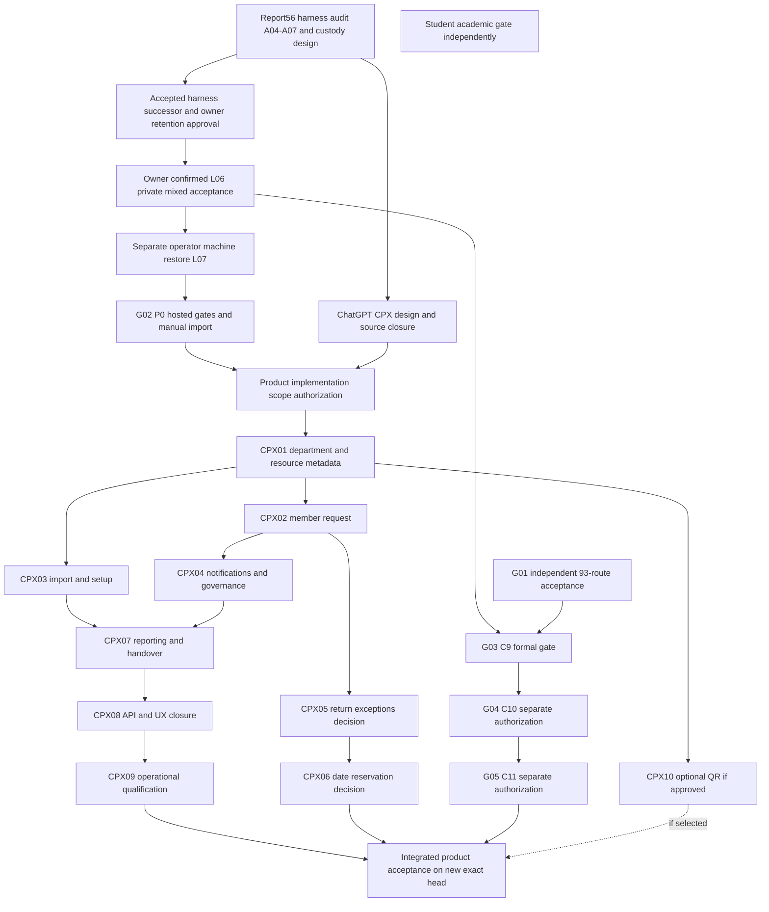
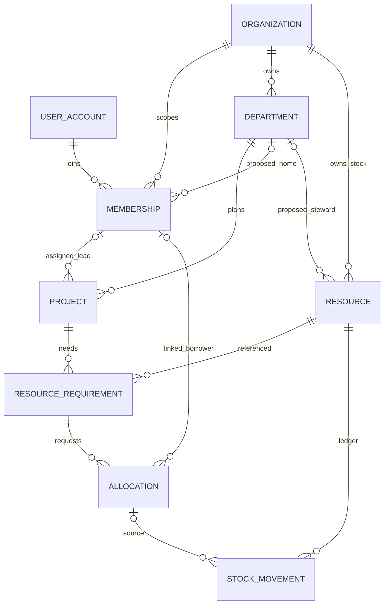

# Report58 — OrgResource master product completion program (planning batch 1)
2026-11-25 PHT. User requests one launch prompt, all feasible pre-Claude engineering/research/planning in ChatGPT, detailed cross-layer design, maps, SDLC and continuous execution. This is a **preparation contract, not launch clearance or scope approval**. Supersedes neither approved C8 policy nor Report56 HOLD. Use this as the single product planning entry, not a new competing source of implementation status. No new code, migration, deployment or external contact.

## 1. Authority and exact bases
- Live main 96741bbd295a2d1e7b4bbf6a75cb558a793b09bd; handoff parent 6a13a0d4c00e63eadd4318de6757d3f898864814. Report57 source fbfe961f861478c1727efa1ebf5df209f81f2c5d, tested PR57 c7ed762f1cfb1f5603d9e34028653f072c877773; prior actual CI45574646363, not fresh main test. Windows L06 harness-only 72de0c106621dabc26a63390003f46c86d63b066 must not use integrated main as its checkout. Recheck all live refs before execution.
- Read AGENTS.md b9a8dd40cc8b8f7591a8d058622a23fa31177d7f, quality gate 494d9df515dbfcc2e7586c87a1b1fa859aa71564, graph12 9ca384e7030f0b26ce3510ad99002abcfe8c8805, Report56/57, CC research10 ed2f63e1c32f60cd8c30d69639a5ae694bad9e6f, DEC-D01 d991f5d65700e75b7c308ff83ed55d0e73c83a8b, C8 approved policy 4e7821c12237c3fb0c71c37eefce50b3a7feb75a, historic launch09 d1a352cd4c95680cd9c75536171a38fa51627ded (stale launch permission; HOLD governs).
- Original Project attachment assignment 09_ESP_PROJECT_ASSIGNMENT.pdf pages1–3 extracted full, syllabus 08_CSCI180_SYLLABUS.pdf pages1–4 relevant ranges, proposal 10_ORGRESOURCE_CONCISE_PROPOSAL.docx first120 lines relevant whole-batch definition and controller convention. Source originals remain private; no private names, IDs or raw text public. Assignment requires Jersey/JSON/Spring/JPA/Javax/Retrofit external service incl Twilio/scheduling/5 justified entities/GET-POST/@Autowired/Postman; final printed Dec5; optional UI. Syllabus CLO1–10 includes Eclipse, JPQL and image HTTP. Original proposal five entities and whole-batch allocation. Frozen A 7f8c0746da18fd54b47f430ac1435ac36e605d67 unchanged; Extended changes are not academic requirements. Verify Canvas and truthful student duties separately. Full visual audit and all source archives not repeated; container unavailable. Prior source map is discovery, not evidence of full review.
- Existing topic map/index/decision/receipts/graph authoritative; do not copy entire historical corpus into Claude. Product need evidence and scoped frontend review in issue #50 comment 7158163386. Report57 F01–F12 remains canonical current-state feature register; below CPX work IDs map proposed future contracts to it, not replace it. Academic vs commercial scope must stay separate.

## 2. Product objective and bounded definition of done
Student organization resource and logistics management: officer can onboard a workspace, import inventory, assign members/departments, discover shared resources, plan projects, approve/issue/return/consume, reconcile and hand over; member can find requestable resources, submit a permitted request, follow status and return obligations. Prioritize reduction of double entry and inventory ambiguity; no general ERP, payroll, finance, SSO, cross-org lending, offline writes, per-asset serial model, real provider or AI feature without evidence/approval. Do not claim adoption; validate with consenting pilot after operational/privacy gates. Proposed measurable pilot: baseline same tasks in existing forms/sheets/chat; record completion rates, time, assistance/errors, stock discrepancies, repeat use and reasons for abandonment, without asserting a measured benefit yet.

## 3. Dependency graph and executor routing
Existing graph12 governs R/L/G IDs. R00–R09 bounded remote receipts reused; L00/L00B/L03/L04/L05/L08 bounded reported local evidence; L01/L02 covered; L06 blocked; L07 not run; G01/G03 blocked, G02 live import not run, G04/G05 not run, G06 proposed, G07 student. Independent acceptance is not self-review.

Arrows show prerequisites, not authorization. CPX05/06 if deferred with approval, graph substitutes explicit deferral, not fake pass. C10/C11 acceptance for old head cannot certify new product head. Requalify affected evidence on successor; preserve P0 exact V7 import separately. Existing G03/G04/G05 sequencing stays intact. ChatGPT continues independent planning and safe eligible engineering while human gates blocked; local Claude ONLY after accepted launch package, with local/native/private checks or local implementation beyond ChatGPT capabilities. Separate operator and reviewer remain required. No unsafe bypass, no WSL or GUI browser plugin.

## 4. Design baseline and trace
Source reopened at main: V1__extended_c1_baseline.sql blob22b1e0f589ab05d2b0721e5de39bb29b371a2382 lines57–76,148–230; V3__atomic_inventory_ledger.sql 37ce7fffc3a2a5aae6556aec22f5c8f7755b363c lines43–111; V6__c8_project_leads_and_linked_borrowers.sql 187e5aeff4481d250db9e45f6f7d7cb685e683d4 full. V1 already has composite department(id,organization_id), membership(org_id,id), resource/project/requirement scoped unique keys; V3 stock movement has unique(org,allocation,kind) and kind/delta check; V6 borrower/requester FKs and lead assignment. Do not invent schema or change V1–V7. Current app source paths and ranges in issue comment7158163386, Report57. Current API inventory evidence/C8/C8_ROUTE_INVENTORY.json 714df9c03260e0fe35679e14e6685a755e382950 93 declared routes.

Architecture: React pages -> typed API client -> Jersey resource -> Spring component/service -> tenant-scoped repository/JDBC/JPA -> MySQL transaction/constraints. Auth/session/CSRF on all paths; stock service remains single write authority; append-only movement/audit; existing receipt store and durable movement facts. Preserve existing GET/POST compatible routes. No frontend-derived authoritative availability.

## 5. Proposed implementation work packages (not approved)
All require owner scope approval, P0 gate, exact source review, independently accepted specifications and scoped implementation branch. Paths listed are anchors, not complete changed-file sets. For each package record exact field/endpoint/DTO/repository/caller/test IDs before dispatch. Prefix CPX reserved for this plan; no changes to current graph states.

| ID | Scope and source anchors | Contract / minimum outcome | Critical acceptance |
|---|---|---|---|
| CPX01 | Report57 F04/F06; DEC-D01; Membership.java, domain/Resource.java, C1OrganizationContext, ProjectWorkComponent, App.tsx, ResourcesPage.tsx | Nullable primary_department_id on membership and steward_department_id on resource; same-org composite FK; shared NULL; one home per org, active members only; no permission grants from affiliation. Optional category/location/unit/description and archive only per resolved lifecycle contract. Catalog, My Department, authorized Project needs. | Two orgs, three depts, shared, null and reassignment; foreign IDs, stale sessions, images/legacy lists/exports/cursors cannot bypass; existing org owner multi-workspace access; no stock change. |
| CPX02 | F03/F04/F05; ProjectWorkResource, InventoryResource, InventoryService, ProjectWorkPages.tsx | Member self-request proposal via existing authorized Requirement, requester/borrower derived server-side; no unrestricted member creation of Requirements; add explicit project participation policy or limit to eligible assigned project/request invitation. Owner/admin/lead existing paths preserved. Member own request list/status/cancel own pending only; officer approval remains stock-gated. | Self vs other borrower, unassigned project, tampered role/identity, duplicate/replay, concurrent approvals, expired project, shortage; actual DB snapshot unchanged on denial. |
| CPX03 | F01/F05; ResourcesPage and inventory creation/receipt service | CSV first, template, bounded UTF-8, preview exact normalized rows and errors; no implicit upsert or quantity overwrite. Authorized create and receive through same ledger, atomic bounded import with idempotent operation identities. No connection to private P0 importer. | Malformed/duplicate/oversize/foreign dept, stale preview, transaction failure, repeat import, CSV formula injection on export, original data preserved. |
| CPX04 | F02/F09; GovernancePage, C1GovernanceResource, ReportingPages, reminder service | Search/paged invitation/transfer metadata; revoke existing server operations; private recipient accept view without manual ETag sharing, obtain current version on server; no token disclosure. In-app actionable queues derived from authorized current state before adding durable notification tables. | Token never in list, owner transfer race/expiry/replay, suspended member, stale actions, alert state consistency; no real SMS. |
| CPX05 | F06/F10; V3 constraints, allocation state machine, stock ledger | Proposed exception handling policy; whole-batch current semantics preserved until approved. Partial/damaged/lost requires new immutable event/quantity contract and status/coverage semantics; not a UI-only change. Prefer explicit separate bounded design. | Sum issued/outstanding/returned/written-off exact; retry after receipt pruning; no double-return; wrong actor; corrupt invariant refused. |
| CPX06 | F10; Project date rules, InventoryService, reminder scheduler | Date-specific reservation design conditional on pilot/approval; half-open intervals in defined timezone, conflict/capacity under serialized resource lock; distinguish reservation from present custody and consumables. No automatic promise of future availability. | Overlap boundaries, concurrency, overdue custody, project time change, cancellation, restart, multi-resource rollback; no overbooking. |
| CPX07 | F07; ReportingComponent, ReportingPages | Requirement/Allocation exports with minimized fields, deterministic bounded pages/ranges; complete report metadata and explicit snapshot/cutoff semantics; handover and reconciliation reports. No silent truncation. | >1000 rows, >4MiB, concurrent writes, cursor/role/org changes, formula injection, no private contact or secret. |
| CPX08 | F05/F09; ResourceResource, ProjectWorkResource, V2DepartmentResource, client.ts, extended.ts | Modern route parity only where useful; preserve existing legacy operation oracles. Role-based navigation, mobile, loading/empty/error/uncertain state, keyboard, reduced motion. | Old and new routes agree on authorized results and side effects, all changed endpoint registration and real browser journeys. |
| CPX09 | F08/F11; C9–C11 evidence and ops scripts | Health/readiness no data leaks, scoped diagnostics, retention decision, guarded backups/recovery, no deployment before owner approval. | Exact-head actual MySQL/runtime, kill/restart/restore, role/tenant, PII redaction, artifact provenance, independent review. |
| CPX10 | F10 optional | QR label deep link only, no public read or bearer secret, scan opens authorized existing record; defer until pilot demand. | Wrong org, stale session, no scan-triggered writes, keyboard fallback. |

### Candidate decisions to freeze during preparation
DEC-D01 A–H: recommend one nullable home department per membership, organization-wide shared ledger, foreign-dept availability bands, assigned/authorized Project detail only, no extra approval layer; preserve unassigned accounts and original cohort. Existing LEAD assignment remains singular and explicit. No new migration before P0. Department deletion restrict while referenced, no cascading history deletes. Archive resource only with no current holds/issued and no conflicting future commitment if later enabled; retain history and unique names, no quantity adjustment on archive. Retain old rows NULL/default, no inferred backfill. Validate text lengths and normalized uniqueness against existing DTOs; candidate unit label 1–32 chars, location 1–120, description <=500, category <=80, all optional; choose enum/labels vs lookup only after user need. Proposed member request entitlement remains unresolved: avoid inventing project membership or allowing arbitrary organization-wide requests. Candidate minimal explicit project request eligibility grant (scoped membership+project FK) if approved; alternatively officer/LEAD-generated request invitation. Use server-derived requester and borrower, no access by department alone.

### High-risk correctness traps
V3 unique(org,allocation,kind) makes multiple RETURN movements for one allocation impossible today. CPX05 must reconcile append-only facts and replay semantics with any new per-event key; don't drop uniqueness casually or rewrite historical movements. A damaged item cannot be both available and outstanding; define physical usable total vs quarantine/write-off, separate immutable facts, no clamping. Existing coverage may count completed allocations; don't change shortage meaning by accident. Dates cannot imply custody has ended; future reservations require explicit actual overdue handling. Same-org composite FK prevents cross-org link but does not grant actor permissions. Old legacy reads and stock writes must be included in closure, not bypassed by new v2 handlers. For exports, cursor-only pagination is not a repeatable snapshot when rows mutate; choose explicit bounded report semantics before code.

## 6. SDLC and execution packet requirements
For each CPX package complete discovery -> requirements -> alternatives -> approved exact contract -> data dictionary/ERD -> role × action × scope matrix -> UI interaction/empty/loading/denied/error/retry -> method/path/DTO/error/ETag/idempotency -> transaction/lock order -> migration upgrade/fresh DB/grants -> tests -> review -> exact integrated CI receipts. Include per-file coverage depth, dependency closure, acceptance command and failure oracle, rollback/forward-fix, test fixture data and proof. Reuse 93-route directed evidence and independent acceptance ledger; do not restart 22k historical case enumeration indiscriminately. Invalidate receipts when relevant code/schema/test environment changes. Add new rows for new routes; preserve existing IDs.
Fixture: two fictional organizations with 3 departments, shared inventory, active/suspended actors in all roles, assigned/unassigned projects, foreign IDs, reusable and consumable, pending/approved/issued/terminal historical rows. Real MySQL8 and Java21; protected Java8 course parity separate. For each mutation positive and denied SQL pre/post, CSRF/tenant/role/version/replay/rollback/concurrency where material; packaged Playwright CLI desktop/mobile/keyboard; Newman; source/JAR hashes; clean disposable DB/process verification. No mocks as real proof.

## 7. Research and token-efficiency adoption
Reuse existing CC01–CC11 and repository selection in research10, which includes vendor docs, user transcript excerpts and explicit TikTok access limit. Fresh primary sources checked 2026-11-25: https://code.claude.com/docs/en/best-practices (context, executable checks, plan-first, adversarial review, checkpoint); https://developers.openai.com/blog/run-long-horizon-tasks-with-codex (search excerpt only, page open failed; milestone loop); https://github.com/obra/superpowers/tree/main/skills (indexed upstream plan/execute/verify excerpts; retain pinned adapted skills, no install); https://dev.mysql.com/doc/refman/8.0/en/innodb-locking-reads.html and https://dev.mysql.com/doc/refman/8.0/en/innodb-deadlocks-handling.html (locking/retry; inspect actual lock order); https://api-security.owasp.org/editions/2023/en/0xa1-broken-object-level-authorization/ (per-object authorization). No new video viewing, TikTok scraping, social claims, installs or model dispatch. Cross-repo token routing locator docs/execution/12_TOKEN_BUDGETED_SUBAGENT_ROUTING.md returned 404 on handoff ref; recover exact indexed ref next batch. Do not replace with guesses.
Use existing GOAT and Superpowers; one root executor, deterministic tools for inventory/hash/count, narrow file ranges with complete affected closure, exact receipt reuse, targeted test then full regression at coherent milestone, independent review only when beneficial/required. No unbounded parallel agents, no auto-install, no global permissions changes. Keep compact prompt and stable task IDs; log raw output privately and cite safe result markers, never filter away failures. Before compaction persist exact head, status, current task, files, commands, actual failures, next step; reload only relevant docs. Use actual CLI help/installed version before any model/flag/goal/hook; no token-savings claim without measurement. Avoid extra research when evidence sufficient.

## 8. Existing critical path — next ChatGPT batch
Report56 A04–A07 review all25 harness files and actual dependencies; correct L07 archive/key custody contract before any L06. Owner chooses separate secure archive and secret custody destinations, retention/transfer authorization, separate operator/machine. Atomic non-overwriting encrypted artifact export only after exact positive checks; rehash bytes, manifest ordered row digest/serialization/table scope/JAR/migration identity, separately authorized secret escrow (no plaintext logs, no raw SQL/public transfer); no weakening cleanup, wrong key/tamper/partial/crash/ACL/reparse/non-NTFS refusals, real fictional separate restore proof. Then independent review and revised accepted exact harness, direct owner terminal consent, actual L06 then L07. G01 independent 93-route review, G03 residual source/transport/build/SQL evidence, G02 actual host identity/rotation/backup/restore/clone/manual import as authorized, G04/G05 later separate gates. PR57 86-path privacy review remains open; exact-main run query not completed in this batch. Student track independent.
Preparation tasks: CPX00 close product scope/decision register; derive exact per-file source coverage and route/schema closure for CPX01/02 first; resolve CPX05/06 state machines before scheduling code; review existing source archives via authorized local/File tools when needed; reconcile academic source mapping, do not reread all archives indiscriminately. Prepare complete per-package implementation contracts and fixture/test commands, not merely feature headings. Review existing unapproved proposal branches before adopting any. Mark READY_TO_LAUNCH=false for expanded product until all authorized prerequisite contracts are accepted. No Claude launch now.

## 9. Draft single launch prompt (future; not executable clearance)
Read live issue #50, PROJECT_CONTEXT_START_HERE.md and docs/project-continuity/00_START_HERE.md on the handoff branch. Read Report58, the later accepted product completion manifest, graph12 and successor lock/launch records. Reconcile actual Git refs, approved source, prior receipts and current approvals; obey AGENTS.md, quality gate, pinned GOAT/Superpowers. If launch manifest is absent/not accepted/HOLD active, do not execute blocked work. When authorized, repeatedly choose the next dependency-satisfied task assigned to this executor; read only its approved contract, source/dependencies, tests and exact receipts; reproduce actual failures, implement minimal vertical slice, run real focused positive/negative and relevant regression, inspect diff, challenge security/stock/recovery, record evidence and checkpoint. Commit/push only authorized safe changes to named feature branch, verify remote HEAD. Continue independent eligible work when blocked, preserve failure evidence and report owner/reviewer/student actions separately. Never weaken tests, infer consent, fabricate evidence, alter frozen A/V1–V7, use shared or hosted DB, send real SMS, publish private data, merge/deploy/release/submit or bypass permissions. Recheck current state after compaction/resume. Do not reduce audit depth or acceptance criteria to satisfy time/token limits; complete all safe possible work and mark anything blocked or not run. Stop only when all authorized tasks are proven, remaining gates are truly blocked, or runtime limit requires checkpoint; no promise of uninterrupted execution.

## 10. Verdict
Planning batch1 only. Source-level selected ranges, no new tests/independent review, no complete semantic audit of project attachments or source. No phase or schema authorization inferred. Remaining product specifications and local execution contract are not yet ready. Next eligible ChatGPT work: L07 harness closure and CPX01/02 source/contract closure in disjoint lanes. Preserve existing Report56/57 and graph12 status. 
