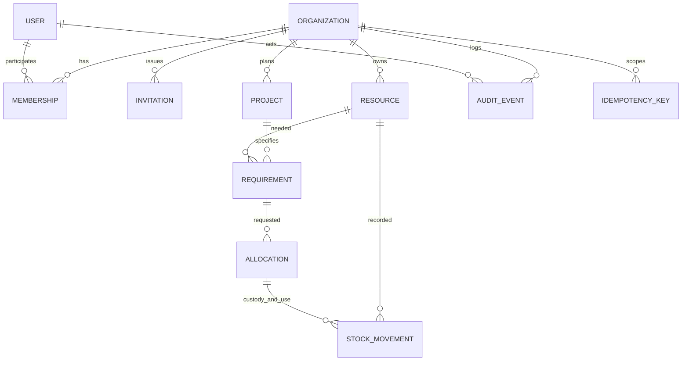

# Proposed V2 logical EERD, field dictionary and data integrity
**Status:** PROVISIONAL RECOMMENDATION, NO MIGRATION OR TABLES IMPLEMENTED. **Date:** 2026-11-15. Sources C03/G06–G09 (V1 limits), E02–E05 (privacy/security).

## Core architecture and multi-tenancy
V1's five JPA entities are preserved in its frozen academic code. Proposed V2 is a **separate versioned schema** with **eleven** justified entity types; this count is a design, not current SQL. Public API UUIDs and internal DB bigint surrogate PKs may coexist (stable unique public_id UUID); tenant-scoped child relationships must use an **(org_id, id)** composite unique reference, not a simple FK that permits cross-tenant joins. Database engine may be InnoDB in modern Java branch; D1/SQLite is an optional separate implementation and has different constraint/lock semantics. SQL migrations must target chosen engine explicitly.

## Field types: SQL logical notation
All fields except noted nullable are `NOT NULL`. PK internal `BIGINT` identity; public `public_id UUID` unique; `created_at TIMESTAMP(6)` UTC, `updated_at TIMESTAMP(6)` UTC; `version BIGINT >=0` optimistic monotone where listed. `CHECK` enforced where target DB supports it; `ENUM` shown means DB check plus service typed validation, not assumed cross-database enum portability. No arbitrary `ON DELETE CASCADE` across inventory history.

| Table | Columns (type, nullability, allowed values) | Justification |
|---|---|---|
| `organization` | `id BIGINT PK`, `public_id UUID UQ`, `slug VARCHAR(40) UQ` lowercase ascii, `display_name VARCHAR(120)`, `claimed_affiliation VARCHAR(80) NULL` (unverified), `status ENUM ACTIVE,CLOSING,CLOSED`, `version BIGINT`, `created_at`, `updated_at`, `closed_at TIMESTAMP NULL` | Isolated inventory-owning workspace; *not* authoritative Ateneo registry |
| `user_account` | `id BIGINT PK`, `public_id UUID UQ`, `auth_provider VARCHAR(32)`, `auth_subject VARCHAR(191)`, `verified_email VARCHAR(254) NULL`, `email_verified BOOLEAN`, `status ENUM ACTIVE,DISABLED`, `created_at`, `updated_at`, unique(provider,subject); avoid password storage if delegating auth | Identity across multiple organizations, not a campus roster |
| `membership` | `id BIGINT PK`, `org_id BIGINT FK`, `user_id BIGINT FK`, `role ENUM OWNER,ADMIN,CUSTODIAN,LEAD,MEMBER`, `status ENUM ACTIVE,SUSPENDED,LEFT`, `version BIGINT`, `joined_at TIMESTAMP`, `updated_at`, unique(org_id,user_id) | Per-tenant authorization, repeat membership across orgs |
| `invitation` | `id BIGINT PK`, `org_id BIGINT FK`, `invitee_email_hash BINARY(32)`, `token_hash BINARY(32) UQ`, `role ENUM ADMIN,CUSTODIAN,LEAD,MEMBER`, `status ENUM INVITED,ACCEPTED,EXPIRED,REVOKED`, `expires_at TIMESTAMP`, `invited_by_user_id BIGINT FK`, `accepted_by_user_id BIGINT FK NULL`, `created_at`, `updated_at` | Single-use controlled enrollment; no raw token persistence; email-hash matching requires privacy review |
| `resource` | `id BIGINT PK`, `public_id UUID UQ`, `org_id BIGINT FK`, `name VARCHAR(120)`, `name_key VARCHAR(120)`, `kind ENUM REUSABLE,CONSUMABLE`, `unit_label VARCHAR(24)`, `total_usable_quantity BIGINT >=0`, `version BIGINT`, `status ENUM ACTIVE,ARCHIVED`, `created_at`, `updated_at`, unique(org_id,name_key,active-name-policy) | Tracks distinct org-owned resource kind and stock; snapshot checked against immutable ledger |
| `project` | `id BIGINT PK`, `public_id UUID UQ`, `org_id BIGINT FK`, `lead_membership_id BIGINT FK`, `name VARCHAR(120)`, `description VARCHAR(500) NULL`, `status ENUM DRAFT,ACTIVE,CANCELLED,CLOSED`, `start_at TIMESTAMP`, `end_at TIMESTAMP`, `version BIGINT`, `created_at`, `updated_at` | Internal planned use, not official OSA-approved project |
| `requirement` | `id BIGINT PK`, `org_id BIGINT FK`, `project_id BIGINT FK`, `resource_id BIGINT FK`, `quantity BIGINT CHECK 1..1e6`, `version BIGINT`, `created_at`, `updated_at`, unique(org_id,project_id,resource_id) | Project-specific need, distinct from stock reservation |
| `allocation` | `id BIGINT PK`, `public_id UUID UQ`, `org_id BIGINT FK`, `requirement_id BIGINT FK`, `requester_membership_id BIGINT FK`, `borrower_membership_id BIGINT FK NULL`, `quantity BIGINT CHECK 1..1e6`, `start_at TIMESTAMP`, `end_at TIMESTAMP`, `status ENUM PENDING,APPROVED,ISSUED,PARTIALLY_RETURNED,RETURNED,CONSUMED,CANCELLED,EXPIRED`, `returned_quantity BIGINT DEFAULT 0`, `approved_at TIMESTAMP NULL`, `issued_at TIMESTAMP NULL`, `closed_at TIMESTAMP NULL`, `version BIGINT`, `created_at`, `updated_at` | Durable request, booking, approval, custody lifecycle; historical reference never deleted |
| `stock_movement` | `id BIGINT PK`, `org_id BIGINT FK`, `resource_id BIGINT FK`, `allocation_id BIGINT FK NULL`, `kind ENUM INITIAL,RECEIPT,ADJUST,ISSUE,RETURN,CONSUME,LOSS`, `delta_total BIGINT signed`, `delta_issued BIGINT signed`, `quantity BIGINT >0`, `reason VARCHAR(500) NULL`, `actor_membership_id BIGINT FK NULL`, `idempotency_key_id BIGINT FK NULL`, `occurred_at TIMESTAMP`, `prev_checksum CHAR(64) NULL`, `entry_checksum CHAR(64)` | Append-only physical stock and custody ledger; no backdating/deleting; checksum tamper-evidence is not immutability enforcement alone |
| `audit_event` | `id BIGINT PK`, `org_id BIGINT FK`, `actor_user_id BIGINT FK NULL`, `action VARCHAR(64)`, `target_type VARCHAR(32)`, `target_public_id UUID NULL`, `request_id UUID`, `before_after_redacted_json JSON NULL`, `created_at TIMESTAMP` | Permission/action trace without raw tokens or contact values; retention policy still required |
| `idempotency_key` | `id BIGINT PK`, `org_id BIGINT FK`, `actor_user_id BIGINT FK`, `route_fingerprint VARCHAR(128)`, `key_hash BINARY(32)`, `body_hash BINARY(32)`, `response_code SMALLINT`, `response_json JSON NULL`, `state ENUM CLAIMED,COMPLETED,FAILED`, `created_at TIMESTAMP`, `expires_at TIMESTAMP`; unique(org_id,actor_user_id,route_fingerprint,key_hash) | Safe retry/reconciliation after ambiguous POST outcome |

**Implementation caveat:** `invitation.invitee_email_hash` requires an HMAC or keyed digest; unsalted SHA-256 over common student email addresses is reversible through guessing, so key management and whether email ciphertext is additionally needed must be established. If a provider handles invitations, remove redundant email data instead of shadow-copying identities.

## Cardinalities and check constraints
- Organization 1:N memberships/resources/projects/invites/ledger/audit; user account 1:N membership. Every tenant child `org_id` immutable.
- Project 1:N requirements; Resource 1:N requirements; pair unique within org. Requirement 1:N allocations; Allocation 1:N custody movements.
- `end_at > start_at`, `quantity >0`, `returned_quantity BETWEEN 0 AND quantity`; consumable cannot be ISSUED/RETURNED; reusable cannot be CONSUMED. Enforce complex state logic transactionally in component, not only CHECK.
- Cross-tenant FKs: `UNIQUE(org_id,id)` on parent and composite FKs `(org_id, resource_id)`, `(org_id, project_id)`, `(org_id, requirement_id)`, `(org_id, allocation_id)`, `(org_id, membership_id)` where parent org-scoped. Global account user ID is allowed only when joined through validated membership. Tests directly attempt mismatched org IDs and must fail DB-level.
- Indexes matching queries: `resource(org_id,status,name_key)`, `project(org_id,start_at,end_at)`, `requirement(org_id,project_id)`, `allocation(org_id,requirement_id,status)`, `allocation(org_id,status,start_at,end_at)`, `stock_movement(org_id,resource_id,id)`, `audit_event(org_id,created_at,id)`, `membership(user_id,status)`. Validate `EXPLAIN` and remove redundant indexes after benchmark.
- No hard deletion of allocations, stock ledger or audit under normal CRUD; administrative retention purge is a distinct controlled policy. `ON DELETE RESTRICT` for history-bearing records; soft archive for resources/projects/organizations. User account erasure requires pseudonymization while honoring legally permissible audit obligations; no indefinite storage by default.
- Capacity mutation lock order: tenant/resource row first, then requirement, then allocation, then idempotency finalization; exact lock implementation depends on chosen DB; plan B for SQLite uses explicit atomic transaction with serialized writes.

## Stock equations
Let `T` = resource.total_usable_quantity, `I` = sum reusable ISSUED or PARTIALLY_RETURNED unreturned quantities (original q minus returned_quantity). `T` includes borrowed but not yet returned usable units, until an authorized loss/decommission event reduces it. For consumables `T` is remaining physically available amount before reservations. Approved reusable holds for query window W = sum APPROVED q where `[start,end)` intersects W. **Conservative safe planning headroom** = `T - I - holds(W)`, never clamp underflow without indicating at-risk; currently issued may continue past planned end and block B despite non-overlap. Approved consumable holds = sum all unconsumed APPROVED q regardless of window (consumed stock will not return); consumable headroom = `T - all approved q`. Report `atRisk` if future approvals become physically threatened by overdue I; do not claim scheduled future return is guaranteed.

Ledger verification: `T = SUM(delta_total)` per resource across immutable movements; `I = SUM(delta_issued)` for reusable, must equal sum allocation outstanding. `ISSUE` delta_total0/delta_issued+q; usable `RETURN` 0/-q; CONSUME -q/0; RECEIPT +q/0; confirmed loss from issued -q/-q (**future feature**, not P0). This conserves stock and forbids silent destructive overrides.

## Migrations and rollback proof
Start V2 from explicit versioned SQL migrations, do not run `ddl-auto=update` in production. New v2 schema should not destructively migrate academic V1 automatically. If future opt-in import, reconcile every old `Resource`, `Requirement`, `Allocation` against date/status and tenant identity; old fictitious data remains fixture-only. On migration rehearsal, record row counts/checksums, foreign key violations, plan dry-run, backward-compatibility and reversible deployment; history changes need forward repair migration rather than blind down migration. **No migrations executed in this research.**

## CP2 EERD/data-integrity corrected contract (2026-11-15; PROPOSED only)
**Original 5-entity academic MySQL schema remains untouched.** V2 11-table data dictionary remains draft; do not interpret this as executed DDL or a requirement to switch database engines.
**MC-02:** for mandatory tenant relationships, child org_id and parent_id both NOT NULL; parent UNIQUE(org_id,id); child FOREIGN KEY(org_id,parent_id) references exact same org parent, never a nullable optional link. MySQL MATCH SIMPLE permits partial-null composite FK bypass. Optional borrower membership alone may be nullable under tested state rules. [Official MySQL 8.4 foreign keys](https://dev.mysql.com/doc/refman/8.4/en/create-table-foreign-keys.html).
**MC-05:** resource unique(org_id,name_key,active-name-policy) is pseudocode. P0 simple UNIQUE(org_id,name_key) including archived resources. Optional active-only reuse requires proven MySQL functional/generated nullable index design. [Official MySQL unique indexes](https://dev.mysql.com/doc/refman/8.4/en/create-index.html).
**MC-04:** idempotency_key 24h receipts do not alone prevent 48h replay. Require immutable unique(org_id,operation_public_id) on stock_movement or equivalent durable no-double-physical-operation proof, plus state guard. Ledger checksum detects tampering, does not enforce immutability without DB grants and independent checkpoints.
**MC-07/08:** verified_email and actual organizational ownership are NOT proven. Real identity/invitation/owner recovery requires explicitly chosen auth/delivery flow and may require session/recovery records beyond present 11-table model. Do not fabricate campus registration.
**Test specification:** actual MySQL schema SHOW CREATE TABLE, cross-tenant SQL insert/update rejection, null-required-FK rejection, duplicate active/archive name scenarios, 100 competing capacity approvals, 48h replay, rollback and encrypted clean restore. NOT RUN. [28](28_STRICT_COURSE_STACK_COMPATIBILITY_AND_CP2_CONFLICTS.md).

## CP4 table count and local identity correction (2026-11-15)
The existing **eleven** V2 entities are not sufficient to realize local credentials and human account recovery: `user_account(auth_provider,auth_subject)` lacks password hash/username uniqueness, `invitation` is not verified-email, and durable owner transfer is absent. **Provisional justified additions (NOT migrated)**: `local_credential(user_id UQ,username_key UQ,password_hash,hash_scheme,credential_version,changed_at,disabled_at NULL)`; `account_recovery_code(id,user_id,code_hash UQ,used_at NULL,created_at,revoked_at NULL)`; `ownership_transfer(id,org_id,from_membership_id,to_membership_id,expires_at,status {PENDING,ACCEPTED,REVOKED,EXPIRED},accepted_at NULL,created_at)`; choose server-side session storage (DB session table or deliberately restart-invalidating secure in-memory sessions), no public localStorage tokens. Composite FKs on org-bound transfer references; hashes/secret material never committed or sent to logs. Any transfer must atomically keep at least one active OWNER. **11 remains a provisional pre-auth count; revised count depends on chosen identity/session storage.** Entire course five-entity schema remains unchanged. Details [31](31_JAVAX_RUNTIME_AND_EMAIL_FREE_IDENTITY_RESEARCH.md).
