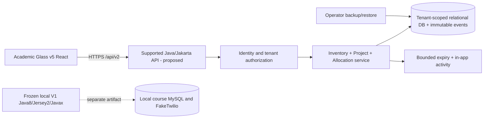

# Architecture choices and versioned compatibility ADRs
**Status:** PROVISIONAL RECOMMENDATION; no deployed or built V2. **Date:** 2026-11-15, Asia/Manila. Sources C01–C05; G05–G10; E06–E18; E20–E23 [SOURCES](SOURCES.md).

## ADR-01: preserve academic stack as an independently reproducible artifact
**Decision (USER):** Original academic V1 remains Java target 8, Spring Boot **2.1.0.RELEASE**, Jersey **2.26**, MySQL JDBC **8.0.13**, Retrofit **2.4.0**, converter-Gson **2.1.0**, OkHttp **3.14.9**, Spring Data JPA, Hibernate, **javax.validation**, `@Autowired` Jersey controller→Spring component and `@Scheduled` work; an Eclipse-compatible source export and Postman collections are required (G06, C01/C02). Do not replace original APIs with Jakarta or rewrite documentation to imply those have always been used. V1 is a local/instructor-facing source release, not a safe public service. A Git tag/export SHA would preserve this after **O14 acceptance**, not prematurely; no tag created here.

**Alternatives:** (a) keep original unsupported old runtime internet-facing — REJECT, security; (b) replace with current Jakarta and claim course equivalent — REJECT, not literal; (c) immutable academic V1 + supported V2 — **recommended**, duplicated maintenance reduced by shared JSON/domain scenarios and separate version labels. 
**Acceptance:** archive tagged V1 build reproducible from clean checkout and course tools matrix, Postman 26-route run, instructor concerns (CLO9/Twilio) resolved or recorded accurately; no post-release rewriting of historical source. No tests run in this research.

## ADR-02: production candidate, current supported Java/Jakarta without course substitution
Publicly released Spring Boot **4.1.2** appears as latest stable on [official release list](https://github.com/spring-projects/spring-boot/releases) consulted 2026-11-15, while 4.2.0 RC2 is **pre-release**, not the default for production (E20). Jersey 4.x implements Jakarta REST 4.0 with Java >=17 (E21). Java **21 LTS** is a conservative proposed deployment JDK to evaluate; alternatives Java25 LTS with separate compatibility matrix. Choose a supported Boot **4.1.2** BOM as a **candidate version**, allow its pinned Jersey/JPA/validator modules to dictate an actually compatible version; the **exact Jersey, security, JDBC, Retrofit versions for Boot4.1.2 are NOT YET RESOLVED/BUILT**, do not simply insert Jersey 4.0.3 mentioned in Boot4.2 release-candidate notes. Migration changes imports from `javax.*` to `jakarta.*`, controller scanning, JSON serialization, repository APIs, validation, tests, security filters, and binary compatibility. Evaluate official Boot/Jersey/Spring Security BOM before a version freeze. MySQL **8.4 LTS** as a candidate DB requires current official download/support/license and ARM packaging confirmation; not asserted as current installation. React **19.3.1**, Router **7.18.5**, Vite **8.3.8**, TypeScript **5.9.3** are current academic observed pins G07, not automatically a new security approval.

**Alternative:** Spring Boot 3.5 (Jakarta) may be technically less migration work but verify its maintenance window against E20 before using as public long-term choice; course code still not literal javax. **Acceptance:** Clean source build on pinned JDK; supported BOM and CVE report; real Jersey endpoints (if retained), MySQL transaction tests; OpenAPI contract; under free-host CPU/RAM benchmark. If costs fail, do not deploy — retain local demo.

## ADR-03: modular monolith; do not add distributed infrastructure
**Recommendation:** Single transactional API process, one relational DB, static React build, one bounded scheduler in the process or externally triggered (only if provider supports durable scheduling), minimal cache, no Redis/Kafka/worker queue/Kubernetes or second source of truth. Modules: `identity`, `organization`, `inventory`, `planning`, `allocation`, `audit`, `notification`, `ops`; explicit auth, service, repository, DTO boundaries. Cross-module commands use same DB transaction, all quantities server-authoritative. Scheduling and outbound reminders out-of-transaction, durable idempotency. 
**Alternative:** Separate edge backend/serverless may reduce maintenance but introduces different data/transaction primitives and duplicates course contracts. 
**Acceptance:** No circular module dependencies, testable auth enforcement and resource lock path, scheduler restart, no unbounded requests or heavy polling.

## ADR-04: hosting branch decision, conditional on $0
**Option A — supported Java on Oracle A1 Always Free self-managed VM + same-VM MySQL and external encrypted backups (provisional first *course-adjacent* V2 evaluation):** E06 shows up to 1,500 A1 OCPU-hours and 9,000 GB-hours/month (~2 OCPU/12GB 24×7) and 200GB block volume, capacity/region/reclamation caveats; E07 requires card validation and possible holds. Self-managing security/DB/OS/ports/backup/dynamic DNS/TLS is substantial. A CPU/RAM quota does not grant a workload/uptime SLA or guaranteed regional availability. A free subdomain+TLS path for Java host is **UNVERIFIED**; E24 describes `workers.dev` for Workers and explicitly warns business-critical suitability, not magically a free DNS name for arbitrary VM.

**Option B — Cloudflare Workers + D1 separate V2 rewrite (OPTIONAL, not course-equivalent):** E08–E11 give strong zero-monetary-runway for small edge workloads and account-specific limits, but Workers Java runtime/Jersey/JPA is incompatible, CPU 10ms per request and SQLite D1 transactional semantics differ. Only choose after proving atomic inventory allocation, tenant isolation, auth, data export, 5m rows/day and 100k writes/day budget. Preserve academic Java V1 untouched. **No claim that replacing JVM with JavaScript is mandatory/approved.**

**Option C — Render free Postgres / free web:** REJECT as indefinite durable sole store (E12 30-day DB deletion, ephemeral web disk). **Option D — Supabase free:** useful demo but pause after low activity and free backups not automatically managed (E13/E14); no Java host by itself. **Option E — Google e2-micro free VM:** small capacity and region/egress constraints, billing account; candidate limited benchmark only (E15). 
**Exit:** independent performance and recovery test, provider enrollment eligibility, no mandatory charge, privacy/term review, actual free DNS/TLS, downtime strategy, user approval of host. Until then **$0 production viability UNVERIFIED**.

## ADR-05: database integrity takes priority over platform convenience
For a Java candidate, use DB-enforced composite org FKs and InnoDB-style row locks as in [11](11_WORKFLOWS_STATES_AND_INVARIANTS.md); versioned SQL migrations, restrictive DB permissions, transaction idempotency and immutable events. For D1, **do not assume** `SELECT FOR UPDATE`, cross-statement serializability, in-flight promise semantics or vendor row locks; independently verify D1 transaction/batch/conditional UPDATE contract with failing race tests. If backend fails atomicity, reject platform. One organization's stock rows must never be writable from another organization's token.

## ADR-06: auth and communications
**Auth provider decision OPEN:** compare self-hosted password/passkey versus free external OIDC with verified pricing/eligibility, token revocation and recovery. Do not sign users up using free mail if there is no verified provider for password resets/invites. Browser cookies secured CSRF/SSRF boundaries; no org role self-grant. Public synthetic demo can be independent **read-only**, avoiding auth requirements for real tenants until ready. In-app notifications first. Academic FakeTwilio remains real Retrofit HTTP to simulator but NOT delivered SMS; no paid live text channel.

## Compatibility decision table
| Requirement | V1 verified source | Supported V2 path | Tradeoff and gate |
|---|---|---|---|
| Jersey REST | Jersey2.26 `javax.ws.rs` G06 | Jersey4 / `jakarta.ws.rs` candidate after BOM | Namespace split; no claim source-identical |
| Spring injections | Boot2.1 `@Autowired` components | Current Boot4 `@Autowired`/DI; may modernize idiom in V2 | Keep V1 direct compliance |
| Persistence | Javax JPA/Spring Data, MySQL | Jakarta Persistence/JPA + transactions | Migrations, query and lock tests |
| Validation | `javax.validation` literal C01 | `jakarta.validation` Boot4 | Different API namespace; preserve course binary |
| External service | Retrofit/Gson FakeTwilio | No live SMS; optional safe app notifications | V1 course Twilio proof separate |
| Scheduling | `@Scheduled` V1 | Bounded scheduler/cron with durable DB receipt | Job may stall during free host sleep |
| Postman/JSON | 25+1 legacy | Versioned V2 OpenAPI/Postman | Shared invariant fixtures, not pretend route parity |
| Frontend | Academic Glass v5 G10 | Retain visual identity/components | security accessibility/contrast tests |
| Hosting | Local only | Oracle candidate/Workers optional | $0 and reliability **not proven** |

## ADR-07: independently review reversibility
The product owner must approve before implementing supported V2 stack, identity provider, hosting/provider enrollment, material role policies and any source/control change to V1. Each ADR gets actual target artifact SHA, dependency SBOM, tested version/cost envelope, rollback and status. Current ADRs are **recommendations**, not approved deployment decisions.

## ADR-08 (2026-11-15): production-supported V2 must be accepted BEFORE final academic compliance
**Classification:** USER DECISION for release order, DESIGN RECOMMENDATION for version/hosting; **supersedes** earlier “academic final then V2” sequence, not original ADR-01 source-preservation rule.

**Separate runnable artifacts:**
- **Academic early baseline O14**: keep original Java8 / Boot2.1.0.RELEASE / Jersey2.26 / `javax.validation` / JPA/Spring Data / Retrofit2/Gson/FakeTwilio / Spring scheduling / five-entity MySQL CRUD/Postman. Save source, complete export, checksums and a reproducible build **early**; rerun unchanged literal artifact at **later** A-FINAL. A course executable cannot be replaced with a Jakarta or Workers backend even if both expose JSON. Do not internet-publish old unauthenticated backend.
- **Production track**: separate supported modern Java/Jakarta REST/JPA stack candidate (e.g. Java21 LTS / Boot4.1.2 after exact Jersey/validator/Security/JDBC BOM is RESOLVED and clean compiling) with independent, secure tenant DB schema and v5 React. Spring [official system requirements](https://docs.spring.io/spring-boot/system-requirements.html) identify Boot4.1.2 requiring Java17+, but that says nothing about project-specific Jersey compatibility. A Workers/D1 implementation is a possible separate edge V2 only after database atomicity proof, never an academic replacement.

**Architecture feasibility critical gate:** early end-to-end spike must prove actual supported JVM/database on an eligible zero-fee host, authenticated session/recovery, free external HTTPS/DNS/TLS renewal, durable scheduling, off-host encrypted backups with clean alternate restore, quota controls and an available operator. Oracle A1 remains **unprovisioned candidate** with home-region, card and capacity caveats. No free hosting guarantee; [15](15_ZERO_COST_HOSTING_AND_SURVIVABILITY.md) is research, not feasibility pass.

**Release acceptance order:** O14 baseline → V2 implementation & technical T1–T11 evidence → P-ACCEPT → fresh original-course AC01–AC17 A-FINAL → student manual Canvas submission by printed Dec5. If no host/security/DR pass then P-ACCEPT BLOCKED and academic gate cannot be sequenced as final under this user's instruction. Earlier language in ADR-01 to “tag V1 after O14 acceptance” now refers to genuine **early academic baseline** verification, not a submitted final or permission to overwrite it. See [25](25_ROADMAP_CHANGE_LOG_AND_PRE_SUBMISSION_ACCEPTANCE.md).
