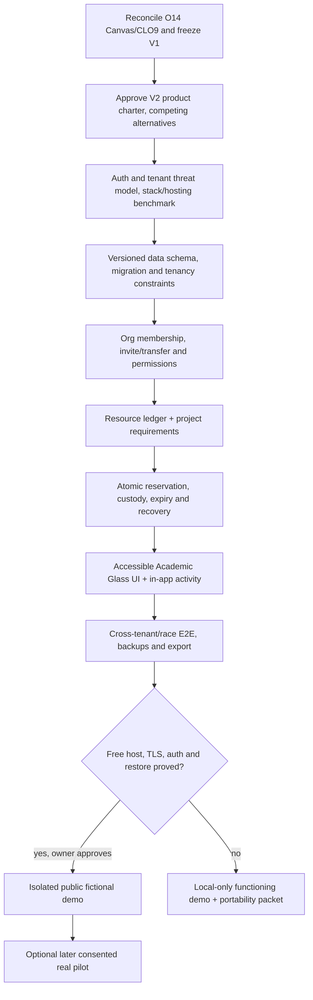

# SDLC, sequencing, dependencies, effort and stop/go
**Status:** PROVISIONAL RECOMMENDATION; research does not execute software work. **Date:** 2026-11-15. Academic deadline C01: Dec 5, 2026 unless Canvas changes.

## Release philosophy
Complete the academic O14 gate first rather than overwriting source submitted for course. Then build a **small complete V2**, with two distinct products: archived academically compliant V1 and independently secure/tenant-aware V2. Research/architecture approvals can be drafted now; code implementation requires separately reviewed Codex prompt/authorization in user's planning chat. No real user, outreach or cloud enrollment required to build/test fictional demo.

## Dated near-term course protection
| Date (PHT) | Evidence-driven action | Gate |
|---|---|---|
| 2026-11-15 | Latest read-only PR#6 branch `fd34a8...`; PR#2–#7 open, O14 unverified | Check actual O14 branch when created |
| Before 2026-11-24/27 early presentation option | Confirm if applicable and scheduled directly from student/Canvas; **not** assumed waiver | Student confirmation |
| By 2026-12-05 printed final deadline | Preserve course app, last acceptance/export, presentation/video, Postman and authorship/assistance; verify Canvas announcements | Instructor/Canvas evidence, student submission only |
| Post academic completion | Start V2 source changes only after research review in separate planning chat | Approved V2 ADRs and host cost choices |

## Workstream backlog (person-days are expert *effort bands*, not estimates of actual student capacity)
| ID | Coherent phase; prerequisites | Deliverables required | Effort band | Gate/contingency |
|---|---|---|---|---|
| B00 | Audit and freeze academic O14; PR stack acceptance | Real CI, Newman, runtime JAR, source ZIP/hash, CLO9 resolution/exception and Canvas state | 1–3 d | NO V1 overwrite; O14 not complete by inference |
| B01 | Public evidence, baseline alternatives and charter | Sources, RACI, hypotheses, spreadsheet/Snipe-IT comparison | 2–4 d | Already drafted research, no validated demand |
| B02 | Supported stack and zero-cost feasibility spike | Version/BOM matrix; local JVM DB benchmark; OCI/D1 eligibility research; DNS TLS/auth options | 3–7 d | If no free host, choose local-only |
| B03 | Threat model + user/organization auth | Sessions, invitations, membership, two-owner recovery, RBAC with negative tests | 5–10 d | No real data without permission gate |
| B04 | DB schema/tenant constraint/migration & ledger | Tables+composite FK, migrations, synthetic seed, event invariant functions | 5–9 d | Empty-to-new and migration rollback tests |
| B05 | Project/requirements/reservations | Positive/negative API, future booking windows, idempotent approval with concurrency | 6–12 d | No overbook, no silent state rewrite |
| B06 | Custody/consumption/expiry/reconciliation | Partial usable returns, inventory movement/audit, bounded scheduler, failure/recovery | 5–10 d | Physical stock conservation |
| B07 | UI/privacy and operations | Locked v5 UI, permissions/guest mode, errors and in-app notifications, export/delete | 5–9 d | A11y and no fake stock |
| B08 | Full QA, abuse and recovery | Postman suite, property/race, migration, cross-tenant, quota/restore and dependency scan | 5–10 d | All P0 security gates green |
| B09 | Public fictional demo host and documentation, if approved | Provider free eligibility, actual TLS/subdomain, backoff/quota, reset and incident docs | 3–8 d | $0 verified and owner deploy approval |
| B10 | Optional real pilot **deferred** | Authorized organizational contact/consent, privacy policies, UAT and support contract | unknown | Not required now; no invented participants |

Dependencies critical path: **B00→B02→B03/B04→B05→B06→B08→B09**. Some B07 frontend work parallel to B05 once API locked; no separate mobile app/microservices. The sum is a planning range, not user promise or target completion date. Large coherent Codex cycles may combine B03+B04 or B05+B06 if bounded tests and ownership permit; no massive unreadable one-shot release.

## Stop/go quality gates
**Gate G0 Academic:** V1 source/export real, original project checks, authentic demo/Canvas, CLO9 and Twilio discrepancies acknowledged.
**G1 Product:** charter/alternatives/permissions accepted; no imaginary campus partnership.
**G2 Security:** auth provider and recovery secured, zero cross-tenant access, no public old Boot2.
**G3 Data:** invariant and race tests green on selected real DB.
**G4 Operations:** offsite backup/restore, $0 provider/cost hard stops, TLS and DNS, rollback documented.
**G5 Synthetic demo:** isolated fictitious users and reset, disclosure and accessibility tested; user explicitly approves public deployment.
**G6 Optional real adoption:** organization-authorized primary user, data privacy legal review, owner/operator and exit plan; currently **DEFERRED**.

## Scope cuts if schedule/budget constrain
First cut: notification integrations, fancy search, recurring booking, QR/barcodes, file upload, real email, custom analytics, duplicate FOSS scope; retain DB/API/auth/tenancy, stock correctness, custody, backup, demo isolation, course V1. Second cut: partial returns **only if** model/API/contracts revised in lockstep to whole-batch explicit; never fake partial event handling. Third cut: public deployment → local-only full synthetic app. Never cut auth/tenant isolation while publishing real multi-user data or cut course-required Jersey/JPA/Javax/Retrofit/scheduling from frozen V1.
