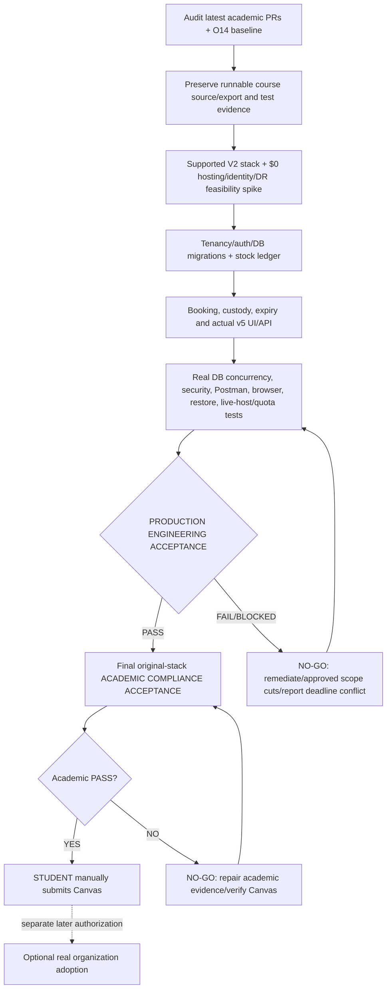

# Production-before-Canvas SDLC, critical path, deadlines and contingencies
**Authority:** USER DECISION on required order, 2026-11-15; **DESIGN RECOMMENDATION** on exact phase targets; **ASSUMPTION** for effort. The prior “finish academic then start V2” plan is superseded, **not erased**: [25](25_ROADMAP_CHANGE_LOG_AND_PRE_SUBMISSION_ACCEPTANCE.md). Original CSCI 180.05 assignment prints **December 5, 2026**, Canvas current state not accessed.

## Non-negotiable acceptance sequence

**O14 = academic baseline, not a development stopping point, final gate or instructor/Canvas approval.** Build/preserve two independently executable tracks: original Java8/Boot2.1/Jersey2/Javax/JPA/Retrofit-Gson/FakeTwilio/scheduling academic artifact, plus a supported separately versioned V2 candidate that cannot silently replace that source.

## Actual audit at roadmap cut (2026-11-15)
Private `newonathe/OrgResource`: `main 16e781c...`, seven open/unmerged PRs; #6 O11/O13 head `fd34a8a...` successful GitHub Verify and author-reported Newman 73 calls/105 assertions, 55 Java/15 UI/5 Playwright; none is V2 production acceptance. No O14 branch in current branch list, no verified final academic artifacts/Canvas, no V2 code or hosting. PR#7 `fb29c38...` was draft/docs-only at amendment start. See [23](23_GITHUB_IMPLEMENTATION_AUDIT.md).

## Feasibility verdict (honest high-risk RED)
Nov 15→Dec 5 = **20 calendar days**; the original engineering B02–B09 effort bands total **37–75 expert person-days** (not measured student velocity) **plus** O14 baseline, separate final academic acceptance, real provider enrollment, regression/rework and demo. No demonstrated parallel team capacity or development throughput justifies a guaranteed deadline. A compressed plan with effectively zero buffer is a **planning target, not a promise**. Codex generation/green CI cannot replace running MySQL concurrency, attack surface, HTTPS and restore tests.

## Critical path & optimistic checkpoints (Philippine time)
| Target date | Gate | Minimum exit evidence / dependency |
|---|---|---|
| **Nov 16** | CP0 O14 baseline | Reconcile PR code stack, compile old Java8/Jersey2 five-entity artifact, hash source/build, review 26 routes/Retrofit scheduler, check Canvas/CLO9/current grading/video rules; baseline only. |
| **Nov 18** | CP1 stack/free-host kill switch | Select supported real Java+Jersey/Jakarta+JPA BOM by clean compile, DB and transaction test; approved auth/owner recovery, verified eligible $0 host, DNS/TLS, external backup/storage feasibility **only if user authorizes enrollment**. If unavailable = BLOCKED early. |
| **Nov 22** | CP2 tenant foundation | Auth sessions, invitations/roles, tenant composite FKs, migration+rollback evidence and cross-tenant negatives pass on real DB. |
| **Nov 26** | CP3 domain engine | Ledger, resource and requirements, overlapping reservation, atomic approve, custody return/consume, clock-controlled scheduler, idempotency, property/race tests. |
| **Nov 29** | CP4 connected UX | Real accessible v5 React API, errors/retries, Postman+Playwright, tenant-specific export. |
| **Dec 2** | CP5 hosted acceptance environment | Security/CVE and fault tests, quotas and no-spend proof, working HTTPS if production hosted, backup outside failure domain and **fresh clean restore**, incident/operator proof. |
| **Dec 3** | **P-ACCEPT** | Real T1–T11 technical evidence PASS with exact commit/build/environment SHA, supported runtime, auth, no cross-tenant/data races, functional/UI/ops, actual provider availability. No mock-only/local-only acceptance. |
| **Dec 4** | **A-FINAL** | Re-run untouched course executable/Postman/5-entity CRUD/Jersey/Javax/Retrofit-Gson simulator/scheduling; original video/export, certificate and AI/outside-assistance acknowledgement, CLO9 and Canvas facts. **Only after P-ACCEPT.** |
| **Dec 5** | Manual Canvas | Student submits only after both gates pass under current Canvas deadline; retains receipt. No automatic submission. |

The sequence is **critical path** `O14 baseline → stack+host+auth feasibility → identity/DB tenant schema → inventory+booking/custody and scheduler → integrated UI/API → real concurrency/security/DR/host tests → P-ACCEPT → A-FINAL → student's Canvas`. UI and fixture development can run in parallel **after** contract freeze; provider eligibility, secure host and backup must be investigated at the start. Dates may fail.

## Dependency backlog for staged Codex authorization (none coded here)
| ID | Dependency | Deliverable and measurable acceptance | Status |
|---|---|---|---|
| O14-B | Latest PR stack | Course executable baseline plus hashes, actual source/tests/Canvas questions | UNVERIFIED |
| P0 | O14-B | Bounded charter; supported Java/BOM host/DB/auth/backup spike; $0 constraints and owner decisions | PROPOSED |
| P1 | P0 | Auth/invite/owner recovery, tenant DB migrations and direct FK/IDOR checks | NOT BUILT |
| P2 | P1 | Ledger/stock/reconciliation, projects and requirements, truthful state/migration | NOT BUILT |
| P3 | P2 | Atomic time-window approval/issue/return/consumption, idempotent scheduler, 100-way race | NOT BUILT |
| P4 | P2/P3 API lock | Working v5 accessible React, audit/activity/export, full API+browser negative cases | NOT BUILT |
| P5 | P0–P4 | Real host TLS/quotas/backup restore, security/DB/perf evidence; no billed providers | NOT BUILT |
| P6 | P5 | Independent production release verdict PASS/FAIL/BLOCKED/NOT RUN with traceable evidence | NOT RUN |
| A-FINAL | P6 PASS | Distinct original academic compliance acceptance against AC01–AC17 | NOT RUN |
| CANVAS | A-FINAL PASS | Student manual submission only | NOT DONE |
| OPTIONAL | Later independent consent | Authorized real org pilot, campus/governance/privacy approvals | DEFERRED |

## Technical production acceptance vs future stakeholder adoption
Required by P6: supported secure runtime, authenticated multi-org permissions, real DB-backed ledger and booking/custody integrity, rate limits/tenant negatives/race tests, privacy guardrails, accurate v5 UI, observable scheduler, actual backup/restore, full Postman/browser tests, free host/HTTPS feasibility and named recovery operator. Use entirely fictional data for acceptance; **do not assert university endorsement/adoption, user interviews, payments or real SMS**. Actual Ateneo org owner verification, institutional approvals, UAT, and adoption metrics are later optional and do not block technical software acceptance.

## Ranked contingencies and non-negotiable NO-GO
1. Cut optional: live SMS/email, institutional integration, complex damage, recurrence, barcode/media uploads beyond any course requirement, AI analytics, payments, SSO, microservices. If partial-return F19 is cut to whole-batch, explicitly revise all SRS/API/states/tests with user approval—never silently credit partial return.
2. Reduce synthetic workload and parallelize independent UI/fixture work, while retaining auth, isolation, stock/race integrity, backed-up data, supported versions, course requirements and test rigor.
3. If OCI free VM/region/card restrictions or TLS/backups fail, evaluate truly free supported alternate but **Workers/D1 is not a course Javax runtime**, and an edge rewrite requires independent transaction proof. No paid fallback without new user decision.
4. If no provider or DR passes, label **production engineering NO-GO**, preserve useful local runnable demo but **do not call it production acceptance**. Expose risk to printed Canvas date and student. Student may check Canvas or seek instructor clarification/extension; no such approval is presumed or pursued here.
5. The new required gate order is a user instruction. Any intentional submission before production PASS would need a **new explicit user decision** and current academic policy check; never silently reverse it.

Research-document-only task now: no code, merges, deployment, accounts, outreach, purchase or Canvas.

## CP0 source status update after earlier snapshot — 2026-11-15
O14 implementation branch and draft PR #8 now exist (head 2dd336ed39cecd417a8bce3388b303e688e95dee); CI passed. CP0 task has changed from locating/implementing O14 to **validating the existing interim academic baseline** and resolving real manual/test/source-deliverable gaps, see [26](26_CP0_O14_BASELINE_AUDIT_AND_CODEX_HANDOFF.md). Sequence remains O14 baseline → V2 production engineering and P-ACCEPT → A-FINAL → student manual Canvas. Dec 5 printed deadline remains at high risk. No product implementation/host acceptance is implied.
