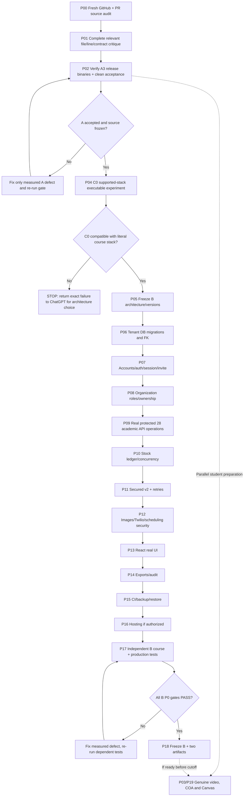

# CP49 — COMPLETE AUDIT-FIRST PHASE-BY-PHASE BUILD PLAN + SOCRATIC CODEX HANDOFF

**Date:** 2026-11-17 PHT. **Status:** USER-REQUESTED FINAL BUILD SEQUENCING AND INDEPENDENT CRITIQUE — PLANNING, NOT AN IMPLEMENTATION. **AUTHORITY:** actual original `09_ESP_PROJECT_ASSIGNMENT.pdf` (3 pp), `08_CSCI180_SYLLABUS.pdf` (9 pp), original `10_ORGRESOURCE_CONCISE_PROPOSAL.docx` (12 pp), direct current GitHub source/PRs, [CP48 fresh audit](79_CP48_FRESH_GITHUB_INDEPENDENT_AUDIT_AND_SOCRATIC_CRITIQUE_2026-11-17.md), [603-path remote inventory](contracts/CP48_GITHUB_TRACKED_PATH_AUDIT_REGISTER.csv), latest [CP44 two-edition decision](74_CP44_TWO_EDITION_COURSE_IMMUTABILITY_AND_FULL_C_HANDOFF_DECISION.md) and academic docs 00–10.

**NON-NEGOTIABLE DELIVERABLES:**
- **A: OrgResource Course Final**, real, independently running, original course-compatible Java/Jersey/Javax/JPA/MySQL/JPQL/Retrofit/Gson/Twilio/scheduling, with five original entities, 26 original business Jersey handlers **PLUS two new real image routes = 28 currently implemented API operations**, eight connected React screens, Postman and genuine tests. Its finished source, JAR, DOCX, Postman and two ZIPs must be frozen and independently verified. Java8/Boot2.1 stays **local**, never public Internet.
- **B: OrgResource Extended C**, derived from A's exact accepted commit, independently running secure full C with multiple fictional organizations, five roles, recovery/invites, inventory ledger/retries, v2 API, enhanced connected UI, backups/approved hosting, and repeated real academic course execution (not just zipped A).
- Student's genuine video/COA/assistance acknowledgement/Canvas submission are separate. Printed final date 2026-12-05, no inferred extension. **Course A must be preserved and available on time even if optional full C is late.**

**IMPORTANT FRESH STATUS (not the old CP47 state):** PRs #11 and #12 have since appeared. **A1+A2 implementation reported PASS; A3 source/CI PASS**, but external local release artifact bytes and a true immutable release tag are NOT independently verified in this research environment. **C0 not yet executed; B not built**. Do NOT rerun the old A1/A2 master blindly. PR#10 has the newer executable academic 07 and an isolated C0 10 prompt. Report Git refs afresh before acting; current historical pins may have moved.

## 0. Global workflow and Socratic challenge — EVERY phase

**Core method: inspect → map → challenge → write smallest justified change → run falsifying test → inspect result → independent critique → commit evidence → owner gate when needed.**

For every relevant logical block/SQL query/API/role/route/UI change, Codex must answer:
1. **WHY?** Which exact COURSE REQUIREMENT, SYLLABUS FACT, original proposal commitment or USER DECISION requires it? Unmapped feature = optional/stop.
2. **WHAT?** What observable behavior or data changes before vs after? Is older A behavior being silently modified?
3. **WHO?** Who can invoke it, and what *active* organization/role scope guards the row and returned data?
4. **WHEN/WHAT IF?** Test null, boundary, time, end-of-project, double click, stale version, concurrent requests, rollback, restart and scheduled actions.
5. **PROOF?** What exact file:line, test command, Git SHA, HTTP JSON, DB query result, browser screenshot or provider response supports the claim? Is it SOURCE_ONLY, REPORTED_PASS or EXECUTED_PASS?
6. **FALSE CONFIDENCE?** What would cause green CI while the service still breaks or leaks data in actual use?
7. **ROLLBACK?** How do we recover without modifying frozen A, losing histories, overwriting another org, sending SMS or making an unauthorized payment?
8. **COST/POLICY?** Does this depend on a trial, real personal information, university approval, student-only recording or an unavailable free tier?

**Only mark a phase PASS if all its mandatory acceptance criteria have real result receipts; classify unexecuted as NOT_RUN, missing authorization as BLOCKED.** A source file existing or CI green does NOT prove a whole system/release, and academic instructor acceptance cannot be manufactured. A branch name containing "freeze" does not imply final tag or independently available ZIPs.

## 1. P00 — LIVE GITHUB PRE-AUDIT AND WORKTREE SAFETY

**Status:** Source audit here conducted on 2026-11-17; Codex must repeat immutable refs before any engineering.  
**Input:** repo `newonathe/OrgResource`, [CP48 audit](79_CP48_FRESH_GITHUB_INDEPENDENT_AUDIT_AND_SOCRATIC_CRITIQUE_2026-11-17.md); current branch names are reference points, not permanent selectors.  
**Tasks:** inspect repository description/default/main, `git status --porcelain`, actual origin, worktrees, branch upstreams, PR#1–#12 heads/bases/draft/merge, current CI and artifacts. Draw exact *commit ancestry*, including the stacked academic PR2→3→4→5→6→8→11→12 and separate research/doc PR7/9/10. Forbid accidental checkout/merge of old main or docs into app. Pin A3 exact commit for all future steps. Review PR diffs **by actual changed path and line range**, not PR titles.  
**Socratic falsifier:** If merging one open stacked PR alone would omit its base's required code, does the proposed base-branch graph expose that?  
**Output:** `evidence/audit/P00_GIT_STATE_AND_PR_ANCESTRY.md`: observed refs, 3-column (course A/reference docs/B target) source authority, change-group risk and exact remote SHA.  
**Gate:** correct source base, clean or safely isolated worktree, no forced reset/merge.

## 2. P01 — COMPLETE SOURCE/PATH/LINE-BLOCK AUDIT (BEFORE CODING C)

**Status:** 603 unique tracked paths INVENTORIED across A3, PR10 and research; high-risk files directly reviewed; this phase is **not fully semantically executed**.  
**Targets and explicit groups:** all **49 main Java**, **13 Java tests**, **22 frontend/e2e source**, **17 Postman files**, **10 scripts**, `backend/pom.xml`, `application*.properties`, Eclipse metadata, `.github/workflows/verify.yml`, `.gitignore`, root and docs PR10 `AGENTS.md`, academic canonical docs 00–10, root historical proposal/QA, A3 as-built/EERD, source/branch test history. Use [path register](contracts/CP48_GITHUB_TRACKED_PATH_AUDIT_REGISTER.csv) as per-path checklist; refresh Git blob IDs after changes. Binary PDFs/ZIPs/images require actual hash/visual acceptance only if used as evidence; no nonsense "line-by-line JPG" assertions.  
**Per-file rubric:** full path + blob SHA + lines or binary size; current role; source authority; all changed blocks with line ranges; functions/endpoints/SQL/state/DTO; dependencies and callers; tests and negative coverage; unhandled failure modes; old vs new course behavior; target edition; action KEEP/FIX/ISOLATE/DEFER/ARCHIVE; severity P0/P1/P2; reviewer verdict. Every field in `resource.type` / `allocation.borrower_name` etc mapped to actual DB and JSON.  
**Audit graphs (all required):** (a) written requirement → source class/method → Postman/test → evidence/receipt; (b) five JPA entities/35 original columns/FKs → repository query → Component → actual Jersey route → frontend page; (c) allocation lifecycle & T/H/I plus expiry/time boundary; (d) every original 28 A route incl two images, six ordered Newman suites and separate reference; (e) auth/tenant/role attack surface for **ALL** future B paths; (f) PR/code/docs and release artifact ancestry.  
**Socratic falsifier:** Can I show a route for which its controller exists but no request/DB postcondition was actually tested? Does `findAll` leak foreign data after organizations are added?  
**Output:** per-file markdown/CSV audit and conflict register with every P0 blocking issue either corrected or owner-reviewed; no undocumented source omissions.  
**Gate:** before B C1, all executable relevant source changes and security/data paths have actual reviewed line ranges, not just names.

## 3. P02 — VERIFY FINISHED COURSE A RELEASE / ACCEPTANCE INDEPENDENTLY

**Status:** **PR#11 A1+A2 SOURCE IMPLEMENTED/CI PASS; PR#12 A3 SOURCE/CI PASS.** Do **not** rebuild A1/A2 from scratch.  
**Input:** actual PR#12 head historically `7f8c0746da18fd54b47f430ac1435ac36e605d67`. A3 `evidence/COURSE-A/A3_TECHNICAL_GATE.md`; `docs/academic-final/COURSE_FINAL_A_AS_BUILT.md`; `scripts/package-release.ps1`; `scripts/build-course-final-a-docx.py`, `postman/OrgResource-Course-A-28-Routes.postman_collection.json`. GitHub Actions Verify run `43982559390` reported success on exact source HEAD.  
**Tasks:** verify immutable source SHA vs tracked A3; check external `A3_RELEASE_RECEIPT.md`, `RELEASE-MANIFEST.json`, `SHA256SUMS.txt`, JAR, whole-source ZIP, Java/Eclipse ZIP, generated **actual DOCX** and source-hash core property; recompute SHA256 from real bytes; inspect ZIP entries for secret/test-database material and accidental historic root as current proposal; verify actual manifest/file pairs and portables. If external folder inaccessible, mark **ARTIFACTS_NOT_ACCESSIBLE**; optionally rebuild from exact K in separate approved test environment, not silently changing A.
**Acceptance replay:** real isolated clean schema/account (not only populated `orgresource_test`), `java -jar` localhost, actual JDK8/Node/MySQL effective environment, five InnoDB tables/FKs/JPQL, 28 Jersey handlers and every real entity create/read/eligible delete, image binary exact retrieved hash, Twilio Fake and official local protocol, scheduled due/expiry, negative stock/date/dependency errors, 61 backend Java/15 frontend/6 browser/100 Newman (or newer measured) with no skipped tests, snapshot/sample Postman reference verified, React 8 pages, restart persistence, imported Eclipse project where available.
**Socratic falsifier:** Does a valid release run when extracted on a fresh machine/DB and all expected inputs are absent, or only on the author's already-prepared local environment? Does Word proposal accurately reflect 28 actual endpoints?
**Output:** `A_RELEASE_PROVENANCE_AND_FINAL_ACCEPTANCE.md`, immutable A source SHA plus full accepted standalone package and hash manifest; do not claim separate professor approval. Student actual video/COA still open.
**Gate:** explicit A technical ACCEPTED; course release frozen; never rewrite A's source or artifact. If failed, fix only measured A defect on separately reviewed branch, retest and freeze a **new** exact approved A SHA.

## 4. P03 — CLOSE THE COURSE SUBMISSION BUSINESS GATE BEFORE DEC5

**Actor:** owner/student, independent of B coding. **COURSE REQUIREMENT:** printed final Dec 5, 2026 (not an assumed extension).  
**Tasks:** review all 28 original+image operations and Word as-built, check actual group member(s), confirm Canvas actual upload limit/module/time, record real project discussion/video (or verified eligible earlier presentation), ensure video link accessible to instructor, personally review and complete Certificate of Authorship with truthful acknowledgment of research/AI/Codex help, email peer review ONLY if other actual members. Prepare Course A as a complete stand-alone primary submission; B is optional/supplemental for grading even though user wants full C.  
**Gate:** never delay an actually complete A submission because C is unfinished; no agent fabricates human evidence or uploads without explicit authorization.

## 5. P04 — C0 SUPPORTED-RUNTIME FEASIBILITY EXPERIMENT (FIRST EXTENDED-C CODE)

**Status:** **NOT RUN** at current Git snapshot. Use newer [bounded Codex C0 prompt](https://github.com/newonathe/OrgResource/blob/docs/course-a-final-spec-build-handoff-2026-11-16/docs/academic-final/10_CODEX_C0_COMPATIBILITY_PROOF_FREE_LUNA.md), but never assume it has executed because it exists.  
**Source:** exact frozen A K (not a moving branch, not old main, not docs ref). Keep `backend/**`, `frontend/**`, `postman/**`, original A scripts and A artifact unchanged in C0. Create isolated `experiments/extended-c-runtime-compat`.  
**Candidate only, subject to runtime proof:** Java21, Spring Boot4.1.2, Boot-managed Jersey4.0.3, Jakarta JPA/Hibernate/Validator9.1 and **literal Javax Validation2.0.1 with explicit Apache BVal2.0.6**; verify real resolved dependency graph. These official version combinations are independently documented, but all mixed-runtime behavior is **UNPROVEN until CI**.  
**UC01–UC12 bound:** executable Jersey GET/POST+bundled React; real Spring `@Autowired` Component; literal javax DTO negative; javax annotated entity and actual JPA flush behavior with explicit/automatic distinction; native Jakarta/session/CSRF guards; five actual entity families and JPQL/rollback; Retrofit/Gson FakeTwilio+official local protocol and scheduling; representative authenticated source route per domain + original all-28 static signatures; T/H/I time+rollback; ONE MySQL source of truth for old/new; dependency/vuln scan; clean reproducible startup.  
**Socratic falsifier:** A `javax.validation` JAR exists but actual invalid DTO/entity is accepted; have we just proven import, not validation? A Spring MVC handler masquerades as Jersey; have we actually satisfied the course?  
**Output:** `evidence/C0/COMPATIBILITY_REPORT.md` real command/log/HTTP/DB/provider identities, exact class/jar names, PASS/FAIL for each UC, security caveats.  
**Hard STOP:** incompatible/unsupported or false-parity experiment; return here for user-reviewed alternative. **Do not start C1 if C0 fails.** No new provider or paid service.

## 6. P05 — FINAL EXTENDED-C ARCHITECTURE DECISION RECORD

**Actor:** planning review here based on C0 **actual** evidence; Codex only writes reproducible effective version info.  
**Tasks:** freeze an ADR for exact Java/Boot/Jersey/Validation/JPA/MySQL/React/Node versions; whether a single supported JVM can honestly invoke both course-required literal javax validation and modern Jakarta; how original `/api` handlers remain *actually executable* and secured; one same-origin React app, one source MySQL. Approve old API numeric IDs/PHT compatibility adapters and public v2 UUID/UTC/status. Alternative architecture only if C0 fails; no silent switch to unsafe Boot2 public, MVC-only, Node-only or dormant A library.
**Gate:** owner reviews material architecture changes; no speculative production build without proof.

## 7. P06 — FRESH DB MIGRATIONS AND ORG-ROOT DATA ISOLATION

**Input:** reviewed CP34/CP41 35-column crosswalk, exact `resource.type`, `allocation.borrower_name`, `resource_requirement`; actual A source. **Full 18 table count is a candidate, not a professor mandate.**  
**Tasks:** reproducible **fresh** B schema with source-backed five domain types; justified `organization`, `account`, `membership`, session/invite/recovery/transfer, movement/audit/idempotency/image-support tables; foreign keys with same-org composite guards; per-org casefolded unique Department/Resource name; explicit ON DELETE rules; indices, charsets/collations and MySQL8 compatibility. Migrations must not silently import existing O14 fictional rows, drop personal schema, truncate historical movement or create unauthorized new accounts.
**Socratic falsifier:** Can inserting a cross-org `project.department_id` or `allocation.requirement_id` directly through SQL bypass the HTTP tenant check? Is `orgId` merely a request string instead of a DB invariant?
**Gate:** schema from empty MySQL + down/rollback/fail-retry + cross-org direct SQL negative, exact five physical legacy columns mapped. No auth/UI until DB safeguards proven.

## 8. P07 — SECURE ACCOUNT, SESSION, BOOTSTRAP, INVITES AND RECOVERY

**Tasks:** valid fictional first-owner bootstrap (idempotent, offline command only); password hashing/rotation/session cookie security, pre-auth CSRF and origin checks, login/logout, invited activation, one-use expires <=24h bearer invitations, single-use recovery codes and safe recovery, rate limiting/account enumeration defenses, session invalidation after suspend/password change. Store hashed tokens, no raw contacts or credentials in DB logs; no Ateneo SSO/unverified campus identity claim.
**Socratic falsifier:** Can a stolen/expired invite be reused or a password reset leave an old session active? Can a caller set `owner=true` in JSON?
**Gate:** real negative auth/CSRF/replay/throttle tests and DB states, not just login form screenshots.

## 9. P08 — ORGANIZATION MEMBERS, FIVE ROLES AND GOVERNANCE

**Roles:** OWNER, ADMIN, CUSTODIAN, LEAD, MEMBER with the exact reviewed [CP35 role/API UI matrix](62_CP35_API_AUTH_UI_WORKFLOW_FREEZE_CANDIDATE.md) and CP41 `GET /borrowers` correction.  
**Tasks:** org-picker/active membership guard, member list and bounded borrower selector, project lead assignments, role change/revocation/suspension, transfer ownership two-party acceptance, last-owner invariant, invite role boundaries. Recheck membership server-side on every request and after org switch.
**Socratic falsifier:** Could an ADMIN promote self to OWNER, suspend last OWNER, or an assigned LEAD list members in another project?  
**Gate:** role × route × org × current session negative matrix, plus last-owner concurrent transfer and stale-session tests.

## 10. P09 — ORIGINAL FIVE CORE DOMAIN FAMILIES SECURED IN B

**Tasks:** make every original Jersey **26 existing + two image operations =28** actually run on B, with real `@Autowired` Component→Repository→MySQL and literal course validation, JSON/source numeric IDs and Manila-local timestamps maintained where compatible; server active-org and role scoping for every original controller and Component; no `findAll/findById/lockById` without validated org predicate in user-request paths; no leaking foreign resource/image/borrower/SMS/ID. Add safe adapters for A DTOs vs modern v2 while preserving A's frozen standalone copy.
**Socratic falsifier:** If actor A guesses B's numeric ID on POST /api/allocations/{id}/return, does server reject without revealing B existence or mutating B?  
**Gate:** full 28-route original+image Postman against **actual B running JVM**, not archived A, including both positive and all applicable foreign-tenant/role negatives. This is the decisive course-preservation gate.

## 11. P10 — PHYSICAL INVENTORY LEDGER + CONCURRENT TRANSACTION SAFETY

**Tasks:** implement append-only `stock_movement` with INITIAL, RECEIVE, ADJUST, ISSUE, RETURN, CONSUME; explain delta_total/delta_issued and org/actor/idempotency; one transaction for allocation state and physical movement; deterministic lock order across Organization/Resource/Requirement/Allocation; DB uniqueness `org+operationId` and `org+allocationId+kind`, no duplicate physical handover after retry or restart. Preserve whole-batch only; no loss/partial return inventory.
**Oracles:** reusable **A=T−H−I**, consumable **A=T−H**. H = APPROVED effective holds before exclusive project end; I = issued reusable custody outstanding; consumables only drop T once on CONSUME. No negative totals or phantom historical receipts; funded stock adjustments cannot violate commitments.
**Socratic falsifier:** Concurrent approvals for available five items request four each; **only one** commits, A never negative. Duplicate CONSUME and network timeout after successful ISSUE do not change T or I twice. Can ledger sum still match materialized stock after process restart and failed transaction?
**Gate:** CP41 stock+tenant SQL invariants, negative concurrency/rollback/crash/restart/expiry tests with exact DB evidence. No successful UI before ledger reliability.

## 12. P11 — NEW SECURE /api/v2 DOMAIN API + ERROR/RETRY CONTRACT

**Input:** [CP35 exact public v2 manifest](62_CP35_API_AUTH_UI_WORKFLOW_FREEZE_CANDIDATE.md).  
**Tasks:** UUID mapping, UTC RFC3339 timestamps, stable schema, sanitized typed errors, CSRF/session, ETag/If-Match on mutations, 24h HTTP Idempotency-Key business receipt, permanent physical operationId ledger guard; all routes have correct current actor/role/org checks and safe 403/404/409/412/422/428/429. No blind replay after ambiguous POST; `GET operations/{operationId}` where authorized. Implement bounded cursor paging and no overfetch.
**Socratic falsifier:** Client retries same key with altered body; 409. Suspended user replays a formerly successful receipt; current authorization rejects. Stale ETag on an already completed issue; no second movement.
**Gate:** machine-readable route/DTO/role/error manifest and positive+negative Newman per route, all in same DB as protected original APIs.

## 13. P12 — TENANT-SAFE IMAGES, REAL TWILIO ADAPTER, SCHEDULERS

**Tasks:** B permissions and per-org scope for image upload/get/delete, 2MiB MIME/pixel limit and private caching; keep real image bytes, no arbitrary filesystem URLs. Preserve official Twilio REST Retrofit/Gson adapter and local FakeTwilio with default disabled; no recipient list exposed; scheduled due+expiry scans tenant-safe and bounded/atomic, no duplicate provider attempt or false "delivered" state; contact consent revocation A09 concurrency. Remote phone account/Virtual Phone use only with explicit owner permission and available account.
**Socratic falsifier:** Does foreign user fetching `/resources/{id}/image` receive bytes? Can a retry after provider timeout send twice? If cancellation occurs between reminder claim and dispatch, is the message suppressed?
**Gate:** private binary/hostile file tests, actual stub HTTP+status, scheduler clock and concurrency tests; no carrier SMS unless separately authorized.

## 14. P13 — FULL CONNECTED REACT UI, EIGHT OLD PAGES + NEW SECURE WORKSPACES

**Existing A pages:** Overview, Departments, Projects, Resources, Requirements, Allocations, Reminders, About; preserve Academic Glass visual language, real data, responsive and accessible operation.  
**New B experiences:** Sign-in/out, account/recovery, invitation redeem, organization selector, member management/roles, project lead and borrower selector, resource images, RECEIVE/ADJUST+movements, audit/activity, exports and selected security settings. Use real /api/v2 with session/CSRF and stale-version conflict handling; no fake dashboard counts, sample campus names claimed real, sensitive local-storage secrets, or silent HTTP retry of non-idempotent stock POST.
**Socratic falsifier:** Can a user with a 403 still press stock-adjust through a hidden route? Does switching organizations show a cached prior-org image? Does the UI falsely report issued when response status is unknown?
**Gate:** actual browser GET/POST/DB journey tests for both reusable and consumable, org switch, wrong role, mobile/keyboard/reduced motion, loading/empty/stale/error/retry; screenshots checked for clipping/contrast on common viewports.

## 15. P14 — EXPORTS, ACTIVITY, ACCOUNTABILITY AND OPERATIONAL SUPPORT

**Tasks:** org-safe CSV/JSON exports with explicit escaped CSV formula-cell safety, redacted audit and mutation history, role-aware activity lists, stock reconciliation reports, safe account/system logs and health endpoints, retention rules. No arbitrary file uploads beyond resource images, no real student personal data or institutional users.
**Socratic falsifier:** Is an exported row from org B visible to org A? Could a cell beginning `=` inject a spreadsheet formula? Do audit logs include password/recovery token/phone?
**Gate:** download byte/content tests, cross-tenant negative and redaction audit.

## 16. P15 — REPRODUCIBLE DEVOPS, CI, MIGRATIONS AND VERIFIED BACKUP/RESTORE

**Tasks:** reproducible full builds with actual effective dependency lock/transitive tree, GitHub Actions unit+real MySQL+Postman+browser gates, path/hashes/source package; environment variables and no secrets committed; schema migrations/rollback, actual independent protected MySQL backup and restore, failure drills, startup guide Windows/Eclipse/CLI plus supported B JDK. Keep small coherent PRs from verified base; don't force merge/tags.  
**Socratic falsifier:** Does a clean restore to a different empty DB reproduce the exact five-course/extended invariants and tenant restrictions, or is backup only an untested SQL export? Does CI compile when developer protected env script is absent?
**Gate:** verified artifact, clean machine/test container build, secret scan, actual restore postconditions, CI linked to exact SHA.

## 17. P16 — HOSTING/HTTPS ZERO-MANDATORY-COST GATE (CONDITIONAL)

**User goal:** production-style hosted B with no **mandatory recurring paid service**. Pricing and uptime change; no unverified "free forever".  
**Tasks:** compare real available zero-mandatory-cost options with data residency/cost/idle/compute/storage/backup limits, account verification and TLS; choose minimal host only when owner account/terms approved. Configure HTTPS/secure cookies, private MySQL, rate limits, logs and alerts. No remote data or open A Boot2 interface. If hosting cannot be verified without payment/account, produce a complete local independently runnable B and truthful hosting **BLOCKED/NOT_DEPLOYED** report; never buy or sign up unapproved.
**Socratic falsifier:** Can a public anonymous caller reach original /api or a MySQL port? Does free VM idle policy break the promised demo?
**Gate:** authorized hosting receipt/TLS/backup/restore/negative tests OR explicit honest not-deployed status.

## 18. P17 — INDEPENDENT FINAL B PRODUCTION + ACADEMIC ACCEPTANCE

**Two separate suites at ONE exact B SHA.**
A. **Repeat on actual B executable**: all five JPA domain families, 28 original course+image Jersey operations, real Spring injection/MySQL/JPQL, literal Javax negative DTO and entity validation, real Retrofit/Gson, scheduling, official Twilio contract + Fake, correct legacy JSON/PHT/Long IDs, original Postman 28 and Academic Glass eight screens; no fake legacy subsystem.
B. **Full C acceptance**: all permissions/tenant negative cases, account transfer/recovery/CSRF, durable ledger conservation and replay, duplicate/timeout/race cases, v2 machine contract, browser end-to-end, image security, scheduled expiry/sends, exports/audit, clean installation, backup+restore/hosting if authorized, actual failure recovery.
**Socratic falsifier:** Does bundling A ZIP cause reviewers to mark B compliant even though B itself cannot run a real Jersey controller? This is **not acceptable**.
**Gate:** independent PASS matrix with raw evidence and known limitations, rather than statements derived from unexecuted specs.

## 19. P18 — FREEZE, PACKAGE AND DOCUMENT BOTH RELEASES

**A remains immutable**. B package includes source+binary, complete B Postman collection/environment, migrations and restore scripts, exact API and role maps, full source diff against frozen A, readable user/admin manuals, security limits, full academic/production test evidence, SHA256 sums and source archive. Two independent folders:
`OrgResource-Course-Final/` and `OrgResource-Extended-C/`, with `READ_FIRST_TWO_EDITIONS.md` as cover. If Canvas permits one upload, student can combine into ONE outer ZIP; don't invent second separately graded submission. No unreviewed merge to main.
**Socratic falsifier:** Can reviewer extract each edition separately and start it following only its own instructions, and verify original course behavior without reading 80 historic planning files?
**Gate:** independently tested A/B artifacts and two-edition cover; student can download/install and actually demonstrate.

## 20. P19 — STUDENT-ONLY COURSE SUBMISSION, RELEASE AND LOCAL WINDOWS SYNC

**Student actions:** personally inspect/play the running app, prepare genuinely accessible demonstration/video (or legitimate earlier presentation), current roster and peer obligations, truthful personally reviewed Certificate of Authorship and AI/research/Codex assistance acknowledgment, actual Canvas upload before printed Dec5, save receipt. Do NOT claim professor approval or measured Ateneo adoption.  
**Local Git:** Codex Cloud cannot mutate Windows folder. On actual Windows host, check `pwd`, `git rev-parse --show-toplevel`, `git remote -v`, `git status --short --branch`, `git worktree list`, then `git fetch origin --prune` after origin verified. If dirty STOP. Prefer sibling worktrees checked out at exact A and B commits; never reset/clean/auto-stash, force-push or unapproved merge. Verification records before/after SHAs.
**Gate:** real submission receipt and final release owner acceptance only.

## 21. PR/BACKLOG dependency order and stop rules

**Efficiency:** phase numbers are **logical acceptance stages**, not a promise of 20 short Codex turns. Combine related implementation work into medium-large coherent PRs with one writer per file; no fashionable microservices/Kubernetes/queue/Redis. Never collapse a major **security/transaction/schema** gate merely to save tool calls. After source inspection, no re-reading the entire multi-megabyte research corpus unless a precise unresolved contradiction exists.

## 22. The single copy-ready CURRENT Codex kickoff instruction

**Use ONLY when the owner chooses to start engineering. This prompt initially authorizes audit + A3 provenance evidence, not the entire B rollout, provider sends or paid hosting.**

> You are auditing and preparing the two-edition OrgResource build in my private `newonathe/OrgResource` repository. Start with `docs/research-2.0/79_CP48_FRESH_GITHUB_INDEPENDENT_AUDIT_AND_SOCRATIC_CRITIQUE_2026-11-17.md`, `docs/research-2.0/contracts/CP48_GITHUB_TRACKED_PATH_AUDIT_REGISTER.csv`, and `docs/research-2.0/80_CP49_COMPLETE_AUDIT_FIRST_SOCRATIC_PHASE_BY_PHASE_BUILD_AND_CODEX_PROMPTS.md` from research branch `docs/orgresource2-research-continuity-2026-11-15`; read actual Course A3 source `feat/course-final-a3-freeze-2026-11-17`, current PR#10–#12 and GitHub Actions. Follow the original assignment/syllabus as academic authority; do NOT assume old `main` is current code, and do NOT execute historical A1+A2 prompt again. Run P00/P01 **read-only**: enumerate current PRs, changed-file line ranges, 49 production Java, 13 tests, 22 frontend/e2e, Postman, scripts, DB mapping, requirements and actual test evidence; for each relevant file write a truthful KEEP/FIX/ISOLATE/DEFER review and cross-ask authority, behavior, tenant/role, invariants, failure, counterexample, observed test, rollback and cost. Use exact source commits and explicit per-file review depth, don't treat a path inventory as line-by-line evidence. Next P02, if the approved local artifact folder exists and permitted, recompute A3 JAR/ZIP/DOCX/manifest SHA256 and perform non-destructive independent academic acceptance; otherwise mark inaccessible and provide reproducible safe steps. Do not modify A3 source, merge PRs, alter main, send SMS, deploy, buy services, touch unrelated Windows files or begin C0/C1. Deliver `P00_P02_INDEPENDENT_AUDIT_REPORT.md` with every P0 contradiction and the exact next C0 authorization decision. STOP for review.

**For subsequent approved phases**, provide a narrow instruction referencing the corresponding P04–P19 section with exact source SHA and acceptance; don't permit broad autonomous overbuilding through one huge unchecked prompt. Routine implementation PRs may proceed as coherent batches only after every relevant P0 architecture gate is accepted.

## 23. Full acceptance matrix references and independent critique resources

- [Academic 00 source hierarchy](../academic-final/00_READ_FIRST_AND_DECISION_BOUNDARIES.md), [01 syllabus/assignment course matrix](../academic-final/01_WRITTEN_REQUIREMENTS_AND_COMPLIANCE.md), [02 every original business route](../academic-final/02_DOMAIN_26_ROUTE_COMPONENT_CONTRACT.md), [05 EERD/repositories](../academic-final/05_EERD_REPOSITORIES_AND_METHOD_SEQUENCES.md), [03 all tests/Postman/demo](../academic-final/03_TEST_POSTMAN_DEMO_AND_SUBMISSION.md).
- New independent A code status [CP48 audit](79_CP48_FRESH_GITHUB_INDEPENDENT_AUDIT_AND_SOCRATIC_CRITIQUE_2026-11-17.md); PR#11 code/report, PR#12 source/CI (actual A3 binary archive bytes not independently inspected).
- B candidate [CP34 schema](61_CP34_CANONICAL_SCHEMA_AND_CUTOVER_BLUEPRINT.md), [CP35 role/API/UI](62_CP35_API_AUTH_UI_WORKFLOW_FREEZE_CANDIDATE.md), [CP41 source SQL invariants](68_CP41_SOURCE_TO_SQL_INVARIANT_GUARDS_AND_PROOF_CASES.md), [CP40 cost/provider constraints](67_CP40_PROVIDER_TRIAL_SECURITY_AND_DEADLINE_REALITY_CHECK.md). Read actual files only when material to a concrete engineering phase.
- [Twilio Virtual Phone](https://www.twilio.com/docs/messaging/guides/guide-to-using-the-twilio-virtual-phone), [Spring Boot4.1.2 requirements](https://docs.spring.io/spring-boot/system-requirements.html), [Hibernate Validator9.1](https://hibernate.org/validator/releases/9.1/), [Apache BVal2.0.6 javax provider](https://bval.apache.org/downloads.html) checked November17 2026. **Verified vendor documentation does not prove this full app compiles/works; UC01–12 must.**

**STOP CONDITION:** The research audit and complete implementation plan are published; **not a request that this ChatGPT workspace start coding**. Do not confuse CodeX Cloud's GitHub changes with a synchronized local Windows repository. Protect A, qualify C0, then implement B sequentially with real evidence.
